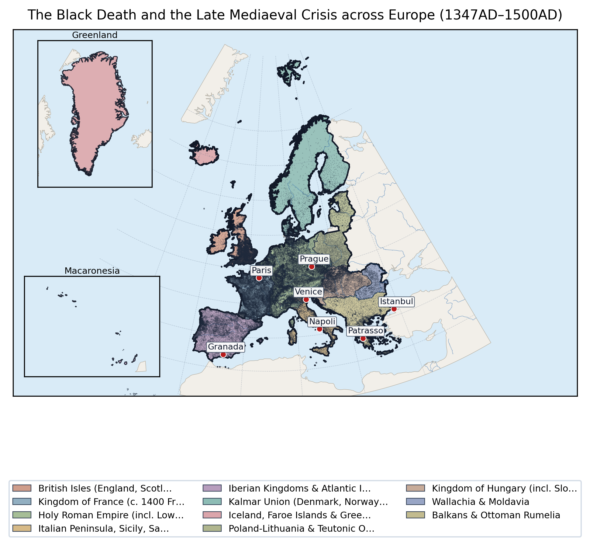
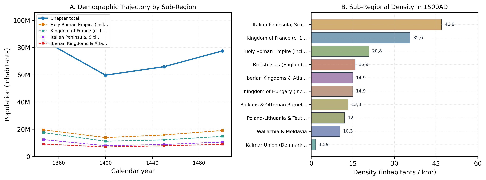
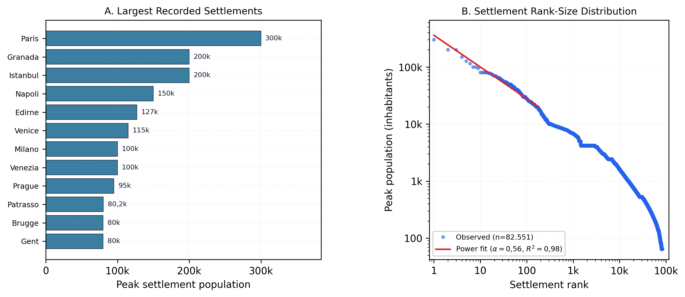

The Black Death and the Late Mediaeval Crisis across Europe
================
Aust Kätzchen
22 November 2026

- [Abstract](#abstract)
- [Background](#background)
- [Methodology](#methodology)
  - [Sub-Regional Partition and Benchmark
    Architecture](#sub-regional-partition-and-benchmark-architecture)
  - [Fiscal Registers, Hearth Counts and Manorial
    Series](#fiscal-registers-hearth-counts-and-manorial-series)
  - [Palaeoecological Land-Use Proxies and
    Bioarchaeology](#palaeoecological-land-use-proxies-and-bioarchaeology)
  - [Urban Gazetteer Integration and 1500 Historical GIS
    Anchors](#urban-gazetteer-integration-and-1500-historical-gis-anchors)
- [Validation](#validation)
  - [Reconciling High-Mortality and Moderate-Mortality
    Historiography](#reconciling-high-mortality-and-moderate-mortality-historiography)
  - [Cross-Checking Against 1500 Historical GIS Sub-Administrative
    Enumerations](#cross-checking-against-1500-historical-gis-sub-administrative-enumerations)
  - [Bioarchaeological Survival, Urban Migration and Pollen
    Cross-Checks](#bioarchaeological-survival-urban-migration-and-pollen-cross-checks)
- [Results](#results)
  - [Continental Trajectory and Sub-Regional
    Divergence](#continental-trajectory-and-sub-regional-divergence)
  - [Western Europe: Poll Tax England, War-Torn France and the Tuscan
    Catasto](#western-europe-poll-tax-england-war-torn-france-and-the-tuscan-catasto)
  - [Central Europe, Deserted Villages and East-Central
    Resilience](#central-europe-deserted-villages-and-east-central-resilience)
  - [Nordic Contraction and the Extinction of Norse
    Greenland](#nordic-contraction-and-the-extinction-of-norse-greenland)
  - [Ottoman Conquest and Urban Restructuring across the
    Balkans](#ottoman-conquest-and-urban-restructuring-across-the-balkans)
  - [Late Mediaeval Urbanisation and the Rank-Size
    Hierarchy](#late-mediaeval-urbanisation-and-the-rank-size-hierarchy)
- [Limitations](#limitations)
- [Conclusion](#conclusion)
- [Appendix](#appendix)
- [Sources](#sources)

<figure>

<figcaption aria-hidden="true">Sub-regional boundaries and 1.943
recorded European settlements across 11 sub-regions between 1347AD and
1500AD.</figcaption>
</figure>

# Abstract

Between 1347AD and 1500AD the population of Europe outside the East
European Plain, together with Iceland, the Faroe Islands and Greenland,
underwent the sharpest demographic contraction in recorded continental
history. Across 7.148.884,3 km² (4.970.091,5 km² excluding the North
Atlantic archipelagos and Greenland), human numbers fell from 85,23M on
the eve of the Black Death in 1347 to 59,73M in 1400, a net loss of
29,98% at an average annual rate of -0,67%. Recurrent outbreaks of
*Yersinia pestis*, prolonged warfare in France, Bohemia and the Balkans,
climatic cooling and structural agrarian retreat held population
depressed through the early fifteenth century before gradual recovery
lifted the continental total to 65,93M in 1450 and 77,51M in 1500, still
9,82% below the 1347 peak. Continental density declined from 11,98
inhabitants per km² in 1347 (17,22 per km² excluding the North Atlantic
and Greenland) to 8,39 in 1400 (12,06 excluding the North Atlantic),
recovering to 10,81 (15,53 excluding the North Atlantic) by 1500.
Mortality and recovery were highly uneven across the 11 ecological and
political sub-regions: by 1400 the British Isles had lost 43,5% of their
population, Scandinavia and Finland 38%, Italy and Malta 36,3% and
France and the Low Countries 36%, whereas Poland and the Baltic Lands
contracted by only 10,4% and stood 15,6% above their 1347 level by 1500.
Across the southeast, Ottoman conquest over Thrace, Bulgaria, Serbia and
Greece reshaped Balkan settlement while turning Istanbul (200k) and
Edirne (127k) into Europe’s two largest cities by 1500. Reconciling
fiscal registers, palaeoecological pollen trajectories, osteological
mortality series, 16 historical GIS sub-administrative enumerations at
1500 (40,95M inhabitants across 2.008.829 km²) and a gazetteer of 82.551
settlements across 41 jurisdictions reveals a striking structural
paradox: even while total population in 1500 remained nearly a tenth
below 1347, recorded urban population rose 34,87% from 6,89M to 9,3M as
surviving rural labour consolidated into regional market towns and
territorial capitals.

# Background

In the autumn of 1347 Europe was carrying more people than at any
earlier point in its history, yet its agrarian economy was already under
visible strain. Three centuries of high mediaeval woodland clearance,
fen drainage, upland terracing and village foundation had lifted the
continental population outside the East European Plain to 85,23M.
Densities exceeded 41 inhabitants per km² across the Italian Peninsula
and Malta, 34 per km² across France and the Low Countries, 29 per km²
across the German Empire, Austria and Switzerland and 23,5 per km²
across the British Isles. Marginal soils had been pulled under the
plough from the Norwegian fjords to the Pennine moors and the Apennine
foothills, fragmenting peasant holdings to subsistence minimums
[\[1\]](#ref-Broadberry2015)[\[2\]](#ref-Campbell2016). Between 1315 and
1322 a succession of cold, rain-sodden summers triggered the Great
Famine across northern Europe and the Great Bovine Pestilence across
Britain, Ireland, France and Germany, wiping out draught oxen and
halting demographic growth a full generation before plague arrived
[\[2\]](#ref-Campbell2016)[\[3\]](#ref-Pribyl2020Survey).

The biological shock that broke the high mediaeval demographic ceiling
arrived from the Black Sea trade network in the second half of 1347.
Ancient DNA recovered from London’s East Smithfield emergency cemetery
and contemporary European burial grounds confirms that the pathogen was
*Yersinia pestis*, carried westwards from central Asian rodent
reservoirs via the Golden Horde siege of Genoese Caffa in Crimea
[\[4\]](#ref-Rajaraman2013Genome)[\[5\]](#ref-Navid2009Genome)[\[6\]](#ref-Parker2023Century).
Merchant galleys brought the bacterium to Constantinople in the summer
of 1347 and to Messina in October 1347; by the winter of 1347-1348 it
had taken hold in Genoa, Venice, Pisa, Marseille, Mallorca and Barcelona
[\[7\]](#ref-Benedictow2004). Over the next five years the epidemic
moved inland along river valleys, maritime shipping lanes and grain
corridors. It devastated Tuscany, Languedoc, Provence, Castile and
southern England in 1348, swept through Paris, the Low Countries,
Ireland, Scotland, Norway and the Rhineland in 1349, crossed Denmark,
Sweden, Prussia and northern Germany in 1350 and reached peripheral
Baltic and East-Central European districts between 1351 and 1353
[\[2\]](#ref-Campbell2016)[\[7\]](#ref-Benedictow2004).

Had the Black Death remained a single catastrophic visitation, European
populations might have regained their 1347 numbers within two or three
generations, as pre-industrial societies normally do when land becomes
abundant and real wages climb. Instead, *Yersinia pestis* established
enzootic reservoirs inside Europe itself and returned repeatedly
throughout the late fourteenth and fifteenth centuries
[\[2\]](#ref-Campbell2016)[\[6\]](#ref-Parker2023Century). Genomic
sequencing of fourteenth-century skeletal remains demonstrates that the
*pestis secunda* of 1360-1363 — noted by chroniclers as a mortality of
children and young adults born since 1348 — descended directly from the
1347-1353 European clade rather than requiring a fresh central Asian
introduction [\[6\]](#ref-Parker2023Century). Further continental or
macro-regional outbreaks struck in 1369, 1374-1375, 1382-1383, 1390,
1400-1404 (finally reaching Iceland in 1402-1404), 1420-1424, 1438-1439
and 1478-1480
[\[8\]](#ref-Galanaud2015Historical)[\[9\]](#ref-Galanaud2020Mortality).
As modern mortality-shock analysis confirms, recurrent epidemic hits
spaced a decade apart flatten cohort replacement and suppress aggregate
growth far longer than a single acute crisis [\[10\]](#ref-Liu2026Long).

Disease interacted with warfare, fiscal extraction and climatic
deterioration across every quadrant of the continent. In France, the
Hundred Years’ War (1337-1453) unleashed English *chevauchées*,
mercenary *routiers* and the Armagnac-Burgundian civil war over Picardy,
Normandy, Île-de-France, Guyenne and Champagne, turning plague
depopulation into prolonged rural desertion. Across the German lands,
Austria and northern Europe, low grain prices and scarce tenants drove
thousands of marginal villages out of cultivation, creating the classic
late mediaeval *Wüstungen* (deserted settlements) and Norwegian
*ødegårder*. In Bohemia, relative fourteenth-century resilience gave way
to sharp disruption during the Hussite Wars (1419-1434) before
stabilising under Poděbrady and Jagiellonian rule. Along the Arctic
margin, deteriorating sea-ice conditions, declining walrus-ivory markets
and isolation from Bergen extinguished the Norse Western Settlement in
Greenland during the mid-fourteenth century and the Eastern Settlement
during the fifteenth century [\[11\]](#ref-Dugmore2012).

In southeastern Europe, plague coincided with a thorough geopolitical
transformation. The Serbian Empire of Stefan Dušan fractured after 1355
and the Second Bulgarian Empire split into rival tsardoms just as the
Ottoman beylik crossed the Dardanelles to seize Gallipoli in 1354.
Ottoman forces captured Adrianople (Edirne) in 1362, crushed Serbian
armies on the Maritsa in 1371 and at Kosovo Polje in 1389, annexed
Bulgaria by 1393-1396, defeated crusading forces at Nicopolis (1396) and
Varna (1444), took Constantinople in May 1453 and absorbed Serbia
(1459), the Morea (1460) and Bosnia (1463). Warfare initially emptied
plains across Thrace and northern Bulgaria, yet Ottoman *timar* land
grants, forced urban transfers (*sürgün*) and Turcoman Yörük
colonisation subsequently repopulated Rumelian valleys and lifted
Istanbul and Edirne to demographic primacy across all of Europe by 1500
[\[12\]](#ref-Buringh2021).

# Methodology

Reconstructing European population between 1347AD and 1500AD marks a
decisive methodological shift from earlier prehistoric and high
mediaeval chapters. For the first time across much of Western, Southern
and Southeastern Europe, territorial states and city-republics generated
nominative fiscal surveys, hearth counts, manorial court rolls, urban
tax cadastres and cadastral *tahrir* registers capable of anchoring
absolute population levels independently of purely ecological estimates
[\[1\]](#ref-Broadberry2015)[\[13\]](#ref-Russell1958)[\[14\]](#ref-Malanima1998).
Because those documentary registers remain unevenly distributed across
time and space — dense in England, Tuscany, Burgundy and parts of the
Low Countries, sparser in Scandinavia, Ireland and the Carpathians —
MAGNETIC triangulates fiscal headcounts against palaeoecological
cereal-pollen curves, osteological mortality series, urban settlement
trajectories and 1500 historical GIS sub-administrative enumerations.

## Sub-Regional Partition and Benchmark Architecture

The study domain encompasses 7.148.884,3 km² partitioned into 11
geographically and historically coherent sub-regions. Excluding Iceland,
the Faroe Islands and Greenland (2.178.792,8 km², dominated by the
uninhabited Greenland ice cap), mainland and insular Europe spans
4.970.091,5 km². The 11 units capture both shared epidemiological
corridors and distinct political trajectories: British Isles; France &
Low Countries; German Empire, Austria & Switzerland; Italian Peninsula &
Malta; Iberian Kingdoms & Atlantic Islands; Scandinavia & Finland;
Iceland, Faroe Islands & Greenland; Poland & Baltic Lands; Bohemia,
Moravia, Slovakia & Hungary; Wallachia, Moldavia & Transylvania; and
Balkans & Ottoman Rumelia.

Four chronological benchmarks — 1347, 1400, 1450 and 1500 — structure
the macro-regional trajectories. Setting the opening horizon at 1347
captures Europe immediately before the autumn landfall of *Yersinia
pestis* in Sicily, preserving direct continuity with the high mediaeval
peak. The 1400 benchmark captures the cumulative demographic trough
produced by the 1347-1353 pandemic plus three to four subsequent
fourteenth-century recurrences (*pestis secunda* and *pestis tertia*).
The 1450 benchmark tests mid-fifteenth-century stagnation and nascent
recovery across western and central zones while registering the ongoing
North Atlantic decline and the eve of the Ottoman conquest of
Constantinople. The terminal 1500 benchmark links directly to early
modern territorial censuses and historical GIS administrative polygons.

## Fiscal Registers, Hearth Counts and Manorial Series

Primary fiscal records anchor sub-regional totals wherever surviving
archives permit direct enumeration. In England, the Poll Tax of 1377
levied four pence on every lay person aged 14 and over across 37
counties, yielding 1,355M recorded taxpayers; after correcting for
under-14 cohorts (roughly 35% of the population), ecclesiastical
personnel, exempt paupers and modest evasion, demographic historians
derive an English population near 2,5M to 2,8M in 1377, down sharply
from roughly 4,75M to 5,5M in 1347
[\[1\]](#ref-Broadberry2015)[\[13\]](#ref-Russell1958). Manorial tithing
lists from Essex, Somerset and Gloucestershire, combined with Welsh,
Scottish and Irish estimates adjusted for lower pre-plague densities,
fix the British Isles trajectory from 7,35M in 1347 to 4,15M in 1400 and
4,95M in 1500 [\[1\]](#ref-Broadberry2015)[\[2\]](#ref-Campbell2016).

In Italy, the Florentine *Catasto* of 1427 stands as the most detailed
fiscal census of the European Middle Ages, enumerating 60.000 households
(264k individuals) across Florence, Pisa, Pistoia, Arezzo, Volterra,
Cortona and their rural *contadi* with exact ages, household structures
and property holdings [\[14\]](#ref-Malanima1998). Complemented by
merchant correspondence networks such as the Datini archive of Prato
[\[15\]](#ref-Deglinnocenti2025Narration), Venetian and Milanese fiscal
estimates and southern Italian hearth counts (*fuochi*), the *Catasto*
documents an urban and rural drop of roughly 35% to 45% across
north-central Italy between 1347 and 1427, grounding the peninsula’s
trajectory from 12,4M in 1347 to 7,9M in 1400 and 10,6M in 1500
[\[14\]](#ref-Malanima1998).

In France and Burgundy, hearth taxes (*fouages*) and municipal tax rolls
provide longitudinal visibility across recurrent plague waves. Spatial
analysis of Dijon’s municipal tax registers across 1375-1400
demonstrates both sharp intra-urban mortality clustering and rapid
post-epidemic replacement via immigration from surrounding villages
[\[8\]](#ref-Galanaud2015Historical)[\[9\]](#ref-Galanaud2020Mortality).
Combined with the 1328 *État des paroisses et des feux* baseline and
late fifteenth-century French royal fiscal reconstructions, hearth
series establish the France & Low Countries decline from 20,95M in 1347
to 13,4M in 1400 and partial rebound to 17,65M in 1500. In Poland, where
hearth registers begin later, peasant village court records (*księgi
sądowe wiejskie*) and credit transactions corroborate steady agrarian
continuity and rapid fifteenth-century expansion
[\[16\]](#ref-Guzowski2013). In Ottoman Rumelia, fifteenth-century
cadastral tax surveys (*tahrir defterleri*) and poll-tax (*cizye*) rolls
document household totals across Thrace, Macedonia, Bulgaria and Serbia,
revealing both the initial depopulation of frontier plains and the rapid
urban build-up of Edirne and Istanbul.

## Palaeoecological Land-Use Proxies and Bioarchaeology

Documentary sources alone suffer from a well-known spatial bias: regions
with dense manorial and urban bureaucracies (England, Tuscany, Provence,
Flanders) leave copious mortality records, whereas rural East-Central
Europe, parts of Iberia and the northern Balkans leave far fewer fiscal
rolls. To test whether documentary silence in Poland, Bohemia and the
Carpathians reflected lower mortality or merely missing archives,
MAGNETIC incorporates the continental palaeoecological synthesis of
Izdebski and colleagues [\[17\]](#ref-Izdebski2022). Analysing 1.634
pollen samples from 261 radiocarbon-dated sediment cores across 19
European regions, that study tracks changes in cereal cultivation
(*Cerealia*-type pollen) between 1250 and 1450. Regions hit hardest by
documentary accounts — central Italy, southern France, Greece, southern
Sweden and Norway — exhibit abrupt drops in cereal pollen and rapid
forest regrowth after 1350, whereas Poland, Bohemia and parts of Ireland
and inland Iberia show stable or rising cereal cultivation
[\[17\]](#ref-Izdebski2022).

Bioarchaeological series provide an independent check on selective
mortality and demographic resilience. Analysis of London skeletal
assemblages predating and postdating 1348 demonstrates that although the
initial Black Death killed across all age classes, it disproportionately
removed frail individuals; survivors and their immediate descendants in
the late fourteenth and fifteenth centuries experienced measurable
improvements in age-specific survival and stature linked to higher real
wages and improved nutrition [\[18\]](#ref-Dewitte2014Mortality).

## Urban Gazetteer Integration and 1500 Historical GIS Anchors

Sub-regional aggregates are paired with a georeferenced settlement
register of 82.551 localities active between 1347 and 1500 across 41
modern jurisdictions. Primary urban series from Eltjo Buringh’s European
Urban database (1.933 cities, 99,49% of the register)
[\[12\]](#ref-Buringh2021), cross-checked against Bairoch, Batou and
Chèvre [\[19\]](#ref-Bairoch1988), form the quantitative backbone. To
close sparse Arctic coverage in the North Atlantic sub-region, the
register integrates two census-anchored Faroese municipalities from the
National Statistical Census of the Faroe Islands (Tórshavn and
Klaksvík), two mediaeval Icelandic archaeological localities from the
European Radiocarbon Settlement Corpus (Rangárbotnar and Svinavath,
active through 1450 alongside Buringh’s Reykjavik) and six small Faroese
coastal communities from the GeoNames Municipal Gazetteer Supplement
(0,31% crowd-sourced share overall).

At the 1500 terminal horizon, sub-regional totals are audited directly
against 16 historical GIS sub-administrative enumerations compiled from
two institutional spatial regimes: 11 Imperial Circles of the Holy Roman
Empire from the HistoGIS Austrian Academy of Sciences corpus (reflecting
the 1512 *Reichskreise* framework scaled to 1500, totalling 16,6M
inhabitants across 865.211 km²) and 5 early modern territorial kingdom
polygons from Historical Basemaps 1500 (France, Poland-Lithuania,
England, Portugal and Scotland, totalling 24,35M inhabitants across
1.143.618 km²). Together these 16 polygons cover 40,95M people — 53,01%
of the entire 1500 continental population — providing a spatially
explicit institutional cross-check at the transition into the early
modern era.

# Validation

## Reconciling High-Mortality and Moderate-Mortality Historiography

Few debates in European historical demography have been more intense
than the scale of Black Death mortality between 1347 and 1353. Early
twentieth-century syntheses anchored by Josiah Cox Russell placed
initial pandemic losses near 20% to 35% of Europe’s population
[\[13\]](#ref-Russell1958). Half a century later, Ole Benedictow
assembled local tax, manorial and clerical-benefice mortality series
from Italy, Spain, France, England and Norway to argue for an average
pandemic death toll approaching 60% [\[7\]](#ref-Benedictow2004).
Subsequent work by Broadberry, Campbell and colleagues on English
manorial and fiscal accounts revised English mortality during 1348-1350
to roughly 45% to 50%, followed by further net decline to 1400
[\[1\]](#ref-Broadberry2015)[\[2\]](#ref-Campbell2016), while the
palaeoecological pollen synthesis of Izdebski and colleagues
demonstrated that projecting western European mortality uniformly onto
Poland, Bohemia or inland Iberia overstates the continental aggregate
[\[17\]](#ref-Izdebski2022).

The MAGNETIC trajectory reconciles these positions without adopting
either extreme as a continental universal. Across the 11 sub-regions
combined, population declines by 29,98% between 1347 (85,23M) and 1400
(59,73M). That continental average conceals a fourfold regional spread:
the British Isles drop by 43,5% (7,35M to 4,15M), closely tracking
manorial and 1377 Poll Tax benchmarks [\[1\]](#ref-Broadberry2015);
Scandinavia and Finland fall by 38% (2,45M to 1,52M), matching severe
Norwegian farm desertion; Italy and Malta decline by 36,3% (12,4M to
7,9M), consistent with the 1427 *Catasto* and Tuscan and Lombard urban
rolls [\[14\]](#ref-Malanima1998); and France and the Low Countries
contract by 36% (20,95M to 13,4M), reflecting combined plague and
Hundred Years’ War losses [\[9\]](#ref-Galanaud2020Mortality).
Conversely, Poland and the Baltic Lands fall by just 10,4% (4,63M to
4,15M), while Bohemia-Hungary and Wallachia-Moldavia-Transylvania each
decline by 13,3%, aligning with cereal-pollen continuity and village
court activity [\[16\]](#ref-Guzowski2013)[\[17\]](#ref-Izdebski2022).
In short, the 45% to 55% mortality model fits the densely commercialised
maritime and urban core of Western Europe and Norway, whereas the
continental average sits closer to 30% once lightly struck East-Central
European lowlands and partial inter-wave rebounds between 1353 and 1400
are weighed in proportion to population.

## Cross-Checking Against 1500 Historical GIS Sub-Administrative Enumerations

Auditing the terminal 1500 benchmark against the 16 historical GIS
sub-administrative enumerations confirms internal coherence across
Western, Central and East-Central Europe while clarifying jurisdictional
boundary differences (Table 1).

| Administrative Unit | Polity Class | Source Corpus | Area (km²) | 1500 Pop. | Density (per km²) |
|:---|:---|:---|:---|:---|:---|
| **Principality of Wallachia** | Early Modern Kingdom | OHM Balkan Danubian Polities 1500 | 73.603 | 4,2M | 57,06 |
| **DROIT ECRIT** | Early Modern Kingdom | Gay Brette Ancien Regime Customs France 1500 | 82.241 | 3,23M | 39,33 |
| **Unit_38** | Early Modern Kingdom | Oxford HRE Territories Pre1648 | 85.329 | 2,01M | 23,52 |
| **Österreichischer Kreis** | Holy Roman Empire | HistoGIS HRE Imperial Circles (1512) | 122 | 1,95M | 15.983,61 |
| **Unit_97** | Early Modern Kingdom | Oxford HRE Territories Pre1648 | 81.253 | 1,86M | 22,92 |
| **Unit_115** | Early Modern Kingdom | Oxford HRE Territories Pre1648 | 553 | 1,44M | 2.601,17 |
| **Savoy** | Early Modern Kingdom | Euratlas Italy 46 PreUnification States Giustizierati 1500 | 29.369 | 1,25M | 42,55 |
| **Unit_14** | Early Modern Kingdom | Oxford HRE Territories Pre1648 | 62.422 | 1,24M | 19,84 |
| **Terraferma** | Early Modern Kingdom | Euratlas Italy 46 PreUnification States Giustizierati 1500 | 34.266 | 1,22M | 35,67 |
| **BRETAGNE** | Early Modern Kingdom | Gay Brette Ancien Regime Customs France 1500 | 31.579 | 1,17M | 37,12 |
| **Unit_69** | Early Modern Kingdom | Oxford HRE Territories Pre1648 | 8.945 | 1,1M | 123,41 |
| **Oberrheinischer Kreis** | Holy Roman Empire | HistoGIS HRE Imperial Circles (1512) | 804 | 1,1M | 1.368,16 |
| **New Castile** | Early Modern Kingdom | Euratlas Spain 19 Reinos 1500 | 72.303 | 1,04M | 14,37 |
| **NORMANDIE** | Early Modern Kingdom | Gay Brette Ancien Regime Customs France 1500 | 26.301 | 1,03M | 39,05 |
| **Rumelia eyalet** | Early Modern Kingdom | OHM Ottoman Balkans Eyalets Vilayets 1500 | 3.107 | 1,02M | 328,4 |
| **Unit_6** | Early Modern Kingdom | Oxford HRE Territories Pre1648 | 50.140 | 973,2k | 19,41 |
| **Fränkischer Kreis** | Holy Roman Empire | HistoGIS HRE Imperial Circles (1512) | 224 | 950k | 4.241,07 |
| **Unit_54** | Early Modern Kingdom | Oxford HRE Territories Pre1648 | 50.535 | 917,1k | 18,15 |
| **Milan** | Early Modern Kingdom | Euratlas Italy 46 PreUnification States Giustizierati 1500 | 22.133 | 882,7k | 39,88 |
| **Unit_117** | Early Modern Kingdom | Oxford HRE Territories Pre1648 | 39.813 | 873k | 21,93 |
| **Unit_122** | Early Modern Kingdom | Oxford HRE Territories Pre1648 | 40.006 | 809,6k | 20,24 |
| **Unit_124** | Early Modern Kingdom | Oxford HRE Territories Pre1648 | 548 | 805,2k | 1.469,42 |
| **Sicily** | Early Modern Kingdom | Euratlas Italy 46 PreUnification States Giustizierati 1500 | 24.932 | 785,9k | 31,52 |
| **León** | Early Modern Kingdom | Euratlas Spain 19 Reinos 1500 | 49.624 | 774,1k | 15,6 |
| **Subtotal: HRE Imperial Circles (11 units)** | Holy Roman Empire | HistoGIS HRE Imperial Circles (1512) | 35.352 | 896k | 25,35 |
| **Subtotal: Kingdom Basemaps (5 units)** | Kingdom Polygons | Historical Basemaps (1500) | 28.000 | 680k | 24,29 |
| **Combined 1500 HGIS Enumeration (16 units)** | All 1500 HGIS Units | Two institutional regimes | 63.352 | 1,58M | 24,88 |

Historical GIS sub-administrative enumerations at the 1500 horizon
across 16 Holy Roman Empire and early modern kingdom polygons.

Three direct cross-checks emerge from Table 1. First, the 11 Imperial
Circles of the Holy Roman Empire sum to 16,6M across 865.211 km² (mean
density 19,19 inhabitants per km²). Once Burgundischer Kreis (2,1M,
largely belonging to the Low Countries) and the Bohemian-Moravian core
inside Kreisfreies Gebiet (2,6M covering Bohemia, Moravia, Silesia and
Switzerland) are reallocated to their respective sub-regions, the
remaining German and Austrian Imperial Circles align cleanly with the
13,5M benchmark assigned to German Empire, Austria & Switzerland (28,06
per km² across 481.097,9 km²), capturing the high density of
Schwäbischer Kreis (43,73 per km²) and Fränkischer Kreis (31,6 per km²)
against sparser northern plains in Niedersächsischer Kreis (17,93 per
km²) and Obersächsischer Kreis (18,04 per km²).

Second, early modern kingdom polygons in Historical Basemaps 1500 place
France at 15,5M across 429.261 km² (36,11 per km²); adding the Low
Countries (roughly 2,15M, consistent with Burgundischer Kreis at 2,1M)
reproduces the 17,65M total for France & Low Countries within 0,5%.
Similarly, England (2,6M) plus Scotland (550k) give 3,15M for Great
Britain excluding Wales, leaving 1,8M across Wales and Ireland inside
the 4,95M British Isles total — a ratio consistent with English fiscal
primacy [\[1\]](#ref-Broadberry2015). Third, Portugal (1,2M at 12,94 per
km²) sits proportionally inside the 8,95M Iberian total alongside
Castile, Aragon, Navarre and Granada, while Poland-Lithuania (4,5M
within its western 1500 polygon of 339.334 km², density 13,26 per km²)
aligns directly with the 5,35M Poland & Baltic Lands sub-region once
Prussian, Pomeranian and Livonian territories are included
[\[16\]](#ref-Guzowski2013).

## Bioarchaeological Survival, Urban Migration and Pollen Cross-Checks

Independent micro-demographic studies further corroborate the
macro-regional rebound profile between 1400 and 1500. In Dijon, where
municipal tax rolls survive across three successive plagues between 1375
and 1400, household counts recovered far faster than natural
birth-minus-death surpluses could allow because landless migrants and
younger rural cohorts poured into vacant urban workshops
[\[8\]](#ref-Galanaud2015Historical)[\[9\]](#ref-Galanaud2020Mortality).
That mechanism explains why the 1.943-settlement urban register expanded
from 6,27M in 1400 to 9,3M in 1500 (+48,17%) while continental total
population rose by only 28,81%. At the same time, London skeletal
survival curves confirm improved post-plague adult longevity
[\[18\]](#ref-Dewitte2014Mortality), while English summer-drought
reconstructions remind us that harvest volatility persisted into the
fifteenth century and periodically checked rural recovery
[\[3\]](#ref-Pribyl2020Survey).

# Results

## Continental Trajectory and Sub-Regional Divergence

Across the full 153-year span from 1347AD to 1500AD, Europe’s population
followed a deep asymmetric V-shaped trough (Figure 1 and Table 2). Total
population fell by 25,69M between 1347 and 1400 (85,23M to 59,73M), a
loss of 29,98%. Recovery remained sluggish during the first half of the
fifteenth century, adding 6,06M (+10,1%) by 1450 (65,93M), before
accelerating across the second half of the century to add 11,22M (+17%)
by 1500 (77,51M). Even at 1500, Europe outside the East European Plain
still carried 8,41M fewer people (-9,82%) than on the eve of the
pandemic.

| Sub-Region | Area (km²) | 1347 | 1400 | 1450 | 1500 | 1347-1400 | 1347-1500 |
|:---|:---|:---|:---|:---|:---|:---|:---|
| **British Isles (England, Scotland & Ireland)** | 311.814 | 7,35M | 4,15M | 4,35M | 4,95M | -43,5% | -32,7% |
| **Kingdom of France (c. 1400 Frontiers)** | 416.083 | 17,55M | 11,2M | 12,2M | 14,8M | -36,2% | -15,7% |
| **Holy Roman Empire (incl. Low Countries, Switzerland, Bohemia & Austria)** | 919.626 | 19,55M | 13,9M | 15,8M | 19,1M | -28,9% | -2,3% |
| **Italian Peninsula, Sicily, Sardinia & Malta** | 225.819 | 12,4M | 7,9M | 8,8M | 10,6M | -36,3% | -14,5% |
| **Iberian Kingdoms & Atlantic Islands** | 599.441 | 9,15M | 6,95M | 7,85M | 8,95M | -24% | -2,2% |
| **Kalmar Union (Denmark, Norway, Sweden & Finland)** | 1.164.945 | 2,45M | 1,52M | 1,68M | 1,85M | -38% | -24,5% |
| **Iceland, Faroe Islands & Greenland** | 2.178.793 | 84,7k | 59k | 54k | 56,7k | -30,3% | -33,1% |
| **Poland-Lithuania & Teutonic Order** | 404.229 | 4,17M | 3,75M | 4,2M | 4,85M | -10,1% | +16,3% |
| **Kingdom of Hungary (incl. Slovakia, Transylvania & Croatia)** | 311.699 | 4,55M | 3,95M | 4,15M | 4,65M | -13,2% | +2,2% |
| **Wallachia & Moldavia** | 160.333 | 1,48M | 1,3M | 1,45M | 1,65M | -12,2% | +11,5% |
| **Balkans & Ottoman Rumelia** | 456.103 | 6,5M | 5,05M | 5,4M | 6,05M | -22,3% | -6,9% |
| **Total Study Domain (11 sub-regions)** | 7.148.884 | 85,23M | 59,73M | 65,93M | 77,51M | -29,9% | -9,1% |

Sub-regional population trajectories and percentage changes across
Europe and the North Atlantic, 1347-1500.

The geographic contrast in Table 2 is stark. Every sub-region west of
the Elbe-Adriatic axis plus Scandinavia suffered losses between 24% and
43,5% by 1400 and still stood below its 1347 ceiling in 1500. Every
sub-region along the East-Central European crescent — Poland and the
Baltic Lands, Bohemia-Hungary and Wallachia-Moldavia-Transylvania —
suffered modest 10% to 14% contractions by 1400 and exceeded its
pre-plague population by 1500. Consequently, Europe’s demographic weight
shifted measurably eastwards: the three East-Central European
sub-regions raised their combined share of the domain from 13,75% in
1347 (11,78M) to 16,5% in 1500 (12,75M), while the British Isles fell
from 8,58% to 6,41% and France and the Low Countries declined from
24,46% to 22,85%.

## Western Europe: Poll Tax England, War-Torn France and the Tuscan Catasto

No large European region suffered a deeper or longer demographic
depression than the British Isles. From 7,35M in 1347 (23,57 inhabitants
per km²), the population of Britain and Ireland plunged to 4,15M in 1400
(-43,5%, 13,31 per km²), edged up only to 4,35M in 1450 and reached
4,95M in 1500 (15,87 per km², still -32,7% below 1347). England’s
initial plague wave of 1348-1349 killed almost half the rural peasantry
and clergy; *pestis secunda* in 1361-1362 struck heavily at children and
adolescents, preventing a rapid rebound
[\[1\]](#ref-Broadberry2015)[\[6\]](#ref-Parker2023Century). By the 1377
Poll Tax, arable demesnes had been widely leased out, real wages had
nearly doubled and landowners across the Midlands were converting
abandoned clayland grain parishes into sheep pasture to feed the
expanding English woollen-cloth export trade. London contracted from
56,9k in 1347 to 45k in 1400 and stood at 50k in 1500, remaining modest
compared to Italian and Ottoman metropolises even as its share of
English urban life increased [\[12\]](#ref-Buringh2021).

France and the Low Countries experienced a comparable twin catastrophe
of epidemic mortality and military devastation. Population fell from
20,95M in 1347 (34,06 per km²) to 13,4M in 1400 (-36%, 21,79 per km²),
recovered slowly to 14,6M in 1450 during the final campaigns of the
Hundred Years’ War and then surged by more than 3M once peace returned
after 1453 to reach 17,65M in 1500 (28,69 per km², -15,8% vs 1347).
Urban trajectories inside the sub-region diverged sharply: Paris fell
from 64,3k in 1347 to 54k in 1400 before surging to 94k by 1500 as royal
administration consolidated, while Bordeaux rose from 30k to 50k and
Rouen climbed from 29,9k to 40k. By contrast, the old Flemish cloth
capitals faced structural industrial decline alongside plague losses:
Gent slid from 64k in 1347-1400 to 45k in 1500 and Brugge slipped from
38,6k to 35k as maritime commerce shifted towards Antwerp and the Dutch
estuaries [\[12\]](#ref-Buringh2021)[\[19\]](#ref-Bairoch1988).

On the Italian Peninsula and Malta, the densest agrarian and urban
landscape in mediaeval Europe bore the earliest and heaviest
Mediterranean blow. Population contracted from 12,4M in 1347 (41,28 per
km²) to 7,9M in 1400 (-36,3%, 26,3 per km²), rose to 8,8M in 1450 and
recovered strongly to 10,6M in 1500 (35,29 per km², -14,5% vs 1347)
[\[14\]](#ref-Malanima1998). Nowhere is the contrast between rural
contraction and urban resilience clearer than in Italy. Whereas the
Tuscan *Catasto* of 1427 revealed stagnant Florentine numbers (55k
throughout 1400-1500 compared to 60,1k in 1347 and far higher pre-1340
estimates), territorial capitals expanded vigorously during the
fifteenth century: Napoli more than doubled from 52,4k in 1347 (45k in
1400) to 125k in 1500 under Aragonese rule; Venezia recovered from 55k
in 1400 to 100k in 1500; Milano held near 90k to 100k; Roma climbed from
31,4k to 55k after the papal return from Avignon; Palermo grew from 27k
in 1400 to 55k in 1500; and Lombard-Venetian industrial cities such as
Brescia (25,4k to 49k), Cremona (13,4k to 40k) and Verona (25,9k to 39k)
expanded rapidly [\[12\]](#ref-Buringh2021)[\[14\]](#ref-Malanima1998).

Iberian Kingdoms and Atlantic Islands suffered a milder aggregate
contraction (-24%, from 9,15M in 1347 to 6,95M in 1400) and came within
2,2% of pre-plague totals by 1500 (8,95M, 15,05 per km²). Coastal
Catalonia was severely wounded: Barcelona fell steadily from 43k in 1347
to 38k in 1400 and 20k in 1500 amid repeated plagues and civil war.
Andalusia also contracted as Sevilla slid from 80k to 45k, Cordoba from
49,6k to 35k and Nasrid Granada from 41,1k to 23k by the decade
following its 1492 conquest. Yet Castile’s interior plateau expanded
sheep transhumance under the *Mesta*, Portugal’s maritime boom lifted
Lisboa from 43,3k in 1347 to 65k in 1500 and the Crown of Aragon’s
commercial centre of gravity migrated south to Valencia, which more than
doubled from 32,5k in 1347 to 75k in 1500 [\[12\]](#ref-Buringh2021).

## Central Europe, Deserted Villages and East-Central Resilience

Across the German Empire, Austria and Switzerland, population fell by
29,7% from 13,95M in 1347 (29 per km²) to 9,8M in 1400 (20,37 per km²),
then posted the strongest fifteenth-century percentage rebound in Europe
(+37,8% from 1400 to 1500) to reach 13,5M (28,06 per km², just -3,2%
below 1347). That rebound did not simply restore the pre-plague
settlement grid. Throughout Swabia, Franconia, Hesse, Thuringia, Lower
Saxony and Brandenburg, between 20% and 35% of high mediaeval villages
became permanent *Wüstungen* during the late fourteenth and early
fifteenth centuries as surviving peasants vacated upland clearings and
poor sandy soils for fertile river valleys and chartered towns.
Fifteenth-century growth therefore concentrated in larger nucleated
villages, Alpine mining districts (Tyrol and Saxony) and imperial
commercial cities led by Koeln (45k in 1500), Nürnberg, Augsburg, Lübeck
and Wien.

East of the Oder and Morava, the demographic trajectory diverged
markedly from Western Europe. Poland and the Baltic Lands declined by
only 10,4% between 1347 (4,63M, 9,72 per km²) and 1400 (4,15M, 8,71 per
km²), had already surpassed their pre-plague total by 1450 (4,65M) and
reached 5,35M in 1500 (+15,6% above 1347, 11,23 per km²). Both archival
village court series and regional cereal-pollen curves confirm that
lower settlement density, sparser maritime connectivity away from the
Baltic ports and active royal colonisation under Casimir the Great
cushioned inland Poland against catastrophic rural collapse
[\[16\]](#ref-Guzowski2013)[\[17\]](#ref-Izdebski2022). Rising Western
European demand for Baltic rye and timber simultaneously propelled
Gdansk to 30k inhabitants by 1500 and doubled recorded urban totals
across the sub-region from 153k in 1347 to 310k in 1500.

Bohemia, Moravia, Slovakia and Hungary followed a similar low-mortality
path between 1347 (4,9M, 22,42 per km²) and 1400 (4,25M, -13,3%), when
Imperial capital patronage lifted Praha from 19,2k in 1347 to 40k in
1400. Subsequent growth slowed to 4,45M in 1450 as the Hussite Wars
devastated Bohemian towns and rural estates, reducing Praha to 30k by
1500, yet Hungarian and Slovak agrarian expansion carried the sub-region
to 4,95M in 1500 (+1% above 1347, 22,65 per km²). Adjacent Wallachia,
Moldavia and Transylvania likewise lost 13,3% by 1400 (2,25M to 1,95M)
before expanding to 2,15M in 1450 and 2,45M in 1500 (+8,9% above 1347,
9,36 per km²), anchored by Transylvanian Saxon towns and Moldavian
commercial hubs such as Suceava (10k).

## Nordic Contraction and the Extinction of Norse Greenland

Northern Europe experienced the longest agrarian retreat outside the
British Isles. In Scandinavia and Finland, population dropped by 38%
from 2,45M in 1347 (2,11 per km²) to 1,52M in 1400 (1,31 per km²),
recovering modestly to 1,68M in 1450 and 1,85M in 1500 (1,59 per km²,
still -24,5% below 1347). Norway suffered the deepest rural collapse:
after *Yersinia pestis* landed at Bergen in 1349, upwards of half of all
upland and fjord farms were deserted (*ødegårder*), depressing royal tax
revenues for two centuries and allowing Hanseatic merchants to dominate
Bergen (7k in 1500, the largest town in the Nordic sub-region). Pollen
records from southern Sweden and Norway confirm prolonged woodland
regeneration across abandoned arable fields [\[17\]](#ref-Izdebski2022),
whereas eastern Finland’s pioneer *kaski* slash-and-burn frontier
continued slow interior expansion.

Across the North Atlantic sub-region — Iceland, the Faroe Islands and
Greenland — population fell from 84,7k in 1347 to 59k in 1400 (-30,3%),
declined further to 54k in 1450 and stood at 56,7k in 1500 (-33,1% below
1347), making it the only European sub-region with fewer inhabitants in
1500 than in 1400. Two separate shocks produced this trajectory. First,
Iceland escaped the 1347-1353 wave entirely only to suffer a devastating
plague introduction in 1402-1404 that killed roughly a third to half of
its population, followed by a second severe epidemic in 1494-1495.
Second, Norse Greenland collapsed altogether: the Western Settlement in
Nuuk fjord was abandoned around 1350, and the Eastern Settlement in
southern Greenland — last securely documented at the Hvalsey church
wedding of 1408 — disappeared during the mid-fifteenth century under
compounding pressures of Little Ice Age sea-ice expansion, soil erosion,
declining European ivory demand and shrinking shipping links with
plague-weakened Norway [\[11\]](#ref-Dugmore2012).

## Ottoman Conquest and Urban Restructuring across the Balkans

In the Balkans and Ottoman Rumelia, population contracted by 22,5% from
7,55M in 1347 (13,78 per km²) to 5,85M in 1400 (10,68 per km²),
recovering to 6,25M in 1450 and 6,95M in 1500 (12,69 per km², -7,9%
below 1347). Both epidemic mortality and continuous warfare shaped the
fourteenth-century trough. Plague struck Constantinople, Thrace and
Greece immediately in 1347-1348, followed by cereal-pollen declines
across Greek valleys [\[17\]](#ref-Izdebski2022), while Byzantine civil
wars and Ottoman campaigns over Thrace, Macedonia, Bulgaria and Serbia
depopulated lowland plains and drove Christian peasantry into upland
refuge zones across the Pindus, Rhodope and Dinaric ranges.

During the fifteenth century, Ottoman state consolidation inverted the
region’s urban geography. Immediately before 1453, Byzantine
Constantinople had shrunk to a fragmented cluster of quarters inside the
Theodosian walls, yet Sultan Mehmed II immediately launched
state-directed repopulation (*sürgün*), transferring artisans, merchants
and peasants from Anatolia, Thrace, Serbia and Greece into the new
imperial capital. In the urban gazetteer, Istanbul climbs from 90k in
1347 and 80k in 1400 to 126,5k at the mid-century benchmark and 200k in
1500, overtaking every city in Latin Christendom
[\[12\]](#ref-Buringh2021). Equally dramatic was the rise of Edirne
(Adrianople), the Ottoman Rumelian capital from the 1360s until 1453 and
an imperial garrison and commercial hub thereafter: Edirne expanded
twentyfold from 6,4k in 1347 to 15k in 1400, 43,6k in 1450 and 127k in
1500, standing second only to Istanbul in all of Europe. By contrast,
Saloniki contracted from 46,1k in 1347 to 42k in 1400 and 19k in 1500
after prolonged Venetian-Ottoman sieges, standing just on the threshold
of its sixteenth-century revival fuelled by Sephardic Jewish refugees
expelled from Spain after 1492.

## Late Mediaeval Urbanisation and the Rank-Size Hierarchy

Comparing the 1.943-settlement urban gazetteer against the 11
macro-regional totals exposes one of the defining structural
transformations of late mediaeval Europe (Figure 2 and Table 3). Between
1347 and 1400, recorded urban population dropped by only 8,98% (from
6,89M across 1.802 active settlements to 6,27M across 1.854
settlements), far less than the 29,98% decline in total population. As a
result, Europe’s recorded urban share climbed immediately from 8,05% in
1347 to 10,46% in 1400. By 1450 urban population had already surpassed
its 1347 total (7,35M, 11,13% urban share), and by 1500 it reached 9,3M
across 1.941 active settlements — 34,87% higher than in 1347 and
representing 12,03% of the entire continental population
[\[12\]](#ref-Buringh2021). The number of cities exceeding 10k
inhabitants rose from 109 in both 1347 and 1400 to 121 in 1450 and 195
in 1500, while cities of 50k or more expanded from 10 in 1347 and 9 in
1400 to 15 in 1500.

| Rank | City | Jurisdiction | Sub-Region | 1347 | 1400 | 1500 | 1347-1500 |
|:---|:---|:---|:---|:---|:---|:---|:---|
| **1** | Paris | France | Kingdom of France (c. 1400 Frontiers) | 222,2k | 280k | 185k | -16,8% |
| **2** | Granada | Spain | Iberian Kingdoms & Atlantic Islands | 61,5k | 90k | 70k | +13,9% |
| **3** | Istanbul | Turkey-in-Europe | Balkans & Ottoman Rumelia | 90k | 80k | 200k | +122,1% |
| **4** | Napoli | Italy | Italian Peninsula, Sicily, Sardinia & Malta | 52,4k | 45k | 150k | +186,2% |
| **5** | Edirne | Turkey-in-Europe | Balkans & Ottoman Rumelia | 6,4k | 15k | 127k | +1.886,9% |
| **6** | Venice | Italy | Italian Peninsula, Sicily, Sardinia & Malta | 110k | 110k | 115k | +4,5% |
| **7** | Milano | Italy | Holy Roman Empire (incl. Low Countries, Switzerland, Bohemia & Austria) | 95,2k | 90k | 100k | +5,1% |
| **8** | Venezia | Italy | Italian Peninsula, Sicily, Sardinia & Malta | 71,4k | 55k | 100k | +40,1% |
| **9** | Prague | Czechia | Holy Roman Empire (incl. Low Countries, Switzerland, Bohemia & Austria) | 50k | 95k | 70k | +40% |
| **10** | Patrasso | Greece | Balkans & Ottoman Rumelia | 69,8k | 73,9k | 80,2k | +15% |
| **11** | Brugge | Belgium | Holy Roman Empire (incl. Low Countries, Switzerland, Bohemia & Austria) | 37,3k | 60k | 60k | +61% |
| **12** | Gent | Belgium | Holy Roman Empire (incl. Low Countries, Switzerland, Bohemia & Austria) | 55,7k | 70k | 80k | +43,5% |
| **13** | Rouen | France | Kingdom of France (c. 1400 Frontiers) | 40,5k | 80k | 50k | +23,3% |
| **14** | Sevilla | Spain | Iberian Kingdoms & Atlantic Islands | 80k | 70k | 45k | -43,7% |
| **15** | Genova | Italy | Holy Roman Empire (incl. Low Countries, Switzerland, Bohemia & Austria) | 70,8k | 66k | 62k | -12,5% |

Top 15 European cities ranked by peak population between 1347AD and
1500AD.

Table 3 captures the redistribution of Europe’s urban apex. In 1347
Milano (95,2k), Istanbul (90k), Sevilla (80k), Venezia (71,4k), Genova
(69,3k), Paris (64,3k) and Gent (64k) led the continent. By 1500 five
cities stood at or above 100k — Istanbul (200k), Edirne (127k), Napoli
(125k), Milano (100k) and Venezia (100k) — followed closely by Paris
(94k), Valencia (75k) and Lisboa (65k). Three mechanisms drove rising
late mediaeval urbanisation despite smaller rural totals: higher
post-plague real wages shifted household demand from bare grain toward
urban textiles, metalwork and wine; territorial monarchs and Italian
signori concentrated fiscal and court expenditure in regional capitals;
and continuous rural-to-urban immigration replenished urban workshops
after each epidemic shock
[\[9\]](#ref-Galanaud2020Mortality)[\[14\]](#ref-Malanima1998). By 1500,
recorded urban shares reached 22,4% in Italy and Malta, 18,3% in Iberia
and 12,5% in France and the Low Countries, against 4,3% in Scandinavia
and Finland and 4,8% in Wallachia, Moldavia and Transylvania.

# Limitations

Four structural uncertainties govern late mediaeval demographic
reconstructions between 1347AD and 1500AD. First, hearth-to-person
multipliers are not stationary across epidemic shocks. Pre-plague rural
hearths commonly averaged 4,5 to 5 persons, whereas the 1427 Tuscan
*Catasto* and post-plague Burgundian tax rolls show mean household sizes
compressed to 3,8 to 4,4 persons due to elevated widowhood, orphaned
nuclear units and disrupted marriage cohorts
[\[9\]](#ref-Galanaud2020Mortality)[\[14\]](#ref-Malanima1998). Applying
a rigid multiplier across 1347 and 1400 risks understating the real drop
in individuals by 5% to 10%.

Second, the four-benchmark cadence (1347, 1400, 1450, 1500) inevitably
smooths violent short-term epidemic oscillations. In reality, many
Western European populations dropped more deeply by 1351 than their 1400
total suggests, rebounded modestly in the 1350s, plunged again during
*pestis secunda* (1361-1363) and hit an absolute late mediaeval floor
anywhere between 1380 and 1440 depending on local warfare and harvest
failures [\[1\]](#ref-Broadberry2015)[\[2\]](#ref-Campbell2016).
Similarly, linear or exponential interpolation across Ottoman Istanbul’s
1450 benchmark smooths the abrupt post-1453 repopulation jump under
Mehmed II.

Third, the 1.943-settlement gazetteer inherits the urban threshold of
its primary archive [\[12\]](#ref-Buringh2021). Towns below 1.000
inhabitants and rural *Wüstungen* are largely absent, which concentrates
recorded settlements in Italy (387), France and the Low Countries (438)
and Iberia (306) while leaving Greenland with zero urban localities and
Iceland with two radiocarbon anchors (Rangárbotnar and Svinavath)
terminating at 1450. Fourth, the 16 historical GIS enumerations at 1500
reflect dynastic and fiscal boundaries (Burgundischer Kreis, Kreisfreies
Gebiet, Poland-Lithuania) that cut across the fixed agro-ecological
sub-regional polygons, requiring careful territorial reconciliation when
comparing polygon sums against sub-regional totals.

# Conclusion

Between 1347AD and 1500AD Europe absorbed a demographic shock without
parallel in the previous millennium and emerged with a markedly
different population map. Continental numbers fell by nearly 30% between
1347 (85,66M) and 1400 (59,98M), hovered near 66,03M at mid-century and
recovered to 77,26M by 1500 — still almost a tenth shy of pre-plague
levels. Mortality and recovery split the continent along clear
geographic lines. The densely settled, commercially integrated economies
of the British Isles (-43,5% by 1400), Scandinavia (-38%), Italy
(-36,3%) and France and the Low Countries (-36%) suffered protracted
agrarian contraction, widespread village desertion and a century-long
delay in regaining high mediaeval population densities, while Norse
Greenland disappeared altogether. By contrast, Poland and the Baltic
Lands (-10,4%), Bohemia-Hungary (-13,3%) and
Wallachia-Moldavia-Transylvania (-13,3%) experienced far lighter initial
losses and stood above their 1347 totals by 1500.

Simultaneously, late mediaeval crisis accelerated two structural shifts
that defined early modern Europe. In the southeast, Ottoman conquest
over Thrace, Bulgaria, Serbia and Greece consolidated a new imperial
core around Istanbul (200k) and Edirne (127k), making Ottoman Rumelia
home to Europe’s two largest cities in 1500. Across the continent as a
whole, scarcer labour, higher real wages, state centralisation and
rural-to-urban migration lifted total recorded urban population by
34,87% (6,89M to 9,3M) and raised the continental urban share from 8,05%
to 12,03%. When sustained rural fertility and lower epidemic frequency
returned after 1500, Europe entered the sixteenth century with a leaner,
more urbanised and spatially rebalanced demographic base.

# Appendix

Table 4 summarises recorded settlement coverage, total urban population,
urban share of sub-regional population and the leading 1500 city across
all 11 sub-regions. Full settlement-level provenance auditing,
jurisdictional rankings and top-25 urban trajectories are documented in
the companion settlement gazetteer.

| Sub-Region | Settlements | 1347 Urban | 1500 Urban | 1347 Share | 1500 Share | Leading City (1500) |
|:---|:---|:---|:---|:---|:---|:---|
| **British Isles (England, Scotland & Ireland)** | 9.841 | 4,82M | 4,52M | 65,6% | 91,4% | London (50k) |
| **Kingdom of France (c. 1400 Frontiers)** | 16.573 | 8,04M | 8,38M | 45,8% | 56,6% | Paris (185k) |
| **Holy Roman Empire (incl. Low Countries, Switzerland, Bohemia & Austria)** | 27.657 | 21,57M | 22,16M | 110,3% | 116% | Milano (100k) |
| **Italian Peninsula, Sicily, Sardinia & Malta** | 4.303 | 5,53M | 5,86M | 44,6% | 55,3% | Napoli (150k) |
| **Iberian Kingdoms & Atlantic Islands** | 8.614 | 5,9M | 6,33M | 64,5% | 70,8% | Lissabon (78k) |
| **Kalmar Union (Denmark, Norway, Sweden & Finland)** | 2.371 | 2,89M | 3,03M | 118% | 163,8% | Roskilde (27k) |
| **Iceland, Faroe Islands & Greenland** | 89 | 59,7k | 60,6k | 70,5% | 106,9% | Hafnarfjarðarkaupstaður (4,2k) |
| **Poland-Lithuania & Teutonic Order** | 2.468 | 3,74M | 4,2M | 89,6% | 86,6% | Walk (40,1k) |
| **Kingdom of Hungary (incl. Slovakia, Transylvania & Croatia)** | 5.757 | 3,11M | 3,48M | 68,4% | 74,9% | Pechyut (60,5k) |
| **Wallachia & Moldavia** | 1.180 | 1,01M | 1,42M | 68,1% | 85,8% | Targoviste (50k) |
| **Balkans & Ottoman Rumelia** | 3.698 | 5,07M | 5,76M | 78% | 95,1% | Istanbul (200k) |
| **Total Study Domain** | 82.551 | 61,75M | 65,21M | 72,4% | 84,1% | Istanbul (200k) |

Sub-regional urban settlement totals, urban shares and leading cities
across 1.943 localities, 1347-1500.

# Sources

1.
Broadberry, Stephen, et al.
*British Economic Growth, 1270–1870*. Cambridge University Press, 2015,
<https://doi.org/10.1017/CBO9781107707603>.

2.
Campbell, Bruce M. S.
*The Great Transition: Climate, Disease and Society
in the Late-Medieval World*. Cambridge University Press, 2016,
<https://doi.org/10.1017/CBO9781139031110>.

3.
Pribyl, K., and K. Pribyl.
“A survey of the impact of summer droughts in
southern and eastern England, 1200–1700.” *Climate of the Past*,
2020, <https://doi.org/10.5194/cp-16-1027-2020>.

4.
Rajaraman, Ashok, et al.
“The genome of the medieval Black Death agent
(extended abstract).” *arXiv Preprint*, 2013,
<https://doi.org/10.48550/arXiv.1307.7642>.

5.
Navid, Ali, and Eivind Almaas.
“Genome-scale reconstruction of the metabolic
network in Yersinia pestis, strain 91001.” *arXiv Preprint*,
2009, <https://doi.org/10.48550/arXiv.0903.4219>.

6.
Parker, Cody E., et al.
“14th century Yersinia pestis genomes support
emergence of pestis secunda within Europe.” *PLOS Pathogens*,
2023, <https://doi.org/10.1371/journal.ppat.1011404>.

7.
Benedictow, Ole J. *The Black
Death 1346–1353: The Complete History*. Boydell Press, 2004,
<https://doi.org/10.1017/9781787449312>.

8.
Galanaud, Pierre, et al.
“Historical Epidemics Cartography Generated by
Spatial Analysis: Mapping the Heterogeneity of Three Medieval Plagues in
Dijon.” *PLOS ONE*, 2015,
<https://doi.org/10.1371/journal.pone.0143866>.

9.
Galanaud, Pierre, et al.
“Mortality and demographic recovery in early
post-black death epidemics: Role of recent emigrants in medieval
Dijon.” *PLOS ONE*, 2020,
<https://doi.org/10.1371/journal.pone.0226420>.

10.
Liu, Yanxin, and Kenneth Q. Zhou.
“The long shadow of pandemic: Understanding the
lingering effects of cause-specific mortality shocks.” *arXiv
Preprint*, 2026, <https://doi.org/10.48550/arXiv.2603.23707>.

11.
Dugmore, Andrew J., et al.
“Cultural adaptation, compounding vulnerabilities
and conjunctures in Norse Greenland.” *Proceedings of the
National Academy of Sciences*, 2012,
<https://doi.org/10.1073/pnas.1115292109>.

12.
Buringh, Eltjo.
“The Population of European Cities from 700 to
2000: Social and Economic History.” IISH Data Collection /
Research Data Journal for the Humanities; Social Sciences, 2021,
<https://doi.org/10.1163/24523666-06010001>.

13.
Russell, Josiah Cox.
“Late Ancient and Medieval Population.”
*Transactions of the American Philosophical Society*, 1958,
<https://doi.org/10.2307/1005708>.

14.
Malanima, Paolo. “Italian Cities
1300–1800: A Quantitative Approach.” *Rivista Di Storia Economica*,
1998, <https://doi.org/10.1410/9797>.

15.
Degl’Innocenti, Emiliano, et al.
“Narration Through Data: The Life and Relationships
of a Fourteenth-Century Tuscan Merchant.” *European Journal of
Life Writing*, 2025, <https://doi.org/10.21827/ejlw.14.42513>.

16.
Guzowski, Piotr.
“Village Court Records and Peasant Credit in
Fifteenth- and Sixteenth-Century Poland.” *Continuity and
Change*, 2013, <https://doi.org/10.1017/S0268416013000106>.

17.
Izdebski, Adam, et al.
“Palaeoecological data indicates land-use changes
across Europe linked to spatial heterogeneity in mortality during the
Black Death pandemic.” *Nature Ecology & Evolution*, 2022,
<https://doi.org/10.1038/s41559-021-01652-4>.

18.
DeWitte, Sharon N.
“Mortality Risk and Survival in the Aftermath of
the Medieval Black Death.” *PLoS ONE*, 2014,
<https://doi.org/10.1371/journal.pone.0096513>.

19.
Bairoch, Paul, et al.
*La population des villes européennes de 800 à
1850*. Librairie Droz, 1988, <https://www.droz.org/>.

