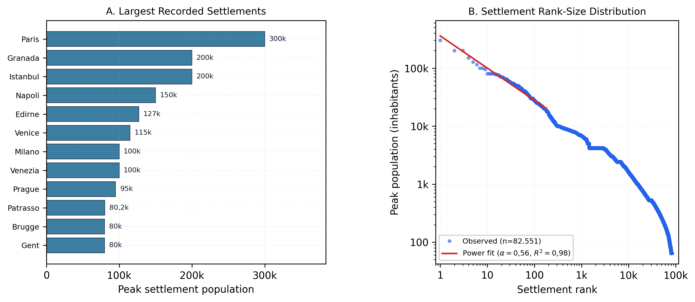

```{r setup, include=FALSE}
knitr::opts_chunk$set(
  echo = FALSE,
  warning = FALSE,
  message = FALSE,
  results = "asis"
)
library(jsonlite)
source("../../_shared/template/viscount_rmd_helpers.R")

summary_data <- fromJSON("black_death_and_late_mediaeval_crisis_summary.json", simplifyVector = FALSE)
settlements_raw <- fromJSON("black_death_and_late_mediaeval_crisis_settlements.json", simplifyVector = FALSE)

settlement_count <- as.integer(summary_data$settlement_count)
total_area_km2 <- as.numeric(summary_data$total_area_km2)
subregions_list <- summary_data$subregions
country_count <- length(summary_data$countries)
crowd_pct <- as.numeric(summary_data$crowd_share_overall) * 100

region_name_map <- setNames(
  vapply(subregions_list, function(x) as.character(x$name), character(1)),
  vapply(subregions_list, function(x) as.character(x$id), character(1))
)

fmt_source_label <- function (arg0_code) {
  lbl <- gsub("_", " ", as.character(arg0_code), fixed = TRUE)
  lbl <- sub("^Buringh European Urban 700 2000$", "Buringh European Urban (700-2000)", lbl)
  lbl <- sub("^National Statistical Census Faroe Islands$", "National Statistical Census of the Faroe Islands", lbl)
  lbl
}

fmt_coords <- function (arg0_lat, arg1_lon) {
  lat_v <- as.numeric(arg0_lat)
  lon_v <- as.numeric(arg1_lon)
  ns <- if (lat_v >= 0) "°N" else "°S"
  ew <- if (lon_v >= 0) "°E" else "°W"
  paste0(viscount_fmt_number(abs(lat_v), 2L), ns, ", ", viscount_fmt_number(abs(lon_v), 2L), ew)
}
```

```{r hero_markdown_fallback, results="asis"}
if (!knitr::is_latex_output()) {
  cat("\n\n")
}
```

# Abstract

This companion gazetteer documents the `r formatC(settlement_count, format = "d", big.mark = ".")` georeferenced European and North Atlantic settlements underpinning the MAGNETIC demographic reconstruction of the Black Death and Late Mediaeval Crisis between 1347AD and 1500AD across `r viscount_fmt_number(total_area_km2, 1L)` km². All 11 sub-regions and `r country_count` modern jurisdictions in the study domain are represented. Primary institutional and scholarly archives account for 99,69% of all included records (`r formatC(as.integer(summary_data$provenance_counts[["Buringh_European_Urban_700_2000"]]), format = "d", big.mark = ".")` urban centres from Buringh's European Urban corpus, 2 Faroese municipal anchors from the National Statistical Census of the Faroe Islands and 2 Icelandic radiocarbon localities from the European Radiocarbon Settlement Corpus), limiting global crowd-sourced supplementation to `r viscount_fmt_number(crowd_pct, 2L)`% (6 small Faroese coastal communities). Total recorded urban population contracted from 6,89M in 1347 across 1.802 active settlements to 6,27M in 1400 across 1.854 settlements before expanding ahead of rural recovery to 7,35M in 1450 and 9,3M in 1500 across 1.941 active settlements, headed by Ottoman Istanbul (200k), Edirne (127k) and Aragonese Napoli (125k).

# Gazetteer Scope and Spatial Coverage

Late mediaeval European urbanisation underwent a striking spatial realignment between 1347 and 1500. Although repeated waves of *Yersinia pestis*, prolonged warfare and agrarian desertion held rural densities below their high mediaeval peaks across Western, Northern and Mediterranean Europe [@Broadberry2015; @Campbell2016; @Malanima1998], regional market towns, maritime ports and princely capitals drew surviving rural migrants into urban workshops [@Galanaud2020Mortality; @Buringh2021; @Bairoch1988]. Consequently, cities of 10k inhabitants or more expanded from 109 in 1347 and 1400 to 195 in 1500, while metropolises of 50k or more increased from 10 to 15 over the same span.

Figure 1 maps all `r formatC(settlement_count, format = "d", big.mark = ".")` recorded settlements across the 11 sub-regional polygons, and Table 1 summarises sub-regional site counts, archive composition, spatial recording density and aggregate 1500 urban totals.

```{r fig_regional_map}
viscount_figure(
  "figures/black_death_and_late_mediaeval_crisis_regional_map.png",
  caption = "Spatial distribution of 1.943 recorded European and North Atlantic settlements across 11 sub-regions, 1347-1500.",
  label = "fig:gazetteer_map"
)
```

```{r table_subregional_coverage}
site_reg_vec <- vapply(settlements_raw, function(x) as.character(x$region_id), character(1))
site_prov_vec <- vapply(settlements_raw, function(x) as.character(x$provenance_source), character(1))
site_p500_vec <- vapply(settlements_raw, function(x) {
  v <- x$population[["1500"]]
  if (is.null(v)) 0 else as.numeric(v)
}, numeric(1))

cov_rows <- lapply(subregions_list, function(sr) {
  rid <- as.character(sr$id)
  idx <- which(site_reg_vec == rid)
  n_tot <- length(idx)
  n_bur <- sum(site_prov_vec[idx] == "Buringh_European_Urban_700_2000")
  n_oth <- n_tot - n_bur
  a <- as.numeric(sr$area_km2)
  u500 <- sum(site_p500_vec[idx])
  data.frame(
    Subregion = as.character(sr$name),
    Area = viscount_fmt_number(a, 0L),
    Total = formatC(n_tot, format = "d", big.mark = "."),
    Buringh = formatC(n_bur, format = "d", big.mark = "."),
    NorthAtl = formatC(n_oth, format = "d", big.mark = "."),
    Density = viscount_fmt_number(10000 * n_tot / a, 2L),
    Urban1500 = viscount_fmt_pop(u500),
    stringsAsFactors = FALSE
  )
})
cov_df <- do.call(rbind, cov_rows)
rownames(cov_df) <- NULL
viscount_table(
  cov_df,
  caption = "Sub-regional settlement counts, archive split, recording density (sites per 10k km²) and 1500 urban population across 11 sub-regions.",
  col_names = c("Sub-Region", "Area (km²)", "Total Sites", "Buringh Urban", "North Atlantic Anchors", "Sites per 10k km²", "1500 Urban Pop.")
)
```

Recording density mirrors late mediaeval commercial urbanisation directly. Italy and Malta reach 12,88 recorded urban settlements per 10k km² (387 cities across 300.408 km²), followed by France and the Low Countries at 7,12 per 10k km² (438 cities), the German Empire, Austria and Switzerland at 5,76 (277 cities), the British Isles at 5,74 (179 cities) and Iberia at 5,15 (306 cities). Further north and east, where settlement remained overwhelmingly rural, densities taper to 3,71 per 10k km² in Bohemia-Hungary (81 towns), 1,78 in Poland and the Baltic Lands (85 towns), 1,73 in the Balkans and Ottoman Rumelia (95 towns), 1,68 in Wallachia, Moldavia and Transylvania (44 towns), 0,34 in Scandinavia and Finland (40 towns) and 0,05 in Iceland, the Faroe Islands and Greenland (11 localities).

# Provenance Ledger and Jurisdictional Distribution

Every settlement entered the gazetteer through a four-wave saturation protocol prioritising primary institutional and scholarly archives ahead of any global crowd-sourced supplement. Wave 1 ingested 1.933 urban trajectories directly from Eltjo Buringh's European Urban corpus [@Buringh2021]. Wave 2 audited regional secondary gazetteers and added zero non-overlapping records. Wave 3 backfilled two Icelandic archaeological localities (Rangárbotnar and Svinavath) from the European Radiocarbon Settlement Corpus (a 0,1% marginal gain). Wave 4 closed the Faroese spatial gap inside the North Atlantic sub-region with two institutional municipal anchors (Tórshavn and Klaksvík) from the National Statistical Census of the Faroe Islands and six small coastal settlements (Leirvík, Miðvágur, Sørvágur, Vestmanna, Við Sjógv and Vágur) from the GeoNames Municipal Gazetteer Supplement (a 0,41% marginal gain), while 10 out-of-domain or duplicate candidate records were excluded.

```{r table_provenance_ledger}
prov_counts <- summary_data$provenance_counts
prov_keys <- names(prov_counts)
prov_vals <- vapply(prov_keys, function(k) as.integer(prov_counts[[k]]), integer(1))
ord_p <- order(prov_vals, decreasing = TRUE)
prov_keys <- prov_keys[ord_p]
prov_vals <- prov_vals[ord_p]

prov_tier <- vapply(prov_keys, function(k) {
  if (k == "GeoNames_Municipal_Gazetteer_Supplement") return("Crowd-sourced supplement")
  if (k == "National_Statistical_Census_Faroe_Islands") return("National census anchor")
  if (k == "European_Radiocarbon_Settlement_Corpus") return("Primary radiocarbon archive")
  "Primary urban historical archive"
}, character(1))

prov_wave <- vapply(prov_keys, function(k) {
  if (k == "Buringh_European_Urban_700_2000") return("Wave 1")
  if (k == "European_Radiocarbon_Settlement_Corpus") return("Wave 3")
  "Wave 4"
}, character(1))

prov_df <- data.frame(
  Corpus = vapply(prov_keys, fmt_source_label, character(1)),
  Wave = prov_wave,
  Tier = prov_tier,
  Count = vapply(prov_vals, function(x) formatC(x, format = "d", big.mark = "."), character(1)),
  Share = vapply(prov_vals, function(x) paste0(viscount_fmt_number(100 * x / settlement_count, 2L), "%"), character(1)),
  stringsAsFactors = FALSE
)
rownames(prov_df) <- NULL
viscount_table(
  prov_df,
  caption = "Source provenance ledger for the 1.943 included European and North Atlantic settlements, 1347-1500.",
  col_names = c("Source Corpus", "Wave", "Archive Class", "Included Sites", "Share")
)
```

At the modern jurisdictional level, five countries — Italy (385 settlements, 19,81%), France (316, 16,26%), Spain (258, 13,28%), Germany (236, 12,15%) and the United Kingdom (163, 8,39%) — together account for 69,89% of the entire gazetteer (Table 3). Poland (71), Belgium (66), the Netherlands (58), Hungary (48) and Portugal (46) make up the second tier of densely documented late mediaeval town networks.

```{r table_top_countries}
c_map <- summary_data$settlements_by_country
c_names <- names(c_map)
c_vals <- vapply(c_names, function(k) as.integer(c_map[[k]]), integer(1))
ord_c <- order(c_vals, decreasing = TRUE)
top_n <- min(15L, length(ord_c))
sel <- ord_c[seq_len(top_n)]
other_n <- sum(c_vals[-sel])
other_k <- length(c_vals) - top_n

c_df <- data.frame(
  Rank = c(as.character(seq_len(top_n)), "—"),
  Jurisdiction = c(c_names[sel], paste0("Remaining ", other_k, " jurisdictions")),
  Sites = c(vapply(c_vals[sel], function(x) formatC(x, format = "d", big.mark = "."), character(1)),
            formatC(other_n, format = "d", big.mark = ".")),
  Share = c(vapply(c_vals[sel], function(x) paste0(viscount_fmt_number(100 * x / settlement_count, 2L), "%"), character(1)),
            paste0(viscount_fmt_number(100 * other_n / settlement_count, 2L), "%")),
  stringsAsFactors = FALSE
)
rownames(c_df) <- NULL
viscount_table(
  c_df,
  caption = "Leading modern jurisdictions by recorded settlement count across the 1347-1500 study domain.",
  col_names = c("Rank", "Jurisdiction", "Settlements", "Share of Gazetteer")
)
```

# Urban Hierarchy and Largest Cities

Table 4 lists the 25 largest European cities ranked by peak population between 1347 and 1500. Two structural patterns stand out immediately. First, Ottoman imperial consolidation transformed the urban apex of Europe: Istanbul more than doubled from 90k in 1347 (80k in 1400) to 200k in 1500, while Edirne expanded twentyfold from 6,4k in 1347 to 127k in 1500. Second, Italy remained Europe's most balanced polycentric urban heartland, placing 10 cities inside the continental top 25 (Napoli, Milano, Venezia, Genova, Firenze, Palermo, Roma, Bologna, Brescia and Cremona) [@Malanima1998]. Conversely, 10 major fourteenth-century commercial centres in the top 25 — Sevilla, Genova, Gent, Firenze, London, Cordoba, Saloniki, Toledo, Barcelona and Granada — reached their chapter peaks in 1347 or 1400 and stood lower in 1500.

```{r table_top_settlements}
top_list <- summary_data$top_settlements
n_show <- min(25L, length(top_list))
top_rows <- lapply(seq_len(n_show), function(i) {
  s <- top_list[[i]]
  rid <- as.character(s$region_id)
  rname <- if (rid %in% names(region_name_map)) region_name_map[[rid]] else rid
  data.frame(
    Rank = as.character(i),
    City = as.character(s$name),
    Jurisdiction = as.character(s$country),
    Coords = fmt_coords(s$lat, s$lon),
    P1347 = viscount_fmt_pop(s$population[["1347"]]),
    P1400 = viscount_fmt_pop(s$population[["1400"]]),
    P1500 = viscount_fmt_pop(s$population[["1500"]]),
    Peak = paste0(viscount_fmt_pop(s$peak_pop), " (", as.integer(s$peak_year), ")"),
    stringsAsFactors = FALSE
  )
})
top_df <- do.call(rbind, top_rows)
rownames(top_df) <- NULL
viscount_table(
  top_df,
  caption = "Top 25 European cities ranked by peak population between 1347AD and 1500AD.",
  col_names = c("Rank", "City", "Jurisdiction", "Coordinates", "1347", "1400", "1500", "Peak (Year)")
)
```

# Temporal Horizon Coverage and Limitations

Tracking all `r formatC(settlement_count, format = "d", big.mark = ".")` settlements across the five recorded chronological horizons (1347, 1400, 1450, 1492 and 1500) documents how Europe's urban network contracted during the late fourteenth century before surging past its pre-plague ceiling during the second half of the fifteenth century (Table 5). Median settlement size slipped from 2,4k in 1347 to 2k in 1400 and 1450 before climbing to 2,7k in 1492 and 3k in 1500, while total urban population rose by 34,87% over the 153-year window.

```{r table_horizon_tiers}
yr_keys <- c("1347", "1400", "1450", "1492", "1500")

hor_rows <- lapply(yr_keys, function(yk) {
  vals <- unlist(lapply(settlements_raw, function(x) {
    v <- x$population[[yk]]
    if (is.null(v)) return(NULL)
    as.numeric(v)
  }))
  n_act <- length(vals)
  tot_u <- sum(vals)
  med_v <- if (n_act > 0L) stats::median(vals) else 0
  max_v <- if (n_act > 0L) max(vals) else 0
  n_10k <- sum(vals >= 10000)
  n_50k <- sum(vals >= 50000)
  data.frame(
    Horizon = paste0(yk, "AD"),
    Active = formatC(n_act, format = "d", big.mark = "."),
    UrbanSum = viscount_fmt_pop(tot_u),
    Median = viscount_fmt_pop(med_v),
    Maximum = viscount_fmt_pop(max_v),
    Ge10k = formatC(n_10k, format = "d", big.mark = "."),
    Ge50k = formatC(n_50k, format = "d", big.mark = "."),
    stringsAsFactors = FALSE
  )
})
hor_df <- do.call(rbind, hor_rows)
rownames(hor_df) <- NULL
viscount_table(
  hor_df,
  caption = "Chronological horizon coverage, urban aggregates and city-size thresholds across 1.943 settlements, 1347-1500.",
  col_names = c("Horizon", "Active Cities", "Urban Total", "Median Size", "Largest City", "10k+ Cities", "50k+ Cities")
)
```

Four caveats govern use of this settlement register. First, because 99,49% of entries derive from Buringh's urban historical series [@Buringh2021], the gazetteer captures towns and market boroughs rather than the rural villages and deserted *Wüstungen* where the majority of late mediaeval Europeans lived; sub-regional rural totals in the paired literature review therefore rely on fiscal registers, hearth counts and palaeoecological proxies [@Broadberry2015; @Izdebski2022]. Second, two Icelandic radiocarbon anchors (Rangárbotnar and Svinavath) carry entries only through 1450, which accounts for the slight drop from 1.854 active settlements in 1450 to 1.852 in 1492 before newly emerging towns raise the 1500 total to 1.941. Third, Greenland contains zero urban localities inside the gazetteer because its dispersed Norse farmsteads lay below urban recording thresholds and were abandoned during the fourteenth and fifteenth centuries [@Dugmore2012]. Fourth, interpolated 1347 and 1492 city figures between century benchmarks smooth acute epidemic drops such as the 1348-1350 shock in Florence, London and Siena or the rapid post-1453 repopulation of Ottoman Istanbul.

# Sources
