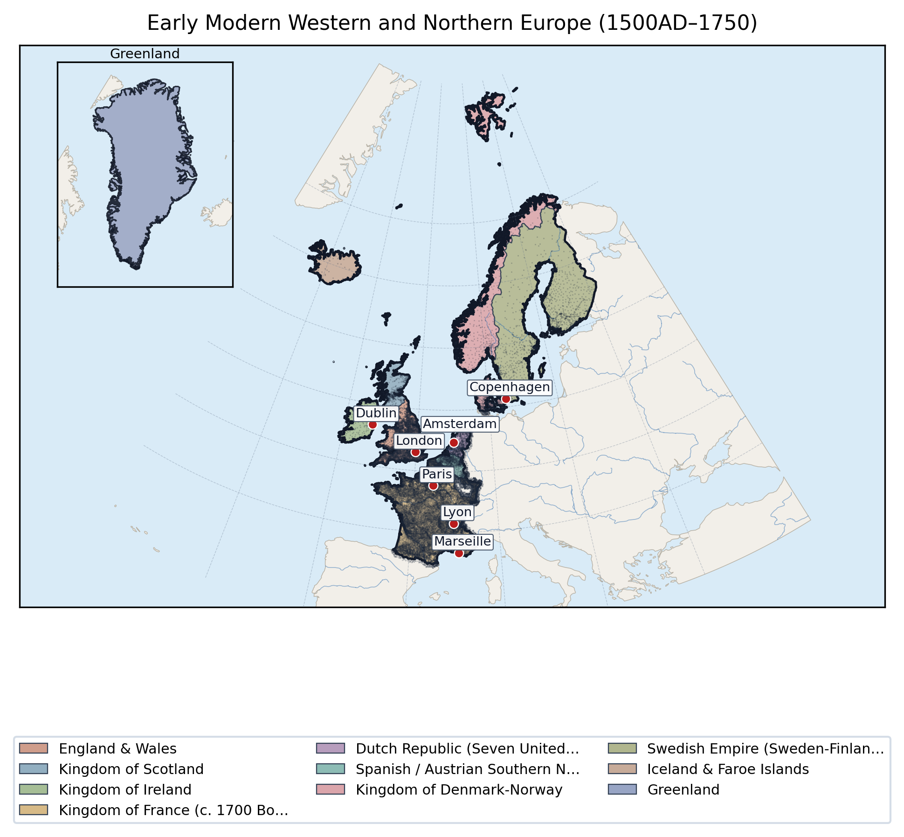

```{r setup, include=FALSE}
knitr::opts_chunk$set(
  echo = FALSE,
  warning = FALSE,
  message = FALSE,
  results = "asis"
)
library(jsonlite)
source("../../_shared/template/viscount_rmd_helpers.R")

summary_data <- fromJSON("early_modern_western_and_northern_europe_summary.json", simplifyVector = FALSE)
settlements_raw <- fromJSON("early_modern_western_and_northern_europe_settlements.json", simplifyVector = FALSE)

total_area_km2 <- as.numeric(summary_data$total_area_km2)
settlement_count <- as.integer(summary_data$settlement_count)
subregions_list <- summary_data$subregions
domain_totals <- summary_data$domain_totals
hgis_row_count <- as.integer(summary_data$hgis_row_count)
archival_pdf_count <- as.integer(summary_data$archival_pdf_count)

pop_1500 <- as.numeric(domain_totals[["1500"]])
pop_1600 <- as.numeric(domain_totals[["1600"]])
pop_1700 <- as.numeric(domain_totals[["1700"]])
pop_1750 <- as.numeric(domain_totals[["1750"]])

greenland_sr <- subregions_list[[9]]
greenland_area <- as.numeric(greenland_sr$area_km2)
europe_area_excl_gl <- total_area_km2 - greenland_area

pop_1500_ex_gl <- pop_1500 - as.numeric(greenland_sr$population[["1500"]])
pop_1750_ex_gl <- pop_1750 - as.numeric(greenland_sr$population[["1750"]])

cagr_overall <- ((pop_1750 / pop_1500)^(1 / 250) - 1) * 100
growth_ratio_overall <- pop_1750 / pop_1500
crowd_pct <- as.numeric(summary_data$crowd_share_overall) * 100

fmt_source_label <- function (arg0_code) {
  lbl <- as.character(arg0_code)
  lbl <- sub("^Buringh_European_Urban_700_2000$", "Buringh European Urban Corpus (700-2000)", lbl)
  lbl <- sub("^National_Statistical_Census_Greenland$", "Statistics Greenland Historical Register", lbl)
  lbl <- sub("^National_Statistical_Census_Faroe_Islands$", "Statistics Faroe Islands Historical Register", lbl)
  lbl <- sub("^GeoNames_Municipal_Gazetteer_Supplement$", "Municipal Gazetteer Coastal Supplement", lbl)
  lbl <- sub("^European_Radiocarbon_Settlement_Corpus$", "European Radiocarbon Settlement Corpus", lbl)
  lbl <- sub("^HistoGIS_HRE_Imperial_Circles_1512$", "HistoGIS Imperial Circles (1512)", lbl)
  lbl <- sub("^HistoGIS_HRE_Imperial_Circles_1555$", "HistoGIS Imperial Circles (1555)", lbl)
  lbl <- sub("^HistoGIS_HRE_Imperial_Circles_1648$", "HistoGIS Imperial Circles (1648)", lbl)
  lbl <- sub("^Historical_Basemaps_1500$", "Historical Basemaps Polities (1500)", lbl)
  lbl <- sub("^Historical_Basemaps_1600$", "Historical Basemaps Polities (1600)", lbl)
  lbl <- sub("^Historical_Basemaps_1700$", "Historical Basemaps Polities (1700)", lbl)
  lbl <- sub("^Riksarkivet_swehist_1750\\+Tabellverket$", "Riksarkivet Historical Counties and Tabellverket (1750)", lbl)
  gsub("_", " ", lbl, fixed = TRUE)
}

fmt_city_name <- function (arg0_name) {
  nm <- as.character(arg0_name)
  nm <- sub("^Kobenhaven$", "Copenhagen", nm)
  nm <- sub("^Bruxelles$", "Brussels", nm)
  nm <- sub("^Antwerpen$", "Antwerp", nm)
  nm <- sub("^Gent$", "Ghent", nm)
  nm <- sub("^Brugge$", "Bruges", nm)
  nm <- sub("^Liege$", "Liège", nm)
  nm <- sub("^Orleans$", "Orléans", nm)
  nm <- sub("^s Gravenhage$", "The Hague", nm)
  nm
}

region_name_map <- setNames(
  vapply(subregions_list, function(x) as.character(x$name), character(1)),
  vapply(subregions_list, function(x) as.character(x$id), character(1))
)
```

```{r hero_markdown_fallback, results="asis"}
if (!knitr::is_latex_output()) {
  cat("\n\n")
}
```

# Abstract

Between 1500 and 1750 the population of Western and Northern Europe, together with Iceland, the Faroe Islands and Greenland, expanded from `r viscount_fmt_pop(pop_1500)` to `r viscount_fmt_pop(pop_1750)` across `r viscount_fmt_number(total_area_km2, 1L)` km² (`r viscount_fmt_number(europe_area_excl_gl, 1L)` km² excluding the Greenland landmass). This `r viscount_fmt_number(growth_ratio_overall, 2L)`-fold expansion averaged `r viscount_fmt_number(cagr_overall, 3L)`% per annum and lifted mean territorial density from `r viscount_fmt_number(pop_1500 / total_area_km2, 2L)` to `r viscount_fmt_number(pop_1750 / total_area_km2, 2L)` inhabitants per km² (`r viscount_fmt_number(pop_1500_ex_gl / europe_area_excl_gl, 2L)` to `r viscount_fmt_number(pop_1750_ex_gl / europe_area_excl_gl, 2L)` per km² excluding Greenland). Growth was neither linear nor evenly shared. During the sixteenth century recovery from late-mediaeval plague troughs lifted every major lowland basin, with England and Wales adding 61,82% and the Kingdom of France climbing from 15,4M to 18,9M. During the seventeenth century Little Ice Age harvest failures, religious and dynastic wars and final waves of bubonic plague slowed continental expansion, halting growth in Iceland, slashing rural numbers in Ireland during the 1640s and triggering massive mortality crises across France in 1693-1694 and 1709 as well as Scotland and Finland in 1695-1699. Yet the same quarter-millennium shifted Europe's demographic and commercial gravity from the Mediterranean towards the North Sea and Atlantic littoral: cities of 10k or more inhabitants increased from 63 (1,23M, or 5,12% of regional population) in 1500 to 143 (4,78M, or 11,04%) in 1750 as London overtook Paris and Amsterdam eclipsed Antwerp and Bruges. MAGNETIC reconciles English parish reconstitution, French *Ancien Régime* hearth surveys, Dutch provincial tax assessments, Nordic *Tabellverket* county rolls, `r hgis_row_count` sub-administrative historical GIS enumerations and a `r formatC(settlement_count, format = "d", big.mark = ".")`-locality gazetteer across nine sub-regions and 18 modern jurisdictions.

# Background

In 1500 Western and Northern Europe had scarcely finished climbing back from the fourteenth-century demographic collapse. Following the arrival of the Black Death in 1347-1352 and the recurring epidemic waves of the late fourteenth and fifteenth centuries, vast tracts of English clayland, French *bocage*, Norwegian fjord pasture and Jutland heath had lain under-occupied for more than a century. By the turn of the sixteenth century the tide had definitively turned. Across the nine sub-regions treated here — England and Wales, Scotland, Ireland, the Kingdom of France, the Dutch Republic and Southern Netherlands, Denmark-Norway, Sweden-Finland, Iceland and the Faroe Islands and Greenland — total headcount stood at `r viscount_fmt_pop(pop_1500)`. France alone held 15,4M inhabitants, accounting for 64,07% of the entire macro-region and dwarfing every neighbouring realm. England and Wales numbered only 2,75M, barely one-sixth of the French total, while the combined Nordic kingdoms of Denmark-Norway (940k) and Sweden-Finland (910k) together counted fewer souls than the compact Low Countries (2,25M).

Two and a half centuries later the map of European demographic weight had changed profoundly. By 1750 total population had reached `r viscount_fmt_pop(pop_1750)`, an absolute gain of 19,23M persons, yet the French share had receded from 64,07% to 56,86% as Atlantic and northern Europe grew substantially faster than the old agrarian core [@Dupaquier1988; @WrigleySchofield1981]. England and Wales more than doubled to 6,25M; Ireland more than tripled from 950k to 3,15M despite catastrophic mid-seventeenth-century war losses; Sweden-Finland expanded 2,43-fold to 2,21M; and the Low Countries reached 61,49 inhabitants per km², the highest regional density anywhere in northern Europe. Across the English Channel and the North Sea, maritime commerce, agrarian enclosure, fodder crops, polder drainage and rural proto-industry had begun to loosen the old pre-industrial ceiling that still constrained Mediterranean and inland agrarian zones [@DeVries1984; @Alfani2013; @Reher1990].

The period between 1500 and 1750 also witnessed the sharpest climatic deterioration of the last millennium. The Little Ice Age reached twin troughs during the late sixteenth century and the Maunder Minimum of 1645-1715, shortening the northern growing season, driving Arctic drift ice onto the north coast of Iceland and producing synchronised harvest failures from the Scottish Highlands to the Loire Valley and Ostrobothnia [@PfisterFertig2010; @Gille1949]. Climatic stress interacted fatally with early modern warfare and epidemic disease. The French Wars of Religion (1562-1598), the Eighty Years' War in the Low Countries (1568-1648), the British Civil Wars and Cromwellian conquest of Ireland (1641-1653), the Fronde (1648-1653), the wars of Louis XIV and the Great Northern War (1700-1721) moved typhus, dysentery and plague along marching roads and requisitioned rural grain stocks precisely when harvests failed [@Dupaquier1988; @Colleter2021Last]. Even so, Western and Northern Europe escaped the worst of the seventeenth-century demographic collapse that devastated Central Europe during the Thirty Years' War and struck northern and southern Italy in the catastrophic plague waves of 1629-1630 and 1656-1657 [@PfisterFertig2010; @Alfani2013]. After the London plague of 1665, the Baltic plague of 1709-1713 and the Marseille outbreak of 1720-1722, *Yersinia pestis* effectively vanished from Atlantic and northern Europe, leaving smallpox, typhus and subsistence crises as the chief checks on pre-industrial increase.

Crucially for historical demography, this quarter-millennium marks the birth of systematic population records. In 1538 Thomas Cromwell ordered every English and Welsh parish to register baptisms, marriages and burials, while the French Ordinance of Villers-Cotterêts (1539) initiated parish baptismal registration across the Valois monarchy [@WrigleySchofield1981; @Dupaquier1988; @Fauvechamoux2017Personal]. Over the seventeenth century Lutheran parish registers spread across Sweden, Finland, Denmark and Norway, accompanied by fiscal hearth assessments (*feux* in France, Hearth Money rolls in England and Ireland) and poll-tax lists (*mantalslängder* in Sweden-Finland and *manntall* in Norway). The era closed with three landmarks of European enumeration: Iceland's nominal household census (*Manntal*) of 1703, the world's earliest surviving complete national listing by name, age and social station; the Swedish-Finnish *Tabellverket* of 1749, which institutionalised continuous national vital statistics and county headcounts; and Alexander Webster's 1755 parish-by-parish enumeration of Scotland [@Gille1949]. For the first time in European history, regional population totals cease to depend solely on archaeological proxies or tributary ratios and rest instead on verifiable church and fiscal archives.

# Methodology

Reconstructing Western and Northern European demography from 1500 to 1750 requires harmonising heterogeneous archival regimes that differ sharply in spatial grain, fiscal coverage and chronological onset. Whereas England possesses continuous parish series from 1541 and Sweden achieves universal statistical reporting by 1749, early sixteenth-century Ireland, the Scottish Highlands, rural Norway and coastal Greenland remain sparsely documented until the late seventeenth or eighteenth century. MAGNETIC therefore anchors its four chronological benchmarks — 1500, 1600, 1700 and 1750 — by combining parish-reconstitution and inverse-projection national trajectories, calibrated fiscal multipliers, `r hgis_row_count` sub-administrative historical GIS enumerations and a georeferenced settlement gazetteer of `r formatC(settlement_count, format = "d", big.mark = ".")` localities.

## Sub-Regional Partition and Benchmark Architecture

The domain spans `r viscount_fmt_number(total_area_km2, 1L)` km² partitioned into nine historically and ecologically coherent sub-regions: England and Wales (151.531,4 km²), Scotland (77.476,4 km²), Ireland (82.806,1 km²), the Kingdom of France (545.971,1 km²), the Dutch Republic and Southern Netherlands (69.122,5 km²), Denmark-Norway (397.280,9 km²), Sweden-Finland (764.985,3 km²), Iceland and the Faroe Islands (101.984,7 km²) and Greenland (2.076.808,1 km²). Excluding Greenland, whose inland ice cap covers roughly 80% of its surface and restricts human habitation to narrow ice-free fjords, the European terrestrial and insular footprint totals `r viscount_fmt_number(europe_area_excl_gl, 1L)` km².

Early modern borders shifted repeatedly across this territory. Between 1500 and 1750 the Burgundian Low Countries fractured along the Scheldt into the Protestant Dutch Republic and the Habsburg Spanish (after 1714 Austrian) Netherlands; France annexed Metz, Toul, Verdun, Artois, Roussillon, Franche-Comté, Alsace and French Flanders while absorbing Lorraine in all but formal title; and Denmark ceded Skåne, Halland, Blekinge, Gotland, Bohuslän and Jämtland to Sweden between 1645 and 1660. To prevent spurious jumps in long-run growth rates caused by border transfers rather than demographic change, MAGNETIC holds sub-regional polygon footprints fixed across all four benchmark dates (corresponding closely to the consolidated mid-eighteenth-century territorial envelopes, with France measured on its expanded hexagonal footprint and Sweden-Finland incorporating the southern provinces acquired by 1660). Where contemporary enumerations refer to narrower sixteenth-century or seventeenth-century borders — such as French *généralités* prior to the Peace of Nijmegen (1678) or Danish tax rolls prior to the Treaty of Roskilde (1658) — provincial populations are reallocated to their constant spatial polygons before series assembly.

## Parish Reconstitution, Inverse Projection and Fiscal Multipliers

Modern historical demography in Western Europe rests on two complementary techniques pioneered in the mid-twentieth century: Louis Henry's family reconstitution method at the Institut National d'Études Démographiques (INED) and the Cambridge Group's aggregative back projection and generalised inverse projection [@Fauvechamoux2017Personal; @WrigleySchofield1981]. Family reconstitution links baptismal, marriage and burial entries for individual couples within single parishes, yielding exact age at first marriage, marital fertility, birth intervals and infant mortality. Because reconstitution is intensely labour-intensive and omits mobile migrants, national aggregates rely on aggregative parish counts fed into back projection or inverse projection models [@WrigleySchofield1981; @Golian2026Population]. Using 404 English parish registers from 1541 to 1871 adjusted for Anglican non-registration, Nonconformity and delayed baptism, back projection reconstructs quinquennial English population totals, crude vital rates, net migration and life expectancy at birth backwards from modern censuses [@WrigleySchofield1981]. Recent parish studies using inverse projection demonstrate that this demographic machinery reliably isolates short-term epidemic and subsistence mortality crises even in peripheral European parishes [@Golian2026Population], while modern age-structure demography highlights how shifts in adult life expectancy reshape dependency ratios across both pre-industrial and contemporary populations [@Sanderson2020Choosing].

Outside England, parish series must be bridged to hearth, communicant and poll-tax counts. In *Ancien Régime* France, national benchmarks combine the 1697-1700 *Mémoires des intendants*, Sébastien Le Prestre de Vauban's fiscal appraisals, the 1709 and 1720 *dénombrements de feux* and the INED retrospective parish sample covering 1670-1750 [@Dupaquier1988]. Because French fiscal hearths (*feux*) excluded exempt clergy, nobles and indigent households to varying degrees by *généralité*, hearth multipliers vary regionally between 4,2 and 4,8 persons per taxed hearth. In Ireland, William Petty's 1659-1672 surveys and seventeenth-century Hearth Money returns require upward correction for untaxed mud cabins and under-enumerated western baronies, applying multipliers near 4,7 to 5,2 persons per house. In Scandinavia, seventeenth-century cattle, tithe and *mantal* tax rolls record only taxable adults aged roughly 15 to 63, requiring age-structure inflation calibrated directly against the 1749-1750 Swedish-Finnish *Tabellverket* and the 1703 Icelandic *Manntal* [@Gille1949]. Bioarchaeological investigations of late-mediaeval and early-modern burial assemblages — including mass graves from the Franco-Breton wars — provide independent verification of combatant age profiles, isotopic provenance and acute crisis mortality where written registers fail [@Colleter2021Last].

## Historical GIS Sub-Administrative Enumerations and Settlement Gazetteer

To tie macro-regional aggregates to verifiable territorial geometry, MAGNETIC ingests `r hgis_row_count` sub-administrative historical GIS records spanning 1500 to 1750 alongside `r formatC(settlement_count, format = "d", big.mark = ".")` georeferenced settlement time series. The historical GIS corpus combines three primary layers. First, the Riksarkivet historical administrative boundaries of Sweden paired with the founding 1749-1750 *Tabellverket* enumeration provide 20 county-level (*län*) polygons covering 418.055 km² and 1,69M inhabitants across mainland Sweden [@Gille1949]. Second, the Historical Basemaps territorial series tracks sovereign polity envelopes for France, England and contiguous Iberia across 1500, 1600 and 1700-1750, verifying continental border shifts and macro-density scaling [@Dupaquier1988; @Reher1990]. Third, the Austrian Academy of Sciences HistoGIS archive of Holy Roman Empire Imperial Circles (*Reichskreise*) for 1512, 1555 and 1648 supplies 11 constitutional circle polygons per horizon — crucially including the Burgundian Circle (*Burgundischer Kreis*, embracing the Southern Netherlands and Franche-Comté) and the Lower Rhenish-Westphalian Circle (*Niederrheinisch-Westfälischer Kreis*, bordering Liège and the eastern Dutch provinces) — allowing strict cross-border population accounting along the Rhine-Meuse-Moselle frontier [@HistoGIS2022; @PfisterFertig2010]. Table 1 summarises all nine regime-source strata across the `r hgis_row_count` sub-administrative units.

```{r table_hgis_regimes}
hgis_reg <- summary_data$hgis_regime_summary
hgis_reg_rows <- lapply(hgis_reg, function(r) {
  u <- as.integer(r$units)
  p <- as.numeric(r$population_sum)
  a <- as.numeric(r$area_km2_sum)
  dens <- if (a > 0) p / a else NA_real_
  data.frame(
    Regime = as.character(r$snapshot_regime),
    Source = fmt_source_label(r$source),
    Units = formatC(u, format = "d", big.mark = "."),
    Population = viscount_fmt_pop(p),
    Area = viscount_fmt_number(a, 0L),
    Density = viscount_fmt_number(dens, 2L),
    stringsAsFactors = FALSE
  )
})
hgis_reg_df <- do.call(rbind, hgis_reg_rows)
rownames(hgis_reg_df) <- NULL
viscount_table(
  hgis_reg_df,
  "Sub-administrative historical GIS enumeration strata across Western, Northern and contiguous European borderlands, 1500-1750 (76 spatial units).",
  c("Benchmark", "Historical GIS Source", "Units", "Population Sum", "Area (km²)", "Density (per km²)")
)
```

At the settlement tier, `r formatC(as.integer(summary_data$provenance_counts[["Buringh_European_Urban_700_2000"]]), format = "d", big.mark = ".")` of the `r formatC(settlement_count, format = "d", big.mark = ".")` localities (97,52%) derive directly from the Buringh European Urban Corpus [@Buringh2021], covering cities and towns down to 1k inhabitants at fifty-year intervals (1500, 1550, 1600, 1650, 1700 and 1750). Because urban gazetteers leave the Arctic and North Atlantic islands under-represented, the remaining 18 localities supply spatial anchors for Greenland, the Faroe Islands and Iceland: six coastal communities from the Statistics Greenland Historical Register, two Faroese harbours (Tórshavn and Klaksvík) from the Statistics Faroe Islands Historical Register, two Icelandic localities from the European Radiocarbon Settlement Corpus and eight municipal gazetteer supplements (`r viscount_fmt_number(crowd_pct, 2L)`% of the entire register). Because sub-regional polygon boundaries follow early modern geopolitical zones rather than twenty-first-century frontiers, borderland towns located inside modern Germany (16, led by Aachen and the Lower Rhenish border), Switzerland (7, including Geneva), Spain (4), Italy (3), Andorra (1) and Luxembourg (1) fall within the France and Low Countries sub-regional envelopes alongside the core 12 northern and western European nations.

# Validation

Cross-checking MAGNETIC benchmark aggregates against independent archival series, historical GIS polygons and urban rank-size distributions confirms high internal coherence across all nine sub-regions. For England and Wales, the benchmark series — 2,75M in 1500, 4,45M in 1600, 5,45M in 1700 and 6,25M in 1750 — tracks the Cambridge Group reconstruction for England (3,01M in 1551, 4,11M in 1601, 5,06M in 1701 and 5,77M in 1751) once Wales (230k in 1500 rising to 480k in 1750) is added [@WrigleySchofield1981]. The residual difference remains below 2% at every post-1541 benchmark, well inside the uncertainty band of Anglican under-registration adjustments.

For the Kingdom of France, MAGNETIC totals (15,4M in 1500, 18,9M in 1600, 21,5M in 1700 and 24,6M in 1750) align tightly with both the INED-Dupâquier consensus for France within its modern borders (15M-16M in 1500, 18,5M-20M in 1600, 21,5M in 1700 and 24,5M-25M in 1750) and the Historical Basemaps French territorial polygons (15,5M in 1500, 19M in 1600, 21,5M in 1700 and 24,5M in 1750) [@Dupaquier1988]. Similarly, Sweden-Finland reaches 2,21M in 1750, reconciling the founding *Tabellverket* total of 1,78M for Sweden proper plus 422k for Finland [@Gille1949]. The 20 mainland Swedish *län* polygons in the Riksarkivet historical county layer sum to 1,693M across 418.055 km² (mean density 4,05 per km²), leaving roughly 87k for Stockholm's separate municipal magistracy and minor border parishes not folded into rural county totals. Scotland's 1750 figure of 1,265M reproduces Alexander Webster's 1755 enumeration of 1.265.380 inhabitants to the thousand, while the 1700 Iceland and Faroe Islands total of 54,5k combines the exact 1703 Icelandic *Manntal* count of 50.358 with approximately 4,1k Faroese inhabitants [@Gille1949].

Borderland reconciliation along the fractured Low Countries and Franco-Imperial frontier is audited directly against the featured HGIS administrative units in Table 2. Between 1500 and 1750 the Burgundian Circle — encompassing the Southern Netherlands, Luxembourg and Franche-Comté prior to French annexations — oscillated between 2,1M across 73.162 km² in 1500 (28,7 per km²), 2,4M in 1600, 2,1M across a reduced 64.015 km² after 1648 and 2,45M (38,27 per km²) in 1750 [@HistoGIS2022]. Adding the 1,8M-1,9M inhabitants of the independent Dutch Republic yields 4,25M for the combined Low Countries sub-region in 1750, verifying both halves of the Scheldt divide. Simultaneously, the Lower Rhenish-Westphalian Circle climbed from 2,2M in 1700 to 2,65M in 1750 (48,04 per km²), mirroring the dense proto-industrial belt stretching from Liège through Aachen into the Wupper valley [@PfisterFertig2010; @HistoGIS2022]. Table 2 places these Western European HGIS polygons alongside contiguous Spanish and Imperial benchmark circles to show how Western Europe's density trajectory outpaced both Iberia and war-torn Central Europe between 1600 and 1700 [@Reher1990; @PfisterFertig2010].

```{r table_hgis_featured}
hgis_feat <- summary_data$hgis_featured_units
keep_idx <- seq_len(min(18L, length(hgis_feat)))
feat_rows <- lapply(hgis_feat[keep_idx], function(u) {
  p <- as.numeric(u$population)
  a <- as.numeric(u$area_km2)
  dens <- if (a > 0) p / a else NA_real_
  data.frame(
    Year = as.character(u$year),
    Unit = as.character(u$unit_name),
    Population = viscount_fmt_pop(p),
    Area = viscount_fmt_number(a, 0L),
    Density = viscount_fmt_number(dens, 2L),
    Source = fmt_source_label(u$source),
    stringsAsFactors = FALSE
  )
})
feat_df <- do.call(rbind, feat_rows)
rownames(feat_df) <- NULL
viscount_table(
  feat_df,
  "Selected sub-administrative and polity historical GIS units anchoring Western, Northern and contiguous European borderlands, 1500-1750.",
  c("Year", "Administrative Unit", "Population", "Area (km²)", "Density (per km²)", "GIS Source")
)
```

A third cross-check tests macro-regional urbanisation against Jan de Vries's classic 10k city benchmark [@DeVries1984]. Across our 726-locality register, settlements of 10k or more inhabitants rose from 63 cities holding 1,23M people in 1500 (5,12% of the domain population) to 86 cities holding 2,27M in 1600 (7,28%), 122 cities holding 3,97M in 1700 (10,66%) and 143 cities holding 4,78M in 1750 (11,04%) [@Buringh2021]. Sub-regional urbanisation rates match de Vries's benchmarks closely: by 1750 the combined Low Countries reached 22,38% in cities of 10k or more (with the Dutch Republic exceeding 30% and Holland approaching 45%), England and Wales surged from 2,55% in 1500 to 16,18% in 1750, Scotland climbed from 2,31% to 9,41% and France doubled from 4,62% to 9,18% [@DeVries1984; @Buringh2021]. By contrast, peripheral agrarian societies in southern and south-eastern Europe — whether Castilian interior towns analysed by Reher or Ottoman Balkan centres documented by Todorov and Palairet — either stagnated after 1600 or remained locked in low-productivity administrative urbanisation without rural commercial integration [@Reher1990; @Todorov1983; @Palairet1997].

# Results

Over the quarter-millennium from 1500 to 1750, Western and Northern Europe added 19,23M inhabitants, rising from `r viscount_fmt_pop(pop_1500)` to `r viscount_fmt_pop(pop_1750)`. Decade-by-decade momentum was anything but uniform. Between 1500 and 1600 the domain gained 7,09M people (+29,51%, or 0,259% per annum) as Europe filled out post-plague farmland. Between 1600 and 1700 growth decelerated to +19,63% (+6,11M, or 0,18% per annum) under Little Ice Age harvest failures, religious warfare and recurrent epidemics. Between 1700 and 1750, in just fifty years, the domain added 6,02M inhabitants (+16,18%, accelerating to 0,3% per annum), signalling the end of recurrent plague mortality and the onset of sustained pre-industrial demographic expansion. Table 3 sets out the benchmark series, densities and secular growth metrics across all nine sub-regions, while Figure 1 charts their diverging log-scale trajectories.

```{r table_subregions}
sr_rows <- lapply(subregions_list, function(sr) {
  a <- as.numeric(sr$area_km2)
  p15 <- as.numeric(sr$population[["1500"]])
  p16 <- as.numeric(sr$population[["1600"]])
  p17 <- as.numeric(sr$population[["1700"]])
  p75 <- as.numeric(sr$population[["1750"]])
  d15 <- p15 / a
  d75 <- p75 / a
  cagr <- ((p75 / p15)^(1 / 250) - 1) * 100
  data.frame(
    Subregion = as.character(sr$name),
    Area = viscount_fmt_number(a, 1L),
    P1500 = viscount_fmt_pop(p15),
    P1600 = viscount_fmt_pop(p16),
    P1700 = viscount_fmt_pop(p17),
    P1750 = viscount_fmt_pop(p75),
    D1750 = viscount_fmt_number(d75, 2L),
    CAGR = paste0(viscount_fmt_number(cagr, 2L), "%"),
    stringsAsFactors = FALSE
  )
})
sr_df <- do.call(rbind, sr_rows)
tot_row <- data.frame(
  Subregion = "Domain Total",
  Area = viscount_fmt_number(total_area_km2, 1L),
  P1500 = viscount_fmt_pop(pop_1500),
  P1600 = viscount_fmt_pop(pop_1600),
  P1700 = viscount_fmt_pop(pop_1700),
  P1750 = viscount_fmt_pop(pop_1750),
  D1750 = viscount_fmt_number(pop_1750 / total_area_km2, 2L),
  CAGR = paste0(viscount_fmt_number(cagr_overall, 2L), "%"),
  stringsAsFactors = FALSE
)
sr_df <- rbind(sr_df, tot_row)
rownames(sr_df) <- NULL
viscount_table(
  sr_df,
  "Population, land area, 1750 density and compound annual growth rate across all nine sub-regions, 1500-1750.",
  c("Sub-Region", "Area (km²)", "1500", "1600", "1700", "1750", "1750 Density", "CAGR")
)
```

```{r fig_trajectory}
viscount_figure(
  "figures/early_modern_western_and_northern_europe_population_trajectory.png",
  caption = "Sub-regional population trajectories across Western and Northern Europe, Iceland, the Faroe Islands and Greenland, 1500-1750.",
  label = "fig:trajectory"
)
```

## England and Wales

England and Wales experienced one of the most decisive demographic transformations in early modern Europe, climbing from 2,75M in 1500 to 4,45M in 1600, 5,45M in 1700 and 6,25M in 1750. Territorial density more than doubled from 18,15 to 41,25 inhabitants per km², narrowing the long-standing density gap with France from 10 to fewer than 4 persons per km². Sixteenth-century growth was remarkably brisk (+61,82% between 1500 and 1600), interrupted only briefly by the influenza-sweating sickness epidemic of 1557-1559, which erased roughly 5% of the English population in three years, and the upland harvest failures of 1596-1598 [@WrigleySchofield1981]. By 1600 arable farming had reoccupied virtually all mediaeval field systems, grain prices had quadrupled relative to nominal wages and real living standards for day labourers had fallen by more than one-third since the reign of Henry VII.

What happened next distinguishes England sharply from continental Europe. Between 1656 and 1686 English population actually edged slightly downward before resuming slow growth after 1690, leaving net seventeenth-century expansion at +22,47%. Crucially, this seventeenth-century pause was driven less by famine than by nuptiality — the classic Malthusian preventive check embedded in the north-west European Marriage Pattern [@WrigleySchofield1981]. Young men and women delayed marriage until they could assemble an independent household through farm service or apprenticeship; mean female age at first marriage hovered around 25 to 26 years, and the proportion never marrying rose above 20% in the mid-seventeenth century. Emigration also siphoned off surplus young adults, sending more than 350k English and Welsh migrants to Ireland, New England, the Chesapeake and the Caribbean between 1600 and 1700.

Mortality nonetheless remained high in cities and marshland parishes. Bubonic plague struck London in 1563, 1593, 1603, 1625 and for the final time in 1665, killing roughly 70k to 100k metropolitan residents in the Great Plague alone [@Alfani2013]. Yet London's gravitational pull overwhelmed its burial surplus. From a provincial capital of 50k in 1500, London swelled to 200k by 1600, 575k by 1700 — overtaking Paris to become the largest city in Europe — and 675k by 1750, absorbing nearly one in nine inhabitants of England and Wales [@DeVries1984; @Buringh2021]. Feeding and warming this metropolis transformed the English countryside: coal from Newcastle, Norfolk four-course turnip and clover rotations, fen drainage in East Anglia and rising Atlantic ports such as Bristol (10k in 1500 to 50k in 1750) and Norwich (10k to 37k) broke the historic link between harvest failure and mass starvation. After the harsh upland famine of 1623, England never again suffered a nationwide famine, and by 1750 falling marriage age and rising rural cottage industry were preparing the ground for the industrial take-off.

## Scotland and Ireland

The Celtic and Atlantic flanks of the British Isles followed radically divergent trajectories between 1500 and 1750. Scotland grew cautiously from 780k in 1500 to 950k in 1600, 1,05M in 1700 and 1,27M in 1750 (0,194% per annum, lifting density from 10,07 to 16,33 per km²). Constrained by short northern summers, acid upland soils and thin coastal plains, Scottish demographic margins remained razor-thin throughout the seventeenth century. Heavy out-migration drained young men to Ulster during the Jacobean Plantation, to Swedish and continental armies during the Thirty Years' War and to mercantile colonies in Poland-Lithuania — perhaps 80k to 100k Scots departing in the first half of the seventeenth century alone. The decisive shock arrived in 1695-1699 during the "Seven Ill Years", when consecutive wet, freezing summers ruined oat and bere-barley harvests across the Highlands, north-east Scotland and the Borders. Starvation, typhus and panic flight into Ulster cut Scotland's population by 10% to 15% in five years, explaining why seventeenth-century net growth barely reached +10,53%. Recovery after the 1707 Union of Parliaments was brisk: Edinburgh climbed from 18k in 1500 and 15k in 1600 to 36k in 1700 and 57k in 1750, while Glasgow surged from 4k to 25k on Chesapeake tobacco imports and west-coast linen manufacture [@Buringh2021].

Ireland, by contrast, posted the fastest secular population expansion of any sub-region in Western and Northern Europe, more than tripling from 950k in 1500 to 1,35M in 1600, 2,25M in 1700 and 3,15M in 1750 (0,481% per annum; density climbing from 11,47 to 38,04 per km²). That headline multiplier conceals one of the severest mid-century catastrophes in seventeenth-century Europe. Tudor reconquest, the Nine Years' War (1594-1603) and the Ulster and Munster plantations reshaped land tenure and brought tens of thousands of English and Scottish settlers into northern and eastern counties. Then came the 1641 rebellion, the Confederate Wars and the Cromwellian campaign of 1649-1653. Scorched-earth tactics, garrison requisitions and a virulent plague outbreak carried from continental ports reduced Ireland's population by an estimated 15% to 25% — roughly 300k to 400k deaths and transportations — leaving the island below 1,5M in the mid-1650s.

From that trough Ireland rebounded with extraordinary vigour. Abundant reclaimed pasture and tillage land, a fresh wave of Scottish immigration into Ulster during the 1690s, lower age at marriage than in England and the progressive spread of the potato (*Solanum tuberosum*) as a supplementary winter crop on smallholdings pushed numbers past 2,25M by 1700 and 3,15M by 1750. Even the catastrophic Arctic winter of 1740-1741 — the *Bliain an Áir* ("Year of Slaughter"), which killed an estimated 300k to 400k people (over 12% of the island) through frost-destroyed potato clamps and subsequent typhus — proved only a sharp interruption in an upward climb. Irish urbanisation surged alongside colonial administration and Atlantic provisioning: Dublin rocketed from 8k in 1500 and 5k in 1600 to 60k in 1700 and 129k in 1750, becoming the fourth-largest city in the entire macro-region, while Cork grew from 4k to 58k supplying salted beef and butter to British and West Indian fleets [@DeVries1984; @Buringh2021].

## Kingdom of France

Across the entire early modern era, France remained the demographic colossus of Western Europe. Within its expanded hexagonal envelope of 545.971,1 km², French population climbed from 15,4M in 1500 to 18,9M in 1600, 21,5M in 1700 and 24,6M in 1750 — raising mean density from 28,21 to 45,06 inhabitants per km² [@Dupaquier1988]. Yet French growth averaged just 0,188% per annum over 250 years, lagging well behind England, Ireland, the Low Countries and Sweden. Contemporary observers and modern historians alike have described *Ancien Régime* France as a *monde plein* ("full world"): an extraordinarily fertile, densely tilled peasant kingdom hovering persistently near its cereal carrying capacity of 20M to 22M inhabitants, where every generation of agrarian expansion bumped violently into subsistence ceilings, fiscal extraction and epidemic shocks [@Dupaquier1988].

The sixteenth century opened with rapid recovery following the late-fifteenth-century consolidation of Burgundy and Brittany — conflicts whose sharp local combat mortality is still traceable in Breton bioarchaeological mass graves [@Colleter2021Last]. By 1560 French population had already reached roughly 19M to 20M, before four decades of Wars of Religion (1562-1598) battered the Loire valley, Normandy, Guyenne and Languedoc, stalling net increase through 1600. A fresh rebound under Henri IV and Louis XIII lifted numbers past 21M by the 1630s, only to collide with France's entry into the Thirty Years' War (1635), the domestic civil war of the Fronde (1648-1653) and the devastating subsistence crisis of 1661-1662. Frontier provinces suffered horribly: Lorraine, Champagne, Picardy and Burgundy lost 20% to 40% of their rural households during the mid-seventeenth-century campaigns, paralleling the German war zone immediately to the east [@PfisterFertig2010; @Dupaquier1988].

The most notorious demographic blows struck during the later reign of Louis XIV. First, the Revocation of the Edict of Nantes in 1685 drove an estimated 150k to 200k Protestant Huguenots — disproportionately skilled textile artisans, merchants and officers — into exile in the Dutch Republic, England, Prussia and Switzerland. Second, cold, wet summers triggered the horrific famine of 1693-1694, which killed roughly 1,3M French subjects (nearly 6% of the kingdom) in eighteen months as wheat prices trebled across the Paris Basin and Massif Central. Third, the *Grand Hiver* of January 1709 froze winter wheat in the ground, split olive trees and vineyards from Provence to Anjou and produced another 600k excess deaths amidst the War of the Spanish Succession [@Dupaquier1988]. Finally, in May 1720 the merchant vessel *Grand-Saint-Antoine* carried bubonic plague from the Levant into Marseille, initiating Western Europe's last major plague catastrophe: roughly 40k to 50k died in Marseille itself (half the port's population) and up to 100k across Provence before a military *cordon sanitaire* halted spread northwards [@Alfani2013].

After 1722 the classic French mortality crisis finally began to ebb. Improved royal grain transport, milder winters after the Maunder Minimum and gradual maize adoption in Aquitaine and the south-west lifted France from 21,5M in 1700 to 24,6M in 1750 — an addition of 3,1M in half a century. France's urban network remained thick and polycentric: Paris rose from 94k in 1500 to 300k in 1600, 500k in 1700 and 524k in 1750; royal court creation turned Versailles from a 1k village in 1650 into a 50k town by 1750; Lyon expanded from 35k to 114k on silk manufacture; Marseille recovered swiftly to 95k; and Atlantic colonial trade propelled Bordeaux (50k to 62k) and Nantes (14k to 60k), while older mediaeval textile centres such as Rouen (70k peak in 1600, 66k in 1750) and Orléans (40k peak in 1600) grew far more modestly [@DeVries1984; @Buringh2021].

## Dutch Republic and Southern Netherlands

No part of early modern Europe packed more people onto a modest territorial canvas than the Low Countries. Across just 69.122,5 km², the combined Dutch Republic and Southern Netherlands expanded from 2,25M in 1500 to 3,05M in 1600, 3,85M in 1700 and 4,25M in 1750, pushing regional density from 32,55 to 61,49 inhabitants per km² — well over triple the Western and Northern European average excluding Greenland. Yet beneath that aggregate expansion lay a dramatic internal pivot driven by the Dutch Revolt and the Eighty Years' War (1568-1648).

In 1500 the demographic and commercial centre of gravity sat squarely in the south, inside the Burgundian domains of Flanders and Brabant. Ghent (45k), Bruges (35k), Brussels (33k), Antwerp (30k) and Liège (20k) formed a dense Flemish-Brabantine urban constellation, whereas the northern provinces of Holland and Zeeland held smaller towns such as Leiden (14k), Amsterdam (12k), Haarlem (12k) and Rotterdam (5k) [@Buringh2021]. During the first half of the sixteenth century Antwerp briefly became Europe's premier entrepôt, surpassing 90k at its mid-century commercial zenith before Spanish sieges, the Sack of Antwerp (1576), Alexander Farnese's reconquest of Flanders and Brabant (1584-1585) and the Dutch blockade of the Scheldt estuary shattered southern supremacy. Between 1575 and 1600 an estimated 100k to 150k Flemish and Brabantine merchants, weavers, printers and Calvinists fled northwards into the rebellious United Provinces.

That migration ignited the Dutch Golden Age. Supported by Baltic rye imports ("the Mother Trade"), North Sea herring fleets, peat fuel, inland barge canals (*trekvaarten*) and large-scale windmill drainage of the Beemster, Purmer and Schermer polders, the Dutch Republic soared from roughly 950k inhabitants in 1500 to 1,5M in 1600 and 1,9M in 1650 [@DeVries1984]. Urbanisation reached heights unseen anywhere else in pre-industrial Europe: Amsterdam leapt from 12k in 1500 to 60k in 1600, 104k in 1650, 180k in 1700 and 198k in 1750; Leiden ballooned from 13k in 1550 to 67k in 1650 on fine woollens; Rotterdam expanded tenfold from 5k to 51k by 1700; Haarlem more than tripled to 39k by 1600; and The Hague grew from 7k to 38k [@Buringh2021]. By 1650 more than 30% of the Dutch Republic — and nearly 45% of the province of Holland — lived in towns of 10k or more, sustained by continuous immigration from Westphalia, Scandinavia and the Rhineland to offset urban mortality deficits and heavy Dutch East India Company (VOC) maritime losses.

After the *Rampjaar* ("Disaster Year") of 1672, when France and England simultaneously attacked the Republic, Dutch growth stalled completely. Total numbers in the United Provinces hovered near 1,9M for the next century as textile towns contracted sharply between 1650 and 1750: Leiden fell from 67k to 37k, Haarlem from 38k to 27k and Delft and Gouda lost industrial ground [@DeVries1984; @Buringh2021]. Meanwhile the Southern (Spanish, then Austrian) Netherlands — despite repeated invasions by Louis XIV and the 1695 bombardment of Brussels — staged a quiet agrarian and rural-industrial revival in Flanders and Hainaut during the early eighteenth century, keeping regional population rising from 3,85M in 1700 to 4,25M in 1750 even as urban shares paused at 22,38%.

## Scandinavia: Denmark-Norway and Sweden-Finland

Northern Europe's two composite monarchies — Denmark-Norway and Sweden-Finland — entered 1500 with almost identical totals (940k and 910k respectively) across vast, thinly settled territories, yet diverged markedly over the next 250 years. Denmark-Norway rose moderately to 1,18M in 1600, 1,32M in 1700 and 1,48M in 1750 (0,182% per annum; density moving from 2,37 to 3,73 per km²). Within the union, however, Norway outpaced Denmark decisively. Measured on its constant post-1660 footprint (excluding Scania, Halland and Blekinge), Denmark proper climbed slowly from roughly 600k in 1500 to 800k in 1750, battered by Swedish invasions in 1643-1645 and 1657-1660, rural serfdom (*vornedskab* and later *stavnsbånd*), cattle plagues and the severe Copenhagen plague of 1711, which killed roughly 22k residents — nearly one-third of the royal capital [@Gille1949; @Alfani2013]. Despite that blow, absolutist state centralisation and Baltic Sound toll revenues drove Copenhagen from a modest 3k town in 1500 to 40k in 1600, 65k in 1700 and 80k in 1750, making it the largest city in Scandinavia, supported by Altona on the Elbe (17k) [@Buringh2021].

Norway, by contrast, recovered dramatically from its deep late-mediaeval trough. Starting near 300k-340k in 1500, Norwegian population roughly doubled to 650k by 1750. Water-powered sawmills exporting timber to the Dutch Republic and London, expanding stockfish and herring fisheries along the west coast, copper mining at Røros and silver extraction at Kongsberg (which grew into an 8k mining town by 1750) and the reoccupation of thousands of abandoned mountain and fjord farms (*ødegårder*) pushed Norwegian density steadily upward, while Bergen (7k to 14k), Christiania/Oslo (3k to 7k) and Trondheim (1k to 7k) served as coastal trade entrepôts [@Gille1949; @Buringh2021].

Sweden-Finland expanded much faster than Denmark-Norway, climbing 2,43-fold from 910k in 1500 to 1,19M in 1600, 1,76M in 1700 and 2,21M in 1750 (0,356% per annum; density lifting from 1,19 to 2,89 per km²). That growth is all the more striking given the heavy human toll of Sweden's *Stormaktstid* ("Age of Greatness", 1611-1721). Continuous conscription (*utskrivning*) for campaigns in Germany, Poland, Denmark and Russia drained an estimated 150k to 200k young Swedish and Finnish men during the seventeenth century, skewing rural sex ratios across Småland, Västergötland and Ostrobothnia. Worse still, two back-to-back frost years triggered the catastrophic Finnish famine of 1696-1697, which killed between 25% and 30% of Finland's entire population (roughly 110k to 130k deaths out of ~450k) in the single deadliest proportional subsistence disaster in early modern Europe, followed quickly by the Great Northern War, Russian occupation of Finland (*Stora ofreden*, 1713-1721) and the 1710-1711 plague that killed roughly 20k in Stockholm [@Gille1949; @Alfani2013].

Two structural engines enabled Sweden-Finland to absorb these shocks and surge past 2,21M by 1750. First, interior frontier colonisation — notably Savonian slash-and-burn rye cultivation (*svedjebruk*) spreading across central Finland, Karelia, Värmland and Norrland — continuously brought fresh forest land into production. Second, world-leading copper mining at Falun (5k-6k) and bar-iron forging across Bergslagen generated export earnings that financed administrative expansion and new planned towns: Stockholm expanded tenfold from 7k in 1500 to 40k in 1700 and 70k in 1750, Gothenburg reached 10k as Sweden's North Sea gateway, Karlskrona grew to 10k as the new naval base founded in 1680 and Turku (Åbo) anchored Finland at 6k [@Buringh2021]. After the Peace of Nystad (1721) ended imperial warfare, high post-war nuptiality and falling military mortality produced rapid demographic rebound, directly documented from 1749 onwards by the *Tabellverket* parish tables [@Gille1949].

## North Atlantic and Arctic Frontier: Iceland, Faroe Islands and Greenland

At the north-western rim of the European world, harsh sub-Arctic and polar climates held human populations near absolute ecological ceilings throughout 1500-1750. Iceland and the Faroe Islands together hovered almost motionless across two and a half centuries: 51,2k in 1500, 54,5k in 1600, 54,5k in 1700 and 53,2k in 1750 (0,015% per annum; density 0,52 per km² across 101.984,7 km²). In Iceland, pastoral sheep and cattle grazing on coastal grasslands combined with seasonal cod fishing supported roughly 47k to 50k dispersed farmstead dwellers, constrained by the Danish Crown's trade monopoly (imposed in 1602), deteriorating Little Ice Age drift-ice winters and strict poor-law barriers against cottager marriage (*vistarband*). When Árni Magnússon and Páll Vídalín completed the landmark 1703 *Manntal* nominal census, they counted exactly 50.358 inhabitants across the island without a single true town — Reykjavík remained a scatter of farmsteads below 1k [@Gille1949]. Barely four years later, in 1707-1709, a devastating virgin-soil smallpox epidemic (*Stóra bóla*) swept Iceland, killing between 12k and 18k people (roughly one-quarter to one-third of the island's entire population) and plunging headcount toward 34k before gradual recovery lifted Iceland back near 48k-49k by 1750 [@Gille1949; @Tripp2017Insights]. Meanwhile the Faroe Islands maintained a resilient wool-and-seabird economy of roughly 3,5k to 4,5k inhabitants centred on the small administrative and trading harbour of Tórshavn and dispersed coastal villages (*bygdir*).

Greenland underwent a complete ethnolinguistic and demographic transformation right at the opening of the early modern period. By 1500 the mediaeval Norse Eastern Settlement in south-west Greenland had vanished — extinguished by Little Ice Age cooling, declining walrus-ivory trade, soil erosion and the termination of Norwegian voyages — leaving the entire 2.076.808,1 km² landmass inhabited solely by Thule-culture Kalaallit (Inuit) marine-mammal hunters. Across 1500 to 1750 Greenland's population grew modestly from 5,5k to 6k in 1600, 6,5k in 1700 and 7,2k in 1750 (0,108% per annum). Although nominal density across the ice-covered landmass averaged just 0,003 inhabitants per km², actual habitation was tightly concentrated along the ice-free south-western fjords and Disko Bay — around Nuuk, Sisimiut, Ilulissat, Aasiaat, Maniitsoq and Qaqortoq — where ringed seal, harp seal, beluga, caribou and Arctic char supported semi-sedentary winter turf-house communities and summer tent camps. During the seventeenth century Basque and Dutch whalers established seasonal barter contact along Davis Strait. In 1721 the Norwegian Lutheran missionary Hans Egede founded Godthåb (Nuuk), initiating continuous Danish-Norwegian colonial administration and trade. As in Iceland, European contact brought catastrophic virgin-soil disease: in 1733-1734 a Greenlandic boy returning from Copenhagen carried smallpox into Nuuk fjord, killing an estimated 2k to 3k Kalaallit along the central west coast and nearly emptying the mission district before migration from unaffected northern and southern fjords restored coastal numbers toward 7,2k by 1750.

## Urban Hierarchy and Atlantic Shift

Nothing captures the structural reordering of Western and Northern Europe between 1500 and 1750 more vividly than the reshaping of its urban pyramid (Figure 2 and Table 4). In 1500 the macro-region held no city of 100k: Paris led at 94k, followed by London (50k), Bordeaux (50k), Ghent (45k), Rouen (40k), Lyon (35k), Bruges (35k), Brussels (33k), Antwerp (30k) and Toulouse (30k). Not a single British provincial town, Irish port, Dutch canal city or Scandinavian capital broke into the top ten, and Europe's largest urban concentrations remained anchored in northern Italy and Flanders [@DeVries1984; @Buringh2021].

By 1750 the urban map had been turned inside out. Six cities in the domain now exceeded 95k — London (675k), Paris (524k), Amsterdam (198k), Dublin (129k), Lyon (114k) and Marseille (95k) — while Copenhagen (80k) and Stockholm (70k) had vaulted into the continental top ten, and Bristol (50k), Cork (58k), Edinburgh (57k), Nantes (60k) and Bordeaux (62k) formed a prosperous Atlantic rim. Across all 726 localities in the register, total urban population in cities of 10k or more nearly quadrupled from 1,23M in 1500 to 4,78M in 1750, outpacing rural growth by more than two to one.

```{r fig_urban}
viscount_figure(
  "figures/early_modern_western_and_northern_europe_urban_hierarchy.png",
  caption = "Rank-size hierarchy and leading urban centres across 726 early modern settlements in Western and Northern Europe, 1500-1750.",
  label = "fig:urban_hierarchy"
)
```

```{r table_top_cities}
top_s <- summary_data$top_settlements
n_top <- min(15L, length(top_s))
city_rows <- lapply(top_s[seq_len(n_top)], function(st) {
  pops <- st$population
  get_p <- function(yr) {
    v <- pops[[yr]]
    if (is.null(v)) return("-")
    viscount_fmt_pop(as.numeric(v))
  }
  data.frame(
    City = fmt_city_name(st$name),
    Subregion = unname(region_name_map[as.character(st$region_id)]),
    P1500 = get_p("1500"),
    P1600 = get_p("1600"),
    P1700 = get_p("1700"),
    P1750 = get_p("1750"),
    Peak = paste0(viscount_fmt_pop(as.numeric(st$peak_pop)), " (", st$peak_year, ")"),
    stringsAsFactors = FALSE
  )
})
city_df <- do.call(rbind, city_rows)
rownames(city_df) <- NULL
viscount_table(
  city_df,
  "Population trajectories of the 15 largest cities in Western and Northern Europe, 1500-1750.",
  c("City", "Sub-Region", "1500", "1600", "1700", "1750", "Peak (Year)")
)
```

# Limitations

Five methodological limitations govern interpretation of this reconstruction. First, documentary coverage remains markedly uneven before 1650. Whereas English parish registers begin in 1538-1541 and French *généralités* possess intermittent hearth rolls from the sixteenth century [@WrigleySchofield1981; @Dupaquier1988], early sixteenth-century benchmarks for Ireland, the Scottish Highlands, rural Norway and interior Finland rely on backward extrapolation from seventeenth-century fiscal lists, hearth surveys and parish rolls [@Gille1949]. For Greenland prior to Hans Egede's 1721 mission, Inuit headcounts rest on coastal archaeological house counts, whaler logs and early missionary district estimates rather than administrative rolls, placing uncertainty margins near plus or minus 20%.

Second, holding sub-regional footprints constant across 1500-1750 resolves border-transfer discontinuities — notably the 1658 cession of Scania from Denmark to Sweden and French annexations along the Rhine and Flanders — but introduces minor friction when comparing macro-regional figures directly against unadjusted historical GIS polity layers. As Table 1 and Table 2 show, HistoGIS Imperial Circles reflect constitutional boundaries of 1512, 1555 and 1648 [@HistoGIS2022], while Historical Basemaps France expands from 429.261 km² in 1500 to 464.885 km² in 1700, remaining smaller than the full modern hexagonal mask (545.971,1 km²) used for long-run series continuity.

Third, centurial and half-centurial benchmarks (1500, 1600, 1700 and 1750) inevitably smooth over acute short-run demographic troughs. An observer inspecting only 1600 and 1700 would miss the 15% to 25% Cromwellian collapse in Ireland during 1641-1653, the 1693-1694 French famine, the 1695-1699 Scottish and Finnish famines, the 1707-1709 Icelandic smallpox epidemic and the 1733-1734 Greenlandic smallpox disaster [@Dupaquier1988; @Gille1949; @Alfani2013]. Parish-level inverse projection and bioarchaeological studies are essential to capture those intra-century mortality spikes [@Golian2026Population; @Colleter2021Last].

Fourth, urban threshold truncation shapes the settlement gazetteer. Because the Buringh urban corpus prioritises settlements exceeding 1k to 5k inhabitants [@Buringh2021], France (340 localities), England and Wales (153) and the Low Countries (137) achieve dense spatial sampling, whereas Scotland (12), Denmark-Norway (19), Sweden-Finland (24), Iceland and the Faroes (9) and Greenland (10) represent rural-dominated societies where most people lived in dispersed farmsteads and coastal villages below urban thresholds [@Bonaciu2020European]. Moreover, the 16 Faroese and Greenlandic coastal stations anchored via national statistical registers and municipal supplements carry constant baseline tier counts across 1500-1750 rather than year-specific census readings; their combined sum is therefore used solely for spatial anchoring while sub-regional totals follow demographic reconstructions.

Fifth, secular semantic and administrative shifts complicate direct comparison across fiscal terminologies — what constituted a taxable *feu* in Languedoc, a *hearth* in County Cork or a *mantal* household in Ostrobothnia changed over time as fiscal exemptions widened or narrowed, paralleling broader challenges of lexical and semantic drift in historical archival corpora [@Montes2024Historical; @Szanto2015Problems].

# Conclusion

Between 1500 and 1750 Western and Northern Europe completed the decisive bridge between the mediaeval agrarian order and the modern demographic world. Total population rose by 19,23M — an 80% expansion from `r viscount_fmt_pop(pop_1500)` to `r viscount_fmt_pop(pop_1750)` — even as Little Ice Age winters, confessional and dynastic warfare and final outbreaks of bubonic plague tested every lowland and northern frontier. Crucially, the geographical balance of power shifted north-westwards. In 1500 France alone held nearly two-thirds of the macro-region's inhabitants and Flemish cities led its urban commerce; by 1750 England and Wales had more than doubled, Ireland had tripled, Sweden-Finland had expanded nearly two-and-a-half-fold, the Low Countries had surpassed 61 inhabitants per km² and London and Amsterdam sat atop an Atlantic urban hierarchy whose 10k-plus city share had more than doubled from 5,12% to 11,04%.

Equally consequential was the institutional revolution in counting people. From Thomas Cromwell's 1538 parish injunctions and French *dénombrements* to the 1703 Icelandic *Manntal* and the 1749 Swedish-Finnish *Tabellverket*, Western and Northern European states forged the archival machinery that turned population from an object of fiscal guesswork into an exact quantitative science. With plague receding after 1722, Atlantic commerce deepening and agricultural productivity rising across Britain and the Low Countries, the region stood in 1750 on the eve of the steepest demographic acceleration in human history.

# Appendix

## Sub-Regional Urbanisation and Rural Density Benchmarks

Table 5 disaggregates the `r formatC(settlement_count, format = "d", big.mark = ".")`-locality settlement gazetteer across all nine sub-regions to compare cities of 10k or more inhabitants, urban population shares and implied rural densities between 1500 and 1750. The contrast is sharp: whereas the Low Countries already stood near one-fifth urban in 1500 and England and Wales expanded its 10k-plus urban share more than sixfold from 2,55% to 16,18%, Sweden-Finland remained 95,93% rural in 1750 and neither Iceland and the Faroe Islands nor Greenland contained a single settlement reaching the 10k threshold.

```{r table_appendix_urban}
site_reg_vec <- vapply(settlements_raw, function(x) as.character(x$region_id), character(1))

urb_rows <- lapply(subregions_list, function(sr) {
  rid <- as.character(sr$id)
  a <- as.numeric(sr$area_km2)
  p15 <- as.numeric(sr$population[["1500"]])
  p75 <- as.numeric(sr$population[["1750"]])
  idx <- which(site_reg_vec == rid)
  r_sites <- settlements_raw[idx]

  v15 <- unlist(lapply(r_sites, function(s) {
    v <- s$population[["1500"]]
    if (!is.null(v) && as.numeric(v) >= 10000) as.numeric(v) else NULL
  }))
  v75 <- unlist(lapply(r_sites, function(s) {
    v <- s$population[["1750"]]
    if (!is.null(v) && as.numeric(v) >= 10000) as.numeric(v) else NULL
  }))

  c15 <- length(v15)
  c75 <- length(v75)
  s15 <- if (c15 > 0L) sum(v15) else 0
  s75 <- if (c75 > 0L) sum(v75) else 0
  u15_pct <- 100 * s15 / p15
  u75_pct <- 100 * s75 / p75
  rural_d75 <- (p75 - s75) / a

  data.frame(
    Subregion = as.character(sr$name),
    Localities = formatC(length(idx), format = "d", big.mark = "."),
    C1500 = as.character(c15),
    U1500 = paste0(viscount_fmt_number(u15_pct, 2L), "%"),
    C1750 = as.character(c75),
    U1750 = paste0(viscount_fmt_number(u75_pct, 2L), "%"),
    RuralD = viscount_fmt_number(rural_d75, 2L),
    stringsAsFactors = FALSE
  )
})
urb_df <- do.call(rbind, urb_rows)
rownames(urb_df) <- NULL
viscount_table(
  urb_df,
  "Sub-regional locality counts, cities of 10k or more inhabitants, urban shares and 1750 non-urban densities across Western and Northern Europe, 1500-1750.",
  c("Sub-Region", "Localities", "1500 Cities", "1500 Urban", "1750 Cities", "1750 Urban", "1750 Rural per km²")
)
```

## Archival Corpus and Provenance Ledger

The chapter dossier integrates `r archival_pdf_count` retained scholarly publications, `r hgis_row_count` scraped historical GIS administrative polygon records (spanning Riksarkivet Swedish counties paired with *Tabellverket* 1750, Historical Basemaps 1500-1700 and HistoGIS Imperial Circles 1512-1648) and `r formatC(settlement_count, format = "d", big.mark = ".")` georeferenced settlement records across five source corpora (708 urban trajectories from the Buringh European Urban Corpus, 6 Greenlandic anchors from the Statistics Greenland Historical Register, 2 Faroese anchors from the Statistics Faroe Islands Historical Register, 2 Icelandic localities from the European Radiocarbon Settlement Corpus and 8 municipal gazetteer supplements). The companion settlement gazetteer provides full provenance accounting, sub-regional spatial diagnostics and rank-size tables across all 18 jurisdictions represented within the domain envelope.

# Sources
