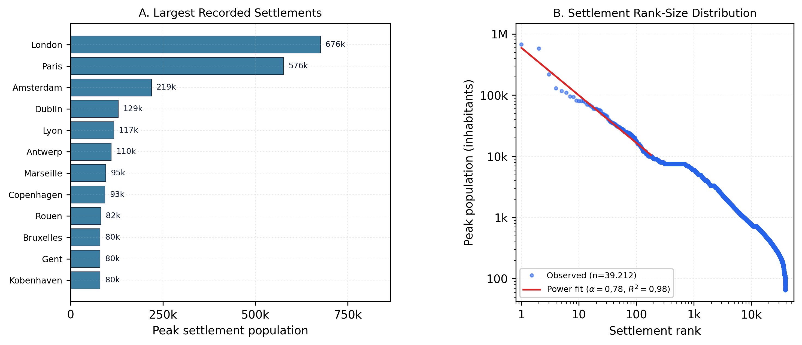

```{r setup, include=FALSE}
knitr::opts_chunk$set(
  echo = FALSE,
  warning = FALSE,
  message = FALSE,
  results = "asis"
)
library(jsonlite)
source("../../_shared/template/viscount_rmd_helpers.R")

summary_data <- fromJSON("early_modern_western_and_northern_europe_summary.json", simplifyVector = FALSE)
settlements_raw <- fromJSON("early_modern_western_and_northern_europe_settlements.json", simplifyVector = FALSE)

settlement_count <- as.integer(summary_data$settlement_count)
total_area_km2 <- as.numeric(summary_data$total_area_km2)
subregions_list <- summary_data$subregions
country_count <- length(summary_data$countries)
crowd_pct <- as.numeric(summary_data$crowd_share_overall) * 100
buringh_n <- as.integer(summary_data$provenance_counts[["Buringh_European_Urban_700_2000"]])
buringh_pct <- 100 * buringh_n / settlement_count

region_name_map <- setNames(
  vapply(subregions_list, function(x) as.character(x$name), character(1)),
  vapply(subregions_list, function(x) as.character(x$id), character(1))
)

fmt_source_label <- function (arg0_code) {
  lbl <- as.character(arg0_code)
  lbl <- sub("^Buringh_European_Urban_700_2000$", "Buringh European Urban Corpus (700-2000)", lbl)
  lbl <- sub("^National_Statistical_Census_Greenland$", "Statistics Greenland Historical Register", lbl)
  lbl <- sub("^National_Statistical_Census_Faroe_Islands$", "Statistics Faroe Islands Historical Register", lbl)
  lbl <- sub("^GeoNames_Municipal_Gazetteer_Supplement$", "Municipal Gazetteer Coastal Supplement", lbl)
  lbl <- sub("^European_Radiocarbon_Settlement_Corpus$", "European Radiocarbon Settlement Corpus", lbl)
  gsub("_", " ", lbl, fixed = TRUE)
}

fmt_city_name <- function (arg0_name) {
  nm <- as.character(arg0_name)
  nm <- sub("Rangárbotnar", "Rangárbotnar", nm, fixed = TRUE)
  nm <- sub("^Kobenhaven$", "Copenhagen", nm)
  nm <- sub("^Bruxelles$", "Brussels", nm)
  nm <- sub("^Antwerpen$", "Antwerp", nm)
  nm <- sub("^Gent$", "Ghent", nm)
  nm <- sub("^Brugge$", "Bruges", nm)
  nm <- sub("^Liege$", "Liège", nm)
  nm <- sub("^Orleans$", "Orléans", nm)
  nm <- sub("^s Gravenhage$", "The Hague", nm)
  nm
}
```

```{r hero_markdown_fallback, results="asis"}
if (!knitr::is_latex_output()) {
  cat("\n\n")
}
```

# Abstract

This companion gazetteer documents the `r formatC(settlement_count, format = "d", big.mark = ".")` georeferenced early modern settlements underpinning the MAGNETIC demographic reconstruction of Western and Northern Europe, the North Atlantic archipelagos and Greenland between 1500 and 1750 across `r viscount_fmt_number(total_area_km2, 1L)` km². Every one of the nine sub-regions and `r country_count` modern jurisdictions intersected by the early modern territorial envelope is represented. Scholarly historical urban series and official national statistical registers supply 98,9% of all entries: `r formatC(buringh_n, format = "d", big.mark = ".")` cities and towns (`r viscount_fmt_number(buringh_pct, 2L)`%) derive from the Buringh European Urban Corpus [@Buringh2021], complemented by six Greenlandic settlements from the Statistics Greenland Historical Register, two Faroese harbours from the Statistics Faroe Islands Historical Register and two Icelandic localities from the European Radiocarbon Settlement Corpus. Municipal gazetteer supplementation is limited to eight Arctic and Faroese coastal stations (`r viscount_fmt_number(crowd_pct, 2L)`%). Across the quarter-millennium, cities reaching 10k or more inhabitants increased from 63 (holding 1,23M residents) in 1500 to 143 (holding 4,78M residents) in 1750, registering the historic shift of European urban primacy towards London, Paris, Amsterdam and the Atlantic ports.

# Gazetteer Scope and Spatial Coverage

Early modern European settlement registers reflect two distinct geographical worlds [@DeVries1984; @Buringh2021]. Across the densely cultivated plains of France, England and the Low Countries, chartered market towns, episcopal sees, cloth-making boroughs and oceanic ports formed an interlocking urban web recorded repeatedly in parish, guild and fiscal archives [@WrigleySchofield1981; @Dupaquier1988]. Across northern Scandinavia, the Scottish Highlands, Iceland, the Faroe Islands and West Greenland, populations lived overwhelmingly in dispersed farmsteads, fjord fishing stations and Inuit winter camps well below conventional urban thresholds [@Gille1949; @Bonaciu2020European].

Figure 1 maps all `r formatC(settlement_count, format = "d", big.mark = ".")` localities across the nine sub-regional envelopes, while Table 1 summarises sub-regional locality counts, recording density per 10k km², cities exceeding 10k inhabitants in 1750 and primary-corpus share. Because sub-regional masks follow early modern political zones rather than twenty-first-century borders, the France and Low Countries polygons encompass borderland towns falling inside modern Germany (16 localities, including Aachen), Switzerland (7, including Geneva), Spain (4), Italy (3), Andorra (1) and Luxembourg (1) alongside the 12 core northern and western European nations [@HistoGIS2022].

```{r fig_regional_map}
viscount_figure(
  "figures/early_modern_western_and_northern_europe_regional_map.png",
  caption = "Spatial distribution of 726 recorded early modern localities across nine sub-regions of Western and Northern Europe and Greenland, 1500-1750.",
  label = "fig:gazetteer_map"
)
```

```{r table_subregional_coverage}
site_reg_vec <- vapply(settlements_raw, function(x) as.character(x$region_id), character(1))
site_prov_vec <- vapply(settlements_raw, function(x) as.character(x$provenance_source), character(1))

cov_rows <- lapply(subregions_list, function(sr) {
  rid <- as.character(sr$id)
  a <- as.numeric(sr$area_km2)
  idx <- which(site_reg_vec == rid)
  n_loc <- length(idx)
  r_sites <- settlements_raw[idx]
  n_c1750 <- sum(vapply(r_sites, function(s) {
    v <- s$population[["1750"]]
    if (is.null(v)) return(FALSE)
    as.numeric(v) >= 10000
  }, logical(1)))
  n_prim <- sum(site_prov_vec[idx] != "GeoNames_Municipal_Gazetteer_Supplement")
  prim_pct <- if (n_loc > 0L) 100 * n_prim / n_loc else 0
  data.frame(
    Subregion = as.character(sr$name),
    Localities = formatC(n_loc, format = "d", big.mark = "."),
    Share = paste0(viscount_fmt_number(100 * n_loc / settlement_count, 2L), "%"),
    Area = viscount_fmt_number(a, 1L),
    Density = viscount_fmt_number(10000 * n_loc / a, 2L),
    Cities1750 = as.character(n_c1750),
    Primary = paste0(viscount_fmt_number(prim_pct, 1L), "%"),
    stringsAsFactors = FALSE
  )
})
cov_df <- do.call(rbind, cov_rows)
rownames(cov_df) <- NULL
viscount_table(
  cov_df,
  "Sub-regional locality counts, recording density per 10k km², 1750 cities of 10k or more and institutional source share across all nine sub-regions.",
  c("Sub-Region", "Localities", "Share", "Area (km²)", "Per 10k km²", "1750 Cities", "Primary Share")
)
```

# Provenance Ledger and Source Exhaustion

Every locality in the register carries an explicit source attribution reconciled through a five-wave saturation audit. Primary scholarly urban compilations and national statistical archives supply 718 of the 726 records (98,9%), led overwhelmingly by the Buringh European Urban Corpus [@Buringh2021], which contributes 708 localities spanning 1500 to 1750 at fifty-year intervals. The remaining 18 localities fill structural voids in the North Atlantic and Arctic islands where no pre-industrial settlement exceeded 5k inhabitants: six West Greenlandic coastal centres from Statistics Greenland, two Faroese administrative harbours from Statistics Faroe Islands, two Icelandic archaeological localities from the European Radiocarbon Settlement Corpus and eight small municipal supplements across Greenland (4) and the Faroe Islands (4). Table 2 reports the provenance breakdown across all five corpora.

```{r table_provenance}
prov_counts <- summary_data$provenance_counts
prov_keys <- names(prov_counts)
prov_vals <- vapply(prov_keys, function(k) as.integer(prov_counts[[k]]), integer(1))
ord <- order(prov_vals, decreasing = TRUE)
prov_keys <- prov_keys[ord]
prov_vals <- prov_vals[ord]

tier_map <- function(k) {
  if (identical(k, "GeoNames_Municipal_Gazetteer_Supplement")) return("Municipal Coastal Supplement")
  if (identical(k, "Buringh_European_Urban_700_2000")) return("Scholarly Urban Corpus")
  if (identical(k, "European_Radiocarbon_Settlement_Corpus")) return("Archaeological Corpus")
  "National Statistical Archive"
}

prov_df <- data.frame(
  Corpus = vapply(prov_keys, fmt_source_label, character(1)),
  Tier = vapply(prov_keys, tier_map, character(1)),
  Localities = formatC(prov_vals, format = "d", big.mark = "."),
  Share = paste0(viscount_fmt_number(100 * prov_vals / settlement_count, 2L), "%"),
  stringsAsFactors = FALSE
)
rownames(prov_df) <- NULL
viscount_table(
  prov_df,
  "Provenance ledger and source-tier composition across all 726 early modern settlements, 1500-1750.",
  c("Source Corpus", "Source Tier", "Localities", "Share of Register")
)
```

# Urban Hierarchy and Largest Settlements

Between 1500 and 1750 Western and Northern Europe's urban rank-size curve steepened dramatically at its upper apex as imperial capitals and Atlantic entrepôts pulled away from older mediaeval inland towns [@DeVries1984; @Buringh2021]. In 1500 Paris stood first at 94k, nearly twice the size of London (50k) and Bordeaux (50k), while Flemish cloth centres — Ghent (45k), Bruges (35k), Brussels (33k) and Antwerp (30k) — dominated the northern trading axis. By 1750 London had surged thirteenfold to 675k, overtaking Paris (524k), while Amsterdam climbed sixteenfold from 12k to 198k and Dublin expanded sixteenfold from 8k to 129k. Equally striking was the northern maritime ascent of Copenhagen (3k to 80k), Stockholm (7k to 70k), Cork (4k to 58k), Edinburgh (18k to 57k) and Bristol (10k to 50k), contrasted with the post-1650 textile contractions of Leiden (67k to 37k) and Haarlem (39k to 27k). Table 3 details the 25 highest-peaking cities across the domain.

```{r table_top25}
top_s <- summary_data$top_settlements
n_top <- min(25L, length(top_s))
top_rows <- lapply(seq_len(n_top), function(i) {
  st <- top_s[[i]]
  pops <- st$population
  get_p <- function(yr) {
    v <- pops[[yr]]
    if (is.null(v)) return("-")
    viscount_fmt_pop(as.numeric(v))
  }
  data.frame(
    Settlement = fmt_city_name(st$name),
    Country = as.character(st$country),
    Subregion = unname(region_name_map[as.character(st$region_id)]),
    P1500 = get_p("1500"),
    P1600 = get_p("1600"),
    P1700 = get_p("1700"),
    P1750 = get_p("1750"),
    stringsAsFactors = FALSE
  )
})
top_df <- do.call(rbind, top_rows)
rownames(top_df) <- NULL
viscount_table(
  top_df,
  "Top 25 early modern cities in Western and Northern Europe ranked by peak population, 1500-1750.",
  c("Settlement", "Jurisdiction", "Sub-Region", "1500", "1600", "1700", "1750")
)
```

# Chronological Coverage and North Atlantic Peripheral Anchors

Tracking all `r formatC(settlement_count, format = "d", big.mark = ".")` settlements across six fifty-year horizons from 1500 to 1750 confirms both near-continuous longitudinal coverage and accelerating urban concentration (Table 4). Active localities rise from 686 in 1500 to 724 in 1750 as newly founded royal ports, mining towns and naval arsenals — among them Versailles, Karlskrona, Kongsberg and Lorient — enter the record [@Buringh2021; @Gille1949]. Over the same interval the number of cities meeting or exceeding de Vries's 10k threshold more than doubled from 63 to 143, while aggregate population in those cities nearly quadrupled from 1,23M to 4,78M.

```{r table_horizons}
yr_keys <- c("1500", "1550", "1600", "1650", "1700", "1750")
hor_rows <- lapply(yr_keys, function(yk) {
  vals <- unlist(lapply(settlements_raw, function(x) {
    v <- x$population[[yk]]
    if (is.null(v)) return(NULL)
    nv <- as.numeric(v)
    if (is.na(nv) || nv <= 0) return(NULL)
    nv
  }))
  v10 <- vals[vals >= 10000]
  data.frame(
    Year = yk,
    Active = formatC(length(vals), format = "d", big.mark = "."),
    Cities10k = formatC(length(v10), format = "d", big.mark = "."),
    UrbanSum10k = viscount_fmt_pop(sum(v10)),
    AllSum = viscount_fmt_pop(sum(vals)),
    MedianSize = viscount_fmt_pop(stats::median(vals)),
    Largest = viscount_fmt_pop(max(vals)),
    stringsAsFactors = FALSE
  )
})
hor_df <- do.call(rbind, hor_rows)
rownames(hor_df) <- NULL
viscount_table(
  hor_df,
  "Chronological horizon coverage, 10k-plus city counts and urban size distributions across 726 localities, 1500-1750.",
  c("Year", "Active Sites", "Cities >= 10k", "Sum >= 10k", "All Recorded", "Median", "Maximum")
)
```

At the north-western Arctic and sub-Arctic rim, settlement morphology differed fundamentally from continental towns. Table 5 lists all 19 localities anchored inside Iceland, the Faroe Islands and Greenland. Whereas Reykjavík enters from the Buringh urban corpus as a 1k-tier anchor, the Faroese and Greenlandic coastal stations serve as fixed spatial nodes tied to historical trade harbours and Inuit fjord territories; their constant baseline figures do not imply static eighteenth-century headcounts, since Iceland suffered a one-quarter to one-third population drop in the 1707-1709 smallpox epidemic and West Greenland endured severe epidemic mortality in 1733-1734 [@Gille1949; @Tripp2017Insights].

```{r table_north_atlantic}
na_sites <- Filter(function(x) {
  as.character(x$region_id) %in% c("em_iceland_faroes", "em_greenland")
}, settlements_raw)

na_rows <- lapply(na_sites, function(s) {
  p15 <- s$population[["1500"]]
  p75 <- s$population[["1750"]]
  coords <- s$coords
  lat_str <- viscount_fmt_number(as.numeric(coords[[1]]), 2L)
  lon_str <- viscount_fmt_number(as.numeric(coords[[2]]), 2L)
  data.frame(
    Locality = fmt_city_name(s$name),
    Territory = as.character(s$country),
    Lat = lat_str,
    Lon = lon_str,
    P1500 = if (is.null(p15)) "-" else viscount_fmt_pop(as.numeric(p15)),
    P1750 = if (is.null(p75)) "-" else viscount_fmt_pop(as.numeric(p75)),
    Source = fmt_source_label(s$provenance_source),
    stringsAsFactors = FALSE
  )
})
na_df <- do.call(rbind, na_rows)
na_df <- na_df[order(na_df$Territory, na_df$Locality), ]
rownames(na_df) <- NULL
viscount_table(
  na_df,
  "North Atlantic and Arctic coastal anchor localities across Iceland, the Faroe Islands and Greenland, 1500-1750.",
  c("Locality", "Territory", "Lat.", "Lon.", "1500", "1750", "Source Corpus")
)
```

# Sources
