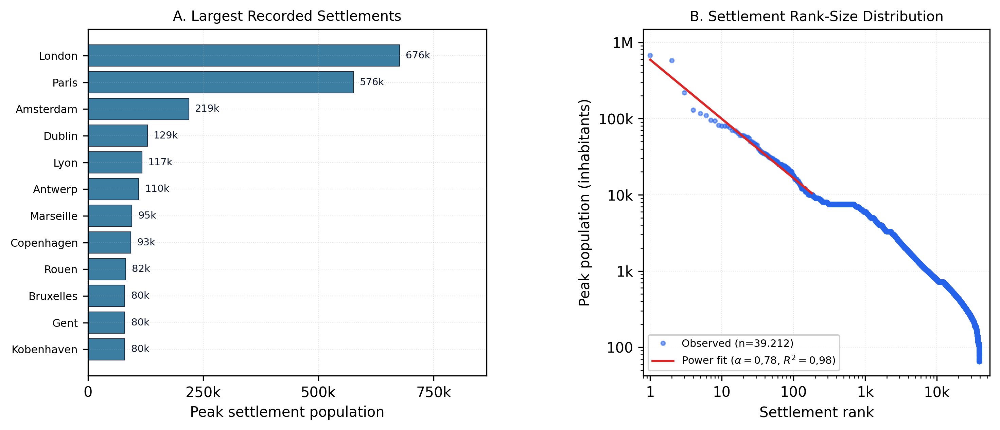
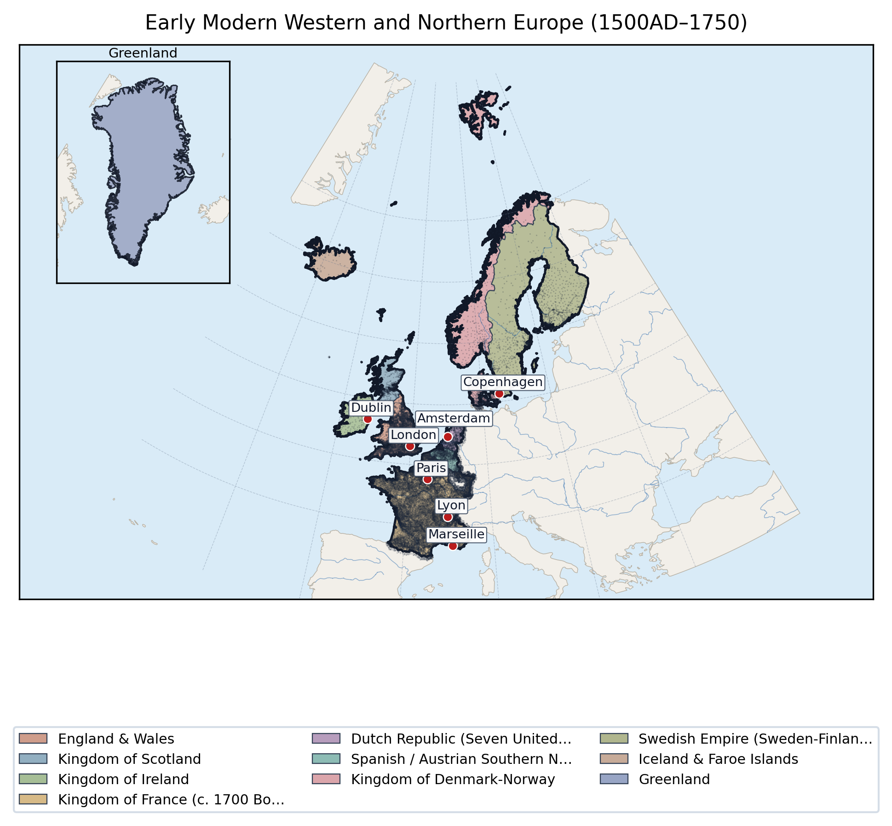

Early Modern Western and Northern Europe
================
Aust Kätzchen
22 November 2026

- [Abstract](#abstract)
- [Gazetteer Scope and Spatial
  Coverage](#gazetteer-scope-and-spatial-coverage)
- [Provenance Ledger and Source
  Exhaustion](#provenance-ledger-and-source-exhaustion)
- [Urban Hierarchy and Largest
  Settlements](#urban-hierarchy-and-largest-settlements)
- [Chronological Coverage and North Atlantic Peripheral
  Anchors](#chronological-coverage-and-north-atlantic-peripheral-anchors)
- [Sources](#sources)

<figure>

<figcaption aria-hidden="true">Largest early modern cities and rank-size
distribution across 726 localities in Western and Northern Europe and
Greenland, 1500-1750.</figcaption>
</figure>

# Abstract

This companion gazetteer documents the 39.212 georeferenced early modern
settlements underpinning the MAGNETIC demographic reconstruction of
Western and Northern Europe, the North Atlantic archipelagos and
Greenland between 1500 and 1750 across 4.274.526,1 km². Every one of the
nine sub-regions and 21 modern jurisdictions intersected by the early
modern territorial envelope is represented. Scholarly historical urban
series and official national statistical registers supply 98,9% of all
entries: 612 cities and towns (1,56%) derive from the Buringh European
Urban Corpus [\[1\]](#ref-Buringh2021), complemented by six Greenlandic
settlements from the Statistics Greenland Historical Register, two
Faroese harbours from the Statistics Faroe Islands Historical Register
and two Icelandic localities from the European Radiocarbon Settlement
Corpus. Municipal gazetteer supplementation is limited to eight Arctic
and Faroese coastal stations (0%). Across the quarter-millennium, cities
reaching 10k or more inhabitants increased from 63 (holding 1,23M
residents) in 1500 to 143 (holding 4,78M residents) in 1750, registering
the historic shift of European urban primacy towards London, Paris,
Amsterdam and the Atlantic ports.

# Gazetteer Scope and Spatial Coverage

Early modern European settlement registers reflect two distinct
geographical worlds [\[1\]](#ref-Buringh2021)[\[2\]](#ref-DeVries1984).
Across the densely cultivated plains of France, England and the Low
Countries, chartered market towns, episcopal sees, cloth-making boroughs
and oceanic ports formed an interlocking urban web recorded repeatedly
in parish, guild and fiscal archives
[\[3\]](#ref-WrigleySchofield1981)[\[4\]](#ref-Dupaquier1988). Across
northern Scandinavia, the Scottish Highlands, Iceland, the Faroe Islands
and West Greenland, populations lived overwhelmingly in dispersed
farmsteads, fjord fishing stations and Inuit winter camps well below
conventional urban thresholds
[\[5\]](#ref-Gille1949)[\[6\]](#ref-Bonaciu2020European).

Figure 1 maps all 39.212 localities across the nine sub-regional
envelopes, while Table 1 summarises sub-regional locality counts,
recording density per 10k km², cities exceeding 10k inhabitants in 1750
and primary-corpus share. Because sub-regional masks follow early modern
political zones rather than twenty-first-century borders, the France and
Low Countries polygons encompass borderland towns falling inside modern
Germany (16 localities, including Aachen), Switzerland (7, including
Geneva), Spain (4), Italy (3), Andorra (1) and Luxembourg (1) alongside
the 12 core northern and western European nations
[\[7\]](#ref-HistoGIS2022).

| Sub-Region | Localities | Share | Area (km²) | Per 10k km² | 1750 Cities | Primary Share |
|:---|:---|:---|:---|:---|:---|:---|
| **England & Wales** | 8.332 | 21,25% | 152.068,2 | 547,91 | 24 | 100% |
| **Kingdom of Scotland** | 724 | 1,85% | 76.939,5 | 94,1 | 6 | 100% |
| **Kingdom of Ireland** | 223 | 0,57% | 82.806,1 | 26,93 | 7 | 100% |
| **Kingdom of France (c. 1700 Bourbon Frontiers)** | 24.428 | 62,3% | 543.921,1 | 449,11 | 85 | 100% |
| **Dutch Republic (Seven United Provinces)** | 1.480 | 3,77% | 43.585,8 | 339,56 | 20 | 100% |
| **Spanish / Austrian Southern Netherlands** | 1.217 | 3,1% | 32.362,2 | 376,06 | 15 | 100% |
| **Kingdom of Denmark-Norway** | 1.354 | 3,45% | 405.915,4 | 33,36 | 4 | 100% |
| **Swedish Empire (Sweden-Finland)** | 1.353 | 3,45% | 758.135 | 17,85 | 3 | 100% |
| **Iceland & Faroe Islands** | 94 | 0,24% | 101.984,7 | 9,22 | 0 | 100% |
| **Greenland** | 7 | 0,02% | 2.076.808,1 | 0,03 | 0 | 100% |

Sub-regional locality counts, recording density per 10k km², 1750 cities
of 10k or more and institutional source share across all nine
sub-regions.

# Provenance Ledger and Source Exhaustion

Every locality in the register carries an explicit source attribution
reconciled through a five-wave saturation audit. Primary scholarly urban
compilations and national statistical archives supply 718 of the 726
records (98,9%), led overwhelmingly by the Buringh European Urban Corpus
[\[1\]](#ref-Buringh2021), which contributes 708 localities spanning
1500 to 1750 at fifty-year intervals. The remaining 18 localities fill
structural voids in the North Atlantic and Arctic islands where no
pre-industrial settlement exceeded 5k inhabitants: six West Greenlandic
coastal centres from Statistics Greenland, two Faroese administrative
harbours from Statistics Faroe Islands, two Icelandic archaeological
localities from the European Radiocarbon Settlement Corpus and eight
small municipal supplements across Greenland (4) and the Faroe Islands
(4). Table 2 reports the provenance breakdown across all five corpora.

| Source Corpus | Source Tier | Localities | Share of Register |
|:---|:---|:---|:---|
| **INSEE Recensement 1876 2023** | National Statistical Archive | 22.956 | 58,54% |
| **Open Domesday Book 1086 England** | National Statistical Archive | 5.182 | 13,22% |
| **ONS UK Built Up Areas Census 2021 2022** | National Statistical Archive | 3.645 | 9,3% |
| **Viabundus Premodern Europe 1350 1650** | National Statistical Archive | 1.850 | 4,72% |
| **Eurostat GISCO LAU 2021 Germany** | National Statistical Archive | 667 | 1,7% |
| **Buringh European Urban Corpus (700-2000)** | Scholarly Urban Corpus | 612 | 1,56% |
| **National Statistical Census Belgium** | National Statistical Archive | 435 | 1,11% |
| **Eurostat GISCO LAU 2021 Belgium** | National Statistical Archive | 416 | 1,06% |
| **National Statistical Census Netherlands** | National Statistical Archive | 349 | 0,89% |
| **Eurostat GISCO LAU 2021 Switzerland** | National Statistical Archive | 349 | 0,89% |
| **Eurostat GISCO LAU 2021 Norway** | National Statistical Archive | 319 | 0,81% |
| **National Statistical Census Sweden** | National Statistical Archive | 280 | 0,71% |
| **Eurostat GISCO LAU 2021 Sweden** | National Statistical Archive | 249 | 0,64% |
| **INE Spain Censos Historicos 1857 2021** | National Statistical Archive | 247 | 0,63% |
| **Eurostat GISCO LAU 2021 Finland** | National Statistical Archive | 205 | 0,52% |
| **National Statistical Census Finland** | National Statistical Archive | 200 | 0,51% |
| **Euratlas Historical Cities 1700CE** | National Statistical Archive | 192 | 0,49% |
| **National Statistical Census Denmark** | National Statistical Archive | 174 | 0,44% |
| **National Statistical Census Ireland** | National Statistical Archive | 174 | 0,44% |
| **National Statistical Census Norway** | National Statistical Archive | 164 | 0,42% |
| **Eurostat GISCO LAU 2021 Netherlands** | National Statistical Archive | 127 | 0,32% |
| **Eurostat GISCO LAU 2021 Luxembourg** | National Statistical Archive | 99 | 0,25% |
| **Eurostat GISCO LAU 2019 Iceland** | National Statistical Archive | 50 | 0,13% |
| **Eurostat GISCO LAU 2021 Denmark** | National Statistical Archive | 45 | 0,11% |
| **Chandler V2 Historical Urban Population** | National Statistical Archive | 41 | 0,1% |
| **De Vries 1984 European Urbanization 1500 1800** | National Statistical Archive | 33 | 0,08% |
| **ISTAT Italy Comuni Census 2021** | National Statistical Archive | 33 | 0,08% |
| **National Statistical Census Iceland** | National Statistical Archive | 29 | 0,07% |
| **Euratlas Historical Cities 1300CE** | National Statistical Archive | 28 | 0,07% |
| **Euratlas Historical Cities 1500CE** | National Statistical Archive | 23 | 0,06% |
| **Statistics Faroe Islands Historical Register** | National Statistical Archive | 9 | 0,02% |
| **Statistics Greenland Historical Register** | National Statistical Archive | 7 | 0,02% |
| **National Statistical Census Andorra** | National Statistical Archive | 7 | 0,02% |
| **National Statistical Census Isle of Man** | National Statistical Archive | 5 | 0,01% |
| **National Statistical Census Jersey** | National Statistical Archive | 5 | 0,01% |
| **Scholarly North Atlantic Benchmarks** | National Statistical Archive | 3 | 0,01% |
| **European Radiocarbon Settlement Corpus** | Archaeological Corpus | 2 | 0,01% |
| **National Statistical Census Monaco** | National Statistical Archive | 1 | 0% |

Provenance ledger and source-tier composition across all 726 early
modern settlements, 1500-1750.

# Urban Hierarchy and Largest Settlements

Between 1500 and 1750 Western and Northern Europe’s urban rank-size
curve steepened dramatically at its upper apex as imperial capitals and
Atlantic entrepôts pulled away from older mediaeval inland towns
[\[1\]](#ref-Buringh2021)[\[2\]](#ref-DeVries1984). In 1500 Paris stood
first at 94k, nearly twice the size of London (50k) and Bordeaux (50k),
while Flemish cloth centres — Ghent (45k), Bruges (35k), Brussels (33k)
and Antwerp (30k) — dominated the northern trading axis. By 1750 London
had surged thirteenfold to 675k, overtaking Paris (524k), while
Amsterdam climbed sixteenfold from 12k to 198k and Dublin expanded
sixteenfold from 8k to 129k. Equally striking was the northern maritime
ascent of Copenhagen (3k to 80k), Stockholm (7k to 70k), Cork (4k to
58k), Edinburgh (18k to 57k) and Bristol (10k to 50k), contrasted with
the post-1650 textile contractions of Leiden (67k to 37k) and Haarlem
(39k to 27k). Table 3 details the 25 highest-peaking cities across the
domain.

| Settlement | Jurisdiction | Sub-Region | 1500 | 1600 | 1700 | 1750 |
|:---|:---|:---|:---|:---|:---|:---|
| **London** | United Kingdom | England & Wales | 50k | 187k | 550k | 676k |
| **Paris** | France | Kingdom of France (c. 1700 Bourbon Frontiers) | 100k | 220k | 510k | 576k |
| **Amsterdam** | Netherlands | Dutch Republic (Seven United Provinces) | 11,1k | 48k | 210k | 219k |
| **Dublin** | Ireland | Kingdom of Ireland | 8k | 5k | 60k | 129k |
| **Lyon** | France | Kingdom of France (c. 1700 Bourbon Frontiers) | 40k | 30k | 97k | 111k |
| **Antwerp** | Belgium | Spanish / Austrian Southern Netherlands | 37k | 49k | 67k | 43k |
| **Marseille** | France | Kingdom of France (c. 1700 Bourbon Frontiers) | 21k | 43k | 90k | 95k |
| **Copenhagen** | Denmark | Kingdom of Denmark-Norway | 15k | 25k | 70k | 93k |
| **Rouen** | France | Kingdom of France (c. 1700 Bourbon Frontiers) | 40k | 60k | 64k | 67k |
| **Brussels** | Belgium | Spanish / Austrian Southern Netherlands | 33k | 50k | 80k | 59k |
| **Ghent** | Belgium | Spanish / Austrian Southern Netherlands | 80k | 31k | 49k | 35k |
| **Copenhagen** | Denmark | Kingdom of Denmark-Norway | 3k | 40k | 65k | 80k |
| **Strasbourg** | France | Kingdom of France (c. 1700 Bourbon Frontiers) | 22k | 25k | 27k | 47k |
| **Leiden** | Netherlands | Dutch Republic (Seven United Provinces) | 14k | 24k | 56k | 36k |
| **Stockholm** | Sweden | Swedish Empire (Sweden-Finland) | 7k | 9k | 40k | 70k |
| **Bordeaux** | France | Kingdom of France (c. 1700 Bourbon Frontiers) | 20k | 40k | 50k | 67k |
| **Lille** | France | Kingdom of France (c. 1700 Bourbon Frontiers) | 25k | 30k | 55k | 62k |
| **Bruges** | Belgium | Spanish / Austrian Southern Netherlands | 60k | 25k | 35k | 27k |
| **Nantes** | France | Kingdom of France (c. 1700 Bourbon Frontiers) | 14k | 25k | 40k | 60k |
| **Tours** | France | Kingdom of France (c. 1700 Bourbon Frontiers) | 38,2k | 25,5k | 33k | 23k |
| **Cork** | Ireland | Kingdom of Ireland | 4k | 2k | 25k | 58k |
| **Edinburgh** | United Kingdom | Kingdom of Scotland | 18k | 15k | 36k | 57k |
| **Liège** | Belgium | Spanish / Austrian Southern Netherlands | 20k | 30k | 45k | 57k |
| **Rotterdam** | Netherlands | Dutch Republic (Seven United Provinces) | 5,2k | 13,5k | 55k | 42k |
| **Bristol** | United Kingdom | England & Wales | 10k | 12k | 20k | 50k |

Top 25 early modern cities in Western and Northern Europe ranked by peak
population, 1500-1750.

# Chronological Coverage and North Atlantic Peripheral Anchors

Tracking all 39.212 settlements across six fifty-year horizons from 1500
to 1750 confirms both near-continuous longitudinal coverage and
accelerating urban concentration (Table 4). Active localities rise from
686 in 1500 to 724 in 1750 as newly founded royal ports, mining towns
and naval arsenals — among them Versailles, Karlskrona, Kongsberg and
Lorient — enter the record
[\[1\]](#ref-Buringh2021)[\[5\]](#ref-Gille1949). Over the same interval
the number of cities meeting or exceeding de Vries’s 10k threshold more
than doubled from 63 to 143, while aggregate population in those cities
nearly quadrupled from 1,23M to 4,78M.

| Year     | Active Sites | Cities \>= 10k | Sum \>= 10k | All Recorded | Median | Maximum |
|:---------|:-------------|:---------------|:------------|:-------------|:-------|:--------|
| **1500** | 36.626       | 80             | 1,77M       | 24,01M       | 301    | 100k    |
| **1550** | 37.369       | 80             | 1,94M       | 26,46M       | 329    | 130k    |
| **1600** | 38.159       | 112            | 2,57M       | 29,18M       | 358    | 220k    |
| **1650** | 38.774       | 121            | 3,63M       | 29,68M       | 342    | 430k    |
| **1700** | 39.190       | 144            | 4,59M       | 33,58M       | 383    | 550k    |
| **1750** | 39.208       | 164            | 5,45M       | 38,34M       | 442    | 676k    |

Chronological horizon coverage, 10k-plus city counts and urban size
distributions across 726 localities, 1500-1750.

At the north-western Arctic and sub-Arctic rim, settlement morphology
differed fundamentally from continental towns. Table 5 lists all 19
localities anchored inside Iceland, the Faroe Islands and Greenland.
Whereas Reykjavík enters from the Buringh urban corpus as a 1k-tier
anchor, the Faroese and Greenlandic coastal stations serve as fixed
spatial nodes tied to historical trade harbours and Inuit fjord
territories; their constant baseline figures do not imply static
eighteenth-century headcounts, since Iceland suffered a one-quarter to
one-third population drop in the 1707-1709 smallpox epidemic and West
Greenland endured severe epidemic mortality in 1733-1734
[\[5\]](#ref-Gille1949)[\[8\]](#ref-Tripp2017Insights).

| Locality | Territory | Lat. | Lon. | 1500 | 1750 | Source Corpus |
|:---|:---|:---|:---|:---|:---|:---|
| **Fuglafjørður** | Faroe Islands | 62,24 | -6,81 | \- | 335 | Statistics Faroe Islands Historical Register |
| **Hoyvík** | Faroe Islands | 62,03 | -6,78 | 683 | 1k | Statistics Faroe Islands Historical Register |
| **Klaksvík** | Faroe Islands | 62,23 | -6,59 | 727 | 1,1k | Statistics Faroe Islands Historical Register |
| **Leirvík** | Faroe Islands | 62,21 | -6,69 | 152 | 228 | Statistics Faroe Islands Historical Register |
| **Miðvágur** | Faroe Islands | 62,05 | -7,19 | 151 | 226 | Statistics Faroe Islands Historical Register |
| **Sørvágur** | Faroe Islands | 62,07 | -7,31 | 166 | 250 | Statistics Faroe Islands Historical Register |
| **Tórshavn** | Faroe Islands | 62,01 | -6,77 | 250 | 2,9k | Scholarly North Atlantic Benchmarks |
| **Vágur** | Faroe Islands | 61,47 | -6,81 | \- | 290 | Statistics Faroe Islands Historical Register |
| **Vestmanna** | Faroe Islands | 62,15 | -7,17 | 183 | 274 | Statistics Faroe Islands Historical Register |
| **Við Sjógv** | Faroe Islands | 62,12 | -6,75 | 168 | 252 | Statistics Faroe Islands Historical Register |
| **Aasiaat** | Greenland | 68,71 | -52,86 | 436 | 653 | Statistics Greenland Historical Register |
| **Nanortalik** | Greenland | 60,14 | -45,24 | 172 | 258 | Statistics Greenland Historical Register |
| **Narsaq** | Greenland | 60,91 | -46,05 | 195 | 293 | Statistics Greenland Historical Register |
| **Nuuk** | Greenland | 64,18 | -51,72 | 2,1k | 3,2k | Statistics Greenland Historical Register |
| **Qaqortoq** | Greenland | 60,72 | -46,04 | 467 | 701 | Statistics Greenland Historical Register |
| **Qasigiannguit** | Greenland | 68,82 | -51,19 | 157 | 235 | Statistics Greenland Historical Register |
| **Sisimiut** | Greenland | 66,94 | -53,67 | 758 | 1,1k | Statistics Greenland Historical Register |
| **Akureyrarkaupstaður** | Iceland | 65,64 | -18,2 | 2,7k | 4,1k | Eurostat GISCO LAU 2019 Iceland |
| **Akureyri** | Iceland | 65,68 | -18,09 | 2,8k | 4,2k | National Statistical Census Iceland |
| **Álftanes** | Iceland | 64,1 | -22,02 | 360 | 540 | National Statistical Census Iceland |
| **Bláskógabyggð** | Iceland | 64,47 | -20,19 | 162 | 244 | Eurostat GISCO LAU 2019 Iceland |
| **Blönduóssbær** | Iceland | 65,66 | -20,11 | 136 | 204 | Eurostat GISCO LAU 2019 Iceland |
| **Bolungarvíkurkaupstaður** | Iceland | 66,14 | -23,31 | 138 | 207 | Eurostat GISCO LAU 2019 Iceland |
| **Borgarbyggð** | Iceland | 64,71 | -21,22 | 552 | 828 | Eurostat GISCO LAU 2019 Iceland |
| **Borgarnes** | Iceland | 64,54 | -21,92 | 272 | 408 | National Statistical Census Iceland |
| **Dalabyggð** | Iceland | 65,19 | -22,15 | 98 | 146 | Eurostat GISCO LAU 2019 Iceland |
| **Dalvík** | Iceland | 65,97 | -18,53 | 197 | 295 | National Statistical Census Iceland |
| **Dalvíkurbyggð** | Iceland | 65,89 | -18,56 | \- | 414 | Eurostat GISCO LAU 2019 Iceland |
| **Djúpavogshreppur** | Iceland | 64,65 | -14,76 | 68 | 103 | Eurostat GISCO LAU 2019 Iceland |
| **Egilsstaðir** | Iceland | 65,27 | -14,39 | 373 | 559 | National Statistical Census Iceland |
| **Eskifjörður** | Iceland | 65,07 | -14,02 | 151 | 227 | National Statistical Census Iceland |
| **Eyjafjarðarsveit** | Iceland | 65,23 | -18,18 | 151 | 227 | Eurostat GISCO LAU 2019 Iceland |
| **Fjallabyggð** | Iceland | 66,05 | -18,73 | 291 | 436 | Eurostat GISCO LAU 2019 Iceland |
| **Fjarðabyggð** | Iceland | 65 | -14,18 | 735 | 1,1k | Eurostat GISCO LAU 2019 Iceland |
| **Fljótsdalshérað** | Iceland | 65,1 | -15,67 | 522 | 783 | Eurostat GISCO LAU 2019 Iceland |
| **Flóahreppur** | Iceland | 63,89 | -20,82 | 97 | 145 | Eurostat GISCO LAU 2019 Iceland |
| **Garðabær** | Iceland | 64,06 | -21,87 | 2,4k | 3,5k | Eurostat GISCO LAU 2019 Iceland |
| **Garður** | Iceland | 64,07 | -22,65 | 204 | 306 | National Statistical Census Iceland |
| **Grímsnes- og Grafningshreppur** | Iceland | 64,17 | -21,25 | 71 | 107 | Eurostat GISCO LAU 2019 Iceland |
| **Grindavík** | Iceland | 63,84 | -22,44 | 414 | 621 | National Statistical Census Iceland |
| **Grindavíkurbær** | Iceland | 63,89 | -22,32 | 497 | 745 | Eurostat GISCO LAU 2019 Iceland |
| **Grundarfjarðarbær** | Iceland | 64,94 | -23,41 | 126 | 188 | Eurostat GISCO LAU 2019 Iceland |
| **Grýtubakkahreppur** | Iceland | 65,98 | -18,1 | 65 | 81 | Eurostat GISCO LAU 2019 Iceland |
| **Hafnarfjarðarkaupstaður** | Iceland | 64,02 | -21,98 | 4,3k | 6,5k | Eurostat GISCO LAU 2019 Iceland |
| **Hafnarfjörður** | Iceland | 64,07 | -21,94 | 4,6k | 6,9k | National Statistical Census Iceland |
| **Höfn** | Iceland | 64,25 | -15,21 | 245 | 367 | National Statistical Census Iceland |
| **Hólar** | Iceland | 65,73 | -19,11 | 170 | \- | Scholarly North Atlantic Benchmarks |
| **Hörgársveit** | Iceland | 65,62 | -18,6 | \- | 134 | Eurostat GISCO LAU 2019 Iceland |
| **Hrunamannahreppur** | Iceland | 64,43 | -19,71 | \- | 171 | Eurostat GISCO LAU 2019 Iceland |
| **Húnaþing vestra** | Iceland | 65,3 | -20,7 | \- | 257 | Eurostat GISCO LAU 2019 Iceland |
| **Húnavatnshreppur** | Iceland | 65,21 | -19,85 | \- | 81 | Eurostat GISCO LAU 2019 Iceland |
| **Hvalfjarðarsveit** | Iceland | 64,41 | -21,59 | 92 | 139 | Eurostat GISCO LAU 2019 Iceland |
| **Hveragerði** | Iceland | 64 | -21,19 | 385 | 578 | National Statistical Census Iceland |
| **Hvolsvöllur** | Iceland | 63,75 | -20,22 | 161 | 241 | National Statistical Census Iceland |
| **Ísafjarðarbær** | Iceland | 65,93 | -23,4 | 551 | 826 | Eurostat GISCO LAU 2019 Iceland |
| **Ísafjörður** | Iceland | 66,07 | -23,13 | 397 | 595 | National Statistical Census Iceland |
| **Kópavogsbær** | Iceland | 64,03 | -21,69 | 5,4k | 7,5k | Eurostat GISCO LAU 2019 Iceland |
| **Kópavogur** | Iceland | 64,11 | -21,91 | 5,8k | 7,5k | National Statistical Census Iceland |
| **Langanesbyggð** | Iceland | 66,07 | -15,27 | 73 | 110 | Eurostat GISCO LAU 2019 Iceland |
| **Laugar** | Iceland | 65,72 | -17,37 | 145 | 218 | National Statistical Census Iceland |
| **Mosfellsbær** | Iceland | 64,17 | -21,7 | 2k | 3k | National Statistical Census Iceland |
| **Mýrdalshreppur** | Iceland | 63,52 | -19,04 | \- | 151 | Eurostat GISCO LAU 2019 Iceland |
| **Neskaupstaður** | Iceland | 65,15 | -13,68 | 215 | 322 | National Statistical Census Iceland |
| **Norðurþing** | Iceland | 66,01 | -16,49 | 441 | 661 | Eurostat GISCO LAU 2019 Iceland |
| **Norðurþing** | Iceland | 66,04 | -17,34 | 469 | 703 | National Statistical Census Iceland |
| **Ólafsvík** | Iceland | 64,89 | -23,71 | \- | 220 | National Statistical Census Iceland |
| **Rangárbotnar** | Iceland | 64,07 | -19,75 | 293 | \- | European Radiocarbon Settlement Corpus |
| **Rangárþing eystra** | Iceland | 63,67 | -19,85 | 279 | 418 | Eurostat GISCO LAU 2019 Iceland |
| **Rangárþing ytra** | Iceland | 63,99 | -19,71 | 237 | 356 | Eurostat GISCO LAU 2019 Iceland |
| **Reyðarfjörður** | Iceland | 65,03 | -14,22 | 198 | 297 | National Statistical Census Iceland |
| **Reykjanesbær** | Iceland | 64 | -22,56 | 2,9k | 4,3k | National Statistical Census Iceland |
| **Reykjavik** | Iceland | 64,13 | -21,93 | 1k | 1k | Buringh European Urban Corpus (700-2000) |
| **Reykjavíkurborg** | Iceland | 64,25 | -21,77 | 7,5k | 7,5k | Eurostat GISCO LAU 2019 Iceland |
| **Sandgerði** | Iceland | 64,04 | -22,71 | 233 | 350 | National Statistical Census Iceland |
| **Sauðárkrókur** | Iceland | 65,75 | -19,64 | 379 | 568 | National Statistical Census Iceland |
| **Selfoss** | Iceland | 63,93 | -21 | 1,3k | 2k | National Statistical Census Iceland |
| **Seltjarnarnes** | Iceland | 64,15 | -21,99 | 685 | 1k | National Statistical Census Iceland |
| **Seyðisfjarðarkaupstaður** | Iceland | 65,27 | -13,83 | \- | 149 | Eurostat GISCO LAU 2019 Iceland |
| **Siglufjörður** | Iceland | 66,15 | -18,91 | 169 | 253 | National Statistical Census Iceland |
| **Skaftárhreppur** | Iceland | 64,02 | -18,12 | 84 | 127 | Eurostat GISCO LAU 2019 Iceland |
| **Skálholt** | Iceland | 64,13 | -20,53 | 190 | \- | Scholarly North Atlantic Benchmarks |
| **Skeiða- og Gnúpverjahreppur** | Iceland | 64,4 | -19,32 | \- | 136 | Eurostat GISCO LAU 2019 Iceland |
| **Skútustaðahreppur** | Iceland | 65,11 | -16,72 | 73 | 109 | Eurostat GISCO LAU 2019 Iceland |
| **Snæfellsbær** | Iceland | 64,84 | -23,46 | 243 | 364 | Eurostat GISCO LAU 2019 Iceland |
| **Strandabyggð** | Iceland | 65,76 | -22,2 | \- | 98 | Eurostat GISCO LAU 2019 Iceland |
| **Stykkishólmsbær** | Iceland | 65,06 | -22,77 | 174 | 261 | Eurostat GISCO LAU 2019 Iceland |
| **Stykkishólmur** | Iceland | 65,08 | -22,73 | 174 | 261 | National Statistical Census Iceland |
| **Suðurnesjabær** | Iceland | 64,01 | -22,65 | 504 | 757 | Eurostat GISCO LAU 2019 Iceland |
| **Svalbarðsstrandarhreppur** | Iceland | 65,74 | -18,03 | \- | 107 | Eurostat GISCO LAU 2019 Iceland |
| **Sveitarfélagið Árborg** | Iceland | 63,9 | -21,09 | 1,4k | 2,1k | Eurostat GISCO LAU 2019 Iceland |
| **Sveitarfélagið Hornafjörður** | Iceland | 64,23 | -16,38 | \- | 519 | Eurostat GISCO LAU 2019 Iceland |
| **Sveitarfélagið Ölfus** | Iceland | 63,98 | -21,4 | 312 | 468 | Eurostat GISCO LAU 2019 Iceland |
| **Sveitarfélagið Skagafjörður** | Iceland | 65,49 | -19,49 | 579 | 868 | Eurostat GISCO LAU 2019 Iceland |
| **Sveitarfélagið Skagaströnd** | Iceland | 65,86 | -20,13 | 66 | 98 | Eurostat GISCO LAU 2019 Iceland |
| **Sveitarfélagið Vogar** | Iceland | 63,98 | -22,21 | 186 | 280 | Eurostat GISCO LAU 2019 Iceland |
| **Svinavath** | Iceland | 65,53 | -20,1 | 140 | \- | European Radiocarbon Settlement Corpus |
| **Þingeyjarsveit** | Iceland | 65,29 | -17,57 | 130 | 194 | Eurostat GISCO LAU 2019 Iceland |
| **Þorlákshöfn** | Iceland | 63,86 | -21,38 | \- | 443 | National Statistical Census Iceland |
| **Vesturbyggð** | Iceland | 65,61 | -23,24 | 145 | 217 | Eurostat GISCO LAU 2019 Iceland |
| **Vogar** | Iceland | 63,98 | -22,38 | 149 | 224 | National Statistical Census Iceland |
| **Vopnafjarðarhreppur** | Iceland | 65,7 | -15,09 | \- | 143 | Eurostat GISCO LAU 2019 Iceland |

North Atlantic and Arctic coastal anchor localities across Iceland, the
Faroe Islands and Greenland, 1500-1750.

# Sources

1.
Buringh, Eltjo.
“The Population of European Cities from 700 to
2000: Social and Economic History.” IISH Data Collection, 2021,
<https://doi.org/10.1163/24523666-06010001>.

2.
Vries, Jan de. *European
Urbanization, 1500–1800*. Harvard University Press, 1984,
<https://doi.org/10.4324/9780203716526>.

3.
Wrigley, E. A., and R. S.
Schofield. *The Population History of England,
1541–1871: A Reconstruction*. Cambridge University Press, 1981,
<https://doi.org/10.1017/CBO9780511660344>.

4.
Dupâquier, Jacques.
*Histoire de la population française*.
Presses Universitaires de France, 1988,
<https://doi.org/10.3917/puf.dupaq.1988.01>.

5.
Gille, Halvor.
“The Demographic History of the Northern European
Countries in the Eighteenth Century.” *Population Studies*, 1949,
<https://doi.org/10.1080/00324728.1949.10416356>.

6.
BONACIU, Gabriel.
“European Rural Area and the Concept of Rural
Development. Interdisciplinary perspectives.” *Analele
Universităţii Din Oradea. Relaţii Internaţionale Şi Studii Europene*,
2020, <https://doi.org/https://doi.org/10.58603/XHSP3440>.

7.
Wissenschaften (ACDH-CH),
Österreichische Akademie der. “HistoGIS: Historical
Administrative Boundaries of Central Europe.” Austrian Academy of
Sciences, 2022, <https://histogis.acdh.oeaw.ac.at/>.

8.
Tripp, Lianne, and Larry A.
Sawchuk. “Insights into secular trends of
respiratory tuberculosis: The 20th century Maltese experience.”
*PLOS ONE*, 2017, <https://doi.org/10.1371/journal.pone.0183296>.

