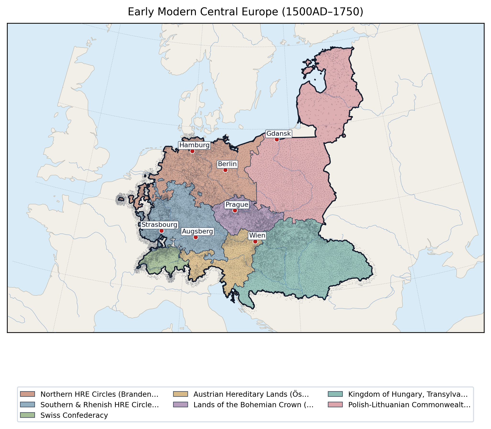

```{r setup, include=FALSE}
knitr::opts_chunk$set(
  echo = FALSE,
  warning = FALSE,
  message = FALSE,
  fig.align = "center"
)
source("../../_shared/template/viscount_rmd_helpers.R")
library(jsonlite)

summary_data <- fromJSON("early_modern_central_europe_summary.json", simplifyVector = FALSE)

fmt_source_label <- function (arg0_src) {
  s <- as.character(arg0_src)
  s <- gsub("^HistoGIS_HRE_Imperial_Circles_([0-9]{4})$", "HistoGIS HRE Imperial Circles (\\1)", s)
  s <- gsub("^Historical_Basemaps_([0-9]{4})$", "Historical Basemaps (\\1)", s)
  s <- gsub("^Buringh_European_Urban_700_2000$", "Buringh European Urban Series (700-2000)", s)
  s <- gsub("_", " ", s, fixed = TRUE)
  s
}

region_name_map <- setNames(
  vapply(summary_data$subregions, function (x) x$name, character(1)),
  vapply(summary_data$subregions, function (x) x$id, character(1))
)

fmt_hgis_polity <- function (arg0_country) {
  s <- as.character(arg0_country)
  if (identical(s, "HRE")) return("Holy Roman Empire")
  if (identical(s, "EM_france")) return("Kingdom of France")
  if (identical(s, "EM_poland lit")) return("Poland-Lithuania")
  gsub("_", " ", s, fixed = TRUE)
}
```

```{r md-hero, results='asis', eval=!knitr::is_latex_output()}
cat("\n\n")
```

# Abstract

Between 1500 and 1750 Central Europe experienced the sharpest demographic reversal anywhere on the European continent during the early modern era, followed by a sustained eighteenth-century recovery that reshaped its urban hierarchy and regional balance. Across `r viscount_fmt_number(summary_data$total_area_km2, 1L)` km² spanning seven sub-regions from the North Sea and Baltic coasts to the Alps and the Carpathian Basin, total population rose from `r viscount_fmt_pop(summary_data$domain_totals[["1500"]])` in 1500 to `r viscount_fmt_pop(summary_data$domain_totals[["1600"]])` in 1600 before collapsing by 20,42% to `r viscount_fmt_pop(summary_data$domain_totals[["1650"]])` in 1650. The Thirty Years' War (1618-1648) stripped 32,35% of the inhabitants from the Southern and Rhineland German States, 27,03% from the Northern and Protestant German States and 28,57% from Bohemia and Moravia, while only the neutral Swiss Confederacy recorded net population growth across the first half of the seventeenth century. Recovery remained uneven until 1700 (`r viscount_fmt_pop(summary_data$domain_totals[["1700"]])`), delayed in the Polish-Lithuanian Crown and Baltic Lands by the Swedish Deluge and the Great Northern War and in Hungary by Ottoman-Habsburg frontier warfare. Thereafter, Danubian resettlement, proto-industrial expansion in Bohemia and Silesia and the rise of absolutist court capitals lifted the regional total to `r viscount_fmt_pop(summary_data$domain_totals[["1750"]])` in 1750 (31,5 persons per km²). MAGNETIC anchors this reconstruction in 50 sub-administrative historical GIS enumerations centred on the Imperial Circles of the Holy Roman Empire (1512, 1555 and 1648), 480 longitudinal urban series and parish-register and fiscal demographic scholarship.

# Background

## Geographic Scope and Constitutional Geography

Early Modern Central Europe occupies `r viscount_fmt_number(summary_data$total_area_km2, 1L)` km² between the Rhine-Meuse frontier in the west, the Pripet-Dnieper borderlands of the Polish-Lithuanian Commonwealth in the east, the North and Baltic littoral in the north and the Alpine crest and Sava-Danube corridor in the south. Rather than corresponding to a single unitary monarchy, the macro-region encompassed an overlapping mosaic of constitutional orders: the Holy Roman Empire of the German Nation, formally organised into ten Imperial Circles (*Reichskreise*) after the diets of Augsburg (1500) and Cologne (1512) [@HistoGIS2022]; the thirteen-canton Swiss Confederacy and its allied estates, formally exempted from imperial jurisdiction at Westphalia in 1648; the Austrian Hereditary Lands (*Erblande*) and the Lands of the Bohemian Crown under Habsburg rule from 1526; the tripartite Hungarian kingdom divided after the Battle of Mohács (1526) between Royal Hungary, the Ottoman Eyalet of Buda and the tributary Principality of Transylvania [@Korpas2022History]; and the Polish-Lithuanian Commonwealth consolidated by the Union of Lublin in 1569.

Physical geography divided this constitutional mosaic into sharply differentiated carrying-capacity zones. The loess belt running from the Upper and Middle Rhine through Thuringia, Saxony, Lower Silesia and Lesser Poland supported dense cereal cultivation, vineyards and closely spaced market towns. North of the Mittelgebirge, glacial outwash sands across Brandenburg, Mecklenburg, Pomerania and Greater Poland yielded lower grain surpluses per hectare and relied heavily on riverine timber, rye and livestock exports funnelled through Hamburg, Lübeck and Gdańsk [@DeVries1984]. Along the Alpine spine of Switzerland, Tyrol, Styria and Carinthia, vertical transhumance, dairy pastoralism and iron or salt mining set tight ecological bounds on upland settlement, documented across long-run Alpine agro-pastoral records [@Lerch2022Human]. To the south-east, the Great Hungarian Plain (*Alföld*) combined fertile alluvial soils with extensive flood-prone marshes that reverted rapidly to pastoral steppe whenever military insecurity depopulated riverside villages [@Palairet1997].

To capture these ecological and political divisions without cutting across coherent archival traditions, MAGNETIC partitions the domain into seven sub-regions: Northern and Protestant German States (172.506 km²), Southern and Rhineland German States (183.539,1 km²), Swiss Confederacy (41.023,8 km²), Austrian Hereditary Lands (84.029 km²), Bohemia and Moravia (78.306,2 km²), Hungary and Slovakia (140.238,2 km²) and Poland-Lithuania Crown and Baltic Lands (476.433 km²). Because modern national borders cut obliquely across sixteenth-century and seventeenth-century polities, the urban gazetteer draws settlements falling inside the historical territorial envelope from 17 contemporary jurisdictions, including Alsace in eastern France, the Lower Rhine borderlands of the Netherlands and Belgium, Silesia and Pomerania in western Poland, Upper Hungary in Slovakia and northern Transylvania and Vojvodina in Romania and Serbia [@Buringh2021].

## Long-Run Demographic Context (1500-1750)

In 1500 Central Europe was completing its recovery from the late mediaeval mortality crisis triggered by the Black Death of 1347-1352 and recurrent fifteenth-century epidemics. Deserted villages (*Wüstungen*) were being reoccupied across Swabia, Franconia, Brandenburg and Bohemia, while silver booms in the Ore Mountains (*Erzgebirge*), Tyrol and Upper Hungary stimulated rapid upland town foundation [@PfisterFertig2010; @DeVries1984]. Throughout the sixteenth century favourable harvest sequences, declining land-labour ratios and buoyant Baltic grain demand sustained steady natural increase. Across the German states, Switzerland, Bohemia and Poland-Lithuania, population expanded by roughly 22% to 32% between 1500 and 1600, raising overall regional density from 20,24 to 25,48 persons per km².

That expansion collided with a dual ecological and geopolitical ceiling around 1590. Cooler, wetter summers associated with the Little Ice Age depressed grain yields and drove up rye prices across the Rhineland, southern Germany and the Alpine foreland, triggering subsistence crises in 1570-1572, 1594-1597 and 1622-1623 [@PfisterFertig2010]. At the same time confessional polarisation inside the Holy Roman Empire erupted into the Thirty Years' War (1618-1648), turning Central Europe into the primary military theatre for Imperial, Bavarian, Spanish, Danish, Swedish and French armies. Unlike the comparatively localised civil wars of England or even the French Wars of Religion [@WrigleySchofield1981; @Dupaquier1988], the German and Bohemian campaigns combined systematic requisitioning, scorched-earth foraging and repeated troop movements that diffused plague (*Yersinia pestis*), epidemic typhus and dysentery across rural corridors far beyond battlefields [@Alfani2013; @Pannier2023Crisis].

Nor did the Peace of Westphalia in 1648 end warfare across the eastern half of the domain. In that very year the Khmelnytsky Uprising fractured the Polish-Lithuanian Commonwealth, opening a sequence of Cossack, Muscovite and Swedish invasions culminating in the Swedish *Deluge* (1655-1660) and, a generation later, the Great Northern War (1700-1721) accompanied by the devastating Baltic plague of 1708-1712 [@Gille1949; @Smuniewski2024Theologically]. Meanwhile, the Danubian frontier endured the Long Turkish War (1593-1606), the Ottoman siege of Vienna (1683), the sixteen-year War of the Holy League ending at the Peace of Karlowitz (1699) and Rákóczi's War of Independence (1703-1711). Only after 1715 did sustained peace across the German states, Habsburg Austria, Bohemia, Hungary and Poland-Lithuania allow lower mortality, internal colonisation of the *Alföld* and rural proto-industrialisation to lift population decisively past its 1600 ceiling [@PfisterFertig2010; @DeVries1984].

## Agrarian Institutions, Nuptiality and the Elbe-Saale Divide

Beneath these military and climatic shocks lay a deep institutional frontier running roughly north-south along the Elbe and Saale rivers and through the Bohemian borderlands. West of that line — across the Rhineland, Swabia, Franconia, Bavaria, Hesse, Westphalia, Switzerland and the Austrian Alpine lands — rural society was organised under *Grundherrschaft* (seigneurial rent-lordship), in which peasants held hereditary or fixed-term tenures in exchange for cash rents, tithes and modest labour dues. East of the Elbe — across Mecklenburg, Pomerania, Brandenburg, Silesia, Bohemia after 1620, Poland-Lithuania and parts of Upper Hungary — noble landlords consolidated *Gutsherrschaft* (demesne lordship or second serfdom), tying peasants to manorial *folwark* estates through heavy unpaid *robot* or *pańszczyzna* corvée labour geared toward grain exports [@DeVries1984; @Apa2023Wiktor].

These twin agrarian regimes produced distinct demographic behaviours. Across the western German states, Switzerland and Austria, the European Marriage Pattern prevailed: women commonly married between ages 24 and 27, men between 27 and 30 and 10% to 18% of adults remained permanently unmarried, because household formation waited upon the inheritance of a farmstead or guild mastership [@PfisterFertig2010; @WrigleySchofield1981]. After a catastrophic mortality shock such as 1618-1648, vacant farms triggered an immediate drop in mean age at first marriage and a surge in remarriages, generating rapid compensatory fertility without requiring state compulsion. East of the Elbe and especially across Poland-Lithuania and Hungary, lords frequently encouraged or enforced earlier marriage among serf households to guarantee estate labour supply; higher baseline fertility was offset by lower grain yields, weaker municipal welfare institutions and heavier vulnerability to war-induced famine and typhus [@Gille1949; @Palairet1997].

Confessional geography interacted closely with these institutional patterns. Lutheran, Reformed and Catholic principalities competed after 1648 to repopulate devastated domains by offering multi-year tax exemptions, timber grants and religious toleration to immigrant farmers and artisans. Brandenburg-Prussia recruited Dutch drainage engineers, Palatine farmers, French Huguenots and Salzburg Protestants; Habsburg crown estates invited Swabian, Franconian and Rhineland Catholic colonists into the liberated Hungarian plain; and Silesian and Bohemian landlords fostered rural cottage linen weaving on highland estates where arable plots could no longer sustain growing peasant families [@PfisterFertig2010; @Scott2020Simon].

# Methodology

## Archival Sources and Sub-Administrative Enumeration

Demographic reconstruction for Central Europe between 1500 and 1750 rests on a hybrid evidentiary base that bridges pre-statistical fiscal listings and the earliest systematic state enumerations. No universal modern headcount existed across the region prior to the mid-eighteenth century: Sweden's *Tabellverket* began in 1749 [@Gille1949], Maria Theresa's first *Seelenkonskription* in the Habsburg lands took place in 1754 and Frederick II's Prussian *Historische Tabellen* reached comprehensive provincial coverage only in the 1740s and 1750s [@PfisterFertig2010]. Between 1500 and 1750 historians therefore triangulate four principal archival classes.

First, fiscal hearth and tax registers provide cross-sectional territorial benchmarks. Within the Holy Roman Empire these include imperial defence assessments (*Reichsmatrikel* and *Gemeiner Pfennig*), territorial *Türkensteuer* rolls raised against Ottoman campaigns and post-war cadastral reconstructions such as the Bohemian *Berní rula* of 1654 and Moravian *Lánový rejstřík* of 1669-1679. In Poland-Lithuania crown treasury officials compiled *pobór* plough-tax lists during the sixteenth century and *podymne* hearth-tax registers from 1629 onwards, supplemented in southern provinces by late eighteenth-century Habsburg cadastral records whose retrospective agrarian utility was analysed in Polish historical geography [@Apa2023Wiktor]. Across Ottoman Hungary *tahrir defterleri* recorded taxable Christian and Muslim households (*hane*) by *sancak* and *nahiye*, while post-reconquest Habsburg officials conducted the nationwide *conscriptio regnicolaris* of 1715 and 1720 [@Todorov1983; @Velicu2018Governance].

Second, ecclesiastical parish registers (*Kirchenbücher*) of baptisms, marriages and burials provide continuous vital-rate trajectories from the mid-sixteenth century in Protestant Saxony, Württemberg, Hesse, Brandenburg, Silesia and Switzerland and from the late sixteenth century in Catholic Bavaria, Austria and Bohemia after the Council of Trent. Pfister and Fertig's multi-region German parish-register sample demonstrates how inverse projection and regional weighting reconstruct annual population paths across the 1618-1648 collapse and post-war rebound [@PfisterFertig2010], paralleling the parish-based reconstructions established for England, France and Castile [@WrigleySchofield1981; @Dupaquier1988; @Reher1990]. Institutional parish archives in urban centres such as Reformation-era Breslau (Wrocław) further document the administrative consolidation of confessional record-keeping [@Scott2020Simon].

Third, MAGNETIC integrates 50 scraped sub-administrative historical GIS records anchored in the Austrian Academy of Sciences HistoGIS boundary repository [@HistoGIS2022] and early modern historical basemaps. Specifically, the HistoGIS layers supply georeferenced polygons for the 11 Imperial Circle jurisdictions of the Holy Roman Empire (the ten *Reichskreise* plus the non-circled *Kreisfreies Gebiet* encompassing Bohemia, Moravia, Silesia, Lusatia and, prior to 1648, the Swiss Confederacy) at three constitutional epochs: 1512 (mapped onto the 1500 benchmark), 1555 (mapped onto 1600) and 1648 Westphalian boundaries (mapped onto both 1700 and 1750). Adjacent cross-border basemap polygons for Poland-Lithuania (1500 and 1600) and the Kingdom of France (1500, 1600, 1700 and 1750) anchor boundary intersections along the Rhine and Vistula frontiers.

## Urban Gazetteer Construction and Spatial Reconciliation

Urban demographic trends are tracked independently through `r summary_data$settlement_count` longitudinal settlement records extracted from Buringh's pan-European compilation of cities from 700 to 2000 [@Buringh2021], building on the classic early modern urban database assembled by de Vries [@DeVries1984]. Every settlement entry inside this chapter derives from that institutional scholarly compilation, giving a crowd-sourced fallback share of 0%. Each settlement carries fifty-year population benchmarks across the full 1500-1750 span (1500, 1550, 1600, 1650, 1700 and 1750), georeferenced coordinates and assignment to one of the seven study sub-regions.

Reconciling constitutional HGIS units with fixed demographic sub-regions requires explicit areal accounting because historical jurisdictions expanded, contracted and fractured across 1500-1750. Between the 1512 and 1648 HistoGIS layers, the Holy Roman Empire's total polygon area declined from 865.211 km² to 782.780 km² (a contraction of 82.431 km²) as the northern Netherlands (Seven Provinces), the Swiss Confederacy and portions of Alsace and Lorraine exited imperial jurisdiction. Holding the seven study sub-regions constant across all five benchmark years (1500, 1600, 1650, 1700 and 1750) eliminates artificial territorial jumps in regional growth rates while allowing direct cross-validation against the shifting HistoGIS circle totals.

All regional totals are reported at fifty-year intervals (1500, 1600, 1650, 1700 and 1750) to match the temporal resolution of pre-census fiscal surveys and urban benchmarks. Compound annual growth rates are computed across each fifty-year or hundred-year span, and densities are calculated strictly against constant sub-regional land areas in square kilometres.

# Validation

## Reconciliation Against HistoGIS Imperial Circles and External Benchmarks

Cross-checking the seven fixed sub-regional aggregates against the 50 scraped historical GIS records confirms tight structural alignment once constitutional boundary differences are accounted for. Table 1 summarises all eight regime-source groupings in the HGIS corpus. In 1500 the 11 HistoGIS Imperial Circle units cover 865.211 km² with a summed population of 16,6M (19,19 persons per km²). Within our fixed sub-regional classification, the five territories broadly corresponding to the Empire in 1500 — Northern German States (5,6M), Southern German States (5,2M), Switzerland (780k), Austrian Hereditary Lands (1,92M) and Bohemia-Moravia (1,95M) — total 15,45M across 559.404,1 km². The remaining 1,15M gap reflects the inclusion inside the HistoGIS Empire of the Burgundian Circle (2,1M across 73.162 km² in the Habsburg Low Countries and Franche-Comté) and Silesia, offset by small boundary differences along the Prussian and Rhineland margins.

```{r hgis-regime-table, results='asis'}
hgis_reg_df <- do.call(rbind, lapply(summary_data$hgis_regime_summary, function (row) {
  pop <- as.numeric(row$population_sum)
  area <- as.numeric(row$area_km2_sum)
  dens <- pop / area
  data.frame(
    Regime = as.character(row$snapshot_regime),
    Source = fmt_source_label(row$source),
    Units = as.integer(row$units),
    Area = viscount_fmt_number(area, 0L),
    Population = viscount_fmt_pop(pop),
    Density = viscount_fmt_number(dens, 2L),
    stringsAsFactors = FALSE
  )
}))
rownames(hgis_reg_df) <- NULL
viscount_table(
  hgis_reg_df,
  "Historical GIS sub-administrative enumeration regimes covering Central Europe and bordering frontiers (50 total unit-year records, 1500-1750).",
  c("Year", "HGIS Source Series", "Units", "Area (km²)", "Population", "Density (/km²)")
)
```

Tracking the HistoGIS Imperial Circle totals across time corroborates the central demographic reversal of the seventeenth century. Between 1500 (1512 boundaries) and 1600 (1555 boundaries), HistoGIS Empire totals climb by 22,89% from 16,6M to 20,4M, closely matching the 26,8% rise across our five Empire-overlapping sub-regions (15,45M to 19,59M). By 1700 (1648 Westphalian boundaries, excluding Switzerland and the Dutch Republic), the HistoGIS Empire stands at 19,8M — still below its 1600 level — before advancing by 21,46% to 24,05M in 1750. Likewise, the Historical Basemaps polygon for Poland-Lithuania records 4,5M in 1500 and 5,8M in 1600 (growth of 28,89%), matching our 28,04% expansion for the Poland-Lithuania Crown and Baltic Lands (5,35M to 6,85M, which additionally incorporates Ducal Prussia, Royal Prussia and Livonia-Estonia). The neighbouring Kingdom of France basemap polygon (15,5M in 1500 to 24,5M in 1750) enters the spatial intersection solely because of Alsace-Lorraine frontier overlap and serves as an external western benchmark consistent with Dupâquier's national series [@Dupaquier1988].

## Internal Consistency and Urban-Rural Plausibility Checks

To verify that aggregate mortality troughs are demographically coherent rather than artefacts of fiscal under-registration, we cross-check our regional curves against three independent empirical yardsticks. First, Pfister and Fertig's parish-register reconstruction for Germany inside its 1871 borders estimates a decline of roughly 35% to 40% from the pre-war peak around 1618 to the wartime trough in 1648, with 1650 already capturing two years of rapid post-war nuptiality and refugee return [@PfisterFertig2010]. Our combined Northern and Southern German sub-regions fall from 14,2M in 1600 to 10M in 1650 (-29,58%). Since German population continued to grow modestly between 1600 and 1618 (to roughly 15,2M-15,8M) before collapsing, a 1600-to-1650 benchmark drop of 29,58% aligns cleanly with a 1618-to-1648 peak-to-trough loss near 36%.

Second, the epidemiological contrast between Germany, Bohemia and Switzerland mirrors Alfani's comparative analysis of seventeenth-century European plague geography [@Alfani2013]. Whereas northern Italy lost roughly one-third of its inhabitants to the single 1629-1630 plague wave, Central Europe suffered multi-decade attrition in which military logistics repeatedly reintroduced plague, typhus and dysentery along marching corridors [@Pannier2023Crisis]. Bioarchaeological cementochronology from catastrophic mass graves at Kutná Hora-Sedlec in Bohemia illustrates how seasonal subsistence and epidemic shocks struck Central European towns in sharply concentrated mortality spikes [@Zazvonilova2023Using], while econometric studies of German wartime cohort exposure show how sudden adult-male losses depress household formation and output across multiple subsequent decades [@Braun2023Exposure].

Third, urban population shares derived from the 480-city gazetteer remain consistently bounded between 8% and 14% across 1500-1750 for cities of 5.000 or more inhabitants, matching de Vries's finding that Central European urbanisation lagged behind the Low Countries and northern Italy during the sixteenth century, stalled during the seventeenth-century wars and accelerated selectively in princely capitals after 1680 [@DeVries1984; @Buringh2021].

# Results

## Macro-Regional Trajectory (1500-1750)

Over the two and a half centuries from 1500 to 1750, Central Europe's population grew by 13,25M inhabitants (+55,67%), rising from 23,8M to 37,05M at an average compound annual growth rate of 0,18%. That modest net rate hides four sharply distinct demographic phases. During the sixteenth-century expansion (1500-1600), the macro-region added 6,17M people (+25,92%, or 0,23% per year), raising average density from 20,24 to 25,48 persons per km². Between 1600 and 1650, war, plague and forced migration erased almost the entire preceding century's gain: population fell by 6,12M (-20,42%), dragging aggregate density back to 20,28 persons per km² — virtually identical to 1500.

```{r subregional-matrix, results='asis'}
sub_df <- do.call(rbind, lapply(summary_data$subregions, function (r) {
  p1500 <- as.numeric(r$population[["1500"]])
  p1600 <- as.numeric(r$population[["1600"]])
  p1650 <- as.numeric(r$population[["1650"]])
  p1700 <- as.numeric(r$population[["1700"]])
  p1750 <- as.numeric(r$population[["1750"]])
  area <- as.numeric(r$area_km2)
  data.frame(
    Subregion = r$name,
    Area = viscount_fmt_number(area, 0L),
    Y1500 = viscount_fmt_pop(p1500),
    Y1600 = viscount_fmt_pop(p1600),
    Y1650 = viscount_fmt_pop(p1650),
    Y1700 = viscount_fmt_pop(p1700),
    Y1750 = viscount_fmt_pop(p1750),
    Dens1750 = viscount_fmt_number(p1750 / area, 2L),
    stringsAsFactors = FALSE
  )
}))
tot_area <- as.numeric(summary_data$total_area_km2)
tot_row <- data.frame(
  Subregion = "Central Europe Total",
  Area = viscount_fmt_number(tot_area, 0L),
  Y1500 = viscount_fmt_pop(summary_data$domain_totals[["1500"]]),
  Y1600 = viscount_fmt_pop(summary_data$domain_totals[["1600"]]),
  Y1650 = viscount_fmt_pop(summary_data$domain_totals[["1650"]]),
  Y1700 = viscount_fmt_pop(summary_data$domain_totals[["1700"]]),
  Y1750 = viscount_fmt_pop(summary_data$domain_totals[["1750"]]),
  Dens1750 = viscount_fmt_number(as.numeric(summary_data$domain_totals[["1750"]]) / tot_area, 2L),
  stringsAsFactors = FALSE
)
sub_df <- rbind(sub_df, tot_row)
rownames(sub_df) <- NULL
viscount_table(
  sub_df,
  "Sub-regional population totals (1500-1750) and 1750 population density across Early Modern Central Europe.",
  c("Sub-Region", "Area (km²)", "1500", "1600", "1650", "1700", "1750", "1750 (/km²)")
)
```

Recovery across the second half of the seventeenth century (1650-1700) restored 5,5M inhabitants (+23,06%), yet at 29,35M in 1700 Central Europe still stood 620k people (-2,07%) below its 1600 peak. Only in the final half-century (1700-1750) did the region break decisively above its early modern ceiling, adding 7,7M people (+26,24%, or 0,47% per year) and lifting density to 31,5 persons per km². Figure 1 plots this V-shaped seventeenth-century trough and its diverging sub-regional recoveries across all seven territories.

```{r fig-trajectory, results='asis'}
viscount_figure(
  "figures/early_modern_central_europe_population_trajectory.png",
  "Aggregate and sub-regional population trajectories in Early Modern Central Europe (1500-1750), highlighting the 1600-1650 Thirty Years' War trough and post-1700 demographic expansion.",
  "fig:emce-trajectory"
)
```

Table 3 breaks down these five benchmarks into period-by-period percentage changes and overall 1500-1750 compound annual growth rates alongside density progression from 1500 to 1750. Comparing the 1600-1650 column against the 1700-1750 column reveals the structural asymmetry of early modern Central European demography: the worst mid-seventeenth-century contractions hit Southern Germany (-32,35%), Bohemia and Moravia (-28,57%) and Northern Germany (-27,03%), whereas the sharpest eighteenth-century surges occurred on the reconquered Hungarian frontier (+49,23%) and in proto-industrial Bohemia and Moravia (+34,04%).

```{r growth-rates-table, results='asis'}
fmt_pct_signed <- function (arg0_a, arg1_b) {
  pct <- 100 * (arg1_b - arg0_a) / arg0_a
  prefix <- if (pct > 0) "+" else ""
  paste0(prefix, viscount_fmt_number(pct, 2L), "%")
}

growth_df <- do.call(rbind, lapply(summary_data$subregions, function (r) {
  p1500 <- as.numeric(r$population[["1500"]])
  p1600 <- as.numeric(r$population[["1600"]])
  p1650 <- as.numeric(r$population[["1650"]])
  p1700 <- as.numeric(r$population[["1700"]])
  p1750 <- as.numeric(r$population[["1750"]])
  area <- as.numeric(r$area_km2)
  data.frame(
    Subregion = r$name,
    G1500_1600 = fmt_pct_signed(p1500, p1600),
    G1600_1650 = fmt_pct_signed(p1600, p1650),
    G1650_1700 = fmt_pct_signed(p1650, p1700),
    G1700_1750 = fmt_pct_signed(p1700, p1750),
    G1500_1750 = fmt_pct_signed(p1500, p1750),
    D1500 = viscount_fmt_number(p1500 / area, 2L),
    D1750 = viscount_fmt_number(p1750 / area, 2L),
    stringsAsFactors = FALSE
  )
}))
t1500 <- as.numeric(summary_data$domain_totals[["1500"]])
t1600 <- as.numeric(summary_data$domain_totals[["1600"]])
t1650 <- as.numeric(summary_data$domain_totals[["1650"]])
t1700 <- as.numeric(summary_data$domain_totals[["1700"]])
t1750 <- as.numeric(summary_data$domain_totals[["1750"]])
growth_df <- rbind(
  growth_df,
  data.frame(
    Subregion = "Central Europe Total",
    G1500_1600 = fmt_pct_signed(t1500, t1600),
    G1600_1650 = fmt_pct_signed(t1600, t1650),
    G1650_1700 = fmt_pct_signed(t1650, t1700),
    G1700_1750 = fmt_pct_signed(t1700, t1750),
    G1500_1750 = fmt_pct_signed(t1500, t1750),
    D1500 = viscount_fmt_number(t1500 / tot_area, 2L),
    D1750 = viscount_fmt_number(t1750 / tot_area, 2L),
    stringsAsFactors = FALSE
  )
)
rownames(growth_df) <- NULL
viscount_table(
  growth_df,
  "Period percentage population changes and density shifts (persons per km²) across Central European sub-regions (1500-1750).",
  c("Sub-Region", "1500-1600", "1600-1650", "1650-1700", "1700-1750", "1500-1750", "1500 (/km²)", "1750 (/km²)")
)
```

## The German States and the Thirty Years' War Collapse

Together the Northern and Protestant German States (172.506 km²) and the Southern and Rhineland German States (183.539,1 km²) accounted for 45,38% of Central Europe's inhabitants in 1500 (10,8M) and 47,38% in 1600 (14,2M). Both halves enjoyed vigorous sixteenth-century growth — +32,14% in the north (5,6M to 7,4M) and +30,77% in the south (5,2M to 6,8M) — pushing regional density to 42,9 persons per km² in the north and 37,05 persons per km² in the south by 1600.

The Thirty Years' War shattered this expansion unevenly along a broad diagonal corridor stretching from Mecklenburg and Pomerania through Brandenburg, Magdeburg, Saxony and Thuringia into Franconia, the Palatinate, Württemberg and Bavaria [@PfisterFertig2010]. Between 1600 and 1650 the Southern and Rhineland German States lost 2,2M inhabitants (-32,35%), plunging from 6,8M to 4,6M (25,06 persons per km²), while the Northern and Protestant German States lost 2M inhabitants (-27,03%), falling from 7,4M to 5,4M (31,3 persons per km²). Local parish series record losses exceeding 50% to 65% in Württemberg, the Electoral Palatinate, Pomerania and parts of Mecklenburg, whereas Lower Saxony, Schleswig-Holstein and parts of Westphalia escaped with far lighter damage.

Urban trajectories capture the human geography of the war in clear relief [@Buringh2021; @DeVries1984]. Magdeburg, a prosperous Elbe trading centre of 25k in 1600, was stormed and burned by Tilly's Imperial army in May 1631; its population sank to 16k in 1650 and 10k in 1700 before struggling back to 18k by 1750. Augsburg fell from 40k in 1600 to 32k in 1650 and 26k in 1700; Ulm dropped from 21k in 1600 to 14k in 1650 and 10k in 1700; and Nuremberg stagnated at 40k across 1600-1700 before sliding to 30k in 1750. Conversely, fortified North Sea ports and neutral commercial entrepôts absorbed refugees and war trade: Hamburg climbed continuously from 30k in 1500 to 40k in 1600, 53k in 1650, 70k in 1700 and 90k in 1750, while Bremen rose from 18k to 28k and Frankfurt am Main from 12k to 32k.

Post-war reconstruction between 1650 and 1750 accelerated a structural shift away from autonomous Imperial Free Cities toward absolutist territorial capitals (*Residenzstädte*). Electoral Brandenburg-Prussia welcomed Swiss, Dutch and French Huguenot immigrants (notably after the 1685 Edict of Potsdam), propelling Berlin from 9k in 1500 and 10k in 1600 to 23k in 1650, 55k in 1700 and 113k in 1750 — an elevenfold expansion in 150 years. Saxony's court capital Dresden expanded similarly from 5k in 1500 and 12k in 1600 to 57k in 1750, paired with Leipzig's commercial fair hub rising from 7k to 35k. In the south, Munich grew from 13k to 32k, Mainz from 6k to 25k and the planned Palatine capital Mannheim from 1k in 1600 to 20k in 1750, while French annexation of Strasbourg after 1681 supported its rise from 25k in 1700 to 40k in 1750. By 1750 the Northern German States reached 8,6M (49,85 persons per km², the highest sub-regional density in Central Europe) and the Southern German States reached 7,8M (42,5 persons per km²).

## Swiss Neutrality and the Austrian Hereditary Lands

The Swiss Confederacy (41.023,8 km²) presents the clearest counterfactual to Germany's seventeenth-century catastrophe. Sheltered from foreign armies by armed cantonal neutrality, Alpine topography and disciplined mercenary treaties, Switzerland was the sole sub-region in Central Europe to achieve net population growth between 1600 and 1650, edging up from 1,02M to 1,05M (+2,94%) despite localised plague waves in 1611 and 1628-1629 and the 1653 Peasants' War. Over the full 1500-1750 span Swiss population expanded by 85,9% — from 780k (19,01 persons per km²) to 1,45M (35,35 persons per km²) — the largest proportional gain of any Central European sub-region. Waves of Italian, German and French Huguenot religious exiles reinforced watchmaking, silk weaving and cotton proto-industry across Geneva (expanding from 12k in 1500 to 23k in 1750), Basel, Zurich and the upland valleys of Appenzell and Glarus [@DeVries1984; @Buringh2021]. Even so, land scarcity in the Alpine cantons kept Swiss demographic growth tightly linked to seasonal labour migration and foreign military service.

Neighbouring Austrian Hereditary Lands (84.029 km² — Lower and Upper Austria, Styria, Carinthia, Carniola, Tyrol and Salzburg) experienced an intermediate trajectory. Population rose by 22,4% between 1500 (1,92M) and 1600 (2,35M), then dipped by a comparatively moderate 8,51% to 2,15M in 1650. Because imperial armies kept the main Swedish and French campaigns north of the Danube until the brief Swedish advance of 1645, Austria escaped the wholesale rural destruction inflicted on Württemberg and Pomerania; its mid-century contraction stemmed primarily from the Upper Austrian Peasant War of 1626, Counter-Reformation expulsions of Protestant burghers and miners and subsistence-epidemic peaks in the 1630s.

Thereafter Austria recovered rapidly, surpassing its 1600 mark by 1700 (2,48M, +15,35% over 1650) despite the Great Plague of Vienna in 1679 and the Ottoman siege of 1683, and reaching 2,85M (33,92 persons per km²) by 1750. The defining urban phenomenon of the Habsburg lands was the transformation of Vienna (*Wien*) from a frontier garrison town of 20k in 1500 and 50k in 1600 into Central Europe's premier baroque metropolis: 75k in 1650, 114k in 1700 and 175k in 1750 [@Buringh2021]. Once the Ottoman frontier shifted south of the Sava after 1699, aristocratic palaces, imperial ministries and textile workshops spilled far beyond Vienna's fortifications into the *Vorstädte*, while Styria's capital Graz quadrupled from 5k in 1500 to 22k in 1700 and 20k in 1750.

## Bohemia, Moravia and the Partitioned Hungarian Basin

Bohemia and Moravia (78.306,2 km²) served as both the opening spark and one of the worst casualties of the Thirty Years' War. During the sixteenth century silver mining at Jáchymov and Kutná Hora, fishpond agriculture and Rudolf II's imperial court at Prague lifted population by 25,64%, from 1,95M in 1500 to 2,45M in 1600 (31,29 persons per km²), while Prague doubled from 30k to 60k. Following the Defenestration of Prague (1618) and the Protestant defeat at White Mountain (1620), mass noble confiscations, the emigration of an estimated 100k-150k Bohemian Brethren and Lutherans to Saxony and Silesia and repeated Swedish incursions during the 1630s and 1640s drove population down by 28,57% to 1,75M in 1650 (22,35 persons per km²). The 1654 *Berní rula* cadastre recorded roughly one-fifth of all Bohemian peasant farms standing empty.

Yet Bohemia and Moravia staged one of eighteenth-century Europe's fastest rebounds. Population recovered to 2,35M by 1700 (+34,29% over 1650) and surged another 34,04% to 3,15M in 1750 (40,23 persons per km²), overtaking the 1600 peak by 700k inhabitants. Prague itself recovered more slowly — slipping to 54k in 1650 and 48k in 1700 after the imperial court's permanent move to Vienna before regaining 60k in 1750 — because eighteenth-century growth concentrated heavily in rural linen, woollen and glassmaking districts along the northern Sudeten and Ore Mountain fringes [@DeVries1984].

East of the Leitha and Morava rivers, Hungary and Slovakia (140.238,2 km²) followed an entirely different rhythm dictated by the Ottoman-Habsburg military frontier [@Korpas2022History; @Marosi2013Origins]. At 3M inhabitants in 1500 (21,39 persons per km²), mediaeval Hungary had stood roughly level with England. The defeat at Mohács (1526), the Ottoman capture of Buda (1541) and 150 years of border raiding, slave-taking and fiscal double taxation kept population virtually stationary across two full centuries: 3,1M in 1600 (+3,33%), 2,95M in 1650 (-4,84%) and 3,25M in 1700. Across the fertile central *Alföld*, small farming villages vanished as peasants fled either north into the Carpathian uplands of Royal Hungary (modern Slovakia) or into sprawling, lightly taxed Ottoman crown market towns (*mezővárosok*) such as Debrecen, Kecskemét and Nagykőrös [@Todorov1983; @Palairet1997]. Debrecen accordingly expanded steadily throughout the partition era from 9k in 1500 to 15k in 1650 and 28k in 1750, while Bratislava (*Pressburg*), acting as coronation seat and diet capital of Royal Hungary, jumped from 10k in 1700 to 25k in 1750.

The Habsburg reconquest of Buda (1686), the Peace of Karlowitz (1699) and the pacification of Rákóczi's uprising at Szatmár (1711) transformed Hungary from a contested war zone into Europe's largest internal colonisation frontier. Organised *Impopulation* schemes brought German Danube Swabians (*Donauschwaben*) from Swabia and the Rhineland alongside Slovak, Serbian, Croatian and Romanian settlers onto depopulated royal and noble estates across the Great Plain, Banat and Bácska. Between 1700 and 1750 Hungary and Slovakia added 1,6M people (+49,23%), surging from 3,25M to 4,85M (34,58 persons per km²) — the sharpest fifty-year growth rate recorded anywhere in early modern Central Europe.

## Poland-Lithuania, the Deluge and the Baltic Littoral

Accounting for 40,51% of the entire chapter's land area (476.433 km²), the Poland-Lithuania Crown and Baltic Lands combined extensive low-density agrarian plains with prosperous Baltic port cities and Silesian commercial centres. During the sixteenth-century Polish Golden Age, booming Western European grain demand drew rye and wheat down the Vistula and Niemen rivers onto manorial *folwark* estates, raising population by 28,04% from 5,35M in 1500 (11,23 persons per km²) to 6,85M in 1600 (14,38 persons per km²). Urban commerce flourished along both the Baltic coast and inland trade roads: Gdańsk rose from 30k in 1500 to 40k in 1600 and 50k in 1700; Wrocław (Breslau) expanded from 25k to 40k by 1600 [@Scott2020Simon]; Kraków climbed from 22k to 28k; Vilnius doubled from 20k to 40k; and Poznań more than doubled from 9k to 20k [@Buringh2021].

Unlike Germany, whose crisis peaked between 1618 and 1648, Poland-Lithuania suffered its heaviest demographic blow across the second half of the seventeenth century and the opening two decades of the eighteenth. By 1650 population had already slipped by 13,14% to 5,95M following the outbreak of the Khmelnytsky Uprising (1648) and severe mid-century harvest failures. Worse followed immediately afterwards: the Swedish *Deluge* (1655-1660), simultaneous Muscovite occupation of Lithuania and Belarus, Brandenburg-Prussian intervention and Tatar raids cut the Commonwealth's population by an estimated one-quarter to one-third by 1660. Partial late seventeenth-century recovery was then truncated by the Great Northern War (1700-1721) and the Baltic plague of 1708-1712, which carried off 30% to 45% of inhabitants in East Prussia, Livonia, Estonia and parts of Lithuania [@Gille1949]. Consequently, the 1700 benchmark of 6,55M still lay 300k (-4,38%) below 1600, and several major inland cities contracted sharply between 1700 and 1750: Vilnius dropped from 40k to 21k and Kraków fell from 30k to 20k, while Wrocław — incorporated into Prussia after the First Silesian War (1740-1742) — advanced from 40k to 55k. Rural recovery after 1721 nonetheless lifted the sub-region to 8,35M in 1750 (17,53 persons per km², +27,48% over 1700).

## Sub-Administrative HGIS Imperial Circles and Urban Hierarchy

Disaggregating the Holy Roman Empire into its HistoGIS Imperial Circles illuminates the sub-national spatial distribution underlying the seven regional aggregates [@HistoGIS2022]. Table 4 presents the top sub-administrative HGIS enumerations from the scraped historical GIS ledger across 1500, 1600, 1700 and 1750. Within the Empire, the *Kreisfreies Gebiet* (primarily the Bohemian Crown lands and Silesia, plus Switzerland prior to 1648) formed the most populous circle-level division, rising from 2,6M in 1500 to 3,3M in 1600, dipping to 3,15M in 1700 on reduced Westphalian area (183.462 km²) and expanding to 4,1M in 1750. The *Österreichischer Kreis* (Austrian Circle) advanced from 1,95M in 1500 to 2,4M in 1600, 2,7M in 1700 and 3,1M in 1750 across roughly 108.253 km². Among the core German circles, the *Niederrheinisch-Westfälischer Kreis* (Lower Rhenish-Westphalian Circle) achieved the highest sub-administrative density by 1750 at 48,04 persons per km² (2,65M on 55.162 km²), outpacing the larger *Obersächsischer Kreis* (Upper Saxon Circle: 2,65M on 97.002 km², or 27,32 persons per km²), while the *Burgundischer Kreis* (Burgundian Circle) recorded 38,27 persons per km² (2,45M on 64.015 km²).

```{r hgis-featured-table, results='asis'}
hgis_feat_df <- do.call(rbind, lapply(summary_data$hgis_featured_units, function (u) {
  pop <- as.numeric(u$population)
  area <- as.numeric(u$area_km2)
  data.frame(
    Year = as.character(u$year),
    Polity = fmt_hgis_polity(u$country),
    Unit = as.character(u$unit_name),
    Area = viscount_fmt_number(area, 0L),
    Population = viscount_fmt_pop(pop),
    Density = viscount_fmt_number(pop / area, 2L),
    Source = fmt_source_label(u$source),
    stringsAsFactors = FALSE
  )
}))
hgis_feat_df <- hgis_feat_df[order(as.integer(hgis_feat_df$Year), -vapply(summary_data$hgis_featured_units, function (u) as.numeric(u$population), numeric(1))), ]
rownames(hgis_feat_df) <- NULL
viscount_table(
  hgis_feat_df,
  "Featured historical GIS sub-administrative enumerations (HistoGIS HRE Imperial Circles and bordering state basemaps, 1500-1750).",
  c("Year", "Polity", "Administrative Unit", "Area (km²)", "Population", "Density (/km²)", "Source")
)
```

At the municipal level, Central Europe's urban hierarchy underwent a decisive re-ordering between 1500 and 1750 (Figure 2 and Table 5). In 1500 the region possessed a flat, polycentric rank-size distribution led by mediaeval commercial centres: Cologne (45k), Nuremberg (38k), Augsburg (30k), Hamburg (30k), Prague (30k), Gdańsk (30k), Wrocław (25k) and Lübeck (25k), with Vienna trailing in eleventh place at 20k and Berlin a minor market town of 9k. By 1750 absolutist state formation and Atlantic commerce had steepened the urban pyramid dramatically. Vienna (175k) stood nearly twice the size of Hamburg (90k) and more than 50% larger than Berlin (113k), while Dresden (57k) and Leipzig (35k) had overtaken Augsburg (29k), Nuremberg (30k) and Lübeck (21k).

```{r fig-urban, results='asis'}
viscount_figure(
  "figures/early_modern_central_europe_urban_hierarchy.png",
  "Rank-size urban hierarchy and leading cities across Early Modern Central Europe (1500-1750), contrasting polycentric sixteenth-century free cities with eighteenth-century court capitals.",
  "fig:emce-urban"
)
```

```{r top-cities-table, results='asis'}
top15 <- summary_data$top_settlements[seq_len(min(15L, length(summary_data$top_settlements)))]
top_df <- do.call(rbind, lapply(top15, function (s) {
  data.frame(
    City = as.character(s$name),
    Country = as.character(s$country),
    Y1500 = viscount_fmt_pop(s$population[["1500"]]),
    Y1600 = viscount_fmt_pop(s$population[["1600"]]),
    Y1650 = viscount_fmt_pop(s$population[["1650"]]),
    Y1700 = viscount_fmt_pop(s$population[["1700"]]),
    Y1750 = viscount_fmt_pop(s$population[["1750"]]),
    Peak = paste0(viscount_fmt_pop(s$peak_pop), " (", s$peak_year, ")"),
    stringsAsFactors = FALSE
  )
}))
rownames(top_df) <- NULL
viscount_table(
  top_df,
  "Population trajectories of the 15 largest Central European cities ranked by peak population (1500-1750).",
  c("City", "Jurisdiction", "1500", "1600", "1650", "1700", "1750", "Peak")
)
```

# Limitations

Four structural uncertainties constrain early modern Central European demographic estimates and should be weighed when interpreting sub-regional growth rates. First, fifty-year benchmark spacing smooths sharp decadal troughs that fell between census dates. In Germany, peak pre-war population occurred around 1618 and the lowest wartime nadir around 1648, meaning the 1600-to-1650 step slightly understates peak-to-trough wartime loss [@PfisterFertig2010]. More markedly, in Poland-Lithuania both the Swedish *Deluge* trough (circa 1660) and the Great Northern War and Baltic plague nadir (1710-1715) occurred inside the 1650-1700 and 1700-1750 intervals; comparing only 1650, 1700 and 1750 therefore compresses two catastrophic mortality cycles into seemingly gentler trajectories [@Gille1949].

Second, pre-1750 territorial totals depend heavily on fiscal hearth-to-person conversion multipliers (*Reduktionsfaktoren*). Converting *podymne*, *Türkensteuer* or *tahrir* household counts into total inhabitants requires assumptions about mean household size — typically 4,5 to 5,5 persons — that varied systematically between western German nuclear households, Alpine stem families, manorial *folwark* peasant cottages in Poland and extended pastoral households on the Hungarian-Ottoman frontier [@Todorov1983; @Apa2023Wiktor]. Tax exemptions for nobility, clergy, urban patriciates and impoverished cottars (*Häusler* or *komornicy*) introduce additional upward revision margins of 8% to 15%.

Third, mobile populations — mercenary armies exceeding 100k combatants during the 1630s, displaced religious refugees, seasonal Alpine migrants and itinerant rural poor — routinely escaped parish burial registers and municipal tax rolls. Fourth, Buringh's urban gazetteer truncates at a 1.000-inhabitant reporting threshold and relies on rounded estimates for smaller market towns (*Ackerbürgerstädte*), particularly in Ottoman Hungary and eastern Lithuania where municipal archives suffered wartime destruction [@Buringh2021; @Reher1990].

# Conclusion

Between 1500 and 1750 Central Europe experienced a two-stage demographic transformation that permanently altered its internal geography. In the first stage, a century of sixteenth-century agrarian expansion (23,8M to 29,97M) collapsed under the combined weight of Little Ice Age harvest volatility, confessional warfare and military-borne epidemics, driving population back to 23,85M in 1650 and delaying full continental recovery until after 1700 (29,35M). Nowhere else in early modern Europe did the gap between sheltered neutrality — exemplified by the Swiss Confederacy's uninterrupted +85,9% expansion — and war-ravaged military corridors — exemplified by the -32,35% drop in Southern Germany and -28,57% loss in Bohemia-Moravia — appear so sharply across contiguous borders.

In the second stage, post-1715 peace unleashed rapid expansion to 37,05M by 1750 (31,5 persons per km²), anchored by two structural engines: large-scale agricultural resettlement of the liberated Hungarian *Alföld* (+49,23% in 1700-1750) and proto-industrial growth across Saxony, Silesia, Bohemia and the Rhineland. Simultaneously, Central Europe's urban network pivoted decisively from polycentric mediaeval free cities toward centralised baroque court capitals (Vienna, Berlin, Dresden) and Atlantic-facing ports (Hamburg). By 1750 the demographic foundations of the late eighteenth-century Prussian, Habsburg and German industrial expansion were firmly laid.

# Appendix

Table 6 summarises the distribution of all `r summary_data$settlement_count` urban series across the 17 contemporary national jurisdictions intersecting Early Modern Central Europe's historical territorial envelope, together with the regional count across the seven study sub-regions. Full settlement coordinates, provenance metadata, fifty-year urban series and rank-size distributions are documented in the companion settlement gazetteer chapter.

```{r country-appendix-table, results='asis'}
ctry_names <- names(summary_data$settlements_by_country)
ctry_counts <- as.integer(unlist(summary_data$settlements_by_country))
ord <- order(-ctry_counts, ctry_names)
ctry_df <- data.frame(
  Jurisdiction = ctry_names[ord],
  Settlements = ctry_counts[ord],
  Share = paste0(viscount_fmt_number(100 * ctry_counts[ord] / sum(ctry_counts), 2L), "%"),
  stringsAsFactors = FALSE
)
ctry_df <- rbind(
  ctry_df,
  data.frame(
    Jurisdiction = "Total Gazetteer",
    Settlements = sum(ctry_counts),
    Share = "100%",
    stringsAsFactors = FALSE
  )
)
rownames(ctry_df) <- NULL
viscount_table(
  ctry_df,
  "Distribution of the 480 Early Modern Central European urban series by contemporary national jurisdiction (1500-1750).",
  c("Contemporary Jurisdiction", "Settlements", "Share")
)
```

# Sources

<div id="refs"></div>
