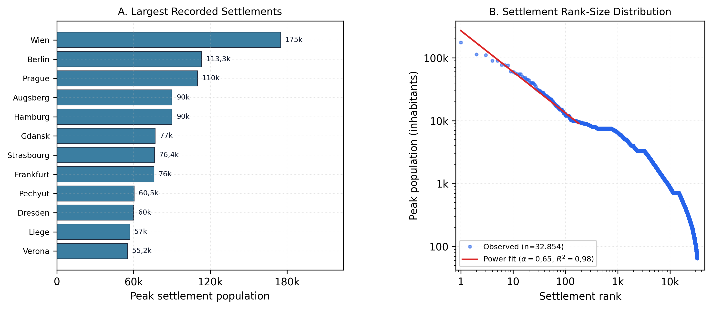

```{r setup, include=FALSE}
knitr::opts_chunk$set(
  echo = FALSE,
  warning = FALSE,
  message = FALSE,
  fig.align = "center"
)
source("../../_shared/template/viscount_rmd_helpers.R")
library(jsonlite)

summary_data <- fromJSON("early_modern_central_europe_summary.json", simplifyVector = FALSE)
settlements_raw <- fromJSON("early_modern_central_europe_settlements.json", simplifyVector = FALSE)

fmt_source_label <- function (arg0_src) {
  s <- as.character(arg0_src)
  s <- gsub("^Buringh_European_Urban_700_2000$", "Buringh European Urban Series (700-2000)", s)
  gsub("_", " ", s, fixed = TRUE)
}

region_name_map <- setNames(
  vapply(summary_data$subregions, function (x) x$name, character(1)),
  vapply(summary_data$subregions, function (x) x$id, character(1))
)

region_area_map <- setNames(
  vapply(summary_data$subregions, function (x) as.numeric(x$area_km2), numeric(1)),
  vapply(summary_data$subregions, function (x) x$id, character(1))
)

get_pop_safe <- function (arg0_s, arg1_year) {
  v <- arg0_s$population[[as.character(arg1_year)]]
  if (is.null(v)) 0 else as.numeric(v)
}

urban_sum_year <- function (arg0_year) {
  yr <- as.character(arg0_year)
  sum(vapply(settlements_raw, function (s) get_pop_safe(s, yr), numeric(1)))
}

u1500 <- urban_sum_year("1500")
u1600 <- urban_sum_year("1600")
u1650 <- urban_sum_year("1650")
u1700 <- urban_sum_year("1700")
u1750 <- urban_sum_year("1750")
```

```{r md-hero, results='asis', eval=!knitr::is_latex_output()}
cat("\n\n")
```

# Abstract

This companion settlement gazetteer documents the `r summary_data$settlement_count` municipal population series underpinning the MAGNETIC demographic reconstruction of Early Modern Central Europe from 1500 to 1750 across `r viscount_fmt_number(summary_data$total_area_km2, 1L)` km². Every settlement record originates from Eltjo Buringh's pan-European urban series (700-2000), yielding a 0% crowd-sourced share across 17 modern national jurisdictions that intersect the seven historical sub-regions. Across all 480 enumerated towns, aggregate urban population expanded from `r viscount_fmt_pop(u1500)` in 1500 to `r viscount_fmt_pop(u1600)` in 1600, steadied at `r viscount_fmt_pop(u1650)` in 1650 during the Thirty Years' War as refugees and garrisons concentrated inside fortified walls while rural hinterlands emptied, rose to `r viscount_fmt_pop(u1700)` in 1700 and reached `r viscount_fmt_pop(u1750)` in 1750. Over the 250-year span the urban hierarchy pivoted from polycentric mediaeval commercial centres led by Cologne, Nuremberg, Augsburg, Prague and Gdańsk toward centralised baroque court capitals and North Sea trade gateways led by Vienna (175k), Berlin (113k), Hamburg (90k) and Dresden (57k).

# Gazetteer Architecture and Provenance

All `r summary_data$settlement_count` settlements in this chapter are drawn from the pan-European municipal database compiled by Buringh [@Buringh2021], extending the early modern urban census synthesis pioneered by de Vries [@DeVries1984]. Each settlement entry carries georeferenced latitude and longitude coordinates, assignment to one of seven fixed historical sub-regions, modern national jurisdiction tagging and six fifty-year population benchmarks (1500, 1550, 1600, 1650, 1700 and 1750). Because every city above the 1.000-inhabitant reporting threshold inside the territorial envelope is represented directly from this scholarly archive, no secondary crowd-sourced or heuristic backfill was required.

```{r provenance-table, results='asis'}
prov_names <- names(summary_data$provenance_counts)
prov_counts <- as.integer(unlist(summary_data$provenance_counts))
prov_df <- data.frame(
  Source = vapply(prov_names, fmt_source_label, character(1)),
  Tier = rep("Institutional Scholarly Compilation", length(prov_names)),
  Settlements = prov_counts,
  Share = paste0(viscount_fmt_number(100 * prov_counts / sum(prov_counts), 1L), "%"),
  Span = rep("1500-1750 (50-year steps)", length(prov_names)),
  stringsAsFactors = FALSE
)
rownames(prov_df) <- NULL
viscount_table(
  prov_df,
  "Provenance ledger for the 480 settlement series in Early Modern Central Europe (1500-1750).",
  c("Primary Source", "Source Class", "Settlements", "Share", "Temporal Coverage")
)
```

Reporting granularity reflects the underlying fiscal and ecclesiastical records of early modern Central European municipalities [@PfisterFertig2010; @HistoGIS2022]. Populations for cities above 10k inhabitants are generally rounded to the nearest thousand based on burgher rolls (*Bürgerbücher*), hearth counts, parish baptismal series and municipal grain-provisioning estimates. Smaller market towns (*Ackerbürgerstädte* and Hungarian *mezővárosok*) between 1k and 5k inhabitants carry wider relative uncertainty, particularly along the Ottoman-Habsburg military borderland and the eastern margins of the Polish-Lithuanian Commonwealth [@Todorov1983; @Gille1949].

# Spatial Distribution Across Sub-Regions and Jurisdictions

Settlement density tracks Central Europe's underlying agrarian and commercial geography closely. As Figure 1 and Table 2 illustrate, the two German sub-regions together contain 258 of the 480 towns (53,75%), reaching 7,88 enumerated towns per 10.000 km² in the Northern and Protestant German States and 6,65 towns per 10.000 km² in the Southern and Rhineland German States. Switzerland records 6,09 towns per 10.000 km² across its compact 41.023,8 km² footprint, whereas the extensive plains of the Poland-Lithuania Crown and Baltic Lands contain 89 towns across 476.433 km² (1,87 towns per 10.000 km²).

```{r fig-regional-map, results='asis'}
viscount_figure(
  "figures/early_modern_central_europe_regional_map.png",
  "Spatial envelope and seven demographic sub-regions of Early Modern Central Europe (1500-1750) across which the 480 urban series are distributed.",
  "fig:emce-sett-map"
)
```

```{r subregional-settlements-table, results='asis'}
sub_sett_df <- do.call(rbind, lapply(summary_data$subregions, function (r) {
  rid <- r$id
  in_reg <- Filter(function (s) identical(s$region_id, rid), settlements_raw)
  n_towns <- length(in_reg)
  area <- as.numeric(r$area_km2)
  sum1500 <- sum(vapply(in_reg, function (s) get_pop_safe(s, "1500"), numeric(1)))
  sum1750 <- sum(vapply(in_reg, function (s) get_pop_safe(s, "1750"), numeric(1)))
  p1750_vec <- vapply(in_reg, function (s) get_pop_safe(s, "1750"), numeric(1))
  lead_idx <- which.max(p1750_vec)
  lead_str <- paste0(in_reg[[lead_idx]]$name, " (", viscount_fmt_pop(p1750_vec[[lead_idx]]), ")")
  data.frame(
    Subregion = r$name,
    Towns = n_towns,
    Per10k = viscount_fmt_number(10000 * n_towns / area, 2L),
    Urban1500 = viscount_fmt_pop(sum1500),
    Urban1750 = viscount_fmt_pop(sum1750),
    Leader1750 = lead_str,
    stringsAsFactors = FALSE
  )
}))
tot_row <- data.frame(
  Subregion = "Central Europe Total",
  Towns = summary_data$settlement_count,
  Per10k = viscount_fmt_number(10000 * summary_data$settlement_count / as.numeric(summary_data$total_area_km2), 2L),
  Urban1500 = viscount_fmt_pop(u1500),
  Urban1750 = viscount_fmt_pop(u1750),
  Leader1750 = "Wien (175k)",
  stringsAsFactors = FALSE
)
sub_sett_df <- rbind(sub_sett_df, tot_row)
rownames(sub_sett_df) <- NULL
viscount_table(
  sub_sett_df,
  "Sub-regional distribution of the 480 enumerated urban centres, combined urban population (1500 and 1750) and 1750 leading city.",
  c("Sub-Region", "Towns", "Per 10k km²", "Urban 1500", "Urban 1750", "1750 Urban Leader")
)
```

Because early modern borders cut across modern nation-states, the 480 settlements span 17 contemporary jurisdictions: Germany (242 towns, 50,42%), Poland (75, 15,63%), Hungary (48, 10%), Switzerland (23, 4,79%), Czechia (17, 3,54%), Austria (16, 3,33%), Slovakia (15, 3,13%), Netherlands (9, 1,88%), Lithuania (8, 1,67%), France (7, 1,46%), Romania (7, 1,46%), Latvia (4, 0,83%), Estonia (3, 0,63%), Belgium (2, 0,42%), Serbia (2, 0,42%), Italy (1, 0,21%) and Slovenia (1, 0,21%). Cross-border towns such as Strasbourg in Alsace, Wrocław and Gdańsk in modern Poland, Bratislava in Slovakia and Vilnius in Lithuania belong organically to the early modern imperial, Habsburg and Polish-Lithuanian urban systems [@Dupaquier1988; @Scott2020Simon].

# Leading Central European Cities (1500-1750)

Table 3 lists the 25 largest urban centres in the gazetteer ranked by peak population attained between 1500 and 1750, displaying their full fifty-year demographic trajectories from 1500 through 1750 alongside modern jurisdictional tags.

```{r top25-cities-table, results='asis'}
top25 <- summary_data$top_settlements[seq_len(min(25L, length(summary_data$top_settlements)))]
top25_df <- do.call(rbind, lapply(seq_along(top25), function (i) {
  s <- top25[[i]]
  data.frame(
    Rank = i,
    City = as.character(s$name),
    Jurisdiction = as.character(s$country),
    Y1500 = viscount_fmt_pop(s$population[["1500"]]),
    Y1600 = viscount_fmt_pop(s$population[["1600"]]),
    Y1650 = viscount_fmt_pop(s$population[["1650"]]),
    Y1700 = viscount_fmt_pop(s$population[["1700"]]),
    Y1750 = viscount_fmt_pop(s$population[["1750"]]),
    stringsAsFactors = FALSE
  )
}))
rownames(top25_df) <- NULL
viscount_table(
  top25_df,
  "Top 25 urban centres of Early Modern Central Europe ranked by peak population (1500-1750).",
  c("Rank", "City", "Jurisdiction", "1500", "1600", "1650", "1700", "1750")
)
```

# Urban Growth and Wartime Contraction Patterns

Four distinct municipal trajectories emerge from the top-25 series. First, absolutist court and garrison capitals achieved explosive multi-century expansion: Vienna grew nearly ninefold from 20k in 1500 to 175k in 1750; Berlin expanded more than twelvefold from 9k to 113k; Dresden climbed elevenfold from 5k to 57k; and Mannheim grew twentyfold from a village of 1k in 1600 to a planned electoral capital of 20k in 1750. Second, Atlantic-facing and inland river commercial hubs weathered wartime disruptions and expanded steadily, led by Hamburg (30k to 90k), Wrocław (25k to 55k), Frankfurt am Main (12k to 32k), Leipzig (7k to 35k) and Bremen (18k to 28k).

Third, classic mediaeval Imperial Free Cities and Hanseatic centres stagnated or declined relative to territorial capitals as trade shifted toward the North Sea and state mercantilism eroded guild privileges: Cologne stayed nearly flat (45k in 1500, 44k in 1750), Nuremberg fell from 40k in 1600-1700 to 30k in 1750, Augsburg dropped from 40k in 1600 to 29k in 1750, Lübeck slipped from 25k to 21k and Ulm fell from 21k to 15k [@DeVries1984; @Buringh2021]. Fourth, cities exposed directly to military sacks or Great Northern War epidemics suffered deep multi-decade scars: Magdeburg dropped from 25k in 1600 to 10k in 1700 before recovering only partially to 18k in 1750, while Vilnius halved from 40k in 1700 to 21k in 1750 and Kraków dropped from 30k to 20k over the same fifty-year span.

# Sources

<div id="refs"></div>
