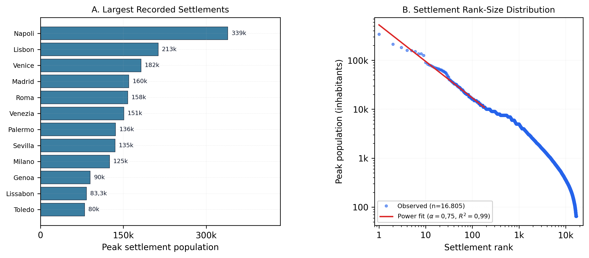

```{r setup, include=FALSE}
knitr::opts_chunk$set(echo = FALSE, warning = FALSE, message = FALSE)
source("../../_shared/template/viscount_rmd_helpers.R")
library(jsonlite)

summary_data <- fromJSON("early_modern_southern_europe_and_atlantic_islands_summary.json", simplifyVector = FALSE)
settlements_raw <- fromJSON("early_modern_southern_europe_and_atlantic_islands_settlements.json", simplifyVector = FALSE)

fmt_num_vec <- function (vals, digits = 2L) {
  vapply(as.numeric(vals), viscount_fmt_number, character(1), arg1_digits = digits)
}

fmt_pct <- function (val, digits = 1L) {
  paste0(fmt_num_vec(val, digits), "%")
}

subregion_ids <- vapply(summary_data$subregions, function (x) as.character(x$id), character(1))
subregion_names <- vapply(summary_data$subregions, function (x) as.character(x$name), character(1))
subregion_areas <- vapply(summary_data$subregions, function (x) as.numeric(x$area_km2), numeric(1))
pop_1500 <- vapply(summary_data$subregions, function (x) as.numeric(x$population[["1500"]]), numeric(1))
pop_1600 <- vapply(summary_data$subregions, function (x) as.numeric(x$population[["1600"]]), numeric(1))
pop_1700 <- vapply(summary_data$subregions, function (x) as.numeric(x$population[["1700"]]), numeric(1))
pop_1750 <- vapply(summary_data$subregions, function (x) as.numeric(x$population[["1750"]]), numeric(1))

total_area <- as.numeric(summary_data$total_area_km2)
tot_1500 <- as.numeric(summary_data$domain_totals[["1500"]])
tot_1600 <- as.numeric(summary_data$domain_totals[["1600"]])
tot_1700 <- as.numeric(summary_data$domain_totals[["1700"]])
tot_1750 <- as.numeric(summary_data$domain_totals[["1750"]])
n_settlements <- as.integer(summary_data$settlement_count)
crowd_pct <- as.numeric(summary_data$crowd_share_overall) * 100

reg_lookup <- setNames(subregion_names, subregion_ids)
sett_reg <- vapply(settlements_raw, function (x) as.character(x$region_id), character(1))
sett_prov <- vapply(settlements_raw, function (x) as.character(x$provenance_source), character(1))
sett_ctry <- vapply(settlements_raw, function (x) as.character(x$country), character(1))

get_sett_pop <- function (yr_str) {
  vapply(settlements_raw, function (x) {
    v <- x$population[[yr_str]]
    if (is.null(v)) 0 else as.numeric(v)
  }, numeric(1))
}

u_1500 <- get_sett_pop("1500")
u_1600 <- get_sett_pop("1600")
u_1700 <- get_sett_pop("1700")
u_1750 <- get_sett_pop("1750")

n_ge10k_1500 <- sum(u_1500 >= 10000)
n_ge10k_1600 <- sum(u_1600 >= 10000)
n_ge10k_1700 <- sum(u_1700 >= 10000)
n_ge10k_1750 <- sum(u_1750 >= 10000)
n_buringh <- sum(sett_prov == "Buringh_European_Urban_700_2000")
n_geonames <- sum(sett_prov == "GeoNames_Municipal_Gazetteer_Supplement")
n_portugal_stat <- sum(sett_prov == "National_Statistical_Census_Portugal")
```

```{r hero_markdown_fallback, results='asis'}
if (!knitr::is_latex_output()) {
  cat("\n\n")
}
```

# Abstract

This companion gazetteer documents the `r viscount_fmt_number(n_settlements, 0L)` geo-referenced settlements underlying the spatial reconstruction of Early Modern Southern Europe and Atlantic Islands across `r viscount_fmt_number(total_area, 1L)` km² between 1500 and 1750. Of the total inventory, `r viscount_fmt_number(n_buringh, 0L)` cities and towns (97,5%) derive from Eltjo Buringh's longitudinal European urban database, `r viscount_fmt_number(n_portugal_stat, 0L)` Madeiran municipalities derive from Portuguese institutional census registers and `r viscount_fmt_number(n_geonames, 0L)` Macaronesian entries (`r fmt_pct(crowd_pct, 2L)`) derive from GeoNames gap-filling. Settlements span nine modern territories led by Italy (388 sites), Spain (272) and Portugal (56), alongside micro-polities and borderlands in Malta, San Marino, Andorra, Genoese Corsica, Venetian Istria and Ticino. Longitudinal cities reaching at least 10k residents expanded from `r viscount_fmt_number(n_ge10k_1500, 0L)` in 1500 to `r viscount_fmt_number(n_ge10k_1600, 0L)` in 1600, receded to `r viscount_fmt_number(n_ge10k_1700, 0L)` during the seventeenth-century crisis and recovered to `r viscount_fmt_number(n_ge10k_1750, 0L)` by 1750, headed by Naples (339k), Lisbon (185k), Madrid (160k), Rome (158k) and Venice (150k).

# Spatial Architecture and Provenance

Early modern Southern Europe possessed the densest network of walled towns, diocesan seats, coastal ports and nucleated agro-towns anywhere in Europe [@DeVries1984; @Buringh2021]. Along the Po plain, Tuscany and the Roman arterial corridors, dense spacing of municipal centres reflected millennia of continuous civic life [@Benedictis2022Historical]. In the Mezzogiorno and Sicily, peasant concentration into large defensible *paesi* produced 223 recorded settlements inside a single sub-region, whereas the arid Castilian Meseta supported sparser market towns separated by wide tracts of sheep pasture and dryland grain [@Reher1990; @Alfani2013]. Out in the Atlantic, Portuguese and Castilian colonisation founded compact port towns—Funchal, Las Palmas de Gran Canaria, San Cristóbal de la Laguna and Santa Cruz de Tenerife—linked to transatlantic sea lanes [@Baxter2025Uncovering; @Ressel2020Erica].

To preserve archival integrity while ensuring coordinate coverage across every sub-region, MAGNETIC assembles the gazetteer through a strict source hierarchy. Wave 1 ingests `r viscount_fmt_number(n_buringh, 0L)` longitudinal cities and towns from Buringh's European urban dataset at fifty-year intervals from 1500 to 1750 [@Buringh2021]. Because Buringh's continental city threshold captured only four towns across Macaronesia (Funchal, Las Palmas, La Laguna and Santa Cruz de Tenerife), a Wave 4 sub-regional gap sweep added 18 insular municipal coordinate anchors—4 from Portuguese statistical records on Madeira and 14 from GeoNames across Madeira and the Canary Islands—holding the overall crowd-sourced share to `r fmt_pct(crowd_pct, 2L)`. As documented in the companion literature review, those 18 Macaronesian gap-fill records carry static municipal backfills (notably Telde at 34.514) and function exclusively as spatial habitation anchors rather than historical urban time series. Figure 1 maps all `r viscount_fmt_number(n_settlements, 0L)` settlements across the eight sub-regions, and Table 1 summarises the provenance ledger.

```{r fig_regional_map, results='asis'}
viscount_figure(
  "figures/early_modern_southern_europe_and_atlantic_islands_regional_map.png",
  caption = "Geographic distribution of the 725 early modern settlements across the eight Southern European and Atlantic Islands sub-regions (1500-1750).",
  label = "fig:regional_map"
)
```

```{r tbl_provenance_ledger, results='asis'}
prov_keys <- c(
  "Buringh_European_Urban_700_2000",
  "GeoNames_Municipal_Gazetteer_Supplement",
  "National_Statistical_Census_Portugal"
)
prov_display <- c(
  "Buringh European Urban Database (700-2000)",
  "GeoNames Municipal Gazetteer Supplement",
  "Portuguese Statistical Municipal Registry"
)
prov_counts <- vapply(prov_keys, function (pk) sum(sett_prov == pk), integer(1))
prov_role <- c(
  "Primary fifty-year longitudinal urban population series (1500-1750)",
  "Static Macaronesian municipal gap-fill coordinate anchors",
  "Madeiran municipal administrative anchors"
)

df_prov <- data.frame(
  Registry = prov_display,
  Sites = fmt_num_vec(prov_counts, 0L),
  Share = fmt_pct(prov_counts / sum(prov_counts) * 100, 2L),
  Role = prov_role,
  stringsAsFactors = FALSE
)
rownames(df_prov) <- NULL

viscount_table(
  df_prov,
  caption = "Provenance ledger of the 725-settlement Early Modern Southern Europe and Atlantic Islands gazetteer.",
  col_names = c("Source Registry", "Sites", "Share", "Analytical Role")
)
```

# Sub-Regional and Territorial Distribution

Settlement density across the eight sub-regions reflects contrasting patterns of agrarian nucleation as much as total population density. The Kingdom of Naples, Sicily, Sardinia and Malta contains 223 settlements (2,22 sites per 1.000 km²) because rural labourers across Apulia, Calabria, Campania and Sicily clustered into large nucleated agro-towns above 3k residents [@Alfani2013]. Central Italy registers 77 sites (1,01 per 1.000 km²) and Northern Italy 94 sites (0,76 per 1.000 km²), while Aragon, Catalonia, Valencia and Andalusia record 150 sites (0,73 per 1.000 km²) against 112 sites in Castile and Northern Spain (0,38 per 1.000 km²) and 47 in Mainland Portugal (0,53 per 1.000 km²). Table 2 reports sub-regional settlement counts, cities reaching 10k residents at 1600 and 1750, longitudinal urban totals and authoritative 1750 regional populations. Table 3 breaks down the 725 sites across modern European territories, reflecting early modern jurisdictional overlaps along the Alps, Istria, Corsica and the Pyrenees [@HistoGIS2022; @Niederstatter2012Pasture].

```{r tbl_subregions, results='asis'}
s_counts <- vapply(subregion_ids, function (rid) sum(sett_reg == rid), integer(1))
is_hist <- sett_prov == "Buringh_European_Urban_700_2000"
ge10_1600 <- vapply(subregion_ids, function (rid) sum(sett_reg == rid & is_hist & u_1600 >= 10000), integer(1))
ge10_1750 <- vapply(subregion_ids, function (rid) sum(sett_reg == rid & is_hist & u_1750 >= 10000), integer(1))
urb_1750_hist <- vapply(subregion_ids, function (rid) sum(u_1750[sett_reg == rid & is_hist]), numeric(1))

df_reg <- data.frame(
  Subregion = c(subregion_names, "Total Study Domain"),
  Area = fmt_num_vec(c(subregion_areas, total_area), 1L),
  Sites = fmt_num_vec(c(s_counts, sum(s_counts)), 0L),
  C1600 = fmt_num_vec(c(ge10_1600, sum(ge10_1600)), 0L),
  C1750 = fmt_num_vec(c(ge10_1750, sum(ge10_1750)), 0L),
  Urb1750 = vapply(c(urb_1750_hist, sum(urb_1750_hist)), viscount_fmt_pop, character(1)),
  Pop1750 = vapply(c(pop_1750, tot_1750), viscount_fmt_pop, character(1)),
  stringsAsFactors = FALSE
)
rownames(df_reg) <- NULL

viscount_table(
  df_reg,
  caption = "Sub-regional settlement counts, longitudinal cities of at least 10k residents (1600 and 1750), longitudinal urban sums and 1750 regional population.",
  col_names = c("Sub-region", "Area (km²)", "Sites", "10k+ (1600)", "10k+ (1750)", "1750 Urban Sum", "1750 Regional Pop.")
)
```

```{r tbl_territories, results='asis'}
ctry_names <- names(summary_data$settlements_by_country)
ctry_counts <- vapply(ctry_names, function (cn) as.integer(summary_data$settlements_by_country[[cn]]), integer(1))
ord_c <- order(ctry_counts, decreasing = TRUE)
ctry_names <- ctry_names[ord_c]
ctry_counts <- ctry_counts[ord_c]

ctry_10k_1750 <- vapply(ctry_names, function (cn) sum(sett_ctry == cn & is_hist & u_1750 >= 10000), integer(1))
ctry_urb_1750 <- vapply(ctry_names, function (cn) sum(u_1750[sett_ctry == cn & is_hist]), numeric(1))

df_terr <- data.frame(
  Territory = c(ctry_names, "Total Study Domain"),
  Sites = fmt_num_vec(c(ctry_counts, sum(ctry_counts)), 0L),
  Share = fmt_pct(c(ctry_counts / sum(ctry_counts) * 100, 100), 2L),
  C1750 = fmt_num_vec(c(ctry_10k_1750, sum(ctry_10k_1750)), 0L),
  Urb1750 = vapply(c(ctry_urb_1750, sum(ctry_urb_1750)), viscount_fmt_pop, character(1)),
  stringsAsFactors = FALSE
)
rownames(df_terr) <- NULL

viscount_table(
  df_terr,
  caption = "Distribution of the 725 Early Modern Southern European settlements across modern European territories.",
  col_names = c("Modern Territory", "Total Sites", "Share", "10k+ Cities (1750)", "1750 Longitudinal Urban Sum")
)
```

# Principal Cities, Island Capitals and Borderlands

Across the upper tail of the urban hierarchy, Table 4 lists the 25 largest longitudinal cities between 1500 and 1750, ranked by peak historical population and excluding static Macaronesian gap-fill entries. The table brings out the sharp seventeenth-century divergence between state capitals and declining Renaissance manufacturing centres. Naples dominated the Mediterranean throughout the entire 250-year span, climbing from 125k to 339k despite losing perhaps half its residents in the 1656 plague [@Alfani2013]. Lisbon nearly tripled from 65k to 185k, Madrid multiplied twelvefold from 13k to 160k, Rome nearly tripled from 55k to 158k and Turin more than quadrupled from 15k to 69k. Simultaneously, former Iberian interior giants withered: Toledo plunged from 80k in 1600 to 20k in 1750, Valladolid fell from 41k to 19k and Seville dropped from 135k to 66k as Atlantic commerce shifted downriver to Cádiz (2k to 60k) [@Reher1990; @DeVries1984]. In Northern Italy, Brescia (49k to 30k) and Cremona (40k to 24k) never regained their 1500 peaks after the 1629-1631 epidemic.

```{r tbl_top25, results='asis'}
top_list <- summary_data$top_settlements
top_hist <- Filter(function (x) identical(as.character(x$provenance_source), "Buringh_European_Urban_700_2000"), top_list)
top_25 <- top_hist[seq_len(min(25L, length(top_hist)))]

df_top25 <- data.frame(
  City = vapply(top_25, function (x) as.character(x$name), character(1)),
  Territory = vapply(top_25, function (x) as.character(x$country), character(1)),
  P1500 = vapply(top_25, function (x) viscount_fmt_pop(as.numeric(x$population[["1500"]])), character(1)),
  P1600 = vapply(top_25, function (x) viscount_fmt_pop(as.numeric(x$population[["1600"]])), character(1)),
  P1700 = vapply(top_25, function (x) viscount_fmt_pop(as.numeric(x$population[["1700"]])), character(1)),
  P1750 = vapply(top_25, function (x) viscount_fmt_pop(as.numeric(x$population[["1750"]])), character(1)),
  PeakYr = vapply(top_25, function (x) as.character(x$peak_year), character(1)),
  PeakPop = vapply(top_25, function (x) viscount_fmt_pop(as.numeric(x$peak_pop)), character(1)),
  stringsAsFactors = FALSE
)
rownames(df_top25) <- NULL

viscount_table(
  df_top25,
  caption = "Twenty-five largest longitudinal cities in Early Modern Southern Europe ranked by peak population (1500-1750).",
  col_names = c("City", "Territory", "1500", "1600", "1700", "1750", "Peak Yr", "Peak Pop.")
)
```

Finally, Table 5 highlights the longitudinal maritime capitals of the Atlantic islands and Hospitaller Malta alongside the micro-polity and borderland towns intersecting the northern and maritime fringes of the study mask. Valletta—absent in 1500 prior to its foundation by Grand Master Jean Parisot de Valette in 1566—rose rapidly to 21k in 1600 and 27k by 1750 as the heavily fortified headquarters of the Knights of St John [@Bozkurt2022Plague; @Ressel2020Erica]. Funchal on Madeira and the three Canary capitals (San Cristóbal de la Laguna, Las Palmas de Gran Canaria and Santa Cruz de Tenerife) expanded steadily from 1k outposts in 1500 to flourishing 6k-9k Atlantic commercial towns by 1750.

```{r tbl_islands_micro, results='asis'}
featured_names <- c(
  "Valletta",
  "San Cristobal de la Laguna",
  "Las Palmas de Gran Canaria",
  "Santa Cruz de Tenerife",
  "Funchal",
  "Gorizia",
  "Acquaviva",
  "Koper",
  "Bonifacio",
  "Lugano",
  "Andorra la Vella"
)

feat_rows <- Filter(function (x) as.character(x$name) %in% featured_names, settlements_raw)
feat_ord <- match(vapply(feat_rows, function (x) as.character(x$name), character(1)), featured_names)
feat_rows <- feat_rows[order(feat_ord)]

fmt_opt_pop <- function (x, yr_str) {
  v <- x$population[[yr_str]]
  if (is.null(v)) "-" else viscount_fmt_pop(as.numeric(v))
}

df_feat <- data.frame(
  Settlement = vapply(feat_rows, function (x) as.character(x$name), character(1)),
  Territory = vapply(feat_rows, function (x) as.character(x$country), character(1)),
  Lat = vapply(feat_rows, function (x) viscount_fmt_number(as.numeric(x$coords[[1]]), 2L), character(1)),
  Lon = vapply(feat_rows, function (x) viscount_fmt_number(as.numeric(x$coords[[2]]), 2L), character(1)),
  P1500 = vapply(feat_rows, fmt_opt_pop, character(1), yr_str = "1500"),
  P1600 = vapply(feat_rows, fmt_opt_pop, character(1), yr_str = "1600"),
  P1700 = vapply(feat_rows, fmt_opt_pop, character(1), yr_str = "1700"),
  P1750 = vapply(feat_rows, fmt_opt_pop, character(1), yr_str = "1750"),
  stringsAsFactors = FALSE
)
rownames(df_feat) <- NULL

viscount_table(
  df_feat,
  caption = "Longitudinal island capitals, Hospitaller Malta and borderland micro-polity centres in the Southern European gazetteer (1500-1750).",
  col_names = c("Settlement", "Territory", "Lat.", "Lon.", "1500", "1600", "1700", "1750")
)
```

# Sources
