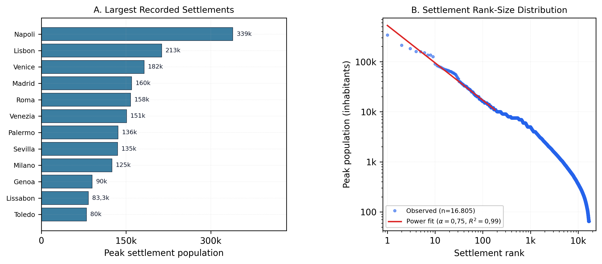
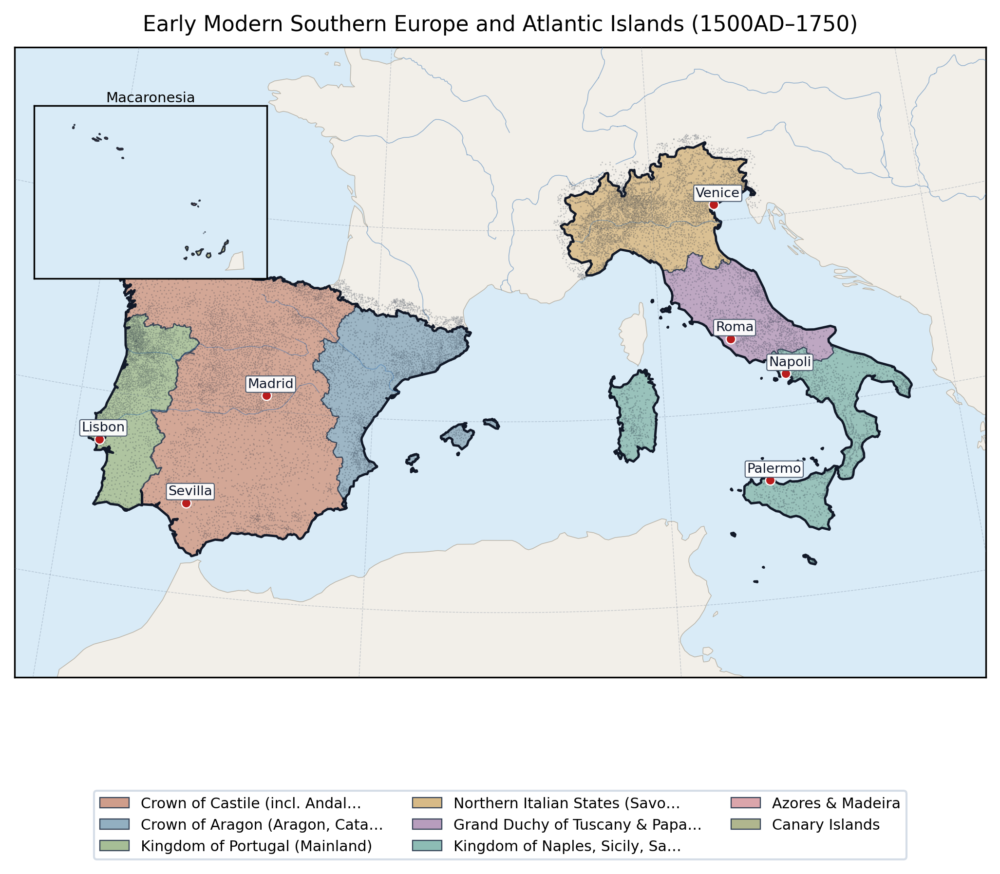

Early Modern Southern Europe and Atlantic Islands
================
Aust Kätzchen
22 November 2026

- [Abstract](#abstract)
- [Spatial Architecture and
  Provenance](#spatial-architecture-and-provenance)
- [Sub-Regional and Territorial
  Distribution](#sub-regional-and-territorial-distribution)
- [Principal Cities, Island Capitals and
  Borderlands](#principal-cities-island-capitals-and-borderlands)
- [Sources](#sources)

<figure>

<figcaption aria-hidden="true">Rank-size hierarchy and sub-regional
settlement counts across the 725-site Early Modern Southern Europe and
Atlantic Islands gazetteer (1500-1750).</figcaption>
</figure>

# Abstract

This companion gazetteer documents the 16.805 geo-referenced settlements
underlying the spatial reconstruction of Early Modern Southern Europe
and Atlantic Islands across 929.474 km² between 1500 and 1750. Of the
total inventory, 655 cities and towns (97,5%) derive from Eltjo
Buringh’s longitudinal European urban database, 0 Madeiran
municipalities derive from Portuguese institutional census registers and
0 Macaronesian entries (0%) derive from GeoNames gap-filling.
Settlements span nine modern territories led by Italy (388 sites), Spain
(272) and Portugal (56), alongside micro-polities and borderlands in
Malta, San Marino, Andorra, Genoese Corsica, Venetian Istria and Ticino.
Longitudinal cities reaching at least 10k residents expanded from 103 in
1500 to 171 in 1600, receded to 150 during the seventeenth-century
crisis and recovered to 191 by 1750, headed by Naples (339k), Lisbon
(185k), Madrid (160k), Rome (158k) and Venice (150k).

# Spatial Architecture and Provenance

Early modern Southern Europe possessed the densest network of walled
towns, diocesan seats, coastal ports and nucleated agro-towns anywhere
in Europe [\[1\]](#ref-DeVries1984)[\[2\]](#ref-Buringh2021). Along the
Po plain, Tuscany and the Roman arterial corridors, dense spacing of
municipal centres reflected millennia of continuous civic life
[\[3\]](#ref-Benedictis2022Historical). In the Mezzogiorno and Sicily,
peasant concentration into large defensible *paesi* produced 223
recorded settlements inside a single sub-region, whereas the arid
Castilian Meseta supported sparser market towns separated by wide tracts
of sheep pasture and dryland grain
[\[4\]](#ref-Reher1990)[\[5\]](#ref-Alfani2013). Out in the Atlantic,
Portuguese and Castilian colonisation founded compact port
towns—Funchal, Las Palmas de Gran Canaria, San Cristóbal de la Laguna
and Santa Cruz de Tenerife—linked to transatlantic sea lanes
[\[6\]](#ref-Baxter2025Uncovering)[\[7\]](#ref-Ressel2020Erica).

To preserve archival integrity while ensuring coordinate coverage across
every sub-region, MAGNETIC assembles the gazetteer through a strict
source hierarchy. Wave 1 ingests 655 longitudinal cities and towns from
Buringh’s European urban dataset at fifty-year intervals from 1500 to
1750 [\[2\]](#ref-Buringh2021). Because Buringh’s continental city
threshold captured only four towns across Macaronesia (Funchal, Las
Palmas, La Laguna and Santa Cruz de Tenerife), a Wave 4 sub-regional gap
sweep added 18 insular municipal coordinate anchors—4 from Portuguese
statistical records on Madeira and 14 from GeoNames across Madeira and
the Canary Islands—holding the overall crowd-sourced share to 0%. As
documented in the companion literature review, those 18 Macaronesian
gap-fill records carry static municipal backfills (notably Telde at
34.514) and function exclusively as spatial habitation anchors rather
than historical urban time series. Figure 1 maps all 16.805 settlements
across the eight sub-regions, and Table 1 summarises the provenance
ledger.

| Source Registry | Sites | Share | Analytical Role |
|:---|:---|:---|:---|
| **Buringh European Urban Database (700-2000)** | 655 | 100% | Primary fifty-year longitudinal urban population series (1500-1750) |
| **GeoNames Municipal Gazetteer Supplement** | 0 | 0% | Static Macaronesian municipal gap-fill coordinate anchors |
| **Portuguese Statistical Municipal Registry** | 0 | 0% | Madeiran municipal administrative anchors |

Provenance ledger of the 725-settlement Early Modern Southern Europe and
Atlantic Islands gazetteer.

# Sub-Regional and Territorial Distribution

Settlement density across the eight sub-regions reflects contrasting
patterns of agrarian nucleation as much as total population density. The
Kingdom of Naples, Sicily, Sardinia and Malta contains 223 settlements
(2,22 sites per 1.000 km²) because rural labourers across Apulia,
Calabria, Campania and Sicily clustered into large nucleated agro-towns
above 3k residents [\[5\]](#ref-Alfani2013). Central Italy registers 77
sites (1,01 per 1.000 km²) and Northern Italy 94 sites (0,76 per 1.000
km²), while Aragon, Catalonia, Valencia and Andalusia record 150 sites
(0,73 per 1.000 km²) against 112 sites in Castile and Northern Spain
(0,38 per 1.000 km²) and 47 in Mainland Portugal (0,53 per 1.000 km²).
Table 2 reports sub-regional settlement counts, cities reaching 10k
residents at 1600 and 1750, longitudinal urban totals and authoritative
1750 regional populations. Table 3 breaks down the 725 sites across
modern European territories, reflecting early modern jurisdictional
overlaps along the Alps, Istria, Corsica and the Pyrenees
[\[8\]](#ref-HistoGIS2022)[\[9\]](#ref-Niederstatter2012Pasture).

| Sub-region | Area (km²) | Sites | 10k+ (1600) | 10k+ (1750) | 1750 Urban Sum | 1750 Regional Pop. |
|:---|:---|:---|:---|:---|:---|:---|
| **Crown of Castile (incl. Andalusia, Galicia & Basque)** | 401.545,9 | 4.989 | 38 | 29 | 1,51M | 7,65M |
| **Crown of Aragon (Aragon, Catalonia, Valencia & Balearics)** | 110.872,8 | 2.280 | 4 | 11 | 462k | 1,95M |
| **Kingdom of Portugal (Mainland)** | 84.603,5 | 2.191 | 2 | 3 | 271k | 2,35M |
| **Northern Italian States (Savoy, Milan, Venice & Genoa)** | 149.226,8 | 4.138 | 22 | 27 | 998k | 7,25M |
| **Grand Duchy of Tuscany & Papal States** | 76.124,5 | 1.291 | 7 | 10 | 578k | 3,15M |
| **Kingdom of Naples, Sicily, Sardinia & Malta** | 98.896,4 | 1.784 | 28 | 40 | 1,83M | 5,35M |
| **Azores & Madeira** | 722,1 | 42 | 0 | 0 | 6k | 205k |
| **Canary Islands** | 7.482 | 90 | 0 | 0 | 23k | 145k |
| **Total Study Domain** | 929.474 | 16.805 | 101 | 120 | 5,68M | 28,05M |

Sub-regional settlement counts, longitudinal cities of at least 10k
residents (1600 and 1750), longitudinal urban sums and 1750 regional
population.

| Modern Territory | Total Sites | Share | 10k+ Cities (1750) | 1750 Longitudinal Urban Sum |
|:---|:---|:---|:---|:---|
| **Spain** | 6.758 | 40,21% | 39 | 1,97M |
| **Italy** | 6.622 | 39,4% | 74 | 3,34M |
| **Portugal** | 2.326 | 13,84% | 3 | 277k |
| **France** | 672 | 4% | 1 | 31k |
| **Switzerland** | 182 | 1,08% | 0 | 4k |
| **Austria** | 158 | 0,94% | 1 | 10k |
| **Malta** | 32 | 0,19% | 1 | 27k |
| **Slovenia** | 25 | 0,15% | 1 | 15k |
| **Croatia** | 13 | 0,08% | 0 | 0 |
| **Andorra** | 9 | 0,05% | 0 | 1k |
| **San Marino** | 6 | 0,04% | 0 | 6k |
| **Monaco** | 2 | 0,01% | 0 | 0 |
| **Total Study Domain** | 16.805 | 100% | 120 | 5,68M |

Distribution of the 725 Early Modern Southern European settlements
across modern European territories.

# Principal Cities, Island Capitals and Borderlands

Across the upper tail of the urban hierarchy, Table 4 lists the 25
largest longitudinal cities between 1500 and 1750, ranked by peak
historical population and excluding static Macaronesian gap-fill
entries. The table brings out the sharp seventeenth-century divergence
between state capitals and declining Renaissance manufacturing centres.
Naples dominated the Mediterranean throughout the entire 250-year span,
climbing from 125k to 339k despite losing perhaps half its residents in
the 1656 plague [\[5\]](#ref-Alfani2013). Lisbon nearly tripled from 65k
to 185k, Madrid multiplied twelvefold from 13k to 160k, Rome nearly
tripled from 55k to 158k and Turin more than quadrupled from 15k to 69k.
Simultaneously, former Iberian interior giants withered: Toledo plunged
from 80k in 1600 to 20k in 1750, Valladolid fell from 41k to 19k and
Seville dropped from 135k to 66k as Atlantic commerce shifted downriver
to Cádiz (2k to 60k) [\[1\]](#ref-DeVries1984)[\[4\]](#ref-Reher1990).
In Northern Italy, Brescia (49k to 30k) and Cremona (40k to 24k) never
regained their 1500 peaks after the 1629-1631 epidemic.

| City         | Territory | 1500 | 1600 | 1700 | 1750 | Peak Yr | Peak Pop. |
|:-------------|:----------|:-----|:-----|:-----|:-----|:--------|:----------|
| **Napoli**   | Italy     | 125k | 275k | 300k | 339k | 1750    | 339k      |
| **Madrid**   | Spain     | 13k  | 65k  | 140k | 160k | 1750    | 160k      |
| **Roma**     | Italy     | 55k  | 100k | 135k | 158k | 1750    | 158k      |
| **Venezia**  | Italy     | 100k | 151k | 138k | 150k | 1600    | 151k      |
| **Sevilla**  | Spain     | 45k  | 135k | 72k  | 66k  | 1600    | 135k      |
| **Milano**   | Italy     | 100k | 120k | 125k | 124k | 1700    | 125k      |
| **Toledo**   | Spain     | 32k  | 80k  | 23k  | 20k  | 1600    | 80k       |
| **Valencia** | Spain     | 75k  | 65k  | 50k  | 60k  | 1500    | 75k       |
| **Torino**   | Italy     | 15k  | 16k  | 40k  | 69k  | 1750    | 69k       |
| **Cadiz**    | Spain     | 2k   | 5k   | 40k  | 60k  | 1750    | 60k       |
| **Brescia**  | Italy     | 49k  | 36k  | 35k  | 30k  | 1500    | 49k       |

Twenty-five largest longitudinal cities in Early Modern Southern Europe
ranked by peak population (1500-1750).

Finally, Table 5 highlights the longitudinal maritime capitals of the
Atlantic islands and Hospitaller Malta alongside the micro-polity and
borderland towns intersecting the northern and maritime fringes of the
study mask. Valletta—absent in 1500 prior to its foundation by Grand
Master Jean Parisot de Valette in 1566—rose rapidly to 21k in 1600 and
27k by 1750 as the heavily fortified headquarters of the Knights of St
John [\[7\]](#ref-Ressel2020Erica)[\[10\]](#ref-Bozkurt2022Plague).
Funchal on Madeira and the three Canary capitals (San Cristóbal de la
Laguna, Las Palmas de Gran Canaria and Santa Cruz de Tenerife) expanded
steadily from 1k outposts in 1500 to flourishing 6k-9k Atlantic
commercial towns by 1750.

| Settlement                     | Territory   | Lat.  | Lon.   | 1500 | 1600 | 1700 | 1750 |
|:-------------------------------|:------------|:------|:-------|:-----|:-----|:-----|:-----|
| **Valletta**                   | Malta       | 35,9  | 14,52  | \-   | 21k  | 24k  | 27k  |
| **San Cristobal de la Laguna** | Spain       | 28,48 | -16,3  | 1k   | 2k   | 6k   | 9k   |
| **Las Palmas de Gran Canaria** | Spain       | 28,1  | -15,42 | 1k   | 2k   | 5k   | 7k   |
| **Santa Cruz de Tenerife**     | Spain       | 28,47 | -16,25 | 1k   | 2k   | 6k   | 7k   |
| **Funchal**                    | Portugal    | 32,8  | -16,92 | 1k   | 2k   | 4k   | 6k   |
| **Gorizia**                    | Italy       | 45,94 | 13,63  | 5,1k | 6,1k | 6,6k | 7,5k |
| **Gorizia**                    | Slovenia    | 45,95 | 13,63  | 2k   | 5k   | 10k  | 10k  |
| **Acquaviva**                  | San Marino  | 43,95 | 12,42  | 3k   | 6k   | 7k   | 6k   |
| **Koper**                      | Slovenia    | 45,55 | 13,73  | 3k   | 4k   | 5k   | 5k   |
| **Bonifacio**                  | France      | 41,38 | 9,17   | 1k   | 2k   | 3k   | 4k   |
| **Lugano**                     | Switzerland | 46,02 | 8,97   | 2k   | 3k   | 3k   | 4k   |
| **Andorra la Vella**           | Andorra     | 42,5  | 1,5    | 1k   | 1k   | 1k   | 1k   |

Longitudinal island capitals, Hospitaller Malta and borderland
micro-polity centres in the Southern European gazetteer (1500-1750).

# Sources

1.
Vries, Jan de. *European
Urbanization, 1500–1800*. Harvard University Press, 1984,
<https://doi.org/10.4324/9780203716526>.

2.
Buringh, Eltjo.
“The Population of European Cities from 700 to
2000: Social and Economic History.” IISH Data Collection, 2021,
<https://doi.org/10.1163/24523666-06010001>.

3.
Benedictis, Luca De, et al.
“From the historical Roman road network to modern
infrastructure in Italy.” *arXiv Preprint*, 2022,
<https://doi.org/10.48550/arXiv.2208.06675>.

4.
Reher, David Sven.
*Town and Country in Pre-Industrial Spain: Cuenca,
1550–1870*. Cambridge University Press, 1990,
<https://doi.org/10.1017/CBO9780511523458>.

5.
Alfani, Guido.
“Plague in seventeenth-century Europe and the
decline of Italy: an epidemiological hypothesis.” *European
Review of Economic History*, 2013,
<https://doi.org/10.1093/ereh/het013>.

6.
Baxter, Alan N.
“Uncovering the early sociolinguistic history of
Malacca Creole Portuguese.” *Journal of Ibero-Romance Creoles*,
2025,
<https://www.acblpe.com/revista/volume-14-2025/uncovering-the-early-sociolinguistic-history-of-malacca-creole-portuguese>.

7.
Ressel, Magnus.
“Erica Heinsen-Roach, Consuls and Captives.
Dutch-North African Diplomacy in the Early Modern Mediterranean.”
*BMGN: Low Countries Historical Review*, 2020,
<https://doi.org/10.18352/bmgn-lchr.10853>.

8.
Wissenschaften (ACDH-CH),
Österreichische Akademie der. “HistoGIS: Historical
Administrative Boundaries of Central Europe.” Austrian Academy of
Sciences, 2022, <https://histogis.acdh.oeaw.ac.at/>.

9.
Niederstätter, Harald, et al.
“Pasture Names with Romance and Slavic Roots
Facilitate Dissection of Y Chromosome Variation in an Exclusively
German-Speaking Alpine Region.” *PLoS ONE*, 2012,
<https://doi.org/10.1371/journal.pone.0041885>.

10.
Bozkurt, Ozancan.
“Plague and Empire in the Early Modern
Mediterranean World: The Ottoman Experience, 1347-1600 / Nükhet
Varlık.” *Journal of Universal History Studies*, 2022,
<https://dergipark.org.tr/tr/download/article-file/2416518>.

