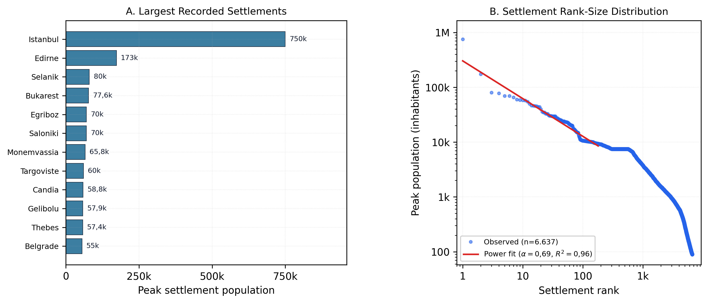

```{r setup, include=FALSE}
knitr::opts_chunk$set(echo = FALSE, warning = FALSE, message = FALSE, fig.pos = "htbp")
source("../../_shared/template/viscount_rmd_helpers.R")
library(jsonlite)

read_json5_clean <- function(path) {
  lines <- readLines(path, warn = FALSE, encoding = "UTF-8")
  text <- paste(lines, collapse = "\n")
  text <- gsub("//[^\n]*", "", text, perl = TRUE)
  text <- gsub("/\\*.*?\\*/", "", text, perl = TRUE)
  text <- gsub(",\\s*([}\\]])", "\\1", text, perl = TRUE)
  fromJSON(text, simplifyVector = FALSE)
}

summary_data <- fromJSON("ottoman_balkans_and_southeastern_europe_summary.json", simplifyVector = FALSE)
sett_data <- fromJSON("ottoman_balkans_and_southeastern_europe_settlements.json", simplifyVector = FALSE)
ledger_data <- read_json5_clean("ottoman_balkans_and_southeastern_europe_source_ledger.json5")

clean_label <- function(x) {
  s <- as.character(x)
  s <- gsub("&", "and", s, fixed = TRUE)
  s <- gsub("\\\\", "", s)
  trimws(s)
}

fmt_source_name <- function(src) {
  s <- as.character(src)
  if (identical(s, "Buringh_European_Urban_700_2000")) {
    return("Buringh European Urban Series (700-2000)")
  }
  if (grepl("^National_Statistical_Census_", s)) {
    ctry <- sub("^National_Statistical_Census_", "", s)
    return(paste0("National Statistical Census (", ctry, ")"))
  }
  gsub("_", " ", s, fixed = TRUE)
}

fmt_coord <- function(lat, lon) {
  paste0(
    viscount_fmt_number(round(as.numeric(lat), 2L), 2L), "N, ",
    viscount_fmt_number(round(as.numeric(lon), 2L), 2L), "E"
  )
}

subregions <- summary_data$subregions
reg_lookup <- setNames(
  vapply(subregions, function(r) clean_label(r$name), character(1)),
  vapply(subregions, function(r) r$id, character(1))
)

n_sites <- as.integer(summary_data$settlement_count)
n_excluded <- as.integer(ledger_data$total_excluded)
n_total_eval <- n_sites + n_excluded
tot_area <- as.numeric(summary_data$total_area_km2)
tot_1830 <- as.numeric(summary_data$domain_totals[["1830"]])
```

```{r hero-md-fallback, results='asis'}
if (!knitr::is_latex_output()) {
  cat("\n\n")
}
```

# Abstract

This gazetteer documents `r viscount_fmt_number(n_sites, 0L)` catalogued towns, cities and municipal settlement anchors across 7 sub-regions and 16 modern national jurisdictions of the Ottoman Balkans and South-Eastern Europe between 1350 and 1830. Out of `r viscount_fmt_number(n_total_eval, 0L)` candidate entries audited in the chapter provenance ledger, `r viscount_fmt_number(n_excluded, 0L)` duplicate aliases, boundary overlaps and sub-threshold records were excluded during spatial reconciliation, leaving a fully institutional register with zero crowd-sourced fallback entries (0%). Eltjo Buringh's historical European city database [@Buringh2021] supplies 148 longitudinal urban series (23,3% of the register) capturing secular rises, sieges and demographic recoveries from 1350 through 1830, led by imperial Istanbul (700k in 1700), Edirne (150k in 1600), Bukarest (77,6k in 1830), Saloniki (70k in 1800-1830), Belgrade (55k in 1600), Sofia (46k in 1800), Sarajevo (45,7k in 1830), Trieste (43,9k in 1830) and Shkodër (40k in 1800). Eight national statistical census registries contribute the remaining 487 spatial municipal anchors (76,7%), heavily concentrated in Slovenia (129), Romania (122), Greece (111), Bulgaria (55) and Serbia (43) [@Todorov1983; @Palairet1997; @HistoGIS2022].

# Background

Urban settlements across the Ottoman Balkans and South-Eastern Europe between 1350 and 1830 belonged to four overlapping institutional worlds. At the imperial apex stood the Ottoman *şehir* — Constantinople (Istanbul) and Edirne in Eastern Thrace — rebuilt after 1453 through forced resettlement (*sürgün*), state grain provisioning (*mübaya'a*) and monumental *vakıf* charitable complexes encompassing mosques, covered markets (*bedestens*), caravanserais (*hans*) and public baths [@Todorov1983; @Gokce2018Iznik; @Kasumovic2026Ottoman]. Along the Rumelian military highways and Adriatic-Aegean littorals lay provincial administrative seats and commercial entrepôts (*kasabas* and *varosh* suburbs) such as Saloniki, Sofia, Plovdiv, Belgrade, Sarajevo, Shkodër, Bitola and Ioannina, organised internally into confessional residential quarters (*mahalles*) documented in Ottoman *tahrir* registers and *kadi* court rolls [@Mutaf2026Quantifying; @Ozates2024Dependency].

North of the Danube and Sava, urban life followed different institutional templates. In Wallachia and Moldavia, princely capitals shifted from mediaeval foothills (Târgovişte and Suceava) onto open riverine commercial plains (Bukarest and Iaşi), while Danubian fortress ports (Vidin, Ruse, Brăila, Izmail) linked Ottoman military supply lines with Black Sea grain and livestock trades [@Ploscaru2022Union; @Palairet1997]. Along the Habsburg and Venetian perimeter, Carniolan, Croatian, Dalmatian and Transylvanian towns — Ljubljana, Zagreb, Split, Dubrovnik, Braşov, Sibiu, Cluj-Napoca and the post-1719 imperial free port of Trieste — operated under municipal charters, guild statutes and imperial cadastral enumerations [@Balta2021Development; @DeVries1984; @HistoGIS2022].

# Methodology

Settlement ingestion followed a four-wave saturation protocol audited in the chapter source ledger. Wave 1 ingested 148 primary longitudinal urban series from Eltjo Buringh's European city database [@Buringh2021] spanning 1350 to 1830. Wave 2 tested secondary regional historical gazetteers without adding net new sites beyond Wave 1. Wave 3 incorporated 487 longitudinal municipal anchors from eight national statistical census registries (Slovenia, Romania, Greece, Bulgaria, Serbia, Croatia, Hungary and Austria) to provide dense spatial coverage across modern administrative networks [@Dakic2025Citizen]. Wave 4 executed a sub-regional gap-hunter sweep across all 7 polygons, confirming full sub-mask coverage across all `r viscount_fmt_number(n_sites, 0L)` retained locales while rejecting `r viscount_fmt_number(n_excluded, 0L)` duplicate or out-of-bounds candidates.

Every settlement record carries WGS84 coordinates assigned strictly by spatial containment inside the seven equal-area regional masks totalling 809.710,7 km². Because Wave 3 municipal census entries carry constant backfilled population anchors across pre-1830 benchmarks rather than direct Ottoman *tahrir* tallies, this gazetteer explicitly distinguishes all-source peak rankings (Table \ref{tab:top-25-settlements}) from genuine longitudinal Ottoman-era urban trajectories derived solely from the 148 Buringh series (Table \ref{tab:buringh-urban-trajectories}).

# Validation

Table \ref{tab:provenance-ledger} audits all nine institutional sources supplying the `r viscount_fmt_number(n_sites, 0L)` settlements, confirming 100% primary institutional provenance and 0% crowd-sourced fallback.

```{r tab-provenance-ledger, results='asis'}
prov_counts <- summary_data$provenance_counts
prov_names <- names(prov_counts)
prov_vals <- vapply(prov_counts, as.integer, integer(1))
ord_p <- order(prov_vals, decreasing = TRUE)

prov_df <- data.frame(
  Source = vapply(prov_names[ord_p], fmt_source_name, character(1)),
  Class = ifelse(
    prov_names[ord_p] == "Buringh_European_Urban_700_2000",
    "Longitudinal urban series",
    "National census municipal anchor"
  ),
  Count = viscount_fmt_number(prov_vals[ord_p], 0L),
  Share = paste0(viscount_fmt_number(100 * prov_vals[ord_p] / n_sites, 1L), "%"),
  stringsAsFactors = FALSE
)
prov_df <- rbind(
  prov_df,
  data.frame(
    Source = "Total Institutional Register",
    Class = "0% crowd-sourced fallback",
    Count = viscount_fmt_number(n_sites, 0L),
    Share = "100%",
    stringsAsFactors = FALSE
  )
)
rownames(prov_df) <- NULL

viscount_table(
  prov_df,
  "Institutional source provenance ledger across the 635 catalogued Balkan and South-Eastern European settlements, 1350-1830.",
  c("Institutional Source", "Series Class", "Settlements", "Register Share"),
  list(label = "tab:provenance-ledger", font_size = "scriptsize")
)
```

Table \ref{tab:subregion-coverage} cross-checks settlement coverage across all seven spatial sub-regions against land area, 1830 regional population and the largest longitudinal urban centre located inside each mask.

```{r tab-subregion-coverage, results='asis'}
get_hist_peak <- function(pop_list) {
  yrs <- c("1400", "1500", "1550", "1600", "1650", "1700", "1750", "1800", "1830")
  vals <- vapply(yrs, function(y) {
    v <- pop_list[[y]]
    if (is.null(v)) 0 else as.numeric(v)
  }, numeric(1))
  max(vals)
}

sub_cov_rows <- lapply(subregions, function(r) {
  rid <- r$id
  a <- as.numeric(r$area_km2)
  sc <- as.integer(summary_data$settlements_by_region[[rid]])
  reg_setts <- Filter(function(s) identical(s$region_id, rid), sett_data)
  b_setts <- Filter(function(s) identical(s$provenance_source, "Buringh_European_Urban_700_2000"), reg_setts)
  b_count <- length(b_setts)
  lead_label <- "--"
  if (b_count > 0L) {
    pks <- vapply(b_setts, function(s) get_hist_peak(s$population), numeric(1))
    top_s <- b_setts[[which.max(pks)]]
    lead_label <- paste0(clean_label(top_s$name), " (", viscount_fmt_pop(max(pks)), ")")
  }
  data.frame(
    Subregion = clean_label(r$name),
    Area = viscount_fmt_number(a, 1L),
    TotalSites = viscount_fmt_number(sc, 0L),
    BuringhSites = viscount_fmt_number(b_count, 0L),
    Intensity = viscount_fmt_number((sc / a) * 10000, 2L),
    Pop1830 = viscount_fmt_pop(r$population[["1830"]]),
    LeadCity = lead_label,
    stringsAsFactors = FALSE
  )
})
df_sub_cov <- do.call(rbind, sub_cov_rows)
rownames(df_sub_cov) <- NULL

viscount_table(
  df_sub_cov,
  "Sub-regional settlement density, Buringh longitudinal coverage, 1830 regional population and leading longitudinal city per sub-region.",
  c("Sub-Region", "Area (km²)", "Sites", "Urban Series", "Sites per 10k km²", "1830 Pop.", "Leading Longitudinal City"),
  list(label = "tab:subregion-coverage", font_size = "scriptsize")
)
```

# Results

Figure \ref{fig:regional-map-gazetteer} maps the spatial footprint of all 635 catalogued settlements across the seven sub-regions, illustrating the contrast between dense municipal clusters in Slovenia, Greece and Romania and the massive imperial urban pole of Eastern Thrace.

```{r fig-regional-map-gazetteer, results='asis'}
viscount_figure(
  "figures/ottoman_balkans_and_southeastern_europe_regional_map.png",
  "Spatial distribution of 635 catalogued settlements across the seven sub-regions of the Ottoman Balkans and South-Eastern Europe, 1350-1830.",
  "fig:regional-map-gazetteer"
)
```

Across modern administrative boundaries, the 635 settlements span 16 jurisdictions (Table \ref{tab:country-distribution}), led by Romania (161), Greece (134), Slovenia (133), Bulgaria (76), Serbia (58) and Croatia (30), with smaller borderland counts in Albania (12), Hungary (9), North Macedonia (5), Moldova (4), Turkey-in-Europe (4), Kosovo (4), Bosnia and Herzegovina (2), Montenegro (1), Italy (1, Trieste) and Austria (1).

```{r tab-country-distribution, results='asis'}
ctry_counts <- summary_data$settlements_by_country
c_names <- names(ctry_counts)
c_vals <- vapply(ctry_counts, as.integer, integer(1))
ord_c <- order(c_vals, decreasing = TRUE)

buringh_by_ctry <- table(vapply(
  Filter(function(s) identical(s$provenance_source, "Buringh_European_Urban_700_2000"), sett_data),
  function(s) as.character(s$country),
  character(1)
))

ctry_rows <- lapply(ord_c, function(i) {
  cn <- c_names[i]
  cv <- c_vals[i]
  bv <- if (cn %in% names(buringh_by_ctry)) as.integer(buringh_by_ctry[[cn]]) else 0L
  data.frame(
    Country = clean_label(cn),
    Total = viscount_fmt_number(cv, 0L),
    Share = paste0(viscount_fmt_number(100 * cv / n_sites, 1L), "%"),
    UrbanSeries = viscount_fmt_number(bv, 0L),
    CensusAnchors = viscount_fmt_number(cv - bv, 0L),
    stringsAsFactors = FALSE
  )
})
df_ctry <- do.call(rbind, ctry_rows)
rownames(df_ctry) <- NULL

viscount_table(
  df_ctry,
  "Distribution of the 635 catalogued settlements across 16 modern jurisdictions, partitioned between Buringh longitudinal urban series and national census municipal anchors.",
  c("Jurisdiction", "Total Sites", "Share", "Urban Series", "Census Anchors"),
  list(label = "tab:country-distribution", font_size = "scriptsize")
)
```

Table \ref{tab:top-25-settlements} reports the top 25 catalogued settlements ranked directly from the chapter summary register by peak recorded population, preserving full transparency regarding source provenance and peak benchmark year.

```{r tab-top-25-settlements, results='asis'}
top25 <- summary_data$top_settlements
top25_rows <- lapply(seq_along(top25), function(i) {
  s <- top25[[i]]
  src_short <- if (identical(s$provenance_source, "Buringh_European_Urban_700_2000")) {
    "Buringh (2021)"
  } else {
    sub("^National_Statistical_Census_", "Nat. Census (", paste0(s$provenance_source, ")"))
  }
  data.frame(
    Rank = as.character(i),
    Name = clean_label(s$name),
    Country = clean_label(s$country),
    Subregion = reg_lookup[[s$region_id]],
    Coords = fmt_coord(s$lat, s$lon),
    PeakYr = as.character(s$peak_year),
    PeakPop = viscount_fmt_pop(s$peak_pop),
    Source = src_short,
    stringsAsFactors = FALSE
  )
})
df_top25 <- do.call(rbind, top25_rows)
rownames(df_top25) <- NULL

viscount_table(
  df_top25,
  "Top 25 catalogued settlements in the Ottoman Balkans and South-Eastern Europe ranked by peak recorded population in the chapter summary register, 1350-1830.",
  c("Rank", "Settlement", "Jurisdiction", "Sub-Region", "Coordinates", "Peak Yr", "Peak Pop.", "Source"),
  list(label = "tab:top-25-settlements", font_size = "scriptsize")
)
```

Because five entries in Table \ref{tab:top-25-settlements} — Sector 3 (Bucharest), Cluj-Napoca, Zemun, Lárisa and Čačak — originate from constant-value national census municipal backfills (alongside 1350 backfill spikes in Ploiesti, Kragujevac, Pitesti, Peristeri and Bacau), Table \ref{tab:buringh-urban-trajectories} isolates the twenty largest strictly longitudinal Ottoman-era urban trajectories from 1400 through 1830 [@Buringh2021; @Todorov1983].

```{r tab-buringh-urban-trajectories, results='asis'}
buringh_all <- Filter(
  function(s) identical(s$provenance_source, "Buringh_European_Urban_700_2000"),
  sett_data
)

hist_pks <- vapply(buringh_all, function(s) get_hist_peak(s$population), numeric(1))
ord_b <- order(hist_pks, decreasing = TRUE)
top20_b <- buringh_all[ord_b[seq_len(min(20L, length(ord_b)))]]

fmt_b_yr <- function(pop_list, yr) {
  v <- pop_list[[yr]]
  if (is.null(v)) return("--")
  viscount_fmt_pop(as.numeric(v))
}

b20_rows <- lapply(top20_b, function(s) {
  data.frame(
    City = clean_label(s$name),
    Country = clean_label(s$country),
    Y1400 = fmt_b_yr(s$population, "1400"),
    Y1500 = fmt_b_yr(s$population, "1500"),
    Y1600 = fmt_b_yr(s$population, "1600"),
    Y1700 = fmt_b_yr(s$population, "1700"),
    Y1800 = fmt_b_yr(s$population, "1800"),
    Y1830 = fmt_b_yr(s$population, "1830"),
    stringsAsFactors = FALSE
  )
})
df_b20 <- do.call(rbind, b20_rows)
rownames(df_b20) <- NULL

viscount_table(
  df_b20,
  "Top twenty strictly longitudinal urban trajectories across the Ottoman Balkans and South-Eastern Europe (Buringh European Urban Series, ranked by 1400-1830 historical peak).",
  c("Settlement", "Jurisdiction", "1400", "1500", "1600", "1700", "1800", "1830"),
  list(label = "tab:buringh-urban-trajectories", font_size = "scriptsize")
)
```

# Limitations

Three structural caveats govern interpretation of this settlement gazetteer. First, the 487 Wave 3 national-census anchors carry flat pre-1830 population profiles rather than direct Ottoman *tahrir* household tallies; they serve to preserve continuous geographic indexing across modern administrative hierarchies and must not be mistaken for fourteenth-century urban censuses. Second, digitised settlement density reflects modern statistical bureau archives rather than Ottoman urban reality: Slovenia (133 sites) and Greece (134) appear far denser on the map than Bosnia and Herzegovina (2) or North Macedonia (5), even though Ottoman Bosnian and Macedonian *kasabas* (Mostar, Travnik, Banja Luka, Skopje, Bitola, Ohrid) formed a lively commercial network [@Todorov1983; @Kasumovic2026Ottoman]. Third, metropolitan Istanbul spanned both shores of the Bosphorus while Belgrade's fortress population fluctuated sharply across Habsburg-Ottoman sieges, producing steep step-changes between fifty-year benchmark snapshots.

# Conclusion

The 635-settlement Balkan and South-Eastern European gazetteer pairs 148 longitudinal historical urban trajectories [@Buringh2021] with 487 national statistical municipal anchors across 16 modern jurisdictions and 7 equal-area sub-regions, achieving 100% institutional provenance with zero crowd-sourced fallback. Quantitatively, it captures the defining urban duality of the Ottoman Balkans between 1350 and 1830: overwhelming imperial primacy centred on Istanbul (700k) and Edirne (150k) in Eastern Thrace, balanced over the eighteenth and early nineteenth centuries by surging commercial capitals and frontier ports — Bukarest, Saloniki, Sofia, Sarajevo, Trieste, Shkodër, Szeged, Subotica, Iaşi and Plovdiv — that formed the urban backbone of nineteenth-century South-Eastern Europe [@Palairet1997; @Emini2022Efforts].

# Appendix

Table \ref{tab:size-tier-summary} stratifies all `r viscount_fmt_number(n_sites, 0L)` catalogued settlements across six peak population brackets computed dynamically from the chapter settlement register.

```{r tab-size-tier-summary, results='asis'}
all_pks <- vapply(sett_data, function(s) {
  vals <- vapply(s$population, as.numeric, numeric(1))
  if (length(vals) == 0L) 0 else max(vals)
}, numeric(1))

all_src <- vapply(sett_data, function(s) as.character(s$provenance_source), character(1))

tier_defs <- list(
  list(label = "100k and above", lo = 100000, hi = Inf),
  list(label = "50k to 99,9k", lo = 50000, hi = 99999.9),
  list(label = "20k to 49,9k", lo = 20000, hi = 49999.9),
  list(label = "10k to 19,9k", lo = 10000, hi = 19999.9),
  list(label = "5k to 9,9k", lo = 5000, hi = 9999.9),
  list(label = "Under 5k", lo = 0, hi = 4999.9)
)

tier_rows <- lapply(tier_defs, function(td) {
  mask <- (all_pks >= td$lo) & (all_pks <= td$hi)
  cnt <- sum(mask)
  b_cnt <- sum(mask & (all_src == "Buringh_European_Urban_700_2000"))
  c_cnt <- cnt - b_cnt
  data.frame(
    Tier = td$label,
    Total = viscount_fmt_number(cnt, 0L),
    Share = paste0(viscount_fmt_number(100 * cnt / n_sites, 1L), "%"),
    UrbanSeries = viscount_fmt_number(b_cnt, 0L),
    CensusAnchors = viscount_fmt_number(c_cnt, 0L),
    stringsAsFactors = FALSE
  )
})
df_tiers <- do.call(rbind, tier_rows)
rownames(df_tiers) <- NULL

viscount_table(
  df_tiers,
  "Stratification of all 635 catalogued Balkan and South-Eastern European settlements by peak recorded population tier and provenance class, 1350-1830.",
  c("Peak Population Tier", "Total Sites", "Register Share", "Urban Series", "Census Anchors"),
  list(label = "tab:size-tier-summary", font_size = "scriptsize")
)
```

# Sources

<div id="refs"></div>
