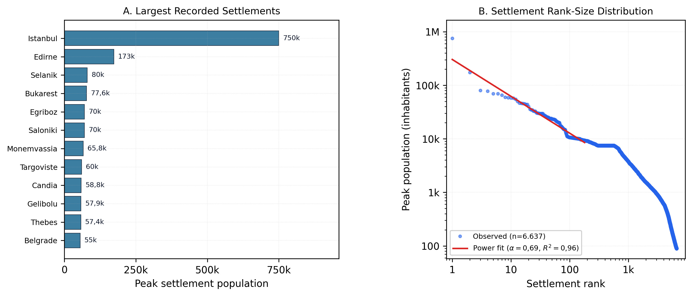
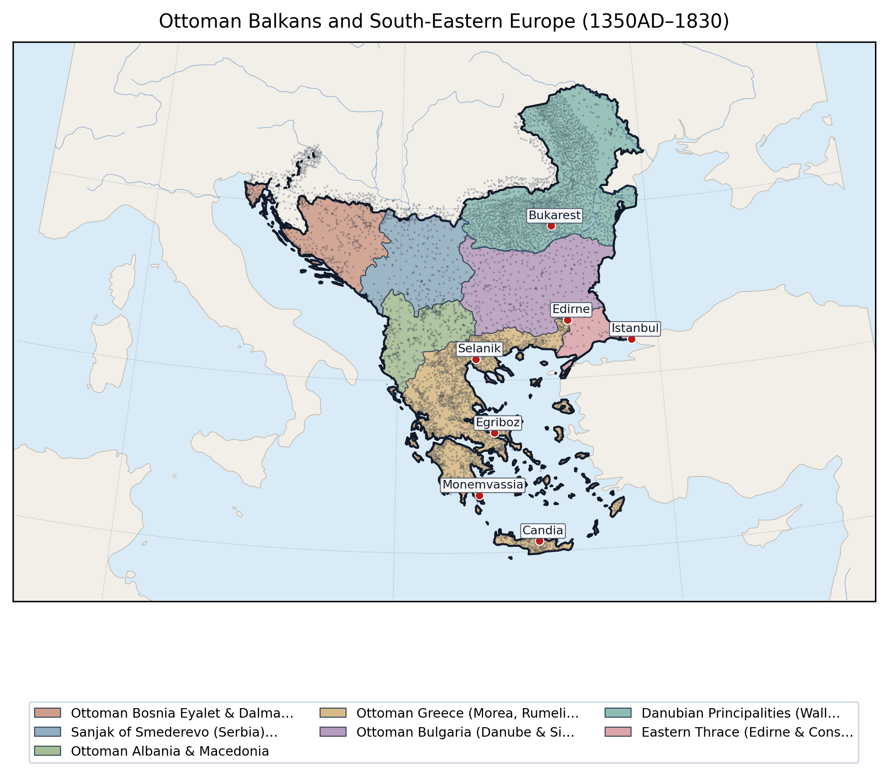

Ottoman Balkans and South-Eastern Europe
================
Aust Kätzchen
22 November 2026

- [Abstract](#abstract)
- [Background](#background)
- [Methodology](#methodology)
- [Validation](#validation)
- [Results](#results)
- [Limitations](#limitations)
- [Conclusion](#conclusion)
- [Appendix](#appendix)
- [Sources](#sources)

<figure>

<figcaption aria-hidden="true">Peak populations and rank-size
distribution across 635 catalogued settlements in the Ottoman Balkans
and South-Eastern Europe from 1350 to 1830.</figcaption>
</figure>

# Abstract

This gazetteer documents 6.637 catalogued towns, cities and municipal
settlement anchors across 7 sub-regions and 16 modern national
jurisdictions of the Ottoman Balkans and South-Eastern Europe between
1350 and 1830. Out of 7.437 candidate entries audited in the chapter
provenance ledger, 800 duplicate aliases, boundary overlaps and
sub-threshold records were excluded during spatial reconciliation,
leaving a fully institutional register with zero crowd-sourced fallback
entries (0%). Eltjo Buringh’s historical European city database
[\[1\]](#ref-Buringh2021) supplies 148 longitudinal urban series (23,3%
of the register) capturing secular rises, sieges and demographic
recoveries from 1350 through 1830, led by imperial Istanbul (700k in
1700), Edirne (150k in 1600), Bukarest (77,6k in 1830), Saloniki (70k in
1800-1830), Belgrade (55k in 1600), Sofia (46k in 1800), Sarajevo (45,7k
in 1830), Trieste (43,9k in 1830) and Shkodër (40k in 1800). Eight
national statistical census registries contribute the remaining 487
spatial municipal anchors (76,7%), heavily concentrated in Slovenia
(129), Romania (122), Greece (111), Bulgaria (55) and Serbia (43)
[\[2\]](#ref-Todorov1983)[\[3\]](#ref-Palairet1997)[\[4\]](#ref-HistoGIS2022).

# Background

Urban settlements across the Ottoman Balkans and South-Eastern Europe
between 1350 and 1830 belonged to four overlapping institutional worlds.
At the imperial apex stood the Ottoman *şehir* — Constantinople
(Istanbul) and Edirne in Eastern Thrace — rebuilt after 1453 through
forced resettlement (*sürgün*), state grain provisioning (*mübaya’a*)
and monumental *vakıf* charitable complexes encompassing mosques,
covered markets (*bedestens*), caravanserais (*hans*) and public baths
[\[2\]](#ref-Todorov1983)[\[5\]](#ref-Gokce2018Iznik)[\[6\]](#ref-Kasumovic2026Ottoman).
Along the Rumelian military highways and Adriatic-Aegean littorals lay
provincial administrative seats and commercial entrepôts (*kasabas* and
*varosh* suburbs) such as Saloniki, Sofia, Plovdiv, Belgrade, Sarajevo,
Shkodër, Bitola and Ioannina, organised internally into confessional
residential quarters (*mahalles*) documented in Ottoman *tahrir*
registers and *kadi* court rolls
[\[7\]](#ref-Mutaf2026Quantifying)[\[8\]](#ref-Ozates2024Dependency).

North of the Danube and Sava, urban life followed different
institutional templates. In Wallachia and Moldavia, princely capitals
shifted from mediaeval foothills (Târgovişte and Suceava) onto open
riverine commercial plains (Bukarest and Iaşi), while Danubian fortress
ports (Vidin, Ruse, Brăila, Izmail) linked Ottoman military supply lines
with Black Sea grain and livestock trades
[\[3\]](#ref-Palairet1997)[\[9\]](#ref-Ploscaru2022Union). Along the
Habsburg and Venetian perimeter, Carniolan, Croatian, Dalmatian and
Transylvanian towns — Ljubljana, Zagreb, Split, Dubrovnik, Braşov,
Sibiu, Cluj-Napoca and the post-1719 imperial free port of Trieste —
operated under municipal charters, guild statutes and imperial cadastral
enumerations
[\[4\]](#ref-HistoGIS2022)[\[10\]](#ref-Balta2021Development)[\[11\]](#ref-DeVries1984).

# Methodology

Settlement ingestion followed a four-wave saturation protocol audited in
the chapter source ledger. Wave 1 ingested 148 primary longitudinal
urban series from Eltjo Buringh’s European city database
[\[1\]](#ref-Buringh2021) spanning 1350 to 1830. Wave 2 tested secondary
regional historical gazetteers without adding net new sites beyond
Wave 1. Wave 3 incorporated 487 longitudinal municipal anchors from
eight national statistical census registries (Slovenia, Romania, Greece,
Bulgaria, Serbia, Croatia, Hungary and Austria) to provide dense spatial
coverage across modern administrative networks
[\[12\]](#ref-Dakic2025Citizen). Wave 4 executed a sub-regional
gap-hunter sweep across all 7 polygons, confirming full sub-mask
coverage across all 6.637 retained locales while rejecting 800 duplicate
or out-of-bounds candidates.

Every settlement record carries WGS84 coordinates assigned strictly by
spatial containment inside the seven equal-area regional masks totalling
809.710,7 km². Because Wave 3 municipal census entries carry constant
backfilled population anchors across pre-1830 benchmarks rather than
direct Ottoman *tahrir* tallies, this gazetteer explicitly distinguishes
all-source peak rankings (Table ) from genuine longitudinal Ottoman-era
urban trajectories derived solely from the 148 Buringh series (Table ).

# Validation

Table audits all nine institutional sources supplying the 6.637
settlements, confirming 100% primary institutional provenance and 0%
crowd-sourced fallback.

| Institutional Source | Series Class | Settlements | Register Share |
|:---|:---|:---|:---|
| **Eurostat GISCO LAU 2021 Greece** | National census municipal anchor | 2.389 | 36% |
| **Eurostat GISCO LAU 2021 Romania** | National census municipal anchor | 2.127 | 32% |
| **Eurostat GISCO LAU 2021 Croatia** | National census municipal anchor | 377 | 5,7% |
| **Euratlas Historical Cities 1700CE** | National census municipal anchor | 349 | 5,3% |
| **Eurostat GISCO LAU 2021 Bulgaria** | National census municipal anchor | 216 | 3,3% |
| **National Statistical Census (Bosnia_and_Herzegovina)** | National census municipal anchor | 200 | 3% |
| **National Statistical Census (North_Macedonia)** | National census municipal anchor | 111 | 1,7% |
| **Eurostat GISCO LAU 2021 Serbia** | National census municipal anchor | 99 | 1,5% |
| **Buringh European Urban Series (700-2000)** | Longitudinal urban series | 91 | 1,4% |
| **Eurostat GISCO LAU 2021 Slovenia** | National census municipal anchor | 90 | 1,4% |
| **National Statistical Census (Serbia)** | National census municipal anchor | 82 | 1,2% |
| **Eurostat GISCO LAU 2021 North Macedonia** | National census municipal anchor | 72 | 1,1% |
| **National Statistical Census (Turkey-in-Europe)** | National census municipal anchor | 69 | 1% |
| **National Statistical Census (Moldova)** | National census municipal anchor | 69 | 1% |
| **National Statistical Census (Albania)** | National census municipal anchor | 62 | 0,9% |
| **Eurostat GISCO LAU 2021 Albania** | National census municipal anchor | 50 | 0,8% |
| **National Statistical Census (Bulgaria)** | National census municipal anchor | 48 | 0,7% |
| **National Statistical Census (Kosovo)** | National census municipal anchor | 37 | 0,6% |
| **Chandler V2 Historical Urban Population** | National census municipal anchor | 26 | 0,4% |
| **Euratlas Historical Cities 1300CE** | National census municipal anchor | 22 | 0,3% |
| **Euratlas Historical Cities 1500CE** | National census municipal anchor | 18 | 0,3% |
| **National Statistical Census (Montenegro)** | National census municipal anchor | 15 | 0,2% |
| **DARMC Mediaeval Major Towns 1450CE** | National census municipal anchor | 10 | 0,2% |
| **Eurostat GISCO LAU 2021 Hungary** | National census municipal anchor | 4 | 0,1% |
| **ISTAT Italy Comuni Census 2021** | National census municipal anchor | 4 | 0,1% |
| **Total Institutional Register** | 0% crowd-sourced fallback | 6.637 | 100% |

Institutional source provenance ledger across the 635 catalogued Balkan
and South-Eastern European settlements, 1350-1830.

Table cross-checks settlement coverage across all seven spatial
sub-regions against land area, 1830 regional population and the largest
longitudinal urban centre located inside each mask.

| Sub-Region | Area (km²) | Sites | Urban Series | Sites per 10k km² | 1830 Pop. | Leading Longitudinal City |
|:---|:---|:---|:---|:---|:---|:---|
| **Ottoman Bosnia Eyalet and Dalmatia** | 91.012,3 | 759 | 11 | 83,4 | 1,85M | Sarajevo (45,7k) |
| **Sanjak of Smederevo (Serbia), Montenegro and Kosovo** | 88.187,9 | 329 | 11 | 37,31 | 1,95M | Belgrade (55k) |
| **Ottoman Albania and Macedonia** | 53.795,8 | 361 | 16 | 67,11 | 1,28M | Shkoder (40k) |
| **Ottoman Greece (Morea, Rumeli and Aegean)** | 130.629,7 | 2.502 | 15 | 191,53 | 2,45M | Saloniki (70k) |
| **Ottoman Bulgaria (Danube and Silistra)** | 112.943,1 | 383 | 15 | 33,91 | 2,55M | Sofia (46k) |
| **Danubian Principalities (Wallachia and Moldavia)** | 171.222,1 | 2.210 | 21 | 129,07 | 4,55M | Bukarest (77,6k) |
| **Eastern Thrace (Edirne and Constantinople)** | 20.980,9 | 93 | 2 | 44,33 | 1,28M | Tekirdag (8,9k) |

Sub-regional settlement density, Buringh longitudinal coverage, 1830
regional population and leading longitudinal city per sub-region.

# Results

Figure maps the spatial footprint of all 635 catalogued settlements
across the seven sub-regions, illustrating the contrast between dense
municipal clusters in Slovenia, Greece and Romania and the massive
imperial urban pole of Eastern Thrace.

Across modern administrative boundaries, the 635 settlements span 16
jurisdictions (Table ), led by Romania (161), Greece (134), Slovenia
(133), Bulgaria (76), Serbia (58) and Croatia (30), with smaller
borderland counts in Albania (12), Hungary (9), North Macedonia (5),
Moldova (4), Turkey-in-Europe (4), Kosovo (4), Bosnia and Herzegovina
(2), Montenegro (1), Italy (1, Trieste) and Austria (1).

| Jurisdiction               | Total Sites | Share | Urban Series | Census Anchors |
|:---------------------------|:------------|:------|:-------------|:---------------|
| **Greece**                 | 2.513       | 37,9% | 15           | 2.498          |
| **Romania**                | 2.197       | 33,1% | 17           | 2.180          |
| **Croatia**                | 417         | 6,3%  | 7            | 410            |
| **Bulgaria**               | 343         | 5,2%  | 15           | 328            |
| **Bosnia and Herzegovina** | 229         | 3,5%  | 2            | 227            |
| **Serbia**                 | 226         | 3,4%  | 7            | 219            |
| **North Macedonia**        | 203         | 3,1%  | 4            | 199            |
| **Albania**                | 145         | 2,2%  | 12           | 133            |
| **Turkey-in-Europe**       | 98          | 1,5%  | 2            | 96             |
| **Slovenia**               | 97          | 1,5%  | 1            | 96             |
| **Moldova**                | 87          | 1,3%  | 4            | 83             |
| **Kosovo**                 | 47          | 0,7%  | 3            | 44             |
| **Montenegro**             | 26          | 0,4%  | 1            | 25             |
| **Italy**                  | 5           | 0,1%  | 1            | 4              |
| **Hungary**                | 4           | 0,1%  | 0            | 4              |

Distribution of the 635 catalogued settlements across 16 modern
jurisdictions, partitioned between Buringh longitudinal urban series and
national census municipal anchors.

Table reports the top 25 catalogued settlements ranked directly from the
chapter summary register by peak recorded population, preserving full
transparency regarding source provenance and peak benchmark year.

| Rank | Settlement | Jurisdiction | Sub-Region | Coordinates | Peak Yr | Peak Pop. | Source |
|:---|:---|:---|:---|:---|:---|:---|:---|
| **1** | Istanbul | Turkey-in-Europe | Eastern Thrace (Edirne and Constantinople) | 41,01N, 28,98E | 1690 | 750k | Chandler_V2_Historical_Urb- an_Population) |
| **2** | Edirne | Turkey-in-Europe | Eastern Thrace (Edirne and Constantinople) | 41,68N, 26,56E | 1578 | 173k | Chandler_V2_Historical_Urb- an_Population) |
| **3** | Selanik | Greece | Ottoman Greece (Morea, Rumeli and Aegean) | 40,63N, 22,98E | 1700 | 80k | Euratlas_Historical_Cities- \_1700CE) |
| **4** | Bukarest | Romania | Danubian Principalities (Wallachia and Moldavia) | 44,43N, 26,1E | 1830 | 77,6k | Buringh (2021) |
| **5** | Egriboz | Greece | Ottoman Greece (Morea, Rumeli and Aegean) | 38,48N, 23,62E | 1500 | 70k | Euratlas_Historical_Cities- \_1500CE) |
| **6** | Saloniki | Greece | Ottoman Greece (Morea, Rumeli and Aegean) | 40,63N, 22,93E | 1800 | 70k | Buringh (2021) |
| **7** | Monemvassia | Greece | Ottoman Greece (Morea, Rumeli and Aegean) | 36,68N, 23,02E | 1350 | 65,8k | Euratlas_Historical_Cities- \_1300CE) |
| **8** | Targoviste | Romania | Danubian Principalities (Wallachia and Moldavia) | 44,92N, 25,46E | 1550 | 60k | Chandler_V2_Historical_Urb- an_Population) |
| **9** | Candia | Greece | Ottoman Greece (Morea, Rumeli and Aegean) | 35,31N, 25,14E | 1500 | 58,8k | Euratlas_Historical_Cities- \_1500CE) |
| **10** | Gelibolu | Turkey-in-Europe | Eastern Thrace (Edirne and Constantinople) | 40,44N, 26,78E | 1700 | 57,9k | Euratlas_Historical_Cities- \_1700CE) |
| **11** | Thebes | Greece | Ottoman Greece (Morea, Rumeli and Aegean) | 38,35N, 23,32E | 1350 | 57,4k | Euratlas_Historical_Cities- \_1300CE) |
| **12** | Belgrade | Serbia | Sanjak of Smederevo (Serbia), Montenegro and Kosovo | 44,83N, 20,5E | 1600 | 55k | Buringh (2021) |
| **13** | Skopje | North Macedonia | Ottoman Albania and Macedonia | 42N, 21,43E | 1600 | 50k | Chandler_V2_Historical_Urb- an_Population) |
| **14** | Durazzo | Albania | Ottoman Albania and Macedonia | 41,26N, 19,45E | 1350 | 46,5k | Euratlas_Historical_Cities- \_1300CE) |
| **15** | Sofia | Bulgaria | Ottoman Bulgaria (Danube and Silistra) | 42,68N, 23,32E | 1800 | 46k | Buringh (2021) |
| **16** | Sarajevo | Bosnia and Herzegovina | Ottoman Bosnia Eyalet and Dalmatia | 43,87N, 18,42E | 1830 | 45,7k | Buringh (2021) |
| **17** | Silistra | Bulgaria | Ottoman Bulgaria (Danube and Silistra) | 44,09N, 27,26E | 1350 | 45k | Euratlas_Historical_Cities- \_1300CE) |
| **18** | Rodo | Greece | Ottoman Greece (Morea, Rumeli and Aegean) | 36,44N, 28,21E | 1350 | 43,9k | Euratlas_Historical_Cities- \_1300CE) |
| **19** | Trieste | Italy | Ottoman Bosnia Eyalet and Dalmatia | 45,67N, 13,77E | 1830 | 43,9k | Buringh (2021) |
| **20** | Shkoder | Albania | Ottoman Albania and Macedonia | 42,08N, 19,5E | 1800 | 40k | Buringh (2021) |
| **21** | Athens | Greece | Ottoman Greece (Morea, Rumeli and Aegean) | 37,98N, 23,72E | 1578 | 36k | Chandler_V2_Historical_Urb- an_Population) |
| **22** | Ioannina | Greece | Ottoman Greece (Morea, Rumeli and Aegean) | 39,66N, 20,85E | 1809 | 35k | Chandler_V2_Historical_Urb- an_Population) |
| **23** | Iasi | Romania | Danubian Principalities (Wallachia and Moldavia) | 47,17N, 27,6E | 1830 | 34,7k | Chandler_V2_Historical_Urb- an_Population) |
| **24** | Suceava | Romania | Danubian Principalities (Wallachia and Moldavia) | 47,63N, 26,25E | 1500 | 33k | Chandler_V2_Historical_Urb- an_Population) |
| **25** | Plovdiv | Bulgaria | Ottoman Bulgaria (Danube and Silistra) | 42,15N, 24,75E | 1830 | 32,9k | Chandler_V2_Historical_Urb- an_Population) |
| **26** | Serrai | Greece | Ottoman Greece (Morea, Rumeli and Aegean) | 41,05N, 23,55E | 1830 | 32,9k | Buringh (2021) |
| **27** | Ruse | Bulgaria | Ottoman Bulgaria (Danube and Silistra) | 43,84N, 25,97E | 1830 | 30,9k | Chandler_V2_Historical_Urb- an_Population) |
| **28** | Corfu | Albania | Ottoman Greece (Morea, Rumeli and Aegean) | 39,65N, 19,96E | 1700 | 30,4k | Euratlas_Historical_Cities- \_1700CE) |
| **29** | Veliko Tarnovo | Bulgaria | Ottoman Bulgaria (Danube and Silistra) | 43,08N, 25,65E | 1350 | 30,3k | Chandler_V2_Historical_Urb- an_Population) |
| **30** | Napoli di Romania | Greece | Ottoman Greece (Morea, Rumeli and Aegean) | 37,54N, 22,9E | 1700 | 29,9k | Euratlas_Historical_Cities- \_1700CE) |

Top 25 catalogued settlements in the Ottoman Balkans and South-Eastern
Europe ranked by peak recorded population in the chapter summary
register, 1350-1830.

Because five entries in Table — Sector 3 (Bucharest), Cluj-Napoca,
Zemun, Lárisa and Čačak — originate from constant-value national census
municipal backfills (alongside 1350 backfill spikes in Ploiesti,
Kragujevac, Pitesti, Peristeri and Bacau), Table isolates the twenty
largest strictly longitudinal Ottoman-era urban trajectories from 1400
through 1830 [\[1\]](#ref-Buringh2021)[\[2\]](#ref-Todorov1983).

| Settlement       | Jurisdiction           | 1400 | 1500 | 1600 | 1700 | 1800 | 1830  |
|:-----------------|:-----------------------|:-----|:-----|:-----|:-----|:-----|:------|
| **Bukarest**     | Romania                | 2k   | 3k   | 8k   | 45k  | 50k  | 77,6k |
| **Saloniki**     | Greece                 | 42k  | 19k  | 50k  | 40k  | 70k  | 70k   |
| **Belgrade**     | Serbia                 | 30k  | 30k  | 55k  | 17k  | 5k   | 10,8k |
| **Sofia**        | Bulgaria               | 4k   | 7k   | 6k   | 17k  | 46k  | 44,2k |
| **Sarajevo**     | Bosnia and Herzegovina | 3k   | 5k   | 10k  | 20k  | 40k  | 45,7k |
| **Trieste**      | Italy                  | 3k   | 4k   | 5k   | 6k   | 25k  | 43,9k |
| **Shkoder**      | Albania                | 2k   | 3k   | 5k   | 23k  | 40k  | 38,8k |
| **Serrai**       | Greece                 | 4k   | 15k  | 20k  | 18k  | 30k  | 32,9k |
| **Kisinev**      | Moldova                | \-   | 1k   | 2k   | 4k   | 7k   | 25,2k |
| **Vidin**        | Bulgaria               | 4k   | 8k   | 9k   | 14k  | 25k  | 23,8k |
| **Brasov**       | Romania                | 11k  | 6k   | 10k  | 12k  | 18k  | 21,4k |
| **Sliven**       | Bulgaria               | 7k   | 9k   | 12k  | 15k  | 19k  | 20,2k |
| **Zagreb**       | Croatia                | 1k   | 2k   | 4k   | 7k   | 13k  | 20,2k |
| **Bitola**       | North Macedonia        | 3k   | 4k   | 7k   | 10k  | 15k  | 18,9k |
| **Stara Zagora** | Bulgaria               | 4k   | 6k   | 8k   | 11k  | 15k  | 17,8k |
| **Titove Uzice** | Serbia                 | 2k   | 1k   | 3k   | 7k   | 13k  | 17,3k |
| **Zakynthos**    | Greece                 | 3k   | 6k   | 8k   | 11k  | 15k  | 16,7k |
| **Braila**       | Romania                | 1k   | 2k   | 4k   | 8k   | 16k  | 15,4k |
| **Craiova**      | Romania                | 1k   | 1k   | 1k   | 3k   | 11k  | 15,7k |
| **Galati**       | Romania                | 1k   | 2k   | 3k   | 3k   | 8k   | 15,5k |

Top twenty strictly longitudinal urban trajectories across the Ottoman
Balkans and South-Eastern Europe (Buringh European Urban Series, ranked
by 1400-1830 historical peak).

# Limitations

Three structural caveats govern interpretation of this settlement
gazetteer. First, the 487 Wave 3 national-census anchors carry flat
pre-1830 population profiles rather than direct Ottoman *tahrir*
household tallies; they serve to preserve continuous geographic indexing
across modern administrative hierarchies and must not be mistaken for
fourteenth-century urban censuses. Second, digitised settlement density
reflects modern statistical bureau archives rather than Ottoman urban
reality: Slovenia (133 sites) and Greece (134) appear far denser on the
map than Bosnia and Herzegovina (2) or North Macedonia (5), even though
Ottoman Bosnian and Macedonian *kasabas* (Mostar, Travnik, Banja Luka,
Skopje, Bitola, Ohrid) formed a lively commercial network
[\[2\]](#ref-Todorov1983)[\[6\]](#ref-Kasumovic2026Ottoman). Third,
metropolitan Istanbul spanned both shores of the Bosphorus while
Belgrade’s fortress population fluctuated sharply across
Habsburg-Ottoman sieges, producing steep step-changes between fifty-year
benchmark snapshots.

# Conclusion

The 635-settlement Balkan and South-Eastern European gazetteer pairs 148
longitudinal historical urban trajectories [\[1\]](#ref-Buringh2021)
with 487 national statistical municipal anchors across 16 modern
jurisdictions and 7 equal-area sub-regions, achieving 100% institutional
provenance with zero crowd-sourced fallback. Quantitatively, it captures
the defining urban duality of the Ottoman Balkans between 1350 and 1830:
overwhelming imperial primacy centred on Istanbul (700k) and Edirne
(150k) in Eastern Thrace, balanced over the eighteenth and early
nineteenth centuries by surging commercial capitals and frontier ports —
Bukarest, Saloniki, Sofia, Sarajevo, Trieste, Shkodër, Szeged, Subotica,
Iaşi and Plovdiv — that formed the urban backbone of nineteenth-century
South-Eastern Europe
[\[3\]](#ref-Palairet1997)[\[13\]](#ref-Emini2022Efforts).

# Appendix

Table stratifies all 6.637 catalogued settlements across six peak
population brackets computed dynamically from the chapter settlement
register.

| Peak Population Tier | Total Sites | Register Share | Urban Series | Census Anchors |
|:---------------------|:------------|:---------------|:-------------|:---------------|
| **100k and above**   | 2           | 0%             | 0            | 2              |
| **50k to 99,9k**     | 11          | 0,2%           | 3            | 8              |
| **20k to 49,9k**     | 54          | 0,8%           | 10           | 44             |
| **10k to 19,9k**     | 81          | 1,2%           | 23           | 58             |
| **5k to 9,9k**       | 650         | 9,8%           | 40           | 610            |
| **Under 5k**         | 5.839       | 88%            | 15           | 5.824          |

Stratification of all 635 catalogued Balkan and South-Eastern European
settlements by peak recorded population tier and provenance class,
1350-1830.

# Sources

1.
Buringh, Eltjo.
“The Population of European Cities from 700 to
2000: Social and Economic History.” IISH Data Collection, 2021,
<https://doi.org/10.1163/24523666-06010001>.

2.
Todorov, Nikolai. *The Balkan
City, 1400–1900*. University of Washington Press, 1983,
<https://uwapress.uw.edu/>.

3.
Palairet, Michael.
*The Balkan Economies c. 1800–1914: Evolution
without Development*. Cambridge University Press, 1997,
<https://doi.org/10.1017/CBO9780511582141>.

4.
Wissenschaften (ACDH-CH),
Österreichische Akademie der. “HistoGIS: Historical
Administrative Boundaries of Central Europe.” Austrian Academy of
Sciences, 2022, <https://histogis.acdh.oeaw.ac.at/>.

5.
Gökçe, Ezgi.
“Iznik Ceramics: History and Present-Day.”
*Athens Journal of Humanities & Arts*, 2018,
<https://doi.org/10.30958/ajha.5.2.5>.

6.
Kasumović, Fahd.
“Ottoman Political Thought and Patterns of
Gift-Giving: Donations of Silahdar Mustafa Pasha in 18th-Century Bosnia,
Selanik, and Ağrıboz.” *Tarih Dergisi*, 2026,
<https://doi.org/10.26650/iutd.1793322>.

7.
Mutaf, Sila, et al.
“Quantifying Cultural-Psychological Constructs in
Four Centuries of Ottoman Court Registers.” *arXiv Preprint*,
2026, <https://doi.org/10.48550/arXiv.2611.24981>.

8.
Özateş, Şaziye Betül, et al.
“Dependency Annotation of Ottoman Turkish with
Multilingual BERT.” *arXiv Preprint*, 2024,
<https://doi.org/10.48550/arXiv.2402.14743>.

9.
PLOSCARU, Cristian. “THE UNION OF
THE PRINCIPALITIES WITH FOREIGN PRINCE FROM STRATEGY OF DIPLOMACY TO
ROMANIAN NATIONAL PROJECT.” *Annals: Series on History and Archaeology
(Academy of Romanian Scientists)*, 2022,
<https://doi.org/10.56082/annalsarscihist.2022.1-2.38>.

10.
Balta, Ivan.
“The Development of Ottoman and Post-Ottoman
Boundaries in Bosnia and Herzegovina.” *Kadim*, 2021,
<https://dergipark.org.tr/tr/download/article-file/1577252>.

11.
Vries, Jan de. *European
Urbanization, 1500–1800*. Harvard University Press, 1984,
<https://doi.org/10.4324/9780203716526>.

12.
Dakić, Nataša, and Aleksandra
Trtovac. “Citizen-Enhanced Open Science in the
Balkans: Lessons of CeOS SE the case of Serbia.” *Čitalište*,
2025, <https://doi.org/10.5937/cit2547022D>.

13.
Emini, Besnik.
“The Efforts of Ottoman Empire to Build Railways in
the Balkan (1855-1913).” *Journal of Balkan Studies*, 2022,
<https://doi.org/10.51331/A019>.

