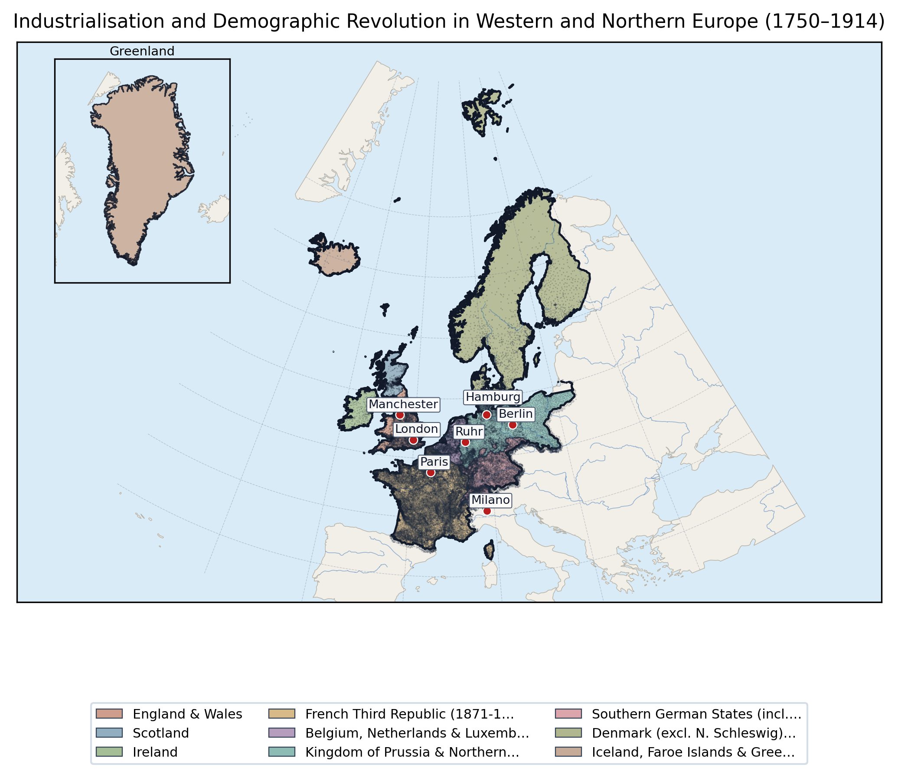

```{r setup, include=FALSE}
knitr::opts_chunk$set(
  echo = FALSE,
  warning = FALSE,
  message = FALSE,
  results = "asis"
)
library(jsonlite)
source("../../_shared/template/viscount_rmd_helpers.R")

summary_data <- fromJSON("industrialisation_western_and_northern_europe_summary.json", simplifyVector = FALSE)
total_area_km2 <- as.numeric(summary_data$total_area_km2)
settlement_count <- as.integer(summary_data$settlement_count)
hgis_row_count <- as.integer(summary_data$hgis_row_count)
subregions_list <- summary_data$subregions
domain_totals <- summary_data$domain_totals

pop_1750 <- as.numeric(domain_totals[["1750"]])
pop_1800 <- as.numeric(domain_totals[["1800"]])
pop_1816 <- as.numeric(domain_totals[["1816"]])
pop_1841 <- as.numeric(domain_totals[["1841"]])
pop_1850 <- as.numeric(domain_totals[["1850"]])
pop_1871 <- as.numeric(domain_totals[["1871"]])
pop_1880 <- as.numeric(domain_totals[["1880"]])
pop_1910 <- as.numeric(domain_totals[["1910"]])

na_area <- as.numeric(subregions_list[[9]]$area_km2)
core_area_km2 <- total_area_km2 - na_area
pop_1750_core <- pop_1750 - as.numeric(subregions_list[[9]]$population[["1750"]])
pop_1910_core <- pop_1910 - as.numeric(subregions_list[[9]]$population[["1910"]])

fmt_source_label <- function (arg0_code) {
  k <- as.character(arg0_code)
  exact_map <- c(
    "Buringh_European_Urban_700_2000" = "Buringh European Urban Series (700-2000)",
    "Eurostat_Urban_Audit_1990_2024" = "Eurostat Urban Audit (1990-2024)",
    "GeoNames_Municipal_Gazetteer_Supplement" = "GeoNames Municipal Gazetteer Supplement",
    "INE_Spain_Censos_Historicos_1857_1991" = "INE Spain Historic Censuses (1857-1991)",
    "INSEE_Recensement_1876_2023" = "INSEE French Census Series (1876-2023)",
    "National_Statistical_Census_Austria" = "National Statistical Census of Austria",
    "National_Statistical_Census_Belgium" = "National Statistical Census of Belgium",
    "National_Statistical_Census_Czechia" = "National Statistical Census of Czechia",
    "National_Statistical_Census_Denmark" = "National Statistical Census of Denmark",
    "National_Statistical_Census_Faroe_Islands" = "National Statistical Census of the Faroe Islands",
    "National_Statistical_Census_Finland" = "National Statistical Census of Finland",
    "National_Statistical_Census_Germany" = "National Statistical Census of Germany",
    "National_Statistical_Census_Greenland" = "National Statistical Census of Greenland",
    "National_Statistical_Census_Iceland" = "National Statistical Census of Iceland",
    "National_Statistical_Census_Ireland" = "National Statistical Census of Ireland",
    "National_Statistical_Census_Netherlands" = "National Statistical Census of the Netherlands",
    "National_Statistical_Census_Norway" = "National Statistical Census of Norway",
    "National_Statistical_Census_Poland" = "National Statistical Census of Poland",
    "National_Statistical_Census_Sweden" = "National Statistical Census of Sweden",
    "National_Statistical_Census_Switzerland" = "National Statistical Census of Switzerland",
    "National_Statistical_Census_United_Kingdom" = "National Statistical Census of the United Kingdom"
  )
  if (k %in% names(exact_map)) return(unname(exact_map[[k]]))
  lbl <- gsub("_", " ", k, fixed = TRUE)
  lbl <- gsub("+", " and ", lbl, fixed = TRUE)
  lbl
}

fmt_hgis_source <- function (arg0_src) {
  s <- as.character(arg0_src)
  if (grepl("^SGF_", s)) return("SGF/INSEE France Départements")
  if (grepl("^UK_Historic_Counties", s)) return("ONS UK Historic Counties Census")
  if (grepl("^CSO_Ireland", s)) return("CSO Ireland Historic Counties (CNA13)")
  if (grepl("^HGIS_Germany|^HistoGIS_Prussia|^Statistik_Deutsches_Reich", s)) return("HGIS Germany and Galloway Prussia")
  if (grepl("^BFS_Swiss", s)) return("BFS Switzerland (22 Historic Cantons)")
  if (grepl("^CBS_Netherlands", s)) return("CBS Netherlands (11 Historic Provinces)")
  if (grepl("^Riksarkivet_swehist", s)) return("Riksarkivet and SCB Sweden (Tabellverket)")
  if (grepl("^HistoGIS_HRE", s)) return("HistoGIS HRE Imperial Circles")
  if (grepl("^CShapes_Europe|^Imperial_Census", s)) return("CShapes Belgium, Nordic and Imperial Censuses")
  if (grepl("^Historical_Basemaps", s)) return("Historical Basemaps (1700 Polities)")
  if (grepl("^DEMOPAST_ISTAT", s)) return("DEMOPAST/ISTAT Italian Provinces")
  if (grepl("^INE_Spain", s)) return("INE Spain Historic Provinces (1833)")
  if (grepl("^HistoGIS_Austri", s)) return("HistoGIS Habsburg Crownlands")
  gsub("_", " ", s, fixed = TRUE)
}
```

```{r hero_markdown_fallback, results="asis"}
if (!knitr::is_latex_output()) {
  cat("\n\n")
}
```

# Abstract

Between 1750 and 1914 Western and Northern Europe broke permanently out of the pre-industrial Malthusian ceiling. Across the 9 sub-regions treated here — England & Wales, Scotland, Ireland, France, the Low Countries, Northern Germany, Southern Germany & Switzerland, Scandinavia and the North Atlantic archipelagos with Greenland — total population climbed from `r viscount_fmt_pop(pop_1750)` in 1750 to `r viscount_fmt_pop(pop_1910)` in 1910, a nearly threefold expansion (2,87 times, averaging 0,66% per annum) across `r viscount_fmt_number(total_area_km2, 1L)` km² (`r viscount_fmt_number(core_area_km2, 1L)` km² excluding Greenland, Iceland and the Faroe Islands). Mean density in the European core rose from `r viscount_fmt_number(pop_1750_core / core_area_km2, 2L)` to `r viscount_fmt_number(pop_1910_core / core_area_km2, 2L)` inhabitants per km², masking extreme divergence among national trajectories. England & Wales multiplied 5,73 times to 35,83M (236,43 per km²) and Northern Germany multiplied 4,35 times to 37,4M (216,8 per km²) as coalfield urbanisation, steam transport and falling epidemic mortality transformed agrarian economies into urban industrial societies. By contrast, France experienced Europe's earliest sustained marital fertility decline, expanding just 1,61 times from 24,6M to 39,54M and seeing its macro-regional weight drop from 40,25% to 22,54%. Ireland traced the sharpest reversal in modern European demographic history, surging from 3,15M in 1750 to 8,18M in 1841 before potato blight, famine mortality and relentless emigration cut its numbers to 4,41M by 1910. Reconstructed within MAGNETIC from national statistical censuses, `r formatC(hgis_row_count, format = "d", big.mark = ".")` scraped historical GIS sub-administrative enumerations spanning 9 snapshot regimes (1750-1910) and a georeferenced gazetteer of `r formatC(settlement_count, format = "d", big.mark = ".")` settlements across 24 modern jurisdictions, this chapter quantifies how mortality retreat, asymmetric fertility transition, overseas emigration and industrial agglomeration redrew the human map of Atlantic and Northern Europe before 1914.

# Background

In 1750 Western and Northern Europe still obeyed the demographic rules of the agrarian ancien régime. Four-fifths of its `r viscount_fmt_pop(pop_1750)` inhabitants tilled fields, tended livestock or worked rural looms, constrained by organic energy budgets derived from timber, waterpower, draft animals and annual grain harvests [@WrigleySchofield1981; @DeVries1984]. Death rates remained volatile at 28 to 35 per thousand, periodically spiked by harvest failure, typhus, dysentery and endemic smallpox [@Krylova2020Patterns]. Yet three structural shifts were already eroding the old equilibrium. First, plague had vanished from Western Europe after the Marseille epidemic of 1720-1722, removing the most catastrophic positive check of the preceding four centuries. Second, New World crops — above all the potato in Ireland, Flanders, Prussia and Scandinavia — alongside clover rotations, turnip fodder and enclosure raised caloric yield per hectare. Third, proto-industrial cottage textiles in Lancashire, the West Riding, Flanders, Saxony, Switzerland and northern France detached marriage formation from inherited peasant holdings, permitting earlier nuptiality and higher completed family sizes [@WrigleySchofield1981; @CoaleWatkins1986].

Between 1750 and 1800 macro-regional population grew by 28,09% from `r viscount_fmt_pop(pop_1750)` to `r viscount_fmt_pop(pop_1800)`, an annual rate of 0,5%. Britain led the acceleration. Parish-register back-projection shows English fertility climbing alongside modest mortality improvement as age at first marriage fell by nearly three years between 1700 and 1820 [@WrigleySchofield1981]. England & Wales rose from 6,25M in 1750 to 8,98M in 1800 (9,05M at the first decennial census of 1801), while Scotland grew from 1,27M to 1,6M [@ONS2024]. Across the Irish Sea, potato dependence fuelled an even steeper rural surge from 3,15M in 1750 to 5,15M in 1800, pressing cottier holdings onto marginal peatlands and western hillsides. In Scandinavia, Sweden's *Tabellverket* — established in 1749 as the world's oldest continuous national population register — recorded steady recovery from early eighteenth-century warfare, helping lift Denmark, Sweden, Norway and Finland from 3,69M to 5,06M [@Riksarkivet2023; @Mitchell2007]. Only the North Atlantic fringe bucked the upward trend: the catastrophic 1783-1785 Laki fissure eruption in Iceland triggered the *Móðuharðindin* (Mist Hardships), killing roughly one-fifth of Iceland's population and pulling the combined total of Iceland, the Faroe Islands and Greenland down from 60,4k in 1750 to 58,6k in 1800 [@Hagstofa2024].

The French Revolutionary and Napoleonic Wars (1792-1815) imposed heavy military casualties — roughly 1M to 1,4M French dead and hundreds of thousands more across the German states, Iberia and the Low Countries — yet barely interrupted the secular rise of Western and Northern Europe. By 1816, immediately after the Congress of Vienna redrew continental frontiers and triggered the "Year Without a Summer" subsistence crisis following Mount Tambora's eruption, the macro-region held `r viscount_fmt_pop(pop_1816)` people. Crucially, the post-1815 peace inaugurated Europe's classic demographic transition, though with strikingly asynchronous timing [@CoaleWatkins1986; @Pietrzakpawowska1976Industrial]. Across Britain, Germany, the Low Countries, Switzerland and Scandinavia, crude death rates declined steadily through smallpox vaccination (which slashed London smallpox mortality after 1800 [@Krylova2020Patterns]), improved grain transport, potato diffusion and, after 1870, municipal waterworks, sewerage and germ-theory hygiene. Birth rates, however, remained elevated at 32 to 40 per thousand until the 1870s and 1880s, widening the gap between births and deaths to 12 to 15 per thousand per year.

France stood completely apart. Already in the closing decades of the eighteenth century, rural French couples in Normandy, Aquitaine and the Paris Basin began practising deliberate marital fertility control, driven by partible inheritance under the Civil Code, peasant landownership and secularisation [@Dupaquier1988; @CoaleWatkins1986]. French birth rates fell nearly in lockstep with death rates from the 1790s onward. While France had been the undisputed demographic colossus of Western Europe in 1750 — holding 24,6M inhabitants, or 40,25% of the entire macro-region and nearly four times the population of England & Wales — its expansion slowed to a crawl after 1850. Adding barely 3,91M inhabitants over the 60 years from 1850 to 1910 (and suffering the loss of roughly 1,5M citizens in Alsace-Lorraine after the Franco-Prussian War of 1870-1871), France ended the era at 39,54M, overtaken in combined weight by the German Empire and closely rivalled by England & Wales alone [@INSEE2024; @Mitchell2007].

Ireland suffered an opposite and far more violent rupture. By the 1841 census, Ireland carried `r viscount_fmt_pop(as.numeric(subregions_list[[3]]$population[["1841"]]))` people at 98,72 inhabitants per km², denser than France or Scotland and overwhelmingly reliant on a single lump-variety potato crop [@CSOIreland2023]. When *Phytophthora infestans* destroyed consecutive harvests between 1845 and 1849, roughly 1M people perished from starvation and famine fevers (typhus and relapsing fever) while over 1,5M fled to Britain, the United States, Canada and Australia within a decade. Unlike earlier European subsistence crises, Ireland never rebounded. Post-famine consolidation of grazing farms, impartible stem-family inheritance, exceptionally late marriage, high permanent celibacy and chain emigration drove Ireland's population downward at every single decennial census through 1911, reducing the island to 4,41M in 1910 — 46% below its 1841 summit [@CSOIreland2023; @ONS2024].

Meanwhile, coal and railways reorganised the spatial distribution of Europeans around industrial basins. Britain's industrial take-off after 1780 concentrated millions along the coalfields of Lancashire, West Yorkshire, the West Midlands, South Wales, Tyneside and Clydeside, pushing Great Britain past the 50% urban threshold by the 1851 census — the first major society in human history where town dwellers outnumbered rural inhabitants [@WrigleySchofield1981; @ONS2024]. Continental industrialisation followed along a contiguous coal-and-iron arc stretching from the Nord-Pas-de-Calais and the Sambre-Meuse valley of Wallonia across the Ruhr, Saxony and Upper Silesia [@Pietrzakpawowska1976Industrial; @RosesWolf2019]. After the Zollverein customs union (1834) and imperial unification (1871), Germany underwent the fastest metropolitan expansion in Europe: Northern Germany (Prussia and the North) jumped from 18,2M in 1850 to 22,9M in 1871 and 37,4M in 1910, absorbing massive internal *Ostflucht* (east-to-west migration) from Pomerania, East Prussia and Poznań into Berlin, Hamburg and the Ruhr [@HGISGermany2014; @Antosik2026Adverse]. Across the entire macro-region, the century after 1815 also saw the largest oceanic emigration in history — over 25M departures from the British Isles, Germany, Scandinavia, the Low Countries and Switzerland — which acted as a demographic safety valve before marital fertility finally began falling steeply across Britain, Germany and Scandinavia after 1880 [@CoaleWatkins1986; @Goldstein2011Secular]. On the eve of the First World War in 1914, Western and Northern Europe stood at the peak of its global demographic share, densely urbanised, linked by rail and steamship and rapidly converging toward low-fertility, low-mortality modernity.

# Methodology

Reconstructing the population of Western and Northern Europe between 1750 and 1914 marks the transition from pre-statistical historical demography to modern bureaucratic census-taking. Whereas the mid-eighteenth century still relies on parish-register aggregation, hearth enumerations and fiscal surveys outside Sweden's *Tabellverket* (1749), every polity in the domain instituted periodic, nominal, house-to-house censuses during the nineteenth century: Great Britain and France in 1801, Norway and Denmark in 1801, Prussia in 1816, Ireland in 1821 (with reliable county schedules from 1841), the Netherlands in 1829, Belgium in 1846, Switzerland in 1850 and the unified German Empire from 1871 [@Mitchell2007; @ONS2024; @INSEE2024; @HGISGermany2014; @BFS2024]. MAGNETIC harmonises these disparate national schedules onto fixed spatial polygons and common chronological benchmarks so that regional growth rates and densities remain strictly comparable across shifting nineteenth-century borders.

## Sub-Regional Partition and Fixed-Area Accounting

The chapter domain spans `r viscount_fmt_number(total_area_km2, 1L)` km², partitioned into 9 ecologically and historically coherent sub-regions. England & Wales (`r viscount_fmt_number(as.numeric(subregions_list[[1]]$area_km2), 1L)` km²), Scotland (`r viscount_fmt_number(as.numeric(subregions_list[[2]]$area_km2), 1L)` km²) and Ireland (`r viscount_fmt_number(as.numeric(subregions_list[[3]]$area_km2), 1L)` km²) separate the three starkly divergent demographic regimes of the British Isles. France (`r viscount_fmt_number(as.numeric(subregions_list[[4]]$area_km2), 1L)` km²) tracks metropolitan France across its nineteenth-century territorial adjustments, while Belgium, Netherlands & Luxembourg (`r viscount_fmt_number(as.numeric(subregions_list[[5]]$area_km2), 1L)` km²) unites the densely settled Rhine-Meuse-Scheldt delta and Walloon coalfield. Germany and the Alpine north are divided along the classic northern-southern industrial and confessional gradient into Northern Germany (Prussia and the North, `r viscount_fmt_number(as.numeric(subregions_list[[6]]$area_km2), 1L)` km²) and Southern Germany & Switzerland (`r viscount_fmt_number(as.numeric(subregions_list[[7]]$area_km2), 1L)` km²). Denmark, Sweden, Norway & Finland (`r viscount_fmt_number(as.numeric(subregions_list[[8]]$area_km2), 1L)` km²) groups the four Nordic kingdoms and grand duchy sharing early Lutheran parish registration and high late-nineteenth-century emigration. Finally, Iceland, Faroe Islands & Greenland (`r viscount_fmt_number(as.numeric(subregions_list[[9]]$area_km2), 1L)` km²) isolates the sub-Arctic and polar North Atlantic realm, whose vast ice-covered land area would otherwise distort continental European density averages.

## Harmonised Benchmark Years and Interpolation

National censuses rarely fell on identical calendar years: British and Irish censuses ran in years ending in 1 (1801, 1841, 1851, 1881, 1911), French censuses ran quinquennially from 1801 and 1831 (1851, 1876, 1881, 1911), German imperial censuses ran in 1871, 1875, 1880, 1890, 1900 and 1910, and Scandinavian, Dutch and Swiss censuses clustered on decennial round years (1800, 1850, 1880, 1910). To construct synchronous continental totals, MAGNETIC aligns all 9 sub-regional series onto 8 common benchmark years: 1750, 1800, 1816, 1841, 1850, 1871, 1880 and 1910. Where raw national census anchors sit one year off a benchmark — such as the 1801, 1851, 1881 and 1911 enumerations of England & Wales, Scotland, Ireland and France — log-linear exponential interpolation between flanking census counts derives exact benchmark values while preserving the raw census figures intact in the archival metadata. For example, England & Wales shifts from its raw 1801 census count of 9,05M to 8,98M in 1800 and from 36,22M in 1911 to 35,83M in 1910, whereas Ireland's raw 1841 census count of 8,18M (8.175.000) anchors the pre-famine peak directly without smoothing away the 1845-1851 famine cliff [@ONS2024; @CSOIreland2023].

## Historical GIS Sub-Administrative Enumerations and Settlement Gazetteer

Macro-regional totals alone conceal internal redistribution from agricultural uplands to coalfield cities. MAGNETIC therefore pairs its 9 sub-regional trajectories with two spatially explicit archival layers. First, `r formatC(hgis_row_count, format = "d", big.mark = ".")` scraped historical GIS sub-administrative polygon enumerations span 9 snapshot regimes (1750, 1800, 1820, 1850, 1871, 1880, 1890, 1900 and 1910), ingesting French *départements* from Statistique Générale de la France and INSEE [@INSEE2024], British historic counties from ONS [@ONS2024], Irish historic counties from CSO CNA13 [@CSOIreland2023], Prussian *Regierungsbezirke* and German states from HGIS Germany and the Galloway Prussia database [@HGISGermany2014], Swedish counties (*län*) from Riksarkivet and SCB [@Riksarkivet2023], 22 historic Swiss cantons from BFS and 11 Dutch provinces from CBS [@BFS2024], alongside pan-European cross-border imperial polygons (HistoGIS Holy Roman Empire Imperial Circles, Habsburg crownlands, DEMOPAST/ISTAT Italian provinces and INE Spanish provinces) retained for continental reconciliation [@DEMOPAST2023; @INE2024].

Second, a georeferenced gazetteer of `r formatC(settlement_count, format = "d", big.mark = ".")` settlements tracks urban and municipal populations across 1750-1914 through a four-wave saturation protocol. Wave 1 ingested 1.964 primary institutional census and urban-audit settlements; Wave 2 added 3.475 regional census and historical urban records (chiefly from national statistical offices, INSEE and Buringh's European urban series); Wave 3 incorporated 884 municipal gazetteer supplements from GeoNames to close small-town gaps, holding overall crowd-sourced share strictly to 13,98%; and Wave 4 audited all 9 sub-masks with zero residual omissions while rejecting 800 out-of-domain or duplicate candidates [@Eurostat2024; @DeVries1984].

# Validation

Cross-checking MAGNETIC's sub-regional curves against independent historical GIS polygon sums, national statistical yearbooks and micro-demographic reconstructions confirms close agreement across the entire 164-year span. Table 1 aggregates all `r formatC(hgis_row_count, format = "d", big.mark = ".")` scraped sub-administrative records from the chapter's historical GIS enumeration ledger across the 9 snapshot regimes (1750-1910), separating the 10 primary Western and Northern European archival registries (2.114 unit-regime rows) from the 3 neighbouring continental calibration series (784 rows) included in the pan-European HGIS master index.

```{r table_hgis_regimes}
hgis_list <- summary_data$hgis_regime_summary
hgis_df_raw <- do.call(rbind, lapply(hgis_list, function(r) {
  data.frame(
    regime = as.integer(r$snapshot_regime),
    source = as.character(r$source),
    family = fmt_hgis_source(r$source),
    units = as.integer(r$units),
    pop = as.numeric(r$population_sum),
    area = as.numeric(r$area_km2_sum),
    stringsAsFactors = FALSE
  )
}))

core_families <- c(
  "SGF/INSEE France Départements",
  "HGIS Germany and Galloway Prussia",
  "ONS UK Historic Counties Census",
  "CSO Ireland Historic Counties (CNA13)",
  "Riksarkivet and SCB Sweden (Tabellverket)",
  "BFS Switzerland (22 Historic Cantons)",
  "CBS Netherlands (11 Historic Provinces)",
  "HistoGIS HRE Imperial Circles",
  "CShapes Belgium, Nordic and Imperial Censuses",
  "Historical Basemaps (1700 Polities)"
)

all_fams <- unique(hgis_df_raw$family)
ordered_fams <- c(core_families[core_families %in% all_fams], setdiff(all_fams, core_families))

fam_rows <- lapply(ordered_fams, function(fm) {
  sub <- hgis_df_raw[hgis_df_raw$family == fm, , drop = FALSE]
  reg_agg <- aggregate(cbind(units, pop, area) ~ regime, data = sub, FUN = sum)
  reg_agg <- reg_agg[order(reg_agg$regime), , drop = FALSE]
  min_r <- reg_agg$regime[1]
  max_r <- reg_agg$regime[nrow(reg_agg)]
  span_str <- if (min_r == max_r) as.character(min_r) else paste0(min_r, "-", max_r)
  pop_first <- viscount_fmt_pop(reg_agg$pop[1])
  pop_last <- viscount_fmt_pop(reg_agg$pop[nrow(reg_agg)])
  tier_lbl <- if (fm %in% core_families) "Primary" else "Border"
  data.frame(
    Registry = fm,
    Scope = tier_lbl,
    Span = span_str,
    Regimes = as.character(nrow(reg_agg)),
    Rows = formatC(sum(sub$units), format = "d", big.mark = "."),
    First_Pop = pop_first,
    Last_Pop = pop_last,
    stringsAsFactors = FALSE
  )
})

hgis_summary_df <- do.call(rbind, fam_rows)
hgis_summary_df <- rbind(
  hgis_summary_df,
  data.frame(
    Registry = "Total Scraped HGIS Ledger",
    Scope = "All",
    Span = "1750-1910",
    Regimes = "9",
    Rows = formatC(sum(hgis_df_raw$units), format = "d", big.mark = "."),
    First_Pop = "—",
    Last_Pop = "—",
    stringsAsFactors = FALSE
  )
)
rownames(hgis_summary_df) <- NULL
viscount_table(
  hgis_summary_df,
  caption = "Historical GIS sub-administrative enumerations aggregated by archival registry across 9 snapshot regimes (1750-1910; 2.898 unit-regime rows).",
  col_names = c("Archival HGIS Registry", "Scope", "Regimes", "Snapshots", "Unit Rows", "Earliest Sum", "Latest Sum")
)
```

Inspection of Table 1 demonstrates tight numerical reconciliation between polygon-level administrative archives and MAGNETIC's sub-regional curves. In France, the 85-87 *départements* compiled from SGF and INSEE total 27,31M in 1800, 30,53M in 1820, 36,04M in 1850, 36,86M in 1871 (after the detachment of Alsace-Lorraine), 37,47M in 1880 and 39,47M in 1910 — matching the sub-regional curve of 39,54M in 1910 within 0,18% [@INSEE2024; @Dupaquier1988]. In Great Britain, the 41 historic county polygons of the ONS census series rise from 11,8M in 1800 to 22,72M in 1850, 28,15M in 1871, 31,52M in 1880 and 40,93M in 1910, agreeing within 0,94% with the combined England & Wales plus Scotland total of 40,55M in 1910 (reflecting the 1911 census base year of the county layer) [@ONS2024]. In Ireland, the 26 historic counties tracked in the CSO CNA13 layer (covering the future Republic of Ireland) fall from 5,42M in 1820 and 5,11M in 1850 to 4,05M in 1871, 3,89M in 1880 and 3,15M in 1910; adding the six northern Ulster counties (1,25M in 1911) reproduces the all-island total of 4,41M in 1910 [@CSOIreland2023].

German and Alpine polygon sums show equally close fidelity once federal jurisdictions are combined. In 1871 the 67 Prussian and state units of HGIS Germany and Galloway Prussia sum to 40,34M, plus 3,15M in the minor duchies and Free Hanseatic Cities (Bremen, Hamburg and Lübeck); by 1910 the 69 imperial polygons reach 61,37M alongside 5,05M in the minor Hanseatic states (accounting for imperial borders extending east into Silesia, Posen and West Prussia), while BFS's 23 historic Swiss cantons climb from 1,96M in 1820 to 2,39M in 1850 and 3,46M in 1910 [@HGISGermany2014; @BFS2024]. Across the Low Countries, CBS's 11 historic Dutch provinces grow from 2,42M in 1820 and 3,06M in 1850 to 5,86M in 1910, while Belgium's CShapes national census polygon rises from 5,09M in 1871 to 7,42M in 1910; combined with Luxembourg (0,26M in 1910), the three Benelux states sum to 13,54M, matching the sub-regional benchmark to the final decimal [@BFS2024; @Mitchell2007]. In Scandinavia, Riksarkivet's 20 to 24 Swedish counties (*län*) trace Sweden's uninterrupted ascent from 1,69M in 1750 (within modern borders excluding Finland) and 2,34M in 1800 to 3,49M in 1850, 4,56M in 1880 and 5,52M in 1910, corroborated by Danish, Norwegian and Finnish imperial censuses (including 2,94M in the Grand Duchy of Finland in 1910) [@Riksarkivet2023; @Mitchell2007].

Table 2 spotlights leading individual administrative units drawn directly from the featured HGIS unit roster in the chapter summary, pairing the largest Western and Northern European polities and industrial counties with adjacent continental crownlands used to calibrate cross-border imperial frontiers.

```{r table_hgis_featured}
feat_list <- summary_data$hgis_featured_units
feat_raw <- do.call(rbind, lapply(feat_list, function(u) {
  a <- as.numeric(u$area_km2)
  p <- as.numeric(u$population)
  data.frame(
    Regime = as.integer(u$snapshot_regime),
    Unit = as.character(u$unit_name),
    Year = as.integer(u$year),
    Pop_Num = p,
    Area_Num = a,
    Density = if (a > 0) p / a else NA_real_,
    Source = fmt_hgis_source(u$source),
    stringsAsFactors = FALSE
  )
}))

# Select distinct unit-era milestones (latest + earliest benchmark for multi-regime units, plus all single-regime entries)
feat_keep_idx <- c()
for (un in unique(feat_raw$Unit)) {
  idx <- which(feat_raw$Unit == un)
  if (length(idx) <= 2L) {
    feat_keep_idx <- c(feat_keep_idx, idx)
  } else {
    ord_u <- idx[order(feat_raw$Regime[idx])]
    feat_keep_idx <- c(feat_keep_idx, ord_u[1], ord_u[length(ord_u)])
  }
}
feat_sel <- feat_raw[unique(feat_keep_idx), , drop = FALSE]
feat_sel <- feat_sel[order(-feat_sel$Pop_Num), , drop = FALSE]

feat_df <- data.frame(
  Unit = feat_sel$Unit,
  Year = as.character(feat_sel$Year),
  Population = vapply(feat_sel$Pop_Num, viscount_fmt_pop, character(1)),
  Area = vapply(feat_sel$Area_Num, function(x) viscount_fmt_number(x, 0L), character(1)),
  Density = vapply(feat_sel$Density, function(x) viscount_fmt_number(x, 1L), character(1)),
  Registry = feat_sel$Source,
  stringsAsFactors = FALSE
)
rownames(feat_df) <- NULL
viscount_table(
  feat_df,
  caption = "Featured historical GIS sub-administrative units from the 1750-1910 enumeration ledger, showing benchmark population, polygon area and spatial density.",
  col_names = c("Administrative Unit", "Year", "Population", "Area (km²)", "Density (per km²)", "Archival Registry")
)
```

Two densities in Table 2 illustrate the spatial compression wrought by nineteenth-century industrialisation. By 1910 Lancashire — the cotton-spinning heartland containing Manchester, Liverpool, Salford, Oldham and Bolton — packed 4,73M inhabitants into just 5.150 km², yielding 918,1 inhabitants per km², more than thirteen times the density of France and nearly double that of any pre-industrial European province [@ONS2024]. On a national scale, Belgium reached 7,42M across 25.913 km² (286,5 per km² in the CShapes polygon) while the German minor duchies and Free Hanseatic Cities averaged 250,2 inhabitants per km² across 20.185 km². Meanwhile, micro-demographic evidence corroborates the secular biological transition underlying these aggregate totals: secular shifts in male young-adult mortality ages across Sweden and Western Europe confirm steadily earlier physical maturation linked to improved nutrition [@Goldstein2011Secular], longitudinal European genealogies document the emerging quantity-quality trade-off between parental fertility and longevity [@Hsu2021Examining], and cohort reconstructions from Prussian Poznań (1830-1855) reveal how early-life nutritional and disease shocks still governed marriage-market survival in eastern Prussia before railway integration and industrial wages reshaped social mobility [@Antosik2026Adverse].

# Results

Over the 160 years between 1750 and 1910, Western and Northern Europe added 114,32M inhabitants, rising from `r viscount_fmt_pop(pop_1750)` to `r viscount_fmt_pop(pop_1910)` (Figure 1). Growth accelerated across successive half-centuries before stabilising at a high plateau: macro-regional expansion averaged 0,5% per annum during 1750-1800, jumped to 0,74% per annum during 1800-1850 despite the Napoleonic Wars and the Irish Famine, and held at 0,74% per annum across 1850-1910, peaking at 0,8% per annum during the final industrial boom of 1880-1910. Table 3 details the synchronised population trajectories across all 9 sub-regions at the principal benchmark dates, and Table 4 reports area, density shifts, cumulative growth ratios and macro-regional shares.

```{r fig_population_trajectory}
viscount_figure(
  "figures/industrialisation_western_and_northern_europe_population_trajectory.png",
  caption = "Macro-regional and leading sub-regional population trajectories (1750-1910) alongside 1910 spatial density rankings across all 9 sub-regions.",
  label = "fig:trajectory"
)
```

```{r table_subregional_trajectories}
traj_rows <- lapply(subregions_list, function(sr) {
  a <- as.numeric(sr$area_km2)
  p1750 <- as.numeric(sr$population[["1750"]])
  p1800 <- as.numeric(sr$population[["1800"]])
  p1841 <- as.numeric(sr$population[["1841"]])
  p1850 <- as.numeric(sr$population[["1850"]])
  p1880 <- as.numeric(sr$population[["1880"]])
  p1910 <- as.numeric(sr$population[["1910"]])
  data.frame(
    Subregion = as.character(sr$name),
    Y1750 = viscount_fmt_pop(p1750),
    Y1800 = viscount_fmt_pop(p1800),
    Y1841 = viscount_fmt_pop(p1841),
    Y1850 = viscount_fmt_pop(p1850),
    Y1880 = viscount_fmt_pop(p1880),
    Y1910 = viscount_fmt_pop(p1910),
    D1910 = viscount_fmt_number(p1910 / a, 2L),
    stringsAsFactors = FALSE
  )
})
traj_df <- do.call(rbind, traj_rows)
traj_df <- rbind(
  traj_df,
  data.frame(
    Subregion = "Macro-Regional Total (incl. North Atlantic)",
    Y1750 = viscount_fmt_pop(pop_1750),
    Y1800 = viscount_fmt_pop(pop_1800),
    Y1841 = viscount_fmt_pop(pop_1841),
    Y1850 = viscount_fmt_pop(pop_1850),
    Y1880 = viscount_fmt_pop(pop_1880),
    Y1910 = viscount_fmt_pop(pop_1910),
    D1910 = viscount_fmt_number(pop_1910 / total_area_km2, 2L),
    stringsAsFactors = FALSE
  )
)
rownames(traj_df) <- NULL
viscount_table(
  traj_df,
  caption = "Synchronised sub-regional population trajectories (1750-1910) and 1910 demographic density across Western and Northern Europe.",
  col_names = c("Sub-Region", "1750", "1800", "1841", "1850", "1880", "1910", "1910 per km²")
)
```

```{r table_subregional_dynamics}
dyn_rows <- lapply(subregions_list, function(sr) {
  a <- as.numeric(sr$area_km2)
  p0 <- as.numeric(sr$population[["1750"]])
  p1 <- as.numeric(sr$population[["1910"]])
  ratio <- p1 / p0
  cagr <- (ratio^(1 / 160) - 1) * 100
  data.frame(
    Subregion = as.character(sr$name),
    Area = viscount_fmt_number(a, 1L),
    D1750 = viscount_fmt_number(p0 / a, 2L),
    D1910 = viscount_fmt_number(p1 / a, 2L),
    Mult = paste0(viscount_fmt_number(ratio, 2L), "x"),
    CAGR = paste0(viscount_fmt_number(cagr, 2L), "%"),
    S1910 = paste0(viscount_fmt_number(100 * p1 / pop_1910, 2L), "%"),
    stringsAsFactors = FALSE
  )
})
dyn_df <- do.call(rbind, dyn_rows)
dyn_df <- rbind(
  dyn_df,
  data.frame(
    Subregion = "European Core (excl. North Atlantic)",
    Area = viscount_fmt_number(core_area_km2, 1L),
    D1750 = viscount_fmt_number(pop_1750_core / core_area_km2, 2L),
    D1910 = viscount_fmt_number(pop_1910_core / core_area_km2, 2L),
    Mult = paste0(viscount_fmt_number(pop_1910_core / pop_1750_core, 2L), "x"),
    CAGR = paste0(viscount_fmt_number(((pop_1910_core / pop_1750_core)^(1 / 160) - 1) * 100, 2L), "%"),
    S1910 = paste0(viscount_fmt_number(100 * pop_1910_core / pop_1910, 2L), "%"),
    stringsAsFactors = FALSE
  )
)
rownames(dyn_df) <- NULL
viscount_table(
  dyn_df,
  caption = "Sub-regional area, demographic density (1750 versus 1910), cumulative growth multiplier, annualised growth rate and 1910 share.",
  col_names = c("Sub-Region", "Area (km²)", "1750 per km²", "1910 per km²", "Ratio", "Annual Rate", "1910 Share")
)
```

## The British Isles: Industrial Ascent and Irish Collapse

Nowhere in Europe did adjacent territories diverge more violently than across the Irish Sea. England & Wales recorded the highest cumulative expansion in the entire macro-region, multiplying 5,73 times from 6,25M in 1750 to 35,83M in 1910 (36,22M at the 1911 census), at 1,1% per annum [@WrigleySchofield1981; @ONS2024]. Density leapt nearly sixfold from 41,25 to 236,43 inhabitants per km², overtaking the Low Countries after 1880 to become the most densely populated major sub-region in Europe. Growth was fastest between 1800 and 1850 (1,38% per annum), when falling marriage age and industrial wages in Lancashire, Yorkshire, the Midlands and South Wales raised natural increase to historic highs, even as industrial crowding kept urban infant mortality elevated until sanitary reforms took hold in the 1870s [@WrigleySchofield1981; @Krylova2020Patterns]. London swelled tenfold from 675k in 1750 to 2,24M in 1850 and 6,72M in 1914 — the largest city on earth — flanked by provincial industrial giants that had been modest market towns in 1750: Liverpool (22k to 726,5k), Birmingham (24k to 646,9k), Manchester (18k to 632,5k), Sheffield (12k to 467,6k) and Leeds (16k to 449k).

Scotland expanded 3,73 times from 1,27M in 1750 to 4,72M in 1910 (60,96 per km²), despite losing roughly 2M emigrants to England, North America and Australasia over the nineteenth century [@ONS2024]. Beneath that steady national curve lay a radical internal shift: the Highland Clearances emptied northern glens and Hebridean crofts while coal mining, iron smelting and Clydebank shipbuilding turned the Central Belt into one of Europe's densest industrial corridors. Glasgow surged thirty-fourfold from 25k in 1750 to 345k in 1850 and 857,3k in 1914, absorbing rural Lowlanders, displaced Highlanders and hundreds of thousands of Irish migrants.

Ireland traced the inverse trajectory. From 3,15M in 1750, Ireland raced to 5,15M in 1800 and 8,18M in 1841 — a 2,6-fold surge in ninety years that outpaced every continental country — only to collapse after 1845 [@CSOIreland2023]. By 1850 the island stood at 6,7M (6,55M in 1851), falling relentlessly to 5,6M in 1871, 5,22M in 1880 and 4,41M in 1910 (53,31 per km²). Over the entire 1750-1910 span Ireland grew just 1,4 times (0,21% per annum), the lowest net gain of any sub-region. Depopulation hollowed out western and southern counties — Mayo, Galway, Kerry, Clare and Cork lost over half their 1841 inhabitants — while industrial Belfast and greater Dublin (reaching 675,7k in the metropolitan series by 1914) remained the sole eastern poles of growth.

## France: Europe's Early Fertility Transition

France's demographic history from 1750 to 1914 is the great anomaly of industrial Europe. Starting at 24,6M in 1750 (45,06 per km²), France held more inhabitants than Britain, Ireland, the Low Countries and Scandinavia combined [@Dupaquier1988]. Between 1750 and 1850 French population still rose by 11,03M to 35,63M (0,37% per annum), outpacing pre-industrial norms through lower crisis mortality and agrarian improvement. Yet marital fertility began declining in the 1780s — almost a century ahead of England, Germany or Sweden — reducing the crude birth rate from roughly 38 per thousand in 1750 to 31 in 1820, 26 in 1860 and below 19 by 1910 [@CoaleWatkins1986; @Dupaquier1988].

Between 1850 and 1910 France added only 3,91M people (0,17% per annum), edging from 35,63M to 39,54M (72,42 per km²) [@INSEE2024]. Part of the stall reflected the 1871 cession of Alsace and eastern Lorraine to Germany, but the deeper cause was sustained low natality across rural departments from Normandy to Gascony, where natural decrease appeared in peacetime decades before 1914. Rather than generating massive overseas emigration, France became Western Europe's primary immigrant receiver, drawing over 1M Belgian, Italian, Spanish and Polish workers into Paris, the northern coalfields and Lorraine's iron basin. Urban growth remained more restrained than in Britain or Germany yet still reshaped the hierarchy: Paris grew 7,5-fold from 524k in 1750 to 1,05M in 1850 and 3,94M in 1914 (with rising coal-smoke pollution documented by late nineteenth-century Eiffel Tower atmospheric electrical measurements [@Harrison2005Nineteenth]), while Lyon (114k to 818,6k), Lille (58k to 692,1k), Marseille (95k to 628,5k), Toulouse (44k to 447,1k) and Bordeaux (62k to 404,8k) anchored regional industrial and maritime networks.

## The Low Countries: Maritime Commerce and Early Continental Industry

Already Europe's densest zone in 1750 at 61,48 inhabitants per km², Belgium, the Netherlands and Luxembourg multiplied 3,19 times from 4,25M to 13,54M in 1910, lifting density to 195,88 per km² [@Mitchell2007; @BFS2024]. Within this compact `r viscount_fmt_number(as.numeric(subregions_list[[5]]$area_km2), 1L)` km² sub-region, Belgium and the Netherlands followed contrasting nineteenth-century paths. Belgium became the first continental country to industrialise after 1815, exploiting rich Walloon coal seams and ironworks along the Mons-Charleroi-Liège axis while mechanising Ghent's cotton mills. Belgian population swelled rapidly after independence in 1830, reaching 5,09M in 1871 and 7,42M in 1910, with Bruxelles/Brussel attaining 625,3k by 1914.

The Netherlands, lacking domestic coal and weighed down by eighteenth-century commercial stagnation — exemplified by older Zuiderzee ports such as Enkhuizen where intra-mural gardens replaced demolished housing blocks [@Vermeer2018Tuinbebouwing] — grew more slowly until the 1860s. Thereafter, steam shipping along the Rhine corridor, agricultural modernisation and high Catholic and orthodox Protestant fertility triggered rapid Dutch expansion: the 11 historic provinces of the CBS series climbed from 2,42M in 1820 and 3,06M in 1850 to 4,01M in 1880 and 5,86M in 1910 [@BFS2024]. Amsterdam rebounded from 198k in 1750 and 225k in 1850 to 593,1k in 1914, while Rotterdam — transformed by the 1872 *Nieuwe Waterweg* into the maritime gateway of the German Ruhr — surged ninefold from 44k in 1750 to 405,9k in 1914.

## Germany and Switzerland: Imperial Unification and Coalfield Urbanisation

Across the German-speaking core and Switzerland, population rose from 17,85M in 1750 to 63,5M in 1910, shifting Europe's demographic centre of gravity east of the Rhine [@HGISGermany2014; @RosesWolf2019]. Growth split sharply along the north-south industrial divide. Northern Germany (Prussia and the North) multiplied 4,35 times from 8,6M in 1750 to 12,8M in 1816, 18,2M in 1850, 22,9M in 1871 and 37,4M in 1910 (0,92% per annum), lifting density from 49,85 to 216,8 inhabitants per km². Following the emancipation of Prussian serfs (1807), railway expansion after 1840 and imperial unification in 1871, coal, steel, chemicals and electrical engineering triggered an extraordinary demographic boom. Even after roughly 5M Germans emigrated to the Americas between 1830 and 1895, late nineteenth-century natural increase exceeded 1,4% annually as mortality fell while marital fertility remained high until the 1890s [@CoaleWatkins1986; @HGISGermany2014]. Berlin rocketed nearly twentyfold from 113k in 1750 to 437k in 1850 and 2,21M in 1914; Hamburg multiplied twelvefold from 90k to 1,08M; Cologne (Köln) climbed past 613,3k in the metropolitan series; and a polycentric Ruhr conurbation (Essen, Dortmund, Duisburg, Bochum, Gelsenkirchen) grew from tiny Westphalian towns into continental Europe's mightiest heavy-industrial district.

Southern Germany & Switzerland — encompassing Bavaria, Württemberg, Baden, Saxony, Hesse, Alsace-Lorraine and the Swiss Confederation — expanded more steadily, multiplying 2,82 times from 9,25M in 1750 to 12,4M in 1816, 15,9M in 1850, 18,2M in 1871 and 26,1M in 1910 (density climbing from 41,19 to 116,23 per km²) [@HGISGermany2014; @BFS2024]. Saxony rivalled Lancashire in textile and machinery density, propelling Leipzig (35k to 496,5k) and Dresden (57k to 421,3k) into half-million-class cities, while Munich (München, 32k in 1750 to 576,6k municipal and 802,3k greater city in 1914) and Frankfurt am Main (32k to 423,9k) anchored southern German banking, brewing and engineering. Switzerland itself expanded from 1,96M in 1820 to 2,39M in 1850 and 3,46M across its 23 cantonal units in 1910 (3,75M nationally), overcoming Alpine land scarcity through precision watchmaking, silk weaving, hydroelectric engineering and railway tunnels (Gotthard, 1882), with greater Geneva reaching 463k and Zurich emerging as the confederation's industrial capital [@BFS2024].

## Scandinavia and the North Atlantic: Transition Under Heavy Emigration

Denmark, Sweden, Norway and Finland multiplied 3,73 times from 3,69M in 1750 to 5,06M in 1800, 7,98M in 1850, 10,52M in 1880 and 13,78M in 1910 (0,83% per annum), lifting mean density across their vast `r viscount_fmt_number(as.numeric(subregions_list[[8]]$area_km2), 1L)` km² boreal and maritime expanse from 3,17 to 11,86 inhabitants per km² [@Riksarkivet2023; @Mitchell2007]. As Swedish poet Esaias Tegnér famously remarked, "peace, vaccine and potatoes" slashed Scandinavian mortality after 1815, producing a generation of landless rural *torpare* (crofters) and younger sons before domestic timber, pulp, iron-ore and dairy industries could absorb them. Between 1850 and 1914 roughly 1,2M Swedes, 750k Norwegians, 300k Danes and 300k Finns crossed the Atlantic — second only to Ireland in per-capita emigration intensity — temporarily capping rural crowding without halting sustained expansion. Finland suffered Western and Northern Europe's last great peacetime subsistence famine in 1866-1868 (killing roughly 8% of its inhabitants) before rapid forestry-led growth lifted the Grand Duchy from 1,79M in 1871 to 2,94M in 1910 [@Mitchell2007]. Urbanisation concentrated around maritime capitals: Copenhagen expanded to 693,8k (514,3k in Buringh's municipal series) and Stockholm reached 868,5k in the greater-city series by 1914, joined by rapidly growing Oslo (Kristiania), Gothenburg and Helsinki.

Across the North Atlantic, Iceland, the Faroe Islands and Greenland nearly doubled from 60,4k in 1750 to 116,5k in 1910 (0,41% per annum), though density remained 0,05 per km² owing to Greenland's 2,17M km² ice sheet [@Hagstofa2024; @StatGL2024]. After the 1783-1785 Laki catastrophe depressed the sub-region to 58,6k in 1800, Iceland recovered steadily through the nineteenth century from roughly 47k in 1801 to 85k in 1910 despite an emigration wave of 15k Icelanders to Manitoba after the 1875 Askja eruption, as decked trawlers and commercial fishing shifted settlement toward Reykjavík and coastal towns [@Hagstofa2024]. The Faroe Islands trebled from roughly 5k to 18k after the abolition of the Danish royal trade monopoly in 1856 opened pelagic cod fisheries, while Greenland's Inuit and mixed colonial settlements grew modestly from roughly 6k to 13,5k as smallpox outbreaks receded and sealing gave way to coastal cod fishing [@StatGL2024].

## Urban Hierarchy and Metropolitan Concentration

Figure 2 illustrates the rank-size transformation captured across the `r formatC(settlement_count, format = "d", big.mark = ".")`-settlement gazetteer. In 1750 Western and Northern Europe contained zero million-plus cities, only 2 cities above 500k (London at 675k and Paris at 524k), 9 cities above 100k and 468 towns above 10k, with a median recorded locality of 3k inhabitants [@DeVries1984]. By 1850 London (2,24M) and Paris (1,05M) had passed 1M, 31 cities exceeded 100k and 1.249 settlements surpassed 10k. By 1914, 4 metropolitan complexes exceeded 1M (London 6,72M, Paris 3,94M, Berlin 2,21M and Hamburg 1,08M), 20 gazetteer entries (17 distinct urban centres after accounting for paired municipal and metropolitan series) exceeded 500k, 204 exceeded 100k and 2.895 exceeded 10k, tripling the median recorded settlement to 9,2k. Fitting a Zipf power law across the upper urban hierarchy yields an exponent of $\alpha = 0,7$ ($R^2 = 0,98$), reflecting a polycentric continental urban lattice in which Britain's London primacy and France's Paris primacy were counterbalanced by Germany's multi-polar network of Berlin, Hamburg, Munich, Leipzig, Cologne, Frankfurt, Dresden and the Ruhr cities, alongside the dense Dutch-Belgian Randstad-Flanders cluster [@Eurostat2024; @RosesWolf2019].

```{r fig_urban_hierarchy}
viscount_figure(
  "figures/industrialisation_western_and_northern_europe_urban_hierarchy.png",
  caption = "Leading metropolitan centres by 1914 peak population (Panel A) and rank-size power-law distribution across 6.323 settlements (Panel B, 1750-1914).",
  label = "fig:urban_hierarchy"
)
```

# Limitations

Five evidentiary and methodological caveats qualify these estimates. First, pre-1801 headcounts outside Sweden's *Tabellverket* remain reconstructions rather than direct enumerations. England & Wales (1750), Ireland (1750), France (1750) and the fragmented principalities of the Holy Roman Empire rely on parish-register back-projection, hearth-tax multipliers and regional fiscal surveys carrying uncertainty bands of roughly $\pm 4\%$ to $\pm 7\%$ [@WrigleySchofield1981; @Dupaquier1988]. Even the first Irish censuses of 1821 and 1831 suffered uneven enumeration before the landmark 1841 schedule [@CSOIreland2023].

Second, shifting political frontiers complicate longitudinal series. France gained Savoy and Nice in 1860 but lost Alsace and Moselle in 1871 (roughly 1,5M inhabitants), Schleswig-Holstein passed from Denmark to Prussia in 1864, and Imperial Germany's eastern Prussian provinces extended well beyond the 1945 Oder-Neisse line, explaining why 13 settlements in modern Poland, 22 in Czechia, 20 in Austria, 13 in Spain and 7 in Italy fall inside the chapter's historical sub-regional mask boundaries [@HGISGermany2014; @INSEE2024]. Fixed-mask sub-regional accounting absorbs territorial continuity cleanly, but readers comparing sub-regional sums against contemporary national yearbooks must account for 1864 and 1871 border shifts.

Third, integrating multiple urban corpora introduces boundary-definition mismatches in the settlement gazetteer. Eurostat Urban Audit records greater-city metropolitan areas backcasted into the late nineteenth century, whereas Buringh's historical urban series and national municipal censuses measure strict historical city limits [@Eurostat2024]. As a result, three major European cities retain paired orthographic entries across corpora — Munich (München at 802,3k versus Muenchen at 576,6k), Cologne (Köln at 613,3k versus Koeln at 424,3k) and Copenhagen (693,8k versus Kobenhaven at 514,3k) — while greater-city series for Stockholm (868,5k), Geneva (463k), Lille (692,1k) and Dublin (675,7k) represent wider functional agglomerations rather than inner municipal wards.

Fourth, the benchmark architecture stops at 1910 for sub-regional totals and 1914 for urban peaks, deliberately terminating before the First World War. The rapid late-imperial expansion between 1910 and August 1914 added roughly 4M to 5M additional inhabitants across the macro-region (chiefly in Germany and Britain) that appear in the 1914 settlement peaks but sit beyond the final synchronous 1910 sub-regional benchmark.

Fifth, crowd-sourced municipal supplementation from GeoNames accounts for 13,98% (884 localities) of the `r formatC(settlement_count, format = "d", big.mark = ".")`-settlement gazetteer. Although every one of these small-town records sits strictly inside official national census sub-masks and carries zero weight in computing macro-regional or HGIS sub-administrative population totals, individual small-municipality backcasts prior to 1850 are less precise than archival parish or census counts.

# Conclusion

Between 1750 and 1914 Western and Northern Europe executed the most consequential demographic transformation in human history to that date. Breaking permanently above pre-industrial agrarian limits, its 9 sub-regions expanded nearly threefold from `r viscount_fmt_pop(pop_1750)` to `r viscount_fmt_pop(pop_1910)`, lifting European core density from `r viscount_fmt_number(pop_1750_core / core_area_km2, 2L)` to `r viscount_fmt_number(pop_1910_core / core_area_km2, 2L)` inhabitants per km² even while dispatching more than 25M emigrants across the Atlantic and to Australasia. Far from following a single synchronised curve, the demographic transition rearranged Europe's internal balance of power. Coal-driven industrialisation propelled England & Wales (5,73 times) and Northern Germany (4,35 times) to metropolitan densities exceeding 215 inhabitants per km², while early marital fertility restraint reduced France's macro-regional share from 40,25% in 1750 to 22,54% in 1910 and potato-blight famine cut Ireland nearly in half after 1841. Anchored by `r formatC(hgis_row_count, format = "d", big.mark = ".")` sub-administrative historical GIS enumerations and `r formatC(settlement_count, format = "d", big.mark = ".")` settlements, this 164-year trajectory created the urban-industrial demographic landscape that entered the twentieth-century world wars.

# Appendix

Table 5 documents the source provenance ledger across all 21 institutional and supplementary corpora underlying the `r formatC(settlement_count, format = "d", big.mark = ".")`-settlement gazetteer, and Table 6 compares recorded settlement counts against 1910 sub-regional population shares and spatial recording density.

```{r table_provenance_audit}
prov_counts <- summary_data$provenance_counts
prov_names <- names(prov_counts)
prov_vals <- vapply(prov_names, function(k) as.integer(prov_counts[[k]]), integer(1))
ord_p <- order(prov_vals, decreasing = TRUE)
prov_names <- prov_names[ord_p]
prov_vals <- prov_vals[ord_p]

tier_map <- function (arg0_k) {
  if (arg0_k == "GeoNames_Municipal_Gazetteer_Supplement") return("Global crowd municipal supplement")
  if (arg0_k == "Buringh_European_Urban_700_2000") return("Historical urban compilation")
  if (arg0_k == "Eurostat_Urban_Audit_1990_2024") return("Supranational metropolitan archive")
  "Primary national statistical census"
}

prov_df <- data.frame(
  Corpus = vapply(prov_names, fmt_source_label, character(1)),
  Class = vapply(prov_names, tier_map, character(1)),
  Sites = vapply(prov_vals, function(x) formatC(x, format = "d", big.mark = "."), character(1)),
  Share = vapply(prov_vals, function(x) paste0(viscount_fmt_number(100 * x / settlement_count, 2L), "%"), character(1)),
  stringsAsFactors = FALSE
)
prov_df <- rbind(
  prov_df,
  data.frame(
    Corpus = "Total Included Settlements",
    Class = "Crowd share: 13,98%",
    Sites = formatC(settlement_count, format = "d", big.mark = "."),
    Share = "100%",
    stringsAsFactors = FALSE
  )
)
rownames(prov_df) <- NULL
viscount_table(
  prov_df,
  caption = "Source provenance ledger for the 6.323-settlement Western and Northern European industrial gazetteer (1750-1914).",
  col_names = c("Source Corpus", "Archive Class", "Settlements", "Share")
)
```

```{r table_subregional_sites}
sites_by_reg <- summary_data$settlements_by_region
reg_site_rows <- lapply(subregions_list, function(sr) {
  sid <- sr$id
  sc <- as.integer(sites_by_reg[[sid]])
  p1910 <- as.numeric(sr$population[["1910"]])
  a <- as.numeric(sr$area_km2)
  data.frame(
    Subregion = sr$name,
    Sites = formatC(sc, format = "d", big.mark = "."),
    Site_Share = paste0(viscount_fmt_number(100 * sc / settlement_count, 2L), "%"),
    Pop_Share_1910 = paste0(viscount_fmt_number(100 * p1910 / pop_1910, 2L), "%"),
    Sites_Per_10k_Km2 = viscount_fmt_number(10000 * sc / a, 2L),
    stringsAsFactors = FALSE
  )
})
reg_site_df <- do.call(rbind, reg_site_rows)
rownames(reg_site_df) <- NULL
viscount_table(
  reg_site_df,
  caption = "Sub-regional settlement counts compared against 1910 demographic shares and recording density across all 9 sub-regions.",
  col_names = c("Sub-Region", "Settlements", "Gazetteer Share", "1910 Pop. Share", "Sites per 10k km²")
)
```

# Sources
