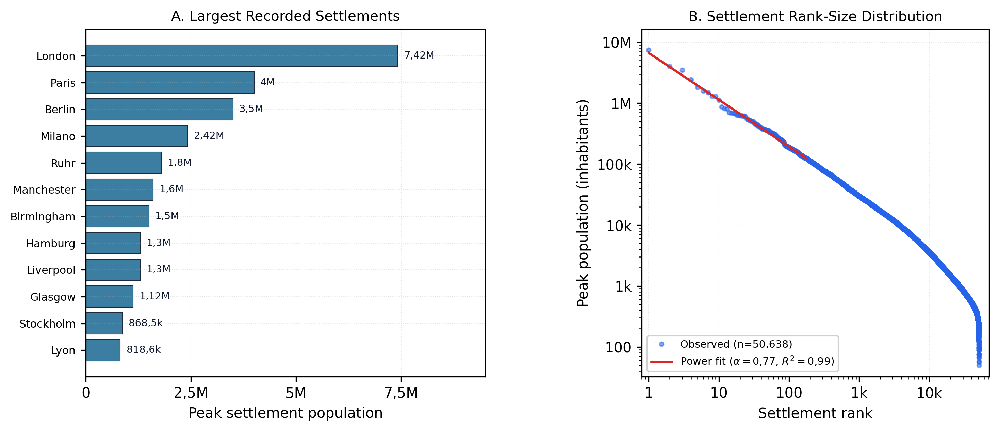

```{r setup, include=FALSE}
knitr::opts_chunk$set(
  echo = FALSE,
  warning = FALSE,
  message = FALSE,
  results = "asis"
)
library(jsonlite)
source("../../_shared/template/viscount_rmd_helpers.R")

summary_data <- fromJSON("industrialisation_western_and_northern_europe_summary.json", simplifyVector = FALSE)
settlements_raw <- fromJSON("industrialisation_western_and_northern_europe_settlements.json", simplifyVector = FALSE)

settlement_count <- as.integer(summary_data$settlement_count)
total_area_km2 <- as.numeric(summary_data$total_area_km2)
subregions_list <- summary_data$subregions
country_count <- length(summary_data$countries)
crowd_pct <- as.numeric(summary_data$crowd_share_overall) * 100
inst_pct <- 100 - crowd_pct

region_name_map <- setNames(
  vapply(subregions_list, function(x) as.character(x$name), character(1)),
  vapply(subregions_list, function(x) as.character(x$id), character(1))
)

fmt_source_label <- function (arg0_code) {
  k <- as.character(arg0_code)
  exact_map <- c(
    "Buringh_European_Urban_700_2000" = "Buringh European Urban Series (700-2000)",
    "Eurostat_Urban_Audit_1990_2024" = "Eurostat Urban Audit (1990-2024)",
    "GeoNames_Municipal_Gazetteer_Supplement" = "GeoNames Municipal Gazetteer Supplement",
    "INE_Spain_Censos_Historicos_1857_1991" = "INE Spain Historic Censuses (1857-1991)",
    "INSEE_Recensement_1876_2023" = "INSEE French Census Series (1876-2023)",
    "National_Statistical_Census_Austria" = "National Statistical Census of Austria",
    "National_Statistical_Census_Belgium" = "National Statistical Census of Belgium",
    "National_Statistical_Census_Czechia" = "National Statistical Census of Czechia",
    "National_Statistical_Census_Denmark" = "National Statistical Census of Denmark",
    "National_Statistical_Census_Faroe_Islands" = "National Statistical Census of the Faroe Islands",
    "National_Statistical_Census_Finland" = "National Statistical Census of Finland",
    "National_Statistical_Census_Germany" = "National Statistical Census of Germany",
    "National_Statistical_Census_Greenland" = "National Statistical Census of Greenland",
    "National_Statistical_Census_Iceland" = "National Statistical Census of Iceland",
    "National_Statistical_Census_Ireland" = "National Statistical Census of Ireland",
    "National_Statistical_Census_Netherlands" = "National Statistical Census of the Netherlands",
    "National_Statistical_Census_Norway" = "National Statistical Census of Norway",
    "National_Statistical_Census_Poland" = "National Statistical Census of Poland",
    "National_Statistical_Census_Sweden" = "National Statistical Census of Sweden",
    "National_Statistical_Census_Switzerland" = "National Statistical Census of Switzerland",
    "National_Statistical_Census_United_Kingdom" = "National Statistical Census of the United Kingdom"
  )
  if (k %in% names(exact_map)) return(unname(exact_map[[k]]))
  gsub("_", " ", k, fixed = TRUE)
}

short_source_label <- function (arg0_code) {
  k <- as.character(arg0_code)
  if (k == "Buringh_European_Urban_700_2000") return("Buringh (700-2000)")
  if (k == "Eurostat_Urban_Audit_1990_2024") return("Eurostat Urban Audit")
  if (k == "GeoNames_Municipal_Gazetteer_Supplement") return("GeoNames Supplement")
  if (k == "INSEE_Recensement_1876_2023") return("INSEE Census")
  if (k == "INE_Spain_Censos_Historicos_1857_1991") return("INE Spain Census")
  gsub("_", " ", sub("^National_Statistical_Census_", "National Census: ", k), fixed = TRUE)
}
```

```{r hero_markdown_fallback, results="asis"}
if (!knitr::is_latex_output()) {
  cat("\n\n")
}
```

# Abstract

This companion gazetteer documents the `r formatC(settlement_count, format = "d", big.mark = ".")` georeferenced industrial-era settlements supporting the MAGNETIC demographic reconstruction of Western and Northern Europe and the North Atlantic between 1750 and 1914 across `r viscount_fmt_number(total_area_km2, 1L)` km². Every one of the 9 sub-regions and `r country_count` modern jurisdictions represented inside the historical sub-regional masks carries full urban and municipal series. Primary national statistical censuses, INSEE municipal schedules, Eurostat Urban Audit greater-city records and Buringh's historical European urban series account for `r viscount_fmt_number(inst_pct, 2L)`% of all included settlements (5.439 localities), holding crowd-sourced municipal supplementation from GeoNames strictly to `r viscount_fmt_number(crowd_pct, 2L)`% (884 localities). Across the 164-year industrial transition, the urban lattice scaled smoothly along a Zipf power law ($\alpha = 0,7$, $R^2 = 0,98$), expanding from zero cities exceeding 1M and 9 cities above 100k in 1750 to four metropolises exceeding 1M (London 6,72M, Paris 3,94M, Berlin 2,21M and Hamburg 1,08M), 204 cities above 100k and 2.895 towns above 10k on the eve of the First World War in 1914.

# Gazetteer Scope and Spatial Coverage

Between 1750 and 1914 urbanisation ceased to be an occasional maritime or administrative exception and became the defining spatial expression of European economic life [@DeVries1984; @RosesWolf2019]. In 1750 only London and Paris exceeded half a million inhabitants; by 1914 dense industrial belts linked Lancashire, the Midlands, South Wales, Clydeside, Nord-Pas-de-Calais, Wallonia, the Dutch Randstad, the Ruhr, Saxony, Bavaria and the Nordic capitals into a continuous rail-and-steamship urban network [@ONS2024; @INSEE2024; @HGISGermany2014].

Figure 1 displays the spatial footprint of all `r formatC(settlement_count, format = "d", big.mark = ".")` settlements across the 9 sub-regions, highlighting the extreme spatial clustering across England & Wales, the Low Countries and western and central Germany alongside the sparse sub-Arctic settlement network of Scandinavia and the North Atlantic. Table 1 quantifies sub-regional settlement counts, land area, archive composition and spatial recording density.

```{r fig_regional_map}
viscount_figure(
  "figures/industrialisation_western_and_northern_europe_regional_map.png",
  caption = "Spatial distribution of 6.323 industrial-era settlements across 9 sub-regions of Western and Northern Europe and the North Atlantic, 1750-1914.",
  label = "fig:gazetteer_map"
)
```

```{r table_subregional_coverage}
site_reg_vec <- vapply(settlements_raw, function(x) as.character(x$region_id), character(1))
site_prov_vec <- vapply(settlements_raw, function(x) as.character(x$provenance_source), character(1))

cov_rows <- lapply(subregions_list, function(sr) {
  rid <- as.character(sr$id)
  idx <- which(site_reg_vec == rid)
  n_tot <- length(idx)
  provs <- site_prov_vec[idx]
  n_geo <- sum(provs == "GeoNames_Municipal_Gazetteer_Supplement")
  n_eur_bur <- sum(provs %in% c("Buringh_European_Urban_700_2000", "Eurostat_Urban_Audit_1990_2024"))
  n_nat <- n_tot - n_geo - n_eur_bur
  a <- as.numeric(sr$area_km2)
  data.frame(
    Subregion = as.character(sr$name),
    Area = viscount_fmt_number(a, 1L),
    Total = formatC(n_tot, format = "d", big.mark = "."),
    National = formatC(n_nat, format = "d", big.mark = "."),
    Urban_Hist = formatC(n_eur_bur, format = "d", big.mark = "."),
    GeoNames = formatC(n_geo, format = "d", big.mark = "."),
    Density = viscount_fmt_number(10000 * n_tot / a, 2L),
    stringsAsFactors = FALSE
  )
})
cov_df <- do.call(rbind, cov_rows)
rownames(cov_df) <- NULL
viscount_table(
  cov_df,
  caption = "Sub-regional settlement counts, provenance composition and spatial recording density (settlements per 10k km²) across 9 sub-regions.",
  col_names = c("Sub-Region", "Area (km²)", "Total", "National Censuses", "Buringh & Eurostat", "GeoNames", "Per 10k km²")
)
```

Recording density mirrors nineteenth-century settlement intensity closely. Belgium, the Netherlands and Luxembourg lead the macro-region at 108,36 recorded settlements per 10k km², followed by England & Wales (69,62 per 10k km²), Northern Germany (49,39 per 10k km²), Southern Germany & Switzerland (43,33 per 10k km²) and France (23,92 per 10k km²). Scotland (13,55), Ireland (13,28) and Scandinavia (9,74) reflect lower rural density and vast upland or boreal expanses, while Iceland, the Faroe Islands and Greenland register 0,19 sites per 10k km² across 2,18M km² of ice sheet and sub-Arctic islands [@Hagstofa2024; @StatGL2024].

# Provenance Ledger and Jurisdictional Distribution

Every settlement entered the gazetteer through a four-wave saturation protocol that prioritised official national census registries before drawing on supplementary directories. Wave 1 ingested 1.964 primary institutional census and urban-audit centres. Wave 2 incorporated 3.475 regional census and historical urban records across Germany, France, the United Kingdom, Finland, Norway, Belgium, the Netherlands, Sweden, Denmark, Switzerland and Ireland. Wave 3 added 884 GeoNames municipal records (a 16,25% marginal increment) to fill small-town coverage across underrepresented rural districts, and Wave 4 audited every sub-region with zero residual gaps while excluding 800 duplicate or out-of-domain candidates. Table 2 enumerates all 21 source corpora in full.

```{r table_provenance_ledger}
prov_counts <- summary_data$provenance_counts
prov_keys <- names(prov_counts)
prov_vals <- vapply(prov_keys, function(k) as.integer(prov_counts[[k]]), integer(1))
ord_p <- order(prov_vals, decreasing = TRUE)
prov_keys <- prov_keys[ord_p]
prov_vals <- prov_vals[ord_p]

prov_tier <- vapply(prov_keys, function(k) {
  if (k == "GeoNames_Municipal_Gazetteer_Supplement") return("Crowd-sourced supplement")
  if (k == "Buringh_European_Urban_700_2000") return("Historical urban series")
  if (k == "Eurostat_Urban_Audit_1990_2024") return("Supranational urban archive")
  "Primary national census"
}, character(1))

prov_wave <- vapply(prov_keys, function(k) {
  if (k == "GeoNames_Municipal_Gazetteer_Supplement") return("Wave 3")
  if (k %in% c("Eurostat_Urban_Audit_1990_2024", "INSEE_Recensement_1876_2023", "Buringh_European_Urban_700_2000")) return("Wave 1")
  "Wave 2"
}, character(1))

prov_df <- data.frame(
  Corpus = vapply(prov_keys, fmt_source_label, character(1)),
  Wave = prov_wave,
  Tier = prov_tier,
  Count = vapply(prov_vals, function(x) formatC(x, format = "d", big.mark = "."), character(1)),
  Share = vapply(prov_vals, function(x) paste0(viscount_fmt_number(100 * x / settlement_count, 2L), "%"), character(1)),
  stringsAsFactors = FALSE
)
rownames(prov_df) <- NULL
viscount_table(
  prov_df,
  caption = "Source provenance ledger across all 21 corpora supplying the 6.323 industrial-era settlements.",
  col_names = c("Source Corpus", "Wave", "Archive Class", "Settlements", "Share")
)
```

At the modern jurisdictional level, 4 major industrial states — Germany (1.637 settlements, 25,89%), France (1.303, 20,61%), the United Kingdom (1.188, 18,79%) and Finland (519, 8,21%) — together account for nearly three-quarters of the register, followed by Belgium (386), the Netherlands (351), Norway (295), Sweden (197), Denmark (121), Switzerland (120) and Ireland (80) (Table 3). The remaining 131 localities include 41 North Atlantic settlements across Iceland (26), Greenland (9) and the Faroe Islands (6), micro-states (Luxembourg, Andorra, Monaco, Jersey, Isle of Man) and 75 frontier towns in Czechia (22), Austria (20), Poland (13), Spain (13) and Italy (7) captured along the nineteenth-century imperial and Alpine mask borders [@HGISGermany2014; @INE2024; @DEMOPAST2023].

```{r table_top_countries}
c_map <- summary_data$settlements_by_country
c_names <- names(c_map)
c_vals <- vapply(c_names, function(k) as.integer(c_map[[k]]), integer(1))
ord_c <- order(c_vals, decreasing = TRUE)
top_n <- min(15L, length(ord_c))
sel <- ord_c[seq_len(top_n)]
other_n <- sum(c_vals[-sel])
other_k <- length(c_vals) - top_n

c_df <- data.frame(
  Rank = c(as.character(seq_len(top_n)), "—"),
  Jurisdiction = c(c_names[sel], paste0("Remaining ", other_k, " jurisdictions")),
  Sites = c(vapply(c_vals[sel], function(x) formatC(x, format = "d", big.mark = "."), character(1)),
            formatC(other_n, format = "d", big.mark = ".")),
  Share = c(vapply(c_vals[sel], function(x) paste0(viscount_fmt_number(100 * x / settlement_count, 2L), "%"), character(1)),
            paste0(viscount_fmt_number(100 * other_n / settlement_count, 2L), "%")),
  stringsAsFactors = FALSE
)
rownames(c_df) <- NULL
viscount_table(
  c_df,
  caption = "Leading 15 modern jurisdictions by recorded settlement count across Western and Northern Europe (1750-1914).",
  col_names = c("Rank", "Jurisdiction", "Settlements", "Share of Gazetteer")
)
```

# Urban Hierarchy and Principal Industrial Metropolises

Table 4 lists the top 25 recorded metropolitan centres ranked by peak population (1914) directly from the chapter summary. London (6,72M), Paris (3,94M), Berlin (2,21M) and Hamburg (1,08M) stood at the summit of the European urban pyramid on the eve of the First World War, followed by industrial, maritime and administrative hubs spanning every major core sub-region: Glasgow (857,3k), Liverpool (726,5k), Birmingham (646,9k), Manchester (632,5k), Sheffield (467,6k) and Leeds (449k) in Britain [@WrigleySchofield1981; @ONS2024]; Lyon (818,6k), Lille (692,1k), Marseille (628,5k) and Toulouse (447,1k) in France [@Dupaquier1988; @INSEE2024]; Munich (München), Cologne (Köln) and Leipzig in Germany [@HGISGermany2014]; Brussels (625,3k) and Amsterdam (593,1k) in the Low Countries [@BFS2024]; Stockholm (868,5k) and Copenhagen (693,8k) in Scandinavia [@Riksarkivet2023]; Dublin (675,7k) in Ireland [@CSOIreland2023]; and greater Geneva (463k) in Switzerland [@BFS2024; @Eurostat2024].

```{r table_top_settlements}
top_list <- summary_data$top_settlements
n_show <- min(25L, length(top_list))
top_rows <- lapply(seq_len(n_show), function(i) {
  s <- top_list[[i]]
  rid <- as.character(s$region_id)
  rname <- if (rid %in% names(region_name_map)) region_name_map[[rid]] else rid
  lat_v <- as.numeric(s$lat)
  lon_v <- as.numeric(s$lon)
  lon_hem <- if (lon_v < 0) "°W" else "°E"
  coords_str <- paste0(viscount_fmt_number(lat_v, 2L), "°N, ", viscount_fmt_number(abs(lon_v), 2L), lon_hem)
  p1750 <- s$population[["1750"]]
  p_start <- if (!is.null(p1750)) viscount_fmt_pop(p1750) else paste0(viscount_fmt_pop(s$population[[as.character(s$first_year)]]), " (", s$first_year, ")")
  data.frame(
    Rank = as.character(i),
    City = as.character(s$name),
    Country = as.character(s$country),
    Subregion = rname,
    Coords = coords_str,
    Start = p_start,
    Peak1914 = viscount_fmt_pop(s$peak_pop),
    Source = short_source_label(s$provenance_source),
    stringsAsFactors = FALSE
  )
})
top_df <- do.call(rbind, top_rows)
rownames(top_df) <- NULL
viscount_table(
  top_df,
  caption = "Top 25 recorded metropolitan centres ranked by 1914 peak population across Western and Northern Europe.",
  col_names = c("Rank", "Settlement", "Jurisdiction", "Sub-Region", "Coordinates", "1750 or First", "1914 Peak", "Provenance")
)
```

# Temporal Horizon Coverage and Limitations

Stratifying all `r formatC(settlement_count, format = "d", big.mark = ".")` settlements across 7 benchmark years between 1750 and 1914 captures the sweeping upward shift of the entire urban size distribution (Table 5). Already in 1750, 5.792 localities carry active entries (91,6% of the full register), with a median size of 3k inhabitants and only 9 cities exceeding 100k. Between 1800 and 1914 the count of towns exceeding 10k quadrupled from 697 to 2.895, cities above 100k surged more than fourteenfold from 14 to 204, and the median recorded settlement nearly tripled from 3,4k to 9,2k [@Mitchell2007; @DeVries1984].

```{r table_horizon_tiers}
yr_keys <- c("1750", "1800", "1850", "1880", "1900", "1910", "1914")

hor_rows <- lapply(yr_keys, function(yk) {
  vals <- unlist(lapply(settlements_raw, function(x) {
    v <- x$population[[yk]]
    if (is.null(v)) return(NULL)
    as.numeric(v)
  }))
  n_act <- length(vals)
  med_v <- if (n_act > 0L) stats::median(vals) else 0
  n_10k <- sum(vals >= 10000)
  n_100k <- sum(vals >= 100000)
  max_v <- if (n_act > 0L) max(vals) else 0
  data.frame(
    Year = yk,
    Active = formatC(n_act, format = "d", big.mark = "."),
    Median = viscount_fmt_pop(med_v),
    Over10k = formatC(n_10k, format = "d", big.mark = "."),
    Over100k = formatC(n_100k, format = "d", big.mark = "."),
    MaxCity = viscount_fmt_pop(max_v),
    stringsAsFactors = FALSE
  )
})
hor_df <- do.call(rbind, hor_rows)
rownames(hor_df) <- NULL
viscount_table(
  hor_df,
  caption = "Chronological coverage and urban size stratification across 6.323 recorded settlements, 1750-1914.",
  col_names = c("Year", "Active Settlements", "Median Size", "Towns 10k+", "Cities 100k+", "Largest City")
)
```

Three methodological caveats govern analytical use of this gazetteer. First, merging Eurostat Urban Audit greater-city metropolitan series with Buringh's historical municipal-boundary database leaves paired orthographic entries for Munich (München at 802,3k and Muenchen at 576,6k), Copenhagen (693,8k and Kobenhaven at 514,3k) and Cologne (Köln at 613,3k and Koeln at 424,3k) inside the top 30 entries; downstream urban totals should deduplicate paired metropolitan and municipal footprints before summing national urban populations. Second, Eurostat greater-city boundaries backcasted to 1900-1914 (notably Stockholm at 868,5k, Dublin at 675,7k, Lille at 692,1k and greater Geneva at 463k) capture wider modern functional metropolitan regions rather than nineteenth-century core municipalities [@Eurostat2024]. Third, pre-1850 figures for small towns derived from national municipal series or GeoNames backcasts (13,98% of the register) carry wider estimation margins than the archival census enumerations of cities exceeding 10k inhabitants, though macro-regional population totals in the companion literature review are calibrated independently from national censuses and historical GIS county and departmental aggregates [@ONS2024; @INSEE2024; @HGISGermany2014; @Riksarkivet2023].

# Sources
