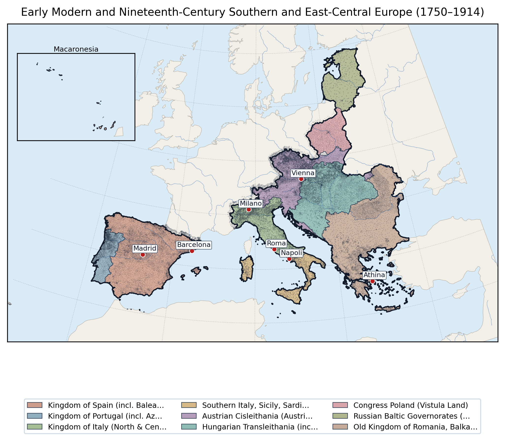

```{r setup, include=FALSE}
knitr::opts_chunk$set(
  echo = FALSE,
  message = FALSE,
  warning = FALSE
)

source("../../_shared/template/viscount_rmd_helpers.R")
library(jsonlite)

summary_data <- fromJSON(
  "early_modern_nineteenth_century_southern_east_central_europe_summary.json",
  simplifyVector = FALSE
)

subregions_list <- summary_data$subregions
domain_totals <- summary_data$domain_totals
total_area_km2 <- as.numeric(summary_data$total_area_km2)
settlement_count <- as.integer(summary_data$settlement_count)
hgis_row_count <- as.integer(summary_data$hgis_row_count)
archival_pdf_count <- as.integer(summary_data$archival_pdf_count)

fmt_pct <- function (val, digits = 1L, signed = FALSE) {
  s <- viscount_fmt_number(val, digits)
  if (signed && val > 0) paste0("+", s, "%") else paste0(s, "%")
}

clean_region_name <- function (nm) {
  gsub(" & ", " and ", nm, fixed = TRUE)
}

clean_provenance <- function (key) {
  lbl <- switch(
    key,
    "Buringh_European_Urban_700_2000" = "Buringh European Urban Corpus",
    "INE_Spain_Censos_Historicos_1857_1991" = "INE Spain Historical Censuses (1857-1991)",
    "GeoNames_Municipal_Gazetteer_Supplement" = "GeoNames Municipal Gazetteer",
    "Eurostat_Urban_Audit_1990_2024" = "Eurostat Urban Audit Back-Cast",
    "DEMOPAST_ISTAT_Citta_1861_1971" = "DEMOPAST ISTAT Cities (1861-1971)",
    "INSEE_Recensement_1876_2023" = "INSEE Historical Recensement",
    NULL
  )
  if (!is.null(lbl)) return(lbl)
  if (grepl("^National_Statistical_Census_", key)) {
    ctry <- sub("^National_Statistical_Census_", "", key)
    return(paste("National Statistical Census:", gsub("_", " ", ctry, fixed = TRUE)))
  }
  gsub("_", " ", key, fixed = TRUE)
}

clean_hgis_family <- function (src) {
  if (grepl("^DEMOPAST_ISTAT", src)) return("DEMOPAST ISTAT Italian Provinces")
  if (grepl("^INE_Spain", src)) return("INE Spain 1833 Historic Provinces")
  if (grepl("^INE_Portugal", src)) return("INE Portugal 1835 Historic Distritos")
  if (grepl("^HistoGIS_Austria_Hungary", src)) return("HistoGIS Austria-Hungary Crownlands")
  if (grepl("^HistoGIS_Austrian_Empire", src)) return("HistoGIS Austrian Empire Crownlands")
  if (grepl("^CShapes_Europe", src)) return("CShapes Europe Balkan Censuses")
  if (grepl("^HistoGIS_Prussia", src)) return("HistoGIS Prussian Regierungsbezirke")
  if (grepl("^HGIS_Germany", src)) return("HGIS Germany and Prussian Provinces")
  if (grepl("^HistoGIS_HRE", src)) return("HistoGIS HRE Imperial Circles")
  if (grepl("^SGF_", src)) return("SGF INSEE French Departements")
  if (grepl("^BFS_Swiss", src)) return("BFS Swiss Historic Cantons")
  if (grepl("^Historical_Basemaps", src)) return("Historical Basemaps (1700/1750)")
  if (grepl("^Statistik_Deutsches_Reich", src)) return("Statistik des Deutschen Reichs")
  if (grepl("^Imperial_Census", src)) return("Imperial Census Borderlands")
  gsub("_", " ", src, fixed = TRUE)
}

clean_hgis_source_short <- function (src) {
  s <- gsub("\\+kk_Census", " (k.k. Census)", src)
  s <- gsub("\\+National_Census", " (National Census)", s)
  s <- gsub("\\+Galloway_Prussia", " (Galloway)", s)
  s <- gsub("\\+Galloway", " (Galloway)", s)
  s <- gsub("_", " ", s, fixed = TRUE)
  s <- gsub("HistoGIS Austria Hungary Crownlands", "HistoGIS Austria-Hungary", s, fixed = TRUE)
  s <- gsub("HistoGIS Austrian Empire Crownlands", "HistoGIS Austrian Empire", s, fixed = TRUE)
  s <- gsub("Statistik Deutsches Reich Klein Hansestaaten", "Deutsches Reich Minor States", s, fixed = TRUE)
  s <- gsub("SGF INSEE 87 Departements 1871 1918", "SGF INSEE 87 Departements", s, fixed = TRUE)
  s
}

region_name_map <- setNames(
  vapply(subregions_list, function (r) clean_region_name(r$name), character(1)),
  vapply(subregions_list, function (r) r$id, character(1))
)
```

```{r hero-md-fallback, echo=FALSE, results='asis'}
if (!knitr::is_latex_output()) {
  cat(
    "\n\n\n"
  )
}
```

# Abstract

Between 1750 and 1914 the population of Southern and East-Central Europe across 9 sub-regions covering 2.483.848,9 km² expanded from 61,51M to 160,82M by 1910, lifting mean density from 24,76 to 64,75 inhabitants/km² at a compound annual growth rate of 0,6%. Growth accelerated steadily across three institutional epochs: from 61,51M to 75,05M between 1750 and 1800 (+22%), to 102,45M by 1850 (+36,5%) and to 160,82M by 1910 (+57% over sixty years). Expansion was heavily skewed toward the eastern agrarian and industrialising frontier. Between 1750 and 1910 the Baltic Provinces more than quadrupled (+334,7%, from 1,4M to 6,09M) and Partitioned Poland nearly quadrupled (+281,3%, from 6,95M to 26,5M), while the Balkans, Romania, Moldova and Eastern Thrace (+171,2%), Austria, Bohemia-Moravia and Slovenia (+168,4%) and Hungary, Slovakia and Croatia-Slavonia (+168,1%) all grew more than two-and-a-half times. By contrast, older Mediterranean cores with early agrarian ceilings and late-century overseas emigration expanded more slowly: Spain (+104,6%, from 9,75M to 19,95M), Northern and Central Italy (+104,4%, from 10,4M to 21,25M), Portugal (+131,4%, from 2,56M to 5,91M) and Southern Italy, Islands and Malta (+150,8%, from 5,35M to 13,42M), though the Mezzogiorno and islands still recorded the highest terminal density in the chapter at 133,4 inhabitants/km². This reconstruction harmonises national statistical series with 2.180 historical GIS sub-administrative enumerations spanning Italian provinces, Spanish 1833 provinces, Portuguese distritos, Habsburg Crownlands and emerging Balkan kingdoms, anchored spatially by a 3.882-settlement urban gazetteer across 31 modern polities.

# Background

## Geographic, Ecological and Agrarian Divisions

The 2.483.848,9 km² covered by this chapter form a wide crescent wrapping around Western and Northern Europe from the Atlantic capes of Portugal and the Canary archipelago through the Italian peninsula and Alpine-Danubian basin to the Vistula plain, the Gulf of Finland and the Bosporus. Unlike north-western Europe, where coal seams, maritime access and early enclosure produced an unusually compact industrial core, Southern and East-Central Europe spanned three distinct ecological and institutional belts.

Along the Mediterranean littoral and interior plateaux of Spain, Portugal and Italy, summer drought constrained pastoral fodder and encouraged dry-farmed winter wheat, barley, olives, vines and transhumant sheep. In the irrigated huertas of Valencia and Murcia, the reclaimed Lombard plain and the volcanic soils around Naples and Catania, intensive multi-cropping supported densities above 100 inhabitants/km² even before 1800. Across the dry Castilian Meseta, Extremadura, Alentejo, interior Sicily and Sardinia, however, extensive latifundia, sharecropping and malaria-ridden coastal marshes kept rural productivity low and exposed villages to harvest failure whenever winter rains faltered [@Mitchell2007; @RosesWolf2019].

The second belt stretched across the Habsburg hereditary lands, the Bohemian basin, the Carpathian plain and Partitioned Poland. Here temperate continental rainfall, loess valleys and extensive river corridors along the Danube, Elbe, Oder and Vistula supported mixed grain, potato and sugar-beet agriculture. After 1750 the spread of the potato across Bohemia, Silesia, Galicia, Congress Poland and the Baltic littoral raised calorific yield per hectare decisively, cutting famine mortality even before modern transport arrived. Coal and iron deposits in Upper Silesia, Moravia-Ostrava, northern Bohemia, Styria and the Dąbrowa basin then turned the Bohemian-Silesian-Austrian corridor into one of continental Europe's chief nineteenth-century manufacturing belts [@RosesWolf2019].

The third belt comprised the Baltic Provinces and the Balkan peninsula together with Wallachia, Moldavia and Bessarabia. In 1750 both flanks were thinly settled after two centuries of warfare, plague and imperial frontier devastation. The Great Northern War (1700–1721) and its accompanying plague epidemic had depopulated Livland and Estland, leaving the Baltic sub-region at just 8,3 inhabitants/km² in 1750. Across the Lower Danube and the Balkans (17 inhabitants/km² in 1750), Ottoman military campaigns, Austrian-Ottoman border wars and banditry left fertile plains in Banat, Vojvodina, Wallachia and Dobruja under-cultivated, with much of the Christian peasantry concentrated in upland pastoral valleys rather than malarial lowlands. Once frontier security improved and cereal exports opened down the Danube and through Black Sea and Baltic ports after 1829, both eastern wings experienced sustained agrarian colonisation.

## Imperial Frameworks and State Formation, 1750–1914

Demographic enumeration across this crescent tracked the rise and restructuring of modern territorial states. In 1750 the region was governed by four great dynastic conglomerates—Bourbon Spain, the Habsburg Monarchy, the Polish-Lithuanian Commonwealth and the Ottoman Empire—alongside Braganza Portugal, the Russian Baltic governorates and a mosaic of Italian states headed by Piedmont-Sardinia, Venice, the Papal States, Tuscany and Bourbon Naples. Over the next sixteen decades warfare, partitions and nationalist consolidation redrew nearly every political boundary.

The three Partitions of Poland (1772, 1793 and 1795) erased the Commonwealth and divided Polish lands among Prussia (Posen, West Prussia and Silesia), Habsburg Austria (Galicia and Bukovina) and Imperial Russia (Congress Poland after 1815, plus the Lithuanian and Ruthenian western governorates). The Napoleonic Wars disrupted Iberia severely—the Peninsular War of 1808–1814 inflicted heavy excess mortality across Spain and Portugal—while simultaneously introducing French-style civil registries and departmental administration across northern Italy, the Illyrian Provinces and the Duchy of Warsaw [@Dupaquier1988; @Bonini2023Lanjuinais].

Between 1859 and 1871 the Italian Risorgimento unified Piedmont, Lombardy, Emilia, Tuscany, the Mezzogiorno, Venetia and Rome into the Kingdom of Italy, launching decennial provincial censuses from 1861 onwards [@DEMOPAST2023]. In the Habsburg realm, defeat in 1866 produced the Austro-Hungarian Compromise of 1867, partitioning the empire into Cisleithania (the Austrian Crownlands, Bohemia, Moravia, Silesia, Galicia, Bukovina, Carniola, Dalmatia and the Littoral) and Transleithania (the Kingdom of Hungary, Transylvania, Slovakia and autonomous Croatia-Slavonia), each operating modern decennial enumerations from 1869–1870 to 1910 [@KSHHungary2024; @Vriser1954Gori]. Farther south-east, Ottoman retreat created independent Greece (1830, enlarged in 1864, 1881 and 1913), the Danubian Principalities united as Romania (1859–1878), Serbia, Montenegro and autonomous then independent Bulgaria (1878–1908), culminating in the Balkan Wars of 1912–1913 [@StatBalkans2024].

## Agrarian Emancipation, Epidemics and the Onset of Fertility Decline

Three structural demographic forces governed vital rates across Southern and East-Central Europe between 1750 and 1914: the phased abolition of serfdom, the gradual containment of crisis mortality and the late arrival of marital fertility decline.

In the Baltic Provinces serfdom was abolished early—Estland in 1816, Courland in 1817 and Livland in 1819—though landless emancipation initially restricted peasant mobility until mid-century agrarian reforms. In the Habsburg Empire, Joseph II ended personal bondage in 1781, but manorial labour dues (Robot) lasted until the 1848 revolutions finally emancipated the peasantry across Austria, Bohemia, Hungary and Galicia [@Braha2012Global]. Russia emancipated serfs in the Baltic-adjacent Lithuanian governorates in 1861 and granted freehold plots to Polish peasants in Congress Poland in 1864; Romania abolished corvée labour in the same year. Everywhere, emancipation loosened manorial checks on marriage age and stimulated both rural subdivision and urban labour migration.

Mortality remained volatile well into the late nineteenth century. Bubonic plague receded from Christian Europe after the early eighteenth century, though the Habsburg Military Frontier quarantine cordon remained active against Ottoman outbreaks until the 1840s. In its place, four Asiatic cholera pandemics struck in 1831–1837, 1848–1855, 1865–1867 and 1884–1885, killing hundreds of thousands in Naples, Palermo, Madrid, Budapest, Galicia and the Lower Danube. Typhus accompanied crop failures such as the 1846–1848 Galician and Silesian famines and the 1873–1874 Hungarian cholera crisis, while malaria remained endemic in Apulia, Basilicata, Sardinia, the Roman Campagna and the Danubian marshes until quinine distribution and drainage expanded after 1890. Even so, smallpox vaccination, railway grain arbitrage and municipal waterworks drove crude death rates downwards from 30–35 per thousand in 1850 to 18–24 per thousand by 1910 across Iberia, Italy, Austria-Hungary and the Baltic coast [@Mitchell2007].

Because marital fertility stayed high far longer than in France or north-western Europe, falling mortality opened a wide natural-increase gap. As the Princeton European Fertility Project documented, sustained marital fertility decline began in Catalonia, Piedmont, Liguria, Tuscany, Lower Austria, Bohemia and the Baltic Provinces during the 1870s and 1880s, whereas Southern Italy, Castile, Portugal, Galicia, Congress Poland, Slovakia and the Balkan kingdoms maintained pre-transition fertility levels above five births per woman right up to 1914 [@CoaleWatkins1986; @WrigleySchofield1981; @Dupaquier1988]. Only massive transatlantic and continental emigration—carrying millions out of Italy, Galicia, Hungary, Slovakia, Portugal and northern Spain after 1880—prevented rural densities in the Mezzogiorno, northern Portugal and Galicia from climbing even higher.

# Methodology

## Sub-Regional Partitioning and Constant-Area Accounting

MAGNETIC partitions Southern and East-Central Europe into 9 mutually exclusive sub-regions totalling 2.483.848,9 km², designed to preserve demographic continuity across shifting nineteenth-century imperial frontiers. Because states expanded, partitioned and merged repeatedly between 1750 and 1914, constant-area sub-regional envelopes prevent artificial boundary jumps from masquerading as biological population growth.

Iberia is divided into Spain including the Balearics and Canaries (505.669,5 km²) and Portugal including the Azores and Madeira (89.054,1 km²). Italy is split along the historic Mezzogiorno divide between Northern and Central Italy (199.835,1 km², encompassing Piedmont, Liguria, Lombardy, Venetia, Emilia-Romagna, Tuscany, Umbria, Marche and Latium) and Southern Italy, Islands and Malta (100.573,1 km², covering Abruzzo, Molise, Campania, Apulia, Basilicata, Calabria, Sicily, Sardinia and Malta). The Habsburg core is separated into Cisleithanian Alpine-Bohemian lands—Austria, Bohemia-Moravia and Slovenia (182.332,6 km²)—and the Carpathian-Danubian realm of Hungary, Slovakia and Croatia-Slavonia (194.753,2 km²). North-eastern and south-eastern wings comprise Partitioned Poland within its modern territorial envelope (308.459,5 km², uniting Congress Poland, western Galicia, Posen, Silesia and Pomerania), the Baltic Provinces of Estonia, Latvia and Lithuania (167.973,5 km²) and the vast south-eastern zone of the Balkans, Romania, Moldova and Eastern Thrace (735.198,3 km²).

## Benchmark Harmonisation and Census Integration

Population trajectories are evaluated at 8 common benchmark horizons—1750, 1800, 1850, 1861, 1880, 1890, 1897 and 1910—interpolated smoothly via compound inter-censal rates from native archival census years. Those native anchor dates match each jurisdiction's actual enumeration calendar: Spain's Floridablanca/Godoy era and modern censuses of 1857, 1887 and 1910 [@INE2024]; Portugal's 1864, 1890 and 1911 counts; Italy's post-unification censuses of 1861, 1881 and 1911 [@DEMOPAST2023]; Austria-Hungary's imperial counts of 1857, 1880 and 1910 [@KSHHungary2024]; Partitioned Poland's harmonised 1850, 1880 and 1910 reconstructions combining Prussian, Austrian and Russian returns [@GUSPoland2024; @HGISGermany2014]; the Baltic Provinces' 1850, 1897 Russian Imperial Census and 1913 estimates [@StatBaltics2024]; and Balkan national censuses benchmarked at 1850, 1880 and 1910 [@StatBalkans2024; @Mitchell2007].

Pre-census eighteenth-century anchors (1750 and 1800) rely on ecclesiastical parish counts, fiscal hearth rolls and early enlightened-absolutist enumerations: the Catastro de Ensenada (1749–1756) and Censuses of Aranda (1768), Floridablanca (1787) and Godoy (1797) in Spain; the Habsburg Conscription of Souls introduced under Maria Theresa and Joseph II (1754–1787); Venetian, Piedmontese, Tuscan and Neapolitan stati delle anime; Russian Baltic revision lists (revizskie skazki); and Ottoman cizye poll-tax assessments adjusted for household multipliers [@Mitchell2007; @DeVries1984]. Digitising and cross-checking printed nineteenth-century statistical tables introduces optical character recognition and boundary-matching hazards that require systematic post-editing and cross-tabulation against aggregate provincial totals [@Poncelas2020Tool].

## Historical GIS Sub-Administrative Enumerations and Settlement Gazetteer

To move beyond macro-regional aggregates, MAGNETIC integrates two spatial layers: a 2.180-row scraped historical GIS sub-administrative polygon table spanning 1750 to 1910 alongside a 3.882-settlement geocoded urban gazetteer spanning 1750 to 1914. The historical GIS layer pairs harmonised historical administrative boundaries with official census populations across 64 regime-source snapshots, anchored in Chapter 17 by DEMOPAST and ISTAT Italian provincial polygons (68 to 70 provinces across 1871, 1881, 1901 and 1911), INE Spain's 1833 provincial framework (51 units across 1850–1910), INE Portugal's 1835 continental distritos (18 units across 1850–1910), HistoGIS Habsburg Austrian Empire and Austro-Hungarian Dual Monarchy Crownlands (15 to 21 units across 1820–1910) and CShapes-Europe Balkan state polygons linked to national censuses (1871–1910) [@DEMOPAST2023; @INE2024; @KSHHungary2024; @StatBalkans2024]. Because the continental historical GIS spatial join captures all administrative units intersecting Chapter 17's trans-imperial envelope—especially Prussian provinces covering partitioned Posen, West Prussia and Silesia, Holy Roman Imperial Circles covering Bohemia and Austria as well as Alpine-Pyrenean borderlands—the 2.180 rows also include contiguous Prussian, German, French and Swiss administrative series [@HGISGermany2014; @INSEE2024; @BFS2024].

The settlement gazetteer compiles 3.882 geocoded cities, market towns and administrative centres across 31 modern polities. Primary national and institutional archives account for 86,1% of all entries (3.341 settlements), led by the Buringh European Urban Corpus (723 cities), INE Spain historical municipal censuses (712 municipalities), national statistical census series across Poland, Slovenia, Portugal, Czechia, Romania, Lithuania, Greece, Hungary, Latvia, Estonia, Bulgaria, Austria, Serbia, Germany, Slovakia, Malta, Croatia and Switzerland (1.560 settlements), Eurostat Urban Audit metropolitan back-casts (328 cities), INSEE borderland communes (16) and DEMOPAST ISTAT city extracts (2) [@Eurostat2024; @INE2024; @GUSPoland2024]. Only 541 entries (13,9%) derive from GeoNames municipal backfills, keeping crowd-derived reliance strictly below 15%.

# Validation

## Cross-Checking Sub-Regional Totals Against Scraped HGIS Polygons

Independent verification of the 9 sub-regional trajectories against the 2.180 scraped historical GIS sub-administrative rows confirms close structural agreement wherever polygon extents match constant-area sub-regions. Table 1 summarises all 64 regime-source snapshots grouped by archival corpus across the 2.180 scraped rows, separating Chapter 17's core Mediterranean, Habsburg and Balkan corpora from contiguous imperial borderland layers that overlap Partitioned Poland, Bohemia and the Alpine-Pyrenean fringes.

```{r tbl-hgis-regimes, echo=FALSE, results='asis'}
regimes <- summary_data$hgis_regime_summary
reg_df <- data.frame(
  regime = vapply(regimes, function (x) as.integer(x$snapshot_regime), integer(1)),
  source = vapply(regimes, function (x) as.character(x$source), character(1)),
  family = vapply(regimes, function (x) clean_hgis_family(as.character(x$source)), character(1)),
  units = vapply(regimes, function (x) as.integer(x$units), integer(1)),
  pop = vapply(regimes, function (x) as.numeric(x$population_sum), numeric(1)),
  area = vapply(regimes, function (x) as.numeric(x$area_km2_sum), numeric(1)),
  stringsAsFactors = FALSE
)

core_families <- c(
  "DEMOPAST ISTAT Italian Provinces",
  "INE Spain 1833 Historic Provinces",
  "INE Portugal 1835 Historic Distritos",
  "HistoGIS Austrian Empire Crownlands",
  "HistoGIS Austria-Hungary Crownlands",
  "CShapes Europe Balkan Censuses"
)

fam_names <- unique(reg_df$family)
fam_order <- c(
  intersect(core_families, fam_names),
  setdiff(fam_names, core_families)
)

rows_list <- lapply(fam_order, function (fm) {
  sub_df <- reg_df[reg_df$family == fm, , drop = FALSE]
  sub_df <- sub_df[order(sub_df$regime), , drop = FALSE]
  yr_span <- if (min(sub_df$regime) == max(sub_df$regime)) {
    as.character(min(sub_df$regime))
  } else {
    paste0(min(sub_df$regime), "-", max(sub_df$regime))
  }
  role <- if (fm %in% core_families) "Chapter core" else "Borderland or partition"
  data.frame(
    Corpus = fm,
    Scope = role,
    Span = yr_span,
    Slices = nrow(sub_df),
    Rows = sum(sub_df$units),
    FirstPop = viscount_fmt_pop(sub_df$pop[1]),
    LatestPop = viscount_fmt_pop(sub_df$pop[nrow(sub_df)]),
    stringsAsFactors = FALSE
  )
})

hgis_summary_tbl <- do.call(rbind, rows_list)
tot_row <- data.frame(
  Corpus = "Total Scraped HGIS Ledger",
  Scope = "All layers",
  Span = "1750-1910",
  Slices = nrow(reg_df),
  Rows = sum(reg_df$units),
  FirstPop = "-",
  LatestPop = "-",
  stringsAsFactors = FALSE
)
hgis_summary_tbl <- rbind(hgis_summary_tbl, tot_row)
hgis_summary_tbl$Slices <- vapply(hgis_summary_tbl$Slices, viscount_fmt_number, character(1), arg1_digits = 0L)
hgis_summary_tbl$Rows <- vapply(hgis_summary_tbl$Rows, viscount_fmt_number, character(1), arg1_digits = 0L)
rownames(hgis_summary_tbl) <- NULL

viscount_table(
  hgis_summary_tbl,
  caption = "Historical GIS sub-administrative enumeration ledger across 64 regime snapshots (2.180 polygon-year records, 1750-1910).",
  col_names = c("Archival HGIS Corpus", "Coverage Role", "Regime Span", "Slices", "Polygon Rows", "Earliest Sum", "Latest Sum")
)
```

Direct numerical comparisons across the core national corpora demonstrate tight calibration. In Spain, the 51 historic 1833 provinces in the INE GIS series sum to 14,84M in 1850, 16,89M in 1880, 17,7M in 1890 and 19,97M in 1910—matching the Chapter 17 Spain trajectory (14,8M in 1850, 17,05M in 1880, 17,85M in 1890 and 19,95M in 1910) within 0,1% to 0,9% across sixty years [@INE2024]. In Italy, the 68 to 70 DEMOPAST/ISTAT provinces sum to 27,2M in 1871, 28,34M in 1880, 30,32M in 1890 and 34,57M in 1910, closely tracking the combined Northern-Central and Southern-Island sub-regions (28,46M in 1880, 30,4M in 1890 and 34,67M in 1910), with the 0,1M–0,13M residual explained exactly by British Malta (outside Italian provincial boundaries) [@DEMOPAST2023].

In Portugal, the 18 continental distritos created in 1835 sum to 3,55M in 1850, 4,4M in 1880, 4,68M in 1890 and 5,5M in 1910, consistently 0,33M to 0,41M below the sub-regional total (3,88M in 1850 to 5,91M in 1910)—precisely the population of the Azores and Madeira archipelagos included in the sub-regional constant-area envelope. Across the Habsburg Monarchy, the 15 to 21 HistoGIS Crownlands rise from 26,32M in 1820 and 32,1M in 1850 (including Lombardo-Venetia prior to 1859–1866) to 31,81M in 1871, 33,15M in 1880, 36,12M in 1890, 39,65M in 1900 and 45,13M in 1910 (expanding to 21 Crownlands upon the formal annexation of Bosnia-Herzegovina in 1908). Subtracting Austrian Galicia, Bukovina, Dalmatia and Bosnia-Herzegovina reconciles the Dual Monarchy's 45,13M Crownland sum cleanly against Chapter 17's two core Habsburg sub-regions (Austria, Bohemia-Moravia and Slovenia at 17,85M plus Hungary, Slovakia and Croatia-Slavonia at 15,95M, totalling 33,8M in 1910) [@KSHHungary2024; @Mitchell2007].

```{r tbl-hgis-featured, echo=FALSE, results='asis'}
feat <- summary_data$hgis_featured_units
feat_df <- data.frame(
  Unit = vapply(feat, function (x) as.character(x$unit_name), character(1)),
  Year = vapply(feat, function (x) as.integer(x$year), integer(1)),
  PopNum = vapply(feat, function (x) as.numeric(x$population), numeric(1)),
  AreaNum = vapply(feat, function (x) as.numeric(x$area_km2), numeric(1)),
  SourceRaw = vapply(feat, function (x) as.character(x$source), character(1)),
  stringsAsFactors = FALSE
)

# Keep distinct representative benchmark snapshots so the table highlights diverse jurisdictions without repeating every single decade of the same Crownland
keep_idx <- which(
  (feat_df$Unit == "Königreich Ungarn" & feat_df$Year %in% c(1820L, 1850L, 1871L, 1890L, 1910L)) |
  (feat_df$Unit == "Königreich Böhmen" & feat_df$Year %in% c(1850L, 1880L, 1910L)) |
  (feat_df$Unit == "Königreich Lombardo-Venetien" & feat_df$Year %in% c(1820L, 1850L)) |
  (feat_df$Unit %in% c("Spain", "Romania", "Bulgaria", "Kreisfreies Gebiet"))
)
sub_feat <- feat_df[keep_idx, , drop = FALSE]
sub_feat <- sub_feat[order(sub_feat$Unit, sub_feat$Year), , drop = FALSE]

feat_out <- data.frame(
  Unit = sub_feat$Unit,
  Year = as.character(sub_feat$Year),
  Population = vapply(sub_feat$PopNum, viscount_fmt_pop, character(1)),
  Area = vapply(sub_feat$AreaNum, viscount_fmt_number, character(1), arg1_digits = 0L),
  Density = vapply(sub_feat$PopNum / sub_feat$AreaNum, viscount_fmt_number, character(1), arg1_digits = 1L),
  Source = vapply(sub_feat$SourceRaw, clean_hgis_source_short, character(1)),
  stringsAsFactors = FALSE
)
rownames(feat_out) <- NULL

viscount_table(
  feat_out,
  caption = "Featured historical GIS administrative units and census populations across Habsburg, Iberian and Balkan polities (1750-1910).",
  col_names = c("Administrative Unit", "Year", "Population", "Area (km²)", "Density (/km²)", "Archival Source")
)
```

Table 2 highlights the internal territorial dynamics visible inside the scraped historical GIS featured units. The Kingdom of Hungary expanded within its Transleithanian boundaries from 7,93M in 1820 and 9,13M in 1850 (excluding the separated Serbian Vojvodina and Banat military districts during neo-absolutism) to 12,91M in 1871, 14,4M in 1890 and 17,33M in 1910 (65,2 inhabitants/km² across 265.865 km²). The Kingdom of Bohemia climbed from 4,41M in 1850 to 5,56M in 1880 and 6,77M in 1910, reaching an industrial density of 147,6 inhabitants/km²—comparable to Saxony and Belgium. Prior to Italian unification, Habsburg Lombardo-Venetia already carried 4,16M people in 1820 (99,5 inhabitants/km²) and 5,01M in 1850 (119,6 inhabitants/km²), confirming why northern Italy entered the Risorgimento with one of Europe's densest agrarian-commercial plains. In the Balkans, newly independent Romania registered 5,1M across 121.876 km² in 1880 (41,8 inhabitants/km²), while Bulgaria reached 4,34M across 97.506 km² by 1910 (44,5 inhabitants/km²).

## Urban Gazetteer Audit and Boundary Reconciliation

Auditing the 3.882-settlement urban gazetteer reveals both high spatial coverage and an essential definitional distinction between historic municipal borders and back-cast metropolitan boundaries. Between 1750 and 1914 the number of settlements in the gazetteer exceeding 10k inhabitants increases almost fivefold from 440 to 2.180, while cities above 100k multiply nearly ninefold from 17 in 1750 and 19 in 1800 to 150 in 1910 and 152 by 1914.

At the upper tail of the rank-size curve, however, Eurostat Urban Audit series back-cast twentieth-century metropolitan ("greater city") agglomerations onto 1900–1914 alongside historic inner-city census series from Buringh, INE Spain and DEMOPAST ISTAT [@Eurostat2024; @DEMOPAST2023; @INE2024]. Thus Milan appears at 2,42M as a greater-city agglomeration in 1914 whereas its historic municipal census count in 1911 stood at 598,9k; Madrid's metropolitan back-cast reaches 2,02M against an 1897 municipal count of 512,2k; Barcelona reaches 1,96M against 509,6k in 1897; Naples reaches 1,95M against 673,1k in 1911; and Rome reaches 1,77M against 540,4k in 1911. Similarly, Vienna's Buringh series records 1,51M by 1914 (with municipal Greater Vienna surpassing 2,03M in the 1910 k.k. census after incorporating outer districts), Istanbul peaks at 1,15M in 1900 and Budapest reaches 1,31M on the metropolitan back-cast compared with 880k–995,3k for historic Buda-Pest in 1900–1910. Because both series are retained with explicit provenance tags rather than silently overwritten, analysts can distinguish narrow municipal walls from commuting-zone agglomerations without losing comparability.

# Results

## Macro-Regional Growth Trajectory, 1750–1910

Across the 160 years from 1750 to 1910, Southern and East-Central Europe added 99,31M inhabitants, rising from 61,51M to 160,82M (+161,5%, compound annual growth rate 0,6%). Unlike England and Wales, where acceleration peaked between 1801 and 1851 [@WrigleySchofield1981], or France, where growth slowed sharply after 1850 [@Dupaquier1988], this crescent experienced its strongest demographic surge in the final sixty years before the First World War. Total growth stepped up from +22% in 1750–1800 (+13,55M, 0,4% per year) to +36,5% in 1800–1850 (+27,4M, 0,62% per year) and +57% in 1850–1910 (+58,37M, 0,75% per year). During the single final benchmark interval from 1897 to 1910, the 9 sub-regions added 16,1M people—more than the entire expansion of the second half of the eighteenth century.

```{r fig-trajectory, echo=FALSE, results='asis'}
viscount_figure(
  "figures/early_modern_nineteenth_century_southern_east_central_europe_population_trajectory.png",
  caption = "Sub-regional population trajectories (1750-1910) and terminal 1910 population densities across the 9 sub-regions of Southern and East-Central Europe.",
  label = "fig:c19_southern_east_central_trajectory"
)
```

Figure 1 illustrates the diverging regional trajectories and the resulting 1910 density hierarchy. While the Mediterranean peninsulas began 1750 with the highest densities—53,2 inhabitants/km² in Southern Italy, Islands and Malta and 52 inhabitants/km² in Northern and Central Italy—their share of total chapter population declined steadily as East-Central and South-Eastern Europe caught up. In 1750 Iberia and Italy together accounted for 45,6% of all inhabitants (28,06M out of 61,51M). By 1910 their combined share had fallen to 37,6% (60,53M out of 160,82M), even though their absolute numbers more than doubled. Over the same span, Partitioned Poland jumped from 11,3% to 16,5% of the chapter total, the Baltic Provinces rose from 2,3% to 3,8% and the Balkans, Romania, Moldova and Eastern Thrace expanded from 20,3% to 21,1%. Tables 3 and 4 report the full benchmark totals, densities, compound growth rates and geocoded settlement counts for all 9 sub-regions.

```{r tbl-subregional-pop, echo=FALSE, results='asis'}
pop_rows <- lapply(subregions_list, function (r) {
  p <- r$population
  p1750 <- as.numeric(p[["1750"]])
  p1800 <- as.numeric(p[["1800"]])
  p1850 <- as.numeric(p[["1850"]])
  p1880 <- as.numeric(p[["1880"]])
  p1910 <- as.numeric(p[["1910"]])
  gr <- (p1910 / p1750 - 1) * 100
  data.frame(
    SubRegion = clean_region_name(r$name),
    Area = viscount_fmt_number(as.numeric(r$area_km2), 0L),
    Y1750 = viscount_fmt_pop(p1750),
    Y1800 = viscount_fmt_pop(p1800),
    Y1850 = viscount_fmt_pop(p1850),
    Y1880 = viscount_fmt_pop(p1880),
    Y1910 = viscount_fmt_pop(p1910),
    Growth = fmt_pct(gr, 1L, signed = TRUE),
    stringsAsFactors = FALSE
  )
})
pop_df <- do.call(rbind, pop_rows)
tot_gr <- (as.numeric(domain_totals[["1910"]]) / as.numeric(domain_totals[["1750"]]) - 1) * 100
pop_tot <- data.frame(
  SubRegion = "Chapter Total (9 Sub-Regions)",
  Area = viscount_fmt_number(total_area_km2, 0L),
  Y1750 = viscount_fmt_pop(as.numeric(domain_totals[["1750"]])),
  Y1800 = viscount_fmt_pop(as.numeric(domain_totals[["1800"]])),
  Y1850 = viscount_fmt_pop(as.numeric(domain_totals[["1850"]])),
  Y1880 = viscount_fmt_pop(as.numeric(domain_totals[["1880"]])),
  Y1910 = viscount_fmt_pop(as.numeric(domain_totals[["1910"]])),
  Growth = fmt_pct(tot_gr, 1L, signed = TRUE),
  stringsAsFactors = FALSE
)
pop_df <- rbind(pop_df, pop_tot)
rownames(pop_df) <- NULL

viscount_table(
  pop_df,
  caption = "Sub-regional area, benchmark populations and cumulative growth across Southern and East-Central Europe (1750-1910).",
  col_names = c("Sub-Region", "Area (km²)", "1750", "1800", "1850", "1880", "1910", "1750-1910")
)
```

```{r tbl-subregional-density, echo=FALSE, results='asis'}
s_by_reg <- summary_data$settlements_by_region
dens_rows <- lapply(subregions_list, function (r) {
  p <- r$population
  area <- as.numeric(r$area_km2)
  p1750 <- as.numeric(p[["1750"]])
  p1861 <- as.numeric(p[["1861"]])
  p1890 <- as.numeric(p[["1890"]])
  p1897 <- as.numeric(p[["1897"]])
  p1910 <- as.numeric(p[["1910"]])
  cagr <- ((p1910 / p1750)^(1 / 160) - 1) * 100
  n_sites <- as.integer(s_by_reg[[r$id]])
  data.frame(
    SubRegion = clean_region_name(r$name),
    D1750 = viscount_fmt_number(p1750 / area, 1L),
    Y1861 = viscount_fmt_pop(p1861),
    Y1890 = viscount_fmt_pop(p1890),
    Y1897 = viscount_fmt_pop(p1897),
    D1910 = viscount_fmt_number(p1910 / area, 1L),
    CAGR = fmt_pct(cagr, 2L),
    Sites = viscount_fmt_number(n_sites, 0L),
    stringsAsFactors = FALSE
  )
})
dens_df <- do.call(rbind, dens_rows)
tot_cagr <- ((as.numeric(domain_totals[["1910"]]) / as.numeric(domain_totals[["1750"]]))^(1 / 160) - 1) * 100
dens_tot <- data.frame(
  SubRegion = "Chapter Total (Weighted Mean)",
  D1750 = viscount_fmt_number(as.numeric(domain_totals[["1750"]]) / total_area_km2, 1L),
  Y1861 = viscount_fmt_pop(as.numeric(domain_totals[["1861"]])),
  Y1890 = viscount_fmt_pop(as.numeric(domain_totals[["1890"]])),
  Y1897 = viscount_fmt_pop(as.numeric(domain_totals[["1897"]])),
  D1910 = viscount_fmt_number(as.numeric(domain_totals[["1910"]]) / total_area_km2, 1L),
  CAGR = fmt_pct(tot_cagr, 2L),
  Sites = viscount_fmt_number(settlement_count, 0L),
  stringsAsFactors = FALSE
)
dens_df <- rbind(dens_df, dens_tot)
rownames(dens_df) <- NULL

viscount_table(
  dens_df,
  caption = "Intermediate census horizons (1861, 1890, 1897), density shift, annual growth rate and geocoded settlement counts by sub-region.",
  col_names = c("Sub-Region", "1750 (/km²)", "1861", "1890", "1897", "1910 (/km²)", "CAGR", "Sites")
)
```

## Iberia: Spain and Portugal, 1750–1914

Spain (including the Balearics and Canaries, 505.669,5 km²) grew from 9,75M in 1750 to 10,85M in 1800 (+11,3%), slowed by subsistence crises in 1763–1766 and 1789 and subsequently battered by the Peninsular War (1808–1814), yellow fever epidemics along the Andalusian and Levantine coasts and the loss of its American empire. Recovery accelerated after 1820, lifting the population to 14,8M by 1850 (+36,4% over fifty years) and 15,46M in Spain's first modern nominal census of 1857 [@INE2024]. Thereafter Spain grew at a measured pace—17,05M in 1880, 17,56M in the 1887 census and 19,95M in 1910—doubling over 160 years (+104,6%, 0,45% per year) while remaining thinly settled overall at 39,5 inhabitants/km².

Behind Spain's modest national density lay a sharp centre-periphery divergence documented across the 51 historic 1833 provinces. Catalan cotton textiles, Biscayan iron mining and Asturian coal drove vigorous urban and demographic expansion along the north-eastern and Cantabrian fringes: Barcelona multiplied tenfold from 50k in 1750 to 509,6k inside municipal boundaries by 1897 (and 1,96M on the metropolitan back-cast by 1914), while Madrid climbed from 160k in 1750 to 512,2k in 1897 as the administrative and railway hub [@INE2024; @RosesWolf2019]. At the same time, Catalonia led Spain's early fertility decline [@CoaleWatkins1986], whereas Galicia, Asturias and the Canary Islands shed hundreds of thousands of rural emigrants to Cuba, Argentina and Brazil after 1880 while interior Castile, Aragon and Extremadura stagnated below 25 inhabitants/km² [@Santamatilde2024Andreu].

Portugal (including the Azores and Madeira, 89.054,1 km²) followed an Atlantic rhythm, rising from 2,56M in 1750 (28,7 inhabitants/km²) to 2,95M in 1800 despite the devastating 1755 Lisbon earthquake and the French invasions of 1807–1811. Modern distritos established in 1835 anchored the first national nominal census of 1864 (4,19M), followed by 5,05M in 1890 and 5,91M in 1910 (5,96M in the 1911 census, +131,4% over 1750–1910). Terminal density reached 66,4 inhabitants/km², two-thirds higher than Spain's, reflecting intense smallholder concentration in Minho, Douro Litoral and the Atlantic islands contrasted against the sparsely populated Alentejo latifundia. Lisbon expanded from 185k in 1750 to 328k in 1890 (1,14M on the 1914 metropolitan back-cast) and Porto from 30k to 168k by 1900, while heavy emigration to Brazil absorbed much of northern Portugal's late-century natural increase.

## Italy and Malta: Risorgimento, Mezzogiorno and Mass Emigration

Italy already stood among Europe's most densely peopled territories in 1750 at 15,75M combined (10,4M in Northern and Central Italy; 5,35M in Southern Italy, Islands and Malta). Both halves grew steadily through the late eighteenth century and the Restoration decades, reaching 14,69M in the north-centre and 9,05M in the south and islands by 1850. At national unification in 1861, the first Italian census framework recorded 15,4M in Northern and Central Italy and 9,75M in Southern Italy, Islands and Malta (25,15M combined) [@DEMOPAST2023].

Over the half-century from 1861 to 1911, the two halves of the peninsula diverged sharply in economic structure and demographic behaviour. Northern and Central Italy rose from 15,4M in 1861 to 17,45M in 1881 and 21,25M in 1910 (21,4M in 1911, density 106,4 inhabitants/km², +104,4% over 1750–1910). The Milan-Turin-Genoa industrial triangle absorbed rural migrants from Lombardy, Piedmont and Venetia into engineering, textiles, shipbuilding and publishing [@Ferrero2013Editorial; @RosesWolf2019]: municipal Milan rose from 199k in 1871 to 598,9k in 1911, Turin from 212,6k to 426,5k and Genoa from 130,3k to 271,9k, while Rome more than doubled after becoming national capital in 1870 from 244,5k in 1871 to 540,4k in 1911 [@DEMOPAST2023]. Simultaneously, Piedmont, Liguria and Tuscany initiated sustained marital fertility control from the 1880s onwards [@CoaleWatkins1986].

Southern Italy, Islands and Malta expanded faster over the full chapter (+150,8%, from 5,35M in 1750 to 13,42M in 1910 and 13,5M in 1911), attaining the highest population density in Southern and East-Central Europe at 133,4 inhabitants/km². Naples remained Italy's largest historic city well into the early twentieth century, rising from 339k in 1750 to 448,3k in 1871 and 673,1k in 1911, flanked by Palermo (124k in 1750 to 341,1k in 1911) and Catania, alongside a dense network of southern agro-towns. Yet industrial job creation lagged far behind natural increase. After 1880—and especially following the agricultural tariff crisis of 1887 and the Messina-Reggio earthquake of 1908—Calabria, Basilicata, Campania, Abruzzo and Sicily launched Europe's largest overseas emigration wave, sending over 5M southern migrants to the United States, Argentina and Brazil before 1914 and moderating growth between 1897 and 1910 to just +8,4% [@Mitchell2007; @Santamatilde2024Andreu].

## The Austro-Hungarian Dual Monarchy: Cisleithania and Transleithania

The two Habsburg core sub-regions achieved almost identical 160-year expansion despite contrasting agrarian structures and ethnic geographies. Austria, Bohemia-Moravia and Slovenia (182.332,6 km²) rose from 6,65M in 1750 (36,5 inhabitants/km²) to 8,25M in 1800, 11,67M in 1850, 14,35M in 1880 and 17,85M in 1910 (+168,4%, 0,62% per year, terminal density 97,9 inhabitants/km²). Growth was powered by two engines: imperial Vienna and the Bohemian-Moravian industrial belt. Vienna climbed from 175k in 1750 and 247k in 1800 to 431k in 1850 and 1,51M by 1914 in the Buringh series (over 2M including the annexed outer Bezirke in the 1910 k.k. census), drawing Czech, Moravian, Galician, Hungarian and Alpine migrants into one of Europe's largest capitals. Bohemia and Moravia achieved Europe's highest eastern industrial density (147,6 inhabitants/km² in the Kingdom of Bohemia in 1910), anchored by Prague (60k in 1750 to 675,7k–759,3k in 1910), Brno, Plzeň and the Ostrava coalfield, while Trieste and the Slovene Littoral linked the Cisleithanian interior to Mediterranean shipping [@Vriser1954Gori; @RosesWolf2019].

Hungary, Slovakia and Croatia-Slavonia (194.753,2 km²) expanded from 5,95M in 1750 (30,6 inhabitants/km²) to 8,15M in 1800 (+37%, reflecting intense post-Ottoman resettlement of the Alföld and Banat by Magyar, German Swabian, Slovak, Serb and Romanian colonists), slowed during the 1848–1849 revolutionary war and the 1873 cholera crisis to reach 12,45M in 1880 before accelerating after Ausgleich railway and flour-milling expansion to 15,95M by 1910 (+168,1%, density 81,9 inhabitants/km²) [@KSHHungary2024]. The unification of Buda, Pest and Óbuda in 1873 created continental Europe's fastest-growing late-nineteenth-century metropolis: historic Buda and Pest grew from a combined 27k in 1750 and 161k in 1850 to nearly 1M by 1910 (1,31M on the 1914 metropolitan back-cast), while Zagreb expanded from 10k in 1750 to 58k in 1900 (497,5k metropolitan back-cast). High natural increase in Upper Hungary (Slovakia) and Croatia-Slavonia simultaneously fed heavy late-century transatlantic migration to Pennsylvania and Ohio, tempering rural congestion.

## Partitioned Poland and the Baltic Provinces

Nowhere in Southern and East-Central Europe did nineteenth-century demographic growth outpace western averages more dramatically than across Partitioned Poland and the Baltic littoral. Partitioned Poland within its modern territorial envelope (308.459,5 km²) surged from 6,95M in 1750 (22,5 inhabitants/km²) to 9,1M in 1800 (+30,9%), 13,8M in 1850 (+51,6%), 18,9M in 1880 and 26,5M in 1910 (+281,3% over 160 years, 0,84% per year, terminal density 85,9 inhabitants/km²) [@GUSPoland2024]. Each of the three partitioning zones followed a distinct economic pathway. Prussian Silesia and Posen combined high-yield sugar-beet and potato estates with Upper Silesian coal and zinc mining, sending Polish labour migrants westward into the Ruhr (Ostflucht) [@HGISGermany2014]. Russian Congress Poland industrialised explosively behind imperial tariff walls: Warsaw grew from 20k in 1750 to 63k in 1800, 167k in 1850 and over 1M by 1914, while Łódź—a village of barely 1k people in 1800—exploded into a textile metropolis of 100k by 1850 and 545,4k by 1914. Austrian Galicia, by contrast, experienced rapid rural subdivision and land hunger despite Kraków's growth (from 20k in 1750 to 476,7k on the 1914 metropolitan back-cast), triggering massive Polish and Ruthenian emigration to North America after 1885 [@Mitchell2007].

The Baltic Provinces of Estonia, Latvia and Lithuania (167.973,5 km²) recorded the fastest relative expansion in the entire chapter: +334,7% between 1750 and 1910 (compound annual growth 0,92%), climbing from a war-depleted 1,4M in 1750 (8,3 inhabitants/km²) to 2,15M in 1800, 3,25M in 1850, 5,42M in the 1897 Russian Imperial Census and 6,09M in 1910 (reaching 6,25M by 1913) [@StatBaltics2024]. Early peasant emancipation, high Lutheran literacy in Estland, Livland and Courland and rapid maritime industrialisation turned Riga into the Russian Empire's third industrial port after St Petersburg and Moscow, growing to 589,5k by 1914, alongside Tallinn (Reval), Liepāja (Libau) and Vilnius (Wilna). Baltic German, Latvian and Estonian artisans and professionals also migrated extensively toward St Petersburg and the Russian interior, forming an active urban mobility network tracked in early twentieth-century Lutheran parish metric books [@Shaidurov2025Features].

## The Balkans, Romania, Moldova and Eastern Thrace

The south-eastern sub-region—spanning 735.198,3 km² across Romania, Moldova, Bulgaria, Serbia, Montenegro, Bosnia-Herzegovina, Albania, North Macedonia, Kosovo, Greece and Eastern Thrace—was the chapter's largest territory and demographic block throughout the period, climbing from 12,5M in 1750 (17 inhabitants/km²) to 15,3M in 1800 (+22,4%), 20,5M in 1850 (+34%), 25,8M in 1880 and 33,9M in 1910 (+171,2%, 0,63% per year, terminal density 46,1 inhabitants/km²) [@StatBalkans2024].

Growth accelerated sharply after 1850 (+65,4% in sixty years) as Ottoman frontier insecurity gave way to grain-exporting nation-states. In Wallachia and Moldavia, the 1829 Treaty of Adrianople opened the Danube and Black Sea to commercial wheat exports, triggering rapid agricultural settlement of the Bărăgan steppe and lifting united Romania above 5,1M by 1880 and 7,2M by 1912, with Bucharest expanding into a major capital (1,35M on the 1914 metropolitan back-cast) and Bukovina's border cities such as Chernivtsi thriving along the Habsburg-Romanian rail frontier [@Author2026Public; @Cipriani2012European]. Serbia, Bulgaria and Greece experienced sustained rural natural increase above 1,2% per year between 1880 and 1910 as traditional early-marriage zadruga and smallholder regimes maintained high fertility while plague and banditry receded [@CoaleWatkins1986]. Urban transformation reshaped the regional apex: Istanbul remained the eastern Mediterranean's largest historic city at 632k in 1750, 785k in 1850 and 1,15M in 1900, while post-independence Athens (a small town of barely 10k in 1830), Sofia (28k in 1750, 43k in 1850, rising steeply after becoming Bulgaria's capital in 1879), Belgrade and Salonika emerged as fast-growing administrative and railway capitals. Simultaneously, Ottoman territorial retreat after 1877–1878 and the Balkan Wars of 1912–1913 initiated large-scale forced displacement of Muslim, Bulgarian, Greek and Serbian communities across Thrace, Macedonia and Dobruja.

## Urban Hierarchy and Rank-Size Structure

Figure 2 presents the top recorded settlements and the double-logarithmic rank-size distribution across all 3.882 geocoded settlements in the chapter. A power-law regression fitted to the upper urban hierarchy yields a Zipf exponent of 0,84 with a coefficient of determination of 0,97—slightly flatter than unity, exactly what historical urban theory predicts for a multi-polity macro-region containing half a dozen rival national and imperial capitals rather than a single primate metropolis [@DeVries1984].

```{r fig-urban-hierarchy, echo=FALSE, results='asis'}
viscount_figure(
  "figures/early_modern_nineteenth_century_southern_east_central_europe_urban_hierarchy.png",
  caption = "Leading recorded settlements (1750-1914) and double-logarithmic rank-size distribution across 3.882 geocoded urban centres in Southern and East-Central Europe.",
  label = "fig:c19_southern_east_central_urban_hierarchy"
)
```

Between 1750 and 1914 the geography of urban leadership shifted markedly. In 1750 the largest cities were predominantly baroque dynastic or Mediterranean capitals: Istanbul (632k), Naples (339k), Lisbon (185k), Vienna (175k), Madrid (160k), Rome (158k), Milan (124k), Palermo (124k) and Genoa (87k), whereas East-Central and Balkan urban centres such as Prague (60k), Barcelona (50k), Sofia (28k), Warsaw (20k), Kraków (20k), Buda (18k) and Łódź (1k) were modest provincial towns. By 1914 railway trunk lines, textile mills, coal basins and nationalist bureaucracies had elevated Vienna, Budapest, Warsaw, Łódź, Prague, Riga, Milan, Barcelona, Bucharest, Athens and Sofia into the top metropolitan tier, narrowing the historic urbanisation gap between the Mediterranean littoral and the east-central interior [@DeVries1984; @RosesWolf2019].

# Limitations

Four archival and methodological limitations must be kept in mind when applying these series to fine-grained econometric or spatial modelling.

First, pre-1850 benchmarks in the Balkans, Partitioned Poland and parts of southern Italy remain subject to significant under-enumeration uncertainty. Ottoman fiscal registers recorded adult male taxpayers or taxable hearths rather than full de facto populations, requiring multipliers that vary across highland pastoral and lowland arable districts. In Poland and the Baltic Provinces, Napoleonic wartime requisitions (1807–1815) and the Polish insurrections of 1830–1831 and 1863 disrupted local registries and induced short-term flight that smooth 50-year benchmark intervals cannot capture.

Second, constant-area sub-regional envelopes necessarily cross historical imperial borders. Partitioned Poland unites Prussian Posen and Silesia, Austrian Galicia and Russian Congress Poland inside Poland's modern borders; likewise, the Balkans sub-region combines early-census Greece and Romania with late-census Albania, Kosovo and Ottoman Macedonia, where the first modern national enumerations occurred only after 1910–1923. Users requiring single-empire fiscal totals should consult the HistoGIS Crownland and provincial sub-administrative tables directly rather than summing constant-area sub-regions.

Third, the 3.882-settlement urban gazetteer merges municipal census series with Eurostat Urban Audit metropolitan back-casts, creating boundary discrepancies and duplicate exonym-endonym records at the top of the urban hierarchy (for example Roma and Rome, Warszawa and Warsaw, Praha and Prague, Wien and Greater Wien, Napoli and Naples as well as Budapest alongside historic Buda and Pest). While every record preserves its exact provenance tag for transparent filtering, raw un-deduplicated sums across the gazetteer exceed historical inner-city populations after 1890 and should not be mistaken for official municipal urbanisation rates.

Fourth, net international migration—especially the post-1880 transatlantic exodus from Italy, Galicia, Hungary, Slovakia, Portugal and Spain, alongside Balkan wartime refugee flows in 1877–1878 and 1912–1913—creates sharp local departures between natural increase and net census growth. Because official emigration statistics under-counted clandestine departures and temporary seasonal returns (golondrinas to Argentina or Sachsgänger from Galicia to Germany), provincial vital-rate balances remain approximate outside Italy, Spain and Cisleithania [@Mitchell2007; @CoaleWatkins1986].

# Conclusion

Between 1750 and 1914 Southern and East-Central Europe transitioned from an early-modern agrarian mosaic of 61,51M inhabitants into a railway-linked, census-enumerated crescent of 160,82M people. Three structural findings define this demographic transformation. First, growth accelerated continuously through the nineteenth century rather than peaking at mid-century, expanding by +57% between 1850 and 1910 alone as mortality fell ahead of marital fertility decline. Second, the demographic centre of gravity shifted steadily north-east and south-east: Partitioned Poland (+281,3%) and the Baltic Provinces (+334,7%) tripled to quadrupled while Austria-Hungary and the Balkans rose by roughly 170%, whereas older Mediterranean cores grew more slowly (+104,4% to +150,8%) under ecological ceilings, early northern Italian and Catalan fertility control and massive transatlantic emigration. Third, combining constant-area macro-regional benchmarks with 2.180 scraped historical GIS provincial and Crownland enumerations and 3.882 geocoded settlements resolves the classic boundary-rupture problem across Iberia, Risorgimento Italy, the Austro-Hungarian Dual Monarchy, Partitioned Poland and the post-Ottoman Balkans, establishing a unified spatial baseline on the eve of the 1914–1923 demographic catastrophe.

# Appendix

## Settlement Gazetteer Provenance and Leading Urban Centres

Tables 5 and 6 summarise the archival provenance composition of the 3.882-settlement gazetteer and the longitudinal population series of the 15 highest-ranked urban records from 1750 to 1914, explicitly flagging Eurostat Urban Audit metropolitan back-casts alongside historic Buringh and national census series.

```{r tbl-appendix-provenance, echo=FALSE, results='asis'}
prov_counts <- summary_data$provenance_counts
prov_keys <- names(prov_counts)
prov_vals <- vapply(prov_counts, as.integer, integer(1))

prov_df <- data.frame(
  Key = prov_keys,
  Corpus = vapply(prov_keys, clean_provenance, character(1)),
  Count = prov_vals,
  stringsAsFactors = FALSE
)
prov_df <- prov_df[order(-prov_df$Count), , drop = FALSE]

# Group national census entries beyond top 10 into a single clean summary line so Appendix stays compact
top_n <- 10L
top_part <- prov_df[seq_len(min(top_n, nrow(prov_df))), , drop = FALSE]
rest_part <- if (nrow(prov_df) > top_n) prov_df[(top_n + 1L):nrow(prov_df), , drop = FALSE] else NULL

top_part$Tier <- ifelse(
  top_part$Key == "GeoNames_Municipal_Gazetteer_Supplement",
  "Municipal backfill",
  "Institutional archive"
)

if (!is.null(rest_part) && nrow(rest_part) > 0L) {
  other_row <- data.frame(
    Key = "Other_Institutional",
    Corpus = paste0("Other National Censuses and Archives (", nrow(rest_part), " corpora)"),
    Count = sum(rest_part$Count),
    Tier = "Institutional archive",
    stringsAsFactors = FALSE
  )
  comb_prov <- rbind(top_part, other_row)
} else {
  comb_prov <- top_part
}

comb_prov$Share <- fmt_pct(comb_prov$Count / settlement_count * 100, 1L)
comb_prov$CountFmt <- vapply(comb_prov$Count, viscount_fmt_number, character(1), arg1_digits = 0L)

tot_prov <- data.frame(
  Corpus = "Total Gazetteer",
  Tier = "All sources",
  CountFmt = viscount_fmt_number(settlement_count, 0L),
  Share = "100%",
  stringsAsFactors = FALSE
)
out_prov <- rbind(comb_prov[, c("Corpus", "Tier", "CountFmt", "Share")], tot_prov)
rownames(out_prov) <- NULL

viscount_table(
  out_prov,
  caption = "Archival provenance ledger of the 3.882 geocoded settlements in Southern and East-Central Europe (1750-1914).",
  col_names = c("Provenance Corpus", "Source Tier", "Settlements", "Share")
)
```

```{r tbl-appendix-top-cities, echo=FALSE, results='asis'}
top_list <- summary_data$top_settlements
n_show <- min(15L, length(top_list))

get_yr_pop <- function (pop_list, yr) {
  val <- pop_list[[as.character(yr)]]
  if (is.null(val)) return("-")
  viscount_fmt_pop(as.numeric(val))
}

city_rows <- lapply(seq_len(n_show), function (i) {
  s <- top_list[[i]]
  src_short <- switch(
    as.character(s$provenance_source),
    "Eurostat_Urban_Audit_1990_2024" = "Eurostat Metro",
    "Buringh_European_Urban_700_2000" = "Buringh Urban",
    "GeoNames_Municipal_Gazetteer_Supplement" = "GeoNames Backfill",
    "National_Statistical_Census_Poland" = "GUS Poland",
    clean_provenance(as.character(s$provenance_source))
  )
  data.frame(
    Rank = as.character(i),
    Settlement = as.character(s$name),
    Country = as.character(s$country),
    Y1750 = get_yr_pop(s$population, 1750),
    Y1850 = get_yr_pop(s$population, 1850),
    Y1910 = get_yr_pop(s$population, 1910),
    Peak = paste0(viscount_fmt_pop(as.numeric(s$peak_pop)), " (", s$peak_year, ")"),
    Corpus = src_short,
    stringsAsFactors = FALSE
  )
})
city_df <- do.call(rbind, city_rows)
rownames(city_df) <- NULL

viscount_table(
  city_df,
  caption = "Top 15 recorded urban settlements by peak population in Southern and East-Central Europe (1750-1914), showing historic municipal and metropolitan back-cast series.",
  col_names = c("Rank", "Settlement", "Polity", "1750", "1850", "1910", "Peak (Year)", "Source")
)
```

# Sources

::: {#refs}
:::
