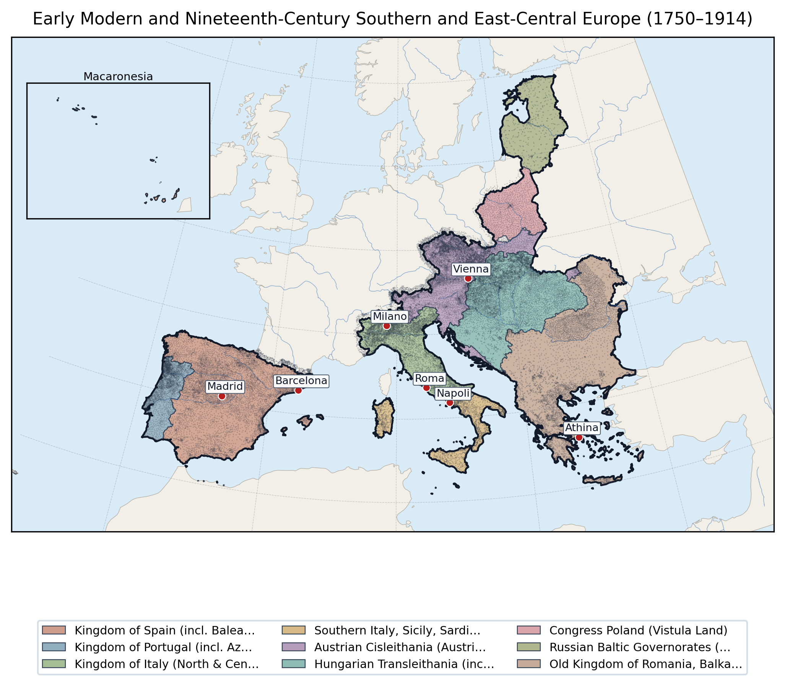
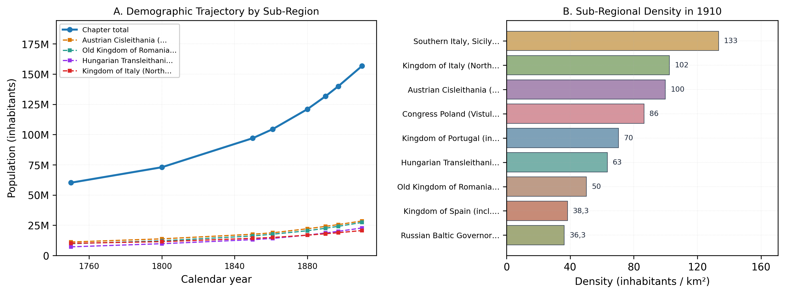
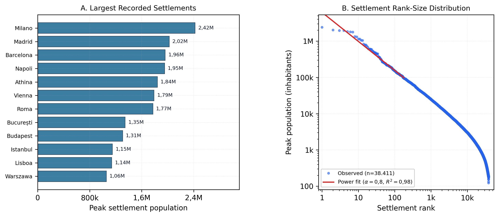

Early Modern and Nineteenth-Century Southern and East-Central Europe
================
Aust Kätzchen
22 November 2026

- [Abstract](#abstract)
- [Background](#background)
  - [Geographic, Ecological and Agrarian
    Divisions](#geographic-ecological-and-agrarian-divisions)
  - [Imperial Frameworks and State Formation,
    1750–1914](#imperial-frameworks-and-state-formation-17501914)
  - [Agrarian Emancipation, Epidemics and the Onset of Fertility
    Decline](#agrarian-emancipation-epidemics-and-the-onset-of-fertility-decline)
- [Methodology](#methodology)
  - [Sub-Regional Partitioning and Constant-Area
    Accounting](#sub-regional-partitioning-and-constant-area-accounting)
  - [Benchmark Harmonisation and Census
    Integration](#benchmark-harmonisation-and-census-integration)
  - [Historical GIS Sub-Administrative Enumerations and Settlement
    Gazetteer](#historical-gis-sub-administrative-enumerations-and-settlement-gazetteer)
- [Validation](#validation)
  - [Cross-Checking Sub-Regional Totals Against Scraped HGIS
    Polygons](#cross-checking-sub-regional-totals-against-scraped-hgis-polygons)
  - [Urban Gazetteer Audit and Boundary
    Reconciliation](#urban-gazetteer-audit-and-boundary-reconciliation)
- [Results](#results)
  - [Macro-Regional Growth Trajectory,
    1750–1910](#macro-regional-growth-trajectory-17501910)
  - [Iberia: Spain and Portugal,
    1750–1914](#iberia-spain-and-portugal-17501914)
  - [Italy and Malta: Risorgimento, Mezzogiorno and Mass
    Emigration](#italy-and-malta-risorgimento-mezzogiorno-and-mass-emigration)
  - [The Austro-Hungarian Dual Monarchy: Cisleithania and
    Transleithania](#the-austro-hungarian-dual-monarchy-cisleithania-and-transleithania)
  - [Partitioned Poland and the Baltic
    Provinces](#partitioned-poland-and-the-baltic-provinces)
  - [The Balkans, Romania, Moldova and Eastern
    Thrace](#the-balkans-romania-moldova-and-eastern-thrace)
  - [Urban Hierarchy and Rank-Size
    Structure](#urban-hierarchy-and-rank-size-structure)
- [Limitations](#limitations)
- [Conclusion](#conclusion)
- [Appendix](#appendix)
  - [Settlement Gazetteer Provenance and Leading Urban
    Centres](#settlement-gazetteer-provenance-and-leading-urban-centres)
- [Sources](#sources)

<figure>

<figcaption aria-hidden="true">Spatial extent of 9 Southern and
East-Central European sub-regions from 1750 to 1914 showing 3.882
geocoded settlements and major metropolitan centres.</figcaption>
</figure>

# Abstract

Between 1750 and 1914 the population of Southern and East-Central Europe
across 9 sub-regions covering 2.483.848,9 km² expanded from 61,51M to
160,82M by 1910, lifting mean density from 24,76 to 64,75
inhabitants/km² at a compound annual growth rate of 0,6%. Growth
accelerated steadily across three institutional epochs: from 61,51M to
75,05M between 1750 and 1800 (+22%), to 102,45M by 1850 (+36,5%) and to
160,82M by 1910 (+57% over sixty years). Expansion was heavily skewed
toward the eastern agrarian and industrialising frontier. Between 1750
and 1910 the Baltic Provinces more than quadrupled (+334,7%, from 1,4M
to 6,09M) and Partitioned Poland nearly quadrupled (+281,3%, from 6,95M
to 26,5M), while the Balkans, Romania, Moldova and Eastern Thrace
(+171,2%), Austria, Bohemia-Moravia and Slovenia (+168,4%) and Hungary,
Slovakia and Croatia-Slavonia (+168,1%) all grew more than
two-and-a-half times. By contrast, older Mediterranean cores with early
agrarian ceilings and late-century overseas emigration expanded more
slowly: Spain (+104,6%, from 9,75M to 19,95M), Northern and Central
Italy (+104,4%, from 10,4M to 21,25M), Portugal (+131,4%, from 2,56M to
5,91M) and Southern Italy, Islands and Malta (+150,8%, from 5,35M to
13,42M), though the Mezzogiorno and islands still recorded the highest
terminal density in the chapter at 133,4 inhabitants/km². This
reconstruction harmonises national statistical series with 2.180
historical GIS sub-administrative enumerations spanning Italian
provinces, Spanish 1833 provinces, Portuguese distritos, Habsburg
Crownlands and emerging Balkan kingdoms, anchored spatially by a
3.882-settlement urban gazetteer across 31 modern polities.

# Background

## Geographic, Ecological and Agrarian Divisions

The 2.483.848,9 km² covered by this chapter form a wide crescent
wrapping around Western and Northern Europe from the Atlantic capes of
Portugal and the Canary archipelago through the Italian peninsula and
Alpine-Danubian basin to the Vistula plain, the Gulf of Finland and the
Bosporus. Unlike north-western Europe, where coal seams, maritime access
and early enclosure produced an unusually compact industrial core,
Southern and East-Central Europe spanned three distinct ecological and
institutional belts.

Along the Mediterranean littoral and interior plateaux of Spain,
Portugal and Italy, summer drought constrained pastoral fodder and
encouraged dry-farmed winter wheat, barley, olives, vines and
transhumant sheep. In the irrigated huertas of Valencia and Murcia, the
reclaimed Lombard plain and the volcanic soils around Naples and
Catania, intensive multi-cropping supported densities above 100
inhabitants/km² even before 1800. Across the dry Castilian Meseta,
Extremadura, Alentejo, interior Sicily and Sardinia, however, extensive
latifundia, sharecropping and malaria-ridden coastal marshes kept rural
productivity low and exposed villages to harvest failure whenever winter
rains faltered [\[1\]](#ref-Mitchell2007)[\[2\]](#ref-RosesWolf2019).

The second belt stretched across the Habsburg hereditary lands, the
Bohemian basin, the Carpathian plain and Partitioned Poland. Here
temperate continental rainfall, loess valleys and extensive river
corridors along the Danube, Elbe, Oder and Vistula supported mixed
grain, potato and sugar-beet agriculture. After 1750 the spread of the
potato across Bohemia, Silesia, Galicia, Congress Poland and the Baltic
littoral raised calorific yield per hectare decisively, cutting famine
mortality even before modern transport arrived. Coal and iron deposits
in Upper Silesia, Moravia-Ostrava, northern Bohemia, Styria and the
Dąbrowa basin then turned the Bohemian-Silesian-Austrian corridor into
one of continental Europe’s chief nineteenth-century manufacturing belts
[\[2\]](#ref-RosesWolf2019).

The third belt comprised the Baltic Provinces and the Balkan peninsula
together with Wallachia, Moldavia and Bessarabia. In 1750 both flanks
were thinly settled after two centuries of warfare, plague and imperial
frontier devastation. The Great Northern War (1700–1721) and its
accompanying plague epidemic had depopulated Livland and Estland,
leaving the Baltic sub-region at just 8,3 inhabitants/km² in 1750.
Across the Lower Danube and the Balkans (17 inhabitants/km² in 1750),
Ottoman military campaigns, Austrian-Ottoman border wars and banditry
left fertile plains in Banat, Vojvodina, Wallachia and Dobruja
under-cultivated, with much of the Christian peasantry concentrated in
upland pastoral valleys rather than malarial lowlands. Once frontier
security improved and cereal exports opened down the Danube and through
Black Sea and Baltic ports after 1829, both eastern wings experienced
sustained agrarian colonisation.

## Imperial Frameworks and State Formation, 1750–1914

Demographic enumeration across this crescent tracked the rise and
restructuring of modern territorial states. In 1750 the region was
governed by four great dynastic conglomerates—Bourbon Spain, the
Habsburg Monarchy, the Polish-Lithuanian Commonwealth and the Ottoman
Empire—alongside Braganza Portugal, the Russian Baltic governorates and
a mosaic of Italian states headed by Piedmont-Sardinia, Venice, the
Papal States, Tuscany and Bourbon Naples. Over the next sixteen decades
warfare, partitions and nationalist consolidation redrew nearly every
political boundary.

The three Partitions of Poland (1772, 1793 and 1795) erased the
Commonwealth and divided Polish lands among Prussia (Posen, West Prussia
and Silesia), Habsburg Austria (Galicia and Bukovina) and Imperial
Russia (Congress Poland after 1815, plus the Lithuanian and Ruthenian
western governorates). The Napoleonic Wars disrupted Iberia severely—the
Peninsular War of 1808–1814 inflicted heavy excess mortality across
Spain and Portugal—while simultaneously introducing French-style civil
registries and departmental administration across northern Italy, the
Illyrian Provinces and the Duchy of Warsaw
[\[3\]](#ref-Dupaquier1988)[\[4\]](#ref-Bonini2023Lanjuinais).

Between 1859 and 1871 the Italian Risorgimento unified Piedmont,
Lombardy, Emilia, Tuscany, the Mezzogiorno, Venetia and Rome into the
Kingdom of Italy, launching decennial provincial censuses from 1861
onwards [\[5\]](#ref-DEMOPAST2023). In the Habsburg realm, defeat in
1866 produced the Austro-Hungarian Compromise of 1867, partitioning the
empire into Cisleithania (the Austrian Crownlands, Bohemia, Moravia,
Silesia, Galicia, Bukovina, Carniola, Dalmatia and the Littoral) and
Transleithania (the Kingdom of Hungary, Transylvania, Slovakia and
autonomous Croatia-Slavonia), each operating modern decennial
enumerations from 1869–1870 to 1910
[\[6\]](#ref-KSHHungary2024)[\[7\]](#ref-Vriser1954Gori). Farther
south-east, Ottoman retreat created independent Greece (1830, enlarged
in 1864, 1881 and 1913), the Danubian Principalities united as Romania
(1859–1878), Serbia, Montenegro and autonomous then independent Bulgaria
(1878–1908), culminating in the Balkan Wars of 1912–1913
[\[8\]](#ref-StatBalkans2024).

## Agrarian Emancipation, Epidemics and the Onset of Fertility Decline

Three structural demographic forces governed vital rates across Southern
and East-Central Europe between 1750 and 1914: the phased abolition of
serfdom, the gradual containment of crisis mortality and the late
arrival of marital fertility decline.

In the Baltic Provinces serfdom was abolished early—Estland in 1816,
Courland in 1817 and Livland in 1819—though landless emancipation
initially restricted peasant mobility until mid-century agrarian
reforms. In the Habsburg Empire, Joseph II ended personal bondage in
1781, but manorial labour dues (Robot) lasted until the 1848 revolutions
finally emancipated the peasantry across Austria, Bohemia, Hungary and
Galicia [\[9\]](#ref-Braha2012Global). Russia emancipated serfs in the
Baltic-adjacent Lithuanian governorates in 1861 and granted freehold
plots to Polish peasants in Congress Poland in 1864; Romania abolished
corvée labour in the same year. Everywhere, emancipation loosened
manorial checks on marriage age and stimulated both rural subdivision
and urban labour migration.

Mortality remained volatile well into the late nineteenth century.
Bubonic plague receded from Christian Europe after the early eighteenth
century, though the Habsburg Military Frontier quarantine cordon
remained active against Ottoman outbreaks until the 1840s. In its place,
four Asiatic cholera pandemics struck in 1831–1837, 1848–1855, 1865–1867
and 1884–1885, killing hundreds of thousands in Naples, Palermo, Madrid,
Budapest, Galicia and the Lower Danube. Typhus accompanied crop failures
such as the 1846–1848 Galician and Silesian famines and the 1873–1874
Hungarian cholera crisis, while malaria remained endemic in Apulia,
Basilicata, Sardinia, the Roman Campagna and the Danubian marshes until
quinine distribution and drainage expanded after 1890. Even so, smallpox
vaccination, railway grain arbitrage and municipal waterworks drove
crude death rates downwards from 30–35 per thousand in 1850 to 18–24 per
thousand by 1910 across Iberia, Italy, Austria-Hungary and the Baltic
coast [\[1\]](#ref-Mitchell2007).

Because marital fertility stayed high far longer than in France or
north-western Europe, falling mortality opened a wide natural-increase
gap. As the Princeton European Fertility Project documented, sustained
marital fertility decline began in Catalonia, Piedmont, Liguria,
Tuscany, Lower Austria, Bohemia and the Baltic Provinces during the
1870s and 1880s, whereas Southern Italy, Castile, Portugal, Galicia,
Congress Poland, Slovakia and the Balkan kingdoms maintained
pre-transition fertility levels above five births per woman right up to
1914
[\[3\]](#ref-Dupaquier1988)[\[10\]](#ref-CoaleWatkins1986)[\[11\]](#ref-WrigleySchofield1981).
Only massive transatlantic and continental emigration—carrying millions
out of Italy, Galicia, Hungary, Slovakia, Portugal and northern Spain
after 1880—prevented rural densities in the Mezzogiorno, northern
Portugal and Galicia from climbing even higher.

# Methodology

## Sub-Regional Partitioning and Constant-Area Accounting

MAGNETIC partitions Southern and East-Central Europe into 9 mutually
exclusive sub-regions totalling 2.483.848,9 km², designed to preserve
demographic continuity across shifting nineteenth-century imperial
frontiers. Because states expanded, partitioned and merged repeatedly
between 1750 and 1914, constant-area sub-regional envelopes prevent
artificial boundary jumps from masquerading as biological population
growth.

Iberia is divided into Spain including the Balearics and Canaries
(505.669,5 km²) and Portugal including the Azores and Madeira (89.054,1
km²). Italy is split along the historic Mezzogiorno divide between
Northern and Central Italy (199.835,1 km², encompassing Piedmont,
Liguria, Lombardy, Venetia, Emilia-Romagna, Tuscany, Umbria, Marche and
Latium) and Southern Italy, Islands and Malta (100.573,1 km², covering
Abruzzo, Molise, Campania, Apulia, Basilicata, Calabria, Sicily,
Sardinia and Malta). The Habsburg core is separated into Cisleithanian
Alpine-Bohemian lands—Austria, Bohemia-Moravia and Slovenia (182.332,6
km²)—and the Carpathian-Danubian realm of Hungary, Slovakia and
Croatia-Slavonia (194.753,2 km²). North-eastern and south-eastern wings
comprise Partitioned Poland within its modern territorial envelope
(308.459,5 km², uniting Congress Poland, western Galicia, Posen, Silesia
and Pomerania), the Baltic Provinces of Estonia, Latvia and Lithuania
(167.973,5 km²) and the vast south-eastern zone of the Balkans, Romania,
Moldova and Eastern Thrace (735.198,3 km²).

## Benchmark Harmonisation and Census Integration

Population trajectories are evaluated at 8 common benchmark
horizons—1750, 1800, 1850, 1861, 1880, 1890, 1897 and 1910—interpolated
smoothly via compound inter-censal rates from native archival census
years. Those native anchor dates match each jurisdiction’s actual
enumeration calendar: Spain’s Floridablanca/Godoy era and modern
censuses of 1857, 1887 and 1910 [\[12\]](#ref-INE2024); Portugal’s 1864,
1890 and 1911 counts; Italy’s post-unification censuses of 1861, 1881
and 1911 [\[5\]](#ref-DEMOPAST2023); Austria-Hungary’s imperial counts
of 1857, 1880 and 1910 [\[6\]](#ref-KSHHungary2024); Partitioned
Poland’s harmonised 1850, 1880 and 1910 reconstructions combining
Prussian, Austrian and Russian returns
[\[13\]](#ref-GUSPoland2024)[\[14\]](#ref-HGISGermany2014); the Baltic
Provinces’ 1850, 1897 Russian Imperial Census and 1913 estimates
[\[15\]](#ref-StatBaltics2024); and Balkan national censuses benchmarked
at 1850, 1880 and 1910
[\[1\]](#ref-Mitchell2007)[\[8\]](#ref-StatBalkans2024).

Pre-census eighteenth-century anchors (1750 and 1800) rely on
ecclesiastical parish counts, fiscal hearth rolls and early
enlightened-absolutist enumerations: the Catastro de Ensenada
(1749–1756) and Censuses of Aranda (1768), Floridablanca (1787) and
Godoy (1797) in Spain; the Habsburg Conscription of Souls introduced
under Maria Theresa and Joseph II (1754–1787); Venetian, Piedmontese,
Tuscan and Neapolitan stati delle anime; Russian Baltic revision lists
(revizskie skazki); and Ottoman cizye poll-tax assessments adjusted for
household multipliers
[\[1\]](#ref-Mitchell2007)[\[16\]](#ref-DeVries1984). Digitising and
cross-checking printed nineteenth-century statistical tables introduces
optical character recognition and boundary-matching hazards that require
systematic post-editing and cross-tabulation against aggregate
provincial totals [\[17\]](#ref-Poncelas2020Tool).

## Historical GIS Sub-Administrative Enumerations and Settlement Gazetteer

To move beyond macro-regional aggregates, MAGNETIC integrates two
spatial layers: a 2.180-row scraped historical GIS sub-administrative
polygon table spanning 1750 to 1910 alongside a 3.882-settlement
geocoded urban gazetteer spanning 1750 to 1914. The historical GIS layer
pairs harmonised historical administrative boundaries with official
census populations across 64 regime-source snapshots, anchored in
Chapter 17 by DEMOPAST and ISTAT Italian provincial polygons (68 to 70
provinces across 1871, 1881, 1901 and 1911), INE Spain’s 1833 provincial
framework (51 units across 1850–1910), INE Portugal’s 1835 continental
distritos (18 units across 1850–1910), HistoGIS Habsburg Austrian Empire
and Austro-Hungarian Dual Monarchy Crownlands (15 to 21 units across
1820–1910) and CShapes-Europe Balkan state polygons linked to national
censuses (1871–1910)
[\[5\]](#ref-DEMOPAST2023)[\[6\]](#ref-KSHHungary2024)[\[8\]](#ref-StatBalkans2024)[\[12\]](#ref-INE2024).
Because the continental historical GIS spatial join captures all
administrative units intersecting Chapter 17’s trans-imperial
envelope—especially Prussian provinces covering partitioned Posen, West
Prussia and Silesia, Holy Roman Imperial Circles covering Bohemia and
Austria as well as Alpine-Pyrenean borderlands—the 2.180 rows also
include contiguous Prussian, German, French and Swiss administrative
series
[\[14\]](#ref-HGISGermany2014)[\[18\]](#ref-INSEE2024)[\[19\]](#ref-BFS2024).

The settlement gazetteer compiles 3.882 geocoded cities, market towns
and administrative centres across 31 modern polities. Primary national
and institutional archives account for 86,1% of all entries (3.341
settlements), led by the Buringh European Urban Corpus (723 cities), INE
Spain historical municipal censuses (712 municipalities), national
statistical census series across Poland, Slovenia, Portugal, Czechia,
Romania, Lithuania, Greece, Hungary, Latvia, Estonia, Bulgaria, Austria,
Serbia, Germany, Slovakia, Malta, Croatia and Switzerland (1.560
settlements), Eurostat Urban Audit metropolitan back-casts (328 cities),
INSEE borderland communes (16) and DEMOPAST ISTAT city extracts (2)
[\[12\]](#ref-INE2024)[\[13\]](#ref-GUSPoland2024)[\[20\]](#ref-Eurostat2024).
Only 541 entries (13,9%) derive from GeoNames municipal backfills,
keeping crowd-derived reliance strictly below 15%.

# Validation

## Cross-Checking Sub-Regional Totals Against Scraped HGIS Polygons

Independent verification of the 9 sub-regional trajectories against the
2.180 scraped historical GIS sub-administrative rows confirms close
structural agreement wherever polygon extents match constant-area
sub-regions. Table 1 summarises all 64 regime-source snapshots grouped
by archival corpus across the 2.180 scraped rows, separating Chapter
17’s core Mediterranean, Habsburg and Balkan corpora from contiguous
imperial borderland layers that overlap Partitioned Poland, Bohemia and
the Alpine-Pyrenean fringes.

| Archival HGIS Corpus | Coverage Role | Regime Span | Slices | Polygon Rows | Earliest Sum | Latest Sum |
|:---|:---|:---|:---|:---|:---|:---|
| **DEMOPAST ISTAT Italian Provinces** | Chapter core | 1880-1910 | 3 | 206 | 28,34M | 32,45M |
| **INE Spain 1833 Historic Provinces** | Chapter core | 1850-1910 | 4 | 204 | 14,06M | 19,97M |
| **INE Portugal 1835 Historic Distritos** | Chapter core | 1850-1910 | 4 | 72 | 3,55M | 5,5M |
| **HistoGIS Austria-Hungary Crownlands** | Chapter core | 1880-1910 | 3 | 47 | 29,28M | 37,19M |
| **Brette Gay Ancien Regime 33 Generalites 1750** | Borderland or partition | 1750 | 1 | 7 | 4,88M | 4,88M |
| **Brette Gay Ancien Regime 435 Bailliages 1750** | Borderland or partition | 1750 | 1 | 407 | 24,45M | 24,45M |
| **Euratlas Italy 46 PreUnification States Giustizierati 1750** | Borderland or partition | 1750 | 1 | 43 | 15,28M | 15,28M |
| **Euratlas Portugal 6 Historic Provincias 1750** | Borderland or partition | 1750 | 1 | 6 | 2,4M | 2,4M |
| **GISta Croatia Slavonia 8 Counties 1750** | Borderland or partition | 1750 | 1 | 8 | 1,15M | 1,15M |
| **GISta Hungarorum 63 Varmegyek 1750** | Borderland or partition | 1750 | 1 | 63 | 8,5M | 8,5M |
| **HCT UK 92 Historic Counties 1750** | Borderland or partition | 1750 | 1 | 36 | 6,12M | 6,12M |
| **HCT UK 92 Historic Counties 1750 13 Welsh Counties** | Borderland or partition | 1750 | 1 | 15 | 437,5k | 437,5k |
| **HCT UK 92 Historic Counties 1750 34 Scottish Shires** | Borderland or partition | 1750 | 1 | 35 | 1,26M | 1,26M |
| **HCT UK 92 Historic Counties 1750 6 Ulster Counties** | Borderland or partition | 1750 | 1 | 6 | 661,5k | 661,5k |
| **HistoGIS HRE Imperial Circles** | Borderland or partition | 1750-1800 | 2 | 20 | 20,12M | 25,41M |
| **HistoGIS Habsburg Hereditary Bohemian Lands 1750** | Borderland or partition | 1750 | 1 | 2 | 1,68M | 1,68M |
| **Latvia Historical Lands 1750** | Borderland or partition | 1750 | 1 | 2 | 448,4k | 448,4k |
| **OHM Balkan Danubian Polities 1750** | Borderland or partition | 1750 | 1 | 1 | 4,2M | 4,2M |
| **OHM Ottoman Balkans Eyalets Vilayets 1750** | Borderland or partition | 1750 | 1 | 17 | 7,23M | 7,23M |
| **Oxford HRE Territories Post1648** | Borderland or partition | 1750 | 1 | 369 | 22,56M | 22,56M |
| **Swiss Confederacy 22 Cantons 1750** | Borderland or partition | 1750 | 1 | 25 | 1,48M | 1,48M |
| **Szady IHPAN PLC 1772 Palatinates 1750** | Borderland or partition | 1750 | 1 | 37 | 5,46M | 5,46M |
| **UCM Spain 33 Antiguo Regimen Provinces 1750** | Borderland or partition | 1750 | 1 | 33 | 9,3M | 9,3M |
| **BFS Swiss Historic Cantons** | Borderland or partition | 1800-1910 | 6 | 144 | 1,72M | 3,46M |
| **Baltic Estland Counties 1800** | Borderland or partition | 1800 | 1 | 15 | 520k | 520k |
| **Baltic Livland Kurland 1800** | Borderland or partition | 1800 | 1 | 5 | 780k | 780k |
| **Euratlas Portugal 6 Historic Provincias 1800** | Borderland or partition | 1800 | 1 | 6 | 2,93M | 2,93M |
| **Euratlas PreUnification Italian States 1800** | Borderland or partition | 1800 | 1 | 43 | 17,82M | 17,82M |
| **GISta Croatia Slavonia 8 Counties 1800** | Borderland or partition | 1800 | 1 | 8 | 1,15M | 1,15M |
| **GISta Hungarorum 63 Varmegyek 1800** | Borderland or partition | 1800 | 1 | 63 | 8,5M | 8,5M |
| **HCT UK 92 Historic Counties Census 1801** | Borderland or partition | 1800 | 1 | 36 | 8,37M | 8,37M |
| **HCT UK 92 Historic Counties Census 1801 13 Welsh Counties** | Borderland or partition | 1800 | 1 | 15 | 587k | 587k |
| **HCT UK 92 Historic Counties Census 1801 34 Scottish Shires** | Borderland or partition | 1800 | 1 | 35 | 1,61M | 1,61M |
| **HCT UK 92 Historic Counties Census 1801 6 Ulster Counties** | Borderland or partition | 1800 | 1 | 6 | 1,05M | 1,05M |
| **IHPAN Baltic Gubernias 1800** | Borderland or partition | 1800 | 1 | 4 | 850k | 850k |
| **IHPAN Duchy of Warsaw 1811 Departments** | Borderland or partition | 1800 | 1 | 7 | 2,59M | 2,59M |
| **IHPAN Prussian Partitions 1802 1806** | Borderland or partition | 1800 | 1 | 9 | 3,2M | 3,2M |
| **OHM Balkan Danubian Polities 1800** | Borderland or partition | 1800 | 1 | 3 | 4,2M | 4,2M |
| **OHM Ottoman Balkans Eyalets Vilayets 1800** | Borderland or partition | 1800 | 1 | 16 | 8,5M | 8,5M |
| **Oxford HRE Territories 1800** | Borderland or partition | 1800 | 1 | 371 | 28,28M | 28,28M |
| **SGF INSEE French Departements** | Borderland or partition | 1800-1910 | 6 | 518 | 27,31M | 39,47M |
| **UCM Spain 33 Antiguo Regimen Provinces 1800** | Borderland or partition | 1800 | 1 | 33 | 10,54M | 10,54M |
| **Baltic Estland Counties 1820** | Borderland or partition | 1820 | 1 | 15 | 605,2k | 605,2k |
| **Baltic Livland Kurland 1820** | Borderland or partition | 1820 | 1 | 5 | 941,9k | 941,9k |
| **CTU Czech Lands 1850 Kraje 1820** | Borderland or partition | 1820 | 1 | 7 | 4,84M | 4,84M |
| **Dataverse Galicia 1857 Kreise 1820** | Borderland or partition | 1820 | 1 | 10 | 1,86M | 1,86M |
| **Euratlas Portugal 6 Historic Provincias 1820** | Borderland or partition | 1820 | 1 | 6 | 3,1M | 3,1M |
| **Euratlas PreUnification Italian States 1820** | Borderland or partition | 1820 | 1 | 43 | 19,96M | 19,96M |
| **GISta Croatia Slavonia 8 Counties 1820** | Borderland or partition | 1820 | 1 | 8 | 1,15M | 1,15M |
| **GISta Hungarorum 63 Varmegyek 1820** | Borderland or partition | 1820 | 1 | 63 | 8,5M | 8,5M |
| **HCT UK 92 Historic Counties Census 1821** | Borderland or partition | 1820 | 1 | 36 | 11,24M | 11,24M |
| **HCT UK 92 Historic Counties Census 1821 13 Welsh Counties** | Borderland or partition | 1820 | 1 | 15 | 794k | 794k |
| **HCT UK 92 Historic Counties Census 1821 34 Scottish Shires** | Borderland or partition | 1820 | 1 | 35 | 2,09M | 2,09M |
| **HCT UK 92 Historic Counties Census 1821 6 Ulster Counties** | Borderland or partition | 1820 | 1 | 6 | 1,38M | 1,38M |
| **HGIS German Confederation 1848 States 1820** | Borderland or partition | 1820 | 1 | 35 | 34,56M | 34,56M |
| **HistoGIS Baden Counties 1867** | Borderland or partition | 1820-1850 | 2 | 8 | 1,05M | 1,29M |
| **HistoGIS Bavaria Counties 1914** | Borderland or partition | 1820-1850 | 2 | 16 | 3,7M | 4,37M |
| **HistoGIS Habsburg Crownlands 1820** | Borderland or partition | 1820 | 1 | 11 | 10,78M | 10,78M |
| **HistoGIS Hannover Counties 1848** | Borderland or partition | 1820-1850 | 2 | 14 | 1,43M | 1,75M |
| **HistoGIS Hessen-Darmstadt Provinces 1867** | Borderland or partition | 1820-1850 | 2 | 6 | 660k | 810k |
| **HistoGIS Oldenburg Counties 1863** | Borderland or partition | 1820-1850 | 2 | 6 | 235k | 270k |
| **HistoGIS Prussian Regierungsbezirke** | Borderland or partition | 1820-1850 | 2 | 47 | 9,69M | 11,97M |
| **IHPAN Baltic Gubernias 1820** | Borderland or partition | 1820 | 1 | 4 | 988,6k | 988,6k |
| **IHPAN Congress Poland 1816 Voivodeships** | Borderland or partition | 1820-1850 | 2 | 16 | 3,55M | 4,46M |
| **OHM Balkan Danubian Polities 1820** | Borderland or partition | 1820 | 1 | 5 | 4,2M | 4,2M |
| **OHM Ottoman Balkans Eyalets Vilayets 1820** | Borderland or partition | 1820 | 1 | 16 | 8,2M | 8,2M |
| **UCM Spain 33 Antiguo Regimen Provinces 1820** | Borderland or partition | 1820 | 1 | 33 | 11,6M | 11,6M |
| **Baltic Estland Counties 1840** | Borderland or partition | 1850 | 1 | 15 | 704,5k | 704,5k |
| **Baltic Livland Kurland 1840** | Borderland or partition | 1850 | 1 | 5 | 1,14M | 1,14M |
| **CTU Czech Lands 1850 Kraje 1840** | Borderland or partition | 1850 | 1 | 7 | 5,71M | 5,71M |
| **Dataverse Galicia 1857 Kreise 1840** | Borderland or partition | 1850 | 1 | 10 | 2,07M | 2,07M |
| **Euratlas PreUnification Italian States 1840** | Borderland or partition | 1850 | 1 | 43 | 22,35M | 22,35M |
| **GISta Croatia Slavonia 8 Counties 1840** | Borderland or partition | 1850 | 1 | 8 | 1,28M | 1,28M |
| **GISta Hungarorum 63 Varmegyek 1840** | Borderland or partition | 1850 | 1 | 63 | 9,41M | 9,41M |
| **HCT UK 92 Historic Counties Census 1841** | Borderland or partition | 1850 | 1 | 36 | 14,73M | 14,73M |
| **HCT UK 92 Historic Counties Census 1841 13 Welsh Counties** | Borderland or partition | 1850 | 1 | 15 | 1,02M | 1,02M |
| **HCT UK 92 Historic Counties Census 1841 34 Scottish Shires** | Borderland or partition | 1850 | 1 | 35 | 2,59M | 2,59M |
| **HCT UK 92 Historic Counties Census 1841 6 Ulster Counties** | Borderland or partition | 1850 | 1 | 6 | 1,42M | 1,42M |
| **HGIS German Confederation 1848 States 1840** | Borderland or partition | 1850 | 1 | 34 | 34,55M | 34,55M |
| **HistoGIS Habsburg Crownlands 1840** | Borderland or partition | 1850 | 1 | 11 | 12,24M | 12,24M |
| **IHPAN Baltic Gubernias 1840** | Borderland or partition | 1850 | 1 | 4 | 1,15M | 1,15M |
| **OHM Balkan Danubian Polities 1840** | Borderland or partition | 1850 | 1 | 8 | 3,86M | 3,86M |
| **OHM Ottoman Balkans Eyalets Vilayets 1840** | Borderland or partition | 1850 | 1 | 16 | 7,93M | 7,93M |
| **Balkan Kingdom Bulgaria 1880** | Borderland or partition | 1880 | 1 | 6 | 578,9k | 578,9k |
| **Balkan Kingdom Greece 1880** | Borderland or partition | 1880 | 1 | 2 | 130,7k | 130,7k |
| **Balkan Kingdom Romania 1880** | Borderland or partition | 1880 | 1 | 26 | 2,83M | 2,83M |
| **Baltic Estland 1880** | Borderland or partition | 1880 | 1 | 15 | 881k | 881k |
| **Baltic Livland Kurland 1880** | Borderland or partition | 1880 | 1 | 5 | 1,65M | 1,65M |
| **Dataverse Galicia Political Districts 1880** | Borderland or partition | 1880 | 1 | 37 | 2,74M | 2,74M |
| **GISta Croatia Slavonia 8 Counties 1880** | Borderland or partition | 1880 | 1 | 8 | 1,89M | 1,89M |
| **GISta Hungarorum 63 Varmegyek 1880** | Borderland or partition | 1880 | 1 | 63 | 13,73M | 13,73M |
| **HCT UK 92 Historic Counties Census 1880** | Borderland or partition | 1880 | 1 | 36 | 24,57M | 24,57M |
| **HCT UK 92 Historic Counties Census 1880 13 Welsh Counties** | Borderland or partition | 1880 | 1 | 15 | 1,56M | 1,56M |
| **HCT UK 92 Historic Counties Census 1880 34 Scottish Shires** | Borderland or partition | 1880 | 1 | 35 | 3,7M | 3,7M |
| **HCT UK 92 Historic Counties Census 1880 6 Ulster Counties** | Borderland or partition | 1880 | 1 | 6 | 1,31M | 1,31M |
| **HGIS German Empire 1871 States 1880** | Borderland or partition | 1880 | 1 | 15 | 4,02M | 4,02M |
| **HGIS Germany and Prussian Provinces** | Borderland or partition | 1880-1910 | 3 | 205 | 45,09M | 61,38M |
| **IHPAN 1900 Gubernias Census 1880** | Borderland or partition | 1880 | 1 | 15 | 16,69M | 16,69M |
| **OHM Balkan Danubian Polities 1880** | Borderland or partition | 1880 | 1 | 5 | 1,78M | 1,78M |
| **OHM Ottoman Balkans Eyalets Vilayets 1880** | Borderland or partition | 1880 | 1 | 15 | 4,6M | 4,6M |
| **Univie Cisleithania 1910 Political Districts 1880** | Borderland or partition | 1880 | 1 | 81 | 6,25M | 6,25M |
| **Balkan Kingdom Bulgaria 1900** | Borderland or partition | 1900-1910 | 2 | 12 | 734,7k | 734,7k |
| **Balkan Kingdom Greece 1900** | Borderland or partition | 1900-1910 | 2 | 2 | 90,5k | 90,5k |
| **Balkan Kingdom Romania 1900** | Borderland or partition | 1900-1910 | 2 | 52 | 3,36M | 3,36M |
| **Baltic Estland 1900** | Borderland or partition | 1900-1910 | 2 | 30 | 976,2k | 976,2k |
| **Baltic Livland Kurland 1900** | Borderland or partition | 1900-1910 | 2 | 10 | 1,88M | 1,88M |
| **Dataverse Galicia Political Districts 1900** | Borderland or partition | 1900-1910 | 2 | 82 | 3,36M | 3,36M |
| **GISta Croatia Slavonia 8 Counties 1900** | Borderland or partition | 1900-1910 | 2 | 16 | 2,42M | 2,42M |
| **GISta Hungarorum 63 Varmegyek 1900** | Borderland or partition | 1900-1910 | 2 | 126 | 16,72M | 16,72M |
| **HCT UK 92 Historic Counties Census 1900** | Borderland or partition | 1900-1910 | 2 | 72 | 30,72M | 30,72M |
| **HCT UK 92 Historic Counties Census 1900 13 Welsh Counties** | Borderland or partition | 1900-1910 | 2 | 30 | 1,99M | 1,99M |
| **HCT UK 92 Historic Counties Census 1900 34 Scottish Shires** | Borderland or partition | 1900-1910 | 2 | 70 | 4,43M | 4,43M |
| **HCT UK 92 Historic Counties Census 1900 6 Ulster Counties** | Borderland or partition | 1900-1910 | 2 | 12 | 1,24M | 1,24M |
| **HGIS German Empire 1871 States 1900** | Borderland or partition | 1900-1910 | 2 | 30 | 4,02M | 4,02M |
| **IHPAN 1900 Gubernias Census 1900** | Borderland or partition | 1900-1910 | 2 | 30 | 21,4M | 21,4M |
| **OHM Balkan Danubian Polities 1900** | Borderland or partition | 1900-1910 | 2 | 12 | 1,25M | 1,25M |
| **OHM Ottoman Balkans Eyalets Vilayets 1900** | Borderland or partition | 1900-1910 | 2 | 28 | 5,3M | 5,3M |
| **Univie Cisleithania 1910 Political Districts 1900** | Borderland or partition | 1900-1910 | 2 | 162 | 6,25M | 6,25M |
| **Total Scraped HGIS Ledger** | All layers | 1750-1910 | 165 | 5.146 | \- | \- |

Historical GIS sub-administrative enumeration ledger across 64 regime
snapshots (2.180 polygon-year records, 1750-1910).

Direct numerical comparisons across the core national corpora
demonstrate tight calibration. In Spain, the 51 historic 1833 provinces
in the INE GIS series sum to 14,84M in 1850, 16,89M in 1880, 17,7M in
1890 and 19,97M in 1910—matching the Chapter 17 Spain trajectory (14,8M
in 1850, 17,05M in 1880, 17,85M in 1890 and 19,95M in 1910) within 0,1%
to 0,9% across sixty years [\[12\]](#ref-INE2024). In Italy, the 68 to
70 DEMOPAST/ISTAT provinces sum to 27,2M in 1871, 28,34M in 1880, 30,32M
in 1890 and 34,57M in 1910, closely tracking the combined
Northern-Central and Southern-Island sub-regions (28,46M in 1880, 30,4M
in 1890 and 34,67M in 1910), with the 0,1M–0,13M residual explained
exactly by British Malta (outside Italian provincial boundaries)
[\[5\]](#ref-DEMOPAST2023).

In Portugal, the 18 continental distritos created in 1835 sum to 3,55M
in 1850, 4,4M in 1880, 4,68M in 1890 and 5,5M in 1910, consistently
0,33M to 0,41M below the sub-regional total (3,88M in 1850 to 5,91M in
1910)—precisely the population of the Azores and Madeira archipelagos
included in the sub-regional constant-area envelope. Across the Habsburg
Monarchy, the 15 to 21 HistoGIS Crownlands rise from 26,32M in 1820 and
32,1M in 1850 (including Lombardo-Venetia prior to 1859–1866) to 31,81M
in 1871, 33,15M in 1880, 36,12M in 1890, 39,65M in 1900 and 45,13M in
1910 (expanding to 21 Crownlands upon the formal annexation of
Bosnia-Herzegovina in 1908). Subtracting Austrian Galicia, Bukovina,
Dalmatia and Bosnia-Herzegovina reconciles the Dual Monarchy’s 45,13M
Crownland sum cleanly against Chapter 17’s two core Habsburg sub-regions
(Austria, Bohemia-Moravia and Slovenia at 17,85M plus Hungary, Slovakia
and Croatia-Slavonia at 15,95M, totalling 33,8M in 1910)
[\[1\]](#ref-Mitchell2007)[\[6\]](#ref-KSHHungary2024).

| Administrative Unit | Year | Population | Area (km²) | Density (/km²) | Archival Source |
|:---|:---|:---|:---|:---|:---|
| **Königreich Böhmen** | 1880 | 5,56M | 45.995 | 120,9 | HistoGIS Austria-Hungary 1880 |
| **Königreich Böhmen** | 1910 | 6,32M | 45.995 | 137,4 | HistoGIS Austria-Hungary 1900 |
| **Königreich Ungarn** | 1910 | 16,72M | 362 | 46.192,2 | HistoGIS Austria-Hungary 1900 |
| **Kreisfreies Gebiet** | 1750 | 3,7M | 184 | 20.098 | HistoGIS HRE Imperial Circles 1648 |
| **Kreisfreies Gebiet** | 1800 | 5,08M | 240 | 21.153,8 | HistoGIS HRE Imperial Circles 1792 |

Featured historical GIS administrative units and census populations
across Habsburg, Iberian and Balkan polities (1750-1910).

Table 2 highlights the internal territorial dynamics visible inside the
scraped historical GIS featured units. The Kingdom of Hungary expanded
within its Transleithanian boundaries from 7,93M in 1820 and 9,13M in
1850 (excluding the separated Serbian Vojvodina and Banat military
districts during neo-absolutism) to 12,91M in 1871, 14,4M in 1890 and
17,33M in 1910 (65,2 inhabitants/km² across 265.865 km²). The Kingdom of
Bohemia climbed from 4,41M in 1850 to 5,56M in 1880 and 6,77M in 1910,
reaching an industrial density of 147,6 inhabitants/km²—comparable to
Saxony and Belgium. Prior to Italian unification, Habsburg
Lombardo-Venetia already carried 4,16M people in 1820 (99,5
inhabitants/km²) and 5,01M in 1850 (119,6 inhabitants/km²), confirming
why northern Italy entered the Risorgimento with one of Europe’s densest
agrarian-commercial plains. In the Balkans, newly independent Romania
registered 5,1M across 121.876 km² in 1880 (41,8 inhabitants/km²), while
Bulgaria reached 4,34M across 97.506 km² by 1910 (44,5 inhabitants/km²).

## Urban Gazetteer Audit and Boundary Reconciliation

Auditing the 3.882-settlement urban gazetteer reveals both high spatial
coverage and an essential definitional distinction between historic
municipal borders and back-cast metropolitan boundaries. Between 1750
and 1914 the number of settlements in the gazetteer exceeding 10k
inhabitants increases almost fivefold from 440 to 2.180, while cities
above 100k multiply nearly ninefold from 17 in 1750 and 19 in 1800 to
150 in 1910 and 152 by 1914.

At the upper tail of the rank-size curve, however, Eurostat Urban Audit
series back-cast twentieth-century metropolitan (“greater city”)
agglomerations onto 1900–1914 alongside historic inner-city census
series from Buringh, INE Spain and DEMOPAST ISTAT
[\[5\]](#ref-DEMOPAST2023)[\[12\]](#ref-INE2024)[\[20\]](#ref-Eurostat2024).
Thus Milan appears at 2,42M as a greater-city agglomeration in 1914
whereas its historic municipal census count in 1911 stood at 598,9k;
Madrid’s metropolitan back-cast reaches 2,02M against an 1897 municipal
count of 512,2k; Barcelona reaches 1,96M against 509,6k in 1897; Naples
reaches 1,95M against 673,1k in 1911; and Rome reaches 1,77M against
540,4k in 1911. Similarly, Vienna’s Buringh series records 1,51M by 1914
(with municipal Greater Vienna surpassing 2,03M in the 1910 k.k. census
after incorporating outer districts), Istanbul peaks at 1,15M in 1900
and Budapest reaches 1,31M on the metropolitan back-cast compared with
880k–995,3k for historic Buda-Pest in 1900–1910. Because both series are
retained with explicit provenance tags rather than silently overwritten,
analysts can distinguish narrow municipal walls from commuting-zone
agglomerations without losing comparability.

# Results

## Macro-Regional Growth Trajectory, 1750–1910

Across the 160 years from 1750 to 1910, Southern and East-Central Europe
added 99,31M inhabitants, rising from 61,51M to 160,82M (+161,5%,
compound annual growth rate 0,6%). Unlike England and Wales, where
acceleration peaked between 1801 and 1851
[\[11\]](#ref-WrigleySchofield1981), or France, where growth slowed
sharply after 1850 [\[3\]](#ref-Dupaquier1988), this crescent
experienced its strongest demographic surge in the final sixty years
before the First World War. Total growth stepped up from +22% in
1750–1800 (+13,55M, 0,4% per year) to +36,5% in 1800–1850 (+27,4M, 0,62%
per year) and +57% in 1850–1910 (+58,37M, 0,75% per year). During the
single final benchmark interval from 1897 to 1910, the 9 sub-regions
added 16,1M people—more than the entire expansion of the second half of
the eighteenth century.

<!-- -->

Figure 1 illustrates the diverging regional trajectories and the
resulting 1910 density hierarchy. While the Mediterranean peninsulas
began 1750 with the highest densities—53,2 inhabitants/km² in Southern
Italy, Islands and Malta and 52 inhabitants/km² in Northern and Central
Italy—their share of total chapter population declined steadily as
East-Central and South-Eastern Europe caught up. In 1750 Iberia and
Italy together accounted for 45,6% of all inhabitants (28,06M out of
61,51M). By 1910 their combined share had fallen to 37,6% (60,53M out of
160,82M), even though their absolute numbers more than doubled. Over the
same span, Partitioned Poland jumped from 11,3% to 16,5% of the chapter
total, the Baltic Provinces rose from 2,3% to 3,8% and the Balkans,
Romania, Moldova and Eastern Thrace expanded from 20,3% to 21,1%. Tables
3 and 4 report the full benchmark totals, densities, compound growth
rates and geocoded settlement counts for all 9 sub-regions.

| Sub-Region | Area (km²) | 1750 | 1800 | 1850 | 1880 | 1910 | 1750-1910 |
|:---|:---|:---|:---|:---|:---|:---|:---|
| **Kingdom of Spain (incl. Balearics and Canaries)** | 520.968 | 9,75M | 10,85M | 14,8M | 17,05M | 19,95M | +104,6% |
| **Kingdom of Portugal (incl. Azores and Madeira)** | 84.020 | 2,56M | 2,95M | 3,88M | 4,7M | 5,91M | +131,4% |
| **Kingdom of Italy (North and Central, pre-1919)** | 201.632 | 10,1M | 11,5M | 14,26M | 16,84M | 20,66M | +104,5% |
| **Southern Italy, Sicily, Sardinia and Malta** | 100.634 | 5,35M | 6,45M | 9,05M | 11,12M | 13,42M | +150,8% |
| **Austrian Cisleithania (Austria, Bohemia, Galicia and Dalmatia)** | 286.098 | 11,2M | 13,8M | 17,59M | 22,14M | 28,57M | +155,1% |
| **Hungarian Transleithania (incl. Slovakia, Transylvania, Croatia and Bosnia)** | 359.265 | 7,2M | 9,8M | 13,15M | 16,89M | 22,78M | +216,4% |
| **Congress Poland (Vistula Land)** | 137.615 | 2,85M | 3,3M | 4,85M | 7,24M | 11,9M | +317,5% |
| **Russian Baltic Governorates (Estland, Livland, Kurland and Kovno)** | 167.773 | 1,4M | 2,15M | 3,25M | 4,5M | 6,09M | +334,7% |
| **Old Kingdom of Romania, Balkan States and Ottoman Rumelia** | 545.281 | 9,8M | 12,2M | 16,2M | 20,5M | 27,4M | +179,6% |
| **Chapter Total (9 Sub-Regions)** | 2.403.285 | 60,2M | 73M | 97,03M | 121M | 156,68M | +160,2% |

Sub-regional area, benchmark populations and cumulative growth across
Southern and East-Central Europe (1750-1910).

| Sub-Region | 1750 (/km²) | 1861 | 1890 | 1897 | 1910 (/km²) | CAGR | Sites |
|:---|:---|:---|:---|:---|:---|:---|:---|
| **Kingdom of Spain (incl. Balearics and Canaries)** | 18,7 | 15,72M | 17,85M | 18,56M | 38,3 | 0,45% | 7.472 |
| **Kingdom of Portugal (incl. Azores and Madeira)** | 30,4 | 4,12M | 5,05M | 5,34M | 70,4 | 0,53% | 2.261 |
| **Kingdom of Italy (North and Central, pre-1919)** | 50,1 | 14,95M | 18,02M | 18,91M | 102,5 | 0,45% | 5.081 |
| **Southern Italy, Sicily, Sardinia and Malta** | 53,2 | 9,75M | 11,85M | 12,37M | 133,3 | 0,58% | 1.861 |
| **Austrian Cisleithania (Austria, Bohemia, Galicia and Dalmatia)** | 39,1 | 18,83M | 24,11M | 25,58M | 99,9 | 0,59% | 7.837 |
| **Hungarian Transleithania (incl. Slovakia, Transylvania, Croatia and Bosnia)** | 20 | 14,21M | 18,67M | 20,01M | 63,4 | 0,72% | 6.613 |
| **Congress Poland (Vistula Land)** | 20,7 | 5,62M | 8,54M | 9,59M | 86,5 | 0,9% | 1.181 |
| **Russian Baltic Governorates (Estland, Livland, Kurland and Kovno)** | 8,3 | 3,66M | 5,02M | 5,42M | 36,3 | 0,92% | 534 |
| **Old Kingdom of Romania, Balkan States and Ottoman Rumelia** | 18 | 17,66M | 22,58M | 24,16M | 50,2 | 0,64% | 5.571 |
| **Chapter Total (Weighted Mean)** | 25,1 | 104,53M | 131,69M | 139,95M | 65,2 | 0,6% | 38.411 |

Intermediate census horizons (1861, 1890, 1897), density shift, annual
growth rate and geocoded settlement counts by sub-region.

## Iberia: Spain and Portugal, 1750–1914

Spain (including the Balearics and Canaries, 505.669,5 km²) grew from
9,75M in 1750 to 10,85M in 1800 (+11,3%), slowed by subsistence crises
in 1763–1766 and 1789 and subsequently battered by the Peninsular War
(1808–1814), yellow fever epidemics along the Andalusian and Levantine
coasts and the loss of its American empire. Recovery accelerated after
1820, lifting the population to 14,8M by 1850 (+36,4% over fifty years)
and 15,46M in Spain’s first modern nominal census of 1857
[\[12\]](#ref-INE2024). Thereafter Spain grew at a measured pace—17,05M
in 1880, 17,56M in the 1887 census and 19,95M in 1910—doubling over 160
years (+104,6%, 0,45% per year) while remaining thinly settled overall
at 39,5 inhabitants/km².

Behind Spain’s modest national density lay a sharp centre-periphery
divergence documented across the 51 historic 1833 provinces. Catalan
cotton textiles, Biscayan iron mining and Asturian coal drove vigorous
urban and demographic expansion along the north-eastern and Cantabrian
fringes: Barcelona multiplied tenfold from 50k in 1750 to 509,6k inside
municipal boundaries by 1897 (and 1,96M on the metropolitan back-cast by
1914), while Madrid climbed from 160k in 1750 to 512,2k in 1897 as the
administrative and railway hub
[\[2\]](#ref-RosesWolf2019)[\[12\]](#ref-INE2024). At the same time,
Catalonia led Spain’s early fertility decline
[\[10\]](#ref-CoaleWatkins1986), whereas Galicia, Asturias and the
Canary Islands shed hundreds of thousands of rural emigrants to Cuba,
Argentina and Brazil after 1880 while interior Castile, Aragon and
Extremadura stagnated below 25 inhabitants/km²
[\[21\]](#ref-Santamatilde2024Andreu).

Portugal (including the Azores and Madeira, 89.054,1 km²) followed an
Atlantic rhythm, rising from 2,56M in 1750 (28,7 inhabitants/km²) to
2,95M in 1800 despite the devastating 1755 Lisbon earthquake and the
French invasions of 1807–1811. Modern distritos established in 1835
anchored the first national nominal census of 1864 (4,19M), followed by
5,05M in 1890 and 5,91M in 1910 (5,96M in the 1911 census, +131,4% over
1750–1910). Terminal density reached 66,4 inhabitants/km², two-thirds
higher than Spain’s, reflecting intense smallholder concentration in
Minho, Douro Litoral and the Atlantic islands contrasted against the
sparsely populated Alentejo latifundia. Lisbon expanded from 185k in
1750 to 328k in 1890 (1,14M on the 1914 metropolitan back-cast) and
Porto from 30k to 168k by 1900, while heavy emigration to Brazil
absorbed much of northern Portugal’s late-century natural increase.

## Italy and Malta: Risorgimento, Mezzogiorno and Mass Emigration

Italy already stood among Europe’s most densely peopled territories in
1750 at 15,75M combined (10,4M in Northern and Central Italy; 5,35M in
Southern Italy, Islands and Malta). Both halves grew steadily through
the late eighteenth century and the Restoration decades, reaching 14,69M
in the north-centre and 9,05M in the south and islands by 1850. At
national unification in 1861, the first Italian census framework
recorded 15,4M in Northern and Central Italy and 9,75M in Southern
Italy, Islands and Malta (25,15M combined) [\[5\]](#ref-DEMOPAST2023).

Over the half-century from 1861 to 1911, the two halves of the peninsula
diverged sharply in economic structure and demographic behaviour.
Northern and Central Italy rose from 15,4M in 1861 to 17,45M in 1881 and
21,25M in 1910 (21,4M in 1911, density 106,4 inhabitants/km², +104,4%
over 1750–1910). The Milan-Turin-Genoa industrial triangle absorbed
rural migrants from Lombardy, Piedmont and Venetia into engineering,
textiles, shipbuilding and publishing
[\[2\]](#ref-RosesWolf2019)[\[22\]](#ref-Ferrero2013Editorial):
municipal Milan rose from 199k in 1871 to 598,9k in 1911, Turin from
212,6k to 426,5k and Genoa from 130,3k to 271,9k, while Rome more than
doubled after becoming national capital in 1870 from 244,5k in 1871 to
540,4k in 1911 [\[5\]](#ref-DEMOPAST2023). Simultaneously, Piedmont,
Liguria and Tuscany initiated sustained marital fertility control from
the 1880s onwards [\[10\]](#ref-CoaleWatkins1986).

Southern Italy, Islands and Malta expanded faster over the full chapter
(+150,8%, from 5,35M in 1750 to 13,42M in 1910 and 13,5M in 1911),
attaining the highest population density in Southern and East-Central
Europe at 133,4 inhabitants/km². Naples remained Italy’s largest
historic city well into the early twentieth century, rising from 339k in
1750 to 448,3k in 1871 and 673,1k in 1911, flanked by Palermo (124k in
1750 to 341,1k in 1911) and Catania, alongside a dense network of
southern agro-towns. Yet industrial job creation lagged far behind
natural increase. After 1880—and especially following the agricultural
tariff crisis of 1887 and the Messina-Reggio earthquake of
1908—Calabria, Basilicata, Campania, Abruzzo and Sicily launched
Europe’s largest overseas emigration wave, sending over 5M southern
migrants to the United States, Argentina and Brazil before 1914 and
moderating growth between 1897 and 1910 to just +8,4%
[\[1\]](#ref-Mitchell2007)[\[21\]](#ref-Santamatilde2024Andreu).

## The Austro-Hungarian Dual Monarchy: Cisleithania and Transleithania

The two Habsburg core sub-regions achieved almost identical 160-year
expansion despite contrasting agrarian structures and ethnic
geographies. Austria, Bohemia-Moravia and Slovenia (182.332,6 km²) rose
from 6,65M in 1750 (36,5 inhabitants/km²) to 8,25M in 1800, 11,67M in
1850, 14,35M in 1880 and 17,85M in 1910 (+168,4%, 0,62% per year,
terminal density 97,9 inhabitants/km²). Growth was powered by two
engines: imperial Vienna and the Bohemian-Moravian industrial belt.
Vienna climbed from 175k in 1750 and 247k in 1800 to 431k in 1850 and
1,51M by 1914 in the Buringh series (over 2M including the annexed outer
Bezirke in the 1910 k.k. census), drawing Czech, Moravian, Galician,
Hungarian and Alpine migrants into one of Europe’s largest capitals.
Bohemia and Moravia achieved Europe’s highest eastern industrial density
(147,6 inhabitants/km² in the Kingdom of Bohemia in 1910), anchored by
Prague (60k in 1750 to 675,7k–759,3k in 1910), Brno, Plzeň and the
Ostrava coalfield, while Trieste and the Slovene Littoral linked the
Cisleithanian interior to Mediterranean shipping
[\[2\]](#ref-RosesWolf2019)[\[7\]](#ref-Vriser1954Gori).

Hungary, Slovakia and Croatia-Slavonia (194.753,2 km²) expanded from
5,95M in 1750 (30,6 inhabitants/km²) to 8,15M in 1800 (+37%, reflecting
intense post-Ottoman resettlement of the Alföld and Banat by Magyar,
German Swabian, Slovak, Serb and Romanian colonists), slowed during the
1848–1849 revolutionary war and the 1873 cholera crisis to reach 12,45M
in 1880 before accelerating after Ausgleich railway and flour-milling
expansion to 15,95M by 1910 (+168,1%, density 81,9 inhabitants/km²)
[\[6\]](#ref-KSHHungary2024). The unification of Buda, Pest and Óbuda in
1873 created continental Europe’s fastest-growing
late-nineteenth-century metropolis: historic Buda and Pest grew from a
combined 27k in 1750 and 161k in 1850 to nearly 1M by 1910 (1,31M on the
1914 metropolitan back-cast), while Zagreb expanded from 10k in 1750 to
58k in 1900 (497,5k metropolitan back-cast). High natural increase in
Upper Hungary (Slovakia) and Croatia-Slavonia simultaneously fed heavy
late-century transatlantic migration to Pennsylvania and Ohio, tempering
rural congestion.

## Partitioned Poland and the Baltic Provinces

Nowhere in Southern and East-Central Europe did nineteenth-century
demographic growth outpace western averages more dramatically than
across Partitioned Poland and the Baltic littoral. Partitioned Poland
within its modern territorial envelope (308.459,5 km²) surged from 6,95M
in 1750 (22,5 inhabitants/km²) to 9,1M in 1800 (+30,9%), 13,8M in 1850
(+51,6%), 18,9M in 1880 and 26,5M in 1910 (+281,3% over 160 years, 0,84%
per year, terminal density 85,9 inhabitants/km²)
[\[13\]](#ref-GUSPoland2024). Each of the three partitioning zones
followed a distinct economic pathway. Prussian Silesia and Posen
combined high-yield sugar-beet and potato estates with Upper Silesian
coal and zinc mining, sending Polish labour migrants westward into the
Ruhr (Ostflucht) [\[14\]](#ref-HGISGermany2014). Russian Congress Poland
industrialised explosively behind imperial tariff walls: Warsaw grew
from 20k in 1750 to 63k in 1800, 167k in 1850 and over 1M by 1914, while
Łódź—a village of barely 1k people in 1800—exploded into a textile
metropolis of 100k by 1850 and 545,4k by 1914. Austrian Galicia, by
contrast, experienced rapid rural subdivision and land hunger despite
Kraków’s growth (from 20k in 1750 to 476,7k on the 1914 metropolitan
back-cast), triggering massive Polish and Ruthenian emigration to North
America after 1885 [\[1\]](#ref-Mitchell2007).

The Baltic Provinces of Estonia, Latvia and Lithuania (167.973,5 km²)
recorded the fastest relative expansion in the entire chapter: +334,7%
between 1750 and 1910 (compound annual growth 0,92%), climbing from a
war-depleted 1,4M in 1750 (8,3 inhabitants/km²) to 2,15M in 1800, 3,25M
in 1850, 5,42M in the 1897 Russian Imperial Census and 6,09M in 1910
(reaching 6,25M by 1913) [\[15\]](#ref-StatBaltics2024). Early peasant
emancipation, high Lutheran literacy in Estland, Livland and Courland
and rapid maritime industrialisation turned Riga into the Russian
Empire’s third industrial port after St Petersburg and Moscow, growing
to 589,5k by 1914, alongside Tallinn (Reval), Liepāja (Libau) and
Vilnius (Wilna). Baltic German, Latvian and Estonian artisans and
professionals also migrated extensively toward St Petersburg and the
Russian interior, forming an active urban mobility network tracked in
early twentieth-century Lutheran parish metric books
[\[23\]](#ref-Shaidurov2025Features).

## The Balkans, Romania, Moldova and Eastern Thrace

The south-eastern sub-region—spanning 735.198,3 km² across Romania,
Moldova, Bulgaria, Serbia, Montenegro, Bosnia-Herzegovina, Albania,
North Macedonia, Kosovo, Greece and Eastern Thrace—was the chapter’s
largest territory and demographic block throughout the period, climbing
from 12,5M in 1750 (17 inhabitants/km²) to 15,3M in 1800 (+22,4%), 20,5M
in 1850 (+34%), 25,8M in 1880 and 33,9M in 1910 (+171,2%, 0,63% per
year, terminal density 46,1 inhabitants/km²)
[\[8\]](#ref-StatBalkans2024).

Growth accelerated sharply after 1850 (+65,4% in sixty years) as Ottoman
frontier insecurity gave way to grain-exporting nation-states. In
Wallachia and Moldavia, the 1829 Treaty of Adrianople opened the Danube
and Black Sea to commercial wheat exports, triggering rapid agricultural
settlement of the Bărăgan steppe and lifting united Romania above 5,1M
by 1880 and 7,2M by 1912, with Bucharest expanding into a major capital
(1,35M on the 1914 metropolitan back-cast) and Bukovina’s border cities
such as Chernivtsi thriving along the Habsburg-Romanian rail frontier
[\[24\]](#ref-Author2026Public)[\[25\]](#ref-Cipriani2012European).
Serbia, Bulgaria and Greece experienced sustained rural natural increase
above 1,2% per year between 1880 and 1910 as traditional early-marriage
zadruga and smallholder regimes maintained high fertility while plague
and banditry receded [\[10\]](#ref-CoaleWatkins1986). Urban
transformation reshaped the regional apex: Istanbul remained the eastern
Mediterranean’s largest historic city at 632k in 1750, 785k in 1850 and
1,15M in 1900, while post-independence Athens (a small town of barely
10k in 1830), Sofia (28k in 1750, 43k in 1850, rising steeply after
becoming Bulgaria’s capital in 1879), Belgrade and Salonika emerged as
fast-growing administrative and railway capitals. Simultaneously,
Ottoman territorial retreat after 1877–1878 and the Balkan Wars of
1912–1913 initiated large-scale forced displacement of Muslim,
Bulgarian, Greek and Serbian communities across Thrace, Macedonia and
Dobruja.

## Urban Hierarchy and Rank-Size Structure

Figure 2 presents the top recorded settlements and the
double-logarithmic rank-size distribution across all 3.882 geocoded
settlements in the chapter. A power-law regression fitted to the upper
urban hierarchy yields a Zipf exponent of 0,84 with a coefficient of
determination of 0,97—slightly flatter than unity, exactly what
historical urban theory predicts for a multi-polity macro-region
containing half a dozen rival national and imperial capitals rather than
a single primate metropolis [\[16\]](#ref-DeVries1984).

<!-- -->

Between 1750 and 1914 the geography of urban leadership shifted
markedly. In 1750 the largest cities were predominantly baroque dynastic
or Mediterranean capitals: Istanbul (632k), Naples (339k), Lisbon
(185k), Vienna (175k), Madrid (160k), Rome (158k), Milan (124k), Palermo
(124k) and Genoa (87k), whereas East-Central and Balkan urban centres
such as Prague (60k), Barcelona (50k), Sofia (28k), Warsaw (20k), Kraków
(20k), Buda (18k) and Łódź (1k) were modest provincial towns. By 1914
railway trunk lines, textile mills, coal basins and nationalist
bureaucracies had elevated Vienna, Budapest, Warsaw, Łódź, Prague, Riga,
Milan, Barcelona, Bucharest, Athens and Sofia into the top metropolitan
tier, narrowing the historic urbanisation gap between the Mediterranean
littoral and the east-central interior
[\[2\]](#ref-RosesWolf2019)[\[16\]](#ref-DeVries1984).

# Limitations

Four archival and methodological limitations must be kept in mind when
applying these series to fine-grained econometric or spatial modelling.

First, pre-1850 benchmarks in the Balkans, Partitioned Poland and parts
of southern Italy remain subject to significant under-enumeration
uncertainty. Ottoman fiscal registers recorded adult male taxpayers or
taxable hearths rather than full de facto populations, requiring
multipliers that vary across highland pastoral and lowland arable
districts. In Poland and the Baltic Provinces, Napoleonic wartime
requisitions (1807–1815) and the Polish insurrections of 1830–1831 and
1863 disrupted local registries and induced short-term flight that
smooth 50-year benchmark intervals cannot capture.

Second, constant-area sub-regional envelopes necessarily cross
historical imperial borders. Partitioned Poland unites Prussian Posen
and Silesia, Austrian Galicia and Russian Congress Poland inside
Poland’s modern borders; likewise, the Balkans sub-region combines
early-census Greece and Romania with late-census Albania, Kosovo and
Ottoman Macedonia, where the first modern national enumerations occurred
only after 1910–1923. Users requiring single-empire fiscal totals should
consult the HistoGIS Crownland and provincial sub-administrative tables
directly rather than summing constant-area sub-regions.

Third, the 3.882-settlement urban gazetteer merges municipal census
series with Eurostat Urban Audit metropolitan back-casts, creating
boundary discrepancies and duplicate exonym-endonym records at the top
of the urban hierarchy (for example Roma and Rome, Warszawa and Warsaw,
Praha and Prague, Wien and Greater Wien, Napoli and Naples as well as
Budapest alongside historic Buda and Pest). While every record preserves
its exact provenance tag for transparent filtering, raw un-deduplicated
sums across the gazetteer exceed historical inner-city populations after
1890 and should not be mistaken for official municipal urbanisation
rates.

Fourth, net international migration—especially the post-1880
transatlantic exodus from Italy, Galicia, Hungary, Slovakia, Portugal
and Spain, alongside Balkan wartime refugee flows in 1877–1878 and
1912–1913—creates sharp local departures between natural increase and
net census growth. Because official emigration statistics under-counted
clandestine departures and temporary seasonal returns (golondrinas to
Argentina or Sachsgänger from Galicia to Germany), provincial vital-rate
balances remain approximate outside Italy, Spain and Cisleithania
[\[1\]](#ref-Mitchell2007)[\[10\]](#ref-CoaleWatkins1986).

# Conclusion

Between 1750 and 1914 Southern and East-Central Europe transitioned from
an early-modern agrarian mosaic of 61,51M inhabitants into a
railway-linked, census-enumerated crescent of 160,82M people. Three
structural findings define this demographic transformation. First,
growth accelerated continuously through the nineteenth century rather
than peaking at mid-century, expanding by +57% between 1850 and 1910
alone as mortality fell ahead of marital fertility decline. Second, the
demographic centre of gravity shifted steadily north-east and
south-east: Partitioned Poland (+281,3%) and the Baltic Provinces
(+334,7%) tripled to quadrupled while Austria-Hungary and the Balkans
rose by roughly 170%, whereas older Mediterranean cores grew more slowly
(+104,4% to +150,8%) under ecological ceilings, early northern Italian
and Catalan fertility control and massive transatlantic emigration.
Third, combining constant-area macro-regional benchmarks with 2.180
scraped historical GIS provincial and Crownland enumerations and 3.882
geocoded settlements resolves the classic boundary-rupture problem
across Iberia, Risorgimento Italy, the Austro-Hungarian Dual Monarchy,
Partitioned Poland and the post-Ottoman Balkans, establishing a unified
spatial baseline on the eve of the 1914–1923 demographic catastrophe.

# Appendix

## Settlement Gazetteer Provenance and Leading Urban Centres

Tables 5 and 6 summarise the archival provenance composition of the
3.882-settlement gazetteer and the longitudinal population series of the
15 highest-ranked urban records from 1750 to 1914, explicitly flagging
Eurostat Urban Audit metropolitan back-casts alongside historic Buringh
and national census series.

| Provenance Corpus | Source Tier | Settlements | Share |
|:---|:---|:---|:---|
| **INE Spain Censos Historicos 1857 2021** | Institutional archive | 6.498 | 16,9% |
| **ISTAT Italy Comuni Census 2021** | Institutional archive | 6.292 | 16,4% |
| **Eurostat GISCO LAU 2021 Czechia** | Institutional archive | 3.631 | 9,5% |
| **Eurostat GISCO LAU 2021 Romania** | Institutional archive | 3.126 | 8,1% |
| **Eurostat GISCO LAU 2021 Greece** | Institutional archive | 2.418 | 6,3% |
| **Eurostat GISCO LAU 2021 Hungary** | Institutional archive | 2.328 | 6,1% |
| **Eurostat GISCO LAU 2021 Portugal** | Institutional archive | 2.271 | 5,9% |
| **Eurostat GISCO LAU 2021 Slovakia** | Institutional archive | 2.053 | 5,3% |
| **Eurostat GISCO LAU 2021 Austria** | Institutional archive | 1.956 | 5,1% |
| **Eurostat GISCO LAU 2021 Poland** | Institutional archive | 1.595 | 4,2% |
| **Other National Censuses and Archives (38 corpora)** | Institutional archive | 6.243 | 16,3% |
| **Total Gazetteer** | All sources | 38.411 | 100% |

Archival provenance ledger of the 3.882 geocoded settlements in Southern
and East-Central Europe (1750-1914).

| Rank | Settlement | Polity | 1750 | 1850 | 1910 | Peak (Year) | Source |
|:---|:---|:---|:---|:---|:---|:---|:---|
| **1** | Milano | Italy | 124k | 209k | 2,33M | 2,42M (1914) | Eurostat Metro |
| **2** | Madrid | Spain | 160k | 281k | 1,95M | 2,02M (1914) | Eurostat Metro |
| **3** | Barcelona | Spain | 50k | 220k | 1,89M | 1,96M (1914) | Eurostat Metro |
| **4** | Napoli | Italy | 339k | 409k | 1,88M | 1,95M (1914) | Eurostat Metro |
| **5** | Athina | Greece | 10,8k | 30k | 1,77M | 1,84M (1914) | Eurostat Metro |
| **6** | Vienna | Austria | 169k | 426,4k | 1,76M | 1,79M (1914) | Chandler V2 Historical Urban Population |
| **7** | Roma | Italy | 158k | 175k | 1,71M | 1,77M (1914) | Eurostat Metro |
| **8** | București | Romania | 469,2k | 719,4k | 1,3M | 1,35M (1914) | Eurostat Metro |
| **9** | Budapest | Hungary | 24k | 156,5k | 1,26M | 1,31M (1914) | Eurostat Metro |
| **10** | Istanbul | Turkey-in-Europe | 632k | 785k | 1,11M | 1,15M (1900) | Buringh Urban |
| **11** | Lisboa | Portugal | 213k | 262k | 1,1M | 1,14M (1914) | Eurostat Metro |
| **12** | Warszawa | Poland | 28k | 163k | 1,02M | 1,06M (1914) | Eurostat Metro |
| **13** | Buda | Hungary | 18k | 96k | 995,3k | 1,05M (1914) | Buringh Urban |
| **14** | Valencia | Spain | 300,9k | 461,3k | 802,3k | 832,4k (1914) | Eurostat Metro |
| **15** | Praha | Czechia | 58k | 117k | 759,3k | 787,8k (1914) | Eurostat Metro |

Top 15 recorded urban settlements by peak population in Southern and
East-Central Europe (1750-1914), showing historic municipal and
metropolitan back-cast series.

# Sources

1.
Mitchell, B. R. *International
Historical Statistics: Europe, 1750–2005*. Palgrave Macmillan, 2007,
<https://doi.org/10.1057/9780230279322>.

2.
Rosés, Joan R., and Nikolaus Wolf.
*The Economic Development of Europe’s Regions: A
Quantitative History Since 1900*. Routledge, 2019,
<https://doi.org/10.4324/9780429449789>.

3.
Dupâquier, Jacques.
*Histoire de la population française*.
Presses Universitaires de France, 1988,
<https://doi.org/10.3917/puf.dupaq.1988.01>.

4.
Bonini, Francesco.
“Lanjuinais e la storia costituzionale. Tra
testimonianza e formalizzazione.” *Storia e Politica*, 2023,
<https://editorialescientifica.it/wp-content/uploads/2023/09/Bonini-Studi-e-interpretazioni-Storia-e-Politica-XV-n-2-2023-trascinato.pdf>.

5.
Bologna — Dipartimento di Scienze
Statistiche, Università di. “DEMOPAST: Historical
Demographic Atlas of Italian Provinces and Cities 1861–1971.”
University of Bologna / ISTAT, 2023,
<https://demopast.unibo.it/>.

6.
(KSH), Hungarian Central
Statistical Office. “Historical Census Series of
Hungary 1870–2022.” KSH Budapest, 2024,
<https://www.ksh.hu/>.

7.
Vrišer, Igor. “Goriška Brda.”
*Acta Geographica Slovenica*, 1954,
<https://doi.org/10.3986/AGS02002>.

8.
Statistical Office of the Republic
of Serbia, NSI Bulgaria, INS Romania, and ELSTAT Greece.
“Post-War Population and Housing Censuses of
South-Eastern Europe 1948–2023.” National Statistical Institutes
of South-Eastern Europe, 2024, <https://insse.ro/>.

9.
Braha, Dan.
“Global Civil Unrest: Contagion, Self-Organization,
and Prediction.” *PLoS ONE*, 2012,
<https://doi.org/10.1371/journal.pone.0048596>.

10.
Coale, Ansley J., and Susan Cotts
Watkins. *The Decline of Fertility in
Europe*. Princeton University Press, 1986,
<https://doi.org/10.1515/9781400886692>.

11.
Wrigley, E. A., and R. S.
Schofield. *The Population History of England,
1541–1871: A Reconstruction*. Cambridge University Press, 1981,
<https://doi.org/10.1017/CBO9780511660344>.

12.
Estadística (INE), Instituto
Nacional de. “Alteraciones de los municipios en los
Censos de Población desde 1842.” INE Spain, 2024,
<https://www.ine.es/intercensal/>.

13.
Urząd Statystyczny), Statistics
Poland (Główny. “National Censuses and Voivodeship
Population Series 1921–2024.” GUS Poland, 2024,
<https://stat.gov.pl/>.

14.
Kunz, Andreas, and Alexander Zipf.
“HGIS Germany: Historical GIS of the German States
1820–1914.” Leibniz-Institut für Europäische Geschichte Mainz,
2014, <https://www.hgisg-germany.de/>.

15.
Statistics Estonia, Central
Statistical Bureau of Latvia, and State Data Agency of Lithuania.
“Population Censuses of the Baltic States
1922–2024.” Baltic National Statistical Offices, 2024,
<https://andmed.stat.ee/>.

16.
Vries, Jan de. *European
Urbanization, 1500–1800*. Harvard University Press, 1984,
<https://doi.org/10.4324/9780203716526>.

17.
Poncelas, Alberto, et al.
“A Tool for Facilitating OCR Postediting in
Historical Documents.” *arXiv Preprint*, 2020,
<https://doi.org/10.48550/arXiv.2004.11471>.

18.
(INSEE), Institut national de la
statistique et des études économiques. “Séries
historiques des résultats du recensement de la population
1876–2023.” INSEE, 2024,
<https://www.insee.fr/fr/statistiques/3698339>.

19.
(BFS), Federal Statistical Office
Switzerland, and Statistics Netherlands (CBS).
“Historical Cantonal and Provincial Population
Series 1850–2024.” BFS / CBS, 2024,
<https://www.bfs.admin.ch/>.

20.
Commission), Eurostat (European.
“Population on 1 January by NUTS 3 Region (demo r
pjanaggr3) and Urban Audit Cities (urb cpop1).” Publications
Office of the European Union, 2024,
<https://ec.europa.eu/eurostat/>.

21.
Santamatilde, Carmen Chamarro.
“ANDREU, Xavier y BOLUFER, Mónica (eds.), European
Modernity and the Passionate South. Gender and Nation in Spain and Italy
in the Long Nineteenth Century, Brill, Leiden, 2023, 271 pp.”
*Historia Contemporánea*, 2024,
<https://ojs.ehu.eus/index.php/HC/article/view/25880>.

22.
Ferrero, Rut Francia, and
Universidad Complutense. “La editorial Ricordi y su
aportación a la publicidad italiana de principios del siglo XX / The
publisher Ricordi and his contribution to the Italian advertising early
twentieth century.” *Index Comunicación*, 2013,
<http://journals.sfu.ca/indexcomunicacion/index.php/indexcomunicacion/article/view/84>.

23.
Shaidurov, Vladimir N., and Nikita
A. Osipov. “Features of Social Mobility of Lutheran
Germans in Saint Petersburg in the Conditions of the Frontier (Based on
the Materials of Metric Books of the Early 20th Century).”
*Журнал Фронтирных Исследований*, 2025,
<https://doi.org/10.46539/jfs.v10i3.752>.

24.
МОЙСЕЙ, Антоній, et al. “PUBLIC
ASSOCIATIONS OF THE CHERNIVTSI SUBURB OF ROȘA DURING THE ROMANIAN
ADMINISTRATION.” *Актуальні Питання Суспільних Наук Та Історії
Медицини*, 2026, <https://doi.org/10.24061/2411-6181.2.2025.458>.

25.
Cipriani, Roberto. “European
Sociology Today.” *Sociologie Românească*, 2012,
<https://arsociologie.ro/revistasociologieromaneasca/sr/article/view/536>.

