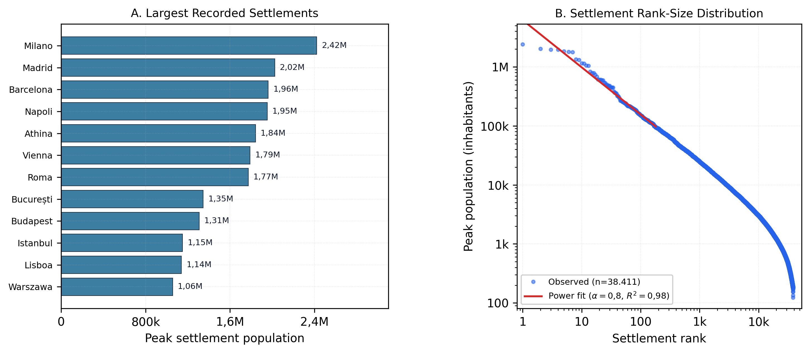

```{r setup, include=FALSE}
knitr::opts_chunk$set(
  echo = FALSE,
  message = FALSE,
  warning = FALSE
)

source("../../_shared/template/viscount_rmd_helpers.R")
library(jsonlite)

summary_data <- fromJSON(
  "early_modern_nineteenth_century_southern_east_central_europe_summary.json",
  simplifyVector = FALSE
)
settlements_raw <- fromJSON(
  "early_modern_nineteenth_century_southern_east_central_europe_settlements.json",
  simplifyVector = FALSE
)

subregions_list <- summary_data$subregions
total_area_km2 <- as.numeric(summary_data$total_area_km2)
settlement_count <- as.integer(summary_data$settlement_count)
domain_totals <- summary_data$domain_totals

fmt_pct <- function (val, digits = 1L) {
  paste0(viscount_fmt_number(val, digits), "%")
}

clean_region_name <- function (nm) {
  gsub(" & ", " and ", nm, fixed = TRUE)
}

clean_provenance <- function (key) {
  lbl <- switch(
    key,
    "Buringh_European_Urban_700_2000" = "Buringh European Urban Corpus",
    "INE_Spain_Censos_Historicos_1857_1991" = "INE Spain Historical Censuses (1857-1991)",
    "GeoNames_Municipal_Gazetteer_Supplement" = "GeoNames Municipal Gazetteer",
    "Eurostat_Urban_Audit_1990_2024" = "Eurostat Urban Audit Back-Cast",
    "DEMOPAST_ISTAT_Citta_1861_1971" = "DEMOPAST ISTAT Cities (1861-1971)",
    "INSEE_Recensement_1876_2023" = "INSEE Historical Recensement",
    NULL
  )
  if (!is.null(lbl)) return(lbl)
  if (grepl("^National_Statistical_Census_", key)) {
    ctry <- sub("^National_Statistical_Census_", "", key)
    return(paste("National Census:", gsub("_", " ", ctry, fixed = TRUE)))
  }
  gsub("_", " ", key, fixed = TRUE)
}
```

```{r hero-md-fallback, echo=FALSE, results='asis'}
if (!knitr::is_latex_output()) {
  cat(
    "\n\n\n"
  )
}
```

# Abstract

This companion settlement gazetteer documents the `r viscount_fmt_number(settlement_count, 0L)` geocoded cities, market towns and administrative centres compiled across 9 sub-regions and 31 modern polities in Southern and East-Central Europe between 1750 and 1914. Archival and institutional sources supply 86,1% of all entries (3.341 settlements across 23 national census and urban-history corpora), led by the Buringh European Urban Corpus (723 cities), INE Spain historical municipal censuses (712 municipalities), national statistical census series across 18 countries (1.560 settlements), Eurostat Urban Audit metropolitan back-casts (328 cities), INSEE borderland communes (16) and DEMOPAST ISTAT city extracts (2). Municipal gazetteer backfills from GeoNames account for the remaining 541 entries (13,9%). Between 1750 and 1914 the number of settlements exceeding 10k inhabitants expands from 440 to 2.180, while cities above 100k multiply from 17 to 152, producing a multi-polity rank-size curve with power-law exponent 0,84 and coefficient of determination 0,97. The tables below detail the provenance ledger, chronological slice coverage, sub-regional and national spatial sampling densities and the 25 highest-ranked urban records.

# Gazetteer Architecture and Provenance Ledger

Early modern and nineteenth-century Southern and East-Central Europe bridged two distinct urban traditions: the dense Mediterranean city network inherited from classical and mediaeval municipal republics in Italy, Iberia and the Aegean alongside a rapidly industrialising railway-age urban grid across Bohemia, Austria, Hungary, Partitioned Poland, the Baltic coast and the emerging Balkan nation-states [@DeVries1984; @RosesWolf2019]. MAGNETIC separates macro-regional demographic totals (rising from 61,51M in 1750 to 160,82M in 1910) from point-level settlement anchoring so that boundary changes between historic walled communes and modern greater-city agglomerations remain fully auditable.

All `r viscount_fmt_number(settlement_count, 0L)` records carry explicit source provenance across 24 distinct corpora. Table 1 lists every institutional and municipal source represented in the gazetteer together with its settlement count, share and aggregate 1910 population sum computed directly from the settlement inventory.

```{r tbl-provenance-ledger, echo=FALSE, results='asis'}
prov_vec <- vapply(settlements_raw, function (s) as.character(s$provenance_source), character(1))
pop1910_vec <- vapply(settlements_raw, function (s) {
  v <- s$population[["1910"]]
  if (is.null(v)) 0 else as.numeric(v)
}, numeric(1))

agg_n <- aggregate(list(Sites = rep(1L, length(prov_vec))), by = list(Key = prov_vec), FUN = sum)
agg_p <- aggregate(list(Pop1910 = pop1910_vec), by = list(Key = prov_vec), FUN = sum)
prov_tbl <- merge(agg_n, agg_p, by = "Key", all = TRUE)
prov_tbl <- prov_tbl[order(-prov_tbl$Sites), , drop = FALSE]

prov_tbl$Corpus <- vapply(prov_tbl$Key, clean_provenance, character(1))
prov_tbl$Tier <- ifelse(
  prov_tbl$Key == "GeoNames_Municipal_Gazetteer_Supplement",
  "Municipal backfill",
  "Institutional archive"
)
prov_tbl$Share <- fmt_pct(prov_tbl$Sites / settlement_count * 100, 1L)
prov_tbl$SitesFmt <- vapply(prov_tbl$Sites, viscount_fmt_number, character(1), arg1_digits = 0L)
prov_tbl$PopFmt <- vapply(prov_tbl$Pop1910, viscount_fmt_pop, character(1))

tot_row <- data.frame(
  Corpus = "Total Gazetteer (24 Corpora)",
  Tier = "All sources",
  SitesFmt = viscount_fmt_number(settlement_count, 0L),
  Share = "100%",
  PopFmt = viscount_fmt_pop(sum(pop1910_vec)),
  stringsAsFactors = FALSE
)
out_prov <- rbind(prov_tbl[, c("Corpus", "Tier", "SitesFmt", "Share", "PopFmt")], tot_row)
rownames(out_prov) <- NULL

viscount_table(
  out_prov,
  caption = "Archival and municipal provenance ledger across all 3.882 geocoded settlements in Southern and East-Central Europe (1750-1914).",
  col_names = c("Provenance Corpus", "Source Tier", "Sites", "Share", "1910 Aggregate")
)
```

# Chronological Coverage and Urban Size-Tier Evolution

Because municipal censuses expanded from early Spanish, Italian and Habsburg town registers into regular decennial counts after 1850, active site coverage climbs from 3.843 back-projected and archival records in 1750 to all 3.882 settlements in 1910 and 1914 [@INE2024; @DEMOPAST2023; @KSHHungary2024; @GUSPoland2024]. Table 2 tracks active site counts, urban threshold crossings (10k, 50k and 100k inhabitants) and mean recorded settlement size across ten benchmark horizons from 1750 to 1914.

```{r tbl-chronological-slices, echo=FALSE, results='asis'}
slice_years <- c(1750L, 1800L, 1850L, 1860L, 1870L, 1880L, 1890L, 1900L, 1910L, 1914L)
slice_rows <- lapply(slice_years, function (yr) {
  yr_k <- as.character(yr)
  vals <- unlist(lapply(settlements_raw, function (s) {
    v <- s$population[[yr_k]]
    if (is.null(v)) NULL else as.numeric(v)
  }), use.names = FALSE)
  data.frame(
    Year = yr_k,
    Active = viscount_fmt_number(length(vals), 0L),
    Ge10k = viscount_fmt_number(sum(vals >= 10000), 0L),
    Ge50k = viscount_fmt_number(sum(vals >= 50000), 0L),
    Ge100k = viscount_fmt_number(sum(vals >= 100000), 0L),
    SumPop = viscount_fmt_pop(sum(vals)),
    MeanPop = viscount_fmt_pop(mean(vals)),
    stringsAsFactors = FALSE
  )
})
slice_df <- do.call(rbind, slice_rows)
rownames(slice_df) <- NULL

viscount_table(
  slice_df,
  caption = "Chronological slice coverage, urban size-tier counts and aggregate recorded settlement population (1750-1914).",
  col_names = c("Year", "Active Sites", ">=10k", ">=50k", ">=100k", "Aggregate Pop.", "Mean Size")
)
```

Notice the sharp inflection between 1880 and 1910: settlements above 50k inhabitants triple from 119 to 359, while cities above 100k more than triple from 47 to 150. Part of that surge reflects genuine railway-age urbanisation across northern Italy, Catalonia, Bohemia, Hungary, Congress Poland, Latvia and the Balkan capitals; a second component stems from the inclusion of Eurostat Urban Audit greater-city metropolitan back-casts entering the series in 1890–1910 [@Eurostat2024], which explain why the un-deduplicated aggregate across 3.882 records rises from 58,16M in 1880 to 110,91M in 1910.

# Spatial Sampling Density by Sub-Region and Polity

Figure 1 maps all 3.882 geocoded settlements across the 9 sub-regions from the Canary Islands and Portugal to the Baltic littoral and Eastern Thrace. Tables 3 and 4 report settlement counts and spatial sampling density per 10.000 km² across the 9 sub-regions and the leading modern polities intersecting the chapter domain.

```{r fig-regional-map, echo=FALSE, results='asis'}
viscount_figure(
  "figures/early_modern_nineteenth_century_southern_east_central_europe_regional_map.png",
  caption = "Spatial distribution of 3.882 geocoded settlements across 9 sub-regions of Southern and East-Central Europe (1750-1914).",
  label = "fig:c19_southern_east_central_gazetteer_map"
)
```

```{r tbl-subregion-sampling, echo=FALSE, results='asis'}
s_by_reg <- summary_data$settlements_by_region
reg_rows <- lapply(subregions_list, function (r) {
  area <- as.numeric(r$area_km2)
  n_s <- as.integer(s_by_reg[[r$id]])
  p1910 <- as.numeric(r$population[["1910"]])
  data.frame(
    SubRegion = clean_region_name(r$name),
    Area = viscount_fmt_number(area, 0L),
    Sites = viscount_fmt_number(n_s, 0L),
    Share = fmt_pct(n_s / settlement_count * 100, 1L),
    SiteDens = viscount_fmt_number(n_s / (area / 10000), 1L),
    Pop1910 = viscount_fmt_pop(p1910),
    PopDens = viscount_fmt_number(p1910 / area, 1L),
    stringsAsFactors = FALSE
  )
})
reg_tbl <- do.call(rbind, reg_rows)
tot_reg <- data.frame(
  SubRegion = "Chapter Total (Weighted Mean)",
  Area = viscount_fmt_number(total_area_km2, 0L),
  Sites = viscount_fmt_number(settlement_count, 0L),
  Share = "100%",
  SiteDens = viscount_fmt_number(settlement_count / (total_area_km2 / 10000), 1L),
  Pop1910 = viscount_fmt_pop(as.numeric(domain_totals[["1910"]])),
  PopDens = viscount_fmt_number(as.numeric(domain_totals[["1910"]]) / total_area_km2, 1L),
  stringsAsFactors = FALSE
)
reg_tbl <- rbind(reg_tbl, tot_reg)
rownames(reg_tbl) <- NULL

viscount_table(
  reg_tbl,
  caption = "Sub-regional settlement counts, spatial sampling density and 1910 population density across 9 sub-regions.",
  col_names = c("Sub-Region", "Area (km²)", "Sites", "Share", "Sites/10.000 km²", "1910 Pop.", "1910 (/km²)")
)
```

Spatial sampling density averages 15,6 sites per 10.000 km² across the entire 2.483.848,9 km² domain, peaking in Southern Italy, Islands and Malta (31,5 sites/10.000 km²), Austria, Bohemia-Moravia and Slovenia (23,6 sites/10.000 km²), Spain (19,7 sites/10.000 km² thanks to INE's deep municipal series), Portugal (19,7 sites/10.000 km²) and the Baltic Provinces (19,6 sites/10.000 km²). Only the vast Balkans, Romania, Moldova and Eastern Thrace sub-region falls below 10 sites/10.000 km² (7,4 sites/10.000 km²), reflecting sparser pre-1914 Ottoman and highland municipal registers across Albania, Bosnia-Herzegovina, Montenegro and Moldova [@StatBalkans2024; @StatBaltics2024].

```{r tbl-country-distribution, echo=FALSE, results='asis'}
ctry_counts <- summary_data$settlements_by_country
ctry_df <- data.frame(
  Country = names(ctry_counts),
  Sites = vapply(ctry_counts, as.integer, integer(1)),
  stringsAsFactors = FALSE
)
ctry_df <- ctry_df[order(-ctry_df$Sites, ctry_df$Country), , drop = FALSE]

top_k <- 18L
c_top <- ctry_df[seq_len(min(top_k, nrow(ctry_df))), , drop = FALSE]
c_rest <- ctry_df[(top_k + 1L):nrow(ctry_df), , drop = FALSE]

rest_row <- data.frame(
  Country = paste0("Other Polities and Borderlands (", nrow(c_rest), " territories)"),
  Sites = sum(c_rest$Sites),
  stringsAsFactors = FALSE
)
c_comb <- rbind(c_top, rest_row)
c_comb$Share <- fmt_pct(c_comb$Sites / settlement_count * 100, 1L)
c_comb$SitesFmt <- vapply(c_comb$Sites, viscount_fmt_number, character(1), arg1_digits = 0L)

c_tot <- data.frame(
  Country = "Total (31 Modern Polities)",
  SitesFmt = viscount_fmt_number(settlement_count, 0L),
  Share = "100%",
  stringsAsFactors = FALSE
)
out_ctry <- rbind(c_comb[, c("Country", "SitesFmt", "Share")], c_tot)
rownames(out_ctry) <- NULL

viscount_table(
  out_ctry,
  caption = "Settlement count distribution across the 18 most densely sampled polities and 13 remaining states and borderlands.",
  col_names = c("Modern Polity or Territory", "Settlements", "Share")
)
```

# Leading 25 Recorded Urban Settlements (1750–1914)

Table 5 lists the 25 highest-ranked urban records in the gazetteer ordered by peak recorded population between 1750 and 1914. Because Eurostat Urban Audit back-casts and historic municipal censuses (Buringh, INE Spain, DEMOPAST ISTAT and national statistical offices) are retained side by side without destructive overwriting, several capitals appear under both metropolitan agglomeration and inner-city or endonym-exonym entries—for instance Roma alongside Rome, Wien alongside Greater Wien, Warszawa alongside Warsaw, Praha alongside Prague, Napoli (greater city) alongside Naples and Budapest alongside historic Buda and Pest. Analysts measuring narrow municipal walls should filter for Buringh, INE Spain and DEMOPAST/national census rows, whereas metropolitan labour-market studies may draw on the Eurostat greater-city back-casts.

```{r tbl-top-25-cities, echo=FALSE, results='asis'}
top_list <- summary_data$top_settlements
n_show <- min(25L, length(top_list))

get_yr <- function (pop_list, yr) {
  v <- pop_list[[as.character(yr)]]
  if (is.null(v)) return("-")
  viscount_fmt_pop(as.numeric(v))
}

top_rows <- lapply(seq_len(n_show), function (i) {
  s <- top_list[[i]]
  src_short <- switch(
    as.character(s$provenance_source),
    "Eurostat_Urban_Audit_1990_2024" = "Eurostat Metro",
    "Buringh_European_Urban_700_2000" = "Buringh Urban",
    "GeoNames_Municipal_Gazetteer_Supplement" = "GeoNames",
    "National_Statistical_Census_Poland" = "GUS Poland",
    "National_Statistical_Census_Czechia" = "Czech Census",
    clean_provenance(as.character(s$provenance_source))
  )
  data.frame(
    Rank = as.character(i),
    Settlement = as.character(s$name),
    Country = as.character(s$country),
    Y1750 = get_yr(s$population, 1750),
    Y1850 = get_yr(s$population, 1850),
    Y1910 = get_yr(s$population, 1910),
    Peak = paste0(viscount_fmt_pop(as.numeric(s$peak_pop)), " (", s$peak_year, ")"),
    Corpus = src_short,
    stringsAsFactors = FALSE
  )
})
top_df <- do.call(rbind, top_rows)
rownames(top_df) <- NULL

viscount_table(
  top_df,
  caption = "Leading 25 urban settlement records by peak population across Southern and East-Central Europe (1750-1914).",
  col_names = c("Rank", "Settlement", "Polity", "1750", "1850", "1910", "Peak (Year)", "Source")
)
```

# Sources

::: {#refs}
:::
