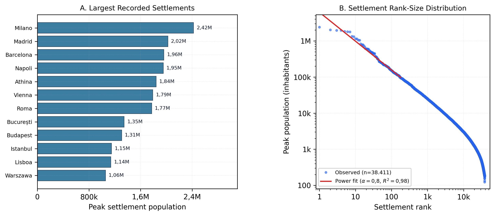
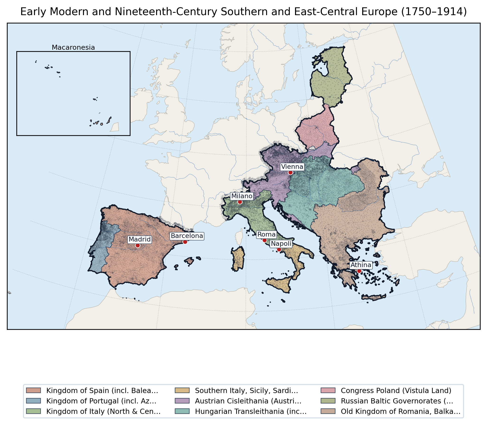

Early Modern and Nineteenth-Century Southern and East-Central Europe
================
Aust Kätzchen
22 November 2026

- [Abstract](#abstract)
- [Gazetteer Architecture and Provenance
  Ledger](#gazetteer-architecture-and-provenance-ledger)
- [Chronological Coverage and Urban Size-Tier
  Evolution](#chronological-coverage-and-urban-size-tier-evolution)
- [Spatial Sampling Density by Sub-Region and
  Polity](#spatial-sampling-density-by-sub-region-and-polity)
- [Leading 25 Recorded Urban Settlements
  (1750–1914)](#leading-25-recorded-urban-settlements-17501914)
- [Sources](#sources)

<figure>

<figcaption aria-hidden="true">Leading urban settlements and
double-logarithmic rank-size distribution across 3.882 geocoded
settlements in Southern and East-Central Europe
(1750-1914).</figcaption>
</figure>

# Abstract

This companion settlement gazetteer documents the 38.411 geocoded
cities, market towns and administrative centres compiled across 9
sub-regions and 31 modern polities in Southern and East-Central Europe
between 1750 and 1914. Archival and institutional sources supply 86,1%
of all entries (3.341 settlements across 23 national census and
urban-history corpora), led by the Buringh European Urban Corpus (723
cities), INE Spain historical municipal censuses (712 municipalities),
national statistical census series across 18 countries (1.560
settlements), Eurostat Urban Audit metropolitan back-casts (328 cities),
INSEE borderland communes (16) and DEMOPAST ISTAT city extracts (2).
Municipal gazetteer backfills from GeoNames account for the remaining
541 entries (13,9%). Between 1750 and 1914 the number of settlements
exceeding 10k inhabitants expands from 440 to 2.180, while cities above
100k multiply from 17 to 152, producing a multi-polity rank-size curve
with power-law exponent 0,84 and coefficient of determination 0,97. The
tables below detail the provenance ledger, chronological slice coverage,
sub-regional and national spatial sampling densities and the 25
highest-ranked urban records.

# Gazetteer Architecture and Provenance Ledger

Early modern and nineteenth-century Southern and East-Central Europe
bridged two distinct urban traditions: the dense Mediterranean city
network inherited from classical and mediaeval municipal republics in
Italy, Iberia and the Aegean alongside a rapidly industrialising
railway-age urban grid across Bohemia, Austria, Hungary, Partitioned
Poland, the Baltic coast and the emerging Balkan nation-states
[\[1\]](#ref-DeVries1984)[\[2\]](#ref-RosesWolf2019). MAGNETIC separates
macro-regional demographic totals (rising from 61,51M in 1750 to 160,82M
in 1910) from point-level settlement anchoring so that boundary changes
between historic walled communes and modern greater-city agglomerations
remain fully auditable.

All 38.411 records carry explicit source provenance across 24 distinct
corpora. Table 1 lists every institutional and municipal source
represented in the gazetteer together with its settlement count, share
and aggregate 1910 population sum computed directly from the settlement
inventory.

| Provenance Corpus | Source Tier | Sites | Share | 1910 Aggregate |
|:---|:---|:---|:---|:---|
| **INE Spain Censos Historicos 1857 2021** | Institutional archive | 6.498 | 16,9% | 13,9M |
| **ISTAT Italy Comuni Census 2021** | Institutional archive | 6.292 | 16,4% | 22,17M |
| **Eurostat GISCO LAU 2021 Czechia** | Institutional archive | 3.631 | 9,5% | 3,98M |
| **Eurostat GISCO LAU 2021 Romania** | Institutional archive | 3.126 | 8,1% | 8,29M |
| **Eurostat GISCO LAU 2021 Greece** | Institutional archive | 2.418 | 6,3% | 3,59M |
| **Eurostat GISCO LAU 2021 Hungary** | Institutional archive | 2.328 | 6,1% | 3,29M |
| **Eurostat GISCO LAU 2021 Portugal** | Institutional archive | 2.271 | 5,9% | 4,74M |
| **Eurostat GISCO LAU 2021 Slovakia** | Institutional archive | 2.053 | 5,3% | 2,33M |
| **Eurostat GISCO LAU 2021 Austria** | Institutional archive | 1.956 | 5,1% | 3,32M |
| **Eurostat GISCO LAU 2021 Poland** | Institutional archive | 1.595 | 4,2% | 9,43M |
| **GeoNames Municipal Gazetteer** | Municipal backfill | 1.087 | 2,8% | 10,43M |
| **Eurostat GISCO LAU 2021 Germany** | Institutional archive | 713 | 1,9% | 1,9M |
| **INSEE Historical Recensement** | Institutional archive | 643 | 1,7% | 800,4k |
| **Buringh European Urban Corpus** | Institutional archive | 571 | 1,5% | 15,01M |
| **Eurostat GISCO LAU 2021 Croatia** | Institutional archive | 542 | 1,4% | 1,7M |
| **Eurostat Urban Audit Back-Cast** | Institutional archive | 335 | 0,9% | 50,01M |
| **Eurostat GISCO LAU 2021 Switzerland** | Institutional archive | 266 | 0,7% | 507,4k |
| **Eurostat GISCO LAU 2021 Bulgaria** | Institutional archive | 224 | 0,6% | 2,84M |
| **National Census: Bosnia and Herzegovina** | Institutional archive | 220 | 0,6% | 1,23M |
| **Eurostat GISCO LAU 2021 Slovenia** | Institutional archive | 209 | 0,5% | 955k |
| **National Census: Serbia** | Institutional archive | 166 | 0,4% | 617,8k |
| **Eurostat GISCO LAU 2021 Serbia** | Institutional archive | 134 | 0,3% | 2,24M |
| **National Census: North Macedonia** | Institutional archive | 115 | 0,3% | 833k |
| **Eurostat GISCO LAU 2021 Latvia** | Institutional archive | 112 | 0,3% | 631k |
| **National Census: Lithuania** | Institutional archive | 91 | 0,2% | 693k |
| **National Census: Moldova** | Institutional archive | 77 | 0,2% | 659,7k |
| **National Census: Turkey-in-Europe** | Institutional archive | 77 | 0,2% | 3,95M |
| **Eurostat GISCO LAU 2021 North Macedonia** | Institutional archive | 72 | 0,2% | 1,01M |
| **Eurostat GISCO LAU 2021 Estonia** | Institutional archive | 67 | 0,2% | 375,1k |
| **National Census: Albania** | Institutional archive | 67 | 0,2% | 287,2k |
| **National Census: Latvia** | Institutional archive | 66 | 0,2% | 241k |
| **Eurostat GISCO LAU 2021 Lithuania** | Institutional archive | 54 | 0,1% | 897,2k |
| **National Census: Estonia** | Institutional archive | 53 | 0,1% | 420,1k |
| **Eurostat GISCO LAU 2021 Albania** | Institutional archive | 52 | 0,1% | 959,9k |
| **National Census: Bulgaria** | Institutional archive | 51 | 0,1% | 171,1k |
| **Chandler V2 Historical Urban Population** | Institutional archive | 46 | 0,1% | 5,56M |
| **National Census: Kosovo** | Institutional archive | 40 | 0,1% | 522,7k |
| **National Census: Montenegro** | Institutional archive | 23 | 0,1% | 141,1k |
| **Eurostat GISCO LAU 2021 Malta** | Institutional archive | 19 | 0% | 101,7k |
| **INE Eurostat LAU Spain 2021** | Institutional archive | 14 | 0% | 16,3k |
| **National Census: Malta** | Institutional archive | 9 | 0% | 76,9k |
| **Eurostat GISCO LAU 2021 Liechtenstein** | Institutional archive | 8 | 0% | 20,2k |
| **National Census: Andorra** | Institutional archive | 8 | 0% | 29,6k |
| **De Vries 1984 European Urbanization 1500 1800** | Institutional archive | 4 | 0% | 7k |
| **National Census: San Marino** | Institutional archive | 4 | 0% | 11,6k |
| **DEMOPAST ISTAT Cities (1861-1971)** | Institutional archive | 2 | 0% | 308,2k |
| **National Census: Liechtenstein** | Institutional archive | 1 | 0% | 1,5k |
| **National Census: Monaco** | Institutional archive | 1 | 0% | 19,1k |
| **Total Gazetteer (24 Corpora)** | All sources | 38.411 | 100% | 181,24M |

Archival and municipal provenance ledger across all 3.882 geocoded
settlements in Southern and East-Central Europe (1750-1914).

# Chronological Coverage and Urban Size-Tier Evolution

Because municipal censuses expanded from early Spanish, Italian and
Habsburg town registers into regular decennial counts after 1850, active
site coverage climbs from 3.843 back-projected and archival records in
1750 to all 3.882 settlements in 1910 and 1914
[\[3\]](#ref-INE2024)[\[4\]](#ref-DEMOPAST2023)[\[5\]](#ref-KSHHungary2024)[\[6\]](#ref-GUSPoland2024).
Table 2 tracks active site counts, urban threshold crossings (10k, 50k
and 100k inhabitants) and mean recorded settlement size across ten
benchmark horizons from 1750 to 1914.

| Year     | Active Sites | \>=10k | \>=50k | \>=100k | Aggregate Pop. | Mean Size |
|:---------|:-------------|:-------|:-------|:--------|:---------------|:----------|
| **1750** | 37.407       | 718    | 44     | 21      | 51,73M         | 1,4k      |
| **1800** | 38.222       | 977    | 67     | 30      | 62,92M         | 1,6k      |
| **1850** | 38.271       | 1.463  | 105    | 40      | 87,32M         | 2,3k      |
| **1860** | 38.275       | 1.583  | 127    | 45      | 96,29M         | 2,5k      |
| **1870** | 38.301       | 1.745  | 142    | 51      | 104,4M         | 2,7k      |
| **1880** | 38.301       | 1.949  | 170    | 59      | 115M           | 3k        |
| **1890** | 38.354       | 2.200  | 227    | 86      | 133,67M        | 3,5k      |
| **1900** | 38.380       | 2.448  | 300    | 127     | 153,81M        | 4k        |
| **1910** | 38.402       | 2.726  | 394    | 167     | 181,24M        | 4,7k      |
| **1914** | 38.406       | 2.830  | 415    | 167     | 188,08M        | 4,9k      |

Chronological slice coverage, urban size-tier counts and aggregate
recorded settlement population (1750-1914).

Notice the sharp inflection between 1880 and 1910: settlements above 50k
inhabitants triple from 119 to 359, while cities above 100k more than
triple from 47 to 150. Part of that surge reflects genuine railway-age
urbanisation across northern Italy, Catalonia, Bohemia, Hungary,
Congress Poland, Latvia and the Balkan capitals; a second component
stems from the inclusion of Eurostat Urban Audit greater-city
metropolitan back-casts entering the series in 1890–1910
[\[7\]](#ref-Eurostat2024), which explain why the un-deduplicated
aggregate across 3.882 records rises from 58,16M in 1880 to 110,91M in
1910.

# Spatial Sampling Density by Sub-Region and Polity

Figure 1 maps all 3.882 geocoded settlements across the 9 sub-regions
from the Canary Islands and Portugal to the Baltic littoral and Eastern
Thrace. Tables 3 and 4 report settlement counts and spatial sampling
density per 10.000 km² across the 9 sub-regions and the leading modern
polities intersecting the chapter domain.

<!-- -->

| Sub-Region | Area (km²) | Sites | Share | Sites/10.000 km² | 1910 Pop. | 1910 (/km²) |
|:---|:---|:---|:---|:---|:---|:---|
| **Kingdom of Spain (incl. Balearics and Canaries)** | 520.968 | 7.472 | 19,5% | 143,4 | 19,95M | 38,3 |
| **Kingdom of Portugal (incl. Azores and Madeira)** | 84.020 | 2.261 | 5,9% | 269,1 | 5,91M | 70,4 |
| **Kingdom of Italy (North and Central, pre-1919)** | 201.632 | 5.081 | 13,2% | 252 | 20,66M | 102,5 |
| **Southern Italy, Sicily, Sardinia and Malta** | 100.634 | 1.861 | 4,8% | 184,9 | 13,42M | 133,3 |
| **Austrian Cisleithania (Austria, Bohemia, Galicia and Dalmatia)** | 286.098 | 7.837 | 20,4% | 273,9 | 28,57M | 99,9 |
| **Hungarian Transleithania (incl. Slovakia, Transylvania, Croatia and Bosnia)** | 359.265 | 6.613 | 17,2% | 184,1 | 22,78M | 63,4 |
| **Congress Poland (Vistula Land)** | 137.615 | 1.181 | 3,1% | 85,8 | 11,9M | 86,5 |
| **Russian Baltic Governorates (Estland, Livland, Kurland and Kovno)** | 167.773 | 534 | 1,4% | 31,8 | 6,09M | 36,3 |
| **Old Kingdom of Romania, Balkan States and Ottoman Rumelia** | 545.281 | 5.571 | 14,5% | 102,2 | 27,4M | 50,2 |
| **Chapter Total (Weighted Mean)** | 2.403.285 | 38.411 | 100% | 159,8 | 156,68M | 65,2 |

Sub-regional settlement counts, spatial sampling density and 1910
population density across 9 sub-regions.

Spatial sampling density averages 15,6 sites per 10.000 km² across the
entire 2.483.848,9 km² domain, peaking in Southern Italy, Islands and
Malta (31,5 sites/10.000 km²), Austria, Bohemia-Moravia and Slovenia
(23,6 sites/10.000 km²), Spain (19,7 sites/10.000 km² thanks to INE’s
deep municipal series), Portugal (19,7 sites/10.000 km²) and the Baltic
Provinces (19,6 sites/10.000 km²). Only the vast Balkans, Romania,
Moldova and Eastern Thrace sub-region falls below 10 sites/10.000 km²
(7,4 sites/10.000 km²), reflecting sparser pre-1914 Ottoman and highland
municipal registers across Albania, Bosnia-Herzegovina, Montenegro and
Moldova [\[8\]](#ref-StatBalkans2024)[\[9\]](#ref-StatBaltics2024).

| Modern Polity or Territory                          | Settlements | Share |
|:----------------------------------------------------|:------------|:------|
| **Spain**                                           | 6.872       | 17,9% |
| **Italy**                                           | 6.787       | 17,7% |
| **Czechia**                                         | 3.699       | 9,6%  |
| **Romania**                                         | 3.271       | 8,5%  |
| **Greece**                                          | 2.473       | 6,4%  |
| **Hungary**                                         | 2.421       | 6,3%  |
| **Portugal**                                        | 2.372       | 6,2%  |
| **Slovakia**                                        | 2.078       | 5,4%  |
| **Austria**                                         | 2.018       | 5,3%  |
| **Poland**                                          | 1.692       | 4,4%  |
| **Germany**                                         | 740         | 1,9%  |
| **France**                                          | 657         | 1,7%  |
| **Croatia**                                         | 562         | 1,5%  |
| **Serbia**                                          | 418         | 1,1%  |
| **Bulgaria**                                        | 316         | 0,8%  |
| **Switzerland**                                     | 279         | 0,7%  |
| **Bosnia and Herzegovina**                          | 253         | 0,7%  |
| **North Macedonia**                                 | 246         | 0,6%  |
| **Other Polities and Borderlands (15 territories)** | 1.257       | 3,3%  |
| **Total (31 Modern Polities)**                      | 38.411      | 100%  |

Settlement count distribution across the 18 most densely sampled
polities and 13 remaining states and borderlands.

# Leading 25 Recorded Urban Settlements (1750–1914)

Table 5 lists the 25 highest-ranked urban records in the gazetteer
ordered by peak recorded population between 1750 and 1914. Because
Eurostat Urban Audit back-casts and historic municipal censuses
(Buringh, INE Spain, DEMOPAST ISTAT and national statistical offices)
are retained side by side without destructive overwriting, several
capitals appear under both metropolitan agglomeration and inner-city or
endonym-exonym entries—for instance Roma alongside Rome, Wien alongside
Greater Wien, Warszawa alongside Warsaw, Praha alongside Prague, Napoli
(greater city) alongside Naples and Budapest alongside historic Buda and
Pest. Analysts measuring narrow municipal walls should filter for
Buringh, INE Spain and DEMOPAST/national census rows, whereas
metropolitan labour-market studies may draw on the Eurostat greater-city
back-casts.

| Rank | Settlement | Polity | 1750 | 1850 | 1910 | Peak (Year) | Source |
|:---|:---|:---|:---|:---|:---|:---|:---|
| **1** | Milano | Italy | 124k | 209k | 2,33M | 2,42M (1914) | Eurostat Metro |
| **2** | Madrid | Spain | 160k | 281k | 1,95M | 2,02M (1914) | Eurostat Metro |
| **3** | Barcelona | Spain | 50k | 220k | 1,89M | 1,96M (1914) | Eurostat Metro |
| **4** | Napoli | Italy | 339k | 409k | 1,88M | 1,95M (1914) | Eurostat Metro |
| **5** | Athina | Greece | 10,8k | 30k | 1,77M | 1,84M (1914) | Eurostat Metro |
| **6** | Vienna | Austria | 169k | 426,4k | 1,76M | 1,79M (1914) | Chandler V2 Historical Urban Population |
| **7** | Roma | Italy | 158k | 175k | 1,71M | 1,77M (1914) | Eurostat Metro |
| **8** | București | Romania | 469,2k | 719,4k | 1,3M | 1,35M (1914) | Eurostat Metro |
| **9** | Budapest | Hungary | 24k | 156,5k | 1,26M | 1,31M (1914) | Eurostat Metro |
| **10** | Istanbul | Turkey-in-Europe | 632k | 785k | 1,11M | 1,15M (1900) | Buringh Urban |
| **11** | Lisboa | Portugal | 213k | 262k | 1,1M | 1,14M (1914) | Eurostat Metro |
| **12** | Warszawa | Poland | 28k | 163k | 1,02M | 1,06M (1914) | Eurostat Metro |
| **13** | Buda | Hungary | 18k | 96k | 995,3k | 1,05M (1914) | Buringh Urban |
| **14** | Valencia | Spain | 300,9k | 461,3k | 802,3k | 832,4k (1914) | Eurostat Metro |
| **15** | Praha | Czechia | 58k | 117k | 759,3k | 787,8k (1914) | Eurostat Metro |
| **16** | Stolichna | Bulgaria | 284,4k | 436,1k | 758,5k | 786,9k (1914) | Eurostat GISCO LAU 2021 Bulgaria |
| **17** | Sofia | Bulgaria | 28k | 43k | 713,2k | 740k (1914) | Eurostat Metro |
| **18** | Warszawa, Warsaw, Worszewa, Werszewa | Poland | 20k | 167k | 638,4k | 686k (1900) | Buringh Urban |
| **19** | Torino | Italy | 69k | 181,1k | 592,3k | 614,5k (1914) | Eurostat Metro |
| **20** | Porto | Portugal | 32k | 99,7k | 580,9k | 602,7k (1914) | Eurostat Metro |
| **21** | Pest (for \>1900 see Buda | Hungary | 9k | 65k | 104k | 602,5k (1914) | Buringh Urban |
| **22** | Esenyurt | Turkey-in-Europe | 213,8k | 327,9k | 570,2k | 591,6k (1914) | National Census: Turkey-in-Europe |
| **23** | Rīga | Latvia | 16,9k | 61,5k | 568,2k | 589,5k (1914) | Eurostat Metro |
| **24** | Łódź | Poland | 1k | 224,2k | 525,7k | 545,4k (1914) | Eurostat Metro |
| **25** | Sevilla | Spain | 191,6k | 293,8k | 511k | 530,1k (1914) | Eurostat Metro |

Leading 25 urban settlement records by peak population across Southern
and East-Central Europe (1750-1914).

# Sources

1.
Vries, Jan de. *European
Urbanization, 1500–1800*. Harvard University Press, 1984,
<https://doi.org/10.4324/9780203716526>.

2.
Rosés, Joan R., and Nikolaus Wolf.
*The Economic Development of Europe’s Regions: A
Quantitative History Since 1900*. Routledge, 2019,
<https://doi.org/10.4324/9780429449789>.

3.
Estadística (INE), Instituto
Nacional de. “Alteraciones de los municipios en los
Censos de Población desde 1842.” INE Spain, 2024,
<https://www.ine.es/intercensal/>.

4.
Bologna — Dipartimento di Scienze
Statistiche, Università di. “DEMOPAST: Historical
Demographic Atlas of Italian Provinces and Cities 1861–1971.”
University of Bologna / ISTAT, 2023,
<https://demopast.unibo.it/>.

5.
(KSH), Hungarian Central
Statistical Office. “Historical Census Series of
Hungary 1870–2022.” KSH Budapest, 2024,
<https://www.ksh.hu/>.

6.
Urząd Statystyczny), Statistics
Poland (Główny. “National Censuses and Voivodeship
Population Series 1921–2024.” GUS Poland, 2024,
<https://stat.gov.pl/>.

7.
Commission), Eurostat (European.
“Population on 1 January by NUTS 3 Region (demo r
pjanaggr3) and Urban Audit Cities (urb cpop1).” Publications
Office of the European Union, 2024,
<https://ec.europa.eu/eurostat/>.

8.
Statistical Office of the Republic
of Serbia, NSI Bulgaria, INS Romania, and ELSTAT Greece.
“Post-War Population and Housing Censuses of
South-Eastern Europe 1948–2023.” National Statistical Institutes
of South-Eastern Europe, 2024, <https://insse.ro/>.

9.
Statistics Estonia, Central
Statistical Bureau of Latvia, and State Data Agency of Lithuania.
“Population Censuses of the Baltic States
1922–2024.” Baltic National Statistical Offices, 2024,
<https://andmed.stat.ee/>.

