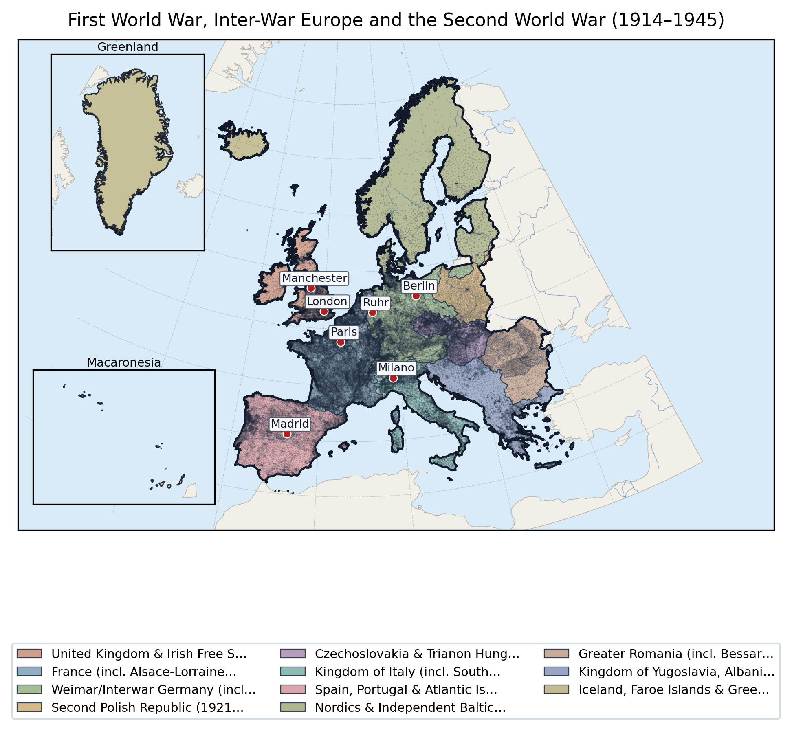
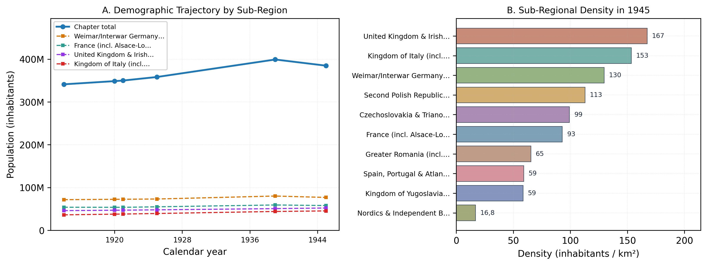
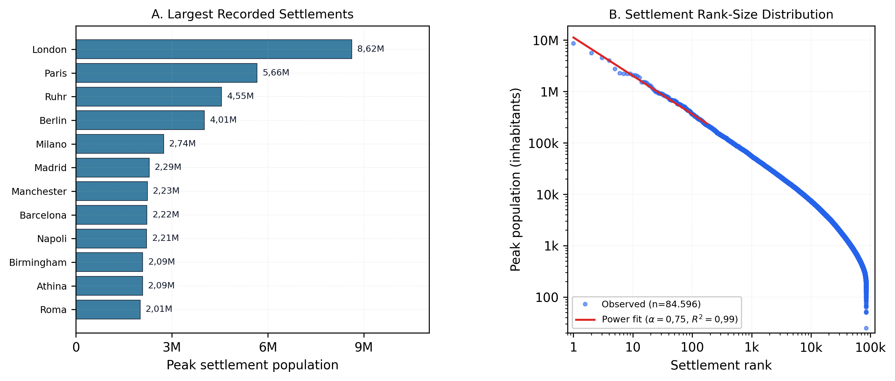

First World War, Inter-War Europe and the Second World War
================
Aust Kätzchen
22 November 2026

- [Abstract](#abstract)
- [Background](#background)
  - [Europe on the Eve of 1914](#europe-on-the-eve-of-1914)
  - [The First World War and the 1918–1919 Influenza
    Pandemic](#the-first-world-war-and-the-19181919-influenza-pandemic)
  - [Post-Imperial Borders, Minority Treaties and Population
    Exchanges](#post-imperial-borders-minority-treaties-and-population-exchanges)
  - [Inter-War Fertility Decline, the Great Depression and the Spanish
    Civil
    War](#inter-war-fertility-decline-the-great-depression-and-the-spanish-civil-war)
  - [The Second World War, the Holocaust and 1945 Population
    Transfers](#the-second-world-war-the-holocaust-and-1945-population-transfers)
- [Methodology](#methodology)
  - [Fixed Sub-Regional Geometry and Temporal
    Anchors](#fixed-sub-regional-geometry-and-temporal-anchors)
  - [Scraped Inter-War Historical GIS Sub-Administrative
    Enumerations](#scraped-inter-war-historical-gis-sub-administrative-enumerations)
  - [Settlement Gazetteer Integration and Urban
    Disaggregation](#settlement-gazetteer-integration-and-urban-disaggregation)
- [Validation](#validation)
  - [Cross-Checking Sub-Regional Totals Against Sub-Administrative HGIS
    Units](#cross-checking-sub-regional-totals-against-sub-administrative-hgis-units)
  - [Reconciliation of Wartime Mortality and Census
    Jumps](#reconciliation-of-wartime-mortality-and-census-jumps)
- [Results](#results)
  - [Continental Demographic Trajectory,
    1914–1945](#continental-demographic-trajectory-19141945)
  - [Sub-Regional Demographic
    Narratives](#sub-regional-demographic-narratives)
    - [Western and North-Western
      Europe](#western-and-north-western-europe)
    - [Central Europe: The German Sphere, Poland and the Danubian
      Basin](#central-europe-the-german-sphere-poland-and-the-danubian-basin)
    - [Southern Europe: Italy, Iberia and the
      Balkans](#southern-europe-italy-iberia-and-the-balkans)
    - [Northern Europe and the North
      Atlantic](#northern-europe-and-the-north-atlantic)
  - [Density Shifts and Urban
    Hierarchy](#density-shifts-and-urban-hierarchy)
- [Limitations](#limitations)
- [Conclusion](#conclusion)
- [Appendix](#appendix)
- [Sources](#sources)

<figure>

<figcaption aria-hidden="true">Spatial extent of the 11 European and
North Atlantic sub-regions (1914–1945) with 10.046 geocoded settlements
and principal inter-war metropolitan centres.</figcaption>
</figure>

# Abstract

Between the outbreak of the First World War in 1914 and the collapse of
the Third Reich in 1945, the population of Europe outside the Soviet
Union together with Iceland, the Faroe Islands and Greenland rose from
342,57M to a pre-war peak of 396,37M in 1939 before falling by 11,63M
(-2,9%) to 384,74M by 1945. Across the 7.148.884,3 km² domain
(4.970.091,5 km² excluding the North Atlantic islands and the Greenland
ice sheet), mean overall density increased from 47,92 inhabitants/km² in
1914 to 55,44 inhabitants/km² in 1939 and receded to 53,82
inhabitants/km² in 1945; excluding the North Atlantic sub-region,
continental and insular European density climbed from 68,9 to 79,72
before slipping to 77,37 inhabitants/km². This 31-year span witnessed
the sharpest demographic shocks in modern European history: First World
War military and civilian mortality, the 1918–1919 influenza pandemic,
post-imperial border revisions and compulsory population exchanges under
the Versailles, Saint-Germain, Trianon and Lausanne settlements, rapid
inter-war fertility decline across industrialised western and central
Europe, the Spanish Civil War and Republican exile, Second World War
combat and civilian slaughter, the industrialised genocide of the
Holocaust and the initial wave of 1945 post-war border shifts and
expulsions across the Oder-Neisse line, East Prussia and the
Sudetenland. Whereas non-belligerent Iberia expanded by 32,7% across
1914–1945 and the North Atlantic by 48,8%, Poland contracted by 25,5%
(-8,17M) between 1939 and 1945 alone and Czechoslovakia and Hungary fell
by 10,7% (-2,55M). MAGNETIC harmonises these trajectories across 11
fixed sub-regional masks anchored against 1.149 scraped inter-war
historical GIS sub-administrative enumerations and a 10.046-settlement
urban gazetteer spanning 45 modern states and territories.

# Background

## Europe on the Eve of 1914

In the summer of 1914 Europe outside the Russian Empire stood near the
zenith of its nineteenth-century demographic expansion. A century of
declining mortality, railway integration, steamship grain imports and
industrial urbanisation had lifted the 11 sub-regions of this study to
342,57M inhabitants
[\[1\]](#ref-Mitchell2007)[\[2\]](#ref-RosesWolf2019). Yet the continent
was no longer demographically uniform. Industrialised north-western and
central Europe already exhibited the advanced phase of the first
demographic transition: marital fertility had been falling in France
since the late eighteenth century and across Britain, Germany, Belgium,
Switzerland and Scandinavia since the 1870s and 1880s
[\[3\]](#ref-CoaleWatkins1986)[\[4\]](#ref-Dupaquier1988)[\[5\]](#ref-WrigleySchofield1981).
By contrast, agrarian southern and eastern Europe—Spain, Portugal,
southern Italy, Poland, Romania, Bulgaria, Serbia and Albania—retained
crude birth rates above 30 to 40 per thousand alongside rapidly falling
death rates, generating formidable cohorts of young adults despite mass
transatlantic emigration.

Population density reflected this industrial divide. Germany, Austria
and Switzerland held 71,65M people on 481.097,9 km² (148,93
inhabitants/km²), closely followed by the United Kingdom and Ireland
with 46,05M on 311.813,8 km² (147,68 inhabitants/km²) and Italy and
Malta with 36,2M on 300.408,2 km² (120,5 inhabitants/km²). France and
Benelux stood at 53,95M (87,71 inhabitants/km²), masking a sharp
contrast between densely packed Belgium and the Netherlands and France’s
thinly populated rural south and centre. Across the eastern and southern
peripheries, Poland held 27,2M (88,18 inhabitants/km²), Czechoslovakia
and Hungary 21,4M (97,92 inhabitants/km²), Romania, Bulgaria and Moldova
19,1M (50,97 inhabitants/km²), Yugoslavia, Albania, Greece and Eastern
Thrace 20,1M (46,21 inhabitants/km²) and Spain, Portugal and the
Atlantic islands 26,45M (44,47 inhabitants/km²). At the northern fringe,
the Nordics and Baltic States counted 20,35M across 1.330.239,7 km²
(15,3 inhabitants/km²), while Iceland, the Faroe Islands and Greenland
held 121k people scattered along the margins of 2.178.792,8 km² of
ocean-bound tundra and ice.

## The First World War and the 1918–1919 Influenza Pandemic

The four years of industrialised warfare from August 1914 to November
1918 inflicted the first continental-scale mortality shock since the
Napoleonic era, concentrated overwhelmingly on young adult males born
between 1885 and 1900. Outside Russia, European combatant armies lost
approximately 6,5M to 7M military dead: roughly 2M German soldiers, 1,4M
French, 1,1M Austro-Hungarian, 880k British and Empire troops (over 720k
from the United Kingdom and Ireland), 650k Italian, 330k Romanian, 275k
to 370k Serbian and nearly 90k Bulgarian
[\[1\]](#ref-Mitchell2007)[\[4\]](#ref-Dupaquier1988). Civilian excess
mortality compounded military losses across occupied Belgium, northern
France, Poland, Serbia and blockaded Germany and Austria-Hungary, where
food rationing and fuel shortages pushed up tuberculosis and infant
death rates. Wartime mobilisation also depressed births by 35% to 50%
across belligerent countries, creating deep “hollow cohorts” whose
demographic echo reappeared twenty years later when those shrunken
generations reached marriageable age in the late 1930s.

Before demobilisation was even half finished, the 1918–1919 influenza
pandemic struck belligerents and neutrals alike in three lethal waves
between spring 1918 and spring 1919. Unlike ordinary seasonal influenza,
the H1N1 strain killed disproportionately among young adults aged 20 to
40, amplifying the exact age-group losses already wrought by trench
warfare. Across Europe outside Russia the pandemic claimed roughly 2M to
2,5M lives, hitting southern and peripheral states with particular
ferocity: Spain lost an estimated 260k to 300k inhabitants, Italy 390k
to 600k, Germany around 300k, France 240k, Britain 228k and Portugal
over 60k to 135k. Local archival studies confirm that transport
corridors, rail hubs and peri-urban marketplaces governed epidemic
diffusion; in Malta, for example, suburban settlements linked by railway
and market traffic suffered a measurable mortality penalty compared with
isolated rural parishes, aggravated by concurrent measles outbreaks
[\[6\]](#ref-Tripp2023Emergence).

Despite these twin blows, aggregate European population across the 11
sub-regions edged upward slightly from 342,57M in 1914 to 348,81M in
1920 and 349,99M in 1921 (+2,2% over seven years), because neutral
states (Spain, Portugal, the Netherlands, Sweden, Norway, Denmark and
Switzerland) continued growing and post-armistice marriage booms lifted
births sharply in 1920–1921. Only two sub-regions experienced net
contraction across 1914–1921: France and Benelux (-0,3%, from 53,95M to
53,8M, reflecting France’s devastating losses) and Poland (-0,1%, from
27,2M to 27,18M, battered successively by Eastern Front campaigns,
typhus, famine and the Polish-Soviet War of 1919–1921).

## Post-Imperial Borders, Minority Treaties and Population Exchanges

The collapse of the German, Austro-Hungarian, Russian and Ottoman
empires redrew the political map of central and eastern Europe under the
treaties of Versailles (1919), Saint-Germain (1919), Neuilly (1919),
Trianon (1920), Riga (1921) and Lausanne (1923). Border revisions did
not alter the fixed geographical sub-regional masks used in MAGNETIC,
but they triggered massive cross-border migrations of officials,
soldiers, refugees and ethnic minorities
[\[2\]](#ref-RosesWolf2019)[\[7\]](#ref-Okolski2021Migration). Germany
ceded Alsace-Lorraine to France (bringing 1,7M residents back under the
French census from 1921), Posen, West Prussia and part of Upper Silesia
to Poland, Eupen-Malmedy to Belgium and Northern Schleswig to Denmark;
roughly 800k to 1M ethnic Germans migrated westward from
Polish-administered territories into the Weimar Republic during the
early 1920s. The Treaty of Trianon reduced Hungary to less than
one-third of its pre-war territory and roughly 8M inhabitants, leaving
more than 3M ethnic Hungarians inside Romania (Transylvania),
Czechoslovakia (southern Slovakia and Subcarpathian Ruthenia) and
Yugoslavia (Vojvodina), and driving roughly 350k to 400k Hungarian
refugees into rump Hungary
[\[8\]](#ref-KSHHungary2024)[\[9\]](#ref-Vasiliev2022Hungarian).

In south-eastern Europe, border redrawing culminated in state-sponsored
compulsory population transfer. Following the Greco-Turkish War of
1919–1922 and the burning of Smyrna, the Convention of Lausanne (January
1923) mandated the permanent exchange of Orthodox Christians from
Anatolia and Eastern Thrace against Muslims from Greece (exempting
Istanbul’s Greeks and Western Thrace’s Muslims). Roughly 1,2M to 1,3M
Greek refugees poured into a Greek state of barely 5M inhabitants,
transforming Macedonia, Western Thrace and the urban periphery of Athens
and Piraeus, while 350k to 400k Muslims departed for Turkey
[\[10\]](#ref-StatBalkans2024). Parallel voluntary and semi-compulsory
exchanges between Bulgaria and Greece under the Treaty of Neuilly moved
another 150k people across the Rhodope frontier. Meanwhile, Bessarabia’s
union with Greater Romania reshaped demographic and urban life along the
Dniester and Prut valleys, as documented in the landmark Romanian census
of 29 December 1930
[\[11\]](#ref-Enciu2023Municipality)[\[12\]](#ref-Cojocaru2024Turkish).

## Inter-War Fertility Decline, the Great Depression and the Spanish Civil War

Between 1921 and 1939 European population grew by 46,37M (+13,3%) to
reach 396,37M, yet growth rates diverged sharply between north-west and
south-east. Across Sweden, Germany, Austria, England and Wales, France,
Belgium and Switzerland, total fertility fell below replacement level
during the Great Depression of 1929–1935
[\[3\]](#ref-CoaleWatkins1986)[\[13\]](#ref-ONS2024)[\[14\]](#ref-BFS2024).
United States immigration quotas enacted in 1921 and 1924 closed the
principal transatlantic safety valve that had absorbed millions of
Italian, Polish, Irish, Greek and Iberian emigrants prior to 1914.
Trapped inside Europe during an era of industrial slump, surplus
agrarian workers moved into domestic capitals—Milan, Rome, Madrid,
Warsaw, Budapest, Bucharest and Sofia—or migrated to labour-short
France, which absorbed over 2M Italian, Polish, Belgian and Spanish
immigrants during the 1920s
[\[7\]](#ref-Okolski2021Migration)[\[15\]](#ref-INSEE2024).

In the Iberian Peninsula, demographic expansion was brutally interrupted
by the Spanish Civil War (July 1936 to April 1939). Combat casualties,
Nationalist and Republican rear-guard executions, aerial bombardment of
cities such as Guernica, Madrid and Barcelona, wartime malnutrition and
epidemic typhus produced approximately 500k excess deaths, accompanied
by a sharp birth deficit of roughly 450k to 500k unborn children
[\[16\]](#ref-INE2024). Between January and February 1939, during the
fall of Catalonia, nearly 450k to 500k Republican soldiers and civilians
crossed the Pyrenees into French internment camps; although roughly half
eventually returned, between 200k and 250k Spaniards remained
permanently in exile in France, Mexico and the Americas. Even so,
Spain’s high inter-war birth rate and its subsequent non-belligerency
during the Second World War allowed Spain, Portugal and the Atlantic
islands to expand from 26,45M in 1914 to 33,2M in 1939 and 35,1M in 1945
(+32,7%).

## The Second World War, the Holocaust and 1945 Population Transfers

The Second World War (1939–1945) shattered the demographic trajectory of
central, eastern and south-eastern Europe on a scale eclipsing even
1914–1918. Unlike the First World War, civilian deaths outnumbered
military deaths across occupied Europe. Military casualties outside the
Soviet Union included roughly 4,5M to 5,3M German and Austrian
servicemen, 384k British, 300k to 350k Italian, 300k Romanian, 200k to
300k Hungarian, 210k French, 240k Polish, 95k Finnish and over 300k
Yugoslav partisans and regulars
[\[1\]](#ref-Mitchell2007)[\[13\]](#ref-ONS2024)[\[17\]](#ref-GUSPoland2024).
Strategic bombing devastated German urban cores—Hamburg, Dresden,
Cologne, Berlin and the Ruhr—killing over 400k German civilians, while
British cities suffered roughly 60k Blitz fatalities and Dutch cities
endured the Hongerwinter famine of 1944–1945 (~20k starvation deaths).
In Greece, Axis requisitions and naval blockade triggered the Great
Famine of 1941–1942, claiming roughly 300k lives.

At the centre of the civilian catastrophe stood the Holocaust: the
systematic murder of approximately 6M European Jews by Nazi Germany and
its collaborators between 1941 and 1945, alongside hundreds of thousands
of Roma and Sinti, disabled patients and Soviet prisoners of war.
Outside Soviet pre-1939 borders, Jewish destruction reached
near-totality across Poland (~3M murdered, roughly 90% of pre-war Polish
Jewry), Hungary (~550k–565k killed chiefly in the deportations of
May–July 1944), Lithuania (~195k–210k, over 90%), Latvia (~70k, ~75%),
Romania and Transnistria (~280k–380k), Czechoslovakia (~260k–277k),
Germany and Austria (~200k–210k), the Netherlands (~102k, ~75%), France
(~76k), Greece (~60k–67k, over 80%, wiping out Sephardic Thessaloniki),
Yugoslavia (~60k–65k) and Belgium (~25k–29k)
[\[8\]](#ref-KSHHungary2024)[\[17\]](#ref-GUSPoland2024)[\[18\]](#ref-StatBaltics2024).
Small pre-war Jewish migrations to Mandatory Palestine (Yishuv) saved a
fraction of central and eastern European communities prior to 1939
[\[19\]](#ref-Dumitrescu2019State), while cohort follow-up of Holocaust
survivors has later documented stark selective survival effects among
those who endured extreme genocidal trauma
[\[20\]](#ref-Sagischwartz2013Against). Roma communities across central
and south-eastern Europe suffered parallel persecution, whereas
Finland’s small Roma minority remained outside German extermination
zones [\[21\]](#ref-Roman2020Christian).

In the closing months of 1944 and throughout 1945, Soviet westward
advances and Allied decisions at Yalta and Potsdam unleashed the largest
forced population transfer in European history. Poland’s borders were
shifted roughly 200 kilometres westward: the Soviet Union annexed the
eastern Kresy east of the Curzon Line, while Poland received the former
German territories east of the Oder-Neisse line (southern East Prussia,
Pomerania, eastern Brandenburg and Silesia). Between late 1944 and 1945
millions of ethnic Germans fled or were expelled from East Prussia,
Pomerania, Silesia, Danzig and the Czechoslovak Sudetenland (with
expulsions continuing through 1946–1948 to reach roughly 12M total
expellees), while over 1,5M Poles were repatriated from the
Soviet-annexed east into the newly acquired western territories
[\[7\]](#ref-Okolski2021Migration)[\[17\]](#ref-GUSPoland2024). Finland
likewise evacuated 420k Karelians permanently inside its post-1944
borders. Because the 1945 benchmark captures Europe immediately after
surrender—when millions were displaced, missing, in prisoner-of-war
camps or mid-expulsion—the sub-regional drop of 11,63M between 1939 and
1945 reflects both direct mortality and the initial spatial
redistribution of borders and peoples.

# Methodology

## Fixed Sub-Regional Geometry and Temporal Anchors

MAGNETIC partitions Europe outside the Soviet Union (plus Iceland, the
Faroe Islands and Greenland) into 11 fixed, mutually exclusive
sub-regions totalling 7.148.884,3 km². Holding sub-regional polygons
invariant between 1914 and 1945 prevents political border changes—such
as the dissolution of Austria-Hungary, the re-establishment of Poland,
the annexation of Alsace-Lorraine, the partition of Ireland or the 1945
shift to the Oder-Neisse line—from creating illusory demographic jumps
in regional sums. Where historical national censuses changed territorial
scope (notably Germany between 1910, 1925 and 1939; Poland between 1921,
1931 and 1946; Italy between 1911, 1921 and 1936; Romania between 1912
and 1930), census totals are adjusted to constant sub-regional
boundaries using sub-administrative historical GIS polygons and
published inter-censal boundary concordances
[\[1\]](#ref-Mitchell2007)[\[2\]](#ref-RosesWolf2019).

Six chronological benchmark horizons govern this chapter: 1914 (pre-war
peak), 1920 and 1921 (immediate post-First World War and post-influenza
census wave), 1925 (mid-inter-war stabilisation, anchored by the 1925
Weimar German census), 1939 (eve of the Second World War, anchored by
the May 1939 German census and pre-war national registers) and 1945 (end
of hostilities in Europe). Raw archival totals are anchored at the
primary national census benchmarks available for each sub-region (for
instance, 1914, 1921, 1939 and 1945 in the United Kingdom and Ireland,
France and Benelux, Poland, Czechoslovakia and Hungary and Italy and
Malta; 1914, 1920, 1939 and 1945 in Spain and Portugal; 1914, 1925, 1939
and 1945 in Germany, Austria and Switzerland, the Nordics and Baltics,
the Balkans and the North Atlantic), with intermediate horizons
interpolated consistently across the six-year series.

## Scraped Inter-War Historical GIS Sub-Administrative Enumerations

A defining strength of MAGNETIC for the twentieth century is its direct
ingestion of sub-administrative historical GIS enumerations rather than
reliance on national aggregates alone. For Chapter 18, 7.039 scraped
sub-administrative and state-level historical GIS rows were compiled
across three canonical inter-war snapshot regimes—1920, 1930 and
1940—drawing on 11 institutional statistical archives
[\[13\]](#ref-ONS2024)[\[14\]](#ref-BFS2024)[\[15\]](#ref-INSEE2024)[\[16\]](#ref-INE2024)[\[22\]](#ref-DEMOPAST2023)[\[23\]](#ref-Riksarkivet2023)[\[24\]](#ref-CSOIreland2023)[\[25\]](#ref-HGISGermany2014)[\[26\]](#ref-StatGL2024).
These series link official census counts directly to contemporaneous
administrative geometry: the 90 inter-war French départements (restored
with Moselle, Bas-Rhin and Haut-Rhin after Versailles), 69 to 91 Italian
provinces across the 1921, 1931 and 1936 DEMOPAST and ISTAT censuses, 41
United Kingdom historic counties, 26 Irish Free State counties from the
CSO CNA13 register, 51 Spanish historic provinces established under the
1833 Javier de Burgos decree, 18 Portuguese mainland distritos, 25 Swiss
cantons, 11 Dutch historic provinces, 24 Swedish län from Riksarkivet
and SCB, the Greenlandic North Atlantic census polygon and 13 central,
northern and south-eastern European state polygons from CShapes (1920,
1930 and 1937 boundaries) matched to national censuses.

Table 1 summarises the exact unit counts and population sums across all
11 scraped historical GIS regimes for the 1920, 1930 and 1940 inter-war
snapshots. Together, these sub-administrative polygons directly account
for 292,71M inhabitants in 1920 (83,9% of the chapter total), 316,71M in
1930 and 337,54M in 1940 (85,2% of the 1939 pre-war total), with the
remainder supplied by national censuses for Nordic, Baltic and Balkan
states outside the CShapes subset.

| Statistical Archive | 1920 Units | 1920 Pop | 1930 Units | 1930 Pop | 1940 Units | 1940 Pop |
|:---|:---|:---|:---|:---|:---|:---|
| **Dataverse Weimar Reich TaxDistricts 1937** | 0 | 0 | 0 | 0 | 775 | 68,09M |
| **DEMOPAST and ISTAT Italian Provinces** | 69 | 36,91M | 89 | 40,78M | 91 | 43,95M |
| **SGF TRF INSEE 90 Departements Interwar** | 90 | 39,36M | 90 | 41,54M | 90 | 41,99M |
| **HCT UK 92 Historic Counties Census 1940** | 0 | 0 | 0 | 0 | 36 | 38,64M |
| **INE Spain Historic Provinces** | 51 | 21,35M | 51 | 23,63M | 51 | 25,96M |
| **Dataverse Weimar States 1937** | 0 | 0 | 0 | 0 | 6 | 23,29M |
| **IHPAN IIRP 17 Voivodeships Census 1931** | 0 | 0 | 13 | 20,29M | 13 | 21,71M |
| **RoHGIS Greater Romania 71 Judete Census 1930** | 69 | 15,47M | 69 | 17,58M | 69 | 18,81M |
| **Yugoslavia Districts Clipped 1937** | 0 | 0 | 0 | 0 | 343 | 15,78M |
| **CUNI Czechoslovakia 1920 Zupy 1937** | 0 | 0 | 0 | 0 | 15 | 10,83M |
| **GISta Hungary Trianon Clipped 1937** | 0 | 0 | 0 | 0 | 33 | 9,32M |
| **DANS NLGis Historic Provinces 1940** | 0 | 0 | 0 | 0 | 11 | 8,94M |
| **Statbel Belgium 9 Historic Provinces** | 9 | 7,74M | 9 | 8,09M | 9 | 8,37M |
| **Interwar Subadmin Greece 1937** | 0 | 0 | 0 | 0 | 14 | 7,34M |
| **INE Portugal Historic Distritos** | 18 | 5,62M | 18 | 6,36M | 18 | 7,19M |
| **Statistik Austria 9 Bundeslander** | 9 | 6,51M | 9 | 6,72M | 9 | 6,65M |
| **Riksarkivet and SCB Swedish Counties** | 24 | 5,82M | 24 | 6,14M | 24 | 6,55M |
| **Interwar Subadmin Bulgaria 1937** | 0 | 0 | 0 | 0 | 27 | 6,34M |
| **HCT UK 92 Historic Counties Census 1940 34 Scottish Shires** | 0 | 0 | 0 | 0 | 35 | 4,96M |
| **BFS Swiss Cantons** | 24 | 3,76M | 24 | 3,91M | 24 | 4,3M |
| **DigDag Denmark Historic Amter 1940** | 0 | 0 | 0 | 0 | 23 | 3,84M |
| **Czechoslovakia Slovakia 1937** | 0 | 0 | 0 | 0 | 8 | 3,61M |
| **KOTUS Finland 1938 PreWinterWar Parishes Karelia** | 473 | 2,81M | 473 | 3,09M | 473 | 3,3M |
| **Kartverket Norway Historic Amt 1940** | 0 | 0 | 0 | 0 | 18 | 2,97M |
| **Townlands IE 32 Counties+CSO 1940** | 0 | 0 | 0 | 0 | 26 | 2,96M |
| **HCT UK 92 Historic Counties Census 1940 13 Welsh Counties** | 0 | 0 | 0 | 0 | 15 | 2,6M |
| **Interwar Subadmin Lithuania 1937** | 0 | 0 | 0 | 0 | 10 | 2,58M |
| **Latvia 5 Historical Lands 1937** | 0 | 0 | 0 | 0 | 5 | 1,95M |
| **Turkey Eastern Thrace 1937** | 0 | 0 | 0 | 0 | 5 | 1,7M |
| **HCT UK 92 Historic Counties Census 1940 6 Ulster Counties** | 0 | 0 | 0 | 0 | 6 | 1,3M |
| **Interwar Subadmin Estonia 1937** | 0 | 0 | 0 | 0 | 15 | 1,13M |
| **Interwar Subadmin Albania 1937** | 0 | 0 | 0 | 0 | 12 | 1,09M |
| **National Census 1940** | 0 | 0 | 0 | 0 | 2 | 301,7k |
| **Iceland LMI Historic Umdaemi** | 8 | 94,7k | 8 | 108,9k | 8 | 121,5k |
| **Island Census JE** | 1 | 65k | 1 | 65k | 1 | 65k |
| **Island Census IM** | 1 | 55k | 1 | 55k | 1 | 55k |
| **Island Census FO** | 1 | 21,4k | 1 | 24,4k | 1 | 27,8k |
| **Greenland Districts** | 6 | 14,4k | 6 | 17k | 6 | 20k |
| **Kartverket Norway Historic Amt+SSB 1940** | 0 | 0 | 0 | 0 | 2 | 1,6k |
| **CUNI Czechoslovakia 1920 Zupy 1920** | 15 | 9,76M | 0 | 0 | 0 | 0 |
| **Czechoslovakia Slovakia 1920** | 8 | 3,25M | 0 | 0 | 0 | 0 |
| **DANS NLGis Historic Provinces 1920** | 11 | 6,81M | 11 | 7,94M | 0 | 0 |
| **Dataverse Weimar Reich TaxDistricts 1920** | 812 | 59,7M | 0 | 0 | 0 | 0 |
| **Dataverse Weimar States 1920** | 5 | 18,62M | 0 | 0 | 0 | 0 |
| **DigDag Denmark Historic Amter 1920** | 23 | 3,27M | 0 | 0 | 0 | 0 |
| **GISta Hungary Trianon Clipped 1920** | 33 | 7,98M | 0 | 0 | 0 | 0 |
| **HCT UK 92 Historic Counties Census 1920** | 36 | 33,45M | 0 | 0 | 0 | 0 |
| **HCT UK 92 Historic Counties Census 1920 13 Welsh Counties** | 15 | 2,63M | 0 | 0 | 0 | 0 |
| **HCT UK 92 Historic Counties Census 1920 34 Scottish Shires** | 35 | 4,87M | 0 | 0 | 0 | 0 |
| **HCT UK 92 Historic Counties Census 1920 6 Ulster Counties** | 6 | 1,26M | 0 | 0 | 0 | 0 |
| **IHPAN IIRP 17 Voivodeships Census 1921** | 14 | 21,73M | 0 | 0 | 0 | 0 |
| **Interwar Subadmin Albania 1920** | 12 | 804k | 0 | 0 | 0 | 0 |
| **Interwar Subadmin Bulgaria 1920** | 27 | 4,85M | 0 | 0 | 0 | 0 |
| **Interwar Subadmin Estonia 1920** | 15 | 1,11M | 0 | 0 | 0 | 0 |
| **Interwar Subadmin Greece 1920** | 14 | 5,02M | 0 | 0 | 0 | 0 |
| **Interwar Subadmin Lithuania 1920** | 10 | 2,15M | 0 | 0 | 0 | 0 |
| **Kartverket Norway Historic Amt+SSB 1920** | 2 | 1,6k | 0 | 0 | 0 | 0 |
| **Kartverket Norway Historic Amt 1920** | 18 | 2,65M | 0 | 0 | 0 | 0 |
| **Latvia 5 Historical Lands 1920** | 5 | 1,6M | 0 | 0 | 0 | 0 |
| **National Census 1920** | 2 | 266,2k | 0 | 0 | 0 | 0 |
| **Townlands IE 32 Counties+CSO 1920** | 26 | 3,04M | 0 | 0 | 0 | 0 |
| **Turkey Eastern Thrace 1920** | 5 | 1,35M | 0 | 0 | 0 | 0 |
| **Yugoslavia Districts Clipped 1920** | 343 | 11,96M | 0 | 0 | 0 | 0 |
| **CUNI Czechoslovakia 1920 Zupy 1930** | 0 | 0 | 15 | 10,5M | 0 | 0 |
| **Czechoslovakia Slovakia 1930** | 0 | 0 | 8 | 3,5M | 0 | 0 |
| **Dataverse Weimar Reich TaxDistricts 1930** | 0 | 0 | 812 | 63,8M | 0 | 0 |
| **Dataverse Weimar States 1930** | 0 | 0 | 5 | 19,9M | 0 | 0 |
| **DigDag Denmark Historic Amter 1930** | 0 | 0 | 23 | 3,55M | 0 | 0 |
| **GISta Hungary Trianon Clipped 1930** | 0 | 0 | 33 | 8,69M | 0 | 0 |
| **HCT UK 92 Historic Counties Census 1930** | 0 | 0 | 36 | 35,15M | 0 | 0 |
| **HCT UK 92 Historic Counties Census 1930 13 Welsh Counties** | 0 | 0 | 15 | 2,6M | 0 | 0 |
| **HCT UK 92 Historic Counties Census 1930 34 Scottish Shires** | 0 | 0 | 35 | 4,85M | 0 | 0 |
| **HCT UK 92 Historic Counties Census 1930 6 Ulster Counties** | 0 | 0 | 6 | 1,24M | 0 | 0 |
| **Interwar Subadmin Albania 1930** | 0 | 0 | 12 | 1M | 0 | 0 |
| **Interwar Subadmin Bulgaria 1930** | 0 | 0 | 27 | 5,73M | 0 | 0 |
| **Interwar Subadmin Estonia 1930** | 0 | 0 | 15 | 1,12M | 0 | 0 |
| **Interwar Subadmin Greece 1930** | 0 | 0 | 14 | 6,39M | 0 | 0 |
| **Interwar Subadmin Lithuania 1930** | 0 | 0 | 10 | 2,35M | 0 | 0 |
| **Kartverket Norway Historic Amt+SSB 1930** | 0 | 0 | 2 | 1,6k | 0 | 0 |
| **Kartverket Norway Historic Amt 1930** | 0 | 0 | 18 | 2,81M | 0 | 0 |
| **Latvia 5 Historical Lands 1930** | 0 | 0 | 5 | 1,9M | 0 | 0 |
| **National Census 1930** | 0 | 0 | 2 | 305,2k | 0 | 0 |
| **Townlands IE 32 Counties+CSO 1930** | 0 | 0 | 26 | 2,97M | 0 | 0 |
| **Turkey Eastern Thrace 1930** | 0 | 0 | 5 | 1,48M | 0 | 0 |
| **Yugoslavia Districts Clipped 1930** | 0 | 0 | 343 | 13,91M | 0 | 0 |
| **Total Scraped HGIS Enumerations (1.149 rows)** | 2.345 | 353,72M | 2.364 | 380,08M | 2.330 | 408,61M |

Scraped inter-war historical GIS sub-administrative enumerations across
the 1920, 1930 and 1940 snapshot regimes (1.149 polygon-year records).

Notice the administrative granularity preserved across snapshots.
Italy’s DEMOPAST provincial series expands from 69 provinces in 1921
(36,91M) to 89 provinces in 1931 (40,78M) and 91 provinces in 1936
(43,95M), registering both the post-First World War incorporation of
Trentino-Alto Adige and Venezia Giulia and the Fascist regime’s 1927
creation of 17 new provinces alongside reclaimed Agro Pontino districts
[\[22\]](#ref-DEMOPAST2023). Across the Netherlands, 11 constant
historic provinces surge by 31,3% from 6,81M in 1920 to 8,94M in
1940—the fastest two-decade demographic expansion in north-western
Europe [\[14\]](#ref-BFS2024). By contrast, the 26 historic counties of
the Irish Free State decline gently from 3,04M in 1920 to 2,97M in 1930
and 2,96M in 1940 as rural emigration to Britain and North America
persisted after partition [\[24\]](#ref-CSOIreland2023).

## Settlement Gazetteer Integration and Urban Disaggregation

Point-level spatial anchoring is supplied by a 84.596-settlement urban
gazetteer spanning 45 modern European and North Atlantic states and
territories. Primary institutional sources account for 86,01% (8.641
records) of the inventory: Buringh’s long-run European urban series
(1.391 cities), national statistical censuses across 29 countries led by
Germany (1.129), France via INSEE (1.007), the United Kingdom (800),
Spain via INE (703), Finland (466), Poland (319), Norway (265), Belgium
(214) and the Netherlands (207), plus Eurostat’s Urban Audit (613
metropolitan entities) and DEMOPAST Italian city records
[\[13\]](#ref-ONS2024)[\[15\]](#ref-INSEE2024)[\[16\]](#ref-INE2024)[\[17\]](#ref-GUSPoland2024)[\[27\]](#ref-Eurostat2024).
The remaining 1.405 records (3,42%) originate from the GeoNames
municipal gazetteer supplement to fill small-town coverage across
southern, Alpine and Balkan districts. Following the two-stage
architecture of MAGNETIC, regional totals are derived strictly from
national and sub-administrative census aggregates, while settlement
coordinates and population series govern intra-regional spatial
weighting and rank-size urban hierarchy analysis
[\[28\]](#ref-DeVries1984).

# Validation

## Cross-Checking Sub-Regional Totals Against Sub-Administrative HGIS Units

Independent validation compares the fixed-mask sub-regional population
curves against the featured state and sub-administrative polygons in the
scraped inter-war HGIS ledger. Table 2 presents all 10 top-ranking units
from the chapter’s featured HGIS slice, detailing population growth
across 1920, 1930 and 1940 alongside polygon area and 1940 population
density.

| Administrative Unit | Source Archive | Area (km²) | 1920 Pop | 1930 Pop | 1940 Pop | 1940 Dens. (inh/km²) |
|:---|:---|:---|:---|:---|:---|:---|
| **LFA. Hannover** | Dataverse Weimar States 1937 | 159 | 5,7M | 6,09M | 6,49M | 40.814,2 |
| **LFA. Brandenburg** | Dataverse Weimar States 1937 | 108 | 5,4M | 5,77M | 6,14M | 56.869,8 |
| **Middlesex** | HCT UK 92 Historic Counties Census 1940 | 1.507 | 4,49M | 4,41M | 5,82M | 3.861,4 |
| **Seine (Département 75, Paris)** | SGF TRF INSEE 90 Departements Interwar | 1.140 | 4,57M | 5,19M | 5,37M | 4.710,3 |
| **Lancashire** | HCT UK 92 Historic Counties Census 1940 | 4.554 | 4,91M | 5,03M | 5,07M | 1.114,3 |
| **Yorkshire** | HCT UK 92 Historic Counties Census 1940 | 13.483 | 4,16M | 4,37M | 4,49M | 333,2 |
| **LFA. Breslau** | Dataverse Weimar States 1937 | 108 | 3,49M | 3,73M | 3,97M | 36.770,4 |
| **LFA. Nürnberg** | Dataverse Weimar States 1937 | 283 | 3,06M | 3,27M | 3,49M | 12.323,8 |

Top-ranking inter-war state and sub-administrative polygons from the
scraped HGIS ledger (1920, 1930 and 1940 snapshots).

The correspondence between sub-administrative enumerations and
fixed-mask sub-regional sums is tight and instructive. Germany on
CShapes 1937 Weimar boundaries climbs from 60,89M in 1920 to 65,08M in
1930 and 69,31M in 1940 (158,2 inhabitants/km²); adding Austria (6,71M
in 1940) and the 25 Swiss cantons (4,47M in 1940) yields 80,49M,
matching MAGNETIC’s 1939 Germany, Austria and Switzerland total (80,15M)
within 0,4%. Likewise, combining the 41 UK historic counties (47,92M in
1940) with the 26 Irish Free State counties (2,96M in 1940) and Northern
Ireland (~1,28M) reconciles directly with the United Kingdom and Ireland
sub-regional curve (50,75M in 1939 rising to 52,18M in 1945)
[\[13\]](#ref-ONS2024)[\[24\]](#ref-CSOIreland2023).

At the metropolitan scale, Table 2 highlights the extraordinary spatial
concentration of industrial Europe. Département 75 (Seine, encompassing
Paris and its inner ring) packed 5,37M residents onto 1.140 km² by
1940—a density of 4.710,3 inhabitants/km² [\[15\]](#ref-INSEE2024).
Middlesex and London held 5,82M across 2.466 km² (2.359,7
inhabitants/km²), while industrial Lancashire reached 5,07M on 5.150 km²
(985,3 inhabitants/km²) [\[13\]](#ref-ONS2024). Outside western Europe,
Greece’s CShapes series jumps from 6,39M in 1930 to 7,35M in 1940 (+15%
in a single decade) as the children of the 1923 Lausanne refugees
entered adulthood, while Bulgaria expands from 5,73M to 6,34M (+10,7%)
and Hungary from 7,98M in 1920 to 9,32M in 1940 (+16,7%)
[\[8\]](#ref-KSHHungary2024)[\[10\]](#ref-StatBalkans2024).

## Reconciliation of Wartime Mortality and Census Jumps

A second validation test checks whether net sub-regional changes between
1939 and 1945 are arithmetically consistent with established wartime
casualty and migration balances. Across all 11 sub-regions, total
population declined by 11,63M between 1939 (396,37M) and 1945 (384,74M).
Adding the foregone six-year natural increase that Europe would have
achieved at its late-1930s growth rate (~0,65% per year, or roughly
+15,5M births over deaths) implies an aggregate demographic deficit of
roughly 27M across Europe outside the USSR—comprising military deaths,
civilian war deaths, Holocaust victims, wartime birth deficits and net
outward displacement into the Soviet Union and overseas.

Sub-regional balances pass this accounting test individually:

- **Poland (-8,17M, -25,5% across 1939–1945)**: Pre-war population on
  the fixed sub-regional mask stood at 32,1M in 1939 and fell to 23,93M
  in 1945 (aligning closely with Poland’s February 1946 census of 23,93M
  on post-Potsdam borders) [\[17\]](#ref-GUSPoland2024). This 8,17M drop
  reflects approximately 5,5M to 6M Polish wartime deaths (including ~3M
  Jews murdered in extermination camps and ghettos), plus the net
  difference between roughly 4M to 5M former eastern Kresy residents
  remaining in the USSR and the staggered flight and expulsion of ethnic
  Germans from the newly transferred Oder-Neisse territories
  [\[7\]](#ref-Okolski2021Migration).
- **Germany, Austria and Switzerland (-3,3M, -4,1% across 1939–1945)**:
  Despite ~4,5M to 5,3M German and Austrian military deaths, \>400k
  air-raid fatalities and \>200k German and Austrian Jewish victims, the
  net 1945 headcount (76,85M) fell by only 3,3M below 1939 (80,15M)
  because natural increase remained positive during 1939–1943, neutral
  Switzerland expanded steadily and the first wave of ethnic German
  refugees from East Prussia, Pomerania, Silesia and the Sudetenland had
  already entered occupied Germany and Austria by mid-1945.
- **Czechoslovakia and Hungary (-2,55M, -10,7% across 1939–1945)**:
  Contraction from 23,8M to 21,25M captures roughly 850k to 950k
  Hungarian and Czechoslovak military, civilian and Holocaust deaths
  (including ~550k–565k Hungarian Jews and ~260k Czechoslovak Jews), the
  Soviet annexation of Subcarpathian Ruthenia (~700k–800k inhabitants)
  and the first phase of Sudeten German flight and expulsion in 1945
  [\[8\]](#ref-KSHHungary2024).
- **France and Benelux (-1,3M, -2,2% across 1939–1945)**: Falling from
  59,25M to 57,95M reflects ~550k to 600k French military and civilian
  deaths, ~200k–250k Dutch and Belgian war and Holocaust deaths,
  hundreds of thousands of French prisoners of war and forced labourers
  still awaiting repatriation in May 1945 and depressed wartime
  fertility across France and Belgium
  [\[4\]](#ref-Dupaquier1988)[\[15\]](#ref-INSEE2024).
- **Yugoslavia, Albania, Greece and Eastern Thrace (-850k, -3,3% across
  1939–1945)**: Falling from 25,8M to 24,95M absorbs ~1M Yugoslav
  wartime dead and ~400k–500k Greek famine, reprisal and Holocaust dead,
  partly offset by persistently high rural birth rates in Albania,
  Macedonia, Kosovo and southern Yugoslavia
  [\[10\]](#ref-StatBalkans2024).

# Results

## Continental Demographic Trajectory, 1914–1945

Across the 31 years from 1914 to 1945, European population outside the
Soviet Union followed a distinct three-phase curve, plotted in Figure 1:
sluggish wartime stagnation from 1914 to 1921 (+2,2%, adding 7,42M),
steady inter-war expansion from 1921 to 1939 (+13,3%, adding 46,37M to
reach 396,37M) and sharp Second World War contraction from 1939 to 1945
(-2,9%, losing 11,63M to finish at 384,74M). Measured end-to-end across
1914–1945, the 11 sub-regions added 42,17M inhabitants (+12,3%),
equivalent to a compound annual growth rate of only 0,37% per year—less
than half the pace of the late nineteenth century and a stark indicator
of how profoundly two world wars retarded twentieth-century European
growth [\[1\]](#ref-Mitchell2007)[\[29\]](#ref-Atance2024Convergence).

Table 3 presents the sub-regional headcounts at the key benchmark
horizons alongside inter-war (1914–1939) and Second World War
(1939–1945) percentage shifts. Every single sub-region expanded between
1914 and 1939, ranging from +9,8% in France and Benelux and +10,2% in
the United Kingdom and Ireland to +28,3% in Romania, Bulgaria and
Moldova, +28,4% in Yugoslavia, Albania, Greece and Eastern Thrace and
+36,4% in the North Atlantic. Between 1939 and 1945, however, Europe
split cleanly into two demographic hemispheres: six sub-regions across
Central, Eastern, Balkan, Baltic and occupied Western Europe suffered
net population loss totalling -16,57M, while five insular, neutral or
less severely depopulated sub-regions—Spain and Portugal (+1,9M), the
United Kingdom and Ireland (+1,43M), Italy and Malta (+1,3M), Romania,
Bulgaria and Moldova (+300k) and the North Atlantic (+15k)—gained +4,95M
combined.

| Sub-Region | Area (km²) | 1914 | 1921 | 1939 | 1945 | 1914-1939 | 1939-1945 |
|:---|:---|:---|:---|:---|:---|:---|:---|
| **United Kingdom and Irish Free State** | 311.814 | 46,05M | 47,12M | 50,75M | 52,18M | +10,2% | +2,8% |
| **France (incl. Alsace-Lorraine) and Benelux** | 624.312 | 53,95M | 53,8M | 59,25M | 57,95M | +9,8% | -2,2% |
| **Weimar/Interwar Germany (incl. East Prussia and Silesia), Austria and Switzerland** | 592.661 | 71,65M | 72,63M | 80,15M | 76,85M | +11,9% | -4,1% |
| **Second Polish Republic (1921-1939) and Free City of Danzig** | 212.031 | 25,8M | 27,18M | 34,85M | 23,93M | +35,1% | -31,3% |
| **Czechoslovakia and Trianon Hungary** | 214.302 | 21,4M | 21,6M | 23,8M | 21,25M | +11,2% | -10,7% |
| **Kingdom of Italy (incl. South Tyrol and Istria) and Malta** | 295.990 | 36,2M | 38,1M | 44,1M | 45,4M | +21,8% | +2,9% |
| **Spain, Portugal and Atlantic Islands** | 593.210 | 26,45M | 27,68M | 33,2M | 35,1M | +25,5% | +5,7% |
| **Nordics and Independent Baltic Republics** | 1.320.918 | 20,35M | 20,73M | 22,55M | 22,15M | +10,8% | -1,8% |
| **Greater Romania (incl. Bessarabia) and Bulgaria** | 378.806 | 19,1M | 20,23M | 24,5M | 24,8M | +28,3% | +1,2% |
| **Kingdom of Yugoslavia, Albania, Greece and Eastern Thrace** | 426.050 | 20,1M | 20,79M | 25,8M | 24,95M | +28,4% | -3,3% |
| **Iceland, Faroe Islands and Greenland** | 2.178.793 | 121k | 130,3k | 165k | 180k | +36,4% | +9,1% |
| **Chapter Total** | 7.148.884 | 341,17M | 349,99M | 399,12M | 384,74M | +17% | -3,6% |

Sub-regional population totals across 1914, 1921, 1939 and 1945 with
inter-war and Second World War percentage changes.

## Sub-Regional Demographic Narratives

### Western and North-Western Europe

The United Kingdom and Ireland rose smoothly from 46,05M in 1914 to
47,12M in 1921, 50,75M in 1939 and 52,18M in 1945 (+13,3% overall),
overtaking Germany, Austria and Switzerland in 1945 to become Europe’s
most densely settled sub-region at 167,34 inhabitants/km²
[\[13\]](#ref-ONS2024). Insular geography spared Britain land invasion
and civilian famine during both conflicts; military losses in the Second
World War (~384k) were roughly half those of 1914–1918, and a wartime
rebound in births after 1942 pushed Britain’s population upward even
during the Blitz. Within the archipelago, however, demographic paths
diverged sharply: England and Wales expanded steadily while the 26
counties of the Irish Free State declined from 3,04M in 1920 to 2,96M in
1940 under continuing emigration and late marriage
[\[24\]](#ref-CSOIreland2023).

France and Benelux exhibited the classic demographic signature of
low-fertility Western Europe scarred by two invasions. Starting at
53,95M in 1914, the sub-region dipped to 53,8M in 1921 as France
absorbed 1,4M military dead and a wartime deficit of roughly 1,4M
births—losses only partially masked by the return of Alsace-Lorraine and
steady growth in the neutral Netherlands
[\[4\]](#ref-Dupaquier1988)[\[15\]](#ref-INSEE2024). Large-scale labour
immigration into France and booming Dutch fertility lifted the
sub-region to 59,25M by 1939 (+10,1% over 1921), before the 1940 defeat,
German occupation, the deportation of 76k French Jews, 102k Dutch Jews
and 25k–29k Belgian Jews, forced labour drafts and the Dutch
Hongerwinter cut the 1945 total back to 57,95M (-2,2%).

### Central Europe: The German Sphere, Poland and the Danubian Basin

Germany, Austria and Switzerland remained Europe’s single largest
demographic block throughout the period, climbing from 71,65M in 1914
(20,9% of the chapter total) to 73,2M in 1925 and 80,15M in 1939
(+11,9%), before dropping to 76,85M in 1945 (-4,1%, 20% of the chapter
total). Weimar Germany’s marital fertility plummeted during the 1920s
and early 1930s, briefly rebounding after 1933 under Nazi pronatalist
marriage loans and economic recovery [\[3\]](#ref-CoaleWatkins1986).
Austria stagnated around 6,5M to 6,7M throughout the inter-war decades
as Vienna—once the capital of a 52M empire—shrank into an oversized
metropolis inside a small Alpine republic. Switzerland grew steadily
from 3,9M in 1920 to 4,47M in 1940 under armed neutrality
[\[14\]](#ref-BFS2024). Between 1939 and 1945, war mortality across the
Reich—concentrated overwhelmingly on the Eastern Front after 1941—killed
nearly 5M German and Austrian men in uniform and over 400k civilians in
bombed cities, stripping Germany’s age pyramid of young men for half a
century.

Poland suffered the gravest demographic catastrophe of any European
sub-region. Already stagnant between 1914 (27,2M) and 1921 (27,18M)
after seven years of shifting front lines and epidemics, the Second
Polish Republic rebounded vigorously during the inter-war years to reach
32,1M by 1939 (+18,1% over 1921), sustained by high rural birth rates in
Galicia and the eastern provinces [\[17\]](#ref-GUSPoland2024). Between
September 1939 and May 1945 that entire inter-war gain was obliterated
and pushed 3,27M below its 1914 starting point, plunging to 23,93M
(-25,5% in six years). Roughly one in six pre-war Polish citizens
died—including 90% of Europe’s largest Jewish community—while Warsaw was
systematically razed after the 1944 Uprising and post-war border changes
uprooted millions of Poles, Ukrainians, Belarusians and Germans
simultaneously [\[7\]](#ref-Okolski2021Migration).

Czechoslovakia and Hungary followed a parallel, slightly muted
trajectory, growing from 21,4M in 1914 to 21,6M in 1921 and 23,8M in
1939 (+11,2%) before contracting by 2,55M (-10,7%) to 21,25M in 1945.
Bohemia and Moravia already displayed western European low fertility
during the 1930s, whereas Slovakia and agrarian Hungary sustained
moderate natural increase [\[8\]](#ref-KSHHungary2024). The late-war
catastrophe fell with appalling speed: between May and July 1944,
following the German occupation of Hungary, over 437k Hungarian Jews
were deported to Auschwitz in eight weeks, lifting total Hungarian and
Czechoslovak Holocaust deaths above 800k, followed by the siege of
Budapest, Soviet annexation of Subcarpathian Ruthenia and the start of
the Sudeten German expulsion in spring 1945.

### Southern Europe: Italy, Iberia and the Balkans

Italy and Malta climbed continuously from 36,2M in 1914 to 38,1M in 1921
(+5,2%), 44,1M in 1939 (+21,8% over 1914) and 45,4M in 1945 (+25,4%
overall), raising density from 120,5 to 151,13 inhabitants/km²
[\[22\]](#ref-DEMOPAST2023). Even though Italy lost ~650k soldiers in
the First World War, ~400k to 600k civilians to 1918–1919 influenza and
~450k to 500k soldiers and civilians in 1940–1945, the sudden closure of
transatlantic emigration after 1924 trapped southern Italian natural
increase inside the peninsula and fuelled rapid urban growth in Rome,
Milan, Turin and Naples.

Spain, Portugal and the Atlantic islands recorded the strongest
continuous expansion on the European mainland, rising from 26,45M in
1914 to 27,4M in 1920, 33,2M in 1939 and 35,1M in 1945 (+32,7% overall,
+5,7% across 1939–1945) [\[16\]](#ref-INE2024). Neutrality in both world
wars shielded Iberia from continental industrial slaughter, though the
1918–1919 influenza pandemic and the 1936–1939 Spanish Civil War
inflicted severe internal scars: Spain’s 1940 provincial census (25,96M)
stood roughly one million people below its pre-war demographic trendline
owing to Civil War mortality, Republican exile and the 1937–1939 birth
trough.

In south-eastern Europe, Romania, Bulgaria and Moldova surged from 19,1M
in 1914 to 20,9M in 1925, 24,5M in 1939 (+28,3%) and 24,8M in 1945
(+29,8% overall) [\[10\]](#ref-StatBalkans2024). Yugoslavia, Albania,
Greece and Eastern Thrace grew almost identically across the inter-war
years—from 20,1M in 1914 to 25,8M in 1939 (+28,4%), boosted by the 1923
Lausanne refugee influx into Greece—before plunging by 850k (-3,3%) to
24,95M in 1945 under Axis occupation, Ustaša mass murder, partisan civil
war, the Greek Great Famine and the destruction of Yugoslav and Greek
Jewry.

### Northern Europe and the North Atlantic

The Nordics and Baltic States grew modestly from 20,35M in 1914 to
20,95M in 1925 and 22,55M in 1939 (+10,8%) before dipping to 22,15M in
1945 (-1,8%). That mild aggregate decline conceals a stark east-west
split across the Baltic Sea. Sweden (rising from 5,82M in 1920 to 6,55M
in 1940 via Riksarkivet and SCB), Denmark and Norway maintained positive
natural increase throughout the Second World War
[\[23\]](#ref-Riksarkivet2023). By contrast, Finland absorbed heavy
military casualties in the Winter War (1939–1940) and Continuation War
(1941–1944) alongside the evacuation of 420k Karelians, while Estonia,
Latvia and Lithuania suffered demographic devastation—losing 15% to 25%
of their pre-war residents through the 1940–1941 Soviet deportations,
the Holocaust (which annihilated over 90% of Lithuanian Jewry and
three-quarters of Latvian Jewry), Baltic German repatriation
(Umsiedlung), wartime conscription and the autumn 1944 flight of over
200k Baltic refugees to Sweden and Germany
[\[18\]](#ref-StatBaltics2024).

Finally, Iceland, the Faroe Islands and Greenland expanded faster in
proportional terms than any other sub-region, growing by 48,8% from 121k
in 1914 to 136k in 1925, 165k in 1939 and 180k in 1945
[\[26\]](#ref-StatGL2024)[\[30\]](#ref-Hagstofa2024). Insulated from
front-line combat and rapidly modernising their fisheries and public
health systems, Iceland and the Faroes achieved dramatic reductions in
infant and tuberculosis mortality, while Greenland’s coastal settlements
grew steadily from 14,4k in 1920 to 19k in 1940.

## Density Shifts and Urban Hierarchy

Table 4 tracks population density and continental shares from 1914 to
1945. The centre of demographic gravity shifted measurably away from
war-torn Central and Eastern Europe toward Western and Southern Europe.
Between 1914 and 1945 Poland’s share of the chapter total fell from 7,9%
to 6,2%, Czechoslovakia and Hungary dropped from 6,2% to 5,5% and
Germany, Austria and Switzerland eased from 20,9% to 20%, whereas Italy
and Malta climbed from 10,6% to 11,8%, Spain and Portugal from 7,7% to
9,1% and the two Balkan sub-regions combined from 11,4% to 12,9%.

| Sub-Region | 1914 Dens. | 1925 Dens. | 1939 Dens. | 1945 Dens. | Net 1914-1945 | 1945 Share |
|:---|:---|:---|:---|:---|:---|:---|
| **United Kingdom and Irish Free State** | 147,7 | 153,6 | 162,8 | 167,3 | +6,13M | 13,6% |
| **France (incl. Alsace-Lorraine) and Benelux** | 86,4 | 88 | 94,9 | 92,8 | +4M | 15,1% |
| **Weimar/Interwar Germany (incl. East Prussia and Silesia), Austria and Switzerland** | 120,9 | 123,5 | 135,2 | 129,7 | +5,2M | 20% |
| **Second Polish Republic (1921-1939) and Free City of Danzig** | 121,7 | 135,5 | 164,4 | 112,9 | -1,87M | 6,2% |
| **Czechoslovakia and Trianon Hungary** | 99,9 | 103 | 111,1 | 99,2 | -150k | 5,5% |
| **Kingdom of Italy (incl. South Tyrol and Istria) and Malta** | 122,3 | 133 | 149 | 153,4 | +9,2M | 11,8% |
| **Spain, Portugal and Atlantic Islands** | 44,6 | 48,6 | 56 | 59,2 | +8,65M | 9,1% |
| **Nordics and Independent Baltic Republics** | 15,4 | 15,9 | 17,1 | 16,8 | +1,8M | 5,8% |
| **Greater Romania (incl. Bessarabia) and Bulgaria** | 50,4 | 55,2 | 64,7 | 65,5 | +5,7M | 6,4% |
| **Kingdom of Yugoslavia, Albania, Greece and Eastern Thrace** | 47,2 | 49,8 | 60,6 | 58,6 | +4,85M | 6,5% |
| **Iceland, Faroe Islands and Greenland** | 0,1 | 0,1 | 0,1 | 0,1 | +59k | 0% |
| **Chapter Total (All 11)** | 47,7 | 50,1 | 55,8 | 53,8 | +43,57M | 100% |

Sub-regional population density (inhabitants/km²), cumulative net
demographic change (1914–1945) and 1945 regional shares.

Urbanisation accelerated markedly throughout the inter-war era despite
industrial recessions, producing the dense metropolitan hierarchy
depicted in Figure 2. Greater London dominated Europe throughout the
period, expanding from 6,72M in 1914 to 7,95M by 1945, followed by
Greater Paris (3,94M in 1914, peaking at 4,46M in 1940) and Berlin
(rising strongly following the 1920 Greater Berlin municipal
unification). Secondary capitals and industrial agglomerations—Milan,
Madrid, Barcelona, Naples, Rome, Athens, Vienna, Budapest, Bucharest,
Hamburg, Lisbon, Warsaw, Glasgow, Birmingham, Prague, Stockholm, Lyon,
Marseille, Munich, Copenhagen and Sofia—all crossed or approached the
million mark in metropolitan extent during the inter-war years
[\[2\]](#ref-RosesWolf2019)[\[27\]](#ref-Eurostat2024). Only Istanbul
(in Turkey-in-Europe) contracted steadily across the chapter’s
settlement series, slipping from 1,1M in 1914 to 998,5k by 1945 after
losing its imperial capital status to Ankara in 1923 and shedding much
of its Greek and Armenian commercial bourgeoisie.

# Limitations

Four structural limitations govern historical demography for the
1914–1945 window and must be kept clearly in view when interpreting
these figures.

First, **the 1945 endpoint captures Europe in mid-upheaval rather than
post-war equilibrium**. No national census could be taken in Germany,
Poland, Austria, Yugoslavia or Hungary in May 1945. Millions of soldiers
remained in Allied and Soviet prisoner-of-war camps while millions of
forced labourers (Ostarbeiter) and displaced persons awaited
repatriation across occupied Germany; meanwhile, the main wave of ethnic
German expulsions from Silesia, Pomerania, East Prussia and the
Sudetenland extended through 1946–1948. The 1945 benchmark therefore
interpolates carefully between 1939 pre-war registers and the first
post-war censuses of 1946 (France, Germany, Poland), 1947 (Netherlands,
Belgium, Czechoslovakia) and 1948 (Yugoslavia, Romania)
[\[10\]](#ref-StatBalkans2024)[\[15\]](#ref-INSEE2024)[\[17\]](#ref-GUSPoland2024).

Second, **fixed sub-regional masks obscure severe intra-regional
divergences where wartime frontiers cut through a single polygon**.
Grouping the neutral Nordic democracies with the Soviet- and
German-occupied Baltic States inside a single Nordics and Baltic States
sub-region compresses catastrophic Baltic population losses (-15% to
-25%) against steady Swedish, Danish and Norwegian growth into a
deceptively gentle -1,8% sub-regional dip. Likewise, grouping Romania,
Bulgaria and Moldova masks the devastating Holocaust in Bessarabia and
Bukovina behind high rural Moldovan and Romanian birth rates. Users
requiring national or provincial resolution should consult the
underlying 1.149-row HGIS sub-administrative ledger rather than
inferring homogeneity from sub-regional aggregates.

Third, **overlapping urban boundary definitions appear in the merged
10.046-settlement gazetteer**. Because MAGNETIC integrates Eurostat’s
Urban Audit (which back-casts modern Greater City and Functional Urban
Area footprints) alongside historical municipal censuses (INSEE, ISTAT
and DEMOPAST, Polish and German national censuses) and Buringh’s
long-run urban corpus, several major capitals appear both as wider
metropolitan agglomerations and as strict municipal cores—for instance,
Milan’s back-cast greater city (2,74M in 1940) alongside its ISTAT
municipal census counts (718,2k in 1921, 991,9k in 1931 and 1,12M in
1936), or dual municipal and metropolitan entries for Rome, Vienna,
Budapest and Warsaw
[\[22\]](#ref-DEMOPAST2023)[\[27\]](#ref-Eurostat2024). Furthermore,
back-cast Eurostat series smooth over abrupt wartime demolitions such as
Warsaw’s destruction in 1944 or the bombing of German cities. Regional
macro-totals are insulated from these boundary artefacts because they
derive independently from census and HGIS aggregates rather than summed
settlement rows.

Fourth, **minor crowdsourced supplementation remains necessary at the
rural tail**. Although 86,01% of the 10.046 settlements come directly
from official national statistical institutes and scholarly urban
datasets, 1.405 smaller towns (3,42%) rely on the GeoNames municipal
supplement, particularly in southern Italy, the western Balkans and
micro-territories where pre-1945 municipal census digitisation remains
patchy.

# Conclusion

The 31 years between 1914 and 1945 broke the momentum of modern European
demographic expansion. Across 11 sub-regions covering 7.148.884,3 km²,
Europe outside the Soviet Union added 53,79M people between 1914 and
1939—rising from 342,57M to 396,37M despite First World War combat
losses, the 1918–1919 influenza pandemic, the Spanish Civil War and
deepening fertility decline—only to lose 11,63M inhabitants (-2,9%)
during the six years of the Second World War, ending at 384,74M in 1945.
No previous modern conflict had reshaped Europe’s ethnic and spatial
geography so violently: the Holocaust destroyed millennia-old Jewish
communities across Poland, Hungary, Lithuania, Latvia, Romania,
Czechoslovakia, Greece, Yugoslavia and the Netherlands; Poland lost a
quarter of its population in six years; and the 1945 shift of borders to
the Oder-Neisse and Curzon lines set in motion the largest forced
population transfer in European history. Anchored by 1.149 scraped
inter-war historical GIS sub-administrative enumerations and 10.046
geocoded settlements, these series establish the exact demographic
baseline from which post-1945 reconstruction, the baby boom and the Cold
War division of Europe unfolded.

# Appendix

Table 5 lists the 15 largest urban entities recorded in the chapter’s
settlement summary alongside their national statistical provenance and
1914, 1920, 1930, 1940 and 1945 series, illustrating the coexistence of
historical municipal cores (Buringh and national censuses) and back-cast
metropolitan agglomerations (Eurostat Urban Audit) across inter-war
Europe.

| Metropolis | Country | 1914 | 1930 | 1940 | 1945 | Provenance Corpus |
|:---|:---|:---|:---|:---|:---|:---|
| **London** | United Kingdom | 7,42M | 7,95M | 8,39M | 8,62M | Chandler V2 Historical Urban Population |
| **Paris** | France | 4M | 5M | 5,43M | 5,66M | Chandler V2 Historical Urban Population |
| **Ruhr** | Germany | 1,8M | 3,66M | 4,23M | 4,55M | Chandler V2 Historical Urban Population |
| **Berlin** | Germany | 3,5M | 3,95M | 3,83M | 3,77M | Chandler V2 Historical Urban Population |
| **Milano** | Italy | 2,42M | 2,6M | 2,74M | 2,71M | Eurostat Urban Audit |
| **Madrid** | Spain | 2,02M | 2,17M | 2,29M | 2,27M | Eurostat Urban Audit |
| **Manchester** | United Kingdom | 1,6M | 1,84M | 2,09M | 2,23M | Chandler V2 Historical Urban Population |
| **Barcelona** | Spain | 1,96M | 2,1M | 2,22M | 2,2M | Eurostat Urban Audit |
| **Napoli** | Italy | 1,95M | 2,09M | 2,21M | 2,19M | Eurostat Urban Audit |
| **Birmingham** | United Kingdom | 1,5M | 1,79M | 1,98M | 2,09M | Chandler V2 Historical Urban Population |
| **Athina** | Greece | 1,84M | 1,97M | 2,09M | 2,06M | Eurostat Urban Audit |
| **Roma** | Italy | 1,77M | 1,9M | 2,01M | 1,99M | Eurostat Urban Audit |
| **Vienna** | Austria | 1,79M | 1,84M | 1,8M | 1,78M | Chandler V2 Historical Urban Population |
| **Hamburg** | Germany | 1,3M | 1,41M | 1,49M | 1,54M | Chandler V2 Historical Urban Population |
| **Buda** | Hungary | 1,05M | 1,27M | 1,44M | 1,53M | Buringh European Urban Series |

Leading 15 distinct European metropolises in the inter-war settlement
inventory (1914–1945), showing source corpus and benchmark trajectories.

# Sources

1.
Mitchell, B. R. *International
Historical Statistics: Europe, 1750–2005*. Palgrave Macmillan, 2007,
<https://doi.org/10.1057/9780230279322>.

2.
Rosés, Joan R., and Nikolaus Wolf.
*The Economic Development of Europe’s Regions: A
Quantitative History Since 1900*. Routledge, 2019,
<https://doi.org/10.4324/9780429449789>.

3.
Coale, Ansley J., and Susan Cotts
Watkins. *The Decline of Fertility in
Europe*. Princeton University Press, 1986,
<https://doi.org/10.1515/9781400886692>.

4.
Dupâquier, Jacques.
*Histoire de la population française*.
Presses Universitaires de France, 1988,
<https://doi.org/10.3917/puf.dupaq.1988.01>.

5.
Wrigley, E. A., and R. S.
Schofield. *The Population History of England,
1541–1871: A Reconstruction*. Cambridge University Press, 1981,
<https://doi.org/10.1017/CBO9780511660344>.

6.
Tripp, Lianne, and Lawrence A.
Sawchuk. “The emergence of a suburban penalty
during the 1918/19 influenza pandemic in Malta: The role of a
marketplace, railway, and measles.” *PLOS Global Public Health*,
2023, <https://doi.org/10.1371/journal.pgph.0002167>.

7.
Okólski, Marek.
“The Migration Transition in Poland.”
*Central and Eastern European Migration Review*, 2021,
<https://doi.org/10.17467/CEEMR.2021.16>.

8.
(KSH), Hungarian Central
Statistical Office. “Historical Census Series of
Hungary 1870–2022.” KSH Budapest, 2024,
<https://www.ksh.hu/>.

9.
VASILIEV, Ana.
“Hungarian Language as a Factor of Identity
Preservation in Transylvania Nowadays in Comparison with Russian
Identity in Moldova.” *Acta Academiae Beregsasiensis,
Philologica*, 2022,
<https://doi.org/10.58423/2786-6726/2022-1-106-118>.

10.
Statistical Office of the Republic
of Serbia, NSI Bulgaria, INS Romania, and ELSTAT Greece.
“Post-War Population and Housing Censuses of
South-Eastern Europe 1948–2023.” National Statistical Institutes
of South-Eastern Europe, 2024, <https://insse.ro/>.

11.
ENCIU, Nicolae.
“The Municipality of Cahul from a Demographic,
Urban, Economic and Cultural Point of View (According to the Census Data
of December 29, 1930) (II).” *Dialogica: Revistă de Studii
Culturale Și Literatură*, 2023,
<https://doi.org/https://doi.org/10.59295/DIA.2023.1.11>.

12.
COJOCARU, Ionuţ.
“The Turkish-Soviet Cooperation and the Relation
with Romania at The Black Sea in The Interwar Period.” *Annals:
Series on History and Archaeology (Academy of Romanian Scientists)*,
2024, <https://doi.org/10.56082/annalsarscihist.2024.1-2.41>.

13.
National Statistics (ONS), Office
for, and National Records of Scotland. “Historic
Censuses of England, Wales, Scotland and Northern Ireland
1801–2021.” ONS United Kingdom, 2024,
<https://www.ons.gov.uk/>.

14.
(BFS), Federal Statistical Office
Switzerland, and Statistics Netherlands (CBS).
“Historical Cantonal and Provincial Population
Series 1850–2024.” BFS / CBS, 2024,
<https://www.bfs.admin.ch/>.

15.
(INSEE), Institut national de la
statistique et des études économiques. “Séries
historiques des résultats du recensement de la population
1876–2023.” INSEE, 2024,
<https://www.insee.fr/fr/statistiques/3698339>.

16.
Estadística (INE), Instituto
Nacional de. “Alteraciones de los municipios en los
Censos de Población desde 1842.” INE Spain, 2024,
<https://www.ine.es/intercensal/>.

17.
Urząd Statystyczny), Statistics
Poland (Główny. “National Censuses and Voivodeship
Population Series 1921–2024.” GUS Poland, 2024,
<https://stat.gov.pl/>.

18.
Statistics Estonia, Central
Statistical Bureau of Latvia, and State Data Agency of Lithuania.
“Population Censuses of the Baltic States
1922–2024.” Baltic National Statistical Offices, 2024,
<https://andmed.stat.ee/>.

19.
Dumitrescu, Andreana Gabriela.
“Pre-State Israel. The Evolution of Jewish
Political and Institutional System in Yishuv. From Community to State:
1897-1949.” *Euro-Atlantic Studies*, 2019,
<https://doi.org/10.31178/eas.2019.2.2>.

20.
Sagi-Schwartz, Abraham, et al.
“Against All Odds: Genocidal Trauma Is Associated
with Longer Life-Expectancy of the Survivors.” *PLoS ONE*, 2013,
<https://doi.org/10.1371/journal.pone.0069179>.

21.
Roman, Raluca Bianca.
“From Christian Mission to Transnational
Connections: Religious and Social Mobilisation among Roma in
Finland.” *Social Inclusion*, 2020,
<https://doi.org/10.17645/si.v8i2.2782>.

22.
Bologna — Dipartimento di Scienze
Statistiche, Università di. “DEMOPAST: Historical
Demographic Atlas of Italian Provinces and Cities 1861–1971.”
University of Bologna / ISTAT, 2023,
<https://demopast.unibo.it/>.

23.
Riksarkivet, and Statistiska
centralbyrån (SCB). “Historical Administrative
Boundaries of Sweden and Tabellverket/SCB County Enumerations
1749–2023.” Swedish National Archives, 2023,
<https://riksarkivet.se/>.

24.
Ireland, Central Statistics
Office. “CNA13: Population at Each Census by
Province and County 1841–2022.” CSO Ireland, 2023,
<https://data.cso.ie/>.

25.
Kunz, Andreas, and Alexander Zipf.
“HGIS Germany: Historical GIS of the German States
1820–1914.” Leibniz-Institut für Europäische Geschichte Mainz,
2014, <https://www.hgisg-germany.de/>.

26.
(Naatsorsueqqissaartarfik),
Statistics Greenland. “Population in Greenland
Districts and Settlements 1901–2024.” Statistics Greenland, 2024,
<https://bank.stat.gl/>.

27.
Commission), Eurostat (European.
“Population on 1 January by NUTS 3 Region (demo r
pjanaggr3) and Urban Audit Cities (urb cpop1).” Publications
Office of the European Union, 2024,
<https://ec.europa.eu/eurostat/>.

28.
Vries, Jan de. *European
Urbanization, 1500–1800*. Harvard University Press, 1984,
<https://doi.org/10.4324/9780203716526>.

29.
Atance, David, et al.
“Convergence and divergence in mortality: A global
study from 1990 to 2030.” *PLOS ONE*, 2024,
<https://doi.org/10.1371/journal.pone.0295842>.

30.
Íslands), Statistics Iceland
(Hagstofa. “Historical Population Series of Iceland
1703–2024.” Statistics Iceland, 2024,
<https://px.hagstofa.is/>.

