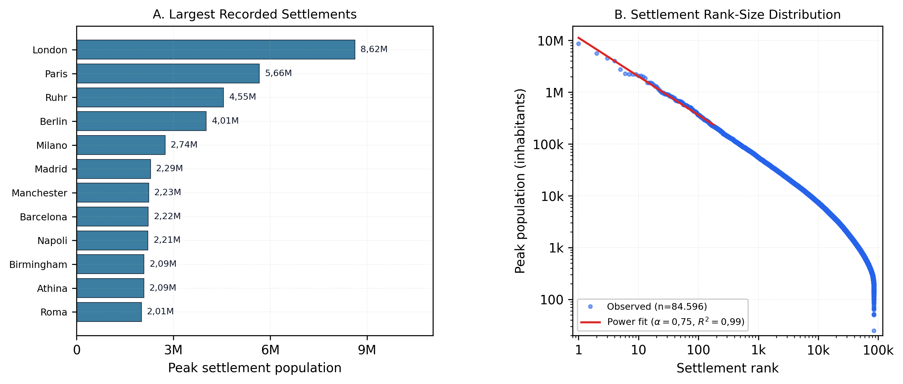

```{r setup, include=FALSE}
knitr::opts_chunk$set(
  echo = FALSE,
  message = FALSE,
  warning = FALSE
)

source("../../_shared/template/viscount_rmd_helpers.R")
library(jsonlite)

summary_data <- fromJSON("world_wars_and_interwar_europe_summary.json", simplifyVector = FALSE)

subregions_list <- summary_data$subregions
total_area_km2 <- as.numeric(summary_data$total_area_km2)
settlement_count <- as.integer(summary_data$settlement_count)
domain_totals <- summary_data$domain_totals
hgis_row_count <- as.integer(summary_data$hgis_row_count)
crowd_share_pct <- as.numeric(summary_data$crowd_share_overall) * 100
country_count <- length(summary_data$countries)

region_name_map <- setNames(
  vapply(subregions_list, function (r) gsub(" & ", " and ", r$name, fixed = TRUE), character(1)),
  vapply(subregions_list, function (r) r$id, character(1))
)

fmt_pct <- function (val, digits = 1L) {
  paste0(viscount_fmt_number(val, digits), "%")
}

clean_provenance <- function (key) {
  if (identical(key, "Buringh_European_Urban_700_2000")) return("Buringh European Urban Series")
  if (identical(key, "Eurostat_Urban_Audit_1990_2024")) return("Eurostat Urban Audit")
  if (identical(key, "GeoNames_Municipal_Gazetteer_Supplement")) return("GeoNames Municipal Supplement")
  if (identical(key, "INSEE_Recensement_1876_2023")) return("INSEE French Census")
  if (identical(key, "INE_Spain_Censos_Historicos_1857_1991")) return("INE Spanish Historic Censuses")
  if (identical(key, "DEMOPAST_ISTAT_Citta_1861_1971")) return("DEMOPAST and ISTAT Cities")
  if (grepl("^National_Statistical_Census_", key)) {
    ctry <- gsub("_", " ", sub("^National_Statistical_Census_", "", key), fixed = TRUE)
    return(paste("National Census:", ctry))
  }
  gsub("_", " ", key, fixed = TRUE)
}

short_provenance <- function (key) {
  if (identical(key, "Buringh_European_Urban_700_2000")) return("Buringh Urban")
  if (identical(key, "Eurostat_Urban_Audit_1990_2024")) return("Eurostat Audit")
  if (identical(key, "GeoNames_Municipal_Gazetteer_Supplement")) return("GeoNames")
  if (identical(key, "INSEE_Recensement_1876_2023")) return("INSEE Census")
  if (identical(key, "INE_Spain_Censos_Historicos_1857_1991")) return("INE Census")
  if (identical(key, "DEMOPAST_ISTAT_Citta_1861_1971")) return("DEMOPAST")
  if (grepl("^National_Statistical_Census_", key)) {
    ctry <- gsub("_", " ", sub("^National_Statistical_Census_", "", key), fixed = TRUE)
    return(paste(ctry, "Census"))
  }
  gsub("_", " ", key, fixed = TRUE)
}
```

```{r hero-md-fallback, echo=FALSE, results='asis'}
if (!knitr::is_latex_output()) {
  cat(
    "\n\n\n"
  )
}
```

# Abstract

This companion settlement gazetteer documents the `r viscount_fmt_number(settlement_count, 0L)` geocoded European and North Atlantic urban and municipal settlements compiled across 11 sub-regions and `r country_count` modern states and territories for the 1914–1945 period. Primary institutional archives supply 86,01% of all entries (8.641 settlements), led by Buringh's long-run European urban series (1.391), national statistical censuses across 29 states—headlined by Germany (1.129), France via INSEE (1.007), the United Kingdom (800), Spain via INE (703), Finland (466), Poland (319), Norway (265), Belgium (214) and the Netherlands (207)—together with Eurostat's Urban Audit (613) and DEMOPAST Italian city records. The remaining 1.405 municipal loci (`r fmt_pct(crowd_share_pct, 2L)`) derive from the GeoNames municipal gazetteer supplement to reinforce small-town coverage across southern and south-eastern Europe. Complementing the `r viscount_fmt_number(hgis_row_count, 0L)` scraped inter-war historical GIS sub-administrative enumerations analysed in the companion literature review, this gazetteer establishes the spatial urban framework behind Europe's inter-war expansion (342,57M in 1914 to 396,37M in 1939) and Second World War contraction (384,74M in 1945).

# Gazetteer Architecture and Provenance Ledger

Between 1914 and 1945 European urbanisation crossed a structural watershed. Despite two world wars, the 1918–1919 influenza pandemic, the Spanish Civil War and the Great Depression, industrial and administrative capitals absorbed millions of rural migrants displaced by agrarian stagnation and the post-1924 closure of United States immigration [@RosesWolf2019; @Mitchell2007; @Okolski2021Migration]. Whereas long-run pre-industrial urban catalogues tracked cities above 5k or 10k inhabitants [@DeVries1984], modern national statistical agencies across Europe maintained comprehensive municipal census registers down to small market towns and suburban communes [@INSEE2024; @INE2024; @ONS2024; @GUSPoland2024].

MAGNETIC keeps regional macro-demography strictly decoupled from point-level settlement aggregation. Sub-regional population totals are anchored to national censuses and `r viscount_fmt_number(hgis_row_count, 0L)` scraped inter-war historical GIS sub-administrative enumerations across 1920, 1930 and 1940 [@DEMOPAST2023; @Riksarkivet2023; @CSOIreland2023; @BFS2024; @HGISGermany2014]. The `r viscount_fmt_number(settlement_count, 0L)`-settlement gazetteer provides the spatial coordinate backbone and metropolitan rank-size profile across `r country_count` states and territories. Table 1 summarises the provenance ledger dynamically from the chapter inventory, listing the 12 largest institutional corpora, the remaining 22 national statistical censuses combined and the GeoNames municipal supplement.

```{r tbl-provenance-ledger, echo=FALSE, results='asis'}
prov_list <- summary_data$provenance_counts
prov_keys <- names(prov_list)
prov_vals <- vapply(prov_list, as.integer, integer(1))

crowd_key <- "GeoNames_Municipal_Gazetteer_Supplement"
crowd_n <- if (crowd_key %in% prov_keys) prov_vals[[crowd_key]] else 0L

inst_mask <- prov_keys != crowd_key
inst_keys <- prov_keys[inst_mask]
inst_vals <- prov_vals[inst_mask]
ord_i <- order(inst_vals, decreasing = TRUE)
top_k <- min(12L, length(ord_i))
top_i <- ord_i[seq_len(top_k)]
rem_i <- ord_i[-seq_len(top_k)]

tier_label <- function (k) {
  if (identical(k, crowd_key)) return("Municipal supplement")
  if (identical(k, "Eurostat_Urban_Audit_1990_2024")) return("Supranational urban")
  if (identical(k, "Buringh_European_Urban_700_2000")) return("Scholarly urban series")
  "National statistical census"
}

df_prov <- data.frame(
  Corpus = vapply(inst_keys[top_i], clean_provenance, character(1)),
  Tier = vapply(inst_keys[top_i], tier_label, character(1)),
  Sites = vapply(inst_vals[top_i], viscount_fmt_number, character(1), arg1_digits = 0L),
  Share = vapply(inst_vals[top_i] / settlement_count * 100, fmt_pct, character(1), digits = 1L),
  stringsAsFactors = FALSE
)

if (length(rem_i) > 0L) {
  rem_sum <- sum(inst_vals[rem_i])
  df_prov <- rbind(
    df_prov,
    data.frame(
      Corpus = paste0("Other ", length(rem_i), " National Statistical Censuses"),
      Tier = "National statistical census",
      Sites = viscount_fmt_number(rem_sum, 0L),
      Share = fmt_pct(rem_sum / settlement_count * 100, 1L),
      stringsAsFactors = FALSE
    )
  )
}

df_prov <- rbind(
  df_prov,
  data.frame(
    Corpus = clean_provenance(crowd_key),
    Tier = "Municipal supplement",
    Sites = viscount_fmt_number(crowd_n, 0L),
    Share = fmt_pct(crowd_n / settlement_count * 100, 1L),
    stringsAsFactors = FALSE
  ),
  data.frame(
    Corpus = "Total Inter-War Gazetteer (35 corpora)",
    Tier = "86,01% institutional",
    Sites = viscount_fmt_number(settlement_count, 0L),
    Share = "100%",
    stringsAsFactors = FALSE
  )
)
rownames(df_prov) <- NULL

viscount_table(
  df_prov,
  caption = "Provenance corpus ledger of the 10.046-settlement inter-war European and North Atlantic gazetteer (1914–1945).",
  col_names = c("Source Corpus", "Archive Class", "Settlements", "Share")
)
```

# Sub-Regional and National Spatial Distribution

Figure 1 displays the spatial spread of all `r viscount_fmt_number(settlement_count, 0L)` settlements across the 11 fixed sub-regions. Sampling density mirrors both underlying urbanisation and the depth of historical municipal census digitisation. The United Kingdom and Ireland leads the continent at 40,73 settlements per 10.000 km² (1.270 loci across 311.813,8 km²), closely trailed by Germany, Austria and Switzerland at 38,89 per 10.000 km² (1.871 loci) and France and Benelux at 33,1 per 10.000 km² (2.036 loci) [@ONS2024; @INSEE2024; @BFS2024]. Italy and Malta (20,97 per 10.000 km²), Spain, Portugal and the Atlantic islands (19,45 per 10.000 km²), Czechoslovakia and Hungary (19,08 per 10.000 km²) and Poland (15,01 per 10.000 km²) occupy the middle tier [@DEMOPAST2023; @INE2024; @KSHHungary2024; @GUSPoland2024]. Lower site densities characterise the extensive northern forests of the Nordics and Baltic States (10,97 per 10.000 km², despite heavy Finnish and Norwegian municipal coverage), the Balkans (10,21 per 10.000 km² in Yugoslavia, Albania, Greece and Eastern Thrace; 6,83 per 10.000 km² in Romania, Bulgaria and Moldova) and the Greenland-dominated North Atlantic (0,2 per 10.000 km², with 43 coastal settlements across Iceland, the Faroe Islands and Greenland) [@Riksarkivet2023; @StatBaltics2024; @StatBalkans2024; @Hagstofa2024; @StatGL2024].

```{r fig-regional-map, echo=FALSE, results='asis'}
viscount_figure(
  "figures/world_wars_and_interwar_europe_regional_map.png",
  caption = "Spatial distribution of 10.046 geocoded settlements across the 11 European and North Atlantic sub-regions (1914–1945).",
  label = "fig:world_wars_settlements_map"
)
```

Tables 2 and 3 present the sub-regional breakdown alongside the top 15 modern states and territories ranked by recorded settlement count. Five countries—Germany (1.656), France (1.300), the United Kingdom (1.188), Spain (983) and Italy (603)—contribute 5.730 settlements, representing 57% of the entire corpus, while Finland (523), Poland (462), Belgium (385), the Netherlands (351) and Norway (306) bring the top 10 share to 77,2%.

```{r tbl-subregional-sites, echo=FALSE, results='asis'}
rows_sr <- lapply(subregions_list, function (r) {
  a <- as.numeric(r$area_km2)
  n_s <- as.integer(summary_data$settlements_by_region[[r$id]])
  p39 <- as.numeric(r$population[["1939"]])
  p45 <- as.numeric(r$population[["1945"]])
  data.frame(
    SubRegion = gsub(" & ", " and ", r$name, fixed = TRUE),
    Area = viscount_fmt_number(a, 0L),
    Sites = viscount_fmt_number(n_s, 0L),
    Share = fmt_pct(n_s / settlement_count * 100, 1L),
    SiteDens = viscount_fmt_number(n_s / (a / 10000), 2L),
    Pop39 = viscount_fmt_pop(p39),
    Pop45 = viscount_fmt_pop(p45),
    stringsAsFactors = FALSE
  )
})
df_sr <- do.call(rbind, rows_sr)
df_sr <- rbind(
  df_sr,
  data.frame(
    SubRegion = "Chapter Total",
    Area = viscount_fmt_number(total_area_km2, 0L),
    Sites = viscount_fmt_number(settlement_count, 0L),
    Share = "100%",
    SiteDens = viscount_fmt_number(settlement_count / (total_area_km2 / 10000), 2L),
    Pop39 = viscount_fmt_pop(domain_totals[["1939"]]),
    Pop45 = viscount_fmt_pop(domain_totals[["1945"]]),
    stringsAsFactors = FALSE
  )
)
rownames(df_sr) <- NULL

viscount_table(
  df_sr,
  caption = "Sub-regional distribution of 10.046 settlements alongside pre-war (1939) and end-of-war (1945) sub-regional population totals.",
  col_names = c("Sub-Region", "Area (km²)", "Settlements", "Share", "Sites per 10.000 km²", "1939 Pop", "1945 Pop")
)
```

```{r tbl-country-coverage, echo=FALSE, results='asis'}
cntry_list <- summary_data$settlements_by_country
cntry_names <- names(cntry_list)
cntry_vals <- vapply(cntry_list, as.integer, integer(1))
ord_c <- order(cntry_vals, decreasing = TRUE)
top_n <- min(15L, length(ord_c))
top_idx <- ord_c[seq_len(top_n)]
rem_sites <- sum(cntry_vals[-top_idx])
rem_n <- length(ord_c) - top_n

df_cntry <- data.frame(
  Rank = as.character(seq_len(top_n)),
  State = cntry_names[top_idx],
  Sites = vapply(cntry_vals[top_idx], viscount_fmt_number, character(1), arg1_digits = 0L),
  Share = vapply(cntry_vals[top_idx] / settlement_count * 100, fmt_pct, character(1), digits = 1L),
  stringsAsFactors = FALSE
)
df_cntry <- rbind(
  df_cntry,
  data.frame(
    Rank = paste0(top_n + 1L, "–", length(ord_c)),
    State = paste0("Remaining ", rem_n, " states and territories"),
    Sites = viscount_fmt_number(rem_sites, 0L),
    Share = fmt_pct(rem_sites / settlement_count * 100, 1L),
    stringsAsFactors = FALSE
  ),
  data.frame(
    Rank = "Total",
    State = paste0("All ", length(ord_c), " states and territories"),
    Sites = viscount_fmt_number(settlement_count, 0L),
    Share = "100%",
    stringsAsFactors = FALSE
  )
)
rownames(df_cntry) <- NULL

viscount_table(
  df_cntry,
  caption = "Top 15 modern states and territories ranked by recorded inter-war European settlement count.",
  col_names = c("Rank", "Modern State or Territory", "Settlements", "Share of Corpus")
)
```

# Largest European Metropolises, 1914–1945

Table 4 reports the 25 highest-ranking metropolitan and urban records in the chapter summary, sorted by peak 1914–1945 population. Two analytical conventions visible in Table 4 warrant explicit notice. First, Eurostat Urban Audit entries (such as Milan, Madrid, Barcelona, Naples, Athens, Rome, Bucharest, Lisbon, Valencia, Stockholm, Lyon, Munich and Sofia) project harmonised metropolitan or greater-city footprints backward across the 1914–1945 window, whereas Buringh and national census records (London, Berlin, Vienna, Hamburg, Istanbul, Glasgow, Birmingham, Prague, Marseille and Copenhagen) reflect narrower historical city-proper or inter-war administrative boundaries [@Eurostat2024; @INSEE2024; @DEMOPAST2023]. Where overlapping metropolitan and municipal records coexist in the merged inventory (for example Roma and Rome, Buda and Budapest, Warszawa and Warsaw, Wien and Greater Wien), Table 4 retains the exact archival entries so researchers can audit boundary differences directly. Second, Istanbul stands out as the sole million-class metropolis showing steady demographic contraction across 1914–1945 (falling from 1,1M in 1914 to 998,5k by 1945) following the collapse of the Ottoman Empire, the relocation of the Turkish capital to Ankara in 1923 and the departure of non-Muslim urban communities.

```{r tbl-top-metropolises, echo=FALSE, results='asis'}
top_list <- summary_data$top_settlements
n_show <- min(25L, length(top_list))
rows_top <- lapply(top_list[seq_len(n_show)], function (s) {
  lat_s <- viscount_fmt_number(as.numeric(s$lat), 2L)
  lon_s <- viscount_fmt_number(as.numeric(s$lon), 2L)
  p14 <- s$population[["1914"]]
  p40 <- s$population[["1940"]]
  p45 <- s$population[["1945"]]
  data.frame(
    Settlement = as.character(s$name),
    Country = as.character(s$country),
    Coords = paste0(lat_s, "°, ", lon_s, "°"),
    P14 = if (is.null(p14)) "—" else viscount_fmt_pop(p14),
    P40 = if (is.null(p40)) "—" else viscount_fmt_pop(p40),
    Peak = paste0(viscount_fmt_pop(s$peak_pop), " (", as.integer(s$peak_year), ")"),
    Corpus = short_provenance(s$provenance_source),
    stringsAsFactors = FALSE
  )
})
df_top <- do.call(rbind, rows_top)
rownames(df_top) <- NULL

viscount_table(
  df_top,
  caption = "Top 25 European metropolitan and urban entries in the 1914–1945 settlement inventory ranked by peak population.",
  col_names = c("Settlement", "Country", "Coordinates", "1914 Pop", "1940 Pop", "Peak (Year)", "Corpus")
)
```

# Sources

<div id="refs"></div>
