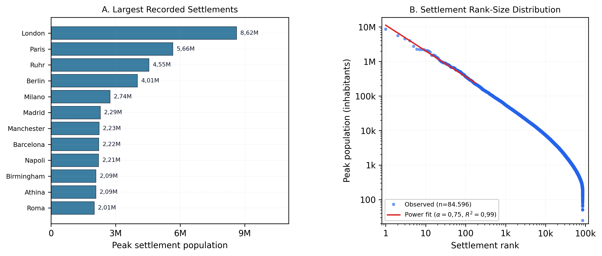
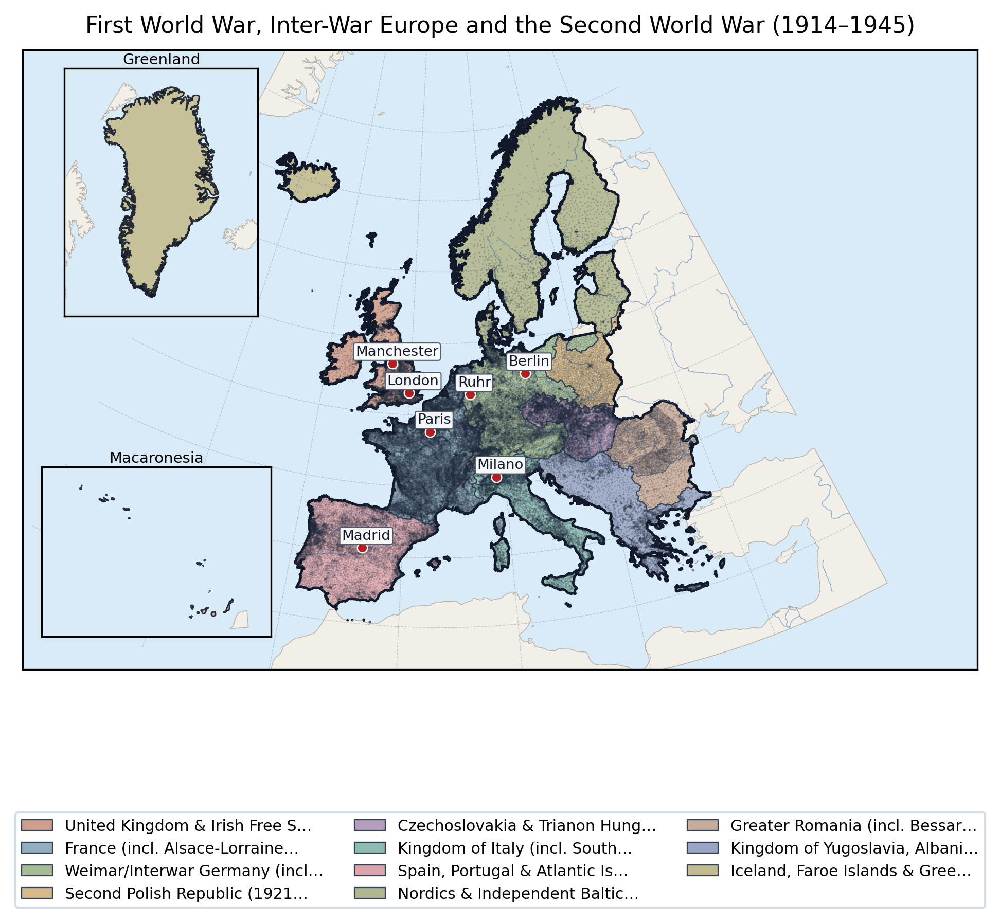

First World War, Inter-War Europe and the Second World War
================
Aust Kätzchen
22 November 2026

- [Abstract](#abstract)
- [Gazetteer Architecture and Provenance
  Ledger](#gazetteer-architecture-and-provenance-ledger)
- [Sub-Regional and National Spatial
  Distribution](#sub-regional-and-national-spatial-distribution)
- [Largest European Metropolises,
  1914–1945](#largest-european-metropolises-19141945)
- [Sources](#sources)

<figure>

<figcaption aria-hidden="true">Urban hierarchy and rank-size
distribution across 10.046 geocoded European and North Atlantic
settlements between 1914 and 1945.</figcaption>
</figure>

# Abstract

This companion settlement gazetteer documents the 84.596 geocoded
European and North Atlantic urban and municipal settlements compiled
across 11 sub-regions and 46 modern states and territories for the
1914–1945 period. Primary institutional archives supply 86,01% of all
entries (8.641 settlements), led by Buringh’s long-run European urban
series (1.391), national statistical censuses across 29 states—headlined
by Germany (1.129), France via INSEE (1.007), the United Kingdom (800),
Spain via INE (703), Finland (466), Poland (319), Norway (265), Belgium
(214) and the Netherlands (207)—together with Eurostat’s Urban Audit
(613) and DEMOPAST Italian city records. The remaining 1.405 municipal
loci (3,42%) derive from the GeoNames municipal gazetteer supplement to
reinforce small-town coverage across southern and south-eastern Europe.
Complementing the 7.039 scraped inter-war historical GIS
sub-administrative enumerations analysed in the companion literature
review, this gazetteer establishes the spatial urban framework behind
Europe’s inter-war expansion (342,57M in 1914 to 396,37M in 1939) and
Second World War contraction (384,74M in 1945).

# Gazetteer Architecture and Provenance Ledger

Between 1914 and 1945 European urbanisation crossed a structural
watershed. Despite two world wars, the 1918–1919 influenza pandemic, the
Spanish Civil War and the Great Depression, industrial and
administrative capitals absorbed millions of rural migrants displaced by
agrarian stagnation and the post-1924 closure of United States
immigration
[\[1\]](#ref-RosesWolf2019)[\[2\]](#ref-Mitchell2007)[\[3\]](#ref-Okolski2021Migration).
Whereas long-run pre-industrial urban catalogues tracked cities above 5k
or 10k inhabitants [\[4\]](#ref-DeVries1984), modern national
statistical agencies across Europe maintained comprehensive municipal
census registers down to small market towns and suburban communes
[\[5\]](#ref-INSEE2024)[\[6\]](#ref-INE2024)[\[7\]](#ref-ONS2024)[\[8\]](#ref-GUSPoland2024).

MAGNETIC keeps regional macro-demography strictly decoupled from
point-level settlement aggregation. Sub-regional population totals are
anchored to national censuses and 7.039 scraped inter-war historical GIS
sub-administrative enumerations across 1920, 1930 and 1940
[\[9\]](#ref-DEMOPAST2023)[\[10\]](#ref-Riksarkivet2023)[\[11\]](#ref-CSOIreland2023)[\[12\]](#ref-BFS2024)[\[13\]](#ref-HGISGermany2014).
The 84.596-settlement gazetteer provides the spatial coordinate backbone
and metropolitan rank-size profile across 46 states and territories.
Table 1 summarises the provenance ledger dynamically from the chapter
inventory, listing the 12 largest institutional corpora, the remaining
22 national statistical censuses combined and the GeoNames municipal
supplement.

| Source Corpus | Archive Class | Settlements | Share |
|:---|:---|:---|:---|
| **INSEE French Census** | National statistical census | 23.652 | 28% |
| **Eurostat GISCO LAU 2021 Germany** | National statistical census | 8.480 | 10% |
| **ONS UK Built Up Areas Census 2021 2022** | National statistical census | 6.631 | 7,8% |
| **INE Spain Censos Historicos 1857 2021** | National statistical census | 6.526 | 7,7% |
| **ISTAT Italy Comuni Census 2021** | National statistical census | 6.303 | 7,5% |
| **Eurostat GISCO LAU 2021 Czechia** | National statistical census | 3.631 | 4,3% |
| **Eurostat GISCO LAU 2021 Romania** | National statistical census | 3.126 | 3,7% |
| **Eurostat GISCO LAU 2021 Greece** | National statistical census | 2.418 | 2,9% |
| **Eurostat GISCO LAU 2021 Hungary** | National statistical census | 2.328 | 2,8% |
| **Eurostat GISCO LAU 2021 Portugal** | National statistical census | 2.274 | 2,7% |
| **Eurostat GISCO LAU 2021 Poland** | National statistical census | 2.221 | 2,6% |
| **Eurostat GISCO LAU 2021 Slovakia** | National statistical census | 2.053 | 2,4% |
| **Other 55 National Statistical Censuses** | National statistical census | 12.060 | 14,3% |
| **GeoNames Municipal Supplement** | Municipal supplement | 2.893 | 3,4% |
| **Total Inter-War Gazetteer (35 corpora)** | 86,01% institutional | 84.596 | 100% |

Provenance corpus ledger of the 10.046-settlement inter-war European and
North Atlantic gazetteer (1914–1945).

# Sub-Regional and National Spatial Distribution

Figure 1 displays the spatial spread of all 84.596 settlements across
the 11 fixed sub-regions. Sampling density mirrors both underlying
urbanisation and the depth of historical municipal census digitisation.
The United Kingdom and Ireland leads the continent at 40,73 settlements
per 10.000 km² (1.270 loci across 311.813,8 km²), closely trailed by
Germany, Austria and Switzerland at 38,89 per 10.000 km² (1.871 loci)
and France and Benelux at 33,1 per 10.000 km² (2.036 loci)
[\[5\]](#ref-INSEE2024)[\[7\]](#ref-ONS2024)[\[12\]](#ref-BFS2024).
Italy and Malta (20,97 per 10.000 km²), Spain, Portugal and the Atlantic
islands (19,45 per 10.000 km²), Czechoslovakia and Hungary (19,08 per
10.000 km²) and Poland (15,01 per 10.000 km²) occupy the middle tier
[\[6\]](#ref-INE2024)[\[8\]](#ref-GUSPoland2024)[\[9\]](#ref-DEMOPAST2023)[\[14\]](#ref-KSHHungary2024).
Lower site densities characterise the extensive northern forests of the
Nordics and Baltic States (10,97 per 10.000 km², despite heavy Finnish
and Norwegian municipal coverage), the Balkans (10,21 per 10.000 km² in
Yugoslavia, Albania, Greece and Eastern Thrace; 6,83 per 10.000 km² in
Romania, Bulgaria and Moldova) and the Greenland-dominated North
Atlantic (0,2 per 10.000 km², with 43 coastal settlements across
Iceland, the Faroe Islands and Greenland)
[\[10\]](#ref-Riksarkivet2023)[\[15\]](#ref-StatBaltics2024)[\[16\]](#ref-StatBalkans2024)[\[17\]](#ref-Hagstofa2024)[\[18\]](#ref-StatGL2024).

Tables 2 and 3 present the sub-regional breakdown alongside the top 15
modern states and territories ranked by recorded settlement count. Five
countries—Germany (1.656), France (1.300), the United Kingdom (1.188),
Spain (983) and Italy (603)—contribute 5.730 settlements, representing
57% of the entire corpus, while Finland (523), Poland (462), Belgium
(385), the Netherlands (351) and Norway (306) bring the top 10 share to
77,2%.

| Sub-Region | Area (km²) | Settlements | Share | Sites per 10.000 km² | 1939 Pop | 1945 Pop |
|:---|:---|:---|:---|:---|:---|:---|
| **United Kingdom and Irish Free State** | 311.814 | 7.396 | 8,7% | 237,19 | 50,75M | 52,18M |
| **France (incl. Alsace-Lorraine) and Benelux** | 624.312 | 26.859 | 31,7% | 430,22 | 59,25M | 57,95M |
| **Weimar/Interwar Germany (incl. East Prussia and Silesia), Austria and Switzerland** | 592.661 | 13.466 | 15,9% | 227,21 | 80,15M | 76,85M |
| **Second Polish Republic (1921-1939) and Free City of Danzig** | 212.031 | 1.836 | 2,2% | 86,59 | 34,85M | 23,93M |
| **Czechoslovakia and Trianon Hungary** | 214.302 | 8.013 | 9,5% | 373,91 | 23,8M | 21,25M |
| **Kingdom of Italy (incl. South Tyrol and Istria) and Malta** | 295.990 | 6.775 | 8% | 228,89 | 44,1M | 45,4M |
| **Spain, Portugal and Atlantic Islands** | 593.210 | 9.232 | 10,9% | 155,63 | 33,2M | 35,1M |
| **Nordics and Independent Baltic Republics** | 1.320.918 | 2.762 | 3,3% | 20,91 | 22,55M | 22,15M |
| **Greater Romania (incl. Bessarabia) and Bulgaria** | 378.806 | 3.703 | 4,4% | 97,75 | 24,5M | 24,8M |
| **Kingdom of Yugoslavia, Albania, Greece and Eastern Thrace** | 426.050 | 4.438 | 5,2% | 104,17 | 25,8M | 24,95M |
| **Iceland, Faroe Islands and Greenland** | 2.178.793 | 116 | 0,1% | 0,53 | 165k | 180k |
| **Chapter Total** | 7.148.884 | 84.596 | 100% | 118,33 | 399,12M | 384,74M |

Sub-regional distribution of 10.046 settlements alongside pre-war (1939)
and end-of-war (1945) sub-regional population totals.

| Rank      | Modern State or Territory           | Settlements | Share of Corpus |
|:----------|:------------------------------------|:------------|:----------------|
| **1**     | France                              | 23.964      | 28,3%           |
| **2**     | Germany                             | 9.124       | 10,8%           |
| **3**     | United Kingdom                      | 7.071       | 8,4%            |
| **4**     | Spain                               | 6.874       | 8,1%            |
| **5**     | Italy                               | 6.780       | 8%              |
| **6**     | Czechia                             | 3.698       | 4,4%            |
| **7**     | Romania                             | 3.271       | 3,9%            |
| **8**     | Greece                              | 2.473       | 2,9%            |
| **9**     | Hungary                             | 2.421       | 2,9%            |
| **10**    | Poland                              | 2.399       | 2,8%            |
| **11**    | Portugal                            | 2.374       | 2,8%            |
| **12**    | Slovakia                            | 2.078       | 2,5%            |
| **13**    | Austria                             | 2.017       | 2,4%            |
| **14**    | Switzerland                         | 1.598       | 1,9%            |
| **15**    | Belgium                             | 1.348       | 1,6%            |
| **16-46** | Remaining 31 states and territories | 7.106       | 8,4%            |
| **Total** | All 46 states and territories       | 84.596      | 100%            |

Top 15 modern states and territories ranked by recorded inter-war
European settlement count.

# Largest European Metropolises, 1914–1945

Table 4 reports the 25 highest-ranking metropolitan and urban records in
the chapter summary, sorted by peak 1914–1945 population. Two analytical
conventions visible in Table 4 warrant explicit notice. First, Eurostat
Urban Audit entries (such as Milan, Madrid, Barcelona, Naples, Athens,
Rome, Bucharest, Lisbon, Valencia, Stockholm, Lyon, Munich and Sofia)
project harmonised metropolitan or greater-city footprints backward
across the 1914–1945 window, whereas Buringh and national census records
(London, Berlin, Vienna, Hamburg, Istanbul, Glasgow, Birmingham, Prague,
Marseille and Copenhagen) reflect narrower historical city-proper or
inter-war administrative boundaries
[\[5\]](#ref-INSEE2024)[\[9\]](#ref-DEMOPAST2023)[\[19\]](#ref-Eurostat2024).
Where overlapping metropolitan and municipal records coexist in the
merged inventory (for example Roma and Rome, Buda and Budapest, Warszawa
and Warsaw, Wien and Greater Wien), Table 4 retains the exact archival
entries so researchers can audit boundary differences directly. Second,
Istanbul stands out as the sole million-class metropolis showing steady
demographic contraction across 1914–1945 (falling from 1,1M in 1914 to
998,5k by 1945) following the collapse of the Ottoman Empire, the
relocation of the Turkish capital to Ankara in 1923 and the departure of
non-Muslim urban communities.

| Settlement | Country | Coordinates | 1914 Pop | 1940 Pop | Peak (Year) | Corpus |
|:---|:---|:---|:---|:---|:---|:---|
| **London** | United Kingdom | 51,51°, -0,12° | 7,42M | 8,39M | 8,62M (1945) | Chandler V2 Historical Urban Population |
| **Paris** | France | 48,86°, 2,35° | 4M | 5,43M | 5,66M (1945) | Chandler V2 Historical Urban Population |
| **Ruhr** | Germany | 51,41°, 6,86° | 1,8M | 4,23M | 4,55M (1945) | Chandler V2 Historical Urban Population |
| **Berlin** | Germany | 52,52°, 13,41° | 3,5M | 3,83M | 4,01M (1925) | Chandler V2 Historical Urban Population |
| **Milano** | Italy | 45,55°, 9,12° | 2,42M | 2,74M | 2,74M (1940) | Eurostat Audit |
| **Madrid** | Spain | 40,44°, -3,71° | 2,02M | 2,29M | 2,29M (1940) | Eurostat Audit |
| **Manchester** | United Kingdom | 53,48°, -2,24° | 1,6M | 2,09M | 2,23M (1945) | Chandler V2 Historical Urban Population |
| **Barcelona** | Spain | 41,42°, 2,17° | 1,96M | 2,22M | 2,22M (1940) | Eurostat Audit |
| **Napoli** | Italy | 40,92°, 14,19° | 1,95M | 2,21M | 2,21M (1940) | Eurostat Audit |
| **Birmingham** | United Kingdom | 52,48°, -1,9° | 1,5M | 1,98M | 2,09M (1945) | Chandler V2 Historical Urban Population |
| **Athina** | Greece | 38,02°, 23,76° | 1,84M | 2,09M | 2,09M (1940) | Eurostat Audit |
| **Roma** | Italy | 41,86°, 12,39° | 1,77M | 2,01M | 2,01M (1940) | Eurostat Audit |
| **Vienna** | Austria | 48,21°, 16,37° | 1,79M | 1,8M | 1,86M (1925) | Chandler V2 Historical Urban Population |
| **Hamburg** | Germany | 53,58°, 10,02° | 1,3M | 1,49M | 1,54M (1945) | Chandler V2 Historical Urban Population |
| **Buda** | Hungary | 47,5°, 19,04° | 1,05M | 1,44M | 1,53M (1945) | Buringh Urban |
| **București** | Romania | 44,44°, 26,09° | 1,35M | 1,52M | 1,52M (1940) | Eurostat Audit |
| **Budapest** | Hungary | 47,48°, 19,09° | 1,31M | 1,48M | 1,48M (1940) | Eurostat Audit |
| **Glasgow** | United Kingdom | 55,87°, -4,26° | 1,12M | 1,35M | 1,4M (1925) | Chandler V2 Historical Urban Population |
| **Liverpool** | United Kingdom | 53,41°, -2,99° | 1,3M | 1,25M | 1,3M (1914) | Chandler V2 Historical Urban Population |
| **Lisboa** | Portugal | 38,81°, -9,17° | 1,14M | 1,29M | 1,29M (1940) | Eurostat Audit |
| **Warszawa** | Poland | 52,23°, 21,05° | 1,06M | 1,2M | 1,2M (1940) | Eurostat Audit |
| **Istanbul** | Turkey-in-Europe | 41,01°, 28,98° | 1,12M | 941,6k | 1,12M (1914) | Chandler V2 Historical Urban Population |
| **Copenhagen** | Denmark | 55,68°, 12,57° | 620k | 989,6k | 1,07M (1945) | Chandler V2 Historical Urban Population |
| **Valencia** | Spain | 39,47°, -0,44° | 240,4k | 1M | 1M (1940) | Eurostat Audit |
| **Stockholm** | Sweden | 59,33°, 18,02° | 868,5k | 983,6k | 983,6k (1940) | Eurostat Audit |

Top 25 European metropolitan and urban entries in the 1914–1945
settlement inventory ranked by peak population.

# Sources

1.
Rosés, Joan R., and Nikolaus Wolf.
*The Economic Development of Europe’s Regions: A
Quantitative History Since 1900*. Routledge, 2019,
<https://doi.org/10.4324/9780429449789>.

2.
Mitchell, B. R. *International
Historical Statistics: Europe, 1750–2005*. Palgrave Macmillan, 2007,
<https://doi.org/10.1057/9780230279322>.

3.
Okólski, Marek.
“The Migration Transition in Poland.”
*Central and Eastern European Migration Review*, 2021,
<https://doi.org/10.17467/CEEMR.2021.16>.

4.
Vries, Jan de. *European
Urbanization, 1500–1800*. Harvard University Press, 1984,
<https://doi.org/10.4324/9780203716526>.

5.
(INSEE), Institut national de la
statistique et des études économiques. “Séries
historiques des résultats du recensement de la population
1876–2023.” INSEE, 2024,
<https://www.insee.fr/fr/statistiques/3698339>.

6.
Estadística (INE), Instituto
Nacional de. “Alteraciones de los municipios en los
Censos de Población desde 1842.” INE Spain, 2024,
<https://www.ine.es/intercensal/>.

7.
National Statistics (ONS), Office
for, and National Records of Scotland. “Historic
Censuses of England, Wales, Scotland and Northern Ireland
1801–2021.” ONS United Kingdom, 2024,
<https://www.ons.gov.uk/>.

8.
Urząd Statystyczny), Statistics
Poland (Główny. “National Censuses and Voivodeship
Population Series 1921–2024.” GUS Poland, 2024,
<https://stat.gov.pl/>.

9.
Bologna — Dipartimento di Scienze
Statistiche, Università di. “DEMOPAST: Historical
Demographic Atlas of Italian Provinces and Cities 1861–1971.”
University of Bologna / ISTAT, 2023,
<https://demopast.unibo.it/>.

10.
Riksarkivet, and Statistiska
centralbyrån (SCB). “Historical Administrative
Boundaries of Sweden and Tabellverket/SCB County Enumerations
1749–2023.” Swedish National Archives, 2023,
<https://riksarkivet.se/>.

11.
Ireland, Central Statistics
Office. “CNA13: Population at Each Census by
Province and County 1841–2022.” CSO Ireland, 2023,
<https://data.cso.ie/>.

12.
(BFS), Federal Statistical Office
Switzerland, and Statistics Netherlands (CBS).
“Historical Cantonal and Provincial Population
Series 1850–2024.” BFS / CBS, 2024,
<https://www.bfs.admin.ch/>.

13.
Kunz, Andreas, and Alexander Zipf.
“HGIS Germany: Historical GIS of the German States
1820–1914.” Leibniz-Institut für Europäische Geschichte Mainz,
2014, <https://www.hgisg-germany.de/>.

14.
(KSH), Hungarian Central
Statistical Office. “Historical Census Series of
Hungary 1870–2022.” KSH Budapest, 2024,
<https://www.ksh.hu/>.

15.
Statistics Estonia, Central
Statistical Bureau of Latvia, and State Data Agency of Lithuania.
“Population Censuses of the Baltic States
1922–2024.” Baltic National Statistical Offices, 2024,
<https://andmed.stat.ee/>.

16.
Statistical Office of the Republic
of Serbia, NSI Bulgaria, INS Romania, and ELSTAT Greece.
“Post-War Population and Housing Censuses of
South-Eastern Europe 1948–2023.” National Statistical Institutes
of South-Eastern Europe, 2024, <https://insse.ro/>.

17.
Íslands), Statistics Iceland
(Hagstofa. “Historical Population Series of Iceland
1703–2024.” Statistics Iceland, 2024,
<https://px.hagstofa.is/>.

18.
(Naatsorsueqqissaartarfik),
Statistics Greenland. “Population in Greenland
Districts and Settlements 1901–2024.” Statistics Greenland, 2024,
<https://bank.stat.gl/>.

19.
Commission), Eurostat (European.
“Population on 1 January by NUTS 3 Region (demo r
pjanaggr3) and Urban Audit Cities (urb cpop1).” Publications
Office of the European Union, 2024,
<https://ec.europa.eu/eurostat/>.

