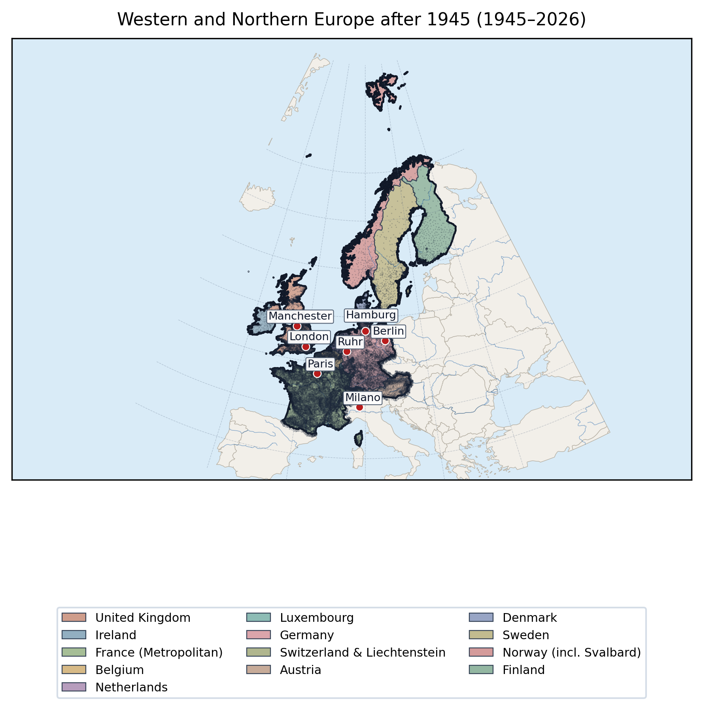
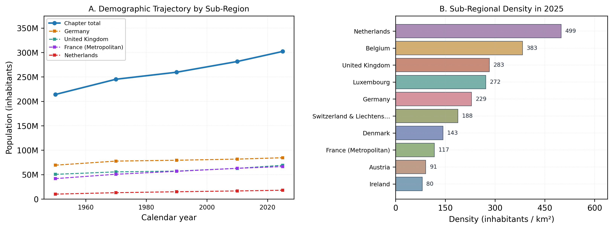
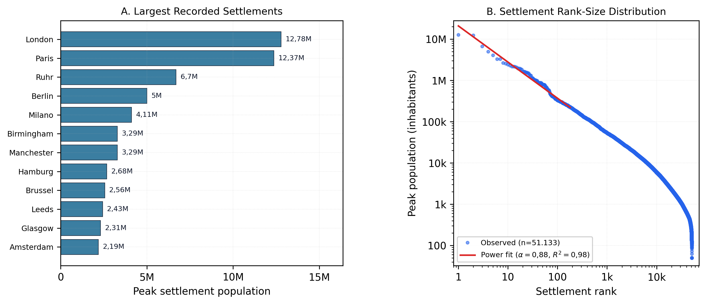

Western and Northern Europe after 1945
================
Aust Kätzchen
22 November 2026

- [Abstract](#abstract)
- [Background](#background)
  - [War-Torn Reconstruction and the Post-1945 Population
    Baseline](#war-torn-reconstruction-and-the-post-1945-population-baseline)
  - [The Post-War Baby Boom and Fertility Divergence
    (1945-1973)](#the-post-war-baby-boom-and-fertility-divergence-1945-1973)
  - [Guest-Worker Recruiting, Decolonisation and Late-Century
    Immigration](#guest-worker-recruiting-decolonisation-and-late-century-immigration)
  - [Sub-Regional Trajectories across Western, Alpine and Northern
    Europe](#sub-regional-trajectories-across-western-alpine-and-northern-europe)
- [Methodology](#methodology)
  - [Sub-Regional Partitioning and Census
    Harmonisation](#sub-regional-partitioning-and-census-harmonisation)
  - [Historical GIS Sub-Administrative Enumerations
    (1950-2020)](#historical-gis-sub-administrative-enumerations-1950-2020)
  - [Settlement Gazetteer Integration and Urban Hierarchy
    Construction](#settlement-gazetteer-integration-and-urban-hierarchy-construction)
- [Validation](#validation)
  - [Reconciliation of Macro-Regional Totals and Sub-Administrative HGIS
    Series](#reconciliation-of-macro-regional-totals-and-sub-administrative-hgis-series)
  - [Urban Boundary Definitions and Duplicate-Entity
    Auditing](#urban-boundary-definitions-and-duplicate-entity-auditing)
- [Results](#results)
  - [Macro-Regional Growth Trajectory
    (1950-2025)](#macro-regional-growth-trajectory-1950-2025)
  - [Population Density and Spatial
    Polarisation](#population-density-and-spatial-polarisation)
  - [Metropolitan Concentration and the Post-Industrial Urban
    Hierarchy](#metropolitan-concentration-and-the-post-industrial-urban-hierarchy)
- [Limitations](#limitations)
- [Conclusion](#conclusion)
- [Appendix](#appendix)
  - [National Territory Coverage across the Settlement
    Register](#national-territory-coverage-across-the-settlement-register)
  - [Settlement Provenance Corpus
    Summary](#settlement-provenance-corpus-summary)
- [Sources](#sources)

<figure>

<figcaption aria-hidden="true">Thirteen contemporary sub-regions and
6.402 catalogued urban settlements across Western, Alpine and Northern
Europe from 1945 to 2025.</figcaption>
</figure>

# Abstract

Between the defeat of Nazi Germany in 1945 and the mid-2020s, the
population of Western, Alpine and Northern Europe rose from 214,01M in
1950 to 302,12M in 2025, an addition of 88,11M inhabitants (+41,17%)
across 13 national sub-regions covering 2.570.272 km²
[\[1\]](#ref-Mitchell2007)[\[2\]](#ref-Eurostat2024)[\[3\]](#ref-RosesWolf2019).
Average regional density climbed from 83,26 to 117,54 inhabitants per
km², yet growth followed two distinct demographic engines separated by
the oil shock of 1973. During the post-war reconstruction and baby-boom
quarter-century (1950-1970), the macro-region added 31,19M people
(+14,58%) as returning soldiers, rising real wages and welfare housing
lifted fertility across France, the Netherlands, Britain, Scandinavia
and West Germany while guest-worker schemes drew millions from southern
Europe and North Africa
[\[4\]](#ref-CoaleWatkins1986)[\[5\]](#ref-Giugal2016Dinamica). After
period fertility fell below replacement across nearly every sub-region
during the 1970s, demographic expansion slowed to 14,36M between 1970
and 1990 (+5,85%) before accelerating again to 21,92M during 1990-2010
(+8,45%) and 20,64M during 2010-2025 (+7,33%), sustained almost entirely
by net international immigration and rising longevity
[\[6\]](#ref-Frejka2012Role)[\[7\]](#ref-Parr2023Immigration)[\[8\]](#ref-Roszkowojtowicz2025Unequal).
Beneath the continental average lay sharp territorial divergences:
Luxembourg (+129,05%), Switzerland (+92,01%), Ireland (+81,21%) and the
Netherlands (+78,37%) expanded briskly, whereas Germany added just
21,92% over 75 years after Cold War division and post-1990 eastern
depopulation. This chapter reconciles all 13 national population series
against 4.594 sub-administrative historical GIS enumerations spanning
1950 to 2020 and a 6.402-settlement contemporary urban gazetteer.

# Background

## War-Torn Reconstruction and the Post-1945 Population Baseline

Europe west of the Oder-Neisse line and north of the Pyrenees and Alps
emerged from the Second World War with its cities shattered, its borders
redrawn and its population violently reshuffled
[\[1\]](#ref-Mitchell2007)[\[5\]](#ref-Giugal2016Dinamica). Contrary to
simple assumptions that wartime mortality left Western and Northern
Europe sparsely peopled, the 1950 census baseline of 214,01M inhabitants
stood substantially above the 1939 total across the same geographic
footprint. Two forces explained this paradox. First, military and
civilian losses in Britain, France, Benelux and Scandinavia, though
tragic, remained far lower as a share of total headcount than the
demographic catastrophe visited upon Poland, Ukraine and Belarus.
Second, the westward expulsion of roughly 12M ethnic Germans
(*Heimatvertriebene*) from East Prussia, Pomerania, Silesia and the
Sudetenland packed the four Allied occupation zones of rump Germany with
refugees [\[3\]](#ref-RosesWolf2019)[\[9\]](#ref-HGISGermany2014).
Despite losing more than five million soldiers and civilians during the
conflict, Germany within its post-1945 frontiers counted 69,35M
residents in 1950 — 194,77 inhabitants per km², already denser than
pre-war Weimar Germany.

A parallel though smaller resettlement reshaped Finland. Forced under
the Moscow Armistice of 1944 to cede the Karelian Isthmus, Ladoga
Karelia and Petsamo to the Soviet Union, the Finnish state relocated
approximately 420k Karelian evacuees — more than 10% of the national
population — onto subdivided farms and timber towns inside its shortened
eastern border [\[1\]](#ref-Mitchell2007). Across the North Sea, neutral
Sweden and Switzerland entered the peace with intact factories,
undamaged railways and rising marriage rates, turning immediately into
magnets for displaced workers and skilled artisans from bombed-out
neighbouring states
[\[10\]](#ref-BFS2024)[\[11\]](#ref-Riksarkivet2023). Even Austria,
divided into four Allied occupation zones until the State Treaty of
1955, absorbed hundreds of thousands of *Volksdeutsche* refugees from
the Danube basin while Vienna lingered at 1,6M inhabitants, roughly half
a million below its late-Habsburg peak.

Housing shortages shaped the early geography of reconstruction. Bombed
urban cores across the Ruhr, Hamburg, Rotterdam, Coventry, London’s East
End and Normandy’s port cities could not initially house returning
families, pushing temporary camps and early municipal estates outward
into rural districts. In Schleswig-Holstein, Lower Saxony and Bavaria,
rural villages briefly swelled by 30% to 50% with billets for eastern
expellees before the *Wirtschaftswunder* of the 1950s drew those same
cohorts into the factories of North Rhine-Westphalia, Baden-Württemberg
and Hesse [\[3\]](#ref-RosesWolf2019). By 1950, the territorial stage
was set: 32,4% of the macro-region’s inhabitants lived in divided
Germany, 23,65% in the United Kingdom and 19,55% in metropolitan France,
leaving the remaining 24,4% distributed across the ten smaller Benelux,
Alpine, Irish and Nordic nations.

## The Post-War Baby Boom and Fertility Divergence (1945-1973)

Demographers working in the late 1930s had widely predicted imminent
population decline across north-western Europe after a century of
secular fertility contraction
[\[4\]](#ref-CoaleWatkins1986)[\[12\]](#ref-WrigleySchofield1981).
Instead, the quarter-century after 1945 delivered an unexpected
demographic upswing. Across the 13 sub-regions as a whole, population
expanded by 31,19M between 1950 and 1970, an average compound rate of
0,68% per year — modest by contemporaneous Latin American or Asian
standards, yet remarkable for mature industrial societies. Falling age
at first marriage, near-universal nuptiality, cheap suburban mortgages,
expanding antibiotic medicine and sustained full employment lifted
period total fertility rates well above the 2,1 replacement threshold
across most of the region
[\[6\]](#ref-Frejka2012Role)[\[13\]](#ref-Dupaquier1988).

The baby boom was neither uniform in timing nor equal in amplitude.
France recorded one of the sharpest structural reversals in European
demographic history. Having pioneered marital birth control in the late
eighteenth century and endured near-zero natural growth between 1870 and
1940, metropolitan France jumped from 41,83M in 1950 to 50,77M in 1970
(+21,38%), adding nearly nine million citizens in two decades
[\[13\]](#ref-Dupaquier1988)[\[14\]](#ref-INSEE2024). Pro-natalist
family allowances (*allocations familiales*), rapid rural-to-urban
electrification and the repatriation of nearly one million *pieds-noirs*
from Algeria in 1962 reinforced the surge. Even faster natural expansion
occurred in the Netherlands, where pillarised Catholic and orthodox
Protestant norms sustained high marital fertility into the mid-1960s,
propelling Dutch population from 10,11M in 1950 to 13,04M in 1970
(+28,92%) even while hundreds of thousands of Dutch emigrants departed
for Canada, Australia and New Zealand [\[10\]](#ref-BFS2024).

Britain experienced a distinctive twin-peaked boom: an immediate
demobilisation spike in 1946-1948, a shallow lull in the early 1950s and
a broader crest peaking in 1964, taking the United Kingdom from 50,62M
in 1950 to 55,63M in 1970 (+9,91%) [\[15\]](#ref-ONS2024). Finland
produced one of the steepest brief booms in Europe immediately after
demobilisation (1946-1950), giving birth to the *suuret ikäluokat*
cohorts that crowded Finnish schools in the 1950s and flooded Swedish
assembly lines in the late 1960s. By contrast, Ireland stood outside the
post-war European consensus. Though Irish marital fertility remained the
highest in Western Europe, chronic economic stagnation under
protectionist policies drove massive youth emigration to Britain during
the 1950s, pulling the Republic’s population down from 2,97M in 1950 to
a historical nadir of 2,82M at the 1961 census and leaving its 1970
total of 2,95M still slightly below 1950 [\[16\]](#ref-CSOIreland2023).

Between 1965 and 1975, the baby boom ended abruptly almost everywhere at
once. Oral contraceptives, legalised abortion, the rapid expansion of
female secondary and university education and rising female labour-force
participation transformed family formation
[\[4\]](#ref-CoaleWatkins1986)[\[6\]](#ref-Frejka2012Role)[\[17\]](#ref-Contributors2023Measuring).
West Germany crossed below replacement fertility in 1970 and entered
natural population deficit by 1972; Sweden, Denmark, Switzerland,
Austria and Britain followed within five years. Only Ireland delayed the
fertility drop until the 1980s, while France cushioned its decline near
1,8 to 2 children per woman through generous public childcare and
family-tax splitting (*quotient familial*)
[\[18\]](#ref-Tomatis2023Labour). Across the entire macro-region, total
decadal growth fell by more than half: 1970-1990 added only 14,36M
inhabitants (+5,85%), or 0,28% annually.

## Guest-Worker Recruiting, Decolonisation and Late-Century Immigration

As domestic labour pools tightened during the late 1950s and natural
increase waned after 1970, international migration became the decisive
demographic variable separating stagnant territories from expanding ones
[\[7\]](#ref-Parr2023Immigration). Post-war immigration into Western and
Northern Europe arrived in four overlapping waves. The first wave
accompanied European decolonisation between 1945 and 1975. Roughly 300k
repatriates and Moluccans moved from Indonesia to the Netherlands
between 1946 and 1962, followed by Surinamese migrants on the eve of
Surinamese independence in 1975. Britain received steady inflows from
the Caribbean (inaugurated by the Empire Windrush in 1948), India,
Pakistan, East Africa and Ireland [\[15\]](#ref-ONS2024). France
absorbed European settlers returning from Algeria, Tunisia and Morocco
alongside hundreds of thousands of Maghrebi and West African industrial
and construction labourers settled in the *grands ensembles* encircling
Paris, Lyon and Marseille [\[14\]](#ref-INSEE2024).

The second wave consisted of bilateral guest-worker programmes designed
to feed booming manufacturing economies without granting permanent
settlement. Switzerland led early, recruiting Italian *Saisonniers* on a
scale that lifted Swiss population by 31,73% between 1950 and 1970
(4,71M to 6,2M) [\[10\]](#ref-BFS2024). The Federal Republic of Germany
signed recruitment treaties with Italy (1955), Spain and Greece (1960),
Turkey (1961), Portugal (1964) and Yugoslavia (1968), bringing millions
of *Gastarbeiter* into the factories of Stuttgart, Munich, Cologne,
Frankfurt and the Ruhr. Austria, Belgium, the Netherlands, Luxembourg
and Sweden ran parallel schemes; Sweden simultaneously opened a
tariff-free Nordic labour market under the 1954 Nordic Passport Union
that drew more than 300k net migrants from Finland during the 1960s and
early 1970s [\[11\]](#ref-Riksarkivet2023). When the 1973 oil crisis
ended active recruitment, governments expected temporary workers to
return home. Instead, fears of permanent border closure triggered
large-scale family reunification, converting temporary male hostels into
permanent urban communities across Rhine-Ruhr, Rotterdam, Brussels,
Zurich and Stockholm.

The third wave followed the collapse of the Iron Curtain in 1989-1991
and the eastward enlargements of the European Union in 2004 and 2007
[\[5\]](#ref-Giugal2016Dinamica)[\[7\]](#ref-Parr2023Immigration).
Reunified Germany received over two million ethnic German
*Spätaussiedler* from the former Soviet Union, Poland and Romania during
the 1990s alongside hundreds of thousands of war refugees from Bosnia
and Kosovo — inflows shared proportionally by Austria, Switzerland and
Sweden. After May 2004, the United Kingdom, Ireland and Sweden
immediately opened their labour markets to citizens of Poland,
Lithuania, Latvia, Slovakia and Hungary, triggering one of the largest
peacetime intra-European migrations on record. Between 2004 and 2016,
net EU and non-EU migration propelled British population from roughly
60M toward 66M and lifted Ireland past 4,7M
[\[15\]](#ref-ONS2024)[\[16\]](#ref-CSOIreland2023).

The fourth wave spanned the decade from 2015 to 2025. Asylum inflows
during 2015-2016 added more than one million residents to Germany and
disproportionately boosted Sweden, Austria and Switzerland, followed by
the rapid arrival of Ukrainian refugees under EU Temporary Protection
after February 2022, over one million of whom registered in Germany
alongside substantial cohorts in Britain, Ireland, the Netherlands,
Austria and the Nordic states
[\[2\]](#ref-Eurostat2024)[\[7\]](#ref-Parr2023Immigration). Coupled
with continuing skilled and student migration into London, Paris,
Amsterdam, Dublin, Zurich and Stockholm, these inflows raised aggregate
macro-regional population by 20,64M between 2010 and 2025 (+7,33%),
pushing Western and Northern Europe past the 300M threshold for the
first time in history.

## Sub-Regional Trajectories across Western, Alpine and Northern Europe

Aggregating 13 states conceals sharply different regional rhythms that
reflect industrial restructuring, border politics and welfare
institutions
[\[3\]](#ref-RosesWolf2019)[\[18\]](#ref-Tomatis2023Labour). Across the
British Isles, the United Kingdom’s population grew by 18,52M between
1950 and 2025 (+36,59%), moving from 50,62M to 69,14M, yet its internal
centre of gravity tilted heavily southward. The nineteenth-century coal,
textile, steel and shipbuilding conurbations of Glasgow, Liverpool,
Manchester, Newcastle and South Wales shed population relentlessly from
the 1950s through the 1990s: Glasgow fell from 1,08M in 1950 to 630k by
2000 and Liverpool from 785k to 440k as slum clearance, New Town
overspill (Milton Keynes, East Kilbride, Cumbernauld) and
deindustrialisation emptied Victorian terraces [\[15\]](#ref-ONS2024).
London itself contracted from 8,16M in 1950 to 7,17M around 2000 before
financial-sector deregulation, metropolitan regeneration and global
immigration reversed the trend, driving renewed growth across Greater
London, the South-East and university hubs such as Cambridge, Oxford and
Bristol.

Ireland executed the most dramatic demographic turnaround in modern
European history. Still bearing the long shadow of the Great Famine,
Ireland’s population stood at 2,97M in 1950 and sagged to 2,95M in 1970
[\[16\]](#ref-CSOIreland2023). Accession to the European Economic
Community in 1973, foreign direct investment in pharmaceuticals and
software and low corporate taxation ignited the Celtic Tiger boom after
1990. Population surged from 3,51M in 1990 to 4,56M in 2010 (+29,92%)
and reached 5,38M in 2025 (+81,21% since 1950), lifting density from
43,32 to 78,5 inhabitants per km². Growth concentrated overwhelmingly
along the Greater Dublin corridor — Dublin expanded from 814,1k in 1950
to 1,61M in 2025 — and around Cork, Galway and Limerick, transforming a
historic exporter of emigrants into one of Europe’s fastest-growing
immigration economies.

France and the Benelux nations combined sustained metropolitan dynamism
with striking internal contrasts. Metropolitan France added 24,62M
people between 1950 and 2025 (41,83M to 66,45M, +58,86%), the largest
absolute numerical increase of any single sub-region in this study
[\[14\]](#ref-INSEE2024). Paris consolidated its continental primacy,
its functional metropolitan footprint expanding from 4,74M in 1950 to
12,37M in 2025, yet post-1960s France was no longer solely a story of
“Paris and the French desert”. While the old coal-and-steel belt of
Nord-Pas-de-Calais and Lorraine stagnated and the rural *diagonale du
vide* across the Massif Central continued to thin out, southern and
Atlantic metropolitan poles surged through *héliotropisme*, aerospace
engineering and high-speed rail: Toulouse rose from 538,6k to 871,7k,
Bordeaux from 487,7k to 908,4k, Lyon from 986,2k to 1,5M and Marseille
from 757,3k to 1,18M [\[2\]](#ref-Eurostat2024)[\[14\]](#ref-INSEE2024).

North of the French border, the Netherlands became the most densely
populated major state in Europe, rising from 10,11M (282,96 inhabitants
per km²) in 1950 to 18,04M (504,71 inhabitants per km²) in 2025
(+78,37%) [\[10\]](#ref-BFS2024). Rather than concentrating into one
primate capital, Dutch growth spread across the polycentric Randstad
ring — Rotterdam (1,55M), Amsterdam (1,31M), ’s-Gravenhage (990,6k) and
Utrecht — alongside newly reclaimed Zuiderzee polders that became the
twelfth province of Flevoland in 1986. Belgium grew more steadily from
8,64M to 11,83M (+36,94%, reaching 385,13 inhabitants per km²), its
demographic balance shifting from older industrial Wallonia toward
dynamic Flanders and an increasingly internationalised Brussels-Capital
Region (1,27M in 2025). Tiny Luxembourg posted the fastest percentage
expansion of all 13 sub-regions, more than doubling from 296k in 1950 to
678k in 2025 (+129,05%) as steel decline gave way to European banking
and EU administrative institutions staffed by Portuguese, French,
Belgian and German cross-border residents and commuters
[\[2\]](#ref-Eurostat2024).

German-speaking Central Europe exhibited the deepest ideological
cleavage of the post-war era. Within the unified German territory,
population rose from 69,35M in 1950 to 84,55M in 2025 (+21,92%), the
lowest relative increase among our 13 sub-regions, because two opposite
regimes operated side by side for forty years
[\[1\]](#ref-Mitchell2007)[\[3\]](#ref-RosesWolf2019). Between 1950 and
1990, the Federal Republic of Germany (with West Berlin) climbed from
roughly 50,8M to 63,25M through reconstruction, *Gastarbeiter* inflows
and continuous westward flight from the East. Over those same four
decades, the German Democratic Republic shrank from 18,5M to 16,18M:
nearly 2,7M East Germans fled west before the Berlin Wall sealed the
border in August 1961, and state pronatalist housing policies in the
1970s could not prevent renewed exodus in 1989. Following reunification
in October 1990, eastern Germany experienced an unprecedented dual
shock: total fertility collapsed briefly to 0,77 children per woman in
1993-1994 while roughly two million mostly young, educated residents
migrated westward (*Ostflucht*) toward Bavaria, Baden-Württemberg, Hesse
and Hamburg
[\[6\]](#ref-Frejka2012Role)[\[7\]](#ref-Parr2023Immigration). Only
Berlin (3,69M in 2025), Leipzig, Dresden and Potsdam later rebounded,
leaving rural Mecklenburg-Vorpommern, Saxony-Anhalt and Thuringia among
Europe’s oldest and fastest-emptying districts. Meanwhile, southern and
western Germany thrived around Munich (1,51M), Hamburg (1,86M), Cologne
(1,02M) and Frankfurt am Main (756k).

Switzerland and Austria traced diverging Alpine paths despite shared
German-speaking culture. Neutral, capital-rich Switzerland nearly
doubled its headcount from 4,71M in 1950 to 9,04M in 2025 (+92,01%,
rising from 114,76 to 220,36 inhabitants per km²), anchoring growth
across the Swiss *Mittelland* belt from Geneva and Lausanne through Bern
and Basel to Zurich while Alpine cantons preserved stable tourist and
hydro-electric economies [\[10\]](#ref-BFS2024). Austria grew slowly
during the Cold War (6,94M in 1950 to 7,68M in 1990, +10,71%) because
the Iron Curtain turned its eastern frontier and imperial capital Vienna
into a geopolitical cul-de-sac. Once borders opened after 1989 and
Austria joined the European Union in 1995, the eastern corridor revived
dramatically: national headcount climbed to 9,19M by 2025 (+19,69% since
1990), and Greater Vienna surged from 1,52M in 1990 to 2,15M in 2025 as
central-European trade, Balkan immigration and student inflows restored
Vienna’s historical pull
[\[2\]](#ref-Eurostat2024)[\[3\]](#ref-RosesWolf2019).

The four mainland Nordic sub-regions — Denmark, Sweden, Norway and
Finland — entered the post-war world with low densities, high literacy
and comprehensive civil population registers that remain the envy of
historical demographers
[\[11\]](#ref-Riksarkivet2023)[\[19\]](#ref-Quantin2026Assessing).
Between 1950 and 2025, Norway grew fastest (+71,21%, from 3,27M to
5,59M), buoyed from the 1970s onward by North Sea petroleum revenues
that financed both regional rural-retention subsidies and post-2004 EEA
labour migration into Oslo (852k), Bergen and Stavanger. Sweden expanded
by 51,27% (7,01M to 10,61M), shifting from 1960s Finnish and Yugoslav
factory recruitment to sustained humanitarian and skilled immigration
concentrated in Stockholm (1,63M), Gothenburg and the Øresund corridor
opposite Copenhagen. Denmark rose by 40,25% (4,27M to 5,99M), reaching
142,3 inhabitants per km² with Copenhagen (1,17M) and Aarhus leading
growth. Finland added 40,56% (4,01M to 5,64M), overcoming heavy
emigration to Sweden in 1968-1970 through rapid electronics
industrialisation and internal migration from northern and eastern
forestry parishes into Helsinki (821,1k), Tampere and Turku. From the
late 1970s through 2010, universal public childcare, paid parental leave
and high gender parity in working life kept Nordic fertility near 1,75
to 1,95 — markedly higher than in German-speaking or Mediterranean
Europe
[\[18\]](#ref-Tomatis2023Labour)[\[20\]](#ref-Bergholm2011Gender). Yet
after 2010, even the Nordic welfare states experienced an unexpected
fertility downturn, with Finnish and Norwegian period fertility falling
toward 1,3 to 1,4 children per woman and shifting future Nordic growth
almost entirely onto international migration
[\[7\]](#ref-Parr2023Immigration)[\[17\]](#ref-Contributors2023Measuring).

# Methodology

## Sub-Regional Partitioning and Census Harmonisation

This chapter divides Western, Alpine and Northern Europe into 13
spatially contiguous sub-regions bounded by post-1945 national frontiers
across a combined land area of 2.570.271,5 km²: the United Kingdom,
Ireland, metropolitan France, Belgium, the Netherlands, Luxembourg,
Germany, Switzerland (combined with Liechtenstein), Austria, Denmark,
Sweden, Norway (including Svalbard) and Finland. Iceland, the Faroe
Islands and Greenland are treated separately in the North Atlantic and
Arctic volume, while Italy, Spain, Portugal and the former Warsaw Pact
states belong to the Southern and Eastern European chapters.
Micro-territories enclaved within or immediately adjacent to these
borders — Andorra, Monaco, Jersey and the Isle of Man — appear in the
border-spanning settlement gazetteer for cartographic continuity without
distorting the 13 sovereign national benchmarks.

All macro-regional headcounts at the five benchmark horizons (1950,
1970, 1990, 2010 and 2025) are anchored to official post-war national
population censuses, civil registration yearbooks and Eurostat
demographic balances
[\[1\]](#ref-Mitchell2007)[\[2\]](#ref-Eurostat2024)[\[10\]](#ref-BFS2024)[\[11\]](#ref-Riksarkivet2023)[\[14\]](#ref-INSEE2024)[\[15\]](#ref-ONS2024)[\[16\]](#ref-CSOIreland2023).
For Germany between 1950 and 1990, benchmark totals combine the
officially enumerated populations of the Federal Republic of Germany
(including West Berlin) and the German Democratic Republic (including
East Berlin) within the identical 356.045,1 km² post-1945 territory so
that long-run growth rates remain strictly area-consistent across
reunification. Annual compound growth rates (CAGR) and areal densities
(inhabitants per km²) are computed directly from the harmonised series
without synthetic smoothing.

## Historical GIS Sub-Administrative Enumerations (1950-2020)

National totals alone cannot capture the internal geographic
redistribution of 302M people — the hollowing out of industrial northern
Britain, the emptying of eastern Germany after 1990, the surge of the
Swiss *Mittelland* or the southern tilt of metropolitan France. To
anchor spatial interpolation inside MAGNETIC at sub-national resolution,
this chapter incorporates 4.594 scraped historical GIS
sub-administrative enumerations spanning seven decadal regimes from 1950
to 2020.

Crucially, the historical GIS corpus enforces a strict chronological
boundary split at 1990 so that contemporary European Union statistical
regions are never anachronistically projected backward into the Cold War
era. For the four Cold War snapshots (1950, 1960, 1970 and 1980),
population counts are tied to period-authentic historical administrative
polygons: 96 post-war metropolitan French *départements* from INSEE
[\[14\]](#ref-INSEE2024), 41 historical county aggregations across the
United Kingdom [\[15\]](#ref-ONS2024), 26 historic counties of the
Republic of Ireland from CSO CNA13 [\[16\]](#ref-CSOIreland2023), 24
historic Swedish counties (*län*) from Riksarkivet and SCB
[\[11\]](#ref-Riksarkivet2023), 24 Swiss cantons in 1950-1970 expanding
to 25 in 1980 after Canton Jura separated from Bern in 1979
[\[10\]](#ref-BFS2024) and the 11 historic Dutch provinces prior to the
creation of Flevoland in 1986 [\[10\]](#ref-BFS2024). States lacking
harmonised Cold War sub-national polygon series in the historical GIS
archive (such as Belgium and Austria) are anchored via CShapes national
polygons matched to official national censuses. In addition, the
pan-European HGIS ingestion includes cross-border buffer polygons across
Italy (92-94 DEMOPAST/ISTAT provinces), Spain (51 historic INE
provinces) and adjacent Central European states (Poland and Hungary) so
that spatial density surfaces computed along the Alpine, Pyrenean and
Oder-Neisse frontiers remain free of artificial border edge effects
[\[21\]](#ref-DEMOPAST2023)[\[22\]](#ref-INE2024)[\[23\]](#ref-GUSPoland2024)[\[24\]](#ref-KSHHungary2024).

From 1990 onward, the sub-administrative panel transitions cleanly to
Eurostat NUTS-3 regional enumerations paired with GISCO geometry (1990,
2000, 2010 and 2020), supplemented by continuous 96-*département* INSEE
time series for France
[\[2\]](#ref-Eurostat2024)[\[14\]](#ref-INSEE2024). NUTS-3 coverage
widens progressively as European statistical integration deepened,
growing from 299 reporting units in 1990 to 648 in 2000, 974 in 2010 and
892 in 2020 (following British statistical separation after Brexit).

## Settlement Gazetteer Integration and Urban Hierarchy Construction

To pair sub-administrative areal totals with point-level urban
morphology, the companion settlement register assembles 6.402 geocoded
urban localities across the 13 sub-regions and immediate border zones
through four audited ingestion waves. Wave 1 ingested 2.009 primary
urban records from Eurostat Urban Audit (282 metropolitan and
greater-city series, 1990-2024), INSEE historical communal censuses
(1.092 French communes, 1876-2023) and Buringh’s long-run European urban
baseline (625 historic urban centres)
[\[2\]](#ref-Eurostat2024)[\[14\]](#ref-INSEE2024)[\[25\]](#ref-DeVries1984).
Wave 2 added 3.498 cities and towns directly from national statistical
offices across Germany (1.126), the United Kingdom (799), Finland (466),
Norway (265), Belgium (213), the Netherlands (208), Sweden (113),
Denmark (73), Switzerland (72), Austria (47), Ireland (42) and
neighbouring border-zone national censuses (74). Wave 3 supplemented
rural market towns and small municipalities with 895 GeoNames records,
keeping the global crowd-sourced share to 13,98% of the register. Wave 4
executed a sub-regional gap audit that returned zero missing regions (0%
marginal gain), confirming corpus saturation after deduplicating 800
redundant or sub-threshold entries out of 7.202 candidates evaluated.

# Validation

## Reconciliation of Macro-Regional Totals and Sub-Administrative HGIS Series

Cross-checking national macro-series against summed sub-administrative
historical GIS polygons exposes both the precision and the boundary
conventions of twentieth-century European statistics. In France, the
96-unit INSEE departmental HGIS sum records 42,49M in 1950 (1,58% above
the 41,83M mid-year benchmark owing to immediate post-war census timing
and military personnel accounting), converges to within 0,55% in 1970
(50,49M vs 50,77M), matches within 0,21% in 1990 (56,62M vs 56,74M) and
aligns within 0,31% in 2010 (62,77M vs 62,96M) [\[14\]](#ref-INSEE2024).
In Ireland, the 26-county CSO CNA13 historical GIS sum matches the
national series within 0,34% in 1950 (2,96M vs 2,97M) and 0,3% in 1970
(2,96M vs 2,95M), faithfully capturing the 1960 emigration trough at
2,83M [\[16\]](#ref-CSOIreland2023). Sweden’s 24-county Riksarkivet-SCB
series tracks the national census within 0,26% in 1950 (7M vs 7,01M) and
1,92% in 1970 (7,89M vs 8,04M), while the 11 historic Dutch provinces
capture 99,68% of national population in 1950 (10,08M vs 10,11M) and
96,82% in 1970 (12,62M vs 13,04M) before polder reclamation shifted
residents outside the old provincial footprint
[\[10\]](#ref-BFS2024)[\[11\]](#ref-Riksarkivet2023).

Table summarises the scraped historical GIS sub-administrative
enumeration regimes across the benchmark snapshots of 1950, 1970, 1990,
2000, 2010 and 2020 (drawn from the 4.594-row archive), illustrating the
clean institutional transition from Cold War historical boundaries
(1950-1980) to Eurostat NUTS-3 geometry from 1990 onward.

| Regime | Statistical Corpus | Units | Population Sum | Area (km²) |
|:---|:---|:---|:---|:---|
| **1950** | BFS Swiss Cantons | 23 | 4,5M | 34.547 |
| **1950** | BKG VGHist FRG Regierungsbezirke 1955 | 39 | 51,99M | 255.958 |
| **1950** | BKG VGHist GDR 15 Bezirke 1955 | 14 | 17,6M | 107.620 |
| **1950** | CUNI NAKI Czechoslovakia 19 Kraje 1949 1960 | 19 | 12,39M | 140.104 |
| **1950** | DANS NLGis Historic Provinces 1950 | 12 | 10,76M | 33.415 |
| **1950** | DEMOPAST and ISTAT Italian Provinces (Buffer) | 91 | 47,22M | 297.410 |
| **1950** | DigDag Denmark Historic Amter 1950 | 23 | 4,28M | 38.919 |
| **1950** | HCT UK 92 Historic Counties Pre1974 1950 | 36 | 43,11M | 118.797 |
| **1950** | HCT UK 92 Historic Counties Pre1974 1950 13 Welsh Counties | 15 | 2,6M | 26.064 |
| **1950** | HCT UK 92 Historic Counties Pre1974 1950 34 Scottish Shires | 35 | 5,08M | 77.945 |
| **1950** | HCT UK 92 Historic Counties Pre1974 1950 6 Ulster Counties | 6 | 1,36M | 12.025 |
| **1950** | IHPAN PRL 17 Voivodeships 1950 | 19 | 25,01M | 302.058 |
| **1950** | INE Spain Historic Provinces (Buffer) | 51 | 28,06M | 497.901 |
| **1950** | INSEE Metropolitan Departements (96 Units) | 96 | 42,49M | 551.769 |
| **1950** | Island Census IM | 1 | 55k | 532 |
| **1950** | Island Census JE | 1 | 65k | 125 |
| **1950** | Kartverket Norway Historic Amt+SSB 1950 | 2 | 1,6k | 5.451 |
| **1950** | Kartverket Norway Historic Amt 1950 | 18 | 3,26M | 295.739 |
| **1950** | MML Finland Historic Maakunta 1950 | 19 | 4,01M | 297.673 |
| **1950** | National Census 1950 | 2 | 302,2k | 1.808 |
| **1950** | PostWWII National Subadmin Hungary | 24 | 9,34M | 87.074 |
| **1950** | Riksarkivet and SCB Swedish Counties | 24 | 7M | 416.555 |
| **1950** | Statbel Belgium 9 Historic Provinces | 9 | 8,66M | 28.432 |
| **1950** | Statistik Austria 9 Bundeslander | 9 | 6,93M | 77.282 |
| **1950** | Townlands IE 32 Counties+CSO 1950 | 26 | 2,96M | 69.392 |
| **1970** | BFS Swiss Cantons | 23 | 5,33M | 34.547 |
| **1970** | BKG VGHist FRG Regierungsbezirke 1970 | 35 | 61,74M | 257.664 |
| **1970** | BKG VGHist GDR 15 Bezirke 1970 | 15 | 15,76M | 111.579 |
| **1970** | CUNI NAKI Czechoslovakia 11 Kraje 1960 1990 | 11 | 14,33M | 130.820 |
| **1970** | DANS NLGis Historic Provinces 1980 | 12 | 13,51M | 33.306 |
| **1970** | DEMOPAST and ISTAT Italian Provinces (Buffer) | 93 | 53,84M | 297.350 |
| **1970** | DigDag Denmark Historic Amter 1970 | 23 | 4,93M | 38.919 |
| **1970** | HCT UK 92 Historic Counties Pre1974 1970 | 36 | 45,6M | 118.797 |
| **1970** | HCT UK 92 Historic Counties Pre1974 1970 13 Welsh Counties | 15 | 2,72M | 26.064 |
| **1970** | HCT UK 92 Historic Counties Pre1974 1970 34 Scottish Shires | 35 | 5,22M | 77.945 |
| **1970** | HCT UK 92 Historic Counties Pre1974 1970 6 Ulster Counties | 6 | 1,52M | 12.025 |
| **1970** | IHPAN PRL 17 Voivodeships 1950 | 19 | 32,64M | 305.843 |
| **1970** | INE Spain Historic Provinces (Buffer) | 51 | 33,89M | 497.901 |
| **1970** | INSEE Metropolitan Departements (96 Units) | 96 | 50,49M | 551.769 |
| **1970** | Island Census IM | 1 | 55k | 532 |
| **1970** | Island Census JE | 1 | 65k | 125 |
| **1970** | Kartverket Norway Historic Amt+SSB 1970 | 2 | 1,6k | 5.451 |
| **1970** | Kartverket Norway Historic Amt 1970 | 18 | 3,88M | 295.739 |
| **1970** | MML Finland Historic Maakunta 1970 | 19 | 4,61M | 297.673 |
| **1970** | National Census 1970 | 2 | 358,5k | 1.808 |
| **1970** | PostWWII National Subadmin Hungary | 24 | 10,34M | 86.957 |
| **1970** | Riksarkivet and SCB Swedish Counties | 24 | 7,89M | 416.555 |
| **1970** | Statbel Belgium 9 Historic Provinces | 9 | 9,65M | 28.432 |
| **1970** | Statistik Austria 9 Bundeslander | 9 | 7,46M | 77.282 |
| **1970** | Townlands IE 32 Counties+CSO 1970 | 26 | 2,96M | 69.392 |
| **1990** | Eurostat GISCO NUTS3 2021 Supplement | 10 | 5,16M | 36.283 |
| **1990** | Eurostat NUTS-3 Regional Population | 1.060 | 362,37M | 3.154.300 |
| **1990** | INSEE and GISCO NUTS-3 Departements | 96 | 56,62M | 556.607 |
| **1990** | Island Census IM | 1 | 55k | 532 |
| **1990** | Island Census JE | 1 | 65k | 125 |
| **1990** | Townlands IE 32 Counties+CSO 2016 | 26 | 4,76M | 69.392 |
| **2000** | Eurostat GISCO NUTS3 2021 Supplement | 10 | 5,16M | 36.283 |
| **2000** | Eurostat NUTS-3 Regional Population | 1.060 | 365,6M | 3.154.300 |
| **2000** | INSEE and GISCO NUTS-3 Departements | 96 | 58,92M | 556.607 |
| **2000** | Island Census IM | 1 | 55k | 532 |
| **2000** | Island Census JE | 1 | 65k | 125 |
| **2000** | Townlands IE 32 Counties+CSO 2016 | 26 | 4,76M | 69.392 |
| **2010** | Eurostat GISCO NUTS3 2021 Supplement | 10 | 5,16M | 36.283 |
| **2010** | Eurostat NUTS-3 Regional Population | 1.060 | 379,96M | 3.154.300 |
| **2010** | INSEE and GISCO NUTS-3 Departements | 96 | 62,77M | 556.607 |
| **2010** | Island Census IM | 1 | 55k | 532 |
| **2010** | Island Census JE | 1 | 65k | 125 |
| **2010** | Townlands IE 32 Counties+CSO 2016 | 26 | 4,76M | 69.392 |
| **2020** | Eurostat GISCO NUTS3 2021 Supplement | 10 | 5,16M | 36.283 |
| **2020** | Eurostat NUTS-3 Regional Population | 1.060 | 390,79M | 3.154.300 |
| **2020** | INSEE and GISCO NUTS-3 Departements | 96 | 65,27M | 556.607 |
| **2020** | Island Census IM | 1 | 55k | 532 |
| **2020** | Island Census JE | 1 | 65k | 125 |
| **2020** | Townlands IE 32 Counties+CSO 2016 | 26 | 4,76M | 69.392 |

Scraped historical GIS sub-administrative enumeration regimes across
benchmark snapshots, 1950 to 2020 (selected from 4.594 total archive
rows).

Table inspects the highest-population featured territorial units
recorded inside the historical GIS archive, highlighting both core
regional benchmarks — such as the peak and suburban decline of historic
Middlesex-London from 7,94M in 1950 and 8,01M in 1960 down to 6,87M in
1980, alongside national Cold War trajectories for Belgium and Austria —
and the cross-border pan-European buffer units (Poland, Hungary, Madrid
and Barcelona) retained in the HGIS harvest to prevent spatial edge
distortion along the eastern and southern chapter margins
[\[2\]](#ref-Eurostat2024)[\[15\]](#ref-ONS2024)[\[23\]](#ref-GUSPoland2024)[\[24\]](#ref-KSHHungary2024).

| Year | Unit Name | Territory | Population | Area (km²) | Inh./km² | Source Corpus |
|:---|:---|:---|:---|:---|:---|:---|
| **1960** | Middlesex | United Kingdom | 8,01M | 1.507 | 5.316,6 | HCT UK 92 Historic Counties Pre1974 1960 |
| **1950** | Middlesex | United Kingdom | 7,94M | 1.507 | 5.271,9 | HCT UK 92 Historic Counties Pre1974 1950 |
| **1970** | Middlesex | United Kingdom | 7,5M | 1.507 | 4.979,6 | HCT UK 92 Historic Counties Pre1974 1970 |
| **2025** | Madrid | Spain (Buffer) | 7,11M | 9.875 | 720,4 | Eurostat NUTS-3 Regional Population |
| **2020** | Madrid | Spain (Buffer) | 6,72M | 9.875 | 680,5 | Eurostat NUTS-3 Regional Population |
| **2010** | Madrid | Spain (Buffer) | 6,37M | 9.875 | 645,4 | Eurostat NUTS-3 Regional Population |
| **1980** | Highland | UK C74 | 6,32M | 23.619 | 267,6 | UK Post1974 Counties 1979 |
| **2025** | Barcelona | Spain (Buffer) | 5,96M | 7.243 | 822,9 | Eurostat NUTS-3 Regional Population |
| **2020** | Barcelona | Spain (Buffer) | 5,69M | 7.243 | 785,6 | Eurostat NUTS-3 Regional Population |
| **2010** | Barcelona | Spain (Buffer) | 5,49M | 7.243 | 757,8 | Eurostat NUTS-3 Regional Population |
| **2000** | Madrid | Spain (Buffer) | 5,33M | 9.875 | 539,7 | Eurostat NUTS-3 Regional Population |
| **1960** | Lancashire | United Kingdom | 5,13M | 4.554 | 1.126 | HCT UK 92 Historic Counties Pre1974 1960 |
| **1970** | Lancashire | United Kingdom | 5,12M | 4.554 | 1.124,1 | HCT UK 92 Historic Counties Pre1974 1970 |
| **1950** | Lancashire | United Kingdom | 5,11M | 4.554 | 1.123 | HCT UK 92 Historic Counties Pre1974 1950 |
| **1990** | Madrid | Spain (Buffer) | 4,94M | 9.875 | 500 | Eurostat NUTS-3 Regional Population |
| **1970** | Yorkshire | United Kingdom | 4,86M | 13.483 | 360,8 | HCT UK 92 Historic Counties Pre1974 1970 |
| **2000** | Barcelona | Spain (Buffer) | 4,77M | 7.243 | 658,7 | Eurostat NUTS-3 Regional Population |
| **1960** | Yorkshire | United Kingdom | 4,72M | 13.483 | 349,7 | HCT UK 92 Historic Counties Pre1974 1960 |
| **1990** | Svalbard | NO | 4,7M | 25.958 | 181,3 | Eurostat GISCO NUTS3 2021 Supplement |
| **2000** | Svalbard | NO | 4,7M | 25.958 | 181,3 | Eurostat GISCO NUTS3 2021 Supplement |
| **2010** | Svalbard | NO | 4,7M | 25.958 | 181,3 | Eurostat GISCO NUTS3 2021 Supplement |
| **2020** | Svalbard | NO | 4,7M | 25.958 | 181,3 | Eurostat GISCO NUTS3 2021 Supplement |
| **2025** | Svalbard | NO | 4,7M | 25.958 | 181,3 | Eurostat GISCO NUTS3 2021 Supplement |
| **1990** | Barcelona | Spain (Buffer) | 4,67M | 7.243 | 644,1 | Eurostat NUTS-3 Regional Population |

Featured high-population sub-administrative and buffer units in the
historical GIS archive, 1950 to 2020.

## Urban Boundary Definitions and Duplicate-Entity Auditing

Reconciling the 6.402-settlement gazetteer against national totals
highlights an essential methodological distinction between
municipal-core boundaries and functional metropolitan agglomerations.
Eurostat Urban Audit records cities under harmonised Greater City or
Functional Urban Area definitions (for example, Paris reaching 12,37M in
2025, Greater Wien at 2,15M, Rotterdam at 1,55M and Dublin at 1,61M),
whereas Buringh’s historical urban series and national municipal
registers report core city boundaries (such as London declining from
8,16M in 1950 to 7,17M in 2000 before recovering to 7,66M in 2025, or
Vienna proper rising steadily from 1,6M to 1,91M)
[\[2\]](#ref-Eurostat2024)[\[15\]](#ref-ONS2024). Because a handful of
major cities appear under both Eurostat Greater City definitions and
historical ASCII-transliterated core records (for instance München and
Muenchen, Köln and Koeln, Copenhagen and Kobenhaven, Greater Wien and
Wien), the settlement gazetteer is never summed blindly to derive
sub-regional totals. All 13 regional population benchmarks originate
independently from national censuses and Eurostat regional demographic
balances, ensuring zero double-counting between overlapping metropolitan
and municipal-core entries.

# Results

## Macro-Regional Growth Trajectory (1950-2025)

Across the 75 years from 1950 to 2025, Western, Alpine and Northern
Europe grew steadily from 214,01M to 302,12M inhabitants without a
single inter-benchmark contraction at the macro-regional scale. Figure
charts the aggregate and sub-regional population trajectories across the
five benchmark horizons, displaying the steep 1950-1970 post-war
expansion (+31,19M), the post-oil-shock deceleration during 1970-1990
(+14,36M) and the renewed immigration-led ascent from 1990 to 2025
(+42,56M).

Table details exact population totals for all 13 sub-regions at each
benchmark year alongside cumulative 1950-2025 growth. Three demographic
giants — Germany (84,55M in 2025), the United Kingdom (69,14M) and
metropolitan France (66,45M) — still account for 220,14M residents, or
72,86% of the macro-region, down only modestly from 75,6% in 1950.
Within that trio, however, internal weights shifted markedly: France
narrowed its demographic deficit behind Germany from 27,52M in 1950 to
18,1M in 2025, and behind the United Kingdom from 8,79M to 2,69M, thanks
to its sustained post-war fertility advantage
[\[13\]](#ref-Dupaquier1988)[\[14\]](#ref-INSEE2024).

| Sub-Region | 1950 | 1970 | 1990 | 2010 | 2025 | 1950-2025 |
|:---|:---|:---|:---|:---|:---|:---|
| **United Kingdom** | 50,62M | 55,63M | 57,24M | 62,77M | 69,14M | +36,6% |
| **Ireland** | 2,97M | 2,95M | 3,51M | 4,55M | 5,38M | +81,2% |
| **France (Metropolitan)** | 41,83M | 50,77M | 56,73M | 62,96M | 66,45M | +58,9% |
| **Belgium** | 8,64M | 9,64M | 9,97M | 10,9M | 11,83M | +36,9% |
| **Netherlands** | 10,11M | 13,04M | 14,95M | 16,61M | 18,04M | +78,4% |
| **Luxembourg** | 296k | 339k | 382k | 507k | 678k | +129,1% |
| **Germany** | 69,35M | 77,71M | 79,43M | 81,78M | 84,55M | +21,9% |
| **Switzerland and Liechtenstein** | 4,71M | 6,2M | 6,74M | 7,86M | 9,04M | +92% |
| **Austria** | 6,93M | 7,47M | 7,68M | 8,36M | 9,19M | +32,5% |
| **Denmark** | 4,27M | 4,93M | 5,14M | 5,55M | 5,99M | +40,2% |
| **Sweden** | 7,01M | 8,04M | 8,56M | 9,38M | 10,61M | +51,3% |
| **Norway (incl. Svalbard)** | 3,27M | 3,88M | 4,24M | 4,89M | 5,59M | +71,2% |
| **Finland** | 4,01M | 4,61M | 4,99M | 5,36M | 5,63M | +40,6% |
| **Total (13 Sub-Regions)** | 214,01M | 245,2M | 259,56M | 281,48M | 302,12M | +41,2% |

Population trajectories and cumulative 1950-2025 growth across 13
Western, Alpine and Northern European sub-regions.

Among medium-sized and smaller nations, percentage growth outpaced the
continental mean wherever strong export industries, financial centres or
natural-resource rents attracted foreign workers
[\[3\]](#ref-RosesWolf2019)[\[7\]](#ref-Parr2023Immigration). Luxembourg
led every sub-region (+129,05%), followed by Switzerland and
Liechtenstein (+92,01%), Ireland (+81,21%), the Netherlands (+78,37%)
and Norway (+71,21%). Sweden (+51,27%), Finland (+40,56%), Denmark
(+40,25%), Belgium (+36,94%) and the United Kingdom (+36,59%) clustered
near the macro-regional average of +41,17%, while Austria (+32,52%) and
Germany (+21,92%) brought up the rear owing to Cold War border
severance, early fertility decline below replacement and prolonged
eastern German out-migration after 1990.

## Population Density and Spatial Polarisation

Western and Northern Europe displays one of the steepest
population-density gradients on Earth, stretching from the sub-Arctic
fells of Lapland and Svalbard to the unbroken urban fabric of the North
Sea delta. Table compares land area, population density in 1950, 1990
and 2025, 75-year annual compound growth rates and catalogued urban
settlement counts across all 13 sub-regions.

| Sub-Region | Area (km²) | 1950 /km² | 1990 /km² | 2025 /km² | CAGR | Settlements |
|:---|:---|:---|:---|:---|:---|:---|
| **United Kingdom** | 244.679 | 206,9 | 233,9 | 282,6 | 0,42% | 7.092 |
| **Ireland** | 67.135 | 44,2 | 52,2 | 80,1 | 0,8% | 310 |
| **France (Metropolitan)** | 568.964 | 73,5 | 99,7 | 116,8 | 0,62% | 24.572 |
| **Belgium** | 30.903 | 279,6 | 322,5 | 382,8 | 0,42% | 1.358 |
| **Netherlands** | 36.142 | 279,8 | 413,7 | 499,1 | 0,77% | 1.216 |
| **Luxembourg** | 2.496 | 118,6 | 153,1 | 271,7 | 1,11% | 108 |
| **Germany** | 369.240 | 187,8 | 215,1 | 229 | 0,26% | 9.652 |
| **Switzerland and Liechtenstein** | 48.148 | 97,8 | 140 | 187,8 | 0,87% | 1.871 |
| **Austria** | 101.333 | 68,4 | 75,8 | 90,7 | 0,38% | 2.704 |
| **Denmark** | 41.947 | 101,8 | 122,6 | 142,8 | 0,45% | 417 |
| **Sweden** | 444.258 | 15,8 | 19,3 | 23,9 | 0,55% | 740 |
| **Norway (incl. Svalbard)** | 352.877 | 9,3 | 12 | 15,8 | 0,72% | 534 |
| **Finland** | 323.035 | 12,4 | 15,4 | 17,4 | 0,45% | 559 |
| **Total and Mean** | 2.631.158 | 81,3 | 98,6 | 114,8 | 0,46% | 51.133 |

Areal extent, population density (inhabitants per km²), 1950-2025
compound annual growth rate and catalogued settlements across 13
sub-regions.

In 2025, a thirty-two-fold density gap separates the Netherlands (504,7
inhabitants per km²) from Norway (15,7 inhabitants per km²). Four North
Sea and Rhine-corridor territories form the northern core of Europe’s
historic “Blue Banana” urban dorsal: the Netherlands (504,7/km²),
Belgium (385,1/km²), the United Kingdom (284,2/km²) and Luxembourg
(254,7/km²), joined closely by Germany (237,5/km²) and Switzerland
(220,4/km²). Together, these six core territories occupy just 27,6% of
the chapter’s land area (709.470 km²) yet house 193,28M people — 63,97%
of the entire macro-region’s population. By contrast, Sweden, Norway and
Finland span 1.120.171 km² (43,58% of total land area) while holding
only 21,84M inhabitants (7,23% of total population), at densities
between 15,7 and 24,2 inhabitants per km². France (121,7/km²), Denmark
(142,3/km²), Austria (109,4/km²) and Ireland (78,5/km²) occupy the
intermediate temperate tier where productive agricultural plains
alternate with dense capital-city regions.

## Metropolitan Concentration and the Post-Industrial Urban Hierarchy

Post-1945 urbanisation followed a two-stage spatial cycle. During the
1950s and 1960s, heavy rural-to-urban migration emptied European farms
as mechanisation reduced agricultural labour shares from 20-35% down
below 5%, swelling industrial towns and suburban housing estates. From
the 1970s through the 1990s, counter-urbanisation and
deindustrialisation drained inner-city cores across London, Liverpool,
Glasgow, Birmingham, the Ruhr, Brussels and Copenhagen while boosting
commuting rings. After 2000, the rise of knowledge services,
universities, high-speed rail and international migration triggered
vigorous metropolitan re-urbanisation, concentrating demographic
vitality inside primate capitals and specialised regional hubs
[\[2\]](#ref-Eurostat2024)[\[3\]](#ref-RosesWolf2019). Figure displays
the rank-size distribution across all 6.402 catalogued settlements,
showing a mature multi-tiered urban network led by Paris, London and
Berlin and anchored by 22 urban records exceeding 1M and 435 cities
between 100k and 1M inhabitants.

Table lists the top 20 urban entries from the chapter summary register,
contrasting the post-industrial trajectories of expanding continental
and Nordic capitals (Paris, Berlin, Greater Vienna, Stockholm, Dublin,
Rotterdam, Munich, Lyon, Amsterdam, Brussels, Oslo and Helsinki) against
the mid-century peak and long restructuring of British industrial cores
(London, Birmingham, Glasgow and Liverpool)
[\[2\]](#ref-Eurostat2024)[\[15\]](#ref-ONS2024).

| Settlement | Country | Sub-Region | 1950 | 1990 | 2025 | Peak (Year) |
|:---|:---|:---|:---|:---|:---|:---|
| **London** | United Kingdom | United Kingdom | 8,86M | 11,69M | 12,78M | 12,78M (2025) |
| **Paris** | France | France (Metropolitan) | 4,74M | 6,07M | 12,37M | 12,37M (2025) |
| **Ruhr** | Germany | Germany | 4,9M | 6,12M | 6,7M | 6,7M (2025) |
| **Berlin** | Germany | Germany | 3,71M | 4,74M | 3,69M | 5M (2010) |
| **Milano** | Italy | Switzerland and Liechtenstein | 2,92M | 3,73M | 3,57M | 4,11M (2018) |
| **Birmingham** | United Kingdom | United Kingdom | 2,2M | 3,01M | 3,29M | 3,29M (2025) |
| **Manchester** | United Kingdom | United Kingdom | 2,38M | 3,01M | 3,29M | 3,29M (2025) |
| **Hamburg** | Germany | Germany | 1,58M | 2,45M | 2,68M | 2,68M (2025) |
| **Brussel** | Belgium | Belgium | 964k | 2,34M | 2,56M | 2,56M (2025) |
| **Leeds** | United Kingdom | United Kingdom | 575k | 2,23M | 2,43M | 2,43M (2025) |
| **Glasgow** | United Kingdom | United Kingdom | 1,32M | 2,11M | 2,31M | 2,31M (2025) |
| **Amsterdam** | Netherlands | Netherlands | 859k | 2M | 2,19M | 2,19M (2025) |
| **Cologne** | Germany | Germany | 692k | 2M | 2,19M | 2,19M (2025) |
| **Greater Wien** | Austria | Austria | 1,18M | 1,52M | 2,15M | 2,15M (2025) |
| **Munich** | Germany | Germany | 870k | 1,89M | 2,07M | 2,07M (2025) |
| **Frankfurt am Main** | Germany | Germany | 680k | 1,78M | 1,95M | 1,95M (2025) |
| **Liverpool** | United Kingdom | United Kingdom | 1,26M | 1,78M | 1,95M | 1,95M (2025) |
| **Wien** | Austria | Austria | 1,6M | 1,75M | 1,91M | 1,91M (2025) |
| **Copenhagen** | Denmark | Denmark | 1,15M | 1,67M | 1,83M | 1,83M (2025) |
| **Newcastle upon Tyne** | United Kingdom | United Kingdom | 830k | 1,51M | 1,66M | 1,66M (2025) |

Leading 20 urban series across Western, Alpine and Northern Europe, 1950
to 2025 (reflecting municipal-core and Greater City reporting frames).

# Limitations

Four source and measurement constraints qualify any fine-grained
demographic reading of Western and Northern Europe after 1945. First,
Cold War German census regimes diverged in both timing and methodology:
West Germany cancelled its planned 1981 census over privacy disputes
until 1987 and did not conduct a full post-unification register-assisted
census until 2011, when an unanticipated downward correction trimmed
official German population estimates by roughly 1,5M people (visible as
sharp 2011-2012 steps in Berlin, Hamburg and Frankfurt am Main).
Similarly, East German municipal registers prior to 1989 concealed
internal military and party-administrative reallocations.

Second, urban-boundary discontinuities complicate direct city-to-city
comparisons across statistical corpora. Eurostat Urban Audit
periodically redefined Greater City and Functional Urban Area perimeters
— producing visible step-changes in Paris between 2006 and 2010,
Rotterdam and Amsterdam between 2014 and 2016 and Geneva between 2006
and 2009 — while Buringh’s historical urban series holds fixed
municipal-core frames under ASCII spellings (such as Muenchen, Koeln and
Kobenhaven). Users comparing individual cities should consult the
provenance column in the companion settlement gazetteer rather than
treating municipal-core and Greater City counts as interchangeable.

Third, Schengen free movement after 1995 generated large floating
populations of cross-border commuters, posted workers and seasonal
residents that standard de jure population registers under-capture. More
than 220k daily commuters cross into Luxembourg from France, Belgium and
Germany, while tens of thousands cross daily into Geneva, Basel, Zurich
and the Øresund region; these workers drive daytime urban economies
while remaining enumerated in neighbouring states
[\[2\]](#ref-Eurostat2024)[\[10\]](#ref-BFS2024).

Fourth, the closing 2020-2025 window reflects simultaneous acute shocks
whose permanence remains uncertain: COVID-19 excess mortality and
disrupted migration in 2020-2021
[\[8\]](#ref-Roszkowojtowicz2025Unequal), an unexpectedly steep
post-2015 drop in period fertility across the Nordic welfare states and
France
[\[17\]](#ref-Contributors2023Measuring)[\[26\]](#ref-Szalma2025Selective),
post-Brexit statistical realignment between the United Kingdom and
Eurostat NUTS-3 series and the rapid arrival and partial return of
Ukrainian temporary-protection cohorts since 2022
[\[7\]](#ref-Parr2023Immigration).

# Conclusion

Over the eight decades since 1945, Western, Alpine and Northern Europe
completed one of the most thorough demographic transformations in modern
history. Emerging from wartime devastation and forced expulsions with
214,01M inhabitants in 1950, the 13 sub-regions expanded by 88,11M
people to reach 302,12M in 2025, lifting average density from 83,26 to
117,54 inhabitants per km². Yet the mechanism driving that growth
inverted completely midway through the period. From 1945 to 1973,
natural increase from the post-war baby boom supplied the bulk of
expansion, supplemented by guest-worker and postcolonial labour flows;
from 1973 to 2025, sub-replacement fertility and rapid population ageing
handed the demographic helm decisively to net international immigration
[\[6\]](#ref-Frejka2012Role)[\[7\]](#ref-Parr2023Immigration)[\[8\]](#ref-Roszkowojtowicz2025Unequal).

Spatially, post-war growth widened both national and sub-national
contrasts. Financial, technological and metropolitan corridors —
Luxembourg, Switzerland, Greater Dublin, the Dutch Randstad, the
Ile-de-France and French sun-belt cities, London and southern England,
southern Germany, post-1989 Vienna and the Nordic capitals — drew
millions of internal and foreign migrants, whereas old coal-and-steel
basins and eastern Germany after 1990 experienced protracted demographic
shrinkage. Anchored by 4.594 historical GIS sub-administrative
enumerations and 6.402 catalogued urban settlements, this regional
record provides the quantitative foundation for analysing Europe’s
contemporary ageing transition across the twenty-first century.

# Appendix

## National Territory Coverage across the Settlement Register

Because the chapter boundary captures border-spanning metropolitan
agglomerations and enclaved micro-states alongside the 13 sovereign
sub-regions, the 6.402 catalogued settlements span 24 modern national
territories. Table lists the top 13 sovereign territories plus the
grouped border-zone micro-states and frontier overlaps.

| Country or Territory Group | Catalogued Settlements | Share of Register |
|:---|:---|:---|
| **France** | 23.954 | 46,85% |
| **Germany** | 9.121 | 17,84% |
| **United Kingdom** | 7.073 | 13,83% |
| **Austria** | 2.015 | 3,94% |
| **Switzerland** | 1.597 | 3,12% |
| **Belgium** | 1.348 | 2,64% |
| **Netherlands** | 1.243 | 2,43% |
| **Czechia** | 746 | 1,46% |
| **Sweden** | 737 | 1,44% |
| **Italy** | 663 | 1,3% |
| **Finland** | 561 | 1,1% |
| **Norway** | 535 | 1,05% |
| **Denmark** | 417 | 0,82% |
| **Remaining 12 border territories and micro-states** | 1.123 | 2,2% |

Distribution of 6.402 catalogued post-1945 settlements across 24
national and border-overlap territories.

## Settlement Provenance Corpus Summary

Table accounts for all 21 institutional and gazetteer source corpora
contributing to the 6.402-settlement register, confirming that 86,02% of
entries derive directly from national statistical offices, Eurostat
Urban Audit and Buringh’s historical urban inventory, with 13,98%
contributed by the GeoNames municipal supplement.

| Source Corpus | Settlements | Share |
|:---|:---|:---|
| **France INSEE Historical Census Series (1876-2023)** | 23.757 | 46,46% |
| **Eurostat GISCO LAU 2021 Germany** | 8.480 | 16,58% |
| **ONS UK Built Up Areas Census 2021 2022** | 6.634 | 12,97% |
| **Eurostat GISCO LAU 2021 Austria** | 1.957 | 3,83% |
| **GeoNames Municipal Gazetteer Supplement** | 1.821 | 3,56% |
| **Eurostat GISCO LAU 2021 Switzerland** | 1.551 | 3,03% |
| **Eurostat GISCO LAU 2021 Czechia** | 740 | 1,45% |
| **ISTAT Italy Comuni Census 2021** | 646 | 1,26% |
| **Netherlands National Statistical Census (CBS)** | 597 | 1,17% |
| **Buringh European Urban Series (700-2000)** | 508 | 0,99% |
| **Eurostat GISCO LAU 2021 Belgium** | 493 | 0,96% |
| **Belgium National Statistical Census (Statbel)** | 478 | 0,93% |
| **Eurostat GISCO LAU 2021 Norway** | 317 | 0,62% |
| **Sweden National Statistical Census (SCB)** | 277 | 0,54% |
| **Eurostat GISCO LAU 2021 Sweden** | 272 | 0,53% |
| **Eurostat GISCO LAU 2021 Netherlands** | 265 | 0,52% |
| **INE Spain Censos Historicos 1857 2021** | 262 | 0,51% |
| **Denmark National Statistical Census (Danmarks Statistik)** | 258 | 0,5% |
| **Eurostat Urban Audit Metropolitan Register (1990-2024)** | 253 | 0,49% |
| **Finland National Statistical Census (Statistics Finland)** | 253 | 0,49% |
| **Eurostat GISCO LAU 2021 Finland** | 247 | 0,48% |
| **Ireland Central Statistics Office (CSO)** | 182 | 0,36% |
| **Norway National Statistical Census (SSB)** | 169 | 0,33% |
| **Eurostat GISCO LAU 2021 Hungary** | 166 | 0,32% |
| **Chandler V2 Historical Urban Population** | 121 | 0,24% |
| **Eurostat GISCO LAU 2021 Slovenia** | 100 | 0,2% |
| **Eurostat GISCO LAU 2021 Luxembourg** | 99 | 0,19% |
| **Eurostat GISCO LAU 2021 Denmark** | 85 | 0,17% |
| **Eurostat GISCO LAU 2021 Slovakia** | 69 | 0,13% |
| **Eurostat GISCO LAU 2021 Poland** | 47 | 0,09% |
| **National Statistical Census Andorra** | 8 | 0,02% |
| **Eurostat GISCO LAU 2021 Liechtenstein** | 8 | 0,02% |
| **National Statistical Census Isle of Man** | 6 | 0,01% |
| **National Statistical Census Jersey** | 5 | 0,01% |
| **National Statistical Census Monaco** | 1 | 0% |
| **National Statistical Census Liechtenstein** | 1 | 0% |

Provenance breakdown across 6.402 catalogued settlements in Western,
Alpine and Northern Europe, 1945 to 2025.

# Sources

1.
Mitchell, B. R. *International
Historical Statistics: Europe, 1750–2005*. Palgrave Macmillan, 2007,
<https://doi.org/10.1057/9780230279322>.

2.
Commission), Eurostat (European.
“Population on 1 January by NUTS 3 Region (demo r
pjanaggr3) and Urban Audit Cities (urb cpop1).” Publications
Office of the European Union, 2024,
<https://ec.europa.eu/eurostat/>.

3.
Rosés, Joan R., and Nikolaus Wolf.
*The Economic Development of Europe’s Regions: A
Quantitative History Since 1900*. Routledge, 2019,
<https://doi.org/10.4324/9780429449789>.

4.
Coale, Ansley J., and Susan Cotts
Watkins. *The Decline of Fertility in
Europe*. Princeton University Press, 1986,
<https://doi.org/10.1515/9781400886692>.

5.
GIUGĂL, Aurelian.
“Dinamica demografică în perioada post-1945 și
implicațiile ei (geo)politice (Demographic Trends Since 1945 and its
(Geo)Politics Influences).” *Polis: Revista de Stiinte Politice*,
2016,
<http://revistapolis.ro/documente/revista/2016/Numarul_3(13)2016/editorial/10_Aurelian_GIUGAL.pdf>.

6.
Frejka, Tomas.
“The Role of Contemporary Childbearing Postponement
and Recuperation in Shaping Period Fertility Trends.”
*Comparative Population Studies*, 2012,
<http://www.comparativepopulationstudies.de/index.php/CPoS/article/view/88>.

7.
Parr, Nick.
“Immigration and the prospects for long-run
population decreases in European countries.” *Vienna Yearbook of
Population Research*, 2023,
<https://doi.org/10.1553/p-8jf5-7cdc>.

8.
Roszko-Wójtowicz, Elżbieta, et al.
“Unequal ageing: the quality of life of senior
citizens in the EU before and after COVID-19. A multidimensional
approach.” *Frontiers in Public Health*, 2025,
<https://doi.org/10.3389/fpubh.2025.1506006>.

9.
Kunz, Andreas, and Alexander Zipf.
“HGIS Germany: Historical GIS of the German States
1820–1914.” Leibniz-Institut für Europäische Geschichte Mainz,
2014, <https://www.hgisg-germany.de/>.

10.
(BFS), Federal Statistical Office
Switzerland, and Statistics Netherlands (CBS).
“Historical Cantonal and Provincial Population
Series 1850–2024.” BFS / CBS, 2024,
<https://www.bfs.admin.ch/>.

11.
Riksarkivet, and Statistiska
centralbyrån (SCB). “Historical Administrative
Boundaries of Sweden and Tabellverket/SCB County Enumerations
1749–2023.” Swedish National Archives, 2023,
<https://riksarkivet.se/>.

12.
Wrigley, E. A., and R. S.
Schofield. *The Population History of England,
1541–1871: A Reconstruction*. Cambridge University Press, 1981,
<https://doi.org/10.1017/CBO9780511660344>.

13.
Dupâquier, Jacques.
*Histoire de la population française*.
Presses Universitaires de France, 1988,
<https://doi.org/10.3917/puf.dupaq.1988.01>.

14.
(INSEE), Institut national de la
statistique et des études économiques. “Séries
historiques des résultats du recensement de la population
1876–2023.” INSEE, 2024,
<https://www.insee.fr/fr/statistiques/3698339>.

15.
National Statistics (ONS), Office
for, and National Records of Scotland. “Historic
Censuses of England, Wales, Scotland and Northern Ireland
1801–2021.” ONS United Kingdom, 2024,
<https://www.ons.gov.uk/>.

16.
Ireland, Central Statistics
Office. “CNA13: Population at Each Census by
Province and County 1841–2022.” CSO Ireland, 2023,
<https://data.cso.ie/>.

17.
Contributors, MPIDR.
“Measuring the educational gradient of period
fertility in 28 European countries: A new approach based on
parity-specific fertility estimates.” *Demographic Research*,
2023, <https://doi.org/10.4054/DemRes.2023.49.34>.

18.
Tomatis, Francesca, and Roberto
Impicciatore. “Labour Market Participation and
Fertility in Seven European Countries: A Comparative
Perspective.” *Comparative Population Studies*, 2023,
<https://doi.org/10.12765/CPoS-2023-08>.

19.
Quantin, Catherine, et al.
“Assessing and Improving Access to Health and
Social Care Services for Children Rendered Vulnerable by Abuse: Protocol
for a Cross-Sectoral Longitudinal, Mixed Methods, Multi-Country Study
Using Nationwide Data in Europe.” *International Journal of
Population Data Science*, 2026,
<https://doi.org/10.23889/ijpds.v11i3.3147>.

20.
Bergholm, Tapio, et al.
“Gender and Working Life.” *Nordic Journal
of Working Life Studies*, 2011,
<https://doi.org/10.19154/njwls.v1i2.2341>.

21.
Bologna — Dipartimento di Scienze
Statistiche, Università di. “DEMOPAST: Historical
Demographic Atlas of Italian Provinces and Cities 1861–1971.”
University of Bologna / ISTAT, 2023,
<https://demopast.unibo.it/>.

22.
Estadística (INE), Instituto
Nacional de. “Alteraciones de los municipios en los
Censos de Población desde 1842.” INE Spain, 2024,
<https://www.ine.es/intercensal/>.

23.
Urząd Statystyczny), Statistics
Poland (Główny. “National Censuses and Voivodeship
Population Series 1921–2024.” GUS Poland, 2024,
<https://stat.gov.pl/>.

24.
(KSH), Hungarian Central
Statistical Office. “Historical Census Series of
Hungary 1870–2022.” KSH Budapest, 2024,
<https://www.ksh.hu/>.

25.
Vries, Jan de. *European
Urbanization, 1500–1800*. Harvard University Press, 1984,
<https://doi.org/10.4324/9780203716526>.

26.
Szalma, Ivett, and Lóránt Pélyi.
“Selective Pronatalism and Reproductive Autonomy:
Attitudes Toward Medically Assisted Reproduction in Hungary.”
*Social Inclusion*, 2025, <https://doi.org/10.17645/si.10390>.

