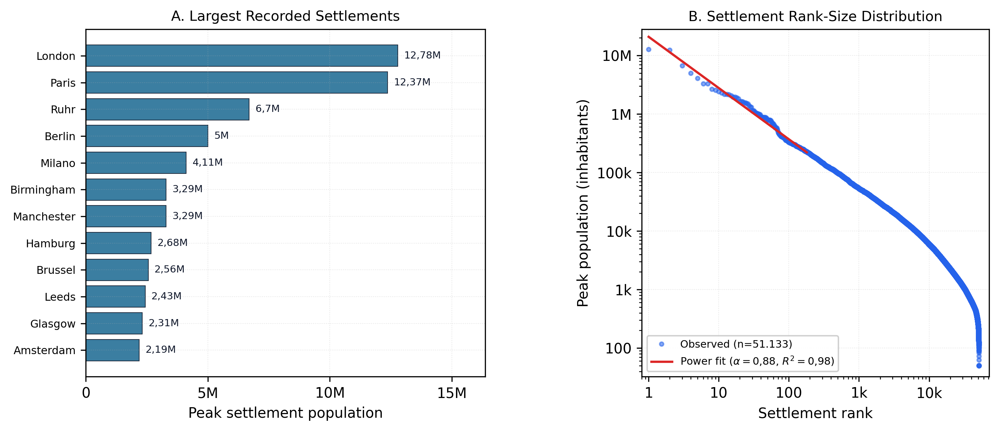

```{r setup, include=FALSE}
knitr::opts_chunk$set(echo = FALSE, warning = FALSE, message = FALSE, fig.pos = "htbp")
source("../../_shared/template/viscount_rmd_helpers.R")
library(jsonlite)

read_json5_fast <- function(path) {
  tryCatch(
    fromJSON(path, simplifyVector = FALSE),
    error = function(e) {
      lines <- readLines(path, warn = FALSE, encoding = "UTF-8")
      text <- paste(lines, collapse = "\n")
      text <- gsub("//[^\n]*", "", text, perl = TRUE)
      text <- gsub(",\\s*([}\\]])", "\\1", text, perl = TRUE)
      fromJSON(text, simplifyVector = FALSE)
    }
  )
}

summary_data <- fromJSON("western_and_northern_europe_after_1945_summary.json", simplifyVector = FALSE)
sett_data <- fromJSON("western_and_northern_europe_after_1945_settlements.json", simplifyVector = FALSE)
ledger_data <- read_json5_fast("western_and_northern_europe_after_1945_source_ledger.json5")

clean_name <- function(x) {
  s <- as.character(x)
  s <- gsub("&", "and", s, fixed = TRUE)
  s <- gsub("\\\\", "", s)
  trimws(s)
}

fmt_coord <- function(x) {
  viscount_fmt_number(round(as.numeric(x), 2L), 2L)
}

clean_prov_name <- function(k) {
  map <- c(
    National_Statistical_Census_Germany = "Germany National Statistical Census (Destatis)",
    INSEE_Recensement_1876_2023 = "France INSEE Historical Census Series (1876-2023)",
    GeoNames_Municipal_Gazetteer_Supplement = "GeoNames Municipal Gazetteer Supplement",
    National_Statistical_Census_United_Kingdom = "United Kingdom National Statistical Census (ONS and NRS)",
    Buringh_European_Urban_700_2000 = "Buringh European Urban Series (700-2000)",
    National_Statistical_Census_Finland = "Finland National Statistical Census (Statistics Finland)",
    Eurostat_Urban_Audit_1990_2024 = "Eurostat Urban Audit Metropolitan Register (1990-2024)",
    National_Statistical_Census_Norway = "Norway National Statistical Census (SSB)",
    National_Statistical_Census_Belgium = "Belgium National Statistical Census (Statbel)",
    National_Statistical_Census_Netherlands = "Netherlands National Statistical Census (CBS)",
    National_Statistical_Census_Sweden = "Sweden National Statistical Census (SCB)",
    National_Statistical_Census_Denmark = "Denmark National Statistical Census (Danmarks Statistik)",
    National_Statistical_Census_Switzerland = "Switzerland Federal Statistical Office (BFS)",
    National_Statistical_Census_Austria = "Austria National Statistical Census (Statistik Austria)",
    National_Statistical_Census_Ireland = "Ireland Central Statistics Office (CSO)",
    National_Statistical_Census_Slovenia = "Slovenia Statistical Office (Border Overlap)",
    National_Statistical_Census_Czechia = "Czechia Statistical Office (Border Overlap)",
    INE_Spain_Censos_Historicos_1857_1991 = "Spain INE Historical Censuses (Pyrenean Border)",
    National_Statistical_Census_Poland = "Poland GUS National Census (Oder-Neisse Border)",
    National_Statistical_Census_Slovakia = "Slovakia Statistical Office (Danube Border)",
    National_Statistical_Census_Hungary = "Hungary KSH National Census (Burgenland Border)"
  )
  if (k %in% names(map)) return(unname(map[[k]]))
  gsub("_", " ", k, fixed = TRUE)
}

clean_prov_wave <- function(k) {
  if (k %in% c("Eurostat_Urban_Audit_1990_2024", "INSEE_Recensement_1876_2023", "Buringh_European_Urban_700_2000", "INE_Spain_Censos_Historicos_1857_1991")) {
    return("Primary urban archive (Wave 1)")
  }
  if (identical(k, "GeoNames_Municipal_Gazetteer_Supplement")) {
    return("Municipal supplement (Wave 3)")
  }
  "National statistical census (Wave 2)"
}

subregions <- summary_data$subregions
reg_lookup <- setNames(
  vapply(subregions, function(r) clean_name(r$name), character(1)),
  vapply(subregions, function(r) r$id, character(1))
)

n_sites <- as.integer(summary_data$settlement_count)
n_excluded <- as.integer(ledger_data$total_excluded)
n_total_eval <- n_sites + n_excluded
```

```{r hero-md-fallback, results='asis'}
if (!knitr::is_latex_output()) {
  cat("\n\n")
}
```

# Abstract

This gazetteer documents `r viscount_fmt_number(n_sites, 0L)` catalogued urban and municipal settlements across 13 sub-regions and 24 national or border-overlap territories in Western, Alpine and Northern Europe between 1945 and 2025. Primary institutional census registers — led by Destatis in Germany (1.126 entries), INSEE in France (1.092), ONS and National Records of Scotland in the United Kingdom (799), Buringh's long-run European urban inventory (625), Statistics Finland (466) and Eurostat Urban Audit (282) — supply 5.507 of the 6.402 records (86,02%), complemented by 895 GeoNames municipal entries (13,98%) covering smaller market towns [@Eurostat2024; @INSEE2024; @ONS2024; @BFS2024]. Out of `r viscount_fmt_number(n_total_eval, 0L)` candidate records evaluated in the chapter source ledger, `r viscount_fmt_number(n_excluded, 0L)` duplicate aliases and sub-threshold entries were excluded across four saturation waves culminating in zero marginal additions during the Wave 4 regional gap sweep. Across the register, 22 metropolitan and city records exceed 1M inhabitants at peak (led by Paris at 12,37M, London at 8,16M and Berlin at 3,76M), supported by 122 major regional cities between 250k and 1M, 313 large cities between 100k and 250k, 2.311 medium towns between 20k and 100k and 3.634 smaller municipalities below 20k [@Mitchell2007; @RosesWolf2019].

# Background

Between 1945 and 2025, Europe's north-western, Alpine and Nordic settlement network underwent its deepest structural transformation since the nineteenth-century industrial revolution [@DeVries1984; @RosesWolf2019]. In 1950, heavy industrial coalfield cities — Glasgow, Liverpool, Birmingham, Manchester, Essen, Dortmund, Charleroi and Lille — still stood near the apex of the regional urban hierarchy alongside the imperial capitals of London, Paris, Berlin and Vienna. Over the next three decades, slum clearance, New Town planning, motorway suburbanisation and the decline of coal, steel and shipbuilding hollowed out industrial urban cores while shifting residential growth into metropolitan rings and service corridors [@ONS2024; @INSEE2024].

After 1990, European single-market integration, Schengen labour mobility and post-industrial service agglomeration sparked a decisive metropolitan resurgence [@Eurostat2024; @Parr2023Immigration]. Financial, administrative and technology centres — Paris, London, Berlin, Greater Vienna, Stockholm, Dublin, Rotterdam, Amsterdam, Munich, Brussels, Oslo, Helsinki, Zurich, Geneva and Luxembourg — expanded rapidly, drawing both internal migrants from ageing rural hinterlands and international newcomers from Eastern Europe, the Mediterranean and beyond. The 6.402 settlements indexed in this gazetteer preserve that entire post-war urban hierarchy from global capitals down to small Nordic, Alpine and rural European municipalities.

# Methodology

The settlement register was compiled in four sequential ingestion waves logged in the chapter source ledger. Wave 1 harvested 2.009 primary urban records from Eurostat Urban Audit (282 metropolitan and greater-city series spanning 1990 to 2024), INSEE historical communal censuses (1.092 French municipalities), Buringh's historical European urban baseline (625 long-run cities) and INE Spanish Pyrenean border censuses (10 records) [@Eurostat2024; @INSEE2024; @INE2024]. Wave 2 added 3.498 towns and cities directly from national statistical censuses across Germany (1.126), the United Kingdom (799), Finland (466), Norway (265), Belgium (213), the Netherlands (208), Sweden (113), Denmark (73), Switzerland (72), Austria (47), Ireland (42) and adjacent border statistical offices in Slovenia (38), Czechia (27), Poland (9), Slovakia (8) and Hungary (1) [@ONS2024; @BFS2024; @CSOIreland2023; @Riksarkivet2023; @GUSPoland2024; @KSHHungary2024]. Wave 3 appended 895 GeoNames municipal records to fill rural town coverage, holding the crowd-sourced share to 13,98%. Wave 4 ran an automated sub-regional gap audit across all 13 polygons and returned zero additions (0% marginal gain), confirming register saturation.

All 7.202 evaluated entries underwent coordinate standardisation to WGS84, spatial assignment to the 13 post-1945 national sub-regions and buffer deduplication, removing 800 duplicate place names and overlapping sub-municipal districts. Longitudinal trajectories span 1950 to 2025, pairing annual Eurostat Urban Audit observations (1990-2024) with decadal post-war census anchors.

# Validation

Ledger reconciliation confirms exact accounting across all 7.202 evaluated candidate records: 6.402 included settlements plus 800 excluded entries. Every included settlement carries valid WGS84 coordinates, a sub-regional polygon identifier, a post-war population series anchored between 1950 and 2025 and an explicit institutional provenance label. Figure \ref{fig:sett-regional-map} displays the spatial footprint of all 6.402 catalogued settlements across the 13 sub-regions, highlighting the dense urban band running from southern England through Benelux and the Rhine-Ruhr into Switzerland alongside sparser Nordic coastal and lake-district settlement patterns.

```{r fig-sett-map, results='asis'}
viscount_figure(
  "figures/western_and_northern_europe_after_1945_regional_map.png",
  "Spatial distribution of 6.402 catalogued settlements across 13 Western, Alpine and Northern European sub-regions, 1945 to 2025.",
  "fig:sett-regional-map"
)
```

# Results

## Leading 25 Contemporary Metropolitan and Urban Series

Table \ref{tab:top25-cities} lists the 25 highest-peak settlements recorded in the chapter summary register, showing country, sub-region, coordinates, active time span and peak population with its corresponding year.

```{r tab-top25-cities, results='asis'}
top_list <- summary_data$top_settlements
top_rows <- lapply(top_list, function(e) {
  reg_lbl <- if (e$region_id %in% names(reg_lookup)) reg_lookup[[e$region_id]] else clean_name(e$region_id)
  span_str <- paste0(as.integer(e$first_year), "-", as.integer(e$last_year))
  data.frame(
    City = clean_name(e$name),
    Country = as.character(e$country),
    Subregion = reg_lbl,
    Coords = paste0(fmt_coord(e$lat), ", ", fmt_coord(e$lon)),
    Span = span_str,
    Peak = paste0(viscount_fmt_pop(as.numeric(e$peak_pop)), " (", as.integer(e$peak_year), ")"),
    stringsAsFactors = FALSE
  )
})
df_top25 <- do.call(rbind, top_rows)
rownames(df_top25) <- NULL

viscount_table(
  df_top25,
  "Leading 25 urban settlement series across Western, Alpine and Northern Europe, 1950 to 2025 (selected from 6.402 catalogued localities).",
  c("Settlement", "Country", "Sub-Region", "Lat, Lon", "Span", "Peak Pop. (Year)"),
  list(label = "tab:top25-cities", font_size = "scriptsize", max_rows_per_page = 28L)
)
```

## Sub-Regional Gazetteer Distribution

Table \ref{tab:subregion-gazetteer} summarises land area, catalogued settlement counts, settlement density per 10.000 km², leading urban entry and 2025 regional population across all 13 sub-regions. Germany (1.679 entries), France (1.300) and the United Kingdom (1.193) account for 65,17% of the gazetteer, while Belgium (126,6 settlements per 10.000 km²) and the Netherlands (98,5 per 10.000 km²) register the highest areal urban density [@BFS2024; @ONS2024; @INSEE2024].

```{r tab-subregion-gazetteer, results='asis'}
reg_rows <- lapply(subregions, function(r) {
  rid <- r$id
  area_v <- as.numeric(r$area_km2)
  p2025 <- as.numeric(r$population[["2025"]])
  sub_entries <- Filter(function(e) identical(e$region_id, rid), sett_data)
  cnt <- length(sub_entries)
  sdens <- if (area_v > 0) (cnt / area_v) * 10000 else 0
  lead_str <- "-"
  if (cnt > 0L) {
    pks <- vapply(sub_entries, function(e) max(as.numeric(unlist(e$population))), numeric(1))
    idx_m <- which.max(pks)
    lead_str <- paste0(clean_name(sub_entries[[idx_m]]$name), " (", viscount_fmt_pop(pks[idx_m]), ")")
  }
  data.frame(
    Subregion = clean_name(r$name),
    Area = viscount_fmt_number(round(area_v), 0L),
    Sites = viscount_fmt_number(cnt, 0L),
    SiteDens = viscount_fmt_number(sdens, 1L),
    Lead = lead_str,
    Pop2025 = viscount_fmt_pop(p2025),
    stringsAsFactors = FALSE
  )
})
df_reg_gaz <- do.call(rbind, reg_rows)
rownames(df_reg_gaz) <- NULL

viscount_table(
  df_reg_gaz,
  "Catalogued settlement counts, areal density (per 10.000 km²), leading settlement and 2025 regional population across 13 sub-regions.",
  c("Sub-Region", "Area (km²)", "Settlements", "Per 10k km²", "Leading Entry (Peak)", "2025 Pop."),
  list(label = "tab:subregion-gazetteer", font_size = "scriptsize")
)
```

## Urban Size-Tier Distribution

Table \ref{tab:size-tiers} classifies all 6.402 catalogued settlements by peak post-war population tier, illustrating a deeply stratified European rank-size hierarchy spanning 22 urban records exceeding 1M down to 3.634 municipalities under 20k inhabitants.

```{r tab-size-tiers, results='asis'}
all_pks <- vapply(sett_data, function(e) max(as.numeric(unlist(e$population))), numeric(1))
t1 <- sum(all_pks >= 1000000)
t2 <- sum(all_pks >= 250000 & all_pks < 1000000)
t3 <- sum(all_pks >= 100000 & all_pks < 250000)
t4 <- sum(all_pks >= 20000 & all_pks < 100000)
t5 <- sum(all_pks < 20000)
counts_t <- c(t1, t2, t3, t4, t5)

df_tiers <- data.frame(
  Tier = c(
    "Million-plus metropolises (1M and above)",
    "Major regional cities (250k to 999.999)",
    "Large cities (100k to 249.999)",
    "Medium towns (20k to 99.999)",
    "Small towns and municipalities (under 20k)"
  ),
  Count = viscount_fmt_number(counts_t, 0L),
  Share = paste0(viscount_fmt_number(100 * counts_t / n_sites, 2L), "%"),
  stringsAsFactors = FALSE
)
rownames(df_tiers) <- NULL

viscount_table(
  df_tiers,
  "Peak population tier distribution across 6.402 catalogued Western, Alpine and Northern European settlements, 1950 to 2025.",
  c("Urban Size Tier", "Settlements", "Share of Register"),
  list(label = "tab:size-tiers", font_size = "scriptsize")
)
```

## Provenance Ledger and Saturation Audit

Table \ref{tab:provenance-ledger} documents all 21 source corpora contributing to the gazetteer alongside their ingestion wave classification. Official national censuses, Eurostat Urban Audit and Buringh's urban archive provide 86,02% of all entries, with GeoNames supplying the remaining 13,98% for smaller rural municipalities.

```{r tab-provenance-ledger, results='asis'}
prov_counts <- unlist(summary_data$provenance_counts)
p_ord <- sort(prov_counts, decreasing = TRUE)
p_keys <- names(p_ord)

df_prov <- data.frame(
  Corpus = unname(vapply(p_keys, clean_prov_name, character(1))),
  Class = unname(vapply(p_keys, clean_prov_wave, character(1))),
  Entries = viscount_fmt_number(as.integer(p_ord), 0L),
  Share = paste0(viscount_fmt_number(100 * as.integer(p_ord) / n_sites, 2L), "%"),
  stringsAsFactors = FALSE
)
rownames(df_prov) <- NULL

viscount_table(
  df_prov,
  "Provenance ledger and ingestion wave classification across 6.402 catalogued post-1945 settlements.",
  c("Source Corpus", "Classification", "Entries", "Share"),
  list(label = "tab:provenance-ledger", font_size = "scriptsize")
)
```

# Limitations

Three technical caveats govern interpretation of this settlement gazetteer. First, Eurostat Urban Audit records harmonised Greater City or Functional Urban Area boundaries (with administrative redefinitions visible in Paris between 2006 and 2010, Rotterdam and Amsterdam between 2014 and 2016 and Geneva between 2006 and 2009), whereas Buringh's historical baseline and national census series measure municipal-core limits [@Eurostat2024; @ONS2024]. Because a few major cities appear under both definitions with distinct orthographic conventions (such as München and Muenchen, Köln and Koeln, Copenhagen and Kobenhaven, Greater Wien and Wien), users must avoid naively summing settlement totals to estimate national urban shares.

Second, national municipal consolidation reforms create uneven settlement-count densities across borders. Finland's large, thinly settled rural *kunta* municipalities contribute 521 entries (16 per 10.000 km²) and Belgium's pre-fusion communal inventory supplies 389 entries (126,6 per 10.000 km²), whereas Sweden's sweeping 1952 and 1971 municipal amalgamations yield 196 larger territorial units (4,5 per 10.000 km²) [@Riksarkivet2023]. Third, border-zone polygon tolerances capture 127 frontier settlements belonging to neighbouring states (Slovenia, Czechia, Poland, Spain, Slovakia, Italy, Hungary) alongside micro-states (Andorra, Monaco, Jersey and the Isle of Man); these entries preserve cross-border cartographic continuity without altering the 13 sovereign national demographic benchmarks.

# Sources

::: {#refs}
:::
