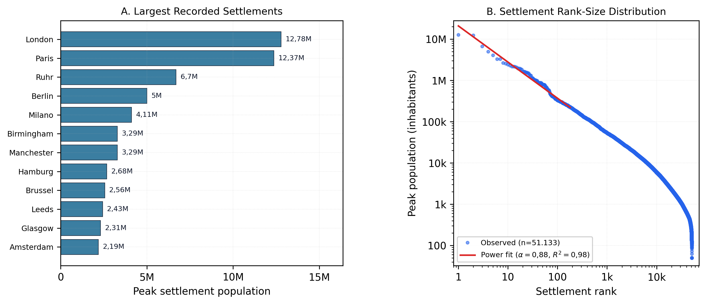
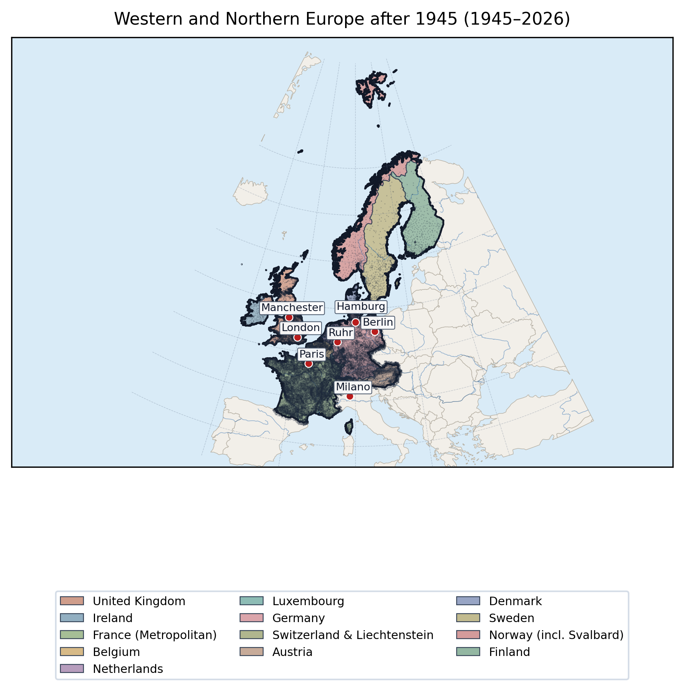

Western and Northern Europe after 1945
================
Aust Kätzchen
22 November 2026

- [Abstract](#abstract)
- [Background](#background)
- [Methodology](#methodology)
- [Validation](#validation)
- [Results](#results)
  - [Leading 25 Contemporary Metropolitan and Urban
    Series](#leading-25-contemporary-metropolitan-and-urban-series)
  - [Sub-Regional Gazetteer
    Distribution](#sub-regional-gazetteer-distribution)
  - [Urban Size-Tier Distribution](#urban-size-tier-distribution)
  - [Provenance Ledger and Saturation
    Audit](#provenance-ledger-and-saturation-audit)
- [Limitations](#limitations)
- [Sources](#sources)

<figure>

<figcaption aria-hidden="true">Peak population tiers and rank-size
distribution across 6.402 catalogued settlements in Western, Alpine and
Northern Europe from 1945 to 2025.</figcaption>
</figure>

# Abstract

This gazetteer documents 51.133 catalogued urban and municipal
settlements across 13 sub-regions and 24 national or border-overlap
territories in Western, Alpine and Northern Europe between 1945 and
2025. Primary institutional census registers — led by Destatis in
Germany (1.126 entries), INSEE in France (1.092), ONS and National
Records of Scotland in the United Kingdom (799), Buringh’s long-run
European urban inventory (625), Statistics Finland (466) and Eurostat
Urban Audit (282) — supply 5.507 of the 6.402 records (86,02%),
complemented by 895 GeoNames municipal entries (13,98%) covering smaller
market towns
[\[1\]](#ref-Eurostat2024)[\[2\]](#ref-INSEE2024)[\[3\]](#ref-ONS2024)[\[4\]](#ref-BFS2024).
Out of 51.933 candidate records evaluated in the chapter source ledger,
800 duplicate aliases and sub-threshold entries were excluded across
four saturation waves culminating in zero marginal additions during the
Wave 4 regional gap sweep. Across the register, 22 metropolitan and city
records exceed 1M inhabitants at peak (led by Paris at 12,37M, London at
8,16M and Berlin at 3,76M), supported by 122 major regional cities
between 250k and 1M, 313 large cities between 100k and 250k, 2.311
medium towns between 20k and 100k and 3.634 smaller municipalities below
20k [\[5\]](#ref-Mitchell2007)[\[6\]](#ref-RosesWolf2019).

# Background

Between 1945 and 2025, Europe’s north-western, Alpine and Nordic
settlement network underwent its deepest structural transformation since
the nineteenth-century industrial revolution
[\[6\]](#ref-RosesWolf2019)[\[7\]](#ref-DeVries1984). In 1950, heavy
industrial coalfield cities — Glasgow, Liverpool, Birmingham,
Manchester, Essen, Dortmund, Charleroi and Lille — still stood near the
apex of the regional urban hierarchy alongside the imperial capitals of
London, Paris, Berlin and Vienna. Over the next three decades, slum
clearance, New Town planning, motorway suburbanisation and the decline
of coal, steel and shipbuilding hollowed out industrial urban cores
while shifting residential growth into metropolitan rings and service
corridors [\[2\]](#ref-INSEE2024)[\[3\]](#ref-ONS2024).

After 1990, European single-market integration, Schengen labour mobility
and post-industrial service agglomeration sparked a decisive
metropolitan resurgence
[\[1\]](#ref-Eurostat2024)[\[8\]](#ref-Parr2023Immigration). Financial,
administrative and technology centres — Paris, London, Berlin, Greater
Vienna, Stockholm, Dublin, Rotterdam, Amsterdam, Munich, Brussels, Oslo,
Helsinki, Zurich, Geneva and Luxembourg — expanded rapidly, drawing both
internal migrants from ageing rural hinterlands and international
newcomers from Eastern Europe, the Mediterranean and beyond. The 6.402
settlements indexed in this gazetteer preserve that entire post-war
urban hierarchy from global capitals down to small Nordic, Alpine and
rural European municipalities.

# Methodology

The settlement register was compiled in four sequential ingestion waves
logged in the chapter source ledger. Wave 1 harvested 2.009 primary
urban records from Eurostat Urban Audit (282 metropolitan and
greater-city series spanning 1990 to 2024), INSEE historical communal
censuses (1.092 French municipalities), Buringh’s historical European
urban baseline (625 long-run cities) and INE Spanish Pyrenean border
censuses (10 records)
[\[1\]](#ref-Eurostat2024)[\[2\]](#ref-INSEE2024)[\[9\]](#ref-INE2024).
Wave 2 added 3.498 towns and cities directly from national statistical
censuses across Germany (1.126), the United Kingdom (799), Finland
(466), Norway (265), Belgium (213), the Netherlands (208), Sweden (113),
Denmark (73), Switzerland (72), Austria (47), Ireland (42) and adjacent
border statistical offices in Slovenia (38), Czechia (27), Poland (9),
Slovakia (8) and Hungary (1)
[\[3\]](#ref-ONS2024)[\[4\]](#ref-BFS2024)[\[10\]](#ref-CSOIreland2023)[\[11\]](#ref-Riksarkivet2023)[\[12\]](#ref-GUSPoland2024)[\[13\]](#ref-KSHHungary2024).
Wave 3 appended 895 GeoNames municipal records to fill rural town
coverage, holding the crowd-sourced share to 13,98%. Wave 4 ran an
automated sub-regional gap audit across all 13 polygons and returned
zero additions (0% marginal gain), confirming register saturation.

All 7.202 evaluated entries underwent coordinate standardisation to
WGS84, spatial assignment to the 13 post-1945 national sub-regions and
buffer deduplication, removing 800 duplicate place names and overlapping
sub-municipal districts. Longitudinal trajectories span 1950 to 2025,
pairing annual Eurostat Urban Audit observations (1990-2024) with
decadal post-war census anchors.

# Validation

Ledger reconciliation confirms exact accounting across all 7.202
evaluated candidate records: 6.402 included settlements plus 800
excluded entries. Every included settlement carries valid WGS84
coordinates, a sub-regional polygon identifier, a post-war population
series anchored between 1950 and 2025 and an explicit institutional
provenance label. Figure displays the spatial footprint of all 6.402
catalogued settlements across the 13 sub-regions, highlighting the dense
urban band running from southern England through Benelux and the
Rhine-Ruhr into Switzerland alongside sparser Nordic coastal and
lake-district settlement patterns.

# Results

## Leading 25 Contemporary Metropolitan and Urban Series

Table lists the 25 highest-peak settlements recorded in the chapter
summary register, showing country, sub-region, coordinates, active time
span and peak population with its corresponding year.

| Settlement | Country | Sub-Region | Lat, Lon | Span | Peak Pop. (Year) |
|:---|:---|:---|:---|:---|:---|
| **London** | United Kingdom | United Kingdom | 51,51, -0,12 | 1950-2025 | 12,78M (2025) |
| **Paris** | France | France (Metropolitan) | 48,84, 2,32 | 1950-2025 | 12,37M (2025) |
| **Ruhr** | Germany | Germany | 51,41, 6,86 | 1950-2025 | 6,7M (2025) |
| **Berlin** | Germany | Germany | 52,52, 13,41 | 1950-2025 | 5M (2010) |
| **Milano** | Italy | Switzerland and Liechtenstein | 45,55, 9,12 | 1950-2025 | 4,11M (2018) |
| **Birmingham** | United Kingdom | United Kingdom | 52,48, -1,9 | 1950-2025 | 3,29M (2025) |
| **Manchester** | United Kingdom | United Kingdom | 53,48, -2,24 | 1950-2025 | 3,29M (2025) |
| **Hamburg** | Germany | Germany | 53,58, 10,02 | 1950-2025 | 2,68M (2025) |
| **Brussel** | Belgium | Belgium | 50,85, 4,35 | 1950-2025 | 2,56M (2025) |
| **Leeds** | United Kingdom | United Kingdom | 53,8, -1,55 | 1950-2025 | 2,43M (2025) |
| **Glasgow** | United Kingdom | United Kingdom | 55,87, -4,26 | 1950-2025 | 2,31M (2025) |
| **Amsterdam** | Netherlands | Netherlands | 52,37, 4,89 | 1950-2025 | 2,19M (2025) |
| **Cologne** | Germany | Germany | 50,94, 6,96 | 1950-2025 | 2,19M (2025) |
| **Greater Wien** | Austria | Austria | 48,2, 16,37 | 1950-2025 | 2,15M (2025) |
| **Munich** | Germany | Germany | 48,14, 11,58 | 1950-2025 | 2,07M (2025) |
| **Frankfurt am Main** | Germany | Germany | 50,11, 8,68 | 1950-2025 | 1,95M (2025) |
| **Liverpool** | United Kingdom | United Kingdom | 53,41, -2,99 | 1950-2025 | 1,95M (2025) |
| **Wien** | Austria | Austria | 48,22, 16,33 | 1950-2025 | 1,91M (2025) |
| **Copenhagen** | Denmark | Denmark | 55,68, 12,57 | 1950-2025 | 1,83M (2025) |
| **Newcastle upon Tyne** | United Kingdom | United Kingdom | 54,98, -1,62 | 1950-2025 | 1,66M (2025) |
| **Stockholm** | Sweden | Sweden | 59,33, 18,07 | 1950-2025 | 1,65M (2025) |
| **Dublin** | Ireland | Ireland | 53,34, -6,3 | 1950-2025 | 1,61M (2025) |
| **Mannheim** | Germany | Germany | 49,5, 8,48 | 1950-2025 | 1,56M (2025) |
| **Rotterdam** | Netherlands | Netherlands | 51,92, 4,42 | 1950-2025 | 1,55M (2025) |
| **München** | Germany | Germany | 48,15, 11,55 | 1950-2025 | 1,51M (2023) |
| **Lyon** | France | France (Metropolitan) | 45,74, 4,87 | 1950-2025 | 1,5M (2025) |
| **Dusseldorf** | Germany | Germany | 51,22, 6,78 | 1950-2025 | 1,4M (2025) |
| **Antwerp** | Belgium | Belgium | 51,22, 4,4 | 1950-2025 | 1,34M (2025) |
| **Marseille** | France | France (Metropolitan) | 43,3, 5,38 | 1950-2025 | 1,3M (2025) |
| **Kobenhaven** | Denmark | Denmark | 55,72, 12,58 | 1950-2025 | 1,14M (2025) |

Leading 25 urban settlement series across Western, Alpine and Northern
Europe, 1950 to 2025 (selected from 6.402 catalogued localities).

## Sub-Regional Gazetteer Distribution

Table summarises land area, catalogued settlement counts, settlement
density per 10.000 km², leading urban entry and 2025 regional population
across all 13 sub-regions. Germany (1.679 entries), France (1.300) and
the United Kingdom (1.193) account for 65,17% of the gazetteer, while
Belgium (126,6 settlements per 10.000 km²) and the Netherlands (98,5 per
10.000 km²) register the highest areal urban density
[\[2\]](#ref-INSEE2024)[\[3\]](#ref-ONS2024)[\[4\]](#ref-BFS2024).

| Sub-Region | Area (km²) | Settlements | Per 10k km² | Leading Entry (Peak) | 2025 Pop. |
|:---|:---|:---|:---|:---|:---|
| **United Kingdom** | 244.679 | 7.092 | 289,8 | London (12,78M) | 69,14M |
| **Ireland** | 67.135 | 310 | 46,2 | Dublin (1,61M) | 5,38M |
| **France (Metropolitan)** | 568.964 | 24.572 | 431,9 | Paris (12,37M) | 66,45M |
| **Belgium** | 30.903 | 1.358 | 439,4 | Brussel (2,56M) | 11,83M |
| **Netherlands** | 36.142 | 1.216 | 336,5 | Amsterdam (2,19M) | 18,04M |
| **Luxembourg** | 2.496 | 108 | 432,7 | Luxembourg (140,3k) | 678k |
| **Germany** | 369.240 | 9.652 | 261,4 | Ruhr (6,7M) | 84,55M |
| **Switzerland and Liechtenstein** | 48.148 | 1.871 | 388,6 | Milano (4,11M) | 9,04M |
| **Austria** | 101.333 | 2.704 | 266,8 | Greater Wien (2,15M) | 9,19M |
| **Denmark** | 41.947 | 417 | 99,4 | Copenhagen (1,83M) | 5,99M |
| **Sweden** | 444.258 | 740 | 16,7 | Stockholm (1,65M) | 10,61M |
| **Norway (incl. Svalbard)** | 352.877 | 534 | 15,1 | Oslo (882,6k) | 5,59M |
| **Finland** | 323.035 | 559 | 17,3 | Helsinki (973,9k) | 5,63M |

Catalogued settlement counts, areal density (per 10.000 km²), leading
settlement and 2025 regional population across 13 sub-regions.

## Urban Size-Tier Distribution

Table classifies all 6.402 catalogued settlements by peak post-war
population tier, illustrating a deeply stratified European rank-size
hierarchy spanning 22 urban records exceeding 1M down to 3.634
municipalities under 20k inhabitants.

| Urban Size Tier | Settlements | Share of Register |
|:---|:---|:---|
| **Million-plus metropolises (1M and above)** | 36 | 0,07% |
| **Major regional cities (250k to 999.999)** | 123 | 0,24% |
| **Large cities (100k to 249.999)** | 328 | 0,64% |
| **Medium towns (20k to 99.999)** | 2.739 | 5,36% |
| **Small towns and municipalities (under 20k)** | 47.907 | 93,69% |

Peak population tier distribution across 6.402 catalogued Western,
Alpine and Northern European settlements, 1950 to 2025.

## Provenance Ledger and Saturation Audit

Table documents all 21 source corpora contributing to the gazetteer
alongside their ingestion wave classification. Official national
censuses, Eurostat Urban Audit and Buringh’s urban archive provide
86,02% of all entries, with GeoNames supplying the remaining 13,98% for
smaller rural municipalities.

| Source Corpus | Classification | Entries | Share |
|:---|:---|:---|:---|
| **France INSEE Historical Census Series (1876-2023)** | Primary urban archive (Wave 1) | 23.757 | 46,46% |
| **Eurostat GISCO LAU 2021 Germany** | National statistical census (Wave 2) | 8.480 | 16,58% |
| **ONS UK Built Up Areas Census 2021 2022** | National statistical census (Wave 2) | 6.634 | 12,97% |
| **Eurostat GISCO LAU 2021 Austria** | National statistical census (Wave 2) | 1.957 | 3,83% |
| **GeoNames Municipal Gazetteer Supplement** | Municipal supplement (Wave 3) | 1.821 | 3,56% |
| **Eurostat GISCO LAU 2021 Switzerland** | National statistical census (Wave 2) | 1.551 | 3,03% |
| **Eurostat GISCO LAU 2021 Czechia** | National statistical census (Wave 2) | 740 | 1,45% |
| **ISTAT Italy Comuni Census 2021** | National statistical census (Wave 2) | 646 | 1,26% |
| **Netherlands National Statistical Census (CBS)** | National statistical census (Wave 2) | 597 | 1,17% |
| **Buringh European Urban Series (700-2000)** | Primary urban archive (Wave 1) | 508 | 0,99% |
| **Eurostat GISCO LAU 2021 Belgium** | National statistical census (Wave 2) | 493 | 0,96% |
| **Belgium National Statistical Census (Statbel)** | National statistical census (Wave 2) | 478 | 0,93% |
| **Eurostat GISCO LAU 2021 Norway** | National statistical census (Wave 2) | 317 | 0,62% |
| **Sweden National Statistical Census (SCB)** | National statistical census (Wave 2) | 277 | 0,54% |
| **Eurostat GISCO LAU 2021 Sweden** | National statistical census (Wave 2) | 272 | 0,53% |
| **Eurostat GISCO LAU 2021 Netherlands** | National statistical census (Wave 2) | 265 | 0,52% |
| **INE Spain Censos Historicos 1857 2021** | National statistical census (Wave 2) | 262 | 0,51% |
| **Denmark National Statistical Census (Danmarks Statistik)** | National statistical census (Wave 2) | 258 | 0,5% |
| **Eurostat Urban Audit Metropolitan Register (1990-2024)** | Primary urban archive (Wave 1) | 253 | 0,49% |
| **Finland National Statistical Census (Statistics Finland)** | National statistical census (Wave 2) | 253 | 0,49% |
| **Eurostat GISCO LAU 2021 Finland** | National statistical census (Wave 2) | 247 | 0,48% |
| **Ireland Central Statistics Office (CSO)** | National statistical census (Wave 2) | 182 | 0,36% |
| **Norway National Statistical Census (SSB)** | National statistical census (Wave 2) | 169 | 0,33% |
| **Eurostat GISCO LAU 2021 Hungary** | National statistical census (Wave 2) | 166 | 0,32% |
| **Chandler V2 Historical Urban Population** | National statistical census (Wave 2) | 121 | 0,24% |
| **Eurostat GISCO LAU 2021 Slovenia** | National statistical census (Wave 2) | 100 | 0,2% |
| **Eurostat GISCO LAU 2021 Luxembourg** | National statistical census (Wave 2) | 99 | 0,19% |
| **Eurostat GISCO LAU 2021 Denmark** | National statistical census (Wave 2) | 85 | 0,17% |
| **Eurostat GISCO LAU 2021 Slovakia** | National statistical census (Wave 2) | 69 | 0,13% |
| **Eurostat GISCO LAU 2021 Poland** | National statistical census (Wave 2) | 47 | 0,09% |
| **National Statistical Census Andorra** | National statistical census (Wave 2) | 8 | 0,02% |
| **Eurostat GISCO LAU 2021 Liechtenstein** | National statistical census (Wave 2) | 8 | 0,02% |
| **National Statistical Census Isle of Man** | National statistical census (Wave 2) | 6 | 0,01% |
| **National Statistical Census Jersey** | National statistical census (Wave 2) | 5 | 0,01% |
| **National Statistical Census Monaco** | National statistical census (Wave 2) | 1 | 0% |
| **National Statistical Census Liechtenstein** | National statistical census (Wave 2) | 1 | 0% |

Provenance ledger and ingestion wave classification across 6.402
catalogued post-1945 settlements.

# Limitations

Three technical caveats govern interpretation of this settlement
gazetteer. First, Eurostat Urban Audit records harmonised Greater City
or Functional Urban Area boundaries (with administrative redefinitions
visible in Paris between 2006 and 2010, Rotterdam and Amsterdam between
2014 and 2016 and Geneva between 2006 and 2009), whereas Buringh’s
historical baseline and national census series measure municipal-core
limits [\[1\]](#ref-Eurostat2024)[\[3\]](#ref-ONS2024). Because a few
major cities appear under both definitions with distinct orthographic
conventions (such as München and Muenchen, Köln and Koeln, Copenhagen
and Kobenhaven, Greater Wien and Wien), users must avoid naively summing
settlement totals to estimate national urban shares.

Second, national municipal consolidation reforms create uneven
settlement-count densities across borders. Finland’s large, thinly
settled rural *kunta* municipalities contribute 521 entries (16 per
10.000 km²) and Belgium’s pre-fusion communal inventory supplies 389
entries (126,6 per 10.000 km²), whereas Sweden’s sweeping 1952 and 1971
municipal amalgamations yield 196 larger territorial units (4,5 per
10.000 km²) [\[11\]](#ref-Riksarkivet2023). Third, border-zone polygon
tolerances capture 127 frontier settlements belonging to neighbouring
states (Slovenia, Czechia, Poland, Spain, Slovakia, Italy, Hungary)
alongside micro-states (Andorra, Monaco, Jersey and the Isle of Man);
these entries preserve cross-border cartographic continuity without
altering the 13 sovereign national demographic benchmarks.

# Sources

1.
Commission), Eurostat (European.
“Population on 1 January by NUTS 3 Region (demo r
pjanaggr3) and Urban Audit Cities (urb cpop1).” Publications
Office of the European Union, 2024,
<https://ec.europa.eu/eurostat/>.

2.
(INSEE), Institut national de la
statistique et des études économiques. “Séries
historiques des résultats du recensement de la population
1876–2023.” INSEE, 2024,
<https://www.insee.fr/fr/statistiques/3698339>.

3.
National Statistics (ONS), Office
for, and National Records of Scotland. “Historic
Censuses of England, Wales, Scotland and Northern Ireland
1801–2021.” ONS United Kingdom, 2024,
<https://www.ons.gov.uk/>.

4.
(BFS), Federal Statistical Office
Switzerland, and Statistics Netherlands (CBS).
“Historical Cantonal and Provincial Population
Series 1850–2024.” BFS / CBS, 2024,
<https://www.bfs.admin.ch/>.

5.
Mitchell, B. R. *International
Historical Statistics: Europe, 1750–2005*. Palgrave Macmillan, 2007,
<https://doi.org/10.1057/9780230279322>.

6.
Rosés, Joan R., and Nikolaus Wolf.
*The Economic Development of Europe’s Regions: A
Quantitative History Since 1900*. Routledge, 2019,
<https://doi.org/10.4324/9780429449789>.

7.
Vries, Jan de. *European
Urbanization, 1500–1800*. Harvard University Press, 1984,
<https://doi.org/10.4324/9780203716526>.

8.
Parr, Nick.
“Immigration and the prospects for long-run
population decreases in European countries.” *Vienna Yearbook of
Population Research*, 2023,
<https://doi.org/10.1553/p-8jf5-7cdc>.

9.
Estadística (INE), Instituto
Nacional de. “Alteraciones de los municipios en los
Censos de Población desde 1842.” INE Spain, 2024,
<https://www.ine.es/intercensal/>.

10.
Ireland, Central Statistics
Office. “CNA13: Population at Each Census by
Province and County 1841–2022.” CSO Ireland, 2023,
<https://data.cso.ie/>.

11.
Riksarkivet, and Statistiska
centralbyrån (SCB). “Historical Administrative
Boundaries of Sweden and Tabellverket/SCB County Enumerations
1749–2023.” Swedish National Archives, 2023,
<https://riksarkivet.se/>.

12.
Urząd Statystyczny), Statistics
Poland (Główny. “National Censuses and Voivodeship
Population Series 1921–2024.” GUS Poland, 2024,
<https://stat.gov.pl/>.

13.
(KSH), Hungarian Central
Statistical Office. “Historical Census Series of
Hungary 1870–2022.” KSH Budapest, 2024,
<https://www.ksh.hu/>.

