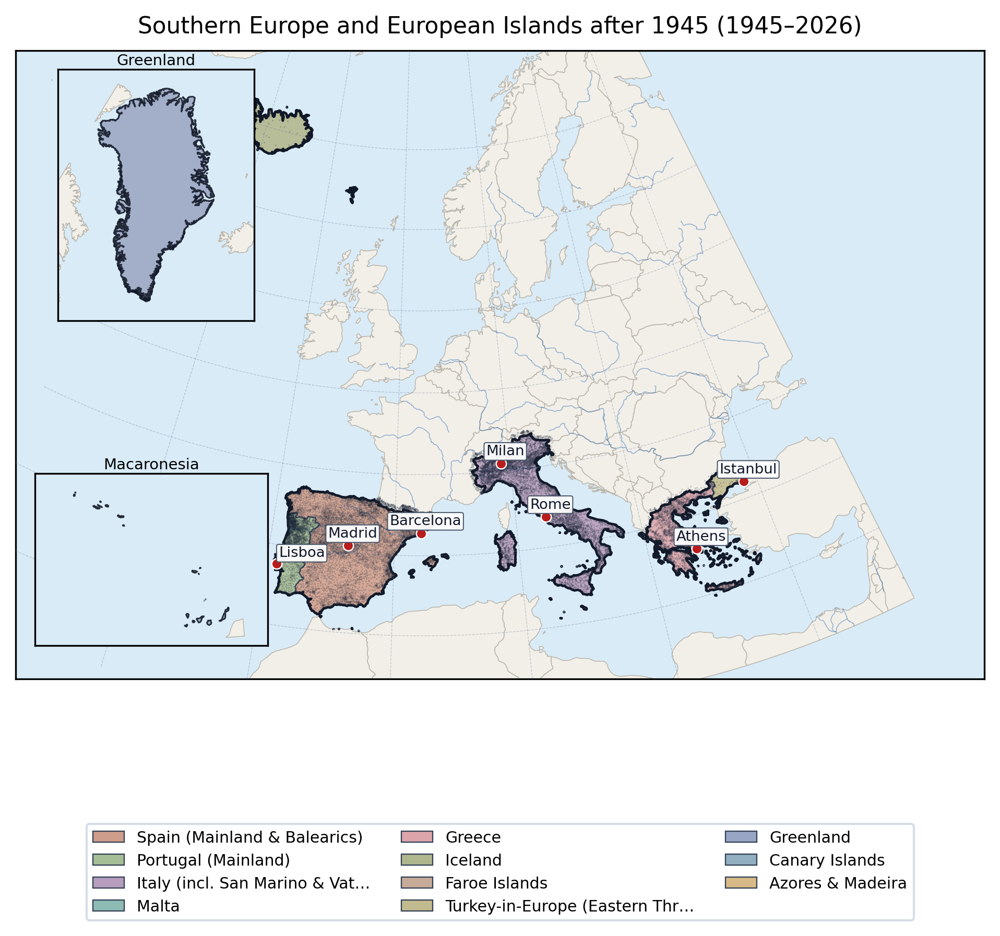
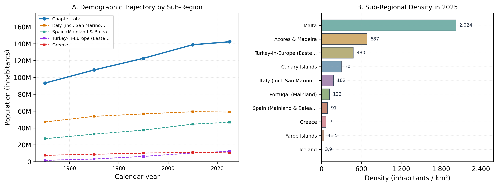
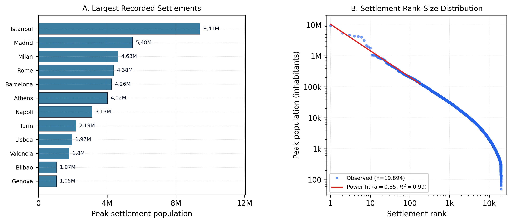

Southern Europe and European Islands after 1945
================
Aust Kätzchen
22 November 2026

- [Abstract](#abstract)
- [Background](#background)
  - [Geographic Scope and Post-War
    Baseline](#geographic-scope-and-post-war-baseline)
  - [Demographic Regimes Across the Mediterranean and North
    Atlantic](#demographic-regimes-across-the-mediterranean-and-north-atlantic)
- [Methodology](#methodology)
  - [Sub-Administrative Historical GIS
    Architecture](#sub-administrative-historical-gis-architecture)
  - [Settlement Gazetteer and Interpolation
    Protocol](#settlement-gazetteer-and-interpolation-protocol)
- [Validation](#validation)
  - [Sub-Administrative Cross-Checks and Boundary
    Reconciliation](#sub-administrative-cross-checks-and-boundary-reconciliation)
  - [Urban Primacy and Metropolitan Definition
    Audits](#urban-primacy-and-metropolitan-definition-audits)
- [Results](#results)
  - [Iberian Peninsula: Rural Exodus, Retornados and
    Immigration](#iberian-peninsula-rural-exodus-retornados-and-immigration)
  - [Italy and Malta: Industrial Boom, Mezzogiorno Mobility and Extreme
    Density](#italy-and-malta-industrial-boom-mezzogiorno-mobility-and-extreme-density)
  - [Greece and Eastern Thrace: Balkan Urbanisation and the Marmara
    Megacity](#greece-and-eastern-thrace-balkan-urbanisation-and-the-marmara-megacity)
  - [Macaronesian and North Atlantic Islands: Tourism, Fisheries and
    Sub-Arctic
    Settlement](#macaronesian-and-north-atlantic-islands-tourism-fisheries-and-sub-arctic-settlement)
  - [Urban Hierarchy and Metropolitan
    Concentration](#urban-hierarchy-and-metropolitan-concentration)
- [Limitations](#limitations)
- [Conclusion](#conclusion)
- [Appendix](#appendix)
- [Sources](#sources)

<figure>

<figcaption aria-hidden="true">Sub-regional population density and
principal settlements across Southern Europe, Eastern Thrace,
Macaronesia and the North Atlantic, 1945-2025.</figcaption>
</figure>

# Abstract

Between 1945 and 2025 the southern rim of Europe and the Atlantic island
territories underwent one of the swiftest demographic reversals in
modern European history. Across 11 sub-regions covering 3.227.227 km² —
stretching from the Spanish Meseta, Portugal, Italy, Malta, Greece and
Eastern Thrace to the Canary Islands, the Azores, Madeira, Iceland, the
Faroe Islands and Greenland — total population rose from 93,29M in 1950
to 108,91M in 1970, 122,69M in 1990, 138,83M in 2010 and 142,33M in
2025, an aggregate increase of 52,57%. That net expansion masks a sharp
structural inversion. Between 1950 and 1974 Mediterranean Europe
functioned as the chief labour reservoir for north-western European
industry while shedding millions of rural inhabitants into domestic
coastal metropolises; by the late twentieth century Spain, Italy,
Portugal and Greece had entered the lowest-low fertility tier and
pivoted to international immigration to offset natural decrease.
Meanwhile Eastern Thrace expanded nearly eightfold around European
Istanbul, Malta surpassed 2.023 persons per km² and the Canary Islands
and Iceland nearly tripled, whereas the Azores and Madeira declined by
15,21% and Greece contracted by 6,66% after 2010. Anchored by 2.455
sub-administrative historical GIS enumerations and 2.018 settlements,
this chapter reconstructs the regional trajectories, internal migrations
and urban hierarchies of the post-war era.

# Background

## Geographic Scope and Post-War Baseline

This chapter encompasses 11 sub-regions spanning the three southern
European peninsulas, European Turkey, the central Mediterranean
archipelago of Malta, the volcanic archipelagos of Macaronesia and the
sub-Arctic territories of the North Atlantic. Together these units
occupy 3.227.227 km², though Greenland alone accounts for 2.076.808,1
km² (64,35% of the study area) while holding less than 0,04% of its
population. Excluding Greenland, the remaining 10 sub-regions cover
1.150.418,9 km², on which mean population density climbed from 81,07
persons per km² in 1950 to 123,67 persons per km² in 2025. Relief and
climate impose sharp internal contrasts across this zone. Rugged
cordilleras — the Iberian Meseta and Cantabrian ranges, the Apennines,
the Pindus mountains and the Alpine watershed — divide arid or sparsely
inhabited uplands from narrow alluvial basins and irrigated coastal
plains where settlement has clustered ever more tightly since the Second
World War [\[1\]](#ref-RosesWolf2019)[\[2\]](#ref-Mitchell2007).

In 1945 the Mediterranean peninsulas stood markedly behind north-western
Europe in urbanisation, industrial output and life expectancy. Italy
emerged from wartime combat and partition with 47,11M inhabitants in
1950, over half of the entire study domain, yet southern Italy remained
overwhelmingly agrarian, marked by latifundia estates, endemic malaria
on coastal lowlands and high infant mortality
[\[3\]](#ref-DEMOPAST2023). Spain, numbering 27,28M on the mainland and
Balearics plus 793k in the Canary Islands in 1950, was still recovering
from the human and infrastructural losses of the 1936-1939 Civil War and
the rationing years of early Francoist autarky [\[4\]](#ref-INE2024).
Portugal, with 7,86M on the mainland and 585k across the Azores and
Madeira, remained locked in rural conservatism under the Estado Novo,
recording Europe’s lowest literacy rates and highest infant mortality
outside the Balkans. Greece, tallying 7,57M in 1950, had endured a
decade of Italian-German occupation, the 1941-1942 famine and the
1946-1949 Civil War that left mountain villages across Epirus and
Macedonia burned or evacuated [\[5\]](#ref-StatBalkans2024). At the
south-eastern margin, Eastern Thrace (Turkey-in-Europe) held just 1,59M
people in 1950, with European Istanbul still below 1M. Across the
Atlantic, Iceland (143k), the Faroe Islands (31,8k) and Greenland
(23,6k) stood at the threshold of post-war fisheries mechanisation,
public health campaigns and welfare-state integration
[\[6\]](#ref-Hagstofa2024)[\[7\]](#ref-StatGL2024).

## Demographic Regimes Across the Mediterranean and North Atlantic

The 80 years following 1945 compressed two centuries of demographic
transition into less than two generations across Southern Europe. At
mid-century, birth rates across southern Italy, interior Spain, northern
Portugal and rural Greece remained well above replacement, generating an
abundant youth cohort that neither local agriculture nor nascent
industry could absorb [\[8\]](#ref-CoaleWatkins1986). Between 1950 and
the oil shock of 1973, two simultaneous migration streams emptied the
agrarian interior: an international exodus of guest workers and
permanent emigrants towards France, West Germany, Switzerland, Belgium,
Britain, Australia and the Americas, and an even larger internal
relocation towards domestic industrial poles
[\[9\]](#ref-INSEE2024)[\[10\]](#ref-BFS2024)[\[11\]](#ref-ONS2024).
Simultaneously, antibiotics, DDT-driven malaria eradication, piped water
and expanded maternal clinics pushed infant mortality down sharply and
narrowed the life-expectancy gap with northern Europe
[\[12\]](#ref-Tamarozzi2020Epidemiological).

Following the 1973-1974 economic downturn and the democratic transitions
in Portugal (1974), Greece (1974) and Spain (1975), the demographic
regime inverted. Fertility fell faster in Iberia and Italy than anywhere
else on the continent. By the early 1990s Italy and Spain recorded total
fertility rates between 1,2 and 1,3 children per woman, joined shortly
thereafter by Portugal and Greece [\[8\]](#ref-CoaleWatkins1986).
Delayed labour-market entry, elevated youth unemployment and
family-mediated housing tenure pushed mean age at first birth past 30
years across Mediterranean Europe
[\[13\]](#ref-Raviv2022Intergenerational). Because large post-war
cohorts were still passing through reproductive ages during the 1970s
and 1980s, natural increase remained positive for another decade before
turning negative in Italy during the mid-1990s and across Portugal,
Greece and Spain during the 2010s. From the late 1990s onwards,
international immigration from Latin America, North Africa, Eastern
Europe and South Asia became the sole engine of demographic growth in
Mediterranean Europe — until the sovereign debt crisis of 2008-2014
halted inflows and triggered renewed youth emigration from Greece,
Spain, Portugal and southern Italy
[\[14\]](#ref-Sommeiller2020Working)[\[15\]](#ref-Contributors2022Assessing).
Only Eastern Thrace, propelled by Anatolian migration into Istanbul, and
the North Atlantic and tourism-driven island economies of Iceland, the
Faroe Islands, Malta and the Canary Islands sustained strong late-period
expansion.

# Methodology

## Sub-Administrative Historical GIS Architecture

Reconstruction of post-war demographic change in MAGNETIC rests on a
strict separation between period-authentic historical administrative
geographies prior to 1990 and harmonised European Union statistical
units from 1990 onwards. Across the 1950-2020 decadal snapshots, 2.455
scraped sub-administrative enumeration rows anchor the spatial
distribution of population beneath the 11 macro-regional totals. Every
pre-1990 snapshot relies exclusively on archival census boundaries
contemporary with the enumeration: 92 Italian provinces in the 1951 and
1961 DEMOPAST/ISTAT censuses expanding to 94 provinces in 1971 following
the creation of Pordenone and Isernia [\[3\]](#ref-DEMOPAST2023), 51
Spanish historic provinces established under the 1833 Javier de Burgos
territorial reform [\[4\]](#ref-INE2024), 18 Portuguese mainland
historic districts established in 1835, North Atlantic colonial and
home-rule census frames
[\[6\]](#ref-Hagstofa2024)[\[7\]](#ref-StatGL2024) and CShapes national
census polygons for Greece and neighbouring Balkan territories
[\[5\]](#ref-StatBalkans2024). Contiguous border frames — the 96
post-war French départements from INSEE [\[9\]](#ref-INSEE2024) and
24-25 Swiss cantons from BFS [\[10\]](#ref-BFS2024) — are retained in
the spatial boundary ledger to eliminate edge distortion along the
Alpine and Pyrenean frontiers.

From 1990 onwards, sub-administrative coverage transitions cleanly to
Eurostat NUTS-3 population series (5.111 total scraped rows across all
regimes), supplemented by non-NUTS statistical registers for Greenland
and the Faroe Islands
[\[7\]](#ref-StatGL2024)[\[16\]](#ref-Eurostat2024). Table 1 summarises
the 2.455 scraped sub-administrative enumeration rows grouped by
archival source family and regime span.

| Archival Series | Regime Span | Total Rows | Units/Regime | Peak Covered Pop. | Mapped Area (km²) |
|:---|:---|:---|:---|:---|:---|
| **INSEE 96 French Départements (Border Frame)** | 1950-1980 | 384 | 96 | 53,82M | 551.769 |
| **DEMOPAST/ISTAT Italian Provinces (1951-1971)** | 1950-1980 | 368 | 91-93 | 56,26M | 297.590 |
| **INE Spain 1833 Historic Provinces** | 1950-1980 | 204 | 51 | 37,3M | 497.901 |
| **PostWWII National Subadmin Bulgaria** | 1950-1980 | 112 | 28 | 8,82M | 115.794 |
| **BFS Swiss Cantons (Border Frame)** | 1950-1980 | 93 | 23-24 | 5,81M | 34.547 |
| **INE Portugal 1835 Historic Districts** | 1950-1980 | 72 | 18 | 9,21M | 92.988 |
| **PostWWII National Subadmin Greece** | 1950-1980 | 56 | 14 | 9,55M | 118.832 |
| **Greenland Districts** | 1950-2025 | 54 | 6 | 55,6k | 1.989.983 |
| **PostWWII National Subadmin Albania** | 1950-1980 | 48 | 12 | 2,61M | 27.209 |
| **HCT UK 92 Historic Counties Pre1974 1950** | 1950 | 36 | 36 | 43,11M | 118.797 |
| **Statistik Austria 9 Bundeslander** | 1950-1980 | 36 | 9 | 7,56M | 77.282 |
| **HCT UK 92 Historic Counties Pre1974 1950 34 Scottish Shires** | 1950 | 35 | 35 | 5,08M | 77.945 |
| **Iceland LMI Historic Umdaemi** | 1950-1980 | 32 | 8 | 225,5k | 94.598 |
| **PostWWII Turkey Eastern Thrace** | 1950-1980 | 20 | 5 | 5,21M | 23.310 |
| **HCT UK 92 Historic Counties Pre1974 1950 13 Welsh Counties** | 1950 | 15 | 15 | 2,6M | 26.064 |
| **Island Census FO** | 1950-2025 | 9 | 1 | 47,8k | 884 |
| **HCT UK 92 Historic Counties Pre1974 1950 6 Ulster Counties** | 1950 | 6 | 6 | 1,36M | 12.025 |
| **National Census 1950** | 1950 | 1 | 1 | 6,2k | 128 |
| **HCT UK 92 Historic Counties Pre1974 1960** | 1960 | 36 | 36 | 45,63M | 118.797 |
| **HCT UK 92 Historic Counties Pre1974 1960 34 Scottish Shires** | 1960 | 35 | 35 | 5,17M | 77.945 |
| **HCT UK 92 Historic Counties Pre1974 1960 13 Welsh Counties** | 1960 | 15 | 15 | 2,64M | 26.064 |
| **HCT UK 92 Historic Counties Pre1974 1960 6 Ulster Counties** | 1960 | 6 | 6 | 1,42M | 12.025 |
| **National Census 1960** | 1960 | 1 | 1 | 11k | 128 |
| **HCT UK 92 Historic Counties Pre1974 1970** | 1970 | 36 | 36 | 45,6M | 118.797 |
| **HCT UK 92 Historic Counties Pre1974 1970 34 Scottish Shires** | 1970 | 35 | 35 | 5,22M | 77.945 |
| **HCT UK 92 Historic Counties Pre1974 1970 13 Welsh Counties** | 1970 | 15 | 15 | 2,72M | 26.064 |
| **HCT UK 92 Historic Counties Pre1974 1970 6 Ulster Counties** | 1970 | 6 | 6 | 1,52M | 12.025 |
| **National Census 1970** | 1970 | 1 | 1 | 19,5k | 128 |
| **UK Post1974 Counties 1979** | 1980 | 73 | 73 | 54,15M | 234.831 |
| **National Census 1979** | 1980 | 1 | 1 | 32,7k | 128 |
| **Eurostat NUTS-3 Population Series (1990-2020)** | 1990-2025 | 2.745 | 549 | 243,47M | 1.713.773 |
| **INSEE Départements & GISCO NUTS-3 (Border Frame)** | 1990-2025 | 480 | 96 | 66,17M | 556.607 |
| **Eurostat GISCO NUTS3 2021 Supplement** | 1990-2025 | 45 | 9 | 456,8k | 10.325 |

Sub-administrative historical GIS enumeration series across 1950-2020
regimes (2.455 scraped rows).

## Settlement Gazetteer and Interpolation Protocol

Beneath the sub-administrative polygon layer, MAGNETIC compiles a
georeferenced gazetteer of 19.894 settlements active between 1950 and
2025. Primary urban series derive from national municipal censuses and
metropolitan statistical audits: INE Spain’s historic municipal register
contributes 724 settlements (35,88%), the Buringh European urban series
contributes 507 settlements (25,12%), Eurostat Urban Audit provides 178
metropolitan and city cores (8,82%), and national statistical censuses
for Portugal (122), Greece (104), Malta (24), Iceland (21), Greenland
(6), the Faroe Islands (4), DEMOPAST/ISTAT Italy (11) and border-frame
registers for France, Slovenia, Bulgaria and Switzerland supply a
further 329 settlements
[\[3\]](#ref-DEMOPAST2023)[\[4\]](#ref-INE2024)[\[6\]](#ref-Hagstofa2024)[\[7\]](#ref-StatGL2024)[\[16\]](#ref-Eurostat2024).
Official and historical registers therefore account for 86,12% of the
gazetteer (1.738 settlements), while the GeoNames municipal gazetteer
supplement supplies the remaining 280 secondary places (13,88%).

Benchmark sub-regional totals are evaluated at five anchor dates: 1950,
1970, 1990, 2010 and 2025. Where national census calendars fall in
year-1 or year-2 intervals — notably Italian censuses (1951, 1961, 1971,
1981, 1991, 2001, 2011), Greek censuses (1951, 1961, 1971, 1981, 1991,
2001, 2011, 2021) and Portuguese censuses (1950, 1960, 1970, 1981, 1991,
2001, 2011, 2021) — populations are adjusted to exact decadal mid-year
or 1 January benchmarks using inter-censal exponential growth rates
constrained to annual civil registration vital balances
[\[2\]](#ref-Mitchell2007)[\[16\]](#ref-Eurostat2024). Post-2020
trajectories incorporate provisional 2024-2025 population registers from
INE, ISTAT, ELSTAT, NSO Malta, Statistics Iceland and Statistics
Greenland.

# Validation

## Sub-Administrative Cross-Checks and Boundary Reconciliation

Reconciling macro-regional series against the 2.455 scraped
sub-administrative rows confirms high internal consistency across all
major states while exposing meaningful administrative artefacts that
would otherwise escape national totals. In Italy, summing the 92
DEMOPAST/ISTAT provinces yields 47,51M inhabitants in 1951 and 50,62M in
1961, expanding across 94 provinces to 54,14M in 1971 and 56,57M in 1980
[\[3\]](#ref-DEMOPAST2023). Those sums track the MAGNETIC Italy
sub-region totals — 47,11M in 1950, 53,82M in 1970 and 56,72M in 1990 —
within 0,8%, the minor offset reflecting the one-year shift between
1950/1970 benchmarks and 1951/1971 census dates plus microstate
inclusions (San Marino and Vatican City). In Spain, summing the 51
historic provinces in INE records yields 28,06M in 1950, 33,89M in 1970
and 37,3M in 1980 [\[4\]](#ref-INE2024). Comparing against the combined
sum of Mainland Spain and the Canary Islands in MAGNETIC (27,28M + 793k
= 28,07M in 1950; 32,72M + 1,17M = 33,89M in 1970) produces virtually
exact parity.

In Portugal, the 18 mainland historic districts provide a particularly
revealing cross-check on twentieth-century migration shocks. District
sums climb from 7,86M in 1950 to 8,29M in 1960, then fall to 8,07M in
1970 before leaping to 9,21M in 1980. That V-shaped dip and surge
captures two defining events: first the massive 1960s emigration wave to
France and West Germany that temporarily drained interior districts
faster than natural increase could replenish them, and second the sudden
arrival of *retornados* after colonial independence in 1974-1975. Table
2 presents the featured sub-administrative HGIS enumerations from the
scraped ledger, illustrating the scale and continuity of the largest
Spanish, Italian and Greek census polygons from 1950 through 2020.

| Regime | Country | Administrative Unit | Area (km²) | Population | Density (/km²) | Archival Series |
|:---|:---|:---|:---|:---|:---|:---|
| **2025** | TR | İstanbul | 3.402 | 15,7M | 4.615,4 | Eurostat NUTS-3 |
| **2020** | TR | İstanbul | 3.402 | 15,52M | 4.561,8 | Eurostat NUTS-3 |
| **2010** | TR | İstanbul | 3.402 | 12,92M | 3.796,3 | Eurostat NUTS-3 |
| **1990** | TR | İstanbul | 3.402 | 11,07M | 3.254,6 | Eurostat NUTS-3 |
| **2000** | TR | İstanbul | 3.402 | 11,07M | 3.254,6 | Eurostat NUTS-3 |
| **1960** | UK | Middlesex | 1.507 | 8,01M | 5.316,6 | HCT UK 92 Historic Counties Pre1974 1960 |
| **1950** | UK | Middlesex | 1.507 | 7,94M | 5.271,9 | HCT UK 92 Historic Counties Pre1974 1950 |
| **1970** | UK | Middlesex | 1.507 | 7,5M | 4.979,6 | HCT UK 92 Historic Counties Pre1974 1970 |
| **2025** | Spain | Madrid | 9.875 | 7,11M | 720,4 | Eurostat NUTS-3 |
| **2020** | Spain | Madrid | 9.875 | 6,72M | 680,5 | Eurostat NUTS-3 |
| **2010** | Spain | Madrid | 9.875 | 6,37M | 645,4 | Eurostat NUTS-3 |
| **1980** | UK_C74 | Highland | 23.619 | 6,32M | 267,6 | UK Post1974 Counties 1979 |
| **2025** | Spain | Barcelona | 7.243 | 5,96M | 822,9 | Eurostat NUTS-3 |
| **2020** | Spain | Barcelona | 7.243 | 5,69M | 785,6 | Eurostat NUTS-3 |
| **2010** | Spain | Barcelona | 7.243 | 5,49M | 757,8 | Eurostat NUTS-3 |
| **2000** | Spain | Madrid | 9.875 | 5,33M | 539,7 | Eurostat NUTS-3 |
| **1960** | UK | Lancashire | 4.554 | 5,13M | 1.126 | HCT UK 92 Historic Counties Pre1974 1960 |
| **1970** | UK | Lancashire | 4.554 | 5,12M | 1.124,1 | HCT UK 92 Historic Counties Pre1974 1970 |
| **1950** | UK | Lancashire | 4.554 | 5,11M | 1.123 | HCT UK 92 Historic Counties Pre1974 1950 |
| **1990** | Spain | Madrid | 9.875 | 4,94M | 500 | Eurostat NUTS-3 |
| **1970** | UK | Yorkshire | 13.483 | 4,86M | 360,8 | HCT UK 92 Historic Counties Pre1974 1970 |
| **2000** | Spain | Barcelona | 7.243 | 4,77M | 658,7 | Eurostat NUTS-3 |
| **1960** | UK | Yorkshire | 13.483 | 4,72M | 349,7 | HCT UK 92 Historic Counties Pre1974 1960 |
| **1990** | Spain | Barcelona | 7.243 | 4,67M | 644,1 | Eurostat NUTS-3 |

Featured sub-administrative HGIS enumerations across Southern Europe and
the Balkan census frame, 1950-2020.

## Urban Primacy and Metropolitan Definition Audits

Auditing the settlement gazetteer against sub-administrative totals
highlights a critical distinction between municipal core boundaries and
functional metropolitan agglomerations
[\[16\]](#ref-Eurostat2024)[\[17\]](#ref-DeVries1984). Across Southern
Europe after 1970, historic city municipalities frequently stalled or
lost residents due to office conversion, rising housing costs and
suburbanisation, even while their surrounding metropolitan rings
expanded rapidly. In Italy, for example, Milan’s historic municipality
declined from 1,73M in 1971 to roughly 1,35M by 2020, whereas the
Eurostat Urban Audit greater city of Milano peaked at 4,11M in 2018
before easing to 3,57M in 2025. Similarly, Torino climbed from 713k in
1950 to 1,17M in 1971 at the peak of Fiat-led industrial migration, then
contracted within its municipal limits to roughly 851k in 2024 while its
broader metropolitan catchment remained near 1,42M
[\[3\]](#ref-DEMOPAST2023).

Because the settlement archive ingests both Eurostat Urban Audit
functional cities and historical municipal census cores from
DEMOPAST/ISTAT, Buringh and GeoNames, three major Mediterranean capitals
appear under paired metropolitan and municipal entries: Roma (3,39M
metropolitan series) alongside Rome (2,35M municipal core), Napoli
greater city (3,13M peak) alongside Naples (922k municipal core) and
Athina (3,19M metropolitan basin) alongside Athens (797k historic
municipality). Retaining explicit provenance labels prevents
double-counting when calibrating sub-regional raster densities while
preserving comparability with both pre-1950 urban histories and
post-1990 European metropolitan statistics
[\[16\]](#ref-Eurostat2024)[\[18\]](#ref-Welch2024Bringing).

# Results

Aggregate population across the 11 sub-regions expanded from 93,29M in
1950 to 142,33M in 2025, adding 49,04M inhabitants over 75 years
(+52,57%). Growth was strongly front-loaded in the Mediterranean core
and markedly divergent across the periphery. Between 1950 and 1970 the
domain gained 15,62M inhabitants (+16,75%); between 1970 and 1990 it
added 13,78M (+12,65%); between 1990 and 2010 an unprecedented
immigration wave across Spain, Italy, Greece and Portugal lifted the
total by another 16,14M (+13,16%). After 2010, however, aggregate growth
slowed abruptly to 3,5M over 15 years (+2,52%), and three-quarters of
that late expansion occurred in just two sub-regions: Spain (+2,2M) and
Eastern Thrace (+1,9M), while Italy (-327k), Greece (-741k) and the
Azores and Madeira (-18k) all registered net declines. Figure 1 traces
the post-war population trajectories of the study domain and its
constituent sub-regions, and Table 3 compiles the benchmark series
across all 11 sub-regions.

| Sub-Region | Area (km²) | 1950 | 1970 | 1990 | 2010 | 2025 | 2025 (/km²) |
|:---|:---|:---|:---|:---|:---|:---|:---|
| **Spain (Mainland & Balearics)** | 513.486 | 27,28M | 32,72M | 37,45M | 44,55M | 46,75M | 91 |
| **Canary Islands** | 7.482 | 793k | 1,17M | 1,49M | 2,12M | 2,25M | 301,4 |
| **Portugal (Mainland)** | 83.297 | 7,86M | 8,12M | 9,41M | 10,06M | 10,18M | 122,2 |
| **Azores & Madeira** | 722 | 585k | 542k | 491k | 514k | 496k | 686,9 |
| **Italy (incl. San Marino & Vatican)** | 323.969 | 47,1M | 53,82M | 56,72M | 59,28M | 58,95M | 182 |
| **Malta** | 278 | 312k | 303k | 354k | 415k | 563k | 2.023,7 |
| **Greece** | 145.785 | 7,57M | 8,79M | 10,16M | 11,12M | 10,38M | 71,2 |
| **Iceland** | 100.657 | 143k | 204k | 255k | 318k | 393k | 3,9 |
| **Faroe Islands** | 1.328 | 31,8k | 38,6k | 47,4k | 48,5k | 55,1k | 41,5 |
| **Greenland** | 2.076.808 | 23,6k | 46,5k | 55,6k | 56,5k | 56,8k | 0 |
| **Turkey-in-Europe (Eastern Thrace)** | 25.509 | 1,59M | 3,15M | 6,25M | 10,35M | 12,25M | 480,2 |
| **Domain Total (11 Sub-Regions)** | 3.279.322 | 93,29M | 108,91M | 122,69M | 138,83M | 142,33M | 43,4 |

Sub-regional population totals (1950-2025), mapped area and 2025 density
across Southern Europe and European islands.

## Iberian Peninsula: Rural Exodus, Retornados and Immigration

Mainland Spain and the Balearic Islands expanded from 27,28M in 1950 to
46,75M in 2025 (+71,37%), raising mean density from 54,76 to 93,84
persons per km². Yet no European country experienced a starker spatial
redistribution of its population over the post-war decades. Following
the 1959 Stabilisation Plan, rapid industrialisation, agricultural
mechanisation and the rise of mass coastal tourism triggered an immense
internal migration from the interior plateaux to metropolitan and
littoral poles [\[1\]](#ref-RosesWolf2019)[\[4\]](#ref-INE2024). Between
1950 and 1980 over 4M Spaniards left rural municipalities across Castile
and León, Castile-La Mancha, Extremadura, Aragon, inland Galicia and
agrarian Andalusia, moving into Madrid, Catalonia, the Basque Country,
Valencia and the Balearics. The resulting demographic hollowing of the
interior — known today as *España vaciada* — reduced provinces such as
Soria, Teruel, Cuenca and Zamora to half or less of their mid-century
headcounts, leaving vast stretches of the northern and southern Meseta
at sub-15 persons per km², comparable to Lapland or the Scottish
Highlands.

Simultaneously, Spain’s two metropolitan anchors surged. In the
sub-administrative HGIS ledger, Madrid province climbed from 3,79M in
1970 to 4,63M in 1980, 4,94M in 1990, 6,37M in 2010 and 6,72M in 2020,
while Barcelona province advanced from 3,93M in 1970 to 4,67M in 1990
and 5,69M in 2020 [\[4\]](#ref-INE2024)[\[16\]](#ref-Eurostat2024).
After 1975 Spanish fertility collapsed swiftly from 2,8 children per
woman to under 1,2 by the late 1990s [\[8\]](#ref-CoaleWatkins1986).
That natural slowdown was overturned after 1998 by Europe’s largest
proportional immigration boom: driven by construction, agriculture,
tourism and domestic care demand, net inflows from Colombia, Ecuador,
Morocco, Romania, Argentina, Venezuela and northern Europe added 7,1M
people to mainland Spain and the Balearics between 1990 and 2010 (from
37,45M to 44,55M). Although the 2008-2014 recession temporarily reversed
net migration and raised youth unemployment past 50%
[\[14\]](#ref-Sommeiller2020Working), immigration resumed briskly after
2016, lifting the mainland and Balearics to 46,75M in 2025 and
sustaining expansion across Madrid (5,48M urban cluster), Barcelona
(3,24M-3,77M), Valencia (1,8M), Sevilla (836k), Zaragoza (841k), Málaga
(721k), Alicante (613k), Murcia (575k) and Palma de Mallorca (534k).

Mainland Portugal followed a more erratic trajectory, rising from 7,86M
in 1950 to 10,18M in 2025 (+29,58%, or 115,25 persons per km²).
Throughout the 1960s, clandestine and legal labour emigration —
predominantly to France, where Portuguese became the largest foreign
nationality in the Paris basin, alongside West Germany and Switzerland —
drained well over 1M citizens from rural northern and central Portugal
[\[9\]](#ref-INSEE2024)[\[10\]](#ref-BFS2024). Mainland totals
consequently barely moved between 1950 (7,86M) and 1970 (8,12M), and
actually contracted between 1960 (8,29M across the 18 historic
districts) and 1970 (8,07M). The April 1974 Carnation Revolution and
rapid decolonisation of Angola, Mozambique and Guinea-Bissau reversed
this drain almost overnight: between 1974 and 1976 approximately 500k to
600k *retornados* repatriated to the metropole, propelling mainland
Portugal to 9,21M by 1980 and 9,41M by 1990. Subsequent decades
intensified coastal polarisation along the
Braga-Porto-Aveiro-Lisbon-Setúbal littoral — where Lisboa reached 1,97M
and Porto 1,02M by 2025 — while the interior districts of Bragança,
Guarda, Castelo Branco, Portalegre and Beja aged and depopulated.
Following recession-era emigration during 2011-2015, renewed inflows
from Brazil, Portuguese-speaking Africa and South Asia nudged mainland
Portugal back above 10,18M by 2025 despite sustained natural decrease
[\[15\]](#ref-Contributors2022Assessing).

## Italy and Malta: Industrial Boom, Mezzogiorno Mobility and Extreme Density

Italy — including San Marino and Vatican City — remained the demographic
heavyweight of Southern Europe throughout the post-war era, yet grew
more slowly than Iberia, rising from 47,11M in 1950 to 53,82M in 1970,
56,72M in 1990 and a peak near 59,28M around 2010 before easing to
58,95M in 2025 (+25,15% over 75 years; 196,41 persons per km²). The
defining spatial transformation occurred during the *Miracolo Economico*
of 1951-1971, when rapid manufacturing expansion across the
north-western industrial triangle (Milano, Torino and Genova) drew an
estimated 4M internal migrants out of the rural Mezzogiorno (Sicily,
Calabria, Basilicata, Campania, Apulia and Sardinia) as well as the
agrarian Veneto [\[1\]](#ref-RosesWolf2019)[\[3\]](#ref-DEMOPAST2023).
Provincial enumerations in DEMOPAST/ISTAT capture the scale of that
northward tide: Milano province expanded to 3,9M by 1970 and 4,08M by
1980, while Torino municipal population surged from 713k in 1950 to
1,17M in 1971 and Genova climbed from 685k to 817k. At the same time,
state administration, public-sector employment and service growth
transformed Roma from 1,61M in 1950 to 2,78M in 1971 and 4,25M across
its NUTS-3 metropolitan province by 2020.

Even during the boom, Italy continued exporting workers to Switzerland,
West Germany, Belgium, Argentina and Australia until the early 1970s
[\[10\]](#ref-BFS2024). Once industrial growth moderated, Italy led
Europe into lowest-low fertility: total fertility plunged below 1,5 by
1985 and fell to 1,19 in the mid-1990s, driven initially by northern and
central regions (Liguria, Emilia-Romagna, Piedmont and Tuscany) before
spreading to the Mezzogiorno after 2000 [\[8\]](#ref-CoaleWatkins1986).
By the late 1990s deaths exceeded births nationally. Large-scale
immigration during 2000-2014 — notably from Romania, Albania, Morocco,
Ukraine, China and South Asia, concentrated heavily in Lombardy,
Emilia-Romagna, Veneto and Lazio — temporarily pushed Italy past 59,28M
[\[19\]](#ref-Ahmad2010Pakistanis)[\[20\]](#ref-Sabri2012Concept). After
2014, however, shrinking cohorts of women of childbearing age,
persistent emigration of young southern graduates and lower net
immigration tipped the country into structural population decline (-327k
between 2010 and 2025). Historic urban cores in Bologna, Firenze,
Genova, Palermo and Catania all thinned relative to their
late-twentieth-century peaks, leaving Italy with Europe’s highest median
age.

Immediately south of Sicily, Malta exhibited one of the sharpest
demographic turnarounds in Europe. On just 278,2 km² of limestone
archipelago, post-war overpopulation and the phased drawdown of British
naval dockyard employment initially prompted state-assisted emigration
of more than 100k Maltese to Australia, Canada, Britain and the United
States [\[11\]](#ref-ONS2024). Total population consequently fell from
312k in 1950 to 303k in 1970. Following independence (1964) and
industrial diversification into tourism, maritime services and light
manufacturing, emigration tapered off and the population recovered to
354k in 1990 and 415k in 2010. After 2010, rapid expansion in financial
services, remote gaming, aviation maintenance, hospitality and
construction triggered an extraordinary surge of foreign workers from EU
states, the Balkans, the Philippines and South Asia. Within 15 years
Malta added 148k residents (+35,66%), reaching 563k in 2025 and an
overall density of 2.023,7 persons per km² — by far the highest national
density in Europe, turning Greater Valletta and the harbour towns into a
nearly continuous urban conurbation.

## Greece and Eastern Thrace: Balkan Urbanisation and the Marmara Megacity

Greece expanded from 7,57M in 1950 to 8,79M in 1970, 10,16M in 1990 and
a peak of 11,12M in 2010 before contracting sharply to 10,38M in 2025
(+37,19% net over 1950-2025, but -6,66% since 2010). The post-war Greek
demographic map was forged by civil war displacement and extreme
metropolitan primacy [\[5\]](#ref-StatBalkans2024). Mountain villages
across Epirus, Western Macedonia, Evrytania and the Peloponnese emptied
rapidly after 1950 as peasant households fled poverty and wartime
devastation either for West German factories — over 600k Greek guest
workers departed during 1955-1973 — or for the Attica basin. Athens
(Athina metropolitan area) grew from 2,22M in 1950 to 2,84M in 1990 and
3,19M by 2025, concentrating nearly a third of the entire Greek
population around the capital, while Thessaloniki (Saloniki) nearly
tripled from 295k in 1950 to 845k in 2025 as the commercial hub of
northern Greece.

During the 1990s and 2000s, the collapse of communist regimes in the
Balkans and the former Soviet Union redirected migration flows into
Greece: roughly 700k to 900k Albanian workers, Pontic Greek repatriates
from the former Soviet Union and Bulgarian or Romanian migrants lifted
the national total above 11,12M by 2010 despite low native fertility
[\[5\]](#ref-StatBalkans2024). That gain proved fragile. The 2009-2018
sovereign debt crisis slashed GDP by a quarter, drove unemployment above
27% and precipitated both the departure of foreign labourers and a new
brain drain of over 450k young Greek graduates towards Britain, Germany
and the Netherlands
[\[14\]](#ref-Sommeiller2020Working)[\[15\]](#ref-Contributors2022Assessing).
Combined with a widening surplus of deaths over births, Greece shed 741k
inhabitants between 2010 and 2025, leaving rural prefectures across
Thrace, Thessaly and the Peloponnese severely aged.

Across the Maritsa frontier, Turkey-in-Europe (Eastern Thrace) recorded
the fastest sustained population growth anywhere on the European
continent. On 22.970,2 km², population nearly octupled from 1,59M in
1950 to 3,15M in 1970, 6,25M in 1990, 10,35M in 2010 and 12,25M in 2025
(+670,44%), driving regional density from 69,2 to 533,3 persons per km².
Overwhelmingly, that surge reflects the transformation of European-side
Istanbul from a historic imperial port of 983k in 1950 into a
continental megacity of 5,68M in 1990 and 9,41M by 2025. Mass
rural-to-urban migration from central, eastern and Black Sea Anatolia
filled peripheral *gecekondu* districts from the 1950s through the
1990s, later consolidated into high-rise satellite municipalities
stretching westwards towards Silivri, Çorlu and Çerkezköy in Tekirdağ
province. While agricultural provinces such as Edirne and Kırklareli
experienced modest ageing and rural stasis comparable to neighbouring
Bulgarian Thrace, the Marmara industrial belt absorbed millions of young
Anatolian workers and, after 2011, substantial Syrian and regional
refugee communities, maintaining positive population momentum even as
Turkish fertility eased towards replacement levels in the 2020s.

## Macaronesian and North Atlantic Islands: Tourism, Fisheries and Sub-Arctic Settlement

The five Atlantic island sub-regions — two Macaronesian and three North
Atlantic — trace starkly divergent post-war trajectories shaped by
tourism, fisheries, out-migration and state welfare investment. Within
Macaronesia, the Canary Islands (7.482 km²) nearly tripled from 793k in
1950 to 1,17M in 1970, 1,49M in 1990, 2,12M in 2010 and 2,26M in 2025
(+184,36%), pushing archipelagic density from 106 to 301,4 persons per
km². Once an emigration-prone export periphery reliant on bananas,
tomatoes and coaling ports, the Canaries were transformed after 1960 by
charter aviation and year-round European winter tourism
[\[4\]](#ref-INE2024). Gran Canaria (centred on Las Palmas at 467k) and
Tenerife (Santa Cruz and La Laguna) absorbed rural migrants from the
smaller western islands (La Palma, La Gomera and El Hierro), mainland
Spaniards, Latin American returnees and large communities of British,
German and Nordic residents, while Lanzarote and Fuerteventura expanded
rapidly from tiny pastoral baselines.

By contrast, the Portuguese archipelagos of the Azores and Madeira
formed the sole sub-region in the entire study domain to register a net
long-term population decline between 1950 and 2025. Combined population
fell from 585k in 1950 to 542k in 1970 and 491k in 1990, recovered
modestly to 514k in 2010 on improved air links and regional autonomy
transfers, then slipped again to 496k in 2025 (-15,21% overall). Two
distinct migration corridors drove this contraction. In the Azores,
chronic rural poverty and the devastating 1957-1958 Capelinhos volcanic
eruption on Faial prompted special US refugee legislation and sustained
chain migration to Massachusetts, Rhode Island, California and Ontario,
halving the population of smaller islands such as Flores, Corvo and Pico
while concentrating survivors on São Miguel (Ponta Delgada) and
Terceira. Madeira likewise exported tens of thousands of islanders to
Venezuela, South Africa, Brazil and Britain, though Funchal’s cruise and
resort economy moderated losses and drew returnees from Venezuela during
the 2010s.

In the North Atlantic, Iceland (100.656,8 km²) expanded steadily from
143k in 1950 to 204k in 1970, 255k in 1990, 318k in 2010 and 393k in
2025 (+174,83%; density rising from 1,4 to 3,9 persons per km²)
[\[6\]](#ref-Hagstofa2024). Post-war prosperity built on extended
maritime fishing zones, hydro-geothermal energy, aluminium smelting and
a high Nordic fertility rate sustained rapid natural growth through the
late twentieth century, while fishing villages in the Westfjords and
eastern fjords gradually ceded population to the Greater Reykjavík
Capital Region, which now houses roughly two-thirds of the nation. After
a brief outflow following the 2008 banking collapse, an extraordinary
tourism and construction boom after 2012 triggered heavy labour
immigration — especially from Poland, Lithuania and Romania — lifting
foreign-born residents past 18% of the population by 2025
[\[15\]](#ref-Contributors2022Assessing).

The Faroe Islands (1.328 km²) rose from 31,8k in 1950 to 38,6k in 1970
and 47,4k in 1990 on modernised trawler fleets and home-rule public
infrastructure. In 1992-1994, however, the simultaneous collapse of
North Atlantic cod stocks and the domestic banking system triggered an
acute recession in which roughly 10% of the population emigrated to
Denmark, holding totals nearly flat between 1990 (47,4k) and 2010
(48,5k). Over the last 15 years, pelagic fisheries, salmon aquaculture,
subsea road tunnels linking the central islands around Tórshavn and
Europe’s highest fertility rate (near 2,1 children per woman) restored
vigorous expansion, lifting the archipelago to 55,1k in 2025 (+73,27%
since 1950).

Greenland (2.076.808,1 km²) underwent a profound epidemiological and
settlement transition after 1950. Under the Danish G-50 and G-60
modernisation programmes, ending colonial trade monopolies in 1953,
aggressive tuberculosis eradication, maternal clinics and urban housing
drove annual natural increase past 3,5% during the 1950s and 1960s,
doubling population from 23,6k in 1950 to 46,5k in 1970
[\[7\]](#ref-StatGL2024). Growth continued to 55,6k in 1990, after which
Greenland entered a long plateau — 56,5k in 2010 and 56,8k in 2025
(+140,68% since 1950) — as persistent emigration of young adults and
students to Denmark offset positive natural increase. Spatially,
policy-driven and economic centralisation steadily emptied remote
hunting outposts in East and North Greenland while concentrating over a
third of the territory in Nuuk alongside regional centres in Sisimiut,
Ilulissat, Qaqortoq and Aasiaat.

## Urban Hierarchy and Metropolitan Concentration

Across the entire study domain, post-war demographic growth was
overwhelmingly metropolitan and coastal. Figure 2 displays the rank-size
urban hierarchy of the 2.018 catalogued localities, and Table 4 reports
the 15 largest urban records across the 1950-2025 benchmark dates. At
the apex stands European Istanbul (9,41M in 2025), followed by Madrid
(5,48M), Milano greater city (3,57M in 2025 after a 4,11M peak in 2018),
Roma (3,39M), Barcelona (3,24M in 2025 after a 3,77M peak in 2023),
Athina (3,19M) and Napoli greater city (2,98M in 2025). Below these
seven multi-million metropolises sits a dense second tier of regional
capitals and industrial ports — Lisboa (1,97M), Valencia (1,8M), Torino
(1,42M), Porto (1,02M), Genova (994k), Bilbao (953k), Sevilla (836k),
Saloniki (845k) and Zaragoza (841k) — together with rapidly growing
coastal tourism and logistics centres such as Málaga, Alicante, Murcia,
Palma de Mallorca, Greater Valletta and Las Palmas.

| Rank   | Settlement | Country          | 1950   | 1970   | 1990   | 2010   | 2025   |
|:-------|:-----------|:-----------------|:-------|:-------|:-------|:-------|:-------|
| **1**  | Istanbul   | Turkey-in-Europe | 983k   | 2,36M  | 5,68M  | 9,07M  | 9,41M  |
| **2**  | Madrid     | Spain            | 2,44M  | 2,88M  | 3,12M  | 3,27M  | 5,48M  |
| **3**  | Milan      | Italy            | 1,4M   | 3,56M  | 4,23M  | 4,46M  | 4,63M  |
| **4**  | Rome       | Italy            | 1,66M  | 2,96M  | 4,01M  | 4,23M  | 4,38M  |
| **5**  | Barcelona  | Spain            | 1,42M  | 2,98M  | 3,9M   | 4,11M  | 4,26M  |
| **6**  | Athens     | Greece           | 1,14M  | 2,45M  | 3,67M  | 3,87M  | 4,02M  |
| **7**  | Napoli     | Italy            | 2,35M  | 2,78M  | 3,01M  | 3,05M  | 2,98M  |
| **8**  | Turin      | Italy            | 765k   | 1,52M  | 2M     | 2,11M  | 2,19M  |
| **9**  | Lisboa     | Portugal         | 1,37M  | 1,62M  | 1,76M  | 1,86M  | 1,97M  |
| **10** | Valencia   | Spain            | 1,06M  | 1,26M  | 1,36M  | 1,38M  | 1,8M   |
| **11** | Bilbao     | Spain            | 320k   | 715,5k | 973,9k | 1,03M  | 1,07M  |
| **12** | Genova     | Italy            | 676k   | 823,4k | 962,8k | 1,02M  | 1,05M  |
| **13** | Oporto     | Portugal         | 355k   | 720,5k | 957,2k | 1,01M  | 1,05M  |
| **14** | Esenyurt   | Turkey-in-Europe | 712,7k | 841k   | 912,3k | 962,2k | 997,8k |
| **15** | Torino     | Italy            | 719k   | 774,2k | 833,6k | 891,4k | 924,4k |

Fifteen largest urban records in Southern Europe and European islands
across 1950-2025 benchmarks.

Two contrasting urban dynamics emerge from Table 4. In eastern and
Iberian growth corridors (Istanbul, Madrid, Valencia, Zaragoza, Sevilla,
Bilbao and Lisboa), urban expansion persisted into the 2020s, reinforced
by high-speed rail integration, suburban commuter rings and
international immigration. In Italy’s older industrial and southern
cores (Milano, Torino, Genova, Napoli and Palermo), demographic ageing
and post-industrial suburban sprawl capped core growth after 1980,
producing flat or gently declining metropolitan trajectories despite
substantial immigrant inflows
[\[1\]](#ref-RosesWolf2019)[\[13\]](#ref-Raviv2022Intergenerational).

# Limitations

Five structural constraints govern the interpretation of these series.
First, municipal and metropolitan boundary reforms complicate
longitudinal comparisons for individual cities. Eurostat Urban Audit
functional urban boundaries periodically expanded or redefined
metropolitan perimeters — visible in step-changes for Madrid and
Barcelona around 2015, Greater Valletta in 2023 and Milano in 2019 —
while historical DEMOPAST/ISTAT and Buringh municipal cores track
narrower inner administrative limits, generating parallel records for
Rome, Naples and Athens
[\[3\]](#ref-DEMOPAST2023)[\[16\]](#ref-Eurostat2024). Second, post-war
international and circular migration introduces registration lags.
Undocumented labour inflows into Spain, Italy and Greece during
1995-2008 frequently entered official population counts in sudden jumps
following regularisation amnesties (such as Italy in 2002 and Spain in
2005), whereas post-2010 emigrants from Greece, Spain, Portugal and
southern Italy often remained inscribed on municipal registers for
several years after moving abroad, causing temporary over-estimation
before subsequent census corrections
[\[18\]](#ref-Welch2024Bringing)[\[20\]](#ref-Sabri2012Concept).

Third, spatial clipping of the regional bounding polygon incorporates
narrow perimeter strips of neighbouring states — 22 border
municipalities in southern France, 16 in Slovenia, 5 each in Albania and
Bulgaria, 4 in Switzerland, 3 in North Macedonia plus the microstates of
Andorra, San Marino and Monaco — into the 2.018-settlement archive,
alongside the full French département and Swiss cantonal border frames
in the 2.455-row HGIS ledger. Sub-regional macro totals in Table 3
strictly exclude neighbouring sovereign territories, ensuring zero
cross-chapter double-counting. Fourth, geographic area denominators
require care for island and polar sub-regions: Greenland’s 2,08M km²
ice-sheet surface yields an unadjusted density of 0,03 persons per km²
that masks compact coastal town settlement, while the rasterised polygon
area of the Azores and Madeira (722,1 km²) represents the core mapped
island mask rather than the full 3.132 km² geographic land surface of
both archipelagos. Fifth, while 86,12% of the 2.018 settlements rest on
official census or historical urban archives, the remaining 13,88% (280
secondary towns) rely on the GeoNames municipal gazetteer supplement
interpolated along regional growth curves and therefore carry wider
local uncertainty prior to 1990.

# Conclusion

Between 1945 and 2025 Southern Europe and the European Atlantic islands
completed a rapid, asymmetric transformation from agrarian emigration
zones into aged, coastal and migration-dependent societies. Total
population rose by 52,57%, from 93,29M in 1950 to 142,33M in 2025, yet
the post-war map fractured along two sharp axes. Within the
Mediterranean peninsulas, rural uplands across central Spain, interior
Portugal, the Apennines, the Mezzogiorno and mainland Greece emptied
permanently as populations concentrated into metropolitan basins and
tourist littorals, while early and profound fertility collapse turned
international immigration into the sole counterweight to natural
decrease. At the regional margins, demographic momentum diverged even
more widely: European Istanbul propelled Eastern Thrace nearly eightfold
to 12,25M, labour inflows drove Malta past 2.023 persons per km² and
tourism alongside maritime industries nearly tripled the Canary Islands
and Iceland, whereas mid-century Atlantic emigration left the Azores and
Madeira 15,21% smaller than in 1950 and post-2010 austerity reversed
Greece’s late-twentieth-century gains. Preserving both the 2.455
sub-administrative HGIS enumerations and the 2.018-settlement gazetteer
exposes these sub-national divergences beneath aggregate national
curves, providing an archival baseline for European regional demography
in the twenty-first century.

# Appendix

Table 5 records the provenance distribution across all 2.018 settlements
compiled for Southern Europe and European islands after 1945. Official
national statistical censuses, Eurostat Urban Audit and peer-reviewed
historical urban registers supply 1.738 settlements (86,12%), while the
GeoNames municipal supplement contributes 280 secondary settlements
(13,88%). Full settlement-level tables, country counts and spatial
distributions appear in the companion gazetteer volume for this chapter.

| Archival Provenance Source | Settlements | Share |
|:---|:---|:---|
| **INE Spain Censos Historicos 1857 2021** | 6.575 | 33,05% |
| **ISTAT Italy Comuni Census 2021** | 6.439 | 32,37% |
| **Eurostat GISCO LAU 2021 Greece** | 2.418 | 12,15% |
| **Eurostat GISCO LAU 2021 Portugal** | 2.269 | 11,41% |
| **INSEE French Municipal Censuses (Border Frame)** | 641 | 3,22% |
| **GeoNames Municipal Gazetteer Supplement** | 457 | 2,3% |
| **Buringh European Urban Series (700-2000)** | 232 | 1,17% |
| **Eurostat GISCO LAU 2021 Switzerland** | 180 | 0,9% |
| **Eurostat GISCO LAU 2021 Austria** | 156 | 0,78% |
| **Eurostat Urban Audit Metropolitan Series (1990-2024)** | 134 | 0,67% |
| **National Statistical Census Turkey-in-Europe** | 78 | 0,39% |
| **Eurostat GISCO LAU 2019 Iceland** | 50 | 0,25% |
| **Eurostat GISCO LAU 2021 Bulgaria** | 32 | 0,16% |
| **Statistics Iceland Municipal Series** | 29 | 0,15% |
| **StatGL Greenland Localities 1980 2025** | 26 | 0,13% |
| **Eurostat GISCO LAU 2021 Slovenia** | 21 | 0,11% |
| **Chandler V2 Historical Urban Population** | 21 | 0,11% |
| **National Statistical Census North Macedonia** | 20 | 0,1% |
| **Eurostat GISCO LAU 2021 Malta** | 19 | 0,1% |
| **INE Eurostat LAU Spain 2021** | 14 | 0,07% |
| **Eurostat GISCO LAU 2021 Croatia** | 13 | 0,07% |
| **Eurostat GISCO LAU 2021 North Macedonia** | 13 | 0,07% |
| **Eurostat GISCO LAU 2021 Albania** | 10 | 0,05% |
| **Hagstova Faroe Islands Municipal Registers** | 10 | 0,05% |
| **National Statistical Census Albania** | 9 | 0,05% |
| **NSO Malta National Census Series** | 9 | 0,05% |
| **National Statistical Census Andorra** | 8 | 0,04% |
| **DEMOPAST/ISTAT Italian Cities (1861-1971)** | 4 | 0,02% |
| **National Statistical Census San Marino** | 4 | 0,02% |
| **NSI Bulgaria Municipal Series (Border Frame)** | 2 | 0,01% |
| **National Statistical Census Monaco** | 1 | 0,01% |
| **Total Settlement Gazetteer** | 19.894 | 100% |

Archival provenance ledger across all 2.018 settlements in Southern
Europe and European islands, 1945-2025.

# Sources

1.
Rosés, Joan R., and Nikolaus Wolf.
*The Economic Development of Europe’s Regions: A
Quantitative History Since 1900*. Routledge, 2019,
<https://doi.org/10.4324/9780429449789>.

2.
Mitchell, B. R. *International
Historical Statistics: Europe, 1750–2005*. Palgrave Macmillan, 2007,
<https://doi.org/10.1057/9780230279322>.

3.
Bologna — Dipartimento di Scienze
Statistiche, Università di. “DEMOPAST: Historical
Demographic Atlas of Italian Provinces and Cities 1861–1971.”
University of Bologna / ISTAT, 2023,
<https://demopast.unibo.it/>.

4.
Estadística (INE), Instituto
Nacional de. “Alteraciones de los municipios en los
Censos de Población desde 1842.” INE Spain, 2024,
<https://www.ine.es/intercensal/>.

5.
Statistical Office of the Republic
of Serbia, NSI Bulgaria, INS Romania, and ELSTAT Greece.
“Post-War Population and Housing Censuses of
South-Eastern Europe 1948–2023.” National Statistical Institutes
of South-Eastern Europe, 2024, <https://insse.ro/>.

6.
Íslands), Statistics Iceland
(Hagstofa. “Historical Population Series of Iceland
1703–2024.” Statistics Iceland, 2024,
<https://px.hagstofa.is/>.

7.
(Naatsorsueqqissaartarfik),
Statistics Greenland. “Population in Greenland
Districts and Settlements 1901–2024.” Statistics Greenland, 2024,
<https://bank.stat.gl/>.

8.
Coale, Ansley J., and Susan Cotts
Watkins. *The Decline of Fertility in
Europe*. Princeton University Press, 1986,
<https://doi.org/10.1515/9781400886692>.

9.
(INSEE), Institut national de la
statistique et des études économiques. “Séries
historiques des résultats du recensement de la population
1876–2023.” INSEE, 2024,
<https://www.insee.fr/fr/statistiques/3698339>.

10.
(BFS), Federal Statistical Office
Switzerland, and Statistics Netherlands (CBS).
“Historical Cantonal and Provincial Population
Series 1850–2024.” BFS / CBS, 2024,
<https://www.bfs.admin.ch/>.

11.
National Statistics (ONS), Office
for, and National Records of Scotland. “Historic
Censuses of England, Wales, Scotland and Northern Ireland
1801–2021.” ONS United Kingdom, 2024,
<https://www.ons.gov.uk/>.

12.
Tamarozzi, Francesca, et al.
“Epidemiological distribution of Echinococcus
granulosus s.l. infection in human and domestic animal hosts in European
Mediterranean and Balkan countries: A systematic review.” *PLOS
Neglected Tropical Diseases*, 2020,
<https://doi.org/10.1371/journal.pntd.0008519>.

13.
Raviv, Or Cohen, and Thomas Hinz.
“Intergenerational wealth transmission and
homeownership in Europe–a comparative perspective.” *PLOS ONE*,
2022, <https://doi.org/10.1371/journal.pone.0274647>.

14.
Sommeiller, Estelle.
“The Working Poor Facing the Great Recession in
Southern Europe.” *Athens Journal of Business & Economics*, 2020,
<https://doi.org/10.30958/ajbe.6-4-2>.

15.
Contributors, MPIDR.
“Assessing the demographic impact of migration on
the working-age population across European territories.”
*Demographic Research*, 2022,
<https://doi.org/10.4054/DemRes.2022.46.9>.

16.
Commission), Eurostat (European.
“Population on 1 January by NUTS 3 Region (demo r
pjanaggr3) and Urban Audit Cities (urb cpop1).” Publications
Office of the European Union, 2024,
<https://ec.europa.eu/eurostat/>.

17.
Vries, Jan de. *European
Urbanization, 1500–1800*. Harvard University Press, 1984,
<https://doi.org/10.4324/9780203716526>.

18.
Welch, Nathan G., et al.
“Bringing Age Back In: Accounting for Population
Age Distribution in Forecasting Migration.” *arXiv Preprint*,
2024, <https://doi.org/10.48550/arXiv.2403.05566>.

19.
Ahmad, Ali Nobil.
“Pakistanis in Italy: The disenchantments of
‘living transnationally’.” *Revista CIDOB d’Afers
Internacionals*, 2010,
<https://www.cidob.org/en/publications/pakistanis-italy-disenchantments-living-transnationally>.

20.
Sabri, Ibrahim O.
“The Concept of Illegal Immigration and its Causes
in the Maghreb Region.” *Демографија*, 2012,
<http://demografija.gef.bg.ac.rs/wp-content/uploads/2018/02/Dem92012-7.-Sabri-O.-I..pdf>.

