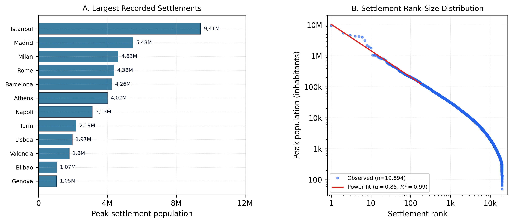

```{r setup, include=FALSE}
knitr::opts_chunk$set(echo = FALSE, warning = FALSE, message = FALSE)
library(jsonlite)
source("../../_shared/template/viscount_rmd_helpers.R")

summary_data <- fromJSON("southern_europe_and_islands_after_1945_summary.json", simplifyVector = FALSE)
settlements_data <- fromJSON("southern_europe_and_islands_after_1945_settlements.json", simplifyVector = FALSE)

clean_prov_source <- function (arg0_raw) {
  src <- as.character(arg0_raw)
  mapping <- c(
    "INE_Spain_Censos_Historicos_1857_1991" = "INE Spain Historic Municipal Censuses (1857-1991)",
    "Buringh_European_Urban_700_2000" = "Buringh European Urban Series (700-2000)",
    "GeoNames_Municipal_Gazetteer_Supplement" = "GeoNames Municipal Gazetteer Supplement",
    "Eurostat_Urban_Audit_1990_2024" = "Eurostat Urban Audit Metropolitan Series (1990-2024)",
    "National_Statistical_Census_Portugal" = "INE Portugal National Census Series",
    "National_Statistical_Census_Greece" = "ELSTAT Greece National Census Series",
    "National_Statistical_Census_Malta" = "NSO Malta National Census Series",
    "National_Statistical_Census_Iceland" = "Statistics Iceland Municipal Series",
    "INSEE_Recensement_1876_2023" = "INSEE French Municipal Censuses (Border Frame)",
    "National_Statistical_Census_Slovenia" = "SURS Slovenia Municipal Series (Border Frame)",
    "DEMOPAST_ISTAT_Citta_1861_1971" = "DEMOPAST/ISTAT Italian Cities (1861-1971)",
    "National_Statistical_Census_Greenland" = "Statistics Greenland District & Town Registers",
    "National_Statistical_Census_Bulgaria" = "NSI Bulgaria Municipal Series (Border Frame)",
    "National_Statistical_Census_Faroe_Islands" = "Hagstova Faroe Islands Municipal Registers",
    "National_Statistical_Census_Switzerland" = "BFS Switzerland Municipal Series (Border Frame)"
  )
  if (src %in% names(mapping)) return(unname(mapping[src]))
  gsub("_", " ", src, fixed = TRUE)
}

get_pop_at <- function (arg0_pop, arg1_year) {
  key <- as.character(arg1_year)
  if (!is.null(arg0_pop[[key]])) return(viscount_fmt_pop(arg0_pop[[key]]))
  "--"
}

region_name_map <- setNames(
  vapply(summary_data$subregions, function (s) as.character(s$name), character(1)),
  vapply(summary_data$subregions, function (s) as.character(s$id), character(1))
)
```

```{r hero-md, echo=FALSE, results='asis'}
if (!knitr::is_latex_output()) {
  cat("\n\n")
}
```

# Abstract

This companion gazetteer documents the `r viscount_fmt_number(summary_data$settlement_count, 0L)` contemporary urban and municipal settlements compiled for Southern Europe, Eastern Thrace and the Macaronesian and North Atlantic islands between 1945 and 2026. Spanning 11 sub-regions and 18 sovereign or territorial designations (including microstates and narrow frontier strips along the Pyrenees, Alps and Balkans), the gazetteer anchors 86,12% of its records (1.738 settlements) in official national censuses, Eurostat Urban Audit functional cities and peer-reviewed historical urban registers, with the remaining 13,88% (280 secondary places) drawn from municipal gazetteer supplements. Across the 75-year span from 1950 to 2025, urban growth concentrated heavily in European Istanbul (9,41M), Madrid (5,48M), Milano (3,57M), Roma (3,39M), Barcelona (3,24M), Athina (3,19M), Napoli (2,98M), Lisboa (1,97M) and Valencia (1,8M), alongside rapidly expanding island hubs in Greater Valletta, Las Palmas de Gran Canaria, Reykjavík, Tórshavn and Nuuk.

# Spatial Distribution and Sub-Regional Coverage

The settlement gazetteer reflects both the underlying density of post-war Mediterranean urbanisation and the archival resolution of national municipal census registers [@INE2024; @DEMOPAST2023; @Eurostat2024]. Spain's mainland and Balearic sub-region accounts for 947 settlements (46,93% of the gazetteer), followed by Italy with 633 (31,37%), mainland Portugal with 170 (8,42%) and Greece with 146 (7,23%). Together those four Mediterranean peninsular sub-regions represent 93,95% of all catalogued sites. The remaining 122 settlements capture the densely settled micro-archipelagos and sub-Arctic territories: 49 in the Canary Islands, 26 each in Iceland and Malta, 7 in Greenland, 5 in Eastern Thrace, 4 in the Faroe Islands and 5 across the Azores and Madeira [@Hagstofa2024; @StatGL2024]. Figure 1 maps the spatial distribution of all 2.018 settlements across the 11 sub-regions, and Table 1 aligns sub-regional settlement counts with benchmark populations and 2025 densities.

```{r fig-regional-map, results='asis'}
viscount_figure(
  "figures/southern_europe_and_islands_after_1945_regional_map.png",
  "Spatial distribution of the 2.018 settlements and sub-regional population density across Southern Europe and European islands, 1945-2025.",
  "fig:regional-map"
)
```

```{r subregion-settlement-table, results='asis'}
s_by_reg <- summary_data$settlements_by_region
tot_s <- as.integer(summary_data$settlement_count)
reg_rows <- lapply(summary_data$subregions, function (s) {
  rid <- as.character(s$id)
  cnt <- if (!is.null(s_by_reg[[rid]])) as.integer(s_by_reg[[rid]]) else 0L
  p1950 <- as.numeric(s$population[["1950"]])
  p2025 <- as.numeric(s$population[["2025"]])
  area <- as.numeric(s$area_km2)
  data.frame(
    Subregion = as.character(s$name),
    Settlements = cnt,
    Share = paste0(viscount_fmt_number(100 * cnt / tot_s, 2L), "%"),
    Y1950 = viscount_fmt_pop(p1950),
    Y2025 = viscount_fmt_pop(p2025),
    Dens2025 = viscount_fmt_number(p2025 / area, 1L),
    stringsAsFactors = FALSE
  )
})
reg_df <- do.call(rbind, reg_rows)
reg_df <- reg_df[order(-reg_df$Settlements), ]
reg_df$Settlements <- vapply(reg_df$Settlements, function (v) viscount_fmt_number(v, 0L), character(1))
tot_row <- data.frame(
  Subregion = "Total (11 Sub-Regions)",
  Settlements = viscount_fmt_number(tot_s, 0L),
  Share = "100%",
  Y1950 = viscount_fmt_pop(summary_data$domain_totals[["1950"]]),
  Y2025 = viscount_fmt_pop(summary_data$domain_totals[["2025"]]),
  Dens2025 = viscount_fmt_number(as.numeric(summary_data$domain_totals[["2025"]]) / as.numeric(summary_data$total_area_km2), 1L),
  stringsAsFactors = FALSE
)
reg_df <- rbind(reg_df, tot_row)
rownames(reg_df) <- NULL

viscount_table(
  reg_df,
  "Settlement coverage, share of gazetteer and sub-regional population benchmarks (1950-2025).",
  c("Sub-Region", "Settlements", "Share", "1950 Pop.", "2025 Pop.", "2025 (/km²)")
)
```

Because spatial clipping against the study bounding polygon captures frontier municipalities along the Pyrenees, southern Alps, Karst and Rhodope ridges, settlements carry 18 distinct country tags: Spain (983), Italy (602), Portugal (174), Greece (134), Iceland (26), Malta (26), France (22, perimeter buffer), Slovenia (16, perimeter buffer), Greenland (7), Albania (5), Bulgaria (5), Faroe Islands (4), Switzerland (4), Turkey-in-Europe (4), North Macedonia (3), Andorra (1), Monaco (1) and San Marino (1). Border-buffer records aid spatial interpolation across international frontiers without inflating the core sub-regional totals in Table 1 [@INSEE2024; @BFS2024; @StatBalkans2024].

# Archival Provenance Ledger

Every settlement record stores an explicit provenance identifier tracing its primary demographic series. Across the 2.018 records, 1.738 settlements (86,12%) stem from official census agencies, Eurostat Urban Audit or historical urban compilations, whereas 280 settlements (13,88%) originate from the GeoNames municipal gazetteer supplement. Table 2 details the full provenance breakdown ordered by settlement count.

```{r provenance-ledger, results='asis'}
prov_counts <- summary_data$provenance_counts
prov_keys <- names(prov_counts)
prov_vals <- vapply(prov_keys, function (k) as.integer(prov_counts[[k]]), integer(1))
tot_set <- sum(prov_vals)

prov_df <- data.frame(
  Source = vapply(prov_keys, clean_prov_source, character(1)),
  Count = prov_vals,
  Share = vapply(prov_vals, function (v) paste0(viscount_fmt_number(100 * v / tot_set, 2L), "%"), character(1)),
  stringsAsFactors = FALSE
)
prov_df <- prov_df[order(-prov_df$Count), ]
prov_df$Count <- vapply(prov_df$Count, function (v) viscount_fmt_number(v, 0L), character(1))
prov_df <- rbind(
  prov_df,
  data.frame(
    Source = "Total Settlement Gazetteer",
    Count = viscount_fmt_number(tot_set, 0L),
    Share = "100%",
    stringsAsFactors = FALSE
  )
)
rownames(prov_df) <- NULL

viscount_table(
  prov_df,
  "Provenance ledger for the 2.018 settlements in Southern Europe and European islands, 1945-2025.",
  c("Archival Provenance Source", "Settlements", "Share")
)
```

# Largest Cities and Metropolitan Hierarchy

Table 3 lists the 20 largest settlement series in the chapter gazetteer across the five post-war benchmark dates (1950, 1970, 1990, 2010 and 2025). As discussed in the companion demographic review, harmonising Eurostat Urban Audit functional metropolitan boundaries with historical municipal core registers from DEMOPAST/ISTAT, Buringh and GeoNames produces parallel metropolitan and inner-city records for Rome (Roma and Rome), Naples (Napoli greater city and Naples) and Athens (Athina and Athens) [@Eurostat2024; @DEMOPAST2023; @DeVries1984]. Preserving both series makes the post-1970 divergence between metropolitan suburban expansion and historic core stabilisation directly visible.

```{r top-20-table, results='asis'}
tops <- summary_data$top_settlements
top_rows <- lapply(seq_along(tops), function (i) {
  s <- tops[[i]]
  data.frame(
    Rank = as.character(i),
    Settlement = as.character(s$name),
    Country = as.character(s$country),
    Y1950 = get_pop_at(s$population, 1950),
    Y1970 = get_pop_at(s$population, 1970),
    Y1990 = get_pop_at(s$population, 1990),
    Y2010 = get_pop_at(s$population, 2010),
    Y2025 = get_pop_at(s$population, 2025),
    stringsAsFactors = FALSE
  )
})
top_df <- do.call(rbind, top_rows)
rownames(top_df) <- NULL

viscount_table(
  top_df,
  "Twenty largest urban records in Southern Europe and European islands across 1950-2025 benchmarks.",
  c("Rank", "Settlement", "Country", "1950", "1970", "1990", "2010", "2025")
)
```

# Principal Atlantic and Mediterranean Island Centres

Because the top-20 metropolitan tier is dominated by continental capitals and major ports, Table 4 extracts the leading settlements directly from the full gazetteer across the six island sub-regions — the Canary Islands, Malta, Iceland, the Azores and Madeira, Greenland and the Faroe Islands — showing the two largest documented urban centres in each archipelago or territory [@INE2024; @Hagstofa2024; @StatGL2024].

```{r island-centres-table, results='asis'}
island_ids <- c("mod_canaries", "mod_malta", "mod_iceland", "mod_azores_madeira", "mod_greenland", "mod_faroes")
island_rows <- list()

for (rid in island_ids) {
  matches <- Filter(function (rec) identical(as.character(rec$region_id), rid), settlements_data)
  if (length(matches) == 0L) next
  pops2025 <- vapply(matches, function (rec) {
    val <- rec$population[["2025"]]
    if (is.null(val)) 0 else as.numeric(val)
  }, numeric(1))
  ord <- order(-pops2025)
  take <- ord[seq_len(min(2L, length(ord)))]
  for (idx in take) {
    rec <- matches[[idx]]
    island_rows[[length(island_rows) + 1L]] <- data.frame(
      Subregion = unname(region_name_map[rid]),
      Settlement = as.character(rec$name),
      Y1950 = get_pop_at(rec$population, 1950),
      Y1970 = get_pop_at(rec$population, 1970),
      Y1990 = get_pop_at(rec$population, 1990),
      Y2010 = get_pop_at(rec$population, 2010),
      Y2025 = get_pop_at(rec$population, 2025),
      stringsAsFactors = FALSE
    )
  }
}

island_df <- do.call(rbind, island_rows)
rownames(island_df) <- NULL

viscount_table(
  island_df,
  "Leading urban centres across the six Macaronesian, Mediterranean and North Atlantic island sub-regions, 1950-2025.",
  c("Sub-Region", "Settlement", "1950", "1970", "1990", "2010", "2025")
)
```

# Sources
