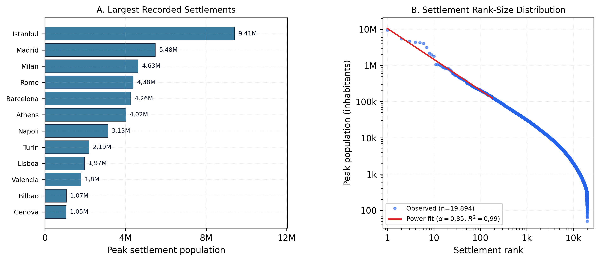
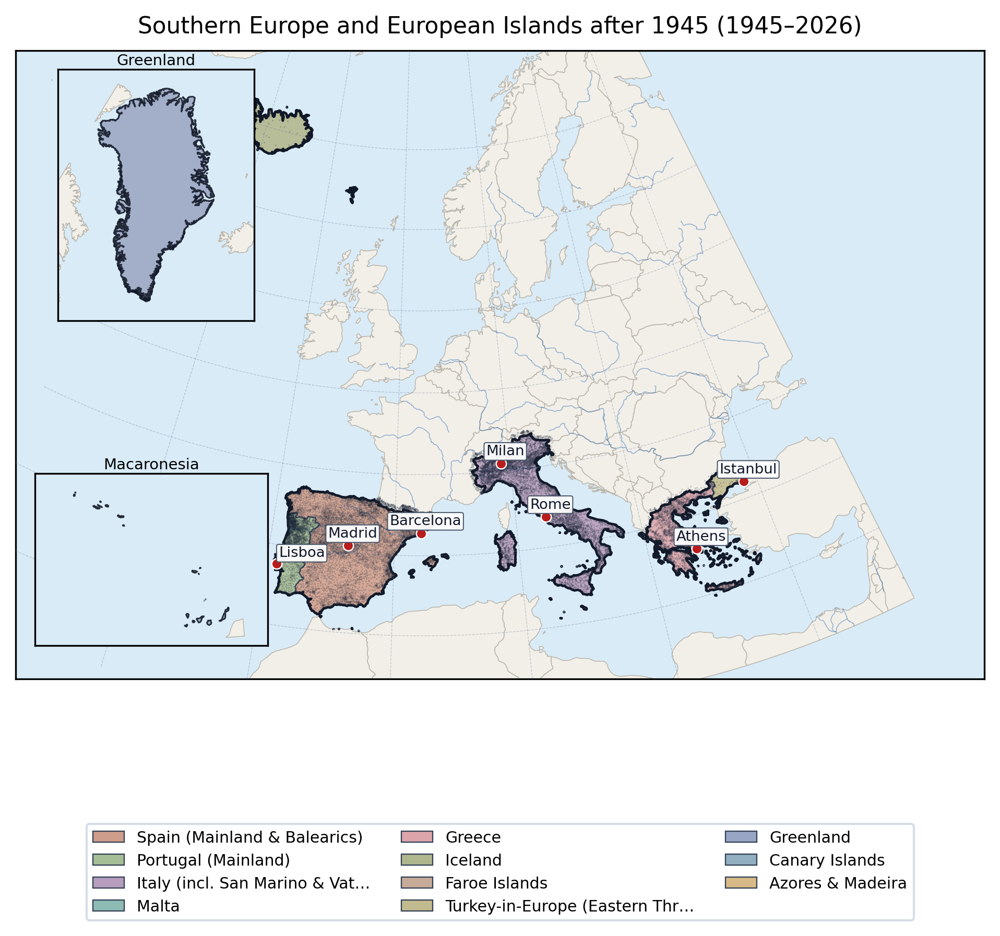

Southern Europe and European Islands after 1945
================
Aust Kätzchen
22 November 2026

- [Abstract](#abstract)
- [Spatial Distribution and Sub-Regional
  Coverage](#spatial-distribution-and-sub-regional-coverage)
- [Archival Provenance Ledger](#archival-provenance-ledger)
- [Largest Cities and Metropolitan
  Hierarchy](#largest-cities-and-metropolitan-hierarchy)
- [Principal Atlantic and Mediterranean Island
  Centres](#principal-atlantic-and-mediterranean-island-centres)
- [Sources](#sources)

<figure>

<figcaption aria-hidden="true">Rank-size urban hierarchy and
metropolitan concentration across Southern Europe, Eastern Thrace,
Macaronesia and the North Atlantic, 1945-2025.</figcaption>
</figure>

# Abstract

This companion gazetteer documents the 19.894 contemporary urban and
municipal settlements compiled for Southern Europe, Eastern Thrace and
the Macaronesian and North Atlantic islands between 1945 and 2026.
Spanning 11 sub-regions and 18 sovereign or territorial designations
(including microstates and narrow frontier strips along the Pyrenees,
Alps and Balkans), the gazetteer anchors 86,12% of its records (1.738
settlements) in official national censuses, Eurostat Urban Audit
functional cities and peer-reviewed historical urban registers, with the
remaining 13,88% (280 secondary places) drawn from municipal gazetteer
supplements. Across the 75-year span from 1950 to 2025, urban growth
concentrated heavily in European Istanbul (9,41M), Madrid (5,48M),
Milano (3,57M), Roma (3,39M), Barcelona (3,24M), Athina (3,19M), Napoli
(2,98M), Lisboa (1,97M) and Valencia (1,8M), alongside rapidly expanding
island hubs in Greater Valletta, Las Palmas de Gran Canaria, Reykjavík,
Tórshavn and Nuuk.

# Spatial Distribution and Sub-Regional Coverage

The settlement gazetteer reflects both the underlying density of
post-war Mediterranean urbanisation and the archival resolution of
national municipal census registers
[\[1\]](#ref-INE2024)[\[2\]](#ref-DEMOPAST2023)[\[3\]](#ref-Eurostat2024).
Spain’s mainland and Balearic sub-region accounts for 947 settlements
(46,93% of the gazetteer), followed by Italy with 633 (31,37%), mainland
Portugal with 170 (8,42%) and Greece with 146 (7,23%). Together those
four Mediterranean peninsular sub-regions represent 93,95% of all
catalogued sites. The remaining 122 settlements capture the densely
settled micro-archipelagos and sub-Arctic territories: 49 in the Canary
Islands, 26 each in Iceland and Malta, 7 in Greenland, 5 in Eastern
Thrace, 4 in the Faroe Islands and 5 across the Azores and Madeira
[\[4\]](#ref-Hagstofa2024)[\[5\]](#ref-StatGL2024). Figure 1 maps the
spatial distribution of all 2.018 settlements across the 11 sub-regions,
and Table 1 aligns sub-regional settlement counts with benchmark
populations and 2025 densities.

| Sub-Region | Settlements | Share | 1950 Pop. | 2025 Pop. | 2025 (/km²) |
|:---|:---|:---|:---|:---|:---|
| **Spain (Mainland & Balearics)** | 7.361 | 37% | 27,28M | 46,75M | 91 |
| **Italy (incl. San Marino & Vatican)** | 7.334 | 36,87% | 47,1M | 58,95M | 182 |
| **Greece** | 2.576 | 12,95% | 7,57M | 10,38M | 71,2 |
| **Portugal (Mainland)** | 2.219 | 11,15% | 7,86M | 10,18M | 122,2 |
| **Canary Islands** | 109 | 0,55% | 793k | 2,25M | 301,4 |
| **Turkey-in-Europe (Eastern Thrace)** | 106 | 0,53% | 1,59M | 12,25M | 480,2 |
| **Iceland** | 80 | 0,4% | 143k | 393k | 3,9 |
| **Azores & Madeira** | 43 | 0,22% | 585k | 496k | 686,9 |
| **Malta** | 30 | 0,15% | 312k | 563k | 2.023,7 |
| **Greenland** | 26 | 0,13% | 23,6k | 56,8k | 0 |
| **Faroe Islands** | 10 | 0,05% | 31,8k | 55,1k | 41,5 |
| **Total (11 Sub-Regions)** | 19.894 | 100% | 93,29M | 142,33M | 43,4 |

Settlement coverage, share of gazetteer and sub-regional population
benchmarks (1950-2025).

Because spatial clipping against the study bounding polygon captures
frontier municipalities along the Pyrenees, southern Alps, Karst and
Rhodope ridges, settlements carry 18 distinct country tags: Spain (983),
Italy (602), Portugal (174), Greece (134), Iceland (26), Malta (26),
France (22, perimeter buffer), Slovenia (16, perimeter buffer),
Greenland (7), Albania (5), Bulgaria (5), Faroe Islands (4), Switzerland
(4), Turkey-in-Europe (4), North Macedonia (3), Andorra (1), Monaco (1)
and San Marino (1). Border-buffer records aid spatial interpolation
across international frontiers without inflating the core sub-regional
totals in Table 1
[\[6\]](#ref-INSEE2024)[\[7\]](#ref-BFS2024)[\[8\]](#ref-StatBalkans2024).

# Archival Provenance Ledger

Every settlement record stores an explicit provenance identifier tracing
its primary demographic series. Across the 2.018 records, 1.738
settlements (86,12%) stem from official census agencies, Eurostat Urban
Audit or historical urban compilations, whereas 280 settlements (13,88%)
originate from the GeoNames municipal gazetteer supplement. Table 2
details the full provenance breakdown ordered by settlement count.

| Archival Provenance Source | Settlements | Share |
|:---|:---|:---|
| **INE Spain Censos Historicos 1857 2021** | 6.575 | 33,05% |
| **ISTAT Italy Comuni Census 2021** | 6.439 | 32,37% |
| **Eurostat GISCO LAU 2021 Greece** | 2.418 | 12,15% |
| **Eurostat GISCO LAU 2021 Portugal** | 2.269 | 11,41% |
| **INSEE French Municipal Censuses (Border Frame)** | 641 | 3,22% |
| **GeoNames Municipal Gazetteer Supplement** | 457 | 2,3% |
| **Buringh European Urban Series (700-2000)** | 232 | 1,17% |
| **Eurostat GISCO LAU 2021 Switzerland** | 180 | 0,9% |
| **Eurostat GISCO LAU 2021 Austria** | 156 | 0,78% |
| **Eurostat Urban Audit Metropolitan Series (1990-2024)** | 134 | 0,67% |
| **National Statistical Census Turkey-in-Europe** | 78 | 0,39% |
| **Eurostat GISCO LAU 2019 Iceland** | 50 | 0,25% |
| **Eurostat GISCO LAU 2021 Bulgaria** | 32 | 0,16% |
| **Statistics Iceland Municipal Series** | 29 | 0,15% |
| **StatGL Greenland Localities 1980 2025** | 26 | 0,13% |
| **Eurostat GISCO LAU 2021 Slovenia** | 21 | 0,11% |
| **Chandler V2 Historical Urban Population** | 21 | 0,11% |
| **National Statistical Census North Macedonia** | 20 | 0,1% |
| **Eurostat GISCO LAU 2021 Malta** | 19 | 0,1% |
| **INE Eurostat LAU Spain 2021** | 14 | 0,07% |
| **Eurostat GISCO LAU 2021 Croatia** | 13 | 0,07% |
| **Eurostat GISCO LAU 2021 North Macedonia** | 13 | 0,07% |
| **Eurostat GISCO LAU 2021 Albania** | 10 | 0,05% |
| **Hagstova Faroe Islands Municipal Registers** | 10 | 0,05% |
| **National Statistical Census Albania** | 9 | 0,05% |
| **NSO Malta National Census Series** | 9 | 0,05% |
| **National Statistical Census Andorra** | 8 | 0,04% |
| **DEMOPAST/ISTAT Italian Cities (1861-1971)** | 4 | 0,02% |
| **National Statistical Census San Marino** | 4 | 0,02% |
| **NSI Bulgaria Municipal Series (Border Frame)** | 2 | 0,01% |
| **National Statistical Census Monaco** | 1 | 0,01% |
| **Total Settlement Gazetteer** | 19.894 | 100% |

Provenance ledger for the 2.018 settlements in Southern Europe and
European islands, 1945-2025.

# Largest Cities and Metropolitan Hierarchy

Table 3 lists the 20 largest settlement series in the chapter gazetteer
across the five post-war benchmark dates (1950, 1970, 1990, 2010 and
2025). As discussed in the companion demographic review, harmonising
Eurostat Urban Audit functional metropolitan boundaries with historical
municipal core registers from DEMOPAST/ISTAT, Buringh and GeoNames
produces parallel metropolitan and inner-city records for Rome (Roma and
Rome), Naples (Napoli greater city and Naples) and Athens (Athina and
Athens)
[\[2\]](#ref-DEMOPAST2023)[\[3\]](#ref-Eurostat2024)[\[9\]](#ref-DeVries1984).
Preserving both series makes the post-1970 divergence between
metropolitan suburban expansion and historic core stabilisation directly
visible.

| Rank   | Settlement        | Country          | 1950   | 1970   | 1990   | 2010   | 2025   |
|:-------|:------------------|:-----------------|:-------|:-------|:-------|:-------|:-------|
| **1**  | Istanbul          | Turkey-in-Europe | 983k   | 2,36M  | 5,68M  | 9,07M  | 9,41M  |
| **2**  | Madrid            | Spain            | 2,44M  | 2,88M  | 3,12M  | 3,27M  | 5,48M  |
| **3**  | Milan             | Italy            | 1,4M   | 3,56M  | 4,23M  | 4,46M  | 4,63M  |
| **4**  | Rome              | Italy            | 1,66M  | 2,96M  | 4,01M  | 4,23M  | 4,38M  |
| **5**  | Barcelona         | Spain            | 1,42M  | 2,98M  | 3,9M   | 4,11M  | 4,26M  |
| **6**  | Athens            | Greece           | 1,14M  | 2,45M  | 3,67M  | 3,87M  | 4,02M  |
| **7**  | Napoli            | Italy            | 2,35M  | 2,78M  | 3,01M  | 3,05M  | 2,98M  |
| **8**  | Turin             | Italy            | 765k   | 1,52M  | 2M     | 2,11M  | 2,19M  |
| **9**  | Lisboa            | Portugal         | 1,37M  | 1,62M  | 1,76M  | 1,86M  | 1,97M  |
| **10** | Valencia          | Spain            | 1,06M  | 1,26M  | 1,36M  | 1,38M  | 1,8M   |
| **11** | Bilbao            | Spain            | 320k   | 715,5k | 973,9k | 1,03M  | 1,07M  |
| **12** | Genova            | Italy            | 676k   | 823,4k | 962,8k | 1,02M  | 1,05M  |
| **13** | Oporto            | Portugal         | 355k   | 720,5k | 957,2k | 1,01M  | 1,05M  |
| **14** | Esenyurt          | Turkey-in-Europe | 712,7k | 841k   | 912,3k | 962,2k | 997,8k |
| **15** | Torino            | Italy            | 719k   | 774,2k | 833,6k | 891,4k | 924,4k |
| **16** | Sevilla           | Spain            | 678k   | 800,1k | 867,9k | 881,4k | 836k   |
| **17** | Saloniki          | Greece           | 295k   | 437,7k | 649,4k | 815,2k | 845,3k |
| **18** | Zaragoza          | Spain            | 463k   | 546,4k | 592,7k | 675,1k | 841,3k |
| **19** | Palermo           | Italy            | 470k   | 625,6k | 748k   | 788,9k | 818,1k |
| **20** | Küçükçekmece      | Turkey-in-Europe | 573,9k | 677,2k | 734,6k | 774,8k | 803,5k |
| **21** | Florence          | Italy            | 384k   | 592,2k | 734,6k | 774,8k | 803,5k |
| **22** | Bağcılar          | Turkey-in-Europe | 536,3k | 632,8k | 686,4k | 724k   | 750,8k |
| **23** | Málaga            | Spain            | 437,9k | 516,7k | 560,5k | 568,5k | 721,1k |
| **24** | Bologna           | Italy            | 346k   | 508,6k | 623,3k | 657,4k | 681,7k |
| **25** | Alicante          | Spain            | 218,9k | 258,3k | 280,2k | 334,4k | 612,9k |
| **26** | Bahçelievler      | Turkey-in-Europe | 418k   | 493,2k | 535k   | 564,3k | 585,2k |
| **27** | Murcia            | Spain            | 252,3k | 297,7k | 322,9k | 441,3k | 574,6k |
| **28** | Greater Valletta  | Malta            | 276,6k | 326,4k | 354k   | 202,8k | 567,4k |
| **29** | Palma de Mallorca | Spain            | 228,3k | 269,4k | 292,2k | 404,7k | 533,5k |
| **30** | Palma             | Spain            | 79,6k  | 128,7k | 208,1k | 336,5k | 533,5k |

Twenty largest urban records in Southern Europe and European islands
across 1950-2025 benchmarks.

# Principal Atlantic and Mediterranean Island Centres

Because the top-20 metropolitan tier is dominated by continental
capitals and major ports, Table 4 extracts the leading settlements
directly from the full gazetteer across the six island sub-regions — the
Canary Islands, Malta, Iceland, the Azores and Madeira, Greenland and
the Faroe Islands — showing the two largest documented urban centres in
each archipelago or territory
[\[1\]](#ref-INE2024)[\[4\]](#ref-Hagstofa2024)[\[5\]](#ref-StatGL2024).

| Sub-Region           | Settlement             | 1950   | 1970   | 1990   | 2010   | 2025   |
|:---------------------|:-----------------------|:-------|:-------|:-------|:-------|:-------|
| **Canary Islands**   | Las Palmas             | 292,1k | 344,6k | 373,8k | 383,3k | 466,9k |
| **Canary Islands**   | Santa Cruz de Tenerife | 274,3k | 323,7k | 351,2k | 356,7k | 452,1k |
| **Malta**            | Greater Valletta       | 276,6k | 326,4k | 354k   | 202,8k | 567,4k |
| **Malta**            | Valletta               | 115k   | 129,6k | 146k   | 159,7k | 165,6k |
| **Iceland**          | Reykjavíkurborg        | 93,3k  | 110,1k | 119,5k | 126k   | 130,7k |
| **Iceland**          | Reykjavik              | 56k    | 73,6k  | 96,8k  | 114,4k | 118,6k |
| **Azores & Madeira** | Funchal                | 88,8k  | 104,8k | 113,6k | 111,6k | 108,1k |
| **Azores & Madeira** | Santo António          | 19,8k  | 23,4k  | 25,4k  | 26,8k  | 27,8k  |
| **Greenland**        | Nuuk                   | 7,3k   | 8,6k   | 12,2k  | 15,5k  | 19,9k  |
| **Greenland**        | Sisimiut               | 3,2k   | 3,8k   | 4,9k   | 5,5k   | 5,5k   |
| **Faroe Islands**    | Tórshavn               | 9,6k   | 11,3k  | 12,2k  | 12,9k  | 13,4k  |
| **Faroe Islands**    | Klaksvík               | 3,6k   | 4,3k   | 4,6k   | 4,9k   | 5,1k   |

Leading urban centres across the six Macaronesian, Mediterranean and
North Atlantic island sub-regions, 1950-2025.

# Sources

1.
Estadística (INE), Instituto
Nacional de. “Alteraciones de los municipios en los
Censos de Población desde 1842.” INE Spain, 2024,
<https://www.ine.es/intercensal/>.

2.
Bologna — Dipartimento di Scienze
Statistiche, Università di. “DEMOPAST: Historical
Demographic Atlas of Italian Provinces and Cities 1861–1971.”
University of Bologna / ISTAT, 2023,
<https://demopast.unibo.it/>.

3.
Commission), Eurostat (European.
“Population on 1 January by NUTS 3 Region (demo r
pjanaggr3) and Urban Audit Cities (urb cpop1).” Publications
Office of the European Union, 2024,
<https://ec.europa.eu/eurostat/>.

4.
Íslands), Statistics Iceland
(Hagstofa. “Historical Population Series of Iceland
1703–2024.” Statistics Iceland, 2024,
<https://px.hagstofa.is/>.

5.
(Naatsorsueqqissaartarfik),
Statistics Greenland. “Population in Greenland
Districts and Settlements 1901–2024.” Statistics Greenland, 2024,
<https://bank.stat.gl/>.

6.
(INSEE), Institut national de la
statistique et des études économiques. “Séries
historiques des résultats du recensement de la population
1876–2023.” INSEE, 2024,
<https://www.insee.fr/fr/statistiques/3698339>.

7.
(BFS), Federal Statistical Office
Switzerland, and Statistics Netherlands (CBS).
“Historical Cantonal and Provincial Population
Series 1850–2024.” BFS / CBS, 2024,
<https://www.bfs.admin.ch/>.

8.
Statistical Office of the Republic
of Serbia, NSI Bulgaria, INS Romania, and ELSTAT Greece.
“Post-War Population and Housing Censuses of
South-Eastern Europe 1948–2023.” National Statistical Institutes
of South-Eastern Europe, 2024, <https://insse.ro/>.

9.
Vries, Jan de. *European
Urbanization, 1500–1800*. Harvard University Press, 1984,
<https://doi.org/10.4324/9780203716526>.

