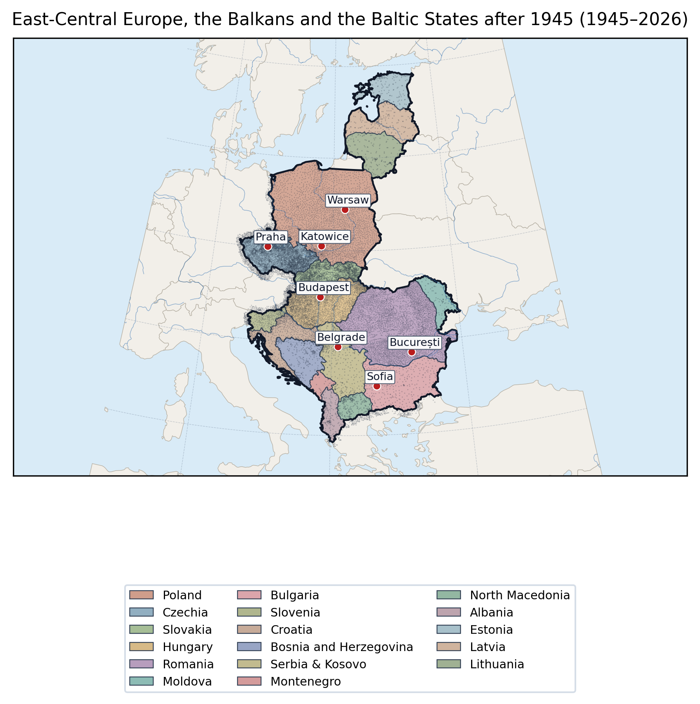

```{r setup, include=FALSE}
knitr::opts_chunk$set(
  echo = FALSE,
  warning = FALSE,
  message = FALSE,
  results = "asis"
)
library(jsonlite)
source("../../_shared/template/viscount_rmd_helpers.R")

summary_data <- fromJSON("east_central_balkans_baltic_after_1945_summary.json", simplifyVector = FALSE)
total_area_km2 <- as.numeric(summary_data$total_area_km2)
settlement_count <- as.integer(summary_data$settlement_count)
hgis_row_count <- as.integer(summary_data$hgis_row_count)
subregions_list <- summary_data$subregions
domain_totals <- summary_data$domain_totals
crowd_pct <- as.numeric(summary_data$crowd_share_overall) * 100

pop_1950 <- as.numeric(domain_totals[["1950"]])
pop_1970 <- as.numeric(domain_totals[["1970"]])
pop_1990 <- as.numeric(domain_totals[["1990"]])
pop_2010 <- as.numeric(domain_totals[["2010"]])
pop_2025 <- as.numeric(domain_totals[["2025"]])

dens_1950 <- pop_1950 / total_area_km2
dens_1970 <- pop_1970 / total_area_km2
dens_1990 <- pop_1990 / total_area_km2
dens_2010 <- pop_2010 / total_area_km2
dens_2025 <- pop_2025 / total_area_km2

gain_50_90 <- pop_1990 - pop_1950
loss_90_25 <- pop_1990 - pop_2025
pct_50_90 <- 100 * (pop_1990 - pop_1950) / pop_1950
pct_90_25 <- 100 * (pop_2025 - pop_1990) / pop_1990

subregion_by_id <- setNames(subregions_list, vapply(subregions_list, function(x) as.character(x$id), character(1)))

fmt_hgis_source <- function (arg0_code) {
  s <- as.character(arg0_code)
  if (grepl("^CShapes_Europe_", s)) {
    yr <- sub("^CShapes_Europe_([0-9]+).*", "\\1", s)
    return(paste0("CShapes Europe ", yr, " and National Census"))
  }
  if (grepl("^DEMOPAST_ISTAT_Provinces_", s)) {
    yr <- sub("^DEMOPAST_ISTAT_Provinces_([0-9]+)$", "\\1", s)
    return(paste0("DEMOPAST ISTAT Provinces (", yr, ")"))
  }
  if (grepl("^NorthAtlantic_Census_", s)) {
    yr <- sub("^NorthAtlantic_Census_([0-9]+)$", "\\1", s)
    return(paste0("North Atlantic Census (", yr, ")"))
  }
  if (s == "Eurostat_demo_r_pjanaggr3+GISCO_NUTS3") {
    return("Eurostat NUTS-3 and GISCO")
  }
  if (s == "National_Statistical_Office_NonNUTS") {
    return("National Statistical Office (Non-NUTS)")
  }
  gsub("_", " ", s, fixed = TRUE)
}

fmt_settlement_source <- function (arg0_code) {
  s <- as.character(arg0_code)
  if (s == "Eurostat_Urban_Audit_1990_2024") return("Eurostat Urban Audit")
  if (s == "Buringh_European_Urban_700_2000") return("Buringh Urban Series")
  if (s == "GeoNames_Municipal_Gazetteer_Supplement") return("GeoNames Supplement")
  if (grepl("^National_Statistical_Census_", s)) {
    ctry <- sub("^National_Statistical_Census_", "", s)
    return(paste0("National Census (", ctry, ")"))
  }
  gsub("_", " ", s, fixed = TRUE)
}
```

```{r hero_markdown_fallback, results="asis"}
if (!knitr::is_latex_output()) {
  cat("\n\n")
}
```

# Abstract

Between 1945 and 2026 the belt of European states extending from the Baltic littoral across the Visegrád plains and the Carpathian arc to the Adriatic and Black seas underwent one of the sharpest two-stage demographic reversals in modern history. Across 17 sub-regions covering `r viscount_fmt_number(total_area_km2, 1L)` km², total population expanded by `r viscount_fmt_number(pct_50_90, 2L)`% between 1950 and 1990, climbing from `r viscount_fmt_pop(pop_1950)` to a historical zenith of `r viscount_fmt_pop(pop_1990)` as post-war mortality decline, socialist heavy industrialisation, urban housing construction and regionally uneven fertility regimes added `r viscount_fmt_pop(gain_50_90)` inhabitants. Mean density rose from `r viscount_fmt_number(dens_1950, 2L)` to `r viscount_fmt_number(dens_1990, 2L)` inhabitants per km². Following the collapse of state socialism in 1989-1991, the breakup of Yugoslavia and the Soviet Union, the 1991-1999 Yugoslav Wars and successive waves of westward labour emigration after European Union accession in 2004, 2007 and 2013, the domain entered a protracted contraction. Total population fell to `r viscount_fmt_pop(pop_2010)` in 2010 and `r viscount_fmt_pop(pop_2025)` in 2025, shedding `r viscount_fmt_pop(loss_90_25)` inhabitants (`r viscount_fmt_number(abs(pct_90_25), 2L)`%) over thirty-five years and lowering average density to `r viscount_fmt_number(dens_2025, 2L)` per km². Only four sub-regions recorded net gains after 1990 (Slovenia, Czechia, Montenegro and Slovakia), while Moldova, Latvia, Bosnia and Herzegovina, Bulgaria and Lithuania lost between one fifth and nearly one third of their residents. MAGNETIC integrates decennial national statistical censuses, `r formatC(hgis_row_count, format = "d", big.mark = ".")` scraped historical GIS administrative records spanning Cold War boundaries (1950-1980) and Eurostat NUTS-3 enumerations (1990-2020) and a georeferenced gazetteer of `r formatC(settlement_count, format = "d", big.mark = ".")` cities and towns to document this post-war expansion, urban transformation and contemporary demographic shrinkage.

# Background

At the close of the Second World War in May 1945 the eastern half of Europe outside the Russian, Ukrainian and Belarusian core lay shattered by six years of combat, occupation, genocide and frontier redrawing. Wartime mortality had fallen heaviest on Poland, Yugoslavia and the Baltic states: Poland lost nearly one sixth of its pre-war population including roughly three million Polish Jews; Yugoslavia suffered over one million dead in Axis occupation, partisan warfare and internecine ethnic massacres; and Estonia, Latvia and Lithuania endured sequential Soviet and German occupations followed by renewed Soviet annexation in 1944-1945 [@Mitchell2007; @GUSPoland2024; @StatBalkans2024; @StatBaltics2024]. Before natural demographic rhythms could resume, allied diplomacy and state coercion redrew both borders and ethnic geography between 1945 and 1950. Poland shifted roughly 200 kilometres westwards to the Oder-Neisse line, surrendering its eastern kresy to the Soviet Union while receiving former German Pomerania, Silesia and southern East Prussia; over seven million Germans fled or were expelled from these territories and replaced by Polish settlers from central Poland and repatriates from the east [@GUSPoland2024]. Czechoslovakia expelled nearly three million Sudeten Germans from Bohemia and Moravia, leaving borderland districts sparsely populated for decades. Smaller but regionally decisive transfers removed ethnic Italians from Istria and Dalmatia, exchanged Magyars and Slovaks along the Danube and deported tens of thousands of Baltic and Bessarabian families to Siberia during late-Stalinist collectivisation [@StatBaltics2024; @KSHHungary2024].

Once these post-war population shifts settled around 1950, the entire 17-region domain entered four decades of sustained expansion under state-socialist planning (within the Warsaw Pact, non-aligned Yugoslavia and isolationist Albania). Between 1950 and 1970 total population jumped from `r viscount_fmt_pop(pop_1950)` to `r viscount_fmt_pop(pop_1970)`, an annual growth rate of 1,08%, before moderating to 0,64% per year between 1970 and 1990 to reach `r viscount_fmt_pop(pop_1990)` [@Mitchell2007; @RosesWolf2019]. Two mechanisms propelled this mid-century surge. First, universal public sanitation, vaccination campaigns, antibiotics and rural clinic networks slashed infant mortality across agrarian hinterlands that had lagged Western Europe throughout the interwar era. In Albania, Romania, Bulgaria, Bosnia and Herzegovina, Macedonia and Moldova, life expectancy at birth climbed by fifteen to twenty-five years between 1945 and 1970 [@StatBalkans2024]. Second, ambitious five-year plans mobilised surplus peasant labour into metallurgy, coal mining, petrochemicals, shipbuilding and heavy engineering. Collectivisation of agriculture was enforced almost everywhere by the early 1960s, with Poland and Yugoslavia remaining the two notable exceptions where private smallholder farming persisted alongside state estates [@Florianczyk2025Relation].

Socialist industrialisation remade the settlement map faster than at any previous period since the mediaeval Ostsiedlung [@DeVries1984; @RosesWolf2019]. Millions of young villagers moved into newly built prefabricated panel housing estates ringing historic capitals and purpose-built industrial towns such as Nowa Huta outside Kraków, Sztálinváros (later Dunaújváros) in Hungary, Dimitrovgrad in Bulgaria, Ostrava-Poruba in Moravia, Hunedoara and Galați in Romania, Zenica in Bosnia and Kohtla-Järve in northeastern Estonia. Between 1950 and 1990 the urban share rose from under 30% to more than 55% in Romania and Bulgaria, passed 60% in Poland and Hungary and exceeded 70% in Czechia, Estonia and Latvia [@GUSPoland2024; @KSHHungary2024; @StatBaltics2024]. Yet rapid urbanisation also brought demographic deceleration. Cramped urban flats, full-time female labour-force participation and legalised abortion after 1955-1957 lowered fertility far earlier in the northern and western tiers than official planners expected [@CoaleWatkins1986; @Toprak2025Evaluation]. Hungary's total fertility rate dipped below the 2,1 replacement threshold as early as 1960 and national deaths began outnumbering births in 1981 [@KSHHungary2024]. Czechia, Bulgaria, Croatia, Estonia and Latvia similarly converged towards low fertility by the 1970s, while adult male life expectancy across the bloc stagnated or even retreated after 1965 under the combined burden of cardiovascular disease, heavy smoking, alcohol consumption and industrial pollution [@Mitchell2007].

Against this northern slowdown, sharp fertility gradients persisted along the southern and eastern margins. Albania under Enver Hoxha banned contraception and abortion while suppressing rural out-migration and foreign travel, preserving a high-fertility agrarian regime that nearly tripled the country's population from 1,22M in 1950 to 3,29M in 1990 [@StatBalkans2024]. Within Yugoslavia, stark internal contrasts separated low-fertility Slovenia, Croatia and central Serbia from Kosovo, Bosnia and Herzegovina and Macedonia, where high birth rates doubled local cohorts between 1950 and 1990 [@StatBalkans2024; @Kul2022Evlad]. Romania produced the sharpest state-engineered fertility anomaly in twentieth-century Europe when Nicolae Ceaușescu issued Decree 770 in October 1966, outlawing abortion and contraception for women under 45 with fewer than four children. The crude birth rate nearly doubled within twelve months, creating an oversized 1967-1968 birth cohort (the decreței), before clandestine abortions drove maternal mortality to Europe's highest levels and fertility resumed its downward drift through the 1980s [@StatBalkans2024].

The political upheavals of 1989-1991 shattered the closed borders, guaranteed employment and subsidised housing systems that had anchored post-war population growth. Across the former Eastern Bloc and the Soviet Baltic republics, price liberalisation and industrial restructuring triggered steep output contractions during the early 1990s. Total fertility rates plunged to lowest-low levels between 1,1 and 1,35 children per woman across Czechia, Poland, Hungary, Romania, Bulgaria, Latvia and Lithuania by 1998-2002 [@Ciganda2026Anticipating; @Sagi2022Issues]. In the western Balkans, economic dislocation was compounded by the violent dissolution of Yugoslavia between 1991 and 1999: wars in Croatia (1991-1995), Bosnia and Herzegovina (1992-1995) and Kosovo (1998-1999) claimed more than 130.000 lives and displaced over three million people across internal and international borders [@StatBalkans2024]. Simultaneously, the dismantling of Iron Curtain exit controls unleashed the largest peacetime east-to-west migration stream in European history [@Zantout2025Stochastic; @Newsham2022Understanding]. Early outflows swept Albanians into Italy and Greece, ethnic Turks out of Bulgaria in 1989, Russian-speaking military and industrial personnel out of Estonia and Latvia after 1991 and Moldovans towards both Russia and Western Europe. European Union accession in 2004 (Poland, Czechia, Slovakia, Hungary, Slovenia, Estonia, Latvia and Lithuania), 2007 (Romania and Bulgaria) and 2013 (Croatia) opened Western European labour markets legally to millions of young workers, accelerating natural decrease across sending regions while concentrating economic vitality in a handful of capital metropolitan areas [@Zdanowska2019Exploring; @Zdanowska2019Spatial; @Kozerakowalska2021Framework]. After 2015, rising wages in the Visegrád capitals and Estonia slowed net emigration, and after February 2022 Russia's full-scale invasion of Ukraine pushed several million Ukrainian refugees westward—temporarily lifting resident headcounts in Poland, Czechia, Slovakia, Moldova and the Baltic states without reversing the underlying trajectory of rapid population ageing [@Eurostat2024; @GUSPoland2024].

# Methodology

Reconstructing post-1945 demography across 17 states and territories that experienced multiple sovereign reconfigurations—including the division of Czechoslovakia in 1993, the dissolution of Yugoslavia into seven successor entities and the restoration of Baltic and Moldovan independence in 1991—requires projecting every census series onto a fixed, spatially coherent set of administrative polygons. MAGNETIC maintains strict longitudinal comparability from 1945 to 2026 by anchoring national and sub-regional aggregates to five decadal and mid-decadal benchmark dates (1950, 1970, 1990, 2010 and 2025), backed by scraped historical GIS administrative layers and a harmonised municipal urban gazetteer.

## Sub-Regional Partition and Benchmark Architecture

The regional domain covers `r viscount_fmt_number(total_area_km2, 1L)` km² partitioned into 17 sub-regions corresponding to modern national geometries, with Serbia and Kosovo retained as a single contiguous longitudinal polygon (`r viscount_fmt_number(as.numeric(subregion_by_id[["mod_serbia_kosovo"]]$area_km2), 1L)` km²) so that 1950-1990 Yugoslav federal census figures align directly with 2010 and 2025 totals despite disputed census boycotts in northern Kosovo and southern Serbia [@StatBalkans2024]. The four Visegrád states (Poland, Czechia, Slovakia and Hungary) span 527.003,9 km² (39% of domain area). The Danubian-Black Sea bloc (Romania, Moldova and Bulgaria) accounts for 374.748,9 km² (27,73%). The seven Adriatic-Balkan territories (Slovenia, Croatia, Bosnia and Herzegovina, Serbia and Kosovo, Montenegro, North Macedonia and Albania) cover 281.659,4 km² (20,84%). The three Baltic republics (Estonia, Latvia and Lithuania) contribute the remaining 167.973,5 km² (12,43%).

For the 1950, 1970 and 1990 benchmarks, national headcounts are drawn from official post-war population and housing censuses published by Statistics Poland, the Czechoslovak and successor Czech and Slovak statistical offices, the Hungarian Central Statistical Office, the National Institute of Statistics of Romania, the National Statistical Institute of Bulgaria, the Federal Statistical Office of Yugoslavia, the Albanian Institute of Statistics and the Soviet Union's 1959, 1970, 1979 and 1989 all-union censuses for the Estonian, Latvian, Lithuanian and Moldavian republics, interpolated cleanly where census years differed from round decadal marks [@Mitchell2007; @GUSPoland2024; @KSHHungary2024; @StatBalkans2024; @StatBaltics2024]. For 2010 and 2025, benchmark totals integrate the 2011 and 2021-2023 European census rounds together with annual Eurostat demographic balance tables and national statistical office mid-year estimates, correcting where necessary for post-census register revisions [@Eurostat2024].

## Sub-Administrative Historical GIS Enumerations

To capture intra-national spatial gradients—such as the gap between industrial Upper Silesia and rural eastern Poland, or between booming metropolitan Prague and depopulating northwestern Bohemia—MAGNETIC pairs its 17 national time series with `r formatC(hgis_row_count, format = "d", big.mark = ".")` scraped historical GIS administrative rows spanning 1950 to 2020. Because no single European spatial archive covers both the Cold War and the post-1990 European Union era on uniform boundaries, the sub-administrative pool combines two strictly separated temporal regimes alongside cross-border calibration layers from neighbouring Adriatic, Alpine and North Atlantic archives [@Eurostat2024; @DEMOPAST2023; @HGISGermany2014].

Between 1950 and 1980, Cold War national and macro-administrative geometries are anchored by CShapes Europe decadal snapshots paired with official national census enumerations (six core states per decade covering 753.471 km², rising from 57,31M in 1950 to 75,01M in 1980), alongside cross-border reference series from the DEMOPAST Italian provincial archive (92 to 94 provinces) and North Atlantic census anchors retained in the contemporary scraper pool to enforce continental boundary consistency [@DEMOPAST2023; @StatGL2024; @Hagstofa2024]. Strictly from 1990 onwards, sub-national granularity shifts to Eurostat NUTS-3 population series linked to GISCO boundary geometries, expanding from 153 NUTS-3 districts in 1990 (76,04M inhabitants) to 544 units in 2000 (145,26M), 780 units in 2010 (247,61M) and 879 units in 2020 (276,08M) as post-socialist states entered Eurostat statistical harmonisation [@Eurostat2024]. Because Bosnia and Herzegovina sits outside the NUTS-3 reporting structure, its decadal headcounts from 1990 through 2020 are incorporated via dedicated non-NUTS national statistical series. Table 1 summarises the 20 regime-source strata across all `r formatC(hgis_row_count, format = "d", big.mark = ".")` scraped HGIS rows, and Table 2 highlights featured Cold War national units and contemporary sub-administrative entries from the scraped repository.

```{r table_hgis_regime}
hgis_reg <- summary_data$hgis_regime_summary
hgis_reg_rows <- lapply(hgis_reg, function(r) {
  data.frame(
    Regime = as.character(r$snapshot_regime),
    Source = fmt_hgis_source(r$source),
    Units = formatC(as.integer(r$units), format = "d", big.mark = "."),
    Population = viscount_fmt_pop(as.numeric(r$population_sum)),
    Area = viscount_fmt_number(as.numeric(r$area_km2_sum), 0L),
    Density = viscount_fmt_number(as.numeric(r$population_sum) / as.numeric(r$area_km2_sum), 1L),
    stringsAsFactors = FALSE
  )
})
hgis_reg_df <- do.call(rbind, hgis_reg_rows)
rownames(hgis_reg_df) <- NULL
viscount_table(
  hgis_reg_df,
  caption = "Scraped historical GIS administrative enumerations by decadal snapshot regime and source corpus (2.760 rows, 1950-2020).",
  col_names = c("Snapshot", "Source Corpus", "Units", "Population", "Area (km²)", "Density (per km²)")
)
```

```{r table_hgis_featured}
hgis_feat <- summary_data$hgis_featured_units
keep_idx <- seq_len(min(18L, length(hgis_feat)))
hgis_feat_rows <- lapply(hgis_feat[keep_idx], function(u) {
  a <- as.numeric(u$area_km2)
  p <- as.numeric(u$population)
  data.frame(
    Year = as.character(u$year),
    Unit = as.character(u$unit_name),
    Code = gsub("_", " ", as.character(u$unit_code), fixed = TRUE),
    Population = viscount_fmt_pop(p),
    Area = viscount_fmt_number(a, 0L),
    Density = viscount_fmt_number(p / a, 1L),
    Source = fmt_hgis_source(u$source),
    stringsAsFactors = FALSE
  )
})
hgis_feat_df <- do.call(rbind, hgis_feat_rows)
rownames(hgis_feat_df) <- NULL
viscount_table(
  hgis_feat_df,
  caption = "Selected administrative enumerations from the scraped historical GIS repository across Cold War CShapes and post-1990 census regimes.",
  col_names = c("Year", "Administrative Unit", "Unit Reference", "Population", "Area (km²)", "Density", "Source Corpus")
)
```

## Urban Gazetteer Integration and Source Hierarchy

To anchor spatial allocation of population within each sub-region, MAGNETIC compiles a georeferenced settlement gazetteer of `r formatC(settlement_count, format = "d", big.mark = ".")` cities, towns and municipal centres active between 1950 and 2025. Entries were assembled through a four-wave saturation protocol that prioritised institutional statistical archives before accepting any crowd-sourced municipal supplement. Wave 1 ingested 347 core European metropolitan and historical urban series from the Eurostat Urban Audit (137 cities, tracking annual municipal and greater-city populations from 1990 through 2024) and the Buringh long-run European urban series (210 cities with decadal anchors). Wave 2 incorporated 1.239 additional municipal series from fifteen national statistical census offices—led by Poland (319), Slovenia (128), Czechia (117), Romania (117), Lithuania (109), Hungary (100), Latvia (89), Estonia (68), Slovakia (54), Bulgaria (52), Serbia (43) and Croatia (22), plus minor border-overlap entries in Germany (16), Greece (3) and Austria (2). Together, Waves 1 and 2 supply 1.586 primary institutional records, representing 86,1% of the entire gazetteer. Wave 3 added 256 smaller towns and non-Eurostat Balkan or Moldovan localities from the GeoNames Municipal Gazetteer Supplement (`r viscount_fmt_number(crowd_pct, 1L)`% overall share), while Wave 4 performed a sub-regional gap-closing audit that confirmed zero uncaptured major urban nodes and excluded 800 out-of-domain or redundant candidates.

# Validation

Cross-checking demographic totals across 17 post-socialist jurisdictions between 1945 and 2026 exposes a stark contrast between the administrative tightness of late-socialist population counts and the statistical turbulence that followed border liberalisation in 1989-1991. Under state socialism, mandatory internal residence registration (such as Polish zameldowanie, Soviet propiska in the Baltic and Moldavian republics and comparable municipal registries across Hungary, Czechoslovakia, Romania and Bulgaria) coupled with strict foreign-passport controls kept census headcounts and continuous vital registers tightly aligned. Comparing our 1950, 1970 and 1990 national benchmarks against Mitchell's historical census compilations and national statistical yearbooks yields agreement within 0,2% to 0,6% across all Visegrád, Danubian and Baltic territories [@Mitchell2007; @GUSPoland2024; @KSHHungary2024; @StatBaltics2024]. In Poland, for example, the 1950 census counted 25,01M residents (24,82M mid-year benchmark in MAGNETIC) and the 1988 census recorded 37,88M on its way to 38,11M in 1990; in Hungary, KSH census enumerations of 9,2M in 1949, 10,32M in 1970 and 10,37M in 1990 match our decadal checkpoints almost to the last thousand [@KSHHungary2024].

After 1990, however, open borders severed the link between de jure municipal residence registries and de facto resident populations. Citizens of Romania, Bulgaria, Poland, Latvia, Lithuania, Moldova, Albania and Bosnia and Herzegovina moved abroad in millions to work in Germany, the United Kingdom, Italy, Spain, Ireland, Austria and Greece without deregistering from home municipalities [@Zantout2025Stochastic; @Newsham2022Understanding]. Consequently, intercensal population estimates drifted substantially above actual resident counts until each decennial census forced sudden downward adjustments. When Romania conducted its 2011 census, the resident population fell more than 1,2M below prior administrative projections; Latvia's 2011 census trimmed nearly 170.000 phantom residents from its national register; Lithuania's 2011 census revised its population downward by roughly 200.000; and Croatia's 2021 census revealed a ten-year drop of nearly 400.000 residents, bringing its total down to 3,87M—matching our 2025 benchmark of 3,86M [@Eurostat2024; @StatBalkans2024; @StatBaltics2024]. Albania's 2023 census similarly confirmed a sharp acceleration in emigration, cutting enumerated residents to roughly 2,4M-2,75M depending on usual-residence versus diaspora-adjusted definitions.

Sub-administrative validation against the scraped Eurostat NUTS-3 series (1990-2020) confirms that post-1990 population decline was heavily asymmetric inside every state [@Eurostat2024; @Newsham2022Understanding]. While national aggregates fell steeply across Bulgaria, Romania, Hungary, Croatia and the Baltics, capital NUTS-3 units—including Warszawa, Praha, Bratislava, București, Sofia, Vilnius and Tallinn-Harju—maintained stable or expanding daytime and resident populations, drawing internal migrants from peripheral counties where combined natural decrease and youth out-migration eroded densities by 25% to 45% over thirty years [@Zdanowska2019Exploring; @Popescu2022Gaps]. At the urban level, comparing Eurostat Urban Audit figures against national census city-proper counts highlights a consistent boundary effect: Eurostat functional or greater-city series (such as Bucharest at 2,59M, Warsaw at 2,27M, Budapest at 2,05M and Prague at 1,55M by 2025) capture post-1990 suburban sprawl across peri-urban communes, whereas strict municipal-boundary censuses (Warsaw at 1,73M-1,86M, Prague at 1,18M-1,32M) understate metropolitan growth as middle-income households moved outside socialist panel districts into suburban rings [@Piekut2024Housing; @Anna2025Changing].

# Results

## Aggregate Trajectory and Demographic Reversal

Across the entire 81-year span from 1945 to 2026, East-Central Europe, the Balkans and the Baltic states traced an unmistakable inverted-V curve. Starting from `r viscount_fmt_pop(pop_1950)` in 1950 (`r viscount_fmt_number(dens_1950, 2L)` inhabitants per km²), the domain added 23,04M residents in two decades to reach `r viscount_fmt_pop(pop_1970)` in 1970 (`r viscount_fmt_number(dens_1970, 2L)` per km²), then added a further 16,21M by 1990 to peak at `r viscount_fmt_pop(pop_1990)` (`r viscount_fmt_number(dens_1990, 2L)` per km²). Over those forty years every single one of the 17 sub-regions grew, though at wildly differing speeds ranging from +11,09% in Hungary to +170,45% in Albania. After 1990 the sign flipped across thirteen of the seventeen sub-regions. Total population contracted by 8,49M between 1990 and 2010 (falling to `r viscount_fmt_pop(pop_2010)`) and by another 5,85M between 2010 and 2025 (reaching `r viscount_fmt_pop(pop_2025)` and `r viscount_fmt_number(dens_2025, 2L)` inhabitants per km²). Figure 1 displays the combined regional trajectory and sub-regional divergence from 1950 to 2025, and Table 3 sets out the five benchmark populations and end-point densities for all 17 sub-regions.

```{r fig_population_trajectory}
viscount_figure(
  "figures/east_central_balkans_baltic_after_1945_population_trajectory.png",
  caption = "Population trajectory across 17 sub-regions of East-Central Europe, the Balkans and the Baltic states from 1950 to 2025.",
  label = "fig:pop_trajectory"
)
```

```{r table_subregional_benchmarks}
sr_rows <- lapply(subregions_list, function(sr) {
  a <- as.numeric(sr$area_km2)
  p50 <- as.numeric(sr$population[["1950"]])
  p70 <- as.numeric(sr$population[["1970"]])
  p90 <- as.numeric(sr$population[["1990"]])
  p10 <- as.numeric(sr$population[["2010"]])
  p25 <- as.numeric(sr$population[["2025"]])
  data.frame(
    Subregion = as.character(sr$name),
    Area = viscount_fmt_number(a, 0L),
    P1950 = viscount_fmt_pop(p50),
    P1970 = viscount_fmt_pop(p70),
    P1990 = viscount_fmt_pop(p90),
    P2010 = viscount_fmt_pop(p10),
    P2025 = viscount_fmt_pop(p25),
    D2025 = viscount_fmt_number(p25 / a, 1L),
    stringsAsFactors = FALSE
  )
})
sr_df <- do.call(rbind, sr_rows)
tot_row <- data.frame(
  Subregion = "Domain Total",
  Area = viscount_fmt_number(total_area_km2, 0L),
  P1950 = viscount_fmt_pop(pop_1950),
  P1970 = viscount_fmt_pop(pop_1970),
  P1990 = viscount_fmt_pop(pop_1990),
  P2010 = viscount_fmt_pop(pop_2010),
  P2025 = viscount_fmt_pop(pop_2025),
  D2025 = viscount_fmt_number(dens_2025, 1L),
  stringsAsFactors = FALSE
)
sr_df <- rbind(sr_df, tot_row)
rownames(sr_df) <- NULL
viscount_table(
  sr_df,
  caption = "Sub-regional population benchmarks (1950-2025) and 2025 density across 17 territories of East-Central Europe, the Balkans and the Baltic states.",
  col_names = c("Sub-Region", "Area (km²)", "1950", "1970", "1990", "2010", "2025", "2025 Density")
)
```

## Visegrád Core: Poland, Czechia, Slovakia and Hungary

The four Visegrád states form the demographic and industrial spine of the entire domain, accounting for 48,6% of its population in 1950 (46,55M) and climbing to 52,57% in 2025 (63,37M) precisely because they weathered the post-1990 transition far more resiliently than either the Balkans or the Baltic states [@RosesWolf2019; @Kozerakowalska2021Framework]. Poland alone represents nearly one third of the chapter's inhabitants. Recovering from catastrophic wartime losses, Poland experienced Europe's strongest post-war baby boom during the 1950s—especially across the newly settled western and northern voivodeships of Lower Silesia, Western Pomerania and Warmia-Masuria, where young settler families produced crude birth rates exceeding 30 per thousand [@GUSPoland2024]. Total population surged by 53,52% from 24,82M in 1950 to 38,11M in 1990, lifting density from 80,5 to 123,6 inhabitants per km². Unlike neighbouring Romania or Bulgaria, Poland retained roughly 38,04M residents in 2010 despite more than two million emigrants departing for the United Kingdom, Germany, Ireland and the Netherlands after EU accession in 2004, because a secondary echo-boom of the 1978-1984 birth cohorts briefly cushioned natural balance [@GUSPoland2024; @Zantout2025Stochastic]. After 2015, however, total fertility dropped below 1,2 children per woman and natural decrease widened rapidly, trimming Poland's population to 37,48M by 2025 (121,5 per km²) even after absorbing over one million Ukrainian labour migrants and wartime refugees [@Eurostat2024].

Czechia and Slovakia traced distinct internal paths within federated Czechoslovakia before their peaceful separation on 1 January 1993. Bohemia and Moravia emerged from 1945 with an already mature industrial demographic profile and an empty Sudeten borderland; Czech population grew modestly by 16,11% from 8,93M in 1950 to 10,36M in 1990 (aided briefly by the pro-natalist housing loans and maternity allowances of the 1970s Husák's children wave). Slovakia, still predominantly rural and Catholic in 1950, expanded far faster—climbing 52,99% from 3,46M to 5,3M as socialist planners built heavy metallurgical, armaments and chemical plants across Košice, Banská Bystrica and the Váh valley [@Gavurova2019Research]. After 1990 both republics joined the small minority of post-socialist European states to post net demographic gains: Czechia grew from 10,36M in 1990 to 10,47M in 2010 and 10,88M in 2025 (138,9 per km², the highest national density in the entire domain), driven by sustained immigration from Slovakia, Ukraine and Vietnam into Prague, Brno and western Bohemian manufacturing corridors [@Eurostat2024]. Slovakia rose more modestly from 5,3M in 1990 to 5,43M in 2025 (113,2 per km²), balancing rapid suburban expansion around Bratislava against steep youth outflow from eastern Prešov and Košice counties, partially offset by higher fertility among eastern Roma communities.

Hungary stands out as the demographic precursor of Central European ageing. Following the crushed 1956 uprising—which sent roughly 200.000 mostly young Hungarians into western exile—and the legalisation of abortion in June 1956, Hungarian fertility dropped earlier than anywhere else in Europe [@CoaleWatkins1986; @KSHHungary2024]. Population rose only 11,09% over forty socialist years, from 9,34M in 1950 to a peak of 10,71M in 1980 before already turning negative to 10,37M by 1990. Over the next thirty-five years Hungary shed 794k inhabitants, declining to 10M in 2010 and 9,58M in 2025 (103,8 per km²). Despite aggressive pro-natalist tax exemptions, subsidised family mortgages and childcare grants introduced after 2010—which briefly lifted total fertility from 1,23 in 2011 towards 1,59 in 2021 before receding again—structural cohort shrinkage and sustained emigration from eastern counties kept overall population on a downward slope [@Sagi2022Issues; @KSHHungary2024].

## Romania, Moldova and Bulgaria: Pro-Natalist Shocks and Emigration Collapse

The lower Danube and western Black Sea basin experienced the sharpest contrast between mid-century socialist expansion and post-1990 demographic implosion. Romania climbed from 16,31M in 1950 to 20,25M in 1970 and 23,21M in 1990 (+42,28%), propelled first by rural mortality decline and then by Ceaușescu's coercive Decree 770 of 1966, which forced an abrupt spike in births from 273.678 in 1966 to 527.764 in 1967 [@StatBalkans2024]. State urbanisation programmes simultaneously pulled millions from Wallachian and Moldavian villages into steelworks and petrochemical towns such as Galați, Brașov, Ploiești, Craiova and Pitești. When the regime fell in December 1989 and abortion was immediately re-legalised, fertility collapsed while hundreds of thousands of ethnic Germans (Transylvanian Saxons and Banat Swabians) emigrated to Germany, followed after 2000 and especially after EU accession in 2007 by over three million Romanian labour migrants settling in Italy, Spain, Germany and the United Kingdom [@Zantout2025Stochastic; @Popescu2022Gaps]. Romania's resident total plunged from 23,21M in 1990 to 20,25M in 2010 and 19,05M in 2025—an absolute loss of 4,16M people (-17,91%), lowering national density from 99,8 to 81,9 inhabitants per km² and hollowing out entire rural județe across Oltenia, Teleorman and northern Moldavia.

Across the Prut river, Soviet Moldavia had recorded one of the fastest socialist population expansions in Eastern Europe, surging 86,42% from 2,34M in 1950 to 4,36M in 1990 (149,3 per km², making it the most densely peopled agricultural territory in the USSR) through high rural fertility and industrial inflows into Chișinău, Bălți and Tiraspol [@Mitchell2007; @StatBalkans2024]. Independence in 1991, the 1992 Transnistria conflict and severe post-Soviet deindustrialisation triggered the steepest percentage contraction in the entire 17-region domain: Moldova lost 31,71% of its population over thirty-five years, sliding to 3,56M in 2010 and 2,98M in 2025 (including estimates for the left-bank Transnistrian districts). Because dual Romanian-Moldovan citizenship grants EU labour-market access to hundreds of thousands of Moldovans, labour emigration to both the European Union and Russia remained relentless well into the 2020s [@Newsham2022Understanding].

Bulgaria presents the classic profile of compounding natural decrease and emigration. Already entering an early fertility transition by the 1960s, Bulgaria grew modestly from 7,25M in 1950 to 8,49M in 1970 and peaked near 8,95M in 1985 before the state's forced assimilation campaign (the Revival Process) triggered the exodus of more than 300.000 ethnic Turks to Turkey in the summer of 1989, pulling the 1990 benchmark down to 8,72M [@StatBalkans2024]. After 1990, deep economic shocks in 1996-1997 and EU accession in 2007 drove sustained out-migration of working-age adults alongside Europe's highest crude death rates in rapidly ageing rural oblasts such as Vidin, Montana and Vratsa. Bulgaria declined 26,19% from 8,72M in 1990 to 7,4M in 2010 and 6,44M in 2025, cutting national density to 57 inhabitants per km²—barely half that of Czechia or Poland—with Sofia and coastal Varna remaining the sole demographic growth islands in a rapidly emptying interior [@Eurostat2024].

## Former Yugoslavia and Albania: Delayed Transition, War and Fragmentation

Between 1945 and 1990 Socialist Yugoslavia functioned as a demographic continent in miniature, linking Alpine central Europe to the high-fertility Ottoman Balkans inside one federation. Aggregate population across the six Yugoslav republics (Slovenia, Croatia, Bosnia and Herzegovina, Serbia including Kosovo and Vojvodina, Montenegro and Macedonia) grew from 16,35M in 1950 to 20,14M in 1970 and 23,23M in 1990 (+42,12%), yet regional trajectories diverged sharply along socio-economic and confessional lines [@StatBalkans2024; @Mitchell2007]. Slovenia (1,47M to 2M, +35,64%) and Croatia (3,85M to 4,78M, +24,1%) completed their fertility transitions early and absorbed internal industrial migrants from Bosnia and Serbia while simultaneously sending hundreds of thousands of Gastarbeiter to West Germany and Austria after Belgrade liberalised passports in 1965. By contrast, Bosnia and Herzegovina surged 66,25% from 2,66M to 4,42M, North Macedonia rose 54,72% from 1,23M to 1,9M, Montenegro expanded 51,88% from 399k to 606k while Serbia and Kosovo combined grew 41,41% from 6,73M to 9,52M—masking an extraordinary divergence between stagnant Vojvodina and central Serbia on one hand and Kosovo on the other, where Albanian total fertility remained above 4,5 children per woman into the 1980s [@StatBalkans2024].

The violent dissolution of Yugoslavia in 1991-1999 shattered this multi-ethnic equilibrium. Slovenia escaped with a ten-day border conflict in June-July 1991, joined the EU in 2004 and the eurozone in 2007 and attracted steady net immigration from the former Yugoslav republics; its population rose continuously from 2M in 1990 to 2,05M in 2010 and 2,13M in 2025 (+6,36%, the strongest post-1990 gain in the entire chapter, reaching 106,3 inhabitants per km²) [@Eurostat2024]. Croatia suffered both war-related displacement of roughly 250.000 Croatian Serbs in 1991-1995 (partly offset by ethnic Croat refugees from Bosnia) and massive post-2013 EU labour emigration from Slavonia and Lika, contracting 19,21% from 4,78M in 1990 to 4,3M in 2010 and 3,86M in 2025 (70,8 per km²). Bosnia and Herzegovina endured the continent's worst wartime catastrophe since 1945: roughly 100.000 dead, more than two million displaced internally or abroad, permanent territorial partition into two entities under the 1995 Dayton Agreement and relentless post-war youth emigration to Germany, Austria and Slovenia. Its population fell 28,46% from 4,42M in 1990 to 3,76M in 2010 and 3,17M in 2025 (61,3 per km²) [@StatBalkans2024].

Serbia and Kosovo combined declined 13,45% from 9,52M in 1990 to 9,06M in 2010 and 8,24M in 2025 (93,3 per km²). Despite receiving over 500.000 Serb refugees from Croatia, Bosnia and Kosovo during the 1990s, Serbia proper fell into deep natural decrease and emigration across eastern and southern districts, while Kosovo—whose young Albanian population initially sustained natural growth after the 1998-1999 war and 2008 declaration of independence—entered rapid fertility decline and heavy post-2015 emigration to Germany and Switzerland [@StatBalkans2024]. Montenegro maintained modest overall growth from 606k in 1990 to 623k in 2025 (+2,81%, 45,8 per km², the lowest Balkan density), as coastal tourism and inflows to Podgorica offset depopulation across northern mountainous municipalities. North Macedonia rose initially to 2,06M in 2010 before emigration across both Macedonian and Albanian communities reduced its enumerated population to 1,83M by 2025 (-4,1% relative to 1990, 72,9 per km²) [@Kul2022Evlad; @StatBalkans2024].

Albania wrote Europe's most extreme late-transition chapter. Sealed off from global migration for forty-five years, Albania grew from 1,22M in 1950 to 2,14M in 1970 and 3,29M in 1990 (+170,45%), pushing density from 42,6 to 115,3 inhabitants per km² across a predominantly mountainous country with limited arable valleys [@StatBalkans2024]. When communist rule collapsed in 1991, followed by the 1997 pyramid-scheme financial meltdown, more than one third of the country's adult workforce departed for Italy and Greece, with later waves moving to Germany and Britain. Simultaneously, total fertility plunged from above 3 in 1990 to below 1,4 by 2022 [@Ciganda2026Anticipating]. Albania contracted 16,46% from 3,29M in 1990 to 2,91M in 2010 and 2,75M in 2025 (96,3 per km²), while internal migration drained mountain prefectures such as Dibër, Kukës and Gjirokastër into the Tirana-Durrës coastal conurbation.

## The Baltic States: Soviet Industrial In-Migration and Post-Independence Contraction

Estonia, Latvia and Lithuania form the northernmost tier of the domain, occupying 167.973,5 km² along the eastern Baltic shore at densities roughly half those of the Visegrád plain. Between 1945 and 1990 all three Soviet republics underwent dual demographic restructuring: heavy post-war deportations and partisan losses among indigenous populations were followed by state-directed industrial labour immigration from Russia, Ukraine and Belarus [@StatBaltics2024; @Mitchell2007]. In Estonia and Latvia, where pre-war indigenous fertility was already low, heavy Slavic immigration into Tallinn, Narva, Sillamäe, Riga and Daugavpils lifted total numbers from 1,1M to 1,57M in Estonia (+42,51%) and from 1,95M to 2,66M in Latvia (+36,63%), reducing ethnic Estonians to 61,5% and ethnic Latvians to 52% of their respective republics by the 1989 Soviet census. Lithuania, more agrarian and Catholic at annexation, retained higher indigenous fertility and a more dispersed urban network around Vilnius, Kaunas and Klaipėda, growing 44,06% from 2,57M in 1950 to 3,7M in 1990 while remaining nearly 80% ethnically Lithuanian [@StatBaltics2024].

Restoration of independence in 1991 triggered an immediate two-wave reversal. First, between 1991 and 1996 the withdrawal of Soviet military garrisons and civilian return migration to Russia, Ukraine and Belarus removed several hundred thousand residents from Latvia and Estonia. Second, EU accession in 2004 and the severe 2008-2010 Baltic banking crisis drove massive youth emigration to the United Kingdom, Ireland, Norway, Finland and Germany [@Zantout2025Stochastic; @StatBaltics2024]. Latvia suffered the second-deepest contraction in the entire chapter, dropping 29,78% from 2,66M in 1990 to 2,1M in 2010 and 1,87M in 2025 (29,7 inhabitants per km², the lowest national density in the entire domain after Estonia's 31,9). Lithuania fell 21,98% from 3,7M in 1990 to 3,1M in 2010 and 2,89M in 2025 (46,5 per km²), though strong wage convergence after 2019 spurred return migration and halted decline around Vilnius. Estonia stood apart as the sole Baltic state to achieve a decisive demographic rebound after 2015: having fallen from 1,57M in 1990 to 1,33M in 2010 (-15,17%), sustained digital-sector growth, Finnish cross-border integration and Ukrainian inflows lifted Estonia back to 1,37M by 2025 (-12,68% relative to 1990) [@Eurostat2024; @StatBaltics2024].

## Urban Hierarchy and Metropolitan Polarisation

Post-1945 urbanisation reshaped the rank-size hierarchy of East-Central Europe, the Balkans and the Baltic states in two contrasting phases. During the socialist era, central planning promoted medium-sized industrial cities alongside national capitals, deliberately capping capital-city housing registrations in Warsaw, Budapest, Prague and Sofia while channelling investment into coal, steel and textile basins such as Łódź, Katowice, Ostrava, Miskolc, Brașov, Plovdiv and Daugavpils [@RosesWolf2019]. After 1990, market integration with Western Europe and foreign direct investment dismantled that balanced industrial grid and concentrated financial services, logistics, universities and transnational corporate headquarters overwhelmingly in national capitals and a handful of western border gateways [@Zdanowska2019Exploring; @Zdanowska2019Spatial].

Figure 2 illustrates the contemporary rank-size distribution across all `r formatC(settlement_count, format = "d", big.mark = ".")` settlements in the gazetteer, while Table 4 reports the leading metropolitan series drawn from the chapter summary ledger (showing both Eurostat Urban Audit functional and greater-city delineations and national census or Buringh historical urban benchmarks where both appear in the master register). The divergence between winning capitals and shrinking industrial centres is stark. Warsaw climbed from 1,27M in 1950 to 1,66M in 1990 and 2,27M in the 2025 Eurostat greater-city series (1,73M-1,86M within city-proper boundaries), while Poland's historic textile giant Łódź peaked at 854k in 1989 before shrinking by more than 200k within its municipal borders by 2024 [@GUSPoland2024; @Eurostat2024]. Bucharest expanded from 1,62M in 1950 to 2,07M in 1990 and 2,59M in 2025 across its metropolitan ring, absorbing internal migrants even as Romania lost over four million citizens nationally. Prague (949k in 1950 to 1,55M greater city in 2025), Sofia (892k to 1,3M), Kraków (574k to 985k), Zagreb (599k to 925k), Wrocław (492k to 819k) and Bratislava (347k to 579k) similarly entrenched their economic primacy [@Zdanowska2019Exploring]. Conversely, Riga plunged by one third from its 1990 Soviet industrial peak of 909k to 595k in 2025 and Kaunas dropped from 435k in 1991 to 304k in 2025, even as Vilnius (608k in 2025) and Tallinn (457k in 2025) rebounded above their 2010 troughs [@StatBaltics2024; @Eurostat2024].

Parallel shifts in household structure and housing deprivation reinforce this urban polarisation. Across the European Union member states of the domain, the proportion of one-person households—particularly elderly widows in depopulating rural counties and young professionals in metropolitan centres—has climbed steadily since 2000, decoupling housing demand from aggregate headcount trends [@Piekut2024Housing]. Severe housing deprivation and educational attainment gaps between urban agglomerations and peripheral agricultural districts remain sharpest in Romania, Bulgaria and eastern Poland, where low farm labour productivity continues to push younger cohorts towards western cities or foreign labour markets [@Popescu2022Gaps; @Anna2025Changing; @Florianczyk2025Relation].

```{r fig_urban_hierarchy}
viscount_figure(
  "figures/east_central_balkans_baltic_after_1945_urban_hierarchy.png",
  caption = "Urban rank-size distribution and leading metropolitan centres across 1.842 settlements in East-Central Europe, the Balkans and the Baltic states, 1945-2026.",
  label = "fig:urban_hierarchy"
)
```

```{r table_top_cities}
top_list <- summary_data$top_settlements
top_idx <- seq_len(min(20L, length(top_list)))
city_rows <- lapply(top_list[top_idx], function(cobj) {
  p50 <- as.numeric(cobj$population[["1950"]])
  p90 <- as.numeric(cobj$population[["1990"]])
  p25 <- as.numeric(cobj$population[["2025"]])
  cname <- as.character(cobj$name)
  if (grepl(",", cname, fixed = TRUE)) {
    cname <- trimws(strsplit(cname, ",", fixed = TRUE)[[1]][1])
  }
  data.frame(
    City = cname,
    Country = as.character(cobj$country),
    P1950 = viscount_fmt_pop(p50),
    P1990 = viscount_fmt_pop(p90),
    P2025 = viscount_fmt_pop(p25),
    PeakYr = as.character(cobj$peak_year),
    PeakPop = viscount_fmt_pop(as.numeric(cobj$peak_pop)),
    Corpus = fmt_settlement_source(cobj$provenance_source),
    stringsAsFactors = FALSE
  )
})
city_df <- do.call(rbind, city_rows)
rownames(city_df) <- NULL
viscount_table(
  city_df,
  caption = "Leading metropolitan and urban records in the 1945-2026 gazetteer (including Eurostat greater-city, national census and Buringh urban series).",
  col_names = c("City", "Country", "1950", "1990", "2025", "Peak Year", "Peak Pop.", "Source Corpus")
)
```

# Limitations

Four structural measurement caveats govern demographic interpretation across post-1945 East-Central Europe, the Balkans and the Baltic states. First, unregistered international emigration after 1990 introduces systematic upward bias into municipal and civil-registry population estimates across Romania, Bulgaria, Poland, Moldova, Albania, Croatia, Serbia and Bosnia and Herzegovina [@Zantout2025Stochastic; @Newsham2022Understanding]. Circular labour migrants who retain legal residence in home municipalities while working seasonally or permanently in Western Europe appear as resident taxpayers in administrative files until decennial censuses or register-linkage audits prune them out. Although our 2010 and 2025 benchmarks incorporate census-adjusted Eurostat and national totals, short-run annual estimates for non-EU Balkan states and Moldova retain uncertainty margins of 3% to 6%.

Second, political fragmentation and post-conflict governance have interrupted census periodicity in several sub-regions. Bosnia and Herzegovina conducted no national census for twenty-two years between March 1991 and October 2013, and its 2013 enumeration remained contested between state and Republika Srpska statistical agencies over the treatment of diaspora citizens [@StatBalkans2024]. Moldova's national statistical bureau has lacked direct enumeration authority over breakaway Transnistria since 1992, necessitating reconciliation of Chisinau's right-bank censuses (2004, 2014 and 2024) with separate Tiraspol figures. Partial municipal boycotts in northern Kosovo (2011 and 2024) and southern Serbia likewise explain why MAGNETIC preserves a unified Serbia and Kosovo polygon for longitudinal 1950-2025 continuity.

Third, urban-level comparisons must distinguish carefully between administrative city-proper municipalities and metropolitan or greater-city delineations [@Eurostat2024; @Piekut2024Housing]. Because the 1.842-settlement master register retains separate provenance series from Eurostat Urban Audit, national statistical censuses and Buringh's historical urban dataset, major capitals such as Warsaw, Budapest, Prague, Riga and Chișinău appear under distinct corpus delineations in Table 4 rather than being artificially collapsed into a single boundary definition. In addition, polygon boundary rasterisation along the western Oder-Neisse, Austrian, Italian, Greek and Thracian edges captures 47 peripheral border towns belonging to neighbouring jurisdictions (36 in Germany, 5 in Austria, 4 in Greece, 1 in Italy and 1 in European Turkey), which are preserved transparently in the gazetteer provenance ledger without inflating the 17 core sub-regional population totals.

Fourth, the post-2022 wartime displacement of several million Ukrainian nationals into Poland, Czechia, Slovakia, Romania, Moldova and the Baltic states introduced sudden, highly fluid temporary-protection populations whose length of stay varies with military and economic conditions [@Eurostat2024; @GUSPoland2024]. The 2025 benchmark figures incorporate registered usual residents and long-term temporary-protection holders where national statistical offices include them in resident balances, yet cross-border mobility means that 2025-2026 totals carry wider short-term variance than pre-2020 census benchmarks.

# Conclusion

Between 1945 and 2026 East-Central Europe, the Balkans and the Baltic states traversed the entire arc from post-war demographic reconstruction to Europe's steepest peacetime depopulation. During the socialist forty years from 1950 to 1990, antibiotics, mass housing, heavy industrialisation and delayed fertility transitions in the southern and eastern margins lifted the 17-region population by 39,25M—from `r viscount_fmt_pop(pop_1950)` to `r viscount_fmt_pop(pop_1990)`—pushing regional density close to 100 inhabitants per km² and transforming agrarian societies into predominantly urban economies. That mid-century expansion proved unsustainable once state borders opened and industrial subsidies vanished after 1989-1991. Compounding lowest-low fertility, wartime destruction across the former Yugoslavia and massive westward labour emigration erased `r viscount_fmt_pop(loss_90_25)` inhabitants between 1990 and 2025, reducing the domain to `r viscount_fmt_pop(pop_2025)`.

Beneath the aggregate contraction lies an intensifying spatial sorting. Four western and Adriatic-Alpine territories—Slovenia, Czechia, Slovakia and Montenegro—sustained modest net gains after 1990, and capital metropolitan regions from Warsaw and Prague to Bucharest, Sofia, Vilnius and Tallinn consolidated their pull over jobs, universities and foreign investment. Meanwhile, peripheral rural counties and mono-industrial socialist towns across Moldova, Latvia, Bosnia and Herzegovina, Bulgaria, Lithuania, Croatia, Romania and Albania lost one fifth to one third of their human base in a single generation. With median ages climbing rapidly and smaller post-1990 birth cohorts now entering childbearing years, the structural decline across the eastern half of Europe is set to deepen beyond 2026, leaving migration policy and metropolitan productivity—rather than natural increase—as the primary determinants of future regional population trajectories.

# Appendix

Table 5 provides a summary diagnostic across all 17 sub-regions comparing socialist-era growth (1950-1990), post-transition change (1990-2025), included settlement counts and gazetteer recording density per 10k km².

```{r table_appendix_diagnostics}
sby_reg <- summary_data$settlements_by_region
app_rows <- lapply(subregions_list, function(sr) {
  rid <- as.character(sr$id)
  a <- as.numeric(sr$area_km2)
  p50 <- as.numeric(sr$population[["1950"]])
  p90 <- as.numeric(sr$population[["1990"]])
  p25 <- as.numeric(sr$population[["2025"]])
  g50_90 <- 100 * (p90 - p50) / p50
  g90_25 <- 100 * (p25 - p90) / p90
  n_s <- as.integer(sby_reg[[rid]])
  data.frame(
    Subregion = as.character(sr$name),
    D1950 = viscount_fmt_number(p50 / a, 1L),
    D1990 = viscount_fmt_number(p90 / a, 1L),
    D2025 = viscount_fmt_number(p25 / a, 1L),
    Chg5090 = paste0(ifelse(g50_90 >= 0, "+", ""), viscount_fmt_number(g50_90, 1L), "%"),
    Chg9025 = paste0(ifelse(g90_25 >= 0, "+", ""), viscount_fmt_number(g90_25, 1L), "%"),
    Sites = formatC(n_s, format = "d", big.mark = "."),
    Sites10k = viscount_fmt_number(10000 * n_s / a, 1L),
    stringsAsFactors = FALSE
  )
})
app_df <- do.call(rbind, app_rows)
rownames(app_df) <- NULL
viscount_table(
  app_df,
  caption = "Sub-regional density evolution (1950, 1990 and 2025), percentage change by era and gazetteer coverage density (sites per 10k km²).",
  col_names = c("Sub-Region", "1950 Dens.", "1990 Dens.", "2025 Dens.", "1950-1990", "1990-2025", "Sites", "Sites per 10k km²")
)
```

# Sources
