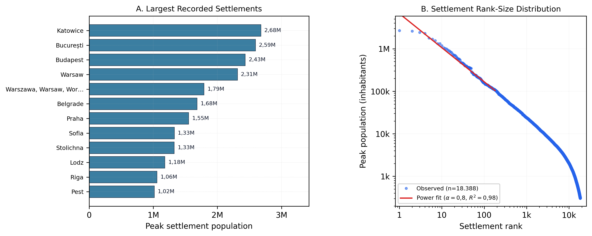

```{r setup, include=FALSE}
knitr::opts_chunk$set(
  echo = FALSE,
  warning = FALSE,
  message = FALSE,
  results = "asis"
)
library(jsonlite)
source("../../_shared/template/viscount_rmd_helpers.R")

summary_data <- fromJSON("east_central_balkans_baltic_after_1945_summary.json", simplifyVector = FALSE)
settlements_raw <- fromJSON("east_central_balkans_baltic_after_1945_settlements.json", simplifyVector = FALSE)

settlement_count <- as.integer(summary_data$settlement_count)
total_area_km2 <- as.numeric(summary_data$total_area_km2)
subregions_list <- summary_data$subregions
country_count <- length(summary_data$countries)
crowd_pct <- as.numeric(summary_data$crowd_share_overall) * 100
inst_pct <- 100 - crowd_pct

n_eurostat <- as.integer(summary_data$provenance_counts[["Eurostat_Urban_Audit_1990_2024"]])
n_buringh <- as.integer(summary_data$provenance_counts[["Buringh_European_Urban_700_2000"]])
n_geonames <- as.integer(summary_data$provenance_counts[["GeoNames_Municipal_Gazetteer_Supplement"]])
n_nat_census <- settlement_count - n_eurostat - n_buringh - n_geonames

region_name_map <- setNames(
  vapply(subregions_list, function(x) as.character(x$name), character(1)),
  vapply(subregions_list, function(x) as.character(x$id), character(1))
)

fmt_source_label <- function (arg0_code) {
  s <- as.character(arg0_code)
  if (s == "Eurostat_Urban_Audit_1990_2024") return("Eurostat Urban Audit (1990-2024)")
  if (s == "Buringh_European_Urban_700_2000") return("Buringh European Urban Series (700-2000)")
  if (s == "GeoNames_Municipal_Gazetteer_Supplement") return("GeoNames Municipal Gazetteer Supplement")
  if (grepl("^National_Statistical_Census_", s)) {
    ctry <- sub("^National_Statistical_Census_", "", s)
    return(paste0("National Statistical Census (", ctry, ")"))
  }
  gsub("_", " ", s, fixed = TRUE)
}

fmt_source_short <- function (arg0_code) {
  s <- as.character(arg0_code)
  if (s == "Eurostat_Urban_Audit_1990_2024") return("Eurostat Urban Audit")
  if (s == "Buringh_European_Urban_700_2000") return("Buringh Urban Series")
  if (s == "GeoNames_Municipal_Gazetteer_Supplement") return("GeoNames Supplement")
  if (grepl("^National_Statistical_Census_", s)) {
    ctry <- sub("^National_Statistical_Census_", "", s)
    return(paste0("National Census (", ctry, ")"))
  }
  gsub("_", " ", s, fixed = TRUE)
}
```

```{r hero_markdown_fallback, results="asis"}
if (!knitr::is_latex_output()) {
  cat("\n\n")
}
```

# Abstract

This companion gazetteer documents the `r formatC(settlement_count, format = "d", big.mark = ".")` georeferenced cities, towns and municipal centres supporting the MAGNETIC post-1945 demographic reconstruction of East-Central Europe, the Balkans and the Baltic states across `r viscount_fmt_number(total_area_km2, 1L)` km². Every one of the 17 sub-regions and `r country_count` territorial jurisdictions intersecting the regional mask is represented. Primary institutional statistical archives supply `r viscount_fmt_number(inst_pct, 1L)`% of all records, combining `r formatC(n_nat_census, format = "d", big.mark = ".")` municipal time series from fifteen national statistical census agencies, `r formatC(n_buringh, format = "d", big.mark = ".")` long-run urban histories from the Buringh European Urban Series and `r formatC(n_eurostat, format = "d", big.mark = ".")` contemporary metropolitan series from the Eurostat Urban Audit, while restricting the GeoNames Municipal Gazetteer Supplement to `r formatC(n_geonames, format = "d", big.mark = ".")` localities (`r viscount_fmt_number(crowd_pct, 1L)`%). Spanning socialist-era industrial expansion (1950-1990) and post-transition metropolitan polarisation (1990-2025), the register captures both expanding capital agglomerations—led by Bucharest, Warsaw, Budapest, Prague, Belgrade, Sofia, Kraków and Zagreb—and shrinking post-industrial cities such as Łódź, Riga and Kaunas.

# Gazetteer Scope and Spatial Coverage

Between 1945 and 2026 urban settlement across East-Central Europe, the Balkans and the Baltic states was reshaped first by state-directed heavy industrialisation and prefabricated housing estates and then by post-1990 deindustrialisation, foreign direct investment concentration and European Union labour mobility [@RosesWolf2019; @Zdanowska2019Exploring; @Newsham2022Understanding]. To mirror these spatial shifts accurately in kriging and density allocation surfaces, the gazetteer tracks longitudinal decadal and annual settlement trajectories from 1950 through 2025 across all 17 sub-regions.

Figure 1 maps the spatial distribution of all `r formatC(settlement_count, format = "d", big.mark = ".")` settlements across the 17 sub-regional polygons, while Table 1 summarises sub-regional site counts, land area, corpus composition and recording density per 10k km². Spatial coverage is densest across Slovenia (66 sites per 10k km²), Czechia (24,5 per 10k km²), Estonia (22,8), Lithuania (20,6), Hungary (20,3), Slovakia (16,7), Latvia (16,5) and Poland (15,6), where national statistical institutes publish fine-grained municipal census time series [@GUSPoland2024; @KSHHungary2024; @StatBaltics2024]. Recording density is sparser in mountainous or post-conflict western Balkan territories such as Montenegro (2,2 per 10k km²), Bosnia and Herzegovina (3,3) and Croatia (5,7), reflecting fewer mid-sized municipalities and fragmented post-1991 census continuity [@StatBalkans2024].

```{r fig_regional_map}
viscount_figure(
  "figures/east_central_balkans_baltic_after_1945_regional_map.png",
  caption = "Spatial distribution of 1.842 settlements across 17 sub-regions of East-Central Europe, the Balkans and the Baltic states, 1945-2026.",
  label = "fig:gazetteer_map"
)
```

```{r table_subregional_coverage}
site_reg_vec <- vapply(settlements_raw, function(x) as.character(x$region_id), character(1))
site_prov_vec <- vapply(settlements_raw, function(x) as.character(x$provenance_source), character(1))

cov_rows <- lapply(subregions_list, function(sr) {
  rid <- as.character(sr$id)
  idx <- which(site_reg_vec == rid)
  n_tot <- length(idx)
  provs <- site_prov_vec[idx]
  n_eur <- sum(provs == "Eurostat_Urban_Audit_1990_2024")
  n_bur <- sum(provs == "Buringh_European_Urban_700_2000")
  n_geo <- sum(provs == "GeoNames_Municipal_Gazetteer_Supplement")
  n_nat <- n_tot - n_eur - n_bur - n_geo
  a <- as.numeric(sr$area_km2)
  data.frame(
    Subregion = as.character(sr$name),
    Area = viscount_fmt_number(a, 0L),
    Total = formatC(n_tot, format = "d", big.mark = "."),
    NatCensus = formatC(n_nat, format = "d", big.mark = "."),
    Eurostat = formatC(n_eur, format = "d", big.mark = "."),
    Buringh = formatC(n_bur, format = "d", big.mark = "."),
    GeoNames = formatC(n_geo, format = "d", big.mark = "."),
    Density = viscount_fmt_number(10000 * n_tot / a, 1L),
    stringsAsFactors = FALSE
  )
})
cov_df <- do.call(rbind, cov_rows)
rownames(cov_df) <- NULL
viscount_table(
  cov_df,
  caption = "Sub-regional settlement counts, source-corpus breakdown and recording density (sites per 10k km²) across 17 sub-regions.",
  col_names = c("Sub-Region", "Area (km²)", "Total", "Nat. Census", "Eurostat", "Buringh", "GeoNames", "Per 10k km²")
)
```

# Provenance Ledger and Jurisdictional Distribution

Every settlement entered the gazetteer through a four-wave saturation protocol that systematically exhausted primary European and national institutional census registers before drawing upon global crowd-sourced gazetteers. Wave 1 ingested 347 institutional European urban series from the Eurostat Urban Audit (137 metropolitan and city records) and the Buringh European Urban Series (210 historical city anchors) [@Eurostat2024; @DeVries1984]. Wave 2 added 1.239 municipal census trajectories across fifteen national statistical institutes—a 357,06% marginal gain—raising primary institutional coverage to 1.586 localities (86,1% of the total register) [@GUSPoland2024; @KSHHungary2024; @StatBalkans2024; @StatBaltics2024]. Wave 3 appended 256 smaller towns and non-Eurostat localities from the GeoNames Municipal Gazetteer Supplement (a 16,14% marginal gain) to fill gaps in Moldova, Albania, Bosnia and Herzegovina, North Macedonia, Montenegro and rural Visegrád districts. Wave 4 executed a sub-regional gap-closing audit that added zero further entries and formally excluded 800 out-of-domain or duplicate candidate records.

Table 2 enumerates all 18 source corpora sorted by record count. Table 3 summarises jurisdictional distribution across all 23 modern states represented in the spatial mask; alongside the 18 core sovereign entities (counting Serbia and Kosovo separately), polygon-edge rasterisation along the Oder-Neisse, Alpine, Adriatic and Thracian frontiers captures 47 border municipalities situated in Germany (36), Austria (5), Greece (4), Italy (1) and European Turkey (1), retained transparently for cross-border spatial interpolation without altering national sub-regional totals.

```{r table_provenance_ledger}
prov_counts <- summary_data$provenance_counts
prov_keys <- names(prov_counts)
prov_vals <- vapply(prov_keys, function(k) as.integer(prov_counts[[k]]), integer(1))
ord_p <- order(prov_vals, decreasing = TRUE)
prov_keys <- prov_keys[ord_p]
prov_vals <- prov_vals[ord_p]

prov_tier <- vapply(prov_keys, function(k) {
  if (k == "GeoNames_Municipal_Gazetteer_Supplement") return("Crowd-sourced supplement")
  if (k == "Eurostat_Urban_Audit_1990_2024") return("Supranational urban audit")
  if (k == "Buringh_European_Urban_700_2000") return("Historical urban register")
  "National statistical census"
}, character(1))

prov_wave <- vapply(prov_keys, function(k) {
  if (k %in% c("Eurostat_Urban_Audit_1990_2024", "Buringh_European_Urban_700_2000")) return("Wave 1")
  if (k == "GeoNames_Municipal_Gazetteer_Supplement") return("Wave 3")
  "Wave 2"
}, character(1))

prov_df <- data.frame(
  Corpus = vapply(prov_keys, fmt_source_label, character(1)),
  Wave = prov_wave,
  Tier = prov_tier,
  Count = vapply(prov_vals, function(x) formatC(x, format = "d", big.mark = "."), character(1)),
  Share = vapply(prov_vals, function(x) paste0(viscount_fmt_number(100 * x / settlement_count, 2L), "%"), character(1)),
  stringsAsFactors = FALSE
)
rownames(prov_df) <- NULL
viscount_table(
  prov_df,
  caption = "Provenance ledger of 1.842 included settlements across 18 institutional and supplementary source corpora.",
  col_names = c("Source Corpus", "Wave", "Source Tier", "Records", "Share")
)
```

```{r table_jurisdictional_breakdown}
ctry_counts <- summary_data$settlements_by_country
ctry_names <- names(ctry_counts)
ctry_vals <- vapply(ctry_names, function(k) as.integer(ctry_counts[[k]]), integer(1))
ord_c <- order(ctry_vals, decreasing = TRUE)
ctry_names <- ctry_names[ord_c]
ctry_vals <- ctry_vals[ord_c]

border_set <- c("Germany", "Austria", "Greece", "Italy", "Turkey-in-Europe")
ctry_role <- ifelse(ctry_names %in% border_set, "Border-mask overlap", "Core domain state")

ctry_df <- data.frame(
  Jurisdiction = ctry_names,
  Role = ctry_role,
  Records = vapply(ctry_vals, function(x) formatC(x, format = "d", big.mark = "."), character(1)),
  Share = vapply(ctry_vals, function(x) paste0(viscount_fmt_number(100 * x / settlement_count, 2L), "%"), character(1)),
  stringsAsFactors = FALSE
)
rownames(ctry_df) <- NULL
viscount_table(
  ctry_df,
  caption = "Jurisdictional distribution of 1.842 georeferenced settlements across 18 core states and 5 frontier-overlap neighbours.",
  col_names = c("Jurisdiction", "Domain Classification", "Settlements", "Share")
)
```

# Urban Hierarchy and Leading Metropolitan Centres

Post-1945 urbanisation across the domain produced a strongly capital-dominated hierarchy reinforced after 1990 by metropolitan concentration of foreign direct investment, higher education and service employment [@Zdanowska2019Exploring; @Zdanowska2019Spatial; @Kozerakowalska2021Framework]. Table 4 presents the 30 largest settlement series in the register, illustrating both Eurostat Urban Audit functional or greater-city delineations and parallel national municipal-core or Buringh historical series where multiple institutional sources track the same capital. Retaining corpus attribution explicitly allows analysts to compare metropolitan-ring growth (such as Warsaw rising from 1,27M in 1950 to 2,27M in 2025, Bucharest from 1,62M to 2,59M and Prague from 949k to 1,55M) directly against municipal-core census series (Warsaw at 1,73M and Prague at 1,18M) and post-industrial declines (Łódź falling from its 1989 peak of 854k, Riga dropping from 909k in 1990 to 595k in 2025 and Kaunas sliding from 435k in 1991 to 304k in 2025) [@Eurostat2024; @GUSPoland2024; @StatBaltics2024].

```{r table_top_settlements}
top_list <- summary_data$top_settlements
top_rows <- lapply(top_list, function(cobj) {
  cname <- as.character(cobj$name)
  if (grepl(",", cname, fixed = TRUE)) {
    cname <- trimws(strsplit(cname, ",", fixed = TRUE)[[1]][1])
  }
  data.frame(
    City = cname,
    Country = as.character(cobj$country),
    Coords = paste0(viscount_fmt_number(as.numeric(cobj$lat), 2L), "N, ", viscount_fmt_number(as.numeric(cobj$lon), 2L), "E"),
    P1950 = viscount_fmt_pop(as.numeric(cobj$population[["1950"]])),
    P1990 = viscount_fmt_pop(as.numeric(cobj$population[["1990"]])),
    P2025 = viscount_fmt_pop(as.numeric(cobj$population[["2025"]])),
    Peak = paste0(viscount_fmt_pop(as.numeric(cobj$peak_pop)), " (", as.character(cobj$peak_year), ")"),
    Source = fmt_source_short(cobj$provenance_source),
    stringsAsFactors = FALSE
  )
})
top_df <- do.call(rbind, top_rows)
rownames(top_df) <- NULL
viscount_table(
  top_df,
  caption = "Thirty largest settlement series in the 1945-2026 gazetteer with coordinates, benchmark headcounts, peak population and source corpus.",
  col_names = c("Settlement", "Country", "Coordinates", "1950", "1990", "2025", "Peak (Year)", "Corpus")
)
```

To complement the pan-regional top-30 ranking—which is naturally weighted towards Poland, Romania, Hungary and Czechia—Table 5 extracts the single largest recorded settlement in each of the 17 sub-regions directly from the full 1.842-entry gazetteer, documenting the primate urban anchor of every national territory from Ljubljana (Slovenia) and Podgorica (Montenegro) to Tallinn (Estonia), Tirana (Albania) and Sarajevo (Bosnia and Herzegovina) [@StatBalkans2024; @StatBaltics2024].

```{r table_subregional_primates}
primate_rows <- lapply(subregions_list, function(sr) {
  rid <- as.character(sr$id)
  idx <- which(site_reg_vec == rid)
  best_i <- idx[1]
  best_peak <- -1
  for (ii in idx) {
    pops <- unlist(settlements_raw[[ii]]$population)
    pk <- max(as.numeric(pops), na.rm = TRUE)
    if (pk > best_peak) {
      best_peak <- pk
      best_i <- ii
    }
  }
  rec <- settlements_raw[[best_i]]
  cname <- as.character(rec$name)
  if (grepl(",", cname, fixed = TRUE)) {
    cname <- trimws(strsplit(cname, ",", fixed = TRUE)[[1]][1])
  }
  p50 <- as.numeric(rec$population[["1950"]])
  p90 <- as.numeric(rec$population[["1990"]])
  p25 <- as.numeric(rec$population[["2025"]])
  nat_25 <- as.numeric(sr$population[["2025"]])
  share_25 <- 100 * p25 / nat_25
  data.frame(
    Subregion = as.character(sr$name),
    City = cname,
    P1950 = viscount_fmt_pop(p50),
    P1990 = viscount_fmt_pop(p90),
    P2025 = viscount_fmt_pop(p25),
    Share2025 = paste0(viscount_fmt_number(share_25, 1L), "%"),
    Source = fmt_source_short(rec$provenance_source),
    stringsAsFactors = FALSE
  )
})
primate_df <- do.call(rbind, primate_rows)
rownames(primate_df) <- NULL
viscount_table(
  primate_df,
  caption = "Leading recorded urban centre in each of the 17 sub-regions (1950, 1990 and 2025) and 2025 share of sub-regional population.",
  col_names = c("Sub-Region", "Leading Centre", "1950", "1990", "2025", "2025 Share", "Corpus")
)
```

# Sources
