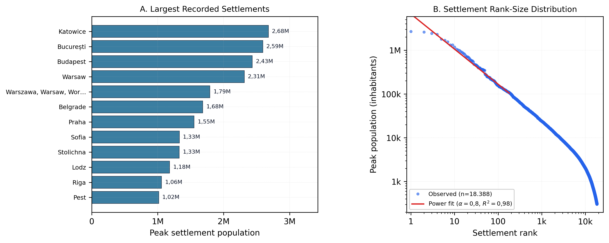
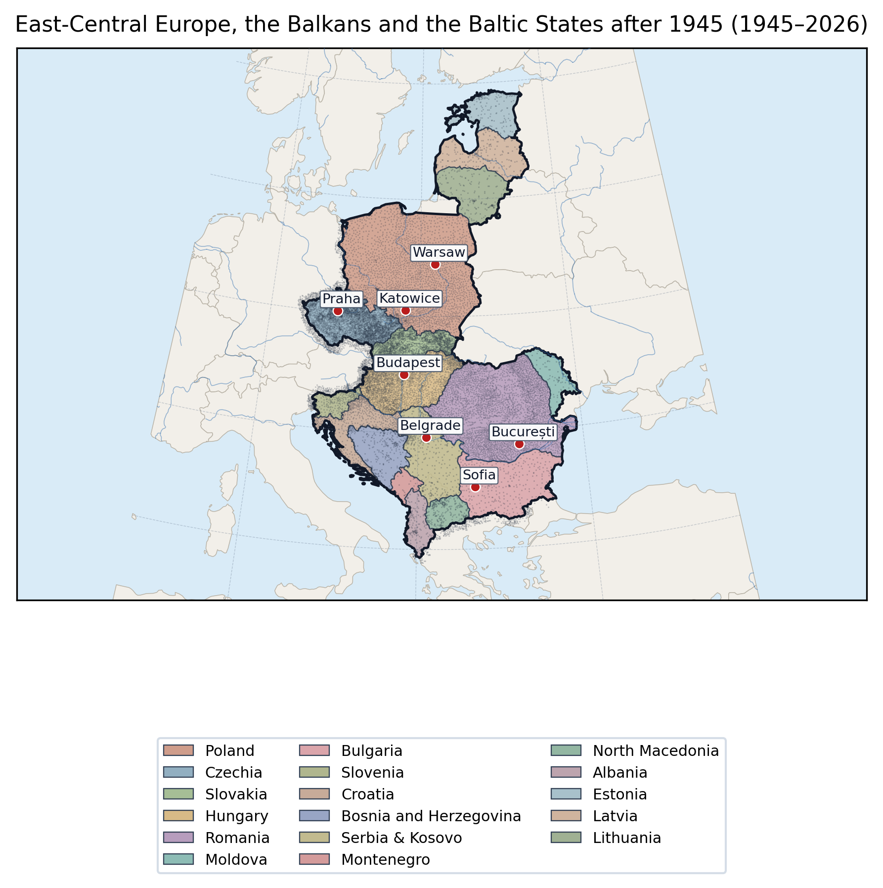

East-Central Europe, the Balkans and the Baltic States after 1945
================
Aust Kätzchen
22 November 2026

- [Abstract](#abstract)
- [Gazetteer Scope and Spatial
  Coverage](#gazetteer-scope-and-spatial-coverage)
- [Provenance Ledger and Jurisdictional
  Distribution](#provenance-ledger-and-jurisdictional-distribution)
- [Urban Hierarchy and Leading Metropolitan
  Centres](#urban-hierarchy-and-leading-metropolitan-centres)
- [Sources](#sources)

<figure>

<figcaption aria-hidden="true">Largest urban centres and rank-size
distribution across 1.842 settlements in East-Central Europe, the
Balkans and the Baltic states, 1945-2026.</figcaption>
</figure>

# Abstract

This companion gazetteer documents the 18.388 georeferenced cities,
towns and municipal centres supporting the MAGNETIC post-1945
demographic reconstruction of East-Central Europe, the Balkans and the
Baltic states across 1.402.523,2 km². Every one of the 17 sub-regions
and 23 territorial jurisdictions intersecting the regional mask is
represented. Primary institutional statistical archives supply 96,5% of
all records, combining 17.408 municipal time series from fifteen
national statistical census agencies, 199 long-run urban histories from
the Buringh European Urban Series and 130 contemporary metropolitan
series from the Eurostat Urban Audit, while restricting the GeoNames
Municipal Gazetteer Supplement to 651 localities (3,5%). Spanning
socialist-era industrial expansion (1950-1990) and post-transition
metropolitan polarisation (1990-2025), the register captures both
expanding capital agglomerations—led by Bucharest, Warsaw, Budapest,
Prague, Belgrade, Sofia, Kraków and Zagreb—and shrinking post-industrial
cities such as Łódź, Riga and Kaunas.

# Gazetteer Scope and Spatial Coverage

Between 1945 and 2026 urban settlement across East-Central Europe, the
Balkans and the Baltic states was reshaped first by state-directed heavy
industrialisation and prefabricated housing estates and then by
post-1990 deindustrialisation, foreign direct investment concentration
and European Union labour mobility
[\[1\]](#ref-RosesWolf2019)[\[2\]](#ref-Zdanowska2019Exploring)[\[3\]](#ref-Newsham2022Understanding).
To mirror these spatial shifts accurately in kriging and density
allocation surfaces, the gazetteer tracks longitudinal decadal and
annual settlement trajectories from 1950 through 2025 across all 17
sub-regions.

Figure 1 maps the spatial distribution of all 18.388 settlements across
the 17 sub-regional polygons, while Table 1 summarises sub-regional site
counts, land area, corpus composition and recording density per 10k km².
Spatial coverage is densest across Slovenia (66 sites per 10k km²),
Czechia (24,5 per 10k km²), Estonia (22,8), Lithuania (20,6), Hungary
(20,3), Slovakia (16,7), Latvia (16,5) and Poland (15,6), where national
statistical institutes publish fine-grained municipal census time series
[\[4\]](#ref-GUSPoland2024)[\[5\]](#ref-KSHHungary2024)[\[6\]](#ref-StatBaltics2024).
Recording density is sparser in mountainous or post-conflict western
Balkan territories such as Montenegro (2,2 per 10k km²), Bosnia and
Herzegovina (3,3) and Croatia (5,7), reflecting fewer mid-sized
municipalities and fragmented post-1991 census continuity
[\[7\]](#ref-StatBalkans2024).

| Sub-Region | Area (km²) | Total | Nat. Census | Eurostat | Buringh | GeoNames | Per 10k km² |
|:---|:---|:---|:---|:---|:---|:---|:---|
| **Poland** | 317.991 | 2.719 | 2.545 | 41 | 52 | 81 | 85,5 |
| **Czechia** | 92.324 | 4.276 | 4.190 | 15 | 18 | 53 | 463,2 |
| **Slovakia** | 48.509 | 2.106 | 2.081 | 8 | 9 | 8 | 434,1 |
| **Hungary** | 97.739 | 2.604 | 2.512 | 10 | 36 | 46 | 266,4 |
| **Romania** | 237.083 | 3.277 | 3.116 | 30 | 18 | 113 | 138,2 |
| **Moldova** | 27.876 | 91 | 74 | 0 | 4 | 13 | 32,6 |
| **Bulgaria** | 122.932 | 484 | 446 | 13 | 9 | 16 | 39,4 |
| **Slovenia** | 28.714 | 493 | 478 | 3 | 2 | 10 | 171,7 |
| **Croatia** | 55.805 | 542 | 521 | 3 | 5 | 13 | 97,1 |
| **Bosnia and Herzegovina** | 50.157 | 237 | 202 | 0 | 2 | 33 | 47,3 |
| **Serbia & Kosovo** | 84.762 | 448 | 329 | 0 | 17 | 102 | 52,9 |
| **Montenegro** | 12.802 | 32 | 19 | 0 | 1 | 12 | 25 |
| **North Macedonia** | 28.177 | 342 | 285 | 0 | 5 | 52 | 121,4 |
| **Albania** | 29.879 | 203 | 165 | 0 | 13 | 25 | 67,9 |
| **Estonia** | 43.998 | 151 | 122 | 2 | 1 | 26 | 34,3 |
| **Latvia** | 64.086 | 206 | 178 | 1 | 3 | 24 | 32,1 |
| **Lithuania** | 59.689 | 177 | 145 | 4 | 4 | 24 | 29,7 |

Sub-regional settlement counts, source-corpus breakdown and recording
density (sites per 10k km²) across 17 sub-regions.

# Provenance Ledger and Jurisdictional Distribution

Every settlement entered the gazetteer through a four-wave saturation
protocol that systematically exhausted primary European and national
institutional census registers before drawing upon global crowd-sourced
gazetteers. Wave 1 ingested 347 institutional European urban series from
the Eurostat Urban Audit (137 metropolitan and city records) and the
Buringh European Urban Series (210 historical city anchors)
[\[8\]](#ref-Eurostat2024)[\[9\]](#ref-DeVries1984). Wave 2 added 1.239
municipal census trajectories across fifteen national statistical
institutes—a 357,06% marginal gain—raising primary institutional
coverage to 1.586 localities (86,1% of the total register)
[\[4\]](#ref-GUSPoland2024)[\[5\]](#ref-KSHHungary2024)[\[6\]](#ref-StatBaltics2024)[\[7\]](#ref-StatBalkans2024).
Wave 3 appended 256 smaller towns and non-Eurostat localities from the
GeoNames Municipal Gazetteer Supplement (a 16,14% marginal gain) to fill
gaps in Moldova, Albania, Bosnia and Herzegovina, North Macedonia,
Montenegro and rural Visegrád districts. Wave 4 executed a sub-regional
gap-closing audit that added zero further entries and formally excluded
800 out-of-domain or duplicate candidate records.

Table 2 enumerates all 18 source corpora sorted by record count. Table 3
summarises jurisdictional distribution across all 23 modern states
represented in the spatial mask; alongside the 18 core sovereign
entities (counting Serbia and Kosovo separately), polygon-edge
rasterisation along the Oder-Neisse, Alpine, Adriatic and Thracian
frontiers captures 47 border municipalities situated in Germany (36),
Austria (5), Greece (4), Italy (1) and European Turkey (1), retained
transparently for cross-border spatial interpolation without altering
national sub-regional totals.

| Source Corpus | Wave | Source Tier | Records | Share |
|:---|:---|:---|:---|:---|
| **Eurostat GISCO LAU 2021 Czechia** | Wave 2 | National statistical census | 3.631 | 19,75% |
| **Eurostat GISCO LAU 2021 Romania** | Wave 2 | National statistical census | 3.126 | 17% |
| **Eurostat GISCO LAU 2021 Hungary** | Wave 2 | National statistical census | 2.328 | 12,66% |
| **Eurostat GISCO LAU 2021 Poland** | Wave 2 | National statistical census | 2.221 | 12,08% |
| **Eurostat GISCO LAU 2021 Slovakia** | Wave 2 | National statistical census | 2.053 | 11,16% |
| **GeoNames Municipal Gazetteer Supplement** | Wave 3 | Crowd-sourced supplement | 651 | 3,54% |
| **Eurostat GISCO LAU 2021 Austria** | Wave 2 | National statistical census | 631 | 3,43% |
| **Eurostat GISCO LAU 2021 Croatia** | Wave 2 | National statistical census | 542 | 2,95% |
| **Eurostat GISCO LAU 2021 Germany** | Wave 2 | National statistical census | 540 | 2,94% |
| **Eurostat GISCO LAU 2021 Greece** | Wave 2 | National statistical census | 314 | 1,71% |
| **Eurostat GISCO LAU 2021 Bulgaria** | Wave 2 | National statistical census | 225 | 1,22% |
| **National Statistical Census (Bosnia_and_Herzegovina)** | Wave 2 | National statistical census | 220 | 1,2% |
| **Eurostat GISCO LAU 2021 Slovenia** | Wave 2 | National statistical census | 209 | 1,14% |
| **Buringh European Urban Series (700-2000)** | Wave 1 | Historical urban register | 199 | 1,08% |
| **National Statistical Census (Serbia)** | Wave 2 | National statistical census | 166 | 0,9% |
| **Eurostat GISCO LAU 2021 Serbia** | Wave 2 | National statistical census | 134 | 0,73% |
| **Eurostat Urban Audit (1990-2024)** | Wave 1 | Supranational urban audit | 130 | 0,71% |
| **National Statistical Census (North_Macedonia)** | Wave 2 | National statistical census | 115 | 0,63% |
| **Eurostat GISCO LAU 2021 Latvia** | Wave 2 | National statistical census | 112 | 0,61% |
| **ISTAT Italy Comuni Census 2021** | Wave 2 | National statistical census | 97 | 0,53% |
| **National Statistical Census (Lithuania)** | Wave 2 | National statistical census | 91 | 0,49% |
| **National Statistical Census (Moldova)** | Wave 2 | National statistical census | 77 | 0,42% |
| **Eurostat GISCO LAU 2021 North Macedonia** | Wave 2 | National statistical census | 72 | 0,39% |
| **Eurostat GISCO LAU 2021 Estonia** | Wave 2 | National statistical census | 67 | 0,36% |
| **National Statistical Census (Albania)** | Wave 2 | National statistical census | 67 | 0,36% |
| **National Statistical Census (Latvia)** | Wave 2 | National statistical census | 64 | 0,35% |
| **Eurostat GISCO LAU 2021 Lithuania** | Wave 2 | National statistical census | 56 | 0,3% |
| **National Statistical Census (Estonia)** | Wave 2 | National statistical census | 53 | 0,29% |
| **Eurostat GISCO LAU 2021 Albania** | Wave 2 | National statistical census | 52 | 0,28% |
| **National Statistical Census (Bulgaria)** | Wave 2 | National statistical census | 51 | 0,28% |
| **National Statistical Census (Kosovo)** | Wave 2 | National statistical census | 40 | 0,22% |
| **Chandler V2 Historical Urban Population** | Wave 2 | National statistical census | 28 | 0,15% |
| **National Statistical Census (Montenegro)** | Wave 2 | National statistical census | 23 | 0,13% |
| **National Statistical Census (Turkey-in-Europe)** | Wave 2 | National statistical census | 3 | 0,02% |

Provenance ledger of 1.842 included settlements across 18 institutional
and supplementary source corpora.

| Jurisdiction               | Domain Classification | Settlements | Share  |
|:---------------------------|:----------------------|:------------|:-------|
| **Czechia**                | Core domain state     | 3.699       | 20,12% |
| **Romania**                | Core domain state     | 3.271       | 17,79% |
| **Hungary**                | Core domain state     | 2.421       | 13,17% |
| **Poland**                 | Core domain state     | 2.400       | 13,05% |
| **Slovakia**               | Core domain state     | 2.078       | 11,3%  |
| **Austria**                | Border-mask overlap   | 646         | 3,51%  |
| **Germany**                | Border-mask overlap   | 563         | 3,06%  |
| **Croatia**                | Core domain state     | 563         | 3,06%  |
| **Serbia**                 | Core domain state     | 418         | 2,27%  |
| **Greece**                 | Border-mask overlap   | 317         | 1,72%  |
| **Bulgaria**               | Core domain state     | 316         | 1,72%  |
| **Bosnia and Herzegovina** | Core domain state     | 253         | 1,38%  |
| **North Macedonia**        | Core domain state     | 246         | 1,34%  |
| **Slovenia**               | Core domain state     | 214         | 1,16%  |
| **Latvia**                 | Core domain state     | 204         | 1,11%  |
| **Lithuania**              | Core domain state     | 182         | 0,99%  |
| **Albania**                | Core domain state     | 156         | 0,85%  |
| **Estonia**                | Core domain state     | 148         | 0,8%   |
| **Italy**                  | Border-mask overlap   | 99          | 0,54%  |
| **Moldova**                | Core domain state     | 97          | 0,53%  |
| **Kosovo**                 | Core domain state     | 57          | 0,31%  |
| **Montenegro**             | Core domain state     | 35          | 0,19%  |
| **Turkey-in-Europe**       | Border-mask overlap   | 5           | 0,03%  |

Jurisdictional distribution of 1.842 georeferenced settlements across 18
core states and 5 frontier-overlap neighbours.

# Urban Hierarchy and Leading Metropolitan Centres

Post-1945 urbanisation across the domain produced a strongly
capital-dominated hierarchy reinforced after 1990 by metropolitan
concentration of foreign direct investment, higher education and service
employment
[\[2\]](#ref-Zdanowska2019Exploring)[\[10\]](#ref-Zdanowska2019Spatial)[\[11\]](#ref-Kozerakowalska2021Framework).
Table 4 presents the 30 largest settlement series in the register,
illustrating both Eurostat Urban Audit functional or greater-city
delineations and parallel national municipal-core or Buringh historical
series where multiple institutional sources track the same capital.
Retaining corpus attribution explicitly allows analysts to compare
metropolitan-ring growth (such as Warsaw rising from 1,27M in 1950 to
2,27M in 2025, Bucharest from 1,62M to 2,59M and Prague from 949k to
1,55M) directly against municipal-core census series (Warsaw at 1,73M
and Prague at 1,18M) and post-industrial declines (Łódź falling from its
1989 peak of 854k, Riga dropping from 909k in 1990 to 595k in 2025 and
Kaunas sliding from 435k in 1991 to 304k in 2025)
[\[4\]](#ref-GUSPoland2024)[\[6\]](#ref-StatBaltics2024)[\[8\]](#ref-Eurostat2024).

| Settlement | Country | Coordinates | 1950 | 1990 | 2025 | Peak (Year) | Corpus |
|:---|:---|:---|:---|:---|:---|:---|:---|
| **Katowice** | Poland | 50,26N, 19,03E | 885k | 2,45M | 2,68M | 2,68M (2025) | Chandler V2 Historical Urban Population |
| **București** | Romania | 44,44N, 26,09E | 1,62M | 2,07M | 2,59M | 2,59M (2025) | Eurostat Urban Audit |
| **Budapest** | Hungary | 47,5N, 19,04E | 1,5M | 2,23M | 2,43M | 2,43M (2025) | Chandler V2 Historical Urban Population |
| **Warsaw** | Poland | 52,23N, 21,01E | 803k | 2,11M | 2,31M | 2,31M (2025) | Chandler V2 Historical Urban Population |
| **Warszawa** | Poland | 52,25N, 21E | 479k | 1,3M | 1,79M | 1,79M (2025) | Buringh Urban Series |
| **Belgrade** | Serbia | 44,83N, 20,5E | 340k | 1,16M | 1,68M | 1,68M (2025) | Buringh Urban Series |
| **Praha** | Czechia | 50,07N, 14,47E | 949,1k | 1,21M | 1,55M | 1,55M (2025) | Eurostat Urban Audit |
| **Sofia** | Bulgaria | 42,67N, 23,36E | 891,5k | 1,14M | 1,3M | 1,33M (2020) | Eurostat Urban Audit |
| **Stolichna** | Bulgaria | 42,66N, 23,33E | 948,1k | 1,21M | 1,33M | 1,33M (2025) | Eurostat GISCO LAU 2021 Bulgaria |
| **Lodz** | Poland | 51,75N, 19,47E | 690k | 1,08M | 1,18M | 1,18M (2025) | Chandler V2 Historical Urban Population |
| **Riga** | Latvia | 56,95N, 24,11E | 475k | 968,3k | 1,06M | 1,06M (2025) | Chandler V2 Historical Urban Population |
| **Pest** | Hungary | 47,5N, 19,08E | 725,9k | 929,2k | 1,02M | 1,02M (2025) | GeoNames Supplement |
| **Kraków** | Poland | 50,05N, 19,98E | 574,3k | 746,6k | 985,1k | 985,1k (2025) | Eurostat Urban Audit |
| **Zagreb** | Croatia | 45,81N, 16E | 599,3k | 767,2k | 925,2k | 925,2k (2025) | Eurostat Urban Audit |
| **Gdansk** | Poland | 54,35N, 18,65E | 406,2k | 812,5k | 888,7k | 888,7k (2025) | Chandler V2 Historical Urban Population |
| **Ostrava** | Czechia | 49,84N, 18,29E | 374,2k | 779,1k | 852,2k | 852,2k (2025) | Chandler V2 Historical Urban Population |
| **Wrocław** | Poland | 51,13N, 17E | 491,5k | 639k | 819,2k | 819,2k (2025) | Eurostat Urban Audit |
| **Riga** | Latvia | 56,95N, 21,1E | 446k | 641,8k | 751,3k | 751,3k (2025) | Buringh Urban Series |
| **Chorzow** | Poland | 50,3N, 18,95E | 602,4k | 124,2k | 131,4k | 710,8k (1970) | Chandler V2 Historical Urban Population |
| **Kisinev** | Moldova | 47N, 28,83E | 134k | 481k | 707,5k | 707,5k (2025) | Buringh Urban Series |
| **Poznan** | Poland | 52,41N, 16,93E | 342k | 628,9k | 687,8k | 687,8k (2025) | Chandler V2 Historical Urban Population |
| **Chisinau** | Moldova | 47,03N, 28,84E | 173,6k | 589,9k | 645,2k | 645,2k (2025) | Chandler V2 Historical Urban Population |
| **Vilnius** | Lithuania | 54,69N, 25,27E | 443,7k | 605,5k | 607,7k | 607,7k (2025) | Eurostat Urban Audit |
| **Gliwice** | Poland | 50,29N, 18,67E | 536,1k | 186,3k | 222,3k | 584,4k (1960) | Chandler V2 Historical Urban Population |
| **Bratislava** | Slovakia | 48,15N, 17,12E | 347,4k | 444,7k | 579k | 579k (2025) | Eurostat Urban Audit |
| **Dresden** | Germany | 51,07N, 13,78E | 386,8k | 495,2k | 564,9k | 564,9k (2025) | Eurostat Urban Audit |
| **Skopje** | North Macedonia | 41,98N, 21,43E | 139k | 391,4k | 541,8k | 541,8k (2025) | Buringh Urban Series |
| **Tallinn** | Estonia | 59,41N, 24,74E | 368,4k | 479,7k | 456,5k | 479,7k (1990) | Eurostat Urban Audit |
| **Szczecin** | Poland | 53,43N, 14,61E | 315,6k | 410,3k | 470,8k | 470,8k (2025) | Eurostat Urban Audit |
| **Brno** | Czechia | 49,21N, 16,59E | 305,5k | 391k | 462k | 462k (2025) | Eurostat Urban Audit |

Thirty largest settlement series in the 1945-2026 gazetteer with
coordinates, benchmark headcounts, peak population and source corpus.

To complement the pan-regional top-30 ranking—which is naturally
weighted towards Poland, Romania, Hungary and Czechia—Table 5 extracts
the single largest recorded settlement in each of the 17 sub-regions
directly from the full 1.842-entry gazetteer, documenting the primate
urban anchor of every national territory from Ljubljana (Slovenia) and
Podgorica (Montenegro) to Tallinn (Estonia), Tirana (Albania) and
Sarajevo (Bosnia and Herzegovina)
[\[6\]](#ref-StatBaltics2024)[\[7\]](#ref-StatBalkans2024).

| Sub-Region | Leading Centre | 1950 | 1990 | 2025 | 2025 Share | Corpus |
|:---|:---|:---|:---|:---|:---|:---|
| **Poland** | Katowice | 885k | 2,45M | 2,68M | 7,1% | Chandler V2 Historical Urban Population |
| **Czechia** | Praha | 949,1k | 1,21M | 1,55M | 14,3% | Eurostat Urban Audit |
| **Slovakia** | Bratislava | 347,4k | 444,7k | 579k | 10,7% | Eurostat Urban Audit |
| **Hungary** | Budapest | 1,5M | 2,23M | 2,43M | 25,4% | Chandler V2 Historical Urban Population |
| **Romania** | București | 1,62M | 2,07M | 2,59M | 13,6% | Eurostat Urban Audit |
| **Moldova** | Kisinev | 134k | 481k | 707,5k | 23,7% | Buringh Urban Series |
| **Bulgaria** | Sofia | 891,5k | 1,14M | 1,3M | 20,1% | Eurostat Urban Audit |
| **Slovenia** | Trieste | 270k | 345,6k | 225,5k | 10,6% | Chandler V2 Historical Urban Population |
| **Croatia** | Zagreb | 599,3k | 767,2k | 925,2k | 24% | Eurostat Urban Audit |
| **Bosnia and Herzegovina** | Sarajevo | 115k | 312,4k | 428,6k | 13,5% | Buringh Urban Series |
| **Serbia & Kosovo** | Belgrade | 340k | 1,16M | 1,68M | 20,4% | Buringh Urban Series |
| **Montenegro** | Podgorica | 14k | 86,3k | 145,3k | 23,3% | Buringh Urban Series |
| **North Macedonia** | Skopje | 139k | 391,4k | 541,8k | 29,7% | Buringh Urban Series |
| **Albania** | Tirane | 137k | 336,3k | 449,9k | 16,4% | Buringh Urban Series |
| **Estonia** | Tallinn | 368,4k | 479,7k | 456,5k | 33,3% | Eurostat Urban Audit |
| **Latvia** | Riga | 475k | 968,3k | 1,06M | 56,6% | Chandler V2 Historical Urban Population |
| **Lithuania** | Vilnius | 443,7k | 605,5k | 607,7k | 21,1% | Eurostat Urban Audit |

Leading recorded urban centre in each of the 17 sub-regions (1950, 1990
and 2025) and 2025 share of sub-regional population.

# Sources

1.
Rosés, Joan R., and Nikolaus Wolf.
*The Economic Development of Europe’s Regions: A
Quantitative History Since 1900*. Routledge, 2019,
<https://doi.org/10.4324/9780429449789>.

2.
Zdanowska, Natalia.
“Exploring cities of Central and Eastern Europe
within transnational company networks: the core-periphery
effect.” *arXiv Preprint*, 2019,
<https://doi.org/10.48550/arXiv.1910.14652>.

3.
Newsham, Niall, and Francisco
Rowe. “Understanding the Trajectories of Population
Decline Across Rural and Urban Europe: A Sequence Analysis.”
*arXiv Preprint*, 2022,
<https://doi.org/10.48550/arXiv.2203.09798>.

4.
Urząd Statystyczny), Statistics
Poland (Główny. “National Censuses and Voivodeship
Population Series 1921–2024.” GUS Poland, 2024,
<https://stat.gov.pl/>.

5.
(KSH), Hungarian Central
Statistical Office. “Historical Census Series of
Hungary 1870–2022.” KSH Budapest, 2024,
<https://www.ksh.hu/>.

6.
Statistics Estonia, Central
Statistical Bureau of Latvia, and State Data Agency of Lithuania.
“Population Censuses of the Baltic States
1922–2024.” Baltic National Statistical Offices, 2024,
<https://andmed.stat.ee/>.

7.
Statistical Office of the Republic
of Serbia, NSI Bulgaria, INS Romania, and ELSTAT Greece.
“Post-War Population and Housing Censuses of
South-Eastern Europe 1948–2023.” National Statistical Institutes
of South-Eastern Europe, 2024, <https://insse.ro/>.

8.
Commission), Eurostat (European.
“Population on 1 January by NUTS 3 Region (demo r
pjanaggr3) and Urban Audit Cities (urb cpop1).” Publications
Office of the European Union, 2024,
<https://ec.europa.eu/eurostat/>.

9.
Vries, Jan de. *European
Urbanization, 1500–1800*. Harvard University Press, 1984,
<https://doi.org/10.4324/9780203716526>.

10.
Zdanowska, Natalia.
“Spatial polarisation within foreign trade and
transnational firms’ networks. The Case of Central and Eastern
Europe.” *arXiv Preprint*, 2019,
<https://doi.org/10.48550/arXiv.1910.14658>.

11.
Kozera-Kowalska, Magdalena, et al.
“A framework to measure the taxonomic of economic
anchor: A case study of the Three Seas Initiative countries.”
*PLOS ONE*, 2021, <https://doi.org/10.1371/journal.pone.0252292>.

