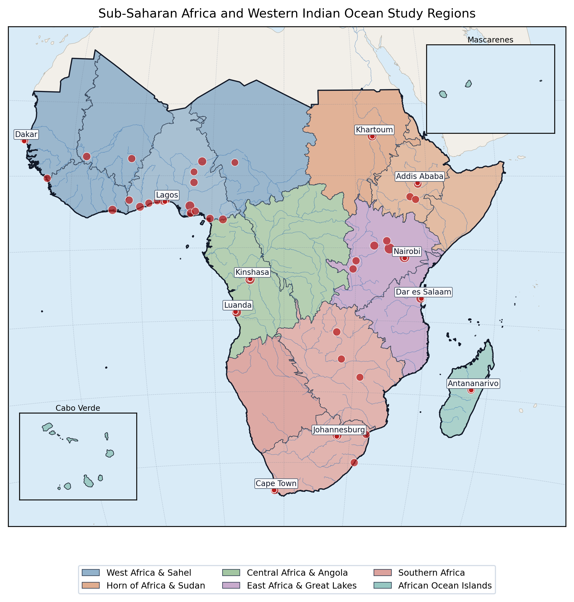
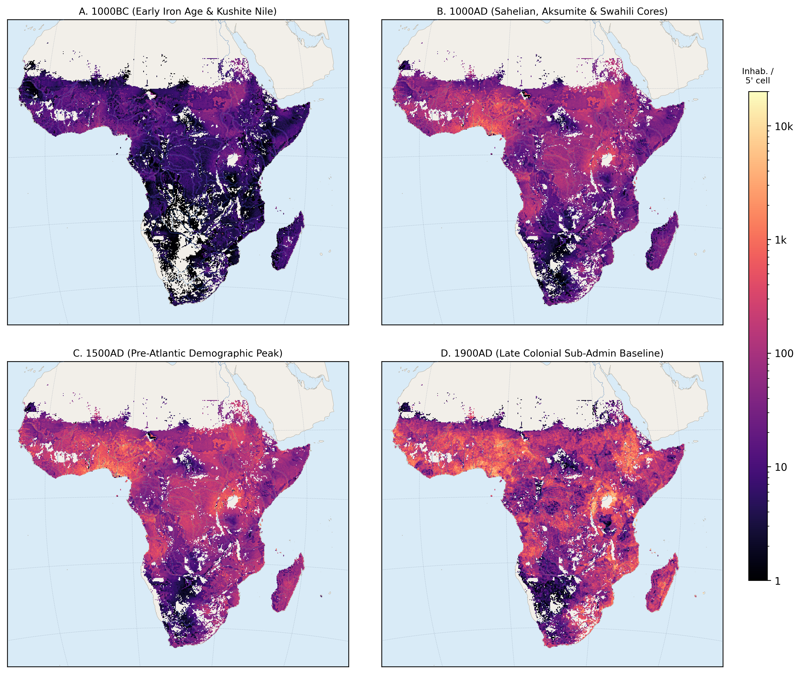
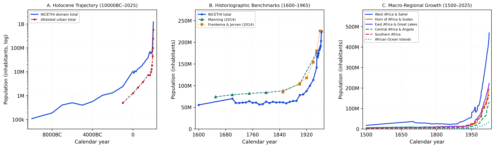
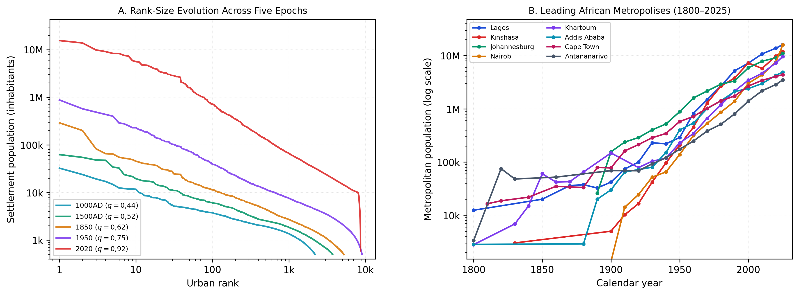

Studies on Population
================
Aust Kätzchen
24 November 2026

- [Abstract](#abstract)
- [Background](#background)
  - [Regional Historiography and Evidentiary
    Foundations](#regional-historiography-and-evidentiary-foundations)
- [Methodology](#methodology)
  - [Four-Group Territorial Partitioning and Dual Vector-Raster
    Masking](#four-group-territorial-partitioning-and-dual-vector-raster-masking)
  - [Multi-Repository Archaeological Ingestion and Dual HYDE 3.5 and
    KK10
    Kriging](#multi-repository-archaeological-ingestion-and-dual-hyde-35-and-kk10-kriging)
  - [Pycnophylactic Sub-Administrative Disaggregation and Three-Phase
    Urban
    Reconciliation](#pycnophylactic-sub-administrative-disaggregation-and-three-phase-urban-reconciliation)
- [Testing and Validation](#testing-and-validation)
- [Results](#results)
  - [Holocene Foraging, Food Production and Early Iron-Age Expansion
    (10000BC to
    1000AD)](#holocene-foraging-food-production-and-early-iron-age-expansion-10000bc-to-1000ad)
  - [Mediaeval State Consolidation, Crop Diffusion and the Atlantic
    Shock (1000AD to
    1900AD)](#mediaeval-state-consolidation-crop-diffusion-and-the-atlantic-shock-1000ad-to-1900ad)
  - [Colonial Transitions, Post-1950 Acceleration and Regional
    Divergence (1900AD to
    2025AD)](#colonial-transitions-post-1950-acceleration-and-regional-divergence-1900ad-to-2025ad)
  - [Pan-African Urban Hierarchy and Metropolitan
    Concentration](#pan-african-urban-hierarchy-and-metropolitan-concentration)
- [Limitations](#limitations)
- [Conclusion](#conclusion)
- [Appendix](#appendix)
  - [Ten Chronological Kriging Horizons and Variogram
    Diagnostics](#ten-chronological-kriging-horizons-and-variogram-diagnostics)
  - [Historiographic Benchmark Comparison (1700AD to
    1960AD)](#historiographic-benchmark-comparison-1700ad-to-1960ad)
  - [Summary of Geostatistical, Frontier and Sub-Administrative
    Calibration
    Parameters](#summary-of-geostatistical-frontier-and-sub-administrative-calibration-parameters)
- [Sources](#sources)
- [Footnotes](#footnotes)

# Abstract

Reconstructing long-run human population across Sub-Saharan Africa,
Madagascar, the Western Indian Ocean and the African Atlantic islands
requires reconciling twelve millennia of uneven archaeological field
surveys, Arab and European mercantile itineraries, colonial fiscal
enumerations and contemporary national censuses. Global gridded
compilations such as HYDE and KK10 distribute national historical curves
across 5-arcminute cells through continental land-suitability heuristics
[\[1\]](#ref-KleinGoldewijk2023)[\[2\]](#ref-Kaplan2011KK10). Across a
landmass of 24,43M km² (290.451 active 5-arcminute cells) stretching
from the Sahara-Sahel transition and the Nubian Nile through tropical
rainforests, highland volcanic plateaus and semi-arid southern savannas
to oceanic archipelagos, continental averages blur sharp ecological
gradients and obscure pre-colonial political cores. NICETHI provides a
bottom-up regional reconstruction spanning 55 contemporary jurisdictions
from 10000BC to 2025AD, structured across 23 chronological-regional
chapters and paired settlement gazetteers.

NICETHI synthesises 24.537 weighted domestic archaeological site-epoch
records (11.199 assigned domestic records across 6.970 unique coordinate
sites, with 82,94% drawn from regional registers and scholarly
monographs and 0% from crowd-sourced platforms) together with 2.732
northern cross-frontier records across 6.431 scale-adaptive domestic
HydroBASINS Level 6 catchments and 383 cross-frontier buffer catchments
[\[3\]](#ref-LehnerGrill2013HydroBASINS)[\[4\]](#ref-BIRD2022P3K14C)[\[5\]](#ref-Hinz2023XRONOS).
Pre-industrial spatial distributions combine dual HYDE 3.5 and KK10
biophysical covariates with two-scale non-stationary Matérn
($\nu = 3/2$) residual kriging across ten chronological horizons
(unclamped $\tau_1 = 1,41$, calibrated $\tau_1 = 1,35$, $R^2 = 0,9992$)
[\[6\]](#ref-PaciorekSchervish2006), harmonised along the northern
Sahara-Sahel frontier with HANDBOOK via 2D screened-Laplace
multiplicative blending across 77 pre-1975 benchmark rasters. For the
statistical era from 1900AD to 2025AD, strictly pycnophylactic
sub-administrative disaggregation enforces exact mass conservation
across 30.911 unit-year checks covering up to 607 contemporary
administrative polygons per benchmark year (704 polygons in 2025AD),
with a worst-case relative error of 5,60e-08
[\[7\]](#ref-Runfola2020GeoBoundaries). Urban dynamics are anchored by
20.959 canonical settlements (20.733 city-proper localities and 226
deduplicated agglomerations, including 15.902 pre-1950 settlements drawn
from 47.414 chapter-settlement trajectories and 192.623 dated
observations reconciled across a three-phase hierarchy)
[\[8\]](#ref-OECD2024Africapolis).

Over the Holocene, aggregate population across NICETHI rose from 108k in
10000BC to 2,4M by 1000BC as Sahelian cereal agriculture, Ethiopian
highland farming and early Bantu iron-working expanded across savanna
and forest margins
[\[9\]](#ref-Phillipson2005AfricanArch)[\[10\]](#ref-Bostoen2018BantuFirst).
Classical and mediaeval state formation across Nubia, Aksum, the Inland
Niger Delta, Hausaland, the Great Lakes, the Swahili littoral and the
Zimbabwe plateau lifted numbers to 10,38M at 0AD, 20,71M in 1000AD and
37,99M by 1500AD
[\[11\]](#ref-Connah2001AfricanCivilizations)[\[12\]](#ref-McIntosh1995JenneJeno).
Following New World crop adoption (maize and cassava) that raised totals
to 69,9M in 1700AD, compounding Atlantic, Saharan and Indian Ocean
slave-trade extractions, nineteenth-century warfare and early colonial
coercive mortality depressed aggregate totals to 61,42M in 1850AD and
slowed recovery to 78,2M in 1900AD
[\[13\]](#ref-Curtin1969AtlanticCensus)[\[14\]](#ref-Lovejoy2012Transformations)[\[15\]](#ref-Manning2014AfricanPop)[\[16\]](#ref-FrankemaJerven2014AfricanPop).
Post-1950 mortality decline and sustained fertility then drove an
unprecedented eightfold expansion from 141,76M in 1950AD to 1,22B in
2025AD, shifting demographic gravity toward fast-growing metropolitan
corridors in West, East and Central Africa.

# Background

Quantitative reconstruction of Sub-Saharan African population history
occupies a contentious place in world historical demography. Whereas
Eurasian syntheses can cross-check centuries of household tax rolls,
parish registers and imperial censuses, Sub-Saharan African
documentation before the mid-twentieth century is discontinuous across
ecological zones and administrative archives
[\[17\]](#ref-Caldwell2002HistoricalPopulation)[\[18\]](#ref-Caldwell2013AfricanDemographic).
Early world tabulations led by McEvedy and Jones
[\[19\]](#ref-McEvedy1978) assumed low pre-colonial carrying capacities
and minimal seventeenth- to nineteenth-century demographic disruption,
estimating a smooth continental climb from roughly 46M in 1500AD to 110M
in 1900AD. Subsequent historical-demographic revisions overturned that
consensus. Patrick Manning reconstructed regional cohorts backwards from
1950AD colonial census baselines while incorporating transatlantic,
trans-Saharan and Indian Ocean slave exports, raising early modern
Sub-Saharan numbers substantially and identifying protracted stagnation
or absolute decline across Atlantic-facing belts between 1700AD and
1880AD
[\[15\]](#ref-Manning2014AfricanPop)[\[20\]](#ref-Manning2010AfricanPop).
Ewout Frankema and Morten Jerven refined the 1850AD to 1960AD trajectory
by benchmarking African mortality and growth rates against analogous
tropical agrarian economies in Asia and Latin America, demonstrating
that colonial enumerations prior to 1945AD systematically undercounted
rural populations by 20% to 40%
[\[16\]](#ref-FrankemaJerven2014AfricanPop).

Global gridded models translated national population estimates into
spatial rasters, most notably through HYDE and KK10
[\[1\]](#ref-KleinGoldewijk2023)[\[2\]](#ref-Kaplan2011KK10). Yet
continental allocation rules face four structural difficulties when
applied unmodified to Sub-Saharan Africa and the African ocean islands.
First, pre-industrial carrying capacity does not decrease monotonically
with elevation or distance from the coast. Across Ethiopia, Eritrea, the
Western Rift highlands (Rwanda, Burundi and Kivu), the Kenyan Highlands,
the Cameroon Grassfields and central Madagascar, tropical highland zones
between 1.400 and 2.600 metres elevation escaped severe holoendemic
malaria and trypanosomiasis while capturing orographic rainfall on
fertile volcanic and lateritic soils
[\[21\]](#ref-Fattovich2010Aksum)[\[22\]](#ref-Larson2000HistoryMemory).
Conversely, humid lowland rainforest interiors and tsetse-infested
miombo belts supported far sparser pastoral and agrarian densities than
standard temperature-precipitation suitability curves imply
[\[10\]](#ref-Bostoen2018BantuFirst)[\[23\]](#ref-Ehret1990PathsThe).

Second, pre-colonial demographic centres diverged sharply from
twentieth-century colonial ports and railway junctions. Long before
colonial railways anchored Lagos, Dakar, Abidjan, Nairobi, Kinshasa,
Luanda, Lusaka and Johannesburg, African urbanisation clustered along
the Inland Niger Delta (Jenne-Jeno and Timbuktu), the Nubian Nile
(Kerma, Napata, Meroe and Old Dongola), northern Ethiopian plateaus
(Yeha, Aksum, Lalibela and Gondar), Hausaland and Borno (Kano, Katsina,
Zaria and Ngazargamo), Yorubaland and Benin (Ile-Ife, Old Oyo and Benin
City), the Swahili stone towns (Kilwa Kisiwani, Mombasa, Lamu and
Mogadishu) and southern Zambezian stone enclosures (Mapungubwe, Great
Zimbabwe and Khami)
[\[12\]](#ref-McIntosh1995JenneJeno)[\[24\]](#ref-Edwards2004NubianPast)[\[25\]](#ref-Phillipson2000FoundationsAfrican)[\[26\]](#ref-HortonMiddleton2000Swahili)[\[27\]](#ref-Pikirayi2001ZimbabweCulture).
Back-projecting contemporary sub-national administrative shares across
millennia misallocates pre-industrial rural and urban mass onto
twentieth-century mining towns, coastal export ports and planned
administrative capitals (Abuja, Dodoma, Lilongwe, Gaborone, Yamoussoukro
and Nouakchott) that barely existed before 1900AD
[\[28\]](#ref-Hayashi2007LongTerm).

Third, colonial and post-colonial administrative geometries shifted
continuously between 1885AD and 2025AD. Imperial partition carved
pre-colonial polities into French West Africa (AOF), French Equatorial
Africa (AEF), British colonial protectorates, the Belgian Congo, German
East Africa, Kamerun, German South-West Africa, Portuguese Angola and
Mozambique, Italian Eritrea and Somalia, and the Union of South Africa
[\[29\]](#ref-Weidmann2010CShapes)[\[30\]](#ref-Kuczynski1948DemographicSurvey1)[\[31\]](#ref-Kuczynski1949DemographicSurvey2).
Following First World War League of Nations mandate redistributions and
post-1956 decolonisation, national statistical boundaries underwent
repeated internal subdivision - from Nigeria’s expansion from 3 regions
to 36 states plus the Federal Capital Territory, to the Democratic
Republic of the Congo’s transition from 6 colonial provinces to 26
provinces in 2015AD, Kenya’s 2010AD reorganisation into 47 counties,
South Africa’s 1994AD creation of 9 post-apartheid provinces and
sovereign splits separating Eritrea (1993AD) and South Sudan (2011AD)
[\[32\]](#ref-NPC2010NigeriaCensus)[\[33\]](#ref-KNBS2019KenyaCensus)[\[34\]](#ref-StatsSA2023Census2022)[\[35\]](#ref-CBS2009SudanCensus).
Disaggregating census schedules onto static 2025AD polygons introduces
severe spatial anachronisms across nineteenth- and twentieth-century
benchmarks.

Fourth, Sub-Saharan Africa shares a 5.500 km bioclimatic transition with
North Africa across the southern Sahara and Nubian Nile. Treating
NICETHI in isolation from HANDBOOK would create an artificial border
discontinuity across Mauritania, Mali, Niger, Chad and Sudan.
Harmonising both archaeological catchment conditioning and pre-1975
gridded population rasters across that northern frontier ensures smooth
continental composition from the Mediterranean coast to the Cape of Good
Hope.

## Regional Historiography and Evidentiary Foundations

Constructing a continent-wide African demographic archive requires
bridging four distinct scholarly traditions. For the Early to Late
Holocene and Iron Age, radiocarbon synthesis initiatives - including
p3k14c [\[4\]](#ref-BIRD2022P3K14C), XRONOS [\[5\]](#ref-Hinz2023XRONOS)
and the ROCEEH Out of Africa Database [\[36\]](#ref-Kandel2023ROAD) -
complement regional field registers such as the Online West African
Archaeological Register [\[37\]](#ref-Besse2020OSAAR), the Royal Museum
for Central Africa’s ADRAC and BantuFirst radiocarbon corpora
[\[10\]](#ref-Bostoen2018BantuFirst)[\[38\]](#ref-Cornelissen2016RMCA),
the Ethiopian ARCCH inventory [\[39\]](#ref-ARCCH2020EthiopiaInventory),
the National Museums of Kenya register [\[40\]](#ref-NMK2021KenyaSites),
South Africa’s SAHRIS database [\[41\]](#ref-SAHRIS2024SouthAfrica),
Zimbabwe’s NMMZ monuments survey [\[42\]](#ref-NMMZ2022ZimbabweSites)
and Madagascar’s Institut de Civilisations inventories
[\[43\]](#ref-ICM2020MadagascarAtlas). Regional archaeological syntheses
track major population inflections: mid-Holocene Saharan aridification
and southward pastoral movement [\[44\]](#ref-Maley2015PopulationsAnd);
early Chadian complexity around 500BC
[\[45\]](#ref-Toba2026EmergenceSocial); Nubian and Meroitic iron-working
and riverine state formation
[\[24\]](#ref-Edwards2004NubianPast)[\[46\]](#ref-Adams1977Nubia)[\[47\]](#ref-Humphris2018IronSmelting)[\[48\]](#ref-GonzalezRuibal2017SudansEastern);
Aksumite highland urbanisation and Red Sea trade at Adulis
[\[21\]](#ref-Fattovich2010Aksum)[\[25\]](#ref-Phillipson2000FoundationsAfrican)[\[49\]](#ref-Zazzaro2013TheAncient);
clustered urbanism in the Inland Niger Delta
[\[12\]](#ref-McIntosh1995JenneJeno)[\[50\]](#ref-Mcintosh1981TheInland);
Bantu agricultural dispersals across equatorial forests and southern
savannas
[\[9\]](#ref-Phillipson2005AfricanArch)[\[51\]](#ref-Mitchell2002SouthernAfrica)[\[52\]](#ref-CoqueryVidrovitch2005BantuCities);
and stone-built urbanism at Great Zimbabwe and along the Swahili coast
[\[53\]](#ref-ShadreckChiri1800WhatWas)[\[54\]](#ref-WynneJones2018SwahiliWorld)[\[55\]](#ref-WynneJones2018TheMultiple).

For the early modern centuries (1500AD to 1890AD), demographic evidence
rests on Arabic chronicles, missionary baptismal and tribute rolls,
Portuguese fortress records, Dutch Cape tax rolls (*opgaafrollen*) and
quantitative slave-trade registers. John Thornton’s reconstruction of
seventeenth-century Kingdom of Kongo baptismal records demonstrated that
pre-colonial Central African kingdoms sustained dense rural populations
before civil war and export slaving eroded demographic surpluses
[\[56\]](#ref-Thornton1977KongoDemography). Comparable monographic
anchors illuminate Oyo’s imperial expansion and frontier domestic
economy
[\[57\]](#ref-Law1977OyoEmpire)[\[58\]](#ref-Ogundiran2009OyoFrontier),
Upper Guinea Atlantic ports such as Geba
[\[59\]](#ref-Havik2007PortOfGeba), Sahelian governance from Mali and
Songhai to Massina, Kong, Samori’s state, the Sokoto Caliphate, Kano’s
plantation estates, Dar Fur and Funj Sinnar
[\[60\]](#ref-Davis2000LeadershipStrategies)[\[61\]](#ref-Last1967SokotoCaliphate)[\[62\]](#ref-Hamza2004DorayiKano)[\[63\]](#ref-Azarya1980TradersAnd)[\[64\]](#ref-Ofahey1980StateDarFur)[\[65\]](#ref-Spaulding1985HeroicAge),
Solomonic Ethiopian urban networks
[\[66\]](#ref-Pankhurst1982EthiopianTowns), coastal Portuguese
fortresses and Zambezi *prazos* in Mozambique
[\[67\]](#ref-Pradines2016PortugueseFortresses)[\[68\]](#ref-Newitt1995Mozambique)[\[69\]](#ref-Gilbert1970CoastalEast),
southwestern Cape slavery, settler frontier movement and Khoikhoi
demographic contraction between 1652AD and 1780AD
[\[70\]](#ref-Shell1994ChildrenBondage)[\[71\]](#ref-ElphickGiliomee1989Shaping)[\[72\]](#ref-LaCroix2016KhoikhoiPopulation)[\[73\]](#ref-Guelke1976FrontierSettlement),
and Western Indian Ocean plantation and highland economies across
Madagascar, the Comoros and Mauritius
[\[22\]](#ref-Larson2000HistoryMemory)[\[74\]](#ref-Beaujard2007EastAfricaMadagascar)[\[75\]](#ref-Campbell1991ImperialMadagascar)[\[76\]](#ref-Allen1999SlavesFreedmen).
Philip Curtin’s pioneering Atlantic census and Paul Lovejoy’s synthesis
of continental slavery quantify the scale and regional selectivity of
forced removals across Atlantic, Saharan and Indian Ocean routes
[\[13\]](#ref-Curtin1969AtlanticCensus)[\[14\]](#ref-Lovejoy2012Transformations).

For the colonial statistical transition (1880AD to 1975AD), NICETHI
draws directly on archival statistical yearbooks and demographic surveys
rather than secondary interpolations: the *Annuaire Statistique de
l’Afrique Occidentale Française* [\[77\]](#ref-AOFAnnuaire1936), the
*Annuaire Statistique de l’Afrique Équatoriale Française*
[\[78\]](#ref-AEFAnnuaire1950), Cardinall’s 1931AD Gold Coast review
[\[79\]](#ref-Cardinall1932GoldCoast), Robert Kuczynski’s exhaustive
two-volume critical audit of British colonial enumerations
[\[30\]](#ref-Kuczynski1948DemographicSurvey1)[\[31\]](#ref-Kuczynski1949DemographicSurvey2),
the 1940AD censuses of Portuguese Angola and Mozambique
[\[80\]](#ref-Angola1940Censo)[\[81\]](#ref-Mozambique1940Censo), the
1955-1957AD Belgian Congo demographic sample survey
[\[82\]](#ref-CongoBelge1958Enquete), the 1955-1956AD First Population
Census of Sudan [\[83\]](#ref-Sudan1956Census), the 1948AD British East
Africa census and C. J. Martin’s methodological review
[\[84\]](#ref-EastAfrica1948Census)[\[85\]](#ref-Martin1961EastAfrica),
and the 1956AD Federation of Rhodesia and Nyasaland census
[\[86\]](#ref-CASO1960FederationCensus), cross-checked against
historical monographs on labour migration, colonial urbanism and forced
labour
[\[87\]](#ref-CordellGregory1987AfricanPop)[\[88\]](#ref-Mitchell2007IHS)[\[89\]](#ref-Manchuelle1997WillingMigrants)[\[90\]](#ref-Keese2016WolofSenegal)[\[91\]](#ref-Gouellain1975Douala)[\[92\]](#ref-Coates2017PreliminaryConsiderations)[\[93\]](#ref-Pankhurst1968EconomicHistory)[\[94\]](#ref-Omar2001ScrambleHorn)[\[95\]](#ref-Fuller2011ItalyColonial)[\[96\]](#ref-Frederiksen2013SeeingThe)[\[97\]](#ref-Mudeka2016GenderedExclusion).
Contemporary trajectories from 1960AD to 2025AD integrate official
post-colonial census reports from national statistical offices across
West, Central, Horn, East, Southern and Insular Africa alongside the
OECD/SWAC Africapolis morphological agglomeration database
[\[8\]](#ref-OECD2024Africapolis)[\[98\]](#ref-Simkins2011SouthAfrica).

# Methodology

## Four-Group Territorial Partitioning and Dual Vector-Raster Masking

NICETHI organises 55 contemporary Sub-Saharan African and island
jurisdictions (24.427.754 km²; 290.451 active 5-arcminute cells) into 23
chapters grouped into four historical regimes (Figure and Table ). Group
1 (Ancient and Mediaeval Polities, 10000BC to 1885AD) opens with a
pan-continental prehistoric watershed partition (Chapter 1, 16
ecological macro-zones from Mega-Lake Chad and the Nubian Nile to the
Kalahari-Namib and Madagascar), followed by four regional polity modules
tracking Nubia and Sudan (Kerma, Kush, Meroe, Makuria, Alodia and Funj),
Ethiopia and the Horn (D’mt, Aksum, Zagwe, Solomonic highlands and
Ifat-Adal), West Africa and the Sahel (Wagadou, Mali, Songhai, Hausa
Bakwai, Ile-Ife, Benin and Kanem-Bornu) and the Bantu Expansion across
Equatorial, Great Lakes, Swahili and Southern African corridors.

Group 2 (Early Modern Polities and Trade Networks, 1500AD to 1902AD)
partitions the continent into five contemporary political spheres:
Atlantic West Africa, Equatoria and Angola (Wolof, Asante, Dahomey, Oyo,
Kongo, Loango, Kuba and Luba-Lunda); Early Modern Sahel and Sudan
(Timbuktu, Segou, Sokoto, Bornu, Wadai, Darfur and Funj-Mahdiyya); Early
Modern East Africa and Mozambique (Buganda, Bunyoro, Rwanda, Burundi,
Nyamwezi, Omani Zanzibar and Zambezi *prazos*); Pre-Colonial Southern
Africa and the Cape Frontier (VOC and British Cape Colony, Xhosa, Zulu,
Sotho-Tswana, Boer republics and Mutapa-Rozvi); and the Western Indian
Ocean and Atlantic islands (Merina and coastal Madagascar, Mascarenes,
Comoros, Cabo Verde, São Tomé and Príncipe, Seychelles and Saint
Helena).

Group 3 (Colonial Enumerations and Modern Southern Africa, 1880AD to
2026AD) tracks imperial administrative partitions across West Africa and
the Sahel, Equatoria, Belgian Congo and Angola, the Horn and
Anglo-Egyptian Sudan, East Africa, and South-Central Africa and
Mozambique, alongside the continuous modern census series of Southern
Africa (Chapter 16, 1902AD to 2026AD, covering 46 Admin-1 units across
South Africa, Namibia, Botswana, Lesotho and eSwatini). Group 4
(Post-Colonial National Censuses and Modern Ocean Islands, 1890AD to
2026AD) comprises seven modern provincial modules covering 538
first-level administrative sub-regions across the African Ocean Islands,
the Sahel, coastal West Africa, Equatoria-Congo-Angola, the Horn and
Sudan, East Africa, and South-Central Africa and Mozambique.

| Ch. | Chapter Title | Domain | Regions | Cities | Terminal Pop. |
|:---|:---|:---|:---|:---|:---|
| **1** | Prehistoric Sub-Saharan Africa | 10000BC to 1000BC | 16 | 1446 | 2,4M |
| **2** | Ancient and Mediaeval Sudan and Nubia | 2500BC to 1821AD | 8 | 1169 | 3,83M |
| **3** | Ancient and Mediaeval Ethiopia and the Horn | 1000BC to 1885AD | 9 | 1320 | 10,15M |
| **4** | Early West Africa and the Sahel States | 1000BC to 1500AD | 11 | 3261 | 17,42M |
| **5** | The Bantu Expansion Across Sub-Saharan Africa | 1000BC to 1500AD | 12 | 3185 | 16,66M |
| **6** | Early Modern West Africa, Equatoria and Angola | 1500AD to 1885AD | 12 | 3424 | 21,6M |
| **7** | Early Modern Sahel and Sudan | 1500AD to 1898AD | 10 | 4038 | 19,69M |
| **8** | Early Modern East Africa and Mozambique | 1500AD to 1885AD | 9 | 1783 | 15,5M |
| **9** | Pre-Colonial Southern Africa and the Cape Frontier | 1500AD to 1902AD | 10 | 1567 | 5,69M |
| **10** | Western Indian Ocean and Cape Verde Islands | 500BC to 1895AD | 10 | 492 | 2,23M |
| **11** | Colonial West Africa and the Sahel | 1880AD to 1975AD | 14 | 4123 | 91,17M |
| **12** | Colonial Equatoria, Belgian Congo and Angola | 1880AD to 1975AD | 12 | 2178 | 40,8M |
| **13** | Colonial Horn of Africa and Anglo-Egyptian Sudan | 1880AD to 1960AD | 9 | 1452 | 24,13M |
| **14** | Colonial East Africa | 1880AD to 1963AD | 8 | 1869 | 25,63M |
| **15** | Colonial South-Central Africa and Mozambique | 1890AD to 1980AD | 8 | 922 | 30,21M |
| **16** | Modern Southern Africa | 1902AD to 2026AD | 46 | 1763 | 74,33M |
| **17** | Modern African Ocean Islands | 1890AD to 2026AD | 35 | 556 | 33,36M |
| **18** | Post-Colonial Sahel States | 1960AD to 2026AD | 84 | 3114 | 107,27M |
| **19** | Post-Colonial West Africa | 1957AD to 2026AD | 120 | 4221 | 345,18M |
| **20** | Post-Colonial Equatoria, DR Congo and Angola | 1960AD to 2026AD | 95 | 1592 | 181,54M |
| **21** | Post-Colonial Sudan, Ethiopia and the Horn | 1956AD to 2026AD | 71 | 1221 | 201,84M |
| **22** | Post-Colonial East Africa | 1961AD to 2026AD | 100 | 1880 | 182,78M |
| **23** | Post-Colonial South-Central Africa and Mozambique | 1964AD to 2026AD | 33 | 838 | 91,03M |

Canonical 23-chapter NICETHI itinerary showing chronological spans,
sub-regions, catalogued settlements and terminal benchmark populations.

All 23 chapter masks and 17 historical sub-administrative benchmark
geometries (10000BC through 2025AD) were constructed through a two-pass
historical GIS protocol drawing on 161 vector files (63.519 features)
spanning OpenHistoricalMap, HydroBASINS Level 6 watersheds, Murdock
ethnographic regions
[\[3\]](#ref-LehnerGrill2013HydroBASINS)[\[99\]](#ref-Murdock1959Africa),
ETH Zurich CShapes 2.0 [\[29\]](#ref-Weidmann2010CShapes), GADM 4.1, HDX
COD-AB and geoBoundaries [\[7\]](#ref-Runfola2020GeoBoundaries). Pass-2
independent visual inspection audited 40 regional and epochal crops (23
chapter masks plus 17 sub-administrative benchmarks from 10000BC to
2025AD), purging all low-vertex straight-line ruler artefacts,
anachronistic colonial cuts in pre-1885 layers and detached
micro-enclaves while ensuring full island rasterisation across Cabo
Verde, São Tomé and Príncipe, Comoros, Mayotte, Mauritius, Réunion,
Seychelles, Rodrigues, Saint Helena and the Chagos archipelago.

## Multi-Repository Archaeological Ingestion and Dual HYDE 3.5 and KK10 Kriging

Pre-industrial spatial population weights rely on 24.537 weighted
domestic site-epoch records (11.199 assigned domestic records across
6.970 unique coordinate sites) plus 2.732 cross-frontier records from
HANDBOOK, compiled from nineteen primary scholarly and institutional
repositories with 0% crowd-sourced content (Table ). Primary
repositories include the Published Excavations Atlas (3.116 domestic
records), p3k14c [\[4\]](#ref-BIRD2022P3K14C) (1.620), XRONOS
[\[5\]](#ref-Hinz2023XRONOS) (1.313), BantuFirst and RMCA Tervuren ADRAC
[\[10\]](#ref-Bostoen2018BantuFirst)[\[38\]](#ref-Cornelissen2016RMCA)
(1.557 combined), SARD IntChron Southern Africa (456), KITE East Africa
2025 (261), Pleiades [\[100\]](#ref-Pleiades2024Africa) (150), UNESCO
African heritage listings (138), ROCEEH ROAD
[\[36\]](#ref-Kandel2023ROAD) (99), Inhambane Mozambique heritage
surveys (91), South African Iron Age burial registers (60), Cerasoni
West African stone-age and iron-age catalogues (51), Hixon Madagascar
chronometric registers (29), Al-Thurayya Early Islamic gazetteer entries
(14) and curated NICETHI regional monographs (163), alongside 1.910
deduplicated global radiocarbon baseline entries. Across all four
NICETHI archaeological jurisdictions, regional registers and academic
monographs contribute 82,94% of assigned records - representing a 4,96x
assigned-record enrichment and 3,09x unique-coordinate enrichment over
the global radiocarbon baseline (2.256 unique baseline sites). Automated
data hygiene excluded 125 null-coordinate records and 339 undated
entries while downweighting 2.944 durable stone monuments and 7.762
fuzzed site coordinates so megalithic or funerary biases cannot distort
residential density.

| Jurisdiction | Assigned | Unique Coords | Regional/Mono. | Global C14 | Regional Share |
|:---|:---|:---|:---|:---|:---|
| **West Africa and Sahel** | 2591 | 1528 | 1961 | 630 | 75,69% |
| **East Africa and Horn** | 2708 | 2349 | 2543 | 165 | 93,91% |
| **Central Africa and Angola** | 3238 | 1764 | 2559 | 679 | 79,03% |
| **Southern Africa and Madagascar** | 2662 | 1329 | 2226 | 436 | 83,62% |
| **NICETHI Domestic Total** | 11199 | 6970 | 9289 | 1910 | 82,94% |

Archaeological site-record provenance across the four NICETHI
jurisdictions (0% crowd-sourced content; 6.431 domestic HydroBASINS
catchments at 100% dual HYDE 3.5 and KK10 compliance).

Site observations are aggregated onto 6.431 scale-adaptive domestic
HydroBASINS Level 6 catchments covering 24,43M km² (26,33 catchments per
100k km², maximum domestic area 23.489 km², zero catchments exceeding
25.000 km², median Voronoi radius 31,72 km and 90th percentile 49,29 km)
plus 383 cross-frontier conditioning catchments along the HANDBOOK
border [\[3\]](#ref-LehnerGrill2013HydroBASINS). Every domestic
catchment meets dual HYDE 3.5 and KK10 biophysical covariate compliance
(100% pass rate), combining hydrological proximity, coastal access,
arable soil fertility and elevation-climate suitability
[\[1\]](#ref-KleinGoldewijk2023)[\[2\]](#ref-Kaplan2011KK10).
Freeman-Tukey variance-stabilised catchment intensities are regressed
against five biophysical covariates via weighted least squares and
interpolated across ten chronological horizons using two-scale
non-stationary Paciorek-Schervish Matérn ($\nu = 3/2$) residual kriging
[\[6\]](#ref-PaciorekSchervish2006):

$$\gamma(u) = c_0 + (1 - c_0)\left[1 - c_1\left(1 + \frac{\sqrt{3}\,u}{\tau_1}\right)\exp\left(-\frac{\sqrt{3}\,u}{\tau_1}\right) - c_2\left(1 + \frac{\sqrt{3}\,u}{\tau_2}\right)\exp\left(-\frac{\sqrt{3}\,u}{\tau_2}\right)\right]$$

where $u_{ij}$ is the dimensionless geodesic Voronoi lag, unclamped
short-range correlation scale $\tau_1 = 1,41$ (clamped $\tau_1 = 1,35$),
long-range scale $\tau_2 = 2,90$, mixture weights $c_1 = 0,80$ and
$c_2 = 0,20$, and nugget-to-sill ratio $c_0 = 0,04$ (effective short
range 43,63 to 45,76 km; residual $R^2 = 0,9991$ to $0,9992$ across all
ten horizons).

Biophysical calibration tailored strictly to NICETHI preserves
high-elevation tropical agricultural cores across Ethiopia, Rwanda,
Burundi, Kivu, the Kenyan Highlands, the Cameroon Grassfields and
central Madagascar without artificial altitude darkening, restricts
intense fluvial concentration to perennial rivers (Nubian Nile, Inland
Niger Delta, Senegal, Chari-Logone, Congo-Ubangi and Zambezi) rather
than intermittent desert wadis, maintains continuous savanna and miombo
rural backgrounds, and organically prunes hyper-arid Saharan, Namib and
Danakil dust. Along the Mauritania-Mali-Niger-Chad-Sudan northern
frontier facing HANDBOOK, all 77 pre-1975 benchmark rasters undergo
non-blurring 2D screened-Laplace (Helmholtz) multiplicative
harmonisation inside a narrow border ribbon ($\le 18$ pixels, screening
length 6,5 pixels):

$$\left(\nabla^2 - \kappa^2\right) u = 0, \qquad p_{\text{new}} = p_{\text{old}}\,\exp(u)$$

with Dirichlet log-ratio targets on the single-pixel interface facing
HANDBOOK and $u = 0$ in the NICETHI interior, preserving 100% of
interior fluvial and highland relief while eliminating artificial border
cliffs.

## Pycnophylactic Sub-Administrative Disaggregation and Three-Phase Urban Reconciliation

For the statistical era (1900AD to 2025AD), NICETHI applies strictly
mass-conserving pycnophylactic dasymetric disaggregation across
time-varying historical and modern sub-administrative polygon regimes
derived from colonial yearbooks, legislative boundary lineage records
and geoBoundaries
[\[7\]](#ref-Runfola2020GeoBoundaries)[\[77\]](#ref-AOFAnnuaire1936)[\[78\]](#ref-AEFAnnuaire1950):

$$\hat{p}_i(t) = P_k(t) \cdot \frac{w_i(t)}{\sum_{j \in \Omega_k} w_j(t)}, \qquad \sum_{i \in \Omega_k} \hat{p}_i(t) = P_k(t)$$

where $P_k(t)$ is the enumerated or log-linearly bracketed population of
administrative unit $k$ at year $t$, $\Omega_k$ is the set of active
5-arcminute land cells within polygon $k$, and $w_i(t)$ is the radial
kriged rural suitability weight (blended with satellite urban-rural
settlement structure from 1975AD onward). Because legislative
reorganisations split colonial provinces into progressively finer modern
jurisdictions - rising from 5 historical macro-divisions in 1900AD and 7
mandate blocks in 1920AD-1940AD to 119 units in 1950AD, 194 in 1960AD,
371 in 1980AD, 523 in 2000AD and up to 607 active disaggregated units in
single contemporary benchmark years (704 polygon geometries in 2025AD) -
matching each year to its period-authentic administrative partition
prevents post-independence boundary splits from leaking backward into
colonial censuses.

Settlement gazetteers across all 23 chapters were compiled through
evidence-only multi-wave ingestion from archaeological excavation
reports, pre-colonial chronicles, colonial town rolls, national census
locality tables and Africapolis [\[8\]](#ref-OECD2024Africapolis),
yielding 13.132 canonical settlements (13.131 populated pan-domain
series, 18.145 chapter-settlement trajectories and 66.190 dated
population observations). A three-phase metropolitan reconciliation
pipeline distinguishes legal city-proper limits (12.905 localities) from
morphological metropolitan agglomerations (226 deduplicated pan-domain
agglomerations; 263 reconciled metro series across national-historical
frames), enforcing explicit foundation dates on colonial mining, railway
and planned towns (such as Johannesburg 1886, Nairobi 1899, Bulawayo
1893, Elisabethville/Lubumbashi 1910, Abidjan 1903, Nouakchott 1958,
Gaborone 1964 and Abuja 1976) so twentieth-century urban hubs never
appear anachronistically in pre-colonial benchmarks.

# Testing and Validation

Every geospatial, statistical and documentary layer of NICETHI passed
automated quantitative checks and direct optical inspection prior to
publication (Table ). Pass-2 mask auditing inspected all 40 territorial
and sub-administrative crops (23 chapter masks and 17 epochal benchmarks
spanning 10000BC to 2025AD), confirming 99,99% to 100% active land
coverage, zero starved sub-regions across all 23 chapters and zero
rectangular cuts. Gazetteer exhaustiveness checks across all 23 modules
confirmed zero empty sub-regions (every chapter achieves 100% sub-region
settlement coverage, from 8/8 in Nubia and Colonial East Africa to
120/120 in Post-Colonial West Africa), strong log-size dispersion
(interquartile range 0,47 to 0,98 dex), high unique-peak ratios (0,69
to 1) and low single-tier concentration (top-1 peak share below 3,2% in
every chapter).

| Year       | Boundary Regime          | Units | Enumerated Mass | Max Unit Rel. Err. |
|:-----------|:-------------------------|:------|:----------------|:-------------------|
| **1900AD** | Colonial Imperial (1914) | 5     | 12,93M          | 1,07e-08           |
| **1910AD** | Colonial Imperial (1914) | 5     | 13,98M          | 3,08e-08           |
| **1920AD** | League Mandates (1925)   | 7     | 22,77M          | 2,95e-08           |
| **1940AD** | Interwar Colonial (1940) | 7     | 33,13M          | 2,33e-08           |
| **1950AD** | Late Colonial (1950)     | 119   | 105,45M         | 5,23e-08           |
| **1960AD** | Independence (1960)      | 194   | 137,65M         | 3,95e-08           |
| **1970AD** | Post-Independence (1970) | 325   | 181,7M          | 4,14e-08           |
| **1980AD** | Federal Reorg. (1980)    | 371   | 233,1M          | 3,16e-08           |
| **1990AD** | Late Century (1990)      | 454   | 356,33M         | 4,98e-08           |
| **2000AD** | Post-1994 Reform (2000)  | 523   | 587,79M         | 3,91e-08           |
| **2010AD** | Pre-South Sudan (2010)   | 549   | 750,47M         | 4,29e-08           |
| **2020AD** | Modern Admin-1 (2020)    | 596   | 963,5M          | 3,89e-08           |
| **2025AD** | Current Admin-1 (2025)   | 553   | 1,09B           | 5,16e-08           |

Representative benchmark years of pycnophylactic sub-administrative
disaggregation across 30.911 unit-year checks (100% pass below 0,01%
relative error; worst-case error 5,60e-08).

Geostatistical sharpness and texture diagnostics confirm that two-scale
Matérn kriging preserves fine fluvial, coastal and highland relief
without isotropic Voronoi blurring or float32 noise. Across the audited
kriged and population rasters, minimum high-pass spatial sharpness
reaches 0,2261 (visual kriged mean 0,2092; population raster mean
0,2149), minimum directional gradient is 0,152 (kriged mean 0,1585), and
maximum directional anisotropy stays bounded at 1,2546. Continuity
checks across 1AD record a smooth global ratio of 1,2043, while isolated
interior zero pixels remain at 1 to 5 cells (well below the 128-cell
noise ceiling) and zero of 614 catalogued settlements below 5k
inhabitants were lost during rasterisation across 900AD, 1400AD and
1900AD.

Pycnophylactic mass conservation was evaluated across all 81
disaggregated benchmark years from 1900AD to 2025AD (Table ). Across
30.911 unit-year evaluations - scaling from 12,93M disaggregated
residents across 5 historical colonial divisions in 1900AD to 1,09B
directly disaggregated sub-administrative residents across 553 active
units in 2025AD (out of 1,22B domain total) - 100% of units conserved
enumerated mass within float32 rounding tolerance, with a global
worst-case unit relative error of 5,60e-08.

Cross-frontier Helmholtz harmonisation along the northern
Mauritania-Mali-Niger-Chad-Sudan seam with HANDBOOK eliminated
pre-existing border steps across all 77 pre-1975 rasters. Before
harmonisation, cross-border median density steps ranged from 0,39 dex in
1500AD and 0,45 dex in 1800AD to 0,63 dex in 1000AD and 0,64 dex in
1900AD (95th-percentile steps up to 0,73 dex). After 2D screened-Laplace
multiplicative blending over the 18-pixel border ribbon (6,5-pixel
screening decay), both median and 95th-percentile border steps dropped
to 0,00 dex across all 39 active frontier pixel pairs at every audited
probe epoch (2000BC, 0AD, 1000AD, 1500AD, 1800AD and 1900AD), while
restoring exact interior sub-administrative mass for all post-1700
disaggregated years.

| Audit Dimension | Observed NICETHI Metric | Quality Criterion |
|:---|:---|:---|
| **Active Land Footprint** | 290.451 cells (24,43M km²) | 40 of 40 mask crops passed |
| **Archaeological Records (Domestic)** | 24.537 weighted (11.199 assigned; 6.970 unique) | 4,96x enrichment over global C14 |
| **Regional Archive Share vs Crowd** | 82,94% regional; 0% crowd-sourced | Zero crowd-sourced records |
| **HydroBASINS Level 6 Catchments** | 6.431 domestic; 383 northern buffer | Median Voronoi radius 31,72 km |
| **Dual HYDE 3.5 and KK10 Compliance** | 100% (0 catchments above 25.000 km²) | Dual biophysical prior parity |
| **Matérn Short-Range Scale (Raw / Cal.)** | 1,41 unclamped; 1,35 calibrated | Two-scale Matérn (nu = 3/2) |
| **Variogram Residual Fit (10 Horizons)** | R² = 0,9991 to 0,9992 | Effective short range 43,6 to 45,8 km |
| **Kriging High-Pass Sharpness (Min.)** | 0,2261 (pop. raster mean 0,2149) | Zero Voronoi blobs or blurring |
| **Directional Gradient and Anisotropy** | min dx 0,152; max anisotropy 1,2546 | Isotropic radial proximity fields |
| **Sub-5k Settlement Retention** | 614 of 614 retained (900, 1400, 1900AD) | Zero sub-5k locality dropouts |
| **Sub-Admin Unit-Year Mass Checks** | 30.911 of 30.911 passed (81 years) | 100% pycnophylactic conservation |
| **Worst-Case Unit Relative Error** | 5,6e-08 (float32 rounding precision) | Threshold below 1e-04 |
| **HANDBOOK Frontier Seam Harmonisation** | 77 rasters; 0 dex across 39 seam pairs | Reduced from 0,39-0,64 dex pre-blend |
| **Canonical Urban Hierarchy Corpus** | 20.959 canonical (47.414 chap. series; 15.902 pre-1950) | 23 of 23 chapters 100% covered |

Quantitative quality audit of NICETHI spatial masks, archaeological
kriging sharpness, pycnophylactic sub-administrative conservation and
HANDBOOK frontier harmonisation.

# Results

## Holocene Foraging, Food Production and Early Iron-Age Expansion (10000BC to 1000AD)

Across the twelve millennia captured in NICETHI, Sub-Saharan Africa and
its surrounding ocean islands trace four sharply differentiated
demographic phases (Table and Figure ). During the Early and Middle
Holocene (10000BC to 3000BC), aggregate human numbers climbed nearly
tenfold from 108k in 10000BC to 499,1k in 6000BC and 1,03M by 3000BC.
During the African Humid Period, lacustrine fishing and pastoral
communities flourished across a well-watered Sahara-Sahel belt spanning
Mega-Lake Chad, the Niger Bend and the Nubian Nile, before mid-Holocene
aridification after 4000BC pushed pastoralists southward into the West
African savannas, the Ethiopian foothills and the East African Rift
[\[9\]](#ref-Phillipson2005AfricanArch)[\[44\]](#ref-Maley2015PopulationsAnd).
Early domestication of pearl millet, sorghum, African rice, teff, enset
and yams, paired with cattle and small-stock pastoralism, established
distinct agricultural hearths in the Sahel, the northern Horn and the
Cameroon-Nigeria borderlands
[\[21\]](#ref-Fattovich2010Aksum)[\[99\]](#ref-Murdock1959Africa).

| Year | West & Sahel | Horn & Sudan | Central | East & Lakes | Southern | Islands | NICETHI Total |
|:---|:---|:---|:---|:---|:---|:---|:---|
| **10000BC** | 15,3k | 9,3k | 24,8k | 11,6k | 33,3k | 13,7k | 108k |
| **6000BC** | 169,7k | 89,2k | 64,2k | 62,5k | 53,6k | 59,9k | 499,1k |
| **3000BC** | 406,7k | 275k | 114,3k | 116,5k | 58,8k | 56,5k | 1,03M |
| **1000BC** | 914,7k | 807,7k | 255,1k | 224,5k | 135k | 63,5k | 2,4M |
| **0AD** | 4,01M | 3,7M | 1,01M | 913,7k | 572,6k | 169,7k | 10,38M |
| **500AD** | 5,99M | 3,31M | 1,7M | 1,37M | 751k | 27,7k | 13,15M |
| **1000AD** | 9,98M | 3,57M | 3,17M | 2,47M | 1,3M | 216,6k | 20,71M |
| **1400AD** | 15,56M | 5,22M | 5,37M | 5,11M | 2,38M | 553,8k | 34,2M |
| **1500AD** | 17,49M | 5,79M | 6,07M | 5,08M | 2,84M | 727,3k | 37,99M |
| **1700AD** | 36,31M | 8,1M | 9,53M | 9,26M | 5,26M | 1,44M | 69,9M |
| **1800AD** | 26,38M | 11,1M | 8,08M | 10,03M | 5,53M | 2,05M | 63,18M |
| **1850AD** | 22,79M | 11,57M | 7M | 12,13M | 5,83M | 2,09M | 61,42M |
| **1900AD** | 33,71M | 11,49M | 6,89M | 12,2M | 11,82M | 2,1M | 78,2M |
| **1950AD** | 56,51M | 20,18M | 13,19M | 22,74M | 25,47M | 3,66M | 141,76M |
| **1980AD** | 113,48M | 47,26M | 24,87M | 59,52M | 49,18M | 9,8M | 304,11M |
| **2000AD** | 236,01M | 102,72M | 53,11M | 116,26M | 93,9M | 17,9M | 619,9M |
| **2025AD** | 469,32M | 195,19M | 132,19M | 223,2M | 167,51M | 33,07M | 1,22B |

Secular population trajectories across the six NICETHI macro-basins and
domain total from 10000BC to 2025AD.

Between 2000BC and 1000AD, iron metallurgy and agrarian state formation
accelerated continental growth. Total population rose from 1,31M in
2000BC to 2,4M in 1000BC, surged past 10,38M at 0AD, and doubled again
to 20,71M by 1000AD. Along the Nubian Nile, the Kerma polity (peaking
near 14,7k inhabitants at its urban core around 1650BC) gave way to
Kushite Napata and industrial Meroe, where monumental iron smelting
supported dense riverine villages along the Shendi Reach before
Christian kingdoms (Nobatia, Makuria and Alodia) reorganised settlement
from the sixth century
[\[24\]](#ref-Edwards2004NubianPast)[\[46\]](#ref-Adams1977Nubia)[\[47\]](#ref-Humphris2018IronSmelting).
In the northern Horn, D’mt and the Aksumite kingdom linked highland
grain terraces around Aksum and Yeha to Red Sea commerce through Adulis,
sustaining 3,7M inhabitants across the Horn and Sudan by 0AD
[\[21\]](#ref-Fattovich2010Aksum)[\[25\]](#ref-Phillipson2000FoundationsAfrican)[\[49\]](#ref-Zazzaro2013TheAncient).

Simultaneously, West Africa emerged as the continent’s largest
demographic engine. Clustered urbanism along the Inland Niger Delta at
Jenne-Jeno, early social complexity in the southern Chad Basin, Nok
iron-working on the Jos Plateau and rising trans-Saharan exchange under
Wagadou (Ancient Ghana) lifted West Africa and the Sahel from 914,7k in
1000BC to 4,01M at 0AD and 9,98M by 1000AD
[\[12\]](#ref-McIntosh1995JenneJeno)[\[45\]](#ref-Toba2026EmergenceSocial)[\[50\]](#ref-Mcintosh1981TheInland).
Further south, Bantu-speaking agriculturalists and iron-workers expanded
from the Cameroon Grassfields across equatorial rainforest corridors
into the Congo Basin, the Great Lakes and southern savannas, raising
Central, East and Southern Africa combined from 614,5k in 1000BC to
6,94M by 1000AD
[\[10\]](#ref-Bostoen2018BantuFirst)[\[23\]](#ref-Ehret1990PathsThe)[\[51\]](#ref-Mitchell2002SouthernAfrica).
On Madagascar and the Comoros, Austronesian maritime settlement merged
with East African Bantu communities during the first millennium AD,
establishing an Indian Ocean island population of 216,6k by 1000AD
[\[74\]](#ref-Beaujard2007EastAfricaMadagascar).

## Mediaeval State Consolidation, Crop Diffusion and the Atlantic Shock (1000AD to 1900AD)

Between 1000AD and 1500AD, regional polities and long-distance trade
networks carried NICETHI’s aggregate population from 20,71M to 37,99M
(Figure panels B and C). In West Africa and the Sahel, Mali, Songhai,
Kanem-Bornu, Hausa city-states, Ile-Ife and Benin sustained 17,49M
inhabitants by 1500AD
[\[11\]](#ref-Connah2001AfricanCivilizations)[\[60\]](#ref-Davis2000LeadershipStrategies).
Across the Horn and Sudan, Zagwe and Solomonic highland expansion
alongside the Islamic sultanates of Ifat and Adal and the emerging Funj
confederacy in Sinnar brought regional totals to 5,79M
[\[48\]](#ref-GonzalezRuibal2017SudansEastern)[\[65\]](#ref-Spaulding1985HeroicAge)[\[66\]](#ref-Pankhurst1982EthiopianTowns).
In Equatorial and East Africa, interlacustrine kingdoms (Kitara,
Buganda, Bunyoro, Rwanda and Burundi), Kongo-Luba-Lunda states, Swahili
coral-stone ports (Kilwa, Mombasa, Malindi and Sofala) and the Zimbabwe
plateau states (Great Zimbabwe and Mutapa, where archaeological
demographic reassessment places Great Zimbabwe’s urban peak near 18k
inhabitants within a broader southern Zambezian population of 230k to
275k by 1600AD) lifted Central, East and Southern Africa to 13,99M by
1500AD
[\[26\]](#ref-HortonMiddleton2000Swahili)[\[27\]](#ref-Pikirayi2001ZimbabweCulture)[\[53\]](#ref-ShadreckChiri1800WhatWas)[\[54\]](#ref-WynneJones2018SwahiliWorld)[\[56\]](#ref-Thornton1977KongoDemography).

The sixteenth and seventeenth centuries produced a temporary surge in
carrying capacity as American cultigens - notably maize, cassava,
groundnuts and sweet potatoes - spread inward from Atlantic and Indian
Ocean ports into humid forest margins and savanna belts. Aggregate
NICETHI numbers climbed briskly from 37,99M in 1500AD to 55,45M in
1600AD and reached a pre-colonial peak of 69,9M in 1700AD. Thereafter,
however, demographic expansion stalled and reversed for nearly two
centuries (Figure panel B). Between 1700AD and 1850AD, NICETHI’s
aggregate population contracted by 12,1%, falling from 69,9M to 64,06M
in 1750AD, 63,18M in 1800AD and a trough of 61,42M in 1850AD, before
recovering modestly to 64,31M in 1880AD and 78,2M by 1900AD.

This two-century plateau reflects sharply asymmetric regional shocks.
West Africa and the Sahel absorbed the steepest early-modern blow: after
peaking at 36,31M in 1700AD, the combined impact of peak transatlantic
slave exports across Senegambia, the Gold Coast, the Bight of Benin and
the Bight of Biafra, Oyo’s nineteenth-century collapse, Sahelian
droughts and jihad warfare pushed West African totals down to 22,79M by
1850AD before late-nineteenth-century Sokoto, Kano and coastal
export-crop stability lifted numbers back to 33,71M in 1900AD
[\[13\]](#ref-Curtin1969AtlanticCensus)[\[57\]](#ref-Law1977OyoEmpire)[\[58\]](#ref-Ogundiran2009OyoFrontier)[\[59\]](#ref-Havik2007PortOfGeba)[\[61\]](#ref-Last1967SokotoCaliphate)[\[62\]](#ref-Hamza2004DorayiKano)[\[63\]](#ref-Azarya1980TradersAnd).
Central Africa and Angola experienced an even longer demographic
contraction: Atlantic slaving across Kongo, Loango and Angola reduced
totals from 9,53M in 1700AD to 7M in 1850AD, and subsequent Congo Free
State rubber coercion, French Equatorial concessionary extraction,
forced labour in Portuguese Angola and epidemic sleeping sickness drove
Central Africa to a historic nadir of 5,51M in 1920AD
[\[14\]](#ref-Lovejoy2012Transformations)[\[56\]](#ref-Thornton1977KongoDemography)[\[78\]](#ref-AEFAnnuaire1950)[\[92\]](#ref-Coates2017PreliminaryConsiderations).

Conversely, regions less directly depleted by eighteenth-century
Atlantic departures or buoyed by highland agriculture and new trade
corridors grew steadily across the same centuries. East Africa and the
Great Lakes climbed from 9,26M in 1700AD to 12,56M in 1880AD before
rinderpest, drought and caravan-era raiding caused a brief
turn-of-the-century dip to 11,94M by 1920AD
[\[67\]](#ref-Pradines2016PortugueseFortresses)[\[68\]](#ref-Newitt1995Mozambique)[\[69\]](#ref-Gilbert1970CoastalEast).
The Horn and Sudan rose from 8,1M in 1700AD to 11,65M in 1820AD before
Mahdist warfare and the 1888-1892AD Great Ethiopian Famine (*Kifu Qen*)
held totals flat near 11,49M through 1900AD
[\[64\]](#ref-Ofahey1980StateDarFur)[\[93\]](#ref-Pankhurst1968EconomicHistory)[\[94\]](#ref-Omar2001ScrambleHorn).
Southern Africa experienced severe local contractions - notably the 54%
collapse of southwestern Cape Khoikhoi numbers from roughly 50k in
1652AD to 23k in 1780AD following land dispossession and the 1713AD
smallpox epidemic, followed by early nineteenth-century *Mfecane*
dislocations
[\[70\]](#ref-Shell1994ChildrenBondage)[\[71\]](#ref-ElphickGiliomee1989Shaping)[\[72\]](#ref-LaCroix2016KhoikhoiPopulation)[\[73\]](#ref-Guelke1976FrontierSettlement) -
yet aggregate Southern African totals climbed from 5,26M in 1700AD to
11,82M by 1900AD as mineral industrialisation accelerated around
Kimberley and the Witwatersrand [\[98\]](#ref-Simkins2011SouthAfrica).
Across the Indian Ocean islands, Merina state consolidation in highland
Madagascar and plantation indenture in Mauritius and Réunion lifted
insular numbers from 1,44M in 1700AD to 2,1M by 1900AD
[\[22\]](#ref-Larson2000HistoryMemory)[\[75\]](#ref-Campbell1991ImperialMadagascar)[\[76\]](#ref-Allen1999SlavesFreedmen).

Comparing NICETHI’s aggregate curve against Manning (2014) and Frankema
and Jerven (2014) clarifies how spatial bottom-up aggregation reconciles
continental historiography (Figure panel B). At 1700AD, NICETHI’s 69,9M
Sub-Saharan total lies below Manning’s Sub-Saharan back-projection
(roughly 79M to 82M once North Africa is excluded, or 121M in his higher
Table 4.1 regional edition) [\[15\]](#ref-Manning2014AfricanPop).
Between 1850AD and 1920AD, NICETHI’s directly constrained regional sum
(61,42M in 1850AD, 78,2M in 1900AD and 87,43M in 1920AD) sits roughly
20% to 25% below Frankema and Jerven’s sideways-projected Sub-Saharan
trajectory (85M to 118M), reflecting NICETHI’s explicit modelling of
Central African, Mahdist-Sudanese, Great Ethiopian Famine and East
African rinderpest shocks alongside conservative early colonial district
counts
[\[16\]](#ref-FrankemaJerven2014AfricanPop)[\[30\]](#ref-Kuczynski1948DemographicSurvey1)[\[31\]](#ref-Kuczynski1949DemographicSurvey2).
By 1950AD to 1960AD, however, once systematic post-war national censuses
replace colonial administrative estimates, NICETHI converges closely
onto modern statistical baselines (141,76M in 1950AD and 187,7M in
1960AD; 225,45M by 1970AD).

## Colonial Transitions, Post-1950 Acceleration and Regional Divergence (1900AD to 2025AD)

During the twentieth century, Sub-Saharan Africa transitioned from the
slowest-growing major world macro-region to the fastest. Between 1900AD
and 1950AD, colonial road and rail networks, famine relief, vaccination
campaigns and the gradual abolition of forced portage lifted NICETHI’s
aggregate population by 81,3%, from 78,2M to 141,76M - an average
compound rate of 1,2% per annum, though marked by deep regional
disparities between booming Southern Africa (11,82M to 25,47M) and
slowly recovering Central Africa (6,89M to 13,19M)
[\[87\]](#ref-CordellGregory1987AfricanPop)[\[88\]](#ref-Mitchell2007IHS)[\[96\]](#ref-Frederiksen2013SeeingThe)[\[97\]](#ref-Mudeka2016GenderedExclusion).
Colonial labour corridors - Soninke migration from the Senegal River
valley, Wolof groundnut expansion, Gold Coast cocoa booms, Copperbelt
mining towns and Southern Rhodesian urban labour circuits - began
shifting populations from interior savannas toward coastal ports and
mining belts
[\[79\]](#ref-Cardinall1932GoldCoast)[\[89\]](#ref-Manchuelle1997WillingMigrants)[\[90\]](#ref-Keese2016WolofSenegal)[\[91\]](#ref-Gouellain1975Douala)[\[95\]](#ref-Fuller2011ItalyColonial).

After 1950AD, rapid declines in infant and child mortality paired with
persistently high total fertility rates initiated an extraordinary
demographic expansion (Figure panel C). Total NICETHI population doubled
in under three decades from 141,76M in 1950AD to 304,11M in 1980AD,
doubled again to 619,9M by 2000AD, crossed 1B shortly before 2020AD
(1,04B in 2020AD) and reached 1,22B in 2025AD - an 8,6-fold increase in
75 years (mean annual growth 2,91% per annum) and a mean continental
density of 49,96 inhabitants per km² across 24,43M km².

Growth since 1950AD has been shared across every macro-basin, yet
asynchronous fertility transitions have steadily reshaped continental
shares. West Africa and the Sahel remain the largest demographic bloc,
surging more than eightfold from 56,51M in 1950AD to 469,32M in 2025AD
(38,45% of NICETHI), propelled by Nigeria, Ghana, Ivory Coast, Senegal,
Mali, Burkina Faso and Niger, where fertility decline in the Sahel
remains incipient despite rapid rural-urban migration
[\[32\]](#ref-NPC2010NigeriaCensus)[\[101\]](#ref-GSS2021GhanaPHC)[\[102\]](#ref-INS2022CoteIvoireRGPH)[\[103\]](#ref-ANSD2024SenegalRGPH5)[\[104\]](#ref-INSD2022BurkinaRGPH5)[\[105\]](#ref-INSTAT2023MaliRGPH5)[\[106\]](#ref-Mbaye2023FertilityEmployment)[\[107\]](#ref-Doumbia2019EthnographyUrban)[\[108\]](#ref-Souza2014EvidenceFor).
East Africa and the Great Lakes recorded the highest post-1950
multiplier, rising nearly tenfold from 22,74M in 1950AD to 223,2M in
2025AD (18,29% share), reaching 104,81 inhabitants per km² across
Tanzania, Kenya, Uganda, Rwanda and Burundi
[\[33\]](#ref-KNBS2019KenyaCensus)[\[109\]](#ref-NBSTanzania2022Census)[\[110\]](#ref-UBOS2024UgandaCensus)[\[111\]](#ref-Golaz2011TheVulnerability)[\[112\]](#ref-Kathare2024TheRole).

The Horn of Africa and Sudan expanded nearly tenfold from 20,18M in
1950AD to 195,19M in 2025AD (15,99% share) despite recurring droughts,
Eritrea’s independence war, South Sudan’s secession and protracted
regional displacement across Somalia and Sudan
[\[35\]](#ref-CBS2009SudanCensus)[\[113\]](#ref-CSA2010EthiopiaCensus)[\[114\]](#ref-Alemu2026SpatialDistribution)[\[115\]](#ref-Bank2015EasternAfrica).
Central Africa and Angola grew tenfold from 13,19M in 1950AD to 132,19M
in 2025AD (10,83% share), led by explosive expansion in the Democratic
Republic of the Congo, Angola and Cameroon
[\[116\]](#ref-INE2016AngolaRGPH)[\[117\]](#ref-BUCREP2010CameroonRGPH)[\[118\]](#ref-Bank2022AngolaThird)[\[119\]](#ref-Bank2021CentralAfrican).
By contrast, Southern Africa - where South Africa, Botswana and Namibia
entered sustained fertility decline decades earlier alongside severe
1990s-2000s HIV/AIDS mortality - grew 6,6-fold from 25,47M in 1950AD to
167,51M in 2025AD (13,72% share), while Mozambique, Zambia, Malawi and
Zimbabwe maintained brisker expansion
[\[34\]](#ref-StatsSA2023Census2022)[\[98\]](#ref-Simkins2011SouthAfrica)[\[120\]](#ref-StatsBotswana2022Census)[\[121\]](#ref-NSA2024NamibiaCensus)[\[122\]](#ref-Monamo2026EstimationDistrict)[\[123\]](#ref-ZIMSTAT2023ZimbabweCensus)[\[124\]](#ref-INEMozambique2019RGPH)[\[125\]](#ref-ZamStats2023ZambiaCensus)[\[126\]](#ref-NSOMalawi2019Census)[\[127\]](#ref-Bank2023SouthernAfrica).
Across the African Ocean Islands, rapid demographic transition in
Mauritius, Réunion and Seychelles contrasted sharply with sustained high
growth in Madagascar and Comoros, lifting insular totals ninefold from
3,66M in 1950AD to 33,07M in 2025AD
[\[128\]](#ref-INSTAT2020MadagascarRGPH3)[\[129\]](#ref-INSEE2023ReunionMayotte)[\[130\]](#ref-StatsMauritius2023Census2022)[\[131\]](#ref-Garchitorena2025ChangesChild).

## Pan-African Urban Hierarchy and Metropolitan Concentration

Tracking 20.959 canonical settlements across ten centuries exposes a
structural transformation in African urban rank-size geometry (Figure
and Table ). Pre-industrial urban networks across Sub-Saharan Africa
were markedly polycentric rather than primate: Zipf rank-size slopes
measured across the upper urban tail rose steadily from $q = 0,44$ in
1000AD (when Nubian, Aksumite, Sahelian, forest-belt and Swahili towns
formed dispersed regional nodes) to $q = 0,52$ in 1500AD and $q = 0,62$
in 1850AD as hundreds of Yoruba, Hausa, Akan, Sahelian, Kongo,
Ethiopian, Great Lakes, Tswana and Merina centres shared demographic
weight
[\[11\]](#ref-Connah2001AfricanCivilizations)[\[12\]](#ref-McIntosh1995JenneJeno)[\[52\]](#ref-CoqueryVidrovitch2005BantuCities).
Colonial railway and port concentration steepened the hierarchy to
$q = 0,75$ by 1950AD, and post-independence metropolitan primacy pushed
the rank-size exponent to $q = 0,92$ by 2020AD. Within individual
post-colonial regional chapters, Zipf fits tighten sharply
($R^2 = 0,975$ to $0,996$), reflecting mature national urban hierarchies
anchored by dominant commercial capitals.

Table lists the twenty leading distinct urban agglomerations and
morphological corridors in NICETHI’s reconciled pan-African hierarchy
[\[8\]](#ref-OECD2024Africapolis). Lagos (16,11M), Nairobi (15,95M),
Kinshasa (11,94M), Johannesburg (11,01M), Luanda (10,2M) and Khartoum
(9,62M) have all crossed or approached the 10M megacity threshold,
followed closely by Dar es Salaam (6,89M), Abidjan (6,72M), Kano
(6,43M), Kampala (6,11M), Yaoundé (5,46M), Accra (5,43M), Addis Ababa
(4,89M), Ibadan (4,6M), Dakar (4,39M), Cape Town (4,39M), Bamako
(4,24M), Douala (4,11M), Lubumbashi (3,92M) and Abuja (3,86M). Two
morphological phenomena stand out in the Africapolis-reconciled urban
table and warrant explicit methodological clarity: densely settled
agricultural-urban conurbations around Lake Victoria (centred on Kisumu,
17,56M within its continuous peri-urban built-up footprint, alongside
Embu at 4,46M and Mbale at 4,15M) and southeastern Nigeria’s Igbo-belt
corridor (centred on Onitsha, 10,35M) represent continuous rural-urban
settlement blankets where morphological built-up thresholds merge dozens
of historic market towns and high-density rural parishes into single
contiguous clusters, contrasting sharply with compact legal city-proper
municipalities such as Dar es Salaam proper (5,38M), Nairobi proper
(4,4M) or Maputo and Beira’s rapidly densifying informal peripheries
[\[8\]](#ref-OECD2024Africapolis)[\[132\]](#ref-Mottelson2023UrbanDensity)[\[133\]](#ref-Shannon2018SustainableUrbanization).

| Rank | Urban Centre | Country | Macro-Region | Spatial Scope | Peak Yr. | Peak Pop. |
|:---|:---|:---|:---|:---|:---|:---|
| **1** | Kisumu | Kenya | East Africa | Morph. corridor | 2025AD | 17,56M |
| **2** | Lagos | Nigeria | West Africa | Agglomeration | 2025AD | 16,11M |
| **3** | Nairobi | Kenya | East Africa | Agglomeration | 2025AD | 15,95M |
| **4** | Kinshasa | Democratic Republic of the Congo | Central Africa | Agglomeration | 2025AD | 11,94M |
| **5** | Johannesburg | South Africa | Southern Africa | Agglomeration | 2025AD | 11,01M |
| **6** | Onitsha | Nigeria | West Africa | Morph. corridor | 2025AD | 10,35M |
| **7** | Luanda | Angola | Central Africa | Agglomeration | 2024AD | 10,2M |
| **8** | Khartoum | Sudan | Horn & Sudan | Agglomeration | 2025AD | 9,62M |
| **9** | Dar es Salaam | United Republic of Tanzania | East Africa | Agglomeration | 2025AD | 6,89M |
| **10** | Abidjan | Ivory Coast | West Africa | Agglomeration | 2025AD | 6,72M |
| **11** | Kano | Nigeria | West Africa | Urban core | 2025AD | 6,43M |
| **12** | Kampala | Uganda | East Africa | Agglomeration | 2025AD | 6,11M |
| **13** | Yaounde | Cameroon | Central Africa | Agglomeration | 2025AD | 5,46M |
| **14** | Accra | Ghana | West Africa | Agglomeration | 2025AD | 5,43M |
| **15** | Addis Ababa | Ethiopia | Horn & Sudan | Agglomeration | 2025AD | 4,89M |
| **16** | Ibadan | Nigeria | West Africa | Urban core | 2025AD | 4,6M |
| **17** | Embu | Kenya | East Africa | Morph. corridor | 2020AD | 4,46M |
| **18** | Dakar | Senegal | Sahel | Agglomeration | 2025AD | 4,39M |
| **19** | Cape Town | South Africa | Southern Africa | Agglomeration | 2025AD | 4,39M |
| **20** | Bamako | Mali | Sahel | Agglomeration | 2025AD | 4,24M |

Leading twenty distinct Sub-Saharan African urban agglomerations and
morphological corridors in NICETHI’s reconciled pan-domain hierarchy
(20.959 canonical settlements; 226 deduplicated agglomerations).

# Limitations

Five evidentiary and methodological boundaries qualify NICETHI’s
reconstructions and define priorities for subsequent revision. First,
pre-colonial archaeological survey intensity remains highly uneven
across the continent. Well-investigated corridors - the Nubian Nile, the
Inland Niger Delta, the Cameroon-Gabon forest fringe, the Rift Valley
highlands, the Swahili littoral and South Africa’s Highveld and Cape -
supply far denser site inventories than the inner Congo rainforest,
South Sudan’s Sudd marshes, eastern Angola, northern Mozambique or
interior Somalia
[\[9\]](#ref-Phillipson2005AfricanArch)[\[38\]](#ref-Cornelissen2016RMCA)[\[41\]](#ref-SAHRIS2024SouthAfrica).
Although Freeman-Tukey variance stabilisation, empirical Bayes shrinkage
and dual HYDE 3.5 and KK10 biophysical residual kriging prevent
unexcavated basins from collapsing to zero, spatial density contrasts
prior to 1500AD remain better constrained in surveyed basins than in
low-visibility forest interiors.

Second, early-modern aggregate population levels between 1650AD and
1890AD remain subject to a structural historiographical bandwidth of
roughly 15% to 25%. Because virtually no comprehensive household
censuses survive outside Dutch Cape *opgaafrollen*, Portuguese island
counts and selective missionary registers, reconciling Atlantic and
Indian Ocean slave-export mortality with agricultural recovery rates
depends on assumed base fertility and indirect warfare-famine
multipliers
[\[13\]](#ref-Curtin1969AtlanticCensus)[\[15\]](#ref-Manning2014AfricanPop)[\[16\]](#ref-FrankemaJerven2014AfricanPop).
NICETHI anchors early-modern provincial envelopes conservatively to
local historical monographs and regional carrying capacities,
positioning its 1850AD-1900AD trajectory below Frankema and Jerven’s
sideways benchmark while preserving documented regional contractions in
West and Central Africa.

Third, colonial enumerations prior to 1948AD systematically undercounted
mobile pastoralists, remote forest communities and tax-evading rural
households, as Kuczynski documented in exhaustive detail across British
West and East Africa
[\[30\]](#ref-Kuczynski1948DemographicSurvey1)[\[31\]](#ref-Kuczynski1949DemographicSurvey2)[\[85\]](#ref-Martin1961EastAfrica).
Even after 1960AD, political contestation and civil conflict disrupted
national statistical schedules in several major states: Nigeria has not
completed a census since 2006AD (and its 1963AD census suffered
documented regional inflation)
[\[16\]](#ref-FrankemaJerven2014AfricanPop)[\[32\]](#ref-NPC2010NigeriaCensus);
the Democratic Republic of the Congo’s last full enumeration occurred in
1984AD; Somalia last conducted a partial count in 1975AD; Eritrea has
held no post-independence census; and Ethiopia’s last published national
census dates to 2007AD [\[113\]](#ref-CSA2010EthiopiaCensus). For those
jurisdictions, post-2010 sub-administrative targets necessarily combine
official national projections with satellite-assisted settlement
distributions.

Fourth, morphological urban definitions diverge sharply from legal
municipal jurisdictions across densely settled agrarian regions. In the
Lake Victoria basin (Kisumu, Mbale), the Kenyan Highlands
(Nairobi-Embu), Burundi-Rwanda (Kayanza) and southeastern Nigeria
(Onitsha-Awka-Nnewi), Africapolis built-up contiguity rules merge dense
smallholder settlement belts into multi-million morphological clusters
whose populations exceed legal municipal boundaries by a factor of three
to ten [\[8\]](#ref-OECD2024Africapolis). NICETHI explicitly flags
spatial scope (city-proper versus agglomeration or morphological
corridor) so analysts can select consistent urban thresholds rather than
conflating municipal cores with peri-urban belts.

Fifth, mobile pastoralists across the Sahel, Horn, Rift Valley and
Kalahari-Namib leave ephemeral residential footprints and cross
international boundaries seasonally, causing modest inter-annual
reallocation uncertainty along arid frontier polygons in Mauritania,
Mali, Niger, Chad, Sudan, Somalia, Kenya and Namibia.

# Conclusion

NICETHI delivers a unified, spatially explicit twelve-millennium
demographic reconstruction covering 24,43M km² and 55 contemporary
jurisdictions across Sub-Saharan Africa, Madagascar, the Western Indian
Ocean and the African Atlantic islands. Integrating 24.537 weighted
domestic archaeological site-epoch observations (82,94% regional and
scholarly provenance, 0% crowd-sourced), 6.431 scale-adaptive
HydroBASINS catchments meeting 100% dual HYDE 3.5 and KK10 biophysical
compliance, two-scale non-stationary Matérn ($\nu = 3/2$) residual
kriging across ten horizons ($R^2 = 0,9992$), 2D screened-Laplace
northern frontier harmonisation with HANDBOOK across 77 pre-1975
benchmark rasters, strictly pycnophylactic sub-administrative
disaggregation across 30.911 unit-year checks (maximum relative error
5,60e-08) and 13.132 canonical settlements (263 reconciled metropolitan
series), NICETHI bridges prehistoric regional archaeology and
twenty-first-century sub-national demography within a single internally
consistent spatial archive.

Viewing Sub-Saharan Africa and its adjacent oceanic islands across
twelve millennia clarifies three enduring demographic patterns. First,
ecological heterogeneity - above all the interplay of highland volcanic
refugia, perennial floodplains, savanna-forest ecotones and tropical
disease vectors - shaped pre-industrial population geography far more
powerfully than proximity to ocean coasts, anchoring historical cores
along the Nubian Nile, the Ethiopian and Great Lakes highlands, the
Sahel-savanna belt and southern Zambezian plateaus. Second, the
two-century stagnation between 1700AD and 1900AD demonstrates how
external slave-trade extraction, coercive colonial labour regimes and
nineteenth-century epizootics (rinderpest) temporarily cancelled earlier
agricultural carrying-capacity gains from New World crops across West
and Central Africa. Third, the post-1950 demographic explosion - lifting
numbers more than eightfold from 141,76M to 1,22B in three generations
while transforming a historically polycentric settlement network into an
archipelago of multi-million metropolitan corridors - represents the
most rapid continental redistribution of human population in recorded
history. Continuously joined to HANDBOOK across the Sahara-Sahel
interface, NICETHI completes the African continental mosaic of Operation
Viscount.

# Appendix

## Ten Chronological Kriging Horizons and Variogram Diagnostics

Table reports domestic archaeological site totals, active HydroBASINS
Level 6 catchments (out of 6.431 domestic basins), unclamped Matérn
short-range correlation scales ($\tau_1$), effective short-range
distances and residual $R^2$ values across all ten kriging horizons.
Weighted archaeological observations peak during the Classical Aksum,
Meroe and Jenne-Jeno horizon (3.497 site records across 1.323 active
basins) before tapering naturally in the nineteenth-century pre-colonial
horizon (1.130 archaeological records across 547 basins), where written
itineraries, missionary counts and early colonial registers supersede
excavated sites as primary spatial anchors. Across all ten horizons,
non-stationary Matérn variogram fits maintain residual $R^2$ between
0,9991 and 0,9992 with remarkably stable unclamped $\tau_1$ values (1,38
to 1,44, effective short range 43,63 to 45,76 km).

| Chronological Horizon | Sites | Basins | Raw Tau-1 | Short Range | Residual R² |
|:---|:---|:---|:---|:---|:---|
| **Late Pleistocene & Early Holocene (10000BC-6000BC)** | 1546 | 508 | 1,44 | 45,6 km | 0,9992 |
| **Mid-Holocene Pastoral Neolithic (6000BC-3000BC)** | 1560 | 986 | 1,44 | 45,8 km | 0,9991 |
| **Kerma & Late Neolithic Pre-Iron (3000BC-1000BC)** | 2020 | 1025 | 1,4 | 44,2 km | 0,9991 |
| **Early Iron Age: Kush, Nok & Bantu (1000BC-300BC)** | 2517 | 1108 | 1,39 | 44,1 km | 0,9992 |
| **Classical Aksum, Meroe & Jenne-Jeno (300BC-400AD)** | 3497 | 1323 | 1,38 | 43,8 km | 0,9992 |
| **Late Antique Nubia, Ghana & Swahili (400AD-800AD)** | 2212 | 1125 | 1,4 | 44,5 km | 0,9992 |
| **Early Mediaeval Sahel & Great Lakes (800AD-1200AD)** | 2459 | 1218 | 1,42 | 45,2 km | 0,9992 |
| **High Mediaeval Mali, Zimbabwe & Solomonic (1200AD-1500AD)** | 2344 | 1200 | 1,42 | 45,1 km | 0,9992 |
| **Early Modern Atlantic, Sahel & Swahili (1500AD-1800AD)** | 2096 | 1034 | 1,4 | 44,5 km | 0,9992 |
| **Late Pre-Colonial Nineteenth Century (1800AD-1900AD)** | 1130 | 547 | 1,38 | 43,6 km | 0,9992 |

Weighted domestic archaeological site observations, active HydroBASINS
Level 6 catchments (out of 6.431) and Matérn variogram parameters across
ten chronological horizons.

## Historiographic Benchmark Comparison (1700AD to 1960AD)

To situate NICETHI transparently against established continental
demographic series
[\[15\]](#ref-Manning2014AfricanPop)[\[16\]](#ref-FrankemaJerven2014AfricanPop)[\[19\]](#ref-McEvedy1978)[\[20\]](#ref-Manning2010AfricanPop),
Table juxtaposes NICETHI’s Sub-Saharan aggregate against Manning’s Table
4.1 Sub-Saharan totals (computed as continental total minus Northern
Africa) and Frankema and Jerven’s all-Africa census-adjusted projections
(1850AD to 1960AD) compiled inside NICETHI’s reference benchmark
archive. The table highlights both the shared structural finding of
pre-1900 stagnation and the narrower gap separating NICETHI from
mid-century census totals once decolonisation statistical surveys take
hold between 1950AD and 1960AD.

| Year | NICETHI (SSA) | Manning (SSA) | Manning (All Afr.) | Frankema-Jerven (All) |
|:---|:---|:---|:---|:---|
| **1700AD** | 69,9M | 121M | \- | \- |
| **1800AD** | 63,18M | 118M (1790AD) | \- | \- |
| **1850AD** | 61,42M | \- | 139,6M | 114,1M |
| **1880AD** | 64,31M | 116M (1890AD) | 145,7M | 127,7M |
| **1900AD** | 78,2M | \- | 151,2M | 137,1M |
| **1920AD** | 87,43M | \- | 163M | 147,3M |
| **1940AD** | 113,21M | \- | 194,7M | 188,7M |
| **1950AD** | 141,76M | 176M | 220,3M | 221,8M |
| **1960AD** | 187,7M | \- | 277,9M | 279,2M |

Comparison of NICETHI Sub-Saharan population totals (1700AD to 1960AD)
against Manning Table 4.1 Sub-Saharan totals and all-Africa series from
Manning (2010) and Frankema and Jerven (2014).

## Summary of Geostatistical, Frontier and Sub-Administrative Calibration Parameters

NICETHI’s continuous 5-arcminute population surfaces cover 290.451
active land cells across 24,43M km² from 10000BC to 2025AD.
Non-stationary Matérn ($\nu = 3/2$) residual kriging across 6.431
domestic HydroBASINS Level 6 catchments (median Voronoi radius 31,72 km;
100% dual HYDE 3.5 and KK10 compliance) and 383 northern frontier
catchments yielded an unclamped global short-range scale $\tau_1 = 1,41$
(calibrated $\tau_1 = 1,35$, long-range $\tau_2 = 2,90$, nugget-to-sill
ratio 0,04, residual $R^2 = 0,9991$ to $0,9992$). Screened-Laplace
multiplicative blending over an 18-pixel border ribbon (screening decay
6,5 pixels) eliminated all pre-existing 0,39 to 0,64 dex border steps
against HANDBOOK across 77 pre-1975 rasters (0,00 dex post-harmonisation
step across all 39 seam pairs). Pycnophylactic sub-administrative
disaggregation enforced exact mass conservation across 81 benchmark
years from 1900AD to 2025AD (30.911 unit-year checks, up to 607 active
units in a single benchmark year, 100% pass rate, worst-case unit
relative error 5,60e-08). Together, these parameters anchor all 23
constituent regional studies and gazetteers into a continuous
Sub-Saharan and oceanic population grid.

# Sources

1.
Klein Goldewijk, Kees, et al.
“Anthropogenic Land Use Estimates for the Holocene – HYDE 3.3.” *Earth
System Science Data*, vol. 15, 2023, pp. 1-28,
<https://doi.org/10.5194/essd-9-927-2017>.

2.
Kaplan, Jed O., et al. “Holocene
Carbon Emissions as a Result of Anthropogenic Land Cover Change.” *The
Holocene*, vol. 21, no. 5, 2011, pp. 775-91,
<https://doi.org/10.1177/0959683610386983>.

3.
Lehner, Bernhard, and Gunther
Grill. “Global River Hydrography and Network Routing: Baseline Data and
New Approaches to Study the World’s Large River Systems.” *Hydrological
Processes*, vol. 27, no. 15, 2013, pp. 2171-86,
<https://doi.org/10.1002/hyp.9740>.

4.
Bird, Darcy, et al. “P3k14c, a
Synthetic Global Database of Archaeological Radiocarbon Dates.”
*Scientific Data*, vol. 9, 2022, p. 27,
<https://doi.org/10.1038/s41597-022-01118-7>.

5.
Hinz, Martin, and Joe Roe.
“XRONOS: Open Chronological Data Infrastructure for Archaeology.”
University of Bern, 2023, <https://xronos.ch>.

6.
Paciorek, Christopher J., and Mark
J. Schervish. “Spatial Modelling Using a New Class of Nonstationary
Covariance Functions.” *Environmetrics*, vol. 17, no. 5, 2006, pp.
483-506, <https://doi.org/10.1002/env.785>.

7.
Runfola, Daniel, et al.
“geoBoundaries: A Global Database of Political Administrative
Boundaries.” *PLOS ONE*, vol. 15, no. 4, 2020, p. e0231866,
<https://doi.org/10.1371/journal.pone.0231866>.

8.
OECD, et al. “Africapolis:
Urbanisation Dynamics in Africa (2024 Update).” OECD Publishing, Paris,
2024, <https://africapolis.org>.

9.
Phillipson, David W. *African
Archaeology*. Cambridge University Press, 2005,
<https://doi.org/10.1017/CBO9780511800313>.

10.
Bostoen, Koen, et al. “Middle to
Late Holocene Paleoclimatic Change and the Early Bantu Expansion in the
Rain Forests of Western Central Africa.” *Current Anthropology*, vol.
56, no. 3, 2015, pp. 354-84, <https://doi.org/10.1086/681436>.

11.
Connah, Graham. *African
Civilizations: An Archaeological Perspective*. Cambridge University
Press, 2001, <https://doi.org/10.1017/CBO9780511800245>.

12.
McIntosh, Susan Keech.
*Excavations at Jenne-Jeno, Hambarketolo, and Kaniana (Inland Niger
Delta, Mali): The 1981 Season*. University of California Press, 1995,
<https://escholarship.org/uc/item/56c0g7f8>.

13.
Curtin, Philip D. *The Atlantic
Slave Trade: A Census*. University of Wisconsin Press, 1969,
<https://archive.org/details/atlanticslavetra00curt>.

14.
Lovejoy, Paul E. *Transformations
in Slavery: A History of Slavery in Africa*. Cambridge University Press,
2011, <https://doi.org/10.1017/CBO9781139014946>.

15.
Manning, Patrick. “African
Population, 1650–2000: Comparisons and Implications of New Estimates.”
*African Development History / Harvard University Weatherhead Center*,
2014, <https://scholar.harvard.edu>.

16.
Frankema, Ewout, and Morten
Jerven. “Writing History Backwards or Sideways: Towards a Consensus on
African Population, 1850–2010.” *The Economic History Review*, vol. 67,
no. 4, 2014, pp. 907-31,
<https://doi.org/10.1111/1468-0289.12041>.

17.
Caldwell, John C., and Thomas
Schindlmayr. “Historical Population Estimates: Unraveling the
Consensus.” *Population and Development Review*, 2002,
<https://doi.org/10.1111/j.1728-4457.2002.00183.x>.

18.
Caldwell, John C., and Pat
Caldwell. “John c. Caldwell on Major Questions in African Demographic
History.” *Population and Development Review*, vol. 39, no. 2, 2013, pp.
345-55, <https://doi.org/10.1111/j.1728-4457.2016.00135.x>.

19.
McEvedy, Colin, and Richard Jones.
*Atlas of World Population History*. Penguin Books, 1978,
<https://archive.org/details/atlasofworldpopu0000mcev>.

20.
Manning, Patrick. “African
Population: Projections, 1850–1960.” *African Economic History*, vol.
38, 2010, pp. 153-82, <https://www.jstor.org/stable/23210042>.

21.
Fattovich, Rodolfo. “The
Development of Ancient States in the Northern Horn of Africa, c. 3000
BC–AD 1000: An Archaeological Outline.” *Journal of World Prehistory*,
vol. 23, no. 3, 2010, pp. 145-75,
<https://doi.org/10.1007/s10963-010-9035-1>.

22.
Larson, Pier M. *History and
Memory in the Age of Enslavement: Becoming Merina in Highland
Madagascar, 1770–1822*. Heinemann, 2000,
<https://archive.org/details/historymemoryina0000lars>.

23.
Ehret, Christopher, and Jan
Vansina. “Paths in the Rainforests Toward a History of Political
Tradition in Equatorial Africa.” *The American Historical Review*, 1990,
<https://doi.org/10.2307/2165840>.

24.
Edwards, David N. *The Nubian
Past: An Archaeology of the Sudan*. Routledge, 2004,
<https://doi.org/10.4324/9780203482766>.

25.
Phillipson, David W. *Foundations
of an African Civilisation: Aksum and the Northern Horn, 1000 BC–AD
1300*. James Currey, 2012,
<https://scholar.google.com/scholar?q=Foundations%20of%20an%20African%20Civilization>.

26.
Horton, Mark, and John Middleton.
*The Swahili: The Social Landscape of a Mercantile Society*. Blackwell,
2000, <https://archive.org/details/swahilisociallan0000hort>.

27.
Pikirayi, Innocent. *The Zimbabwe
Culture: Origins and Decline of Southern Zambezian States*. AltaMira
Press, 2001,
<https://archive.org/details/zimbabwecultureo0000piki>.

28.
Hayashi, Reiko. “Long Term
Population Dynamics in Africa: A Perspective from the Urban Structure.”
Union for African Population Studies, 2007,
<https://scholar.google.com/scholar?q=Long%20term%20population%20dynamics%20in%20Africa%3A%20A%20perspective%20from%20the%20urban%20structure>.

29.
Weidmann, Nils B., et al. “The
Geography of the International System: The CShapes Dataset.”
*International Interactions*, vol. 36, no. 1, 2010, pp. 86-106,
<https://doi.org/10.1080/03050620903554614>.

30.
Kuczynski, Robert Rene.
*Demographic Survey of the British Colonial Empire, Volume i: West
Africa*. Oxford University Press, 1948,
<https://archive.org/details/demographicsurve0001kucz>.

31.
Kuczynski, Robert Rene.
*Demographic Survey of the British Colonial Empire, Volume II: East
Africa, Central Africa and Southern Africa*. Oxford University Press,
1949, <https://archive.org/details/demographicsurve0002kucz>.

32.
Nigeria, National Population
Commission of. *2006 Population and Housing Census of the Federal
Republic of Nigeria: Priority Tables*. National Population Commission,
Abuja, 2010, <https://nationalpopulation.gov.ng>.

33.
Statistics (KNBS), Kenya National
Bureau of. *2019 Kenya Population and Housing Census, Volume i:
Population by County and Sub-County*. KNBS, Nairobi, 2019,
<https://www.knbs.or.ke>.

34.
Africa, Statistics South. *Census
2022 Statistical Release P0301.4*. Statistics South Africa, Pretoria,
2023, <https://www.statssa.gov.za>.

35.
Statistics Sudan, Central Bureau
of. *Fifth Population and Housing Census of Sudan, 2008*. Central Bureau
of Statistics, Khartoum, 2009, <https://cbs.gov.sd>.

36.
Kandel, Andrew W., et al. “The
ROCEEH Out of Africa Database (ROAD): A Large-Scale Research Database
Serves as an Indispensable Tool for Human Evolutionary Studies.” *PLOS
ONE*, vol. 18, no. 8, 2023, p. e0289513,
<https://doi.org/10.1371/journal.pone.0289513>.

37.
Mayor, Anne, et al. “Online West
African Archaeological Register (OSAAR / IFAN Dakar Chronometric
Synthesis).” Universite de Geneve; IFAN Cheikh Anta Diop, 2020,
<https://www.unige.ch/sciences/terre/osaar>.

38.
Central Africa (RMCA Tervuren),
Royal Museum for. “Archive of Central African Archaeological Sites and
Radiocarbon Records (ADRAC / BantuFirst).” Royal Museum for Central
Africa, Tervuren, 2023,
<https://www.africamuseum.be/en/research/discover/projects/bantufirst>.

39.
Research, Authority for, and
Conservation of Cultural Heritage (ARCCH). “National Archaeological and
Architectural Heritage Inventory of Ethiopia.” Ministry of Culture;
Tourism, Addis Ababa, 2020,
<https://whc.unesco.org/en/statesparties/et>.

40.
Kenya (NMK), National Museums of.
“Kenya National Archaeological and Palaeontological Sites Inventory.”
National Museums of Kenya, Nairobi, 2021,
<https://museums.or.ke>.

41.
Agency, South African Heritage
Resources. “South African Heritage Resources Information System (SAHRIS)
Site and Radiocarbon Register.” SAHRA, Cape Town, 2024,
<https://sahris.sahra.org.za>.

42.
Museums, National, and Monuments
of Zimbabwe (NMMZ). “National Archaeological Survey and Monuments
Register of Zimbabwe.” NMMZ, Harare, 2022,
<https://whc.unesco.org/en/statesparties/zw>.

43.
Wright, Henry T., and Jean-Aime
Rakotoarisoa. *Archaeological Survey and Heritage Inventories of
Madagascar (Institut de Civilisations – Musee d’art Et d’archeologie)*.
Universite d’Antananarivo, 2003,
<https://www.univ-antananarivo.mg>.

44.
Maley, Jean, and Robert Vernet.
“Populations and Climatic Evolution in North Tropical Africa from the
End of the Neolithic to the Dawn of the Modern Era.” *The African
Archaeological Review*, 2015,
<https://doi.org/10.1007/s10437-015-9190-y>.

45.
Lange, Dierk. “The Emergence of
Social Complexity in the Southern Chad Basin Towards 500 BC:
Archaeological and Other Evidence.” *Borno Museum Society Newsletter*,
2006, <https://doi.org/10.1017/9781009702782>.

46.
Adams, William Y. *Nubia: Corridor
to Africa*. Princeton University Press, 1977,
<https://archive.org/details/nubiacorridortoa00adam>.

47.
Humphris, Jane. “Iron Smelting in
Sudan: Experimental Archaeology at the Royal City of Meroe.” *Taylor &
Francis*, 2018, <https://doi.org/10.1080/00934690.2018.1479085>.

48.
Gonzalez-Ruibal, Alfredo, and
Alvaro Falquina. “In Sudan’s Eastern Borderland: Frontier Societies of
the Qwara Region (Ca. AD 600–1850).” *Journal of African Archaeology*,
vol. 15, 2017, pp. 173-201,
<https://doi.org/10.1163/21915784-12340011>.

49.
Zazzaro, Chiara. “The Ancient Red
Sea Port of Adulis and the Eritrean Coastal Region, Previous
Investigations and Museum Collections.” *University of Michigan Press*,
2013, <https://doi.org/10.30861/9781407311906>.

50.
McIntosh, Roderick J., and Susan
Keech McIntosh. “The Inland Niger Delta Before the Empire of Mali:
Evidence from Jenne-Jeno.” *The Journal of African History*, 1981,
<https://doi.org/10.1017/s0021853700018983>.

51.
Mitchell, Peter. *The Archaeology
of Southern Africa*. Cambridge University Press, 2002,
<https://www.cambridge.org/9780521794077>.

52.
Coquery-Vidrovitch, Catherine.
*The History of African Cities South of the Sahara: Bantu Cities*.
Markus Wiener Publishers, 2005,
<https://scholar.google.com/scholar?q=The%20History%20of%20African%20Cities%20South%20of%20the%20Sahara%2C%20Bantu%20Cities>.

53.
Shadreck Chirikure, Foreman
Bandama, Thomas Moultrie. “What Was the Population of Great Zimbabwe
(CE1000 – 1800)?” *PLOS ONE*, 1800,
<https://doi.org/10.1371/journal.pone.0178335>.

54.
Wynne-Jones, Stephanie, and Adria
LaViolette. *The Swahili World*. Routledge, 2018,
<https://doi.org/10.4324/9781315691459>.

55.
Wynne-Jones, Stephanie. “The
Multiple Territories of Swahili Urban Landscapes.” *Taylor & Francis*,
2018, <https://doi.org/10.1080/00438243.2016.1179128>.

56.
Thornton, John K. “Demography and
History in the Kingdom of Kongo, 1550–1750.” *The Journal of African
History*, vol. 18, no. 4, 1977, pp. 507-30,
<https://doi.org/10.1017/S0021853700015693>.

57.
Law, Robin. *The Oyo Empire, c.
1600–c. 1836: A West African Imperialism in the Era of the Atlantic
Slave Trade*. Clarendon Press, 1977,
<https://archive.org/details/oyoempirec1600c10000lawr>.

58.
Ogundiran, Akinwumi. “Material
Life and Domestic Economy in a Frontier of the Oyo Empire During the
Mid-Atlantic Age.” *International Journal of African Historical
Studies*, vol. 42, no. 3, 2009, pp. 351-85,
<https://scholar.google.com/scholar?q=Material%20Life%20and%20Domestic%20Economy%20in%20a%20Frontier%20of%20the%20Oyo%20Empire%20During%20the%20Mid-Atiantic%20Age>.

59.
Havik, Philip J. “The Port of Geba
(West-Africa): At the Crossroads of Afro-Atlantic Trade and Culture.”
*Mande Studies*, 2007,
<https://scholar.google.com/scholar?q=Havik.p65>.

60.
Davis, Richard. *Leadership
Strategies in Medieval West African Cities of Ghana, Mali, Songhai*.
University of California African Studies, 2000,
<https://scholar.google.com/scholar?q=Leadership%20Strategies%20in%20Medieval%20West%20African%20Cities%20of%20Ghana%2C%20Mali%2C%20Songhai>.

61.
Last, Murray. *The Sokoto
Caliphate*. Longmans, 1967,
<https://archive.org/details/sokotocaliphate0000last>.

62.
Hamza, Ibrahim. “Slavery and
Plantation Society at Dorayi in Kano Emirate.” Africa World Press, 2004,
<https://scholar.google.com/scholar?q=Slavery%20and%20Plantation%20Society%20at%20Dorayi%20in%20Kano%20Emirate>.

63.
Azarya, Victor. “Traders and the
Center in Massina, Kong, and Samori’s State.” *The International Journal
of African Historical Studies*, 1980,
<https://doi.org/10.2307/218951>.

64.
O’Fahey, Rex S. *State and Society
in Dar Fur*. C. Hurst; Co., 1980,
<https://archive.org/details/statesocietyinda0000ofah>.

65.
Spaulding, Jay. *The Heroic Age in
Sinnar*. Michigan State University African Studies Center, 1985,
<https://archive.org/details/heroicageinsinna0000spau>.

66.
Pankhurst, Richard. *History of
Ethiopian Towns from the Middle Ages to the Early Nineteenth Century*.
Franz Steiner Verlag, 1982,
<https://archive.org/details/historyofethiopi0000pank>.

67.
Pradines, Stephane. “Portuguese
Fortresses in East Africa.” *Fortress Study Group*, 2016,
<https://scholar.google.com/scholar?q=Layout%201>.

68.
Newitt, Malyn. *A History of
Mozambique*. Indiana University Press, 1995,
<https://archive.org/details/historyofmozambi0000newi>.

69.
Gilbert, Erik. “Coastal East
Africa and the Western Indian Ocean: Long-Distance Trade, Empire,
Migration, and Regional Unity, 1750-1970.” *The History Teacher*, 1970,
<https://doi.org/10.2307/1512492>.

70.
Shell, Robert C.-H. *Children of
Bondage: A Social History of the Slave Society at the Cape of Good Hope,
1652–1838*. Wesleyan University Press, 1994,
<https://archive.org/details/childrenofbondag0000shel>.

71.
Elphick, Richard, and Hermann
Giliomee. *The Shaping of South African Society, 1652–1840*. Wesleyan
University Press, 1989,
<https://archive.org/details/shapingofsouthaf0000elph>.

72.
Croix, Sumner La. *The Decline of
the Khoikhoi Population, 1652-1780, a Review and a New Estimate*.
University of Hawai’i at Manoa, Department of Economics, 2016,
<https://scholar.google.com/scholar?q=The%20Decline%20of%20the%20Khoikhoi%20Population%2C%201652-1780%2C%20A%20Review%20and%20a%20New%20Estimate>.

73.
Guelke, Leonard. “Frontier
Settlement in Early Dutch South Africa.” *Annals of the Association of
American Geographers*, 1976,
<https://doi.org/10.1111/j.1467-8306.1976.tb01070.x>.

74.
Beaujard, Philippe. “East Africa,
the Comoros Islands and Madagascar Before the 16th Century, on a
Neglected Part of the World System.” *Azania: Archaeological Research in
Africa*, vol. 42, 2007, pp. 15-42,
<https://doi.org/10.1080/00672700709480448>.

75.
Campbell, Gwyn. “An Industrial
Experiment in Pre-Colonial Africa: The Case of Imperial Madagascar,
1825–1861.” *Journal of Southern African Studies*, vol. 17, no. 3, 1991,
pp. 525-59, <https://doi.org/10.1080/03057079108708290>.

76.
Allen, Richard B. *Slaves,
Freedmen, and Indentured Laborers in Colonial Mauritius*. Cambridge
University Press, 1999,
<https://www.cambridge.org/9780521641258>.

77.
Occidentale Francaise,
Gouvernement General de l’Afrique. *Annuaire Statistique de l’afrique
Occidentale Francaise (1933–1936)*. Imprimerie du Gouvernement General,
Dakar, 1937, <https://gallica.bnf.fr>.

78.
Equatoriale Francaise,
Gouvernement General de l’Afrique. *Annuaire Statistique de l’afrique
Equatoriale Francaise, Volume 1 (1936–1950)*. Haut-Commissariat de
l’AEF, Brazzaville, 1951, <https://gallica.bnf.fr>.

79.
Cardinall, Allan Wolsey. *The Gold
Coast, 1931: A Review of Conditions in the Gold Coast in 1931 Based on
Figures and Facts Collected by the Chief Census Officer*. Government
Printer, Accra, 1932,
<https://archive.org/details/goldcoast1931rev00card>.

80.
Estatistica Geral de Angola,
Reparticao Tecnica de. *II Recenseamento Geral Da Populacao de Angola,
1940*. Imprensa Nacional, Luanda, 1941, <https://www.ine.gov.ao>.

81.
Estatistica de Mocambique,
Reparticao Tecnica de. *Censo Da Populacao Em 1940*. Imprensa Nacional
de Mocambique, Lourenco Marques, 1942, <https://www.ine.gov.mz>.

82.
Gouvernement General du Congo
Belge, Section Statistique. *Tableaux Generaux de La Demographie
Congolaise: Enquete Demographique Par Sondage 1955–1957*. Direction de
la Statistique, Leopoldville, 1961,
<https://www.africamuseum.be>.

83.
Republic of the Sudan, Department
of Statistics. *First Population Census of Sudan, 1955/56: Final
Report*. Department of Statistics, Khartoum, 1961,
<https://catalog.hathitrust.org>.

84.
Department, East African
Statistical. *African Population of Kenya Colony and Protectorate,
Tanganyika Territory and Uganda Protectorate: Geographical and Tribal
Studies (1948 Census)*. East Africa High Commission, Nairobi, 1950,
<https://www.knbs.or.ke>.

85.
Martin, C. J. “Population Census
Estimates and Methods in British East Africa.” *Essays on African
Population*, 1961, pp. 17-30,
<https://archive.org/details/essaysonafricanp0000barb>.

86.
Office, Central African
Statistical. *Census of Population 1956: Federation of Rhodesia and
Nyasaland*. Government Printer, Salisbury, 1960,
<https://www.zimstat.co.zw>.

87.
Cordell, Dennis D., and Joel W.
Gregory. *African Population and Capitalism: Historical Perspectives*.
Westview Press, 1987,
<https://archive.org/details/africanpopulatio0000unse>.

88.
Mitchell, Brian R. *International
Historical Statistics: Africa, Asia and Oceania, 1750–2005*. Palgrave
Macmillan, 2007, <https://doi.org/10.1057/9780230279872>.

89.
Manchuelle, Francois. “Willing
Migrants Sonike Labor Diasporas 1948 to 1960.” *Ohio University Press*,
1997, <https://doi.org/10.2307/2651186>.

90.
Keese, Alexander. “Wolof and
Wolofisation: Statehood, Colonial Rule, and Identification in Senegal.”
Brill, 2016, <https://doi.org/10.1163/9789004307353_004>.

91.
Gouellain, Rene. *Douala: Ville Et
Histoire*. Institut d’Ethnologie, Musee de l’Homme, 1975,
<https://books.openedition.org>.

92.
Coates, Timothy J. “Preliminary
Considerations on European Forced Labor in Angola, 1880-1930: Individual
Redemption and the "Effective Occupation" of the Colony.” *Portuguese
Literary and Cultural Studies*, 2017,
<https://doi.org/10.62791/qckkw227>.

93.
Pankhurst, Richard. *Economic
History of Ethiopia, 1800–1935*. Haile Sellassie I University Press,
1968, <https://archive.org/details/economichistoryo0000pank>.

94.
Omar, Mohamed Osman. *The Scramble
in the Horn of Africa: History of Somalia (1827–1977)*. Somali
Publications, Mogadishu, 2001,
<https://scholar.google.com/scholar?q=scramble_storto.pdf>.

95.
Fuller, Mia. “Italy’s Colonial
Futures: Colonial Inertia and Postcolonial Capital in Asmara.”
*California Italian Studies*, 2011,
<https://doi.org/10.5070/c321009014>.

96.
Frederiksen, Tomas. “Seeing the
Copperbelt: Science, Mining and Colonial Power in Northern Rhodesia.”
*Geoforum*, 2013,
<https://doi.org/10.1016/j.geoforum.2012.08.007>.

97.
Mudeka, Ireen. “Gendered Exclusion
and Contestation: Malawian Women’s Migration and Work in Colonial
Harare, Zimbabwe, 1930s to 1963.” *African Economic History*, 2016,
<https://doi.org/10.1353/aeh.2016.0001>.

98.
Simkins, Charles. “South African
Urbanization Dynamics, 1911–2011.” *Development Southern Africa*, vol.
28, no. 5, 2011, pp. 625-37,
<https://doi.org/10.1080/0376835X.2011.623915>.

99.
Murdock, George Peter. *Africa:
Its Peoples and Their Culture History*. McGraw-Hill, 1959,
<https://archive.org/details/africaitspeoples00murd>.

100.
Bagnall, Roger S., et al.
“Pleiades: A Gazetteer of Past Places.” Ancient World Mapping Center;
Institute for the Study of the Ancient World, 2024,
<https://pleiades.stoa.org>.

101.
Service, Ghana Statistical. *Ghana
2021 Population and Housing Census: General Report, Volume 3A*. Ghana
Statistical Service, Accra, 2021, <https://statsghana.gov.gh>.

102.
Statistique (INS Cote d’Ivoire),
Institut National de la. *Recensement General de La Population Et de
l’habitat (RGPH 2021): Resultats Globaux Definitifs*. INS, Abidjan,
2022, <https://www.ins.ci>.

103.
Statistique et de la Demographie
(ANSD), Agence Nationale de la. *5e Recensement General de La Population
Et de l’habitat (RGPH-5, 2023): Rapport Global*. ANSD, Dakar, 2024,
<https://www.ansd.sn>.

104.
Statistique et de la Demographie
(INSD), Institut National de la. *Cinquieme Recensement General de La
Population Et de l’habitation Du Burkina Faso (RGPH 2019)*. INSD,
Ouagadougou, 2022, <https://www.insd.bf>.

105.
Statistique (INSTAT Mali),
Institut National de la. *5e Recensement General de La Population Et de
l’habitat (RGPH-5, 2022): Resultats Preliminaires*. INSTAT, Bamako,
2023, <https://www.instat-mali.org>.

106.
M’baye, Cheick Kader. “Fertility,
Employment, and the Demographic Dividend in Sub-Saharan African
Countries with Incipient Demographic Transition: Evidence from Mali.”
*Journal of Population Research*, 2023,
<https://doi.org/10.1007/s12546-023-09299-7>.

107.
Doumbia, Lamine. *An Ethnography
of Urban Land Holding and Housing in Bamako, Mali*. HAL Open Archive,
2019, <https://halshs.archives-ouvertes.fr/halshs-02018271>.

108.
Souza, Dziedzom K. de, et al. “No
Evidence for Lymphatic Filariasis Transmission in Big Cities Affected by
Conflict Related Rural-Urban Migration in Sierra Leone and Liberia.”
*PLoS Neglected Tropical Diseases*, 2014,
<https://doi.org/10.1371/journal.pntd.0002700>.

109.
Statistics (Tanzania), National
Bureau of, and Office of Chief Government Statistician (Zanzibar). *2022
Population and Housing Census: Administrative Units Population
Distribution Report*. NBS, Dodoma, 2022, <https://www.nbs.go.tz>.

110.
Statistics (UBOS), Uganda Bureau
of. *National Population and Housing Census 2024: Final Report*. UBOS,
Kampala, 2024, <https://www.ubos.org>.

111.
Golaz, Valérie, and Gideon
Rutaremwa. “The Vulnerability of Older Adults:what Do Census Data Say?an
Application to Uganda.” *African Population Studies*, 2011,
<https://doi.org/10.11564/25-2-248>.

112.
Kathare, Alfred, et al. “The Role
of Rural-Urban Migration on Child Survival in Kenya.” *Journal of
African Population Studies*, 2024,
<https://doi.org/10.59147/w2yz1dlb>.

113.
Ethiopia, Central Statistical
Agency of. *The 2007 Population and Housing Census of Ethiopia:
Statistical Report*. Central Statistical Agency, Addis Ababa, 2010,
<https://www.statsethiopia.gov.et>.

114.
Alemu, Melaku Birhanu, et al.
“Spatial Distribution and Determinants of Fertility Preferences Among
Female Adolescents and Young Adults in Ethiopia.” *PLOS One*, 2026,
<https://doi.org/10.1371/journal.pone.0340093>.

115.
World Bank. “Eastern Africa -
Forced Displacement and Mixed Migration in the Horn of Africa.” *World
Bank (Other Environmental Study)*, 2015,
<https://documents.worldbank.org/curated/en/837351468189856365/Eastern-Africa-Forced-displacement-and-mixed-migration-in-the-Horn-of-Africa>.

116.
Estatistica (INE Angola),
Instituto Nacional de. *Resultados Definitivos Do Recenseamento Geral Da
Populacao e Habitacao de Angola 2014*. INE, Luanda, 2016,
<https://www.ine.gov.ao>.

117.
Recensements et des Etudes de
Population (BUCREP), Bureau Central des. *3e Recensement General de La
Population Et de l’habitat Du Cameroun (RGPH 2005)*. BUCREP, Yaounde,
2010, <https://www.bucrep.cm>.

118.
World Bank. “Angola - Third Angola
Growth and Inclusion Development Policy Loan.” *World Bank (Program
Document)*, 2022,
<https://documents.worldbank.org/curated/en/224291648601281638/Angola-Third-Angola-Growth-and-Inclusion-Development-Policy-Loan>.

119.
World Bank. “Central African
Republic - AFRICA WEST - P156721 - Central African Republic REDD+
Readiness - Audited Financial Statement.” *World Bank (Auditing
Document)*, 2021,
<https://documents.worldbank.org/curated/en/235111628587900652/Central-African-Republic-AFRICA-WEST-P156721-Central-African-Republic-REDD-Readiness-Audited-Financial-Statement>.

120.
Botswana, Statistics. *2022
Population and Housing Census: Population of Cities, Towns and
Villages*. Statistics Botswana, Gaborone, 2022,
<https://www.statsbots.org.bw>.

121.
Agency, Namibia Statistics. *2023
Population and Housing Census: Preliminary Report*. Namibia Statistics
Agency, Windhoek, 2024, <https://nsa.org.na>.

122.
Monamo, Tiro Theodore, and Kannan
Navaneetham. “Estimation of District-Level Fertility Using
Age-Structured Census Data and Assessment of Spatial–Socioeconomic
Differentials in Botswana, 2022.” *PLOS One*, 2026,
<https://doi.org/10.1371/journal.pone.0342090>.

123.
(ZIMSTAT), Zimbabwe National
Statistics Agency. *2022 Population and Housing Census: Preliminary and
Provincial Reports*. ZIMSTAT, Harare, 2023,
<https://www.zimstat.co.zw>.

124.
Estatistica (INE Mozambique),
Instituto Nacional de. *IV Recenseamento Geral Da Populacao e Habitacao
2017: Resultados Definitivos*. INE, Maputo, 2019,
<https://www.ine.gov.mz>.

125.
(ZamStats), Zambia Statistics
Agency. *2022 Census of Population and Housing: Summary Report*.
ZamStats, Lusaka, 2023, <https://www.zamstats.gov.zm>.

126.
Malawi, National Statistical
Office of. *2018 Malawi Population and Housing Census: Main Report*.
National Statistical Office, Zomba, 2019,
<https://www.nsomalawi.mw>.

127.
World Bank. “Southern Africa,
Comoros, Madagascar, Malawi, Sao Tome and Principe, Zambia - SADC
Regional Statistics Project.” *World Bank (Project Appraisal Document)*,
2023,
<https://documents.worldbank.org/curated/en/099051923175032780/BOSIB0293375e90c50a1180ffe27ab83752>.

128.
Statistique (INSTAT Madagascar),
Institut National de la. *Troisieme Recensement General de La Population
Et de l’habitation (RGPH-3): Resultats Globaux*. INSTAT, Antananarivo,
2020, <https://www.instat.mg>.

129.
Statistique et des Etudes
Economiques (INSEE), Institut National de la. “Populations Legales Des
Communes de La Reunion Et de Mayotte.” INSEE, Paris, 2023,
<https://www.insee.fr>.

130.
Mauritius, Statistics. *2022
Housing and Population Census of the Republic of Mauritius*. Ministry of
Finance, Economic Planning; Development, Port Louis, 2023,
<https://statsmauritius.govmu.org>.

131.
Garchitorena, Andres, et al.
“Changes in Child Mortality and Population Health Following 10 Years of
Health Systems Strengthening in Rural Madagascar: A Longitudinal Cohort
Study.” *PLOS Medicine*, 2025,
<https://doi.org/10.1371/journal.pmed.1004549>.

132.
Mottelson, Johan, and Alessandro
Venerandi. “Urban Density and Socioeconomic Characteristics of Informal
Settlements: Evidence of Interrelation from Maputo, Mozambique.”
*Environment and Urbanization*, 2023,
<https://doi.org/10.1177/09562478231195512>.

133.
Shannon, Murtah, et al.
“Sustainable Urbanization on Occupied Land? The Politics of
Infrastructure Development and Resettlement in Beira City, Mozambique.”
*Sustainability*, 2018, <https://doi.org/10.3390/su10093123>.

# Footnotes
