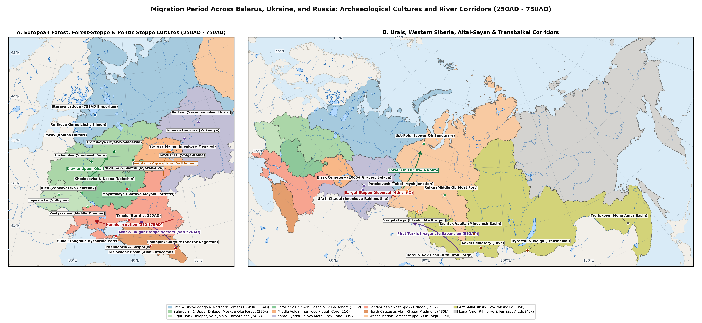
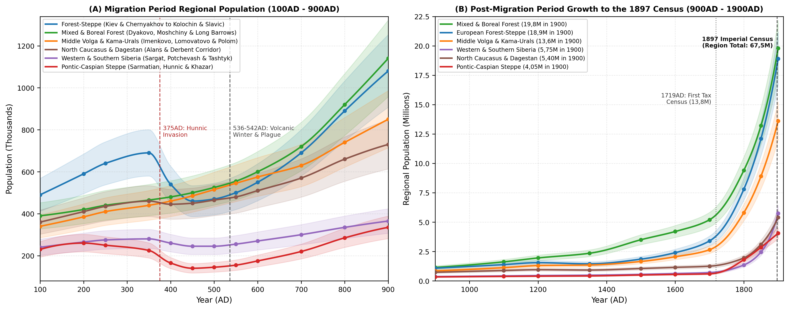
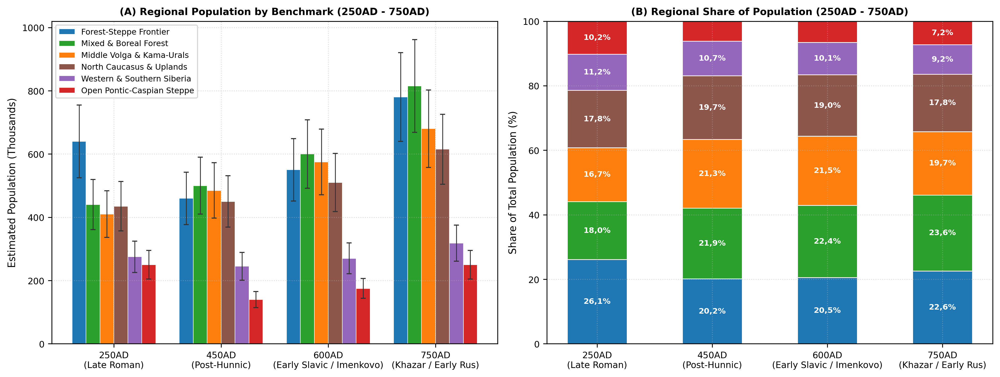
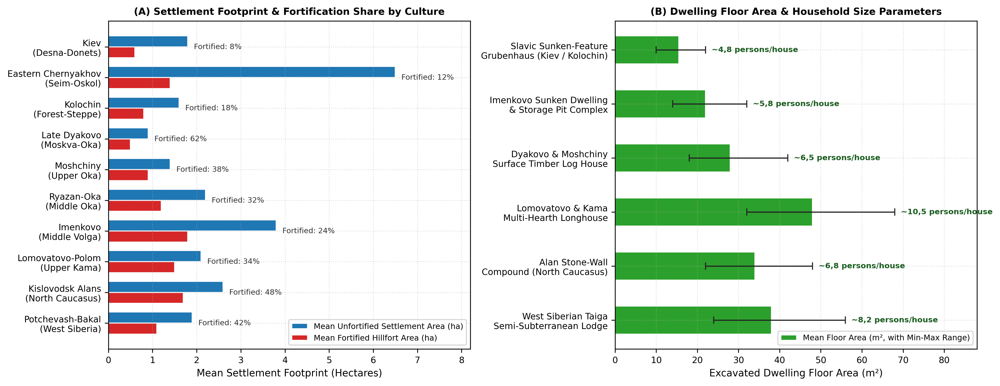

# Abstract

This working paper reviews external Russian and international archaeological, osteological, palynological, and historical-demographic scholarship to estimate regional populations and settlement patterns across Belarus, Ukraine, and Russia during the Migration Period (*Epokha Velikogo pereseleniya narodov*, c. 250-750AD), placed within a long-run comparative series extending from 100AD to the First All-Russian Imperial Census of 1897 (1900AD). Drawing on excavated house-floor areas, hillfort and open village dimensions, cremation and inhumation cemetery burial counts, and river-basin survey inventories across six major geographical regions, we reconstruct consistent regional population series. Across Belarus, Ukraine, and Russia (excluding the Baltic provinces), total population rose from 2,05M (1,6-2,54M) in 100AD to a Late Roman peak of 2,56M (2-3,17M) around 350AD, declined to 2,28M (1,78-2,83M) by 450AD following the Hunnic invasion and the collapse of the eastern Chernyakhov and Late Sarmatian settlement networks, and recovered after the 536-542AD climatic downturn (2,49M in 550AD) to reach 3,13M (2,44-3,88M) by 700AD and 4,5M (3,51-5,58M) by 900AD. Notably, the Migration Period did not bring uniform depopulation across the region, but rather a major geographical shift: populations in the open Pontic-Caspian steppe and exposed southern forest-steppe fell by 28-44% between 350AD and 450AD, whereas Pripyat Polesia and Volhynia (*Prague-Korchak*), the Middle Volga (*Imenkovo*), the Belarusian, Volga-Oka, and northwestern forest zone (*Tushemlya-Bantserovshchina*, *Late Dyakovo*, *Moshchiny*, *Ryazan-Oka*, *Pskov Long Barrows*), the Kama-Cis-Ural basin (*Bakhmutino*, *Turaevo*, *Lomovatovo*, *Polom*), and the North Caucasian terraced mountain valleys (*Alanian Kislovodsk* and *Derbent-Palasa-Syrt*) experienced steady settlement expansion and agricultural growth [@oblomskiy2002dneprovskoe; @vyazov2019middle; @korobov2013terraced; @krenke2019moskvorechye]. Over the subsequent millennium, agricultural colonisation, urban growth, and early modern agrarian settlement carried the population across the study region to 6,6M in 1200AD, 9,1M in 1500AD, 13,8M in 1700AD, 28,1M in 1800AD, and 67,5M by 1900AD [@vodarsky1973naselenie; @kabuzan1990narody; @rashin1956naselenie; @troinitsky1905perepis].

plot of chunk fig1-md-only

# Background

Estimating the population of Northern Eurasia during the Migration Period (c. 250-750AD) presents distinct methodological challenges [@shchukin2005gotskiy; @kazanski2010middle; @oblomskiy2016kolochinskaya]. Unlike the Roman provinces of the Mediterranean or early medieval Western Europe, where tax registers and written charters survive, demographic estimates across the East European Plain, the North Caucasus, the Urals, and Western and Southern Siberia must be built from four archaeological sources: (1) the layout and floor area of excavated houses inside fortified hillforts (*gorodishcha*) and unfortified villages (*selishcha*), (2) mortality life tables calculated from cremation and inhumation cemeteries, (3) pollen cores measuring forest clearance and cereal cultivation (*Cerealia*, *Secale*, *Plantago lanceolata*, and *Rumex*), and (4) systematic river-valley field surveys [@krenke2011dyakovo; @vyazov2019middle; @korobov2013terraced; @goldina1999drevnyaya].

In older archaeological literature, changes in the raw number of known sites between the third and seventh centuries AD were sometimes interpreted as sharp half-century swings in total population. Modern regional fieldwork shows that raw site counts often reflect shifts in village size and settlement mobility rather than actual population loss or gain [@oblomskiy2002dneprovskoe; @vyazov2019middle; @matveeva2024migratsii]. For instance, in the Desna, Seim, and Upper Donets forest-steppe, the replacement of large Chernyakhov farming villages (4-12 ha) in the mid-fourth century AD by smaller, dispersed Kolochin and early Penkovka river-terrace hamlets (0,8-2,2 ha) in the fifth and sixth centuries increased the number of small ceramic scatters per river bend while reducing the average population per village from 145 inhabitants to 45 inhabitants [@terpylovsky2000kievskaya; @oblomskiy2016kolochinskaya; @goryunova1999velikie]. Conversely, in the Moskva-Oka basin and the Kislovodsk mountain basin, the concentration of rural households into fortified promontory hillforts or stone cliff fortresses reduced the number of separate sites while increasing local agricultural output through iron ploughshares and manured terrace fields [@krenke2019moskvorechye; @korobov2013terraced; @korobov2023alany].^[Throughout this review, all regional population figures are derived from excavated house counts, settlement areas, and cemetery burial totals rather than unadjusted site counts.]

Two major historical turning points reshaped settlement patterns across Belarus, Ukraine, and Russia during the Migration Period. First, during the Hunnic invasion of 370-378AD and subsequent post-Hunnic settlement shifts (454-500AD), the crossing of the Volga and Don by Hunnic nomadic forces broke up the Late Sarmatian pastoral network and led to the abandonment of the eastern Chernyakhov frontier in the Kursk-Belgorod forest-steppe [@shchukin2005gotskiy; @medvedev2018postsarmat; @novikova2026istoriografiya]. Rather than disappearing, many post-Chernyakhov and post-Zarubintsy farming communities moved north and north-east into the sheltered forest-steppe and southern forest valleys of the Upper Oka (*Moshchiny*), the Middle Oka (*Ryazan-Oka*), and the Samara-Sviyaga-Lower Kama confluence (*Imenkovo*) [@vorontsov2021fibuly; @vyazov2019middle; @zhikh2019rannie].

Second, during the 536-542AD climatic cooling and the early medieval agricultural expansion that followed, tree-ring and pollen records from the Upper Volga, Novgorod-Pskov, and the Middle Volga record a sharp temperature downturn in the mid-sixth century AD [@vyazov2019middle; @krenke2019moskvorechye]. Across the Middle Volga and forest-steppe zones, this cooler climate encouraged the wider adoption of hardy winter rye (*Secale cereale*) and iron-shod ploughs, supporting the steady growth of Early Slavic (*Prague-Korchak*, *Kolochin*, *Penkovka*) and Finno-Permic (*Lomovatovo*, *Polom*, *Nevolino*) farming populations from the late sixth through eighth centuries AD [@kazanski2010middle; @goldina2012nevolino; @nazarov2025lomovatovo].

# Methodology

## Settlement and Household Estimates

To calculate comparable population figures across different archaeological cultures, we combine excavated house sizes, the number of simultaneous dwellings per village, and regional river-valley survey counts [@oblomskiy2002dneprovskoe; @krenke2011dyakovo; @goldina1999drevnyaya; @matveeva2000sargat]. For an archaeological culture c in region z at date t, the regional population is estimated as:

$$P_{c,z}(t) = N_{\text{clusters}}(t) \times \bar{S}_{\text{contemp}} \times \bar{H}_{\text{active}} \times \mu_{\text{house}}(c)$$

where $N_{\text{clusters}}(t)$ is the estimated number of active settlement clusters across the surveyed river valleys (adjusted for regional survey coverage $\kappa_z \in [0{,}3,\, 0{,}65]$), $\bar{S}_{\text{contemp}}$ is the mean number of simultaneously inhabited villages per cluster after adjusting for average village occupation span ($\tau_{\text{site}} / \Delta T_{\text{phase}}$), $\bar{H}_{\text{active}}$ is the average number of contemporaneously occupied houses per village, and $\mu_{\text{house}}(c)$ is the average household size for that house type.

Broad-area settlement excavations across Belarus, Ukraine, and Russia identify three main domestic building traditions during the Migration Period. Square sunken-featured dwellings (*poluzemlyanki*) were typical of the Kiev, Kolochin, Penkovka, Prague-Korchak, and Imenkovo cultures [@oblomskiy2002dneprovskoe; @oblomskiy2016kolochinskaya; @vyazov2008zemledelie; @goryunova1999velikie]; their floor areas average 12-22,5 m² with a single corner stone or clay oven, housing a nuclear family of 4,5-5,5 persons ($P_{\text{house}} \approx 0{,}28 \cdot A_d^{0{,}92}$). Surface timber-frame and post-built houses (*nazemnye postroyki*) characterised the Late Dyakovo, Moshchiny, Tushemlya, and Ryazan-Oka forest-zone cultures as well as the eastern Chernyakhov surface longhouses [@krenke2011dyakovo; @islanova2012ozero; @lopatin2007severnye; @shchukin2005gotskiy], with floor areas spanning 20-36 m² and housing nuclear or extended households of 5,5-7,5 persons. Multi-hearth log longhouses and timber chambers prevailed among the Kama-Vyatka-Belaya Permic and Ugrian cultures (*Azeevo*, *Mazunino*, *Bakhmutino*, *Lomovatovo*, *Polom*) and West Siberian sub-taiga groups (*Karym*, *Potchevash*) [@goldina1999drevnyaya; @chizhevskiy2020oboronitelnye; @matveeva2000sargat]; measuring 34-72 m² with two to four central hearths, these longhouses accommodated extended families of 10-16 persons.

## Cemetery Mortality Estimates

In regions where seasonal camps or timber surface houses leave faint traces - particularly among steppe pastoralists, North Caucasian catacomb communities, and Middle Oka or Kama-Ural burial groups - village population is cross-checked using the standard Acsádi-Nemeskéri life-table formula [@veselovskaya2021ryazan; @zelenkov2025potchevash; @vodyasov2023tashtyk]:

$$P_{\text{community}} = \frac{\text{MNI}_{\text{total}} \times e_0}{\Delta t_{\text{use}} \times \eta_{\text{recovery}}}$$

where $\text{MNI}_{\text{total}}$ is the minimum number of individuals excavated or projected across the cemetery, e0 is life expectancy at birth (ranging between 21,5 and 25,5 years in Migration Period skeletal series, with mean adult age at death e20 + 20 ~ 36,5-41 years and child mortality d0-14 ~ 42-50%), $\Delta t_{\text{use}}$ is the duration of cemetery use in years, and $\eta_{\text{recovery}} \in [0{,}55,\, 0{,}85]$ accounts for infant bone loss and unexcavated cemetery edges [@veselovskaya2021ryazan; @seregin2021altai; @vodyasov2023tashtyk].

# Results

## Pontic-Caspian Steppe and Forest-Steppe Frontier

### The Kiev and Eastern Chernyakhov Cultures (c. 250-400AD)

Across the Right-Bank and Left-Bank Dnieper, Volhynia, Podolia, Southern Pripyat, Desna, Seim, Psyol, Vorskla, and Upper Donets river basins of Ukraine, southern Belarus, and the Russian Central Black-Earth borderlands, the Late Roman Period was shaped by the coexistence of the forest-steppe Kiev culture (*Kievskaya kul'tura*, c. 200-420AD) and the provincial-Roman Chernyakhov culture (*Chernyakhovskaya kul'tura*, c. 260-400AD) [@oblomskiy2002dneprovskoe; @terpylovsky2000kievskaya; @shchukin2005gotskiy; @novikova2026istoriografiya].

Field surveys compiled by Oblomskiy and Terpylovsky show that Kiev culture settlements stood on low first flood-plain terraces in linear groups of 3-10 unfortified *selishcha* spaced 0,5-2 km apart [@oblomskiy2002dneprovskoe; @terpylovsky2000kievskaya]. Individual villages covered 0,5-2,5 ha (mean 1,8 ha) and contained 5-12 simultaneously occupied square sunken-featured *poluzemlyanki* (12-20 m², mean 16,5 m², dug 0,4-0,8 m into the ground with a central or side post and open hearth), giving an average village population of 30-70 inhabitants (midpoint 48) and a river-valley density of 1,2-2,5 persons/km² [@oblomskiy2002dneprovskoe].

By contrast, the eastern Chernyakhov frontier in the Seim, Oskol, and Upper Donets valleys (*Gochevo*, *Komsomolskoye*, *Khokhlovo*) introduced heavy iron-shared plough agriculture, rotary querns, wheel-thrown grey-ware kilns, and large unfortified valley-slope villages spanning 4-15 ha (mean 6,5 ha) [@shchukin2005gotskiy; @novikova2026istoriografiya]. Excavations uncover rows of 15-35 surface wattle-and-daub longhouses (*Wohnstallhäuser*, 24-45 m²) alongside sunken craft workshops and biritual cemeteries (*MNI* 80-250 graves), supporting 95-210 inhabitants per village (midpoint 145) and local valley densities of 3,5-6,5 persons/km² [@terpylovsky2000kievskaya; @shchukin2005gotskiy]. Together with Chernyakhov and Prague-Korchak agricultural clusters in Volhynia, Podolia, and the Right-Bank Dnieper (*Lepesovka*, *Korchak*, *Pastyrskoye*) and Late Sarmatian settlements on the Middle Don [@medvedev2018postsarmat; @zemtsov2013migratsii], the forest-steppe zone reached a Late Roman peak of 690k (550-830k) around 350AD.

### The Hunnic Invasion, Kolochin, Penkovka, and Nomadic Groups (c. 375-750AD)

The Hunnic crossing of the Volga-Don interfluve in 370-378AD and the breakup of the Gothic-Chernyakhov realm caused a sharp settlement retreat along the exposed southern forest-steppe border [@shchukin2005gotskiy; @kazanski2020steppe; @oblomskiy2022torgovyy]. Between 375AD and 450AD, regional population across the Dnieper-Desna-Don forest-steppe declined from 690k to 460k (-33,3%), while the open Pontic-Caspian and Crimean steppe fell from 225k to 140k (-37,8%) [@medvedev2018postsarmat; @botalov2009gunny].

From the blending of surviving Kiev communities and northern forest-zone settlers arose the Kolochin culture (*Kolochinskaya kul'tura*, c. 400/420-680AD) across the Desna, Seim, Upper Psyol, and Kursk-Bryansk basins, alongside the Penkovka culture (*Pen'kovskaya kul'tura*, 5th-7th centuries AD) further south and Early Slavic settlements on the Upper Don (*Zemtsov*, *Chertovitskoye-Zamyatino*) [@oblomskiy2016kolochinskaya; @goryunova1999velikie; @sereda1999kolochinskiy; @zemtsov2013migratsii]. As excavated at *Velikie Budki (Khutor)*, *Kolochin I*, and *Kartamyshevo*, Kolochin communities lived in small flood-plain *selishcha* (0,8-2,5 ha) paired with refuge hillforts (*gorodishcha*, 0,4-1 ha, 18% of sites fortified), each containing 5-10 square *poluzemlyanki* (12-18 m² with stone or clay ovens) and flat urn or pit cremation cemeteries (*Kartamyshevo*, *Knippovo*, *Lebedka*, 20-65 cremations per cemetery), corresponding to 28-68 inhabitants per village (mean 45) [@oblomskiy2016kolochinskaya; @goryunova1999velikie; @sereda1999kolochinskiy]. During the late sixth and seventh centuries AD - marked by the burial of "Antian" silver and bronze hoards (*Sudzha*, *Gaponovo*, *Kolocha*) - Slavic settlement expanded across the Desna-Don forest-steppe, restoring regional population to 550k by 600AD and 690k by 700AD ahead of the Borshevo and Romny tribal settlements [@kazanski2010middle; @sedov1999drevnerusskaya; @gavritukhin2005chronology].

## Mixed and Boreal Forest Zone of Belarus and European Russia

### Late Dyakovo, Moshchiny, and Ryazan-Oka Finnic Cultures (c. 250-750AD)

In contrast to the exposed steppe borderlands, the mixed broadleaf-coniferous forest zone of the Moskva, Upper Volga, and Oka basins served as a stable settlement core and refuge zone throughout the Migration Period [@krenke2011dyakovo; @krenke2019moskvorechye; @vorontsov2021fibuly; @akhmedov2018ryazan]. Within the Late Dyakovo culture (*Pozdned'yakovskaya kul'tura*, c. 250-550/600AD), Krenke's radiocarbon and stratigraphic excavations at *Dyakovo*, *Troitskoye*, *Lukovskoye*, and *Kuntsevo* in the Moskva River basin show that 62% of settlements were fortified promontory *gorodishcha* (0,3-1,2 ha, enclosed by double or triple timber-and-earth ramparts) paired with outer open villages [@krenke2011dyakovo; @krenke2019moskvorechye; @veksler2017dyakovo]. Houses shifted from early round structures to rectangular surface post-built and log dwellings (18-32 m², mean 24 m²), with 8-15 houses per hillfort supporting 40-95 inhabitants (mean 65) and river-valley densities of 1-2,2 persons/km² [@krenke2011dyakovo].

Further south, in the Upper Oka, Ugra, and Protva basins (Kaluga, Tula, and western Oryol oblasts), Baltic-speaking communities of the Moshchiny culture (*Moshchinskaya kul'tura*, 4th-7th centuries AD) absorbed post-Chernyakhov and Middle Dnieper settlers after 375AD, as shown by *Kartavtsevo-Serensk* brooches, champlevé red enamels, and wheel-thrown pottery imitations [@vorontsov2021fibuly; @mayorov2016moschiny; @sevostyanov2022keramika]. Centred on fortified hillforts (*Moshchiny*, *Serensk*, *Supruty*, 0,5-1,5 ha) and surrounding open villages (1-2,5 ha) with cremation barrows (*kurgany*), the Upper Oka population grew steadily from 95k in 250AD to 145k by 600AD [@vorontsov2021fibuly; @mayorov2016moschiny].

Along the Middle Oka bend from Kolomna to Kasimov (*Nikitino*, *Borki*, *Kuzminskoye*, *Shatrishche*, *Undrikh*, *Korablino*), Finnic farming and fur-trading communities of the Ryazan-Oka cemetery culture (*Kul'tura ryazano-okskikh mogil'nikov*, 3rd-7th centuries AD) maintained one of the densest settlement networks in Forest-Zone Russia [@akhmedov2018ryazan; @veselovskaya2021ryazan; @semenov2022ryazan]. Promontory hillforts and large terrace villages (1,5-3,5 ha) were paired with large flat inhumation cemeteries containing 100-600+ graves furnished with cross-shaped brooches, Roman and Sassanian silver vessels, and horse-riding weapons [@akhmedov2018ryazan; @veselovskaya2021ryazan; @vikhlyaev2011erzya; @mokshina2012peterburgskiy]. Skeletal and burial-count studies indicate village populations of 55-125 inhabitants (mean 85) and a regional Middle Oka-Mordvin population rising from 135k in 250AD to 215k by 700AD.

### Northwestern Forest Zone: Tushemlya and Pskov Long Barrows (c. 300-750AD)

Across the Belarusian Upper Dnieper, Berezina, Pripyat, and Western Dvina basins and the Russian Smolensk, Velikaya, and Ilmen-Msta watersheds (excluding the Baltic provinces of Estonia, Latvia, and Lithuania), Lopatin, Furasiev, Mikhailova, and Islanova document the steady settlement of sandy pine river terraces [@lopatin2007severnye; @mikhailova2014poseleniya; @mikhailova2014snaryazhenie; @markov2024pskov; @islanova2012ozero]. While the Belarusian and Smolensk Tushemlya-Bantserovshchina group (4th-7th centuries AD) combined small open *selishcha* (0,5-1,8 ha) with oval timber-walled refuge enclosures (*Bantserovshchina* near Minsk, *Tushemlya*, *Gorodok*, *Kovsharovo*), the Culture of Pskov Long Barrows (*Kul'tura pskovskikh dlinnykh kurganov*, 5th-9th centuries AD) spread across the Velikaya, Lovat, Msta, and Upper Volga watersheds [@mikhailova2014poseleniya; @markov2024pskov; @islanova2012ozero]. Each long barrow cemetery (3-25 elongated or oval mounds, each holding 2-12 cremations) served a local group of 2-4 unfortified lakeshore hamlets (25-50 inhabitants per hamlet), supporting a combined northwestern forest population that grew from 115k in 250AD to 165k in 550AD and 230k by 700AD [@mikhailova2014poseleniya; @islanova2012ozero].

## Middle Volga, Kama-Vyatka, and Cis-Urals

### The Imenkovo Agricultural Expansion on the Middle Volga (c. 400-700AD)

One of the most important demographic developments of Migration Period Russia was the rapid agricultural settlement of the Middle Volga, Samara Bend (*Samarskaya Luka*), Sviyaga, Cheremshan, and Lower Kama valleys by the Imenkovo culture (*Imenkovskaya kul'tura*, c. 400-650/700AD) [@vyazov2019middle; @vyazov2008zemledelie; @vyazov2020kompleks; @zhikh2019rannie]. Combining over 600 mapped settlements (*Staraya Maina*, *Imenkovo*, *Maklasheevo*, *Osh-Pando-Ner'*, *Scherbet'*) with pollen cores and radiocarbon dates, Vyazov et al. show that cultivated land and settlement density on the Middle Volga quadrupled between 400AD and 600AD [@vyazov2019middle; @vyazov2008zemledelie].

Formed by post-Zarubintsy and post-Chernyakhov settlers from the Dnieper-Desna forest-steppe mingling with local Finno-Volgaic communities, Imenkovo settlements formed tight local clusters consisting of a central fortified *gorodishche* (1-3 ha) surrounded by 4-12 large unfortified *selishcha* (2-8 ha, with *Staraya Maina* exceeding 6 ha) [@vyazov2019middle; @zhikh2019rannie]. Using heavy iron ploughshares (*ral'niki*), sickles, cylindrical grain storage pits (*khlebnye yamy* holding 300-800 kg of millet, wheat, and winter rye), and iron smelting furnaces, individual Imenkovo villages contained 12-30 simultaneously occupied *poluzemlyanki* (16-26 m²), supporting 70-160 inhabitants per village (mean 110) and a Middle Volga population that rose from 145k in 350AD to 240k by 550-600AD [@vyazov2019middle; @vyazov2008zemledelie]. In the late seventh century AD, the arrival of Early Bulgar nomadic groups (*Novinkovka* burial mounds on the Samara Bend and *Shilovka*) led part of the Imenkovo population to move west toward the Middle Dnieper (*Volyntsevo* culture), while the remaining farming villages were absorbed into early Volga Bulgaria [@vyazov2020kompleks; @skarbovenko2012kochevniki; @lifanov2020alekseevskoe; @zhikh2019rannie].

### Permic and Cis-Ural Groups: Mazunino, Bakhmutino, Turaevo, Lomovatovo, and Polom (c. 250-750AD)

In the Kama, Vyatka, Belaya, and Sylva river basins of the Cis-Urals (Udmurtia, Perm Krai, Bashkortostan, and eastern Tatarstan), large-scale excavations synthesised by Goldina, Gening, Chizhevskiy, Bakhshiev, and Shmuratko document steady Permic and Ugrian population growth [@goldina1999drevnyaya; @goldina2012nevolino; @gening1988turaevo; @bakhshiev2017bakhmutino; @shmuratko2011prikamye; @chizhevskiy2020oboronitelnye; @belitskaya2026slitki]. Following the breakup of the Late Pyanobor union in the third to sixth centuries AD, the Mazunino culture (Middle Kama and Lower Belaya) and Bakhmutino culture (Belaya-Ufa basin, including the large *Ufa II* fortified town and *Birsk* cemetery with over 1.000 burials) built dense networks of timber-rampart hillforts (0,8-2,5 ha) and open villages [@goldina1999drevnyaya; @bakhshiev2017bakhmutino; @chizhevskiy2020oboronitelnye]. In the fifth century AD, the arrival of armed steppe-forest groups created the Turaevo kurgan group (*Turaevo*, *Bartym*) on the Middle Kama [@gening1988turaevo; @shmuratko2011prikamye].

Between the fifth and eighth centuries AD, across the Upper Kama (*Lomovatovo*), Cheptsa (*Polom*), and Sylva (*Nevolino*, e.g. *Brody*, *Verkh-Saya*) basins, Permic communities lived in multi-hearth surface log longhouses (35-65 m², mean 42 m², housing 10-15 family members) and buried their dead in large flat cemeteries containing hundreds of graves with Sassanian and Byzantine silver vessels (*Bartym*, *Kudymkar*) exchanged for northern sable and squirrel furs [@goldina1999drevnyaya; @goldina2012nevolino; @nazarov2025lomovatovo; @ivanov2021ugrian]. Total population across the Kama-Vyatka-Belaya Cis-Urals grew from 265k in 250AD to 335k in 550AD and 395k by 700AD.

## North Caucasus and Caspian Corridor

The North Caucasus and the narrow Caspian coastal plain of Dagestan formed the strategic gateway between the Eurasian steppe and the Sassanian and Byzantine empires [@korobov2013terraced; @korobov2023alany; @gadzhiev2002derbent; @gmyrya2022palasa]. Using GIS mapping, soil phosphate testing, and systematic surveys of 268 Early Alanian fortified settlements and catacomb cemeteries (*Klin-Yar III-IV*, *Mokraya Balka*, *Gornoe Ekho*), Korobov and Borisov showed that after the Hunnic invasion of the open Ciscaucasian steppe in 375AD, Alanian communities settled densely inside the sheltered Kislovodsk mountain basin (800-1.400 m elevation) [@korobov2013terraced; @korobov2023alany; @fomenko2018alany]. To support this concentrated population, Alanian farmers built thousands of hectares of artificial agricultural terraces fertilised with household manure [@korobov2013terraced]. Each stone-walled cliff fortress (0,8-2,5 ha, spaced 1-2,5 km apart) and paired catacomb cemetery (*Klin-Yar* and *Mokraya Balka* containing 400-1.000+ family catacombs) supported 80-175 inhabitants (mean 120), producing mountain-valley densities of 12-22 persons/km² and a central Alanian piedmont population of 195-260k between the fifth and eighth centuries AD [@korobov2013terraced; @korobov2023alany].

On the Lower Kuban and Taman-Abkhazian coast (*Dyurso*, *Pashkovskiy*, *Borisovskiy*), Mastykova's study of burial dress documents mixed Alanian, Adyghe-Zikh, and East Germanic (*Tetraxite Goth*) farming and port communities [95-130k] [@mastykova2009kuban; @mastykova2009ierarkhiya]. Along the Caspian coast in Dagestan, the Sassanian construction of the stone fortress and walls of Derbent under Kavad I and Khosrow I Anushirvan (6th century AD) protected a dense urban-garrison and irrigated farming zone alongside the large Palasa-Syrt kurgan-catacomb cemetery (1.500+ mounds dating to the 4th-6th centuries AD, excavated by Gmyrya, Gadzhiev, and Malashev) [@gadzhiev2002derbent; @gmyrya2022palasa; @malashev2011palasa]. Total population across the North Caucasus and Dagestan rose from 435k in 250AD to 480k in 550AD and 570k by 700AD.

## Western and Southern Siberia

### Tobol-Ishim-Irtysh-Ob Forest-Steppe and Southern Taiga (c. 250-750AD)

In Western Siberia, Matveeva, Zelenkov, and Sleptsova have traced the post-Sargat settlement reorganisation across the Tobol, Ishim, Irtysh, and Middle Ob basins [@matveeva2000sargat; @matveeva2024migratsii; @zelenkov2025potchevash]. During the third and fourth centuries AD, the Sargat kurgan union (*Tsarev Kurgan*, *Isakovka*, estimated by Matveeva at 110-145k across the Tobol-Irtysh forest-steppe with 50-100 inhabitants per fortified settlement group) broke apart under the combined effects of steppe drying, Hunnic-Xianbei movements, and the southward expansion of taiga Karym and Kozlov hunting, fishing, and iron-working groups [@matveeva2000sargat; @matveeva2024migratsii].

Out of this mixing between the fifth and eighth centuries AD emerged the Bakalskaya culture in the Tobol-Ishim forest-steppe and the Potchevash culture (*Potchevash*, *Vikulovo*, *Okunevo*, *Likhachevo*) along the Irtysh and Middle Ob [@matveeva2024migratsii; @zelenkov2025potchevash]. Living in promontory hillforts (0,6-1,5 ha) and multi-family semi-subterranean log houses (28-42 m²) while practising horse breeding, floodplain farming, and fur trapping, West Siberian populations stood at 145-165k in 450-550AD and grew to 185k by 700AD [@matveeva2024migratsii; @zelenkov2025potchevash].

### Minusinsk Basin, Altai, Tuva, and Cis-Baikal (c. 250-750AD)

Across the mountain-steppe basins of Southern Siberia, three main regional traditions developed during the Migration Period. In the Yenisei-Abakan Minusinsk Basin (*Oglakhty*, *Tepsen*, *Bateni*, *Izzykhtash*), Azbelev and Vodyasov and Zaitseva trace the Tashtyk culture (1st-6th centuries AD) through the shift from individual inhumation and cremation pit graves to large collective timber-lined subterranean vaults (*sklepy*, up to 60-80 m²) holding 20-150+ cremated and mummified burials with painted gypsum funerary masks [@azbelev2007oglakhty; @vodyasov2023tashtyk]. Supported by irrigated millet farming and valley pastoralism, the Minusinsk Basin sustained 55-75k inhabitants before the rise of the Yenisei Kyrgyz (*Chaatas* period, 6th-9th centuries AD) [@vodyasov2023tashtyk].

Further south and east across Tuva, the Altai, and Lake Baikal, regional cemetery excavations document resilient pastoral and metallurgical populations. In Tuva, the post-Xiongnu Kokel culture (*Kokel*, *Eerbek*, *Khemchik*, 2nd-5th centuries AD) excavated by Wainstein, Teterin, and Mit'ko left large cemeteries of 100-400+ timber-coffin burials [30-45k] [@teterin2013kokel]. In the Russian Altai, Seregin and Matrenin's studies of the Bulan-Koba (Xianbei-Rouran period, 2nd-5th centuries AD, e.g. *Choburak-I*, *Stepushka*, *Ust'-Steklyannoe*) and Early Turkic (*Kudyrge*, *Katanda*, *Tuekta*, *Berel*, 6th-8th centuries AD) burials document high child mortality (40-48%) alongside growing iron-smelting and pastoral communities [35-55k] under the First Turkic Khaganate after 552AD [@seregin2021altai; @seregin2022xianbei; @matrenin2015pryazhki; @tishin2018turks]. West of Lake Baikal and along the Angara-Lena watershed, Kharinsky traces the transition from the Elga graves (3rd century BC - 4th century AD) to the iron-smelting and irrigation-farming Kurumchin (*Kurykan*) culture (6th-10th centuries AD) [20-35k] [@kharinsky2005baikal; @kharinsky2014elga].

## Population and Settlement Estimates

### Population Estimates (100 - 900AD)

Combining the regional archaeological evidence across the six regions of Belarus, Ukraine, and Russia produces a consistent demographic series from 100AD to 1900AD (Table \ref{tab:zonal-trajectories} and Figure \ref{fig:trajectories}). During the Late Roman Warm Period (100-350AD), under mild climatic conditions and active trade with the Roman Black Sea provinces and Sarmatian steppe, total population across the study region rose from 2,05M (1,6-2,54M) in 100AD to 2,45M in 250AD and 2,56M (2-3,17M) in 350AD (an annual growth rate of roughly +0,09%/yr), led by the eastern Chernyakhov and Kiev farming villages in the forest-steppe (690k) and steady settlement growth across the Late Dyakovo, Ryazan-Oka, and Mazunino forest and Kama regions [@oblomskiy2002dneprovskoe; @shchukin2005gotskiy; @krenke2011dyakovo].

During the Hunnic invasion and the northward and upland settlement shift (375-550AD), the campaigns of 370-378AD and fifth-century steppe warfare reduced the total population of the study region by 10,9% to 2,28M (1,78-2,83M) around 450AD. However, as Figure \ref{fig:redistribution} shows, this drop was confined to the open Pontic-Caspian steppe (-37,8%) and the exposed southern forest-steppe border (-33,3%). Over the same period (350-550AD), population grew substantially in the Middle Volga *Imenkovo* region and Kama Cis-Urals (+23,9%, from 440k to 545k), the Volga-Oka and northwestern forest zone (+19,4%, from 465k to 555k), and the terraced mountain valleys of the North Caucasus (+4,3%, from 460k to 480k) [@vyazov2019middle; @korobov2013terraced; @vorontsov2021fibuly]. As a result, the combined share of the forest zone, Middle Volga-Kama, and North Caucasian valleys rose from 52,5% of the regional total in 250AD to 62,9% in 450AD and 63,4% in 550AD.

During the subsequent phase of early medieval agricultural growth (560-900AD), following the 536-542AD cooling episode and the spread of winter rye, heavy iron ploughshares, and river trade along the Volga, Don, and Dnieper under the Khazar and First Turkic khaganates, total population across Belarus, Ukraine, and Russia grew from 2,49M in 550AD to 2,68M in 600AD, 3,13M in 700AD, 3,83M in 800AD, and 4,5M (3,51-5,58M) by 900AD (+0,17%/yr) [@kazanski2010middle; @vyazov2019middle; @goldina1999drevnyaya; @korobov2023alany].

### Post-Migration Period Growth to the 1897 Census (900 - 1900AD)

To place the Migration Period estimates into a long-run context extending to modern statistical records, Table \ref{tab:zonal-trajectories} and Figure \ref{fig:trajectories} extend the regional population series from 900AD to the First All-Russian Imperial Census of 1897 (1900AD) [@vodarsky1973naselenie; @kabuzan1990narody; @rashin1956naselenie; @troinitsky1905perepis]. Between 900AD and 1200AD, during the pre-Mongol expansion of Kievan Rus' and Volga Bulgaria, the clearing of mixed forest watersheds across Novgorod-Pskov, Vladimir-Suzdal, Smolensk, Murom-Ryazan, and urban Volga Bulgaria raised the population within the boundaries of modern Russia from 4,5M to 6,6M (5,28-7,92M), with the mixed and boreal forest zone reaching 1,95M and the Middle Volga-Kama region 1,3M [@krenke2019moskvorechye; @vyazov2019middle].

Despite the demographic losses of the Mongol campaigns (1237-1240AD) and fourteenth-century plague outbreaks, northeastward rural settlement into the Moscow-Upper Volga basin enabled total population across Russia to reach 9,1M (7,46-10,74M) by 1500AD, as recorded in early Muscovite land cadastres (*pistsovye knigi*) [@vodarsky1973naselenie]. Construction of the southern defensive lines (*zasechnye cherty*) in the sixteenth and seventeenth centuries reopened the black-earth forest-steppe of Kursk, Voronezh, Tambov, and Penza to plough cultivation; by the 1678 household census (*perepisnye knigi*) and Peter I's First Poll-Tax Revision of 1719 (c. 1700AD benchmark), total population within the Russian territories stood at 13,8M (12,14-15,46M), including 5,2M in the forest zone, 3,4M in the forest-steppe, and 2,65M in the Middle Volga-Kama-Ural provinces [@vodarsky1973naselenie; @kabuzan1990narody].

Across the eighteenth and nineteenth centuries, the agricultural settlement of the Lower Volga-Don steppe, the mining and industrial growth of the Urals, and peasant migration into Western and Southern Siberia raised the population of the Russian territories from 28,1M in 1800AD (Fifth and Sixth Poll-Tax Revisions) to 67,5M (65,48-69,53M) in the 1897 Imperial Census (adjusted to the *gubernii* and provinces within modern Russia), comprising 19,8M in the forest zone, 18,9M in the Central Black-Earth forest-steppe, 13,6M in the Middle Volga and Urals, 5,75M in Siberia, 5,4M in the North Caucasus, and 4,05M in the Lower Don-Volga steppe [@kabuzan1990narody; @rashin1956naselenie; @troinitsky1905perepis; @fedoseev2021povolzhe].

plot of chunk fig2-trajectories

Table: Regional population estimates and uncertainty ranges across the six regions of Belarus, Ukraine, and Russia (100AD - 1900AD).

|Year   |Forest-Steppe |Forest Zone |Volga & Urals |North Caucasus |Siberia |Steppe |Total (k) |Range (M)    |
|:------|:-------------|:-----------|:-------------|:--------------|:-------|:------|:---------|:------------|
|100AD  |490           |390         |340           |360            |240     |230    |2.050     |1,6-2,54M    |
|250AD  |640           |440         |410           |435            |275     |250    |2.450     |1,91-3,04M   |
|350AD  |690           |465         |440           |460            |280     |225    |2.560     |2-3,17M      |
|450AD  |460           |500         |485           |450            |245     |140    |2.280     |1,78-2,83M   |
|550AD  |500           |555         |545           |480            |255     |155    |2.490     |1,94-3,09M   |
|700AD  |690           |720         |630           |570            |300     |220    |3.130     |2,44-3,88M   |
|800AD  |890           |920         |740           |660            |335     |285    |3.830     |2,99-4,75M   |
|900AD  |1.080         |1.140       |850           |730            |365     |335    |4.500     |3,51-5,58M   |
|1200AD |1.550         |1.950       |1.300         |950            |450     |400    |6.600     |5,28-7,92M   |
|1500AD |1.850         |3.500       |1.650         |1.050          |550     |500    |9.100     |7,46-10,74M  |
|1700AD |3.400         |5.200       |2.650         |1.250          |700     |600    |13.800    |12,14-15,46M |
|1800AD |7.800         |9.400       |5.800         |1.950          |1.350   |1.800  |28.100    |25,85-30,35M |
|1900AD |18.900        |19.800      |13.600        |5.400          |5.750   |4.050  |67.500    |65,48-69,53M |

plot of chunk fig3-redistribution

### Settlement Estimates

Figure \ref{fig:settlement-metrics} and Table \ref{tab:culture-metrics} summarise the village sizes, fortification shares, and house floor areas compiled across twenty major Migration Period archaeological cultures in Belarus, Ukraine, and Russia. A clear contrast separates the unfortified river-terrace farming hamlets of the Desna-Seim forest-steppe (*Kiev* and *Kolochin*, where only 8-18% of sites are fortified and square *poluzemlyanki* average 15-16,5 m²) from the fortified promontory hillfort networks of the Moskva-Oka forest zone (*Late Dyakovo*, 62% fortified) and the stone cliff fortresses of the North Caucasian *Kislovodsk Alans* (48% fortified) [@oblomskiy2002dneprovskoe; @oblomskiy2016kolochinskaya; @krenke2011dyakovo; @korobov2013terraced]. Meanwhile, the largest individual village populations occur in the plough-farming *Chernyakhov* (145 inhabitants/site) and *Imenkovo* (110 inhabitants/site) agricultural clusters, the terraced Alanian mountain valleys (120 inhabitants/site), and the multi-hearth log longhouse communities of the Kama-Ural *Lomovatovo-Polom* cultures (95 inhabitants/site, mean house floor area 42 m²) [@shchukin2005gotskiy; @vyazov2019middle; @goldina1999drevnyaya].

plot of chunk fig4-settlement-metrics

Table: Chronology, core river basins, house floor areas, and estimated village and regional populations across twenty Migration Period cultures (250AD - 750AD).

|Archaeological Culture         |Dates     |Core River Basins               |House Type & Area                 |Site Pop. (Mean) |Regional Pop. |
|:------------------------------|:---------|:-------------------------------|:---------------------------------|:----------------|:-------------|
|Kiev Culture                   |200-420AD |Desna, Seim, Upper Donets       |Poluzemlyanka (12-20 m²)          |30-70 (48)       |140-210k      |
|Chernyakhov (Eastern Frontier) |260-400AD |Seim, Psyol, Oskol, Donets      |Surface longhouse (22-42 m²)      |95-210 (145)     |180-260k      |
|Kolochin Culture               |420-680AD |Desna, Seim, Kursk-Bryansk      |Poluzemlyanka (12-18 m²)          |28-68 (45)       |150-230k      |
|Penkovka (NE Forest-Steppe)    |450-680AD |Seim, Vorskla, Middle Donets    |Poluzemlyanka (12-19 m²)          |30-72 (48)       |90-145k       |
|Post-Sarmatian / Middle Don    |250-450AD |Middle & Lower Don, Hopjor      |Yurt / light frame (14-22 m²)     |25-60 (40)       |60-110k       |
|Late Dyakovo Culture           |250-580AD |Moskva, Upper Volga, Oka        |Surface log/post (18-32 m²)       |40-95 (65)       |110-165k      |
|Moshchiny Culture              |350-680AD |Upper Oka, Ugra, Protva         |Surface log/sunken (16-26 m²)     |35-80 (55)       |95-145k       |
|Ryazan-Oka Cemetery Culture    |250-680AD |Middle Oka, Moksha, Tsna        |Surface timber house (20-34 m²)   |55-125 (85)      |135-215k      |
|Tushemlya-Bantserovshchina     |350-680AD |Smolensk Dnieper, W. Dvina      |Post/log house (16-24 m²)         |25-55 (38)       |65-105k       |
|Pskov Long Barrows             |420-850AD |Velikaya, Peipus, Ilmen, Msta   |Surface timber house (16-25 m²)   |25-50 (35)       |75-135k       |
|Imenkovo Culture               |400-680AD |Middle Volga, Samara, Sviyaga   |Poluzemlyanka (16-26 m²)          |70-160 (110)     |145-240k      |
|Early Bulgars (Novinkovka)     |630-780AD |Samara Bend, Ulyanovsk Volga    |Yurt / semi-sunken (14-20 m²)     |35-85 (55)       |45-85k        |
|Mazunino / Azeevo              |250-500AD |Middle Kama, Lower Belaya       |Multi-hearth log (30-50 m²)       |55-120 (82)      |85-130k       |
|Bakhmutino / Turaevo           |300-650AD |Belaya, Ufa, Middle Kama        |Timber frame / log (26-45 m²)     |65-145 (98)      |110-165k      |
|Lomovatovo & Polom             |450-850AD |Upper Kama, Cheptsa, Sylva      |Multi-hearth longhouse (35-65 m²) |60-140 (95)      |120-195k      |
|Kislovodsk Basin Alans         |250-750AD |Kislovodsk, Upper Kuban, Terek  |Stone-walled compound (24-42 m²)  |80-175 (120)     |180-260k      |
|Derbent & Palasa-Syrt Corridor |300-750AD |Caspian Dagestan, Rubas, Sulak  |Mudbrick/stone urban & rural      |90-250 (140)     |130-200k      |
|Lower Kuban / Dyurso           |400-750AD |Lower Kuban, Taman, Black Sea   |Timber/stone house (18-30 m²)     |50-115 (78)      |85-130k       |
|Potchevash & Bakalskaya        |420-800AD |Tobol, Ishim, Irtysh, Middle Ob |Semi-sunken log (26-42 m²)        |45-115 (75)      |130-185k      |
|Tashtyk / Kokel / Altai Turks  |200-750AD |Minusinsk, Altai, Tuva, Baikal  |Log polygonal / yurt (18-36 m²)   |30-80 (50)       |115-165k      |

# Limitations

Three main source limitations account for the uncertainty ranges (+/- 18-24%) in our Migration Period estimates. First, across the forest and forest-steppe regions (*Kiev*, *Kolochin*, *Moshchiny*, *Tushemlya*, *Pskov Long Barrows*, and *Imenkovo*), surface or shallow-pit cremation rites destroy fragile infant and child bones [@oblomskiy2016kolochinskaya; @mikhailova2014poseleniya; @vyazov2019middle]. For cremation cultures, population estimates must therefore rely primarily on excavated house counts (*poluzemlyanki* and surface timber dwellings) rather than raw cremation urn totals.

Second, unfortified forest-steppe and forest *selishcha* frequently relocated along river terraces every 25-50 years as local arable plots or timber supplies were exhausted [@oblomskiy2002dneprovskoe; @islanova2012ozero]. Without radiocarbon dating of individual settlement layers (such as the series from *Dyakovo* analysed by Krenke and from the *Samara-Middle Volga* basin by Vyazov et al.), adding together all ceramic scatters dated to a two-century period would overstate the number of simultaneously inhabited villages by two to three times [@krenke2019moskvorechye; @vyazov2019middle]. Our regional calculations apply an occupation-span adjustment ($\tau_{\text{site}} / \Delta T_{\text{phase}} \in [0{,}28,\, 0{,}5]$) so that only simultaneously occupied villages are counted.

Third, in the open Pontic-Caspian, Lower Volga-Don, and South Siberian steppes, winter pastoral camps (*zimovki*) often lie submerged beneath modern reservoirs (Tsimlyansk, Volgograd, Saratov, and Krasnoyarsk reservoirs) or eroded riverbanks, leaving burial mounds (*Tanais*, *Palasa-Syrt*, *Novinkovka*, *Kudyrge*) as the main archaeological record [@medvedev2018postsarmat; @skarbovenko2012kochevniki; @seregin2021altai]. Steppe pastoral densities (0,15-0,45 persons/km²) consequently carry wider relative uncertainty ranges than settled farming valleys.

# Conclusion

Reviewing external Russian and international archaeological scholarship across the Migration Period (c. 250-750AD) shows that the demographic history of Belarus, Ukraine, and Russia was defined by regional redistribution rather than general collapse. While the Hunnic invasion of 370-378AD and the breakup of the eastern Chernyakhov and Late Sarmatian networks reduced population across the open steppe and exposed southern forest-steppe border from 915k in 350AD to 600k in 450AD, concurrent movement into the forest zone and mountain valleys supported steady agricultural and settlement growth across the Middle Volga (*Imenkovo*), the Volga-Oka and northwestern forest zone (*Late Dyakovo*, *Moshchiny*, *Ryazan-Oka*, *Pskov Long Barrows*), the Kama-Cis-Ural Permic groups (*Bakhmutino*, *Lomovatovo*, *Polom*), and the terraced valleys of the North Caucasus (*Kislovodsk Alans* and *Derbent*). Across the study region of Belarus, Ukraine, and Russia as a whole, population stood at 2,45M in 250AD and 2,56M in 350AD, dipped to 2,28M in 450AD, and expanded with the spread of winter rye and iron ploughshares to 3,13M in 700AD and 4,5M by 900AD, laying the demographic foundations for subsequent growth to 6,6M in 1200AD, 9,1M in 1500AD, 13,8M in 1700AD, and 67,5M by the 1897 Imperial Census (1900AD).

# Appendix

## Regional Density and Life-Table Estimates

Table \ref{tab:appendix-benchmarks} summarises the river-valley population densities, farming systems, and skeletal life-table estimates compiled from the regional archaeological literature across the six regions of Belarus, Ukraine, and Russia.

Table: River-valley population densities, farming systems, and skeletal life-table estimates across the six regions (250AD - 750AD).

|Region                                    |River-Valley Density                        |Subsistence & Farming System                                                     |Skeletal Life-Table Estimates                             |Key Regional Studies                                               |
|:-----------------------------------------|:-------------------------------------------|:--------------------------------------------------------------------------------|:---------------------------------------------------------|:------------------------------------------------------------------|
|1. European Forest-Steppe                 |1,2-6,5 persons/km² (river valleys)         |Millet, barley, wheat; iron plough (Chernyakhov) to winter rye (6th-8th c.)      |e0 = 22,5-24,8 yr; child d(0-14) = 44-48%                 |Oblomskiy (2002, 2016); Terpylovsky (2000); Shchukin (2005)        |
|2. Mixed & Boreal Forest Zone             |0,6-2,2 persons/km² (terrace corridors)     |Forest-fallow & flood-plain plots; barley, wheat, flax, livestock, fur trade     |e0 = 22-24,5 yr; adult mean age 37,5-40,2 yr (Ryazan-Oka) |Krenke (2011, 2019); Vorontsov (2021); Veselovskaya et al. (2021)  |
|3. Middle Volga (Imenkovo Core)           |2,5-5,8 persons/km² (Samara-Sviyaga)        |Intensive iron-plough farming; winter rye, millet, wheat; cylindrical grain pits |e0 = 23-25 yr; high cereal-starch dental caries rate      |Vyazov (2008); Vyazov et al. (2019, 2020); Zhikh (2019)            |
|4. Kama-Vyatka-Belaya Cis-Urals           |1,1-3 persons/km² (Kama-Belaya)             |Mixed arable-pastoralism, horse breeding, bronze/iron metallurgy, fur export     |e0 = 21,8-24,2 yr; Birsk / Nevolino / Lomovatovo series   |Goldina (1999, 2012); Gening (1988); Bakhshiev et al. (2017)       |
|5. North Caucasus (Kislovodsk & Dagestan) |12-22 persons/km² (terraced valleys)        |Manured artificial hillside terraces (Kislovodsk); irrigated coast (Derbent)     |e0 = 23,5-26 yr; Klin-Yar & Palasa-Syrt catacomb series   |Korobov & Borisov (2013); Korobov (2023); Gmyrya (2022)            |
|6. Western & Southern Siberia             |0,4-1,8 persons/km² (forest-steppe valleys) |Floodplain millet/barley (Minusinsk/Irtysh), valley horse-sheep pastoralism      |e0 = 21,5-24 yr; child mortality 42-48% (Altai / Tashtyk) |Matveeva et al. (2024); Vodyasov & Zaitseva (2023); Seregin (2021) |

# Sources

::: {#refs}
:::

