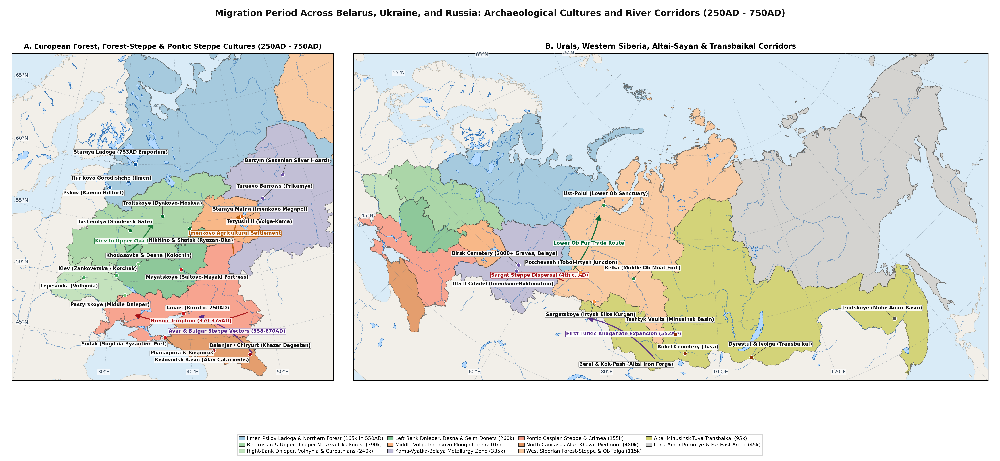

# Abstract

This gazetteer compiles population estimates for 198 excavated
settlements across Belarus, Ukraine and Russia (excluding the Baltic
provinces) from the Late Roman period (250AD) to the First All-Russian
Census of 1897 (1900AD). Arranged across six ecological zones - the
European forest-steppe, the mixed and boreal forests, the Middle Volga
and Kama-Urals, the open Pontic-Caspian steppe, the North Caucasus and
Siberia - the tables trace how village life shifted when the Huns broke
up the eastern Chernyakhov and Late Sarmatian settlements in the 370s
AD. While open steppe camps and exposed southern border villages shrank
or moved between 350AD and 450AD, fortified hillforts (*gorodishcha*),
woodland river villages (*selishcha*) and terraced mountain strongholds
grew steadily from the fifth to the tenth centuries AD, laying the urban
foundations of early medieval Rus’, Volga Bulgaria and the Caucasian
frontier.

# Methodology

This gazetteer brings together 198 excavated Migration Period
(c. 250-750AD) and early medieval settlements - promontory hillforts
(*gorodishcha*), river-terrace villages (*selishcha*) and steppe
strongholds - across the six regions of Belarus, Ukraine and Russia
(excluding the Baltic provinces). Together they trace the shift of
population from the open Pontic-Caspian steppe into the woodland valleys
of the Dnieper, Oka, Upper and Middle Volga, Kama and North Caucasus.

For each site, population estimates across the Migration Period (250,
350, 450, 600 and 750AD) and the early medieval transition (900AD) are
worked out from excavated house counts, fortified and open settlement
areas and cemetery grave totals
[\[1\]](#ref-oblomskiy2016kolochinskaya)[\[2\]](#ref-krenke2019moskvorechye)[\[3\]](#ref-goldina1999drevnyaya)[\[4\]](#ref-gadzhiev2002derbent).
Dates before a settlement was founded or after it was abandoned are
marked with a hyphen (-). Where an ancient hillfort or village grew into
a lasting town or village on the same spot, its population at the First
All-Russian Census of 1897 (1900AD) is given in the final column
[\[5\]](#ref-troinitsky1905perepis).

# Results

## European Forest-Steppe Settlements

Table lists 38 excavated settlements across the Seim, Psel, Upper Don,
Oskol and Desna forest-steppe valleys, covering the Kiev, Eastern
Chernyakhov, Kolochin, Penkovka, Volyntsevo-Romny, Borshevo and
Saltovo-Mayaki cultures
[\[1\]](#ref-oblomskiy2016kolochinskaya)[\[6\]](#ref-shchukin2005gotskiy)[\[7\]](#ref-oblomskiy2002dneprovskoe)[\[8\]](#ref-sedov1999drevnerusskaya).

| Settlement | Historical / Native Names | Coords & Span | 250 | 350 | 450 | 600 | 750 | 900 | 1900 |
|:---|:---|:---|:---|:---|:---|:---|:---|:---|:---|
| Gochevo | Гочево; Гочев-ское городище | 51,18, 35,65 (250-1200AD) | 180 | 420 | 140 | 190 | 320 | 850 | \- |
| Kursk | Курск; Кур-ское городище | 51,73, 36,19 (450-1900AD) | \- | \- | 90 | 160 | 350 | 900 | 77,5k |
| Bolshoye Gordeev-skoye | Большое Гордеев-ское; Горде-евка | 51,62, 36,12 (100-450AD) | 75 | 95 | 60 | \- | \- | \- | \- |
| Tazovo | Тазово; Тазов-ское поселение | 51,89, 36,24 (250-750AD) | 65 | 85 | 70 | 95 | 120 | \- | \- |
| Vorobyovka 2 | Воробь-евка 2 | 51,55, 36,05 (250-450AD) | 60 | 110 | 45 | \- | \- | \- | \- |
| Velikie Budki | Великие Будки; Хутор Великие Будки | 51,35, 34,82 (350-750AD) | \- | 70 | 95 | 130 | 160 | \- | \- |
| Khitrovka | Хитровка; Хитров-ское поселение | 50,62, 36,58 (250-750AD) | 110 | 240 | 80 | 120 | 140 | \- | \- |
| Zanki | Занки; Занков-ское поселение | 50,55, 36,48 (250-600AD) | 90 | 180 | 70 | 110 | \- | \- | \- |
| Gornal | Горналь; Большое Горналь-ское городище | 51,08, 35,23 (450-1000AD) | \- | \- | 60 | 90 | 280 | 650 | \- |
| Sudzha | Суджа; Суджан-ское городище | 51,19, 35,27 (600-1900AD) | \- | \- | \- | 80 | 190 | 420 | 7,6k |
| Lebyazhye | Лебяжье | 51,71, 36,38 (250-750AD) | 55 | 80 | 95 | 115 | 130 | \- | \- |
| Kashirskoye-Don | Кашир-ское; Кашир-ское поселение | 51,42, 39,61 (100-450AD) | 140 | 170 | 60 | \- | \- | \- | \- |
| Ksizovo-19 | Ксизово-19; Ксизов-ское поселение | 52,38, 39,12 (100-750AD) | 110 | 140 | 160 | 95 | 70 | \- | \- |
| Mukhino-2 | Мухино-2; Мухин-ское поселение | 52,41, 39,08 (250-600AD) | 70 | 115 | 130 | 80 | \- | \- | \- |
| Zamyatino | Замятино; Замятин-ский комплекс | 52,45, 39,03 (250-600AD) | 60 | 100 | 115 | 75 | \- | \- | \- |
| Kamenka-Don | Каменка; Камен-ское поселение на Дону | 52,51, 38,96 (250-600AD) | 55 | 90 | 80 | 65 | \- | \- | \- |
| Borshevo | Борщево; Большое Борщев-ское городище | 51,28, 39,05 (450-1900AD) | \- | \- | 65 | 110 | 260 | 680 | 1,5k |
| Titchikha | Титчиха | 51,12, 39,18 (600-1000AD) | \- | \- | \- | 75 | 210 | 620 | \- |
| Maloye Borshevo | Малое Борщево; Малое Борщев-ское городище | 51,26, 39,06 (600-1000AD) | \- | \- | \- | 60 | 150 | 380 | \- |
| Arkhangel-skoye | Архангель-ское | 51,34, 39,02 (600-1000AD) | \- | \- | \- | 55 | 165 | 410 | \- |
| Vorgol | Воргол; Ворголь-ское городище | 52,58, 38,35 (450-1000AD) | \- | \- | 60 | 95 | 220 | 520 | \- |
| Zhivotinnoye | Животинное | 51,89, 39,21 (600-1000AD) | \- | \- | \- | 70 | 180 | 460 | \- |
| Belogorskoye | Белогор-ское; Белогор-ское городище | 51,74, 39,18 (600-1000AD) | \- | \- | \- | 65 | 175 | 440 | \- |
| Kuznetsov-skoye | Кузнецов-ское | 51,81, 39,24 (600-1000AD) | \- | \- | \- | 50 | 145 | 360 | \- |
| Mikhailov-skiy Kordon | Михайлов-ский кордон | 51,78, 39,26 (450-900AD) | \- | \- | 55 | 90 | 160 | 310 | \- |
| Dmitriev-skoye | Дмитриев-ское городище; Дмитри-евка | 50,15, 36,85 (600-1000AD) | \- | \- | \- | 70 | 420 | 950 | \- |
| Belgorod | Белгород; Меловая гора | 50,6, 36,59 (350-1900AD) | \- | 140 | 65 | 110 | 280 | 680 | 27,2k |
| Mayatskoye | Маяцкое городище; Дивногорье | 50,97, 39,3 (750-1000AD) | \- | \- | \- | \- | 380 | 1,4k | \- |
| Yutanovka | Ютановка; Ютанов-ское городище | 50,48, 37,82 (750-1000AD) | \- | \- | \- | \- | 290 | 780 | \- |
| Verkhniy Saltov | Верхний Салтов | 50,13, 36,8 (600-1000AD) | \- | \- | \- | 90 | 850 | 2,4k | \- |
| Krapivnoye | Крапивное | 50,39, 36,79 (750-1200AD) | \- | \- | \- | \- | 240 | 720 | \- |
| Kholki | Холки; Холкин-ское городище | 50,83, 37,71 (750-1200AD) | \- | \- | \- | \- | 180 | 540 | \- |
| Kabanovo | Кабаново; Кабанов-ское поселение | 51,64, 35,89 (350-750AD) | \- | 70 | 95 | 135 | 170 | \- | \- |
| Taimanovo | Тайманово | 53,31, 32,18 (250-750AD) | 90 | 130 | 145 | 170 | 190 | \- | \- |
| Nisimko-vichi | Нисимко-вичи | 52,78, 31,32 (350-900AD) | \- | 65 | 85 | 120 | 150 | 240 | \- |
| Posudichi | Посудичи; Посудич-ское городище | 52,61, 33,45 (100-750AD) | 110 | 135 | 95 | 125 | 160 | \- | \- |
| Kurovo | Курово; Куров-ское поселение | 52,59, 33,49 (250-750AD) | 70 | 95 | 110 | 140 | 175 | \- | \- |
| Radutino | Радутино; Радутин-ское поселение | 52,42, 33,68 (250-750AD) | 65 | 90 | 105 | 130 | 155 | \- | \- |

Excavated settlements across the Dnieper, Desna, Seim and Upper Don
forest-steppe from 250AD to 1900AD, showing the transition from large
Chernyakhov plough-farming villages to Kolochin, Penkovka and early
Slavic hillforts.

## Mixed and Boreal Forest Zone Settlements

Table lists 55 excavated hillforts, river villages and early towns
across the Moskva, Upper and Middle Oka, Upper Volga, Ilmen-Volkhov,
Pskov and Upper Dnieper forest basins, spanning the Late Dyakovo,
Moshchiny, Ryazan-Oka, Tushemlya, Pskov Long Barrows, Merya, Muroma and
Early Rus’ traditions
[\[9\]](#ref-krenke2011dyakovo)[\[10\]](#ref-mayorov2016moschiny)[\[11\]](#ref-akhmedov2018ryazan)[\[12\]](#ref-lopatin2007severnye)[\[13\]](#ref-islanova2012ozero).

| Settlement | Historical / Native Names | Coords & Span | 250 | 350 | 450 | 600 | 750 | 900 | 1900 |
|:---|:---|:---|:---|:---|:---|:---|:---|:---|:---|
| Dyakovo | Дьяково городище; Коломен-ское | 55,66, 37,67 (100-1900AD) | 175 | 185 | 160 | 130 | 110 | 190 | 850 |
| Troitskoye | Троицкое городище; Троицкое на Москве-реке | 55,55, 35,88 (100-750AD) | 140 | 145 | 115 | 85 | 55 | \- | \- |
| Borsheva | Боршева; Боршев-ское городище на Москве-реке | 55,52, 38,28 (100-900AD) | 110 | 120 | 105 | 95 | 125 | 210 | \- |
| Kuntsevo | Кунцев-ское городище; Проклятое место | 55,74, 37,43 (100-1200AD) | 95 | 110 | 95 | 85 | 105 | 180 | \- |
| Shcherbin-skoye | Щербин-ское городище; Щербинка | 55,49, 37,56 (100-600AD) | 125 | 130 | 110 | 75 | \- | \- | \- |
| Lukovnya | Луковня | 55,43, 37,48 (100-600AD) | 90 | 95 | 80 | 60 | \- | \- | \- |
| Troitse-Pelenitsy | Троице-Пеленицы; Пеленицкое городище | 54,48, 40,12 (100-750AD) | 115 | 140 | 155 | 170 | 190 | \- | \- |
| Nastasino | Настасьино | 55,14, 38,64 (100-750AD) | 85 | 95 | 90 | 80 | 95 | \- | \- |
| Rostislavl | Ростиславль | 54,92, 38,54 (100-1200AD) | 100 | 110 | 95 | 85 | 120 | 280 | \- |
| Kashirskoye-Oka | Кашир-ское городище; Старшее Кашир-ское | 54,84, 38,15 (100-750AD) | 115 | 125 | 105 | 90 | 110 | \- | \- |
| Mutenkov-skoye | Мутенков-ское городище; Мутенковка | 54,83, 38,22 (100-600AD) | 80 | 90 | 75 | 65 | \- | \- | \- |
| Moshchiny | Мощины; Мощин-ское городище | 54,42, 35,15 (250-900AD) | 95 | 165 | 220 | 195 | 140 | 180 | \- |
| Supruty | Супруты; Супрут-ское городище | 53,98, 37,12 (250-900AD) | 80 | 130 | 160 | 210 | 280 | 450 | \- |
| Duna | Дуна; Дун-ское городище | 54,05, 36,28 (250-900AD) | 70 | 110 | 135 | 150 | 165 | 210 | \- |
| Spas-Pereksha | Спас-Перекша | 54,36, 35,24 (250-750AD) | 65 | 105 | 140 | 130 | 110 | \- | \- |
| Fedyashevo | Федяшево; Федяшев-ское городище | 54,18, 36,82 (250-900AD) | 75 | 120 | 150 | 165 | 190 | 260 | \- |
| Vorotyntsevo | Воротын-цево | 53,02, 36,94 (250-900AD) | 85 | 130 | 155 | 180 | 220 | 340 | \- |
| Serensk | Серенск; Серен-ское городище | 54,31, 35,49 (250-1200AD) | 70 | 115 | 145 | 170 | 230 | 480 | \- |
| Meshchovsk | Мещовск; Мещов-ское городище | 54,32, 35,28 (350-1900AD) | \- | 80 | 110 | 135 | 175 | 320 | 3,8k |
| Staraya Ryazan | Старая Рязань; Шатрище | 54,4, 40,43 (250-1900AD) | 160 | 240 | 310 | 340 | 420 | 950 | 710 |
| Shatrishche | Шатрище | 54,42, 40,41 (250-750AD) | 130 | 195 | 240 | 220 | 180 | \- | \- |
| Ryazan | Рязань; Борки | 54,63, 39,69 (250-1900AD) | 140 | 210 | 260 | 290 | 380 | 750 | 47,5k |
| Nikitino | Никитино; Никитин-ский комплекс | 54,37, 40,45 (250-900AD) | 120 | 190 | 240 | 220 | 180 | 250 | \- |
| Koshbeev-skoye | Кошибеево | 54,41, 41,88 (100-900AD) | 170 | 220 | 260 | 280 | 310 | 380 | \- |
| Terekhovo | Терехово; Терехов-ский комплекс | 54,21, 40,82 (250-900AD) | 110 | 165 | 210 | 230 | 250 | 310 | \- |
| Shilovo | Шилово; Шилов-ское поселение | 54,33, 40,88 (250-1900AD) | 95 | 145 | 190 | 220 | 260 | 340 | 2,5k |
| Borki-Oka | Борки; Борков-ский комплекс | 54,66, 39,67 (250-750AD) | 125 | 185 | 230 | 245 | 270 | \- | \- |
| Murom | Муром; Чаадаево | 55,58, 42,04 (450-1900AD) | \- | \- | 130 | 240 | 450 | 1,1k | 13,8k |
| Unzha | Унжа; Унжен-ский комплекс | 55,28, 41,58 (350-900AD) | \- | 90 | 140 | 185 | 230 | 310 | \- |
| Kholui | Холуй; Холуй-ское поселение | 56,58, 41,87 (450-1900AD) | \- | \- | 75 | 115 | 160 | 240 | 2,2k |
| Suzdal | Суздаль; Суздаль-ский кремль | 56,43, 40,45 (250-1900AD) | 85 | 120 | 160 | 220 | 380 | 1,1k | 6,6k |
| Sarskoye Gorodishche | Сар-ское городище; Сара | 57,1, 39,3 (450-1000AD) | \- | \- | 90 | 180 | 420 | 1,2k | \- |
| Rostov Veliky | Ростов Великий; Ростов | 57,19, 39,41 (600-1900AD) | \- | \- | \- | 140 | 320 | 1,4k | 14,1k |
| Timeriovo | Тимерево; Большое Тимерев-ское поселение | 57,56, 39,75 (750-1000AD) | \- | \- | \- | \- | 180 | 950 | \- |
| Mikhailov-skoye-Yaroslavl | Михайлов-ское | 57,69, 39,81 (750-1000AD) | \- | \- | \- | \- | 140 | 680 | \- |
| Petrov-skoye-Yaroslavl | Петров-ское; Петров-ское поселение | 57,52, 39,79 (750-1000AD) | \- | \- | \- | \- | 120 | 540 | \- |
| Kleshchino | Клещино; Клещин-ское городище | 56,78, 38,84 (450-1100AD) | \- | \- | 85 | 150 | 310 | 880 | \- |
| Volosovo | Волосово; Волосов-ский комплекс | 55,64, 42,18 (350-900AD) | \- | 80 | 120 | 165 | 210 | 280 | \- |
| Yurievskaya Gorka | Юрьевская Горка; Удомля | 57,92, 35,02 (350-900AD) | \- | 45 | 95 | 135 | 160 | 210 | \- |
| Bereznyaki | Березняки; Городище Березняки | 57,98, 38,92 (250-600AD) | 55 | 70 | 65 | 50 | \- | \- | \- |
| Izbriszhye | Избрижье; Избриж-ский комплекс | 56,81, 35,62 (450-1000AD) | \- | \- | 65 | 110 | 175 | 340 | \- |
| Kamno | Камно; Камнов-ское городище | 57,83, 28,21 (250-1000AD) | 75 | 110 | 150 | 220 | 340 | 520 | \- |
| Pskov | Псков; Псков-ское городище | 57,82, 28,33 (350-1900AD) | \- | 95 | 160 | 290 | 520 | 1,6k | 31,2k |
| Izborsk | Изборск; Труворово городище | 57,71, 27,86 (600-1900AD) | \- | \- | \- | 120 | 290 | 750 | 950 |
| Vybuty | Выбуты; Выбут-ское поселение | 57,72, 28,27 (600-1000AD) | \- | \- | \- | 85 | 160 | 340 | \- |
| Velye | Велье; Вель-ское городище | 56,98, 28,92 (450-1900AD) | \- | \- | 70 | 110 | 185 | 360 | 1,2k |
| Staraya Ladoga | Старая Ладога; Ладога | 60, 32,3 (600-1900AD) | \- | \- | \- | 80 | 280 | 1,8k | 1k |
| Lyubsha | Любша; Любшан-ское городище | 60,02, 32,31 (600-900AD) | \- | \- | \- | 95 | 190 | 120 | \- |
| Rurikovo Gorodishche | Рюриково городище; Городище на Волхове | 58,49, 31,3 (750-1200AD) | \- | \- | \- | \- | 160 | 1,4k | \- |
| Veliky Novgorod | Великий Новгород; Новгород | 58,52, 31,28 (750-1900AD) | \- | \- | \- | \- | 140 | 2,2k | 26,5k |
| Staraya Russa | Старая Русса; Руса | 57,99, 31,36 (750-1900AD) | \- | \- | \- | \- | 130 | 680 | 15,8k |
| Belozersk | Белозерск; Белоозеро | 60,03, 37,78 (600-1900AD) | \- | \- | \- | 70 | 190 | 950 | 5,2k |
| Toropets | Торопец; Торопецкое городище | 56,5, 31,64 (450-1900AD) | \- | \- | 75 | 125 | 220 | 580 | 7,6k |
| Gnezdovo | Гнездово; Гнездов-ский комплекс | 54,78, 31,87 (600-1000AD) | \- | \- | \- | 90 | 240 | 1,9k | \- |
| Tushemlya | Тушемля | 54,31, 32,12 (250-750AD) | 70 | 105 | 135 | 150 | 95 | \- | \- |

Excavated promontory hillforts, lakeshore hamlets and early medieval
trading towns across the Moskva-Oka, Upper Volga, Ilmen and Upper
Dnieper forest basins from 250AD to 1900AD.

## Middle Volga, Kama-Vyatka and Cis-Ural Settlements

Table lists 44 excavated hillforts and villages across the Samara Bend,
Middle Volga, Kama, Vyatka, Belaya and Sylva basins, covering the
Imenkovo, Azelino, Mazunino, Turaevo, Bakhmutino, Turbasly,
Kushnarenkovo, Nevolino, Lomovatovo and Polom cultures
[\[3\]](#ref-goldina1999drevnyaya)[\[14\]](#ref-vyazov2019middle)[\[15\]](#ref-goldina2012nevolino)[\[16\]](#ref-bakhshiev2017bakhmutino)[\[17\]](#ref-nazarov2025lomovatovo).

| Settlement | Historical / Native Names | Coords & Span | 250 | 350 | 450 | 600 | 750 | 900 | 1900 |
|:---|:---|:---|:---|:---|:---|:---|:---|:---|:---|
| Staroye Romashkino | Старое Ромашкино | 55,31, 50,85 (350-900AD) | \- | 140 | 280 | 420 | 160 | 240 | \- |
| Maklashe-evka II | Маклаше-евка II | 55,12, 48,95 (250-900AD) | 120 | 210 | 350 | 480 | 220 | 380 | \- |
| Shcherbet | Щербеть; Щербеть-ский островной комплекс | 55,02, 49,28 (350-900AD) | \- | 110 | 240 | 360 | 180 | 290 | \- |
| Tetyushskoye II | Тетюш-ское II городище; Тетюши | 54,94, 48,84 (100-1900AD) | 160 | 240 | 320 | 390 | 240 | 480 | 4,9k |
| Komintern II | Коминтерн II | 55,08, 49,12 (350-750AD) | \- | 130 | 260 | 380 | 190 | \- | \- |
| Balymery | Балымеры; Балымер-ское городище | 54,99, 49,02 (350-1000AD) | \- | 115 | 210 | 310 | 260 | 650 | \- |
| Karmaly | Кармалы | 53,36, 49,52 (350-750AD) | \- | 95 | 180 | 270 | 140 | \- | \- |
| Imenkovo | Именьково | 55,41, 49,68 (350-1900AD) | \- | 130 | 250 | 340 | 190 | 320 | 870 |
| Rozhdest-veno-Volga | Рождест-вено | 55,48, 49,55 (350-900AD) | \- | 110 | 210 | 290 | 180 | 340 | \- |
| Troitskiy Uray | Троицкий Урай | 55,43, 50,11 (250-750AD) | 90 | 150 | 230 | 310 | 175 | \- | \- |
| Lugovskoye | Лугов-ское; Лугов-ское поселение | 55,62, 51,84 (250-750AD) | 85 | 135 | 190 | 240 | 150 | \- | \- |
| Novinki | Новинки | 53,21, 49,78 (350-750AD) | \- | 90 | 170 | 260 | 340 | \- | \- |
| Muromskiy Gorodok | Муром-ский Городок; Валы | 53,34, 49,42 (450-1200AD) | \- | \- | 120 | 210 | 420 | 2,8k | \- |
| Belaya Gora | Белая Гора; Белогор-ское городище на Самарской Луке | 53,28, 49,89 (350-750AD) | \- | 80 | 145 | 210 | 130 | \- | \- |
| Osh-Pando-Ner | Ош-Пандо-Нерь; Сайнино | 54,45, 46,52 (250-900AD) | 95 | 160 | 220 | 260 | 210 | 250 | \- |
| Ashna-Pando | Ашна-Пандо | 54,38, 46,41 (250-750AD) | 80 | 135 | 185 | 220 | 180 | \- | \- |
| Tigashevo | Тигашево; Тигашев-ское городище | 55,04, 47,52 (600-1000AD) | \- | \- | \- | 110 | 240 | 680 | \- |
| Chortovo Gorodishche | Чертово городище; Елабуж-ское городище | 55,75, 52,03 (100-1000AD) | 190 | 240 | 220 | 260 | 320 | 680 | \- |
| Yelabuga | Елабуга; Алабуга | 55,76, 52,05 (600-1900AD) | \- | \- | \- | 180 | 260 | 550 | 10,1k |
| Azelino | Азелино; Азелин-ский комплекс | 56,92, 50,45 (250-600AD) | 140 | 210 | 230 | 180 | \- | \- | \- |
| Suvorov-skoye | Суворов-ское; Суворов-ский комплекс на Вятке | 56,84, 50,32 (250-600AD) | 110 | 175 | 195 | 160 | \- | \- | \- |
| Buyskoye | Буй-ское городище; Буй-ский Перевоз | 56,88, 49,89 (100-750AD) | 170 | 210 | 220 | 190 | 210 | \- | \- |
| Turaevo | Тураево; Тураевские курганы и поселение | 55,98, 52,42 (250-900AD) | 130 | 210 | 310 | 240 | 190 | 220 | \- |
| Tarasovo | Тарасово; Тарасов-ский комплекс | 56,35, 53,82 (100-900AD) | 240 | 280 | 260 | 210 | 180 | 200 | \- |
| Mazunino | Мазунино; Мазунин-ское городище | 56,29, 53,78 (250-600AD) | 150 | 220 | 240 | 180 | \- | \- | \- |
| Saygatskoye | Сайгат-ское; Сайгатка | 56,76, 54,14 (250-750AD) | 120 | 185 | 210 | 175 | 150 | \- | \- |
| Osinskoye | Осин-ское городище; Оса | 57,28, 55,45 (250-1900AD) | 110 | 160 | 195 | 230 | 260 | 310 | 5,2k |
| Bardymskoye | Бардым-ское; Барда | 56,92, 55,58 (250-1900AD) | 95 | 145 | 190 | 240 | 280 | 320 | 1,7k |
| Brody | Броды; Неволино | 57,42, 56,95 (350-900AD) | \- | 140 | 220 | 340 | 390 | 350 | \- |
| Verkh-Sainskoye | Верх-Саин-ское городище; Верх-Саи | 57,18, 56,72 (350-900AD) | \- | 120 | 185 | 290 | 330 | 280 | \- |
| Ufa II | Уфа-II; Городище Уфа-II | 54,72, 55,96 (350-1200AD) | \- | 220 | 450 | 780 | 950 | 1,4k | \- |
| Ufa | Уфа; Чертово городище в Уфе | 54,74, 55,97 (450-1900AD) | \- | \- | 180 | 340 | 480 | 650 | 51,5k |
| Bakhmutino | Бахмутино | 55,38, 55,82 (250-750AD) | 130 | 210 | 320 | 380 | 290 | \- | \- |
| Turbasly | Турбаслы | 54,84, 56,08 (450-900AD) | \- | \- | 190 | 360 | 420 | 310 | \- |
| Romanovka-Ufa | Романовка II; Романов-ское поселение | 54,76, 55,89 (350-750AD) | \- | 110 | 195 | 280 | 310 | \- | \- |
| Kushnaren-kovo | Кушнарен-ково | 55,1, 55,35 (450-1900AD) | \- | \- | 140 | 290 | 360 | 410 | 2,5k |
| Birsk | Бирск; Бир-ское городище и могильник | 55,42, 55,54 (100-1900AD) | 240 | 320 | 390 | 450 | 410 | 480 | 8,8k |
| Kara-Yakupovo | Кара-Якупово | 54,61, 55,38 (600-1000AD) | \- | \- | \- | 160 | 310 | 420 | \- |
| Rozhdest-venskoye | Рождест-вен-ское городище; Афкула | 58,62, 55,35 (350-1900AD) | \- | 120 | 240 | 460 | 680 | 1,5k | 1k |
| Kudymkar-skoye | Кудымкар-ское городище; Изъюр | 59,02, 54,65 (450-1900AD) | \- | \- | 110 | 210 | 340 | 520 | 1,2k |
| Anyushkar | Анюшкар; Кыласово | 58,38, 56,62 (600-1200AD) | \- | \- | \- | 160 | 320 | 750 | \- |
| Idnakar | Иднакар; Солдырь | 58,14, 52,72 (600-1200AD) | \- | \- | \- | 140 | 340 | 1,2k | \- |
| Dondykar | Дондыкар | 58,24, 52,51 (600-1200AD) | \- | \- | \- | 110 | 240 | 650 | \- |
| Polomskoye | Полом-ское городище; Полом | 57,72, 53,85 (450-1000AD) | \- | \- | 130 | 260 | 390 | 680 | \- |

Excavated Imenkovo plough-farming clusters on the Middle Volga and
Permic-Ugrian hillforts across the Kama, Vyatka and Belaya basins from
250AD to 1900AD.

## Open Pontic-Caspian Steppe Settlements

Table lists 16 excavated trading ports, winter camps, river-delta towns
and Khazar brick and stone forts across the Lower Don, Lower Volga and
Southern Trans-Ural steppe
[\[6\]](#ref-shchukin2005gotskiy)[\[18\]](#ref-botalov2009gunny)[\[19\]](#ref-kazanski2020steppe).

| Settlement | Historical / Native Names | Coords & Span | 250 | 350 | 450 | 600 | 750 | 900 | 1900 |
|:---|:---|:---|:---|:---|:---|:---|:---|:---|:---|
| Tanais | Танаис | 47,27, 39,34 (100-600AD) | 3,2k | 280 | 420 | 140 | \- | \- | \- |
| Nedvigovka-Steppe | Недвиговка | 47,27, 39,34 (250-1900AD) | 240 | 190 | 260 | 160 | 190 | 240 | 2,2k |
| Kobyakovo | Кобяково городище; Кобяково | 47,24, 39,84 (100-900AD) | 620 | 180 | 140 | \- | 220 | 380 | \- |
| Sukho-Chaltyr-skoye | Сухо-Чалтыр-ское городище; Чалтырь | 47,26, 39,52 (100-900AD) | 310 | 120 | \- | \- | 180 | 310 | \- |
| Rovnoye | Ровное; Ровнен-ский комплекс | 50,78, 46,05 (100-1900AD) | 120 | 90 | 150 | 110 | 130 | 180 | 7,1k |
| Pokrovsk-Steppe | Покровск-Степь; Энгельс-ский комплекс | 51,48, 46,12 (100-750AD) | 130 | 110 | 180 | 140 | 160 | \- | \- |
| Leninsk-Steppe | Ленинск-Курганы; Пришиб | 48,7, 45,2 (100-1900AD) | 110 | 85 | 140 | 120 | 150 | 210 | 5,1k |
| Verkhneye Pogromnoye | Верхнее Погромное | 48,92, 45,08 (100-750AD) | 95 | 75 | 130 | 110 | 140 | \- | \- |
| Sarkel | Саркел; Белая Вежа | 47,7, 42,27 (750-1100AD) | \- | \- | \- | \- | 320 | 2,5k | \- |
| Pravoberezh-noye Tsimlyan-skoye | Правобе-реж-ное Цимлян-ское городище; Цимлян-ское | 47,66, 42,19 (750-900AD) | \- | \- | \- | \- | 420 | 1,1k | \- |
| Semikara-korskoye | Семикара-кор-ское городище | 47,53, 40,82 (600-1900AD) | \- | \- | \- | 140 | 580 | 1,6k | 6,8k |
| Karnaukhov-skoye | Карнаухов-ское городище | 47,62, 42,11 (750-1000AD) | \- | \- | \- | \- | 240 | 680 | \- |
| Semibugry | Семибугры; Atil | 46,15, 48,24 (600-1000AD) | \- | \- | \- | 280 | 4,5k | 18k | \- |
| Barany Bugor | Бараний Бугор; Хазар-ский комплекс Бараний Бугор | 46,18, 48,21 (600-900AD) | \- | \- | \- | 220 | 1,8k | 4,2k | \- |
| Samosdelka | Самосделка; Саксин | 46,03, 47,84 (750-1200AD) | \- | \- | \- | \- | 650 | 3,5k | \- |
| Uelgi | Уелги | 55,78, 61,55 (600-1000AD) | \- | \- | \- | 120 | 240 | 360 | \- |

Excavated trading ports, winter camps and Khazar river fortresses across
the Lower Don, Lower Volga and Pontic-Caspian steppe from 250AD to
1900AD.

## North Caucasus and Caspian Corridor Settlements

Table lists 22 excavated fortress towns, mountain strongholds and
coastal settlements across Dagestan, the Central Caucasus (Alanian
Kislovodsk and Kuban valleys) and the Taman-Black Sea coast
[\[4\]](#ref-gadzhiev2002derbent)[\[20\]](#ref-gmyrya2022palasa)[\[21\]](#ref-korobov2013terraced)[\[22\]](#ref-mastykova2009kuban).

| Settlement | Historical / Native Names | Coords & Span | 250 | 350 | 450 | 600 | 750 | 900 | 1900 |
|:---|:---|:---|:---|:---|:---|:---|:---|:---|:---|
| Derbent | Дербент; Чор | 42,06, 48,29 (100-1900AD) | 2,6k | 3,8k | 5,5k | 9,5k | 12,5k | 18k | 15,2k |
| Torpakh-Kale | Торпах-Кала; Шахристан | 41,91, 48,38 (250-900AD) | 650 | 1,4k | 2,2k | 2,8k | 1,2k | 650 | \- |
| Urtseki | Урцеки; Варачан | 42,71, 47,56 (100-900AD) | 950 | 1,6k | 2,4k | 3,8k | 2,2k | 850 | \- |
| Verkhniy Chir-Yurt | Верхний Чирюрт; Беленджер | 43,16, 46,92 (250-900AD) | 600 | 1,4k | 2,8k | 7,5k | 9,5k | 3,2k | \- |
| Tarki | Тарки; Семендер | 42,95, 47,49 (250-1900AD) | 450 | 850 | 1,4k | 3,2k | 6,5k | 8,5k | 2,5k |
| Andreyaul | Андрейаул; Эндирей | 43,18, 46,66 (250-1900AD) | 380 | 680 | 1,1k | 1,8k | 2,4k | 2,9k | 4,4k |
| Alkhan-Kala | Алхан-Кала | 43,26, 45,55 (100-900AD) | 1,4k | 1,8k | 1,1k | 1,4k | 1,6k | 1,9k | \- |
| Yandare | Яндаре | 43,24, 44,92 (250-900AD) | 280 | 420 | 540 | 680 | 820 | 950 | \- |
| Gazi-Yurt | Гази-Юрт; Магас-ский комплекс | 43,21, 44,84 (250-1200AD) | 340 | 520 | 680 | 950 | 1,4k | 2,6k | \- |
| Zmeyskaya | Змейская; Верхний Джулат | 43,33, 44,15 (250-1900AD) | 320 | 480 | 640 | 880 | 1,2k | 2,1k | 1,9k |
| Nizhniy Dzhulat | Нижний Джулат; Май-ский комплекс | 43,62, 44,05 (100-1200AD) | 620 | 780 | 920 | 1,1k | 1,5k | 2,2k | \- |
| Gornoe Ekho | Горное Эхо | 43,88, 42,68 (250-900AD) | 140 | 220 | 310 | 440 | 520 | 480 | \- |
| Rim-Gora | Рим-Гора; Рим-Гор-ское городище | 43,92, 42,55 (450-1200AD) | \- | \- | 240 | 480 | 850 | 1,6k | \- |
| Klin-Yar | Клин-Яр; Поселение и могильник Клин-Яр III | 43,91, 42,66 (100-900AD) | 340 | 420 | 520 | 680 | 780 | 650 | \- |
| Mokraya Balka | Мокрая Балка; Крепость Мокрая Балка | 43,87, 42,74 (450-900AD) | \- | \- | 180 | 310 | 420 | 360 | \- |
| Khumara | Хумара; Хумарин-ское городище | 43,86, 41,91 (250-1900AD) | 180 | 280 | 450 | 850 | 2,2k | 3,5k | 1,5k |
| Nizhniy Arkhyz | Нижний Архыз | 43,69, 41,48 (600-1200AD) | \- | \- | \- | 380 | 950 | 3,2k | \- |
| Gilyach | Гиляч; Гиляч-ское городище | 43,72, 41,94 (350-1000AD) | \- | 160 | 280 | 420 | 580 | 820 | \- |
| Tsemdolina | Цемдолина; Борисов-ский комплекс | 44,75, 37,71 (250-1900AD) | 190 | 280 | 390 | 480 | 420 | 380 | 17,5k |
| Dyurso | Дюрсо; Комплекс на реке Дюрсо | 44,69, 37,56 (450-900AD) | \- | \- | 240 | 380 | 460 | 520 | \- |
| Phanagoria | Фанагория; Сенной | 45,28, 36,97 (100-1000AD) | 4,2k | 2,8k | 1,8k | 2,4k | 3,5k | 4,2k | \- |
| Tamatarkha | Таматарха; Гермонасса | 45,22, 36,72 (100-1900AD) | 2,9k | 2,2k | 1,9k | 2,6k | 4,2k | 6,5k | 4,4k |

Excavated Alanian cliff forts in the Kislovodsk and Kuban valleys, Black
Sea ports and Sassanian-era walled towns along the Dagestan coast from
250AD to 1900AD.

## Western and Southern Siberian Settlements

Table lists 23 excavated hillforts, iron-working villages and herding
settlements across the Tobol-Irtysh, Middle and Lower Ob, Minusinsk
Basin, Russian Altai and Lake Baikal regions, covering the Sargat,
Potchevash, Relka, Tashtyk, Bulan-Koby, Early Turkic and Kurykan
traditions
[\[23\]](#ref-matveeva2000sargat)[\[24\]](#ref-zelenkov2025potchevash)[\[25\]](#ref-azbelev2007oglakhty)[\[26\]](#ref-seregin2021altai)[\[27\]](#ref-kharinsky2005baikal).

| Settlement | Historical / Native Names | Coords & Span | 250 | 350 | 450 | 600 | 750 | 900 | 1900 |
|:---|:---|:---|:---|:---|:---|:---|:---|:---|:---|
| Rafailov-skoye | Рафайлов-ское городище; Рафайлово | 56,42, 65,18 (100-450AD) | 260 | 110 | 65 | \- | \- | \- | \- |
| Pavlinovo | Павлиново | 56,31, 64,92 (100-350AD) | 210 | 95 | \- | \- | \- | \- | \- |
| Potchevash | Потчеваш; Чуваш-ский Мыс | 58,16, 68,28 (100-1500AD) | 180 | 240 | 310 | 360 | 410 | 480 | \- |
| Tobolsk | Тобольск; Искер (Кашлык) | 58,2, 68,25 (450-1900AD) | \- | \- | 180 | 260 | 340 | 450 | 21k |
| Suzgun | Сузгун; Сузгун-ское городище | 58,12, 68,31 (250-900AD) | 110 | 150 | 195 | 240 | 280 | 320 | \- |
| Peregrebnoye | Перегребное | 62,98, 65,05 (250-900AD) | 80 | 110 | 135 | 160 | 185 | 210 | \- |
| Barsova Gora | Барсова Гора; Барсов Городок | 61,26, 73,18 (100-1200AD) | 210 | 260 | 320 | 390 | 450 | 520 | \- |
| Ust-Poluy | Усть-Полуй; Салехард (Обдорск) | 66,53, 66,6 (100-1900AD) | 110 | 85 | \- | 95 | 115 | 140 | 920 |
| Timiryazevo I | Тимирязево I | 56,48, 84,88 (250-900AD) | 95 | 130 | 180 | 310 | 380 | 420 | \- |
| Tomsk | Томск; Тоянов Городок | 56,49, 84,95 (350-1900AD) | \- | 110 | 150 | 240 | 310 | 380 | 55k |
| Basandayka | Басандайка | 56,42, 84,97 (350-1200AD) | \- | 90 | 135 | 220 | 290 | 360 | \- |
| Relka | Рёлка; Могильник и поселение Рёлка | 57,58, 83,76 (450-900AD) | \- | \- | 120 | 240 | 310 | 280 | \- |
| Igrekovo | Игреково; Игреков-ское городище | 56,82, 86,12 (350-900AD) | \- | 85 | 130 | 195 | 250 | 290 | \- |
| Oglakhty | Оглахты | 54,05, 91,45 (100-900AD) | 620 | 550 | 420 | 460 | 510 | 580 | \- |
| Uybatskiy Chaatas | Уйбат-ский чаатас; Уйбат-ский замок и поселение | 53,72, 90,38 (250-1000AD) | 280 | 340 | 390 | 480 | 620 | 750 | \- |
| Kopenskiy Chaatas | Копен-ский чаатас; Копены | 54,42, 91,28 (350-900AD) | \- | 210 | 280 | 410 | 580 | 690 | \- |
| Srostki-1 | Сростки-1 | 52,42, 85,7 (450-1900AD) | \- | \- | 130 | 210 | 360 | 520 | 2,2k |
| Odintsovka | Одинцовка; Одинцов-ский комплекс (Верхняя Обь) | 52,48, 85,15 (250-750AD) | 140 | 220 | 280 | 340 | 310 | \- | \- |
| Kok-Pash | Кок-Паш; Кок-Паш-ский комплекс в долине Чулышмана | 50,85, 87,92 (100-900AD) | 260 | 320 | 340 | 410 | 380 | 350 | \- |
| Katanda | Катанда | 50,15, 86,18 (100-1900AD) | 210 | 260 | 290 | 380 | 420 | 390 | 650 |
| Elga VII | Елга VII; Шидэ | 53,05, 106,88 (100-900AD) | 95 | 110 | 120 | 145 | 170 | 195 | \- |
| Mankhay I | Манхай I; Манхай-ское городище (Кудинская долина) | 52,78, 104,85 (450-1000AD) | \- | \- | 140 | 280 | 450 | 620 | \- |
| Kurumchin-skoye | Курумчин-ское городище | 53,12, 105,42 (450-1000AD) | \- | \- | 120 | 260 | 420 | 580 | \- |

Excavated taiga hillforts, irrigated Minusinsk farming villages and
Altai-Baikal iron-smelting settlements across Western and Southern
Siberia from 250AD to 1900AD.

# Appendix

## Regional Gazetteer Summary

Table sums the catalogued settlements and their combined population
across the six regions from 250AD to 1900AD.

| Region (Sites) | 250AD | 350AD | 450AD | 600AD | 750AD | 900AD | 1900AD |
|:---|:---|:---|:---|:---|:---|:---|:---|
| 1\. European Forest-Steppe (38 sites) | 1,4k | 2,6k | 2,2k | 3,2k | 7,1k | 14,7k | 113,8k |
| 2\. Mixed and Boreal Forest Zone (55 sites) | 3,1k | 4,6k | 6k | 7,5k | 11,1k | 28,6k | 181,5k |
| 3\. Middle Volga, Kama-Vyatka and Cis-Urals (44 sites) | 2,5k | 5,3k | 8,6k | 12,3k | 12k | 18,3k | 88k |
| 4\. Open Pontic-Caspian Steppe (16 sites) | 4,8k | 1,1k | 1,4k | 1,5k | 9,9k | 33,3k | 21,2k |
| 5\. North Caucasus and Caspian Corridor (22 sites) | 16,5k | 20,1k | 25,6k | 43k | 55,7k | 66,1k | 47,4k |
| 6\. Western and Southern Siberia (23 sites) | 2,9k | 3,5k | 4,4k | 6,1k | 7,5k | 8,5k | 79,8k |
| All Six Regions (198 sites) | 31,2k | 37,2k | 48,2k | 73,7k | 103,3k | 169,5k | 531,7k |

Combined population of the 198 excavated settlements across the six
ecological zones from 250AD to the 1897 census.

# Sources

1.
Oblomskiy, Andrey Mikhaylovich.
*Kolochinskaya Kul’tura \[the Kolochin Culture\]*. vol. 17, Institut
arkheologii RAN, 2016,
<https://search.worldcat.org/search?q=Kolochin+Culture+Oblomskiy+2016>.

2.
Krenke, Nikolay Aleksandrovich.
*Drevnosti Basseyna Moskvy-Reki Ot Neolita Do Srednevekov’ya
\[Antiquities of the Moskva River Basin from the Neolithic to the Middle
Ages\]*. Institut arkheologii RAN, 2019,
<https://search.worldcat.org/search?q=Antiquities+Moskva+River+Basin+Neolithic+Middle+Ages+Krenke+2019>.

3.
Goldina, Rimma Dmitrievna.
*Drevnyaya i Srednevekovaya Istoriya Udmurtskogo Naroda \[Ancient and
Medieval History of the Udmurt People\]*. Udmurtskiy universitet, 1999,
<https://search.worldcat.org/search?q=Ancient+Medieval+History+Udmurt+People+Goldina+1999>.

4.
Gadzhiev, Murtazali
Serazhutdinovich. *Drevniy Gorod Dagestana: Opyt
Istoriko-Topograficheskogo i Sotsial’no-Ekonomicheskogo Analiza*.
Vostochnaya literatura RAN, 2002,
<https://search.worldcat.org/search?q=Drevniy+gorod+Dagestana+opyt+istoriko+topograficheskogo+sotsial+no+Gadzhiev+2002>.

5.
Troinitsky, Nikolay
Aleksandrovich. *Obshchiy Svod Po Imperii Rezul’tatov Razrabotki Dannykh
Pervoy Vseobshchey Perepisi Naseleniya, Proizvedennoy 28 Yanvarya 1897
Goda \[General Summary for the Empire of the Results of the First
General Census of Population of 28 January 1897\]*. Tsentral’nyy
statisticheskiy komitet MVD, 1905,
<https://www.demoscope.ru/weekly/ssp/rus1897_01.php>.

6.
Shchukin, Mark Borisovich.
*Gotskiy Put’ (Goty, Rim i Chernyakhovskaya Kul’tura)*. Filologicheskiy
fakul’tet SPbGU, 2005,
<https://search.worldcat.org/search?q=Gotskiy+put+goty+Rim+chernyakhovskaya+kul+tura+Shchukin+2005>.

7.
Oblomskiy, Andrey Mikhaylovich.
*Dneprovskoe Lesostepnoe Levoberezh’e v Pozdnerimskoe i Gunnskoe Vremya
(Seredina III - Pervaya Polovina v v. N.e.)*. vol. 5, Nauka, 2002,
<https://search.worldcat.org/search?q=Dneprovskoe+lesostepnoe+Levoberezh+pozdnerimskoe+gunnskoe+vremya+seredina+III+Oblomskiy+2002>.

8.
Sedov, Valentin Vasil’evich. *U
Istokov Vostochnogo Slavyanstva \[at the Origins of the Eastern
Slavs\]*. Vostochnaya literatura RAN, 1999,
<https://search.worldcat.org/search?q=Origins+Eastern+Slavs+Sedov+1999>.

9.
Krenke, Nikolay Aleksandrovich.
*D’yakovo Gorodishche: Kul’tura Naseleniya Basseyna Moskvy-Reki v i Tys.
Do n.e. - i Tys. N.e.* Institut arkheologii RAN, 2011,
<https://search.worldcat.org/search?q=yakovo+gorodishche+kul+tura+naseleniya+basseyna+Moskvy+reki+Krenke+2011>.

10.
Mayorov, Anatoliy Aleksandrovich.
“K Voprosu Ob Assimilyatsii Vyatichami Nositeley Moshchinskoy Kul’tury v
Verkhnem Pooch’e.” *Srednerusskiy Vestnik Obshchestvennykh Nauk*, vol.
11, no. 5, 2016, pp. 195-203,
<https://cyberleninka.ru/article/n/k-voprosu-ob-assimilyatsii-vyatichami-nositeley-moschinskoy-kultury-v-verhnem-poochie>.

11.
Akhmedov, Il’ya Rafailovich.
“Ryazano-Okskie Finny v Sisteme Kul’tur Epokhi Velikogo Pereseleniya
Narodov.” *Kratkie Soobshcheniya Instituta Arkheologii (KSIA)*, vol.
250, 2018, pp. 212-31,
<https://cyberleninka.ru/article/n/ryazano-okskie-finny-v-sisteme-kultur-epohi-velikogo-pereseleniya-narodov>.

12.
Lopatin, Nikolay Vladimirovich,
and Aleksey Georgievich Furasiev. *Severnye Rubezhi Ranneslavyanskogo
Mira v III-v Vv. N.e.* vol. 8, Institut arkheologii RAN, 2007,
<https://search.worldcat.org/search?q=Severnye+rubezhi+ranneslavyanskogo+mira+III+vv+Lopatin+2007>.

13.
Islanova, Inna Vasil’evna.
*Drevnosti v Verkhov’yakh Volgi i Msty (i Tys. N.e.)*. Institut
arkheologii RAN, 2012,
<https://search.worldcat.org/search?q=Drevnosti+verkhov+yakh+Volgi+Msty+tys+Islanova+2012>.

14.
Vyazov, Leonid A., et al.
“Demographic Changes, Trade Routes, and the Formation of Anthropogenic
Landscapes in the Middle Volga Region in the Past 2500 Years.”
*Socio-Environmental Dynamics Along the Historical Silk Road*, edited by
Liang Emlyn Yang et al., Springer, 2019, pp. 411-52,
<https://doi.org/10.1007/978-3-030-00728-7_19>.

15.
Goldina, Rimma Dmitrievna, and
Svetlana Aleksandrovna Perevozchikova. “Khronologiya Nevolinskoy
Kul’tury v Basseyne r. Sylvy (IV-IX Vv.).” *Povolzhskaya Arkheologiya*,
no. 2, 2012, pp. 120-48,
<https://cyberleninka.ru/article/n/hronologiya-nevolinskoy-kultury-v-basseyne-r-sylvy-iv-ix-vv>.

16.
Bakhshiev, Ildar I., et al. “Novoe
Pogrebenie Epokhi Rannego Srednevekov’ya Na Territorii Bashkirskogo
Priural’ya.” *Ural’skiy Istoricheskiy Vestnik*, no. 3 (56), 2017, pp.
44-53,
<https://cyberleninka.ru/article/n/novoe-pogrebenie-epohi-rannego-srednevekovya-na-territorii-bashkirskogo-priuralya>.

17.
Nazarov, Artyom Alekseevich.
“Sravnenie Pogrebal’nogo Obryada Lomovatovskoy i Nevolinskoy Kul’tur.”
*Arkheologiya Evraziyskikh Stepey*, no. 2, 2025, pp. 47-57,
<https://doi.org/10.24852/2587-6112.2025.2.47.57>.

18.
Botalov, Sergey Gennad’evich.
*Gunny i Tyurki (Istoriko-Arkheologicheskaya Rekonstruktsiya)*.
Yuzhno-Ural’skiy gosudarstvennyy universitet, 2009,
<https://search.worldcat.org/search?q=Gunny+tyurki+istoriko+arkheologicheskaya+rekonstruktsiya+Botalov+2009>.

19.
Kazanski, Michel. “Steppe Nomads
and the Forest Zone of Eastern Europe During the Migration Period
(Fourth-Seventh Centuries).” *Materialy Po Arkheologii, Istorii i
Etnografii Tavrii*, vol. 25, 2020, pp. 82-118,
<https://cyberleninka.ru/article/n/steppe-nomads-and-the-forest-zone-of-eastern-europe-during-the-migration-period-fourth-seventh-centuries>.

20.
Gmyrya, Lyudmila Borisovna.
“Zolotye Visochnye Priveski s Azhurnoy Businoy Iz Katakomb
Palasa-Syrtskogo Kurgannogo Mogil’nika IV-v Vv.” *Arkheologiya
Evraziyskikh Stepey*, no. 1, 2022, pp. 121-35,
<https://doi.org/10.24852/2587-6112.2022.1.121.135>.

21.
Korobov, Dmitry S., and Alexander
V. Borisov. “The Origins of Terraced Field Agriculture in the Caucasus:
New Discoveries in the Kislovodsk Basin.” *Antiquity*, vol. 87, no. 338,
2013, pp. 1086-103, <https://doi.org/10.1017/S0003598X00049887>.

22.
Mastykova, Anna Vladimirovna.
“Zhenskiy Kostyum Osedlogo Naseleniya Nizhney Kubani v VI - Pervoy
Polovine VII v. (Po Materialam Mogil’nika Dyurso).” *Kratkie
Soobshcheniya Instituta Arkheologii (KSIA)*, vol. 223, 2009, pp.
187-204,
<https://cyberleninka.ru/article/n/zhenskiy-kostyum-osedlogo-naseleniya-nizhney-kubani-v-vi-pervoy-polovine-vii-v-po-materialam-mogilnika-dyurso>.

23.
Matveeva, Natal’ya Petrovna.
*Sotsial’no-Ekonomicheskie Struktury Naseleniya Zapadnoy Sibiri v Rannem
Zheleznom Veke (Lesostepnaya i Podtaezhnaya Zony)*. Nauka, 2000,
<https://cyberleninka.ru/article/n/sotsialno-ekonomicheskie-struktury-naseleniya-zapadnoy-sibiri-v-rannem-zheleznom-veke>.

24.
Zelenkov, Aleksandr Sergeevich,
and Anastasiya Viktorovna Sleptsova. “Statisticheskiy Analiz
Pogrebal’nogo Obryada Potchevashskoy Kul’tury Zapadnoy Sibiri.” *Vestnik
Arkheologii, Antropologii i Etnografii*, no. 1 (68), 2025, pp. 85-98,
<https://cyberleninka.ru/article/n/statisticheskiy-analiz-pogrebalnogo-obryada-potchevashskoy-kultury-zapadnoy-sibiri>.

25.
Azbelev, Pavel Petrovich.
“Oglakhtinskaya Kul’tura (k Pereosmysleniyu Ponyatiya Tashtykskoy Epokhi
v Minusinskoy Kotlovine).” *Arkheologicheskie Vesti*, vol. 14, 2007, pp.
115-28,
<https://cyberleninka.ru/article/n/oglahtinskaya-kultura-k-pereosmysleniyu-ponyatiya-tashtykskoy-epohi-v-minusinskoy-kotlovine>.

26.
Seregin, Nikolay Nikolaevich, et
al. “Obshchie i Osobennye Kharakteristiki Detskoy Pogrebal’noy
Obryadnosti Kochevnikov Altaya v Syan’biysko-Zhuzhan’skoe Vremya.”
*Izvestiya Altayskogo Gosudarstvennogo Universiteta*, no. 2 (118), 2021,
pp. 96-103,
<https://cyberleninka.ru/article/n/obschie-i-osobennye-harakteristiki-detskoy-pogrebalnoy-obryadnosti-kochevnikov-altaya-v-syanbiysko-zhuzhanskoe-vremya>.

27.
Kharinsky, Artur Viktorovich.
“Zapadnoe Poberezh’e Ozera Baykal v i Tys. Do n.e. - i Tys. n.e.”
*Izvestiya Laboratorii Drevnikh Tekhnologiy*, no. 3, 2005, pp. 198-215,
<https://scholar.google.com/scholar?q=Zapadnoe+poberezh+ozera+Baykal+tys+tys+Kharinsky+2005>.

