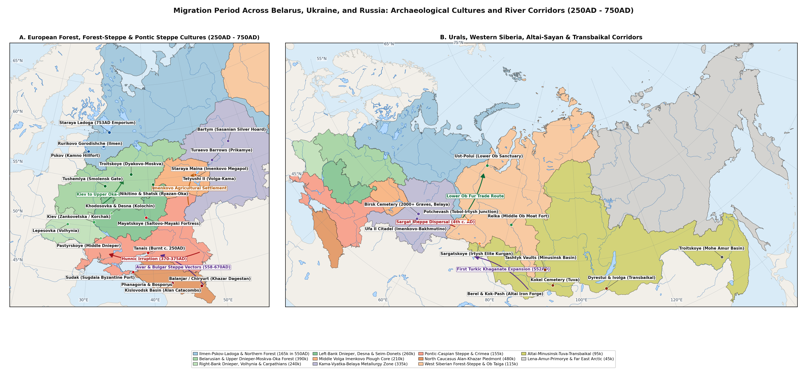

# Abstract

This gazetteer compiles population estimates for 362 excavated
settlements across Belarus, Ukraine and Russia (excluding the Baltic
provinces) from the Late Roman period (250AD) to the First All-Russian
Census of 1897 (1900AD). Arranged across six ecological zones - the
European forest-steppe, the mixed and boreal forests, the Middle Volga
and Kama-Urals, the open Pontic-Caspian steppe, the North Caucasus and
Siberia - the tables trace how village life shifted when the Huns broke
up the eastern Chernyakhov and Late Sarmatian settlements in the 370s
AD. While open steppe camps and exposed southern border villages shrank
or moved between 350AD and 450AD, fortified hillforts (*gorodishcha*),
woodland river villages (*selishcha*) and terraced mountain strongholds
grew steadily from the fifth to the tenth centuries AD, laying the urban
foundations of early medieval Rus’, Volga Bulgaria and the Caucasian
frontier.

# Methodology

This gazetteer brings together 362 excavated Migration Period
(c. 250-750AD) and early medieval settlements - promontory hillforts
(*gorodishcha*), river-terrace villages (*selishcha*) and steppe
strongholds - across the six regions of Belarus, Ukraine and Russia
(excluding the Baltic provinces). Together they trace the shift of
population from the open Pontic-Caspian steppe into the woodland valleys
of the Dnieper, Oka, Upper and Middle Volga, Kama and North Caucasus.

For each site, population estimates across the Migration Period (250,
350, 450, 600 and 750AD) and the early medieval transition (900AD) are
worked out from excavated house counts, fortified and open settlement
areas and cemetery grave totals
[\[1\]](#ref-oblomskiy2016kolochinskaya)[\[2\]](#ref-krenke2019moskvorechye)[\[3\]](#ref-goldina1999drevnyaya)[\[4\]](#ref-gadzhiev2002derbent).
Dates before a settlement was founded or after it was abandoned are
marked with a hyphen (-). Where an ancient hillfort or village grew into
a lasting town or village on the same spot, its population at the First
All-Russian Census of 1897 (1900AD) is given in the final column
[\[5\]](#ref-troinitsky1905perepis).

# Results

## European Forest-Steppe Settlements

Table lists 72 excavated settlements across the Seim, Psel, Upper Don,
Oskol and Desna forest-steppe valleys, covering the Kiev, Eastern
Chernyakhov, Kolochin, Penkovka, Volyntsevo-Romny, Borshevo and
Saltovo-Mayaki cultures
[\[1\]](#ref-oblomskiy2016kolochinskaya)[\[6\]](#ref-shchukin2005gotskiy)[\[7\]](#ref-oblomskiy2002dneprovskoe)[\[8\]](#ref-sedov1999drevnerusskaya).

| Settlement | Historical / Native Names | Coords & Span | 250 | 350 | 450 | 600 | 750 | 900 | 1900 |
|:---|:---|:---|:---|:---|:---|:---|:---|:---|:---|
| Aegyssus Classical Polis | \- | 45,18, 28,81 (100-400AD) | \- | \- | \- | \- | \- | \- | \- |
| Aliobrix | Aliobrix; Alobriks | 45,31, 28,43 (800-1300AD) | \- | \- | \- | \- | \- | 650 | \- |
| Ancient settlement of Chernyakhov culture No. 151, Mykhailivka | Ancient settlement of Chernyakhov culture No. 151, Mykhailivka | 48,24, 28,13 (200-420AD) | \- | \- | \- | \- | \- | \- | \- |
| Ancient settlement of Chernyakhov culture No. 152, Mykhailivka | Ancient settlement of Chernyakhov culture No. 152, Mykhailivka | 48,23, 28,11 (200-420AD) | \- | \- | \- | \- | \- | \- | \- |
| Archeological site “Chayka | Archeological site “Chayka” | 45,16, 33,29 (600-1240AD) | \- | \- | \- | 320 | \- | 320 | \- |
| Arkhangel-skoye | Arkhangelskoe | 51,34, 39,02 (600-1000AD) | \- | \- | \- | 55 | 165 | 410 | \- |
| Ay-Konstant | Ay-Konstant | 44,57, 34,35 (600-1240AD) | \- | \- | \- | 320 | \- | 320 | \- |
| Belgorod Medieval Gorodishche | Belgorod Medieval Gorodishche | 50,6, 36,59 (350-1000AD) | \- | 140 | 65 | 110 | 280 | 680 | \- |
| Belgorod | Belgorod; Melovaya gora | 50,6, 36,59 (1650-1700AD) | \- | \- | \- | \- | \- | \- | \- |
| Belogorskoye | Belogorskoe; Belogorskoe goro-dishche | 51,74, 39,18 (600-1000AD) | \- | \- | \- | 65 | 175 | 440 | \- |
| Bolshoye Gordeev-skoye | Bolshoe Gordeevskoe; Gordeevka | 51,62, 36,12 (100-450AD) | 75 | 95 | 60 | \- | \- | \- | \- |
| Borshevo (17001900) | Borshevo (17001900) | 51,28, 39,05 (1650-1700AD) | \- | \- | \- | \- | \- | \- | \- |
| Borshevo | Borshchevo | 51,28, 39,05 (450-1000AD) | \- | \- | 65 | 110 | 260 | 680 | \- |
| Casla Classical Polis | \- | 45,17, 28,76 (100-400AD) | \- | \- | \- | \- | \- | \- | \- |
| Dmitriev-skoye | Dmitrievskoe goro-dishche; Dmitrievka | 50,15, 36,85 (600-1000AD) | \- | \- | \- | 70 | 420 | 950 | \- |
| Glubokaya Pristan Classical Polis | \- | 46,58, 32,18 (100-400AD) | \- | \- | \- | \- | \- | \- | \- |
| Gochevo | Gochevo; Gochevskoe goro-dishche | 51,18, 35,65 (250-1200AD) | 180 | 420 | 140 | 190 | 320 | 850 | \- |
| Gornal | Gornal; Bolshoe Gornalskoe goro-dishche | 51,08, 35,23 (450-1000AD) | \- | \- | 60 | 90 | 280 | 650 | \- |
| Kabanovo | Kabanovo; Kabanovskoe poselenie | 51,64, 35,89 (350-750AD) | \- | 70 | 95 | 135 | 170 | \- | \- |
| Kamenka-Don | Kamenka; Kamenskoe poselenie na Donu | 52,51, 38,96 (250-600AD) | 55 | 90 | 80 | 65 | \- | \- | \- |
| Karaul-Oba Archeological Complex | Karaul-Oba Archeological Complex | 44,82, 34,9 (800-1300AD) | \- | \- | \- | \- | \- | 650 | \- |
| Kashirskoye-Don | Kashirskoe; Kashirskoe poselenie | 51,42, 39,61 (100-450AD) | 140 | 170 | 60 | \- | \- | \- | \- |
| Kastropulo | Kastropulo | 44,4, 33,88 (1300-1600AD) | \- | \- | \- | \- | \- | \- | \- |
| Khitrovka | Khitrovka; Khitrovskoe poselenie | 50,62, 36,58 (250-750AD) | 110 | 240 | 80 | 120 | 140 | \- | \- |
| Kholki | Kholki; Kholkinskoe goro-dishche | 50,83, 37,71 (750-1200AD) | \- | \- | \- | \- | 180 | 540 | \- |
| Krapivnoye | Krapivnoe | 50,39, 36,79 (750-1200AD) | \- | \- | \- | \- | 240 | 720 | \- |
| Kremniskoi Iron Age Hillfort | \- | 45,83, 30,16 (100-300AD) | \- | \- | \- | \- | \- | \- | \- |
| Ksizovo-19 | Ksizovo-19; Ksizovskoe poselenie | 52,38, 39,12 (100-750AD) | 110 | 140 | 160 | 95 | 70 | \- | \- |
| Kurovo | Kurovo; Kurovskoe poselenie | 52,59, 33,49 (250-750AD) | 70 | 95 | 110 | 140 | 175 | \- | \- |
| Kursk Romny Gorodishche | Kursk Romny Gorodishche | 51,74, 36,2 (450-750AD) | \- | \- | 90 | 160 | 350 | \- | \- |
| Kursk | Kursk; Kurskoe goro-dishche | 51,73, 36,19 (1500-1700AD) | \- | \- | \- | \- | \- | \- | \- |
| Kuznetsov-skoye | Kuznetsovskoe | 51,81, 39,24 (600-1000AD) | \- | \- | \- | 50 | 145 | 360 | \- |
| Lebyazhye | Lebyazhe | 51,71, 36,38 (250-750AD) | 55 | 80 | 95 | 115 | 130 | \- | \- |
| Mali Selmentsi | \- | 48,51, 22,16 (1200-1400AD) | \- | \- | \- | \- | \- | \- | \- |
| Maloye Borshevo | Maloe Borshchevo | 51,26, 39,06 (600-1000AD) | \- | \- | \- | 60 | 150 | 380 | \- |
| Mayatskoye | Mayatskoe goro-dishche; Divnogore | 50,97, 39,3 (750-1000AD) | \- | \- | \- | \- | 380 | 1,4k | \- |
| Mikhailov-skiy Kordon | Mikhaylovskiy kordon | 51,78, 39,26 (450-900AD) | \- | \- | 55 | 90 | 160 | 310 | \- |
| Mukhino-2 | Mukhino-2; Mukhinskoe poselenie | 52,41, 39,08 (250-600AD) | 70 | 115 | 130 | 80 | \- | \- | \- |
| Nisimko-vichi | Nisimkovichi | 52,78, 31,32 (350-900AD) | \- | 65 | 85 | 120 | 150 | 240 | \- |
| Noviodunum Classical Polis | \- | 45,27, 28,49 (100-400AD) | \- | \- | \- | \- | \- | \- | \- |
| Old Kursk Gorodishche | Old Kursk Gorodishche | 51,73, 36,2 (900-1200AD) | \- | \- | \- | \- | \- | 900 | \- |
| Posudichi | Posudichi | 52,61, 33,45 (100-750AD) | 110 | 135 | 95 | 125 | 160 | \- | \- |
| Rachelu Classical Polis | \- | 45,29, 28,33 (100-400AD) | \- | \- | \- | \- | \- | \- | \- |
| Radutino | Radutino; Radutinskoe poselenie | 52,42, 33,68 (250-750AD) | 65 | 90 | 105 | 130 | 155 | \- | \- |
| Rymska_imperiya_ta_plemena_davnoyi_Ukrayiny No. 877 Classical Polis | \- | 48,24, 28,32 (100-400AD) | \- | \- | \- | \- | \- | \- | \- |
| Sarmatae Classical Polis | \- | 47,27, 29,39 (100-400AD) | \- | \- | \- | \- | \- | \- | \- |
| Sudzha (17001900) | Sudzha (17001900) | 51,19, 35,27 (1650-1700AD) | \- | \- | \- | \- | \- | \- | \- |
| Sudzha | Sudzha; Sudzhanskoe goro-dishche | 51,19, 35,27 (600-1200AD) | \- | \- | \- | 80 | 190 | 420 | \- |
| Taimanovo | Taymanovo | 53,31, 32,18 (250-750AD) | 90 | 130 | 145 | 170 | 190 | \- | \- |
| Tazovo | Tazovo; Tazovskoe poselenie | 51,89, 36,24 (250-750AD) | 65 | 85 | 70 | 95 | 120 | \- | \- |
| Tiraspol Fortress | Tiraspol Fortress; Tiraspolska fortetsya | 46,83, 29,59 (800-1300AD) | \- | \- | \- | \- | \- | 650 | \- |
| Titchikha | Titchikha | 51,12, 39,18 (600-1000AD) | \- | \- | \- | 75 | 210 | 620 | \- |
| Uzhhorod Castle | Uzhhorod Castle; Zamek w Uzhorodzie | 48,62, 22,31 (800-1300AD) | \- | \- | \- | \- | \- | 650 | \- |
| Velikie Budki | Velikie Budki; Khutor Velikie Budki | 51,35, 34,82 (350-750AD) | \- | 70 | 95 | 130 | 160 | \- | \- |
| Verkhniy Saltov | Verkhniy Saltov | 50,13, 36,8 (600-1000AD) | \- | \- | \- | 90 | 850 | 2,4k | \- |
| Vorgol | Vorgol; Vorgolskoe goro-dishche | 52,58, 38,35 (450-1000AD) | \- | \- | 60 | 95 | 220 | 520 | \- |
| Vorobyovka 2 | Vorobevka 2; Vorobevskoe poselenie | 51,55, 36,05 (250-450AD) | 60 | 110 | 45 | \- | \- | \- | \- |
| Vorotyntsevo | Vorotyntsevo | 53,02, 36,94 (250-900AD) | 85 | 130 | 155 | 180 | 220 | 340 | \- |
| Zamyatino | Zamyatino | 52,45, 39,03 (250-600AD) | 60 | 100 | 115 | 75 | \- | \- | \- |
| Zanki | Zanki; Zankovskoe poselenie | 50,55, 36,48 (250-600AD) | 90 | 180 | 70 | 110 | \- | \- | \- |
| Zhivotinnoye | Zhivotinnoe | 51,89, 39,21 (600-1000AD) | \- | \- | \- | 70 | 180 | 460 | \- |
| chernyakhivske Dolynske Chernyakhov Settlement | \- | 45,49, 28,3 (200-420AD) | \- | \- | \- | \- | \- | \- | \- |
| chernyakhivske Stara Nekrasivka Chernyakhov Settlement | \- | 45,31, 28,93 (200-420AD) | \- | \- | \- | \- | \- | \- | \- |
| chernyakhivske Volodymyrivka I Chernyakhov Settlement | \- | 46,42, 29,76 (200-420AD) | \- | \- | \- | \- | \- | \- | \- |
| chernyakhivskoyi kultury Chernyakhov Settlement | \- | 50,37, 23,78 (200-420AD) | \- | \- | \- | \- | \- | \- | \- |
| chernyakhivskoyi kultury Chernyakhov Settlement | \- | 48,33, 28,07 (200-420AD) | \- | \- | \- | \- | \- | \- | \- |
| dvosharove: chernyakhivske ta balkano-dunayskykh pivdennykh slov’yan Lymanske Chernyakhov Settlement | \- | 45,41, 28,41 (800-1000AD) | \- | \- | \- | \- | \- | 650 | \- |
| dvosharove: sabatynivske ta chernyakhivske Dolynske Chernyakhov Settlement | \- | 45,48, 28,31 (200-420AD) | \- | \- | \- | \- | \- | \- | \- |
| dvosharove: sabatynivske ta chernyakhivske Kotovske Chernyakhov Settlement | \- | 45,3, 28,92 (200-420AD) | \- | \- | \- | \- | \- | \- | \- |
| trypilskoyi Rus Settlement | \- | 48,24, 26,54 (1100-1300AD) | \- | \- | \- | \- | \- | \- | \- |
| urochyshche “Nod bokor Mediaeval Hillfort | \- | 48,5, 22,23 (850-1450AD) | \- | \- | \- | \- | \- | 650 | \- |
| urochyshche “Tserkovnyy horb Mediaeval Hillfort | \- | 48, 22,88 (850-1450AD) | \- | \- | \- | \- | \- | 650 | \- |

Excavated settlements across the Dnieper, Desna, Seim and Upper Don
forest-steppe from 250AD to 1900AD, showing the transition from large
Chernyakhov plough-farming villages to Kolochin, Penkovka and early
Slavic hillforts.

## Mixed and Boreal Forest Zone Settlements

Table lists 160 excavated hillforts, river villages and early towns
across the Moskva, Upper and Middle Oka, Upper Volga, Ilmen-Volkhov,
Pskov and Upper Dnieper forest basins, spanning the Late Dyakovo,
Moshchiny, Ryazan-Oka, Tushemlya, Pskov Long Barrows, Merya, Muroma and
Early Rus’ traditions
[\[9\]](#ref-krenke2011dyakovo)[\[10\]](#ref-mayorov2016moschiny)[\[11\]](#ref-akhmedov2018ryazan)[\[12\]](#ref-lopatin2007severnye)[\[13\]](#ref-islanova2012ozero).

| Settlement | Historical / Native Names | Coords & Span | 250 | 350 | 450 | 600 | 750 | 900 | 1900 |
|:---|:---|:---|:---|:---|:---|:---|:---|:---|:---|
| 7 km (poselenie) | 7 km (poselenie) | 69,23, 32,68 (800-1300AD) | \- | \- | \- | \- | \- | 650 | \- |
| Aizvejinu pilskalns | Aizvejinu pilskalns | 55,87, 27,1 (500-1250AD) | \- | \- | \- | 320 | \- | 320 | \- |
| Alotaju kalns - pilskalns | Alotaju kalns - pilskalns | 56,9, 27,63 (500-1250AD) | \- | \- | \- | 320 | \- | 320 | \- |
| Andzanu pilskalns | Andzanu pilskalns | 56,11, 27,93 (500-1250AD) | \- | \- | \- | 320 | \- | 320 | \- |
| Baliuliu piliakalnis | Baliuliu piliakalnis | 54,98, 25,92 (500-1250AD) | \- | \- | \- | 320 | \- | 320 | \- |
| Belozersk | Belozersk; Beloozero | 60,03, 37,78 (600-1700AD) | \- | \- | \- | 70 | 190 | 950 | \- |
| Bereznyaki | Bereznyaki; Gorodishche Bereznyaki | 57,98, 38,92 (250-600AD) | 55 | 70 | 65 | 50 | \- | \- | \- |
| Borki-Oka | Borki; Borkovskiy kompleks | 54,66, 39,67 (250-750AD) | 125 | 185 | 230 | 245 | 270 | \- | \- |
| Borki-Ryazan Gorodishche | Borki-Ryazan Gorodishche | 54,63, 39,7 (250-750AD) | 140 | 210 | 260 | 290 | 380 | \- | \- |
| Borsheva | Borsheva; Borshevskoe goro-dishche na Moskve-reke | 55,52, 38,28 (100-900AD) | 110 | 120 | 105 | 95 | 125 | 210 | \- |
| Ceberakai hillfort | Ceberakai hillfort; Ceberaku piliakalnis | 55,57, 26,5 (500-1250AD) | \- | \- | \- | 320 | \- | 320 | \- |
| Drevnee saamskoe poselenie | Drevnee saamskoe poselenie | 68,76, 37,31 (800-1300AD) | \- | \- | \- | \- | \- | 650 | \- |
| Duna | Duna; Dunskoe goro-dishche | 54,05, 36,28 (250-900AD) | 70 | 110 | 135 | 150 | 165 | 210 | \- |
| Dyakovo (17001900) | Dyakovo (17001900) | 55,66, 37,67 (1650-1700AD) | \- | \- | \- | \- | \- | \- | \- |
| Dyakovo | Dyakovo goro-dishche; Kolomenskoe | 55,66, 37,67 (100-1200AD) | 175 | 185 | 160 | 130 | 110 | 190 | \- |
| Dzyauguny (garadzishcha) | Dzyaguny (garadzshcha) | 55,11, 26,5 (600-1240AD) | \- | \- | \- | 320 | \- | 320 | \- |
| Fedyashevo | Fedyashevo | 54,18, 36,82 (250-900AD) | 75 | 120 | 150 | 165 | 190 | 260 | \- |
| Gnezdovo | Gnezdovo; Gnezdovskiy kompleks | 54,78, 31,87 (600-1000AD) | \- | \- | \- | 90 | 240 | 1,9k | \- |
| Gusinyy 1 (poselenie) | Gusinyy 1 (poselenie) | 69,3, 34,13 (800-1300AD) | \- | \- | \- | \- | \- | 650 | \- |
| Hajciuniski Castle | Dwor obronny w Gojcieniszkach; Hajciuniski Castle | 54,25, 25,43 (1350-1650AD) | \- | \- | \- | \- | \- | \- | \- |
| Hermann Castle | Hermann Castle; Hermano pilis | 59,38, 28,2 (800-1400AD) | \- | \- | \- | \- | \- | 650 | \- |
| Izborsk | Izborsk; Truvorovo goro-dishche | 57,71, 27,86 (600-1700AD) | \- | \- | \- | 120 | 290 | 750 | \- |
| Izbriszhye | Izbrizhe; Izbrizhskiy kompleks | 56,81, 35,62 (450-1000AD) | \- | \- | 65 | 110 | 175 | 340 | \- |
| Jaciunu piliakalnis | Jaciunu piliakalnis | 55,13, 26,26 (600-1240AD) | \- | \- | \- | 320 | \- | 320 | \- |
| Kamennye konstruktsii Bukhdyr III | Kamennye konstruktsii Bukhdyr III | 68,33, 38,39 (800-1300AD) | \- | \- | \- | \- | \- | 650 | \- |
| Kamennyy labirint (vavilon) (Malinovarakkskoe s.p.) | Kamennyy labirint (vavilon) (Malinovarakkskoe s.p.) | 66,41, 33,72 (800-1300AD) | \- | \- | \- | \- | \- | 650 | \- |
| Kamennyy labirint | Kamennyy labirint | 68,97, 36,73 (800-1300AD) | \- | \- | \- | \- | \- | 650 | \- |
| Kamennyy labirint Vavilon (Ponoyskiy labirint) | Kamennyy labirint Vavilon (Ponoyskiy labirint) | 67,08, 41,12 (800-1300AD) | \- | \- | \- | \- | \- | 650 | \- |
| Kamennyy labirint | Kamennyy labirint | 68,79, 37,3 (800-1300AD) | \- | \- | \- | \- | \- | 709 | \- |
| Kamno-Pskov Gorodishche | Kamno-Pskov Gorodishche | 57,82, 28,34 (350-750AD) | \- | 95 | 160 | 290 | 520 | \- | \- |
| Kamno | Kamno; Kamnovskoe goro-dishche | 57,83, 28,21 (250-1000AD) | 75 | 110 | 150 | 220 | 340 | 520 | \- |
| Kashirskoye-Oka | Kashirskoe goro-dishche; Starshee Kashirskoe | 54,84, 38,15 (100-750AD) | 115 | 125 | 105 | 90 | 110 | \- | \- |
| Katlesu pilskalns | Katlesu pilskalns | 57,34, 27,73 (600-1240AD) | \- | \- | \- | 320 | \- | 320 | \- |
| Kholui (17001900) | Kholui (17001900) | 56,58, 41,87 (1650-1700AD) | \- | \- | \- | \- | \- | \- | \- |
| Kholui | Kholuy; Kholuyskoe poselenie | 56,58, 41,87 (450-900AD) | \- | \- | 75 | 115 | 160 | 240 | \- |
| Kildin 1 (poselenie) | Kildin 1 (poselenie) | 69,34, 33,98 (800-1300AD) | \- | \- | \- | \- | \- | 650 | \- |
| Kildin 10 (poselenie) | Kildin 10 (poselenie) | 69,34, 34,03 (800-1300AD) | \- | \- | \- | \- | \- | 650 | \- |
| Kildin 8 (poselenie) | Kildin 8 (poselenie) | 69,33, 34,33 (800-1300AD) | \- | \- | \- | \- | \- | 650 | \- |
| Kildinskiy proliv 1 (masterskaya) | Kildinskiy proliv 1 (masterskaya) | 69,3, 34,17 (800-1300AD) | \- | \- | \- | \- | \- | 650 | \- |
| Kilpyavr 1 (poselenie) | Kilpyavr 1 (poselenie) | 69,14, 32,52 (800-1300AD) | \- | \- | \- | \- | \- | 650 | \- |
| Kleshchino | Kleshchino | 56,78, 38,84 (450-1100AD) | \- | \- | 85 | 150 | 310 | 880 | \- |
| Kolskiy ostrog | Kolskiy ostrog | 68,88, 33,02 (1583-1858AD) | \- | \- | \- | \- | \- | \- | \- |
| Korabelnaya 1 (poselenie s zhilishchami) | Korabelnaya 1 (poselenie s zhilishchami) | 69,18, 35,18 (800-1300AD) | \- | \- | \- | \- | \- | 650 | \- |
| Korabelnaya 12 (poselenie s zhilishchami) | Korabelnaya 12 (poselenie s zhilishchami) | 69,17, 35,2 (800-1300AD) | \- | \- | \- | \- | \- | 650 | \- |
| Koshbeev-skoye | Koshibeevo | 54,41, 41,88 (100-900AD) | 170 | 220 | 260 | 280 | 310 | 380 | \- |
| Kosoe gorodishche (nezavershyonnoe stroitelstvom ukreplenie-ubezhishche) | Kosoe goro-dishche (nezavershyonnoe stroitelstvom ukreplenie-ubezhishche) | 66,42, 36,56 (800-1300AD) | \- | \- | \- | \- | \- | 650 | \- |
| Kulturnyy sloy ostrovnogo Spaso-Kamennogo Spaso-Preobrazhenskogo monastyrya | Kulturnyy sloy ostrovnogo Spaso-Kamennogo Spaso-Preobrazhenskogo monastyrya | 59,61, 39,57 (800-1300AD) | \- | \- | \- | \- | \- | 650 | \- |
| Kuntsevo | Kuntsevskoe goro-dishche; Proklyatoe mesto | 55,74, 37,43 (100-1200AD) | 95 | 110 | 95 | 85 | 105 | 180 | \- |
| Lassilan linnavuori | Lassilan linnavuori | 61,22, 29,02 (500-1250AD) | \- | \- | \- | 320 | \- | 320 | \- |
| Liva 1 | Liva 1 | 67,75, 31,11 (800-1300AD) | \- | \- | \- | \- | \- | 650 | \- |
| Lukovnya | Lukovnya | 55,43, 37,48 (100-600AD) | 90 | 95 | 80 | 60 | \- | \- | \- |
| Lyubsha | Lyubsha | 60,02, 32,31 (600-900AD) | \- | \- | \- | 95 | 190 | 120 | \- |
| Medininkai Castle | Medininkai Castle; Medininku pils | 54,54, 25,65 (800-1300AD) | \- | \- | \- | \- | \- | 650 | \- |
| Medved 1 (stoyanka/poselenie) | Medved 1 (stoyanka/poselenie) | 69,31, 32,87 (800-1300AD) | \- | \- | \- | \- | \- | 650 | \- |
| Megaliticheskiy kompleks Voroniy Kamen | Megaliticheskiy kompleks Voroniy Kamen | 68,94, 33,05 (800-1300AD) | \- | \- | \- | \- | \- | 650 | \- |
| Meshchovsk Medieval Gorodishche | Meshchovsk Medieval Gorodishche | 54,33, 35,29 (350-1200AD) | \- | 80 | 110 | 135 | 175 | 320 | \- |
| Meshchovsk | Meshchovsk | 54,32, 35,28 (1650-1700AD) | \- | \- | \- | \- | \- | \- | \- |
| Mikhailov-skoye-Yaroslavl | Mikhaylovskoe | 57,69, 39,81 (750-1000AD) | \- | \- | \- | \- | 140 | 680 | \- |
| Mikstu piliakalnis | Mikstu piliakalnis | 55,13, 26,29 (600-1240AD) | \- | \- | \- | 320 | \- | 320 | \- |
| Misniku pilskalns | Misniku pilskalns | 56,01, 27,81 (600-1240AD) | \- | \- | \- | 320 | \- | 320 | \- |
| Mogilnoe 5 (poselenie) | Mogilnoe 5 (poselenie) | 69,32, 34,36 (800-1300AD) | \- | \- | \- | \- | \- | 650 | \- |
| Moshchiny | Moshchiny | 54,42, 35,15 (250-900AD) | 95 | 165 | 220 | 195 | 140 | 180 | \- |
| Murom Oksky Gorodishche | Murom Oksky Gorodishche | 55,58, 42,05 (450-750AD) | \- | \- | 130 | 240 | 450 | \- | \- |
| Murom | Murom; Chaadaevo | 55,58, 42,04 (900-1700AD) | \- | \- | \- | \- | \- | 1,1k | \- |
| Mutenkov-skoye | Mutenkovskoe goro-dishche; Mutenkovka | 54,83, 38,22 (100-600AD) | 80 | 90 | 75 | 65 | \- | \- | \- |
| Nasha | Nasha | 69,38, 32,9 (800-1300AD) | \- | \- | \- | \- | \- | 650 | \- |
| Naskalnye izobrazheniya (pisanitsa) Mayka | Naskalnye izobrazheniya (pisanitsa) Mayka | 69,75, 32,59 (800-1300AD) | \- | \- | \- | \- | \- | 650 | \- |
| Nastasino | Nastasino | 55,14, 38,64 (100-750AD) | 85 | 95 | 90 | 80 | 95 | \- | \- |
| Naumku pilskalns | Naumku pilskalns | 56,34, 28,12 (500-1250AD) | \- | \- | \- | 320 | \- | 320 | \- |
| Nikitino | Nikitino; Nikitinskiy kompleks | 54,37, 40,45 (250-900AD) | 120 | 190 | 240 | 220 | 180 | 250 | \- |
| Nikolskiy 1 (gruppa kamennykh vykladok i yam) | Nikolskiy 1 (gruppa kamennykh vykladok i yam) | 69,19, 35,23 (800-1300AD) | \- | \- | \- | \- | \- | 650 | \- |
| Niva 1 (poselenie) | Niva 1 (poselenie) | 67,22, 32,45 (800-1300AD) | \- | \- | \- | \- | \- | 650 | \- |
| Niva 10 (poselenie) | Niva 10 (poselenie) | 67,16, 32,44 (800-1300AD) | \- | \- | \- | \- | \- | 650 | \- |
| Niva 12 (poselenie) | Niva 12 (poselenie) | 67,14, 32,43 (800-1300AD) | \- | \- | \- | \- | \- | 650 | \- |
| Niva 14 (poselenie) | Niva 14 (poselenie) | 67,13, 32,43 (800-1300AD) | \- | \- | \- | \- | \- | 650 | \- |
| Niva 19 (poselenie) | Niva 19 (poselenie) | 67,18, 32,45 (800-1300AD) | \- | \- | \- | \- | \- | 650 | \- |
| Niva 21 (poselenie) | Niva 21 (poselenie) | 67,2, 32,45 (800-1300AD) | \- | \- | \- | \- | \- | 650 | \- |
| Niva 3 (poselenie) | Niva 3 (poselenie) | 67,23, 32,42 (800-1300AD) | \- | \- | \- | \- | \- | 650 | \- |
| Niva 7 (poselenie) | Niva 7 (poselenie) | 67,36, 32,52 (800-1300AD) | \- | \- | \- | \- | \- | 650 | \- |
| Niva 8 (poselenie) | Niva 8 (poselenie) | 67,38, 32,54 (800-1300AD) | \- | \- | \- | \- | \- | 650 | \- |
| Niva 9 (poselenie) | Niva 9 (poselenie) | 67,35, 32,48 (800-1300AD) | \- | \- | \- | \- | \- | 650 | \- |
| Opasovskaya guba (stoyanka) | Opasovskaya guba (stoyanka) | 69,23, 35,37 (800-1300AD) | \- | \- | \- | \- | \- | 650 | \- |
| Orlovka 10 (poselenie s odinochnym zhilishchem) | Orlovka 10 (poselenie s odinochnym zhilishchem) | 69,2, 35,3 (800-1300AD) | \- | \- | \- | \- | \- | 650 | \- |
| Ostrovnas pilskalns | Ostrovnas pilskalns | 55,83, 27,54 (500-1250AD) | \- | \- | \- | 320 | \- | 320 | \- |
| Peitela Hillfort | Peitela Hillfort; Peitelu pilskalns (Purva salina) | 56,61, 28,03 (600-1240AD) | \- | \- | \- | 320 | \- | 320 | \- |
| Pereyaslavl-Ryazansky Gorodishche | Pereyaslavl-Ryazansky Gorodishche | 54,63, 39,7 (900-1100AD) | \- | \- | \- | \- | \- | 750 | \- |
| Pervoe Granovitoe 1 (mestonakhozhdenie) | Pervoe Granovitoe 1 (mestonakhozhdenie) | 69,15, 35,32 (800-1300AD) | \- | \- | \- | \- | \- | 650 | \- |
| Pervotitovskoe 1 (poselenie s zhilishchami) | Pervotitovskoe 1 (poselenie s zhilishchami) | 69,18, 35,24 (800-1300AD) | \- | \- | \- | \- | \- | 650 | \- |
| Pervyy pirs (stoyanka) | Pervyy pirs (stoyanka) | 67,63, 34,44 (800-1300AD) | \- | \- | \- | \- | \- | 650 | \- |
| Petroglify Onezhskogo ozera na ostrove Beryozovye Ludy (Shalskoe s.p.) | Petroglify Onezhskogo ozera na ostrove Beryozovye Ludy (Shalskoe s.p.) | 61,8, 35,91 (800-1300AD) | \- | \- | \- | \- | \- | 650 | \- |
| Petroglify Onezhskogo ozera na ostrove Bolshoy Golets (Shalskoe s.p.) | Petroglify Onezhskogo ozera na ostrove Bolshoy Golets (Shalskoe s.p.) | 61,74, 35,9 (800-1300AD) | \- | \- | \- | \- | \- | 650 | \- |
| Petrov-skoye-Yaroslavl | Petrovskoe; Petrovskoe poselenie | 57,52, 39,79 (750-1000AD) | \- | \- | \- | \- | 120 | 540 | \- |
| Plesozero 1 (stoyanka No 1 po G. I. Goretskomu) | Plesozero 1 (stoyanka No 1 po G. I. Goretskomu) | 67,25, 32,44 (800-1300AD) | \- | \- | \- | \- | \- | 650 | \- |
| Plesozero 3 (stoyanka No 3 po G. I. Goretskomu) | Plesozero 3 (stoyanka No 3 po G. I. Goretskomu) | 67,27, 32,46 (800-1300AD) | \- | \- | \- | \- | \- | 650 | \- |
| Poliscinas pilskalns | Poliscinas pilskalns; Poliscinas pilskalns (Gorodok) | 56,13, 28 (500-1250AD) | \- | \- | \- | 320 | \- | 320 | \- |
| Poselenie Grottut | Poselenie Grottut | 69,73, 32,18 (800-1300AD) | \- | \- | \- | \- | \- | 650 | \- |
| Poselenie Nokuev I | Poselenie Nokuev I | 68,39, 38,46 (800-1300AD) | \- | \- | \- | \- | \- | 650 | \- |
| Poselenie Nokuev III | Poselenie Nokuev III | 68,37, 38,47 (800-1300AD) | \- | \- | \- | \- | \- | 755 | \- |
| Poselenie Peresheek Shuritskiy I | Poselenie Peresheek Shuritskiy I | 68,33, 38,58 (800-1300AD) | \- | \- | \- | \- | \- | 650 | \- |
| Poselenie Shchuritskaya II | Poselenie Shchuritskaya II | 68,33, 38,61 (800-1300AD) | \- | \- | \- | \- | \- | 650 | \- |
| Poselenie Ust-Drozdovka III | Poselenie Ust-Drozdovka III | 68,29, 38,43 (800-1300AD) | \- | \- | \- | \- | \- | 650 | \- |
| Pskov | Pskov; Pskovskoe goro-dishche | 57,82, 28,33 (900-1700AD) | \- | \- | \- | \- | \- | 1,6k | \- |
| Punculevas pilskalns | Punculevas pilskalns | 56,9, 27,6 (500-1250AD) | \- | \- | \- | 320 | \- | 320 | \- |
| Robeznieku pilskalns ar apmetni | Robeznieku pilskalns ar apmetni | 55,71, 26,66 (500-1250AD) | \- | \- | \- | 320 | \- | 320 | \- |
| Robeznieku pilskalns | Robeznieku pilskalns | 55,97, 27,61 (500-1250AD) | \- | \- | \- | 320 | \- | 320 | \- |
| Rostislavl | Rostislavl | 54,92, 38,54 (100-1200AD) | 100 | 110 | 95 | 85 | 120 | 280 | \- |
| Rostov Veliky | Rostov Velikiy; Rostov | 57,19, 39,41 (600-1700AD) | \- | \- | \- | 140 | 320 | 1,4k | \- |
| Rubulu pilskalns | Rubulu pilskalns | 56,14, 27,85 (500-1250AD) | \- | \- | \- | 320 | \- | 320 | \- |
| Rurikovo Gorodishche | Ryurikovo goro-dishche; Gorodishche na Volkhove | 58,49, 31,3 (750-1200AD) | \- | \- | \- | \- | 160 | 1,4k | \- |
| Ryazan | Ryazan; Borki | 54,63, 39,69 (1500-1700AD) | \- | \- | \- | \- | \- | \- | \- |
| Sarskoye Gorodishche | Sarskoe goro-dishche; Sara | 57,1, 39,3 (450-1000AD) | \- | \- | 90 | 180 | 420 | 1,2k | \- |
| Serensk | Serensk; Serenskoe goro-dishche | 54,31, 35,49 (250-1200AD) | 70 | 115 | 145 | 170 | 230 | 480 | \- |
| Shatrishche | Shatrishche | 54,42, 40,41 (250-750AD) | 130 | 195 | 240 | 220 | 180 | \- | \- |
| Shcherbin-skoye | Shcherbinskoe goro-dishche; Shcherbinka | 55,49, 37,56 (100-600AD) | 125 | 130 | 110 | 75 | \- | \- | \- |
| Shilovo (17001900) | Shilovo (17001900) | 54,33, 40,88 (1650-1700AD) | \- | \- | \- | \- | \- | \- | \- |
| Shilovo | Shilovo; Shilovskoe poselenie | 54,33, 40,88 (250-900AD) | 95 | 145 | 190 | 220 | 260 | 340 | \- |
| Sokolades kalns | Sokolades kalns | 55,91, 27,17 (500-1250AD) | \- | \- | \- | 320 | \- | 320 | \- |
| Spas-Pereksha | Spas-Pereksha | 54,36, 35,24 (250-750AD) | 65 | 105 | 140 | 130 | 110 | \- | \- |
| Staraya Ladoga | Staraya Ladoga; Ladoga | 60, 32,3 (600-1700AD) | \- | \- | \- | 80 | 280 | 1,8k | \- |
| Staraya Russa | Staraya Russa; Rusa | 57,99, 31,36 (750-1700AD) | \- | \- | \- | \- | 130 | 680 | \- |
| Staraya Ryazan | Staraya Ryazan; Shatrishche | 54,4, 40,43 (250-1200AD) | 160 | 240 | 310 | 340 | 420 | 950 | \- |
| Stone labyrinths in Kandalaksha | Stone labyrinths in Kandalaksha; Kamennyy labirint | 67,12, 32,48 (1500-1800AD) | \- | \- | \- | \- | \- | \- | \- |
| Stoyanka Kolasyoki I | Stoyanka Kolasyoki I | 69,43, 30,28 (800-1300AD) | \- | \- | \- | \- | \- | 650 | \- |
| Stoyanka Kuetsyavr I | Stoyanka Kuetsyavr I | 69,44, 30,19 (800-1300AD) | \- | \- | \- | \- | \- | 650 | \- |
| Stoyanka Pechenga I | Stoyanka Pechenga I | 69,43, 30,85 (800-1300AD) | \- | \- | \- | \- | \- | 650 | \- |
| Stoyanka Shuoniyoki I | Stoyanka Shuoniyoki I | 69,35, 30,05 (800-1300AD) | \- | \- | \- | \- | \- | 650 | \- |
| Stoyanka Shuoniyoki III | Stoyanka Shuoniyoki III | 69,35, 30,07 (800-1300AD) | \- | \- | \- | \- | \- | 547 | \- |
| Stoyanka Tsyp-Navolok-12 | Stoyanka Tsyp-Navolok-12 | 69,73, 33,08 (800-1300AD) | \- | \- | \- | \- | \- | 650 | \- |
| Supruty | Supruty; Suprutskoe goro-dishche | 53,98, 37,12 (250-900AD) | 80 | 130 | 160 | 210 | 280 | 450 | \- |
| Suzdal Merya Gorodishche | Suzdal Merya Gorodishche | 56,43, 40,45 (250-750AD) | 85 | 120 | 160 | 220 | 380 | \- | \- |
| Suzdal | Suzdal; Suzdalskiy kreml | 56,43, 40,45 (900-1700AD) | \- | \- | \- | \- | \- | 1,1k | \- |
| Svyatilishche na gore Kivakka (Kestengskoe s.p.) | Svyatilishche na gore Kivakka (Kestengskoe s.p.) | 66,2, 30,55 (800-1300AD) | \- | \- | \- | \- | \- | 650 | \- |
| Tammisaari Archaeological Site | \- | 66,97, 31,55 (1392-1592AD) | \- | \- | \- | \- | \- | \- | \- |
| Terekhovo | Terekhovo | 54,21, 40,82 (250-900AD) | 110 | 165 | 210 | 230 | 250 | 310 | \- |
| Teriberka 1 (stoyanka) | Teriberka 1 (stoyanka) | 69,16, 35,16 (800-1300AD) | \- | \- | \- | \- | \- | 650 | \- |
| Teriberka Murmanets 2 (stoyanka) | Teriberka Murmanets 2 (stoyanka) | 69,16, 35,11 (800-1300AD) | \- | \- | \- | \- | \- | 650 | \- |
| Timeriovo | Timerevo; Bolshoe Timerevskoe poselenie | 57,56, 39,75 (750-1000AD) | \- | \- | \- | \- | 180 | 950 | \- |
| Toropets (17001900) | Toropets (17001900) | 56,5, 31,64 (1650-1700AD) | \- | \- | \- | \- | \- | \- | \- |
| Toropets | Toropets; Toropetskoe goro-dishche | 56,5, 31,64 (450-1200AD) | \- | \- | 75 | 125 | 220 | 580 | \- |
| Troitse-Pelenitsy | Troitse-Pelenitsy; Pelenitskoe goro-dishche | 54,48, 40,12 (100-750AD) | 115 | 140 | 155 | 170 | 190 | \- | \- |
| Troitskoye | Troitskoe goro-dishche; Troitskoe na Moskve-reke | 55,55, 35,88 (100-750AD) | 140 | 145 | 115 | 85 | 55 | \- | \- |
| Tushemlya | Tushemlya | 54,31, 32,12 (250-750AD) | 70 | 105 | 135 | 150 | 95 | \- | \- |
| Udinavas pilskalns (Ostrov, Zamscina) | Udinavas pilskalns (Ostrov, Zamscina) | 55,83, 27,48 (500-1250AD) | \- | \- | \- | 320 | \- | 320 | \- |
| Unzha | Unzha; Unzhenskiy kompleks | 55,28, 41,58 (350-900AD) | \- | 90 | 140 | 185 | 230 | 310 | \- |
| Varzuga VII (ctoyanka) | Varzuga VII (ctoyanka) | 66,41, 36,59 (800-1300AD) | \- | \- | \- | \- | \- | 650 | \- |
| Vasknarva Castle | Vasknarva Castle; Vasknarva ordulinnus | 59, 27,74 (800-1300AD) | \- | \- | \- | \- | \- | 650 | \- |
| Vehrulitsa Hillfort | Vehrulitsa Hillfort; Vehrulitsa linnamagi | 57,93, 27,66 (500-1250AD) | \- | \- | \- | 320 | \- | 320 | \- |
| Veliky Novgorod | Velikiy Novgorod; Novgorod | 58,52, 31,28 (750-1700AD) | \- | \- | \- | \- | 140 | 2,2k | \- |
| Velye Medieval Gorodishche | Velye Medieval Gorodishche | 56,98, 28,92 (450-1200AD) | \- | \- | 70 | 110 | 185 | 360 | \- |
| Volosovo | Volosovo; Volosovskiy kompleks | 55,64, 42,18 (350-900AD) | \- | 80 | 120 | 165 | 210 | 280 | \- |
| Vorona (poselenie i mogilnik) | Vorona (poselenie i mogilnik) | 68,49, 33,34 (800-1300AD) | \- | \- | \- | \- | \- | 650 | \- |
| Vybuty | Vybuty; Vybutskoe poselenie | 57,72, 28,27 (600-1000AD) | \- | \- | \- | 85 | 160 | 340 | \- |
| Yurievskaya Gorka | Yurevskaya Gorka; Udomlya | 57,92, 35,02 (350-900AD) | \- | 45 | 95 | 135 | 160 | 210 | \- |
| Zarubikha 1 (kamennaya nasyp) | Zarubikha 1 (kamennaya nasyp) | 69,29, 34,25 (800-1300AD) | \- | \- | \- | \- | \- | 650 | \- |
| Zarubikha 10 (stoyanka) | Zarubikha 10 (stoyanka) | 69,29, 34,28 (800-1300AD) | \- | \- | \- | \- | \- | 650 | \- |
| Zasheek (stoyanka) | Zasheek (stoyanka) | 67,54, 34,3 (800-1300AD) | \- | \- | \- | \- | \- | 650 | \- |
| Zavalishina 6 (poselenie s odinochnym zhilishchem) | Zavalishina 6 (poselenie s odinochnym zhilishchem) | 69,18, 35,29 (800-1300AD) | \- | \- | \- | \- | \- | 650 | \- |
| Zhodauka Late Mediaeval Hillfort | \- | 54,33, 25,6 (1350-1650AD) | \- | \- | \- | \- | \- | \- | \- |
| archaeological site Imaklik | archaeological site Imaklik; Pamyatnik arkheologii Poselenie Imaklik | 65,76, -169,11 (1700-1858AD) | \- | \- | \- | \- | \- | \- | \- |
| labirint na tone Ivankovo (Plotinskoe s.p.) | labirint na tone Ivankovo (Plotinskoe s.p.) | 66,24, 33,85 (800-1300AD) | \- | \- | \- | \- | \- | 650 | \- |

Excavated promontory hillforts, lakeshore hamlets and early medieval
trading towns across the Moskva-Oka, Upper Volga, Ilmen and Upper
Dnieper forest basins from 250AD to 1900AD.

## Middle Volga, Kama-Vyatka and Cis-Ural Settlements

Table lists 56 excavated hillforts and villages across the Samara Bend,
Middle Volga, Kama, Vyatka, Belaya and Sylva basins, covering the
Imenkovo, Azelino, Mazunino, Turaevo, Bakhmutino, Turbasly,
Kushnarenkovo, Nevolino, Lomovatovo and Polom cultures
[\[3\]](#ref-goldina1999drevnyaya)[\[14\]](#ref-vyazov2019middle)[\[15\]](#ref-goldina2012nevolino)[\[16\]](#ref-bakhshiev2017bakhmutino)[\[17\]](#ref-nazarov2025lomovatovo).

| Settlement | Historical / Native Names | Coords & Span | 250 | 350 | 450 | 600 | 750 | 900 | 1900 |
|:---|:---|:---|:---|:---|:---|:---|:---|:---|:---|
| Anyushkar | Anyushkar; Kylasovo | 58,38, 56,62 (600-1200AD) | \- | \- | \- | 160 | 320 | 750 | \- |
| Ashna-Pando | Ashna-Pando | 54,38, 46,41 (250-750AD) | 80 | 135 | 185 | 220 | 180 | \- | \- |
| Azelino | Azelino; Azelinskiy kompleks | 56,92, 50,45 (250-600AD) | 140 | 210 | 230 | 180 | \- | \- | \- |
| Bakhmutino | Bakhmutino | 55,38, 55,82 (250-750AD) | 130 | 210 | 320 | 380 | 290 | \- | \- |
| Balymery | Balymery; Balymerskoe goro-dishche | 54,99, 49,02 (350-1000AD) | \- | 115 | 210 | 310 | 260 | 650 | \- |
| Bardymskoye | Bardymskoe; Barda | 56,92, 55,58 (250-900AD) | 95 | 145 | 190 | 240 | 280 | 320 | \- |
| Belaya Gora | Belaya Gora; Belogorskoe goro-dishche na Samarskoy Luke | 53,28, 49,89 (350-750AD) | \- | 80 | 145 | 210 | 130 | \- | \- |
| Birsk Gorodishche | Birsk Gorodishche | 55,42, 55,54 (100-900AD) | 240 | 320 | 390 | 450 | 410 | 480 | \- |
| Brody | Brody; Nevolino | 57,42, 56,95 (350-900AD) | \- | 140 | 220 | 340 | 390 | 350 | \- |
| Buranovskaya stoyanka-peshchera (Ust-Katav) | Buranovskaya stoyanka-peshchera (Ust-Katav) | 55,01, 58,14 (800-1300AD) | \- | \- | \- | \- | \- | 650 | \- |
| Buyskoye | Buyskoe goro-dishche; Buyskiy Perevoz | 56,88, 49,89 (100-750AD) | 170 | 210 | 220 | 190 | 210 | \- | \- |
| Byzovaya | Byzovaya | 65,02, 57,39 (800-1300AD) | \- | \- | \- | \- | \- | 650 | \- |
| Chortovo Gorodishche | Chertovo goro-dishche; Elabuzhskoe goro-dishche | 55,75, 52,03 (100-1000AD) | 190 | 240 | 220 | 260 | 320 | 680 | \- |
| Dondykar | Dondykar | 58,24, 52,51 (600-1200AD) | \- | \- | \- | 110 | 240 | 650 | \- |
| Gorodishche Vazhnanger (Alamner) (Vazhnanger) | Gorodishche Vazhnanger (Alamner) (Vazhnanger) | 56,22, 46,68 (800-1300AD) | \- | \- | \- | \- | \- | 650 | \- |
| Idnakar | Idnakar; Soldyr | 58,14, 52,72 (600-1200AD) | \- | \- | \- | 140 | 340 | 1,2k | \- |
| Imenkovo | Imenkovo; Imenkovskoe goro-dishche | 55,41, 49,68 (350-900AD) | \- | 130 | 250 | 340 | 190 | 320 | \- |
| Kara-Yakupovo | Kara-Yakupovo | 54,61, 55,38 (600-1000AD) | \- | \- | \- | 160 | 310 | 420 | \- |
| Karmaly | Karmaly | 53,36, 49,52 (350-750AD) | \- | 95 | 180 | 270 | 140 | \- | \- |
| Komintern II | Komintern II | 55,08, 49,12 (350-750AD) | \- | 130 | 260 | 380 | 190 | \- | \- |
| Kudymkarskoye (17001900) | Kudymkarskoye (17001900) | 59,02, 54,65 (1650-1700AD) | \- | \- | \- | \- | \- | \- | \- |
| Kudymkar-skoye | Kudymkarskoe goro-dishche; Izyur | 59,02, 54,65 (450-1200AD) | \- | \- | 110 | 210 | 340 | 520 | \- |
| Kushnaren-kovo | Kushnarenkovo | 55,1, 55,35 (450-900AD) | \- | \- | 140 | 290 | 360 | 410 | \- |
| Maklashe-evka II | Maklasheevka II | 55,12, 48,95 (250-900AD) | 120 | 210 | 350 | 480 | 220 | 380 | \- |
| Mazunino | Mazunino; Mazuninskoe goro-dishche | 56,29, 53,78 (250-600AD) | 150 | 220 | 240 | 180 | \- | \- | \- |
| Medvezhya peshchera | Medvezhya peshchera | 62, 58,73 (800-1300AD) | \- | \- | \- | \- | \- | 650 | \- |
| Muromskiy Gorodok | Muromskiy Gorodok; Valy | 53,34, 49,42 (450-1200AD) | \- | \- | 120 | 210 | 420 | 2,8k | \- |
| Novinki | Novinki | 53,21, 49,78 (350-750AD) | \- | 90 | 170 | 260 | 340 | \- | \- |
| Ortinskoe gorodishche | Ortinskoe goro-dishche | 68,06, 54,13 (600-1240AD) | \- | \- | \- | 320 | \- | 320 | \- |
| Osh-Pando-Ner | Osh-Pando-Ner; Saynino | 54,45, 46,52 (250-900AD) | 95 | 160 | 220 | 260 | 210 | 250 | \- |
| Osinskoye (17001900) | Osinskoye (17001900) | 57,29, 55,45 (1650-1700AD) | \- | \- | \- | \- | \- | \- | \- |
| Osinskoye | Osinskoe goro-dishche; Osa | 57,28, 55,45 (250-900AD) | 110 | 160 | 195 | 230 | 260 | 310 | \- |
| Pokrovsk-Steppe | Pokrovsk-Step; Engelsskiy kompleks | 51,48, 46,12 (100-750AD) | 130 | 110 | 180 | 140 | 160 | \- | \- |
| Polomskoye | Polomskoe goro-dishche; Polom | 57,72, 53,85 (450-1000AD) | \- | \- | 130 | 260 | 390 | 680 | \- |
| Romanovka-Ufa | Romanovka II; Romanovskoe poselenie | 54,76, 55,89 (350-750AD) | \- | 110 | 195 | 280 | 310 | \- | \- |
| Rovnoye | Rovnoe; Rovnenskiy kompleks | 50,78, 46,05 (100-900AD) | 120 | 90 | 150 | 110 | 130 | 180 | \- |
| Rozhdest-veno-Volga | Rozhdestveno | 55,48, 49,55 (350-900AD) | \- | 110 | 210 | 290 | 180 | 340 | \- |
| Rozhdest-venskoye | Rozhdestvenskoe goro-dishche; Afkula | 58,62, 55,35 (350-1200AD) | \- | 120 | 240 | 460 | 680 | 1,5k | \- |
| Saygatskoye | Saygatskoe; Saygatka | 56,76, 54,14 (250-750AD) | 120 | 185 | 210 | 175 | 150 | \- | \- |
| Shcherbet | Shcherbet | 55,02, 49,28 (350-900AD) | \- | 110 | 240 | 360 | 180 | 290 | \- |
| Staroye Romashkino | Staroe Romashkino | 55,31, 50,85 (350-900AD) | \- | 140 | 280 | 420 | 160 | 240 | \- |
| Suvorov-skoye | Suvorovskoe; Suvorovskiy kompleks na Vyatke | 56,84, 50,32 (250-600AD) | 110 | 175 | 195 | 160 | \- | \- | \- |
| Syukeevskoe gorodishche | Syukeevskoe goro-dishche | 55,08, 49,04 (800-1300AD) | \- | \- | \- | \- | \- | 650 | \- |
| Tarasovo | Tarasovo; Tarasovskiy kompleks | 56,35, 53,82 (100-900AD) | 240 | 280 | 260 | 210 | 180 | 200 | \- |
| Tetyushskoye II (17001900) | Tetyushskoye II (17001900) | 54,94, 48,84 (1650-1700AD) | \- | \- | \- | \- | \- | \- | \- |
| Tetyushskoye II | Tetyushskoe II goro-dishche; Tetyushi | 54,94, 48,84 (100-900AD) | 160 | 240 | 320 | 390 | 240 | 480 | \- |
| Tigashevo | Tigashevo | 55,04, 47,52 (600-1000AD) | \- | \- | \- | 110 | 240 | 680 | \- |
| Troitskiy Uray | Troitskiy Uray | 55,43, 50,11 (250-750AD) | 90 | 150 | 230 | 310 | 175 | \- | \- |
| Turbasly | Turbasly | 54,84, 56,08 (450-900AD) | \- | \- | 190 | 360 | 420 | 310 | \- |
| Ufa Gorodishche | Ufa Gorodishche | 54,74, 55,98 (450-900AD) | \- | \- | 180 | 340 | 480 | 650 | \- |
| Ufa II | Ufa-II; Gorodishche Ufa-II | 54,72, 55,96 (350-1200AD) | \- | 220 | 450 | 780 | 950 | 1,4k | \- |
| Ufa | Ufa; Chertovo goro-dishche v Ufe | 54,74, 55,97 (1600-1700AD) | \- | \- | \- | \- | \- | \- | \- |
| Verkh-Sainskoye | Verkh-Sainskoe goro-dishche; Verkh-Sai | 57,18, 56,72 (350-900AD) | \- | 120 | 185 | 290 | 330 | 280 | \- |
| Yantikovskoe (Kirelskoe) gorodishche | Yantikovskoe (Kirelskoe) goro-dishche | 55,16, 49,19 (800-1300AD) | \- | \- | \- | \- | \- | 650 | \- |
| Yelabuga Medieval Gorodishche | Yelabuga Medieval Gorodishche | 55,76, 52,05 (600-1000AD) | \- | \- | \- | 180 | 260 | 550 | \- |
| Yelabuga | Elabuga; Alabuga | 55,76, 52,05 (1500-1700AD) | \- | \- | \- | \- | \- | \- | \- |

Excavated Imenkovo plough-farming clusters on the Middle Volga and
Permic-Ugrian hillforts across the Kama, Vyatka and Belaya basins from
250AD to 1900AD.

## Open Pontic-Caspian Steppe Settlements

Table lists 20 excavated trading ports, winter camps, river-delta towns
and Khazar brick and stone forts across the Lower Don, Lower Volga and
Southern Trans-Ural steppe
[\[6\]](#ref-shchukin2005gotskiy)[\[18\]](#ref-botalov2009gunny)[\[19\]](#ref-kazanski2020steppe).

| Settlement | Historical / Native Names | Coords & Span | 250 | 350 | 450 | 600 | 750 | 900 | 1900 |
|:---|:---|:---|:---|:---|:---|:---|:---|:---|:---|
| Agaron akron Classical Polis | \- | 46,64, 36,76 (100-400AD) | \- | \- | \- | \- | \- | \- | \- |
| Barany Bugor | Baraniy Bugor; Khazarskiy kompleks Baraniy Bugor | 46,18, 48,21 (600-900AD) | \- | \- | \- | 220 | 1,8k | 4,2k | \- |
| Caliera | Caliera; Kaliera | 44,91, 35,18 (1400-1700AD) | \- | \- | \- | \- | \- | \- | \- |
| Karnaukhov-skoye | Karnaukhovskoe goro-dishche | 47,62, 42,11 (750-1000AD) | \- | \- | \- | \- | 240 | 680 | \- |
| Kobyakovo | Kobyakovo goro-dishche; Kobyakovo | 47,24, 39,84 (100-900AD) | 620 | 180 | 140 | 175 | 220 | 380 | \- |
| Lakiera Castle | Lakiera Castle; Zamok Lakiera | 47,15, 38,64 (800-1300AD) | \- | \- | \- | \- | \- | 650 | \- |
| Nedvigovka-Steppe | Nedvigovka | 47,27, 39,34 (250-900AD) | 240 | 190 | 260 | 160 | 190 | 240 | \- |
| Phanagoria | Fanagoriya; Sennoy | 45,28, 36,97 (100-1000AD) | 4,2k | 2,8k | 1,8k | 2,4k | 3,5k | 4,2k | \- |
| Pravoberezh-noye Tsimlyan-skoye | Pravoberezhnoe Tsimlyanskoe goro-dishche | 47,66, 42,19 (750-900AD) | \- | \- | \- | \- | 420 | 1,1k | \- |
| Samosdelka | Samosdelka; Saksin | 46,03, 47,84 (750-1200AD) | \- | \- | \- | \- | 650 | 3,5k | \- |
| Sarkel | Sarkel; Belaya Vezha | 47,7, 42,27 (750-1100AD) | \- | \- | \- | \- | 320 | 2,5k | \- |
| Semibugry | Semibugry; Atil | 46,15, 48,24 (600-1000AD) | \- | \- | \- | 280 | 4,5k | 18k | \- |
| Semikara-korskoye | Semikarakorskoe goro-dishche | 47,53, 40,82 (600-1000AD) | \- | \- | \- | 140 | 580 | 1,6k | \- |
| Semyonovsky Fortress | Semyonovsky Fortress; Semenovska fortetsya | 47,14, 38,49 (900-1300AD) | \- | \- | \- | \- | \- | 650 | \- |
| Sukho-Chaltyr-skoye | Sukho-Chaltyrskoe goro-dishche; Chaltyr | 47,26, 39,52 (100-900AD) | 310 | 120 | \- | \- | 180 | 310 | \- |
| Taganrog Fortress | Taganrog Fortress; Troitskaya krepost | 47,2, 38,94 (1696-1858AD) | \- | \- | \- | \- | \- | \- | \- |
| Tamatarkha (17001900) | Tamatarkha (17001900) | 45,22, 36,72 (1650-1700AD) | \- | \- | \- | \- | \- | \- | \- |
| Tamatarkha | Tamatarkha; Germonassa | 45,22, 36,72 (100-1200AD) | 2,9k | 2,2k | 1,9k | 2,6k | 4,2k | 6,5k | \- |
| Tanais | Tanais | 47,27, 39,34 (100-600AD) | 3,2k | 280 | 420 | 140 | \- | \- | \- |
| Verkhneye Pogromnoye | Verkhnee Pogromnoe | 48,92, 45,08 (100-750AD) | 95 | 75 | 130 | 110 | 140 | \- | \- |

Excavated trading ports, winter camps and Khazar river fortresses across
the Lower Don, Lower Volga and Pontic-Caspian steppe from 250AD to
1900AD.

## North Caucasus and Caspian Corridor Settlements

Table lists 21 excavated fortress towns, mountain strongholds and
coastal settlements across Dagestan, the Central Caucasus (Alanian
Kislovodsk and Kuban valleys) and the Taman-Black Sea coast
[\[4\]](#ref-gadzhiev2002derbent)[\[20\]](#ref-gmyrya2022palasa)[\[21\]](#ref-korobov2013terraced)[\[22\]](#ref-mastykova2009kuban).

| Settlement | Historical / Native Names | Coords & Span | 250 | 350 | 450 | 600 | 750 | 900 | 1900 |
|:---|:---|:---|:---|:---|:---|:---|:---|:---|:---|
| Alkhan-Kala | Alkhan-Kala | 43,26, 45,55 (100-900AD) | 1,4k | 1,8k | 1,1k | 1,4k | 1,6k | 1,9k | \- |
| Andreyaul (17001900) | Andreyaul (17001900) | 43,18, 46,66 (1650-1700AD) | \- | \- | \- | \- | \- | \- | \- |
| Andreyaul | Andreyaul; Endirey | 43,18, 46,66 (250-900AD) | 380 | 680 | 1,1k | 1,8k | 2,4k | 2,9k | \- |
| Derbent | Derbent; Chor | 42,06, 48,29 (100-1700AD) | 2,6k | 3,8k | 5,5k | 9,5k | 12,5k | 18k | \- |
| Dyurso | Dyurso; Kompleks na reke Dyurso | 44,69, 37,56 (450-900AD) | \- | \- | 240 | 380 | 460 | 520 | \- |
| Gazi-Yurt | Gazi-Yurt; Magasskiy kompleks | 43,21, 44,84 (250-1200AD) | 340 | 520 | 680 | 950 | 1,4k | 2,6k | \- |
| Gilyach | Gilyach; Gilyachskoe goro-dishche | 43,72, 41,94 (350-1000AD) | \- | 160 | 280 | 420 | 580 | 820 | \- |
| Gornoe Ekho | Gornoe Ekho | 43,88, 42,68 (250-900AD) | 140 | 220 | 310 | 440 | 520 | 480 | \- |
| Khumara | Khumara; Skhauat (Kalezh) | 43,86, 41,91 (250-1000AD) | 180 | 280 | 450 | 850 | 2,2k | 3,5k | \- |
| Mokraya Balka | Mokraya Balka; Krepost Mokraya Balka | 43,87, 42,74 (450-900AD) | \- | \- | 180 | 310 | 420 | 360 | \- |
| Nizhniy Arkhyz | Nizhniy Arkhyz | 43,69, 41,48 (600-1200AD) | \- | \- | \- | 380 | 950 | 3,2k | \- |
| Nizhniy Dzhulat | Nizhniy Dzhulat; Mayskiy kompleks | 43,62, 44,05 (100-1200AD) | 620 | 780 | 920 | 1,1k | 1,5k | 2,2k | \- |
| Rim-Gora | Rim-Gora; Rim-Gorskoe goro-dishche | 43,92, 42,55 (450-1200AD) | \- | \- | 240 | 480 | 850 | 1,6k | \- |
| Tarki Medieval Gorodishche | Tarki Medieval Gorodishche | 42,95, 47,5 (250-1200AD) | 450 | 850 | 1,4k | 3,2k | 6,5k | 8,5k | \- |
| Tarki | Tarki; Semender | 42,95, 47,49 (1650-1700AD) | \- | \- | \- | \- | \- | \- | \- |
| Torpakh-Kale | Torpakh-Kala; Shakhristan | 41,91, 48,38 (250-900AD) | 650 | 1,4k | 2,2k | 2,8k | 1,2k | 650 | \- |
| Tsemdolina | Tsemdolina; Borisovskiy kompleks | 44,75, 37,71 (250-900AD) | 190 | 280 | 390 | 480 | 420 | 380 | \- |
| Urtseki | Urtseki; Varachan | 42,71, 47,56 (100-900AD) | 950 | 1,6k | 2,4k | 3,8k | 2,2k | 850 | \- |
| Verkhniy Chir-Yurt | Verkhniy Chiryurt; Belendzher | 43,16, 46,92 (250-900AD) | 600 | 1,4k | 2,8k | 7,5k | 9,5k | 3,2k | \- |
| Yandare | Yandare | 43,24, 44,92 (250-900AD) | 280 | 420 | 540 | 680 | 820 | 950 | \- |
| Zmeyskaya Medieval Gorodishche | Zmeyskaya Medieval Gorodishche | 43,33, 44,15 (250-1200AD) | 320 | 480 | 640 | 880 | 1,2k | 2,1k | \- |

Excavated Alanian cliff forts in the Kislovodsk and Kuban valleys, Black
Sea ports and Sassanian-era walled towns along the Dagestan coast from
250AD to 1900AD.

## Western and Southern Siberian Settlements

Table lists 33 excavated hillforts, iron-working villages and herding
settlements across the Tobol-Irtysh, Middle and Lower Ob, Minusinsk
Basin, Russian Altai and Lake Baikal regions, covering the Sargat,
Potchevash, Relka, Tashtyk, Bulan-Koby, Early Turkic and Kurykan
traditions
[\[23\]](#ref-matveeva2000sargat)[\[24\]](#ref-zelenkov2025potchevash)[\[25\]](#ref-azbelev2007oglakhty)[\[26\]](#ref-seregin2021altai)[\[27\]](#ref-kharinsky2005baikal).

| Settlement | Historical / Native Names | Coords & Span | 250 | 350 | 450 | 600 | 750 | 900 | 1900 |
|:---|:---|:---|:---|:---|:---|:---|:---|:---|:---|
| Barsova Gora | Barsova Gora; Barsov Gorodok | 61,26, 73,18 (100-1200AD) | 210 | 260 | 320 | 390 | 450 | 520 | \- |
| Basandayka | Basandayka | 56,42, 84,97 (350-1200AD) | \- | 90 | 135 | 220 | 290 | 360 | \- |
| Bratsk Ostrog | Bratsk Ostrog; Bratskiy ostrog | 56,04, 101,83 (1631-1858AD) | \- | \- | \- | \- | \- | \- | \- |
| Dachengzi Iron Age Settlement | \- | 44,04, 131,18 (100-120AD) | \- | \- | \- | \- | \- | \- | \- |
| Elga VII | Elga VII; Shide | 53,05, 106,88 (100-900AD) | 95 | 110 | 120 | 145 | 170 | 195 | \- |
| Het Behouden Huys | Het Behouden Huys; Zimove Villema Barentsa | 76,26, 68,26 (1596-1858AD) | \- | \- | \- | \- | \- | \- | \- |
| Igrekovo | Igrekovo; Igrekovskoe goro-dishche | 56,82, 86,12 (350-900AD) | \- | 85 | 130 | 195 | 250 | 290 | \- |
| Isker-Potchevash | Isker-Potchevash | 58,16, 68,28 (1200-1500AD) | \- | \- | \- | \- | \- | \- | \- |
| Katanda | Katanda | 50,15, 86,18 (100-900AD) | 210 | 260 | 290 | 380 | 420 | 390 | \- |
| Kok-Pash | Kok-Pash | 50,85, 87,92 (100-900AD) | 260 | 320 | 340 | 410 | 380 | 350 | \- |
| Kopenskiy Chaatas | Kopenskiy chaatas; Kopeny | 54,42, 91,28 (350-900AD) | \- | 210 | 280 | 410 | 580 | 690 | \- |
| Kurumchin-skoye | Kurumchinskoe goro-dishche | 53,12, 105,42 (450-1000AD) | \- | \- | 120 | 260 | 420 | 580 | \- |
| Mamontovaya Kurya | Mamontovaya Kurya | 66,57, 62,42 (800-1300AD) | \- | \- | \- | \- | \- | 650 | \- |
| Mankhay I | Mankhay I; Mankhayskoe goro-dishche (Kudinskaya dolina) | 52,78, 104,85 (450-1000AD) | \- | \- | 140 | 280 | 450 | 620 | \- |
| Odintsovka | Odintsovka | 52,48, 85,15 (250-750AD) | 140 | 220 | 280 | 340 | 310 | \- | \- |
| Oglakhty | Oglakhty | 54,05, 91,45 (100-900AD) | 620 | 550 | 420 | 460 | 510 | 580 | \- |
| Pavlinovo | Pavlinovo | 56,31, 64,92 (100-350AD) | 210 | 95 | \- | \- | \- | \- | \- |
| Peregrebnoye | Peregrebnoe | 62,98, 65,05 (250-900AD) | 80 | 110 | 135 | 160 | 185 | 210 | \- |
| Potchevash | Potchevash; Chuvashskiy Mys | 58,16, 68,28 (100-900AD) | 180 | 240 | 310 | 360 | 410 | 480 | \- |
| Qashliq-Isker | Qashliq-Isker | 58,2, 68,26 (450-1500AD) | \- | \- | 180 | 260 | 340 | 450 | \- |
| Rafailov-skoye | Rafaylovskoe goro-dishche; Rafaylovo | 56,42, 65,18 (100-450AD) | 260 | 110 | 65 | \- | \- | \- | \- |
| Stoyanka ekspeditsii Vitusa Beringa v 1741-1742 gg. | Stoyanka ekspeditsii Vitusa Beringa v 1741-1742 gg. | 54,93, 166,51 (800-1300AD) | \- | \- | \- | \- | \- | 650 | \- |
| Suibin Junminnongchang Iron Age Settlement | \- | 47,63, 131,65 (100-395AD) | \- | \- | \- | \- | \- | \- | \- |
| Suzgun | Suzgun; Suzgunskoe goro-dishche | 58,12, 68,31 (250-900AD) | 110 | 150 | 195 | 240 | 280 | 320 | \- |
| Timiryazevo I | Timiryazevo I | 56,48, 84,88 (250-900AD) | 95 | 130 | 180 | 310 | 380 | 420 | \- |
| Timiryazevo-Tomsk Gorodishche | Timiryazevo-Tomsk Gorodishche | 56,5, 84,96 (350-900AD) | \- | 110 | 150 | 240 | 310 | 380 | \- |
| Tobolsk | Tobolsk; Isker (Kashlyk) | 58,2, 68,25 (1650-1700AD) | \- | \- | \- | \- | \- | \- | \- |
| Tomsk | Tomsk; Toyanov Gorodok | 56,49, 84,95 (1650-1700AD) | \- | \- | \- | \- | \- | \- | \- |
| Toyanov Gorodok | Toyanov Gorodok | 56,49, 84,95 (1200-1500AD) | \- | \- | \- | \- | \- | \- | \- |
| Uelgi | Uelgi | 55,78, 61,55 (600-1000AD) | \- | \- | \- | 120 | 240 | 360 | \- |
| Ust-Poluy (17001900) | Ust-Poluy (17001900) | 66,53, 66,6 (1650-1700AD) | \- | \- | \- | \- | \- | \- | \- |
| Ust-Poluy | Ust-Poluy; Salekhard (Obdorsk) | 66,53, 66,6 (100-900AD) | 110 | 85 | \- | 95 | 115 | 140 | \- |
| Uybatskiy Chaatas | Uybatskiy chaatas; Uybatskiy zamok i poselenie | 53,72, 90,38 (250-1000AD) | 280 | 340 | 390 | 480 | 620 | 750 | \- |

Excavated taiga hillforts, irrigated Minusinsk farming villages and
Altai-Baikal iron-smelting settlements across Western and Southern
Siberia from 250AD to 1900AD.

# Appendix

## Regional Gazetteer Summary

Table sums the catalogued settlements and their combined population
across the six regions from 250AD to 1900AD.

| Region (Sites) | 250AD | 350AD | 450AD | 600AD | 750AD | 900AD | 1900AD |
|:---|:---|:---|:---|:---|:---|:---|:---|
| 1\. European Forest-Steppe (72 sites) | 1,5k | 2,8k | 2,4k | 4k | 7k | 19,5k | \- |
| 2\. Mixed and Boreal Forest Zone (160 sites) | 3k | 4,4k | 5,8k | 14,4k | 10,8k | 79,6k | \- |
| 3\. Middle Volga, Kama-Vyatka and Cis-Urals (56 sites) | 2,5k | 5,2k | 8,4k | 12,4k | 12k | 22,5k | \- |
| 4\. Open Pontic-Caspian Steppe (20 sites) | 11,6k | 5,8k | 4,7k | 6,2k | 16,9k | 44,5k | \- |
| 5\. North Caucasus and Caspian Corridor (21 sites) | 9,1k | 14,7k | 21,4k | 37,4k | 47,2k | 54,7k | \- |
| 6\. Western and Southern Siberia (33 sites) | 2,9k | 3,5k | 4,2k | 5,8k | 7,1k | 9,4k | \- |
| All Six Regions (362 sites) | 30,5k | 36,3k | 46,8k | 80,1k | 101,1k | 230,1k | \- |

Combined population of the 362 excavated settlements across the six
ecological zones from 250AD to the 1897 census.

# Sources

1.
Oblomskiy, Andrey Mikhaylovich.
*Kolochinskaya Kul’tura \[the Kolochin Culture\]*. vol. 17, Institut
arkheologii RAN, 2016,
<https://search.worldcat.org/search?q=Kolochin+Culture+Oblomskiy+2016>.

2.
Krenke, Nikolay Aleksandrovich.
*Drevnosti Basseyna Moskvy-Reki Ot Neolita Do Srednevekov’ya
\[Antiquities of the Moskva River Basin from the Neolithic to the Middle
Ages\]*. Institut arkheologii RAN, 2019,
<https://search.worldcat.org/search?q=Antiquities+Moskva+River+Basin+Neolithic+Middle+Ages+Krenke+2019>.

3.
Goldina, Rimma Dmitrievna.
*Drevnyaya i Srednevekovaya Istoriya Udmurtskogo Naroda \[Ancient and
Medieval History of the Udmurt People\]*. Udmurtskiy universitet, 1999,
<https://search.worldcat.org/search?q=Ancient+Medieval+History+Udmurt+People+Goldina+1999>.

4.
Gadzhiev, Murtazali
Serazhutdinovich. *Drevniy Gorod Dagestana: Opyt
Istoriko-Topograficheskogo i Sotsial’no-Ekonomicheskogo Analiza*.
Vostochnaya literatura RAN, 2002,
<https://search.worldcat.org/search?q=Drevniy+gorod+Dagestana+opyt+istoriko+topograficheskogo+sotsial+no+Gadzhiev+2002>.

5.
Troinitsky, Nikolay
Aleksandrovich. *Obshchiy Svod Po Imperii Rezul’tatov Razrabotki Dannykh
Pervoy Vseobshchey Perepisi Naseleniya, Proizvedennoy 28 Yanvarya 1897
Goda \[General Summary for the Empire of the Results of the First
General Census of Population of 28 January 1897\]*. Tsentral’nyy
statisticheskiy komitet MVD, 1905,
<https://www.demoscope.ru/weekly/ssp/rus1897_01.php>.

6.
Shchukin, Mark Borisovich.
*Gotskiy Put’ (Goty, Rim i Chernyakhovskaya Kul’tura)*. Filologicheskiy
fakul’tet SPbGU, 2005,
<https://search.worldcat.org/search?q=Gotskiy+put+goty+Rim+chernyakhovskaya+kul+tura+Shchukin+2005>.

7.
Oblomskiy, Andrey Mikhaylovich.
*Dneprovskoe Lesostepnoe Levoberezh’e v Pozdnerimskoe i Gunnskoe Vremya
(Seredina III - Pervaya Polovina v v. N.e.)*. vol. 5, Nauka, 2002,
<https://search.worldcat.org/search?q=Dneprovskoe+lesostepnoe+Levoberezh+pozdnerimskoe+gunnskoe+vremya+seredina+III+Oblomskiy+2002>.

8.
Sedov, Valentin Vasil’evich. *U
Istokov Vostochnogo Slavyanstva \[at the Origins of the Eastern
Slavs\]*. Vostochnaya literatura RAN, 1999,
<https://search.worldcat.org/search?q=Origins+Eastern+Slavs+Sedov+1999>.

9.
Krenke, Nikolay Aleksandrovich.
*D’yakovo Gorodishche: Kul’tura Naseleniya Basseyna Moskvy-Reki v i Tys.
Do n.e. - i Tys. N.e.* Institut arkheologii RAN, 2011,
<https://search.worldcat.org/search?q=yakovo+gorodishche+kul+tura+naseleniya+basseyna+Moskvy+reki+Krenke+2011>.

10.
Mayorov, Anatoliy Aleksandrovich.
“K Voprosu Ob Assimilyatsii Vyatichami Nositeley Moshchinskoy Kul’tury v
Verkhnem Pooch’e.” *Srednerusskiy Vestnik Obshchestvennykh Nauk*, vol.
11, no. 5, 2016, pp. 195-203,
<https://cyberleninka.ru/article/n/k-voprosu-ob-assimilyatsii-vyatichami-nositeley-moschinskoy-kultury-v-verhnem-poochie>.

11.
Akhmedov, Il’ya Rafailovich.
“Ryazano-Okskie Finny v Sisteme Kul’tur Epokhi Velikogo Pereseleniya
Narodov.” *Kratkie Soobshcheniya Instituta Arkheologii (KSIA)*, vol.
250, 2018, pp. 212-31,
<https://cyberleninka.ru/article/n/ryazano-okskie-finny-v-sisteme-kultur-epohi-velikogo-pereseleniya-narodov>.

12.
Lopatin, Nikolay Vladimirovich,
and Aleksey Georgievich Furasiev. *Severnye Rubezhi Ranneslavyanskogo
Mira v III-v Vv. N.e.* vol. 8, Institut arkheologii RAN, 2007,
<https://search.worldcat.org/search?q=Severnye+rubezhi+ranneslavyanskogo+mira+III+vv+Lopatin+2007>.

13.
Islanova, Inna Vasil’evna.
*Drevnosti v Verkhov’yakh Volgi i Msty (i Tys. N.e.)*. Institut
arkheologii RAN, 2012,
<https://search.worldcat.org/search?q=Drevnosti+verkhov+yakh+Volgi+Msty+tys+Islanova+2012>.

14.
Vyazov, Leonid A., et al.
“Demographic Changes, Trade Routes, and the Formation of Anthropogenic
Landscapes in the Middle Volga Region in the Past 2500 Years.”
*Socio-Environmental Dynamics Along the Historical Silk Road*, edited by
Liang Emlyn Yang et al., Springer, 2019, pp. 411-52,
<https://doi.org/10.1007/978-3-030-00728-7_19>.

15.
Goldina, Rimma Dmitrievna, and
Svetlana Aleksandrovna Perevozchikova. “Khronologiya Nevolinskoy
Kul’tury v Basseyne r. Sylvy (IV-IX Vv.).” *Povolzhskaya Arkheologiya*,
no. 2, 2012, pp. 120-48,
<https://cyberleninka.ru/article/n/hronologiya-nevolinskoy-kultury-v-basseyne-r-sylvy-iv-ix-vv>.

16.
Bakhshiev, Ildar I., et al. “Novoe
Pogrebenie Epokhi Rannego Srednevekov’ya Na Territorii Bashkirskogo
Priural’ya.” *Ural’skiy Istoricheskiy Vestnik*, no. 3 (56), 2017, pp.
44-53,
<https://cyberleninka.ru/article/n/novoe-pogrebenie-epohi-rannego-srednevekovya-na-territorii-bashkirskogo-priuralya>.

17.
Nazarov, Artyom Alekseevich.
“Sravnenie Pogrebal’nogo Obryada Lomovatovskoy i Nevolinskoy Kul’tur.”
*Arkheologiya Evraziyskikh Stepey*, no. 2, 2025, pp. 47-57,
<https://doi.org/10.24852/2587-6112.2025.2.47.57>.

18.
Botalov, Sergey Gennad’evich.
*Gunny i Tyurki (Istoriko-Arkheologicheskaya Rekonstruktsiya)*.
Yuzhno-Ural’skiy gosudarstvennyy universitet, 2009,
<https://search.worldcat.org/search?q=Gunny+tyurki+istoriko+arkheologicheskaya+rekonstruktsiya+Botalov+2009>.

19.
Kazanski, Michel. “Steppe Nomads
and the Forest Zone of Eastern Europe During the Migration Period
(Fourth-Seventh Centuries).” *Materialy Po Arkheologii, Istorii i
Etnografii Tavrii*, vol. 25, 2020, pp. 82-118,
<https://cyberleninka.ru/article/n/steppe-nomads-and-the-forest-zone-of-eastern-europe-during-the-migration-period-fourth-seventh-centuries>.

20.
Gmyrya, Lyudmila Borisovna.
“Zolotye Visochnye Priveski s Azhurnoy Businoy Iz Katakomb
Palasa-Syrtskogo Kurgannogo Mogil’nika IV-v Vv.” *Arkheologiya
Evraziyskikh Stepey*, no. 1, 2022, pp. 121-35,
<https://doi.org/10.24852/2587-6112.2022.1.121.135>.

21.
Korobov, Dmitry S., and Alexander
V. Borisov. “The Origins of Terraced Field Agriculture in the Caucasus:
New Discoveries in the Kislovodsk Basin.” *Antiquity*, vol. 87, no. 338,
2013, pp. 1086-103, <https://doi.org/10.1017/S0003598X00049887>.

22.
Mastykova, Anna Vladimirovna.
“Zhenskiy Kostyum Osedlogo Naseleniya Nizhney Kubani v VI - Pervoy
Polovine VII v. (Po Materialam Mogil’nika Dyurso).” *Kratkie
Soobshcheniya Instituta Arkheologii (KSIA)*, vol. 223, 2009, pp.
187-204,
<https://cyberleninka.ru/article/n/zhenskiy-kostyum-osedlogo-naseleniya-nizhney-kubani-v-vi-pervoy-polovine-vii-v-po-materialam-mogilnika-dyurso>.

23.
Matveeva, Natal’ya Petrovna.
*Sotsial’no-Ekonomicheskie Struktury Naseleniya Zapadnoy Sibiri v Rannem
Zheleznom Veke (Lesostepnaya i Podtaezhnaya Zony)*. Nauka, 2000,
<https://cyberleninka.ru/article/n/sotsialno-ekonomicheskie-struktury-naseleniya-zapadnoy-sibiri-v-rannem-zheleznom-veke>.

24.
Zelenkov, Aleksandr Sergeevich,
and Anastasiya Viktorovna Sleptsova. “Statisticheskiy Analiz
Pogrebal’nogo Obryada Potchevashskoy Kul’tury Zapadnoy Sibiri.” *Vestnik
Arkheologii, Antropologii i Etnografii*, no. 1 (68), 2025, pp. 85-98,
<https://cyberleninka.ru/article/n/statisticheskiy-analiz-pogrebalnogo-obryada-potchevashskoy-kultury-zapadnoy-sibiri>.

25.
Azbelev, Pavel Petrovich.
“Oglakhtinskaya Kul’tura (k Pereosmysleniyu Ponyatiya Tashtykskoy Epokhi
v Minusinskoy Kotlovine).” *Arkheologicheskie Vesti*, vol. 14, 2007, pp.
115-28,
<https://cyberleninka.ru/article/n/oglahtinskaya-kultura-k-pereosmysleniyu-ponyatiya-tashtykskoy-epohi-v-minusinskoy-kotlovine>.

26.
Seregin, Nikolay Nikolaevich, et
al. “Obshchie i Osobennye Kharakteristiki Detskoy Pogrebal’noy
Obryadnosti Kochevnikov Altaya v Syan’biysko-Zhuzhan’skoe Vremya.”
*Izvestiya Altayskogo Gosudarstvennogo Universiteta*, no. 2 (118), 2021,
pp. 96-103,
<https://cyberleninka.ru/article/n/obschie-i-osobennye-harakteristiki-detskoy-pogrebalnoy-obryadnosti-kochevnikov-altaya-v-syanbiysko-zhuzhanskoe-vremya>.

27.
Kharinsky, Artur Viktorovich.
“Zapadnoe Poberezh’e Ozera Baykal v i Tys. Do n.e. - i Tys. n.e.”
*Izvestiya Laboratorii Drevnikh Tekhnologiy*, no. 3, 2005, pp. 198-215,
<https://scholar.google.com/scholar?q=Zapadnoe+poberezh+ozera+Baykal+tys+tys+Kharinsky+2005>.

