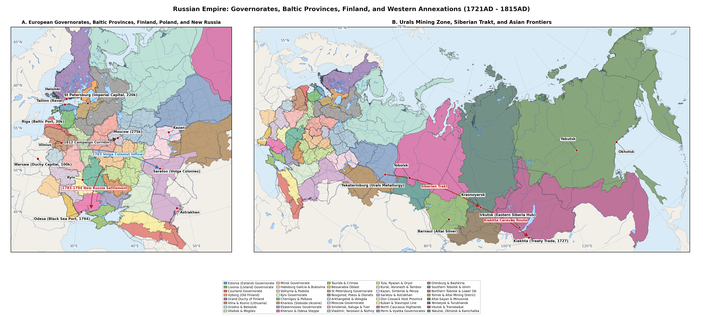
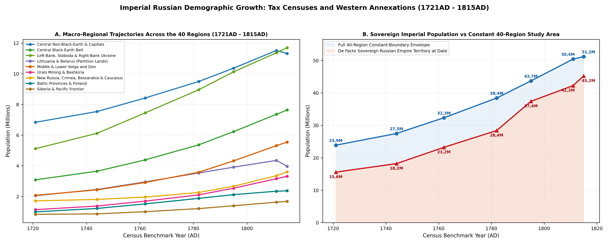
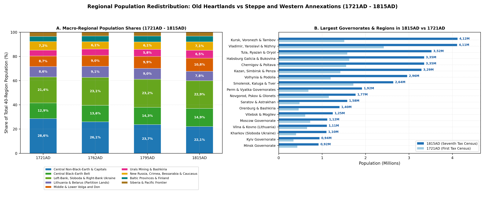
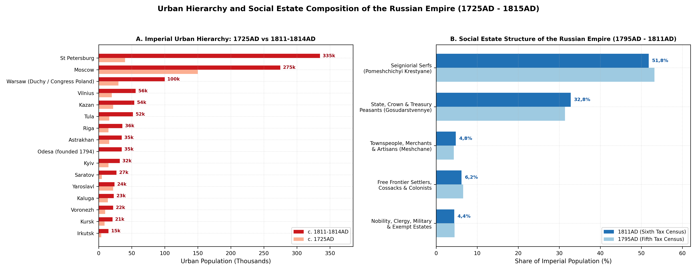

```{=latex}
\emergencystretch=1.5em
```

# Abstract

Between the proclamation of the Russian Empire at the Treaty of Nystad in September 1721AD and the Final Act of the Congress of Vienna in June 1815AD - prior to the formal incorporation of Congress Poland - the territories of the Russian Empire and its contiguous partitioned borderlands experienced one of the largest demographic expansions in early modern Eurasia. Across the 40 provincial and frontier regions examined in this study, total population more than doubled from 23,89M (23,89M) in 1721AD to 51,17M (51,17M) in 1815AD (+114,2%) [@Kabuzan1963; @Kabuzan1971; @Vodarsky1973; @Mironov2000]. Within contemporary shifting sovereign frontiers, the *de facto* population ruled from Saint Petersburg expanded nearly threefold from roughly 15,6M at the close of the Great Northern War (1721AD) to 37,4M after the Third Partition of Poland-Lithuania (1795AD) and 43,1-47,8M by 1815AD, combining rural natural increase in the forest-steppe and Volga-Ural basins with the annexation of densely settled western and southern provinces [@Kabuzan1971; @Kahan1985; @Kappeler2001].

# Background

The 40 historical regions span 18.496.636 km2 and 457.996 grid cells across the Baltic governorates, Old Finland and the Grand Duchy of Finland, the Polish-Lithuanian partition lands including Habsburg Galicia-Bukovina, Left-Bank and Steppe Ukraine, Bessarabia, European Russia, the North Caucasus and eighteenth-century Siberia, whilst excluding Central Asia and Transcaucasia. Within the 39 regions that belonged to the Russian Empire by 1815AD (18.426.024 km2, excluding Region 10, the Habsburg Kingdom of Galicia and Lodomeria with Bukovina and Carpathian Rus, which grew from 1,62M to 3,35M), the population within constant 1815AD imperial boundaries rose from 22,26M (22,26M) in 1721AD to 25,61M in 1744AD, 30,12M in 1762AD, 35,77M in 1782AD, 40,75M in 1795AD, 45,07M in 1806AD, 47,16M on the eve of Napoleon's invasion in 1811AD and 47,82M (47,82M) in 1815AD (+114,8%) [@Kabuzan1990; @Kabuzan1992; @Keppen1857].

<div class="figure" style="text-align: center">

<p class="caption">plot of chunk fig1-md-only</p>
</div>

# Methodology

Population estimates across the eight benchmark dates (1721AD, 1744AD, 1762AD, 1782AD, 1795AD, 1806AD, 1811AD and 1815AD) draw upon four archival traditions [@Ulyanova2016Revizii; @Avdeev2025]. The primary source for the imperial interior is the series of Poll-Tax Soul Revisions (*Revizskie skazki*, Revisions I to VII). Instituted by Peter I's decree of 26 November 1718AD to replace the seventeenth-century household tax (*podvornoe oblozhenie*, last enumerated across European Russia in 1678AD and 1710AD) with a capitation levy (*podushnaya podat*) assessed on individual male "revision souls" (*revizskie dushi*), the Imperial Senate and College of Camarilla conducted seven enumerations between 1719AD and 1816AD [@Vodarsky1977; @Avdeev2025; @Ulyanova2016Revizii]. The First Revision (1719-1724AD, audited by military inspection commissions up to 1727AD) and Second Revision (1743-1747AD) registered taxable males only (court, monastic and seigneurial serfs alongside urban *posadskie*), omitting women, hereditary nobles, clergy, regular troops and autonomous borderlands such as the Baltic provinces, the Left-Bank Hetmanate, the Sloboda Cossack regiments and nomadic steppe peoples [@Kabuzan1963; @Vodarsky1973]. Beginning with the Third Revision (1761-1763AD), Fourth Revision (1781-1782AD, synchronised with Catherine II's 1775AD *Guberniya* Statute) and Fifth Revision (1794-1795AD), female inhabitants were recorded alongside males, and fiscal registration was extended across the Baltic provinces (*Hingeloendid* or *Seelenrevisionen*), Little Russia, Sloboda Ukraine, Novorossiya and the newly annexed Belarusian, Lithuanian and Right-Bank Ukrainian governorates [@Kabuzan1971; @Palli1996]. Under wartime fiscal urgency on the eve of the 1812AD campaign, Alexander I's Sixth Revision (decreed 18 May 1811AD) reverted to a rapid male-only count, requiring sex-ratio parity multipliers derived from the post-war Seventh Revision (decreed 20 June 1815AD and finished in 1816AD), which restored male-female household schedules and recorded the demographic toll of the Napoleonic wars [@Keppen1857; @Hermann1819; @Kabuzan1992; @Myakisheva2016]. Following Vladimir Kabuzan, Yaroslav Vodarsky and Boris Mironov, total regional populations are derived from archival Central Statistical Committee and RGADA *perechnevye vedomosti* by doubling male revision souls where female returns were absent (applying observed regional female-to-male ratios of 1,02-1,06), adding non-taxable estates (*nepodayushchie sosloviya*: nobility, Orthodox and Uniate clergy, civil officials, retired soldiers and regular garrisons, typically 4,5-7,5% of provincial totals) and correcting early-revision infant and fugitive under-registration (+18-22% before military audits in 1721AD, narrowing to +3-5% by 1782-1795AD and +6-8% during the hurried 1811AD count) [@Kabuzan1963; @Mironov2015].

Across the north-western provinces (Regions 1-5), the revisions are supplemented by the Swedish-Finnish *Tabellverket* and Lutheran parish registers. In the Grand Duchy of Finland (Region 5), continuous national vital and population tabulations began in 1749AD under the Royal Swedish *Tabellverket* - the oldest continuous state demographic office in Europe - and continued unbroken after the 1809AD Treaty of Fredrikshamn [@Jutikkala1965; @Turpeinen1979; @Luostarinen2026FinlandTabellverket]. For 1721AD and 1744AD, Eino Jutikkala, Oiva Turpeinen and Kari Pitkänen reconstructed county populations backward from the 1749AD baseline using Lutheran communion books (*rippikirjat*) and burial registers across the post-1713AD *Isoviha* ("Great Wrath") recovery and the 1741-1743AD Russo-Swedish War [@Jutikkala1965; @Pitkanen1993]. In Estland (Region 1), Livland (Region 2) and Courland (Region 3), Heldur Palli and August Wilhelm Hupel cross-checked eighteenth-century *Hakenrevisionen* ploughland rolls (1725-1726AD, 1732AD, 1744AD, 1758AD and 1774AD) against Lutheran parish registers before Imperial Soul Revisions began in 1782AD (and 1795AD in Courland) [@Hupel1774; @Palli1980; @Palli1996; @Jaadla2014Tartu]. In Old Finland/Vyborg Governorate (Region 4), Russian revision rolls from 1724AD and 1744AD supplement Karelian Lutheran church books [@Kashchenko2016Vyborg].

In the western partition lands (Regions 6-12), estimates prior to the Three Partitions (1772AD, 1793AD and 1795AD) across Lithuania, Belarus and Right-Bank Ukraine draw on the 1764-1765AD Commonwealth Jewish capitation census, episcopal Uniate and Roman Catholic parish visitations, Four-Year Sejm hearth taxes (*podymne*, 1789-1790AD) and magnate estate inventories synthesised by Cezary Kuklo, Shaul Stampfer and Arnold Perkovsky [@Kuklo2009; @Stampfer1995; @Perkovsky1979; @Klier1986]. In Habsburg Galicia and Bukovina (Region 10), Vienna introduced military-fiscal soul conscriptions immediately upon annexation in 1772-1776AD, followed by Emperor Joseph II's patent conscriptions of 1785-1787AD and Franciscan updates of 1807-1815AD [@Bohachevsky1967; @Fellerer2023Galicia].

In the southern and eastern borderlands (Regions 13-18, 29-31 and 34-40), Cossack regimental surveys, steppe cadastral rolls and Siberian *yasak* books fill the pre-revision intervals. In the Left-Bank Hetmanate (Region 13) and Sloboda Ukraine (Region 14), regimental *revizii* of 1723-1732AD and Field Marshal Pyotr Rumyantsev's General Description of Little Russia (*Generalnaya opis Malorossii*, 1765-1769AD) bridge the pre-1782AD gap [@Irtenina2022Hetmanate; @Bagaley1918; @Kabuzan2006]. Across Novorossiya, Crimea and Bessarabia (Regions 15-18), Ottoman *tahrir* and *cizye* estimates, the 1783-1784AD Taurida cameral description of Baron Osip Igelström, Apollon Skalkovsky's Novorossiya chancellery tables and the 1812-1816AD Bessarabian boyar and colonist surveys document frontier settlement [@Skalkovsky1836; @Kabuzan1976Novorossiya; @Dmitriev2018CrimeaEmigration; @Feldman2023Bessarabia]. In the North Caucasus highlands (Region 31) and Siberia (Regions 34-40), Russian revision books for Slavic peasants, *pripisnye* mineworkers and Siberian Tatars are combined with *yasak* fur-tribute ledgers and Gerhard Friedrich Müller's academic expedition questionnaires [@Kabuzan1990; @Forsyth1992; @Korusenko2011Siberia; @Tovsultanov2017].


Figure \ref{fig:pop-trajectory} shows the aggregate imperial trajectory alongside ten provincial curves, whilst Table \ref{tab:regional-trajectories} gives the 40-region series and Table \ref{tab:revisions-apparatus} summarises the seven Imperial Soul Revisions and parallel borderland enumerations.

<div class="figure" style="text-align: center">

<p class="caption">plot of chunk fig2-trajectory</p>
</div>

Table: Population trajectories across the 40 historical regions of Early Imperial Russia and adjacent partition lands (1721-1815AD).

|Historical Region (1-40)                                                                  |1721AD |1744AD |1762AD |1782AD |1795AD |1806AD |1811AD |1815AD |Change  |
|:-----------------------------------------------------------------------------------------|:------|:------|:------|:------|:------|:------|:------|:------|:-------|
|1. Estland Governorate                                                                    |105k   |140k   |175k   |200k   |212k   |222k   |228k   |232k   |+121%   |
|2. Livland Governorate                                                                    |195k   |280k   |385k   |495k   |550k   |585k   |605k   |615k   |+215,4% |
|3. Courland Governorate                                                                   |200k   |250k   |305k   |365k   |405k   |425k   |435k   |418k   |+109%   |
|4. Old Finland / Vyborg Governorate                                                       |110k   |128k   |152k   |175k   |186k   |194k   |198k   |202k   |+83,6%  |
|5. Grand Duchy of Finland                                                                 |390k   |425k   |505k   |645k   |770k   |875k   |880k   |908k   |+132,8% |
|6. Vilna Governorate & Samogitia / Kovno                                                  |655k   |760k   |880k   |1,02M  |1,11M  |1,19M  |1,22M  |1,11M  |+69,5%  |
|7. Grodno Governorate & Belostok Oblast                                                   |360k   |430k   |515k   |615k   |680k   |735k   |760k   |695k   |+93,1%  |
|8. Vitebsk & Mogilev Governorates                                                         |610k   |740k   |910k   |1,11M  |1,24M  |1,34M  |1,38M  |1,25M  |+104,1% |
|9. Minsk Governorate & Pripyat Polesia                                                    |430k   |530k   |650k   |790k   |885k   |960k   |995k   |920k   |+114%   |
|10. Habsburg Kingdom of Galicia & Lodomeria                                               |1,62M  |1,88M  |2,22M  |2,65M  |2,95M  |3,16M  |3,26M  |3,35M  |+106,2% |
|11. Volhynia & Podolia Governorates                                                       |1,2M   |1,49M  |1,88M  |2,3M   |2,6M   |2,78M  |2,87M  |2,96M  |+147,7% |
|12. Kyiv Governorate                                                                      |342k   |430k   |550k   |655k   |755k   |855k   |905k   |940k   |+174,9% |
|13. Little Russia: Chernigov & Poltava Governorates                                       |1,55M  |1,82M  |2,18M  |2,58M  |2,92M  |3,16M  |3,27M  |3,35M  |+115,4% |
|14. Sloboda-Ukrainian / Kharkov Governorate                                               |402k   |500k   |625k   |775k   |905k   |1,01M  |1,06M  |1,1M   |+173,6% |
|15. Ekaterinoslav Governorate & Former Zaporozhian Lands                                  |145k   |175k   |225k   |355k   |540k   |690k   |765k   |820k   |+465,5% |
|16. Kherson / Nikolaev Governorate & Ochakov Steppe                                       |105k   |125k   |155k   |225k   |355k   |495k   |565k   |620k   |+490,5% |
|17. Taurida Governorate                                                                   |370k   |350k   |345k   |320k   |260k   |315k   |345k   |370k   |0%      |
|18. Bessarabia Oblast                                                                     |200k   |225k   |255k   |290k   |320k   |340k   |310k   |385k   |+92,5%  |
|19. Saint Petersburg Governorate                                                          |260k   |345k   |435k   |545k   |625k   |695k   |735k   |760k   |+192,3% |
|20. Novgorod, Pskov & Olonets Governorates                                                |1,16M  |1,25M  |1,36M  |1,51M  |1,62M  |1,72M  |1,75M  |1,77M  |+53,2%  |
|21. Arkhangelsk & Vologda Governorates                                                    |560k   |610k   |670k   |750k   |820k   |875k   |905k   |920k   |+64,3%  |
|22. Moscow Governorate                                                                    |725k   |795k   |885k   |985k   |1,08M  |1,18M  |1,24M  |1,12M  |+54,5%  |
|23. Smolensk, Kaluga & Tver Governorates                                                  |1,72M  |1,89M  |2,11M  |2,38M  |2,59M  |2,78M  |2,87M  |2,64M  |+53,5%  |
|24. Central Non-Black-Earth Governorates: Vladimir, Yaroslavl, Kostroma & Nizhny Novgorod |2,42M  |2,65M  |2,96M  |3,33M  |3,62M  |3,89M  |4,02M  |4,11M  |+69,8%  |
|25. Northern Central Black-Earth Governorates: Tula, Ryazan & Oryol                       |1,58M  |1,83M  |2,15M  |2,58M  |2,95M  |3,26M  |3,42M  |3,52M  |+122,8% |
|26. Southern Central Black-Earth Governorates: Kursk, Voronezh & Tambov                   |1,51M  |1,82M  |2,24M  |2,79M  |3,28M  |3,71M  |3,94M  |4,12M  |+172,8% |
|27. Middle Volga Governorates: Kazan, Simbirsk & Penza                                    |1,42M  |1,66M  |1,96M  |2,36M  |2,72M  |3,02M  |3,18M  |3,29M  |+131,7% |
|28. Saratov & Astrakhan Governorates                                                      |480k   |560k   |690k   |860k   |1,12M  |1,36M  |1,49M  |1,58M  |+229,2% |
|29. Province of the Don Cossack Host                                                      |180k   |215k   |265k   |365k   |485k   |590k   |645k   |680k   |+277,8% |
|30. Caucasian Fortified Line, Black Sea Cossack Kuban                                     |120k   |135k   |155k   |215k   |310k   |410k   |465k   |505k   |+320,8% |
|31. North Caucasian Highlanders: Circassia, Kabarda, Chechnya & Dagestan Khanates         |780k   |800k   |830k   |860k   |885k   |900k   |905k   |910k   |+16,7%  |
|32. Perm & Vyatka Governorates                                                            |685k   |830k   |1,03M  |1,29M  |1,53M  |1,74M  |1,84M  |1,92M  |+180,3% |
|33. Orenburg Governorate & Bashkiria                                                      |460k   |550k   |670k   |820k   |1,01M  |1,21M  |1,32M  |1,4M   |+204,3% |
|34. Tobolsk Governorate South: Siberian Trakt                                             |215k   |255k   |308k   |380k   |445k   |500k   |528k   |545k   |+153,5% |
|35. Tobolsk & Narym River North: Tobolsk, Berezov, Surgut & Obdorsk Yasak Tundra          |85k    |96k    |109k   |124k   |139k   |151k   |156k   |160k   |+88,2%  |
|36. Tomsk Governorate                                                                     |95k    |118k   |150k   |196k   |236k   |272k   |289k   |300k   |+215,8% |
|37. Altai-Sayan & Minusinsk Borderlands                                                   |75k    |74k    |82k    |95k    |106k   |117k   |122k   |125k   |+66,7%  |
|38. Yeniseisk Province: Krasnoyarsk Trakt, Angara Portage & Turukhansk Polar North        |72k    |76k    |86k    |102k   |118k   |132k   |138k   |144k   |+100%   |
|39. Irkutsk Governorate & Transbaikal Frontier                                            |142k   |134k   |152k   |181k   |209k   |232k   |243k   |252k   |+77,5%  |
|40. Yakutsk, Okhotsk Seaboard & Kamchatka Oblast                                          |155k   |115k   |125k   |135k   |145k   |154k   |158k   |160k   |+3,2%   |
|Sub-Total: Baltic Provinces & Finland (Regions 1-5)                                       |1M     |1,22M  |1,52M  |1,88M  |2,12M  |2,3M   |2,35M  |2,38M  |+137,5% |
|Sub-Total: Partitions & Galicia-Bukovina (Regions 6-12)                                   |5,22M  |6,26M  |7,61M  |9,14M  |10,22M |11,02M |11,39M |11,22M |+115,1% |
|Sub-Total: Hetmanate, Novorossiya & Bessarabia (Regions 13-18)                            |2,78M  |3,19M  |3,79M  |4,54M  |5,3M   |6,01M  |6,32M  |6,64M  |+139,3% |
|Sub-Total: Capitals, North & Central Russia (Regions 19-26)                               |9,93M  |11,19M |12,81M |14,87M |16,59M |18,11M |18,88M |18,96M |+90,9%  |
|Sub-Total: Volga, Urals, Don & Caucasus (Regions 27-33)                                   |4,12M  |4,75M  |5,6M   |6,77M  |8,06M  |9,23M  |9,85M  |10,29M |+149,3% |
|Sub-Total: Siberia & North Pacific (Regions 34-40)                                        |839k   |868k   |1,01M  |1,21M  |1,4M   |1,56M  |1,63M  |1,69M  |+101%   |
|Sub-Total: 39-Region Imperial Bounds (Excl. Reg. 10)                                      |22,26M |25,61M |30,12M |35,77M |40,75M |45,07M |47,16M |47,82M |+114,8% |
|Grand Total: All 40 Regions (18.496.636 km2)                                              |23,89M |27,49M |32,34M |38,42M |43,7M  |48,23M |50,42M |51,17M |+114,2% |

Table: Imperial Poll-Tax Revisions (I-VII) and parallel borderland censuses anchoring the eight benchmark dates (1721-1815AD).

|Enumeration/Archival Regime                                         |Benchmark   |Registered Scope & Sex Coverage                                                            |40-Region Total          |Standard Scholarly Adjustments                                                                        |
|:-------------------------------------------------------------------|:-----------|:------------------------------------------------------------------------------------------|:------------------------|:-----------------------------------------------------------------------------------------------------|
|1st Soul Revision (Decreed Nov 1718AD; Audited 1719-1727AD)         |1721AD      |Taxable males only in Great Russia & Siberia; excludes Ostsee, Hetmanate, nobles           |23,89M (22,26M Imp.)     |+18-22% early evasion fixed by 1722-1727AD military commissions; x2 sex multiplier + exempted estates |
|2nd Soul Revision (Decreed Dec 1743AD; Conducted 1744-1747AD)       |1744AD      |Taxable males only; adds Old Finland (1743AD Abo) & Orenburg Line settlements              |27,49M (25,61M Imp.)     |+6-9% frontier evasion; x2,03 sex multiplier + clergy/garrisons (Kabuzan 1963; Vodarsky 1973)         |
|3rd Soul Revision (Decreed Nov 1761AD; Conducted 1762-1763AD)       |1762AD      |Both sexes; still excludes Baltic Ritterschaften & Polish-Lithuanian lands                 |32,34M (30,12M Imp.)     |+4-6% omission; supplemented by 1765-1769AD Rumyantsev Little Russian Survey                          |
|4th Soul Revision (Decreed Nov 1781AD; Conducted 1781-1782AD)       |1782AD      |Both sexes across Catherine II's 1775AD namestnichestva, Ostsee, Hetmanate, E. Belarus     |38,42M (35,77M Imp.)     |+3-4% omission; unified cameral accounting across 41 vicegerencies (Kabuzan 1971)                     |
|5th Soul Revision (Decreed Jun 1794AD; Conducted 1794-1795AD)       |1795AD      |Both sexes across 50 provinces incl. 2nd/3rd Polish Partitions, Courland & Crimea          |43,7M (40,75M Imp.)      |+3-5% omission (+10-15% in newly annexed Jewish kahal rolls; Stampfer 1995)                           |
|Governorate Annual Tables & 1806AD Administrative Returns           |1806AD      |Both sexes via Ministry of Internal Affairs provincial reports & Keppen tables             |48,23M (45,07M Imp.)     |Reconciled with diocesan vital balances (CBR ~48-51, CDR ~33-37 per 1.000; Hermann 1819)              |
|6th Soul Revision (Decreed May 1811AD; Wartime Male Count)          |1811AD      |Males only under pre-war fiscal urgency; includes Belostok (1807) & Finland (1809)         |50,42M (47,16M Imp.)     |Female parity interpolated from 5th/7th Revisions; +6-8% hurried wartime undercount (Keppen 1857)     |
|7th Soul Revision (Decreed Jun 1815AD; Conducted 1815-1816AD)       |1815AD      |Both sexes across post-Vienna Empire incl. Bessarabia (1812AD); captures 1812 losses       |51,17M (47,82M Imp.)     |Direct measurement of 1812-1814AD excess military/civilian deficits in Regions 3, 6-9, 22-23          |
|Parallel Borderland Censuses (Tabellverket, Commonwealth, Habsburg) |1721-1815AD |Swedish-Finnish Tabellverket (from 1749AD), 1764/1789 Polish rolls, Austrian conscriptions |Anchored in Regions 1-12 |Palli (1996), Jutikkala (1965), Kuklo (2009) & Bohachevsky (1967) parish-census syntheses             |

# Results

## The Baltic Provinces and Finland

Across the north-western Baltic littoral (Regions 1-5, 481.891 km2), the combined population grew by +137,5% from 1M in 1721AD to 2,38M in 1815AD under institutional regimes distinct from Great Russian serfdom [@Kappeler2001; @Palli1996; @Jutikkala1965]. Under the Capitulations of Riga and Reval (1710AD), confirmed at the Treaty of Nystad (30 August 1721AD), Peter I guaranteed the Baltic German *Ritterschaften*, Lutheran consistories and Hanseatic magistrate privileges of Estland Governorate (Region 1) and Livland Governorate (Region 2, including Ösel/Saaremaa and South Estonian Dorpat-Pernau alongside Latvian Vidzeme) [@Hupel1774; @Savikhin2011Ostsee]. Both provinces entered 1721AD depleted by the Great Famine of 1695-1697AD, Great Northern War devastation and the 1710-1711AD Baltic bubonic plague, which had killed over half the inhabitants of Reval (Tallinn) and Riga: Estland stood at 105k in 1721AD and Livland at 195k [@Palli1980; @Palli1996]. Over the next six decades, the absence of Russian military conscription (until 1797AD), early smallpox variolation, Moravian Brethren (*Herrnhuter*) peasant literacy campaigns and grain-distilling manor expansion fuelled a rapid post-plague recovery [@Palli1996; @Jaadla2014Tartu]. Estland more than doubled to 175k in 1762AD, 212k in 1795AD and 232k in 1815AD (+121%), with Reval rising from 5,2k to 12,8k alongside Wesenberg, Hapsal and Weissenstein. Livland more than tripled from 195k in 1721AD to 385k in 1762AD, 550k in 1795AD and 615k in 1815AD (+215,4%), led by Riga - the Empire's second maritime export port after Saint Petersburg - which expanded from 11,8k in 1721AD to 36,5k in 1811AD (dipping slightly to 36k in 1815AD after Governor Essen burned Riga's wooden suburbs against Marshal Macdonald's X Corps in July 1812AD), whilst Dorpat (Tartu, refounded as an Imperial German-language university in 1802AD) grew from 1,8k to 7,5k and Narva, Pernau, Fellin, Walk and Arensburg anchored coastal and inland trade [@Hupel1774; @Jaadla2014Tartu]. Alexander I's 1804AD Livland and Estland peasant ordinances regulated corvée (*Fronarbeit*) norms and prepared the personal emancipation enacted in 1816-1819AD [@Mironov2000].

To the south, the Duchy of Courland and Semigallia (Region 3, together with Pilten District) remained a Polish-Lithuanian vassal fief under the Kettler and Biron dukes until its annexation during the Third Partition in March 1795AD [@Kabuzan1990; @Kappeler2001]. Spared the worst fighting of 1710-1721AD, Courland grew steadily from 200k in 1721AD to 305k in 1762AD, 405k at the Fifth Revision in 1795AD and 435k in 1811AD, centred on the ducal capital of Mitau (Jelgava, 5,5k to 12k), the ice-free Baltic port of Libau (Liepaja, 2,8k to 6,2k), Windau (Ventspils), Goldingen and Bauske. In 1812AD, Franco-Prussian occupation, cattle requisitions and typhus reduced Courland's population to 418k by the Seventh Revision in 1815AD (+109% overall) [@Kabuzan1992].

Across the Gulf of Finland, Karelian and Finnish territories entered the Empire in two stages. Old Finland, organised as Vyborg Governorate (Region 4, growing from 110k to 202k, or +83,6%), was ceded by Sweden in two slices - Karelian Vyborg and Kexholm at Nystad in 1721AD and the Kymi River strip of Hamina (Fredrikshamn), Lappeenranta (Villmanstrand) and Savonlinna (Nyslott) at the Treaty of Åbo in 1743AD - rising from 110k in 1721AD to 152k in 1762AD and 198k in 1811AD [@Kashchenko2016Vyborg]. Unlike mainland Sweden-Finland, large tracts of Old Finland were granted as imperial *lahjoitusmaat* ("donation estates") to Russian court aristocrats, depressing peasant mobility relative to Swedish Savo-Karelia until Alexander I reunited Vyborg Governorate with the autonomous Grand Duchy of Finland on 1 January 1812AD, reaching 202k in 1815AD with Vyborg town at 3,8k alongside Sortavala, Kexholm and Hamina [@Kashchenko2016Vyborg; @Jutikkala1965].

In the Grand Duchy of Finland (Region 5, expanding from 390k to 908k, or +132,8%), recovery from the demographic trough of the 1713-1721AD Russian occupation (*Isoviha*, 390k in 1721AD) and the 1741-1743AD *Pikkuviha* war (425k in 1744AD) was driven by pioneering land clearance (*isojaot* enclosure, tar-burning in Ostrobothnia and slash-and-burn *kaski* farming in Savonia), lifting the *Tabellverket* registers to 505k in 1762AD, 645k in 1782AD, 770k in 1795AD and 875k in 1806AD [@Jutikkala1965; @Turpeinen1979]. During the Finnish War of 1808-1809AD, epidemic dysentery, typhus and relapsing fever spread along military supply routes, pushing Finland's crude death rate above 55-60 per 1.000 in 1808-1809AD and causing roughly 35k-45k excess civilian deaths [@Pitkanen1993; @Luostarinen2026FinlandTabellverket]. Consequently, Region 5 plateaued at 880k in 1811AD after annexation under the Diet of Borgå (Porvoo) and Treaty of Fredrikshamn (17 September 1809AD), before rebounding to 908k by 1815AD. In April 1812AD, Alexander I transferred the Grand Duchy's capital from Swedish-oriented Åbo (Turku, Finland's largest town at 11,6k in 1815AD) to Helsingfors (Helsinki, 4,8k, guarded by Sveaborg sea fortress), alongside Uleåborg (Oulu, 3,8k), Vasa (9k), Björneborg (Pori, 2,8k) and Tammerfors (Tampere) [@Jutikkala1965].


## The Polish Partitions and Galicia

The centrepiece of Catherine II's western policy was the three-stage partition of the Polish-Lithuanian Commonwealth (1772AD, 1793AD and 1795AD), followed by Napoleon's cession of Belostok (Bialystok) Oblast to Russia at the Treaty of Tilsit in July 1807AD [@Kappeler2001; @Kuklo2009; @Lieven2009]. Across Regions 6-12 (553.379 km2), the combined population rose by +115,1% from 5,22M in 1721AD to a pre-war peak of 11,39M in 1811AD before contracting to 11,22M in 1815AD under the impact of the 1812AD campaign in Lithuania and Belarus (Table \ref{tab:shocks-annexations}).

Table: Major territorial annexations, colonisation programmes, epidemic crises and wartime demographic shocks (1721-1815AD).

|Chronology & Event                                              |Primary Regions         |Demographic Magnitude & Structural Impact                                                           |Key Literature                                |
|:---------------------------------------------------------------|:-----------------------|:---------------------------------------------------------------------------------------------------|:---------------------------------------------|
|1721AD Nystad & 1743AD Abo Treaties (Baltic & Old Finland)      |Regions 1, 2 & 4        |Incorporates ~410k inhabitants (1721AD) + ~55k (1743AD); rapid post-1710 plague rebound             |Palli 1996; Kashchenko 2016                   |
|1762-1766AD Foreign Colonist Manifestos (Volga Germans)         |Region 28 (Saratov)     |27k-30k German colonists settled in 104 Volga colonies (1764-1768AD), reaching ~62k by 1815AD       |Bartlett 1979; Galperina 2013                 |
|1768-1769AD Kamchatka & Okhotsk Smallpox Pandemic               |Region 40 (Kamchatka)   |Kills ~5.000-6.000 Itelmen/Koryaks (~50-65% of Peninsula natives); Reg. 40 held at 125k-135k        |Turaev 2012; Tolkacheva 2015                  |
|1770-1772AD Russian Plague & Sep 1771AD Moscow Plague Riot      |Regions 12, 22, 23 & 25 |56k-70k dead in Moscow city (~100k+ in Moscow & central uezds); temporary flight halves city        |Alexander 1980; Iskhakov 2013                 |
|Jan 1771AD Torghut Kalmyk Exodus (*Pylnyy pokhod*)              |Region 28 (Astrakhan)   |~31k-33k tents (~150k-170k Kalmyks) depart east of Volga; >85k perish en route to Qing Ili          |Khodarkovsky 1992; Ochirov 2012               |
|1772AD, 1793AD & 1795AD Partitions + 1807AD Belostok            |Regions 3 & 6-12        |Transfers ~7,3M Commonwealth subjects to Russia (Regs 3, 6-9, 11-12) & ~2,65M to Austria (Reg 10)   |Kabuzan 1990; Kuklo 2009; Klier 1986          |
|1773-1775AD Pugachev Rebellion (Yaik, Orenburg, Volga, Urals)   |Regions 27, 28, 32 & 33 |~25k-40k military/civilian deaths; burning of 60+ Ural foundries & Bashkir frontier forts           |Kahan 1985; Shaykhislamov 2018                |
|1774-1792AD Novorossiya, 1778AD Mariupol Greeks & 1783AD Crimea |Regions 15, 16, 17 & 30 |~31k Crimean Christians to Mariupol (1778); ~100k-180k Tatars emigrate; >600k colonists arrive      |Kabuzan 1976; Williams 2001; Pakhomenko 2014  |
|1808-1809AD Finnish War & Sep 1809AD Fredrikshamn Annexation    |Regions 4 & 5           |~35k-45k war-epidemic deaths in Finland; transfers ~880k inhabitants into autonomous Grand Duchy    |Jutikkala 1965; Pitkanen 1993                 |
|May 1812AD Treaty of Bucharest (Bessarabia Oblast Annexation)   |Region 18 (Bessarabia)  |Annexes 47.077 km2 (310k in 1811AD to 385k in 1815AD) via Bulgarian, Gagauz & Moldavian inflows     |Feldman 2023; Bas 2015                        |
|Jun-Dec 1812AD Patriotic War (Grande Armee Invasion & Retreat)  |Regions 3, 6-9, 22 & 23 |~500k-650k net civilian/military deficit across Lithuania-Belarus (-380k) & Smolensk-Moscow (-345k) |Lieven 2009; Shelomentseva 2015; Kabuzan 1992 |

In eastern Belarus, the Vitebsk and Mogilev Governorates (Region 8, moving from 610k in 1721AD to 1,38M in 1811AD and 1,25M in 1815AD, or +104,1%) were annexed by Russia in the First Partition of August 1772AD. Initially organised as the Pskov/Polotsk and Mogilev governorates alongside Polish *Inflanty* (Latgale) around Dünaburg/Daugavpils, and briefly merged as Belarus Governorate in 1796-1802AD, Region 8 doubled from 610k in 1721AD to 1,11M at the Fourth Revision in 1782AD and 1,38M in 1811AD [@Kabuzan1971; @Reutskaya2016Belarus]. Dense networks of magnate *miasteczka* (*shtetlekh*) such as Shklov, Orsha, Mstislavl and Polotsk joined Vitebsk (5k in 1811AD) and Mogilev (0k in 1811AD) [@Klier1986; @Stampfer1995]. Between June and November 1812AD, however, Region 8 formed the main operational corridor for both the French advance and the Berezina retreat through Borisov, Orsha and Vitebsk, suffering requisition famine and typhus that cut its Seventh Revision population by -135k (-9,8%) to 1,25M in 1815AD [@Kabuzan1992; @Lieven2009].

Across Lithuania, Grodno-Belostok and central Belarus (Regions 6, 7 and 9), similar wartime losses interrupted decades of steady growth. Vilna Governorate and Samogitia/Kovno (Region 6), annexed in the Third Partition of 1795AD, grew from 655k in 1721AD to 1,11M in 1795AD and 1,22M in 1811AD, anchored by Vilna (Vilnius) - the largest city of the former Grand Duchy of Lithuania, rising from 19,5k in 1721AD to 42k in 1811AD around its Imperial University (rechartered in 1803AD) and Jewish *kahal* - alongside Kovno (Kaunas), Shavli (Siauliai), Rossieny and Troki [@Kuklo2009; @Stampfer1995]. In June-December 1812AD, Vilna served as Napoleon's rear logistics base and the graveyard of tens of thousands of freezing *Grande Armée* stragglers and typhus-stricken townspeople; Vilna city fell from 42k to 36k and Region 6 lost -110k (-9%) between 1811AD and 1815AD, returning to 1,11M [@Lieven2009; @Kabuzan1992]. Grodno Governorate and Belostok Oblast (Region 7, annexed in 1795AD and at Tilsit in 1807AD) expanded from 360k in 1721AD to 760k in 1811AD before dropping by -8,6% to 695k in 1815AD around Grodno, Belostok, Brest-Litovsk, Slonim, Novogrudok and Lida, whilst Minsk Governorate and Pripyat Polesia (Region 9, annexed in the 1793AD Second Partition) grew from 430k in 1721AD to 995k in 1811AD and dropped by -7,5% to 920k in 1815AD after fighting around Minsk, Borisov, Bobruisk fortress, Slutsk and Pinsk [@Reutskaya2016Belarus; @Kabuzan1992].

To the south, in Right-Bank Ukraine (Regions 11 and 12), following the eighteenth-century *Haidamak* uprisings (*Koliivshchyna* in 1768AD, centred on Uman) and Polish aristocratic *slobody* colonisation across the Podolian-Volhynian forest-steppe, the Second (1793AD) and Third (1795AD) Partitions brought the Volhynia and Podolia Governorates (Region 11, rising from 1,2M to 2,96M, or +147,7%) and Kyiv Governorate (Region 12, uniting Russian Left-Bank Kyiv city and Vasilkov with the annexed Right-Bank interior, rising from 342k to 940k, or +174,9%) into the Empire [@Perkovsky1979; @Kabuzan2006]. Spared direct occupation by Napoleon's main army in 1812AD (beyond Tormasov's defensive operations on the western Volhynian fringe), Volhynia-Podolia and Kyiv continued growing between 1811AD and 1815AD (from 2,87M to 2,96M and from 905k to 940k), led by Kyiv (8k to 23,4k), Berdichev (0k, hub of Volhynian banking and Hasidic commerce), Kamenets-Podolskiy (6k), Dubno, Zhitomir, Starokonstantinov, Uman (6k), Belaya Tserkov and Cherkassy [@Perkovsky1979; @Mironov1990Urban]. To prevent Jewish merchants registered in the annexed western *kahals* from competing with Christian guilds in Moscow and interior Great Russia, Catherine II's decree of 23 December 1791AD and Alexander I's *Jewish Statute* (*Polozhenie o evreyakh*) of 9 December 1804AD established the Pale of Permanent Jewish Settlement (*Cherta postoyannoy evreyskoy osedlosti*) across Lithuania, Belarus, Right-Bank and Left-Bank Ukraine and Novorossiya (encompassing roughly 750k-900k Jewish inhabitants by 1806-1815AD), whilst Catherine II's 1794-1796AD missionary campaigns transferred roughly 1,5M Right-Bank and Belarusian Greek Catholics (Uniates) to the Russian Orthodox Church [@Klier1986; @Stampfer1995; @Kabuzan2016].

In the Habsburg Kingdom of Galicia and Lodomeria, Bukovina and Carpathian Rus (Region 10, growing from 1,62M to 3,35M, or +106,2%), which is included to maintain geographic continuity with the adjacent Polish-Lithuanian partition lands (save for the brief 1809-1815AD Russian possession of the Tarnopol Circle ceded at Schönbrunn and returned at Vienna), Habsburg Eastern Galicia (annexed in 1772AD), Bukovina (ceded by the Ottoman Empire in 1775AD) and Hungarian Subcarpathian Rus doubled from 1,62M in 1721AD to 2,65M under the Josephine conscriptions (1782AD benchmark) and 3,35M in 1815AD [@Bohachevsky1967; @Fellerer2023Galicia]. The provincial capital Lemberg/Lviv expanded from 25k in 1721AD to 44,5k in 1815AD - making it the third largest city in the 40-region study area - alongside the duty-free border entrepôt of Brody (5k to 19,5k), Tarnopol (5k), Stanislawow, Drohobycz, Przemyśl, Czernowitz/Chernivtsi (8k to 6,2k) and Ungvár/Uzhhorod [@Fellerer2023Galicia; @Kuklo2009].


## Ukraine, Novorossiya and Bessarabia

Few regions of eighteenth-century Europe saw a more rapid change in political geography and rural settlement density than the Ukrainian forest-steppe and Pontic littoral (Regions 13-18, 417.427 km2), which expanded by +139,3% from 2,78M in 1721AD to 6,64M in 1815AD [@Sunderland2004; @Kabuzan1976Novorossiya; @Kabuzan2006]. Figure \ref{fig:subregional-dist} shows the provincial growth rankings and regional population shares across the 40 regions.

<div class="figure" style="text-align: center">

<p class="caption">plot of chunk fig3-subregional</p>
</div>

In the old Ukrainian Cossack lands, imperial centralisation dismantled autonomous regimental governance and folded the population into the regular poll-tax and serf system across Little Russia (Chernigov and Poltava Governorates, Region 13, rising from 1,55M to 3,35M, or +115,4%) and Sloboda Ukraine (Kharkov Governorate, Region 14, rising from 402k to 1,1M, or +173,6%). Catherine II abolished the five Sloboda Cossack regiments in July 1765AD, creating the Sloboda-Ukrainian Governorate around Kharkov, where Vasily Karazin founded Kharkov Imperial University in 1804-1805AD as the city grew from 6,2k in 1721AD to 13,5k in 1815AD alongside Sumy, Akhtyrka, Izyum and Belopolye [@Bagaley1918]. In Left-Bank Little Russia, the office of Hetman Kirill Razumovsky was abolished in November 1764AD, Rumyantsev's General Survey enumerated Cossack and peasant households in 1765-1769AD, regimental administration gave way to vicegerencies in 1781AD and the decree of 3 May 1783AD prohibited peasant movement, legally binding Left-Bank *pospoliti* peasants to the Cossack *starshina* (ennobled in 1785AD), whilst registered *vyborni* and *pidpomoshchniki* Little Russian Cossacks survived as a large free smallholder estate [@Irtenina2022Hetmanate; @Moon1999]. Dense agrarian settlement pushed Region 13 to 3,35M (4 inhabitants per km2) by 1815AD around Nezhin (5k, home to a privileged Greek merchant colony), Poltava (2k), Chernigov, Glukhov, Kremenchug, Starodub and Baturin [@Kabuzan2006].

South of the forest-steppe, Russo-Ottoman victories transformed the sparsely inhabited "Wild Field" (*Dikoe pole*) and Crimean Khanate into Novorossiya ("New Russia") and Bessarabia [@Sunderland2004; @Bessarabova2017; @Skalkovsky1836]. Across Ekaterinoslav Governorate (Region 15, surging from 145k to 820k, or +465,5%) and the Kherson/Ochakov steppe (Region 16, rising from 105k to 620k, or +490,5%), colonisation began in the 1750s with Empress Elizabeth's military settlements of New Serbia (1752AD, anchored by Fort Saint Elizabeth/Elisavetgrad) and Slavo-Serbia (1753AD, around Bakhmut and the Lugansk foundry, established in 1795AD), which absorbed Serbian, Vlach, Bulgarian and Ukrainian settlers despite Crimean Tatar raids such as Khan Qirim Giray's January 1769AD incursion [@Kashirin2019; @Kabuzan1976Novorossiya]. Following the Treaty of Küçük Kaynarca (July 1774AD), Catherine II ordered General Pyotr Tekeli to surround and abolish the Zaporozhian Sich in June 1775AD, redistributing steppe estates under Prince Grigory Potemkin's vicegerency [@Bessarabova2017; @Stepanova2025]. After the Treaty of Jassy (January 1792AD, Old Style December 1791AD) extended Russian rule across the Yedisan/Ochakov steppe between the Southern Bug and Dniester, state peasants, fugitive Great Russian and Ukrainian serfs, Chortitza (1789AD) and Molotschna (1804AD) Prussian Mennonites, Black Sea German Lutheran and Catholic colonists (Liebental and Kutschurgan), Ottoman Bulgarians and Greeks settled across Regions 15 and 16 [@Bartlett1979; @Bas2015Novorossiya; @Bushin2011]. A network of planned ports and administrative capitals rose within two decades: Kherson (founded in 1778AD as a Black Sea shipyard, 12,8k in 1815AD), Mariupol (founded in 1778-1780AD by ~31k Crimean Rumelian and Urum Greeks relocated from the Crimean Khanate under Metropolitan Ignatios to weaken the Khanate's tax base) [@Pakhomenko2014Mariupol1778], Ekaterinoslav (Dnipro, refounded on the Dnieper right bank in 1787AD, 8,2k in 1815AD), Nikolaev (Admiralty dockyard founded in 1789AD, 10,5k) and Odessa (decreed in May 1794AD on the site of Ottoman Khadzhibey), which under Duc de Richelieu's governorship (1803-1814AD) and Mediterranean wheat exports grew rapidly from 1,1k in 1782AD and 4,5k in 1795AD to 35k in 1815AD [@Herlihy1986; @Bushin2011].

In Taurida Governorate, covering Crimea and Northern Tavria (Region 17, moving from 370k in 1721AD to 260k in 1795AD and back to 370k in 1815AD, or 0% net), population followed a V-shaped trajectory across the late eighteenth century [@Williams2001; @Dmitriev2018CrimeaEmigration]. Weakened by Russian invasions (1736-1738AD and 1771AD), the 1778AD departure of ~31k Crimean Greeks and Armenians [@Pakhomenko2014Mariupol1778] and Catherine II's annexation of the Crimean Khanate on 8 April 1783AD, between 100k and 180k Crimean Tatars and Nogais emigrated by sea and across the Danube to Ottoman Dobruja and Anatolia between 1783AD and 1793AD [@Williams2001; @Dmitriev2018CrimeaEmigration]. Consequently, Region 17 contracted from ~370k in 1721AD and 320k in 1782AD to a Fifth Revision low of 260k in 1795AD, with the old Giray capital of Bakhchisarai shrinking from 14k in 1721AD to 6,8k in 1795AD and Karasubazar from 10,5k to 6,2k. Between 1795AD and 1815AD, state peasant settlement in the mainland Melitopol-Dnieper uezds, Nogai pacification on the Molochnaya steppe, German and Bulgarian colonies and naval expansion at Sevastopol (founded in 1783AD at Akhtiar, rising to 14k including naval ratings by 1815AD), Simferopol (founded in 1784AD beside Aqmescit, 4,8k), Feodosia (Kaffa) and Evpatoria restored Taurida's total population to 370k by 1815AD [@Kabuzan1976Novorossiya; @Dmitriev2018CrimeaEmigration].

Further west, Bessarabia Oblast (Region 18, growing from 200k in 1721AD to 310k in 1811AD and 385k in 1815AD, or +92,5%) was ceded by the Ottoman Empire at the Treaty of Bucharest (28 May 1812AD) four weeks before Napoleon crossed the Niemen. The interfluve between the Prut, Dniester and Black Sea combined Moldavian boyar and freeholder uplands around Kishinev (Chisinau) and Orhei with the southern Budjak steppe around Bender, Akkerman, Izmail, Kiliya and Khotin [@Feldman2023Bessarabia; @Bas2015Novorossiya]. During the 1806-1812AD Russo-Ottoman War, Russian expulsion of the Budjak Nogai horde (~25k-35k) briefly depressed Region 18 from 340k in 1806AD to 310k in 1811AD; immediately after 1812AD, tax exemptions, freedom from serfdom and Trans-Danubian Bulgarian, Gagauz, Moldavian, Ukrainian and Warsaw-Duchy German colonist inflows lifted Bessarabia to 385k by 1815AD (+24,2% in four years), whilst the new oblast capital Kishinev more than doubled from 7,5k in 1811AD to 18k in 1815AD [@Feldman2023Bessarabia; @Kabuzan1992].


## Central Russia, the Volga-Urals and the Caucasus

Across the Great Russian interior, the Volga-Ural basin and the North Caucasian frontier (Regions 19-33, 4.188.909 km2), the total population rose from 14,05M in 1721AD to 29,25M in 1815AD (+108,1%), shaped by the shift of the demographic centre of gravity southward and eastward out of the Non-Black-Earth forest core toward the Chernozem, the Lower Volga, the Ural foundries and the Kuban-Terek lines [@Kabuzan1971; @Mironov2000; @Moon1999]. Figure \ref{fig:urban-hierarchy} and Table \ref{tab:urban-hierarchy} trace the restructuring of the Empire's urban hierarchy across 1721-1815AD.

<div class="figure" style="text-align: center">

<p class="caption">plot of chunk fig4-urban</p>
</div>

Table: Leading urban centres across the 40 historical regions by 1815AD population (1721-1815AD).

|Rank (1815) |City & Region              |1721AD |1762AD |1795AD |1811AD |1815AD |Urban Function & Trajectory                                                |
|:-----------|:--------------------------|:------|:------|:------|:------|:------|:--------------------------------------------------------------------------|
|No. 1       |Saint Petersburg (Reg. 19) |40k    |130k   |225k   |300k   |335k   |Imperial capital, court, Baltic port & guard garrisons (+737,5%)           |
|No. 2       |Moscow (Reg. 22)           |140k   |165k   |215k   |275k   |185k   |Old capital & textile hub; 1771 plague & Sep 1812 Fire (-32,7% vs 1811)    |
|No. 3       |Lviv/Lemberg (Reg. 10)     |25k    |30k    |38,5k  |43k    |44,5k  |Habsburg Galician crownland capital & commercial centre (+78%)             |
|No. 4       |Riga (Reg. 2)              |11,8k  |21,2k  |30,8k  |36,5k  |36k    |Baltic Livland capital & Daugava flax/timber port (+205,1%)                |
|No. 5       |Vilna/Vilnius (Reg. 6)     |19,5k  |26k    |35,5k  |42k    |36k    |Lithuanian capital & university; 1812 typhus/retreat loss (-14,3% vs 1811) |
|No. 6       |Astrakhan (Reg. 28)        |15k    |22,5k  |30k    |34,2k  |35,2k  |Caspian/Persian silk & Volga fisheries entrepot (+134,7%)                  |
|No. 7       |Odessa (Reg. 16)           |-      |0,8k   |4,5k   |24k    |35k    |Founded 1794AD on Khadzhibey; Black Sea grain port                         |
|No. 8       |Kazan (Reg. 27)            |18k    |24,5k  |29,5k  |33,4k  |34,2k  |Middle Volga administrative, leather/soap & university (1804) hub          |
|No. 9       |Tula (Reg. 25)             |16k    |22k    |28k    |31,5k  |32,5k  |Imperial small-arms arsenal & iron/samovar workshops (+103,1%)             |
|No. 10      |Kronstadt (Reg. 19)        |8,5k   |16,5k  |24,5k  |29,5k  |31k    |Baltic Fleet island fortress & merchant customs roadstead                  |
|No. 11      |Saratov (Reg. 28)          |8k     |13,5k  |21,5k  |26k    |27,4k  |Lower Volga salt/grain port & 1764 Volga German colony centre              |
|No. 12      |Yaroslavl (Reg. 24)        |16k    |19k    |22,2k  |24k    |24,4k  |Upper Volga linen manufactories & river transshipment (+52,5%)             |
|No. 13      |Kyiv (Reg. 12)             |14,8k  |18,2k  |20,9k  |22,6k  |23,4k  |Dnieper pilgrimage metropolis & Contract Fair (from 1797AD)                |
|No. 14      |Kaluga (Reg. 23)           |12,8k  |16,5k  |20,8k  |23,6k  |23k    |Oka grain/hemp river port & 1812 Russian rear depot (+79,7%)               |
|No. 15      |Oryol (Reg. 25)            |9,5k   |13,8k  |18,8k  |21,8k  |22,5k  |Oka head-of-navigation grain shipper to St Petersburg (+136,8%)            |
|No. 16      |Kursk (Reg. 26)            |10,2k  |14,5k  |18,5k  |20,7k  |21,4k  |Black-Earth guberniya seat & Korennaya Fair (+109,8%)                      |
|No. 17      |Voronezh (Reg. 26)         |11k    |14k    |17,5k  |19,6k  |20,2k  |Don shipyard cradle & southern chernozem market (+83,6%)                   |
|No. 18      |Kishinev (Reg. 18)         |4,5k   |6k     |7,8k   |7,5k   |18k    |Bessarabia Oblast capital after May 1812 annexation (+300%)                |

### The Capitals, the 1771AD Plague and the Black-Earth Shift

Founded in 1703AD and confirmed at Nystad in 1721AD, Saint Petersburg Governorate (Region 19) grew by +192,3% from 260k in 1721AD to 760k in 1815AD [@Mironov1990Urban; @Kahan1985]. Sustained by compulsory noble residence, the Baltic Fleet at Kronstadt (5k to 31k), preferential customs tariffs over Arkhangelsk and seasonal *otkhodniki* peasant migrants, Saint Petersburg city surged more than eightfold from 40k in 1721AD to 130k in 1762AD, 225k in 1795AD (overtaking Moscow as Russia's largest city), 300k in 1811AD and 335k in 1815AD [@Mironov1990Urban; @Mironov2000]. Supplying the northern capital with interior grain, iron and naval timber drove canal construction across the Novgorod, Pskov and Olonets Governorates (Region 20, rising from 1,16M to 1,77M, or +53,2%) - via the Vyshny Volochyok waterway, the Ladoga bypass canals and the Tikhvin and Mariinsk systems opened in 1810-1811AD, alongside Charles Gascoigne's Alexandrovsky cannon foundry at Petrozavodsk (2k) - whilst the Arkhangelsk and Vologda Governorates (Region 21, growing from 560k to 920k, or +64,3%) expanded more slowly after Peter I's 1713-1722AD diversion of foreign trade from White Sea Arkhangelsk (0k to 11,8k, partially liberalised by Catherine II in 1762AD) [@Kahan1985; @Vodarsky1973].

In central Russia, Moscow Governorate (Region 22) rose from 725k in 1721AD to 885k in 1762AD before suffering the deadliest urban epidemic of eighteenth-century Europe: the Bubonic Plague of 1770-1772AD [@Alexander1980; @Iskhakov2013Plague1771]. Introduced from the Moldavian-Wallachian war theatre into Moscow's woollen cloth manufactories (*Sukonnyy dvor*) in late 1770AD, mortality peaked at over 800-1.000 deaths per day in August-September 1771AD, sparking the Plague Riot (*Chumnoy bunt*) of 15-17 September 1771AD and the murder of Archbishop Ambrosius at the Donskoy Monastery before Count Grigory Orlov enforced quarantines and extra-mural plague cemeteries [@Alexander1980; @Iskhakov2013Plague1771]. Between 56k and 70k inhabitants perished in Moscow city (over a quarter of its winter population, and ~100k across Moscow Governorate and adjacent central *uezds*), slowing Region 22's growth between 1762AD (885k) and 1782AD (985k) before rural textile immigration lifted Moscow city to 275k and Moscow Governorate to 1,24M by 1811AD [@Mironov1990Urban]. Across the Central Non-Black-Earth Industrial Belt of Vladimir, Yaroslavl, Kostroma and Nizhny Novgorod (Region 24, rising from 2,42M to 4,11M, or +69,8%), podzolic soils and cash-quitrent (*obrok*) serfdom fostered proto-industrial linen, cotton-printing and metalworking villages around Yaroslavl (24,4k), Nizhny Novgorod (16,8k), Kostroma (10,8k), Shuia-Ivanovo and Pavlovo-on-Oka [@Kahan1985; @Moon1999]. Conversely, fertile chernozem soils and demesne corvée (*barshchina*) propelled faster agrarian expansion across the Northern Black-Earth provinces of Tula, Ryazan and Oryol (Region 25, growing from 1,58M to 3,52M, or +122,8%) - led by Tula (5k) and Oryol (5k) - and the Southern Black-Earth provinces of Kursk, Voronezh and Tambov (Region 26, rising from 1,51M to 4,12M, or +172,8%), where Kursk (4k), Voronezh (2k), Tambov (6k) and Lipetsk anchored grain and livestock production [@Kabuzan1971; @Myakisheva2016].


### The War of 1812AD

Between 24 June and December 1812AD, Napoleon's ~610k *Grande Armée* invaded and retreated along the Niemen-Dvina-Dnieper-Moskva axis, inflicting a sharp demographic loss visible between the Sixth Revision (1811AD) and Seventh Revision (1815AD) [@Lieven2009; @Kabuzan1992; @Shelomentseva2015Smolensk1812]. Across the seven directly invaded western and central regions (Regions 3, 6, 7, 8, 9, 22 and 23), the combined population fell by -727k between 1811AD (8,89M) and 1815AD (8,17M), representing a -8,2% net contraction, or roughly a 900k-1,1M total demographic deficit once four years of foregone natural increase and Empire-wide levy casualties from the >900k recruits and *opolchenie* militiamen raised in 1812-1814AD are included [@Kabuzan1992; @Lieven2009].

In the Smolensk, Kaluga and Tver Governorates (Region 23), the population fell from 2,87M in 1811AD to 2,64M in 1815AD (-230k, or -8%). Bearing the brunt of the August battle and burning of Smolensk (6k to 8,8k), Vyazma (8k to 6,2k), Dorogobuzh, Gzhatsk and the October battle of Maloyaroslavets in Kaluga Governorate, Smolensk Governorate alone lost over 160k-190k inhabitants to flight, scorched-earth destruction and epidemic typhus [@Shelomentseva2015Smolensk1812]. In Moscow Governorate (Region 22), the population dropped from 1,24M in 1811AD to 1,12M in 1815AD (-115k, or -9,3%). Following the Battle of Borodino (7 September 1812AD), civilian evacuation reduced Moscow's resident population below ~15k-25k when French troops entered on 14 September, and the Fire of Moscow (14-18 September 1812AD) destroyed ~6.500 of the city's ~9.150 houses (over 70% of the built stock). By 1815AD, Moscow city stood at ~185k - still -90k (-32,7%) below its 1811AD pre-war peak of 275k [@Mironov1990Urban; @Lieven2009].


### The Volga, the Urals and the Caucasus

Along the Middle and Lower Volga (Regions 27 and 28), settlement expanded rapidly across the eighteenth century. The Kazan, Simbirsk and Penza Governorates (Region 27, growing from 1,42M to 3,29M, or +131,7%) integrated Russian landlord estates with Volga Tatar, Chuvash, Mordvin and Mari state peasants, including the Admiralty *lashmany* ship-timber cutters around Kazan (0k to 34,2k, seat of Kazan Imperial University from 1804AD), Simbirsk (2k) and Penza (2k) [@Abdullin2013; @Kappeler2001]. Southward in the Saratov and Astrakhan Governorates (Region 28, rising from 480k to 1,58M, or +229,2%), two opposite migrations occurred within eight years. Under Catherine II's Foreign Colonist Manifestos of 4 December 1762AD and 22 July 1763AD, 27k-30k German colonists from Hesse, the Palatinate and Württemberg settled between 1764AD and 1768AD in 104 *Bergseite* and *Wiesenseite* mother colonies around Saratov (0k to 27,4k), Katharinenstadt (Marxstadt), Pokrovskaya (Engels) and Sarepta (a Moravian colony near Tsaritsyn, founded in 1765AD); benefiting from religious autonomy, tax holidays and military exemption, the Volga Germans grew through natural increase (with crude birth rates above 52 per 1.000) to ~62k by 1815AD [@Bartlett1979; @Galperina2013VolgaGermans]. Conversely, encroaching Russian settlement lines and restrictions on khanate autonomy provoked Ubashi Khan's Kalmyk Exodus (*Torghutskiy ukhod* or *Pylnyy pokhod*) of 5 January 1771AD: roughly 31k-33k kibitkas (~150k-170k Kalmyks) on the eastern *Wiesenseite* bank of the Volga set out across the Kazakh steppe toward Qing Dzungaria (Ili), losing over half their people and herds to winter exposure, disease and Kazakh and Kyrgyz attacks en route (~70k-75k survivors reaching Qing territory), whilst an unseasonable Volga thaw trapped ~11k-13k tents (~55k Kalmyks) on the right bank in Astrakhan Governorate (Astrakhan rising from 15k to 35,2k), whose autonomous Kalmyk Khanate Catherine II abolished in October 1771AD [@Khodarkovsky1992; @Ochirov2012Kalmyk1771; @Tepkeev2025Kalmyk].

In the Urals and Bashkiria (Regions 32 and 33), metallurgical expansion and frontier rebellion shaped regional growth. Under Peter I's Berg-Collegium decrees (including the 1721AD *possessional* peasant law allowing merchants to buy whole villages bound to factories) and Demidov-Stroganov expansion, the Perm and Vyatka Governorates (Region 32, growing from 685k to 1,92M, or +180,3%) became the world's leading pig-iron exporter in the second half of the eighteenth century [@Portal1950; @Kahan1985; @Smirnov1992UralZavody]. Over 210k state *pripisnye krestyane* ("ascribed peasants" compelled to cut charcoal timber and haul ore in lieu of poll tax) and *possessionnye* foundry workers clustered around Ekaterinburg (founded in 1723AD, 11,2k in 1815AD), Nizhny Tagil (the Demidov hub, 13,8k), Perm (8k), Nevyansk, Kungur, Solikamsk, Vyatka (5k) and the Izhevsk arms factory (founded in 1760AD and converted into an imperial musket arsenal in 1807AD, 9,5k) [@Portal1950; @Smirnov1992UralZavody]. Southward in Orenburg Governorate and Bashkiria (Region 33, expanding from 460k to 1,4M, or +204,3%), the construction of the Orenburg Fortified Line in 1735-1743AD (Orenburg at 10,8k, Ufa at 8,4k, Chelyabinsk, Troitsk, Orsk, Sterlitamak and Uralsk) provoked repeated Bashkir uprisings (1735-1740AD and 1755AD) and culminated in Yemelyan Pugachev's Rebellion (September 1773AD to January 1775AD), which united Yaik (renamed Ural) Cossacks, Bashkirs under Salavat Yulaev, Ural *pripisnye* foundrymen, Old Believers and Volga serfs from Orenburg and Kazan down to Saratov and Tsaritsyn, burning over 60 Ural ironworks and killing ~25k-40k combatants and civilians before subsequent state-peasant and landlord colonisation tripled Region 33's population by 1815AD [@Shaykhislamov2018Bashkiria; @Kahan1985].

Across the southern steppes and mountains (Regions 29, 30 and 31), the Don Cossack Host Province (Region 29, rising from 180k to 680k, or +277,8%) expanded through Cossack natural increase, fugitive Ukrainian and Russian peasant settlement (registered to Don *starshina* estates in 1796AD), Taganrog port (refounded in 1769AD, 8,8k in 1815AD), Nakhichevan-on-Don (founded in 1779AD by Crimean Armenians relocated alongside the Mariupol Greeks, 9,2k) and Ataman Matvei Platov's transfer of the Host capital from flood-prone Cherkassk to Novocherkassk in 1805AD (5k in 1815AD) [@Sunderland2004; @Kabuzan1971]. Along the Azov-Mozdok Fortified Line constructed in 1777-1780AD, Caucasian Governorate/Georgievsk, Stavropol and Kuban (Region 30, growing from 120k to 505k, or +320,8%) combined garrison towns at Kizlyar (founded in 1735AD as an Armenian, Georgian and Russian Caspian silk hub, 9,2k), Mozdok (1763AD), Georgievsk (1777AD, provincial seat from 1802AD) and Stavropol (1777AD, 5,5k) with Catherine II's 1792-1793AD resettlement of ~25k former Zaporozhian Black Sea Cossacks to the right bank of the Kuban River around Ekaterinodar (Krasnodar, founded in 1793AD, 4,8k) [@Burykina2008; @Sunderland2004]. South of the Kuban and Terek rivers, the North Caucasian highlanders of Circassia/Adygea, Kabarda, Chechnya and the Dagestan khanates (Region 31, moving from 780k to 910k, or +16,7%) remained largely outside imperial administration (apart from Vladikavkaz fort at the Darial Gorge, founded in 1784AD, and Caspian Derbent, briefly occupied in 1722-1735AD and 1796AD before permanent annexation in 1806AD and at Gulistan in 1813AD, 9,5k), with recurrent plague outbreaks (1804-1812AD in Kabarda) and Sheikh Mansur's 1785-1791AD frontier war restraining highland growth [@Tovsultanov2017; @Kabuzan1990].


## Siberia and the North Pacific

Spanning 12.855.030 km2 (69,5% of the 40-region land area), eighteenth-century Siberia and the North Pacific (Regions 34-40) doubled in population from 839k in 1721AD to 1,69M in 1815AD (+101%), shifting from a seventeenth-century northern fur-tribute (*yasak*) colony into an agricultural, silver-mining and overland China-trade corridor along its southern forest-steppe belt [@Hartley2014; @Forsyth1992; @Kabuzan1990].

In Western Siberia (Regions 34 and 35), routing shifted south from the old Verkhoturye-Tobolsk river portage to the Great Moscow-Siberian Post *Trakt* via Ekaterinburg, Tyumen, Ishim, Omsk, Kainsk and Tomsk in the 1730s-1760s, protected against Kazakh raids by the Ishim and Irtysh Fortified Lines (with Omsk founded in 1716AD, reaching 6,8k in 1815AD, and Petropavlovsk founded in 1752AD). Southern Tobolsk, covering Tyumen, Kurgan, Ishim, Tara and Omsk (Region 34), grew by +153,5% from 215k in 1721AD to 545k in 1815AD, driven by free state-peasant (*gosudarstvennye krestyane*), Old Believer and exile settlement around Tyumen (8,6k) [@Hartley2014; @Korusenko2011Siberia]. By contrast, Northern Tobolsk and the Narym Ob-Irtysh taiga and tundra (Region 35) grew more modestly (+88,2%, from 85k to 160k), with historic Tobolsk (5k to 15,8k) gradually losing commercial primacy to southern *Trakt* towns alongside Khanty, Mansi, Nenets and Selkup *yasak* districts around Berezov, Surgut, Obdorsk and Narym [@Forsyth1992; @Korusenko2011Siberia].

The fastest growth in Asian Russia occurred in Tomsk Governorate (separated from Tobolsk in 1804AD) and the Kolyvan-Voskresensk Altai Mining District (Region 36, expanding from 95k to 300k, or +215,8%) [@Isaev2025AltaiCabinet; @Hartley2014]. Founded as Akinfiy Demidov's copper works in the 1720s and taken over in 1747AD by the Cabinet of Her Imperial Majesty after rich silver-bearing ores were discovered at Zmeinogorsk (2k), the Altai silver smelters around Barnaul (founded in the 1730s, 7,8k in 1815AD, where Ivan Polzunov built Russia's first industrial steam engine in 1763-1766AD) produced the bulk of Imperial Russia's domestic silver coinage, supported by >85k ascribed peasant households alongside Tomsk (2k), Kuznetsk, Biysk and Semipalatinsk [@Isaev2025AltaiCabinet; @Kahan1985]. Along the mountainous Qing frontier following the 1755-1758AD Qing destruction of the Dzungar Khanate, the Altai-Sayan and Minusinsk borderlands (Region 37, rising from 75k to 125k, or +66,7%) integrated Southern Altai *dvoedantsy* ("double tribute-payers") and Khakas/Minusinsk steppe communities under the 1763AD Shcherbachev *yasak* commission [@Ekeev2020; @Forsyth1992].

In Central and Eastern Siberia (Regions 38, 39 and 40), Yeniseisk Province (Region 38, growing from 72k to 144k, or +100%) doubled along the Krasnoyarsk (8k) and Achinsk *Trakt* corridor whilst northern Yeniseisk (6k) and polar Turukhansk stagnated as sable stocks declined [@Hartley2014]. Eastward in Irkutsk Governorate and Transbaikalia (Region 39, rising from 142k to 252k, or +77,5%), the Treaty of Kiakhta (August 1727AD) fixed the Russo-Qing border and funnelled official Sino-Russian tea, rhubarb, cotton and Siberian-Alaskan fur trade through Kiakhta/Troitskosavsk (8k), transforming Irkutsk (5k to 14,5k) into the administrative and Russian-American Company headquarters of Eastern Siberia, alongside Buryat steppe *datsans* around Selenginsk and Verkhneudinsk (8k) and the Cabinet silver-lead *katorga* mines at Nerchinsk (2k) [@Hartley2014; @Forsyth1992]. Finally, across the 5.297.950 km2 subarctic and maritime expanse of Yakutsk, the Okhotsk Seaboard and Kamchatka Oblast (Region 40, moving from 155k in 1721AD to 115k in 1744AD and 160k in 1815AD, or +3,2%), cattle-herding Yakuts (Sakha) around Yakutsk (0k) proved demographically resilient (recovering to >110k by 1815AD), whereas Yukaghir, Chukchi, Koryak and Itelmen communities suffered virgin-soil epidemics and frontier warfare during the decades of Vitus Bering's First (1725-1730AD) and Second (1733-1743AD) Kamchatka Expeditions out of Okhotsk (4k) and Petropavlovsk-Kamchatsky (founded in October 1740AD) [@Forsyth1992; @Tolkacheva2015Kamchatka]. Above all, the 1768-1769AD Kamchatka smallpox pandemic killed ~5.000-6.000 indigenous inhabitants - wiping out more than half to two-thirds of the surviving Itelmen (*Kamchadal*) population - leaving the Far North-East barely above its 1721AD headcount by 1815AD [@Turaev2012Kamchatka; @Tolkacheva2015Kamchatka].


# Sources

::: {#refs}
:::
