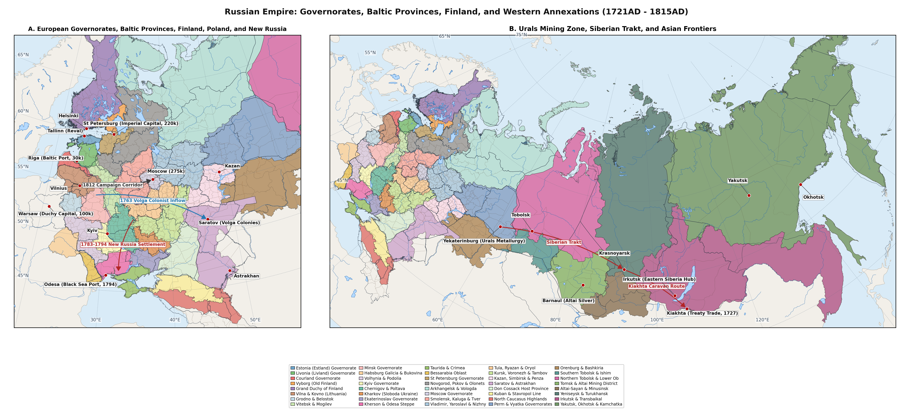

# Abstract

This gazetteer compiles population estimates for 5.692 towns, ports,
fortresses, market towns (*miasteczka*) and factory settlements across
the 40 provinces and frontier regions of the Russian Empire and its
neighbouring partition lands between the Peace of Nystad (1721AD) and
the Congress of Vienna (1815AD). Arranged across the Baltic provinces
and Finland, the Polish-Lithuanian partition lands and Galicia, Ukraine
and Novorossiya, Central Russia and the Volga-Urals, the Caucasus and
Siberia, the tables follow urban growth across five Soul Revision
benchmarks (1721, 1762, 1795, 1811 and 1815AD). Over these nine decades,
the rapid rise of Saint Petersburg, the founding of new Black Sea ports
led by Odessa, Kherson and Sevastopol, the growth of Ural and Altai iron
and silver works and the annexation of Polish-Lithuanian market towns
reshaped the urban map, even as the 1771AD plague and the 1812AD fire
and retreat inflicted sharp losses on Moscow, Smolensk, Vitebsk and
Vilna.

# Methodology

This gazetteer presents population estimates for 5.692 towns, fortress
settlements, maritime ports, market towns (*miasteczka* or *shtetlekh*),
colonist centres, Ural and Altai iron and silver works (*gornye zavody*)
and Siberian *ostrogi* across the 40 provinces and frontier regions of
Early Imperial Russia and its adjacent partition lands between 1721AD
and 1815AD
[\[1\]](#ref-Kabuzan1963)[\[2\]](#ref-Kabuzan1971)[\[3\]](#ref-Vodarsky1973)[\[4\]](#ref-Mironov1990Urban).
Across the entire 40-region area (18,5M km²), total population more than
doubled from 23,89M in 1721AD to 51,17M in 1815AD (or from 22,26M to
47,82M within the 39 regions belonging to the Russian Empire in 1815AD,
excluding Austrian Galicia and Bukovina). Each entry gives the
settlement’s main name, historical or local names, coordinates and
modern country alongside its population at the principal revision
benchmarks (1721AD, 1762AD, 1795AD, 1811AD and 1815AD).

Town figures draw on the merchant and townsmen (*posad* and *meshchane*)
rolls of the first seven Imperial Soul Revisions (1719-1816AD) together
with provincial police and military-statistical returns compiled by
Boris Mironov, Yaroslav Vodarsky, Vladimir Kabuzan and Pyotr Keppen
[\[3\]](#ref-Vodarsky1973)[\[4\]](#ref-Mironov1990Urban)[\[5\]](#ref-Kabuzan1990)[\[6\]](#ref-Keppen1857).
Outside the Great Russian core, these returns are paired with Baltic
German ploughland and Lutheran magistracy lists
[\[7\]](#ref-Hupel1774)[\[8\]](#ref-Palli1996), Swedish-Finnish
*Tabellverket* town registers
[\[9\]](#ref-Jutikkala1965)[\[10\]](#ref-Turpeinen1979),
Polish-Lithuanian hearth-tax (*podymne*) and Jewish *kahal* rolls
alongside Austrian Galician conscriptions
[\[11\]](#ref-Kuklo2009)[\[12\]](#ref-Stampfer1995)[\[13\]](#ref-Fellerer2023Galicia),
Novorossiya and Bessarabia colonist chancellery tables
[\[14\]](#ref-Skalkovsky1836)[\[15\]](#ref-Herlihy1986)[\[16\]](#ref-Bushin2011)[\[17\]](#ref-Feldman2023Bessarabia),
Ural and Altai mining-chancellery inventories
[\[18\]](#ref-Portal1950)[\[19\]](#ref-Smirnov1992UralZavody)[\[20\]](#ref-Isaev2025AltaiCabinet)
and Siberian post-road and *ostrog* returns
[\[21\]](#ref-Hartley2014)[\[22\]](#ref-Forsyth1992). Ports, fortresses
and factory towns founded after 1721AD - such as Ekaterinburg (1723AD),
Orenburg (1735/1743AD), Barnaul (1730s), Petropavlovsk-Kamchatsky
(1740AD), Elisavetgrad (1754AD), Izhevsk (1760AD), Katharinenstadt
(1765AD), Kherson (1778AD), Mariupol (1778AD), Sevastopol (1783AD),
Simferopol (1784AD), Nikolaev (1789AD), Ekaterinodar (1793AD), Odessa
(1794AD) and Novocherkassk (1805AD) - show a hyphen (`-`) before their
foundation and `New` in the percentage change column.

# Results

## Estland Governorate

Table lists the towns of Region 1 (Estland Governorate, 22,64k km²),
where regional population rose from 105k in 1721AD to 228k in 1811AD and
232k in 1815AD (+121%)
[\[7\]](#ref-Hupel1774)[\[8\]](#ref-Palli1996)[\[23\]](#ref-Palli1980).

| Settlement | Alternative / Historical Names | Coords & Country | 1721AD | 1762AD | 1795AD | 1811AD | 1815AD | Change |
|:---|:---|:---|:---|:---|:---|:---|:---|:---|
| Reval | Tallinn; Revel | 59,44, 24,75 (Estonia) | 9,1k | 10k | 11k | 14k | 12,9k | +42% |
| Tapa | Taps; Tapa | 59,26, 25,96 (Estonia) | 1,1k | 1,4k | 1,8k | 2k | 2,1k | +92,6% |
| Kardla | Kärdla; Kertel | 59, 22,75 (Estonia) | 1,8k | 1,8k | 1,8k | 1,8k | 1,8k | -3,5% |
| Pussi | Püssi | 59,36, 27,05 (Estonia) | 807 | 1k | 1,3k | 1,5k | 1,6k | +92,6% |
| Sompa | Sompa | 59,36, 27,32 (Estonia) | 595 | 771 | 991 | 1,1k | 1,1k | +92,6% |
| Narva-Joesuu | Narva-Jõesuu; Hungerburg | 59,46, 28,04 (Estonia) | 587 | 761 | 978 | 1,1k | 1,1k | +92,5% |
| Hapsal | Haapsalu; Gapsal | 58,94, 23,54 (Estonia) | 736 | 645 | 782 | 1,1k | 1,1k | +49,5% |
| Kohtla-Jarve | Kohtla Oil-Shale Basin; Kohtla-Järve | 59,4, 27,27 (Estonia) | 546 | 707 | 909 | 1k | 1,1k | +92,5% |
| Johvi | Jõhvi; Jewe | 59,36, 27,42 (Estonia) | 1,8k | 1,4k | 1,1k | 997 | 963 | -45,3% |
| Weissenstein | Paide; Veysenshteyn | 58,89, 25,54 (Estonia) | 119 | 154 | 631 | 886 | 949 | +697,5% |
| Maardu | Maardu | 59,47, 24,98 (Estonia) | 488 | 632 | 813 | 922 | 940 | +92,6% |
| Wesenberg | Rakvere; Vezenberg | 59,35, 26,36 (Estonia) | 467 | 606 | 779 | 883 | 900 | +92,7% |
| Saue | Gross Sauss (); Saue | 59,32, 24,55 (Estonia) | \- | \- | 124 | 756 | 858 | New |
| Turi | Türi; Turgel | 58,81, 25,43 (Estonia) | 409 | 530 | 682 | 773 | 788 | +92,7% |
| Jarvakandi | Järvakandi | 58,78, 24,83 (Estonia) | 343 | 445 | 572 | 648 | 661 | +92,7% |
| Paldiski | Baltischport; Roggersvik | 59,36, 24,05 (Estonia) | 252 | 327 | 420 | 476 | 485 | +92,5% |
| Kunda | Kunda | 59,48, 26,53 (Estonia) | \- | \- | 157 | 378 | 398 | New |
| Sillamae | Combine No. 7 Uranium Town; Sillamäe | 59,4, 27,76 (Estonia) | 176 | 227 | 292 | 332 | 338 | +92% |
| Jarva-Jaani | Järva-Jaani | 59,04, 25,89 (Estonia) | 159 | 206 | 265 | 300 | 306 | +92,5% |
| Keila | Kegel; Keila | 59,3, 24,41 (Estonia) | 154 | 199 | 256 | 290 | 296 | +92,2% |
| Lihula | Leal; Lihula | 58,68, 23,85 (Estonia) | 119 | 154 | 198 | 225 | 229 | +92,4% |
| Aegviidu | Aegviidu | 59,29, 25,61 (Estonia) | 115 | 149 | 191 | 217 | 221 | +92,2% |
| Ambla | Ambla | 59,19, 25,85 (Estonia) | 96 | 125 | 160 | 182 | 185 | +92,7% |
| Rapla | Rappel; Rapla | 59,01, 24,79 (Estonia) | 59 | 76 | 98 | 111 | 113 | +91,5% |
| Kohila | Haggers (); Kohila | 59,17, 24,76 (Estonia) | 54 | 70 | 90 | 101 | 103 | +90,7% |
| Loksa | Zitter (); Loksa | 59,58, 25,72 (Estonia) | 54 | 70 | 90 | 101 | 103 | +90,7% |
| Vosu | Võsu | 59,57, 25,98 (Estonia) | 53 | 69 | 89 | 100 | 102 | +92,5% |
| Kehra | Kedder; Kekhra | 59,34, 25,32 (Estonia) | 45 | 58 | 75 | 85 | 87 | +93,3% |
| Marjamaa | Märjamaa; Merjama | 58,9, 24,43 (Estonia) | 37 | 48 | 62 | 70 | 72 | +94,6% |

Recovery of Reval (Tallinn), Wesenberg, Hapsal, Weissenstein and the
naval roadstead of Baltischport from the 1710AD Baltic plague to the eve
of peasant emancipation in 1815AD.

## Livland Governorate (Riga & Dorpat)

Table lists the towns of Region 2 (Livland Governorate, 54,24k km²),
where regional population rose from 195k in 1721AD to 605k in 1811AD and
615k in 1815AD (+215,4%)
[\[7\]](#ref-Hupel1774)[\[24\]](#ref-Jaadla2014Tartu)[\[25\]](#ref-Savikhin2011Ostsee).

| Settlement | Alternative / Historical Names | Coords & Country | 1721AD | 1762AD | 1795AD | 1811AD | 1815AD | Change |
|:---|:---|:---|:---|:---|:---|:---|:---|:---|
| Riga | Riia; Livland Capital | 56,95, 24,11 (Latvia) | 14,5k | 17,2k | 28,9k | 34,1k | 36k | +149,1% |
| Dorpat | Tartu; Yuryev | 58,38, 26,73 (Estonia) | 5,1k | 5,2k | 5k | 6,9k | 7,2k | +40,6% |
| Viljandi | Fellin; Vilynadi | 58,36, 25,59 (Estonia) | 2k | 2,9k | 3,6k | 3,9k | 4k | +94,8% |
| Pernau | Parnu; Pernov | 58,39, 24,5 (Estonia) | 540 | 700 | 405 | 3k | 3,4k | +529,6% |
| Limbazhi | Limbaži; Limbazi | 57,51, 24,72 (Latvia) | 148 | 192 | 591 | 2k | 2,2k | +1362,2% |
| Ligatne | Līgatne; Ligat | 57,23, 25,04 (Latvia) | 2k | 2k | 2k | 2k | 2k | -0,4% |
| Balvi | Bolowsk; Bolwa | 57,13, 27,27 (Latvia) | 2,3k | 2,9k | 1,7k | 1,9k | 2k | -13,3% |
| Koknese | Kukenois; Kokenhusen | 56,65, 25,44 (Latvia) | 1,7k | 1,6k | 1,9k | 1,8k | 1,8k | +3,1% |
| Arensburg | Kuressaare; Arensburg Oesel | 58,25, 22,49 (Estonia) | 534 | 1,1k | 1,5k | 1,7k | 1,8k | +237,1% |
| Strenchi | Strenči; Strenci | 57,63, 25,69 (Latvia) | 543 | 2k | 1,8k | 1,7k | 1,7k | +211,6% |
| Sigulda | Segewold; Sigulda | 57,15, 24,86 (Latvia) | 1,7k | 1,7k | 1,6k | 1,6k | 1,5k | -10,8% |
| Otepaa | Otepää; Odenpä | 58,06, 26,5 (Estonia) | 522 | 677 | 1,7k | 1,6k | 1,5k | +188,7% |
| Wenden | Cesis; Venden | 57,31, 25,27 (Latvia) | 523 | 777 | 1,1k | 1,3k | 1,3k | +148,6% |
| Suure-Jaani | Suure-Jaani | 58,54, 25,47 (Estonia) | 1,9k | 1,7k | 1,4k | 1,3k | 1,3k | -34,3% |
| Ape | Hoppenhof; Ape | 57,54, 26,69 (Latvia) | 1,6k | 1,4k | 1,2k | 1,2k | 1,1k | -28,4% |
| Jogeva | Jõgeva; Laisholm | 58,75, 26,39 (Estonia) | 1,4k | 1,2k | 1,1k | 1k | 1k | -28,6% |
| Kuprava | Kuprava | 57,24, 27,5 (Latvia) | 1,3k | 1,2k | 1,1k | 1k | 1k | -21,4% |
| Valga | \- | 57,78, 26,05 (Estonia) | 1,1k | 1,5k | 850 | 964 | 983 | -13,3% |
| Jurmala | Jūrmala; merged with Rīga | 56,97, 23,77 (Latvia) | \- | \- | 404 | 895 | 933 | New |
| Aloja | Allendorf; Aloja | 57,77, 24,88 (Latvia) | 1,3k | 1,1k | 874 | 786 | 764 | -40,4% |
| Jaunjelgava | Friedrichstadt; Yaunyelgava | 56,61, 25,08 (Latvia) | 100 | 130 | 75 | 620 | 711 | +611% |
| Valka | Walk; Valga | 57,78, 26,01 (Latvia) | 804 | 1k | 603 | 684 | 697 | -13,3% |
| Aizkraukle | Stučka; Ascheraden | 56,6, 25,26 (Latvia) | 795 | 1k | 596 | 675 | 689 | -13,3% |
| Polva | Põlva; Pölwe | 58,06, 27,07 (Estonia) | 1,1k | 918 | 741 | 655 | 634 | -44,3% |
| Mustvee | Tschorna; Tschernoje | 58,85, 26,94 (Estonia) | 723 | 938 | 542 | 615 | 627 | -13,3% |
| Gulbene | Vecgulbene; Alt-Schwaneburg | 57,18, 26,75 (Latvia) | 690 | 894 | 517 | 586 | 598 | -13,3% |
| Valmiera | Wolmar; Valmera | 57,54, 25,43 (Latvia) | 677 | 878 | 508 | 576 | 587 | -13,3% |
| Abja-Paluoja | Abja-Paluoja | 58,13, 25,35 (Estonia) | 754 | 668 | 599 | 565 | 557 | -26,1% |
| Aluksne | Alūksne | 57,42, 27,05 (Latvia) | 551 | 714 | 413 | 468 | 477 | -13,4% |
| Moisakula | Mõisaküla; Moiseküll | 58,09, 25,19 (Estonia) | 537 | 696 | 403 | 456 | 465 | -13,4% |
| Ergli | Ērgļi | 56,9, 25,64 (Latvia) | 532 | 690 | 399 | 452 | 461 | -13,3% |
| Rujiena | Rūjiena; Rújiena | 57,9, 25,33 (Latvia) | 461 | 598 | 346 | 392 | 400 | -13,2% |
| Skriveri | Skrīveri | 56,65, 25,12 (Latvia) | 379 | 492 | 285 | 322 | 329 | -13,2% |
| Kallaste | Kallaste | 58,66, 27,16 (Estonia) | \- | 279 | 274 | 311 | 317 | New |
| Plavinas | Pļaviņas; Stockmannshof | 56,62, 25,73 (Latvia) | 309 | 400 | 231 | 262 | 267 | -13,6% |
| Lubana | Lubāna; Luban | 56,9, 26,72 (Latvia) | 284 | 369 | 213 | 242 | 246 | -13,4% |
| Salaspils | Salisstadt; Salaspils | 56,86, 24,37 (Latvia) | 281 | 364 | 210 | 238 | 243 | -13,5% |
| Voru | Võru; Werro | 57,83, 27,02 (Estonia) | \- | \- | 113 | 232 | 240 | New |
| Torva | Tõrva; Törwu | 58, 25,93 (Estonia) | \- | \- | 202 | 231 | 235 | New |
| Ikshkile | Ikšķile | 56,83, 24,5 (Latvia) | 262 | 340 | 197 | 223 | 227 | -13,4% |
| Elva | Elwa; Elva | 58,22, 26,42 (Estonia) | 246 | 319 | 184 | 209 | 213 | -13,4% |
| Cesvaine | Sesswegen; Cesvaine | 56,97, 26,31 (Latvia) | 233 | 302 | 175 | 198 | 202 | -13,3% |
| Kilingi-Nomme | Kilingi-Nõmme; Quellenstein | 58,15, 24,96 (Estonia) | 213 | 276 | 160 | 181 | 185 | -13,1% |
| Smiltene | Smilten; Smiltene | 57,42, 25,9 (Latvia) | 203 | 263 | 152 | 173 | 176 | -13,3% |
| Lielvarde | Lielvārde; Lennewaden | 56,72, 24,81 (Latvia) | 184 | 238 | 138 | 156 | 159 | -13,6% |
| Antsla | Antsla | 57,83, 26,54 (Estonia) | 178 | 231 | 134 | 151 | 154 | -13,5% |
| Madona | Birži; Modohn | 56,85, 26,22 (Latvia) | 167 | 217 | 125 | 142 | 145 | -13,2% |
| Voopsu | Võõpsu | 58,08, 27,54 (Estonia) | 133 | 172 | 99 | 113 | 115 | -13,5% |
| Mustla | Mustla | 58,13, 25,1 (Estonia) | 132 | 171 | 99 | 112 | 114 | -13,6% |
| Salacgriva | Salacgrīva | 57,75, 24,36 (Latvia) | 123 | 159 | 92 | 104 | 106 | -13,8% |
| Lejasciems | Lejasciems | 57,28, 26,58 (Latvia) | \- | \- | 69 | 101 | 102 | New |
| Vandra | Vändra; (Alt)-Fennern | 58,65, 25,04 (Estonia) | 109 | 141 | 81 | 92 | 94 | -13,8% |
| Vohma | Võhma | 58,63, 25,55 (Estonia) | 108 | 140 | 81 | 92 | 94 | -13% |
| Karksi-Nuia | Karksi-Nuia | 58,1, 25,56 (Estonia) | 106 | 137 | 79 | 90 | 91 | -14,2% |
| Ainazhi | Ainaži | 57,86, 24,36 (Latvia) | 78 | 102 | 59 | 67 | 68 | -12,8% |
| Lavassaare | Lavassaare | 58,51, 24,39 (Estonia) | 75 | 97 | 56 | 63 | 65 | -13,3% |
| Mazsalaca | Salisburg; Mazsalatsa | 57,86, 25,05 (Latvia) | 58 | 75 | 43 | 49 | 50 | -13,8% |
| Parnu-Jaagupi | Pärnu-Jaagupi; Parnu-Jaagupi | 58,61, 24,51 (Estonia) | 53 | 69 | 40 | 45 | 46 | -13,2% |
| Rapina | Räpina; Rappin | 58,1, 27,46 (Estonia) | 41 | 53 | 31 | 35 | 36 | -12,2% |

Growth of Riga as the Empire’s second maritime export port alongside the
university town of Dorpat (Tartu), Pernau, Arensburg, Wenden and Fellin
from 1721AD to 1815AD.

## Courland Governorate (Mitau & Libau)

Table lists the towns of Region 3 (Courland Governorate, 27,59k km²),
where regional population rose from 200k in 1721AD to 435k in 1811AD
before dipping to 418k in 1815AD (+109%)
[\[5\]](#ref-Kabuzan1990)[\[26\]](#ref-Kabuzan1992)[\[27\]](#ref-Kappeler2001).

| Settlement | Alternative / Historical Names | Coords & Country | 1721AD | 1762AD | 1795AD | 1811AD | 1815AD | Change |
|:---|:---|:---|:---|:---|:---|:---|:---|:---|
| Mitau | Jelgava; Mitava | 56,65, 23,72 (Latvia) | 2,4k | 3,1k | 2k | 11,6k | 12,5k | +414,4% |
| Libau | Liepaja; Libava | 56,5, 21,01 (Latvia) | 1,2k | 1,6k | 999 | 5,4k | 5,6k | +360,9% |
| Dvinsk | Daugavpils; Dinaburg | 55,87, 26,54 (Latvia) | 965 | 1,3k | 3,8k | 4,1k | 4,2k | +335,2% |
| Kraslava | Krāslava; Kreslavka | 55,9, 27,17 (Latvia) | 1,1k | 1,7k | 2,2k | 2,4k | 2,5k | +122,3% |
| Goldingen | Kuldiga; Goldingen Courland | 56,97, 21,97 (Latvia) | \- | 6,1k | 6,4k | 3,3k | 2,2k | New |
| Eleja | Eleja | 56,42, 23,68 (Latvia) | 2k | 2k | 2k | 2k | 2k | 0% |
| Bene | Bēne | 56,48, 23,07 (Latvia) | 2k | 2k | 2k | 2k | 2k | -0,6% |
| Sabile | Zabeln; Sabile | 57,05, 22,57 (Latvia) | 1,9k | 312 | 2k | 2k | 1,9k | +0,9% |
| Ozolnieki | Ozolnieki | 56,69, 23,78 (Latvia) | \- | \- | \- | 1,9k | 1,9k | New |
| Jakobstadt | Jekabpils; Yakobshtadt | 56,5, 25,88 (Latvia) | 2,2k | 2,8k | 1,8k | 2,2k | 1,9k | -13,3% |
| Tukums | Tuckum; Tukkum | 56,97, 23,16 (Latvia) | 333 | 431 | 274 | 1,7k | 1,9k | +467% |
| Windau | Ventspils; Vindava | 57,39, 21,56 (Latvia) | 316 | 409 | 260 | 1,5k | 1,6k | +406,3% |
| Aizpute | Hasenpot; Газенпот | 56,72, 21,6 (Latvia) | \- | 3,9k | 4,2k | 1,5k | 1,6k | New |
| Bauska | Bausk; Bauske | 56,41, 24,19 (Latvia) | 253 | 328 | 208 | 1,3k | 1,4k | +448,6% |
| Subate | Subbat; Subate | 56,01, 25,91 (Latvia) | 1,9k | 1,7k | 1,5k | 1,4k | 1,4k | -27% |
| Vainode | Vaiņode | 56,42, 21,85 (Latvia) | 1,9k | 1,6k | 1,4k | 1,2k | 1,2k | -36,3% |
| Olaine | Olai; Olaine | 56,8, 23,94 (Latvia) | 1,3k | 1,7k | 1,1k | 1,3k | 1,1k | -13,3% |
| Iecava | Iecava | 56,6, 24,21 (Latvia) | 1,6k | 1,4k | 1,2k | 1,1k | 1,1k | -31% |
| Nereta | Nereta | 56,2, 25,31 (Latvia) | 1,1k | 1k | 964 | 942 | 937 | -11,9% |
| Valdemarpils | Valdemārpils; Sasmaka | 57,37, 22,59 (Latvia) | 377 | 413 | 614 | 759 | 795 | +110,9% |
| Dobele | Dóbele; Doblen | 56,62, 23,28 (Latvia) | 1,4k | 1,1k | 904 | 801 | 775 | -43,8% |
| Stende | Stenden; Stende | 57,14, 22,53 (Latvia) | 1,9k | 155 | 121 | 524 | 672 | -64,2% |
| Piltene | Pilten; Пильтен | 57,22, 21,67 (Latvia) | 1,6k | 1,5k | 1,7k | 584 | 655 | -59,2% |
| Ilukste | Ilūkste; Illuxt | 55,98, 26,3 (Latvia) | 619 | 803 | 509 | 633 | 537 | -13,2% |
| Kalnciems | Kalnzeem; Kalnciems | 56,8, 23,62 (Latvia) | 566 | 734 | 466 | 579 | 491 | -13,3% |
| Skrunda | Schrunden; Skrunda | 56,68, 22,02 (Latvia) | 549 | 712 | 451 | 561 | 476 | -13,3% |
| Livani | Līvāni; Lívání | 56,35, 26,18 (Latvia) | 522 | 677 | 430 | 534 | 453 | -13,2% |
| Auce | Vecauce; Alt-Autz | 56,46, 22,9 (Latvia) | 420 | 544 | 345 | 429 | 364 | -13,3% |
| Kandava | Kandau; Kandava | 57,04, 22,77 (Latvia) | 1,9k | 1,1k | 477 | 312 | 362 | -80,8% |
| Talsi | Talsen; Talsi | 57,25, 22,58 (Latvia) | 401 | 520 | 330 | 410 | 347 | -13,5% |
| Sloka | Schlok; Sloka | 56,94, 23,62 (Latvia) | 367 | 476 | 302 | 375 | 318 | -13,4% |
| Viesite | Viesīte; Viesíte | 56,35, 25,56 (Latvia) | 326 | 422 | 268 | 333 | 282 | -13,5% |
| Dundaga | Dundaga | 57,5, 22,35 (Latvia) | 318 | 412 | 261 | 325 | 275 | -13,5% |
| Alsunga | Alsunga | 56,98, 21,56 (Latvia) | 221 | 287 | 182 | 226 | 192 | -13,1% |
| Pavilosta | Pāvilosta; Pauls Hafen | 56,89, 21,19 (Latvia) | 178 | 230 | 146 | 182 | 154 | -13,5% |
| Akniste | Aknīste | 56,16, 25,75 (Latvia) | 175 | 227 | 144 | 179 | 152 | -13,1% |
| Saldus | Frauenburg; Saldus | 56,66, 22,49 (Latvia) | 70 | 91 | 58 | 72 | 61 | -12,9% |
| Baldone | Baldohn; Baldon | 56,74, 24,4 (Latvia) | 32 | 41 | 26 | 33 | 28 | -12,5% |

Populations of the ducal capital Mitau (Jelgava), the ice-free Baltic
ports of Libau and Windau, Goldingen and Jakobstadt across the 1795AD
annexation and the 1812AD Prussian occupation.

## Old Finland (Vyborg Governorate)

Table lists the towns of Region 4 (Old Finland/Vyborg Governorate,
43,53k km²), where regional population grew from 110k in 1721AD to 198k
in 1811AD and 202k in 1815AD (+83,6%)
[\[9\]](#ref-Jutikkala1965)[\[28\]](#ref-Kashchenko2016Vyborg).

| Settlement | Alternative / Historical Names | Coords & Country | 1721AD | 1762AD | 1795AD | 1811AD | 1815AD | Change |
|:---|:---|:---|:---|:---|:---|:---|:---|:---|
| Viipuri | Vyborg; Viborg | 60,71, 28,75 (Russia) | 3k | 5k | 3k | 3,1k | 3,3k | +10% |
| Priozersk | Приозерск; Корела | 61,04, 30,14 (Russia) | 1,5k | 1,5k | 1,5k | 1,5k | 1,5k | -1% |
| Kamenka | Каменка | 60,45, 29,08 (Russia) | 447 | 580 | 352 | 380 | 387 | -13,4% |
| Lesogorskiy | Лесогорский; Lesogorskij | 61,05, 28,93 (Russia) | 344 | 446 | 271 | 293 | 298 | -13,4% |
| Sortavala | Serdobol; Sordavala | 61,7, 30,69 (Russia) | 348 | 483 | 252 | 280 | 287 | -17,5% |
| Sosnovo | Сосново | 60,55, 30,21 (Russia) | 260 | 365 | 185 | 207 | 213 | -18,1% |
| Pitkyaranta | Питкяранта; Pitkjaranta | 61,57, 31,48 (Russia) | 244 | 337 | 178 | 198 | 203 | -16,8% |
| Roshchino | Рощино; Roščino | 60,25, 29,61 (Russia) | 253 | 372 | 167 | 192 | 199 | -21,3% |
| Suoyarvi | Суоярви; Suojarvi | 62,09, 32,37 (Russia) | 228 | 331 | 153 | 175 | 181 | -20,6% |
| Valaam | Валаам | 61,39, 30,95 (Russia) | 217 | 303 | 156 | 174 | 178 | -18% |
| Pervomayskoye | Первомайское | 60,36, 29,74 (Russia) | 206 | 284 | 151 | 167 | 171 | -17% |
| Zelenogorsk | Зеленогорск; Terijoki | 60,2, 29,7 (Russia) | 195 | 234 | 155 | 166 | 170 | -12,8% |
| Lahdenpoh’ja | Лахденпохья; Сиеклахти | 61,52, 30,2 (Russia) | 224 | 349 | 135 | 161 | 168 | -25% |
| Khelyulya | Хелюля; Heljulja | 61,74, 30,69 (Russia) | 199 | 280 | 141 | 158 | 162 | -18,6% |
| Primorsk | Приморск | 60,37, 28,61 (Russia) | 174 | 225 | 137 | 148 | 150 | -13,8% |
| Salmi | Салми | 61,37, 31,85 (Russia) | 171 | 240 | 121 | 135 | 139 | -18,7% |
| Garbolovo | Гарболово | 60,34, 30,5 (Russia) | 166 | 234 | 118 | 132 | 136 | -18,1% |
| Kharlu | Харлу; Harlu | 61,81, 30,94 (Russia) | 148 | 209 | 104 | 116 | 120 | -18,9% |
| Matrosovo | Матросово; Хацутой | 60,64, 28,73 (Russia) | 146 | 205 | 103 | 116 | 119 | -18,5% |
| Ozjorskoje | Озёрское; Чибисанский пост | 60,87, 29,48 (Russia) | 148 | 221 | 97 | 112 | 116 | -21,6% |
| Kuznechnoye | Кузнечное; Kuznečnoje | 61,12, 29,88 (Russia) | 143 | 208 | 97 | 110 | 114 | -20,3% |
| Beloostrov | Белоостров | 60,15, 30 (Russia) | 122 | 170 | 87 | 97 | 100 | -18% |
| Molodezhnoye | Молодежное; Molodežnoje | 60,2, 29,52 (Russia) | 116 | 163 | 83 | 93 | 96 | -17,2% |
| Lyaskelya | Ляскеля; Ljaskelja | 61,76, 31,01 (Russia) | 129 | 205 | 75 | 91 | 95 | -26,4% |
| Kamennogorsk | Каменногорск; Antrea | 60,95, 29,13 (Russia) | 120 | 186 | 73 | 87 | 90 | -25% |
| Sovetskiy | Советский; Sovetskij | 60,54, 28,68 (Russia) | 121 | 201 | 64 | 80 | 85 | -29,8% |
| Elisenvaara | Элисенваара; Êlisenvaara | 61,41, 29,76 (Russia) | 94 | 144 | 58 | 69 | 72 | -23,4% |
| Komarovo | Комарово | 60,19, 29,81 (Russia) | 85 | 118 | 61 | 68 | 69 | -18,8% |
| Solnechnoye | Солнечное; Solnečnoje | 60,16, 29,95 (Russia) | \- | 192 | 45 | 62 | 67 | New |
| Vysotsk | Высоцк; Vysock | 60,63, 28,57 (Russia) | 64 | 92 | 44 | 50 | 52 | -18,8% |
| Leskolovo | Лесколово | 60,26, 30,45 (Russia) | \- | \- | 41 | 41 | 41 | New |
| Smolyachkovo | Смолячково; Smoljačkovo | 60,18, 29,48 (Russia) | 46 | 64 | 33 | 36 | 37 | -19,6% |
| Impilakhti | Импилахти; Impilahti | 61,67, 31,16 (Russia) | 51 | 83 | 28 | 34 | 36 | -29,4% |
| Serovo | Серово | 60,2, 29,55 (Russia) | 26 | 34 | 21 | 23 | 23 | -11,5% |

Border fortresses and timber-shipping ports of Vyborg, Fredrikshamn
(Hamina), Villmanstrand (Lappeenranta), Kexholm and Nyslott from the
treaties of Nystad and Åbo to reunion with Finland in 1812AD.

## Grand Duchy of Finland

Table lists the towns of Region 5 (Grand Duchy of Finland, 333,9k km²),
where regional population rose from 390k in 1721AD to 880k in 1811AD and
908k in 1815AD (+132,8%)
[\[9\]](#ref-Jutikkala1965)[\[10\]](#ref-Turpeinen1979)[\[29\]](#ref-Pitkanen1993).

| Settlement | Alternative / Historical Names | Coords & Country | 1721AD | 1762AD | 1795AD | 1811AD | 1815AD | Change |
|:---|:---|:---|:---|:---|:---|:---|:---|:---|
| Abo | Turku; Abo-Bjorneborg | 60,45, 22,27 (Finland) | 5,4k | 7,2k | 10,5k | 11,6k | 11,8k | +117,7% |
| Kitee | Kides; Kitee \* | 62,1, 30,15 (Finland) | 2,9k | 3,8k | 4,8k | 5,5k | 5,6k | +92,6% |
| Helsingfors | Helsinki; Gelsingfors | 60,17, 24,94 (Finland) | 1,4k | 2,5k | 3,8k | 4,6k | 4,8k | +238% |
| Saarijarvi | Saarijärvi; Saarijärvi \* | 62,7, 25,25 (Finland) | 2,4k | 3,1k | 4k | 4,6k | 4,7k | +92,5% |
| Uleaborg | Oulu; Uleaborg Governorate | 65,01, 25,47 (Finland) | 1,4k | 2,2k | 2,9k | 3,5k | 3,7k | +160,6% |
| Pudasjarvi | Pudasjärvi | 65,38, 26,92 (Finland) | 1,8k | 2,3k | 3k | 3,4k | 3,5k | +92,6% |
| Bjorneborg | Pori; Bjorneborg Port | 61,49, 21,8 (Finland) | 1k | 1,5k | 2,8k | 3,1k | 3,1k | +210% |
| Vasa | Vaasa; Nikolaistad | 63,1, 21,62 (Finland) | 1k | 1,5k | 2,8k | 2,9k | 2,8k | +180% |
| Haapavesi | \- | 64,13, 25,37 (Finland) | 1,3k | 1,6k | 2,1k | 2,4k | 2,4k | +92,5% |
| Lahti | Lahtis | 62,72, 23,53 (Finland) | 1,2k | 1,6k | 2,1k | 2,3k | 2,4k | +92,6% |
| Kalajoki | \- | 64,25, 23,95 (Finland) | 1,2k | 1,6k | 2k | 2,3k | 2,4k | +92,6% |
| Jamsa | Jämsä | 61,86, 25,19 (Finland) | 2,7k | 3,4k | 2,1k | 2,3k | 2,3k | -13,3% |
| Raisio | Reso | 60,49, 22,17 (Finland) | \- | 1,9k | 1,9k | 1,8k | 1,8k | New |
| Vantaa | Vanda | 60,72, 24,86 (Finland) | 2,1k | 2,7k | 1,7k | 1,8k | 1,8k | -13,3% |
| Gamlakarleby | Kokkola; Gamla-Karleby | 63,84, 23,13 (Finland) | \- | 1,5k | 1,7k | 1,8k | 1,8k | New |
| Tavastehus | Hämeenlinna; Hameenlinna | 61, 24,46 (Finland) | 1k | 1k | 1k | 1,4k | 1,6k | +60% |
| Keuruu | Keuru | 62,27, 24,7 (Finland) | 1,8k | 2,3k | 1,4k | 1,5k | 1,6k | -13,4% |
| Kokemaki | Kokemäki; Kumo | 61,26, 22,36 (Finland) | 1,7k | 2,2k | 1,4k | 1,5k | 1,5k | -13,4% |
| Kristinestad | Kristiinankaupunki | 62,27, 21,38 (Finland) | 734 | 952 | 1,2k | 1,4k | 1,4k | +92,6% |
| Kankaanpaa | Kankaanpää | 61,8, 22,42 (Finland) | 1,6k | 2,1k | 1,3k | 1,4k | 1,4k | -13,4% |
| Orivesi | \- | 61,68, 24,36 (Finland) | 1,5k | 2k | 1,2k | 1,3k | 1,3k | -13,4% |
| Kuopio | Kuopio Savo; Kuopio Governorate | 62,89, 27,68 (Finland) | \- | 218 | 390 | 1,1k | 1,2k | New |
| Parkano | \- | 62,02, 23,02 (Finland) | 1,2k | 1,5k | 914 | 986 | 1k | -13,4% |
| Ulvila | Ulvsby | 61,43, 21,87 (Finland) | 1k | 1,3k | 792 | 854 | 870 | -13,3% |
| Tammerfors | Tampere; Tavastehus Mill Hub | 61,5, 23,76 (Finland) | \- | \- | 875 | 757 | 850 | New |
| Nokia | \- | 61,47, 23,5 (Finland) | 881 | 1,1k | 695 | 749 | 764 | -13,3% |
| Saloinen | Salo | 64,65, 24,46 (Finland) | 356 | 461 | 593 | 672 | 685 | +92,4% |
| Nykarleby | Uusikaarlepyy; Uusikarlepyy | 63,52, 22,53 (Finland) | 329 | 427 | 549 | 622 | 634 | +92,7% |
| Ylojarvi | Ylöjärvi | 61,56, 23,6 (Finland) | \- | \- | 405 | 588 | 599 | New |
| Tornio | Torneå | 65,85, 24,15 (Finland) | 261 | 339 | 436 | 494 | 503 | +92,7% |
| Kaarina | S:t Karins | 60,41, 22,37 (Finland) | 545 | 706 | 429 | 463 | 472 | -13,4% |
| Lovisa | Loviisa | 60,46, 26,23 (Finland) | \- | 487 | 381 | 411 | 419 | New |
| Heinola | \- | 61,21, 26,04 (Finland) | \- | \- | 206 | 264 | 270 | New |
| Hanko | Hangö | 59,83, 22,95 (Finland) | 191 | 248 | 151 | 162 | 166 | -13,1% |
| Vyartsilya | Вяртсиля; Vjartsilja | 62,18, 30,69 (Russia) | 135 | 193 | 93 | 105 | 109 | -19,3% |

Swedish-Finnish Tabellverket returns for Åbo (Turku), the new 1812AD
capital Helsingfors (Helsinki), Gulf of Bothnia tar ports at Uleåborg,
Vasa and Björneborg, and inland Tavastehus and Kuopio.

## Vilna Governorate & Samogitia

Table lists the towns of Region 6 (Vilna Governorate and Samogitia,
94,34k km²), where regional population grew from 655k in 1721AD to 1,22M
in 1811AD before falling to 1,11M in 1815AD (+69,5%)
[\[11\]](#ref-Kuklo2009)[\[12\]](#ref-Stampfer1995)[\[30\]](#ref-Lieven2009).

| Settlement | Alternative / Historical Names | Coords & Country | 1721AD | 1762AD | 1795AD | 1811AD | 1815AD | Change |
|:---|:---|:---|:---|:---|:---|:---|:---|:---|
| Vilna | Vilnius; Wilno | 54,69, 25,28 (Lithuania) | 32k | 50,2k | 17,6k | 56,3k | 32k | -0,1% |
| Sovetsk | Tilsit; East Prussia 1945 Annexation | 55,08, 21,89 (Russia) | 6k | 7,7k | 8,6k | 8,2k | 10,2k | +70,5% |
| Klaipeda | Memel; Klaipėda | 55,7, 21,14 (Lithuania) | \- | 5,2k | 8,5k | 7,1k | 7,5k | New |
| Kovno | Kaunas; Kovna | 54,9, 23,9 (Lithuania) | 6k | 7,8k | 5,4k | 5,1k | 5,2k | -13,3% |
| Kudirkos Naumiestis | Vladislavovas; Kudirkos Naumiestis | 54,77, 22,86 (Lithuania) | 3k | 3,8k | 4,4k | 4,7k | 4,7k | +56,8% |
| Kuraniec | Куренецъ | 54,56, 26,96 (Belarus) | 3,7k | 3,9k | 3,6k | 3,6k | 3,6k | -2,7% |
| Jonishkis | Joniškis | 56,24, 23,62 (Lithuania) | 346 | 536 | 2,4k | 3k | 3,1k | +799,7% |
| Vilkomir | Ukmerge; Wilkomierz | 55,25, 24,76 (Lithuania) | 2,4k | 3,7k | 3,3k | 2,8k | 3,1k | +30,9% |
| Rusne | Rusnė | 55,3, 21,37 (Lithuania) | 3,7k | 4k | 3,4k | 3,1k | 3k | -17,4% |
| Nesterov | Нестеров; Stallup | 54,63, 22,57 (Russia) | 1,2k | 1,9k | 2,5k | 2,6k | 2,6k | +113,2% |
| Vilkaviskis | Vilkaviškis; Vilkavishkis | 54,65, 23,03 (Lithuania) | 561 | 727 | 634 | 2,4k | 2,5k | +337,3% |
| Kedainiai | Kėdainiai; Keidany | 55,29, 23,97 (Lithuania) | 2,9k | 2,5k | 2,2k | 2,3k | 2,4k | -17% |
| Zhagare | Žagarė | 54,55, 25,34 (Lithuania) | 1,7k | 1,2k | 1,5k | 2,1k | 2,2k | +27,4% |
| Shavli | Siauliai; Szawle | 55,93, 23,31 (Lithuania) | 1,7k | 2,6k | 2,3k | 2k | 2,2k | +31% |
| Kalvarija | Kalwaria; Kalwarya | 54,42, 23,22 (Lithuania) | 1,5k | 1,9k | 1,7k | 1,4k | 2,2k | +49,8% |
| Trakai | Troki; Tracken | 54,64, 24,93 (Lithuania) | 39,5k | 35,4k | 40,8k | 1,8k | 2,2k | -94,5% |
| Suwalki | Suvalki; Suwalki Governorate | 54,11, 22,93 (Poland) | 320 | 414 | 361 | 1,9k | 2,1k | +556,2% |
| Sivitsa | Сивица | 54,36, 26,51 (Belarus) | 2,4k | 3,1k | 2,2k | 2k | 2,1k | -13,3% |
| Vilkija | Vilkiya; Vilkija | 55,05, 23,59 (Lithuania) | 1,3k | 2k | 2k | 2k | 2k | +55,1% |
| Neman | Неман; Ragnit | 55,03, 22,03 (Russia) | 1,3k | 1,9k | 2k | 1,8k | 2k | +55,2% |
| Lida | Lida Vilna Gub; Lyda | 53,89, 25,3 (Belarus) | 2,2k | 3k | 1,9k | 1,8k | 1,8k | -16,7% |
| Ponevezh | Panevezys; Poniewiez | 55,73, 24,36 (Lithuania) | 216 | 335 | 301 | 1,4k | 1,8k | +733,3% |
| Lazdijai | Lodsjeje; Lozdzieje | 54,23, 23,51 (Lithuania) | 410 | 531 | 463 | 1,7k | 1,8k | +332,2% |
| Chernyshevskoye | Чернышевское; Černyševskoje | 54,64, 22,73 (Russia) | 911 | 1,4k | 1,1k | 870 | 1,7k | +83,3% |
| Shvenchionys | Švenčionys; Свенцяны | 55,13, 26,16 (Lithuania) | 1,8k | 2,4k | 1,7k | 1,6k | 1,6k | -13,4% |
| Dzisna | Дзісна; Дисна | 55,57, 28,21 (Belarus) | 1,8k | 2,4k | 1,6k | 1,6k | 1,6k | -13,3% |
| Virbalis | Вержболов; Virbalis | 54,63, 22,82 (Lithuania) | 444 | 575 | 502 | 1,4k | 1,5k | +247,5% |
| Sejny | Сейны; Sejny | 54,11, 23,35 (Poland) | 1k | 1,3k | 1,2k | 992 | 1,5k | +49,7% |
| Prienai | Preny; Прены | 54,64, 23,95 (Lithuania) | 257 | 333 | 232 | 1,4k | 1,5k | +491,1% |
| Telshi | Telsiai; Telsze Samogitia | 55,98, 22,25 (Lithuania) | 748 | 1,1k | 1,3k | 1,5k | 1,5k | +100,5% |
| Salantai | Salanty; Salantai | 56,06, 21,57 (Lithuania) | 543 | 842 | 1,7k | 1,5k | 1,5k | +174,4% |
| Hlybokaye | Глыбокае; Hłybokaje | 55,14, 27,69 (Belarus) | 1,7k | 2,1k | 1,5k | 1,4k | 1,5k | -12,2% |
| Kretinga | Krottingen; Kretinga | 55,89, 21,24 (Lithuania) | 1,1k | 1,7k | 1,5k | 1,3k | 1,4k | +30,9% |
| Raseiniai | Raseynyay; Rossieny | 55,38, 23,12 (Lithuania) | 1,1k | 1,7k | 1,5k | 1,3k | 1,4k | +30,9% |
| Verki | Верки | 55,49, 26,9 (Belarus) | 1,1k | 1,7k | 1,5k | 1,3k | 1,4k | +30,9% |
| Mariampol | Marijampole; Mariampol Suwalki | 54,56, 23,35 (Lithuania) | 318 | 412 | 359 | 1,3k | 1,4k | +340,3% |
| Shakiai | Šakiai; Шаки | 54,95, 23,05 (Lithuania) | 930 | 1,2k | 1k | 904 | 1,4k | +49,7% |
| Kupiskis | Kupiškis; Kupishkis | 55,84, 24,98 (Lithuania) | 1k | 1,6k | 1,4k | 1,2k | 1,3k | +31% |
| Kreva | Крево | 54,31, 26,29 (Belarus) | 1,2k | 1,7k | 1,1k | 1,2k | 1,3k | +1,7% |
| Silute | Šilutė; Shilute | 55,35, 21,48 (Lithuania) | 965 | 1,5k | 1,3k | 1,2k | 1,3k | +31% |
| Ashmyany | Ашмяны; Ašmiany | 54,53, 26,08 (Belarus) | \- | \- | 225 | 1k | 1,3k | New |
| Oshmyany | Ошмяны | 54,42, 25,94 (Belarus) | \- | \- | 225 | 1k | 1,3k | New |
| Dokshytsy | Докшыцы; Dokšycy | 54,89, 27,77 (Belarus) | 1,3k | 1,7k | 1,1k | 1,2k | 1,2k | -2,3% |
| Smalininkai | Smalininkai | 55,08, 22,58 (Lithuania) | 529 | 1,8k | 1,4k | 1,3k | 1,2k | +134% |
| Zarasai | Ezerenai Zarasai; Nowo Aleksandrowsk | 55,73, 26,25 (Lithuania) | 937 | 1,5k | 1,3k | 1,1k | 1,2k | +30,8% |
| Jurbarkas | Jurburg; Georgenburg | 55,08, 22,76 (Lithuania) | 810 | 1k | 915 | 788 | 1,2k | +49,8% |
| Plunge | Plungė; Plungè | 55,91, 21,84 (Lithuania) | \- | \- | 212 | 976 | 1,2k | New |
| Jonava | Janov; Janow | 55,08, 24,28 (Lithuania) | \- | 1,6k | 1,2k | 1,1k | 1,2k | New |
| Kretingsodis | Кретинген | 55,9, 21,23 (Lithuania) | 881 | 1,4k | 1,2k | 1,1k | 1,2k | +30,9% |
| Kutuzovo | Кутузово; Schirwindt | 54,78, 22,84 (Russia) | \- | \- | 1,3k | 1,3k | 1,1k | New |
| Linkuva | Linkowo; Linkuva | 56,09, 23,97 (Lithuania) | 543 | 842 | 1,5k | 1,2k | 1,1k | +106,1% |
| Druja | Друя | 55,79, 27,45 (Belarus) | 1,3k | 1,7k | 1,2k | 1,1k | 1,1k | -13,3% |
| Simnas | Simnas | 54,38, 23,65 (Lithuania) | 1,7k | 1,4k | 1,2k | 1,1k | 1,1k | -35,4% |
| Karunava | Koronowo; Karūnava | 55,23, 23,92 (Lithuania) | 831 | 1,3k | 1,2k | 997 | 1,1k | +30,9% |
| Pasvalys | Posvol; Poswol | 56,06, 24,4 (Lithuania) | 824 | 1,3k | 1,1k | 988 | 1,1k | +30,8% |
| Volozhin | Валожын; Vałožyn | 54,09, 26,53 (Belarus) | 1,2k | 1,6k | 1,1k | 1k | 1,1k | -13,3% |
| Dobrovol’sk | Добровольск; Pillkallen | 54,77, 22,51 (Russia) | 753 | 1,1k | 1,3k | 1,1k | 1,1k | +40,4% |
| Gargzhdai | Gargždai | 55,71, 21,39 (Lithuania) | 799 | 1,2k | 1,1k | 958 | 1k | +30,9% |
| Braslav | Браслаў; Brasłaŭ | 55,64, 27,06 (Belarus) | 1k | 1k | 1k | 1k | 1k | -0,7% |
| Verkhnedvinsk | Верхнядзвінск; Vierchniadzvinsk | 55,78, 27,94 (Belarus) | 1,1k | 1,5k | 1k | 973 | 992 | -13,3% |
| Tarnova | Тарново | 53,79, 25,15 (Belarus) | 1,1k | 1,5k | 1k | 967 | 986 | -13,3% |
| Kybartai | Kibarty; Kybartai | 54,64, 22,76 (Lithuania) | 638 | 827 | 721 | 621 | 956 | +49,8% |
| Dusetos | Dusetos; Дусяты | 55,75, 25,85 (Lithuania) | 1,2k | 907 | 907 | 907 | 887 | -25,5% |
| Iwye | Іўе; Iŭje | 53,93, 25,78 (Belarus) | 986 | 1,3k | 892 | 838 | 855 | -13,3% |
| Vileyka | Вілейка; Vilejka | 54,49, 26,91 (Belarus) | 961 | 1,2k | 869 | 817 | 833 | -13,3% |
| Dolginovo | Долгинов | 55,74, 27,79 (Belarus) | 959 | 1,2k | 867 | 815 | 831 | -13,3% |
| Krasnoznamensk | Краснознаменск; Lasdehnen | 54,94, 22,49 (Russia) | 451 | 666 | 546 | 432 | 812 | +80% |
| Anykshchiai | Anykščiai; Anyksciai | 55,53, 25,1 (Lithuania) | 619 | 960 | 863 | 743 | 811 | +31% |
| Kulautuva | Kulautuva | 54,94, 23,64 (Lithuania) | 1,2k | 1k | 866 | 793 | 775 | -35,4% |
| Pagegiai | Pagėgiai; Pagègiai | 55,14, 21,91 (Lithuania) | 1k | 921 | 828 | 782 | 771 | -25,7% |
| Lyubcha | Любча; Lubča | 53,75, 26,06 (Belarus) | 754 | 754 | 754 | 754 | 754 | 0% |
| Sheduva | Šeduva; Шадов | 55,75, 23,76 (Lithuania) | 561 | 870 | 782 | 674 | 735 | +31% |
| Seda | Sjady; Seda | 56,17, 22,09 (Lithuania) | 544 | 844 | 758 | 653 | 712 | +30,9% |
| Birzai | Biržai; Birzhai | 56,2, 24,75 (Lithuania) | 540 | 837 | 753 | 648 | 707 | +30,9% |
| Mazeikiai | Mažeikiai; Mazheikiai | 56,32, 22,33 (Lithuania) | 534 | 829 | 745 | 641 | 700 | +31,1% |
| Viekshniai | Viekšniai; Vekshnya | 56,24, 22,52 (Lithuania) | 510 | 790 | 710 | 611 | 667 | +30,8% |
| Priekule | Priekulė | 55,55, 21,32 (Lithuania) | 1,4k | 1,1k | 807 | 679 | 648 | -53,6% |
| Moletai | Molėtai; Molètai | 55,22, 25,42 (Lithuania) | 491 | 762 | 685 | 590 | 643 | +31% |
| Zhuprany | Жупраны | 54,47, 26,09 (Belarus) | 708 | 918 | 641 | 602 | 614 | -13,3% |
| Rietavas | Retovo; Retowo | 55,73, 21,92 (Lithuania) | 462 | 716 | 643 | 554 | 604 | +30,7% |
| Padsvillye | Падсвілле; Padsville | 55,15, 27,96 (Belarus) | 664 | 861 | 601 | 565 | 576 | -13,3% |
| Pastavy | Паставы; Поставы | 55,12, 26,83 (Belarus) | 647 | 839 | 585 | 550 | 561 | -13,3% |
| Peski | Пески | 53,78, 25,4 (Belarus) | 647 | 839 | 585 | 550 | 561 | -13,3% |
| Molodechno | Maladzyechna; Molodeczno | 54,31, 26,85 (Belarus) | 646 | 838 | 584 | 549 | 560 | -13,3% |
| Vabalninkas | Vabalninkas | 55,98, 24,75 (Lithuania) | 68 | 344 | 474 | 537 | 553 | +713,2% |
| Veisiejai | Veisiejai | 54,1, 23,7 (Lithuania) | 137 | 178 | 124 | 512 | 526 | +283,9% |
| Palanga | Polangen; Palanga | 55,92, 21,07 (Lithuania) | 382 | 592 | 532 | 458 | 500 | +30,9% |
| Bugai | Skaudvilė; Skaudvile | 55,41, 22,61 (Lithuania) | 375 | 582 | 523 | 450 | 491 | +30,9% |
| Filipovo | Филипово | 55,66, 28,22 (Belarus) | 546 | 708 | 494 | 465 | 474 | -13,2% |
| Shilale | Šilalė | 55,49, 22,19 (Lithuania) | 360 | 558 | 501 | 432 | 471 | +30,8% |
| Tytuvenai | Tytuvėnai | 55,6, 23,2 (Lithuania) | 352 | 545 | 490 | 422 | 460 | +30,7% |
| Dotnuva | Dotnuva | 55,37, 23,88 (Lithuania) | 329 | 510 | 458 | 394 | 430 | +30,7% |
| Radun | Радунь; Raduń | 54,05, 25 (Belarus) | 487 | 634 | 440 | 413 | 421 | -13,6% |
| Galiniai | Golina | 54,49, 25,29 (Lithuania) | 482 | 624 | 436 | 409 | 417 | -13,5% |
| Pandelys | Pandėlys; Pandèlys | 56,03, 25,23 (Lithuania) | 315 | 488 | 439 | 378 | 412 | +30,8% |
| Voronovo | Воранава; Voranava | 54,15, 25,31 (Belarus) | 408 | 428 | 402 | 398 | 399 | -2,2% |
| Kelme | Kelmė; Kelmè | 55,63, 22,93 (Lithuania) | 293 | 454 | 408 | 351 | 383 | +30,7% |
| Jieznas | Jieznas | 54,6, 24,18 (Lithuania) | 58 | 232 | 372 | 372 | 372 | +541,4% |
| Voropayevo | Варапаева; Varapajeva | 55,14, 27,21 (Belarus) | \- | \- | 168 | 316 | 362 | New |
| Myadzyel | Мядзель; Miadziel | 54,88, 26,94 (Belarus) | 273 | 373 | 241 | 309 | 334 | +22,3% |
| Daugai | Daugai | 54,37, 24,33 (Lithuania) | 362 | 469 | 327 | 308 | 314 | -13,3% |
| Ramygala | Ramygala | 55,51, 24,3 (Lithuania) | 50 | 77 | 70 | 280 | 312 | +524% |
| Skuodas | Schkudy; Szkudy | 56,27, 21,53 (Lithuania) | 239 | 370 | 333 | 286 | 312 | +30,5% |
| Svir | Свір | 54,85, 26,4 (Belarus) | 333 | 431 | 301 | 283 | 288 | -13,5% |
| Zhiezhmariai | Žiežmariai | 54,81, 24,44 (Lithuania) | 327 | 424 | 295 | 278 | 283 | -13,5% |
| Akmene | Akmenė; Akmenè | 56,25, 22,75 (Lithuania) | 213 | 331 | 297 | 256 | 279 | +31% |
| Druskininkai | Druskieniki; Druskininkai | 54,02, 23,99 (Lithuania) | 312 | 405 | 282 | 265 | 271 | -13,1% |
| Varniai | Varniai | 55,74, 22,37 (Lithuania) | 199 | 308 | 277 | 238 | 260 | +30,7% |
| Slavsk | Славск; Heinrichswalde | 55,04, 21,68 (Russia) | 185 | 248 | 248 | 226 | 248 | +34,1% |
| Dukshtas | Dūkštas | 55,52, 26,32 (Lithuania) | \- | 259 | 241 | 208 | 227 | New |
| Pakruojis | Pokroje; Pakruojis | 55,98, 23,86 (Lithuania) | 173 | 269 | 242 | 208 | 227 | +31,2% |
| Sharkovshchina | Шарковщина | 55,37, 27,47 (Belarus) | 254 | 337 | 228 | 213 | 217 | -14,6% |
| Uzhventis | Užventis | 55,78, 22,65 (Lithuania) | 105 | 162 | 146 | 202 | 217 | +106,7% |
| Smargon | Смаргонь; Smarhoń | 54,48, 26,4 (Belarus) | 208 | 208 | 208 | 208 | 208 | 0% |
| Kavarskas | Kavarskas | 55,43, 24,93 (Lithuania) | 154 | 239 | 215 | 185 | 202 | +31,2% |
| Taurage | Tauragė; Tauragè | 55,25, 22,29 (Lithuania) | 200 | 200 | 200 | 200 | 200 | 0% |
| Juodupe | Juodupė; Juodupè | 56,09, 25,61 (Lithuania) | \- | \- | 208 | 183 | 199 | New |
| Rybachiy | Рыбачий; Rybačij | 55,15, 20,85 (Russia) | 141 | 190 | 190 | 173 | 190 | +34,8% |
| Utena | Uzjany; Utenai | 55,5, 25,6 (Lithuania) | 135 | 209 | 188 | 162 | 177 | +31,1% |
| Lyntupy | Лынтупы; Łyntupy | 55,05, 26,31 (Belarus) | 185 | 240 | 167 | 157 | 160 | -13,5% |
| Subachius | Subačius | 55,77, 24,74 (Lithuania) | 109 | 169 | 152 | 131 | 143 | +31,2% |
| Nemenchine | Nemenčinė | 54,85, 25,47 (Lithuania) | 164 | 213 | 149 | 140 | 142 | -13,4% |
| Alytus | Olita; Southern Lithuanian Regional Growth Pole | 54,4, 24,04 (Lithuania) | 162 | 210 | 147 | 138 | 140 | -13,6% |
| Kryvichy | Крывічы; Kryvičy | 54,71, 27,29 (Belarus) | 157 | 203 | 142 | 133 | 136 | -13,4% |
| Ariogala | Ariogala | 55,26, 23,48 (Lithuania) | 93 | 144 | 129 | 111 | 122 | +31,2% |
| Vyetryna | Ветрына; Vietryna | 55,41, 28,47 (Belarus) | 135 | 175 | 122 | 115 | 117 | -13,3% |
| Radviliskis | Radviliškis; Radvilishkis | 55,82, 23,53 (Lithuania) | 81 | 126 | 113 | 97 | 106 | +30,9% |
| Borovukha Pervaya | Баравуха; Baravucha | 55,59, 28,59 (Belarus) | \- | \- | \- | \- | 97 | New |
| Troshkunai | Troškūnai | 55,59, 24,88 (Lithuania) | 74 | 115 | 103 | 89 | 97 | +31,1% |
| Kazlu Ruda | Kazlų Rūda | 54,75, 23,49 (Lithuania) | \- | 66 | 71 | 61 | 94 | New |
| Gelgaudishkis | Gelgaudiškis | 55,08, 22,98 (Lithuania) | 62 | 81 | 70 | 61 | 93 | +50% |
| Lentvaris | Landwarów; Landwarowo | 54,64, 25,05 (Lithuania) | 104 | 135 | 94 | 88 | 90 | -13,5% |
| Nida | Neringa; Nidden | 55,31, 21 (Lithuania) | 61 | 94 | 85 | 73 | 80 | +31,1% |
| Eishishkes | Eišiškės; Ejsk | 54,17, 25 (Lithuania) | 90 | 117 | 81 | 76 | 78 | -13,3% |
| Shalchininkai | Šalčininkai | 54,31, 25,39 (Lithuania) | 90 | 116 | 81 | 76 | 78 | -13,3% |
| Pabrade | Pabradė; Podbrodzie | 54,98, 25,76 (Lithuania) | 89 | 115 | 81 | 76 | 77 | -13,5% |
| Rokishkis | Rokiškis; Rakishki | 55,96, 25,59 (Lithuania) | 54 | 84 | 75 | 65 | 71 | +31,5% |
| Yuratsishki | Юрацішкі; Juraciški | 54,03, 25,93 (Belarus) | 77 | 102 | 69 | 64 | 65 | -15,6% |
| Shirvintos | Širvintos | 55,04, 24,95 (Lithuania) | 17 | 22 | 64 | 64 | 64 | +276,5% |
| Astraviec | Астравец; Островец | 54,61, 25,96 (Belarus) | 71 | 91 | 65 | 62 | 63 | -11,3% |
| Birshtonas | Birštonas | 54,61, 24,03 (Lithuania) | 63 | 82 | 57 | 54 | 55 | -12,7% |
| Jonishkelis | Joniškėlis | 56,02, 24,17 (Lithuania) | 27 | 42 | 38 | 32 | 35 | +29,6% |
| Varena | Varėna; Varèna | 54,22, 24,58 (Lithuania) | 27 | 34 | 24 | 23 | 23 | -14,8% |
| Shvenchioneliai | Švenčionėliai; Nowo-Święciany | 55,16, 26 (Lithuania) | 22 | 29 | 20 | 19 | 19 | -13,6% |
| Garliava | Godlewo; Garliava | 54,82, 23,87 (Lithuania) | \- | \- | \- | 4 | 12 | New |
| Kaishiadorys | Kaišiadorys | 54,87, 24,47 (Lithuania) | \- | \- | 4 | 7 | 7 | New |
| Rudishkes | Rūdiškės | 54,52, 24,83 (Lithuania) | \- | \- | 7 | 7 | 7 | New |
| Ignalina | Ignalino; Ignalina | 55,34, 26,16 (Lithuania) | \- | \- | \- | 2 | 5 | New |

Growth of Vilna (Vilnius), Kovno (Kaunas) and the Samogitian market
towns of Shavli, Telshi and Ponevezh up to 1811AD, followed by heavy
wartime and typhus losses in 1812AD.

## Grodno Governorate & Belostok Oblast

Table lists the towns of Region 7 (Grodno Governorate and Belostok
Oblast, 40,42k km²), where regional population rose from 360k in 1721AD
to 760k in 1811AD before dropping to 695k in 1815AD (+93,1%)
[\[11\]](#ref-Kuklo2009)[\[31\]](#ref-Reutskaya2016Belarus)[\[32\]](#ref-Klier1986).

| Settlement | Alternative / Historical Names | Coords & Country | 1721AD | 1762AD | 1795AD | 1811AD | 1815AD | Change |
|:---|:---|:---|:---|:---|:---|:---|:---|:---|
| Grodno | Hrodna; Gardinas | 53,67, 23,81 (Belarus) | 10,7k | 16,1k | 9k | 7,7k | 7,2k | -33% |
| Brest-Litovsk | Brest; Brisk | 52,1, 23,73 (Belarus) | 3,8k | 3,3k | 4k | 5,8k | 6,4k | +67% |
| Bialystok | Belostok; Bialystok Grodno Gub | 53,13, 23,17 (Poland) | 810 | 1k | 733 | 5,3k | 6,2k | +665,4% |
| Augustow | Августов; Augustów | 53,84, 22,98 (Poland) | 3,4k | 4,4k | 3,9k | 3,3k | 5,1k | +49,8% |
| Putno | Путно | 53,52, 23,81 (Belarus) | 4,9k | 6,4k | 4,4k | 4,2k | 4,2k | -13,3% |
| Kobryn | Кобрын; Кобрин | 52,21, 24,36 (Belarus) | 2,4k | 3,3k | 2,2k | 3,8k | 4,1k | +66,9% |
| Slonim | Slonim Grodno; Slonim Pale | 53,09, 25,32 (Belarus) | 4,5k | 6,2k | 4k | 3,9k | 3,8k | -16,2% |
| Pruzhany | Пружаны; Pružany | 52,55, 24,45 (Belarus) | 2,3k | 3k | 2,1k | 3,2k | 3,4k | +47,3% |
| Ruzhany | Ружаны; Ružany | 52,87, 24,89 (Belarus) | 4,1k | 4,9k | 3,4k | 3,4k | 3,4k | -17% |
| Biala Podlaska | Bela; Biala Siedlce | 52,03, 23,12 (Poland) | 3,3k | 4,3k | 4,3k | 2,8k | 2,9k | -13,3% |
| Vaukavysk | Ваўкавыск; Vaŭkavysk | 53,16, 24,45 (Belarus) | 2,5k | 3,3k | 2,2k | 2k | 2,1k | -15,9% |
| Kamenets | Камянец; Kamianiec | 52,4, 23,81 (Belarus) | 1,8k | 2,3k | 1,6k | 1,5k | 1,6k | -13,6% |
| Byaroza | Бяроза; Biaroza | 52,53, 24,98 (Belarus) | 1,7k | 2,2k | 1,5k | 1,4k | 1,5k | -13,3% |
| Siemiatycze | Siemiatycze; Семятичи | 52,43, 22,86 (Poland) | 1,7k | 2,2k | 2,8k | 1,4k | 1,4k | -13,4% |
| Derechin | Деречинъ | 53,25, 24,92 (Belarus) | 535 | 728 | 1,2k | 1,4k | 1,4k | +166,2% |
| Shchuchyn | Шчучын; Ščučyn | 53,6, 24,75 (Belarus) | 1,6k | 2k | 1,4k | 1,3k | 1,3k | -13,3% |
| Ciechanowiec | Ciechanowiec; Цехановец | 52,68, 22,5 (Poland) | 1,5k | 1,9k | 2,5k | 1,3k | 1,3k | -13,4% |
| Sharashova | Шарашова; Šarašova | 52,56, 24,22 (Belarus) | 1,4k | 1,8k | 1,2k | 1,2k | 1,2k | -13,3% |
| Krynki | Krynki; Кринки | 53,26, 23,77 (Poland) | 1,3k | 1,7k | 1,2k | 1,1k | 1,2k | -13,3% |
| Dyatlovo | Дзятлава; Dziatłava | 53,46, 25,41 (Belarus) | 1,3k | 1,8k | 1,1k | 1,1k | 1,1k | -17% |
| Vysokaye | Высокае; Vysokaje | 52,37, 23,37 (Belarus) | 50 | 67 | 661 | 989 | 1,1k | +2042% |
| Tykocin | Тыкоцин; Tykocin | 53,21, 22,77 (Poland) | 1,1k | 1,5k | 1,9k | 967 | 986 | -13,3% |
| Terespol | Тересполь; Terespol | 52,08, 23,62 (Poland) | 1,1k | 1,4k | 1k | 943 | 961 | -8,9% |
| Lahishyn | Лагішын; Łahišyn | 52,34, 25,99 (Belarus) | 1,1k | 1,4k | 976 | 917 | 935 | -13,3% |
| Antopal | Антопаль; Антополь | 52,2, 24,79 (Belarus) | 1k | 1,4k | 944 | 887 | 905 | -13,3% |
| Knyszyn | Кнышин; Knyszyn | 53,31, 22,92 (Poland) | 1k | 1,4k | 1,7k | 887 | 904 | -13,3% |
| Sokolka | Sokółka; Соколка | 53,41, 23,5 (Poland) | 1k | 1,3k | 931 | 875 | 892 | -13,4% |
| Mosty | Масты; Masty | 53,41, 24,54 (Belarus) | 725 | 1k | 622 | 762 | 802 | +10,6% |
| Losice | Łosice | 52,21, 22,72 (Poland) | 919 | 1,2k | 1,5k | 781 | 797 | -13,3% |
| Gorodok | Городок; Городокъ | 52,09, 24,23 (Belarus) | 878 | 1,1k | 794 | 746 | 761 | -13,3% |
| Suchowola | Суховоля; Suchowola | 53,58, 23,11 (Poland) | \- | \- | 633 | 735 | 750 | New |
| Padbalotstsye | Подболотье | 53,24, 24,75 (Belarus) | 863 | 1,1k | 780 | 733 | 748 | -13,3% |
| Ivatsevichi | Івацэвічы; Ivacevičy | 52,71, 25,34 (Belarus) | 855 | 1,1k | 773 | 727 | 741 | -13,3% |
| Svislach | Свіслач; Svisłač | 53,03, 24,1 (Belarus) | 837 | 1,1k | 757 | 711 | 725 | -13,4% |
| Kosava | Косава; Коссово | 52,76, 25,16 (Belarus) | 835 | 1,1k | 755 | 710 | 724 | -13,3% |
| Ivanovo | Іванава; Ivanava | 52,15, 25,53 (Belarus) | 821 | 1,1k | 743 | 698 | 712 | -13,3% |
| Damachava | Дамачава; Damačava | 51,74, 23,6 (Belarus) | \- | \- | 438 | 649 | 686 | New |
| Zelva | Зэльва; Зельва | 53,15, 24,81 (Belarus) | 757 | 981 | 684 | 643 | 656 | -13,3% |
| Skidzel | Скідзель; Skidziel | 53,59, 24,25 (Belarus) | 753 | 976 | 681 | 640 | 653 | -13,3% |
| Koden | Кодень | 51,91, 23,6 (Poland) | 748 | 970 | 677 | 636 | 649 | -13,2% |
| Lapy | Łapy | 52,99, 22,88 (Poland) | 737 | 955 | 1,2k | 626 | 639 | -13,3% |
| Botski | Boćki | 52,65, 23,04 (Poland) | 712 | 923 | 644 | 605 | 617 | -13,3% |
| Krasnaselski | Краснасельскі; Krasnasielski | 53,26, 24,42 (Belarus) | 705 | 914 | 638 | 599 | 611 | -13,3% |
| Khoroshcha | Хороща | 52,81, 25,25 (Belarus) | 675 | 875 | 610 | 574 | 585 | -13,3% |
| Sopotskin | Сапоцкін; Sapockin | 53,83, 23,66 (Belarus) | 675 | 875 | 610 | 574 | 585 | -13,3% |
| Bransk | Brańsk | 52,74, 22,84 (Poland) | 671 | 870 | 607 | 570 | 581 | -13,4% |
| Zahorow | Zagórów; Zahorów | 51,93, 23,49 (Poland) | 667 | 864 | 603 | 567 | 578 | -13,3% |
| Suprasl | Supraśl | 53,21, 23,34 (Poland) | 664 | 861 | 600 | 564 | 575 | -13,4% |
| Ostryna | Астрына; Astryna | 53,73, 24,53 (Belarus) | 651 | 844 | 589 | 553 | 564 | -13,4% |
| Wysokie Mazowieckie | Wysokie Mazowieckie | 52,92, 22,52 (Poland) | 632 | 820 | 1,1k | 537 | 548 | -13,3% |
| Tsyelyakhany | Целяханы; Cielachany | 52,52, 25,84 (Belarus) | 628 | 814 | 568 | 534 | 545 | -13,2% |
| Janow Podlaski | Janów Podlaski | 52,19, 23,21 (Poland) | 603 | 782 | 1k | 512 | 523 | -13,3% |
| Khomsk | Хомск; Хомскъ | 52,33, 25,23 (Belarus) | 579 | 736 | 529 | 500 | 509 | -12,1% |
| Sokoly | Sokoły | 52,99, 22,7 (Poland) | 555 | 720 | 925 | 472 | 481 | -13,3% |
| Porazava | Поразава; Порозово | 52,94, 24,37 (Belarus) | 548 | 710 | 495 | 465 | 475 | -13,3% |
| Dabrowa Bialostocka | Dąbrowa; Dąbrowa Białostocka | 53,65, 23,35 (Poland) | 246 | 701 | 489 | 460 | 469 | +90,7% |
| Wasilkow | Wasilków | 53,2, 23,21 (Poland) | 517 | 671 | 468 | 440 | 448 | -13,3% |
| Zabludow | Zabłudów | 53,01, 23,34 (Poland) | 513 | 665 | 464 | 436 | 445 | -13,3% |
| Kleszczele | Клещели; Kleszczele | 52,57, 23,33 (Poland) | 473 | 612 | 427 | 402 | 410 | -13,3% |
| Nowe Miasto | Starosielce | 53,11, 23,12 (Poland) | 434 | 563 | 393 | 369 | 377 | -13,1% |
| Choroszcz | Choroszcz | 53,14, 22,99 (Poland) | 431 | 559 | 719 | 367 | 374 | -13,2% |
| Suraz | Suraż; Сураж | 52,95, 22,96 (Poland) | 432 | 560 | 390 | 367 | 374 | -13,4% |
| Mielnik | Мельник | 52,33, 23,04 (Poland) | 401 | 520 | 668 | 341 | 347 | -13,5% |
| Narew | Нарев | 52,91, 23,52 (Poland) | 387 | 502 | 350 | 329 | 336 | -13,2% |
| Kuznica | Кузница; Kuźnica | 53,51, 23,65 (Poland) | 363 | 471 | 329 | 309 | 315 | -13,2% |
| Vyalikaya Byerastavitsa | Вялікая Бераставіца; Vialikaja Bierastavica | 53,2, 24,02 (Belarus) | 362 | 469 | 327 | 307 | 313 | -13,5% |
| Drohiczyn | Drohiczyn | 52,4, 22,66 (Poland) | 354 | 458 | 590 | 301 | 307 | -13,3% |
| Ros | Рось; Roś | 53,28, 24,41 (Belarus) | 265 | 344 | 240 | 226 | 230 | -13,2% |
| Nowy Dwor | Nowy Dwór | 53,63, 23,54 (Poland) | 219 | 284 | 198 | 186 | 190 | -13,2% |
| Korycin | Корицын | 53,45, 23,09 (Poland) | 184 | 239 | 167 | 157 | 160 | -13% |
| Albertyn | Альбертын; Albiertyn | 53,08, 25,4 (Belarus) | 138 | 179 | 125 | 118 | 120 | -13% |
| Kozlovshchina | Казлоўшчына; Kazłoŭščyna | 53,32, 25,28 (Belarus) | 118 | 153 | 107 | 101 | 102 | -13,6% |
| Navaelnya | Наваельня; Navajelnia | 53,46, 25,58 (Belarus) | 97 | 125 | 87 | 82 | 84 | -13,4% |

Neman and Western Bug administrative and market towns of Grodno,
Brest-Litovsk, Belostok (annexed at Tilsit in 1807AD), Slonim,
Novogrudok and Lida from 1721AD to 1815AD.

## Vitebsk & Mogilev Governorates

Table lists the towns of Region 8 (Vitebsk and Mogilev Governorates,
80,65k km²), where regional population grew from 610k in 1721AD to 1,38M
in 1811AD before falling to 1,25M in 1815AD (+104,1%)
[\[2\]](#ref-Kabuzan1971)[\[30\]](#ref-Lieven2009)[\[31\]](#ref-Reutskaya2016Belarus).

| Settlement | Alternative / Historical Names | Coords & Country | 1721AD | 1762AD | 1795AD | 1811AD | 1815AD | Change |
|:---|:---|:---|:---|:---|:---|:---|:---|:---|
| Mogilev | Mahilyow; Mogilev Stavka | 53,9, 30,33 (Belarus) | 11,4k | 8,6k | 6k | 14,5k | 16,8k | +47% |
| Vitebsk | Vitsebsk; Witebsk | 55,19, 30,2 (Belarus) | 7,7k | 9,5k | 17k | 10,5k | 14,5k | +88,5% |
| Polotsk | Polatsk; Polock | 55,49, 28,79 (Belarus) | 8,9k | 25 | 4k | 6,5k | 7,2k | -19,1% |
| Gomel | Homyel; Homel Mogilev Gub | 52,43, 30,98 (Belarus) | 4,7k | 6,3k | 12,3k | 7,2k | 5,8k | +24,6% |
| Novozybkov | Bryansk Chernobyl Strict-Control Zone; Новозыбков | 52,53, 31,93 (Russia) | 1,8k | 5k | 3,5k | 5,3k | 5,4k | +192,8% |
| Bykhov | Быхаў; Bychaŭ | 53,52, 30,23 (Belarus) | 3,6k | 4,7k | 3,9k | 4,8k | 5k | +40,8% |
| Orsha | Vorsha; Орша | 54,51, 30,42 (Belarus) | 3,5k | 4,6k | 3,8k | 4,6k | 4,9k | +37,9% |
| Chachersk | Чачэрск; Čačersk | 52,92, 30,92 (Belarus) | 3,3k | 4,3k | 3,6k | 4,4k | 4,6k | +37,8% |
| Shklov | Шклоў; Škłoŭ | 54,21, 30,29 (Belarus) | 2,9k | 3,7k | 3,1k | 3,8k | 3,9k | +37,8% |
| Krychaw | Крычаў; Kryčaŭ | 53,72, 31,71 (Belarus) | 2,6k | 3,5k | 2,8k | 3,2k | 3,3k | +28,3% |
| Beshenkovichi | Бешанковічы; Biešankovičy | 55,04, 29,46 (Belarus) | 4,3k | 3,2k | 3,5k | 3,3k | 3,3k | -22,3% |
| Mscislau | Мсціслаў; Mscisłaŭ | 54,02, 31,72 (Belarus) | 2,3k | 3k | 2,5k | 3k | 3,2k | +37,8% |
| Nevel’ | Невель | 56,02, 29,93 (Russia) | 1,9k | 2,9k | 2,2k | 2,9k | 3,2k | +64,5% |
| Ludza | Ljuzin; Ludse | 56,53, 27,72 (Latvia) | 62 | 80 | 1,6k | 2,6k | 2,9k | +4522,6% |
| Chausy | Чавусы; Čavusy | 53,81, 30,97 (Belarus) | 1,8k | 2,6k | 2k | 2,6k | 2,8k | +56,1% |
| Horki | Горкі | 54,29, 30,99 (Belarus) | 1,8k | 2,4k | 2k | 2,4k | 2,5k | +37,9% |
| Cherikov | Чэрыкаў; Čerykaŭ | 53,57, 31,38 (Belarus) | 2,8k | 3,6k | 3k | 2,4k | 2,5k | -12,1% |
| Kostyukovichi | Касцюковічы; Kasciukovičy | 53,35, 32,05 (Belarus) | 2,2k | 2,4k | 2,2k | 2,4k | 2,4k | +10,5% |
| Rahachow | Рагачоў; Rahačoŭ | 53,09, 30,05 (Belarus) | 1,8k | 2,2k | 1,9k | 2,3k | 2,4k | +28,9% |
| Sebezh | Себеж; Sebež | 56,29, 28,48 (Russia) | 383 | 418 | 418 | 2,2k | 2,3k | +504,7% |
| Opochka | Опочка; Opočka | 56,71, 28,66 (Russia) | 1,4k | 2k | 1,6k | 2k | 2,2k | +53,2% |
| Krasnapollye | Краснаполле; Krasnapolle | 53,34, 31,4 (Belarus) | 595 | 2k | 1,7k | 2,1k | 2,2k | +262,5% |
| Dubrowna | Дуброўна; Dubroŭna | 54,57, 30,69 (Belarus) | 1,5k | 1,9k | 1,6k | 1,9k | 2k | +31,3% |
| Vilaka | Viļaka; Marienhausen | 57,18, 27,67 (Latvia) | 2k | 2k | 2k | 2k | 2k | +0,8% |
| Vetka | Vietka Chernobyl Zone; Ветка | 52,56, 31,18 (Belarus) | 1,2k | 1,8k | 1,4k | 1,8k | 1,9k | +62,1% |
| Butory | Буторы | 54,52, 29,46 (Belarus) | 1,4k | 1,8k | 1,5k | 1,9k | 1,9k | +37,9% |
| Gorodok | Гарадок; Haradok | 55,46, 29,98 (Belarus) | 1,4k | 1,8k | 1,5k | 1,8k | 1,9k | +37,9% |
| Slawharad | Слаўгарад; Słaŭharad | 53,44, 31 (Belarus) | 1,4k | 1,7k | 1,5k | 1,7k | 1,8k | +28,9% |
| Klimovichi | Клімавічы; Klimavičy | 53,6, 31,96 (Belarus) | 1,3k | 1,6k | 1,4k | 1,7k | 1,8k | +37,9% |
| Preili | Preiļi; Preli | 56,29, 26,72 (Latvia) | 1,9k | 1,9k | 1,7k | 1,7k | 1,7k | -14% |
| Rezhitsa | Rezekne; Rositten Latgale | 56,51, 27,33 (Latvia) | 1,2k | 1,5k | 1,3k | 1,5k | 1,6k | +37,8% |
| Senno | Сянно; Sianno | 54,81, 29,7 (Belarus) | 1,2k | 1,5k | 1,3k | 1,5k | 1,5k | +30,9% |
| Kapitanovo | Свято-Дмитриевка | 55,2, 30,03 (Belarus) | 1,1k | 1,4k | 1,2k | 1,4k | 1,5k | +37,9% |
| Tolochin | Талачын; Tałačyn | 54,41, 29,69 (Belarus) | 968 | 1,3k | 1k | 1,3k | 1,3k | +37,9% |
| Zhlobin | Zhlobin Steel Mill; Жлобін | 52,89, 30,02 (Belarus) | 872 | 1,2k | 948 | 1,2k | 1,2k | +40,8% |
| Zlynka | Злынка | 52,43, 31,74 (Russia) | 328 | 1k | 518 | 1,1k | 1,2k | +272% |
| Osintorf | Асінторф; Asintorf | 54,71, 30,66 (Belarus) | 869 | 1,1k | 939 | 1,1k | 1,2k | +37,9% |
| Sirotino | Сиротино | 55,38, 29,62 (Belarus) | 855 | 1,1k | 924 | 1,1k | 1,2k | +37,9% |
| Belynichi | Бялынічы; Białyničy | 54, 29,71 (Belarus) | 774 | 1k | 845 | 1k | 1,1k | +40,2% |
| Orekhovsk | Арэхаўск; Arechaŭsk | 54,68, 30,49 (Belarus) | 777 | 1k | 840 | 1k | 1,1k | +37,8% |
| Asvieja | Асвея; Освея | 56,01, 28,11 (Belarus) | 764 | 990 | 826 | 1k | 1,1k | +37,8% |
| Liozno | Лёзна; Lozna | 55,02, 30,8 (Belarus) | 748 | 970 | 809 | 983 | 1k | +37,8% |
| Karsava | Kārsava | 56,78, 27,69 (Latvia) | 669 | 829 | 950 | 1k | 1k | +52,6% |
| Senkov | Сеньковъ | 53,76, 29,58 (Belarus) | 737 | 956 | 797 | 969 | 1k | +37,9% |
| Surazh | Сураж; Suraž | 55,41, 30,72 (Belarus) | 737 | 956 | 797 | 969 | 1k | +37,9% |
| Ruba | Руба | 55,3, 30,31 (Belarus) | 727 | 942 | 786 | 955 | 1k | +37,8% |
| Pukhovichi | Пуховичи | 55,45, 30,72 (Belarus) | 704 | 913 | 761 | 926 | 971 | +37,9% |
| Novo-Nikolsk | Ново-Никольскъ | 52,88, 30,92 (Belarus) | 683 | 886 | 739 | 898 | 942 | +37,9% |
| Kolyshki | Колышки | 55,17, 30,96 (Belarus) | 671 | 870 | 725 | 882 | 925 | +37,9% |
| Ulla | Ула; Uła | 55,22, 29,24 (Belarus) | 671 | 870 | 725 | 882 | 925 | +37,9% |
| Dobrush | Добруш; Dobruš | 52,41, 31,31 (Belarus) | 546 | 737 | 606 | 854 | 923 | +69% |
| Rudnya | Рудня; Rudnja | 54,95, 31,09 (Russia) | 645 | 837 | 698 | 848 | 890 | +38% |
| Yanovichi | Янавічы; Janavičy | 55,29, 30,7 (Belarus) | 637 | 826 | 688 | 837 | 878 | +37,8% |
| Usvyaty | Усвяты; Usvjaty | 55,74, 30,75 (Russia) | 627 | 813 | 678 | 824 | 864 | +37,8% |
| Khislavichi | Хиславичи; Hislaviči | 54,19, 32,16 (Russia) | 490 | 701 | 547 | 714 | 760 | +55,1% |
| Perelazy | Перелазы | 53,04, 31,47 (Russia) | 120 | 600 | 251 | 629 | 734 | +511,7% |
| Bolbasovo | Балбасава; Bałbasava | 54,42, 30,29 (Belarus) | 531 | 688 | 574 | 698 | 732 | +37,9% |
| Obal | Обаль; Оболь | 55,69, 29,73 (Belarus) | 518 | 671 | 559 | 680 | 714 | +37,8% |
| Drybin | Дрыбін; Дрибин | 54,12, 31,09 (Belarus) | 494 | 640 | 533 | 649 | 680 | +37,7% |
| Varaklani | Varakļāni; Varakláni | 56,61, 26,75 (Latvia) | 489 | 634 | 528 | 642 | 674 | +37,8% |
| Smolyany | Смальяны; Smaljany | 54,6, 30,06 (Belarus) | 475 | 615 | 513 | 624 | 654 | +37,7% |
| Korma | Карма; Karma | 53,13, 30,8 (Belarus) | 411 | 591 | 460 | 602 | 641 | +56% |
| Svyatsk | Святск; Svjatsk | 52,67, 31,56 (Russia) | 154 | 531 | 257 | 554 | 636 | +313% |
| Trudy | Труды | 55,64, 29,39 (Belarus) | 441 | 572 | 477 | 580 | 609 | +38,1% |
| Dagda | Dagda | 56,1, 27,54 (Latvia) | 409 | 531 | 442 | 538 | 564 | +37,9% |
| Malta | \- | 56,57, 26,92 (Latvia) | 396 | 514 | 428 | 521 | 546 | +37,9% |
| Krasnaya Gora | Красная Гора; Krasnaja Gora | 53, 31,6 (Russia) | 389 | 504 | 421 | 511 | 536 | +37,8% |
| Krugloye | Круглае; Kruhłaje | 54,25, 29,8 (Belarus) | 389 | 504 | 420 | 511 | 536 | +37,8% |
| Uvaravichy | Уваравічы; Uvaravičy | 52,6, 30,73 (Belarus) | 378 | 501 | 411 | 509 | 536 | +41,8% |
| Novoye Mesto | Новое Место; Novoje Mesto | 52,54, 31,81 (Russia) | 279 | 412 | 315 | 420 | 449 | +60,9% |
| Babinovichi | Бабінавічы; Babinavičy | 54,83, 30,57 (Belarus) | 312 | 405 | 338 | 411 | 431 | +38,1% |
| Tsikhinichy | Ціхінічы; Cichiničy | 53,15, 29,86 (Belarus) | 307 | 394 | 331 | 399 | 418 | +36,2% |
| Nowka | Ноўка; Noŭka | 55,13, 30,14 (Belarus) | 278 | 360 | 300 | 365 | 383 | +37,8% |
| Rossony | Расоны; Rasony | 55,91, 28,81 (Belarus) | 277 | 359 | 300 | 364 | 382 | +37,9% |
| Lyady | Ляды; Lady | 54,6, 31,17 (Belarus) | 270 | 350 | 292 | 355 | 372 | +37,8% |
| Baran | Барань; Barań | 54,48, 30,31 (Belarus) | 266 | 345 | 288 | 350 | 367 | +38% |
| Kokhanovo | Коханава; Kochanava | 54,46, 30 (Belarus) | 266 | 344 | 287 | 349 | 366 | +37,6% |
| Vysochany | Высачаны; Vysačany | 54,98, 30,44 (Belarus) | 266 | 344 | 287 | 349 | 366 | +37,6% |
| Monastyrshchina | Монастырщина; Monastyrščina | 54,35, 31,84 (Russia) | \- | \- | 100 | 256 | 299 | New |
| Vilani | Viļāni | 56,55, 26,92 (Latvia) | 209 | 271 | 226 | 275 | 288 | +37,8% |
| Pytalovo | Пыталово | 57,07, 27,92 (Russia) | \- | \- | 98 | 245 | 286 | New |
| Mikulino | Микулино | 55,03, 31,11 (Russia) | 128 | 229 | 156 | 235 | 256 | +100% |
| Shamovo | Шамава; Šamava | 54,19, 31,36 (Belarus) | 186 | 241 | 201 | 244 | 256 | +37,6% |
| Zhiguri | Žīguri | 57,27, 27,66 (Latvia) | \- | \- | 103 | 226 | 240 | New |
| Haradzyets | Гарадзец; Haradziec | 52,97, 30,35 (Belarus) | \- | 47 | 116 | 121 | 156 | New |
| Yakovlevichi | Якаўлевічы; Jakaŭlevičy | 54,33, 30,52 (Belarus) | 107 | 139 | 116 | 141 | 147 | +37,4% |
| Yezerishche | Езярышча; Jeziaryšča | 55,84, 29,99 (Belarus) | 83 | 102 | 88 | 103 | 107 | +28,9% |
| Skitok | Скитокъ | 52,28, 30,92 (Belarus) | 42 | 56 | 46 | 57 | 60 | +42,9% |

Upper Dnieper and Western Dvina trading towns of Mogilev, Vitebsk,
Shklov, Polotsk, Dünaburg, Gomel and Orsha annexed in the First
Partition of 1772AD and battered during the 1812AD campaign.

## Minsk Governorate & Polesia

Table lists the towns of Region 9 (Minsk Governorate and Pripyat
Polesia, 94,97k km²), where regional population rose from 430k in 1721AD
to 995k in 1811AD before dropping to 920k in 1815AD (+114%)
[\[12\]](#ref-Stampfer1995)[\[26\]](#ref-Kabuzan1992)[\[31\]](#ref-Reutskaya2016Belarus).

| Settlement | Alternative / Historical Names | Coords & Country | 1721AD | 1762AD | 1795AD | 1811AD | 1815AD | Change |
|:---|:---|:---|:---|:---|:---|:---|:---|:---|
| Minsk | Mensk; Miensk | 53,9, 27,56 (Belarus) | 5,3k | 7,4k | 5,9k | 11,2k | 13,2k | +147,5% |
| Slutsk | Sluck; Слуцк | 53,03, 27,56 (Belarus) | 9,2k | 10,9k | 7,8k | 8,4k | 8,5k | -8,1% |
| Vitchin | Вичинъ | 52,26, 26,94 (Belarus) | 8,8k | 11,5k | 6,6k | 7,5k | 7,7k | -13,3% |
| Pinsk | Pinsk Polesia; Pinska | 52,11, 26,1 (Belarus) | 7k | 9,5k | 4,8k | 5,7k | 5,8k | -16,7% |
| Bobruisk | Babruysk; Bobrujsk Fortress | 53,14, 29,22 (Belarus) | 3,1k | 4,2k | 2,1k | 4,9k | 5,4k | +76,1% |
| Bragin | Брагін; Brahin | 51,79, 30,27 (Belarus) | 4,7k | 4,6k | 4,9k | 4,8k | 4,8k | +1,4% |
| Borisov | Barysaw; Borisow | 54,22, 28,51 (Belarus) | 12,2k | 22,6k | 3,5k | 2,9k | 3,9k | -68% |
| Kletsk | Клецк; Kleck | 53,06, 26,64 (Belarus) | 600 | 1,9k | 2,4k | 2,8k | 2,9k | +377,3% |
| Mozyr | Mazyr; Mozyr Pripyat | 52,05, 29,25 (Belarus) | 3,4k | 4,6k | 2,3k | 2,7k | 2,8k | -16,7% |
| Nesvizh | Нясвіж; Niasviž | 53,22, 26,68 (Belarus) | 3,7k | 5,9k | 6,7k | 2,7k | 2,8k | -25,7% |
| Rechitsa | Rechytsa; Рэчыца | 52,37, 30,39 (Belarus) | 2,5k | 3,2k | 1,9k | 2,1k | 2,2k | -13,3% |
| Kazhan-Haradok | Кожанъ-Городокъ | 52,21, 27,01 (Belarus) | 2k | 2k | 2k | 2k | 2k | -0,1% |
| Skuraty | Скураты | 54, 27,77 (Belarus) | 2,3k | 3k | 1,7k | 1,9k | 2k | -13,4% |
| Mir | Мір; Мир | 53,45, 26,47 (Belarus) | 2,2k | 2,8k | 1,6k | 1,9k | 1,9k | -12,6% |
| Novogrudok | Навагрудак; Navahrudak | 53,59, 25,82 (Belarus) | 2,1k | 2,8k | 1,6k | 1,8k | 1,8k | -13,3% |
| Davyd-Haradok | Давыд-Гарадок; Давид-Городок | 52,06, 27,22 (Belarus) | 1,9k | 2,4k | 1,4k | 1,6k | 1,7k | -12,5% |
| Gorodishche | Гарадзішча; Haradzišča | 53,32, 26,01 (Belarus) | 1,6k | 1,3k | 1,1k | 1,6k | 1,6k | 0% |
| Lepel | Лепель; Lepiel | 54,88, 28,7 (Belarus) | 1,7k | 2,2k | 1,3k | 1,4k | 1,5k | -13,4% |
| Streshyn | Стрэшын; Strešyn | 52,73, 30,1 (Belarus) | 2,7k | 2,7k | 2,5k | 1,7k | 1,5k | -45,1% |
| Luninyets | Лунінец; Łuniniec | 52,25, 26,8 (Belarus) | 915 | 1,3k | 624 | 1,2k | 1,3k | +41,1% |
| Petrikov | Петрыкаў; Pietrykaŭ | 52,13, 28,5 (Belarus) | 1,5k | 1,9k | 1,1k | 1,3k | 1,3k | -13,3% |
| Glusk | Глуск; Hłusk | 52,9, 28,68 (Belarus) | 1,2k | 1,2k | 1,2k | 1,2k | 1,2k | 0% |
| Tselevichi | Целевичи | 52,95, 27,37 (Belarus) | 1,3k | 1,7k | 987 | 1,1k | 1,1k | -13,4% |
| Loyev | Лоеў; Łojeŭ | 51,94, 30,79 (Belarus) | 1,3k | 1,6k | 945 | 1,1k | 1,1k | -13,3% |
| Chashniki | Чашнікі; Čašniki | 54,85, 29,17 (Belarus) | 1,2k | 1,6k | 929 | 1,1k | 1,1k | -13,3% |
| Mar’Ina Gorka | Мар’іна Горка; Marjina Horka | 53,51, 28,15 (Belarus) | 1,1k | 1,5k | 852 | 966 | 985 | -13,3% |
| Dubrovytsya | Дубровиця; Dubrovycja | 51,57, 26,56 (Ukraine) | 1k | 1,3k | 758 | 859 | 876 | -13,4% |
| Zhodino | Zhodzina BelAZ Hub; Жодзіна | 54,1, 28,32 (Belarus) | 996 | 1,3k | 747 | 847 | 863 | -13,4% |
| Liubeshiv | Любешів; Ljubešiv | 51,77, 25,51 (Ukraine) | 932 | 1,2k | 699 | 792 | 808 | -13,3% |
| Liubech | Любеч; Ljubeč | 51,7, 30,66 (Ukraine) | 900 | 1,2k | 675 | 765 | 780 | -13,3% |
| Stolin | Столін; Столин | 51,89, 26,84 (Belarus) | 894 | 1,2k | 670 | 760 | 775 | -13,3% |
| Stowbtsy | Стоўбцы; Stoŭbcy | 53,48, 26,74 (Belarus) | 941 | 1,4k | 570 | 718 | 743 | -21% |
| Smalyavichy | Смалявічы; Smalavičy | 54,02, 28,09 (Belarus) | 820 | 1,1k | 615 | 697 | 711 | -13,3% |
| Yalizava | Елизово | 53,4, 29 (Belarus) | 806 | 1k | 604 | 685 | 698 | -13,4% |
| Smilavichy | Смілавічы; Smiłavičy | 53,75, 28,01 (Belarus) | 744 | 965 | 558 | 633 | 645 | -13,3% |
| Baranovichi | Baranavichy; Baranowicze Junction | 53,13, 26,01 (Belarus) | 820 | 1,2k | 482 | 617 | 640 | -22% |
| Cherven | Чэрвень; Červień | 53,71, 28,43 (Belarus) | 744 | 994 | 532 | 617 | 631 | -15,2% |
| Ivyanyets | Івянец; Ivianiec | 53,89, 26,74 (Belarus) | 721 | 934 | 541 | 613 | 625 | -13,3% |
| Chereya | Чарэя; Čareja | 54,61, 29,28 (Belarus) | 710 | 921 | 533 | 604 | 616 | -13,2% |
| Uzda | Узда | 53,46, 27,21 (Belarus) | 708 | 918 | 531 | 602 | 614 | -13,3% |
| Radashkovichy | Радашковічы; Radaškovičy | 54,16, 27,24 (Belarus) | 706 | 915 | 530 | 600 | 612 | -13,3% |
| Kapyl | Капыль; Копыль | 53,15, 27,09 (Belarus) | \- | \- | \- | 478 | 602 | New |
| Bobr | Бобр | 54,34, 29,27 (Belarus) | 677 | 878 | 508 | 576 | 587 | -13,3% |
| Astrashytski Haradok | Астрашыцкі Гарадок; Astrašycki Haradok | 54,07, 27,7 (Belarus) | \- | 264 | 470 | 552 | 572 | New |
| Timkovichi | Цімкавічы; Cimkavičy | 53,07, 26,99 (Belarus) | 631 | 818 | 473 | 537 | 547 | -13,3% |
| Starobin | Старобін | 52,73, 27,46 (Belarus) | 597 | 774 | 448 | 507 | 517 | -13,4% |
| Vasilyevichy | Васілевічы; Vasilevičy | 52,25, 29,83 (Belarus) | 84 | 179 | 370 | 514 | 507 | +503,6% |
| Zarichne | Зарічне; Zarične | 51,81, 26,13 (Ukraine) | 584 | 757 | 438 | 496 | 506 | -13,4% |
| Bierazino | Беразіно | 53,84, 28,99 (Belarus) | 566 | 734 | 425 | 481 | 491 | -13,3% |
| Rakaw | Ракаў; Rakaŭ | 53,97, 27,06 (Belarus) | 564 | 732 | 423 | 480 | 489 | -13,3% |
| Logoysk | Лагойск; Łahojsk | 54,21, 27,85 (Belarus) | 575 | 769 | 412 | 477 | 488 | -15,1% |
| Parychy | Парычы; Paryčy | 52,8, 29,42 (Belarus) | 658 | 1,1k | 304 | 446 | 469 | -28,7% |
| Kholopenichi | Халапенічы; Chałapieničy | 54,52, 28,96 (Belarus) | 562 | 787 | 372 | 448 | 461 | -18% |
| Zhytkavichy | Жыткавічы; Žytkavičy | 52,22, 27,86 (Belarus) | 526 | 682 | 395 | 448 | 456 | -13,3% |
| Krupki | Крупкі | 54,32, 29,14 (Belarus) | 497 | 674 | 347 | 407 | 417 | -16,1% |
| Machulishchy | Мачулішчы; Mačuliščy | 53,78, 27,59 (Belarus) | 473 | 614 | 355 | 402 | 410 | -13,3% |
| Khoyniki | Хойнікі; Chojniki | 51,91, 29,98 (Belarus) | 694 | 1,3k | 149 | 367 | 404 | -41,8% |
| Zyembin | Зембін; Ziembin | 54,36, 28,22 (Belarus) | 144 | 203 | 318 | 387 | 395 | +174,3% |
| Gorval | Горваль | 52,57, 30,19 (Belarus) | 434 | 555 | 333 | 374 | 380 | -12,4% |
| Aktsyabrski | Акцябрскі; Akciabrski | 52,65, 28,88 (Belarus) | 407 | 528 | 305 | 346 | 353 | -13,3% |
| Elsk | Ельск; Jelsk | 51,81, 29,15 (Belarus) | 441 | 643 | 271 | 339 | 350 | -20,6% |
| Rechytsa | Рэчыца; Rečyca | 51,86, 26,78 (Belarus) | 392 | 508 | 294 | 333 | 340 | -13,3% |
| Ushachi | Ушачы; Ušačy | 55,18, 28,62 (Belarus) | 368 | 477 | 276 | 313 | 319 | -13,3% |
| Narovlya | Нароўля; Naroŭla | 51,8, 29,5 (Belarus) | 359 | 465 | 269 | 305 | 311 | -13,4% |
| Lyuban | Любань; Lubań | 52,8, 28 (Belarus) | 57 | 209 | 233 | 278 | 289 | +407% |
| Azarychy | Азарычы; Azaryčy | 52,46, 29,26 (Belarus) | 324 | 472 | 199 | 249 | 257 | -20,7% |
| Kalinkovichi | Калінкавічы; Kalinkavičy | 52,13, 29,33 (Belarus) | 305 | 413 | 214 | 251 | 257 | -15,7% |
| Urechcha | Урэчча; Urečča | 52,95, 27,89 (Belarus) | 284 | 386 | 199 | 233 | 239 | -15,8% |
| Tatarka | Татарка | 53,25, 28,82 (Belarus) | 266 | 344 | 199 | 226 | 230 | -13,5% |
| Sasnovy Bor | Сасновы Бор; Сосновый Бор | 52,52, 29,6 (Belarus) | \- | 115 | 196 | 222 | 227 | New |
| Gorodeya | Гарадзея; Haradzieja | 53,31, 26,54 (Belarus) | 258 | 334 | 193 | 219 | 223 | -13,6% |
| Mikashevichy | Мікашэвічы; Mikaševičy | 52,22, 27,48 (Belarus) | \- | 207 | 193 | 219 | 223 | New |
| Krucha | Круча; Kruča | 54,24, 29,55 (Belarus) | 248 | 322 | 186 | 211 | 215 | -13,3% |
| Zaslawye | Заслаўе; Zasłaŭje | 54,01, 27,27 (Belarus) | 239 | 310 | 179 | 203 | 207 | -13,4% |
| Samakhvalavichy | Самахвалавічы; Samachvałavičy | 53,74, 27,5 (Belarus) | 294 | 426 | 123 | 192 | 203 | -31% |
| Kapatkyevichy | Капаткевічы; Kapatkievičy | 52,32, 28,82 (Belarus) | 667 | 1k | 358 | 224 | 202 | -69,7% |
| Lelchytsy | Лельчыцы; Lelčycy | 51,79, 28,33 (Belarus) | 237 | 321 | 165 | 194 | 199 | -16% |
| Kaptsevichy | Капцэвічы; Kapcevičy | 52,23, 28,32 (Belarus) | 340 | 527 | 182 | 195 | 198 | -41,8% |
| Hradzyanka | Градзянка; Hradzianka | 53,55, 28,74 (Belarus) | 223 | 289 | 167 | 190 | 194 | -13% |
| Hrozava | Грозава | 53,17, 27,33 (Belarus) | 367 | 267 | 205 | 179 | 176 | -52% |
| Svetlogorsk | Svyetlahorsk; Shatilki | 52,63, 29,73 (Belarus) | 289 | 400 | 195 | 165 | 167 | -42,2% |
| Lyakhovichi | Ляхавічы; Lachavičy | 53,04, 26,26 (Belarus) | 170 | 220 | 128 | 145 | 147 | -13,5% |
| Plyeshchanitsy | Плешчаніцы; Pleščanicy | 54,42, 27,83 (Belarus) | 167 | 216 | 125 | 142 | 144 | -13,8% |
| Lapichy | Лапічы; Lapičy | 53,44, 28,54 (Belarus) | 155 | 201 | 116 | 132 | 134 | -13,5% |
| Lipen | Ліпень; Lipień | 53,41, 28,82 (Belarus) | 155 | 201 | 116 | 132 | 134 | -13,5% |
| Turau | Тураў; Turaŭ | 52,07, 27,74 (Belarus) | 153 | 198 | 115 | 130 | 133 | -13,1% |
| Yasen | Ясень; Jasień | 53,25, 28,93 (Belarus) | 152 | 197 | 114 | 129 | 132 | -13,2% |
| Radul | Радуль; Raduľ | 51,83, 30,72 (Ukraine) | 135 | 175 | 101 | 115 | 117 | -13,3% |
| Staryye Dorogi | Старыя Дарогі; Staryja Darohi | 53,04, 28,27 (Belarus) | 137 | 181 | 99 | 114 | 117 | -14,6% |
| Klichau | Клічаў; Kličaŭ | 53,49, 29,34 (Belarus) | 141 | 201 | 90 | 110 | 113 | -19,9% |
| Byagoml | Бягомль; Biahoml | 54,73, 28,06 (Belarus) | 121 | 173 | 77 | 95 | 98 | -19% |
| Rudzyensk | Рудзенск; Rudziensk | 53,6, 27,86 (Belarus) | 104 | 135 | 78 | 89 | 91 | -12,5% |
| Kirovsk | Кіраўск; Kiraŭsk | 53,27, 29,47 (Belarus) | 96 | 124 | 72 | 81 | 83 | -13,5% |
| Shatsk | Шацк; Šack | 53,43, 27,7 (Belarus) | 93 | 123 | 68 | 78 | 80 | -14% |
| Korelichi | Карэлічы; Kareličy | 53,56, 26,14 (Belarus) | 79 | 102 | 59 | 67 | 68 | -13,9% |
| Zarechcha | Зарэчча; Zarečča | 51,78, 30,37 (Belarus) | \- | 11 | 33 | 40 | 42 | New |
| Dzyarzhynsk | Дзяржынск; Dziaržynsk | 53,68, 27,13 (Belarus) | \- | \- | \- | \- | 33 | New |
| Khatyn | Khatyn Logoisk | 54,33, 27,94 (Belarus) | 37 | 48 | 28 | 31 | 32 | -13,5% |

Populations of Minsk, Slutsk, Pinsk, the Berezina fortress of Bobruisk,
Borisov and Mozyr across the Second Partition of 1793AD and the Berezina
crossing of November 1812AD.

## Habsburg Galicia & Bukovina

Table lists the towns of Region 10 (Habsburg Galicia, Bukovina and
Carpathian Rus, 70,61k km²), where regional population rose from 1,62M
in 1721AD to 3,26M in 1811AD and 3,35M in 1815AD (+106,2%)
[\[11\]](#ref-Kuklo2009)[\[13\]](#ref-Fellerer2023Galicia)[\[33\]](#ref-Bohachevsky1967).

| Settlement | Alternative / Historical Names | Coords & Country | 1721AD | 1762AD | 1795AD | 1811AD | 1815AD | Change |
|:---|:---|:---|:---|:---|:---|:---|:---|:---|
| Lemberg | Lviv; Lwow | 49,84, 24,03 (Ukraine) | 20k | 30k | 38,7k | 44,4k | 44,5k | +122,5% |
| Tarnopol | Ternopil; Tarnopol Galicia | 49,55, 25,59 (Ukraine) | 8,9k | 13,6k | 7k | 11,7k | 9,8k | +9,6% |
| Kolomyia | Kolomea; Kolomyja | 48,53, 25,04 (Ukraine) | 7,6k | 10,3k | 6,5k | 9,7k | 8,4k | +9,9% |
| Rakhiv | Рахів; Rachiv | 48,05, 24,2 (Ukraine) | 8,1k | 8,1k | 8,1k | 8,1k | 8,1k | 0% |
| Drohobych | Drogobych; Drohobycz | 49,35, 23,51 (Ukraine) | 6,9k | 9,3k | 5,9k | 8,7k | 7,6k | +9,9% |
| Czernowitz | Chernivtsi; Cernauti | 48,29, 25,94 (Ukraine) | 2,1k | 2,7k | 5k | 6,6k | 7,2k | +246,2% |
| Stanislau | Ivano-Frankivsk; Stanislawow | 48,92, 24,71 (Ukraine) | 5,9k | 10,4k | 4k | 9,3k | 7,2k | +21,6% |
| Kremenets | Krzemieniec; Kremenets Volhynia | 50,1, 25,73 (Ukraine) | 6k | 10,8k | 4k | 8,7k | 6,8k | +13,3% |
| Sambir | Самбір; Самбир | 49,52, 23,2 (Ukraine) | 1k | 1,4k | 3,9k | 5,7k | 6,2k | +490,4% |
| Khotin | Khotyn; Hotin | 48,51, 26,49 (Ukraine) | 11k | 14,3k | 4k | 4,9k | 5,2k | -52,5% |
| Stryi | Stryj; Стрий | 49,26, 23,85 (Ukraine) | 4,7k | 6,1k | 4,2k | 5,8k | 5,1k | +8,4% |
| Ungvar | Uzhhorod; Uzhgorod | 48,62, 22,29 (Ukraine) | 4,3k | 5,8k | 7,7k | 4,8k | 4,8k | +10,8% |
| Olesko | Олесько; Oleśko | 49,96, 24,89 (Ukraine) | 4,3k | 4,3k | 4,3k | 4,3k | 4,3k | 0% |
| Buchach | Бучач; Bučač | 49,06, 25,39 (Ukraine) | 3,9k | 4,7k | 3,5k | 4,5k | 4,1k | +6,2% |
| Munkacs | Mukachevo; Mukacheve | 48,44, 22,72 (Ukraine) | 3,3k | 5,8k | 8,9k | 4,1k | 4,1k | +23,5% |
| Stebnyk | Стебник; Stebnik | 49,3, 23,55 (Ukraine) | 3k | 3,9k | 2,6k | 3,7k | 3,2k | +8,5% |
| Zolochiv | Золочів; Zoločiv | 49,81, 24,9 (Ukraine) | 2,8k | 3,5k | 2,5k | 3,4k | 3k | +7,3% |
| Berezhany | Бережани; Berežany | 49,45, 24,94 (Ukraine) | 2,8k | 3,6k | 2,4k | 3,4k | 3k | +8,4% |
| Beregszasz | Berehove; Beregovo | 48,21, 22,64 (Ukraine) | 2,6k | 3,5k | 4,7k | 2,9k | 2,9k | +10,8% |
| Horodenka | Городенка; Gorodenka | 48,67, 25,5 (Ukraine) | 2,5k | 3,6k | 2k | 3,3k | 2,8k | +13% |
| Krasna | Красна | 48,57, 24,7 (Ukraine) | 2,5k | 3,2k | 2,2k | 3,1k | 2,7k | +8,4% |
| Huszt | Khust; Maramaros Huszt | 48,18, 23,3 (Ukraine) | 2,4k | 3,3k | 4,3k | 2,7k | 2,7k | +10,8% |
| Rohatyn | Рогатин; Rogatin | 49,41, 24,61 (Ukraine) | 2,4k | 3k | 2,1k | 2,9k | 2,6k | +7,3% |
| Bibrka | Бібрка; Бибрка | 49,64, 24,29 (Ukraine) | 2,4k | 2,7k | 2,3k | 2,6k | 2,5k | +3,1% |
| Sniatyn | Снятин; Snjatyn | 48,45, 25,56 (Ukraine) | 2,3k | 2,9k | 2k | 2,8k | 2,4k | +8,4% |
| Horodok | Городок; Gorodok | 49,78, 23,65 (Ukraine) | 2,2k | 2,9k | 2k | 2,7k | 2,4k | +8,4% |
| Sokal | Сокаль; Sokaľ | 50,47, 24,28 (Ukraine) | 2,2k | 2,8k | 1,9k | 2,7k | 2,3k | +8,5% |
| Perehinske | Перегінське; Perehinśke | 48,81, 24,19 (Ukraine) | 2,1k | 2,7k | 1,8k | 2,5k | 2,3k | +8,4% |
| Yasinya | Ясіня; Jasinja | 48,27, 24,36 (Ukraine) | 2k | 2,6k | 3,3k | 2,2k | 2,2k | +9,3% |
| Holyn | Голинь; Golin | 49,01, 24,25 (Ukraine) | 2k | 2,6k | 1,7k | 2,4k | 2,2k | +8,5% |
| Busk | Буськ; Buśk | 49,97, 24,61 (Ukraine) | 2k | 2,5k | 1,8k | 2,4k | 2,1k | +6,1% |
| Rukshyn | Рукшинъ | 48,49, 26,4 (Ukraine) | 2,2k | 1,8k | 1,3k | 2,1k | 2,1k | -5,6% |
| Vynohradiv | Виноградів; Виноградив | 48,14, 23,04 (Ukraine) | 1,9k | 2,5k | 3,2k | 2,1k | 2,1k | +9,3% |
| Pistyn | Пистинь; Pistin | 48,36, 25,03 (Ukraine) | 1,9k | 2,5k | 1,7k | 2,4k | 2,1k | +8,4% |
| Rava-Ruska | Рава-Руська; Rava-Ruśka | 50,23, 23,62 (Ukraine) | 1,9k | 2,5k | 1,7k | 2,3k | 2,1k | +8,4% |
| Yavoriv | Яворів; Javoriv | 49,94, 23,38 (Ukraine) | 1,9k | 2,5k | 1,7k | 2,3k | 2,1k | +8,4% |
| Dolyna | Долина; Dolina | 48,97, 23,97 (Ukraine) | 1,9k | 2,4k | 1,6k | 2,3k | 2k | +8,4% |
| Tyachiv | Тячів; Tjačiv | 48,01, 23,57 (Ukraine) | 28 | 482 | 1,4k | 1,8k | 1,9k | +6842,9% |
| Tlumach | Тлумач; Tlumač | 48,87, 25 (Ukraine) | 559 | 731 | 1,3k | 1,8k | 1,9k | +247% |
| Zbarazh | Збараж; Zbaraž | 49,66, 25,78 (Ukraine) | 1,8k | 2,3k | 1,6k | 2,2k | 1,9k | +8,4% |
| Kopychyntsi | Копичинці; Kopyčynci | 49,1, 25,91 (Ukraine) | 1,7k | 2,2k | 1,5k | 2,1k | 1,8k | +8,4% |
| Skalat | Скалат; Skalat | 49,43, 25,98 (Ukraine) | 1,7k | 2,1k | 1,5k | 2k | 1,8k | +7,5% |
| Zhovkva | Жовква (Нестеров); Žovkva (Nesterov) | 50,06, 23,97 (Ukraine) | 1,7k | 2,2k | 1,5k | 2,1k | 1,8k | +8,4% |
| Strutyn | Фольварки | 49,79, 24,94 (Ukraine) | 1,6k | 2,1k | 1,4k | 2k | 1,8k | +8,4% |
| Kitsman | Кіцмань; Kicmań | 48,44, 25,76 (Ukraine) | 1,5k | 1,9k | 2,3k | 1,6k | 1,6k | +6,7% |
| Tysmenytsia | Тисмениця; Tysmenycja | 48,9, 24,85 (Ukraine) | 1,5k | 1,9k | 1,3k | 1,8k | 1,6k | +8,4% |
| Vyzhnytsya | Вижниця; Vyžnycja | 48,24, 25,18 (Ukraine) | 1,5k | 1,9k | 2,3k | 1,6k | 1,6k | +7,4% |
| Storozhynets | Сторожинець; Storožyneć | 48,16, 25,72 (Ukraine) | 1,5k | 1,9k | 2,5k | 1,6k | 1,6k | +9,3% |
| Terebovlia | Теребовля; Terebovlja | 49,3, 25,69 (Ukraine) | 1,5k | 1,9k | 1,3k | 1,8k | 1,6k | +8,5% |
| Hertsa | Герца; Herca | 48,15, 26,26 (Ukraine) | 1,4k | 1,9k | 2,4k | 1,6k | 1,6k | +9,2% |
| Kamyanka-Buzka | Кам’янка-Бузька; Kam’janka-Buźka | 50,11, 24,34 (Ukraine) | 1,4k | 1,8k | 1,2k | 1,7k | 1,5k | +8,4% |
| Khorostkiv | Хоростків; Chorostkiv | 49,21, 25,92 (Ukraine) | 1,4k | 1,8k | 1,2k | 1,7k | 1,5k | +8,5% |
| Khodoriv | Ходорів; Chodoriv | 49,41, 24,31 (Ukraine) | 1,4k | 1,7k | 1,3k | 1,6k | 1,5k | +6,1% |
| Solotvyno | Солотвино; smt Solotvyno | 47,95, 23,87 (Ukraine) | 1,3k | 1,7k | 2,2k | 1,5k | 1,5k | +9,3% |
| Tomaszow Lubelski | Томашев; Tomaszów Lubelski | 50,45, 23,42 (Poland) | 1,7k | 2,2k | 2,8k | 1,4k | 1,5k | -13,3% |
| Nadvirna | Надвірна; Надвирна | 48,64, 24,57 (Ukraine) | 1,3k | 1,7k | 1,1k | 1,6k | 1,4k | +8,5% |
| Pechenizhyn | Печеніжин; Pečenižyn | 48,52, 24,88 (Ukraine) | 1,3k | 1,6k | 1,1k | 1,6k | 1,4k | +8,5% |
| Radekhiv | Радехів; Radechiv | 50,28, 24,64 (Ukraine) | 1,3k | 1,6k | 1,2k | 1,5k | 1,4k | +6,8% |
| Delyatyn | Делятин; Deljatyn | 48,52, 24,63 (Ukraine) | 1,3k | 1,6k | 1,1k | 1,6k | 1,4k | +8,4% |
| Bohorodchany | Богородчани; Bohorodčany | 48,81, 24,54 (Ukraine) | 737 | 964 | 1,2k | 1,3k | 1,4k | +86,7% |
| Berehomet | Берегомет; smt Berehomet | 48,17, 25,33 (Ukraine) | 1,3k | 1,6k | 2,1k | 1,4k | 1,4k | +9,2% |
| Brody | Броди; Brodi | 50,09, 25,15 (Ukraine) | 1,4k | 1,4k | 1,4k | 1,4k | 1,4k | 0% |
| Ivankivtsi | Иванковцы | 48,45, 25,67 (Ukraine) | 1,2k | 1,6k | 2k | 1,3k | 1,3k | +9,2% |
| Staryi Sambir | Старий Самбір; Staryj Sambir | 49,44, 23 (Ukraine) | 1,2k | 1,6k | 1,1k | 1,5k | 1,3k | +7% |
| Kulykiv | Куликів; Куликив | 49,99, 24,04 (Ukraine) | 1,3k | 1,5k | 1,1k | 1,5k | 1,3k | +6,1% |
| Velykyy Bychkiv | Великий Бичків; Velykyj Byčkiv | 47,97, 24,01 (Ukraine) | 1,2k | 1,6k | 2k | 1,3k | 1,3k | +8,6% |
| Tovste | Товсте; smt Tovste | 48,85, 25,73 (Ukraine) | 1,2k | 1,5k | 1,1k | 1,4k | 1,3k | +6,2% |
| Verkhovyna | Верховина; Verchovyna | 48,16, 24,83 (Ukraine) | 1,2k | 1,6k | 1k | 1,5k | 1,3k | +8,4% |
| Kuty | Кути; smt Kuty | 48,26, 25,18 (Ukraine) | 1,2k | 1,5k | 2k | 1,3k | 1,3k | +9,3% |
| Shpykolosy | Шпиколосы | 50,44, 24,51 (Ukraine) | 1,2k | 1,5k | 1k | 1,4k | 1,3k | +8,5% |
| Solotvyn | Солотвин; smt Solotvyn | 48,71, 24,42 (Ukraine) | 1,2k | 1,5k | 1,1k | 1,4k | 1,3k | +6,7% |
| Lanchyn | Ланчин; Lančyn | 48,55, 24,75 (Ukraine) | 1,1k | 1,4k | 1k | 1,3k | 1,2k | +6,1% |
| Chortkiv | Чортків; Čortkiv | 49,02, 25,8 (Ukraine) | 1,1k | 1,4k | 967 | 1,4k | 1,2k | +8,4% |
| Pidvolochysk | Підволочиськ; Pidvoločyśk | 49,53, 26,14 (Ukraine) | 1,1k | 1,4k | 970 | 1,3k | 1,2k | +8,2% |
| Krykhivtsi | Крихивци; Krikhivtsi | 48,9, 24,67 (Ukraine) | 1,1k | 1,4k | 952 | 1,3k | 1,2k | +8,5% |
| Vashkivtsi | Вашківці; Vaškivci | 48,38, 25,52 (Ukraine) | 1,1k | 1,4k | 1,8k | 1,2k | 1,2k | +9,3% |
| Velykyy Bereznyy | Великий Березний; Velykyj Bereznyj | 48,89, 22,46 (Ukraine) | 222 | 514 | 1,1k | 1,1k | 1,2k | +425,7% |
| Borshchiv | Борщів; Borščiv | 48,8, 26,03 (Ukraine) | 1,1k | 1,4k | 933 | 1,3k | 1,2k | +8,5% |
| Vorokhta | Ворохта; Vorochta | 48,29, 24,56 (Ukraine) | 1,1k | 1,4k | 927 | 1,3k | 1,1k | +8,4% |
| Kozova | Козова; smt Kozova | 49,43, 25,15 (Ukraine) | 1k | 1,4k | 915 | 1,3k | 1,1k | +8,4% |
| Pidhaytsi | Підгайці; Pidhajci | 49,27, 25,13 (Ukraine) | 1k | 1,3k | 897 | 1,3k | 1,1k | +8,4% |
| Zaliztsi | Залізці; Zalizci | 49,8, 25,38 (Ukraine) | 1k | 1,3k | 889 | 1,2k | 1,1k | +8,5% |
| Korneshty | Корнешты | 48,5, 26,18 (Ukraine) | 1k | 1,3k | 1,7k | 1,1k | 1,1k | +9,2% |
| Mostyska | Мостиська; Mostyśka | 49,79, 23,15 (Ukraine) | 1k | 1,3k | 885 | 1,2k | 1,1k | +8,4% |
| Vyshkovo | Вишково; Vyškovo | 48,05, 23,42 (Ukraine) | 999 | 1,3k | 1,7k | 1,1k | 1,1k | +9,3% |
| Obertyn | Обертин; smt Obertyn | 48,7, 25,17 (Ukraine) | 993 | 1,3k | 870 | 1,2k | 1,1k | +8,5% |
| Komarno | Комарно; Komarno | 49,63, 23,7 (Ukraine) | 948 | 1,4k | 776 | 1,3k | 1,1k | +12,3% |
| Dombrova | Домброва | 49,18, 24,45 (Ukraine) | 964 | 1,2k | 844 | 1,2k | 1k | +8,4% |
| Sheptytskyi | Шептицький (Червоноград); Šeptyćkyj (Červonohrad) | 50,39, 24,24 (Ukraine) | 797 | 1,3k | 787 | 1,2k | 1k | +30,5% |
| Svalyava | Свалява; Svaljava | 48,55, 22,99 (Ukraine) | 950 | 1,2k | 1,6k | 1k | 1k | +9,3% |
| Otyniia | Отинія; Otynija | 48,74, 24,86 (Ukraine) | 947 | 1,2k | 830 | 1,2k | 1k | +8,4% |
| Hlyboka | Глибока; smt Hlyboka | 48,09, 25,93 (Ukraine) | 926 | 1,2k | 1,5k | 1k | 1k | +9,3% |
| Ilnytsia | Ільниця; Iľnycja | 48,36, 23,08 (Ukraine) | 927 | 1,2k | 1,5k | 1k | 1k | +9,2% |
| Hlynyany | Глиняни; Hlynjany | 49,82, 24,51 (Ukraine) | 926 | 1,2k | 811 | 1,1k | 1k | +8,4% |
| Pyaski | Пяски | 49,68, 23,72 (Ukraine) | 918 | 1,2k | 804 | 1,1k | 996 | +8,5% |
| Serednye | Середнє; Serednje | 48,54, 22,5 (Ukraine) | 905 | 1,2k | 1,5k | 987 | 987 | +9,1% |
| Skole | Сколе; Skole | 49,04, 23,51 (Ukraine) | 832 | 1,4k | 610 | 1,2k | 984 | +18,3% |
| Kosiv | Косів; Косив | 48,32, 25,09 (Ukraine) | 900 | 1,2k | 788 | 1,1k | 976 | +8,4% |
| Sudova Vyshnia | Судова Вишня; Sudova Vyšnja | 49,79, 23,37 (Ukraine) | 895 | 1,2k | 784 | 1,1k | 970 | +8,4% |
| Turka | Турка; Turka | 49,15, 23,03 (Ukraine) | 963 | 963 | 963 | 963 | 963 | 0% |
| Voinyliv | Войнилів; Vojnyliv | 49,13, 24,49 (Ukraine) | 906 | 1,1k | 824 | 1,1k | 962 | +6,2% |
| Bryukhovychi | Брюховичі; Brjuchovyči | 49,9, 23,96 (Ukraine) | 885 | 1,1k | 775 | 1,1k | 959 | +8,4% |
| Belz | Белз; Belz | 50,38, 24,01 (Ukraine) | 882 | 1,1k | 773 | 1,1k | 957 | +8,5% |
| Zastavna | Заставна; Zastavna | 48,52, 25,84 (Ukraine) | 871 | 1,1k | 1,5k | 952 | 952 | +9,3% |
| Peremyshliany | Перемишляни; Peremyšljany | 49,67, 24,56 (Ukraine) | 870 | 1,1k | 762 | 1,1k | 944 | +8,5% |
| Slavske | Славсько (Славське); Slavśko (Slavśke) | 48,85, 23,45 (Ukraine) | \- | \- | 329 | 807 | 939 | New |
| Lopatyn | Лопатин; smt Lopatyn | 50,22, 24,85 (Ukraine) | 879 | 1,1k | 792 | 1k | 938 | +6,7% |
| Verkhnie Synevydne | Верхнє Синьовидне; Verchnje Synjovydne | 49,1, 23,59 (Ukraine) | 865 | 1,1k | 758 | 1,1k | 938 | +8,4% |
| Mykytyntsi | Микитинци; Mikitintsi | 48,91, 24,75 (Ukraine) | 861 | 1,1k | 754 | 1,1k | 934 | +8,5% |
| Zalishchyky | Заліщики; Zališčyky | 48,64, 25,73 (Ukraine) | 853 | 1,1k | 1,4k | 932 | 932 | +9,3% |
| Mykulyntsi | Микулинці; Mykulynci | 49,39, 25,61 (Ukraine) | \- | \- | 361 | 848 | 927 | New |
| Skala-Podilska | Скала-Подільська; Skala-Podiľśka | 48,85, 26,2 (Ukraine) | 854 | 1,1k | 748 | 1k | 926 | +8,4% |
| Kozliv | Козлів; Козлив | 49,55, 25,35 (Ukraine) | 852 | 1,1k | 746 | 1k | 924 | +8,5% |
| Uhornyky | Угорники; Ugorniki | 48,92, 24,76 (Ukraine) | 850 | 1,1k | 745 | 1k | 922 | +8,5% |
| Kosmach | Космач | 48,33, 24,81 (Ukraine) | 849 | 1,1k | 744 | 1k | 921 | +8,5% |
| Mykulychyn | Микуличин; Mikulichin | 48,41, 24,61 (Ukraine) | 846 | 1,1k | 741 | 1k | 918 | +8,5% |
| Sokilnyky | Сокильники; Sokilniki | 49,78, 23,98 (Ukraine) | 838 | 1,1k | 734 | 1k | 909 | +8,5% |
| Boryslav | Boryslaw; Tustanowice Oilfield | 49,29, 23,42 (Ukraine) | 847 | 1,1k | 756 | 1k | 908 | +7,2% |
| Zhydachiv | Жидачів; Žydačiv | 49,38, 24,14 (Ukraine) | 813 | 1,1k | 712 | 997 | 882 | +8,5% |
| Rozdil | Розділ; Роздил | 49,46, 24,06 (Ukraine) | 808 | 1k | 708 | 991 | 877 | +8,5% |
| Velyki Mosty | Великі Мости; Велики Мости | 50,24, 24,14 (Ukraine) | 807 | 1k | 707 | 990 | 875 | +8,4% |
| Mizhhirya | Міжгір’я; Mižhir’ja | 48,52, 23,5 (Ukraine) | 795 | 1k | 1,3k | 869 | 869 | +9,3% |
| Melnytsya-Podilska | Мельниця-Подільська; Meľnycja-Podiľśka | 48,61, 26,17 (Ukraine) | 793 | 1k | 695 | 972 | 860 | +8,4% |
| Zboriv | Зборів; Зборив | 49,66, 25,14 (Ukraine) | 793 | 1k | 695 | 972 | 860 | +8,4% |
| Yaremche | Яремче (Яремча); Jaremče (Jaremča) | 48,45, 24,55 (Ukraine) | 784 | 1k | 686 | 961 | 850 | +8,4% |
| Rozhniv | Рожнив | 48,37, 25,23 (Ukraine) | 781 | 1k | 684 | 958 | 847 | +8,5% |
| Ivano-Frankove | Івано-Франкове; Ивано-Франкове | 49,92, 23,72 (Ukraine) | 348 | 547 | 265 | 500 | 844 | +142,5% |
| Dashava | Дашава; Dašava | 49,26, 24,02 (Ukraine) | 777 | 1k | 681 | 953 | 843 | +8,5% |
| Kelmentsi | Кельменці; Keľmenci | 48,47, 26,83 (Ukraine) | 770 | 998 | 1,3k | 841 | 841 | +9,2% |
| Dovhe | Довге; Dovge | 48,37, 23,28 (Ukraine) | 768 | 995 | 1,3k | 839 | 839 | +9,2% |
| Burshtyn | Бурштин; Burštyn | 49,25, 24,63 (Ukraine) | 761 | 987 | 667 | 934 | 826 | +8,5% |
| Zabolotiv | Заболотів; Заболотив | 48,47, 25,29 (Ukraine) | 762 | 988 | 667 | 934 | 826 | +8,4% |
| Uhniv | Угнів; Угнив | 50,37, 23,75 (Ukraine) | 760 | 985 | 666 | 932 | 824 | +8,4% |
| Bytkiv | Битків; Биткив | 48,63, 24,47 (Ukraine) | 758 | 983 | 664 | 930 | 822 | +8,4% |
| Vynnyky | Винники; Vinniki | 49,82, 24,14 (Ukraine) | 752 | 975 | 659 | 922 | 816 | +8,5% |
| Monastyryska | Монастириська; Monastyryśka | 49,09, 25,17 (Ukraine) | 28 | 32 | 444 | 741 | 815 | +2810,7% |
| Korolevo | Королево; smt Korolevo | 48,16, 23,14 (Ukraine) | 743 | 963 | 1,2k | 812 | 812 | +9,3% |
| Stari Kuty | Стари Кути; Stari Kuti | 48,28, 25,16 (Ukraine) | 740 | 959 | 648 | 907 | 802 | +8,4% |
| Velyki Luchky | Велики Лучки; Veliki Luchki | 48,42, 22,57 (Ukraine) | 733 | 950 | 1,2k | 801 | 801 | +9,3% |
| Velykyi Liubin | Великий Любінь; Velykyj Ljubiń | 49,72, 23,73 (Ukraine) | 737 | 955 | 645 | 904 | 799 | +8,4% |
| Halych | Галич; Halyč | 49,12, 24,73 (Ukraine) | 732 | 949 | 641 | 898 | 794 | +8,5% |
| Dobromyl | Добромиль; Dobromyľ | 49,57, 22,79 (Ukraine) | 730 | 946 | 639 | 895 | 791 | +8,4% |
| Hnizdychiv | Гніздичів; Hnizdyčiv | 49,34, 24,11 (Ukraine) | 724 | 939 | 635 | 888 | 786 | +8,6% |
| Pomoriany | Поморяни; Pomorjany | 49,64, 24,94 (Ukraine) | 718 | 930 | 629 | 880 | 778 | +8,4% |
| Komariv | Комаров | 48,56, 26,99 (Ukraine) | 707 | 916 | 1,2k | 772 | 772 | +9,2% |
| Vovchynets | Вовчинець; Vovchinets | 48,95, 24,75 (Ukraine) | 700 | 908 | 613 | 859 | 759 | +8,4% |
| Putyatintsy | Путинъ | 49,38, 24,65 (Ukraine) | 697 | 904 | 611 | 855 | 756 | +8,5% |
| Rozhniativ | Рожнятів; Rožnjativ | 48,94, 24,16 (Ukraine) | 694 | 900 | 608 | 852 | 753 | +8,5% |
| Pasichna | Пасична | 48,57, 24,42 (Ukraine) | 694 | 899 | 608 | 851 | 752 | +8,4% |
| Svarychiv | Сваричив; Svarichiv | 48,96, 24,19 (Ukraine) | 693 | 898 | 607 | 849 | 751 | +8,4% |
| Iza | Иза | 48,22, 23,33 (Ukraine) | 687 | 886 | 1,1k | 749 | 749 | +9% |
| Pniv | Пнив | 48,61, 24,53 (Ukraine) | 681 | 882 | 596 | 835 | 738 | +8,4% |
| Bilky | Билки; Bilki | 48,31, 23,13 (Ukraine) | 670 | 868 | 1,1k | 732 | 732 | +9,3% |
| Zolotyi Potik | Золотий Потік; Zolotyj Potik | 48,91, 25,34 (Ukraine) | 675 | 875 | 591 | 828 | 732 | +8,4% |
| Borynia | Бориня; Borynja | 49,07, 23,01 (Ukraine) | 586 | 1,1k | 383 | 958 | 725 | +23,7% |
| Bili Oslavy | Били Ослави; Bili Oslavi | 48,48, 24,7 (Ukraine) | 666 | 864 | 584 | 817 | 723 | +8,6% |
| Chop | Чоп; Čop | 48,43, 22,2 (Ukraine) | 659 | 854 | 1,1k | 720 | 720 | +9,3% |
| Davydiv | Давидив; Davidiv | 49,75, 24,14 (Ukraine) | 654 | 848 | 573 | 802 | 709 | +8,4% |
| Pidbuzh | Підбуж; Pidbuž | 49,33, 23,25 (Ukraine) | 664 | 807 | 604 | 773 | 705 | +6,2% |
| Morshyn | Моршин; Moršyn | 49,16, 23,87 (Ukraine) | 642 | 832 | 562 | 787 | 696 | +8,4% |
| Murovane | Муроване | 49,52, 22,94 (Ukraine) | 640 | 830 | 561 | 785 | 695 | +8,6% |
| Velykyy Kuchuriv | Великий Кучурив; Velikiy Kuchuriv | 48,19, 25,9 (Ukraine) | 636 | 824 | 1,1k | 695 | 695 | +9,3% |
| Yezupil | Єзупіль; Jezupiľ | 49,04, 24,78 (Ukraine) | 641 | 831 | 561 | 786 | 695 | +8,4% |
| Pidkamin | Підкамінь; Pidkamiń | 49,95, 25,32 (Ukraine) | 636 | 824 | 557 | 780 | 690 | +8,5% |
| Vylok | Вилок; smt Vylok | 48,11, 22,84 (Ukraine) | 631 | 818 | 1,1k | 689 | 689 | +9,2% |
| Kamyanka | Кам’янка; Kam’Yanka | 48,03, 25,9 (Ukraine) | 627 | 813 | 1k | 685 | 685 | +9,3% |
| Cherna | Черна | 48,14, 23,19 (Ukraine) | 622 | 806 | 1k | 679 | 679 | +9,2% |
| Nyzhnia Apsha | Нижня Апша; Nizhnya Apsha | 48, 23,83 (Ukraine) | 620 | 804 | 1k | 677 | 677 | +9,2% |
| Luzhany | Лужани; Lužany | 48,36, 25,78 (Ukraine) | 612 | 793 | 1k | 668 | 668 | +9,2% |
| Shumsk | Шумськ; Šumśk | 50,12, 26,12 (Ukraine) | 610 | 790 | 534 | 748 | 661 | +8,4% |
| Obroshyne | Оброшине; Obroshine | 49,78, 23,87 (Ukraine) | 606 | 785 | 530 | 743 | 657 | +8,4% |
| Koropets | Коропець; Koropeć | 48,93, 25,18 (Ukraine) | 605 | 785 | 530 | 742 | 656 | +8,4% |
| Kolochava | Колочава; Koločava | 48,43, 23,7 (Ukraine) | 598 | 775 | 997 | 653 | 653 | +9,2% |
| Zarichchia | Зариччя; Zarichchya | 48,52, 24,65 (Ukraine) | 587 | 761 | 514 | 720 | 637 | +8,5% |
| Medenychi | Меденичі; Medenyči | 49,43, 23,75 (Ukraine) | 585 | 759 | 513 | 718 | 635 | +8,5% |
| Hrymailiv | Гримайлів; Hrymajliv | 49,33, 26,01 (Ukraine) | 584 | 757 | 512 | 717 | 634 | +8,6% |
| Velyka Berezovytsya | Велика Березовиця; Velyka Berezovycja | 49,5, 25,61 (Ukraine) | 576 | 746 | 504 | 706 | 624 | +8,3% |
| Velyki Komiaty | Велики Ком’яти; Veliki Kom’Yati | 48,24, 22,98 (Ukraine) | 571 | 740 | 951 | 624 | 624 | +9,3% |
| Yizhivtsi | Їживци | 48,03, 25,65 (Ukraine) | 563 | 730 | 938 | 615 | 615 | +9,2% |
| Khyriv | Хирів; Chyriv | 49,53, 22,85 (Ukraine) | 564 | 732 | 494 | 692 | 612 | +8,5% |
| Cherniiv | Черниїв; Cherniyiv | 48,86, 24,72 (Ukraine) | 562 | 728 | 492 | 689 | 609 | +8,4% |
| Chudei | Чудей; Chudey | 48,05, 25,62 (Ukraine) | 210 | 715 | 920 | 603 | 603 | +187,1% |
| Krasnoyilsk | Красноїльськ; Krasnojiľśk | 48,02, 25,56 (Ukraine) | 548 | 710 | 913 | 598 | 598 | +9,1% |
| Mamayvtsi | Мамаївци; Mamayivtsi | 48,35, 25,83 (Ukraine) | 532 | 690 | 887 | 581 | 581 | +9,2% |
| Staryi Lysets | Старий Лисець; Stariy Lisets | 48,88, 24,58 (Ukraine) | 535 | 693 | 468 | 656 | 580 | +8,4% |
| Vyhoda | Вигода; smt Vyhoda | 48,93, 23,91 (Ukraine) | 534 | 692 | 468 | 655 | 579 | +8,4% |
| Maheriv | Магерів; Магерив | 50,11, 23,7 (Ukraine) | 526 | 682 | 461 | 645 | 570 | +8,4% |
| Zahvizdia | Загвиздя; Zagvizdya | 48,92, 24,66 (Ukraine) | 524 | 679 | 459 | 643 | 568 | +8,4% |
| Velyka Dobron | Велика Добронь; Velika Dobron | 48,42, 22,39 (Ukraine) | 515 | 667 | 858 | 563 | 563 | +9,3% |
| Hrushovo | Грушово; Grushovo | 48,01, 23,77 (Ukraine) | 503 | 652 | 839 | 550 | 550 | +9,3% |
| Shklo | Шкло; Šklo | 49,96, 23,54 (Ukraine) | 506 | 656 | 443 | 620 | 549 | +8,5% |
| Kalyny | Калини; Kalini | 48,14, 23,87 (Ukraine) | 500 | 648 | 832 | 546 | 546 | +9,2% |
| Velyki Hai | Велики Гаї; Veliki Gayi | 49,52, 25,65 (Ukraine) | 498 | 646 | 436 | 611 | 540 | +8,4% |
| Pochayiv | Почаїв; Počajiv | 50, 25,51 (Ukraine) | 493 | 639 | 432 | 604 | 534 | +8,3% |
| Solonka | Солонка | 49,76, 24,01 (Ukraine) | 492 | 638 | 431 | 603 | 533 | +8,3% |
| Truskavets | Трускавець; Truskaveć | 49,28, 23,5 (Ukraine) | 500 | 608 | 455 | 583 | 531 | +6,2% |
| Serednie Vodiane | Середнє Водяне; Serednye Vodyane | 47,98, 23,91 (Ukraine) | 481 | 623 | 801 | 525 | 525 | +9,1% |
| Klishkivtsi | Клишкивци; Клишковцы | 48,42, 26,25 (Ukraine) | 469 | 632 | 835 | 520 | 520 | +10,9% |
| Bukachivtsi | Букачівці; Bukačivci | 49,25, 24,5 (Ukraine) | 479 | 621 | 419 | 587 | 519 | +8,4% |
| Ulychne | Уличне; Ulichne | 49,23, 23,65 (Ukraine) | 479 | 621 | 419 | 587 | 519 | +8,4% |
| Hlybokyi Potik | Глибокий Потик; Glibokiy Potik | 48,06, 23,9 (Ukraine) | 473 | 613 | 788 | 517 | 517 | +9,3% |
| Petrykiv | Петрикив; Petrikiv | 49,53, 25,58 (Ukraine) | 476 | 617 | 417 | 583 | 516 | +8,4% |
| Bushtyno | Буштино; Buštyno | 48,05, 23,49 (Ukraine) | 469 | 608 | 781 | 512 | 512 | +9,2% |
| Sokyryany | Сокиряни; Sokyrjany | 48,45, 27,41 (Ukraine) | 450 | 638 | 874 | 509 | 509 | +13,1% |
| Ralivka | Раливка | 49,5, 23,23 (Ukraine) | 466 | 604 | 408 | 571 | 505 | +8,4% |
| Bilshivtsi | Більшівці; Biľšivci | 49,18, 24,74 (Ukraine) | 465 | 603 | 407 | 570 | 504 | +8,4% |
| Sosnivka | Соснівка; Соснивка | 50,29, 24,25 (Ukraine) | 461 | 597 | 404 | 565 | 500 | +8,5% |
| Hanychi | Ганичи; Ganichi | 48,13, 23,82 (Ukraine) | 452 | 586 | 753 | 494 | 494 | +9,3% |
| Novyi Yarychiv | Новий Яричів; Novyj Jaryčiv | 49,9, 24,3 (Ukraine) | 455 | 589 | 398 | 558 | 493 | +8,4% |
| Trybukhivtsi | Трибухивци; Tribukhivtsi | 49,05, 25,45 (Ukraine) | 455 | 590 | 399 | 558 | 493 | +8,4% |
| Novoselytsya | Новоселиця; Novoselycja | 48,22, 26,27 (Ukraine) | 440 | 579 | 753 | 484 | 484 | +10% |
| Verkhnye Vodyane | Верхнє Водяне | 48, 23,96 (Ukraine) | 442 | 573 | 736 | 483 | 483 | +9,3% |
| Kolinkivtsy | Колинкивци; Kolinkivtsi | 48,41, 26,12 (Ukraine) | 428 | 555 | 714 | 468 | 468 | +9,3% |
| Ozerna | Озерна | 49,63, 25,33 (Ukraine) | 424 | 550 | 372 | 520 | 460 | +8,5% |
| Sokyrnytsia | Сокирниця; Sokirnitsya | 48,12, 23,4 (Ukraine) | 421 | 546 | 702 | 460 | 460 | +9,3% |
| Romankivtsi | Романкивци | 48,48, 27,21 (Ukraine) | 418 | 542 | 697 | 457 | 457 | +9,3% |
| Banyliv-Pidhirnyi | Банилив-Пидгирний; Baniliv-Pidgirniy | 48,08, 25,48 (Ukraine) | 418 | 541 | 696 | 456 | 456 | +9,1% |
| Skhidnytsia | Східниця; Schidnycja | 49,22, 23,35 (Ukraine) | 274 | 359 | 432 | 451 | 456 | +66,4% |
| Ispas | Испас | 48,3, 25,27 (Ukraine) | 411 | 533 | 685 | 449 | 449 | +9,2% |
| Velyki Birky | Великі Бірки; Велики Бирки | 49,52, 25,75 (Ukraine) | 401 | 520 | 352 | 492 | 435 | +8,5% |
| Nyzhankovychi | Нижанковичі; Nyžankovyči | 49,68, 22,81 (Ukraine) | 397 | 514 | 347 | 486 | 430 | +8,3% |
| Oleshnyk | Олешник; Oleshnik | 48,17, 22,96 (Ukraine) | 393 | 510 | 655 | 430 | 430 | +9,4% |
| Verkhni Petrivtsi | Верхни Петривци | 48,07, 25,7 (Ukraine) | 393 | 510 | 656 | 430 | 430 | +9,4% |
| Marshyntsi | Маршинци; Marshintsi | 48,21, 26,3 (Ukraine) | 378 | 536 | 734 | 428 | 428 | +13,2% |
| Bila | Била | 49,59, 25,58 (Ukraine) | 393 | 510 | 344 | 482 | 426 | +8,4% |
| Novi Strilyscha | Нові Стрілища; Novi Strilyšča | 49,52, 24,4 (Ukraine) | 392 | 508 | 343 | 481 | 425 | +8,4% |
| Kushnytsia | Кушниця; Kushnitsya | 48,45, 23,26 (Ukraine) | 388 | 503 | 647 | 424 | 424 | +9,3% |
| Rokosovo | Рокосово | 48,21, 23,18 (Ukraine) | 386 | 500 | 643 | 422 | 422 | +9,3% |
| Teresva | Тересва; smt Teresva | 48, 23,7 (Ukraine) | 386 | 500 | 643 | 422 | 422 | +9,3% |
| Batiovo | Батьово; Batjovo | 48,36, 22,4 (Ukraine) | 385 | 499 | 642 | 421 | 421 | +9,4% |
| Velykyi Hlybochok | Великий Глибочок; Velykyj Hlybočok | 49,62, 25,53 (Ukraine) | 385 | 499 | 337 | 472 | 418 | +8,6% |
| Boiany | Бояни; Boyani | 48,26, 26,13 (Ukraine) | 378 | 490 | 630 | 413 | 413 | +9,3% |
| Yabluniv | Яблунів; Jabluniv | 48,4, 24,94 (Ukraine) | 380 | 493 | 333 | 467 | 413 | +8,7% |
| Toporivtsi | Топоривци | 48,39, 26,09 (Ukraine) | 377 | 489 | 628 | 412 | 412 | +9,3% |
| Velykyi Rakovets | Великий Раковець; Velikiy Rakovets | 48,27, 23,15 (Ukraine) | 377 | 489 | 629 | 412 | 412 | +9,3% |
| Synevyr | Синевир; Sinevir | 48,49, 23,62 (Ukraine) | 373 | 484 | 622 | 408 | 408 | +9,4% |
| Ostrytsya | Остриця; Ostritsya | 48,26, 26,05 (Ukraine) | 373 | 483 | 621 | 407 | 407 | +9,1% |
| Ruske Pole | Руське Поле | 48,06, 23,54 (Ukraine) | 371 | 481 | 619 | 406 | 406 | +9,4% |
| Tysovets | Тисовець; Tisovets | 48,17, 25,9 (Ukraine) | 372 | 482 | 619 | 406 | 406 | +9,1% |
| Pidvynohradiv | Пидвиноградив; Pidvinogradiv | 48,14, 22,97 (Ukraine) | 370 | 479 | 616 | 404 | 404 | +9,2% |
| Zolotnyky | Золотники | 49,29, 25,38 (Ukraine) | 373 | 483 | 327 | 457 | 404 | +8,3% |
| Velyatyno | Велятино; Velyatino | 48,11, 23,32 (Ukraine) | 369 | 478 | 614 | 403 | 403 | +9,2% |
| Ternovo | Терново | 48,08, 23,74 (Ukraine) | 368 | 477 | 613 | 402 | 402 | +9,2% |
| Nyzhni Vorota | Нижні Ворота; Nyžni Vorota | 48,77, 23,1 (Ukraine) | 363 | 471 | 606 | 397 | 397 | +9,4% |
| Drahovo | Драгово; Dragovo | 48,24, 23,55 (Ukraine) | 152 | 469 | 603 | 395 | 395 | +159,9% |
| Banyliv | Банилив; Baniliv | 48,37, 25,35 (Ukraine) | 360 | 467 | 601 | 394 | 394 | +9,4% |
| Kosivska Poliana | Косивська Поляна; Kosivska Polyana | 48, 24,11 (Ukraine) | 357 | 463 | 596 | 391 | 391 | +9,5% |
| Irshava | Іршава; Iršava | 48,31, 23,04 (Ukraine) | 365 | 444 | 542 | 390 | 390 | +6,8% |
| Ridkivtsi | Ридкивци | 48,34, 26,07 (Ukraine) | 356 | 461 | 593 | 389 | 389 | +9,3% |
| Chynadiyovo | Чинадійово; Čynadijovo | 48,49, 22,83 (Ukraine) | 349 | 453 | 582 | 382 | 382 | +9,5% |
| Ropcha | Ропча | 48,11, 25,77 (Ukraine) | 348 | 451 | 580 | 380 | 380 | +9,2% |
| Zolotarovo | Золотарьово | 48,18, 23,5 (Ukraine) | 345 | 448 | 576 | 377 | 377 | +9,3% |
| Keretsky | Керецьки; Keretski | 48,48, 23,22 (Ukraine) | 343 | 444 | 571 | 374 | 374 | +9% |
| Bedevlya | Бедевля | 48,01, 23,66 (Ukraine) | 339 | 440 | 566 | 371 | 371 | +9,4% |
| Kobyletska Polyana | Кобилецька Поляна; Kobylećka Poljana | 48,06, 24,07 (Ukraine) | 333 | 432 | 555 | 364 | 364 | +9,3% |
| Zarichchia | Зариччя; Zarichchya | 48,28, 22,99 (Ukraine) | 327 | 424 | 544 | 357 | 357 | +9,2% |
| Nove Davydkovo | Нове Давидково; Nove Davidkovo | 48,44, 22,62 (Ukraine) | 325 | 421 | 541 | 355 | 355 | +9,2% |
| Lysets | Лисець; Lyseć | 48,87, 24,61 (Ukraine) | 326 | 422 | 285 | 400 | 353 | +8,3% |
| Horonda | Горонда; Goronda | 48,38, 22,57 (Ukraine) | 321 | 416 | 536 | 351 | 351 | +9,3% |
| Nepolokivtsi | Неполоківці; Nepolokivci | 48,39, 25,64 (Ukraine) | 321 | 416 | 535 | 351 | 351 | +9,3% |
| Neresnytsia | Нересниця; Neresnitsya | 48,12, 23,77 (Ukraine) | 321 | 416 | 535 | 351 | 351 | +9,3% |
| Perechyn | Перечин; Perečyn | 48,73, 22,48 (Ukraine) | 282 | 494 | 759 | 349 | 349 | +23,8% |
| Poroshkovo | Порошково | 48,67, 22,75 (Ukraine) | 320 | 414 | 533 | 349 | 349 | +9,1% |
| Tereblia | Теребля; Tereblya | 48,11, 23,6 (Ukraine) | 317 | 411 | 529 | 347 | 347 | +9,5% |
| Zapytiv | Запитів; Запитив | 49,92, 24,21 (Ukraine) | 318 | 412 | 278 | 389 | 344 | +8,2% |
| Lypcha | Липча; Lipcha | 48,26, 23,38 (Ukraine) | 309 | 401 | 515 | 338 | 338 | +9,4% |
| Putyla | Путила; smt Putyla | 47,99, 25,09 (Ukraine) | 308 | 400 | 514 | 337 | 337 | +9,4% |
| Pustomyty | Пустомити; Pustomiti | 49,72, 23,91 (Ukraine) | 307 | 398 | 269 | 376 | 333 | +8,5% |
| Pryborzhavske | Приборжавське; Priborzhavske | 48,34, 23,23 (Ukraine) | 297 | 385 | 495 | 325 | 325 | +9,4% |
| Osii | Осий; Osiy | 48,36, 23,11 (Ukraine) | 295 | 382 | 491 | 322 | 322 | +9,2% |
| Krakovets | Краковець; Krakoveć | 49,96, 23,16 (Ukraine) | 295 | 383 | 259 | 362 | 320 | +8,5% |
| Vyshnivets | Вишнівець; Vyšniveć | 49,9, 25,74 (Ukraine) | 282 | 366 | 247 | 346 | 306 | +8,5% |
| Hvizdets | Гвіздець; Hvizdeć | 48,58, 25,28 (Ukraine) | 408 | 541 | 398 | 322 | 303 | -25,7% |
| Bohdan | Богдан | 48,04, 24,34 (Ukraine) | \- | \- | \- | 234 | 293 | New |
| Lanivtsi | Ланівці; Lanivci | 49,86, 26,09 (Ukraine) | 267 | 330 | 240 | 315 | 285 | +6,7% |
| Volovets | Воловець; Voloveć | 48,71, 23,19 (Ukraine) | 261 | 323 | 401 | 280 | 280 | +7,3% |
| Kalush | Kalush Galicia; Калуш | 49,01, 24,37 (Ukraine) | 68 | 795 | 2,6k | 623 | 275 | +304,4% |
| Stara Sil | Стара Сіль; Stara Siľ | 49,49, 22,97 (Ukraine) | 249 | 322 | 218 | 305 | 270 | +8,4% |
| Lenkivtsi | Ленківці; Lenkivci | 48,51, 26,76 (Ukraine) | 246 | 319 | 410 | 269 | 269 | +9,3% |
| Chahor | Чагор; Chagor | 48,24, 25,99 (Ukraine) | \- | \- | 86 | 206 | 243 | New |
| Krasne | Красне; smt Krasne | 49,91, 24,61 (Ukraine) | 215 | 279 | 188 | 264 | 233 | +8,4% |
| Dvorichchia | Дворіччя; Dvoriččja | 49,39, 25,53 (Ukraine) | 208 | 270 | 182 | 255 | 225 | +8,2% |
| Shchyrets | Щирець; Ščyreć | 49,65, 23,86 (Ukraine) | 199 | 258 | 174 | 244 | 216 | +8,5% |
| Molodiia | Молодия; Molodiya | 48,22, 26,02 (Ukraine) | 143 | 316 | 533 | 197 | 197 | +37,8% |
| Poliana | Поляна; Poljana | 48,62, 22,97 (Ukraine) | 178 | 230 | 296 | 194 | 194 | +9% |
| Ust-Chorna | Усть-Чорна; Usť-Čorna | 48,32, 23,93 (Ukraine) | \- | 29 | 217 | 178 | 178 | New |
| Iliv | Иловъ | 49,53, 24,12 (Ukraine) | 154 | 200 | 135 | 189 | 167 | +8,4% |
| Kolchyno | Кольчино; Koľčyno | 48,47, 22,76 (Ukraine) | 117 | 152 | 195 | 128 | 128 | +9,4% |
| Kostryzhivka | Кострижівка; Kostryživka | 48,65, 25,71 (Ukraine) | \- | \- | 94 | 110 | 123 | New |
| Lazy | Лази; Lazi | 48,06, 23,62 (Ukraine) | 60 | 78 | 101 | 66 | 66 | +10% |
| Nemyriv | Немирів; Немирив | 50,1, 23,44 (Ukraine) | 32 | 41 | 28 | 39 | 34 | +6,2% |
| Bolekhiv | Болехів; Bolechiv | 49,06, 23,86 (Ukraine) | 29 | 37 | 25 | 35 | 31 | +6,9% |

Growth of the crownland capital Lviv (Lemberg), the free-trade border
emporium of Brody, Stanislau, Tarnopol, the salt town of Drohobych,
Chernivtsi and Uzhhorod under Polish and Austrian rule.

## Volhynia & Podolia Governorates

Table lists the towns of Region 11 (Volhynia and Podolia Governorates,
118,21k km²), where regional population grew from 1,2M in 1721AD to
2,87M in 1811AD and 2,96M in 1815AD (+147,7%)
[\[32\]](#ref-Klier1986)[\[34\]](#ref-Perkovsky1979)[\[35\]](#ref-Kabuzan2006).

| Settlement | Alternative / Historical Names | Coords & Country | 1721AD | 1762AD | 1795AD | 1811AD | 1815AD | Change |
|:---|:---|:---|:---|:---|:---|:---|:---|:---|
| Berdichev | Berdychiv; Berdyczow | 49,89, 28,6 (Ukraine) | 7,8k | 10,7k | 7k | 14k | 16,5k | +110,6% |
| Kamenets-Podolsky | Kamianets-Podilskyi; Kamieniec Podolski | 48,68, 26,59 (Ukraine) | 1,8k | 2,3k | 3k | 9k | 11,2k | +522,2% |
| Zhitomir | Zhytomyr; Zytomierz | 50,25, 28,66 (Ukraine) | 9k | 12,2k | 8k | 10,1k | 10,8k | +20,6% |
| Mogilev-Podolsky | Mohyliv-Podilskyi; Mogilev on Dniester | 48,45, 27,8 (Ukraine) | 3,4k | 5k | 7k | 7,1k | 7,1k | +108,8% |
| Balta | Balta Podolia; Balta Fair Town | 47,94, 29,62 (Ukraine) | 6,3k | 9,3k | 13,1k | 6,4k | 6,4k | +2,4% |
| Dubno | Дубно; Dubno | 50,41, 25,76 (Ukraine) | 5,6k | 7,6k | 5k | 5,7k | 5,9k | +5,5% |
| Iziaslav | Ізяслав; Izjaslav | 50,12, 26,82 (Ukraine) | 24 | 30 | 22 | 5,7k | 5,9k | +24483,3% |
| Ostroh | Острог; Ostrog | 50,33, 26,52 (Ukraine) | 5,6k | 7,6k | 5k | 5,7k | 5,9k | +5,5% |
| Babchyntsi | Бабчинцы | 48,42, 28,16 (Ukraine) | 5,8k | 5,5k | 5,1k | 5,8k | 5,8k | -0,3% |
| Vinnitsa | Vinnytsia; Winnica | 49,23, 28,47 (Ukraine) | 1,5k | 2k | 3,7k | 4,6k | 4,8k | +217% |
| Ananyiv | Ананьїв; Anańjiv | 47,72, 29,96 (Ukraine) | \- | 1,6k | 7,1k | 4,6k | 4,6k | New |
| Starokostyantyniv | Старокостянтинів; Starokostjantyniv | 49,76, 27,21 (Ukraine) | 4,4k | 5,7k | 7,4k | 4,5k | 4,5k | +1,4% |
| Netishyn | Нетішин; Netišyn | 50,33, 26,65 (Ukraine) | 5,1k | 6,6k | 4,7k | 4,3k | 4,4k | -13,3% |
| Tomashpil | Томашпіль; Tomašpiľ | 48,54, 28,51 (Ukraine) | 4,1k | 5,4k | 7,1k | 4,2k | 4,2k | +1,6% |
| Ovruch | Овруч; Ovruč | 51,33, 28,8 (Ukraine) | 4,5k | 5,6k | 4,2k | 3,9k | 4k | -11,2% |
| Zviahel | Novohrad-Volynskyi; Звягель (Новоград-Волинський) | 50,59, 27,62 (Ukraine) | 4,6k | 5,9k | 4,2k | 3,9k | 4k | -13,3% |
| Lutsk | Luck; Lutsk Volhynia | 50,75, 25,33 (Ukraine) | 4,3k | 5,9k | 3,9k | 3,5k | 3,6k | -16,7% |
| Rovno | Rivne; Rowne | 50,62, 26,25 (Ukraine) | 3,5k | 5,4k | 3k | 3,3k | 3,4k | -4,2% |
| Khmilnyk | Хмільник; Chmiľnyk | 49,56, 27,96 (Ukraine) | 3,1k | 4,1k | 5,2k | 3,2k | 3,2k | +1,5% |
| Proskurov | Khmelnytskyi; Ploskyriv | 49,42, 26,99 (Ukraine) | 3k | 4,1k | 5,5k | 3,1k | 3,1k | +1,7% |
| Dunayivtsi | Дунаївці; Dunajivci | 48,89, 26,85 (Ukraine) | 2,9k | 3,8k | 4,9k | 3k | 3k | +1,5% |
| Liubar | Любар; Ljubar | 49,92, 27,75 (Ukraine) | 3,4k | 4,4k | 3,1k | 2,9k | 2,9k | -13,3% |
| Sataniv | Сатанів; Сатанив | 49,25, 26,25 (Ukraine) | 2,8k | 3,7k | 4,8k | 2,9k | 2,9k | +1,5% |
| Kovel | Kowel; Kovel Junction | 51,21, 24,71 (Ukraine) | 3,4k | 4,6k | 3k | 2,7k | 2,8k | -16,7% |
| Lyuboml | Любомль; Ljubomľ | 51,23, 24,03 (Ukraine) | 2,8k | 2,8k | 2,8k | 2,8k | 2,8k | 0% |
| Bar | Бар; Bar | 49,07, 27,67 (Ukraine) | 2,7k | 3,5k | 4,5k | 2,7k | 2,7k | +1,4% |
| Zhabokrich | Жабокричъ | 48,77, 28,7 (Ukraine) | 2,7k | 3,5k | 4,5k | 2,7k | 2,7k | +1,5% |
| Polonne | Полонне; Polonne | 50,12, 27,51 (Ukraine) | 3k | 3,8k | 2,8k | 2,7k | 2,7k | -11,2% |
| Ladyzhyn | Ладижин; Ladyžyn | 48,68, 29,24 (Ukraine) | 2,6k | 3,2k | 4k | 2,6k | 2,6k | +1,2% |
| Kholm | Chelm; Kholm 1912 Governorate | 51,14, 23,47 (Poland) | 3k | 3,9k | 3,9k | 2,5k | 2,6k | -13,3% |
| Petrashivka | Петрашовка | 49,1, 27,19 (Ukraine) | 2,4k | 3,1k | 4k | 2,4k | 2,4k | +1,5% |
| Husiatyn | Гусятин; Husjatyn | 49,07, 26,2 (Ukraine) | 2,3k | 2,5k | 2,5k | 2,4k | 2,4k | +1,2% |
| Volodymyr-Volynskyi | Володимир (Володимир-Волинський); Volodymyr (Volodymyr-Volynśkyj) | 50,85, 24,32 (Ukraine) | 2,7k | 3,5k | 2,4k | 2,3k | 2,3k | -13,3% |
| Hrubieszow | Hrubieszów; Грубешов | 50,81, 23,89 (Poland) | 2,6k | 3,4k | 4,3k | 2,2k | 2,2k | -13,3% |
| Korets | Корець; Koreć | 50,62, 27,16 (Ukraine) | 2,6k | 3,4k | 2,4k | 2,2k | 2,2k | -13,3% |
| Medzhybizh | Меджибіж; Medžybiž | 49,44, 27,41 (Ukraine) | 2,2k | 2,9k | 3,7k | 2,2k | 2,2k | +1,5% |
| Olhopil | Ольгопіль; Oľhopiľ | 48,18, 29,49 (Ukraine) | 1,1k | 2,8k | 3,7k | 2,2k | 2,2k | +95,1% |
| Gaysin | Гайсин; Hajsyn | 48,81, 29,38 (Ukraine) | 2,1k | 3,4k | 5k | 2,2k | 2,2k | +3% |
| Shatsk | Шацьк; Šaćk | 51,5, 23,94 (Ukraine) | 3,2k | 3k | 2,5k | 2,2k | 2,1k | -34,2% |
| Obodivka | Ободовка | 48,41, 29,25 (Ukraine) | 2,1k | 2,7k | 3,5k | 2,1k | 2,1k | +1,4% |
| Ribnita | Rybnitsa; Moldavian Metallurgical Plant City | 47,77, 29 (Moldova) | 2,4k | 3,1k | 4k | 2k | 2,1k | -13,3% |
| Letychiv | Летичів; Letyčiv | 49,38, 27,62 (Ukraine) | 2k | 2,5k | 3,3k | 2k | 2k | +1,4% |
| Teplyk | Теплик; smt Teplyk | 48,67, 29,74 (Ukraine) | 1,9k | 2,5k | 3,2k | 1,9k | 1,9k | +1,4% |
| Stara Ushytsya | Стара Ушиця; Stara Ušycja | 48,59, 27,07 (Ukraine) | 1,9k | 2,3k | 2,9k | 1,9k | 1,9k | +1,1% |
| Otaci | Otaci; Атаки | 48,44, 27,79 (Moldova) | 1,9k | 2,4k | 3,1k | 1,9k | 1,9k | +1,4% |
| Holoby | Голоби; smt Holoby | 51,09, 25,01 (Ukraine) | 655 | 894 | 585 | 1,6k | 1,9k | +191,1% |
| Ratne | Ратне; smt Ratne | 51,67, 24,53 (Ukraine) | 2k | 2,2k | 1,9k | 1,9k | 1,9k | -5,2% |
| Bershad | Бершадь; Beršaď | 48,36, 29,51 (Ukraine) | 1,8k | 2,3k | 2,9k | 1,9k | 1,9k | +1,3% |
| Kykyshivka | Кикишовка | 49,82, 28,56 (Ukraine) | 2,1k | 2,8k | 1,9k | 1,8k | 1,8k | -13,3% |
| Shepetivka | Shepetovka; Шепетівка | 50,19, 27,06 (Ukraine) | 2,2k | 2,9k | 1,9k | 1,8k | 1,8k | -16,4% |
| Yampil | Ямпіль; Jampiľ | 48,24, 28,28 (Ukraine) | 1,8k | 2,3k | 3k | 1,8k | 1,8k | +1,5% |
| Vchoraishe | Вчерайше | 49,86, 29,14 (Ukraine) | 552 | 1,1k | 1,5k | 1,7k | 1,8k | +222,1% |
| Zhvanets | Жванецъ; Жванец | 48,55, 26,49 (Ukraine) | 1,7k | 2,2k | 2,9k | 1,8k | 1,8k | +1,4% |
| Nova Ushytsya | Нова Ушиця; Nova Ušycja | 48,84, 27,27 (Ukraine) | 1,7k | 2,2k | 2,9k | 1,7k | 1,7k | +1,5% |
| Korosten | Iskorosten; Коростень | 50,95, 28,65 (Ukraine) | 2k | 2,6k | 1,8k | 1,7k | 1,7k | -13,3% |
| Troianiv | Трояновъ; Троянов | 50,11, 28,53 (Ukraine) | 2k | 2,5k | 1,8k | 1,7k | 1,7k | -13,3% |
| Vilshanka | Вільшанка; Viľšanka | 48,23, 30,87 (Ukraine) | \- | 215 | 1,2k | 1,6k | 1,7k | New |
| Borivka | Боровка | 48,5, 28,26 (Ukraine) | 1,6k | 2,1k | 2,7k | 1,6k | 1,6k | +1,4% |
| Salnytsia | Сальниця; Saľnycja | 49,74, 28,02 (Ukraine) | 287 | 457 | 1,1k | 1,5k | 1,6k | +453,7% |
| Orynyn | Орынинъ; Оринин | 48,76, 26,4 (Ukraine) | 1,5k | 2k | 2,6k | 1,6k | 1,6k | +1,5% |
| Wlodawa | Włodawa; Влодава | 51,55, 23,55 (Poland) | 1,8k | 2,3k | 3k | 1,5k | 1,6k | -13,4% |
| Chernivtsi | Чернівці; Černivci | 48,54, 28,12 (Ukraine) | 1,5k | 2k | 2,6k | 1,6k | 1,6k | +1,4% |
| Shpykiv | Шпиків; Špykiv | 48,78, 28,56 (Ukraine) | 1,5k | 1,9k | 2,4k | 1,5k | 1,5k | +1,3% |
| Sutysky | Сутиски; smt Sutysky | 49,04, 28,42 (Ukraine) | 1,5k | 1,9k | 2,5k | 1,5k | 1,5k | +1,5% |
| Cherniakhiv | Черняхів; Černjachiv | 50,45, 28,67 (Ukraine) | 1,1k | 1,7k | 979 | 1,4k | 1,5k | +28,4% |
| Yarmolyntsi | Ярмолинці; Jarmolynci | 49,19, 26,83 (Ukraine) | 1,4k | 1,9k | 2,4k | 1,5k | 1,5k | +1,5% |
| Sharhorod | Шаргород; Šarhorod | 48,74, 28,08 (Ukraine) | 1,4k | 1,8k | 2,3k | 1,4k | 1,4k | +1,5% |
| Balanivka | Балановка | 48,4, 29,39 (Ukraine) | 1,4k | 1,8k | 2,3k | 1,4k | 1,4k | +1,4% |
| Stanislavchyk | Станиславчикъ; Станиславчик | 48,97, 28,11 (Ukraine) | 1,4k | 1,8k | 2,3k | 1,4k | 1,4k | +1,4% |
| Ploska | Плоска | 50,5, 27,02 (Ukraine) | 1,6k | 2k | 1,4k | 1,3k | 1,4k | -13,3% |
| Klembivka | Клембовка | 48,39, 28,41 (Ukraine) | 696 | 1,7k | 2,2k | 1,4k | 1,4k | +95% |
| Sobolivka | Соболевка | 48,62, 29,49 (Ukraine) | 1,3k | 1,8k | 2,5k | 1,4k | 1,4k | +1,8% |
| Sudylkiv | Судилкив; Sudilkiv | 50,17, 27,13 (Ukraine) | 1,5k | 1,9k | 1,4k | 1,3k | 1,3k | -13,3% |
| Brayiliv | Браїлів; Brajiliv | 49,11, 28,16 (Ukraine) | 1,3k | 1,6k | 2k | 1,3k | 1,3k | +1,2% |
| Olyka | Олика; smt Olyka | 50,72, 25,81 (Ukraine) | 1,5k | 1,9k | 1,4k | 1,3k | 1,3k | -12,7% |
| Hrabove | Грабова | 48,02, 29,04 (Ukraine) | 1,3k | 1,6k | 2,1k | 1,3k | 1,3k | +1,4% |
| Dzhulynka | Джулинка | 48,44, 29,75 (Ukraine) | 1,1k | 1,6k | 2,1k | 1,3k | 1,3k | +12,7% |
| Brodetske | Бродецьке; Brodećke | 49,76, 28,62 (Ukraine) | 406 | 1,9k | 1,3k | 1,2k | 1,3k | +209,6% |
| Krasyliv | Красилів; Красилив | 49,65, 26,97 (Ukraine) | 1,4k | 1,8k | 1,3k | 1,2k | 1,3k | -12,7% |
| Chornyy Ostriv | Чорний Острів; Čornyj Ostriv | 49,51, 26,76 (Ukraine) | 1,2k | 1,4k | 1,7k | 1,2k | 1,2k | +0,9% |
| Pishchanka | Піщанка; Piščanka | 48,21, 28,88 (Ukraine) | 1,2k | 1,6k | 2k | 1,2k | 1,2k | +1,4% |
| Andrushivka | Андрушівка; Andrušivka | 50,02, 29,02 (Ukraine) | 1,4k | 3,3k | 800 | 1,1k | 1,2k | -10,2% |
| Smotrych | Смотрич; Smotryč | 48,95, 26,56 (Ukraine) | 1,2k | 1,5k | 2k | 1,2k | 1,2k | +1,4% |
| Dubove | Дубовое) | 51,26, 24,68 (Ukraine) | 1,4k | 1,8k | 1,2k | 1,2k | 1,2k | -13,3% |
| Zabolottya | Заболоття; Zabolottja | 51,63, 24,25 (Ukraine) | 1,4k | 1,8k | 1,2k | 1,1k | 1,2k | -13,3% |
| Horokhiv | Горохів; Horochiv | 50,5, 24,76 (Ukraine) | 1,3k | 1,6k | 1,2k | 1,1k | 1,2k | -11,3% |
| Radyvyliv | Радивилів (Червоноармійськ); Radyvyliv (Červonoarmijśk) | 50,13, 25,25 (Ukraine) | 1,4k | 1,9k | 1,2k | 1,1k | 1,2k | -16,3% |
| Kodyma | Кодима; Kodima | 48,1, 29,13 (Ukraine) | \- | 373 | 1,7k | 1,1k | 1,1k | New |
| Zavallya | Завалля; Zavallja | 48,22, 30,02 (Ukraine) | 1,1k | 1,4k | 1,8k | 1,1k | 1,1k | +1,5% |
| Kitay Gorod | Китай-Город; Китай-Городъ | 48,49, 29,01 (Ukraine) | 1,1k | 1,4k | 1,8k | 1,1k | 1,1k | +1,5% |
| Kyrnasivka | Кирнасівка; Кирнасивка | 48,59, 28,98 (Ukraine) | 1,1k | 1,4k | 1,8k | 1,1k | 1,1k | +1,5% |
| Chechelnyk | Чечельник; Čečeľnyk | 48,22, 29,36 (Ukraine) | 1,1k | 1,3k | 1,3k | 1,1k | 1,1k | +1,6% |
| Viitivka | Войтовка | 48,42, 29,54 (Ukraine) | 1,1k | 1,4k | 1,8k | 1,1k | 1,1k | +1,4% |
| Bahrynivtsi | Багриновцы | 49,3, 27,93 (Ukraine) | 1,1k | 1,4k | 1,8k | 1,1k | 1,1k | +1,5% |
| Zdolbuniv | Здолбунів; Здолбунив | 50,52, 26,25 (Ukraine) | 1,3k | 1,6k | 1,2k | 1,1k | 1,1k | -13,3% |
| Zhmerynka | Жмеринка; Žmerynka | 49,04, 28,11 (Ukraine) | \- | 476 | 1,8k | 1,1k | 1,1k | New |
| Sarny | Сарни; Sarni | 51,34, 26,61 (Ukraine) | 1,3k | 1,6k | 1,2k | 1,1k | 1,1k | -13,3% |
| Ozaryntsi | Озаринцы | 48,54, 27,81 (Ukraine) | 1,1k | 1,4k | 1,8k | 1,1k | 1,1k | +1,4% |
| Volochysk | Волочиськ; Voločyśk | 49,54, 26,21 (Ukraine) | 1,3k | 1,7k | 1,1k | 1k | 1,1k | -14,4% |
| Torchyn | Торчин; Torčyn | 50,77, 25 (Ukraine) | 1,2k | 1,6k | 1,1k | 1k | 1,1k | -13,3% |
| Narodychi | Народичі; Narodyči | 51,2, 29,08 (Ukraine) | 1,2k | 1,6k | 1,1k | 1k | 1,1k | -13,3% |
| Teofipol | Теофіполь; Teofipoľ | 49,84, 26,42 (Ukraine) | 1,2k | 1,6k | 1,1k | 1k | 1k | -13,4% |
| Holovanivsk | Голованівськ; Holovanivśk | 48,39, 30,46 (Ukraine) | \- | 267 | 1,5k | 1k | 1k | New |
| Ivashkivtsi | Ивашковцы | 48,8, 27,22 (Ukraine) | 1k | 1,3k | 1,7k | 1k | 1k | +1,5% |
| Berestechko | Берестечко; Berestečko | 50,36, 25,11 (Ukraine) | 1,2k | 1,6k | 1,1k | 1k | 1k | -13,4% |
| Kontseba | Концеба | 48,12, 29,98 (Ukraine) | \- | 210 | 1,4k | 1k | 1k | New |
| Yaryshiv | Ярышевъ | 48,51, 27,63 (Ukraine) | 983 | 1,3k | 1,6k | 998 | 998 | +1,5% |
| Sokolivka | Соколовка | 49,16, 26,86 (Ukraine) | 976 | 1,3k | 1,6k | 990 | 990 | +1,4% |
| Nova Pryluka | Прилука Новая | 49,38, 28,7 (Ukraine) | 966 | 1,3k | 1,6k | 980 | 980 | +1,4% |
| Kulchyny | Кульчины | 49,75, 26,91 (Ukraine) | 1,1k | 1,5k | 1k | 956 | 975 | -13,3% |
| Chetvertynivka | Четвертиновка | 48,59, 29,29 (Ukraine) | 959 | 1,2k | 1,6k | 973 | 973 | +1,5% |
| Vovkovyntsi | Вовковинці; Vovkovynci | 49,21, 27,66 (Ukraine) | 951 | 1,2k | 1,6k | 965 | 965 | +1,5% |
| Krasnohirka | Красногорка | 48,54, 28,91 (Ukraine) | 946 | 1,2k | 1,6k | 959 | 959 | +1,4% |
| Chemerivtsi | Чемерівці; Čemerivci | 49,01, 26,34 (Ukraine) | 944 | 1,2k | 1,6k | 957 | 957 | +1,4% |
| Kupil | Купель | 49,61, 26,51 (Ukraine) | 1,1k | 1,4k | 994 | 924 | 943 | -13,3% |
| Vendychany | Вендичани; Vendyčany | 48,62, 27,79 (Ukraine) | 929 | 1,2k | 1,5k | 943 | 943 | +1,5% |
| Chudniv | Чуднів; Čudniv | 50,05, 28,12 (Ukraine) | 1,1k | 1,4k | 987 | 918 | 936 | -13,3% |
| Slavuta | Славута; Slavuta | 50,3, 26,87 (Ukraine) | 1,1k | 1,4k | 987 | 918 | 936 | -13,3% |
| Solobkivtsi | Солобковцы | 49,09, 26,92 (Ukraine) | 910 | 1,2k | 1,5k | 924 | 924 | +1,5% |
| Horodnytsia | Городниця; Horodnycja | 50,81, 27,31 (Ukraine) | \- | 233 | 725 | 876 | 914 | New |
| Lukiv | Луків; Лукив | 51,23, 24,34 (Ukraine) | 1,1k | 1,4k | 961 | 894 | 912 | -13,3% |
| Holovne | Головне; smt Holovne | 51,34, 24,08 (Ukraine) | 1k | 1,4k | 959 | 892 | 910 | -13,3% |
| Hlukhivtsi | Глухівці; Hluchivci | 49,77, 28,73 (Ukraine) | 1k | 1,4k | 952 | 885 | 903 | -13,3% |
| Mynkivtsi | Миньковцы | 48,85, 27,11 (Ukraine) | 885 | 1,1k | 1,5k | 898 | 898 | +1,5% |
| Kuzmyn | Кузьминъ | 49,26, 26,52 (Ukraine) | 877 | 1,1k | 1,5k | 890 | 890 | +1,5% |
| Voroshylivka | Ворошиловка | 49,04, 28,33 (Ukraine) | 875 | 1,1k | 1,5k | 888 | 888 | +1,5% |
| Horyshkivka | Горышковка | 48,64, 28,62 (Ukraine) | 872 | 1,1k | 1,5k | 884 | 884 | +1,4% |
| Kodnia | Кодня | 50,08, 28,7 (Ukraine) | 1k | 1,3k | 931 | 866 | 883 | -13,3% |
| Tuchyn | Тучинъ | 50,7, 26,57 (Ukraine) | 1k | 1,3k | 926 | 861 | 878 | -13,3% |
| Klevan | Клевань; Klevań | 50,75, 26,01 (Ukraine) | 1k | 1,3k | 922 | 858 | 875 | -13,4% |
| Hrytsiv | Гриців; Hryciv | 49,97, 27,22 (Ukraine) | 997 | 1,3k | 911 | 847 | 864 | -13,3% |
| Tyvriv | Тиврів; Тиврив | 49,01, 28,5 (Ukraine) | 851 | 1,1k | 1,4k | 864 | 864 | +1,5% |
| Levkiv | Левковъ | 50,24, 28,85 (Ukraine) | 995 | 1,3k | 909 | 846 | 862 | -13,4% |
| Derazhnya | Деражня; Deražnja | 49,27, 27,43 (Ukraine) | 851 | 1,1k | 1,3k | 861 | 861 | +1,2% |
| Rakhny-Lisovi | Рахни-Лисови; Rakhni-Lisovi | 48,79, 28,48 (Ukraine) | 848 | 1,1k | 1,4k | 860 | 860 | +1,4% |
| Torhovytsia | Торговица | 50,56, 25,4 (Ukraine) | 993 | 1,3k | 907 | 844 | 860 | -13,4% |
| Rezina | Reazina-Târg; Rezina | 47,75, 28,97 (Moldova) | 986 | 1,3k | 1,6k | 838 | 855 | -13,3% |
| Ustyluh | Устилуг; Ustilug | 50,86, 24,15 (Ukraine) | 969 | 1,3k | 886 | 824 | 840 | -13,3% |
| Verkhivka | Верховка | 48,9, 27,65 (Ukraine) | 827 | 1,1k | 1,4k | 839 | 839 | +1,5% |
| Ulaniv | Уланов; Улановъ | 49,7, 28,13 (Ukraine) | 949 | 1,2k | 867 | 807 | 823 | -13,3% |
| Zhornyshche | Жорнище | 50,71, 25,75 (Ukraine) | 950 | 1,2k | 868 | 807 | 823 | -13,4% |
| Tulchyn | Тульчин; Tuľčyn | 48,67, 28,87 (Ukraine) | 235 | 352 | 601 | 777 | 817 | +247,7% |
| Dovzhok | Довжок | 48,68, 26,54 (Ukraine) | 796 | 1k | 1,3k | 808 | 808 | +1,5% |
| Luka-Meleshkivska | Лука-Мелешкивська | 49,18, 28,49 (Ukraine) | 790 | 1k | 1,3k | 801 | 801 | +1,4% |
| Budey | Будеи | 48,05, 29,28 (Ukraine) | \- | \- | 657 | 720 | 800 | New |
| Velikiy Zhvanchik | Жванчикъ | 48,77, 26,98 (Ukraine) | 703 | 1k | 1,3k | 792 | 792 | +12,7% |
| Snitkiv | Снитковъ | 48,81, 27,64 (Ukraine) | 748 | 1k | 1,3k | 790 | 790 | +5,6% |
| Lyubashivka | Любашівка; Ljubašivka | 47,83, 30,25 (Ukraine) | \- | 337 | 1,3k | 776 | 776 | New |
| Ziatkivtsi | Зятковцы | 48,73, 29,48 (Ukraine) | 761 | 987 | 1,3k | 772 | 772 | +1,4% |
| Vytkiv | Витковъ | 50,63, 26,72 (Ukraine) | 866 | 1,1k | 791 | 736 | 750 | -13,4% |
| Kalynivka | Калинівка; Калинивка | 49,46, 28,52 (Ukraine) | \- | \- | 289 | 681 | 724 | New |
| Kleban | Клебань | 48,66, 29,02 (Ukraine) | 680 | 907 | 1,2k | 691 | 691 | +1,6% |
| Yaruha | Яруга | 48,33, 28,05 (Ukraine) | 677 | 877 | 1,1k | 686 | 686 | +1,3% |
| Senkevychivka | Сенкевичівка; Senkevyčivka | 50,53, 25,04 (Ukraine) | 784 | 1k | 716 | 666 | 679 | -13,4% |
| Okny | Окни (Красні Окни); Okny (Krasni Okny) | 47,54, 29,46 (Ukraine) | \- | 289 | 1,1k | 666 | 666 | New |
| Starosillia | Котельня | 50,1, 28,95 (Ukraine) | 766 | 993 | 700 | 651 | 664 | -13,3% |
| Velyki Korovyntsi | Великі Коровинці; Velyki Korovynci | 49,98, 28,3 (Ukraine) | 833 | 1,4k | 670 | 659 | 656 | -21,2% |
| Zinkiv | Зиньковъ | 49,09, 27,08 (Ukraine) | 637 | 826 | 1,1k | 647 | 647 | +1,6% |
| Bazaliya | Базалія; Bazalija | 49,71, 26,47 (Ukraine) | 25 | 34 | 22 | 515 | 646 | +2484% |
| Demydivka | Демидівка; Демидивка | 50,43, 25,34 (Ukraine) | 26 | 36 | 621 | 651 | 643 | +2373,1% |
| Kupyn | Купинъ | 49,1, 26,58 (Ukraine) | 626 | 812 | 1k | 635 | 635 | +1,4% |
| Handrabury | Гандрабуры | 47,72, 29,87 (Ukraine) | \- | \- | 250 | 591 | 633 | New |
| Piatka | Пятка | 50,02, 28,37 (Ukraine) | 730 | 946 | 667 | 620 | 633 | -13,3% |
| Verbovets | Вербовець; Verboveć | 48,72, 27,43 (Ukraine) | 624 | 809 | 1k | 633 | 633 | +1,4% |
| Mizoch | Мізоч; Mizoč | 50,4, 26,14 (Ukraine) | 720 | 933 | 658 | 612 | 624 | -13,3% |
| Mezhyriv | Межировъ | 49,07, 28,01 (Ukraine) | 612 | 794 | 1k | 621 | 621 | +1,5% |
| Iskorost | Искорость | 50,91, 28,66 (Ukraine) | 709 | 919 | 648 | 603 | 614 | -13,4% |
| Stara Vyzhivka | Стара Вижівка; Stara Vyživka | 51,44, 24,44 (Ukraine) | 702 | 910 | 641 | 596 | 608 | -13,4% |
| Melnytsia | Мельница | 51,15, 25,1 (Ukraine) | 699 | 906 | 638 | 594 | 606 | -13,3% |
| Lukashevka | Лукашевка | 50,92, 29,67 (Ukraine) | 697 | 904 | 637 | 593 | 604 | -13,3% |
| Stryzhavka | Стрижавка; Stryžavka | 49,31, 28,47 (Ukraine) | 595 | 771 | 991 | 603 | 603 | +1,3% |
| Olevsk | Олевськ; Olevśk | 51,22, 27,65 (Ukraine) | 225 | 10 | 455 | 567 | 601 | +167,1% |
| Yemilchyne | Ємільчине; Jemiľčyne | 50,87, 27,8 (Ukraine) | 669 | 867 | 611 | 568 | 580 | -13,3% |
| Krasiatychi | Красятичі; Krasjatyči | 51,08, 29,64 (Ukraine) | \- | \- | 184 | 473 | 562 | New |
| Zamikhiv | Замеховъ | 48,86, 27,37 (Ukraine) | 521 | 719 | 924 | 562 | 562 | +7,9% |
| Poliske | Khabne (Resettled 1990-1993); Поліське | 51,24, 29,39 (Ukraine) | 643 | 833 | 587 | 546 | 557 | -13,4% |
| Hvardiiske | Фельштинъ | 49,34, 26,7 (Ukraine) | 541 | 701 | 901 | 548 | 548 | +1,3% |
| Novolabun | Лабунь | 50,01, 27,35 (Ukraine) | 623 | 807 | 569 | 529 | 540 | -13,3% |
| Ozhenyn | Оженин; Ozhenin | 50,44, 26,49 (Ukraine) | 482 | 728 | 410 | 502 | 530 | +10% |
| Nekhvoroshch | Нехворощъ | 49,97, 28,97 (Ukraine) | 603 | 782 | 551 | 512 | 523 | -13,3% |
| Sosnove | Соснове; smt Sosnove | 50,82, 27 (Ukraine) | 217 | 780 | 550 | 512 | 522 | +140,6% |
| Kamyanyi Brid | Кам’яний Брід; Kam’janyj Brid | 50,42, 27,84 (Ukraine) | 593 | 769 | 542 | 504 | 514 | -13,3% |
| Huiva | Гуйва; Hujva | 50,21, 28,66 (Ukraine) | 591 | 766 | 540 | 502 | 512 | -13,4% |
| Pidhaytsi | Пидгайци; Pidgaytsi | 50,71, 25,4 (Ukraine) | 581 | 753 | 531 | 494 | 503 | -13,4% |
| Maryanivka | Мар’янівка; Mar’janivka | 50,45, 24,8 (Ukraine) | 576 | 747 | 526 | 490 | 499 | -13,4% |
| Hnivan | Гнівань; Hnivań | 49,09, 28,34 (Ukraine) | 490 | 635 | 816 | 497 | 497 | +1,4% |
| Lypyny | Липини; Lipini | 50,76, 25,41 (Ukraine) | 568 | 737 | 519 | 483 | 493 | -13,2% |
| Radziejow | Radziejów | 51,04, 23,78 (Poland) | 568 | 736 | 946 | 482 | 492 | -13,4% |
| Poninka | Понінка; Понинка | 50,18, 27,53 (Ukraine) | 278 | 720 | 508 | 472 | 482 | +73,4% |
| Raihorodok | Райгородокъ | 49,83, 28,38 (Ukraine) | 200 | 720 | 508 | 472 | 482 | +141% |
| Ushomyr | Ушомир | 50,86, 28,47 (Ukraine) | 546 | 700 | 501 | 468 | 477 | -12,6% |
| Tarnoruda | Тарноруда | 49,41, 26,23 (Ukraine) | 546 | 708 | 499 | 464 | 473 | -13,4% |
| Stepan | Степань; Stepań | 51,13, 26,31 (Ukraine) | 534 | 693 | 488 | 454 | 463 | -13,3% |
| Dubienka | \- | 51,05, 23,89 (Poland) | 532 | 690 | 886 | 452 | 461 | -13,3% |
| Khoroshiv | Хорошів (Володарськ-Волинський); Chorošiv (Volodarśk-Volynśkyj) | 50,59, 28,44 (Ukraine) | 527 | 684 | 482 | 448 | 457 | -13,3% |
| Rozhyshche | Рожище; Rožyšče | 50,92, 25,27 (Ukraine) | 472 | 606 | 433 | 405 | 412 | -12,7% |
| Luhyny | Лугини; smt Luhyny | 51,08, 28,4 (Ukraine) | 472 | 612 | 431 | 401 | 409 | -13,3% |
| Vinkivtsi | Віньківці; Vińkivci | 49,03, 27,23 (Ukraine) | 398 | 516 | 664 | 404 | 404 | +1,5% |
| Drogichin | Драгічын; Drahičyn | 52,19, 25,16 (Belarus) | 461 | 597 | 421 | 392 | 399 | -13,4% |
| Berezne | Березне; Berezne | 51, 26,75 (Ukraine) | 74 | 101 | 66 | 315 | 392 | +429,7% |
| Zakupne | Закупне; smt Zakupne | 49,12, 26,33 (Ukraine) | \- | 163 | 616 | 375 | 375 | New |
| Trostyanets | Тростянець; Trostjaneć | 48,51, 29,23 (Ukraine) | 369 | 478 | 614 | 374 | 374 | +1,4% |
| Mokvyn | Моквин | 50,96, 26,8 (Ukraine) | 428 | 555 | 392 | 364 | 371 | -13,3% |
| Stara Synyava | Стара Синява; Stara Synjava | 49,6, 27,61 (Ukraine) | 360 | 467 | 600 | 365 | 365 | +1,4% |
| Hryshkivtsi | Гришківці; Hryškivci | 49,93, 28,61 (Ukraine) | 408 | 529 | 373 | 347 | 354 | -13,2% |
| Baranivka | Баранівка; Баранивка | 50,3, 27,66 (Ukraine) | 407 | 527 | 372 | 346 | 352 | -13,5% |
| Antoniny | Антоніни; Антонини | 49,81, 26,87 (Ukraine) | 591 | 1,1k | 430 | 312 | 343 | -42% |
| Zoria | Зоря; Zorya | 50,73, 26,03 (Ukraine) | 389 | 504 | 355 | 331 | 337 | -13,4% |
| Zelenohirske | Зеленогірське; Zelenohirśke | 47,88, 30,1 (Ukraine) | 325 | 421 | 542 | 330 | 330 | +1,5% |
| Kolky | Колки; smt Kolky | 51,1, 25,67 (Ukraine) | 373 | 483 | 341 | 317 | 323 | -13,4% |
| Kvasyliv | Квасилів; Квасилив | 50,56, 26,26 (Ukraine) | 368 | 477 | 336 | 313 | 319 | -13,3% |
| Ivanopil | Іванопіль; Ivanopiľ | 49,86, 28,22 (Ukraine) | 411 | 620 | 351 | 306 | 318 | -22,6% |
| Malorita | Маларыта; Małaryta | 51,79, 24,07 (Belarus) | 344 | 446 | 315 | 293 | 298 | -13,4% |
| Tynne | Тинне; Tinne | 50,6, 26,18 (Ukraine) | 327 | 424 | 299 | 278 | 283 | -13,5% |
| Zdovbytsia | Здовбиця; Zdovbitsya | 50,5, 26,25 (Ukraine) | 326 | 422 | 298 | 277 | 282 | -13,5% |
| Kopaihorod | Копайгород; Kopajhorod | 48,85, 27,8 (Ukraine) | 275 | 366 | 481 | 279 | 279 | +1,5% |
| Vilcha | Вільча; Viľča | 51,36, 29,43 (Ukraine) | 321 | 416 | 293 | 273 | 278 | -13,4% |
| Turiisk | Турійськ; Turijśk | 51,09, 24,53 (Ukraine) | 319 | 414 | 292 | 271 | 277 | -13,2% |
| Lozove | Лозове; smt Lozove | 49,29, 27,3 (Ukraine) | 272 | 352 | 453 | 276 | 276 | +1,5% |
| Ivanychi | Іваничі; Ivanyči | 50,64, 24,36 (Ukraine) | 288 | 374 | 263 | 245 | 250 | -13,2% |
| Chervone | Червоне; Červone | 49,96, 28,87 (Ukraine) | 287 | 372 | 262 | 244 | 249 | -13,2% |
| Marianivka | Мар’янівка; Mar’janivka | 51,33, 29,08 (Ukraine) | 287 | 372 | 262 | 244 | 249 | -13,2% |
| Hoshcha | Гоща; Hošča | 50,6, 26,68 (Ukraine) | 284 | 369 | 260 | 242 | 246 | -13,4% |
| Liublynets | Люблинець; Ljublyneć | 51,18, 24,62 (Ukraine) | 284 | 369 | 260 | 242 | 246 | -13,4% |
| Horodyshche | Городище; Gorodishche | 50,64, 26,37 (Ukraine) | 281 | 364 | 257 | 239 | 243 | -13,5% |
| Yampil | Ямпіль; Jampiľ | 49,96, 26,24 (Ukraine) | 281 | 364 | 256 | 238 | 243 | -13,5% |
| Viytivtsi | Війтівці; Vijtivci | 49,49, 26,44 (Ukraine) | 236 | 306 | 393 | 239 | 239 | +1,3% |
| Kamin-Kashyrskyi | Камінь-Каширський; Kamiń-Kašyrśkyj | 51,63, 24,96 (Ukraine) | 269 | 349 | 246 | 229 | 233 | -13,4% |
| Mlyniv | Млинів; Млинив | 50,51, 25,62 (Ukraine) | 269 | 348 | 245 | 228 | 233 | -13,4% |
| Dubyshche | Дубище; Dubyšče | 50,93, 25,32 (Ukraine) | 259 | 335 | 236 | 220 | 224 | -13,5% |
| Murovani Kurylivtsi | Муровані Курилівці; Murovani Kurylivci | 48,72, 27,53 (Ukraine) | 217 | 281 | 362 | 220 | 220 | +1,4% |
| Hranitne | Гранітне; Гранитне | 50,58, 28,55 (Ukraine) | 252 | 327 | 231 | 215 | 219 | -13,1% |
| Kostopil | Костопіль; Kostopiľ | 50,88, 26,45 (Ukraine) | 243 | 331 | 217 | 199 | 203 | -16,5% |
| Savran | Саврань; Savrań | 48,13, 30,08 (Ukraine) | 25 | 32 | 101 | 177 | 192 | +668% |
| Nemyriv | Немирів; Немирив | 48,97, 28,84 (Ukraine) | 182 | 237 | 305 | 185 | 185 | +1,6% |
| Bratslav | Брацлав; Braclav | 48,82, 28,94 (Ukraine) | 173 | 219 | 276 | 176 | 176 | +1,7% |
| Bilohirya | Білогір’я; Bilohir’ja | 50, 26,41 (Ukraine) | 195 | 253 | 178 | 166 | 169 | -13,3% |
| Kryve Ozero | Криве Озеро; smt Kryve Ozero | 47,95, 30,35 (Ukraine) | 164 | 237 | 328 | 168 | 168 | +2,4% |
| Horodok | Городок; Gorodok | 49,17, 26,56 (Ukraine) | 144 | 187 | 241 | 147 | 147 | +2,1% |
| Orzhiv | Оржів; Orživ | 50,75, 26,12 (Ukraine) | 167 | 216 | 152 | 142 | 144 | -13,8% |
| Polianka | Полянка; Poljanka | 50,26, 27,69 (Ukraine) | \- | \- | 37 | 113 | 136 | New |
| Rudnytsya | Рудниця; Rudnycja | 48,26, 28,93 (Ukraine) | 129 | 167 | 215 | 131 | 131 | +1,6% |
| Hayvoron | Гайворон; Hajvoron | 48,34, 29,87 (Ukraine) | \- | 49 | 203 | 129 | 129 | New |
| Dovbysh | Довбиш; Dovbyš | 50,37, 27,99 (Ukraine) | \- | \- | \- | 67 | 123 | New |
| Rokyni | Рокині; Рокини | 50,83, 25,27 (Ukraine) | 122 | 158 | 112 | 104 | 106 | -13,1% |
| Staryi Chortoryisk | Чарторийскъ | 51,23, 25,88 (Ukraine) | 120 | 164 | 107 | 98 | 100 | -16,7% |
| Myroliubiv | Миролюбив; Mirolyubiv | 51,25, 28,12 (Ukraine) | 82 | 106 | 75 | 70 | 71 | -13,4% |
| Tomashhorod | Томашгород; Tomašhorod | 51,37, 27,07 (Ukraine) | \- | \- | \- | 46 | 59 | New |
| Makiv | Маков | 48,79, 26,68 (Ukraine) | 28 | 36 | 47 | 28 | 28 | 0% |
| Romaniv | Романів (Дзержинськ); Romaniv (Dzeržynśk) | 50,15, 27,93 (Ukraine) | 28 | 38 | 26 | 23 | 24 | -14,3% |
| Lityn | Літин; Литин | 49,33, 28,09 (Ukraine) | 23 | 28 | 35 | 23 | 23 | 0% |

Provincial capitals and fair towns of Kamenets-Podolsky, Zhitomir,
Dubno, Lutsk, Vinnitsa and the Dniester crossing of Mogilev-Podolsky
from 1721AD to 1815AD.

## Kyiv Governorate (Left & Right Bank)

Table lists the towns of Region 12 (Kyiv Governorate, 54,18k km²), where
regional population grew from 342k in 1721AD to 905k in 1811AD and 940k
in 1815AD (+174,9%)
[\[4\]](#ref-Mironov1990Urban)[\[34\]](#ref-Perkovsky1979)[\[35\]](#ref-Kabuzan2006).

| Settlement | Alternative / Historical Names | Coords & Country | 1721AD | 1762AD | 1795AD | 1811AD | 1815AD | Change |
|:---|:---|:---|:---|:---|:---|:---|:---|:---|
| Kyiv | Kiev; Kijow | 50,45, 30,52 (Ukraine) | 11,6k | 42k | 20,5k | 23k | 23,5k | +102,1% |
| Kremenchug | Kremenchuk; Kremenchug Kryukov | 49,07, 33,42 (Ukraine) | 13,2k | 19,4k | 8k | 9k | 9,2k | -30,5% |
| Bila Tserkva | Belaya Tserkov; Biala Cerkiew | 49,8, 30,12 (Ukraine) | 9,5k | 15,6k | 4,4k | 6,5k | 6,8k | -28,6% |
| Uman | Human; Uman Kyiv Gub | 48,75, 30,22 (Ukraine) | 13,3k | 23,2k | 5k | 6k | 6,2k | -53,4% |
| Vasylkiv | Васильків; Vasyľkiv | 50,18, 30,31 (Ukraine) | 7,4k | 10,2k | 5k | 5,5k | 5,6k | -24% |
| Cherkassy | Cherkasy; Czerkasy | 49,44, 32,06 (Ukraine) | 7,4k | 10,2k | 5k | 5,3k | 5,4k | -27% |
| Moshny | Мошни; Moshni | 49,53, 31,74 (Ukraine) | 9,4k | 10,9k | 1,7k | 4,8k | 4,8k | -49,2% |
| Zvenyhorodka | Звенигородка; Zvenigorodka | 49,08, 30,96 (Ukraine) | 4,9k | 6,2k | 3,7k | 4,2k | 4,2k | -12,7% |
| Shpola | Шпола; Špola | 49,01, 31,39 (Ukraine) | 4,9k | 7,1k | 2,9k | 3,7k | 3,8k | -21% |
| Medvyn | Медвинъ | 49,39, 30,78 (Ukraine) | 667 | 1k | 2,7k | 3,5k | 3,7k | +450,4% |
| Kaniv | Канів; Канив | 49,75, 31,47 (Ukraine) | 3,6k | 4,6k | 2,7k | 3k | 3,1k | -13,3% |
| Chernobyl | Chornobyl (Evacuated May 1986); Чорнобиль | 51,28, 30,22 (Ukraine) | 4,5k | 5k | 2,9k | 3k | 3,1k | -31,4% |
| Pidvysoke | Подвысокое | 48,58, 30,68 (Ukraine) | \- | \- | 1,7k | 2,7k | 2,8k | New |
| Stavyshche | Ставище; Stavyšče | 49,39, 30,19 (Ukraine) | 1,7k | 2,3k | 2,5k | 2,6k | 2,7k | +61,2% |
| Tarashcha | Тараща; Tarašča | 49,56, 30,5 (Ukraine) | 3k | 3,9k | 2,3k | 2,6k | 2,6k | -13,3% |
| Nastashka | Насташка | 49,64, 30,31 (Ukraine) | 386 | 895 | 2k | 2,5k | 2,6k | +567,1% |
| Kozyatyn | Козятин; Kozjatyn | 49,72, 28,84 (Ukraine) | \- | 2,6k | 2,1k | 2,4k | 2,4k | New |
| Chyhyryn | Чигирин; Čyhyryn | 49,08, 32,66 (Ukraine) | 2,7k | 3,5k | 2k | 2,3k | 2,3k | -13,3% |
| Skvyra | Сквира; Skvira | 49,73, 29,66 (Ukraine) | 1,9k | 2,6k | 1,3k | 2,1k | 2,2k | +18,2% |
| Novomyrhorod | Новомиргород; Novomirgorod | 48,79, 31,65 (Ukraine) | \- | 1,8k | 1,9k | 2,1k | 2,2k | New |
| Monastyryshche | Монастирище; Monastyryšče | 48,99, 29,81 (Ukraine) | 2,5k | 3,4k | 1,8k | 2,1k | 2,2k | -14,7% |
| Korsun-Shevchenkivskyi | Корсунь-Шевченківський; Korsuń-Ševčenkivśkyj | 49,42, 31,25 (Ukraine) | 10 | 10 | 1,7k | 2,1k | 2,1k | +21150% |
| Obukhiv | Обухів; Obuchiv | 50,12, 30,63 (Ukraine) | 2,3k | 3k | 1,7k | 2k | 2k | -13,3% |
| Talianky | Тальянки | 48,81, 30,55 (Ukraine) | 100 | 687 | 1,6k | 1,9k | 2k | +1891% |
| Kryukiv | Крюков | 49,03, 33,44 (Ukraine) | 2,3k | 2,9k | 1,7k | 1,9k | 2k | -13,3% |
| Illintsi | Іллінці; Illinci | 49,11, 29,21 (Ukraine) | 2,2k | 2,8k | 1,6k | 1,8k | 1,9k | -13,3% |
| Rotmistrivka | Ротмістрівка; Мястковка | 49,15, 31,71 (Ukraine) | \- | 1,4k | 1,6k | 1,8k | 1,9k | New |
| Orlovets | Орловецъ | 49,23, 31,58 (Ukraine) | 2k | 2,7k | 1,5k | 1,7k | 1,8k | -13,3% |
| Talne | Тальне; Taľne | 48,89, 30,7 (Ukraine) | 2,3k | 3,6k | 1,3k | 1,7k | 1,8k | -24,6% |
| Katerynopil | Калинопіль (Катеринопіль); Kalynopiľ (Katerynopiľ) | 48,95, 30,97 (Ukraine) | \- | \- | \- | 1,4k | 1,7k | New |
| Stepantsi | Степанцы | 49,7, 31,3 (Ukraine) | 2k | 2,6k | 1,5k | 1,7k | 1,7k | -13,3% |
| Hraniv | Грановъ | 48,87, 29,56 (Ukraine) | 1,9k | 2,5k | 1,5k | 1,7k | 1,7k | -13,3% |
| Radomyshl | Радомишль; Radomyšľ | 50,5, 29,23 (Ukraine) | 2,7k | 3,7k | 1,8k | 1,7k | 1,7k | -38,2% |
| Mankivka | Маньківка; Mańkivka | 48,96, 30,34 (Ukraine) | 2,3k | 3,7k | 1,1k | 1,6k | 1,6k | -27,7% |
| Kamyanka | Кам’янка; Kam’janka | 49,04, 32,1 (Ukraine) | 1,8k | 2,4k | 1,4k | 1,5k | 1,6k | -13,3% |
| Borodianka | Бородянка; Borodjanka | 50,64, 29,92 (Ukraine) | 1,6k | 1,8k | 1,5k | 1,5k | 1,6k | -4,5% |
| Lesky | Леськи; Leski | 49,33, 32,22 (Ukraine) | \- | 1,9k | 1,3k | 1,5k | 1,5k | New |
| Tsybuleve | Цыбулево | 48,81, 32,49 (Ukraine) | \- | 1,6k | 1,3k | 1,5k | 1,5k | New |
| Fastiv | Фастів; Фастив | 50,08, 29,92 (Ukraine) | 1,7k | 2,2k | 1,2k | 1,4k | 1,4k | -13,3% |
| Yerky | Єрки; Jerky | 48,99, 31 (Ukraine) | 268 | 715 | 1,3k | 1,4k | 1,4k | +438,4% |
| Martonosha | Мартоноша | 48,76, 31,79 (Ukraine) | \- | 378 | 1,1k | 1,4k | 1,4k | New |
| Subotiv | Субботовъ | 49,09, 32,55 (Ukraine) | 1,5k | 2k | 1,1k | 1,3k | 1,3k | -13,3% |
| Trypillia | Триполье | 50,12, 30,78 (Ukraine) | 1,5k | 2k | 1,1k | 1,3k | 1,3k | -13,4% |
| Malopolovetske | Мало-Половецкое | 49,92, 29,82 (Ukraine) | 1,5k | 1,9k | 1,1k | 1,3k | 1,3k | -13,3% |
| Ivaniv | Иванив; Яновъ | 49,49, 28,34 (Ukraine) | 1,5k | 1,9k | 1,1k | 1,3k | 1,3k | -13,3% |
| Kivshovata | Кошевата | 49,49, 30,62 (Ukraine) | 1,5k | 1,9k | 1,1k | 1,3k | 1,3k | -13,3% |
| Sloboda | Червона Слобода; Chervona Sloboda | 49,37, 32,16 (Ukraine) | 1,5k | 1,9k | 1,1k | 1,3k | 1,3k | -13,3% |
| Vinnytski Khutory | Винницьки Хутори; Vinnitski Khutori | 49,21, 28,55 (Ukraine) | 1,5k | 1,9k | 1,1k | 1,3k | 1,3k | -13,3% |
| Borova | Борова; smt Borova | 50,18, 30,1 (Ukraine) | 6 | 7 | 1,3k | 1,3k | 1,3k | +20966,7% |
| Ternivka | Терновка | 49,13, 31,84 (Ukraine) | 1,4k | 1,9k | 1,1k | 1,2k | 1,3k | -13,3% |
| Ruska Poliana | Руська Поляна; Ruśka Poljana | 49,42, 31,92 (Ukraine) | 1,4k | 1,9k | 1,1k | 1,2k | 1,3k | -13,3% |
| Moshuriv | Мошуровъ | 48,89, 30,58 (Ukraine) | 1,4k | 1,9k | 1,1k | 1,2k | 1,2k | -13,4% |
| Volodarka | Володарка; smt Volodarka | 49,53, 29,91 (Ukraine) | 1,4k | 1,7k | 1,1k | 1,2k | 1,2k | -10,4% |
| Vilshana | Вільшана; Viľšana | 49,22, 31,22 (Ukraine) | 1,4k | 1,8k | 1k | 1,2k | 1,2k | -13,3% |
| Pyshchyky | Пищики | 49,82, 29,96 (Ukraine) | 1,4k | 1,8k | 1k | 1,2k | 1,2k | -13,3% |
| Yelyzavethradka | Гайдамацьке (Єлизаветградка); Hajdamaćke (Jelyzavethradka) | 48,8, 32,4 (Ukraine) | 1,4k | 1,8k | 1k | 1,2k | 1,2k | -13,3% |
| Zelenki | Зеленки | 49,75, 30,93 (Ukraine) | 1,4k | 1,8k | 1k | 1,2k | 1,2k | -13,4% |
| Kaharlyk | Кагарлик; Kagarlik | 49,86, 30,82 (Ukraine) | 1,3k | 1,7k | 1k | 1,1k | 1,2k | -13,3% |
| Horodyshche | Городище; Horodyšče | 49,29, 31,44 (Ukraine) | 1,3k | 1,7k | 989 | 1,1k | 1,1k | -13,3% |
| Ladyzhynka | Ладыжинка | 48,54, 30,24 (Ukraine) | \- | 734 | 1,1k | 1,1k | 1,1k | New |
| Tashlyk | Ташлыкъ | 49,07, 31,73 (Ukraine) | 1,2k | 1,7k | 975 | 1,1k | 1,1k | -3,7% |
| Bilozirya | Билозир’я; Bilozir’Ya | 49,3, 31,89 (Ukraine) | 1,3k | 1,7k | 974 | 1,1k | 1,1k | -13,3% |
| Stetsivka | Стецовка | 49,03, 32,77 (Ukraine) | 1,1k | 1,7k | 957 | 1,1k | 1,1k | +3,2% |
| Barakhty | Барахты | 50,11, 30,37 (Ukraine) | 1,2k | 1,6k | 938 | 1,1k | 1,1k | -13,3% |
| Korobchyne | Коробчино | 48,77, 31,49 (Ukraine) | 1,2k | 1,6k | 927 | 1k | 1,1k | -13,3% |
| Potik | Потокъ | 49,77, 31,05 (Ukraine) | 1,2k | 1,5k | 944 | 1,1k | 1,1k | -11,7% |
| Pavoloch | Паволочь | 49,87, 29,46 (Ukraine) | 1,2k | 1,6k | 911 | 1k | 1,1k | -13,3% |
| Malyn | Малин; Malin | 50,77, 29,24 (Ukraine) | 1,2k | 1,4k | 928 | 1k | 1k | -10,4% |
| Piatyhory | Пятигоры | 49,34, 29,93 (Ukraine) | 1,2k | 1,5k | 888 | 1k | 1k | -13,3% |
| Shabelnyky | Шабельники | 49,69, 31,77 (Ukraine) | 1,2k | 1,5k | 883 | 1k | 1k | -13,3% |
| Vyshhorod | Вишгород; Vyšhorod | 50,58, 30,49 (Ukraine) | 1,2k | 1,5k | 882 | 999 | 1k | -13,4% |
| Ruzhyn | Ружин; Ružyn | 49,72, 29,22 (Ukraine) | 1,2k | 1,5k | 877 | 994 | 1k | -13,3% |
| Luka | Лука | 49,48, 30,67 (Ukraine) | 1,1k | 1,5k | 876 | 993 | 1k | -9,7% |
| Bubnivska Slobidka | Бубновская Слободка | 49,7, 31,71 (Ukraine) | 366 | 1,5k | 858 | 973 | 992 | +171% |
| Stebliv | Стеблів; Стеблив | 49,4, 31,1 (Ukraine) | 1,1k | 1,5k | 858 | 973 | 992 | -13,4% |
| Bondurivka | Бондуровка | 49,04, 29,05 (Ukraine) | 883 | 1,5k | 849 | 963 | 982 | +11,2% |
| Rodnykivka | Сентово | 48,75, 32,08 (Ukraine) | 1,1k | 1,5k | 846 | 959 | 978 | -13,4% |
| Ryzhanivka | Рыжановка | 49,1, 30,72 (Ukraine) | 714 | 1,4k | 837 | 948 | 967 | +35,4% |
| Dziunkiv | Дзюньковъ | 49,46, 29,44 (Ukraine) | 1,1k | 1,4k | 835 | 946 | 965 | -13,3% |
| Lysyanka | Лисянка; Lysjanka | 49,25, 30,83 (Ukraine) | 1,1k | 1,4k | 831 | 942 | 961 | -13,3% |
| Buzhanka | Бужанка | 49,24, 30,74 (Ukraine) | 1,1k | 1,4k | 823 | 933 | 951 | -13,3% |
| Shenderovka | Шендеровка | 49,41, 28,92 (Ukraine) | 768 | 1,4k | 823 | 932 | 951 | +23,8% |
| Sytkivtsi | Ситківці; Sytkivci | 48,91, 29,2 (Ukraine) | 960 | 1,4k | 818 | 927 | 945 | -1,6% |
| Hrebinky | Гребінки; Гребинки | 49,95, 30,18 (Ukraine) | 1,1k | 1,4k | 812 | 920 | 938 | -13,3% |
| Verkhnyachka | Верхнячка; Verchnjačka | 48,83, 30,04 (Ukraine) | 1,1k | 1,4k | 807 | 915 | 933 | -13,3% |
| Lisovychi | Лисовичи | 49,52, 30,48 (Ukraine) | 1,1k | 1,4k | 807 | 914 | 932 | -13,3% |
| Tsvitne | Цветна | 48,96, 32,5 (Ukraine) | 1,1k | 1,4k | 806 | 914 | 932 | -13,3% |
| Derenkovets | Деренковецъ | 49,44, 31,44 (Ukraine) | 770 | 1,4k | 802 | 909 | 926 | +20,3% |
| Onufriyivka | Онуфріївка; Onufrijivka | 48,9, 33,45 (Ukraine) | 1,1k | 1,4k | 801 | 908 | 926 | -13,3% |
| Shamraivka | Шамраевка | 49,77, 29,83 (Ukraine) | 1,1k | 1,4k | 797 | 903 | 921 | -13,3% |
| Bortnyky | Бертники | 50, 29,89 (Ukraine) | 890 | 1,4k | 794 | 900 | 918 | +3,1% |
| Tsybuliv | Цибулів; Cybuliv | 49,07, 29,84 (Ukraine) | 699 | 1,4k | 794 | 900 | 917 | +31,2% |
| Berkozivka | Беркозовка | 49,61, 31,24 (Ukraine) | 1,1k | 1,4k | 788 | 893 | 911 | -13,3% |
| Fastivets | Фастовецъ | 50,06, 30,04 (Ukraine) | 1k | 1,4k | 783 | 888 | 905 | -13,4% |
| Nebelivka | Небелевка | 48,63, 30,58 (Ukraine) | 1k | 1,4k | 783 | 888 | 905 | -13,4% |
| Ukrayinka | Українка; Ukrajinka | 50,14, 30,75 (Ukraine) | 1k | 1,3k | 771 | 874 | 891 | -13,3% |
| Khlystunivka | Хлыстуновка | 49,21, 31,45 (Ukraine) | \- | 501 | 763 | 865 | 882 | New |
| Plyskiv | Плисковъ | 49,37, 29,28 (Ukraine) | 1k | 1,3k | 759 | 860 | 877 | -13,3% |
| Zoziv | Зозовъ | 49,32, 29,01 (Ukraine) | 1k | 1,3k | 756 | 856 | 873 | -13,4% |
| Oleksandrivka | Александровка | 49,69, 30,78 (Ukraine) | 805 | 1,3k | 755 | 855 | 872 | +8,3% |
| Rosava | Рассава | 49,69, 30,95 (Ukraine) | 977 | 1,3k | 747 | 847 | 864 | -11,6% |
| Murzyntsi | Мурзинцы | 49,17, 30,92 (Ukraine) | 994 | 1,3k | 746 | 845 | 862 | -13,3% |
| Khudoliivka | Худолеевка | 49,23, 32,34 (Ukraine) | 983 | 1,3k | 737 | 835 | 852 | -13,3% |
| Hermanivka | Германовка | 49,99, 30,56 (Ukraine) | 821 | 1,3k | 733 | 831 | 847 | +3,2% |
| Tarasivka | Тарасивка; Тарасовка | 50,34, 30,32 (Ukraine) | 972 | 1,3k | 729 | 826 | 842 | -13,4% |
| Myrivka | Мировка | 49,93, 30,62 (Ukraine) | 971 | 1,3k | 728 | 825 | 841 | -13,4% |
| Matviikha | Матвеиха | 49,48, 29,99 (Ukraine) | 967 | 1,3k | 725 | 822 | 838 | -13,3% |
| Yurkivka | Юрковка | 49,32, 30,1 (Ukraine) | 746 | 1,2k | 717 | 813 | 829 | +11,1% |
| Komarin | Камарын; Kamaryn | 51,44, 30,57 (Belarus) | 825 | 825 | 825 | 825 | 825 | 0% |
| Palanka | Паланка | 48,73, 30,1 (Ukraine) | 946 | 1,2k | 710 | 804 | 820 | -13,3% |
| Rzhyshchiv | Ржищів; Ržyščiv | 49,97, 31,04 (Ukraine) | 940 | 1,2k | 707 | 800 | 816 | -13,2% |
| Piskivka | Пісківка; Пискивка | 50,69, 29,62 (Ukraine) | 940 | 1,2k | 705 | 799 | 815 | -13,3% |
| Uzyn | Узин; Uzin | 49,82, 30,42 (Ukraine) | 916 | 1,2k | 687 | 778 | 794 | -13,3% |
| Babanka | Бабанка; smt Babanka | 48,71, 30,44 (Ukraine) | 903 | 1,2k | 678 | 768 | 783 | -13,3% |
| Tetiiv | Тетіїв; Tetijiv | 49,37, 29,67 (Ukraine) | 897 | 1,2k | 673 | 763 | 778 | -13,3% |
| Illintsi | Ильинцы | 51,3, 29,86 (Ukraine) | 886 | 1,1k | 664 | 753 | 768 | -13,3% |
| Pushcha-Vodytsya | Пуща-Водиця; Pušča-Vodycja | 50,54, 30,36 (Ukraine) | 876 | 1,1k | 657 | 745 | 759 | -13,4% |
| Sofiivska Borschahivka | Софиївська Борщагивка; Sofiyivska Borshchagivka | 50,41, 30,36 (Ukraine) | 876 | 1,1k | 657 | 744 | 759 | -13,4% |
| Dashiv | Дашів; Dašiv | 49, 29,44 (Ukraine) | 866 | 1,1k | 650 | 736 | 751 | -13,3% |
| Dymer | Димер; smt Dymer | 50,79, 30,3 (Ukraine) | 864 | 1,1k | 648 | 735 | 749 | -13,3% |
| Voronovytsya | Вороновиця; Voronovycja | 49,11, 28,69 (Ukraine) | 859 | 1,1k | 644 | 730 | 744 | -13,4% |
| Boyarka | Боярка; Bojarka | 50,32, 30,3 (Ukraine) | 837 | 1,1k | 628 | 711 | 725 | -13,4% |
| Kozhanka | Кожанка; Kožanka | 49,97, 29,76 (Ukraine) | 785 | 940 | 1,2k | 707 | 716 | -8,8% |
| Petropavlivska Borshchahivka | Петропавливська Борщагивка; Petropavlivska Borshchagivka | 50,43, 30,33 (Ukraine) | 819 | 1,1k | 614 | 696 | 709 | -13,4% |
| Pokotylove | Покотилова | 48,47, 30,69 (Ukraine) | 818 | 1,1k | 614 | 695 | 709 | -13,3% |
| Vlasivka | Власівка; Власивка | 49,12, 33,28 (Ukraine) | 800 | 1k | 600 | 680 | 693 | -13,4% |
| Korostyshiv | Коростишів; Korostyšiv | 50,32, 29,06 (Ukraine) | 1,2k | 1,8k | 633 | 682 | 690 | -44,2% |
| Pohrebyshche | Погребище; Pohrebyšče | 49,49, 29,26 (Ukraine) | 791 | 1k | 593 | 672 | 685 | -13,4% |
| Bilohorodka | Билогородка; Bilogorodka | 50,39, 30,23 (Ukraine) | 783 | 1k | 587 | 665 | 678 | -13,4% |
| Turbiv | Турбів; Турбив | 49,34, 28,72 (Ukraine) | 799 | 1,1k | 541 | 644 | 662 | -17,1% |
| Byshiv | Бышев | 50,27, 29,88 (Ukraine) | 745 | 965 | 558 | 633 | 645 | -13,4% |
| Sokilets | Соколецъ | 49,68, 28,88 (Ukraine) | 741 | 961 | 556 | 630 | 643 | -13,2% |
| Ivankiv | Іванків; Иванкив | 50,94, 29,9 (Ukraine) | 730 | 946 | 548 | 621 | 633 | -13,3% |
| Brusyliv | Брусилів; Брусилив | 50,28, 29,52 (Ukraine) | 729 | 945 | 547 | 619 | 632 | -13,3% |
| Kornyn | Корнин; smt Kornyn | 50,1, 29,54 (Ukraine) | 317 | 435 | 563 | 615 | 627 | +97,8% |
| Horenka | Горенка; Gorenka | 50,56, 30,33 (Ukraine) | 721 | 935 | 541 | 613 | 625 | -13,3% |
| Khodorkiv | Ходорковъ | 50,1, 29,31 (Ukraine) | 716 | 928 | 537 | 608 | 620 | -13,4% |
| Motyzhyn | Мотыжин’ | 50,39, 29,92 (Ukraine) | 704 | 912 | 528 | 598 | 610 | -13,4% |
| Rososha | Россоше | 49,25, 29,19 (Ukraine) | 671 | 870 | 504 | 571 | 582 | -13,3% |
| Bilychi | Біличі; Bilyči | 50,47, 30,35 (Ukraine) | 647 | 839 | 485 | 550 | 561 | -13,3% |
| Myronivka | Миронівка; Миронивка | 49,66, 30,98 (Ukraine) | 670 | 913 | 464 | 546 | 560 | -16,4% |
| Zhashkiv | Жашків; Žaškiv | 49,25, 30,1 (Ukraine) | 742 | 1,1k | 400 | 537 | 560 | -24,5% |
| Vilkhovets | Ольховецъ | 49,04, 30,89 (Ukraine) | 639 | 828 | 479 | 543 | 553 | -13,5% |
| Novofastiv | Новофастовъ | 49,58, 29,45 (Ukraine) | 636 | 824 | 477 | 540 | 551 | -13,4% |
| Orativ | Оратів; Оратив | 49,19, 29,53 (Ukraine) | 636 | 824 | 477 | 540 | 551 | -13,4% |
| Khotiv | Хотив | 50,33, 30,47 (Ukraine) | 633 | 820 | 475 | 538 | 548 | -13,4% |
| Vedmedivka | Медведовка | 49,88, 31,17 (Ukraine) | 632 | 819 | 474 | 537 | 548 | -13,3% |
| Korolivka | Каролевка | 49,99, 29,9 (Ukraine) | 614 | 796 | 460 | 522 | 532 | -13,4% |
| Terlytsia | Терлица | 48,93, 29,68 (Ukraine) | 611 | 792 | 458 | 519 | 530 | -13,3% |
| Balakleia | Балаклея; Balakleya | 49,23, 31,72 (Ukraine) | 595 | 771 | 446 | 506 | 516 | -13,3% |
| Krasylivka | Красиловка | 51,12, 29,86 (Ukraine) | 592 | 767 | 444 | 503 | 513 | -13,3% |
| Hlevakha | Глеваха; Hlevacha | 50,27, 30,33 (Ukraine) | 568 | 736 | 426 | 483 | 492 | -13,4% |
| Babyntsi | Бабинці; Babynci | 50,63, 30,02 (Ukraine) | 559 | 724 | 419 | 475 | 484 | -13,4% |
| Rozhiv | Рожевъ | 50,38, 29,65 (Ukraine) | 555 | 720 | 417 | 472 | 481 | -13,3% |
| Hostomel | Gostomel; Гостомель | 50,57, 30,27 (Ukraine) | 540 | 700 | 405 | 459 | 468 | -13,3% |
| Pavlysh | Павлиш; Pavlyš | 48,92, 33,36 (Ukraine) | \- | 146 | 367 | 444 | 463 | New |
| Bohuslav | Богуслав; Boguslav | 49,55, 30,87 (Ukraine) | 530 | 687 | 398 | 451 | 460 | -13,2% |
| Novosilky | Новосилки; Novosilki | 50,31, 30,08 (Ukraine) | 502 | 651 | 377 | 427 | 435 | -13,3% |
| Rokytne | Рокитне; smt Rokytne | 49,69, 30,47 (Ukraine) | 497 | 644 | 373 | 423 | 431 | -13,3% |
| Kryukivschina | Крюкивщина; Kryukivshchina | 50,37, 30,37 (Ukraine) | 234 | 607 | 351 | 398 | 406 | +73,5% |
| Buky | Буки; smt Buky | 49,09, 30,41 (Ukraine) | 744 | 1,5k | 2,3k | 352 | 396 | -46,8% |
| Mykhailivka-Rubezhivka | Михайливка-Рубеживка; Mikhaylivka-Rubezhivka | 50,52, 30,14 (Ukraine) | 457 | 593 | 343 | 389 | 396 | -13,3% |
| Nerubaika | Нерубайка | 48,66, 30,69 (Ukraine) | \- | \- | \- | 307 | 392 | New |
| Mokra Kalyhirka | Мокра Калигірка | 48,84, 31,22 (Ukraine) | 436 | 566 | 327 | 371 | 378 | -13,3% |
| Osokorky | Осокорки | 50,38, 30,6 (Ukraine) | \- | \- | 260 | 368 | 378 | New |
| Oleksandrivka | Олександрівка; Олександривка | 48,97, 32,24 (Ukraine) | \- | \- | 140 | 328 | 377 | New |
| Hatne | Гатне; Gatne | 50,36, 30,41 (Ukraine) | 416 | 539 | 312 | 353 | 360 | -13,5% |
| Makhnivka | Махновка; Комсомольское | 49,72, 28,67 (Ukraine) | 399 | 492 | 321 | 352 | 358 | -10,3% |
| Nemishayeve | Немішаєве; Nemišajeve | 50,56, 30,09 (Ukraine) | 399 | 517 | 299 | 339 | 346 | -13,3% |
| Katiuzhanka | Катюжанка; Katyuzhanka | 50,81, 30,14 (Ukraine) | 319 | 413 | 239 | 271 | 276 | -13,5% |
| Zaliznychne | Залізничне; Zaliznyčne | 49,75, 28,79 (Ukraine) | 291 | 377 | 218 | 247 | 252 | -13,4% |
| Novoarkhanhelsk | Новоархангельськ; Novoarchanheľśk | 48,66, 30,81 (Ukraine) | \- | 82 | 201 | 239 | 248 | New |
| Dmytrivka | Дмитривка; Dmitrivka | 50,46, 30,17 (Ukraine) | 278 | 360 | 209 | 236 | 241 | -13,3% |
| Kozyn | Козин; smt Kozyn | 50,22, 30,65 (Ukraine) | 278 | 360 | 208 | 236 | 241 | -13,3% |
| Shpytky | Шпитьки; Shpitki | 50,42, 30,13 (Ukraine) | \- | 225 | 204 | 231 | 235 | New |
| Svyatopetrivske | Святопетривське | 50,38, 30,32 (Ukraine) | 266 | 344 | 199 | 226 | 230 | -13,5% |
| Chabany | Чабани; Čabany | 50,34, 30,43 (Ukraine) | 261 | 338 | 196 | 222 | 226 | -13,4% |
| Yurkivka | Юрківка; Jurkivka | 49,01, 31,09 (Ukraine) | \- | \- | \- | 178 | 226 | New |
| Bucha | Bucha Kyiv Oblast; Буча | 50,54, 30,21 (Ukraine) | 242 | 314 | 181 | 206 | 210 | -13,2% |
| Kodra | Кодра; smt Kodra | 50,59, 29,56 (Ukraine) | 237 | 308 | 178 | 202 | 206 | -13,1% |
| Smila | Smela; Сміла | 49,22, 31,87 (Ukraine) | 235 | 305 | 177 | 200 | 204 | -13,2% |
| Hornostaypil | Горностайполь | 51,07, 30,25 (Ukraine) | 217 | 281 | 163 | 185 | 188 | -13,4% |
| Horenychi | Гореничи; Gorenichi | 50,41, 30,21 (Ukraine) | \- | 117 | 135 | 153 | 156 | New |
| Makariv | Макарів; Макарив | 50,46, 29,81 (Ukraine) | 260 | 555 | 685 | 111 | 128 | -50,8% |
| Doslidnytske | Дослідницьке; Doslidnyćke | 49,92, 30,14 (Ukraine) | 146 | 189 | 110 | 124 | 127 | -13% |
| Bila Krynytsia | Біла Криниця; Bila Krynycja | 50,64, 29,47 (Ukraine) | 124 | 160 | 93 | 105 | 107 | -13,7% |
| Kvitneve | Миролюбів (Жовтневе); Myroljubiv (Žovtneve) | 49,99, 29,52 (Ukraine) | 35 | 52 | 30 | 34 | 35 | 0% |

Expansion of Kyiv (following the transfer of the Contract Fair from
Dubno in 1797AD) alongside the commercial and banking hub of Berdichev,
Uman, Bila Tserkva and Cherkasy.

## Little Russia: Chernigov & Poltava

Table lists the towns of Region 13 (Chernigov and Poltava Governorates,
106,76k km²), where regional population rose from 1,55M in 1721AD to
3,27M in 1811AD and 3,35M in 1815AD (+115,4%)
[\[35\]](#ref-Kabuzan2006)[\[36\]](#ref-Irtenina2022Hetmanate)[\[37\]](#ref-Moon1999).

| Settlement | Alternative / Historical Names | Coords & Country | 1721AD | 1762AD | 1795AD | 1811AD | 1815AD | Change |
|:---|:---|:---|:---|:---|:---|:---|:---|:---|
| Kalyta | Калита; smt Kalyta | 50,75, 31,02 (Ukraine) | 10,6k | 13k | 14,9k | 15,9k | 16,1k | +52,1% |
| Nezhin | Nizhyn; Niezyn | 51,05, 31,89 (Ukraine) | 4,5k | 4,7k | 10,6k | 13,5k | 14,2k | +218,2% |
| Kotelva | Котельва; Koteľva | 50,07, 34,75 (Ukraine) | 837 | 8,2k | 9,6k | 10,2k | 10,4k | +1142,8% |
| Poltava | Poltava Governorate; Pultawa | 49,59, 34,55 (Ukraine) | 1,2k | 3,5k | 4k | 10,3k | 10,4k | +756% |
| Bilopillia | Білопілля; Bilopillja | 51,15, 34,31 (Ukraine) | 1,1k | 3,2k | 9,4k | 10k | 10,1k | +819,3% |
| Lebedyn | Лебедин; Lebedin | 50,58, 34,48 (Ukraine) | 1,1k | 3,1k | 9k | 9,2k | 9,3k | +753,2% |
| Chernigov | Chernihiv; Czernihow | 51,5, 31,29 (Ukraine) | 4,1k | 4,2k | 4,9k | 6,9k | 7,6k | +87% |
| Yampil | Ямпіль; Jampiľ | 51,95, 33,79 (Ukraine) | 1,1k | 3,2k | 7,8k | 7,2k | 7,1k | +542,9% |
| Pryluky | Priluki; Прилуки | 50,59, 32,39 (Ukraine) | 729 | 2,1k | 2,4k | 6,7k | 6,9k | +846,5% |
| Lubny | Lubny Poltava; Лубни | 50,02, 33 (Ukraine) | 12,3k | 9,8k | 7,9k | 6,9k | 6,6k | -46% |
| Myrhorod | Mirgorod; Миргород | 49,97, 33,61 (Ukraine) | 729 | 2,1k | 2,4k | 6,4k | 6,6k | +805,3% |
| Zinkiv | Зіньків; Zińkiv | 50,21, 34,36 (Ukraine) | 876 | 2,5k | 6,4k | 6,4k | 6,6k | +653,4% |
| Berestyn | Берестин (Красноград); Berestyn (Krasnohrad) | 49,38, 35,44 (Ukraine) | 6,1k | 6,2k | 6,3k | 6,3k | 6,3k | +2,9% |
| Konotop | Konotop Rail Hub; Konotop Chernigov | 51,24, 33,2 (Ukraine) | 486 | 1,4k | 1,6k | 5,3k | 5,8k | +1093,4% |
| Borzna | Борзна; Borzna | 51,25, 32,43 (Ukraine) | 608 | 1,8k | 2k | 5,4k | 5,6k | +821,1% |
| Romny | Romny Fair; Romen | 50,75, 33,47 (Ukraine) | 2,1k | 6,1k | 7k | 5,4k | 5,4k | +154,4% |
| Popivka | Поповка | 51,23, 33,11 (Ukraine) | 3,9k | 4,5k | 5,1k | 5,3k | 5,4k | +39,7% |
| Korop | Короп; smt Korop | 51,57, 32,95 (Ukraine) | 608 | 5k | 5k | 5k | 5k | +722,4% |
| Mglin | Мглин | 53,06, 32,85 (Russia) | 987 | 4,2k | 4,9k | 5k | 5k | +406,6% |
| Starodub | Стародуб; Starodub Regiment Center | 52,59, 32,76 (Russia) | 1,6k | 5,8k | 5,1k | 5k | 5k | +221,5% |
| Nedryhailiv | Недригайлів; Nedryhajliv | 50,84, 33,88 (Ukraine) | 2,1k | 3,3k | 4,2k | 4,7k | 4,8k | +132,1% |
| Hadyach | Гадяч; Hadjač | 50,37, 34 (Ukraine) | 1,9k | 5,5k | 6,2k | 5k | 4,7k | +145,3% |
| Krolevets | Кролевець; Kroleveć | 51,55, 33,38 (Ukraine) | 608 | 4,8k | 4,1k | 4,4k | 4,6k | +656,6% |
| Zolotonosha | Золотоноша; Zolotonoša | 49,67, 32,04 (Ukraine) | 9 | 25 | 3,3k | 4,4k | 4,6k | +51011,1% |
| Hlukhiv | Glukhov; Глухів | 51,68, 33,92 (Ukraine) | 1,8k | 5,2k | 6k | 4,6k | 4,6k | +154,3% |
| Horodyshche | Городище | 50,27, 31 (Ukraine) | 1,8k | 5,1k | 5,9k | 4,5k | 4,5k | +154,3% |
| Opishnya | Опішня; Opišnja | 49,96, 34,61 (Ukraine) | 501 | 4,2k | 4,4k | 4,5k | 4,5k | +793% |
| Ichnia | Ічня; Ičnja | 50,86, 32,39 (Ukraine) | 16 | 1k | 3,2k | 4,2k | 4,4k | +27706,2% |
| Semenivka | Семенівка; Семенивка | 52,18, 32,58 (Ukraine) | 1,7k | 4,9k | 5,7k | 4,4k | 4,4k | +154,3% |
| Krasnokutsk | Краснокутськ; Krasnokutśk | 50,07, 35,16 (Ukraine) | 1k | 2,6k | 3,8k | 4,2k | 4,3k | +315,9% |
| Novhorod-Siverskyi | Новгород-Сіверський; Novhorod-Siverśkyj | 52,01, 33,26 (Ukraine) | 248 | 713 | 2,9k | 3,9k | 4,1k | +1566,1% |
| Sevsk | Севск | 52,15, 34,49 (Russia) | 1,1k | 4k | 4k | 4k | 4k | +257,8% |
| Nosivka | Носівка; Носивка | 50,94, 31,58 (Ukraine) | 1,6k | 4,5k | 5,2k | 4k | 4k | +154,4% |
| Lypova Dolyna | Липова Долина; smt Lypova Dolyna | 50,56, 33,79 (Ukraine) | 2,2k | 2,8k | 3,4k | 3,6k | 3,7k | +69,8% |
| Khmeliv | Хмелев; Хмелевъ | 50,89, 33,48 (Ukraine) | 2,3k | 2,8k | 3,2k | 3,4k | 3,5k | +49,7% |
| Dobrianka | Добрянка; Dobrjanka | 52,06, 31,18 (Ukraine) | 528 | 1,8k | 2,8k | 3,3k | 3,5k | +557,4% |
| Kobyzhcha | Кобыжча | 50,83, 31,5 (Ukraine) | 1,3k | 3,8k | 4,4k | 3,4k | 3,4k | +154,3% |
| Mohyliv | Могилев; Могилевъ | 48,87, 34,49 (Ukraine) | 11,3k | 577 | 2,3k | 3,2k | 3,4k | -70,2% |
| Mynivka | Миновка | 49,5, 34,72 (Ukraine) | 1,3k | 3,8k | 4,4k | 3,4k | 3,4k | +154,4% |
| Petrykivka | Петриківка; Петрикивка | 48,73, 34,62 (Ukraine) | \- | \- | 4,1k | 3,3k | 3,3k | New |
| Nova Basan | Новая Басань | 50,57, 31,51 (Ukraine) | 1,4k | 1k | 2,9k | 3,2k | 3,3k | +145,5% |
| Bochechky | Бочечки | 51,3, 33,41 (Ukraine) | 1,1k | 2k | 2,8k | 3,2k | 3,3k | +203,2% |
| Khorol | Хорол; Chorol | 49,78, 33,27 (Ukraine) | 435 | 1,3k | 1,4k | 3,3k | 3,2k | +629,4% |
| Berezna | Березна; smt Berezna | 51,58, 31,79 (Ukraine) | 1,2k | 3,5k | 4k | 3,1k | 3,1k | +154,3% |
| Babaikivka | Бабайковка | 49,02, 34,53 (Ukraine) | \- | 83 | 2,2k | 2,9k | 3,1k | New |
| Berezan | Березань; Berezań | 50,31, 31,47 (Ukraine) | 29 | 1,3k | 2,4k | 2,9k | 3,1k | +10424,1% |
| Ivanytsia | Иваница | 50,79, 32,64 (Ukraine) | 68 | 2,3k | 3,4k | 3,1k | 3k | +4383,8% |
| Boryspil | Бориспіль; Boryspiľ | 50,35, 30,95 (Ukraine) | 1,1k | 3,1k | 3,6k | 2,8k | 2,8k | +154,2% |
| Hradyzk | Градизьк; Hradyźk | 49,24, 33,14 (Ukraine) | 1,1k | 3,1k | 3,6k | 2,8k | 2,8k | +154,2% |
| Varva | Варва; smt Varva | 50,5, 32,72 (Ukraine) | 311 | 896 | 2,6k | 2,7k | 2,8k | +784,2% |
| Chornobay | Чорнобай; Čornobaj | 49,67, 32,32 (Ukraine) | 146 | 420 | 1,6k | 2,5k | 2,7k | +1735,6% |
| Velyka Dymerka | Велика Димерка; smt Velyka Dymerka | 50,59, 30,9 (Ukraine) | \- | \- | 1,9k | 2,5k | 2,7k | New |
| Atiusha | Атюша | 51,42, 32,99 (Ukraine) | 233 | 672 | 2,3k | 2,6k | 2,6k | +1023,6% |
| Lekhnivka | Лехновка | 50,38, 31,54 (Ukraine) | 974 | 2,8k | 3,2k | 2,5k | 2,5k | +154,2% |
| Kobelyaky | Кобеляки; Kobeljaky | 49,15, 34,2 (Ukraine) | 971 | 2,8k | 3,2k | 2,5k | 2,5k | +154,4% |
| Liutenka | Лютенька | 50,21, 34,03 (Ukraine) | 953 | 2,7k | 3,1k | 2,4k | 2,4k | +154,2% |
| Lokhvytsya | Лохвиця; Lochvycja | 50,36, 33,27 (Ukraine) | 950 | 2,7k | 3,1k | 2,4k | 2,4k | +154,4% |
| Losynivka | Лосинівка; Лосинивка | 50,84, 31,92 (Ukraine) | 887 | 2,6k | 2,9k | 2,3k | 2,3k | +154,5% |
| Vertiyivka | Вертіївка; Vertijivka | 51,17, 31,86 (Ukraine) | 876 | 2,5k | 2,9k | 2,2k | 2,2k | +154,3% |
| Sosnytsia | Сосниця; Sosnycja | 51,52, 32,5 (Ukraine) | 861 | 2,5k | 2,8k | 2,2k | 2,2k | +154,4% |
| Chemer | Чемеръ | 51,1, 31,22 (Ukraine) | 860 | 2,5k | 2,8k | 2,2k | 2,2k | +154,4% |
| Semypolky | Семиполки | 50,73, 30,93 (Ukraine) | 867 | 1,4k | 1,9k | 2,1k | 2,2k | +149,3% |
| Popivka | Поповка | 52,04, 32,86 (Ukraine) | 838 | 2,4k | 2,8k | 2,1k | 2,1k | +154,3% |
| Tetkino | Теткино | 51,28, 34,29 (Russia) | 120 | 2,7k | 3,5k | 2,1k | 2,1k | +1650,8% |
| Pereiaslav | Переяслав (Переяслав-Хмельницький); Perejaslav (Perejaslav-Chmeľnyćkyj) | 50,07, 31,45 (Ukraine) | 816 | 2,4k | 2,7k | 2,1k | 2,1k | +154,4% |
| Bilovod | Беловодъ | 50,67, 33,46 (Ukraine) | 803 | 2,3k | 2,7k | 2k | 2k | +154,4% |
| Lebedyn | Лебединъ | 50,36, 31,16 (Ukraine) | 796 | 2,3k | 2,6k | 2k | 2k | +154,4% |
| Obolonnia | Оболонье | 51,62, 32,93 (Ukraine) | 793 | 2,3k | 2,6k | 2k | 2k | +154,2% |
| Vepryk | Веприк; Веприкъ | 50,37, 34,18 (Ukraine) | 771 | 2,2k | 2,5k | 2k | 2k | +154,5% |
| Ripky | Ріпки; Рипки | 51,8, 31,09 (Ukraine) | 47 | 989 | 1,6k | 1,9k | 2k | +4048,9% |
| Lisovi Sorochyntsi | Сорочинцы | 50,69, 32,33 (Ukraine) | 753 | 2,2k | 2,5k | 1,9k | 1,9k | +154,4% |
| Vilshana | Ольшана | 50,82, 34,02 (Ukraine) | 741 | 2,1k | 2,4k | 1,9k | 1,9k | +154,3% |
| Helmiaziv | Гельмязив; Gelmyaziv | 49,82, 31,84 (Ukraine) | 734 | 2,1k | 2,4k | 1,9k | 1,9k | +154,4% |
| Popivka | Поповка | 49,45, 35,18 (Ukraine) | 725 | 2,1k | 2,4k | 1,8k | 1,8k | +154,2% |
| Lykhachiv | Лихачевъ | 51,13, 31,51 (Ukraine) | 717 | 2,1k | 2,4k | 1,8k | 1,8k | +154,1% |
| Terny | Терни; smt Terny | 50,99, 33,97 (Ukraine) | 707 | 2k | 2,3k | 1,8k | 1,8k | +154,3% |
| Kolontayiv | Колонтаев; Колонтаевъ | 49,98, 34,96 (Ukraine) | 705 | 2k | 2,3k | 1,8k | 1,8k | +154,3% |
| Zubivka | Зубовка | 50,02, 33,7 (Ukraine) | \- | \- | 1,1k | 1,6k | 1,8k | New |
| Vilkhuvatka | Ольховатка | 48,95, 34,19 (Ukraine) | 685 | 2k | 2,3k | 1,7k | 1,7k | +154,3% |
| Bilyky | Білики; Билики | 49,25, 34,27 (Ukraine) | 678 | 2k | 2,2k | 1,7k | 1,7k | +154,3% |
| Voronkiv | Воронькив; Вороньков | 50,22, 30,9 (Ukraine) | 677 | 2k | 2,2k | 1,7k | 1,7k | +154,2% |
| Bazylivshchyna | Тагамлыкъ Мокрый | 49,48, 34,88 (Ukraine) | \- | 400 | 2,2k | 1,7k | 1,7k | New |
| Tsarychanka | Царичанка; Caryčanka | 48,94, 34,49 (Ukraine) | 668 | 1,9k | 2,2k | 1,7k | 1,7k | +154,2% |
| Khotsky | Хоцки | 49,91, 31,65 (Ukraine) | 319 | 692 | 1,1k | 1,6k | 1,7k | +428,2% |
| Klyshky | Клишки | 51,77, 33,3 (Ukraine) | 661 | 1,9k | 2,2k | 1,7k | 1,7k | +154,5% |
| Voronizh | Вороніж; Voroniž | 51,78, 33,46 (Ukraine) | 660 | 1,9k | 2,2k | 1,7k | 1,7k | +154,2% |
| Mena | Мена; Mena | 51,52, 32,21 (Ukraine) | 660 | 1,9k | 2,2k | 1,7k | 1,7k | +154,1% |
| Machukhy | Мачехи | 49,52, 34,43 (Ukraine) | 652 | 1,9k | 2,2k | 1,7k | 1,7k | +154,1% |
| Hrun | Грунь | 50,24, 34,61 (Ukraine) | 644 | 1,9k | 2,1k | 1,6k | 1,6k | +154,2% |
| Sribne | Срібне; Срибне | 50,66, 32,92 (Ukraine) | 144 | 702 | 1,8k | 1,7k | 1,6k | +1031,2% |
| Pyryatyn | Пирятин; Pyrjatyn | 50,24, 32,52 (Ukraine) | 639 | 1,8k | 2,1k | 1,6k | 1,6k | +154,3% |
| Mykolaivka | Миколаївка (Жовтневе); Mykolajivka (Žovtneve) | 50,94, 34,37 (Ukraine) | 634 | 1,8k | 2,1k | 1,6k | 1,6k | +154,1% |
| Rashivka | Рашевка | 50,23, 33,89 (Ukraine) | 629 | 1,8k | 2,1k | 1,6k | 1,6k | +154,2% |
| Velyka Bahachka | Велика Багачка; Velyka Bahačka | 49,8, 33,72 (Ukraine) | 195 | 722 | 1,3k | 1,5k | 1,6k | +710,3% |
| Khoruzhivka | Хоружовка | 49,99, 32,67 (Ukraine) | 619 | 1,8k | 2k | 1,6k | 1,6k | +154,1% |
| Pogar | Погар | 52,55, 33,26 (Russia) | 603 | 1,7k | 2k | 1,5k | 1,5k | +154,4% |
| Oster | Остер; Oster | 50,95, 30,88 (Ukraine) | 595 | 1,7k | 2k | 1,5k | 1,5k | +154,3% |
| Bondury | Бондури | 49,44, 34,35 (Ukraine) | 589 | 1,7k | 1,9k | 1,5k | 1,5k | +154,5% |
| Zuivtsi | Зуевцы | 50,18, 33,75 (Ukraine) | 569 | 1,6k | 1,9k | 1,4k | 1,4k | +154,5% |
| Mokiivka | Мокиевка | 50,24, 32,77 (Ukraine) | 559 | 1,6k | 1,8k | 1,4k | 1,4k | +154,4% |
| Hupalivka | Гупаловка | 49,11, 34,74 (Ukraine) | 558 | 1,6k | 1,8k | 1,4k | 1,4k | +154,5% |
| Holinka | Голенка | 51,04, 33,01 (Ukraine) | 556 | 1,6k | 1,8k | 1,4k | 1,4k | +154,1% |
| Remivka | Ремівка; Ремовка | 50,11, 33,34 (Ukraine) | 554 | 1,6k | 1,8k | 1,4k | 1,4k | +154,3% |
| Zaizd | Заездъ | 50,86, 33,29 (Ukraine) | 552 | 1,6k | 1,8k | 1,4k | 1,4k | +154,2% |
| Prokhory | Прохоры | 51,16, 32,19 (Ukraine) | 548 | 1,6k | 1,8k | 1,4k | 1,4k | +154,2% |
| Khyttsi | Хитцы | 50,4, 34 (Ukraine) | 546 | 1,6k | 1,8k | 1,4k | 1,4k | +154,6% |
| Seredyna-Buda | Середина-Буда; Seredina-Buda | 52,19, 34,04 (Ukraine) | 547 | 1,6k | 1,8k | 1,4k | 1,4k | +154,1% |
| Kotovka | Котовка | 49,13, 34,94 (Ukraine) | 546 | 1,6k | 1,8k | 1,4k | 1,4k | +154,2% |
| Vasiutyntsi | Васютинцы | 49,45, 32,46 (Ukraine) | 545 | 1,6k | 1,8k | 1,4k | 1,4k | +154,3% |
| Shyshaky | Шишаки; Šyšaky | 49,88, 34,01 (Ukraine) | 544 | 1,6k | 1,8k | 1,4k | 1,4k | +154% |
| Maiachka | Маячка | 49,11, 34,52 (Ukraine) | 539 | 1,6k | 1,8k | 1,4k | 1,4k | +154,4% |
| Varvarivka | Варварівка; Варваровка | 49,54, 35,2 (Ukraine) | 538 | 1,6k | 1,8k | 1,4k | 1,4k | +154,5% |
| Polohy-Yanenky | Пологи Яненки | 49,96, 31,73 (Ukraine) | 537 | 1,5k | 1,8k | 1,4k | 1,4k | +154,2% |
| Pomokli | Помокли | 50,11, 31,68 (Ukraine) | 537 | 1,5k | 1,8k | 1,4k | 1,4k | +154,2% |
| Parafiivka | Парафіївка; Parafijivka | 50,88, 32,65 (Ukraine) | 535 | 1,5k | 1,8k | 1,4k | 1,4k | +154,2% |
| Novyi Bykiv | Новий Биків; Novyj Bykiv | 50,6, 31,67 (Ukraine) | \- | \- | \- | 1,3k | 1,4k | New |
| Terekhovka | Церахоўка; Cierachoŭka | 52,22, 31,42 (Belarus) | \- | 153 | 877 | 1,2k | 1,3k | New |
| Obolon | Оболонь | 49,6, 32,87 (Ukraine) | \- | 1,4k | 1,7k | 1,3k | 1,3k | New |
| Petrivka | Петровка | 49,74, 34,98 (Ukraine) | 526 | 1,5k | 1,7k | 1,3k | 1,3k | +154,2% |
| Brovary | Brovari; Бровари | 50,51, 30,79 (Ukraine) | 59 | 170 | 729 | 1,2k | 1,3k | +2162,7% |
| Fastivtsi | Фастовцы | 51,04, 32,58 (Ukraine) | 525 | 1,5k | 1,7k | 1,3k | 1,3k | +154,1% |
| Bilotserkivtsi | Белоцерковцы | 50,33, 32,73 (Ukraine) | 521 | 1,5k | 1,7k | 1,3k | 1,3k | +154,3% |
| Hlobyne | Глобине; Globine | 49,38, 33,28 (Ukraine) | \- | 1,5k | 1,7k | 1,3k | 1,3k | New |
| Bilotserkivka | Белоцерковка | 49,67, 33,79 (Ukraine) | 519 | 1,5k | 1,7k | 1,3k | 1,3k | +154,3% |
| Makyshyn | Макишинъ | 51,69, 31,62 (Ukraine) | 517 | 1,5k | 1,7k | 1,3k | 1,3k | +154,2% |
| Perekopivka | Перекоповка | 49,63, 33,54 (Ukraine) | 516 | 1,5k | 1,7k | 1,3k | 1,3k | +154,1% |
| Voronky | Вороньки | 50,21, 33,03 (Ukraine) | 515 | 1,5k | 1,7k | 1,3k | 1,3k | +154,4% |
| Khomutets | Хомутец; Хомутецъ | 50,06, 33,72 (Ukraine) | 513 | 1,5k | 1,7k | 1,3k | 1,3k | +154,2% |
| Khomyntsi | Хоминцы | 50,64, 33,23 (Ukraine) | 513 | 1,5k | 1,7k | 1,3k | 1,3k | +154,2% |
| Rozsoshentsi | Розсошенци | 49,54, 34,51 (Ukraine) | 511 | 1,5k | 1,7k | 1,3k | 1,3k | +154,2% |
| Olenivka | Оленовка | 51,25, 32,3 (Ukraine) | 509 | 1,5k | 1,7k | 1,3k | 1,3k | +154,6% |
| Olyshivka | Олишівка; Olyšivka | 51,22, 31,34 (Ukraine) | 509 | 1,5k | 1,7k | 1,3k | 1,3k | +154,6% |
| Nekhvoroshcha | Нехвороща | 49,15, 34,72 (Ukraine) | 508 | 1,5k | 1,7k | 1,3k | 1,3k | +154,3% |
| Chutivka | Чутовка | 49,7, 32,69 (Ukraine) | 507 | 1,5k | 1,7k | 1,3k | 1,3k | +154,4% |
| Shapovalivka | Шаповаловка | 51,27, 32,57 (Ukraine) | 499 | 1,4k | 1,6k | 1,3k | 1,3k | +154,3% |
| Veselynivka | Скопцы | 50,24, 31,27 (Ukraine) | 495 | 1,4k | 1,6k | 1,3k | 1,3k | +154,5% |
| Krupoderyntsi | Круподеренцы | 49,92, 32,5 (Ukraine) | 494 | 1,4k | 1,6k | 1,3k | 1,3k | +154,3% |
| Denhy | Деньги | 49,6, 32,16 (Ukraine) | 493 | 1,4k | 1,6k | 1,3k | 1,3k | +154,2% |
| Stolne | Стольное | 51,52, 31,92 (Ukraine) | 490 | 1,4k | 1,6k | 1,2k | 1,2k | +154,3% |
| Pisky | Пески | 50,37, 33,45 (Ukraine) | 489 | 1,4k | 1,6k | 1,2k | 1,2k | +154,6% |
| Deptivka | Дептовка | 51,02, 33,12 (Ukraine) | 484 | 1,4k | 1,6k | 1,2k | 1,2k | +154,1% |
| Kovalivka | Ковалевка | 49,61, 34,71 (Ukraine) | 483 | 1,4k | 1,6k | 1,2k | 1,2k | +154,5% |
| Orlivka | Орловка | 51,92, 32,81 (Ukraine) | 478 | 1,4k | 1,6k | 1,2k | 1,2k | +154,4% |
| Ostapie | Остапье | 49,55, 33,76 (Ukraine) | 478 | 1,4k | 1,6k | 1,2k | 1,2k | +154,4% |
| Shramkivka | Шрамківка; Šramkivka | 50,14, 32,13 (Ukraine) | 475 | 1,4k | 1,6k | 1,2k | 1,2k | +154,3% |
| Branytsia | Браница | 50,83, 31,39 (Ukraine) | 471 | 1,4k | 1,6k | 1,2k | 1,2k | +154,1% |
| Chupakhivka | Чупахівка; Čupachivka | 50,38, 34,58 (Ukraine) | 470 | 1,4k | 1,6k | 1,2k | 1,2k | +154,3% |
| Melnyky | Мельники | 49,55, 32,24 (Ukraine) | 468 | 1,3k | 1,5k | 1,2k | 1,2k | +154,3% |
| Horodnia | Городня; Horodnja | 51,89, 31,6 (Ukraine) | 467 | 1,3k | 1,5k | 1,2k | 1,2k | +154,4% |
| Smolianka | Смолянка | 51,25, 31,46 (Ukraine) | 465 | 1,3k | 1,5k | 1,2k | 1,2k | +154,4% |
| Sobych | Собич; Собичъ | 51,86, 33,26 (Ukraine) | 465 | 1,3k | 1,5k | 1,2k | 1,2k | +154,4% |
| Baryshivka | Баришівка; Baryšivka | 50,36, 31,32 (Ukraine) | 85 | 788 | 1,1k | 1,2k | 1,2k | +1276,5% |
| Lypianka | Липянка | 49,38, 35,01 (Ukraine) | 460 | 1,3k | 1,5k | 1,2k | 1,2k | +154,1% |
| Komarivka | Комаровка | 51,24, 32,14 (Ukraine) | 456 | 1,3k | 1,5k | 1,2k | 1,2k | +154,6% |
| Plysky | Плиски | 51,12, 32,43 (Ukraine) | 453 | 1,3k | 1,5k | 1,2k | 1,2k | +154,1% |
| Oleksandrivka | Александровка | 52,19, 32,91 (Ukraine) | 448 | 1,3k | 1,5k | 1,1k | 1,1k | +154,5% |
| Hoholiv | Гоголив; Gogoliv | 50,52, 31,02 (Ukraine) | 445 | 1,3k | 1,5k | 1,1k | 1,1k | +154,4% |
| Bobryk | Бобрик | 50,41, 34,24 (Ukraine) | 441 | 1,3k | 1,5k | 1,1k | 1,1k | +154,6% |
| Lyashchivka | Лящовка | 49,54, 32,68 (Ukraine) | 442 | 1,3k | 1,5k | 1,1k | 1,1k | +154,1% |
| Birky | Борки | 50,12, 34,17 (Ukraine) | 441 | 1,3k | 1,5k | 1,1k | 1,1k | +154,4% |
| Yablunivka | Яблуновка | 50,46, 32,18 (Ukraine) | 441 | 1,3k | 1,5k | 1,1k | 1,1k | +154,4% |
| Salohubivka | Салогубовка | 50,79, 33,33 (Ukraine) | 441 | 1,3k | 1,5k | 1,1k | 1,1k | +154,2% |
| Korovyntsi | Коровинцы | 50,81, 33,75 (Ukraine) | 440 | 1,3k | 1,5k | 1,1k | 1,1k | +154,5% |
| Sencha | Сенча | 50,25, 33,35 (Ukraine) | 438 | 1,3k | 1,4k | 1,1k | 1,1k | +154,1% |
| Yaroslavka | Ярославка | 50,67, 31,29 (Ukraine) | 435 | 1,3k | 1,4k | 1,1k | 1,1k | +154,5% |
| Ladan | Ладан; smt Ladan | 50,52, 32,58 (Ukraine) | 433 | 1,2k | 1,4k | 1,1k | 1,1k | +154,3% |
| Kozelets | Козелець; Kozeleć | 50,91, 31,12 (Ukraine) | 431 | 1,2k | 1,4k | 1,1k | 1,1k | +154,5% |
| Biliaky | Беляки | 49,58, 33,43 (Ukraine) | 431 | 1,2k | 1,4k | 1,1k | 1,1k | +154,1% |
| Bilsk | Глинск; Бельскъ | 50,09, 34,64 (Ukraine) | 429 | 1,2k | 1,4k | 1,1k | 1,1k | +154,5% |
| Hlynsk | Глинськ; Hlynśk | 50,62, 33,32 (Ukraine) | 429 | 1,2k | 1,4k | 1,1k | 1,1k | +154,5% |
| Sedniv | Седнів; Седнив | 51,64, 31,56 (Ukraine) | 427 | 1,2k | 1,4k | 1,1k | 1,1k | +154,3% |
| Zhukivka | Жуковка | 51,33, 31,68 (Ukraine) | 425 | 1,2k | 1,4k | 1,1k | 1,1k | +154,6% |
| Buryn | Буринь; Buryń | 51,2, 33,83 (Ukraine) | 425 | 1,2k | 1,4k | 1,1k | 1,1k | +154,1% |
| Klintsy | Western Bryansk Chernobyl Zone; Клинцы | 52,75, 32,24 (Russia) | 120 | 1,8k | 2,7k | 1,1k | 1,1k | +795,8% |
| Zhurivka | Згурівка; Згуривка | 50,5, 31,78 (Ukraine) | \- | \- | 1,4k | 1,1k | 1,1k | New |
| Vorozhba | Ворожба; Vorožba | 51,17, 34,23 (Ukraine) | 414 | 1,2k | 1,4k | 1,1k | 1,1k | +154,1% |
| Novi Sanzhary | Нові Санжари; Novi Sanžary | 49,33, 34,31 (Ukraine) | 394 | 1,1k | 1,3k | 1k | 1k | +154,3% |
| Komyshnya | Комишня; Komyšnja | 50,19, 33,68 (Ukraine) | 77 | 223 | 256 | 197 | 980 | +1172,7% |
| Dubovychi | Дубовичи | 51,63, 33,57 (Ukraine) | 381 | 1,1k | 1,3k | 968 | 968 | +154,1% |
| Lynovytsia | Линовиця; Lynovycja | 50,47, 32,39 (Ukraine) | 380 | 1,1k | 1,3k | 967 | 967 | +154,5% |
| Drabiv | Драбів; Драбив | 49,96, 32,15 (Ukraine) | 380 | 1,1k | 1,3k | 966 | 966 | +154,2% |
| Syniavka | Синявка | 51,61, 32,01 (Ukraine) | 378 | 1,1k | 1,2k | 962 | 962 | +154,5% |
| Surazh | Сураж; Suraž | 53,02, 32,39 (Russia) | 120 | 1,2k | 1,5k | 953 | 953 | +694,2% |
| Dykanka | Диканька; Dykańka | 49,83, 34,52 (Ukraine) | 374 | 1,1k | 1,2k | 950 | 950 | +154% |
| Tupychiv | Тупичев | 51,77, 31,43 (Ukraine) | 373 | 1,1k | 1,2k | 948 | 948 | +154,2% |
| Svystunivka | Свистуновка | 49,26, 34,75 (Ukraine) | 361 | 1k | 1,2k | 919 | 919 | +154,6% |
| Baturyn | Батурин; smt Baturyn | 51,34, 32,88 (Ukraine) | 360 | 1k | 1,2k | 916 | 916 | +154,4% |
| Bobrovytsia | Бобровиця; Bobrovycja | 50,75, 31,38 (Ukraine) | 357 | 1k | 1,2k | 908 | 908 | +154,3% |
| Horoshyne | Горошинъ | 49,66, 32,75 (Ukraine) | 354 | 1k | 1,2k | 900 | 900 | +154,2% |
| Pohoriltsi | Погорельцы | 52,04, 32,51 (Ukraine) | 350 | 1k | 1,2k | 891 | 891 | +154,6% |
| Mryn | Мринъ | 51,05, 31,55 (Ukraine) | 348 | 1k | 1,1k | 884 | 884 | +154% |
| Hovtva | Голтва | 49,42, 33,87 (Ukraine) | 345 | 994 | 1,1k | 877 | 877 | +154,2% |
| Borovenka | Боровенька | 50,47, 34,41 (Ukraine) | 324 | 934 | 1,1k | 824 | 824 | +154,3% |
| Pishchane | Пищане | 49,12, 33,4 (Ukraine) | 324 | 933 | 1,1k | 823 | 823 | +154% |
| Prorub | Прорубъ | 51,18, 34,32 (Ukraine) | 314 | 905 | 1k | 799 | 799 | +154,5% |
| Riabushky | Рябушки | 50,55, 34,62 (Ukraine) | \- | \- | 1k | 794 | 794 | New |
| Kytayhorod | Китайгородъ | 48,9, 34,45 (Ukraine) | 310 | 893 | 1k | 788 | 788 | +154,2% |
| Hremiach | Гремячъ; Гремяч | 52,34, 33,28 (Ukraine) | 308 | 887 | 1k | 783 | 783 | +154,2% |
| Suprunivka | Супрунивка | 49,58, 34,44 (Ukraine) | 305 | 879 | 1k | 776 | 776 | +154,4% |
| Zhuravka | Журавка | 50,48, 32,59 (Ukraine) | 304 | 876 | 1k | 773 | 773 | +154,3% |
| Shalyhyne | Шалигине; Šalyhyne | 51,57, 34,13 (Ukraine) | 1k | 896 | 810 | 769 | 758 | -24,4% |
| Skorokhodove | Скороходове (Артемівка); Skorochodove (Artemivka) | 49,77, 35,07 (Ukraine) | 298 | 857 | 983 | 757 | 757 | +154% |
| Dmytrivka | Дмитрівка; Дмитривка | 50,94, 32,95 (Ukraine) | 64 | 186 | 636 | 731 | 754 | +1078,1% |
| Makoshyne | Макошине; Makošyne | 51,46, 32,35 (Ukraine) | 293 | 843 | 967 | 744 | 744 | +153,9% |
| Omelnyk | Омельникъ | 49,21, 33,55 (Ukraine) | 292 | 842 | 966 | 743 | 743 | +154,5% |
| Ponornytsia | Понорниця; Ponornycja | 51,73, 32,85 (Ukraine) | 291 | 837 | 960 | 739 | 739 | +154% |
| Yahotyn | Яготин; Jahotyn | 50,28, 31,76 (Ukraine) | 279 | 805 | 923 | 711 | 711 | +154,8% |
| Kholmy | Холми; Cholmy | 51,87, 32,6 (Ukraine) | 352 | 533 | 695 | 755 | 701 | +99,1% |
| Smolevichi | Смолевичи | 52,83, 32,21 (Russia) | 168 | 805 | 949 | 691 | 691 | +311,3% |
| Liubivka | Любовка | 50,02, 35,06 (Ukraine) | 270 | 778 | 892 | 687 | 687 | +154,4% |
| Znob Novhorodske | Зноб-Новгородське; Znob-Novhorodśke | 52,26, 33,6 (Ukraine) | 267 | 770 | 884 | 680 | 680 | +154,7% |
| Zachepylivka | Зачепилівка; Začepylivka | 49,2, 35,24 (Ukraine) | \- | 439 | 856 | 659 | 659 | New |
| Zhadove | Жадов; Жадовъ | 52,05, 32,69 (Ukraine) | 256 | 737 | 845 | 650 | 650 | +153,9% |
| Manzheliia | Манжелея | 49,32, 33,64 (Ukraine) | 254 | 731 | 839 | 646 | 646 | +154,3% |
| Pecheniuhy | Печенюги | 52,05, 33 (Ukraine) | 252 | 726 | 833 | 641 | 641 | +154,4% |
| Kurinka | Куринька | 50,21, 32,74 (Ukraine) | 248 | 714 | 819 | 631 | 631 | +154,4% |
| Liubartsi | Любарцы | 50,26, 31,17 (Ukraine) | 2,1k | 1,4k | 816 | 667 | 630 | -70,1% |
| Dihtiari | Дігтярі; Dihtjari | 50,58, 32,77 (Ukraine) | 42 | 344 | 385 | 576 | 629 | +1397,6% |
| Mala Divytsia | Мала Дівиця; Mala Divycja | 50,69, 32,18 (Ukraine) | 242 | 696 | 799 | 615 | 615 | +154,1% |
| Chornukhy | Чорнухи; Čornuchy | 50,27, 32,94 (Ukraine) | 21 | 717 | 873 | 592 | 592 | +2719% |
| Chutove | Чутове; Čutove | 49,71, 35,16 (Ukraine) | \- | \- | 754 | 580 | 580 | New |
| Nosovichi | Носовичи | 52,28, 31,27 (Belarus) | 521 | 678 | 806 | 577 | 577 | +10,7% |
| Yaresky | Яреськи | 49,84, 33,91 (Ukraine) | 699 | 549 | 516 | 576 | 576 | -17,6% |
| Klimovo | Климово; Климов | 52,38, 32,2 (Russia) | 120 | 910 | 1,3k | 566 | 566 | +371,7% |
| Hoholeve | Гоголеве; smt Hoholeve | 49,92, 33,82 (Ukraine) | 218 | 628 | 720 | 554 | 554 | +154,1% |
| Voronok | Воронок | 52,36, 32,67 (Russia) | 120 | 709 | 946 | 520 | 520 | +333,3% |
| Trebukhiv | Требухив | 50,48, 30,9 (Ukraine) | 199 | 574 | 659 | 507 | 507 | +154,8% |
| Nova Haleshchyna | Нова Галещина; Nova Haleščyna | 49,17, 33,76 (Ukraine) | 189 | 544 | 624 | 480 | 480 | +154% |
| Orzhytsya | Оржиця; Oržycja | 49,79, 32,7 (Ukraine) | 347 | 62 | 95 | 397 | 477 | +37,5% |
| Yelionka | Елионка | 52,43, 32,6 (Russia) | 120 | 650 | 868 | 476 | 476 | +296,7% |
| Martynivka | Халтурине; Chalturyne | 49,52, 35,29 (Ukraine) | 167 | 480 | 550 | 424 | 424 | +153,9% |
| Chervone | Червоне; smt Červone | 52,27, 33,45 (Ukraine) | 166 | 477 | 548 | 421 | 421 | +153,6% |
| Bakhmach | Бахмач; Bachmač | 51,18, 32,83 (Ukraine) | 164 | 473 | 543 | 418 | 418 | +154,9% |
| Agarodnya Gomelskaya | Агародня Гомельская; Aharodnia Homielskaja | 52,33, 31,55 (Belarus) | \- | 28 | 240 | 367 | 416 | New |
| Knyazhichi | Княжичи | 50,46, 30,78 (Ukraine) | 161 | 463 | 532 | 409 | 409 | +154% |
| Zamhlai | Замглай; Zamhlaj | 51,82, 31,16 (Ukraine) | 155 | 446 | 512 | 394 | 394 | +154,2% |
| Sokolki | Санчелеево Верхнее | 52,99, 32,03 (Russia) | 120 | 585 | 845 | 377 | 377 | +214,2% |
| Churovichi | Чуровичи; Čuroviči | 52,17, 31,99 (Russia) | 120 | 557 | 799 | 365 | 365 | +204,2% |
| Mit’kovka | Митьковка | 52,43, 32,16 (Russia) | 111 | 456 | 595 | 345 | 345 | +210,8% |
| Berezivka | Березовка | 50,07, 32,47 (Ukraine) | \- | \- | \- | 325 | 325 | New |
| Shostka | Shostka Powder Works; Шостка | 51,86, 33,48 (Ukraine) | \- | 124 | 258 | 304 | 315 | New |
| Koryukivka | Корюківка; Korjukivka | 51,77, 32,25 (Ukraine) | 123 | 355 | 407 | 313 | 313 | +154,5% |
| Semenivka | Семенівка; Семенивка | 49,6, 33,18 (Ukraine) | 79 | 227 | 261 | 201 | 201 | +154,4% |
| Reshetylivka | Решетилівка; Rešetylivka | 49,56, 34,08 (Ukraine) | 248 | 216 | 191 | 179 | 176 | -29% |
| Khomutovka | Хомутовка; Homutovka | 51,92, 34,56 (Russia) | 51 | 202 | 266 | 150 | 150 | +194,1% |
| Kozelshchyna | Козельщина; Kozeľščyna | 49,22, 33,85 (Ukraine) | \- | \- | 183 | 141 | 141 | New |
| Mutyn | Мутин; Мутинъ | 51,42, 33,48 (Ukraine) | 103 | 103 | 103 | 103 | 103 | 0% |
| Ramasukha | Рамасуха; Ramasuha | 52,74, 33,54 (Russia) | 31 | 126 | 165 | 95 | 95 | +206,5% |
| Zaymishche | Займище; Zajmišče | 52,73, 32,23 (Russia) | \- | 81 | 81 | 81 | 81 | New |
| Ardon’ | Ардонь | 52,74, 32,31 (Russia) | 33 | 110 | 154 | 75 | 75 | +127,3% |
| Svesa | Свеса; smt Svesa | 51,95, 33,93 (Ukraine) | 28 | 80 | 92 | 70 | 70 | +150% |
| Kulykivka | Куликівка; Куликивка | 51,37, 31,65 (Ukraine) | 12 | 36 | 41 | 32 | 32 | +166,7% |
| Esman | Есмань (Червоне); Esmań (Červone) | 51,77, 34,07 (Ukraine) | 12 | 34 | 39 | 30 | 30 | +150% |

Former Hetmanate regimental and trading towns of Nezhin, Poltava,
Chernigov, Glukhov, the Dnieper port of Kremenchug and Old Believer
Starodub from 1721AD to 1815AD.

## Sloboda-Ukrainian (Kharkov Governorate)

Table lists the towns of Region 14 (Sloboda-Ukrainian/Kharkov
Governorate, 57,38k km²), where regional population grew from 402k in
1721AD to 1,06M in 1811AD and 1,1M in 1815AD (+173,6%)
[\[4\]](#ref-Mironov1990Urban)[\[35\]](#ref-Kabuzan2006)[\[38\]](#ref-Bagaley1918).

| Settlement | Alternative / Historical Names | Coords & Country | 1721AD | 1762AD | 1795AD | 1811AD | 1815AD | Change |
|:---|:---|:---|:---|:---|:---|:---|:---|:---|
| Kharkov | Kharkiv; Sloboda Capital | 49,99, 36,23 (Ukraine) | 2,2k | 9k | 10,4k | 10k | 14,8k | +585,2% |
| Akhtyrka | Okhtyrka; Akhtyrka Sloboda | 50,31, 34,9 (Ukraine) | 2,4k | 10,3k | 11,6k | 12,2k | 12,6k | +418,5% |
| Sumy | Sumy Sugar Hub; Sumy Sloboda | 50,91, 34,8 (Ukraine) | 2,2k | 8,2k | 8,9k | 10,3k | 10,8k | +400% |
| Chuhuiv | Chuguyev; Чугуїв | 49,84, 36,69 (Ukraine) | 2,5k | 3,2k | 9,4k | 9,9k | 10k | +303,9% |
| Belgorod | Belgorod Kursk Gub; Belgorod Chalk | 50,6, 36,59 (Russia) | 2,7k | 8k | 6,9k | 8,8k | 8,8k | +227,6% |
| Valky | Валки; Valki | 49,84, 35,61 (Ukraine) | 2,5k | 3,3k | 9k | 8,5k | 8,4k | +232,8% |
| Boromlia | Боромля | 50,62, 34,97 (Ukraine) | 3,9k | 6,1k | 7,4k | 8,2k | 8k | +103,9% |
| Bohodukhiv | Богодухів; Bohoduchiv | 50,16, 35,52 (Ukraine) | 1,9k | 2,5k | 2,4k | 7,4k | 7,6k | +302,1% |
| Nova Vodolaha | Нова Водолага; smt Nova Vodolaha | 49,72, 35,86 (Ukraine) | 670 | 5,6k | 6,3k | 6,6k | 6,7k | +895,8% |
| Borisovka | Борисовка | 50,6, 36,02 (Russia) | 1,5k | 5,2k | 4,7k | 5,7k | 5,7k | +282,8% |
| Izyum | Izium; Izyum Donets | 49,21, 37,26 (Ukraine) | 1,1k | 4k | 4k | 5,2k | 5,6k | +418,5% |
| Kupiansk | Kupyansk; Куп’янськ | 49,71, 37,62 (Ukraine) | 1,6k | 2,1k | 2k | 5,3k | 5,1k | +214,8% |
| Zolochiv | Золочів; Zoločiv | 50,27, 35,98 (Ukraine) | 1,3k | 1,7k | 4,8k | 4,9k | 5k | +287,4% |
| Slavyansk | Sloviansk; Tor Salt Works | 48,85, 37,61 (Ukraine) | 356 | 2,6k | 4k | 4,7k | 4,9k | +1276,4% |
| Vovchansk | Volchansk; Вовчанськ | 50,29, 36,95 (Ukraine) | 57 | 1,6k | 3,4k | 4,6k | 4,9k | +8454,4% |
| Pechenihy | Печеніги; Pečenihy | 49,87, 36,94 (Ukraine) | 2,2k | 3,1k | 4k | 5k | 4,8k | +119,7% |
| Velyka Pysarivka | Велика Писарівка; Велика Писаривка | 50,42, 35,48 (Ukraine) | 1,4k | 1,8k | 1,8k | 5k | 4,7k | +234,9% |
| Bilovods’k | Біловодськ; Bilovodśk | 49,21, 39,59 (Ukraine) | 3,4k | 4,4k | 4,3k | 4,6k | 4,6k | +33,9% |
| Krasnopillya | Краснопілля; Krasnopillja | 50,77, 35,26 (Ukraine) | 2,2k | 3k | 3,7k | 4,1k | 4,1k | +92,5% |
| Kolomak | Коломак; smt Kolomak | 49,84, 35,3 (Ukraine) | 830 | 3,4k | 3,8k | 4k | 4,1k | +391% |
| Barvinkove | Барвінкове; Барвинкове | 48,91, 37,02 (Ukraine) | 650 | 843 | 3,5k | 3,9k | 4k | +517,4% |
| Vilshany | Вільшани; Viľšany | 50,05, 35,88 (Ukraine) | 2,5k | 3,3k | 3,2k | 3,4k | 3,4k | +33,9% |
| Savyntsi | Савинці; Savynci | 49,4, 37,05 (Ukraine) | 226 | 1,9k | 3k | 3,2k | 3,3k | +1370,8% |
| Staryi Saltiv | Старий Салтів; Staryj Saltiv | 50,07, 36,79 (Ukraine) | 602 | 1k | 3,1k | 3,2k | 3,2k | +439,9% |
| Myropillia | Миропілля; Myropillja | 51,02, 35,25 (Ukraine) | 2,4k | 3,1k | 3k | 3,2k | 3,2k | +33,9% |
| Lyman | Лиман | 49,59, 36,47 (Ukraine) | 401 | 2,2k | 2,8k | 3,1k | 3,2k | +691,3% |
| Fedorivka | Федоровка | 48,99, 36,16 (Ukraine) | 2,3k | 3k | 2,9k | 3,1k | 3,1k | +33,9% |
| Andriyivka | Андріївка; Andrijivka | 49,54, 36,63 (Ukraine) | 2,3k | 3k | 2,9k | 3,1k | 3,1k | +33,9% |
| Zmiyiv | Зміїв; Zmijiv | 49,7, 36,36 (Ukraine) | 573 | 743 | 2,5k | 2,9k | 3k | +424,6% |
| Valuyki | Валуйки; Valujki | 50,2, 38,12 (Russia) | 2k | 2,8k | 2,7k | 3k | 3k | +47% |
| Starovirivka | Староверовка | 49,55, 35,75 (Ukraine) | 2,2k | 2,8k | 2,8k | 2,9k | 2,9k | +33,9% |
| Markivka | Марківка; Маркивка | 49,53, 39,57 (Ukraine) | 2,2k | 2,8k | 2,7k | 2,9k | 2,9k | +33,9% |
| Zolotoy Kolodez | Золотой Колодезь | 48,53, 37,24 (Ukraine) | \- | \- | 2,1k | 2,6k | 2,6k | New |
| Sheludkivka | Шелудковка | 49,69, 36,54 (Ukraine) | 626 | 811 | 788 | 2,5k | 2,6k | +308,6% |
| Yunakivka | Юнаковка | 51,12, 35,04 (Ukraine) | 1,9k | 2,5k | 2,4k | 2,5k | 2,5k | +33,9% |
| Lyptsi | Липци; Liptsi | 50,21, 36,42 (Ukraine) | 1,9k | 2,5k | 2,4k | 2,5k | 2,5k | +33,9% |
| Bereka | Берека | 49,47, 36,21 (Ukraine) | 1,9k | 2,4k | 2,4k | 2,5k | 2,5k | +33,9% |
| Liubotyn | Люботин; Ljubotyn | 49,95, 35,93 (Ukraine) | 409 | 1,9k | 2,2k | 2,4k | 2,4k | +495,8% |
| Khukhra | Хухра | 50,21, 34,82 (Ukraine) | 472 | 2k | 2,3k | 2,4k | 2,4k | +414,8% |
| Hai-Moshenka | Мошонка | 50,25, 34,83 (Ukraine) | 1,8k | 2,3k | 2,3k | 2,4k | 2,4k | +33,9% |
| Huziyivka | Ново-Астрахань; Новая Астрахань | 49,13, 38,61 (Ukraine) | \- | \- | 260 | 2,2k | 2,4k | New |
| Verkhnya Syrovatka | Верхня Сироватка; Verkhnya Sirovatka | 50,83, 34,96 (Ukraine) | 306 | 1,5k | 2k | 2,3k | 2,4k | +668,6% |
| Troitske | Троїцьке; Trojićke | 49,91, 38,28 (Ukraine) | 1,7k | 2,2k | 2,1k | 2,3k | 2,3k | +33,9% |
| Kulynychi | Кулиничі; Kulynyči | 49,98, 36,38 (Ukraine) | 2,9k | 2,6k | 2,4k | 2,3k | 2,3k | -21,4% |
| Derhachi | Дергачі; Derhači | 50,11, 36,12 (Ukraine) | 1,7k | 2,2k | 2,1k | 2,2k | 2,2k | +33,9% |
| Bezliudivka | Безлюдівка; Bezljudivka | 49,87, 36,28 (Ukraine) | 74 | 972 | 1,7k | 2,1k | 2,2k | +2882,4% |
| Kochetok | Кочеток; Kočetok | 49,88, 36,74 (Ukraine) | 3,1k | 2,7k | 2,4k | 2,2k | 2,2k | -29,3% |
| Kurylivka | Куриловка | 49,66, 37,7 (Ukraine) | 1,6k | 2,1k | 2k | 2,1k | 2,1k | +33,9% |
| Milova | Меловая | 49,45, 36,7 (Ukraine) | 1,6k | 2,1k | 2k | 2,1k | 2,1k | +33,9% |
| Velykyi Burluk | Великий Бурлук; Velykyj Burluk | 50,06, 37,38 (Ukraine) | 279 | 1,4k | 1,9k | 2,1k | 2,1k | +657,3% |
| Taranivka | Таранивка; Тарановка | 49,63, 36,15 (Ukraine) | 1,6k | 2k | 2k | 2,1k | 2,1k | +33,9% |
| Khotimlia | Хотомля | 50,02, 36,88 (Ukraine) | 323 | 419 | 1,6k | 2k | 2,1k | +543,7% |
| Hlushkivka | Глушковка | 49,59, 37,71 (Ukraine) | 1,5k | 1,9k | 1,9k | 2k | 2k | +33,9% |
| Yevsuh | Евсуг | 49,21, 39,31 (Ukraine) | 1,5k | 1,9k | 1,9k | 2k | 2k | +33,9% |
| Serhiyivka | Сергеевка | 48,67, 37,37 (Ukraine) | 1,5k | 1,9k | 1,9k | 2k | 2k | +33,9% |
| Malynivka | Малинівка; Малинивка | 49,8, 36,72 (Ukraine) | 1,4k | 1,8k | 1,8k | 1,9k | 1,9k | +33,8% |
| Balakliia | Balakleya; Балаклія | 49,46, 36,85 (Ukraine) | 1,4k | 1,8k | 1,8k | 1,9k | 1,9k | +33,9% |
| Starobilsk | Старобільськ; Starobiľśk | 49,28, 38,91 (Ukraine) | 1,4k | 1,8k | 1,8k | 1,9k | 1,9k | +33,9% |
| Sudzha | Sudzha Kursk; Суджа | 51,19, 35,27 (Russia) | 858 | 1,7k | 1,6k | 1,9k | 1,9k | +117,6% |
| Kupyansk-Vuzlovyi | Куп’янськ-Вузловий; Kup’janśk-Vuzlovyj | 49,67, 37,64 (Ukraine) | 1,4k | 1,8k | 1,7k | 1,9k | 1,9k | +33,9% |
| Okhoche | Охочее | 49,56, 36,03 (Ukraine) | 1,4k | 1,8k | 1,7k | 1,8k | 1,8k | +33,9% |
| Murafa | Мурафа | 50,05, 35,33 (Ukraine) | 1,4k | 1,8k | 1,7k | 1,8k | 1,8k | +33,9% |
| Shulhynka | Шульгинка | 49,14, 38,92 (Ukraine) | 1,4k | 1,8k | 1,7k | 1,8k | 1,8k | +33,9% |
| Kozacha Lopan | Козача Лопань; Kozača Lopań | 50,33, 36,2 (Ukraine) | 234 | 304 | 1,3k | 1,7k | 1,8k | +653,4% |
| Vilshana | Ольшана | 49,8, 37,76 (Ukraine) | 1,3k | 1,7k | 1,6k | 1,7k | 1,7k | +33,9% |
| Novi Basy | Нові Баси | 50,86, 34,88 (Ukraine) | 1,3k | 1,7k | 1,6k | 1,7k | 1,7k | +33,9% |
| Shebelynka | Шебелинка | 49,45, 36,52 (Ukraine) | 1,3k | 1,7k | 1,6k | 1,7k | 1,7k | +33,9% |
| Velyka Danylivka | Велика Данилівка | 50,04, 36,33 (Ukraine) | 1,3k | 1,6k | 1,6k | 1,7k | 1,7k | +33,8% |
| Popivka | Поповка | 49,37, 35,54 (Ukraine) | 1,3k | 1,6k | 1,6k | 1,7k | 1,7k | +33,9% |
| Samotoyivka | Самотоевка | 50,81, 35,15 (Ukraine) | 1,3k | 1,6k | 1,6k | 1,7k | 1,7k | +33,9% |
| Sinne | Сенное | 50,21, 35,64 (Ukraine) | 1,3k | 1,6k | 1,6k | 1,7k | 1,7k | +33,9% |
| Peresichna | Пересічне (Пересічна); Peresične (Peresična) | 50,02, 35,98 (Ukraine) | 1,2k | 1,5k | 1,5k | 1,6k | 1,6k | +33,9% |
| Stetskivka | Стецковка | 49,92, 37,53 (Ukraine) | 1,1k | 1,5k | 1,4k | 1,5k | 1,5k | +33,9% |
| Urazovo | Уразово; Уразова | 50,08, 38,04 (Russia) | \- | 1,3k | 1,1k | 1,5k | 1,5k | New |
| Bilolutsk | Білолуцьк; Bilolućk | 49,7, 39,02 (Ukraine) | 1,1k | 1,5k | 1,4k | 1,5k | 1,5k | +33,9% |
| Martove | Мартовая | 49,94, 36,97 (Ukraine) | 1,1k | 1,4k | 1,4k | 1,5k | 1,5k | +33,9% |
| Soledar | Karlo-Libknekhtivsk; Соледар | 48,7, 38,07 (Ukraine) | 1,1k | 1,4k | 1,4k | 1,4k | 1,4k | +33,9% |
| Lenivka | Ленивка | 49,34, 36,01 (Ukraine) | 1,1k | 1,4k | 1,4k | 1,4k | 1,4k | +33,9% |
| Serebrianka | Серебрянка | 48,92, 38,14 (Ukraine) | \- | 630 | 1,3k | 1,4k | 1,4k | New |
| Kunie | Кунье | 49,39, 37,25 (Ukraine) | 1,1k | 1,4k | 1,3k | 1,4k | 1,4k | +34% |
| Grayvoron | Грайворон; Grajvoron | 50,48, 35,68 (Russia) | 577 | 1,3k | 1,2k | 1,4k | 1,4k | +145,1% |
| Volokhiv Yar | Волохов Яр | 49,6, 36,98 (Ukraine) | \- | 800 | 1,3k | 1,4k | 1,4k | New |
| Torske | Торская | 49,02, 37,96 (Ukraine) | 1k | 1,4k | 1,3k | 1,4k | 1,4k | +33,8% |
| Prosiane | Просяное | 49,71, 35,8 (Ukraine) | 1k | 1,3k | 1,3k | 1,4k | 1,4k | +34% |
| Berestovenka | Берестовенька | 49,49, 35,59 (Ukraine) | 1k | 1,3k | 1,3k | 1,4k | 1,4k | +33,8% |
| Dovhenke | Долгенькое | 49,02, 37,32 (Ukraine) | 1k | 1,3k | 1,3k | 1,4k | 1,4k | +34% |
| Heivka | Геевка | 49,5, 36,49 (Ukraine) | 1k | 1,3k | 1,3k | 1,4k | 1,4k | +34% |
| Parkhomivka | Пархомовка | 50,12, 35,01 (Ukraine) | 1k | 1,3k | 1,3k | 1,4k | 1,4k | +33,8% |
| Volnoe | Вольное | 50,16, 37,31 (Ukraine) | 1k | 1,3k | 1,3k | 1,3k | 1,3k | +33,9% |
| Novoaidar | Новоайдар; Novoajdar | 48,96, 39 (Ukraine) | 1k | 1,3k | 1,3k | 1,3k | 1,3k | +33,8% |
| Vilkhivka | Вільхівка; Viľchivka | 49,99, 36,51 (Ukraine) | 1k | 1,3k | 1,3k | 1,3k | 1,3k | +33,9% |
| Horokhovatka | Гороховатка | 49,34, 37,53 (Ukraine) | 1k | 1,3k | 1,3k | 1,3k | 1,3k | +33,9% |
| Koviahy | Ков’яги; Kov’jahy | 49,9, 35,56 (Ukraine) | \- | 1,3k | 1,2k | 1,3k | 1,3k | New |
| Vysokopillia | окополье | 49,92, 35,42 (Ukraine) | 986 | 1,3k | 1,2k | 1,3k | 1,3k | +33,8% |
| Manchenky | Манченки; Mančenky | 49,98, 35,86 (Ukraine) | 970 | 1,3k | 1,2k | 1,3k | 1,3k | +33,9% |
| Uhroidy | Угроїди; Uhrojidy | 50,86, 35,28 (Ukraine) | 966 | 1,3k | 1,2k | 1,3k | 1,3k | +33,9% |
| Morozivka | Морозовка | 49,42, 37,03 (Ukraine) | 961 | 1,2k | 1,2k | 1,3k | 1,3k | +33,9% |
| Mohrytsia | Могрица | 51,03, 35,11 (Ukraine) | 959 | 1,2k | 1,2k | 1,3k | 1,3k | +33,9% |
| Mala Danylivka | Мала Данилівка; Мала Даниливка | 50,06, 36,17 (Ukraine) | 342 | 1,2k | 1,2k | 1,3k | 1,3k | +273,7% |
| Bryhadyrivka | Бригадировка | 49,56, 37,08 (Ukraine) | 943 | 1,2k | 1,2k | 1,3k | 1,3k | +33,9% |
| Baranykivka | Бараниковка | 49,23, 38,3 (Ukraine) | 929 | 1,2k | 1,2k | 1,2k | 1,2k | +33,8% |
| Koziyivka | Козиевка | 50,15, 35,22 (Ukraine) | 928 | 1,2k | 1,2k | 1,2k | 1,2k | +33,8% |
| Koliadivka | Колядовка | 49,08, 39,19 (Ukraine) | \- | \- | 1,1k | 1,2k | 1,2k | New |
| Topoli | Тополи | 50,02, 37,92 (Ukraine) | 892 | 1,2k | 1,1k | 1,2k | 1,2k | +33,9% |
| Lytvynivka | Литвиновка | 49,84, 35,69 (Ukraine) | 794 | 1,2k | 1,1k | 1,2k | 1,2k | +50,3% |
| Stepanivka | Степанівка; Степанивка | 50,95, 34,61 (Ukraine) | 889 | 1,2k | 1,1k | 1,2k | 1,2k | +33,9% |
| Nyzhnya Syrovatka | Нижня Сироватка; Nizhnya Sirovatka | 50,77, 34,83 (Ukraine) | 880 | 1,1k | 1,1k | 1,2k | 1,2k | +33,9% |
| Nyzy | Низи; smt Nyzy | 50,78, 34,78 (Ukraine) | 879 | 1,1k | 1,1k | 1,2k | 1,2k | +33,9% |
| Lozovenka | Лозовенька | 49,27, 36,64 (Ukraine) | \- | \- | 1k | 1,2k | 1,2k | New |
| Semenivka | Семеновка | 48,67, 37,65 (Ukraine) | 863 | 1,1k | 1,1k | 1,2k | 1,2k | +34% |
| Bylbasivka | Билбасівка; Билбасивка | 48,84, 37,5 (Ukraine) | 861 | 1,1k | 1,1k | 1,2k | 1,2k | +33,9% |
| Kuriachivka | Курячевка | 49,65, 38,69 (Ukraine) | 860 | 1,1k | 1,1k | 1,2k | 1,2k | +34% |
| Stetskivka | Стецькивка | 51,01, 34,79 (Ukraine) | 859 | 1,1k | 1,1k | 1,1k | 1,1k | +33,9% |
| Aydar | Айдар (Новопсков); Ajdar (Novopskov) | 49,53, 39,12 (Ukraine) | 842 | 1,1k | 1,1k | 1,1k | 1,1k | +33,8% |
| Raihorodok | Райгородок; Rajhorodok | 48,9, 37,72 (Ukraine) | 200 | 683 | 1,2k | 1,1k | 1,1k | +460,5% |
| Zorykivka | Зориковка | 49,4, 39,84 (Ukraine) | \- | \- | 725 | 1,1k | 1,1k | New |
| Ternovka | Терновка | 49,35, 37,39 (Ukraine) | 810 | 1k | 1k | 1,1k | 1,1k | +33,8% |
| Babayi | Бабаї; Babaji | 49,9, 36,19 (Ukraine) | 805 | 1k | 1k | 1,1k | 1,1k | +33,8% |
| Druzhba | Дружба | 50,49, 35,34 (Ukraine) | 800 | 1k | 1k | 1,1k | 1,1k | +33,9% |
| Vilkhuvatka | Ольховатка | 50,19, 37,52 (Ukraine) | 798 | 1k | 1k | 1,1k | 1,1k | +34% |
| Sokolove | Соколово | 49,71, 36,19 (Ukraine) | 796 | 1k | 1k | 1,1k | 1,1k | +33,9% |
| Novo-Nikolayevka | Ново Николаевка | 49,54, 36,8 (Ukraine) | 770 | 998 | 970 | 1k | 1k | +33,9% |
| Perekip | Перекопъ | 49,88, 35,5 (Ukraine) | 760 | 985 | 958 | 1k | 1k | +33,9% |
| Kantemirovka | Кантемировка | 49,7, 39,86 (Russia) | \- | 833 | 676 | 1k | 1k | New |
| Vvedenka | Введенка; smt Vvedenka | 49,82, 36,5 (Ukraine) | 757 | 981 | 954 | 1k | 1k | +33,8% |
| Pisky-Radkivski | Пески Радьковские | 49,27, 37,61 (Ukraine) | 746 | 967 | 940 | 998 | 998 | +33,8% |
| Ternova | Терновая | 50,19, 36,67 (Ukraine) | 734 | 951 | 925 | 983 | 983 | +33,9% |
| Kuzemivka | Куземовка | 49,52, 37,98 (Ukraine) | 732 | 948 | 922 | 980 | 980 | +33,9% |
| Tsyrkuny | Циркуни; Tsirkuni | 50,08, 36,39 (Ukraine) | 731 | 947 | 921 | 979 | 979 | +33,9% |
| Brusivka | Брусовка | 48,91, 37,78 (Ukraine) | 728 | 944 | 917 | 975 | 975 | +33,9% |
| Bugayevka | Бугаевка | 49,78, 37,15 (Ukraine) | 728 | 944 | 917 | 975 | 975 | +33,9% |
| Lyman | Krasnyi Lyman; Лиман (Красний Лиман) | 48,99, 37,8 (Ukraine) | 717 | 929 | 903 | 960 | 960 | +33,9% |
| Staryy Merchyk | Старий Мерчик; Staryj Merčyk | 49,98, 35,76 (Ukraine) | 27 | 35 | 480 | 860 | 955 | +3437% |
| Kamiana Yaruha | Каменная Яруга | 49,89, 36,6 (Ukraine) | 677 | 878 | 853 | 907 | 907 | +34% |
| Novoselovka | Новоселовка | 49,82, 37,76 (Ukraine) | 674 | 874 | 849 | 902 | 902 | +33,8% |
| Bazaliivka | Базалеевка | 49,83, 36,99 (Ukraine) | 669 | 868 | 843 | 896 | 896 | +33,9% |
| Mykolaivka | Миколаївка; smt Mykolajivka | 48,86, 37,77 (Ukraine) | 668 | 866 | 842 | 894 | 894 | +33,8% |
| Ruska Lozova | Руська Лозова | 50,14, 36,29 (Ukraine) | 655 | 849 | 826 | 877 | 877 | +33,9% |
| Pishchanka | Пищанка | 49,96, 37,98 (Ukraine) | 650 | 843 | 820 | 871 | 871 | +34% |
| Lageri | Лагері; Laheri | 49,47, 36,8 (Ukraine) | 650 | 842 | 819 | 870 | 870 | +33,8% |
| Gruzskoye | Грузское | 50,51, 35,98 (Russia) | 371 | 792 | 741 | 853 | 853 | +129,9% |
| Kreminna | Кремінна; Креминна | 49,05, 38,22 (Ukraine) | 612 | 794 | 772 | 820 | 820 | +34% |
| Vasylivka | Васильевка | 50,24, 37,31 (Ukraine) | 582 | 754 | 733 | 779 | 779 | +33,8% |
| Trostianets | Trostyanets Sumy; Тростянець | 50,48, 34,97 (Ukraine) | 580 | 752 | 731 | 777 | 777 | +34% |
| Golovchino | Головчино | 50,53, 35,81 (Russia) | 199 | 683 | 624 | 753 | 753 | +278,4% |
| Kamianka | Каменка | 49,12, 37,29 (Ukraine) | 548 | 710 | 691 | 734 | 734 | +33,9% |
| Orilka | Орілька; Oriľka | 48,97, 36,02 (Ukraine) | 545 | 706 | 686 | 729 | 729 | +33,8% |
| Cherkaska Lozova | Черкаська Лозова | 50,11, 36,22 (Ukraine) | 539 | 699 | 679 | 722 | 722 | +34% |
| Kyrykivka | Кириківка; Кирикивка | 50,36, 35,11 (Ukraine) | 287 | 939 | 804 | 738 | 722 | +151,6% |
| Khotmyzhsk | Хотмыжск; Hotmyžsk | 50,59, 35,86 (Russia) | 401 | 671 | 638 | 710 | 710 | +77,1% |
| Pisochyn | Пісочин; Pisočyn | 49,95, 36,1 (Ukraine) | 13 | 17 | 330 | 612 | 682 | +5146,2% |
| Utkivka | Утківка; Уткивка | 49,79, 36,02 (Ukraine) | \- | 55 | 328 | 603 | 672 | New |
| Staryy | Городъ Старый | 50,4, 37,48 (Russia) | 233 | 614 | 568 | 669 | 669 | +187,1% |
| Sharivka | Шарівка; Šarivka | 50,02, 35,45 (Ukraine) | 491 | 637 | 619 | 658 | 658 | +34% |
| Komarivka | Комарівка | 49,29, 37,48 (Ukraine) | 484 | 627 | 609 | 647 | 647 | +33,7% |
| Bilyi Kolodiaz | Білий Колодязь; Bilyj Kolodjaź | 50,2, 37,11 (Ukraine) | \- | 210 | 465 | 588 | 619 | New |
| Cherkaske | Черкаське; Čerkaśke | 48,83, 37,39 (Ukraine) | 456 | 592 | 575 | 611 | 611 | +34% |
| Zhigaylovka | Жигайловка | 50,72, 37,38 (Russia) | 176 | 550 | 504 | 604 | 604 | +243,2% |
| Dvorichna | Дворічна; Dvorična | 49,85, 37,68 (Ukraine) | 433 | 561 | 546 | 580 | 580 | +33,9% |
| Birky | Бірки; Бирки | 49,72, 36,06 (Ukraine) | 425 | 551 | 536 | 569 | 569 | +33,9% |
| Polova | Польова; Poljova | 50,09, 36,01 (Ukraine) | 396 | 513 | 499 | 530 | 530 | +33,8% |
| Havrylivka | Гаврилівка | 49,41, 37,51 (Ukraine) | 393 | 509 | 495 | 526 | 526 | +33,8% |
| Zidky | Зідьки; Ziďky | 49,7, 36,4 (Ukraine) | 390 | 506 | 492 | 523 | 523 | +34,1% |
| Solonytsivka | Солоницівка; Solonycivka | 50, 36,03 (Ukraine) | 385 | 499 | 485 | 516 | 516 | +34% |
| Druzhkivka | Druzhkovka; Дружківка | 48,62, 37,53 (Ukraine) | \- | \- | 323 | 513 | 513 | New |
| Krasnotorka | Красноторка; smt Krasnotorka | 48,69, 37,53 (Ukraine) | 54 | 155 | 375 | 481 | 508 | +840,7% |
| Plotovka | Плотовка | 50,32, 37,76 (Russia) | 120 | 405 | 370 | 446 | 446 | +271,7% |
| Svyatohirsk | Святогірськ (Слов’яногірськ); Svjatohirśk (Slov’janohirśk) | 49,04, 37,57 (Ukraine) | 77 | 100 | 98 | 394 | 424 | +450,6% |
| Dubovoye | Дубовое | 50,54, 36,59 (Russia) | \- | 377 | 338 | 422 | 422 | New |
| Krasnorichenske | Красноріченське; Krasnoričenśke | 49,22, 38,21 (Ukraine) | 314 | 407 | 396 | 420 | 420 | +33,8% |
| Drobysheve | Дробышево | 49,04, 37,73 (Ukraine) | 312 | 405 | 393 | 418 | 418 | +34% |
| Donets | Донець (Червоний Донець); Doneć (Červonyj Doneć) | 49,51, 36,57 (Ukraine) | 308 | 399 | 388 | 412 | 412 | +33,8% |
| Siversk | Сіверськ; Siverśk | 48,86, 38,1 (Ukraine) | \- | \- | 238 | 365 | 396 | New |
| Oktjabr’skij | Октябрьский; Микояновка | 50,45, 36,36 (Russia) | \- | 304 | 238 | 381 | 381 | New |
| Yasnohirka | Ясногірка; Jasnohirka | 48,77, 37,55 (Ukraine) | 281 | 364 | 354 | 376 | 376 | +33,8% |
| Novodonetske | Новодонецьке; Novodonećke | 48,64, 36,98 (Ukraine) | 265 | 343 | 334 | 355 | 355 | +34% |
| Berezivka | Березівка; Березивка | 49,91, 36,07 (Ukraine) | \- | \- | \- | 325 | 325 | New |
| Nyzhnia Duvanka | Нижня Дуванка; Nyžnja Duvanka | 49,59, 38,17 (Ukraine) | \- | 297 | 289 | 307 | 307 | New |
| Budy | Буди; smt Budy | 49,89, 36,02 (Ukraine) | 220 | 285 | 277 | 294 | 294 | +33,6% |
| Korotych | Коротич; Korotyč | 49,95, 36,04 (Ukraine) | 219 | 284 | 276 | 294 | 294 | +34,2% |
| Rohan | Рогань; Rohań | 49,9, 36,48 (Ukraine) | 211 | 274 | 266 | 283 | 283 | +34,1% |
| Pryvillia | Привілля; Pryvillja | 49,01, 38,3 (Ukraine) | 203 | 269 | 261 | 278 | 278 | +36,9% |
| Annovka | Анновка | 50,77, 37,45 (Russia) | \- | 235 | 208 | 267 | 267 | New |
| Mayskiy | Майский; Majskij | 50,52, 36,47 (Russia) | \- | 222 | 186 | 265 | 265 | New |
| Bilenke | Біленьке; Bileńke | 48,77, 37,63 (Ukraine) | 190 | 247 | 240 | 255 | 255 | +34,2% |
| Mykilske | Микільське (Володарське, Нікольське); Mykiľśke (Volodarśke, Nikoľśke) | 48,92, 37,45 (Ukraine) | 185 | 240 | 234 | 248 | 248 | +34,1% |
| Tavrovo | Таврово | 50,51, 36,58 (Russia) | 93 | 224 | 208 | 243 | 243 | +161,3% |
| Soniachne | Сонячне; Sonjačne | 50,19, 35,05 (Ukraine) | 176 | 228 | 221 | 235 | 235 | +33,5% |
| Novoselivka | Новоселівка; Новоселивка | 49,07, 37,7 (Ukraine) | 174 | 226 | 220 | 234 | 234 | +34,5% |
| Pokotylivka | Покотилівка; Покотиливка | 49,91, 36,18 (Ukraine) | 170 | 220 | 214 | 228 | 228 | +34,1% |
| Shabelkivka | Шабельківка; Šabeľkivka | 48,75, 37,49 (Ukraine) | \- | 45 | 208 | 221 | 221 | New |
| Novomarkovka | Марковка | 49,71, 39,73 (Russia) | \- | 147 | 120 | 216 | 216 | New |
| Manuilivka | Мануйлівка; Manujlivka | 49,74, 37,91 (Ukraine) | 159 | 206 | 200 | 213 | 213 | +34% |
| Prudianka | Прудянка; Prudjanka | 50,24, 36,17 (Ukraine) | \- | \- | \- | 112 | 202 | New |
| Andriyivka | Андріївка; Andrijivka | 48,62, 37,29 (Ukraine) | 144 | 187 | 182 | 193 | 193 | +34% |
| Yarova | Ярова; Jarova | 49,06, 37,63 (Ukraine) | 137 | 178 | 173 | 184 | 184 | +34,3% |
| Bilohorivka | Білогорівка; Билогоривка | 48,93, 38,25 (Ukraine) | 9 | 152 | 147 | 157 | 157 | +1644,4% |
| Yasna Polyana | Ясна Поляна; Jasna Poljana | 48,74, 37,53 (Ukraine) | 114 | 147 | 143 | 152 | 152 | +33,3% |
| Shestakove | Непокрытое | 50,08, 36,62 (Ukraine) | \- | 134 | 130 | 138 | 138 | New |
| Rayske | Райське; Rajśke | 48,57, 37,46 (Ukraine) | 98 | 127 | 123 | 131 | 131 | +33,7% |
| Bilokurakyne | Білокуракине; Билокуракине | 49,53, 38,73 (Ukraine) | 87 | 126 | 122 | 130 | 130 | +49,4% |
| Novaya Tavolzhanka | Новая Таволжанка; Novaja Tavolžanka | 50,35, 36,83 (Russia) | 66 | 119 | 112 | 126 | 126 | +90,9% |
| Oleksandrivka | Олександрівка; Олександривка | 48,71, 36,91 (Ukraine) | 82 | 106 | 103 | 109 | 109 | +32,9% |
| Shebekino | Шебекино; Šebekino | 50,41, 36,93 (Russia) | 36 | 98 | 90 | 107 | 107 | +197,2% |
| Merefa | Мерефа; Merefa | 49,82, 36,06 (Ukraine) | 16 | 21 | 71 | 82 | 84 | +425% |
| Sil | Сіль; Siľ | 48,72, 38,03 (Ukraine) | 52 | 67 | 65 | 69 | 69 | +32,7% |
| Borova | Борова; smt Borova | 49,38, 37,62 (Ukraine) | 6 | 7 | 7 | 8 | 65 | +983,3% |
| Vasyshcheve | Васищеве; Vasyščeve | 49,83, 36,33 (Ukraine) | 46 | 60 | 58 | 62 | 62 | +34,8% |
| Lozno-Oleksandrivka | Лозно-Олександрівка; Лозно-Олександривка | 49,84, 38,74 (Ukraine) | 30 | 53 | 52 | 55 | 55 | +83,3% |
| Khorosheve | Хорошеве; Choroševe | 49,85, 36,23 (Ukraine) | 39 | 50 | 49 | 52 | 52 | +33,3% |
| Krasna Hora | Красна Гора; smt Krasna Hora | 48,66, 38,02 (Ukraine) | 31 | 40 | 39 | 42 | 42 | +35,5% |
| Komyshuvakha | Комишуваха; Komyšuvacha | 48,64, 37,45 (Ukraine) | 24 | 31 | 30 | 32 | 32 | +33,3% |
| Petrivske | Петровская; Петровское | 49,17, 36,9 (Ukraine) | \- | 18 | 17 | 18 | 18 | New |
| Pavlivka | Павлівка; Павливка | 49,61, 38,7 (Ukraine) | 9 | 12 | 12 | 13 | 13 | +44,4% |

Former Sloboda Cossack regimental seats of Kharkov (home to Kharkov
University from 1805AD), Akhtyrka, Sumy, Izyum and the military
settlement of Chuguev.

## Ekaterinoslav & Former Zaporizhzhia

Table lists the towns of Region 15 (Ekaterinoslav Governorate and former
Zaporizhzhia, 58,89k km²), where regional population surged from 145k in
1721AD to 765k in 1811AD and 820k in 1815AD (+465,5%)
[\[39\]](#ref-Kabuzan1976Novorossiya)[\[40\]](#ref-Pakhomenko2014Mariupol1778)[\[41\]](#ref-Bessarabova2017).

| Settlement | Alternative / Historical Names | Coords & Country | 1721AD | 1762AD | 1795AD | 1811AD | 1815AD | Change |
|:---|:---|:---|:---|:---|:---|:---|:---|:---|
| Stanytsya-Luhanska | Станиця Луганська (Станично-Луганське); Stanycja Luhanśka (Stanyčno-Luhanśke) | 48,66, 39,48 (Ukraine) | 490 | 635 | 5,9k | 8,2k | 8,8k | +1689% |
| Pavlohrad | Pavlograd Western Donbas; Павлоград | 48,53, 35,87 (Ukraine) | \- | \- | 4,9k | 7,5k | 7,6k | New |
| Ekaterinoslav | Dnipro; Dnipropetrovsk | 48,46, 35,05 (Ukraine) | 1,1k | 1,4k | 810 | 9k | 6,8k | +529,6% |
| Bilmak | Куйбишеве; smt Kujbyševe | 47,36, 36,65 (Ukraine) | \- | \- | 4,5k | 4,5k | 4,5k | New |
| Marynivka | Мариновка | 48,18, 37,35 (Ukraine) | \- | \- | 1,7k | 3,8k | 4k | New |
| Bakhmut | Artemovsk; Bakhmut Salt-Coal | 48,6, 38 (Ukraine) | 4,4k | 5,7k | 3,3k | 3,7k | 3,8k | -13,3% |
| Mykhailivka | Михайлівка; Mychajlivka | 47,95, 35,26 (Ukraine) | \- | \- | 1,6k | 3,4k | 3,6k | New |
| Ternivka | Тернівка; Тернивка | 48,53, 36,07 (Ukraine) | \- | \- | 2k | 3,2k | 3,5k | New |
| Mariupol | Mariupol Azov Port; Mariupol Metallurgical | 47,1, 37,54 (Ukraine) | \- | \- | 2,1k | 3k | 3,1k | New |
| Marhanets | Marganets; Марганець | 47,64, 34,6 (Ukraine) | \- | \- | 1,3k | 3k | 3,1k | New |
| Samar | Самар (Новомосковськ); Samar (Novomoskovśk) | 48,63, 35,26 (Ukraine) | 3,5k | 4,5k | 2,6k | 3k | 3k | -13,3% |
| Lugansk | Luhansk; Lugansky Zavod | 48,57, 39,31 (Ukraine) | \- | \- | 16 | 2k | 2,4k | New |
| Mityakinskaya | Митякинская | 48,61, 39,78 (Russia) | 3,1k | 5k | 1,6k | 2,2k | 2,3k | -26,6% |
| Vodiane | Водяне; Vodyane | 47,49, 34,5 (Ukraine) | \- | \- | 186 | 2k | 2,2k | New |
| Vasylkivka | Васильківка; Vasyľkivka | 48,21, 36,02 (Ukraine) | \- | \- | 911 | 2k | 2,1k | New |
| Zymohirya | Зимогір’я; Zymohir’ja | 48,59, 38,94 (Ukraine) | 518 | 1,9k | 2k | 2,1k | 2,1k | +306,6% |
| Aleksandrovsk | Zaporizhzhia; Alexandrovsk | 47,84, 35,14 (Ukraine) | 332 | 430 | 2k | 2,2k | 2,1k | +532,5% |
| Makiivka | Makeyevka; Dmitrievsk | 48,05, 37,97 (Ukraine) | 2,4k | 3,1k | 1,8k | 2k | 2k | -13,3% |
| Tavryiske | Жеребец; Жеребецъ | 47,65, 35,7 (Ukraine) | \- | \- | 976 | 2,1k | 2k | New |
| Kamyanka-Dniprovska | Кам’янка-Дніпровська; Kam’janka-Dniprovśka | 47,5, 34,41 (Ukraine) | \- | \- | 762 | 1,8k | 1,9k | New |
| Huliaipole | Gulyaypole; Makhno HQ | 47,66, 36,26 (Ukraine) | \- | \- | 1,3k | 1,9k | 1,9k | New |
| Bile | Біле; Биле | 48,5, 39,05 (Ukraine) | 308 | 537 | 1,7k | 1,9k | 1,9k | +513,6% |
| Kinski Rozdory | Конские Раздоры | 47,41, 36,42 (Ukraine) | \- | \- | 1,5k | 1,8k | 1,8k | New |
| Velyka Znamianka | Велика Знам’янка; Velika Znam’Yanka | 47,45, 34,35 (Ukraine) | \- | \- | 580 | 1,6k | 1,8k | New |
| Komisarivka | Комисаривка; smt Komisarivka | 48,47, 39,5 (Ukraine) | \- | \- | 767 | 1,7k | 1,8k | New |
| Pereshchepyne | Перещепине; Pereščepyne | 49,03, 35,37 (Ukraine) | \- | \- | 1,3k | 1,6k | 1,7k | New |
| Krinichki | Кринички; Krynyčky | 48,53, 36,2 (Ukraine) | \- | \- | 727 | 1,6k | 1,7k | New |
| Slavyanoserbsk | Славяносербск | 48,55, 38,91 (Ukraine) | \- | 39 | 1,3k | 1,6k | 1,7k | New |
| Slov’Yanoserbsk | Слов’яносербськ; Slov’janoserbśk | 48,7, 38,98 (Ukraine) | \- | 39 | 1,3k | 1,6k | 1,7k | New |
| Mezhyrich | Межеричь | 48,56, 35,77 (Ukraine) | \- | \- | 719 | 1,6k | 1,7k | New |
| Tomakivka | Томаківка; Томакивка | 47,81, 34,74 (Ukraine) | 1,7k | 2,2k | 1,3k | 1,4k | 1,5k | -13,3% |
| Orikhiv | Orekhov; Оріхів | 47,57, 35,78 (Ukraine) | \- | \- | 714 | 1,4k | 1,4k | New |
| Yalta | Ялта; Jalta | 46,96, 37,27 (Ukraine) | \- | \- | 838 | 1,3k | 1,4k | New |
| Zaitseve | Зайцево | 48,43, 35,67 (Ukraine) | \- | \- | 578 | 1,3k | 1,3k | New |
| Slovyanka | Славянка | 48,4, 36,72 (Ukraine) | \- | \- | 578 | 1,3k | 1,3k | New |
| Luhanske | Луганське; Luhanśke | 48,44, 38,26 (Ukraine) | 1,3k | 2k | 1,1k | 1,3k | 1,3k | +0,1% |
| Novoviazivske | Вязовка | 48,76, 35,82 (Ukraine) | \- | \- | 574 | 1,3k | 1,3k | New |
| Voskresenka | Воскресенка | 47,47, 36,36 (Ukraine) | 1,3k | 1,9k | 1,1k | 1,3k | 1,3k | +0,1% |
| Petropavlivka | Петропавлівка; Петропавливка | 48,46, 36,43 (Ukraine) | \- | \- | 1k | 1,2k | 1,3k | New |
| Manhush | Мангуш; Manhuš | 47,06, 37,31 (Ukraine) | \- | \- | 652 | 1,1k | 1,3k | New |
| Taromske | Таромське; Taromśke | 48,44, 34,79 (Ukraine) | 1,1k | 1,9k | 1,1k | 1,2k | 1,2k | +11,5% |
| Sursko-Lytovske | Сурсько-Литовське; Sursko-Litovske | 48,34, 34,94 (Ukraine) | 809 | 991 | 1,1k | 1,2k | 1,2k | +51,5% |
| Verbky | Вербки | 48,59, 35,9 (Ukraine) | \- | \- | 520 | 1,2k | 1,2k | New |
| Maloianysol | Мало-Янисоль | 47,38, 37,33 (Ukraine) | \- | \- | 505 | 1,1k | 1,2k | New |
| Vsesviatske | Боброве | 48,74, 35,52 (Ukraine) | \- | \- | 499 | 1,1k | 1,2k | New |
| Voloske | Волосское | 48,31, 35,14 (Ukraine) | \- | \- | 497 | 1,1k | 1,1k | New |
| Pushkarivka | Пушкаровка | 48,65, 34,3 (Ukraine) | \- | \- | 495 | 1,1k | 1,1k | New |
| Verkhneye | Верхнее | 48,88, 38,47 (Ukraine) | \- | \- | 464 | 1k | 1,1k | New |
| Zheleznoye | Железное | 48,32, 37,85 (Ukraine) | \- | \- | 464 | 1k | 1,1k | New |
| Kocherezhky | Кочережки | 48,67, 35,69 (Ukraine) | \- | 924 | 910 | 1k | 1,1k | New |
| Prydniprovsk | Придніпровськ; Prydniprovśk | 48,41, 35,13 (Ukraine) | \- | \- | 452 | 1k | 1k | New |
| Preobrazhenka | Преображенка | 47,58, 35,8 (Ukraine) | \- | \- | 371 | 891 | 1k | New |
| Novopavlivka | Новопавлівка | 48,41, 39,07 (Ukraine) | \- | \- | 441 | 978 | 1k | New |
| Karnaukhivka | Карнаухівка; Karnauchivka | 48,48, 34,74 (Ukraine) | \- | \- | 437 | 970 | 1k | New |
| Malynivka | Туркеновка | 47,68, 36,48 (Ukraine) | \- | \- | \- | 734 | 972 | New |
| Bohuslav | Богуслав; Богуславъ | 48,47, 36,02 (Ukraine) | \- | \- | 456 | 938 | 969 | New |
| Troitsko-Khartsyzk | Троїцько-Харцизьк; Trojićko-Charcyźk | 47,97, 38,27 (Ukraine) | 1,4k | 1,2k | 1,1k | 988 | 969 | -30,6% |
| Fashchivka | Фащівка; Faščivka | 48,27, 38,62 (Ukraine) | \- | \- | 412 | 915 | 953 | New |
| Selydove | Selidovo; Селидове | 48,15, 37,3 (Ukraine) | \- | \- | 181 | 944 | 949 | New |
| Vasylivka | Василівка; Василивка | 47,44, 35,28 (Ukraine) | \- | 1,3k | 806 | 913 | 931 | New |
| Chermalyk | Чермалыкъ | 47,31, 37,81 (Ukraine) | \- | \- | 593 | 905 | 923 | New |
| Krymske | Крымское | 48,75, 38,79 (Ukraine) | \- | \- | 397 | 879 | 917 | New |
| Pidhorodnye | Підгороднє (Підгородне); Pidhorodnje (Pidhorodne) | 48,57, 35,1 (Ukraine) | 1,3k | 1,3k | 902 | 911 | 913 | -30,4% |
| Bohoiavlenka | Доброволье | 47,86, 37,21 (Ukraine) | \- | \- | 389 | 862 | 898 | New |
| Golubovka | Голубовка | 48,54, 39,14 (Ukraine) | \- | \- | 388 | 861 | 898 | New |
| Domotkan | Домотканъ | 48,7, 34,25 (Ukraine) | \- | \- | 387 | 857 | 894 | New |
| Nyzhnye | Нижнє; Nyžnje | 48,78, 38,62 (Ukraine) | \- | \- | 383 | 850 | 886 | New |
| Peremoha | Лоцманская Каменка; Лоцмано-Каменка | 48,4, 35,09 (Ukraine) | \- | \- | 377 | 837 | 872 | New |
| Borivske | Борівське; Borivśke | 48,87, 38,57 (Ukraine) | \- | \- | 371 | 823 | 858 | New |
| Shulhivka | Шульговка | 48,75, 34,39 (Ukraine) | \- | \- | 371 | 822 | 857 | New |
| Stizhkivske | Стіжківське; Stižkivśke | 48,12, 38,47 (Ukraine) | 614 | 715 | 795 | 835 | 844 | +37,5% |
| Andriyivka | Карань | 47,46, 37,66 (Ukraine) | \- | \- | 365 | 808 | 843 | New |
| Yelyzavetivka | Елизаветовка | 48,62, 34,65 (Ukraine) | \- | \- | 365 | 808 | 843 | New |
| Auly | Аули; smt Auly | 48,55, 34,46 (Ukraine) | \- | \- | \- | 689 | 783 | New |
| Verkhnodniprovsk | Верхньодніпровськ; Verchnjodniprovśk | 48,66, 34,33 (Ukraine) | \- | \- | 548 | 748 | 781 | New |
| Korsun | Корсунь; Korsuń | 48,2, 38,08 (Ukraine) | \- | \- | 337 | 747 | 779 | New |
| Hruzko-Zorianske | Грузько-Зорянське; Hruźko-Zorjanśke | 47,94, 38,09 (Ukraine) | 552 | 635 | 701 | 733 | 742 | +34,4% |
| Ivanivka | Ивановка | 47,48, 34,76 (Ukraine) | \- | \- | 317 | 702 | 732 | New |
| Shchastya | Щастя; Ščastja | 48,74, 39,23 (Ukraine) | 842 | 1,1k | 632 | 716 | 730 | -13,3% |
| Kushuhum | Кушугум; Kušuhum | 47,71, 35,22 (Ukraine) | \- | \- | 608 | 713 | 727 | New |
| Sokolohirsk | Сокологірськ (Первомайськ); Sokolohirśk (Pervomajśk) | 48,63, 38,52 (Ukraine) | \- | \- | 606 | 687 | 700 | New |
| Dniprodzerzhynsk | Kamianske; Кам’янське (Дніпродзержинськ) | 48,52, 34,62 (Ukraine) | \- | 597 | 587 | 666 | 679 | New |
| Krasnohorivka | Krasnogorovka; Красногорівка | 48,01, 37,51 (Ukraine) | \- | \- | 282 | 625 | 652 | New |
| Balabyne | Балабине; smt Balabyne | 47,74, 35,21 (Ukraine) | \- | \- | 447 | 626 | 638 | New |
| Holubivka | Голубівка (Кіровськ); Holubivka (Kirovśk) | 48,64, 38,64 (Ukraine) | \- | \- | 537 | 609 | 621 | New |
| Matviivka | Матвіївка; Matvijivka | 47,91, 35,3 (Ukraine) | \- | \- | 267 | 591 | 616 | New |
| Spaske | Спасское | 48,66, 35,05 (Ukraine) | 578 | 592 | 468 | 578 | 597 | +3,3% |
| Uspenka | Успенка; smt Uspenka | 48,39, 39,16 (Ukraine) | \- | 316 | 511 | 579 | 590 | New |
| Yavornytske | Яворницьке (Іларіонове); Javornyćke (Ilarionove) | 48,4, 35,28 (Ukraine) | \- | \- | 254 | 563 | 587 | New |
| Sartana | Сартана; smt Sartana | 47,18, 37,69 (Ukraine) | \- | \- | 355 | 570 | 581 | New |
| Starobesheve | Старобешеве; Starobeševe | 47,75, 38,03 (Ukraine) | \- | \- | 364 | 555 | 566 | New |
| Staromlynivka | Старый Керменчик | 47,7, 36,83 (Ukraine) | \- | \- | 363 | 554 | 565 | New |
| Styla | Стыла | 47,7, 37,85 (Ukraine) | \- | \- | 345 | 552 | 563 | New |
| Annovka | Анновка | 48,77, 35,12 (Ukraine) | \- | \- | 238 | 528 | 550 | New |
| Chapli | Чаплі; Čapli | 48,42, 35,16 (Ukraine) | \- | \- | 237 | 525 | 547 | New |
| Krasnyi Kut | Красний Кут; Krasnyj Kut | 48,2, 38,8 (Ukraine) | \- | \- | 404 | 529 | 540 | New |
| Chornukhyne | Чорнушине (Чорнухине); Čornušyne (Čornuchyne) | 48,32, 38,52 (Ukraine) | 621 | 805 | 466 | 528 | 538 | -13,4% |
| Bryanka | Брянка; Brjanka | 48,51, 38,67 (Ukraine) | 599 | 804 | 465 | 527 | 537 | -10,4% |
| Bilenke | Биленьке | 47,63, 35,04 (Ukraine) | \- | \- | 232 | 514 | 536 | New |
| Novomykolayivka | Новомиколаївка; Novomykolajivka | 47,97, 35,9 (Ukraine) | \- | \- | 123 | 478 | 529 | New |
| Yashchykove | Ящикове; Jaščykove | 48,4, 38,74 (Ukraine) | \- | 778 | 450 | 510 | 520 | New |
| Ivanivka | Іванівка; Иванивка | 48,24, 38,94 (Ukraine) | \- | \- | 425 | 507 | 517 | New |
| Pishchanka | Пищанка; Песчанка | 48,61, 35,33 (Ukraine) | \- | 769 | 448 | 507 | 517 | New |
| Rozdory | Роздори; smt Rozdory | 48,33, 35,71 (Ukraine) | \- | \- | 223 | 494 | 515 | New |
| Zemlianky | Землянки; Zemljanky | 48,13, 37,91 (Ukraine) | \- | \- | 222 | 492 | 513 | New |
| Mykytivka | Микитівка | 48,37, 38,04 (Ukraine) | \- | \- | 221 | 490 | 511 | New |
| Lysychansk | Lisichansk; Лисичанськ | 48,9, 38,43 (Ukraine) | 317 | 756 | 437 | 495 | 505 | +59,3% |
| Zolote | Золоте; Zolote | 48,7, 38,52 (Ukraine) | \- | \- | 218 | 483 | 504 | New |
| Hirnyk | Гірник; Гирник | 48,06, 37,37 (Ukraine) | \- | \- | 210 | 465 | 485 | New |
| Malokaterynivka | Малокатеринівка; Малокатеринивка | 47,66, 35,26 (Ukraine) | \- | \- | 359 | 470 | 479 | New |
| Orlivshchyna | Орливщина; Orlivshchina | 48,64, 35,33 (Ukraine) | \- | \- | 402 | 455 | 464 | New |
| Hubynykha | Губиниха; Hubynycha | 48,81, 35,26 (Ukraine) | 415 | 692 | 400 | 453 | 462 | +11,3% |
| Novooleksandrivka | Новоолександривка | 48,35, 34,99 (Ukraine) | \- | \- | 196 | 434 | 453 | New |
| Ihren | Ігрень; Ihreń | 48,47, 35,2 (Ukraine) | \- | \- | 194 | 430 | 448 | New |
| Zaliznychne | Залізничне; Zaliznyčne | 48,43, 36,49 (Ukraine) | \- | \- | 194 | 430 | 448 | New |
| Kurylivka | Курилівка; Куриливка | 48,58, 34,61 (Ukraine) | \- | \- | 190 | 421 | 439 | New |
| Blahodatne | Войкове; Vojkove | 47,97, 38,21 (Ukraine) | \- | \- | 188 | 416 | 433 | New |
| Zhdanivka | Жданівка; Ždanivka | 48,15, 38,26 (Ukraine) | \- | \- | 185 | 409 | 427 | New |
| Bohdanivka | Богданивка; Bogdanivka | 48,5, 36,12 (Ukraine) | \- | \- | 286 | 401 | 409 | New |
| Kirove | Кирове; smt Kirove | 48,09, 38,03 (Ukraine) | \- | \- | 173 | 384 | 400 | New |
| Znamenivka | Знаменивка | 48,63, 35,46 (Ukraine) | \- | \- | 172 | 382 | 398 | New |
| Komyshuvakha | Комишуваха; Komyšuvacha | 47,71, 35,52 (Ukraine) | \- | \- | 325 | 381 | 388 | New |
| Kindrativskyi | Кіндратівський; Kindrativśkyj | 48,3, 38,05 (Ukraine) | \- | \- | 158 | 350 | 364 | New |
| Mykolaivka | Миколаївка; Mykolajivka | 48,36, 34,69 (Ukraine) | 634 | 1,8k | 158 | 349 | 364 | -42,6% |
| Yuryivka | Юріївка (Юр’ївка); Jurijivka (Jur’jivka) | 48,74, 36,02 (Ukraine) | \- | \- | 157 | 349 | 364 | New |
| Yasynivka | Ясинівка; Jasynivka | 48,13, 37,94 (Ukraine) | \- | \- | 154 | 341 | 356 | New |
| Bunhe | Бунге (Юнокомунарівськ); Bunhe (Junokomunarivśk) | 48,22, 38,28 (Ukraine) | \- | \- | 151 | 336 | 350 | New |
| Krasnyy Profintern | Красний Профінтерн; Krasnyj Profintern | 48,27, 38,18 (Ukraine) | \- | \- | 143 | 317 | 330 | New |
| Buhayivka | Бугаївка; Buhajivka | 48,42, 38,86 (Ukraine) | \- | \- | 282 | 319 | 326 | New |
| Velyka Novosilka | Велика Новосілка; Велика Новосилка | 47,84, 36,84 (Ukraine) | \- | \- | 206 | 315 | 321 | New |
| Berestovskyi | Червоногвардійський; Červonohvardijśkyj | 48,04, 37,88 (Ukraine) | \- | \- | 137 | 304 | 317 | New |
| Shcherbynivka | Щербинівка; Ščerbynivka | 48,39, 37,79 (Ukraine) | 365 | 473 | 274 | 310 | 316 | -13,4% |
| Zaitseve | Зайцеве; Zajceve | 48,39, 38,03 (Ukraine) | \- | \- | 136 | 301 | 314 | New |
| Mahdalynivka | Магдалинівка; Магдалинивка | 48,91, 34,91 (Ukraine) | \- | \- | 206 | 301 | 307 | New |
| Tsukuryne | Цукурине; Cukuryne | 48,08, 37,31 (Ukraine) | 203 | 244 | 278 | 294 | 298 | +46,8% |
| Mushketove | Мушкетово | 47,97, 37,87 (Ukraine) | \- | \- | 122 | 270 | 281 | New |
| Zalizne | Залізне (Артемове); Zalizne (Artemove) | 48,37, 37,89 (Ukraine) | \- | \- | 120 | 266 | 278 | New |
| Pivnichne | Північне (Кірове); Pivnične (Kirove) | 48,4, 37,91 (Ukraine) | \- | \- | 120 | 266 | 277 | New |
| Heorhiivka | Георгіївка; Heorhijivka | 48,42, 39,25 (Ukraine) | \- | \- | 119 | 265 | 276 | New |
| Toretsk | Dzerzhynsk; Торецьк (Дзержинськ) | 48,39, 37,85 (Ukraine) | \- | \- | \- | 154 | 276 | New |
| Verkhnotoretske | Верхньоторецьке; Verchnjotorećke | 48,22, 37,87 (Ukraine) | \- | \- | 207 | 251 | 256 | New |
| Khanzhonkove | Ханженково | 48,09, 38,08 (Ukraine) | \- | \- | 110 | 244 | 255 | New |
| Kalynove | Калинове; smt Kalynove | 48,57, 38,52 (Ukraine) | \- | \- | 108 | 239 | 249 | New |
| Hruzko-Lomivka | Грузько-Ломівка; Hruźko-Lomivka | 47,9, 38,11 (Ukraine) | 201 | 220 | 235 | 242 | 244 | +21,4% |
| Bilorichenskyi | Білоріченський; Biloričenśkyj | 48,45, 39,1 (Ukraine) | \- | 212 | 209 | 236 | 241 | New |
| Avdiivka | Avdeyevka; Авдіївка | 48,14, 37,75 (Ukraine) | \- | \- | 160 | 233 | 238 | New |
| Sontsivka | Солнцевка | 48,05, 37,19 (Ukraine) | \- | \- | 102 | 225 | 235 | New |
| Olenivka | Оленівка | 48,41, 38,57 (Ukraine) | \- | \- | 98 | 217 | 227 | New |
| Zorynsk | Зоринськ; Zorynśk | 48,41, 38,62 (Ukraine) | \- | \- | 98 | 217 | 227 | New |
| P’yatypill’ya | П’ятипілля (Пролетарське); P’jatypillja (Proletarśke) | 48,02, 38,1 (Ukraine) | \- | \- | 94 | 209 | 217 | New |
| Novoekonomichne | Новоекономічне; Novoekonomične | 48,33, 37,33 (Ukraine) | \- | \- | 181 | 208 | 212 | New |
| Olenivka | Оленівка; Оленивка | 47,83, 37,66 (Ukraine) | \- | \- | 90 | 200 | 208 | New |
| Olhynka | Ольгинка; Oľhynka | 47,7, 37,51 (Ukraine) | \- | \- | 89 | 197 | 206 | New |
| Serdyte | Сердите; smt Serdyte | 48,04, 38,39 (Ukraine) | \- | \- | 140 | 192 | 205 | New |
| Staryi Krym | Старий Крим; Staryj Krym | 47,16, 37,49 (Ukraine) | \- | \- | 124 | 199 | 203 | New |
| Staromykhailivka | Старомихайлівка; Staromychajlivka | 47,99, 37,59 (Ukraine) | 127 | 302 | 175 | 198 | 202 | +59,1% |
| Yurivka | Юріївка (Юр’ївка); Jurijivka (Jur’jivka) | 48,5, 38,98 (Ukraine) | \- | \- | 81 | 179 | 187 | New |
| Shevchenko | Шевченко; Ševčenko | 48,22, 37,14 (Ukraine) | \- | \- | 80 | 178 | 186 | New |
| Ivanivske | Іванівське (Лотикове); Ivanivśke (Lotykove) | 48,53, 38,92 (Ukraine) | \- | \- | 80 | 177 | 185 | New |
| Udachne | Удачне; Udačne | 48,24, 36,99 (Ukraine) | 104 | 139 | 168 | 181 | 185 | +77,9% |
| Mykhailivka | Михайлівка; Mychajlivka | 48,5, 38,9 (Ukraine) | \- | \- | 79 | 175 | 182 | New |
| Panteleymonivka | Пантелеймонівка; Pantelejmonivka | 48,2, 37,97 (Ukraine) | \- | \- | 78 | 173 | 180 | New |
| Slavhorod | Славгород; smt Slavhorod | 48,1, 35,52 (Ukraine) | \- | \- | 78 | 172 | 179 | New |
| Solone | Солоне; smt Solone | 48,21, 34,88 (Ukraine) | 366 | 280 | 211 | 178 | 170 | -53,6% |
| Varvarivka | Варварівка | 48,91, 35,48 (Ukraine) | \- | \- | 73 | 163 | 170 | New |
| Vovchoiarivka | Вовчоярівка; Vovčojarivka | 48,84, 38,36 (Ukraine) | \- | \- | 86 | 165 | 169 | New |
| Volodymyrivka | Володимирівка; Володимиривка | 47,73, 37,39 (Ukraine) | \- | \- | 72 | 159 | 166 | New |
| Irmino | Ірміно (Теплогірськ); Irmino (Teplohirśk) | 48,6, 38,59 (Ukraine) | \- | \- | \- | 68 | 160 | New |
| Oleksandrivsk | Олександрівськ; Oleksandrivśk | 48,59, 39,19 (Ukraine) | \- | \- | 125 | 151 | 154 | New |
| Katerynivka | Катеринівка (Ювілейне); Katerynivka (Juvilejne) | 48,56, 39,18 (Ukraine) | \- | \- | 65 | 144 | 150 | New |
| Seleznivka | Селезнівка; Селезнивка | 48,39, 38,79 (Ukraine) | \- | \- | 63 | 140 | 146 | New |
| Dniprovske | Дніпровське; Dniprovśke | 48,59, 34,41 (Ukraine) | \- | \- | 62 | 137 | 143 | New |
| Hrodivka | Гродівка; Гродивка | 48,26, 37,38 (Ukraine) | \- | \- | 58 | 129 | 134 | New |
| Syrotyne | Сиротине; smt Syrotyne | 48,92, 38,51 (Ukraine) | \- | \- | 57 | 126 | 132 | New |
| Bairak | Калінінськ; Kalininśk | 48,36, 38,13 (Ukraine) | \- | \- | 54 | 119 | 124 | New |
| Hranitne | Гранітне | 47,32, 37,55 (Ukraine) | \- | \- | 54 | 119 | 124 | New |
| Sabivka | Сабівка | 48,58, 39,14 (Ukraine) | 126 | 183 | 106 | 120 | 122 | -3,2% |
| Virivka | Вірівка | 48,48, 36,98 (Ukraine) | \- | \- | 51 | 114 | 119 | New |
| Zarichne | Зарічне (Гвардійське); Zarične (Hvardijśke) | 48,73, 35,31 (Ukraine) | \- | \- | 51 | 113 | 118 | New |
| Cherkaske | Черкаське; Čerkaśke | 48,71, 35,38 (Ukraine) | \- | \- | 49 | 108 | 112 | New |
| Shterivka | Штерівка; Šterivka | 48,31, 38,94 (Ukraine) | \- | 168 | 97 | 110 | 112 | New |
| Teplychne | Тепличне; Teplyčne | 48,58, 39,23 (Ukraine) | \- | \- | 48 | 108 | 112 | New |
| Kadievka | Stakhanov; Sergo | 48,57, 38,64 (Ukraine) | \- | \- | \- | \- | 110 | New |
| Kamyane | Кам’яне; Kam’jane | 47,88, 35,4 (Ukraine) | \- | \- | 48 | 106 | 110 | New |
| Donetskyi | Донецький; Donećkyj | 48,7, 38,68 (Ukraine) | \- | \- | 45 | 100 | 104 | New |
| Laryne | Ларине; smt Laryne | 47,89, 37,93 (Ukraine) | \- | \- | 45 | 99 | 103 | New |
| Mykolaivka | Миколаївка; Mykolajivka | 48,59, 39,52 (Ukraine) | \- | \- | 45 | 99 | 103 | New |
| Novosvitlivka | Новосвітлівка; Новосвитливка | 48,49, 39,51 (Ukraine) | \- | \- | 42 | 92 | 96 | New |
| Maloriazantseve | Малорязанцеве; Malorjazanceve | 48,88, 38,38 (Ukraine) | \- | \- | 41 | 91 | 95 | New |
| Malomykolayivka | Маломиколаївка; Malomykolajivka | 48,31, 39,03 (Ukraine) | \- | \- | 40 | 88 | 92 | New |
| Donske | Донське; Donśke | 47,51, 37,54 (Ukraine) | \- | \- | 38 | 84 | 88 | New |
| Shyroke | Широке; Šyroke | 47,96, 38,23 (Ukraine) | \- | \- | 37 | 83 | 86 | New |
| Sviatohorivka | Святогорівка; Svjatohorivka | 48,49, 37,04 (Ukraine) | \- | \- | 37 | 82 | 85 | New |
| Mezhove | Межове; Mežove | 47,97, 38,07 (Ukraine) | \- | \- | 36 | 79 | 83 | New |
| Myrove | Мирове | 47,77, 34,73 (Ukraine) | \- | \- | 34 | 75 | 78 | New |
| Komyshuvakha | Комишуваха; Komyšuvacha | 48,45, 39,03 (Ukraine) | \- | \- | 33 | 73 | 76 | New |
| Nadiyivka | Жданове; Ždanove | 48,23, 34,75 (Ukraine) | \- | \- | 33 | 73 | 76 | New |
| Vodyanske | Водянське; Vodjanśke | 48,41, 37,11 (Ukraine) | \- | \- | 33 | 73 | 76 | New |
| Hirne | Гірне; Гирне | 48,06, 38,2 (Ukraine) | \- | \- | 32 | 71 | 74 | New |
| Maryivka | Мар’ївка; Mar’jivka | 47,61, 34,62 (Ukraine) | \- | \- | 30 | 66 | 69 | New |
| Nelipivka | Неліпівка; Нелипивка | 48,35, 37,84 (Ukraine) | \- | \- | 30 | 66 | 68 | New |
| Krasniy Oktyabr | Красний Октябр; Krasnyj Oktjabr | 48,25, 38,2 (Ukraine) | \- | \- | 29 | 64 | 66 | New |
| Nyzhnya Krynka | Нижня Кринка; Nyžnja Krynka | 48,11, 38,16 (Ukraine) | \- | \- | 40 | 59 | 60 | New |
| Kholodne | Холодне (Свердлове); Cholodne (Sverdlove) | 48,03, 38,06 (Ukraine) | \- | \- | 25 | 56 | 58 | New |
| Blahodatne | Желанне; smt Želanne | 48,21, 37,44 (Ukraine) | \- | \- | 25 | 55 | 57 | New |
| Vysoke | Високе; smt Vysoke | 47,95, 38,06 (Ukraine) | \- | \- | 25 | 54 | 57 | New |
| Loshkarivka | Лошкарівка; Loškarivka | 47,94, 34,16 (Ukraine) | \- | \- | 24 | 53 | 55 | New |
| Sadovo-Khrustalnenskyi | Садово-Хрустальненський; Sadovo-Chrustaľnenśkyj | 48,15, 38,73 (Ukraine) | \- | \- | 23 | 52 | 54 | New |
| Maiak | Маяк; Majak | 47,97, 38,03 (Ukraine) | \- | \- | 22 | 49 | 51 | New |
| Kurdyumivka | Курдюмівка; Kurdjumivka | 48,47, 37,96 (Ukraine) | \- | \- | 21 | 48 | 50 | New |
| Avdotyine | Авдотьїне; Avdoťjine | 47,92, 37,85 (Ukraine) | \- | \- | \- | 15 | 48 | New |
| Hostre | Гостре; smt Hostre | 47,99, 37,4 (Ukraine) | \- | \- | 19 | 43 | 45 | New |
| Vilkhivka | Вільхівка; Viľchivka | 48,11, 38,31 (Ukraine) | \- | \- | 19 | 43 | 45 | New |
| Illinka | Іллінка; Иллинка | 48,27, 38,42 (Ukraine) | \- | \- | 17 | 38 | 40 | New |
| Sofiyivka | Софіївка; Sofijivka | 48,26, 38,16 (Ukraine) | \- | \- | 20 | 37 | 38 | New |
| Voronove | Воронове; smt Voronove | 48,9, 38,57 (Ukraine) | 44 | 57 | 33 | 37 | 38 | -13,6% |
| Verhulivka | Вергулівка; Вергуливка | 48,4, 38,49 (Ukraine) | \- | \- | 16 | 36 | 37 | New |
| Talakivka | Талаківка; Талакивка | 47,18, 37,72 (Ukraine) | \- | \- | \- | 30 | 36 | New |
| Druzhne | Дружне; Družne | 48,2, 38,28 (Ukraine) | \- | \- | 15 | 33 | 35 | New |
| Myrna Dolyna | Мирна Долина; smt Myrna Dolyna | 48,81, 38,48 (Ukraine) | \- | \- | 15 | 32 | 34 | New |
| Kolosnykove | Колосникове; smt Kolosnykove | 48,05, 38,06 (Ukraine) | \- | \- | 13 | 29 | 31 | New |
| Metolkine | Метьолчине (Метьолкіне); Metjolčyne (Metjolkine) | 48,93, 38,56 (Ukraine) | 35 | 46 | 26 | 30 | 30 | -14,3% |
| Hannivka | Ганнівка; Ганнивка | 48,48, 38,55 (Ukraine) | \- | \- | 13 | 28 | 29 | New |
| Keramik | Керамік; Керамик | 48,25, 37,68 (Ukraine) | \- | \- | 13 | 28 | 29 | New |
| Hlybokyi | Глибокий; Hlybokyj | 48,48, 38,59 (Ukraine) | \- | \- | 11 | 24 | 26 | New |
| Mospyne | Моспине; Mospine | 47,89, 38,06 (Ukraine) | \- | \- | \- | 19 | 25 | New |
| Fedorivka | Федорівка; Федоривка | 48,32, 38,85 (Ukraine) | \- | \- | 10 | 22 | 23 | New |
| Hrafs’ke | Графське (Комсомольський); Hrafśke (Komsomoľśkyj) | 47,67, 37,41 (Ukraine) | \- | \- | 10 | 21 | 22 | New |
| Huselske | Гусельське; Huseľśke | 47,99, 38,12 (Ukraine) | \- | \- | 10 | 22 | 22 | New |
| Komyshivka | Комишівка; Komyšivka | 48,18, 37,47 (Ukraine) | \- | \- | 9 | 21 | 22 | New |
| Monakhove | Монахове; Monachove | 48,15, 38,11 (Ukraine) | \- | \- | 8 | 18 | 19 | New |
| Novohryhorivka | Новогригорівка; Новогригоривка | 48,37, 38,42 (Ukraine) | \- | \- | 8 | 19 | 19 | New |
| Novomarivka | Новомар’ївка; Novomar’jivka | 48,15, 38,15 (Ukraine) | \- | \- | 8 | 18 | 19 | New |
| Lisne | Лісне; Лисне | 47,17, 37,3 (Ukraine) | \- | \- | 6 | 13 | 14 | New |
| Novomykolaivka | Новомиколаївка; Novomykolajivka | 48,19, 36,93 (Ukraine) | \- | \- | 6 | 13 | 14 | New |
| Diyivka | Диевка | 48,47, 34,88 (Ukraine) | \- | 5 | 5 | 5 | 5 | New |
| Nikopol | Nikopol Manganese; Нікополь | 47,57, 34,4 (Ukraine) | \- | \- | 5 | 5 | 5 | New |

New steppe foundations of Ekaterinoslav (1787AD), the Crimean Greek port
of Mariupol (1778AD), Aleksandrovsk (1770AD) and the Lugansk cannon
foundry (1795AD) alongside Bakhmut and Novomoskovsk.

## Kherson, Nikolaev & Odessa Steppe

Table lists the towns of Region 16 (Kherson Governorate and the
Ochakov-Odessa steppe, 77,46k km²), where regional population rose from
105k in 1721AD to 565k in 1811AD and 620k in 1815AD (+490,5%)
[\[14\]](#ref-Skalkovsky1836)[\[15\]](#ref-Herlihy1986)[\[16\]](#ref-Bushin2011)[\[42\]](#ref-Kashirin2019).

| Settlement | Alternative / Historical Names | Coords & Country | 1721AD | 1762AD | 1795AD | 1811AD | 1815AD | Change |
|:---|:---|:---|:---|:---|:---|:---|:---|:---|
| Odessa | Odesa; Khadzhibey | 46,48, 30,72 (Ukraine) | 540 | 2,4k | 3,4k | 28,3k | 35k | +6381,5% |
| Kherson | Kherson Port; Kherson Governorate | 46,64, 32,62 (Ukraine) | \- | \- | 7,3k | 12,5k | 14,2k | New |
| Nikolaev | Mykolaiv; Black Sea Shipyard | 46,98, 31,99 (Ukraine) | \- | \- | 125 | 9k | 11,5k | New |
| Elisavetgrad | Kropyvnytskyi; Zinovievsk | 48,51, 32,26 (Ukraine) | \- | 712 | 1k | 8,8k | 10,2k | New |
| Akkerman | Bilhorod-Dnistrovskyi; Cetatea Alba | 46,2, 30,34 (Ukraine) | 10k | 12,6k | 14,7k | 10k | 8,2k | -17,7% |
| Bender | Bendery; Tighina | 46,83, 29,47 (Moldova) | 2,7k | 3,5k | 4,5k | 7,7k | 6,8k | +151,9% |
| Oleksandriya | Олександрія; Oleksandrija | 48,67, 33,12 (Ukraine) | \- | 6,9k | 5,4k | 6,1k | 6,2k | New |
| Baraboi | Барабой | 46,29, 30,51 (Ukraine) | \- | \- | 2k | 4,4k | 4,6k | New |
| Rivne | Ривне | 48,24, 31,76 (Ukraine) | \- | \- | 4,8k | 4,5k | 4,5k | New |
| Oleshky | Tsiurupynsk; Олешки (Цюрупинськ) | 46,62, 32,72 (Ukraine) | 2,4k | 3,2k | 3,8k | 4,2k | 4,2k | +75,7% |
| Tiraspol | Tiraspol Dniester; Tiraspol Kherson Gub | 46,84, 29,64 (Moldova) | \- | \- | 986 | 3,5k | 4,2k | New |
| Voznesensk | Вознесенськ; Voznesenśk | 47,56, 31,34 (Ukraine) | \- | 5,3k | 3,2k | 3,6k | 3,7k | New |
| Nova Praha | Нова Прага; smt Nova Praha | 48,57, 32,9 (Ukraine) | \- | 62 | 2k | 3k | 3,2k | New |
| Beryslav | Berislav; Kizi-Kermen | 46,84, 33,43 (Ukraine) | \- | \- | 1,3k | 2,8k | 2,8k | New |
| Velyka Lepetykha | Велика Лепетиха; Velyka Lepetycha | 47,17, 33,93 (Ukraine) | \- | \- | 378 | 2,3k | 2,6k | New |
| Ochakiv | Очаків; Očakiv | 46,61, 31,55 (Ukraine) | 2,9k | 3,8k | 2,2k | 2,5k | 2,5k | -13,3% |
| Pletenyi Tashlyk | Плетеный Ташлык; Плетеный Ташлыкъ | 48,48, 31,67 (Ukraine) | \- | 62 | 1,5k | 2,2k | 2,4k | New |
| Ivanivka | Іванівка; Иванивка | 46,97, 30,47 (Ukraine) | \- | \- | 3k | 2,4k | 2,3k | New |
| Velyka Vyska | Большая Виска | 48,56, 31,85 (Ukraine) | 45 | 465 | 1,6k | 2,1k | 2,2k | +4851,1% |
| Krivoy Rog | Kryvyi Rih; Krivbass Iron | 47,91, 33,39 (Ukraine) | \- | 760 | 2,2k | 2,2k | 2,2k | New |
| Saksahan | Саксагань | 48,34, 33,84 (Ukraine) | \- | \- | 950 | 2,1k | 2,2k | New |
| Dolynske | Валегоцулово | 47,53, 29,93 (Ukraine) | \- | \- | 942 | 2,1k | 2,2k | New |
| Kamyanets | Кам’янець (Новгородка); Kam’janeć (Novhorodka) | 48,36, 32,65 (Ukraine) | \- | \- | 1,7k | 2k | 2,1k | New |
| Novyi Buh | Новий Буг; Novyj Buh | 47,69, 32,51 (Ukraine) | \- | 1,8k | 1,8k | 2k | 2,1k | New |
| Bilozerka | Білозерка; Билозерка | 46,63, 32,44 (Ukraine) | \- | \- | 2,7k | 2,2k | 2,1k | New |
| Kairy | Каиры | 46,95, 33,71 (Ukraine) | \- | \- | 122 | 1,7k | 1,9k | New |
| Antonivka | Антонівка; Антонивка | 46,68, 32,73 (Ukraine) | \- | \- | 774 | 1,7k | 1,8k | New |
| Pokrovske | Покровське; Pokrovśke | 47,55, 34,15 (Ukraine) | \- | \- | 771 | 1,7k | 1,8k | New |
| Petrove | Петрове; smt Petrove | 48,34, 33,27 (Ukraine) | \- | \- | 1,4k | 1,7k | 1,7k | New |
| Lykhivka | Лихівка; Lychivka | 48,68, 33,93 (Ukraine) | \- | 623 | 1,9k | 1,7k | 1,7k | New |
| Hryhoriopol | Григориополь; Grigoriopol | 47,15, 29,3 (Moldova) | \- | \- | 535 | 1,5k | 1,7k | New |
| Kazanka | Казанка; smt Kazanka | 47,83, 32,83 (Ukraine) | \- | \- | \- | 1,3k | 1,7k | New |
| Tyshkivka | Тишковка | 48,5, 30,94 (Ukraine) | \- | 2k | 1,4k | 1,6k | 1,6k | New |
| Pervomaisk | Olviopol-Bohopil; Первомайськ | 48,04, 30,85 (Ukraine) | 1,9k | 2,4k | 1,4k | 1,6k | 1,6k | -13,3% |
| Lozuvatka | Лозуватка; Лозоватка | 48,06, 33,28 (Ukraine) | \- | \- | 814 | 1,4k | 1,6k | New |
| Bereznehuvate | Березнегувате; smt Bereznehuvate | 47,31, 32,85 (Ukraine) | \- | \- | 616 | 1,5k | 1,6k | New |
| Lysa Hora | Лысая Гора | 48,17, 31,11 (Ukraine) | \- | 1,3k | 1,4k | 1,5k | 1,6k | New |
| Adzhamka | Аджамка | 48,54, 32,54 (Ukraine) | \- | 1,3k | 1,3k | 1,5k | 1,5k | New |
| Novoukrayinka | Новоукраїнка; Novoukrajinka | 48,32, 31,52 (Ukraine) | \- | 903 | 1,3k | 1,5k | 1,5k | New |
| Vershyno-Kamianka | Вершино-Каменка; Вёршино-Каменка | 48,43, 32,73 (Ukraine) | \- | \- | 623 | 1,4k | 1,4k | New |
| Zelene | Зелене; smt Zelene | 47,72, 33,23 (Ukraine) | \- | \- | 615 | 1,4k | 1,4k | New |
| Zhovte | Жовте; Žovte | 48,5, 33,54 (Ukraine) | \- | \- | 605 | 1,3k | 1,4k | New |
| Dubrovka | Больше-Михайловка | 48, 33,4 (Ukraine) | \- | \- | 601 | 1,3k | 1,4k | New |
| Inhulets | Ингулецъ | 46,79, 32,83 (Ukraine) | \- | \- | 584 | 1,3k | 1,4k | New |
| Hradenytsi | Граденици; Gradenitsi | 46,6, 30 (Ukraine) | \- | \- | 311 | 1,2k | 1,3k | New |
| Lypnyazhka | Липняжка | 48,45, 31,08 (Ukraine) | 1,5k | 2k | 1,1k | 1,3k | 1,3k | -13,4% |
| Dykivka | Диковка | 48,78, 32,85 (Ukraine) | \- | 1,7k | 1,1k | 1,3k | 1,3k | New |
| Nova Odesa | Нова Одеса; Nova Odesa | 47,31, 31,77 (Ukraine) | \- | \- | 941 | 1,3k | 1,3k | New |
| Pishchanyi Brid | Песчаный Брод | 48,28, 31,31 (Ukraine) | \- | \- | 558 | 1,2k | 1,3k | New |
| Novo-Odessa | Ново-Одесса | 47,32, 34,2 (Ukraine) | \- | \- | 557 | 1,2k | 1,3k | New |
| Gurovka | Гуровка | 47,24, 33,66 (Ukraine) | \- | \- | 553 | 1,2k | 1,3k | New |
| Podgorodneye | Подгороднее | 47,76, 33,39 (Ukraine) | \- | \- | 541 | 1,2k | 1,2k | New |
| Vypasne | Випасне; Vipasne | 46,19, 30,26 (Ukraine) | \- | \- | 537 | 1,2k | 1,2k | New |
| Kopani | Варваровка | 47,75, 32,99 (Ukraine) | \- | \- | 534 | 1,2k | 1,2k | New |
| Kyselivka | Киселевка | 46,76, 32,41 (Ukraine) | \- | \- | 525 | 1,2k | 1,2k | New |
| Sholokhove | Шолохово | 47,69, 33,99 (Ukraine) | \- | 312 | 197 | 1,1k | 1,2k | New |
| Holovkivka | Головковка | 48,58, 33,07 (Ukraine) | \- | 704 | 1k | 1,1k | 1,2k | New |
| Vradiyivka | Врадіївка; Vradijivka | 47,86, 30,59 (Ukraine) | \- | \- | 145 | 979 | 1,1k | New |
| Ustynivka | Устинівка; Устинивка | 47,96, 32,54 (Ukraine) | \- | \- | \- | \- | 1,1k | New |
| Moshoryne | Мошорино | 48,62, 32,72 (Ukraine) | \- | 848 | 981 | 1,1k | 1,1k | New |
| Zelene | Зеленое | 47,93, 34,26 (Ukraine) | \- | \- | 479 | 1,1k | 1,1k | New |
| Kachkarivka | Качкаровка | 47,1, 33,75 (Ukraine) | \- | \- | 469 | 1k | 1,1k | New |
| Ternove | Терновое | 47,92, 32,89 (Ukraine) | \- | \- | 468 | 1k | 1,1k | New |
| Prybuzhzhya | Ахмечетка | 47,67, 31,23 (Ukraine) | 1,2k | 1,6k | 927 | 1,1k | 1,1k | -13,3% |
| Mayaky | Маяки; Majaky | 46,41, 30,27 (Ukraine) | \- | \- | 463 | 1k | 1,1k | New |
| Chornobaivka | Чорнобаївка; Chornobayivka | 46,7, 32,55 (Ukraine) | \- | 926 | 911 | 1k | 1,1k | New |
| Khmelove | Хмелевое | 48,57, 31,4 (Ukraine) | \- | \- | 451 | 999 | 1k | New |
| Novovorontsovka | Нововоронцовка; Novovoroncovka | 47,5, 33,92 (Ukraine) | \- | \- | 8 | 909 | 1k | New |
| Oleksandro-Hryhorivka | Олександро-Григорівка | 48,77, 33,82 (Ukraine) | \- | \- | 443 | 983 | 1k | New |
| Yasky | Яськи; Yaski | 46,51, 30,08 (Ukraine) | \- | \- | 783 | 968 | 1k | New |
| Dnipryany | Дніпряни; Dniprjany | 46,75, 33,27 (Ukraine) | \- | \- | 191 | 902 | 1k | New |
| Znamianka | Знаменка | 46,71, 32,39 (Ukraine) | \- | \- | 436 | 967 | 1k | New |
| Novo-Nikolayevka | Ново-Николаевка | 46,92, 33,2 (Ukraine) | \- | \- | 434 | 962 | 1k | New |
| Moloha | Молога | 46,22, 30,23 (Ukraine) | \- | \- | 431 | 955 | 995 | New |
| Zhovti Vody | Жовті Води; Žovti Vody | 48,35, 33,5 (Ukraine) | 1,1k | 1,5k | 852 | 965 | 984 | -13,4% |
| Kyshenky | Кишенка | 48,89, 34,11 (Ukraine) | \- | \- | 423 | 937 | 977 | New |
| Dachne | Дачне | 46,58, 30,55 (Ukraine) | \- | 1,3k | 827 | 937 | 955 | New |
| Kozachi Laheri | Козачи Лагери; Kozachi Lageri | 46,71, 32,98 (Ukraine) | \- | 293 | 814 | 923 | 941 | New |
| Kosivka | Косовка | 48,81, 33,03 (Ukraine) | \- | 1,4k | 805 | 912 | 930 | New |
| Usatove | Усатове | 46,53, 30,65 (Ukraine) | \- | \- | 673 | 881 | 898 | New |
| Smoline | Смоліне; Смолине | 48,6, 31,31 (Ukraine) | \- | \- | 384 | 851 | 888 | New |
| Subottsi | Субботец | 48,65, 32,52 (Ukraine) | \- | 603 | 768 | 871 | 888 | New |
| Arkhanhelske | Архангельське; Archanheľśke | 47,43, 33,41 (Ukraine) | \- | \- | 383 | 848 | 884 | New |
| Doroshivka | Арнаутовка | 47,48, 31,46 (Ukraine) | \- | \- | 383 | 848 | 884 | New |
| Shabo | Шабо | 46,13, 30,39 (Ukraine) | \- | \- | 270 | 796 | 859 | New |
| Blakytne | Блакитная | 47,41, 33,44 (Ukraine) | \- | \- | 368 | 816 | 850 | New |
| Kukolivka | Куколовка | 48,64, 33,29 (Ukraine) | \- | \- | 623 | 815 | 831 | New |
| Lelekivka | Лелеківка; Лелековка | 48,24, 33,24 (Ukraine) | \- | \- | 358 | 795 | 828 | New |
| Nerubayske | Нерубайське | 46,54, 30,63 (Ukraine) | \- | \- | 66 | 694 | 824 | New |
| Oleksandrivka | Олександрівка; Олександривка | 47,69, 31,28 (Ukraine) | \- | \- | 356 | 789 | 822 | New |
| Kalynivka | Калиновка | 47,05, 32,18 (Ukraine) | \- | \- | 344 | 763 | 796 | New |
| Velyka Oleksandrivka | Велика Олександрівка; Велика Олександривка | 47,32, 33,29 (Ukraine) | \- | \- | 364 | 748 | 772 | New |
| Velykyi Dalnyk | Великий Дальник; Velikiy Dalnik | 46,47, 30,56 (Ukraine) | \- | \- | 59 | 625 | 743 | New |
| Kalynivske | Калинівське (Калінінське); Kalynivśke (Kalininśke) | 47,12, 32,98 (Ukraine) | \- | \- | 313 | 695 | 724 | New |
| Arbuzynka | Арбузинка; smt Arbuzynka | 47,91, 31,32 (Ukraine) | \- | \- | 433 | 694 | 707 | New |
| Pryyutivka | Приютівка; Pryjutivka | 48,73, 33,07 (Ukraine) | \- | 110 | 610 | 691 | 705 | New |
| Zlynka | Злинка; Zlinka | 48,48, 31,54 (Ukraine) | \- | 316 | 592 | 670 | 684 | New |
| Novyi Starodub | Новий Стародуб; Noviy Starodub | 48,51, 33,17 (Ukraine) | \- | 416 | 591 | 670 | 683 | New |
| Stepanivka | Степанивка | 46,7, 32,58 (Ukraine) | \- | \- | 289 | 640 | 667 | New |
| Prylymanske | Прилиманське; Prilimanske | 46,42, 30,61 (Ukraine) | \- | \- | 66 | 577 | 664 | New |
| Oleksandrivka | Олександрівка; Олександривка | 46,33, 30,64 (Ukraine) | \- | \- | \- | 526 | 662 | New |
| Komyshany | Комишани; Komyšany | 46,64, 32,5 (Ukraine) | \- | \- | \- | 465 | 635 | New |
| Hola Prystan | Гола Пристань; Hola Prystań | 46,53, 32,52 (Ukraine) | 428 | 945 | 547 | 620 | 632 | +47,7% |
| Novi Bilyari | Нові Білярі; Novi Biljari | 46,64, 31,01 (Ukraine) | \- | \- | 267 | 592 | 617 | New |
| Kozatske | Козацьке; Kozaćke | 46,79, 33,35 (Ukraine) | \- | \- | 264 | 585 | 610 | New |
| Tsebrykove | Цебрикове; Cebrykove | 47,15, 30,11 (Ukraine) | \- | \- | 259 | 575 | 599 | New |
| Troyitske | Троїцьке | 46,54, 30,02 (Ukraine) | \- | \- | 251 | 556 | 580 | New |
| Mala Vyska | Мала Виска; Mala Viska | 48,65, 31,63 (Ukraine) | \- | 428 | 495 | 561 | 572 | New |
| Velykodolynske | Великодолинське; Velykodolynśke | 46,35, 30,58 (Ukraine) | \- | \- | \- | 403 | 570 | New |
| Zelenivka | Зеленівка; Зеленивка | 46,72, 32,66 (Ukraine) | \- | \- | 242 | 537 | 559 | New |
| Bratske | Братське; Bratśke | 47,87, 31,58 (Ukraine) | \- | \- | 239 | 529 | 552 | New |
| Zakharivka | Захарівка (Фрунзівка); Zacharivka (Frunzivka) | 47,33, 29,75 (Ukraine) | \- | \- | 21 | 536 | 545 | New |
| Voskresenske | Воскресенське; Voskresenśke | 47,01, 32,15 (Ukraine) | \- | \- | 232 | 514 | 536 | New |
| Nove | Нове; smt Nove | 48,53, 32,12 (Ukraine) | \- | \- | 231 | 513 | 535 | New |
| Svitlohirske | Переволочна | 48,89, 34,07 (Ukraine) | \- | \- | 229 | 507 | 528 | New |
| Khrystoforivka | Христофорівка; Chrystoforivka | 47,98, 33,09 (Ukraine) | \- | \- | 217 | 482 | 502 | New |
| Prychornomorske | Першотравневе; Pershotravneve | 46,74, 30,91 (Ukraine) | \- | \- | 214 | 474 | 494 | New |
| Yanovka | Яновка | 47,78, 30,29 (Ukraine) | \- | \- | 195 | 433 | 451 | New |
| Vyhoda | Вигода; Vigoda | 46,62, 30,4 (Ukraine) | \- | \- | 194 | 430 | 448 | New |
| Bobrynets | Бобринець; Bobryneć | 48,06, 32,17 (Ukraine) | \- | \- | 385 | 438 | 447 | New |
| Terny | Терни | 48,15, 33,56 (Ukraine) | \- | \- | 188 | 416 | 434 | New |
| Znamyanka | Знам’янка; Znam’Yanka | 47,02, 30,29 (Ukraine) | \- | \- | 188 | 417 | 434 | New |
| Krizhanivka | Крижанивка | 47,24, 30,44 (Ukraine) | \- | \- | 185 | 411 | 428 | New |
| Vysunsk | Висунск; Висунскъ | 47,26, 32,82 (Ukraine) | \- | \- | 342 | 390 | 398 | New |
| Ovidiopol | Овідіополь; Ovidiopoľ | 46,25, 30,44 (Ukraine) | \- | \- | 266 | 374 | 392 | New |
| Shyroka Balka | Широка Балка; Šyroka Balka | 46,54, 30,35 (Ukraine) | \- | \- | 170 | 376 | 392 | New |
| Bila Krynytsya | Біла Криниця; Bila Krynycja | 47,35, 33,2 (Ukraine) | \- | \- | 169 | 374 | 390 | New |
| Stanislav | Станислав | 46,57, 32,15 (Ukraine) | 400 | 545 | 315 | 357 | 364 | -9% |
| Krasnosilka | Красносилка; Красноселка | 46,62, 30,77 (Ukraine) | \- | \- | \- | 178 | 355 | New |
| Kompaniyivka | Компаніївка; Kompanijivka | 48,25, 32,2 (Ukraine) | \- | 304 | 299 | 339 | 345 | New |
| Tokarivka | Токарівка (Кудрявцівка); Tokarivka (Kudrjavcivka) | 47,31, 31,02 (Ukraine) | \- | \- | 148 | 327 | 341 | New |
| Berezivka | Березівка; Березивка | 47,2, 30,91 (Ukraine) | \- | \- | \- | 325 | 328 | New |
| Mykolayivka | Миколаївка; Mykolajivka | 47,54, 30,76 (Ukraine) | \- | 273 | 268 | 304 | 310 | New |
| Borodaivka | Бородаевка | 48,75, 34,12 (Ukraine) | 229 | 444 | 257 | 291 | 297 | +29,7% |
| Chornomorske | Чорноморське; Čornomorśke | 46,58, 30,93 (Ukraine) | \- | \- | \- | 205 | 290 | New |
| Petrodolynske | Петродолинське; Petrodolinske | 46,43, 30,4 (Ukraine) | \- | \- | \- | 184 | 284 | New |
| Apostolove | Апостолове; Apostolove | 47,66, 33,72 (Ukraine) | \- | \- | 27 | 240 | 276 | New |
| Radisne | Радісне; Радисне | 47, 30,34 (Ukraine) | \- | \- | 118 | 261 | 272 | New |
| Bilyayivka | Біляївка; Biljajivka | 46,48, 30,21 (Ukraine) | \- | \- | 73 | 245 | 268 | New |
| Yelanets | Єланець; Jelaneć | 47,7, 31,85 (Ukraine) | \- | \- | \- | 188 | 266 | New |
| Sofiyivka | Софіївка; Sofijivka | 48,05, 33,87 (Ukraine) | \- | \- | 26 | 226 | 260 | New |
| Dobrovelychkivka | Добровеличківка; Dobrovelyčkivka | 48,39, 31,18 (Ukraine) | \- | \- | 174 | 236 | 240 | New |
| Inhulets | Інгулець; Inhuleć | 47,73, 33,25 (Ukraine) | \- | \- | 91 | 202 | 211 | New |
| Velyka Mykhaylivka | Велика Михайлівка; Velyka Mychajlivka | 47,08, 29,85 (Ukraine) | \- | \- | \- | 163 | 201 | New |
| Dobroslav | Доброслав (Комінтернівське); Dobroslav (Kominternivśke) | 46,82, 30,95 (Ukraine) | \- | \- | \- | 134 | 189 | New |
| Kurisove | Курисове | 46,97, 30,96 (Ukraine) | \- | \- | 17 | 152 | 176 | New |
| Karyerne | Кар’єрне; Kar’jerne | 47,34, 33,21 (Ukraine) | \- | \- | 75 | 166 | 173 | New |
| Shyroke | Широке; Šyroke | 47,69, 33,26 (Ukraine) | 187 | 242 | 140 | 159 | 162 | -13,4% |
| Domanivka | Доманівка; Доманивка | 47,63, 30,99 (Ukraine) | \- | \- | \- | 97 | 159 | New |
| Mishkovo-Pohorilove | Мишково-Погорилове; Mishkovo-Pogorilove | 46,99, 32,11 (Ukraine) | \- | \- | \- | 48 | 157 | New |
| Naddnipryanske | Наддніпрянське; Naddniprjanśke | 46,74, 32,71 (Ukraine) | \- | \- | 68 | 151 | 157 | New |
| Devladove | Девладове | 48,1, 33,75 (Ukraine) | \- | \- | 62 | 138 | 144 | New |
| Kakhovka | Каховка; Kachovka | 46,82, 33,48 (Ukraine) | 165 | 214 | 124 | 140 | 143 | -13,3% |
| Hirnytske | Гірницьке; Hirnyćke | 47,72, 34,15 (Ukraine) | \- | \- | 51 | 114 | 119 | New |
| Lymanske | Лиманське; Lymanśke | 46,68, 29,97 (Ukraine) | \- | \- | \- | 94 | 118 | New |
| Lyubymivka | Любимівка; Ljubymivka | 46,81, 33,57 (Ukraine) | \- | \- | \- | 63 | 98 | New |
| Shestakovka | Шостаківка; Šostakivka | 48,52, 31,98 (Ukraine) | \- | \- | 40 | 89 | 93 | New |
| Bashtanka | Баштанка; Baštanka | 47,41, 32,43 (Ukraine) | \- | \- | \- | 47 | 85 | New |
| Snihurivka | Снігурівка; Снигуривка | 47,08, 32,82 (Ukraine) | \- | \- | \- | \- | 48 | New |

Rapid rise of the Black Sea grain port of Odessa (founded 1794AD), the
Admiralty shipyards of Kherson (1778AD) and Nikolaev (1789AD), New
Serbian Elisavetgrad (1754AD), Tiraspol and Ochakov.

## Taurida Governorate (Crimea)

Table lists the towns of Region 17 (Taurida Governorate, 69,87k km²),
where regional population stood at 370k in 1721AD, dipped after the
1783AD annexation and returned to 345k in 1811AD and 370k in 1815AD (0%
net change)
[\[39\]](#ref-Kabuzan1976Novorossiya)[\[43\]](#ref-Williams2001)[\[44\]](#ref-Dmitriev2018CrimeaEmigration).

| Settlement | Alternative / Historical Names | Coords & Country | 1721AD | 1762AD | 1795AD | 1811AD | 1815AD | Change |
|:---|:---|:---|:---|:---|:---|:---|:---|:---|
| Sevastopol | Sebastopol; Akhtiar Naval Base | 44,62, 33,53 (Ukraine) | \- | \- | 610 | 14,9k | 18,5k | New |
| Tymoshivka | Тимошевка | 47,18, 35,11 (Ukraine) | \- | \- | \- | 432 | 17,4k | New |
| Prymorsk | Приморськ; Prymorśk | 46,73, 36,35 (Ukraine) | \- | \- | \- | 9,8k | 9,3k | New |
| Bakhchisarai | Bagchasaray; Бахчисарай | 44,75, 33,86 (Ukraine) | 15,3k | 12,9k | 7,2k | 8,5k | 8,8k | -42,3% |
| Henichesk | Genichesk Azov; Генічеськ | 46,18, 34,8 (Ukraine) | 8,6k | 11,2k | 6,6k | 7,3k | 7,5k | -13,3% |
| Yevpatoria | Evpatoria Resort; Євпаторія | 45,19, 33,37 (Ukraine) | 1,4k | 1,8k | 1k | 5k | 5k | +270,4% |
| Simferopol | Aqmescit; Taurida Capital | 44,95, 34,1 (Ukraine) | \- | \- | 226 | 3,6k | 4,2k | New |
| Feodosiya | Theodosia; Kefe | 45,03, 35,38 (Ukraine) | 32,2k | 28,6k | 8,1k | 4k | 3,6k | -88,8% |
| Yalta | All-Union Crimean Health Resort; Ялта | 44,5, 34,17 (Ukraine) | 3,6k | 4,6k | 2,7k | 3k | 3,1k | -13,3% |
| Bilohirsk | Білогірськ; Bilohirśk | 45,06, 34,6 (Ukraine) | 3,5k | 4,5k | 2,7k | 3k | 3k | -13,3% |
| Verkhniy Rohachyk | Верхній Рогачик; Verchnij Rohačyk | 47,25, 34,34 (Ukraine) | \- | \- | 1,2k | 2,8k | 3k | New |
| Berestove | Берестовое | 47,14, 36,8 (Ukraine) | \- | \- | 1,3k | 2,8k | 2,9k | New |
| Kerch | Kerch-Yenikale; Panticapaeum | 45,36, 36,47 (Ukraine) | 3,2k | 2,1k | 1,1k | 2,3k | 2,8k | -12,8% |
| Rubanivka | Рубановка | 47, 34,17 (Ukraine) | \- | \- | 1,2k | 2,6k | 2,7k | New |
| Chernihivka | Чернігівка; Černihivka | 47,19, 36,22 (Ukraine) | \- | \- | 1,1k | 2,3k | 2,4k | New |
| Nikolayevka | Миколаївка; Mykolajivka | 44,96, 33,61 (Ukraine) | \- | \- | 878 | 1,9k | 2k | New |
| Tokmak | Tokmak Zaporizhzhia; Токмак | 47,25, 35,71 (Ukraine) | \- | \- | 922 | 1,8k | 1,9k | New |
| Dmytrivka | Дмитровка | 47,26, 34,17 (Ukraine) | \- | \- | 804 | 1,7k | 1,8k | New |
| Petropavlovka | Петропавловка | 44,9, 34,15 (Ukraine) | \- | \- | 784 | 1,7k | 1,8k | New |
| Pryvilne | Привольное | 46,56, 33,37 (Ukraine) | \- | \- | 686 | 1,5k | 1,5k | New |
| Hirsivka | Гирсовка | 46,64, 35,39 (Ukraine) | \- | \- | 685 | 1,5k | 1,5k | New |
| Chulakivka | Чулаковка | 46,36, 32,35 (Ukraine) | \- | 1,2k | 1,3k | 1,4k | 1,4k | New |
| Syvaske | Сиваське; Syvaśke | 46,39, 34,55 (Ukraine) | \- | \- | 605 | 1,3k | 1,4k | New |
| Novotroyitske | Новотроїцьке; Novotrojićke | 46,35, 34,33 (Ukraine) | \- | \- | 513 | 1,1k | 1,2k | New |
| Mala Bilozerka | Мала Билозерка | 47,24, 34,93 (Ukraine) | \- | \- | 558 | 1,1k | 1,2k | New |
| Balky | Балки; Balki | 47,39, 34,93 (Ukraine) | \- | \- | 94 | 969 | 1,2k | New |
| Azovske | Юзкуй | 46,26, 34,86 (Ukraine) | \- | \- | 508 | 1,1k | 1,1k | New |
| Bilotserkivka | Белоцерковка | 47,24, 36,82 (Ukraine) | 519 | 1,5k | 508 | 1,1k | 1,1k | +120,6% |
| Inkerman | Інкерман | 44,61, 33,61 (Ukraine) | 1,3k | 1,7k | 1k | 1,1k | 1,1k | -13,3% |
| Voykovo | Войково | 45,38, 36,44 (Ukraine) | 3,5k | 2,5k | 1,6k | 1,2k | 1,1k | -68,6% |
| Komyshova Bukhta | Комишова Бухта; Komyšova Buchta | 44,58, 33,44 (Ukraine) | \- | \- | 479 | 1k | 1,1k | New |
| Petrovka | Петровка | 45,5, 34,29 (Ukraine) | \- | \- | 475 | 1k | 1,1k | New |
| Dmitriyevka | Дмитриевка | 45,7, 34,36 (Ukraine) | \- | \- | 473 | 1k | 1,1k | New |
| Molochansk | Молочанськ; Moločanśk | 47,2, 35,6 (Ukraine) | \- | \- | \- | 722 | 1,1k | New |
| Osoviny | Осовины | 45,43, 36,59 (Ukraine) | \- | \- | 465 | 1k | 1k | New |
| Grushevka | Грушевка | 47,07, 34,53 (Ukraine) | \- | \- | 457 | 989 | 1k | New |
| Konstantinovka | Константиновка | 44,86, 34,12 (Ukraine) | \- | \- | 450 | 975 | 1k | New |
| Nova Zburivka | Нова Збур’ївка; Nova Zbur’Yivka | 46,45, 32,45 (Ukraine) | \- | \- | 449 | 971 | 1k | New |
| Vynohradove | Виноградове; Vinogradove | 46,37, 32,94 (Ukraine) | \- | \- | 79 | 854 | 998 | New |
| Velyki Kopani | Велики Копани; Veliki Kopani | 46,49, 32,97 (Ukraine) | \- | \- | 5 | 757 | 930 | New |
| Novo-Pavlovka | Ново-Павловка | 46,5, 33,51 (Ukraine) | \- | \- | 408 | 883 | 920 | New |
| Bilmanka | Бельманка | 47,24, 36,67 (Ukraine) | \- | \- | 386 | 836 | 871 | New |
| Kalanchak | Каланчак; Kalančak | 46,25, 33,29 (Ukraine) | \- | \- | 68 | 731 | 855 | New |
| Semenivka | Семеновское | 46,9, 35,41 (Ukraine) | \- | \- | 375 | 812 | 846 | New |
| Verbove | Вербовое | 47,43, 35,99 (Ukraine) | \- | \- | 195 | 742 | 820 | New |
| Pryazovske | Приазовське; Pryazovśke | 46,73, 35,64 (Ukraine) | \- | \- | 322 | 696 | 726 | New |
| Hvardiyske | Гвардійське; Hvardijśke | 45,12, 34,02 (Ukraine) | \- | \- | 315 | 681 | 709 | New |
| Dzhankoy | Джанкой; Džankoj | 45,71, 34,39 (Ukraine) | \- | \- | 20 | 480 | 684 | New |
| Partenit | Партеніт; Партенит | 44,58, 34,34 (Ukraine) | 488 | 556 | 611 | 637 | 644 | +32% |
| Chaplynka | Чаплинка; Čaplynka | 46,36, 33,54 (Ukraine) | \- | \- | 204 | 449 | 615 | New |
| Radensk | Раденськ | 46,55, 32,93 (Ukraine) | \- | \- | \- | 462 | 559 | New |
| Mikhaylovka | Елисаветградовка; Михайловка | 47,27, 35,22 (Ukraine) | \- | \- | \- | 168 | 555 | New |
| Partyzany | Партизани; smt Partyzany | 46,89, 34,69 (Ukraine) | \- | \- | 239 | 518 | 540 | New |
| Saky | Саки | 45,13, 33,6 (Ukraine) | \- | \- | \- | 428 | 450 | New |
| Armyansk | Армянськ; Armjanśk | 46,11, 33,69 (Ukraine) | \- | 623 | 378 | 418 | 426 | New |
| Nova Mayachka | Нова Маячка; Nova Majačka | 46,6, 33,22 (Ukraine) | \- | \- | \- | 301 | 398 | New |
| Sudak | Судак | 44,85, 34,97 (Ukraine) | 24,3k | 21,7k | 26,3k | 359 | 385 | -98,4% |
| Terpinnia | Терпиння; Terpinnya | 46,98, 35,42 (Ukraine) | \- | \- | 30 | 313 | 372 | New |
| Myrne | Мирне; smt Myrne | 46,25, 33,47 (Ukraine) | \- | \- | 136 | 294 | 306 | New |
| Balaklava | Балаклава | 44,51, 33,6 (Ukraine) | \- | \- | 126 | 273 | 284 | New |
| Khorly | Хорли; Chorly | 46,08, 33,3 (Ukraine) | \- | \- | 123 | 266 | 278 | New |
| Lazurne | Лазурне; smt Lazurne | 46,08, 32,53 (Ukraine) | \- | \- | \- | 185 | 273 | New |
| Chekhovo | Чехове; Čechove | 45,55, 33,41 (Ukraine) | \- | \- | 115 | 249 | 259 | New |
| Alushta | Алушта; Alušta | 44,68, 34,41 (Ukraine) | \- | \- | 204 | 238 | 258 | New |
| Shchebetovka | Щебетовка; Ščebetovka | 44,94, 35,16 (Ukraine) | 70 | 91 | 54 | 257 | 256 | +265,7% |
| Vesele | Веселе; smt Vesele | 47,01, 34,92 (Ukraine) | \- | \- | \- | \- | 253 | New |
| Zalesnoye | Залісне; Zalisne | 44,62, 33,79 (Ukraine) | \- | \- | 110 | 238 | 249 | New |
| Novofedorovka | Новофедорівка; Novofedorivka | 45,09, 33,57 (Ukraine) | \- | \- | 106 | 230 | 240 | New |
| Nyzhni Sirohozy | Нижні Сірогози; Nyžni Sirohozy | 46,85, 34,37 (Ukraine) | \- | \- | \- | \- | 238 | New |
| Zuya | Зуя; Zuja | 45,05, 34,32 (Ukraine) | \- | \- | 41 | 274 | 222 | New |
| Alupka | Алупка | 44,42, 34,04 (Ukraine) | 872 | 564 | 315 | 225 | 215 | -75,3% |
| Oktyabr’skoye | Октябрське; Oktjabrśke | 45,36, 36,37 (Ukraine) | \- | \- | 83 | 179 | 187 | New |
| Hurzuf | Гурзуф; smt Hurzuf | 44,55, 34,29 (Ukraine) | 428 | 200 | 153 | 221 | 182 | -57,5% |
| Islyam-Terek | Кіровське; Kirovśke | 45,23, 35,2 (Ukraine) | \- | \- | 88 | 164 | 168 | New |
| Ichki | Совєтський; Sovjetśkyj | 45,34, 34,92 (Ukraine) | \- | \- | 77 | 155 | 160 | New |
| Kyrylivka | Кирилівка; Кириливка | 46,37, 35,37 (Ukraine) | \- | \- | 70 | 152 | 159 | New |
| Albat | Куйбишеве; Kujbyševe | 44,63, 33,87 (Ukraine) | 5 | 7 | 108 | 166 | 146 | +2820% |
| Koktebel | Коктебель; Koktebeľ | 44,96, 35,25 (Ukraine) | 28 | 36 | 21 | 126 | 142 | +407,1% |
| Staryi Krym | Старий Крим; Staryj Krym | 45,03, 35,09 (Ukraine) | \- | \- | \- | 128 | 138 | New |
| Azovske | Азовське; Azovśke | 45,59, 34,57 (Ukraine) | \- | \- | 61 | 132 | 137 | New |
| Simeyiz | Сімеїз; Simejiz | 44,41, 34,01 (Ukraine) | \- | \- | \- | 140 | 137 | New |
| Nove Zhittya | Нове Життя; Nove Žyttja | 45,66, 34,5 (Ukraine) | \- | \- | 56 | 121 | 126 | New |
| Vilne | Вільне; Viľne | 45,57, 34,3 (Ukraine) | \- | \- | 55 | 120 | 125 | New |
| Prishib | Пришиб; Pryšyb | 47,22, 35,58 (Ukraine) | \- | \- | 53 | 114 | 119 | New |
| Haspra | Гаспра; smt Haspra | 44,44, 34,11 (Ukraine) | \- | \- | 15 | 114 | 107 | New |
| Poshtove | Поштове; Poštove | 44,84, 33,96 (Ukraine) | \- | \- | 47 | 102 | 107 | New |
| Masandra | Масандра; smt Masandra | 44,52, 34,18 (Ukraine) | 224 | 228 | 172 | 117 | 104 | -53,6% |
| Zaozerne | Заозерне; smt Zaozerne | 45,16, 33,28 (Ukraine) | \- | \- | 11 | 97 | 102 | New |
| Rozdolne | Роздольне; Rozdoľne | 45,77, 33,49 (Ukraine) | \- | \- | 42 | 91 | 95 | New |
| Kayhador | Орджонікідзе; Ordžonikidze | 44,96, 35,36 (Ukraine) | \- | \- | 41 | 88 | 92 | New |
| Foros | Форос; smt Foros | 44,39, 33,79 (Ukraine) | 25 | 32 | 19 | 88 | 85 | +240% |
| Koreyiz | Кореїз; Korejiz | 44,43, 34,08 (Ukraine) | \- | \- | \- | 81 | 79 | New |
| Pervomayskoye | Первомайське; Pervomajśke | 45,06, 35,16 (Ukraine) | \- | \- | 35 | 75 | 78 | New |
| Komsomolske | Комсомольське; Komsomoľśke | 45,78, 34,39 (Ukraine) | \- | \- | 31 | 67 | 70 | New |
| Nizhnegorskiy | Нижньогірський; Nyžnjohirśkyj | 45,45, 34,74 (Ukraine) | 19 | 25 | 15 | 70 | 69 | +263,2% |
| Vynohradne | Виноградне; smt Vynohradne | 45,29, 35,84 (Ukraine) | \- | \- | 29 | 63 | 66 | New |
| Nikita | Нікіта; Никита | 44,51, 34,24 (Ukraine) | 168 | 78 | 46 | 65 | 65 | -61,3% |
| Otradnoye | Відрадне; Vidradne | 44,86, 33,73 (Ukraine) | \- | \- | 23 | 51 | 53 | New |
| Melitopol | Novoaleksandrovka; Melitopol Tavria | 46,85, 35,37 (Ukraine) | \- | \- | 23 | 45 | 47 | New |
| Kurortnoye | Курортне; Kurortne | 45, 34,36 (Ukraine) | \- | \- | 20 | 43 | 45 | New |
| Voskhod | Восход; Voschod | 45,51, 34,39 (Ukraine) | \- | \- | 17 | 36 | 38 | New |
| Sovetskoye | Совєтське; Sovjetśke | 45,57, 34,5 (Ukraine) | \- | \- | 15 | 33 | 34 | New |
| Sanatornoye | Санаторне; Sanatorne | 44,4, 33,81 (Ukraine) | \- | \- | 14 | 30 | 31 | New |
| Parkovoye | Паркове; Parkove | 44,4, 33,91 (Ukraine) | \- | \- | 11 | 24 | 26 | New |

Contrast between the post-1783AD contraction of old Crimean Khanate
towns (Bakhchisarai, Karasubazar, Feodosia and Evpatoria) and the rise
of the Black Sea Fleet base at Sevastopol and provincial capital
Simferopol.

## Bessarabia Oblast

Table lists the towns of Region 18 (Bessarabia Oblast, 47,08k km²),
where regional population grew from 200k in 1721AD to 310k in 1811AD and
385k in 1815AD (+92,5%)
[\[17\]](#ref-Feldman2023Bessarabia)[\[26\]](#ref-Kabuzan1992)[\[45\]](#ref-Bas2015Novorossiya).

| Settlement | Alternative / Historical Names | Coords & Country | 1721AD | 1762AD | 1795AD | 1811AD | 1815AD | Change |
|:---|:---|:---|:---|:---|:---|:---|:---|:---|
| Kishinev | Chisinau; Kishinyov | 47,01, 28,86 (Moldova) | 5,4k | 7k | 9k | 8,1k | 14,5k | +168,5% |
| Ismail | Izmail; Tuchkov | 45,35, 28,83 (Ukraine) | 78,3k | 184,3k | 136,3k | 7,5k | 9,5k | -87,9% |
| Comrat | Komrat; Gagauz Steppe Centre | 46,29, 28,66 (Moldova) | 6,5k | 6,9k | 7,2k | 7,4k | 7,4k | +12,9% |
| Orhei | Orgeyev; Orgjejev | 47,39, 28,83 (Moldova) | 3,3k | 4,3k | 5,6k | 2,8k | 2,9k | -13,3% |
| Dubasari | Дубоссары; Dubăsari | 47,27, 29,17 (Moldova) | 3,3k | 4,2k | 5,4k | 2,8k | 2,8k | -13,3% |
| Kiliya | Кілія; Kilija | 45,44, 29,26 (Ukraine) | 3,1k | 4,1k | 5,2k | 2,7k | 2,7k | -13,3% |
| Beltsy | Balti; Beltsy Bessarabia | 47,76, 27,93 (Moldova) | 2,8k | 3,6k | 3,6k | 2,4k | 2,4k | -13,3% |
| Edinet | Edineț; Edineţ | 48,17, 27,3 (Moldova) | 2,8k | 3,6k | 4,6k | 2,3k | 2,4k | -13,3% |
| Briceni | Brinceni; Briceni | 48,36, 27,08 (Moldova) | 2k | 2,6k | 3,4k | 1,7k | 1,7k | -13,3% |
| Cahul | Kagul; Kagul (1946-47 Famine Core) | 45,9, 28,2 (Moldova) | 1,9k | 2,5k | 3,2k | 1,6k | 1,7k | -13,3% |
| Reni | Рені; Рени | 45,45, 28,28 (Ukraine) | 1,9k | 2,4k | 3,1k | 1,6k | 1,6k | -13,3% |
| Lipcani | Lipcani | 48,26, 26,81 (Moldova) | 1,9k | 2,4k | 3,1k | 1,6k | 1,6k | -13,4% |
| Falesti | Fălești; Fâlesti | 47,58, 27,71 (Moldova) | 1,8k | 2,3k | 3k | 1,5k | 1,6k | -13,3% |
| Tsekynivka | Цекиновка | 48,15, 28,32 (Ukraine) | 50 | 65 | 820 | 1,2k | 1,2k | +2384% |
| Hincesti | Hîncești; Hînceşti | 46,83, 28,59 (Moldova) | 1,4k | 1,8k | 2,3k | 1,2k | 1,2k | -13,4% |
| Soroca | Soroki; Сороки | 48,16, 28,28 (Moldova) | 1,4k | 1,8k | 2,2k | 1,1k | 1,2k | -13,3% |
| Leova | Leovo; Leova | 46,48, 28,25 (Moldova) | 1,3k | 1,7k | 2,2k | 1,1k | 1,1k | -13,4% |
| Nisporeni | Nisporeny; Nisporeni | 47,08, 28,17 (Moldova) | 1,2k | 1,6k | 2k | 1k | 1,1k | -13,3% |
| Telenesti | Telenești; Teleneşti | 47,5, 28,36 (Moldova) | 1,2k | 1,5k | 2k | 1k | 1k | -13,3% |
| Cimislia | Cimișlia; Cimişlia | 46,53, 28,76 (Moldova) | 1,2k | 1,5k | 2k | 999 | 1k | -13,4% |
| Vulcanesti | Vulcănești; Vulcăneşti | 45,68, 28,41 (Moldova) | 1,2k | 1,5k | 1,9k | 986 | 1k | -13,4% |
| Durlesti | Durlești; Durleşti | 47,02, 28,76 (Moldova) | 994 | 1,3k | 1,7k | 845 | 862 | -13,3% |
| Straseni | Strășeni; Strâseni | 47,14, 28,61 (Moldova) | 956 | 1,2k | 1,6k | 812 | 828 | -13,4% |
| Riscani | Rîșcani; Rîşcani | 47,95, 27,57 (Moldova) | 876 | 1,1k | 1,5k | 745 | 760 | -13,2% |
| Vylkove | Вилкове; Vilkove | 45,4, 29,59 (Ukraine) | \- | 754 | 1,3k | 666 | 679 | New |
| Ialoveni | Ialoveni | 46,94, 28,78 (Moldova) | 702 | 910 | 1,2k | 596 | 608 | -13,4% |
| Ozerne | Озерне | 45,41, 28,67 (Ukraine) | \- | \- | 1k | 587 | 599 | New |
| Bolhrad | Болград; Bolgrad | 45,68, 28,62 (Ukraine) | \- | \- | \- | 226 | 598 | New |
| Calarasi | Călărași; Călăraşi | 47,26, 28,31 (Moldova) | 618 | 801 | 1k | 525 | 535 | -13,4% |
| Donduseni | Dondușeni; Donduşeni | 48,24, 27,61 (Moldova) | 194 | 343 | 463 | 521 | 535 | +175,8% |
| Criuleni | Criuleni | 47,21, 29,16 (Moldova) | 555 | 719 | 924 | 471 | 481 | -13,3% |
| Utkonosivka | Утконосивка | 45,5, 28,96 (Ukraine) | \- | 359 | 923 | 471 | 480 | New |
| Singerei | Sîngerei; Sângerei | 47,64, 28,14 (Moldova) | 534 | 693 | 891 | 454 | 463 | -13,3% |
| Ungheni | Ungeny; Ungeny Border Rail Junction | 47,21, 27,8 (Moldova) | 457 | 593 | 762 | 389 | 396 | -13,3% |
| Floresti | Florești; Floreşti | 47,89, 28,29 (Moldova) | 397 | 514 | 662 | 337 | 344 | -13,4% |
| Ghindesti | Ghindești | 47,85, 28,38 (Moldova) | 333 | 432 | 555 | 283 | 289 | -13,2% |
| Costesti | Costești; Costeşti | 47,86, 27,26 (Moldova) | 322 | 418 | 537 | 274 | 279 | -13,4% |
| Cainari | Căinari | 46,68, 29,05 (Moldova) | 315 | 408 | 525 | 268 | 273 | -13,3% |
| Glodeni | Glodyany; Glodeni | 47,77, 27,52 (Moldova) | 271 | 351 | 451 | 230 | 235 | -13,3% |
| Vadul lui Voda | Vadul lui Vodă | 47,09, 29,08 (Moldova) | 240 | 311 | 400 | 204 | 208 | -13,3% |
| Singera | Sîngera; Sângera | 46,92, 28,97 (Moldova) | 234 | 303 | 389 | 199 | 202 | -13,7% |
| Bessarabske | Бессарабське (Тарутине); Bessarabśke (Tarutyne) | 46,19, 29,15 (Ukraine) | \- | \- | \- | \- | 190 | New |
| Anenii Noi | Anenii Noi | 46,88, 29,24 (Moldova) | \- | 266 | 342 | 174 | 178 | New |
| Cornesti | Cornești; Corneşti | 47,37, 28 (Moldova) | 188 | 243 | 313 | 160 | 163 | -13,3% |
| Soldanesti | Șoldănești; Şoldăneşti | 47,82, 28,8 (Moldova) | 157 | 204 | 262 | 134 | 136 | -13,4% |
| Ceadir-Lunga | Ceadîr-Lunga | 46,06, 28,83 (Moldova) | \- | \- | \- | \- | 133 | New |
| Cupcini | Cupcini | 48,11, 27,38 (Moldova) | 150 | 195 | 251 | 128 | 130 | -13,3% |
| Cricova | Cricova | 47,14, 28,86 (Moldova) | 148 | 191 | 246 | 126 | 128 | -13,5% |
| Drochia | Drochia | 48,04, 27,81 (Moldova) | \- | \- | 189 | 119 | 122 | New |
| Horodnye | Городнє; Gorodnye | 45,89, 28,85 (Ukraine) | \- | \- | \- | \- | 105 | New |
| Tatarbunary | Tatar-Bunar; 1924 Uprising | 45,84, 29,61 (Ukraine) | 99 | 128 | 164 | 84 | 85 | -14,1% |
| Bucovat | Bucovăț; Bucovăţ | 47,19, 28,46 (Moldova) | 89 | 115 | 148 | 76 | 77 | -13,5% |
| Krynychne | Криничне; Krinichne | 45,54, 28,67 (Ukraine) | \- | \- | \- | \- | 75 | New |
| Bahate | Багате; Bagate | 45,41, 28,94 (Ukraine) | \- | \- | \- | \- | 69 | New |
| Taraclia | Tarakliya; Taraclia | 45,9, 28,67 (Moldova) | \- | \- | \- | \- | 58 | New |
| Tuzly | Тузли | 45,87, 30,1 (Ukraine) | \- | \- | \- | \- | 37 | New |
| Katlabuh | Катлабуг (Суворове); Katlabuh (Suvorove) | 45,58, 28,98 (Ukraine) | \- | \- | \- | \- | 20 | New |
| Causeni | Căușeni; Căuşeni | 46,64, 29,41 (Moldova) | 20 | 26 | 34 | 17 | 18 | -10% |
| Shevchenkove | Шевченкове | 45,55, 29,33 (Ukraine) | \- | \- | 11 | 7 | 7 | New |
| Bilolissya | Акмангитъ | 45,89, 29,7 (Ukraine) | \- | \- | \- | 5 | 5 | New |
| Budzhak | Буджак (Бородіно); Budžak (Borodino) | 46,3, 29,24 (Ukraine) | \- | \- | \- | \- | 5 | New |
| Serpneve | Серпневе; smt Serpneve | 46,3, 29,02 (Ukraine) | \- | \- | \- | \- | 5 | New |

Surge of the new oblast capital Kishinev after the May 1812AD Treaty of
Bucharest alongside the Dniester and Danube fortresses of Bender,
Izmail, Akkerman and Khotin.

## Saint Petersburg Governorate

Table lists the towns of Region 19 (Saint Petersburg Governorate, 62,71k
km²), where regional population rose from 260k in 1721AD to 735k in
1811AD and 760k in 1815AD (+192,3%)
[\[3\]](#ref-Vodarsky1973)[\[4\]](#ref-Mironov1990Urban)[\[46\]](#ref-Kahan1985).

| Settlement | Alternative / Historical Names | Coords & Country | 1721AD | 1762AD | 1795AD | 1811AD | 1815AD | Change |
|:---|:---|:---|:---|:---|:---|:---|:---|:---|
| Saint Petersburg | Petrograd; Sankt-Peterburg | 59,93, 30,34 (Russia) | 32,8k | 149,7k | 262,7k | 336k | 385k | +1075% |
| Kronstadt | Kronshtadt; Baltic Fleet Base | 59,99, 29,77 (Russia) | 18,7k | 31,2k | 40,1k | 27,1k | 28k | +49,7% |
| Tsarskoe Selo | Pushkin; Detskoe Selo | 59,72, 30,4 (Russia) | 3,8k | 9,1k | 11,7k | 7,9k | 8,2k | +113,6% |
| Shlisselburg | Oreshek; Noteburg | 59,95, 31,03 (Russia) | 1,6k | 2,7k | 3,9k | 4,7k | 4,9k | +206,2% |
| Vyndin Ostrov | Вындинъ Островъ | 59,81, 32,35 (Russia) | 4,1k | 5,4k | 6,9k | 4,7k | 4,8k | +16,3% |
| Gatchina | Gatchina Palace; Trotsk | 59,57, 30,13 (Russia) | 4,1k | 5,3k | 6,9k | 4,7k | 4,8k | +16,3% |
| Narva | Kreenholm; Rugodiv | 59,38, 28,18 (Estonia) | 1,2k | 1,4k | 1,7k | 3,6k | 3,8k | +206,2% |
| Krasnoye Selo | Красное Село; Krasnoje Selo | 59,74, 30,09 (Russia) | 174 | 3,5k | 3,4k | 3,5k | 3,5k | +1903,4% |
| Sestroretsk | Сестрорецк; Sestroreck | 60,1, 29,96 (Russia) | 839 | 3k | 3,9k | 2,6k | 2,7k | +224,8% |
| Kolpino | Колпино | 59,75, 30,59 (Russia) | \- | 198 | 1,3k | 2,4k | 2,7k | New |
| Peterhof | Петергоф; Petergof (Peterhof) | 59,88, 29,9 (Russia) | 1,3k | 2,3k | 3k | 2k | 2,1k | +56,5% |
| Lomonosov | Ломоносов; Ораниенбаум | 59,91, 29,77 (Russia) | 91 | 216 | 985 | 1,5k | 1,7k | +1720,9% |
| Luga | Luga Ingria; Luga St Petersburg | 58,74, 29,85 (Russia) | \- | \- | 1,9k | 1,6k | 1,6k | New |
| Uritsk | Урицк; Urick | 59,84, 30,18 (Russia) | 429 | 1,6k | 2k | 1,3k | 1,4k | +224,5% |
| Soboleva | Соболева | 59,72, 30,33 (Russia) | 1k | 1,3k | 1,7k | 1,2k | 1,2k | +16,4% |
| Pontonnyy | Понтонный; Pontonnyj | 59,79, 30,62 (Russia) | 710 | 1,3k | 1,7k | 1,1k | 1,2k | +64,6% |
| Pavlovsk | Павловск | 59,68, 30,43 (Russia) | \- | \- | 340 | 972 | 1,1k | New |
| Ivangorod | Ивангород | 59,37, 28,22 (Russia) | 931 | 1,2k | 1,6k | 1k | 1,1k | +16,3% |
| Pargolovo | Парголово | 60,08, 30,28 (Russia) | 886 | 1,1k | 1,5k | 998 | 1k | +16,4% |
| Novaya Ladoga | Новая Ладога; Novaja Ladoga | 60,1, 32,3 (Russia) | 683 | 1,1k | 1,5k | 990 | 1k | +49,6% |
| Šlissel’burg | Шлиссельбург; Šlissel’burg (Schlüsselburg) | 59,95, 31,04 (Russia) | 727 | 943 | 1,2k | 819 | 846 | +16,4% |
| Gorelovo | Горелово | 59,77, 30,13 (Russia) | 51 | 832 | 1,1k | 724 | 747 | +1364,7% |
| Gdov | Гдов | 58,74, 27,82 (Russia) | 621 | 805 | 1k | 700 | 722 | +16,3% |
| Krasnyy Bor | Красный Бор; Krasnyj Bor | 59,68, 30,67 (Russia) | 593 | 769 | 988 | 668 | 690 | +16,4% |
| Kingisepp | Кингисепп | 59,38, 28,61 (Russia) | 567 | 735 | 945 | 639 | 660 | +16,4% |
| Kingiseppskiy | Кингисеппский | 59,4, 28,56 (Russia) | 567 | 735 | 945 | 639 | 660 | +16,4% |
| Tosno | Тосно; Тосна | 59,54, 30,88 (Russia) | 509 | 660 | 849 | 574 | 593 | +16,5% |
| Shuvalovo | Шувалово-Озерки; Šuvalovo-Ozerki | 60,05, 30,3 (Russia) | 478 | 620 | 797 | 539 | 556 | +16,3% |
| Kuz’molovskij | Кузьмоловский | 60,11, 30,49 (Russia) | 410 | 532 | 684 | 463 | 477 | +16,3% |
| Chudovo | Чудово; Čudovo | 59,12, 31,68 (Russia) | 373 | 483 | 621 | 420 | 433 | +16,1% |
| Strel’na | Стрельна | 59,85, 30,04 (Russia) | 364 | 472 | 607 | 410 | 423 | +16,2% |
| Veretija | Веретия | 59,86, 32,47 (Russia) | 324 | 420 | 540 | 365 | 377 | +16,4% |
| Tel’mana | Тельмана | 59,73, 30,63 (Russia) | 320 | 415 | 533 | 361 | 372 | +16,2% |
| Novyy Svet | Новый Свет | 59,56, 30,2 (Russia) | 306 | 397 | 510 | 345 | 356 | +16,3% |
| Strugi-Krasnyye | Струги Красные; Strugi Krasnyje | 58,27, 29,11 (Russia) | 287 | 372 | 479 | 324 | 334 | +16,4% |
| Fjodorovskoje | Фёдоровское; Федоровское | 59,66, 30,53 (Russia) | \- | 370 | 476 | 322 | 332 | New |
| Petro-Slavyanka | Петро-Славянка; Petro-Slavjanka | 59,8, 30,51 (Russia) | 279 | 362 | 466 | 315 | 325 | +16,5% |
| Plyussa | Плюсса; Pljussa | 58,43, 29,37 (Russia) | 278 | 360 | 463 | 313 | 323 | +16,2% |
| Ust’-Ižora | Усть-Ижора | 59,81, 30,58 (Russia) | 276 | 358 | 461 | 312 | 322 | +16,7% |
| Ljuban’ | Любань | 59,35, 31,22 (Russia) | 270 | 350 | 450 | 304 | 314 | +16,3% |
| Zapljus’je | Заплюсье | 58,44, 29,73 (Russia) | 263 | 341 | 439 | 297 | 306 | +16,3% |
| Gruzino | Грузино | 59,15, 31,89 (Russia) | 259 | 336 | 432 | 292 | 301 | +16,2% |
| Černjovo | Чернёво | 58,65, 28,24 (Russia) | 258 | 334 | 429 | 290 | 300 | +16,3% |
| Maloye Verevo | Малое Верево | 59,61, 30,17 (Russia) | \- | \- | 59 | 214 | 246 | New |
| Gostilitsy | Гостилицы | 59,75, 29,62 (Russia) | 196 | 254 | 326 | 221 | 228 | +16,3% |
| Nikol’skoje | Никольское | 59,7, 30,78 (Russia) | 105 | 249 | 320 | 217 | 224 | +113,3% |
| Sinyavino | Синявино; Sinjavino | 59,91, 31,07 (Russia) | \- | 127 | 277 | 187 | 193 | New |
| Il’inskij | Ильинский | 61,01, 32,67 (Russia) | 161 | 209 | 268 | 181 | 187 | +16,1% |
| Sapernyj | Саперный | 59,78, 30,66 (Russia) | 111 | 203 | 261 | 177 | 182 | +64% |
| Krasnofarfornyy | Краснофарфорный; Krasnofarfornyj | 59,14, 31,85 (Russia) | 151 | 196 | 252 | 170 | 176 | +16,6% |
| Pudost | Пудость | 59,62, 30,05 (Russia) | 138 | 179 | 230 | 155 | 161 | +16,7% |
| Lakhtinskiy | Лахтинский; Lahtinskij | 60, 30,15 (Russia) | 136 | 176 | 226 | 153 | 158 | +16,2% |
| Taytsy | Тайцы; Tajcy | 59,66, 30,11 (Russia) | 133 | 172 | 221 | 149 | 154 | +15,8% |
| Novoselje | Новоселье | 59,81, 30,07 (Russia) | 130 | 169 | 217 | 147 | 151 | +16,2% |
| Kikerino | Кикерино | 59,46, 29,63 (Russia) | 124 | 161 | 207 | 140 | 145 | +16,9% |
| Shushary | Шушары; Šušary | 59,81, 30,38 (Russia) | \- | 79 | 173 | 117 | 121 | New |
| Agalatovo | Агалатово | 60,22, 30,27 (Russia) | 99 | 128 | 164 | 111 | 115 | +16,2% |
| Staraya Ladoga | Старая Ладога; Staraja Ladga | 60, 32,29 (Russia) | 99 | 128 | 165 | 112 | 115 | +16,2% |
| Torkovichi | Торковичи; Torkoviči | 58,86, 30,34 (Russia) | 56 | 81 | 101 | 111 | 113 | +101,8% |
| Murino | Murino Vsevolozhsky; Мурино | 60,05, 30,45 (Russia) | 85 | 110 | 141 | 96 | 99 | +16,5% |
| Koltushi | Колтуши; Koltuši | 59,93, 30,64 (Russia) | 84 | 109 | 140 | 95 | 98 | +16,7% |
| Lisiy Nos | Лисий Нос; Lisij Nos | 60,02, 30,02 (Russia) | 82 | 106 | 137 | 93 | 95 | +15,9% |
| Shcheglovo | Щеглово | 60,03, 30,75 (Russia) | \- | 55 | 120 | 81 | 84 | New |
| Romanovka | Романовка | 60,04, 30,71 (Russia) | 60 | 78 | 101 | 68 | 70 | +16,7% |
| Ryabovo | Рябово; Rjabovo | 59,4, 31,13 (Russia) | \- | \- | 96 | 67 | 69 | New |
| Budogošč’ | Будогощь | 59,28, 32,47 (Russia) | 31 | 75 | 96 | 65 | 67 | +116,1% |
| Bolshie Kolpany | Большие Колпаны | 59,52, 30,07 (Russia) | 56 | 72 | 93 | 63 | 65 | +16,1% |
| Ul’janovka | Ульяновка; Саблино | 59,64, 30,76 (Russia) | \- | 61 | 79 | 53 | 55 | New |
| Dubrovka | Дубровка | 59,84, 30,93 (Russia) | 45 | 59 | 76 | 51 | 53 | +17,8% |
| Otradnoye | Отрадное; Otradnoje | 59,78, 30,82 (Russia) | 34 | 44 | 57 | 38 | 40 | +17,6% |
| Kirishi | Кириши; Kiriši | 59,47, 32,04 (Russia) | 29 | 38 | 49 | 33 | 34 | +17,2% |
| Tyarlevo | Тярлево; Tjarlevo | 59,71, 30,45 (Russia) | \- | \- | \- | 26 | 32 | New |
| Toksovo | Токсово | 60,15, 30,52 (Russia) | 24 | 31 | 40 | 27 | 28 | +16,7% |
| Vyritsa | Вырица; Vyrica | 59,41, 30,35 (Russia) | 22 | 29 | 37 | 25 | 26 | +18,2% |
| Sviritsa | Свирица; Svirica | 60,48, 32,89 (Russia) | \- | 17 | 36 | 25 | 25 | New |
| Druzhnaya Gorka | Дружная Горка; Družnaja Gorka | 59,28, 30,13 (Russia) | \- | \- | \- | 16 | 22 | New |
| Gorbunki | Горбунки | 59,81, 29,98 (Russia) | \- | 14 | 32 | 22 | 22 | New |
| Sertolovo | Сертолово | 60,14, 30,2 (Russia) | 18 | 23 | 30 | 20 | 21 | +16,7% |
| Bol’šaja Ižora | Большая Ижора | 59,94, 29,57 (Russia) | 17 | 22 | 28 | 19 | 20 | +17,6% |
| Lebjaž’je | Лебяжье | 59,96, 29,41 (Russia) | 16 | 20 | 26 | 18 | 18 | +12,5% |
| Voyskovitsy | Войсковицы | 59,53, 29,94 (Russia) | 15 | 20 | 25 | 17 | 18 | +20% |
| Pulkovo | Пулково | 59,97, 29,19 (Russia) | 11 | 18 | 23 | 16 | 16 | +45,5% |
| Annino | Аннино | 59,77, 30,06 (Russia) | \- | \- | 40 | \- | 5 | New |

Eightfold expansion of the imperial capital Saint Petersburg (from 40k
to 335k) alongside the Baltic Fleet base at Kronstadt, Narva, the court
residence of Tsarskoe Selo and the Ladoga canal lock town of
Shlisselburg.

## Novgorod, Pskov & Olonets Governorates

Table lists the towns of Region 20 (Novgorod, Pskov and Olonets
Governorates, 306,75k km²), where regional population grew from 1,16M in
1721AD to 1,75M in 1811AD and 1,77M in 1815AD (+53,2%)
[\[3\]](#ref-Vodarsky1973)[\[4\]](#ref-Mironov1990Urban)[\[46\]](#ref-Kahan1985).

| Settlement | Alternative / Historical Names | Coords & Country | 1721AD | 1762AD | 1795AD | 1811AD | 1815AD | Change |
|:---|:---|:---|:---|:---|:---|:---|:---|:---|
| Novgorod | Veliky Novgorod; Novgorod Governorate | 58,52, 31,28 (Russia) | 9,9k | 8,8k | 8,4k | 6,3k | 10,5k | +6,3% |
| Vyazhishchi | Вяжищи | 58,62, 31,17 (Russia) | 6,4k | 8,4k | 9,5k | 9,8k | 9,8k | +52,4% |
| Pskov | Pleskov; Pskov Governorate | 57,82, 28,33 (Russia) | 3,3k | 4,1k | 6k | 9,3k | 9,8k | +195,5% |
| Staraya Russa | Russa; Staraya Russa Spa | 57,98, 31,37 (Russia) | 2,7k | 5,2k | 5,9k | 6,3k | 6,4k | +139,3% |
| Borovichi | Боровичи; Boroviči | 58,39, 33,92 (Russia) | 2,4k | 3,5k | 4,8k | 5,7k | 5,9k | +147,5% |
| Toropets | Торопец; Toropec | 56,5, 31,64 (Russia) | 1,4k | 5k | 5k | 5,2k | 5,3k | +292,6% |
| Petrozavodsk | Olonets Capital; Petrovskaya Sloboda | 61,78, 34,35 (Russia) | 437 | 3,4k | 3,8k | 4,7k | 5,2k | +1089,9% |
| Velikie Luki | Velikiye Luki; Luki on Lovat | 56,34, 30,55 (Russia) | 2,8k | 3,6k | 4,1k | 4,2k | 4,2k | +52,5% |
| Porkhov | Порхов; Porhov | 57,77, 29,56 (Russia) | 1,6k | 2,1k | 2,3k | 2,4k | 2,4k | +52,4% |
| Bologoye | Бологое; Bologoje | 57,89, 34,05 (Russia) | 1,6k | 2k | 2,3k | 2,4k | 2,4k | +52,4% |
| Marinskoe | Марьинское | 58,27, 34,05 (Russia) | 1,5k | 2k | 2,2k | 2,3k | 2,3k | +52,4% |
| Mostki | Мостки | 58,88, 31,48 (Russia) | 1,4k | 1,8k | 2k | 2,1k | 2,1k | +52,4% |
| Ustyuzhna | Устюжна; Ustjužna | 58,84, 36,43 (Russia) | 1,4k | 1,8k | 2k | 2,1k | 2,1k | +52,4% |
| Sol’cy | Сольцы | 58,12, 30,32 (Russia) | 1,3k | 1,7k | 1,9k | 2k | 2k | +52,5% |
| Valday | Валдай; Valdaj | 57,98, 33,25 (Russia) | 1,3k | 1,7k | 1,9k | 2k | 2k | +52,5% |
| Pikaljovo | Пикалёво; Пикалево | 59,52, 34,17 (Russia) | 1,1k | 1,4k | 1,6k | 1,7k | 1,7k | +52,5% |
| Tikhvin | Тихвин; Tihvin | 59,64, 33,53 (Russia) | 1k | 1,3k | 1,5k | 1,6k | 1,6k | +52,4% |
| Podporož’je | Подпорожье | 60,91, 34,16 (Russia) | 1k | 1,3k | 1,5k | 1,6k | 1,6k | +52,5% |
| Cherepovets | Cherepovets Mariinsk Canal; Cherepovets Novgorod | 59,13, 37,9 (Russia) | 984 | 1,3k | 1,4k | 1,5k | 1,5k | +52,4% |
| Sheksna | Шексна; Šeksna | 59,21, 38,51 (Russia) | 907 | 1,2k | 1,3k | 1,4k | 1,4k | +52,5% |
| Belozersk | Белозерск | 60,03, 37,81 (Russia) | 667 | 1k | 1,3k | 1,3k | 1,3k | +99,9% |
| Nadvoitsy | Надвоицы; Nadvoicy | 63,89, 34,26 (Russia) | 663 | 937 | 1,2k | 1,3k | 1,3k | +94,7% |
| Kholm | Холм; Holm | 57,15, 31,18 (Russia) | 753 | 976 | 1,1k | 1,1k | 1,1k | +52,5% |
| Dubovo | Дубово | 61,77, 37,73 (Russia) | 751 | 974 | 1,1k | 1,1k | 1,1k | +52,5% |
| Kirillov | Кириллов | 59,86, 38,38 (Russia) | 729 | 945 | 1,1k | 1,1k | 1,1k | +52,4% |
| Ostrov | Остров | 57,34, 28,35 (Russia) | 702 | 910 | 1k | 1,1k | 1,1k | +52,4% |
| Shalakusha | Шалакуша; Šalakuša | 62,22, 40,25 (Russia) | 659 | 854 | 969 | 1k | 1k | +52,4% |
| Gorodno | Городно | 57,53, 29,58 (Russia) | 618 | 801 | 909 | 942 | 942 | +52,4% |
| Svir’stroy | Свирьстрой; Svir’stroj | 60,8, 33,72 (Russia) | 592 | 767 | 870 | 902 | 902 | +52,4% |
| Govorovo | Говорово | 58,23, 31,95 (Russia) | 578 | 749 | 850 | 880 | 880 | +52,2% |
| Vytegra | Вытегра | 61,01, 36,45 (Russia) | 575 | 746 | 846 | 877 | 877 | +52,5% |
| Kresttsy | Крестцы; Krestcy | 58,25, 32,52 (Russia) | 560 | 726 | 823 | 853 | 853 | +52,3% |
| Kargopol’ | Каргополь; Onega Portage Town | 61,5, 38,95 (Russia) | 540 | 700 | 794 | 823 | 823 | +52,4% |
| Pererva | Перерва | 57,48, 33 (Russia) | 534 | 692 | 786 | 814 | 814 | +52,4% |
| Krasnyy Luch | Красный Луч; Krasnyj Luč | 57,07, 30,09 (Russia) | 507 | 657 | 746 | 773 | 773 | +52,5% |
| Severoonezhsk | Североонежск; Severoonežsk | 62,59, 39,84 (Russia) | 478 | 620 | 703 | 729 | 729 | +52,5% |
| Voloshka | Волошка; Vološka | 61,33, 40,09 (Russia) | 417 | 540 | 613 | 636 | 636 | +52,5% |
| Lodeynoye Pole | Лодейное Поле; Lodejnoje Pole | 60,73, 33,56 (Russia) | 296 | 457 | 519 | 538 | 538 | +81,8% |
| Vypolzovo | Выползово | 57,88, 33,7 (Russia) | 352 | 456 | 517 | 536 | 536 | +52,3% |
| Novorzhev | Новоржев; Novoržev | 57,03, 29,33 (Russia) | 351 | 455 | 516 | 535 | 535 | +52,4% |
| Povenets | Повенец; Povenec | 62,85, 34,83 (Russia) | 349 | 453 | 514 | 533 | 533 | +52,7% |
| Kaduy | Кадуй; Kaduj | 59,2, 37,15 (Russia) | 345 | 447 | 507 | 526 | 526 | +52,5% |
| Vel’gija | Вельгия | 58,38, 33,98 (Russia) | 342 | 443 | 502 | 521 | 521 | +52,3% |
| Proletariy | Пролетарий; Proletarij | 58,43, 31,7 (Russia) | 325 | 422 | 479 | 496 | 496 | +52,6% |
| Solomennoye | Соломенное; Solomennoje | 61,84, 34,37 (Russia) | 326 | 422 | 479 | 496 | 496 | +52,1% |
| Olonets | Олонец; Olonec | 60,98, 32,97 (Russia) | 324 | 420 | 477 | 494 | 494 | +52,5% |
| Loknya | Локня; Loknja | 56,83, 30,14 (Russia) | 308 | 400 | 454 | 470 | 470 | +52,6% |
| Kuzhenkino | Куженкино; Kuženkino | 57,76, 33,95 (Russia) | 299 | 388 | 440 | 456 | 456 | +52,5% |
| Porosozero | Поросозеро | 62,72, 32,73 (Russia) | 292 | 378 | 429 | 445 | 445 | +52,4% |
| Pudozh | Пудож; Pudož | 61,8, 36,53 (Russia) | 270 | 350 | 397 | 412 | 412 | +52,6% |
| Pankovka | Панковка | 58,5, 31,2 (Russia) | 263 | 341 | 387 | 401 | 401 | +52,5% |
| Lychkovo | Лычково; Lyčkovo | 57,92, 32,4 (Russia) | 261 | 338 | 384 | 398 | 398 | +52,5% |
| Khokhlovo | Хохлово; Hohlovo | 59,15, 37,4 (Russia) | 258 | 335 | 380 | 393 | 393 | +52,3% |
| Pechory | Печоры; Pečory | 57,82, 27,61 (Russia) | 250 | 324 | 367 | 381 | 381 | +52,4% |
| Tesovskiy | Тёсовский; Tjosovskij | 58,83, 30,83 (Russia) | 247 | 320 | 363 | 377 | 377 | +52,6% |
| Zarubino | Зарубино | 58,74, 33,48 (Russia) | 248 | 321 | 364 | 377 | 377 | +52% |
| Volkhovskiy | Волховский; Volhovskij | 58,58, 31,32 (Russia) | 246 | 319 | 362 | 375 | 375 | +52,4% |
| Pushkinskiye Gory | Пушкинские Горы; Puškinskije Gory | 57,02, 28,92 (Russia) | 235 | 304 | 346 | 358 | 358 | +52,3% |
| Najstenjarvi | Найстенъярви | 62,28, 32,68 (Russia) | 226 | 293 | 332 | 344 | 344 | +52,2% |
| Rodina | Родина | 57,83, 28,26 (Russia) | 224 | 290 | 330 | 342 | 342 | +52,7% |
| Grigorovo | Григорово | 58,55, 31,21 (Russia) | 222 | 288 | 327 | 339 | 339 | +52,7% |
| Tonshalovo | Тоншалово; Tonšalovo | 59,19, 37,95 (Russia) | \- | \- | \- | 223 | 339 | New |
| Il’ino | Ильино | 58,2, 34,85 (Russia) | 204 | 265 | 300 | 311 | 311 | +52,5% |
| Bezhanitsy | Бежаницы; Bežanicy | 56,98, 29,88 (Russia) | 194 | 252 | 286 | 296 | 296 | +52,6% |
| Kuzino | Кузино | 59,78, 38,31 (Russia) | 188 | 243 | 276 | 286 | 286 | +52,1% |
| Nebolchi | Неболчи; Nebolči | 59,12, 33,35 (Russia) | 187 | 243 | 276 | 286 | 286 | +52,9% |
| Krasnogorodsk | Красногородск; Красный | 56,83, 28,3 (Russia) | 178 | 231 | 262 | 271 | 271 | +52,2% |
| Krechevitsy | Кречевицы; Krečevicy | 58,62, 31,4 (Russia) | 177 | 230 | 261 | 270 | 270 | +52,5% |
| Vereb’je | Веребье | 58,68, 32,7 (Russia) | 176 | 229 | 259 | 269 | 269 | +52,8% |
| Kulotino | Кулотино | 58,45, 33,38 (Russia) | 170 | 220 | 250 | 259 | 259 | +52,4% |
| Shuya | Шуя; Šuja | 61,95, 34,23 (Russia) | 156 | 202 | 230 | 238 | 238 | +52,6% |
| Andreapol’ | Андреаполь | 56,65, 32,26 (Russia) | 153 | 198 | 225 | 233 | 233 | +52,3% |
| Demyansk | Демянск; Demjansk | 57,64, 32,47 (Russia) | 153 | 198 | 225 | 233 | 233 | +52,3% |
| Firovo | Фирово | 57,48, 33,7 (Russia) | 153 | 198 | 225 | 233 | 233 | +52,3% |
| Idel’ | Идель | 64,13, 34,24 (Russia) | 153 | 198 | 225 | 233 | 233 | +52,3% |
| Smerdomskiy | Смердомский; Smerdomskij | 59,18, 35,06 (Russia) | 150 | 194 | 220 | 228 | 228 | +52% |
| Šal’skij | Шальский | 61,8, 36,02 (Russia) | 144 | 187 | 212 | 219 | 219 | +52,1% |
| Bol’šaja Višera | Большая Вишера | 58,91, 32,09 (Russia) | 143 | 185 | 210 | 218 | 218 | +52,4% |
| Pjažijeva Sel’ga | Пяжиева Сельга | 61,48, 34,5 (Russia) | 142 | 184 | 209 | 217 | 217 | +52,8% |
| Muyezerskiy | Муезерский; Mujezerskij | 63,96, 31,99 (Russia) | 134 | 174 | 198 | 205 | 205 | +53% |
| Chebsara | Чёбсара; Čjobsara | 59,2, 38,84 (Russia) | 133 | 173 | 196 | 203 | 203 | +52,6% |
| Novyy Izborsk | Новый Изборск; Novyj Izborsk | 57,77, 27,97 (Russia) | 130 | 169 | 192 | 199 | 199 | +53,1% |
| Antsiferovo | Анциферово; Anciferovo | 58,97, 34,01 (Russia) | 127 | 165 | 187 | 194 | 194 | +52,8% |
| Pryazha | Пряжа; Prjaža | 61,7, 33,63 (Russia) | 125 | 162 | 184 | 191 | 191 | +52,8% |
| Meliorativnyy | Мелиоративный; Meliorativnyj | 61,86, 34,25 (Russia) | 114 | 148 | 168 | 175 | 175 | +53,5% |
| Sazonovo | Сазоново; Белые | 59,09, 35,23 (Russia) | 114 | 148 | 168 | 174 | 174 | +52,6% |
| Opechenskiy Posad | Опеченский Посад; Opecenskij Posad | 58,28, 34,12 (Russia) | 107 | 138 | 157 | 163 | 163 | +52,3% |
| Uglovka | Угловка | 58,24, 33,51 (Russia) | 103 | 134 | 152 | 158 | 158 | +53,4% |
| Parfino | Парфино; Жересло | 57,97, 31,65 (Russia) | 96 | 124 | 141 | 146 | 146 | +52,1% |
| Berezayka | Березайка; Berezajka | 57,99, 33,9 (Russia) | \- | \- | \- | 97 | 130 | New |
| Komarovo | Комарово | 58,88, 34,9 (Russia) | 85 | 110 | 125 | 130 | 130 | +52,9% |
| Masel’gskaja | Масельгская | 63,15, 34,31 (Russia) | 85 | 110 | 124 | 129 | 129 | +51,8% |
| Kondopoga | Кондопога | 62,2, 34,27 (Russia) | 81 | 105 | 119 | 123 | 123 | +51,9% |
| Palkino | Палкино | 57,54, 28,01 (Russia) | 72 | 93 | 106 | 109 | 109 | +51,4% |
| Lyubytino | Любытино; Ljubytino | 58,81, 33,39 (Russia) | 69 | 89 | 101 | 105 | 105 | +52,2% |
| Čjornyj Porog | Чёрный Порог | 64, 33,67 (Russia) | 66 | 85 | 97 | 100 | 100 | +51,5% |
| Vazhiny | Важины; Važiny | 60,96, 34,02 (Russia) | 45 | 58 | 66 | 68 | 68 | +51,1% |

Populations of Pskov, Novgorod, the salt-boiling town of Staraya Russa,
the Alexandrovsky cannon-foundry seat of Petrozavodsk, Velikie Luki and
the canal town of Tikhvin.

## Arkhangelsk & Vologda Governorates

Table lists the towns of Region 21 (Arkhangelsk and Vologda
Governorates, 1,31M km²), where regional population rose from 560k in
1721AD to 905k in 1811AD and 920k in 1815AD (+64,3%)
[\[2\]](#ref-Kabuzan1971)[\[46\]](#ref-Kahan1985)[\[47\]](#ref-Vodarsky1977).

| Settlement | Alternative / Historical Names | Coords & Country | 1721AD | 1762AD | 1795AD | 1811AD | 1815AD | Change |
|:---|:---|:---|:---|:---|:---|:---|:---|:---|
| Arkhangelsk | Archangel; Pomorye Port | 64,54, 40,52 (Russia) | 1,3k | 12,7k | 7,8k | 11k | 13,5k | +963,8% |
| Vologda | Vologda Governorate; Vologda Rail Junction | 59,22, 39,89 (Russia) | 2,2k | 9k | 11,6k | 11,9k | 11,8k | +446,3% |
| Veliky Ustyug | Ustyug Veliky; Sukhona Port | 60,76, 46,3 (Russia) | 1,6k | 6,2k | 6,9k | 7,6k | 7,8k | +381,5% |
| Solombala | Соломбала | 64,58, 40,53 (Russia) | 2,4k | 3,1k | 4k | 4,6k | 4,7k | +92,6% |
| Nivskiy | Нивский; Nivskij | 67,3, 32,48 (Russia) | 4,4k | 4,1k | 3,9k | 3,8k | 3,7k | -14,9% |
| Kulikovo | Куликово | 61,71, 46,68 (Russia) | 1,4k | 1,8k | 2,3k | 2,6k | 2,6k | +92,5% |
| Baturino | Батурино | 59,25, 42,54 (Russia) | 1,2k | 1,6k | 2k | 2,3k | 2,4k | +92,6% |
| Nikolskaya | Никольская | 64,38, 40,86 (Russia) | 1,2k | 1,6k | 2k | 2,3k | 2,3k | +92,5% |
| Tot’ma | Тотьма; Totma Saltworks | 59,97, 42,76 (Russia) | 1k | 1,6k | 2,1k | 2,3k | 2,3k | +127,5% |
| Rusanovo | Русаново | 62,93, 56,17 (Russia) | 1,2k | 1,5k | 2k | 2,2k | 2,3k | +92,6% |
| Ust-Sysolsk | Syktyvkar; Komi Ust-Sysolsk | 61,67, 50,84 (Russia) | 1,1k | 1,5k | 1,8k | 2k | 2,1k | +84,7% |
| Nigino | Нигино | 59,65, 45,28 (Russia) | 1,1k | 1,4k | 1,8k | 2k | 2,1k | +92,7% |
| Gulyayevo | Гуляево | 64,52, 40,57 (Russia) | 946 | 1,2k | 1,6k | 1,8k | 1,8k | +92,7% |
| Gryazovets | Грязовец; Grjazovec | 58,88, 40,25 (Russia) | \- | \- | 1,2k | 1,6k | 1,7k | New |
| Koryazhma | Коряжма; Korjažma | 61,31, 47,15 (Russia) | 877 | 1,1k | 1,5k | 1,7k | 1,7k | +92,5% |
| Yertsevo | Ерцево; Jercevo | 60,8, 40,09 (Russia) | 1,8k | 1,7k | 1,7k | 1,7k | 1,7k | -4% |
| Podyuga | Подюга; Podjuga | 61,09, 40,86 (Russia) | 752 | 974 | 1,3k | 1,4k | 1,4k | +92,6% |
| Soligalich | Солигалич; Soligalič | 59,08, 42,29 (Russia) | 729 | 945 | 1,2k | 1,4k | 1,4k | +92,6% |
| Onega | Онега; Устье | 63,91, 38,1 (Russia) | 317 | 411 | 1,2k | 1,3k | 1,3k | +316,7% |
| Kichmengskiy Gorodok | Кичменгский Городок | 59,98, 45,79 (Russia) | 673 | 872 | 1,1k | 1,3k | 1,3k | +92,6% |
| Belomorsk | Soroka; White Sea-Baltic Canal Terminus | 64,52, 34,77 (Russia) | 652 | 846 | 1,1k | 1,2k | 1,3k | +92,6% |
| Sokol | Сокол | 59,46, 40,12 (Russia) | 633 | 820 | 1,1k | 1,2k | 1,2k | +92,6% |
| Maloshuyka | Малошуйка; Malošujka | 63,71, 37,45 (Russia) | 629 | 816 | 1k | 1,2k | 1,2k | +92,7% |
| Iskateley | Искателей; Iskatelej | 67,68, 53,15 (Russia) | 601 | 779 | 1k | 1,1k | 1,2k | +92,7% |
| Vizinga | Визинга | 61,07, 50,08 (Russia) | 600 | 777 | 999 | 1,1k | 1,2k | +92,5% |
| Kadnikov | Кадников | 59,5, 40,34 (Russia) | 594 | 770 | 990 | 1,1k | 1,1k | +92,6% |
| Unskiy | Унский | 64,84, 38,37 (Russia) | 571 | 740 | 951 | 1,1k | 1,1k | +92,5% |
| Ust-Tsilma | Усть-Цильма; Ust’-Cil’ma | 65,44, 52,15 (Russia) | 571 | 740 | 951 | 1,1k | 1,1k | +92,5% |
| Yarensk | Яренск; Jarensk | 62,17, 49,1 (Russia) | 932 | 995 | 1k | 1,1k | 1,1k | +15,6% |
| Alakurtti | Алакуртти | 66,97, 30,35 (Russia) | 552 | 716 | 921 | 1k | 1,1k | +92,8% |
| Tarnogskiy Gorodok | Тарногский Городок | 60,5, 43,58 (Russia) | 552 | 715 | 919 | 1k | 1,1k | +92,4% |
| Zasheyek | Зашеек; Zašejek | 67,4, 32,55 (Russia) | 536 | 695 | 894 | 1k | 1k | +92,7% |
| Kotlas | Kulak Exile & Sevzheldorlag Transit Hub; Котлас | 61,26, 46,65 (Russia) | 515 | 668 | 859 | 973 | 992 | +92,6% |
| Zheshart | Жешарт; Žešart | 62,07, 49,57 (Russia) | 472 | 635 | 839 | 962 | 982 | +108,1% |
| Udimskiy | Удимский; Udimskij | 61,14, 45,91 (Russia) | 509 | 660 | 848 | 961 | 980 | +92,5% |
| Oktjabr’skij | Октябрьский | 67,57, 64,13 (Russia) | 503 | 652 | 838 | 950 | 968 | +92,4% |
| Isakogorka | Исакогорка | 64,45, 40,65 (Russia) | 494 | 640 | 823 | 933 | 951 | +92,5% |
| Objatschewo | Объячево | 60,34, 49,61 (Russia) | 490 | 635 | 817 | 926 | 944 | +92,7% |
| Fedotovo | Федотово | 60,1, 42,8 (Russia) | 480 | 623 | 801 | 907 | 925 | +92,7% |
| Lal’sk | Лальск | 60,74, 47,59 (Russia) | 772 | 923 | 966 | 924 | 917 | +18,8% |
| Vokhtoga | Вохтога; Vohtoga | 58,81, 41,06 (Russia) | 467 | 605 | 778 | 882 | 899 | +92,5% |
| Kem’ | Кемь | 64,96, 34,59 (Russia) | 459 | 595 | 765 | 867 | 884 | +92,6% |
| Ust-Kulom | Усть-Кулом | 61,69, 53,69 (Russia) | 445 | 577 | 742 | 840 | 857 | +92,6% |
| Vokhma | Вохма; Vohma | 58,93, 46,76 (Russia) | 445 | 577 | 742 | 840 | 857 | +92,6% |
| Shipitsyno | Шипицыно; Šipicyno | 61,28, 46,52 (Russia) | 443 | 574 | 738 | 837 | 853 | +92,6% |
| Nyuksenitsa | Нюксеница | 60,41, 44,23 (Russia) | 439 | 569 | 732 | 829 | 846 | +92,7% |
| Molodjožnyj | Молодёжный | 67,6, 33,38 (Russia) | 434 | 563 | 724 | 820 | 836 | +92,6% |
| Karpogory | Карпогоры | 64, 44,45 (Russia) | 433 | 561 | 722 | 818 | 834 | +92,6% |
| Vysokiy | Высокий; Vysokij | 68,14, 33,42 (Russia) | 409 | 530 | 681 | 772 | 787 | +92,4% |
| Mezen’ | Мезень | 65,84, 44,25 (Russia) | 405 | 525 | 675 | 765 | 780 | +92,6% |
| Peles | Пелес | 60,63, 51,99 (Russia) | 398 | 516 | 663 | 751 | 766 | +92,5% |
| Kortkeros | Корткерос | 61,81, 51,58 (Russia) | 391 | 507 | 652 | 739 | 753 | +92,6% |
| Zarechensk | Зареченск; Zarečensk | 66,68, 31,43 (Russia) | 390 | 506 | 650 | 737 | 751 | +92,6% |
| Bereznik | Березник | 62,86, 42,7 (Russia) | 386 | 500 | 644 | 729 | 744 | +92,7% |
| Cheremushskiy | Черёмушский; Čerjomušskij | 61,27, 47,26 (Russia) | 384 | 497 | 639 | 725 | 739 | +92,4% |
| Urdoma | Урдома | 61,75, 48,54 (Russia) | 178 | 412 | 600 | 692 | 715 | +301,7% |
| Chernorechenskiy | Чернореченский; Černorečenskij | 60,72, 52,04 (Russia) | 366 | 474 | 609 | 691 | 704 | +92,3% |
| Vylgort | Выльгорт | 61,62, 50,76 (Russia) | 356 | 462 | 594 | 673 | 686 | +92,7% |
| Molochnyy | Молочный; Moločnyj | 68,85, 33,02 (Russia) | 354 | 459 | 590 | 669 | 682 | +92,7% |
| Sol’vyčegodsk | Сольвычегодск | 61,33, 46,92 (Russia) | 351 | 455 | 585 | 663 | 676 | +92,6% |
| Safonovo | Сафоново | 69,06, 33,3 (Russia) | 340 | 441 | 567 | 643 | 656 | +92,9% |
| Kholmogory | Холмогоры; Holmogory | 64,23, 41,65 (Russia) | 339 | 440 | 565 | 641 | 653 | +92,6% |
| Kharitonovo | Харитоново; Haritonovo | 61,4, 47,5 (Russia) | 332 | 430 | 553 | 627 | 639 | +92,5% |
| Teriberka | Териберка | 69,16, 35,15 (Russia) | 329 | 426 | 548 | 621 | 633 | +92,4% |
| Nikol’sk | Никольск | 59,54, 45,46 (Russia) | 324 | 420 | 540 | 612 | 624 | +92,6% |
| Verkhnyaya Inta | Верхняя Инта; Verhnjaja Inta | 65,98, 60,31 (Russia) | 320 | 415 | 534 | 605 | 617 | +92,8% |
| Mud’juga | Мудьюга | 63,78, 39,24 (Russia) | 319 | 414 | 532 | 603 | 615 | +92,8% |
| Pezmeg | Пезмогъ | 61,82, 51,72 (Russia) | 311 | 404 | 519 | 588 | 600 | +92,9% |
| Ščel’jajur | Щельяюр | 65,33, 53,43 (Russia) | 281 | 364 | 468 | 530 | 540 | +92,2% |
| Privodino | Приводино | 61,08, 46,5 (Russia) | \- | 359 | 461 | 523 | 533 | New |
| Kozhva | Кожва; Kožva | 65,11, 57,05 (Russia) | 275 | 356 | 458 | 519 | 529 | +92,4% |
| Nizhnyaya Omra | Нижняя Омра; Nižnjaja Omra | 62,75, 55,83 (Russia) | 255 | 330 | 425 | 481 | 491 | +92,5% |
| Ust’-Šonoša | Усть-Шоноша | 61,15, 41,34 (Russia) | 255 | 330 | 424 | 481 | 490 | +92,2% |
| Pechenga | Печенга; Pečenga | 69,53, 31,17 (Russia) | 251 | 326 | 418 | 474 | 484 | +92,8% |
| Ileza | Илеза | 61,05, 43,9 (Russia) | 238 | 308 | 396 | 449 | 458 | +92,4% |
| Taezhniy | Таежный | 64,04, 44,03 (Russia) | 237 | 307 | 395 | 447 | 456 | +92,4% |
| Kovda | Ковда | 66,69, 32,87 (Russia) | 229 | 296 | 381 | 432 | 440 | +92,1% |
| Kalevala | Калевала | 65,2, 31,19 (Russia) | 221 | 287 | 369 | 418 | 426 | +92,8% |
| Vel’sk | Вельск | 61,07, 42,1 (Russia) | 216 | 280 | 360 | 408 | 416 | +92,6% |
| Loyga | Лойга; Lojga | 61,08, 44,61 (Russia) | 216 | 280 | 360 | 407 | 415 | +92,1% |
| Vožajol’ | Вожаёль | 62,84, 51,33 (Russia) | 210 | 272 | 350 | 397 | 405 | +92,9% |
| Letnerechenskiy | Летнереченский; Letnerečenskij | 64,28, 34,38 (Russia) | 208 | 269 | 346 | 392 | 400 | +92,3% |
| Kozhym | Кожым; Kožym | 65,73, 59,52 (Russia) | 206 | 267 | 344 | 390 | 397 | +92,7% |
| Trakt | Тракт | 62,7, 51,29 (Russia) | 202 | 262 | 337 | 381 | 389 | +92,6% |
| Kola | Кола; Kola Ostrog | 68,88, 33,02 (Russia) | 198 | 257 | 330 | 374 | 382 | +92,9% |
| Dvinskoy | Двинской; Dvinskoj | 62,15, 45,12 (Russia) | 195 | 253 | 325 | 368 | 375 | +92,3% |
| Chupa | Чупа; Čupa | 66,27, 33,05 (Russia) | 194 | 251 | 323 | 366 | 373 | +92,3% |
| Shenkursk | Шенкурск; Šenkursk | 62,11, 42,9 (Russia) | 189 | 245 | 315 | 357 | 364 | +92,6% |
| Mezhdurechensk | Междуреченск; Meždurečensk | 63,25, 48,55 (Russia) | 185 | 240 | 309 | 350 | 357 | +93% |
| Sumskiy Posad | Сумский Посад; Sumskij Posad | 64,26, 35,42 (Russia) | 183 | 237 | 305 | 345 | 352 | +92,3% |
| Khristoforovo | Христофорово; Hristoforovo | 60,9, 47,25 (Russia) | 178 | 231 | 297 | 337 | 343 | +92,7% |
| Irajol’ | Ираёль | 64,41, 55,2 (Russia) | 173 | 224 | 288 | 326 | 332 | +91,9% |
| Sivomaskinskiy | Сивомаскинский; Sivomaskinskij | 66,67, 62,58 (Russia) | 170 | 220 | 283 | 320 | 327 | +92,4% |
| Kazhym | Кажым; Kažym | 60,33, 51,54 (Russia) | 168 | 218 | 280 | 318 | 324 | +92,9% |
| Krasnoborsk | Красноборск | 61,56, 45,93 (Russia) | 168 | 218 | 280 | 318 | 324 | +92,9% |
| Vodnyy | Водный; Vodnyj | 63,5, 53,41 (Russia) | 166 | 215 | 277 | 314 | 320 | +92,8% |
| Kandalaksha | Кандалакша; Kandalakša | 67,15, 32,41 (Russia) | 196 | 254 | 304 | 314 | 316 | +61,2% |
| Ust’je | Устье | 59,63, 39,74 (Russia) | 161 | 209 | 269 | 305 | 311 | +93,2% |
| Pinega | Пинега | 64,7, 43,39 (Russia) | 161 | 209 | 268 | 304 | 310 | +92,5% |
| Yeletskiy | Елецкий; Jeleckij | 67,05, 64,21 (Russia) | 154 | 200 | 256 | 291 | 296 | +92,2% |
| Izjaju | Изъяю | 65,11, 56,99 (Russia) | 153 | 199 | 256 | 290 | 295 | +92,8% |
| Malenga | Маленга | 63,84, 36,44 (Russia) | 151 | 196 | 252 | 285 | 291 | +92,7% |
| Khanovey | Хановей; Hanovej | 67,33, 64,4 (Russia) | 150 | 195 | 251 | 284 | 290 | +93,3% |
| Mul’da | Мульда | 67,5, 63,85 (Russia) | 150 | 194 | 250 | 283 | 289 | +92,7% |
| Abez’ | Абезь | 66,53, 61,78 (Russia) | 146 | 189 | 243 | 275 | 281 | +92,5% |
| Sedkyrkeshch | Седкыркещ; Sedkyrkešč | 61,72, 50,95 (Russia) | 139 | 180 | 231 | 262 | 267 | +92,1% |
| Troitsko-Pechorsk | Троицко-Печорск; Troicko-Pečorsk | 62,72, 56,17 (Russia) | 69 | 129 | 204 | 249 | 257 | +272,5% |
| Lesozavodskiy | Лесозаводский; Lesozavodskij | 66,73, 32,84 (Russia) | 127 | 164 | 211 | 239 | 244 | +92,1% |
| Podosinovets | Подосиновец; Podosinovec | 60,28, 47,07 (Russia) | 127 | 164 | 212 | 240 | 244 | +92,1% |
| Keret’ | Кереть | 66,2, 32,9 (Russia) | 125 | 162 | 208 | 236 | 241 | +92,8% |
| Fortnite Battle Pass | Порт-Владимир; Port-Vladimir | 69,42, 33,11 (Russia) | 125 | 162 | 208 | 236 | 240 | +92% |
| Nyuvchim | Нювчим; Njuvčim | 61,4, 50,74 (Russia) | 121 | 157 | 202 | 229 | 233 | +92,6% |
| Leshukonskoye | Лешуконское | 64,9, 45,76 (Russia) | 121 | 156 | 201 | 228 | 232 | +91,7% |
| Puteyets | Путеец; Putejec | 65,17, 57,09 (Russia) | 116 | 150 | 194 | 219 | 224 | +93,1% |
| Verkhnetulomskiy | Верхнетуломский; Verhnetulomskij | 68,61, 31,8 (Russia) | 116 | 150 | 193 | 218 | 223 | +92,2% |
| Knyazhaya Guba | Княжая Губа; Knjazaja Guba | 66,87, 32,39 (Russia) | 113 | 147 | 189 | 214 | 218 | +92,9% |
| Yemetsk | Емецк; Jemeck | 63,47, 41,78 (Russia) | 109 | 141 | 181 | 206 | 210 | +92,7% |
| Maromitsa | Маромица; Maromica | 59,87, 48,01 (Russia) | 95 | 123 | 158 | 180 | 183 | +92,6% |
| Prirechnyy | Приречный; Prirečnyj | 69,01, 30,29 (Russia) | 95 | 123 | 158 | 180 | 183 | +92,6% |
| Kesten’ga | Кестеньга | 65,89, 31,83 (Russia) | 93 | 121 | 156 | 176 | 180 | +93,5% |
| Khetolambina | Хетоламбина; Hetolambina | 66,36, 33,28 (Russia) | 90 | 117 | 150 | 170 | 173 | +92,2% |
| Ostrovnoy | Островной; Ostrovnoj | 68,05, 39,51 (Russia) | 74 | 96 | 124 | 140 | 143 | +93,2% |
| Krivoy Porog | Кривой Порог; Krivoj Porog | 65,04, 33,67 (Russia) | 62 | 81 | 104 | 118 | 120 | +93,5% |
| Yuma | Юма; Juma | 65,08, 33,26 (Russia) | 47 | 61 | 78 | 88 | 90 | +91,5% |
| Chkalovskiy | Чкаловский; Čkalovskij | 66,3, 33,4 (Russia) | 23 | 30 | 39 | 44 | 45 | +95,7% |

Northern Dvina and Sukhona trading towns of Vologda, White Sea
Arkhangelsk, Velikiy Ustyug, Totma and the Komi timber town of
Ust-Sysolsk from 1721AD to 1815AD.

## Moscow Governorate

Table lists the towns of Region 22 (Moscow Governorate, 28,08k km²),
where regional population rose from 725k in 1721AD to 1,24M in 1811AD
before falling to 1,12M in 1815AD (+54,5%)
[\[4\]](#ref-Mironov1990Urban)[\[30\]](#ref-Lieven2009)[\[48\]](#ref-Alexander1980)[\[49\]](#ref-Iskhakov2013Plague1771).

| Settlement | Alternative / Historical Names | Coords & Country | 1721AD | 1762AD | 1795AD | 1811AD | 1815AD | Change |
|:---|:---|:---|:---|:---|:---|:---|:---|:---|
| Moscow | Moskva; Second Imperial Capital | 55,76, 37,62 (Russia) | 149k | 141k | 229,6k | 300k | 251k | +68,5% |
| Horošjovskij Serebrjanyj Bor | Хорошёвский Серебряный Бор | 55,78, 37,44 (Russia) | 149k | 144,9k | 229,6k | 270,2k | 219,4k | +47,3% |
| Kapotnya | Капотня; Kapotnja | 55,64, 37,79 (Russia) | 149k | 144,9k | 229,6k | 270,2k | 219,4k | +47,3% |
| Kuntsevo | Кунцево; Kuncevo | 55,74, 37,4 (Russia) | 149k | 144,9k | 229,6k | 270,2k | 219,4k | +47,3% |
| Lianozovo | Лианозово | 55,9, 37,59 (Russia) | 149k | 144,9k | 229,6k | 270,2k | 219,4k | +47,3% |
| Ochakovo-Matveyevskoye | Очаково; Očakovo | 55,68, 37,45 (Russia) | 149k | 144,9k | 229,6k | 270,2k | 219,4k | +47,3% |
| Saburovo | Сабурово | 55,64, 37,67 (Russia) | 149k | 144,9k | 229,6k | 270,2k | 219,4k | +47,3% |
| Vnukovo | Внуково | 55,61, 37,3 (Russia) | 149k | 144,9k | 229,6k | 270,2k | 219,4k | +47,3% |
| Kolomna | Kolomna Locomotive Works; Kolomna Oka | 55,08, 38,78 (Russia) | 1,1k | 4,7k | 6,7k | 9,1k | 9,8k | +807,4% |
| Serpukhov | Serpukhov Textile; Serpukhov Oka | 54,92, 37,41 (Russia) | 2,5k | 5,3k | 5,1k | 6,3k | 6,8k | +170,6% |
| Kolomenskoe | Коломенское | 56,22, 37,41 (Russia) | 5,7k | 7,4k | 11,4k | 6,1k | 5,1k | -10,5% |
| Zvenigorod | Звенигород | 55,73, 36,86 (Russia) | 3,6k | 13,5k | 2k | 4,2k | 5k | +35,8% |
| Dmitrov | Дмитров; Dmitrov Yakhroma | 56,34, 37,52 (Russia) | 2,2k | 2,7k | 3,4k | 4,3k | 4,5k | +107,7% |
| Jegor’jevsk | Егорьевск | 55,38, 39,04 (Russia) | 6 | 8 | 1,2k | 2,4k | 2,7k | +44383,3% |
| Ostrov | Островъ | 55,59, 37,84 (Russia) | 2,8k | 3,6k | 5,6k | 3k | 2,5k | -10,5% |
| Reutov | Реутов; Реутово | 55,76, 37,86 (Russia) | 2,7k | 3,5k | 5,4k | 2,9k | 2,4k | -10,5% |
| Glukhovo | Глухово | 56,24, 37,19 (Russia) | 2,2k | 2,9k | 4,5k | 2,4k | 2k | -10,5% |
| Bogorodsk | Noginsk; Bogorodsk Klyazma | 55,85, 38,44 (Russia) | 151 | 196 | 908 | 1,7k | 1,9k | +1158,3% |
| Mozhaysk | Можайск; Možajsk | 55,5, 36,03 (Russia) | 4k | 3,8k | 3,2k | 1,7k | 1,7k | -58% |
| Staraya Kupavna | Старая Купавна; Staraja Kupavna | 55,81, 38,18 (Russia) | 394 | 922 | 1,3k | 1,6k | 1,6k | +307,1% |
| Perovo | Перово | 55,75, 37,76 (Russia) | 1,6k | 2,1k | 3,3k | 1,8k | 1,5k | -10,5% |
| Rozhdestvenno | Рождественно | 56,12, 37,62 (Russia) | 1,6k | 2k | 3,2k | 1,7k | 1,4k | -10,4% |
| Kudinovo | Кудиново | 55,76, 38,21 (Russia) | 1,5k | 1,9k | 2,9k | 1,6k | 1,3k | -10,5% |
| Dmitrovskoye | Дмитровское | 55,75, 37,12 (Russia) | 1,4k | 1,8k | 2,7k | 1,4k | 1,2k | -10,5% |
| Danilovo | Данилово | 55,67, 38,77 (Russia) | 1,3k | 1,7k | 2,6k | 1,4k | 1,2k | -10,4% |
| Bronnitsy | Бронницы; Bronnicy | 55,42, 38,26 (Russia) | 1,3k | 1,6k | 2,6k | 1,4k | 1,1k | -10,5% |
| Stupino | Ступино; Электровоз | 54,9, 38,07 (Russia) | 1,2k | 1,6k | 2,5k | 1,3k | 1,1k | -10,5% |
| Khorlovo | Хорлово; Horlovo | 55,33, 38,81 (Russia) | 1,6k | 1,4k | 1,2k | 1,1k | 1,1k | -33,5% |
| Podmoshe | Подмошье | 56,38, 37,4 (Russia) | 1,1k | 1,5k | 2,3k | 1,2k | 1k | -10,5% |
| Yakovlevskoye | Яковлевское | 55,44, 37,95 (Russia) | 1,1k | 1,4k | 2,3k | 1,2k | 1k | -10,5% |
| Konobeyevo | Конобеево | 55,41, 38,66 (Russia) | 1,1k | 1,4k | 2,1k | 1,1k | 947 | -10,5% |
| Klin | Клин | 56,33, 36,73 (Russia) | 1,1k | 1,4k | 2,1k | 1,1k | 943 | -10,4% |
| Gubino | Губино | 56,4, 36,8 (Russia) | 1k | 1,3k | 2k | 1,1k | 896 | -10,5% |
| Podolsk | Podolsk Moscow; Подольск | 55,43, 37,55 (Russia) | 999 | 1,3k | 2k | 1,1k | 894 | -10,5% |
| Drozhzhino | Дрожжино; Drožžino | 55,52, 37,59 (Russia) | 949 | 1,2k | 1,9k | 1k | 850 | -10,4% |
| Misaylovo | Мисайлово | 55,56, 37,82 (Russia) | 885 | 1,1k | 1,8k | 946 | 792 | -10,5% |
| Vlasikha | Власиха; Vlasiha | 55,68, 37,2 (Russia) | 860 | 1,1k | 1,7k | 921 | 770 | -10,5% |
| Nagatino | Нагатино | 55,68, 37,68 (Russia) | 829 | 1,1k | 1,7k | 888 | 743 | -10,4% |
| Nikol’skij | Никольский | 55,68, 37,48 (Russia) | 812 | 1,1k | 1,6k | 868 | 727 | -10,5% |
| Izmaylovo | Измайлово; Izmajlovo | 55,56, 37,64 (Russia) | 810 | 1k | 1,6k | 867 | 725 | -10,5% |
| Ruza | Руза | 55,7, 36,19 (Russia) | 810 | 1k | 1,6k | 867 | 725 | -10,5% |
| Rechitsy | Речицы | 55,6, 38,47 (Russia) | \- | \- | 1,1k | 843 | 705 | New |
| Pavlovskiy Posad | Павловский Посад; Pavlovskij Posad | 55,78, 38,65 (Russia) | 783 | 1k | 1,6k | 838 | 701 | -10,5% |
| Lyublino | Люблино; Ljublino | 55,68, 37,76 (Russia) | 764 | 991 | 1,5k | 818 | 684 | -10,5% |
| Peski | Пески; Лахва | 55,22, 38,76 (Russia) | 655 | 849 | 1,3k | 701 | 586 | -10,5% |
| Vidnoye | Видное; Vidnoje | 55,55, 37,71 (Russia) | 635 | 823 | 1,3k | 679 | 568 | -10,6% |
| Rumyantsevo | Румянцево | 55,97, 36,53 (Russia) | 625 | 810 | 1,3k | 668 | 559 | -10,6% |
| Udel’naja | Удельная | 55,64, 38,05 (Russia) | 595 | 771 | 1,2k | 636 | 532 | -10,6% |
| Kurovskoye | Куровское; Kurovskoje | 55,58, 38,92 (Russia) | 583 | 756 | 1,2k | 624 | 522 | -10,5% |
| Čerjomuški | Черёмушки | 55,66, 37,56 (Russia) | 548 | 711 | 1,1k | 587 | 491 | -10,4% |
| Kashira | Кашира; Kašira | 54,85, 38,18 (Russia) | 540 | 700 | 1,1k | 578 | 483 | -10,6% |
| Pushkino | Пушкино; Puškino | 55,99, 37,83 (Russia) | 540 | 700 | 1,1k | 578 | 483 | -10,6% |
| Lyubertsy | Lyubertsy Moscow Ring; Люберцы | 55,68, 37,9 (Russia) | 222 | 335 | 424 | 463 | 473 | +113,1% |
| Novopetrovskoye | Новопетровское | 55,99, 36,47 (Russia) | 62 | 81 | 374 | 454 | 471 | +659,7% |
| Pirogovskiy | Пироговский; Pirogovskij | 55,98, 37,73 (Russia) | 503 | 652 | 1k | 538 | 450 | -10,5% |
| Ostrovtsy | Островцы | 55,59, 38,01 (Russia) | 56 | 73 | 344 | 425 | 446 | +696,4% |
| Dzerzhinskiy | Дзержинский; Dzeržinskij | 55,63, 37,84 (Russia) | 494 | 641 | 995 | 529 | 443 | -10,3% |
| Monino | Монино | 55,84, 38,19 (Russia) | 482 | 625 | 971 | 516 | 432 | -10,4% |
| Solntsevo | Солнцево; Solncevo | 55,64, 37,38 (Russia) | 471 | 611 | 948 | 504 | 422 | -10,4% |
| Odintsovo | Odintsovo Moscow Ring; Одинцово | 55,68, 37,26 (Russia) | 164 | 212 | 330 | 559 | 408 | +148,8% |
| Tsaritsyno | Ленино; Lenino | 55,63, 37,65 (Russia) | \- | \- | 766 | 485 | 406 | New |
| Kraskovo | Красково | 55,66, 37,98 (Russia) | 448 | 580 | 901 | 479 | 401 | -10,5% |
| Zavety Il’iča | Заветы Ильича | 56,04, 37,85 (Russia) | 417 | 541 | 840 | 446 | 373 | -10,6% |
| Marinki | Маринки | 55,09, 37,03 (Russia) | 407 | 527 | 819 | 435 | 364 | -10,6% |
| Butovo | Бутово | 55,54, 37,59 (Russia) | 400 | 519 | 806 | 428 | 358 | -10,5% |
| Shuvoye | Шувое; Šuvoje | 55,47, 39,08 (Russia) | 387 | 501 | 778 | 414 | 346 | -10,6% |
| Malakhovka | Малаховка; Malahovka | 55,65, 38,02 (Russia) | 371 | 481 | 747 | 397 | 332 | -10,5% |
| Dorokhovo | Дорохово; Dorohovo | 55,55, 36,37 (Russia) | 366 | 475 | 738 | 392 | 328 | -10,4% |
| Malino | Малино | 55,11, 38,17 (Russia) | 357 | 463 | 720 | 383 | 320 | -10,4% |
| Ožerel’je | Ожерелье | 54,79, 38,27 (Russia) | 358 | 464 | 721 | 383 | 320 | -10,6% |
| Volokolamsk | Волоколамск | 56,03, 35,97 (Russia) | 348 | 451 | 701 | 373 | 312 | -10,3% |
| Nekrasovskiy | Некрасовский; Nekrasovskij | 56,09, 37,5 (Russia) | 345 | 447 | 695 | 369 | 309 | -10,4% |
| Yushkovo | Калининец; Kalininec | 55,56, 36,97 (Russia) | 336 | 435 | 676 | 359 | 300 | -10,7% |
| Cherkizovo | Черкизово; Čerkizovo | 55,98, 37,79 (Russia) | 329 | 426 | 662 | 352 | 294 | -10,6% |
| Ivanteyevka | Ивантеевка; Ivantejevka | 55,97, 37,92 (Russia) | 320 | 414 | 644 | 342 | 286 | -10,6% |
| Alachkovo | Алачково | 55,21, 37,56 (Russia) | 319 | 413 | 642 | 341 | 285 | -10,7% |
| Kosino | Косино | 55,72, 37,86 (Russia) | 318 | 412 | 639 | 340 | 284 | -10,7% |
| Nakhabino | Нахабино; Nahabino | 55,85, 37,18 (Russia) | 309 | 401 | 623 | 331 | 277 | -10,4% |
| Otradnoye | Отрадное | 55,88, 37,31 (Russia) | 308 | 400 | 621 | 330 | 276 | -10,4% |
| Sofrino | Софрино | 56,15, 37,93 (Russia) | 301 | 390 | 606 | 322 | 269 | -10,6% |
| Oktjabr’skij | Октябрьский | 55,61, 37,98 (Russia) | 298 | 386 | 599 | 319 | 267 | -10,4% |
| Konstantinovo | Константиновский; Konstantinovskij | 55,43, 37,71 (Russia) | 290 | 376 | 584 | 310 | 260 | -10,3% |
| Bykovo | Быково | 55,64, 38,08 (Russia) | 288 | 373 | 580 | 308 | 258 | -10,4% |
| Setun’ | Сетунь | 55,72, 37,42 (Russia) | 287 | 372 | 578 | 307 | 257 | -10,5% |
| Zhavoronki | Жаворонки; Žavoronki | 55,65, 37,1 (Russia) | 287 | 372 | 578 | 307 | 257 | -10,5% |
| Putilkovo | Путилково | 55,86, 37,39 (Russia) | 149 | 195 | 231 | 249 | 254 | +70,5% |
| Avsyunino | Авсюнино | 55,57, 39,12 (Russia) | 280 | 363 | 564 | 300 | 251 | -10,4% |
| Sofino | Софьино | 55,51, 38,18 (Russia) | 273 | 354 | 549 | 292 | 244 | -10,6% |
| Veshnyaki | Вешняки; Vešnjaki | 55,72, 37,82 (Russia) | 273 | 354 | 549 | 292 | 244 | -10,6% |
| Obukhovo | Обухово; Obuhovo | 55,83, 38,27 (Russia) | 264 | 342 | 532 | 283 | 236 | -10,6% |
| Kubinka | Кубинка | 55,58, 36,7 (Russia) | 263 | 341 | 529 | 281 | 235 | -10,6% |
| Bol’šije Dvory | Большие Дворы | 55,82, 38,65 (Russia) | 261 | 339 | 526 | 280 | 234 | -10,3% |
| Lopatinskiy | Лопатинский; Lopatinskij | 55,34, 38,72 (Russia) | 258 | 335 | 520 | 276 | 231 | -10,5% |
| Saburovo | Сабурово | 56, 38,05 (Russia) | 254 | 330 | 512 | 272 | 228 | -10,2% |
| Dedenevo | Деденево | 56,24, 37,52 (Russia) | 246 | 319 | 496 | 263 | 220 | -10,6% |
| Snegiri | Снегири | 55,89, 37,02 (Russia) | 235 | 305 | 473 | 252 | 211 | -10,2% |
| Perlovka | Перловка | 55,9, 37,75 (Russia) | 230 | 298 | 463 | 246 | 206 | -10,4% |
| Chekhov | Чехов; Čehov | 55,15, 37,46 (Russia) | 229 | 296 | 460 | 245 | 205 | -10,5% |
| Vostochnyy | Восточный; Vostočnyj | 55,82, 37,87 (Russia) | 227 | 295 | 458 | 243 | 204 | -10,1% |
| Venyukovskiy | Венюковский; Venjukovskij | 55,16, 37,42 (Russia) | 219 | 284 | 441 | 235 | 196 | -10,5% |
| Zvjozdnyj Gorodok | Звёздный Городок; Звездный городок | 55,88, 38,11 (Russia) | 207 | 268 | 416 | 221 | 185 | -10,6% |
| Korenevo | Коренево | 55,67, 38,01 (Russia) | 201 | 260 | 404 | 215 | 180 | -10,4% |
| Reshetnikovo | Решетниково; Rešetnikovo | 56,45, 36,57 (Russia) | \- | \- | 219 | 211 | 179 | New |
| Nikol’sko-Arhangel’skij | Никольско-Архангельский | 55,74, 37,97 (Russia) | 199 | 258 | 400 | 213 | 178 | -10,6% |
| Shcherbinka | Щербинка; Ščerbinka | 55,5, 37,56 (Russia) | 197 | 255 | 396 | 210 | 176 | -10,7% |
| Verzilovo | Верзилово | 55,02, 38,09 (Russia) | 195 | 253 | 393 | 209 | 175 | -10,3% |
| Vatutinki | Ватутинки | 55,5, 37,33 (Russia) | 193 | 250 | 389 | 207 | 173 | -10,4% |
| Chornoye | Черное | 55,75, 38,07 (Russia) | 190 | 246 | 382 | 203 | 170 | -10,5% |
| Mendeleyevo | Менделеево; Mendelejevo | 56,03, 37,22 (Russia) | 189 | 245 | 381 | 203 | 169 | -10,6% |
| Ilinskoe | Ильинское | 55,25, 37,96 (Russia) | 184 | 239 | 371 | 197 | 165 | -10,3% |
| Domodedovo | Domodedovo Moscow Oblast; Домодедово | 55,44, 37,77 (Russia) | 172 | 223 | 346 | 184 | 154 | -10,5% |
| Stromyn | Стромынь | 56,04, 38,48 (Russia) | 172 | 223 | 347 | 184 | 154 | -10,5% |
| Meščjorskij | Мещёрский | 55,67, 37,41 (Russia) | 171 | 222 | 344 | 183 | 153 | -10,5% |
| Zareč’je | Заречье | 55,69, 37,39 (Russia) | 167 | 216 | 336 | 179 | 149 | -10,8% |
| Losino-Petrovskiy | Лосино-Петровский; Losino-Petrovskij | 55,87, 38,19 (Russia) | 103 | 213 | 330 | 176 | 147 | +42,7% |
| Kotel’niki | Котельники | 55,65, 37,86 (Russia) | 162 | 210 | 326 | 173 | 145 | -10,5% |
| Gorodishche-Yushkovo | Городищи; Gorodišči | 55,19, 38,54 (Russia) | 157 | 204 | 316 | 168 | 141 | -10,2% |
| Kryukovo | Крюково | 55,87, 36,99 (Russia) | 155 | 201 | 313 | 166 | 139 | -10,3% |
| Stolbovaya | Столбовая; Stolbovaja | 55,25, 37,49 (Russia) | 156 | 202 | 313 | 166 | 139 | -10,9% |
| Chernaya | Чёрная | 56,13, 37,52 (Russia) | 154 | 200 | 310 | 165 | 138 | -10,4% |
| Nekrasovka | Некрасовка | 55,7, 37,94 (Russia) | 154 | 200 | 311 | 165 | 138 | -10,4% |
| Mihnevo | Михнево | 55,13, 37,95 (Russia) | 151 | 196 | 304 | 161 | 135 | -10,6% |
| Žiljovo | Жилёво | 55,01, 38,01 (Russia) | 151 | 195 | 303 | 161 | 135 | -10,6% |
| Troitskoye | Троицкое | 56,3, 36,48 (Russia) | 150 | 194 | 301 | 160 | 134 | -10,7% |
| Rozhdestveno | Рождествено | 55,85, 37,05 (Russia) | 148 | 191 | 297 | 158 | 132 | -10,8% |
| Orekhovo-Zuevo | Morozov Mills; Nikolskoe-Orekhovo | 55,81, 38,96 (Russia) | 2,9k | 2,6k | 1,6k | 158 | 127 | -95,6% |
| Ramenskoye | Раменское; Ramenskoje | 55,56, 38,24 (Russia) | 141 | 183 | 284 | 151 | 126 | -10,6% |
| Barvikha | Барвиха | 55,74, 37,28 (Russia) | 138 | 179 | 278 | 148 | 124 | -10,1% |
| Fryazino | Фрязино; Frjazino | 55,96, 38,05 (Russia) | 139 | 180 | 279 | 148 | 124 | -10,8% |
| Meshcherino | Мещерино | 55,2, 38,36 (Russia) | 139 | 180 | 279 | 148 | 124 | -10,8% |
| Kolyubakino | Колюбакино; Koljubakino | 55,67, 36,53 (Russia) | 129 | 176 | 274 | 146 | 122 | -5,4% |
| Vaulovo | Ваулово | 55,15, 37,3 (Russia) | 137 | 177 | 275 | 146 | 122 | -10,9% |
| Druzhba | Дружба | 55,89, 37,74 (Russia) | 134 | 173 | 269 | 143 | 120 | -10,4% |
| Lunevo | Лунёво | 55,38, 38,88 (Russia) | 134 | 173 | 269 | 143 | 120 | -10,4% |
| Rzhavki | Ржавки; Ržavki | 56,02, 37,23 (Russia) | 134 | 174 | 271 | 144 | 120 | -10,4% |
| Tekstil’ščik | Текстильщик | 55,94, 37,84 (Russia) | 133 | 172 | 267 | 142 | 119 | -10,5% |
| Znamya Oktyabrya | Знамя Октября | 55,48, 37,54 (Russia) | 130 | 169 | 263 | 140 | 117 | -10% |
| Troitsk | Троицк; Troick | 55,48, 37,31 (Russia) | 126 | 163 | 253 | 135 | 113 | -10,3% |
| Tushino | Тушино; Tušino | 55,85, 37,43 (Russia) | 124 | 160 | 249 | 132 | 111 | -10,5% |
| Fosforitnyy | Фосфоритный; Fosforitnyj | 55,33, 38,9 (Russia) | 122 | 158 | 245 | 130 | 109 | -10,7% |
| Lesnyye Polyany | Лесные Поляны | 55,97, 37,87 (Russia) | 122 | 158 | 245 | 130 | 109 | -10,7% |
| Pavlovskaya Sloboda | Павловская Слобода; Pavlovskaja Sloboda | 55,82, 37,08 (Russia) | 122 | 158 | 245 | 130 | 109 | -10,7% |
| Lyubuchany | Любучаны | 55,25, 37,55 (Russia) | 116 | 151 | 234 | 125 | 104 | -10,3% |
| Volodarskogo | Володарского | 55,5, 37,94 (Russia) | 113 | 147 | 228 | 121 | 101 | -10,6% |
| Podsobnogo Khozyaystva Voskresenskoe | подсобного хозяйства Воскресенское; Подсобного Хозяйства “Воскресенское” | 55,53, 37,45 (Russia) | 112 | 145 | 225 | 120 | 100 | -10,7% |
| Kuchino | Кучино; Kučino | 55,43, 37,66 (Russia) | 109 | 141 | 220 | 117 | 98 | -10,1% |
| Lytkarino | Лыткарино | 55,58, 37,91 (Russia) | 108 | 140 | 217 | 116 | 97 | -10,2% |
| Shchyolkovo | Щёлково; Ščjolkovo | 55,92, 37,97 (Russia) | 106 | 137 | 213 | 113 | 95 | -10,4% |
| Syčjovo | Сычёво | 55,06, 38,71 (Russia) | 107 | 138 | 215 | 114 | 95 | -11,2% |
| Mytishchi | Mytishchi Moscow Ring; Мытищи | 55,91, 37,73 (Russia) | 105 | 136 | 211 | 112 | 94 | -10,5% |
| Mamontovka | Мамонтовка | 55,98, 37,82 (Russia) | 99 | 128 | 199 | 106 | 89 | -10,1% |
| Andreyevka | Андреевка; Andrejevka | 55,98, 37,13 (Russia) | 96 | 124 | 193 | 103 | 86 | -10,4% |
| Rastunovo | Растуново | 55,27, 37,83 (Russia) | 89 | 116 | 180 | 96 | 80 | -10,1% |
| Zelenyy | Зеленый | 55,81, 38,11 (Russia) | 85 | 111 | 172 | 91 | 76 | -10,6% |
| Shishkin Les | Шишкин Лес | 55,41, 37,19 (Russia) | 84 | 109 | 169 | 90 | 75 | -10,7% |
| Brekhovo | Брёхово | 55,93, 37,19 (Russia) | 79 | 102 | 158 | 84 | 70 | -11,4% |
| Alabushevo | Алабушево; Alabuševo | 56,02, 37,15 (Russia) | 76 | 99 | 153 | 81 | 68 | -10,5% |
| Marfino | Марфино | 56,07, 37,56 (Russia) | 66 | 86 | 133 | 71 | 59 | -10,6% |
| Molokovo | Молоково | 55,56, 37,86 (Russia) | \- | \- | \- | \- | 57 | New |
| Fedurnovo | Федурново | 55,75, 38,05 (Russia) | 59 | 77 | 119 | 63 | 53 | -10,2% |
| Vishnyakovskiye Dachi | Вишняковские Дачи; Višnjakovskije Dači | 55,76, 38,13 (Russia) | 59 | 77 | 120 | 64 | 53 | -10,2% |
| Voskhod | Восход; Voshod | 55,97, 36,46 (Russia) | 58 | 76 | 117 | 62 | 52 | -10,3% |
| Rubljovo | Рублёво | 55,79, 37,35 (Russia) | 53 | 69 | 108 | 57 | 48 | -9,4% |
| Sverdlovskiy | Свердловский; Sverdlovskij | 55,91, 38,15 (Russia) | 52 | 68 | 105 | 56 | 47 | -9,6% |
| Gorki-Leninskiye | Горки Ленинские; Gorki Leninskije | 55,51, 37,78 (Russia) | 52 | 67 | 104 | 55 | 46 | -11,5% |
| Chastsy | Часцы | 55,62, 36,86 (Russia) | 49 | 63 | 98 | 52 | 44 | -10,2% |
| Marusino | Марусино | 55,7, 37,98 (Russia) | 49 | 63 | 98 | 52 | 44 | -10,2% |
| Ptichnoye | Птичное | 55,52, 37,22 (Russia) | 39 | 51 | 79 | 42 | 35 | -10,3% |
| Malye Vyazemy | Малые Вязёмы | 55,63, 37,01 (Russia) | 34 | 44 | 69 | 37 | 31 | -8,8% |
| Chernogolovka | Черноголовка; Černogolovka | 56, 38,36 (Russia) | 31 | 41 | 63 | 34 | 28 | -9,7% |
| Alabino | Алабино | 55,53, 37,01 (Russia) | 24 | 31 | 48 | 26 | 22 | -8,3% |
| Novoivanovskoye | Новоивановское; Novoivanovskoje | 55,7, 37,37 (Russia) | 23 | 30 | 47 | 25 | 21 | -8,7% |
| Starbeyevo | Старбеево; Starbejevo | 55,92, 37,48 (Russia) | 22 | 29 | 45 | 24 | 20 | -9,1% |
| Pokrovka | Покровка | 56,23, 36,82 (Russia) | 18 | 23 | 35 | 19 | 16 | -11,1% |
| Bobrovo | Боброво | 55,53, 37,62 (Russia) | 16 | 21 | 33 | 17 | 15 | -6,2% |
| Lopatino | Лопатино | 55,53, 37,65 (Russia) | 16 | 21 | 33 | 17 | 15 | -6,2% |
| Abramtsevo | Абрамцево; Abramcevo | 55,83, 37,84 (Russia) | 5 | 5 | 8 | 5 | 5 | 0% |
| Davydovo | Давыдово | 55,61, 38,86 (Russia) | 5 | 7 | 11 | 6 | 5 | 0% |

Growth of Moscow to 275k in 1811AD and its sharp contraction to 185k
after the September 1812AD fire, alongside the Oka-Moskva river and
textile towns of Kolomna, Serpukhov, Dmitrov and Mozhaysk.

## Smolensk, Kaluga & Tver Governorates

Table lists the towns of Region 23 (Smolensk, Kaluga and Tver
Governorates, 152,78k km²), where regional population grew from 1,72M in
1721AD to 2,87M in 1811AD before dropping to 2,64M in 1815AD (+53,5%)
[\[4\]](#ref-Mironov1990Urban)[\[30\]](#ref-Lieven2009)[\[50\]](#ref-Shelomentseva2015Smolensk1812).

| Settlement | Alternative / Historical Names | Coords & Country | 1721AD | 1762AD | 1795AD | 1811AD | 1815AD | Change |
|:---|:---|:---|:---|:---|:---|:---|:---|:---|
| Kaluga | Kaluga Oka; Kaluga Governorate | 54,53, 36,28 (Russia) | 9,2k | 20,5k | 16k | 23,2k | 23,2k | +152,7% |
| Tver | Kalinin; Tver Governorate | 56,86, 35,92 (Russia) | 6,5k | 10,1k | 18,1k | 19,7k | 17,5k | +167,8% |
| Yartsevo | Ярцево; Jarcevo | 55,06, 32,7 (Russia) | 37 | 48 | 6,3k | 12,4k | 12,4k | +33375,7% |
| Torzhok | Торжок; Toržok | 57,04, 34,96 (Russia) | 1,9k | 7,7k | 9,7k | 10,2k | 10,3k | +445% |
| Smolensk | Smolensk Dnieper; Smolensk Governorate | 54,78, 32,05 (Russia) | 20,6k | 6,7k | 11,3k | 12,4k | 9,4k | -54,4% |
| Rzhev | Ржев; Ržev | 56,26, 34,33 (Russia) | 1,4k | 6k | 8,6k | 9,1k | 9,1k | +572% |
| Ostashkov | Осташков; Ostaškov | 57,15, 33,11 (Russia) | 1,4k | 2k | 5,8k | 7,4k | 7,5k | +456,4% |
| Velizh | Велиж; Veliž | 55,6, 31,2 (Russia) | 1,6k | 2,1k | 3,2k | 6,9k | 7,2k | +344,4% |
| Vyšnij Voločjok | Вышний Волочёк; Вышний Волочек | 57,59, 34,57 (Russia) | 4,7k | 5,7k | 6,5k | 6,8k | 6,9k | +48,3% |
| Borovsk | Боровск | 55,2, 36,49 (Russia) | 1,1k | 4,5k | 5,8k | 6,7k | 6,9k | +538,9% |
| Vyazma | Vyazma Road | 55,21, 34,29 (Russia) | 5,2k | 6,8k | 8,8k | 10,1k | 6,8k | +30,8% |
| Kozel’sk | Козельск | 54,04, 35,77 (Russia) | 540 | 2,7k | 4,7k | 5,7k | 5,9k | +992,6% |
| Zhizdra | Жиздра; Žizdra | 53,75, 34,74 (Russia) | 1,4k | 1,8k | 2,6k | 5,7k | 5,9k | +337% |
| Dorogobuzh | Дорогобуж; Dorogobuž | 54,92, 33,3 (Russia) | \- | 4,2k | 4,9k | 5,2k | 5,3k | New |
| Vnukovichi | Родонежское | 53,83, 32,9 (Russia) | 3,8k | 4,9k | 7,5k | 4,2k | 4,3k | +13,7% |
| Lyudinovo | Людиново; Ljudinovo | 53,87, 34,45 (Russia) | 2k | 2,9k | 3,6k | 3,9k | 4k | +97,3% |
| Vjaz’ma | Вязьма | 55,21, 34,3 (Russia) | 2,8k | 3,6k | 5,4k | 3,1k | 3,1k | +13,7% |
| Demidov | Демидов; Поречье | 55,27, 31,52 (Russia) | 1,5k | 2,2k | 2,8k | 3k | 3,1k | +102,6% |
| Beljov | Белёв; Белев | 53,81, 36,13 (Russia) | 2,1k | 2,7k | 4,1k | 2,3k | 2,4k | +13,7% |
| Sukhinichi | Сухиничи; Suhiniči | 54,1, 35,34 (Russia) | 1,8k | 2,4k | 3,6k | 2k | 2,1k | +13,7% |
| Peremyšl’ | Перемышль | 54,26, 36,16 (Russia) | 375 | 486 | 1,6k | 1,9k | 2k | +436,8% |
| Roslavl’ | Рославль | 53,95, 32,86 (Russia) | 1,7k | 2,2k | 3,3k | 1,9k | 1,9k | +13,7% |
| Belyy | Белый; Belyj | 55,84, 32,94 (Russia) | 1,7k | 2,2k | 3,3k | 1,9k | 1,9k | +13,7% |
| Kimry | Кимры | 56,87, 37,36 (Russia) | 1,1k | 1,4k | 1,5k | 1,7k | 1,8k | +61,2% |
| Medyn | Медынь; Medyn’ | 54,97, 35,86 (Russia) | 1,6k | 2k | 3,1k | 1,7k | 1,8k | +13,7% |
| Meshchovsk | Мещовск; Meščovsk | 54,32, 35,28 (Russia) | 1,5k | 1,9k | 2,9k | 1,6k | 1,7k | +13,7% |
| Vereya | Верея; Vereja | 55,34, 36,17 (Russia) | 1,4k | 1,9k | 2,8k | 1,6k | 1,6k | +13,7% |
| Kashin | Кашин; Kašin | 57,36, 37,61 (Russia) | 1,2k | 1,6k | 2,4k | 1,3k | 1,4k | +13,7% |
| Kremenki | Кремёнки; Kremjonki | 54,89, 37,12 (Russia) | 1,1k | 1,5k | 2,3k | 1,3k | 1,4k | +27,5% |
| Zaytsevo | Зайцево | 53,65, 36,05 (Russia) | 1,1k | 1,4k | 2,1k | 1,2k | 1,2k | +13,7% |
| Gagarin | Гагарин; Гжатск | 55,55, 35 (Russia) | 762 | 1,3k | 2k | 1,1k | 1,2k | +53,1% |
| Jel’nja | Ельня | 54,58, 33,18 (Russia) | 999 | 1,3k | 2k | 1,1k | 1,1k | +13,7% |
| Mosal’sk | Мосальск | 54,49, 34,98 (Russia) | 984 | 1,3k | 1,9k | 1,1k | 1,1k | +13,6% |
| Syčjovka | Сычёвка; Сычевка | 55,83, 34,28 (Russia) | 945 | 1,2k | 1,8k | 1k | 1,1k | +13,7% |
| Kirov | Киров; Песочня | 54,07, 34,3 (Russia) | \- | 949 | 1,8k | 1k | 1k | New |
| Kesova Gora | Кесова Гора | 57,58, 37,3 (Russia) | 208 | 270 | 849 | 955 | 981 | +371,6% |
| Podbuzhe | Подбужье | 53,5, 34,93 (Russia) | 816 | 1,1k | 1,6k | 906 | 928 | +13,7% |
| Maloyaroslavets | Малоярославец; Malojaroslavec | 55,01, 36,47 (Russia) | 797 | 1k | 1,6k | 885 | 906 | +13,7% |
| Chekalin | Чекалин; Čekalin | 54,1, 36,24 (Russia) | 783 | 1k | 1,5k | 869 | 890 | +13,7% |
| Tarusa | Таруса | 54,72, 37,17 (Russia) | 755 | 978 | 1,5k | 838 | 858 | +13,6% |
| Levshino | Левшино | 54,81, 35,56 (Russia) | 750 | 972 | 1,5k | 832 | 852 | +13,6% |
| Krasnyy | Красный; Krasnyj | 54,57, 31,43 (Russia) | 743 | 964 | 1,5k | 825 | 845 | +13,7% |
| Dukhovshchina | Духовщина; Duhovščina | 55,19, 32,41 (Russia) | 729 | 945 | 1,4k | 809 | 829 | +13,7% |
| Bezhetsk | Бежецк; Bežeck | 57,78, 36,7 (Russia) | 724 | 939 | 1,4k | 804 | 824 | +13,8% |
| Polotnyany Zavod | Полотняный Завод; Polotnjanyj Zavod | 54,72, 35,97 (Russia) | 111 | 921 | 1,4k | 789 | 808 | +627,9% |
| Staritsa | Старица; Starica | 56,51, 34,93 (Russia) | 700 | 908 | 1,4k | 777 | 796 | +13,7% |
| Shumyachi | Шумячи; Šumjači | 53,86, 32,43 (Russia) | 691 | 895 | 1,4k | 767 | 785 | +13,6% |
| Ozjornyj | Озёрный; Озерный | 55,58, 32,41 (Russia) | 647 | 839 | 1,3k | 718 | 736 | +13,8% |
| Khotimsk | Хоцімск; Chocimsk | 53,41, 32,58 (Belarus) | 622 | 807 | 1,2k | 691 | 708 | +13,8% |
| Gnezdovo | Гнёздово; Gnjozdovo | 54,78, 31,85 (Russia) | 620 | 804 | 1,2k | 688 | 705 | +13,7% |
| Belousovo | Белоусово | 55,09, 36,67 (Russia) | \- | \- | 1k | 683 | 699 | New |
| Zharkovskiy | Жарковский; Žarkovskij | 55,85, 32,27 (Russia) | 612 | 793 | 1,2k | 680 | 696 | +13,7% |
| Mileyevo | Милеево | 54,02, 33,82 (Russia) | 607 | 787 | 1,2k | 674 | 690 | +13,7% |
| Pogoreloye Gorodishche | Погорелое Городище | 56,14, 34,94 (Russia) | 603 | 782 | 1,2k | 669 | 686 | +13,8% |
| Ves’jegonsk | Весьегонск | 58,67, 37,26 (Russia) | 559 | 724 | 1,1k | 621 | 635 | +13,6% |
| Kuskovo | Кусково | 55,27, 35,4 (Russia) | \- | 382 | 980 | 557 | 570 | New |
| Vyazma-Bryanskaya | Вязьма-Брянская | 55,16, 34,37 (Russia) | 488 | 633 | 955 | 542 | 555 | +13,7% |
| Yukhnov | Юхнов; Juhnov | 54,74, 35,23 (Russia) | 486 | 630 | 950 | 540 | 553 | +13,8% |
| Petrovskiy | Петровский; Petrovskij | 54,5, 36,98 (Russia) | 482 | 624 | 942 | 535 | 548 | +13,7% |
| Izoplit | Изоплит | 56,63, 36,22 (Russia) | 480 | 622 | 938 | 532 | 545 | +13,5% |
| Zubtsov | Зубцов; Zubcov | 56,18, 34,59 (Russia) | 480 | 622 | 938 | 532 | 545 | +13,5% |
| Tovarkovo | Товарково | 54,68, 35,94 (Russia) | 479 | 621 | 936 | 532 | 544 | +13,6% |
| Krasnoye Znamya | Красное Знамя | 57,43, 35,21 (Russia) | 476 | 617 | 931 | 529 | 542 | +13,9% |
| Sukreml’ | Сукремль | 53,82, 34,4 (Russia) | 474 | 614 | 927 | 526 | 539 | +13,7% |
| Vypolzovo | Выползово | 54,59, 35,61 (Russia) | 467 | 605 | 913 | 518 | 531 | +13,7% |
| Shatalovo | Шаталово | 54,33, 32,45 (Russia) | 452 | 586 | 884 | 502 | 514 | +13,7% |
| Troitskoye | Троицкое; Troickoje | 55,19, 35,92 (Russia) | 446 | 578 | 872 | 495 | 507 | +13,7% |
| Yermolino | Ермолино; Jermolino | 55,19, 36,6 (Russia) | 444 | 575 | 868 | 493 | 504 | +13,5% |
| Ferzikovo | Ферзиково | 54,52, 36,76 (Russia) | 432 | 560 | 845 | 480 | 492 | +13,9% |
| Medvedevo | Медведево | 57,29, 34,08 (Russia) | 427 | 553 | 835 | 474 | 485 | +13,6% |
| Krasnyy Kholm | Красный Холм; Krasnyj Holm | 58,06, 37,12 (Russia) | 420 | 545 | 822 | 467 | 478 | +13,8% |
| Kabitsyno | Кабицыно | 55,14, 36,63 (Russia) | 413 | 535 | 807 | 458 | 469 | +13,6% |
| Pechersk | Печерск | 54,85, 32,03 (Russia) | 399 | 517 | 780 | 443 | 453 | +13,5% |
| Myshega | Мышега; Myšega | 54,51, 37,02 (Russia) | 396 | 513 | 775 | 440 | 450 | +13,6% |
| Balabanovo | Балабаново | 55,18, 36,66 (Russia) | 378 | 490 | 739 | 419 | 429 | +13,5% |
| Kalashnikovo | Калашниково; Kalašnikovo | 57,28, 35,23 (Russia) | \- | \- | 534 | 408 | 418 | New |
| Protva | Протва | 55,02, 36,7 (Russia) | 368 | 477 | 719 | 408 | 418 | +13,6% |
| Prževal’skoje | Пржевальское | 55,51, 31,85 (Russia) | \- | 440 | 664 | 377 | 386 | New |
| Oster | Остёр; Ostjor | 54,02, 32,8 (Russia) | 330 | 428 | 645 | 366 | 375 | +13,6% |
| Khvastovichi | Хвастовичи | 53,47, 35,09 (Russia) | 309 | 400 | 604 | 343 | 351 | +13,6% |
| Konakovo | Конаково; Кузнецово | 56,7, 36,77 (Russia) | \- | \- | \- | 194 | 349 | New |
| Taldom | Талдом | 56,73, 37,53 (Russia) | 306 | 397 | 599 | 340 | 348 | +13,7% |
| Bytoš’ | Бытошь | 53,82, 34,09 (Russia) | 290 | 376 | 568 | 322 | 330 | +13,8% |
| Sakharovo | Сахарово; Saharovo | 56,9, 36,05 (Russia) | 282 | 365 | 551 | 313 | 321 | +13,8% |
| Serpeysk | Серпейск; Serpejsk | 54,34, 34,99 (Russia) | 279 | 362 | 546 | 310 | 317 | +13,6% |
| Detchino | Детчино | 54,81, 36,31 (Russia) | 278 | 360 | 543 | 308 | 316 | +13,7% |
| Granki | Гранки | 54,85, 31,44 (Russia) | 244 | 316 | 477 | 271 | 277 | +13,5% |
| Pesochenskiy | Песоченский; Pesočenskij | 54,17, 36,11 (Russia) | 244 | 316 | 477 | 271 | 277 | +13,5% |
| Zhukov | Жуков; Žukov | 55,02, 36,74 (Russia) | 226 | 293 | 442 | 251 | 257 | +13,7% |
| Spas-Demensk | Спас-Деменск | 54,41, 34,02 (Russia) | 224 | 290 | 438 | 249 | 255 | +13,8% |
| Yekimovichi | Екимовичи; Jekimoviči | 54,11, 33,3 (Russia) | 219 | 284 | 428 | 243 | 249 | +13,7% |
| Selizharovo | Селижарово; Seližarovo | 56,85, 33,45 (Russia) | 212 | 275 | 414 | 235 | 241 | +13,7% |
| Vorotynsk | Воротынск | 54,43, 36,05 (Russia) | 210 | 272 | 410 | 233 | 239 | +13,8% |
| Kholm-Zhirkovskiy | Холм-Жирковский; Holm-Žirkovskij | 55,51, 33,49 (Russia) | 128 | 263 | 397 | 225 | 231 | +80,5% |
| Rameshki | Рамешки; Rameški | 57,34, 36,04 (Russia) | 29 | 37 | 157 | 214 | 228 | +686,2% |
| Sortirovochnaya | Сортировочная; Sortirovočnaja | 54,16, 36,49 (Russia) | 200 | 260 | 392 | 222 | 228 | +14% |
| Redkino | Редкино | 56,65, 36,3 (Russia) | 188 | 243 | 367 | 208 | 213 | +13,3% |
| Dudorovskiy | Дудоровский; Dudorovskij | 53,66, 35,37 (Russia) | 181 | 234 | 354 | 201 | 206 | +13,8% |
| Udomlya | Удомля; Udomlja | 57,88, 35,01 (Russia) | 181 | 235 | 355 | 201 | 206 | +13,8% |
| Lotoshino | Лотошино; Lotošino | 56,23, 35,64 (Russia) | 179 | 232 | 351 | 199 | 204 | +14% |
| Khotkova | Хотькова | 53,76, 35,23 (Russia) | 166 | 216 | 325 | 185 | 189 | +13,9% |
| Solnechnyy | Солнечный; Solnečnyj | 57,67, 34,46 (Russia) | 159 | 206 | 312 | 177 | 181 | +13,8% |
| Kryukovo | Крюково; Krjukovo | 57,12, 34,94 (Russia) | 158 | 205 | 310 | 176 | 180 | +13,9% |
| Arkhangelskoe | Архангельское | 55,85, 35,33 (Russia) | 125 | 144 | 159 | 167 | 169 | +35,2% |
| Gusino | Гусино | 54,73, 31,37 (Russia) | 135 | 175 | 265 | 150 | 154 | +14,1% |
| Molokovo | Молоково | 58,17, 36,77 (Russia) | 136 | 176 | 265 | 150 | 154 | +13,2% |
| Kolodnya | Колодня; Kolodnja | 54,81, 32,19 (Russia) | 133 | 172 | 260 | 148 | 151 | +13,5% |
| Rognedino | Рогнедино | 53,8, 33,56 (Russia) | 122 | 158 | 238 | 135 | 138 | +13,1% |
| Izdeškovo | Издешково | 55,14, 33,62 (Russia) | 121 | 156 | 236 | 134 | 137 | +13,2% |
| Knjaž’ji Gory | Княжьи Горы | 56,08, 35,23 (Russia) | 116 | 151 | 228 | 129 | 132 | +13,8% |
| Naro-Fominsk | Наро-Фоминск; Нара | 55,39, 36,73 (Russia) | 99 | 128 | 193 | 109 | 112 | +13,1% |
| Lihoslavl’ | Лихославль | 57,13, 35,46 (Russia) | 97 | 126 | 191 | 108 | 111 | +14,4% |
| Krainka | Краинка | 54,12, 36,35 (Russia) | 91 | 118 | 178 | 101 | 104 | +14,3% |
| Khanino | Ханино; Hanino | 54,21, 36,62 (Russia) | \- | 66 | 169 | 96 | 98 | New |
| Molodjožnyj | Молодёжный | 55,33, 36,79 (Russia) | 85 | 110 | 166 | 94 | 96 | +12,9% |
| Tempy | Темпы | 56,63, 37,3 (Russia) | 83 | 108 | 163 | 92 | 95 | +14,5% |
| Sandovo | Сандово | 58,46, 36,42 (Russia) | 79 | 103 | 155 | 88 | 90 | +13,9% |
| Kurovskoy | Куровской; Kurovskoj | 54,53, 36,02 (Russia) | 74 | 96 | 144 | 82 | 84 | +13,5% |
| Yelenskiy | Еленский; Jelenskij | 53,48, 35,37 (Russia) | 73 | 94 | 143 | 81 | 83 | +13,7% |
| Spirovo | Спирово | 57,42, 34,98 (Russia) | 58 | 75 | 112 | 64 | 65 | +12,1% |
| Kuvshinovo | Кувшиново; Kuvšinovo | 57,03, 34,18 (Russia) | 56 | 72 | 109 | 62 | 63 | +12,5% |
| Kondrovo | Кондрово | 54,81, 35,93 (Russia) | 45 | 59 | 89 | 50 | 52 | +15,6% |
| Pochinok | Починок; Počinok | 54,41, 32,44 (Russia) | \- | \- | \- | 14 | 36 | New |
| Belyy Gorodok | Белый Городок; Belyj Gorodok | 56,97, 37,51 (Russia) | 26 | 34 | 52 | 29 | 30 | +15,4% |

Upper Volga and Oka shipping hubs of Kaluga, Tver and Torzhok alongside
the 1812AD battlefield towns of Smolensk, Vyazma and Maloyaroslavets.

## Central Industrial Non-Black-Earth

Table lists the towns of Region 24 (Vladimir, Yaroslavl, Kostroma and
Nizhny Novgorod Governorates, 217,28k km²), where regional population
grew from 2,42M in 1721AD to 4,02M in 1811AD and 4,11M in 1815AD
(+69,8%)
[\[4\]](#ref-Mironov1990Urban)[\[37\]](#ref-Moon1999)[\[46\]](#ref-Kahan1985).

| Settlement | Alternative / Historical Names | Coords & Country | 1721AD | 1762AD | 1795AD | 1811AD | 1815AD | Change |
|:---|:---|:---|:---|:---|:---|:---|:---|:---|
| Yaroslavl | Yaroslavl Volga; Yaroslavl Governorate | 57,63, 39,88 (Russia) | 4k | 16k | 19,3k | 23,5k | 22,5k | +455,6% |
| Nizhny Novgorod | Makaryev Fair; Nizhegorodskaya Yarmarka | 56,3, 43,94 (Russia) | 15,2k | 8,6k | 9,6k | 14k | 15,8k | +4% |
| Kostroma | Kostroma Textile; Kostroma Governorate | 57,77, 40,93 (Russia) | 1,9k | 10,1k | 18,7k | 10,1k | 12,4k | +556,1% |
| Arzamas | Арзамас; Mordovian Borderland Town | 55,4, 43,84 (Russia) | 520 | 4,7k | 6,7k | 7,7k | 7,9k | +1419,2% |
| Uglich | Углич; Uglič | 57,52, 38,32 (Russia) | 3,2k | 4,7k | 6,7k | 7,4k | 7,6k | +134,6% |
| Vladimir | Vladimir Klyazma; Vladimir Governorate | 56,13, 40,41 (Russia) | 3,6k | 4,8k | 7,1k | 5,7k | 7,4k | +106,4% |
| Galich | Галич; Galič | 58,38, 42,35 (Russia) | 1,1k | 4,5k | 5,8k | 6k | 6k | +455,6% |
| Pereslavl’-Zalesskij | Переславль-Залесский | 56,74, 38,86 (Russia) | 1,4k | 5,2k | 5,9k | 5,8k | 5,7k | +322,2% |
| Murom | Муром; Муромъ | 55,57, 42,02 (Russia) | 2,8k | 2,8k | 7,4k | 5,7k | 5,7k | +101,7% |
| Ivanovo-Voznesensk | Ivanovo; Russian Manchester | 57, 40,97 (Russia) | 2,1k | 3k | 4,4k | 5,2k | 5,4k | +160,2% |
| Suzdal’ | Суздаль; Suzdal Opolye | 56,42, 40,45 (Russia) | 5,5k | 4,3k | 4,4k | 5,2k | 5,3k | -3,3% |
| Rostov Veliky | Ростов Великий; Rostov Velikij | 57,19, 39,41 (Russia) | 3,7k | 4,8k | 7,2k | 4,1k | 4,2k | +13,7% |
| Kalyazin | Калязин; Kaljazin | 57,24, 37,83 (Russia) | 1,4k | 1,8k | 2,6k | 4,1k | 3,8k | +184,4% |
| Rybinsk | Rybinsk Grain Port; Rybinsk Yaroslavl | 58,05, 38,86 (Russia) | 810 | 1k | 1,6k | 3,6k | 3,8k | +369,1% |
| Sergiyev Posad | Сергиев Посад; Sergijev Posad | 56,31, 38,14 (Russia) | 3,3k | 4,2k | 6,4k | 3,6k | 3,7k | +13,7% |
| Bogorodsk | Богородск | 56,1, 43,51 (Russia) | 1,6k | 2,5k | 5,4k | 4,1k | 3,6k | +122,2% |
| Pavlovo | Павлово | 55,97, 43,09 (Russia) | 1,6k | 2,5k | 5,3k | 4k | 3,5k | +122,2% |
| Vyazniki | Вязники; Vjazniki | 56,24, 42,15 (Russia) | 520 | 674 | 2,4k | 3,2k | 3,4k | +549,6% |
| Sokolovo | Соколово | 56,41, 38,92 (Russia) | 2,9k | 3,7k | 5,6k | 3,2k | 3,3k | +13,7% |
| Shuya | Шуя; Šuja | 56,85, 41,39 (Russia) | 2,5k | 3,3k | 4,9k | 2,8k | 2,9k | +13,7% |
| Pochinki | Починки; Počinki | 54,7, 44,86 (Russia) | 1,3k | 2k | 4,3k | 3,3k | 2,8k | +122,2% |
| Melenki | Меленки | 55,34, 41,63 (Russia) | 230 | 507 | 1,9k | 2,6k | 2,8k | +1120% |
| Trekhovitsy | Треховицы | 55,65, 41,95 (Russia) | 2,2k | 2,9k | 4,3k | 2,5k | 2,5k | +13,7% |
| Aleksandrov | Александров; Александровская слобода | 56,4, 38,71 (Russia) | 502 | 651 | 2,1k | 2,4k | 2,5k | +402,4% |
| Pistsovo | Писцово; Piscovo | 57,18, 40,53 (Russia) | 2,5k | 2,5k | 2,4k | 2,4k | 2,4k | -4,6% |
| Knyaginino | Княгинино; Knjaginino | 55,82, 45,03 (Russia) | 872 | 1,4k | 2,9k | 2,2k | 1,9k | +122,1% |
| Ardatov | Ардатов | 55,24, 43,1 (Russia) | 670 | 829 | 1,3k | 1,8k | 1,9k | +183,7% |
| Vyksa | Выкса | 55,32, 42,17 (Russia) | 1,4k | 1,8k | 1,9k | 1,9k | 1,9k | +40,7% |
| Sormovo | Сормово | 56,36, 43,84 (Russia) | 825 | 1,3k | 2,8k | 2,1k | 1,8k | +122,3% |
| Vorsma | Ворсма | 55,99, 43,27 (Russia) | 781 | 1,2k | 2,6k | 2k | 1,7k | +122,2% |
| Gorokhovets | Гороховец; Gorohovec | 56,2, 42,69 (Russia) | 1,3k | 1,3k | 1,4k | 1,7k | 1,7k | +28,4% |
| Sknyatinovo | Скнятиново | 57,08, 39,34 (Russia) | 1,5k | 1,9k | 2,9k | 1,6k | 1,7k | +13,7% |
| Gus’-Železnyj | Гусь-Железный | 55,06, 41,17 (Russia) | \- | 388 | 2,8k | 1,6k | 1,6k | New |
| Bolshoe Boldino | Большое Болдино | 55,01, 45,31 (Russia) | 1,9k | 1,8k | 1,7k | 1,6k | 1,6k | -13,6% |
| Tutayev | Тутаев; Tutajev | 57,87, 39,53 (Russia) | 1,4k | 1,8k | 2,7k | 1,5k | 1,6k | +13,7% |
| Gorodets | Городец; Gorodec | 56,65, 43,47 (Russia) | 680 | 1,1k | 2,3k | 1,7k | 1,5k | +122,1% |
| Lyskovo | Лысково | 56,03, 45,04 (Russia) | 650 | 1k | 2,2k | 1,7k | 1,4k | +122,5% |
| Norskoye | Красный Перевал; Krasnyj Pereval | 57,74, 39,74 (Russia) | 543 | 916 | 1,2k | 1,4k | 1,4k | +157,5% |
| Kirzhach | Киржач; Kiržač | 56,15, 38,86 (Russia) | 233 | 302 | 1,1k | 1,3k | 1,4k | +499,1% |
| Velikoye | Великое; Velikoje | 57,35, 39,77 (Russia) | 1,2k | 1,6k | 2,4k | 1,4k | 1,4k | +13,7% |
| Plyos | Плёс; Pljos | 57,46, 41,52 (Russia) | 368 | 477 | 719 | 408 | 1,4k | +277,4% |
| Kochkurovo | Кочкурово | 54,76, 44,99 (Russia) | 618 | 975 | 2,1k | 1,6k | 1,4k | +122,3% |
| Mologa | Молога | 58,52, 41,58 (Russia) | 1,1k | 1,5k | 2,2k | 1,3k | 1,3k | +13,8% |
| Kovrov | Ковров | 56,36, 41,32 (Russia) | 157 | 203 | 828 | 1,2k | 1,3k | +714% |
| Kurmysh | Курмыш; Kurmyš | 55,83, 46,07 (Russia) | 36 | 286 | 815 | 1,2k | 1,2k | +3347,2% |
| Yuzha | Южа; Juža | 56,58, 42,01 (Russia) | 1,1k | 1,4k | 2,1k | 1,2k | 1,2k | +13,7% |
| Sudogda | Судогда | 55,95, 40,87 (Russia) | 66 | 85 | 588 | 1,1k | 1,2k | +1740,9% |
| Ichalki | Ичалки | 55,44, 44,5 (Russia) | 544 | 859 | 1,8k | 1,4k | 1,2k | +122,2% |
| Krasnoye | Красное | 58,83, 46,05 (Russia) | 1k | 1,4k | 2k | 1,2k | 1,2k | +13,7% |
| Ivanovskoye Pervoye | Ивановское | 55,9, 44,88 (Russia) | 528 | 834 | 1,8k | 1,3k | 1,2k | +122,3% |
| Antonovo | Антоново | 55,87, 45,81 (Russia) | 522 | 824 | 1,8k | 1,3k | 1,2k | +122,4% |
| Verevkina | Веревкина | 57,82, 41,67 (Russia) | 1k | 1,3k | 2k | 1,1k | 1,1k | +13,8% |
| Nikitino | Никитино | 57,05, 44,63 (Russia) | 997 | 1,3k | 1,9k | 1,1k | 1,1k | +13,6% |
| Makar’jev | Макарьев | 57,89, 43,81 (Russia) | 972 | 1,3k | 1,9k | 1,1k | 1,1k | +13,7% |
| Rizovatovo | Ризоватово | 54,78, 44,64 (Russia) | 497 | 785 | 1,7k | 1,3k | 1,1k | +122,3% |
| Vasil’sursk | Васильсурск; Васильгород | 56,13, 46,02 (Russia) | 494 | 780 | 1,7k | 1,3k | 1,1k | +122,3% |
| Jur’jev-Pol’skij | Юрьев-Польский | 56,5, 39,68 (Russia) | 918 | 1,2k | 1,8k | 1k | 1k | +13,7% |
| Azrapino | Азрапино | 54,7, 44,56 (Russia) | 469 | 740 | 1,6k | 1,2k | 1k | +122,2% |
| Novaya Balakhna | Балахна; Balahna | 56,49, 43,6 (Russia) | 468 | 739 | 1,6k | 1,2k | 1k | +122,4% |
| Klyuchishchi | Ключищи | 55,85, 43,56 (Russia) | 465 | 734 | 1,6k | 1,2k | 1k | +122,4% |
| Bol’šoje Muraškino | Большое Мурашкино | 55,78, 44,78 (Russia) | 455 | 717 | 1,5k | 1,2k | 1k | +122% |
| Gus’-Hrustal’nyj | Гусь-Хрустальный | 55,61, 40,65 (Russia) | \- | 355 | 1,7k | 984 | 1k | New |
| Krasnoye-na-Volge | Красное-на-Волге; Krasnoje-na-Volge | 57,51, 41,24 (Russia) | 883 | 1,1k | 1,7k | 980 | 1k | +13,7% |
| Kubrinsk | Кубринск | 56,73, 38,35 (Russia) | 1,2k | 1,1k | 1k | 1k | 996 | -17,1% |
| Sergach | Сергач; Sergač | 55,53, 45,46 (Russia) | 442 | 698 | 1,5k | 1,1k | 983 | +122,4% |
| Telepino | Телепино | 58,53, 39,25 (Russia) | 864 | 1,1k | 1,7k | 959 | 982 | +13,7% |
| Gorbatov | Горбатов | 56,13, 43,06 (Russia) | 416 | 657 | 1,4k | 1,1k | 925 | +122,4% |
| Vetluga | Ветлуга | 57,86, 45,78 (Russia) | 810 | 1k | 1,6k | 899 | 921 | +13,7% |
| Danilov | Данилов | 58,19, 40,17 (Russia) | 783 | 1k | 1,5k | 869 | 890 | +13,7% |
| Pošehon’je | Пошехонье; Пертома | 58,5, 39,14 (Russia) | 783 | 1k | 1,5k | 869 | 890 | +13,7% |
| Dzerzhinsk | Rastyapino; Дзержинск | 56,24, 43,46 (Russia) | 390 | 616 | 1,3k | 993 | 867 | +122,3% |
| Tumbotino | Тумботино | 56, 43,02 (Russia) | 544 | 679 | 788 | 841 | 854 | +57% |
| Bol’šoje Kozino | Большое Козино | 56,4, 43,71 (Russia) | 379 | 599 | 1,3k | 965 | 843 | +122,4% |
| Lukoyanov | Лукоянов; Lukojanov | 55,03, 44,48 (Russia) | 377 | 595 | 1,3k | 960 | 838 | +122,3% |
| Pokrov | Покров | 55,92, 39,17 (Russia) | 729 | 945 | 1,4k | 809 | 829 | +13,7% |
| Karavayevo | Караваево; Karavajevo | 57,74, 41,07 (Russia) | 727 | 942 | 1,4k | 807 | 826 | +13,6% |
| Semjonov | Семёнов; Семенов | 56,79, 44,5 (Russia) | 364 | 575 | 1,2k | 927 | 809 | +122,3% |
| Poreč’je-Rybnoje | Поречье-Рыбное | 57,1, 39,38 (Russia) | 708 | 918 | 1,4k | 786 | 805 | +13,7% |
| Mstera | Мстёра; Mstjora | 56,38, 41,92 (Russia) | 706 | 915 | 1,4k | 784 | 803 | +13,7% |
| Kholuy | Холуй; Holuj | 56,58, 41,87 (Russia) | 776 | 789 | 820 | 781 | 782 | +0,8% |
| Spasskoye | Спасское | 55,86, 45,7 (Russia) | 351 | 554 | 1,2k | 894 | 781 | +122,5% |
| Jur’jevec | Юрьевец | 57,31, 43,1 (Russia) | 675 | 875 | 1,3k | 750 | 768 | +13,8% |
| Sukhobezvodnoye | Сухобезводное; Suhobezvodnoje | 57,05, 44,89 (Russia) | 343 | 542 | 1,2k | 874 | 763 | +122,4% |
| Vetluzhskiy | Ветлужский; Vetlužskij | 58,39, 45,47 (Russia) | 659 | 854 | 1,3k | 732 | 749 | +13,7% |
| Syava | Сява; Sjava | 58,01, 46,32 (Russia) | 654 | 848 | 1,3k | 726 | 744 | +13,8% |
| Poldnevitsa | Полдневица; Poldnevica | 58,61, 46,61 (Russia) | 648 | 840 | 1,3k | 720 | 737 | +13,7% |
| Krasnyy Bor | Красный Бор | 58,11, 40,86 (Russia) | 642 | 832 | 1,3k | 713 | 730 | +13,7% |
| Ivan’kovo | Иваньково | 56,63, 37,97 (Russia) | 640 | 830 | 1,3k | 711 | 728 | +13,8% |
| Zeblyaki | Зебляки; Zebljaki | 58,42, 45,65 (Russia) | 637 | 826 | 1,2k | 707 | 724 | +13,7% |
| Yurino | Юрино; Jurino | 56,29, 46,3 (Russia) | 324 | 512 | 1,1k | 825 | 720 | +122,2% |
| Nerekhta | Нерехта; Nerehta | 57,46, 40,57 (Russia) | 621 | 805 | 1,2k | 690 | 706 | +13,7% |
| Vorotynets | Воротынец; Vorotynec | 56,06, 45,87 (Russia) | 316 | 498 | 1,1k | 804 | 702 | +122,2% |
| Yadrin | Ядрин; Jadrin | 55,94, 46,21 (Russia) | 312 | 493 | 1,1k | 795 | 694 | +122,4% |
| Kadyy | Кадый; Kadyj | 57,79, 43,19 (Russia) | 61 | 425 | 589 | 668 | 688 | +1027,9% |
| Lyubim | Любим; Ljubim | 58,36, 40,69 (Russia) | 594 | 770 | 1,2k | 660 | 675 | +13,6% |
| Kosmynino | Космынино | 57,58, 40,76 (Russia) | 592 | 767 | 1,2k | 657 | 673 | +13,7% |
| Neklyudovo | Неклюдово; Nekljudovo | 56,41, 43,98 (Russia) | 298 | 471 | 1k | 759 | 663 | +122,5% |
| Uren’ | Урень | 57,46, 45,79 (Russia) | 60 | 747 | 1,1k | 640 | 655 | +991,7% |
| Buy | Буй; Buj | 58,48, 41,54 (Russia) | 567 | 735 | 1,1k | 630 | 645 | +13,8% |
| Kineshma | Кинешма; Kinešma | 57,44, 42,13 (Russia) | 567 | 735 | 1,1k | 630 | 645 | +13,8% |
| Myshkin | Мышкин; Myškin | 57,79, 38,45 (Russia) | 567 | 735 | 1,1k | 630 | 645 | +13,8% |
| Undol | Ундол | 56,02, 39,99 (Russia) | 559 | 725 | 1,1k | 621 | 636 | +13,8% |
| Lezhnevo | Лежнево; Ležnevo | 56,78, 40,89 (Russia) | 542 | 703 | 1,1k | 602 | 616 | +13,7% |
| Chukhloma | Чухлома; Čuhloma | 58,75, 42,69 (Russia) | 540 | 700 | 1,1k | 600 | 614 | +13,7% |
| Perevoz | Перевоз | 55,6, 44,55 (Russia) | 273 | 431 | 922 | 695 | 607 | +122,3% |
| Katunki | Катунки | 56,83, 43,22 (Russia) | 520 | 674 | 1k | 578 | 592 | +13,8% |
| Manturovo | Мантурово | 58,33, 44,76 (Russia) | 518 | 672 | 1k | 575 | 589 | +13,7% |
| Yurovskiy | Юровский; Jurovskij | 58,33, 44,78 (Russia) | 518 | 672 | 1k | 575 | 589 | +13,7% |
| Yakshanga | Якшанга; Jakšanga | 58,36, 45,92 (Russia) | 510 | 661 | 997 | 566 | 580 | +13,7% |
| Volodarsk | Володарск; Володары | 56,23, 43,18 (Russia) | \- | \- | \- | 489 | 572 | New |
| Sokol’skoje | Сокольское | 57,14, 43,16 (Russia) | 497 | 644 | 972 | 552 | 565 | +13,7% |
| Energetik | Энергетик; Ênergetik | 56,1, 40,2 (Russia) | 489 | 634 | 956 | 543 | 556 | +13,7% |
| Gavrilov Posad | Гаврилов Посад | 56,56, 40,12 (Russia) | 486 | 630 | 950 | 540 | 553 | +13,8% |
| Verkhniy Landekh | Верхний Ландех; Verhnij Landeh | 56,84, 42,6 (Russia) | 319 | 421 | 503 | 543 | 553 | +73,4% |
| Bezvodnoye | Безводное; Bezvodnoje | 56,83, 44,7 (Russia) | 243 | 383 | 819 | 618 | 539 | +121,8% |
| Diveyevo | Дивеево | 55,04, 43,25 (Russia) | 240 | 378 | 809 | 610 | 533 | +122,1% |
| Gremyachevo | Гремячево; Gremjačevo | 55,39, 43,03 (Russia) | 235 | 371 | 792 | 598 | 522 | +122,1% |
| Sosnovskoye | Сосновское; Sosnovskoje | 55,81, 43,17 (Russia) | 234 | 370 | 791 | 597 | 521 | +122,6% |
| Kulebaki | Кулебаки | 55,41, 42,53 (Russia) | 68 | 263 | 421 | 497 | 516 | +658,8% |
| Fryanovo | Фряново; Frjanovo | 56,13, 38,45 (Russia) | 437 | 567 | 855 | 485 | 497 | +13,7% |
| Volga | Волга | 57,95, 38,39 (Russia) | 437 | 566 | 854 | 485 | 496 | +13,5% |
| Privolzhsk | Приволжск; Privolžsk | 57,38, 41,29 (Russia) | 167 | 217 | 541 | 501 | 491 | +194% |
| Teykovo | Тейково; Tejkovo | 56,86, 40,54 (Russia) | 431 | 559 | 844 | 479 | 491 | +13,9% |
| Babino | Бабино | 56,21, 43,6 (Russia) | 217 | 343 | 734 | 553 | 483 | +122,6% |
| Voskresenskoye | Воскресенское; Voskresenskoje | 56,84, 45,43 (Russia) | 422 | 547 | 825 | 468 | 480 | +13,7% |
| Linda | Линда | 56,62, 44,1 (Russia) | 206 | 325 | 694 | 524 | 457 | +121,8% |
| Shatki | Шатки; Šatki | 55,19, 44,12 (Russia) | 204 | 323 | 690 | 520 | 454 | +122,5% |
| Vad | Вад | 55,53, 44,21 (Russia) | 203 | 321 | 686 | 517 | 452 | +122,7% |
| Makar’yevo | Макарьево; Makar’jevo | 56,08, 45,06 (Russia) | 203 | 320 | 685 | 517 | 451 | +122,2% |
| Zhdanovskiy | Ждановский | 56,21, 44,11 (Russia) | 203 | 320 | 684 | 516 | 451 | +122,2% |
| Verbovskiy | Вербовский; Verbovskij | 55,53, 41,97 (Russia) | 396 | 513 | 774 | 440 | 450 | +13,6% |
| Oktjabr’skij | Октябрьский | 56,28, 44,19 (Russia) | 202 | 319 | 681 | 514 | 449 | +122,3% |
| Krasnye Baki | Красные Баки; Krasnyje Baki | 57,13, 45,16 (Russia) | 391 | 506 | 764 | 434 | 444 | +13,6% |
| Varnavino | Варнавино | 57,4, 45,09 (Russia) | 390 | 505 | 762 | 433 | 443 | +13,6% |
| Susanino | Сусанино; Молвитино | 58,15, 41,59 (Russia) | 387 | 502 | 757 | 430 | 440 | +13,7% |
| Petrovsk | Петровское; Petrovskoje | 57,01, 39,27 (Russia) | 378 | 490 | 739 | 420 | 430 | +13,8% |
| Ankudinovka | Анкудиновка | 56,24, 44,05 (Russia) | 193 | 304 | 650 | 490 | 428 | +121,8% |
| Sudislavl’ | Судиславль | 57,88, 41,71 (Russia) | 368 | 477 | 719 | 408 | 418 | +13,6% |
| Chistoye | Чистое; Čistoje | 56,54, 43 (Russia) | 185 | 292 | 624 | 470 | 411 | +122,2% |
| Nekrasovskoye | Некрасовское; Nekrasovskoje | 57,68, 40,37 (Russia) | 358 | 464 | 701 | 398 | 407 | +13,7% |
| Bor | Бор | 56,36, 44,07 (Russia) | 182 | 287 | 615 | 464 | 405 | +122,5% |
| Pestyaki | Пестяки; Pestjaki | 56,71, 42,67 (Russia) | 356 | 461 | 695 | 395 | 404 | +13,5% |
| Vilya | Виля; Vilja | 55,25, 42,21 (Russia) | \- | \- | \- | 318 | 403 | New |
| Kologriv | Кологрив | 58,83, 44,32 (Russia) | 351 | 455 | 686 | 390 | 399 | +13,7% |
| Gagino | Гагино | 55,23, 45,02 (Russia) | 178 | 282 | 602 | 454 | 397 | +123% |
| Palekh | Палех; Paleh | 56,8, 41,86 (Russia) | 346 | 448 | 676 | 384 | 393 | +13,6% |
| Zelyony Gorod | Зелёный Город; Zeljonyj Gorod | 56,18, 44,07 (Russia) | 176 | 278 | 594 | 448 | 391 | +122,2% |
| Varegovo | Варегово | 57,78, 39,28 (Russia) | 342 | 443 | 669 | 380 | 389 | +13,7% |
| Ishnya | Ишня; Išnja | 57,19, 39,36 (Russia) | 339 | 439 | 662 | 376 | 385 | +13,6% |
| Doschatoye | Досчатое; Dosčatoje | 55,39, 42,1 (Russia) | 326 | 423 | 638 | 362 | 371 | +13,8% |
| Shimorskoye | Шиморское; Šimorskoje | 55,33, 42,03 (Russia) | 325 | 421 | 635 | 360 | 369 | +13,5% |
| Kerva | Керва | 55,61, 39,58 (Russia) | 324 | 420 | 633 | 359 | 368 | +13,6% |
| Kuznechikha | Кузнечиха | 58,4, 39,82 (Russia) | 320 | 414 | 625 | 355 | 363 | +13,4% |
| Stavrovo | Ставрово | 56,13, 40,01 (Russia) | 318 | 412 | 622 | 353 | 362 | +13,8% |
| Borisoglebskiy | Борисоглебский; Borisoglebskij | 57,26, 39,15 (Russia) | 318 | 412 | 621 | 353 | 361 | +13,5% |
| Kovernino | Ковернино | 57,13, 43,81 (Russia) | 144 | 411 | 619 | 352 | 360 | +150% |
| Satis | Сатис | 54,92, 43,23 (Russia) | 161 | 255 | 545 | 411 | 359 | +123% |
| Kokhma | Кохма; Kohma | 56,93, 41,09 (Russia) | 304 | 394 | 594 | 337 | 345 | +13,5% |
| Unzha | Унжа; Unža | 58,02, 44,01 (Russia) | 241 | 448 | 907 | 318 | 337 | +39,8% |
| Verkhounzha | Верхоунжа; Verhounža | 55,45, 41,52 (Russia) | \- | \- | 337 | 324 | 333 | New |
| Mukhtolovo | Мухтолово; Muhtolovo | 55,47, 43,2 (Russia) | 14 | 179 | 274 | 320 | 331 | +2264,3% |
| Bogorodskoye | Богородское; Bogorodskoje | 56,55, 37,88 (Russia) | 289 | 374 | 564 | 320 | 328 | +13,5% |
| Krasnyye Tkachi | Красные Ткачи; Krasnyje Tkači | 57,49, 39,76 (Russia) | 288 | 374 | 564 | 320 | 328 | +13,9% |
| Lesnaya Polyana | Лесная Поляна; Lesnaja Poljana | 57,69, 39,89 (Russia) | 288 | 374 | 564 | 320 | 328 | +13,9% |
| Zhelnino | Желнино; Želnino | 56,2, 43,37 (Russia) | \- | 137 | 498 | 375 | 328 | New |
| Semibratovo | Семибратово | 57,3, 39,54 (Russia) | 272 | 353 | 533 | 302 | 310 | +14% |
| Bogolyubovo | Боголюбово; Bogoljubovo | 56,19, 40,52 (Russia) | 271 | 351 | 530 | 301 | 308 | +13,7% |
| Maloye Kozino | Малое Козино; Maloje Kozino | 56,44, 43,67 (Russia) | \- | 110 | 231 | 290 | 305 | New |
| Lukino | Лукино | 56,44, 43,63 (Russia) | 136 | 214 | 458 | 345 | 302 | +122,1% |
| Sarov | Arzamas-16 Nuclear Weapons ZATO; Саров | 54,94, 43,32 (Russia) | 134 | 211 | 451 | 340 | 297 | +121,6% |
| Blizhne-Pesochnoye | Ближне-Песочное; Bližne-Pesočnoje | 55,35, 42,1 (Russia) | \- | 196 | 503 | 286 | 293 | New |
| Antropovo | Антропово | 58,4, 43,01 (Russia) | 255 | 331 | 499 | 283 | 290 | +13,7% |
| Chkalovsk | Чкаловск; Čkalovsk | 56,76, 43,25 (Russia) | 130 | 205 | 439 | 331 | 289 | +122,3% |
| Petrovskiy | Петровский; Petrovskij | 56,64, 40,32 (Russia) | 252 | 327 | 494 | 280 | 287 | +13,9% |
| Tjoša | Тёша | 55,52, 42,82 (Russia) | 125 | 197 | 421 | 318 | 278 | +122,4% |
| Puchezh | Пучеж; Pučež | 56,98, 43,17 (Russia) | 243 | 315 | 475 | 270 | 276 | +13,6% |
| Il’inskoje-Hovanskoje | Ильинское-Хованское | 56,97, 39,77 (Russia) | 238 | 308 | 465 | 264 | 270 | +13,4% |
| Vacha | Вача; Vača | 55,8, 42,77 (Russia) | 237 | 307 | 464 | 263 | 270 | +13,9% |
| Parfen’jevo | Парфеньево | 58,48, 43,41 (Russia) | 235 | 305 | 460 | 261 | 268 | +14% |
| Afonino | Афонино | 56,26, 44,1 (Russia) | 119 | 188 | 403 | 304 | 265 | +122,7% |
| Abbakumovo | Аббакумово | 55,92, 39,69 (Russia) | 224 | 290 | 437 | 248 | 254 | +13,4% |
| Ryazanovskiy | Рязановский; Rjazanovskij | 55,55, 39,43 (Russia) | 221 | 287 | 432 | 246 | 251 | +13,6% |
| Kstovo | Кстово | 56,15, 44,2 (Russia) | 113 | 178 | 380 | 287 | 250 | +121,2% |
| Nikologory | Никологоры | 56,14, 41,99 (Russia) | 219 | 284 | 428 | 243 | 249 | +13,7% |
| Tikhmenevo | Тихменево; Tihmenevo | 57,99, 38,61 (Russia) | 216 | 280 | 422 | 240 | 246 | +13,9% |
| Buturlino | Бутурлино | 55,57, 44,9 (Russia) | 110 | 173 | 371 | 279 | 244 | +121,8% |
| Berezovka | Березовка | 56,44, 44,75 (Russia) | 109 | 172 | 367 | 277 | 242 | +122% |
| Dal’neje Konstantinovo | Дальнее Константиново | 55,81, 44,09 (Russia) | 105 | 166 | 354 | 267 | 233 | +121,9% |
| Provolochnoye | Проволочное; Provoločnoje | 55,23, 42,18 (Russia) | \- | \- | 399 | 228 | 233 | New |
| Ostrovskoye | Островское; Ostrovskoje | 57,81, 42,24 (Russia) | 193 | 250 | 378 | 214 | 220 | +14% |
| Lukh | Лух; Luh | 57,01, 42,26 (Russia) | 445 | 251 | 95 | 62 | 216 | -51,5% |
| Skoropuskovskiy | Скоропусковский; Skoropuskovskij | 56,37, 38,17 (Russia) | 187 | 243 | 366 | 208 | 213 | +13,9% |
| Belaya Rechka | Белая Речка; Belaja Rečka | 56,28, 39,41 (Russia) | 176 | 229 | 345 | 196 | 200 | +13,6% |
| Snovitsy | Сновицы | 56,17, 40,37 (Russia) | 176 | 227 | 343 | 195 | 200 | +13,6% |
| Pakino | Пакино | 56,36, 41,24 (Russia) | 170 | 221 | 333 | 189 | 194 | +14,1% |
| Khot’kovo | Хотьково; Hot’kovo | 56,26, 38 (Russia) | 166 | 216 | 325 | 185 | 189 | +13,9% |
| Gorodishchi | Городищи; Gorodišči | 55,87, 39,08 (Russia) | 166 | 215 | 324 | 184 | 188 | +13,3% |
| Verbilki | Вербилки | 56,53, 37,6 (Russia) | 164 | 212 | 320 | 182 | 186 | +13,4% |
| Pervoye Maya | Первое Мая; Pervoje Maja | 56,42, 43,65 (Russia) | 81 | 129 | 275 | 207 | 181 | +123,5% |
| Arkhipovka | Архиповка; Arhipovka | 56,66, 41,25 (Russia) | 158 | 205 | 309 | 175 | 180 | +13,9% |
| Dunilovo | Дунилово | 57,75, 38,93 (Russia) | 155 | 201 | 303 | 172 | 176 | +13,5% |
| Zarechnyy | Заречный; Zarečnyj | 57,47, 42,28 (Russia) | 154 | 200 | 301 | 171 | 175 | +13,6% |
| Nikolskoe | Никольское | 58,01, 44,05 (Russia) | 152 | 197 | 297 | 168 | 173 | +13,8% |
| Burmakino | Бурмакино | 57,42, 40,24 (Russia) | 148 | 192 | 290 | 165 | 169 | +14,2% |
| Furmanov | Фурманов; Середа | 57,25, 41,11 (Russia) | 149 | 193 | 291 | 165 | 169 | +13,4% |
| Kerzhenets | Керженец; Kerženec | 56,47, 44,42 (Russia) | 71 | 111 | 238 | 180 | 157 | +121,1% |
| Breytovo | Брейтово; Brejtovo | 58,3, 37,86 (Russia) | 135 | 175 | 265 | 150 | 154 | +14,1% |
| Karabanovo | Карабаново | 56,31, 38,7 (Russia) | 133 | 173 | 260 | 148 | 151 | +13,5% |
| Staraya Vichuga | Старая Вичуга; Staraja Vičuga | 57,27, 41,88 (Russia) | 133 | 172 | 260 | 148 | 151 | +13,5% |
| Lakinsk | Лакинск; Лакинский | 56,02, 39,95 (Russia) | 132 | 172 | 259 | 147 | 150 | +13,6% |
| Khotenskoye | Хотенское | 56,23, 40,31 (Russia) | 130 | 168 | 254 | 144 | 148 | +13,8% |
| Leninskaya Sloboda | Ленинская Слобода; Leninskaja Sloboda | 56,08, 44,47 (Russia) | 66 | 104 | 223 | 168 | 147 | +122,7% |
| Shemetovo | Шеметово | 56,53, 38,08 (Russia) | 121 | 157 | 237 | 134 | 138 | +14% |
| Central’nyj | Центральный | 56,3, 42,79 (Russia) | 120 | 156 | 235 | 133 | 137 | +14,2% |
| Pereborovo | Переборово | 56,38, 40,56 (Russia) | 120 | 156 | 235 | 133 | 137 | +14,2% |
| Gavrilovka | Гавриловка | 56,23, 43,72 (Russia) | 58 | 92 | 197 | 149 | 130 | +124,1% |
| Imeni Vorovskogo | им. Воровского; im. Vorovskogo | 55,72, 41,12 (Russia) | \- | \- | 136 | 123 | 126 | New |
| Sharapovo | Шарапово; Šarapovo | 56,25, 38,25 (Russia) | 110 | 143 | 216 | 123 | 126 | +14,5% |
| Bol’šoje Selo | Большое Село | 57,72, 38,93 (Russia) | 107 | 139 | 209 | 119 | 122 | +14% |
| Bol’šoje Pikino | Большое Пикино | 56,35, 44,19 (Russia) | 55 | 86 | 184 | 139 | 121 | +120% |
| Zolotkovo | Золотково | 55,53, 41,11 (Russia) | \- | \- | 170 | 111 | 114 | New |
| Ivan’kovskij | Иваньковский | 56,68, 40,11 (Russia) | 94 | 122 | 185 | 105 | 107 | +13,8% |
| Semkhoz | Семхоз; Semhoz | 56,28, 38,07 (Russia) | 93 | 120 | 182 | 103 | 106 | +14% |
| Mulino | Мулино | 56,29, 42,92 (Russia) | 93 | 120 | 181 | 103 | 105 | +12,9% |
| Panfilovo | Панфилово | 56,69, 41,19 (Russia) | 90 | 117 | 177 | 100 | 103 | +14,4% |
| Lesogorsk | Лесогорск | 55,1, 43,94 (Russia) | 45 | 71 | 152 | 115 | 100 | +122,2% |
| Prechistoye | Пречистое; Prečistoje | 58,42, 40,33 (Russia) | 84 | 109 | 165 | 94 | 96 | +14,3% |
| Rodniki | Родники | 57,11, 41,74 (Russia) | 85 | 110 | 166 | 94 | 96 | +12,9% |
| Ozjornyj | Озёрный | 57,16, 40,98 (Russia) | 75 | 98 | 147 | 84 | 86 | +14,7% |
| Kurlovo | Курлово; Курловский | 55,43, 40,49 (Russia) | \- | \- | 91 | 73 | 75 | New |
| Koptevo | Коптево | 57,08, 40,38 (Russia) | 65 | 85 | 128 | 73 | 74 | +13,8% |
| Frolishchi | Фролищи; Frolišči | 56,42, 42,65 (Russia) | 54 | 70 | 106 | 60 | 61 | +13% |
| Gavrilov-Yam | Гаврилов-Ям; Gavrilov-Jam | 57,3, 39,85 (Russia) | 44 | 57 | 86 | 49 | 50 | +13,6% |
| Novo-Talitsy | Ново-Талицы | 57, 40,86 (Russia) | 44 | 57 | 87 | 49 | 50 | +13,6% |
| Galitsy | Галицы; Galicy | 56,18, 42,85 (Russia) | 43 | 56 | 84 | 48 | 49 | +14% |
| Reshetikha | Решетиха; Rešetiha | 56,22, 43,29 (Russia) | \- | \- | \- | 17 | 49 | New |
| Tonshayevo | Тоншаево; Tonšajevo | 57,74, 47,01 (Russia) | \- | \- | \- | 18 | 49 | New |
| Zaprudnya | Запрудня; Zaprudnja | 56,57, 37,43 (Russia) | 42 | 55 | 82 | 47 | 48 | +14,3% |
| Glebovskoe | Глебовское | 56,65, 38,7 (Russia) | 36 | 47 | 71 | 40 | 41 | +13,9% |
| Strunino | Струнино | 56,37, 38,58 (Russia) | 29 | 38 | 57 | 32 | 33 | +13,8% |
| Vyyezdnoye | Выездное; Vyjezdnoje | 55,38, 43,79 (Russia) | 15 | 23 | 49 | 37 | 32 | +113,3% |
| Tonkino | Тонкино | 57,37, 46,46 (Russia) | 11 | 27 | 41 | 23 | 24 | +118,2% |
| Navoloki | Наволоки | 57,47, 41,96 (Russia) | 21 | 27 | 40 | 23 | 23 | +9,5% |
| Krasnaya Gorbatka | Красная Горбатка; Krasnaja Gorbatka | 55,88, 41,76 (Russia) | 7 | 9 | 14 | 8 | 8 | +14,3% |
| Anopino | Анопино | 55,7, 40,67 (Russia) | \- | \- | 40 | \- | 5 | New |
| Balakirevo | Балакирево | 56,51, 38,84 (Russia) | 5 | 6 | 9 | 5 | 5 | 0% |
| Mugreyevskiy | Мугреевский; Mugrejevskij | 56,6, 42,35 (Russia) | 5 | 5 | 6 | 5 | 5 | 0% |

Upper Volga textile and river-trade centres of Yaroslavl, Nizhny
Novgorod, Kostroma, Arzamas, Suzdal and Vladimir across the eighteenth
and early nineteenth centuries.

## Northern Black-Earth: Tula, Ryazan & Oryol

Table lists the towns of Region 25 (Tula, Ryazan and Oryol Governorates,
114,13k km²), where regional population rose from 1,58M in 1721AD to
3,42M in 1811AD and 3,52M in 1815AD (+122,8%)
[\[2\]](#ref-Kabuzan1971)[\[4\]](#ref-Mironov1990Urban)[\[51\]](#ref-Myakisheva2016).

| Settlement | Alternative / Historical Names | Coords & Country | 1721AD | 1762AD | 1795AD | 1811AD | 1815AD | Change |
|:---|:---|:---|:---|:---|:---|:---|:---|:---|
| Tula | Tula Imperial Arsenal; Tula Governorate | 54,2, 37,62 (Russia) | 28,2k | 37,2k | 40k | 37,4k | 36,5k | +29,5% |
| Oryol | Orel; Oryol Governorate | 52,97, 36,08 (Russia) | 6,9k | 18k | 22,5k | 26k | 24,5k | +256,1% |
| Ryazan | Pereyaslavl-Ryazansky; Ryazan Governorate | 54,63, 39,69 (Russia) | 4,5k | 5,6k | 7,3k | 17,5k | 11,5k | +158,3% |
| Bolkhov | Болхов; Bolhov | 53,44, 36,01 (Russia) | 10,2k | 9,2k | 9k | 10,8k | 11,4k | +11,4% |
| Yelets | Elets; Yelets Grain Hub | 52,62, 38,5 (Russia) | 10,2k | 8,5k | 8k | 10,3k | 11,2k | +9,5% |
| Belopole | Белополье | 54,35, 37,58 (Russia) | 6k | 12,6k | 9,7k | 10k | 10,1k | +70,1% |
| Mtsensk | Мценск; Mcensk | 53,28, 36,58 (Russia) | 3,1k | 6,9k | 8k | 8,9k | 9,2k | +199,8% |
| Novomoskovsk | Новомосковск; Бобрики | 54,01, 38,29 (Russia) | \- | \- | 5,4k | 7,4k | 7,6k | New |
| Skopin | Скопин | 53,82, 39,55 (Russia) | 3,3k | 4,7k | 6,7k | 7,7k | 7,3k | +120,8% |
| Bryansk | Bryansk Works; Bezhitsa-Bryansk | 53,24, 34,36 (Russia) | 3k | 3,8k | 4k | 5,3k | 5,8k | +91,7% |
| Zaraysk | Зарайск; Zarajsk | 54,76, 38,88 (Russia) | 1,3k | 1,6k | 4,4k | 4,8k | 5,3k | +295,6% |
| Kasimov | Касимов; Gorodets Meshchersky | 54,94, 41,4 (Russia) | 3,6k | 4,2k | 4,9k | 5,2k | 5,1k | +43,1% |
| Livny | Ливны | 52,42, 37,6 (Russia) | 4,7k | 6k | 6,3k | 5k | 4,5k | -5,8% |
| Karachev | Карачев; Karačev | 53,12, 34,98 (Russia) | 3,8k | 5,1k | 5,5k | 4k | 4,3k | +15% |
| Dmitrovsk | Дмитровск; Дмитровка | 52,51, 35,15 (Russia) | 280 | 1,6k | 1,8k | 976 | 3,2k | +1060,7% |
| Dubovoye | Дубовое | 53,98, 38,4 (Russia) | 2,7k | 3,5k | 3,8k | 2,8k | 2,5k | -6,7% |
| Znamenka | Знаменка | 52,9, 35,98 (Russia) | \- | 473 | 2,9k | 2,7k | 2,4k | New |
| Sanskoye | Санское | 54,38, 40,77 (Russia) | 775 | 921 | 1,8k | 2,2k | 2,3k | +201,3% |
| Yefremov | Ефремов; Jefremov | 53,14, 38,12 (Russia) | 982 | 1,6k | 1,8k | 2,2k | 2,3k | +135,6% |
| Mikhaylov | Михайлов; Mihajlov | 54,23, 39,03 (Russia) | 6,2k | 5,8k | 2,5k | 2,2k | 2,1k | -66,8% |
| Kireyevsk | Киреевск; Kirejevsk | 53,93, 37,92 (Russia) | \- | 55 | 1,3k | 1,9k | 2,1k | New |
| Spassk-Ryazanskiy | Спасск-Рязанский; Spassk-Rjazanskij | 54,41, 40,38 (Russia) | 2,2k | 2,7k | 2k | 2,1k | 2k | -5,3% |
| Dubovka | Дубовка | 53,95, 38,06 (Russia) | 2,1k | 2,7k | 2,9k | 2,2k | 2k | -6,7% |
| Kromy | Кромы | 52,69, 35,77 (Russia) | 2,1k | 2,7k | 2,9k | 2,2k | 1,9k | -7% |
| Odoyev | Одоев; Odojev | 53,94, 36,69 (Russia) | 2k | 2,5k | 2,6k | 2,1k | 1,9k | -5% |
| Venjov | Венёв; Венев | 54,35, 38,26 (Russia) | 2k | 2,5k | 2,7k | 2,1k | 1,9k | -5,8% |
| Solotcha | Солотча; Solotča | 54,79, 39,83 (Russia) | 2,1k | 2,1k | 1,9k | 1,9k | 1,9k | -11,3% |
| Bolokhovo | Болохово; Bolohovo | 54,08, 37,83 (Russia) | 1,9k | 2,5k | 2,7k | 2k | 1,8k | -6,7% |
| Trubchevsk | Трубчевск; Trubčevsk | 52,58, 33,77 (Russia) | 1,9k | 2,4k | 2,6k | 2k | 1,8k | -5,8% |
| Kimovsk | Кимовск; Михайловка | 53,97, 38,54 (Russia) | 1,8k | 2,4k | 2,5k | 1,9k | 1,7k | -6,7% |
| Sapozhok | Сапожок; Sapožok | 53,94, 40,68 (Russia) | 1,8k | 2,5k | 1,6k | 1,8k | 1,7k | -7,7% |
| Kolosovo | Бергдорфъ | 54,55, 37,07 (Russia) | 1,8k | 2,3k | 2,5k | 1,9k | 1,7k | -6,7% |
| Chuchkovo | Чучково; Čučkovo | 54,27, 41,45 (Russia) | 1,5k | 1,7k | 1,5k | 1,5k | 1,5k | -2% |
| Kazaki | Казаки | 52,62, 38,26 (Russia) | 1,6k | 2,1k | 2,2k | 1,7k | 1,5k | -6,7% |
| Bogoroditsk | Богородицк; Bogorodick | 53,77, 38,12 (Russia) | 1,6k | 2,3k | 2,5k | 1,8k | 1,5k | -9,6% |
| Novougol’nyj | Новоугольный | 53,99, 38,29 (Russia) | 1,6k | 2k | 2,2k | 1,6k | 1,5k | -6,7% |
| Krasnoye | Красное | 52,86, 38,78 (Russia) | 162 | 508 | 616 | 224 | 1,5k | +798,8% |
| Putyatino | Путятино | 54,16, 41,12 (Russia) | 1,5k | 2k | 1,4k | 1,5k | 1,4k | -6,6% |
| Suponevo | Супонево | 53,21, 34,31 (Russia) | 834 | 1,2k | 1,2k | 1,4k | 1,4k | +72,5% |
| Serebryanyye Prudy | Серебряные Пруды; Serebrjanyje Prudy | 54,47, 38,73 (Russia) | 1,5k | 2k | 2,1k | 1,6k | 1,4k | -7,2% |
| Vysokoye | Высокое; Vysokoje | 54,62, 38,33 (Russia) | 1,4k | 1,9k | 2k | 1,5k | 1,4k | -6,7% |
| Novosil’ | Новосиль | 52,97, 37,04 (Russia) | 1,4k | 1,8k | 1,9k | 1,5k | 1,3k | -5,8% |
| Dedilovo | Дедилово | 53,98, 37,93 (Russia) | 1,4k | 1,8k | 1,9k | 1,5k | 1,3k | -6,7% |
| Vasilevka | Васильевка | 54,11, 38,29 (Russia) | 1,4k | 1,8k | 1,9k | 1,5k | 1,3k | -6,7% |
| Popova Sloboda | Попова-Слобода | 53,58, 38,88 (Russia) | 1,4k | 1,8k | 1,2k | 1,4k | 1,3k | -6,2% |
| Polyany | Поляны | 54,72, 39,83 (Russia) | 1,3k | 1,7k | 1,2k | 1,3k | 1,2k | -6% |
| Brusyanka | Брусянский; Brusjanskij | 53,98, 38,04 (Russia) | 1,3k | 1,7k | 1,8k | 1,4k | 1,2k | -6,7% |
| Chernousovo | Черноусово | 53,39, 36,9 (Russia) | 1,3k | 1,7k | 1,8k | 1,4k | 1,2k | -6,7% |
| Mikhaylovka | Михайловка | 52,23, 35,38 (Russia) | 1,3k | 1,9k | 2k | 1,4k | 1,2k | -9,7% |
| Bol’šoje Polpino | Большое Полпино | 53,24, 34,5 (Russia) | \- | 554 | 1,7k | 1,3k | 1,2k | New |
| Novoryazhsk | Новоряжск; Novorjažsk | 53,71, 40,11 (Russia) | 1,2k | 1,6k | 1,1k | 1,2k | 1,2k | -6% |
| Ryazhsk | Ряжск; Rjažsk | 53,71, 40,08 (Russia) | 1,2k | 1,6k | 1,1k | 1,2k | 1,2k | -6% |
| Gorlovo | Горлово | 53,83, 39,04 (Russia) | 1,2k | 1,6k | 1,1k | 1,2k | 1,2k | -6,3% |
| Jelat’ma | Елатьма | 54,97, 41,75 (Russia) | 1,2k | 1,6k | 1,1k | 1,2k | 1,2k | -6,2% |
| Novoselki | Новоселки | 55,18, 39,93 (Russia) | 1,2k | 1,6k | 1,1k | 1,2k | 1,1k | -6,3% |
| Volovo | Волово | 52,03, 37,88 (Russia) | \- | 555 | 1,7k | 1,3k | 1,1k | New |
| Ostrovki | Островки | 52,94, 38,03 (Russia) | 1,2k | 1,5k | 1,7k | 1,3k | 1,1k | -6,7% |
| Aleksin | Алексин | 54,5, 37,07 (Russia) | 1,2k | 1,5k | 1,6k | 1,2k | 1,1k | -5,8% |
| Aristovo | Аристово | 55,18, 39,89 (Russia) | 1,2k | 1,5k | 1k | 1,2k | 1,1k | -6,2% |
| Krapivna | Крапивна | 53,94, 37,16 (Russia) | 1,1k | 1,4k | 1,5k | 1,2k | 1,1k | -5% |
| Borodinskiy | Бородинский; Borodinskij | 54, 37,82 (Russia) | 1,2k | 1,5k | 1,6k | 1,2k | 1,1k | -6,7% |
| Sergiyevskoye | Сергиевское | 54,11, 37,75 (Russia) | 1,1k | 1,5k | 1,6k | 1,2k | 1,1k | -6,7% |
| Kandaurovka | Кондауровка | 53,81, 39,81 (Russia) | 1,1k | 1,5k | 1k | 1,1k | 1,1k | -6,2% |
| Ukholovo | Ухолово; Uholovo | 53,79, 40,49 (Russia) | 1,2k | 1,8k | 993 | 1,2k | 1,1k | -10,8% |
| Poplevinskiy | Поплевинский; Poplevinskij | 53,68, 39,54 (Russia) | 1,1k | 1,5k | 1k | 1,1k | 1,1k | -6,2% |
| Chernava | Чернава | 53,81, 40,18 (Russia) | 1,1k | 1,4k | 1k | 1,1k | 1k | -6,2% |
| Pronsk | Пронск | 54,11, 39,6 (Russia) | 5,3k | 4,8k | 1,5k | 1,1k | 1k | -80,8% |
| Podlesnyy | Подлесный; Podlesnyj | 53,94, 38,27 (Russia) | 1,1k | 1,4k | 1,5k | 1,1k | 1k | -6,7% |
| Ogarjovka | Огарёвка | 54,06, 38,05 (Russia) | 1,1k | 1,4k | 1,5k | 1,1k | 1k | -6,7% |
| Kanino | Канино | 53,94, 40,49 (Russia) | 1,1k | 1,4k | 968 | 1,1k | 1k | -6,2% |
| Monayenki | Монаенки | 53,05, 38,7 (Russia) | 299 | 1,4k | 1,5k | 1,1k | 995 | +232,8% |
| Kazinka | Казинка | 53,9, 39,4 (Russia) | 1,1k | 1,4k | 948 | 1k | 985 | -6,3% |
| Jepifan’ | Епифань | 53,83, 38,55 (Russia) | 1,1k | 1,9k | 2,2k | 1,3k | 963 | -15,4% |
| Chernatske | Чернацкое | 52,18, 33,93 (Ukraine) | \- | 775 | 1,4k | 1,1k | 949 | New |
| Korotysh | Коротышъ | 52,37, 37,46 (Russia) | 1k | 1,3k | 1,4k | 1,1k | 940 | -6,7% |
| Yamnyy | Ямный | 52,35, 34,96 (Russia) | 1k | 1,3k | 1,4k | 1,1k | 934 | -6,7% |
| Volovo | Волово | 53,56, 38 (Russia) | 999 | 1,3k | 1,4k | 1,1k | 932 | -6,7% |
| Nagishi | Нагиши | 53,84, 38,92 (Russia) | 997 | 1,3k | 1,4k | 1k | 930 | -6,7% |
| Kamenetskiy | Каменецкий; Kameneckij | 54,01, 38,22 (Russia) | 989 | 1,3k | 1,4k | 1k | 922 | -6,8% |
| Čern’ | Чернь | 53,45, 36,91 (Russia) | 988 | 1,3k | 1,4k | 1k | 922 | -6,7% |
| Djat’kovo | Дятьково; Дятково | 53,6, 34,34 (Russia) | 1k | 1,4k | 1,5k | 1,1k | 909 | -9,1% |
| Kotova | Котова | 52,99, 35,73 (Russia) | 973 | 1,3k | 1,4k | 1k | 908 | -6,7% |
| Gavrilovskoye | Гавриловское | 54,43, 40,38 (Russia) | 960 | 1,2k | 866 | 953 | 900 | -6,2% |
| Vyazovenka | Вязовенка | 53,78, 39,32 (Russia) | 960 | 1,2k | 866 | 953 | 900 | -6,2% |
| Dedinovo | Дединово | 55,06, 39,13 (Russia) | 957 | 1,2k | 864 | 950 | 898 | -6,2% |
| Degtyanoye | Дегтяное | 54,44, 40,66 (Russia) | 956 | 1,2k | 863 | 949 | 897 | -6,2% |
| Yerlino | Ерлино | 53,91, 39,73 (Russia) | 956 | 1,2k | 863 | 949 | 897 | -6,2% |
| Sarayi | Сараи; Sarai | 53,73, 41 (Russia) | 966 | 1,4k | 834 | 956 | 882 | -8,7% |
| Dmitriyev | Дмитриев-Льговский; Dmitrijev-L’govskij | 52,13, 35,08 (Russia) | 973 | 1,4k | 1,5k | 1k | 880 | -9,6% |
| Maloarhangel’sk | Малоархангельск | 52,4, 36,5 (Russia) | 951 | 1,4k | 1,5k | 1k | 859 | -9,7% |
| Dedyukhino | Дедюхино; Dedjuhino | 54,53, 39,57 (Russia) | 896 | 1,2k | 808 | 889 | 840 | -6,2% |
| Stanovoye | Становое | 52,76, 38,34 (Russia) | 223 | 357 | 515 | 766 | 824 | +269,5% |
| Kazanovka | Казановка | 53,76, 38,57 (Russia) | 873 | 1,1k | 1,2k | 919 | 815 | -6,6% |
| Lokot’ | Локоть | 52,57, 34,58 (Russia) | 873 | 1,1k | 1,2k | 919 | 814 | -6,8% |
| Lomintsevskiy | Ломинцевский; Lomincevskij | 53,99, 37,66 (Russia) | 872 | 1,1k | 1,2k | 918 | 813 | -6,8% |
| Novol’vovsk | Новольвовск | 53,92, 38,79 (Russia) | 842 | 1,1k | 1,2k | 887 | 786 | -6,7% |
| Murmino | Мурмино | 54,6, 40,05 (Russia) | 828 | 1k | 759 | 822 | 784 | -5,3% |
| Strykovo | Стрыково | 53,3, 35,49 (Russia) | 824 | 1,1k | 1,1k | 868 | 769 | -6,7% |
| Dobrun | Добрунь | 53,19, 34,24 (Russia) | 156 | 412 | 465 | 275 | 768 | +392,3% |
| Zasetskoye | Старохоперская | 54, 38,19 (Russia) | 822 | 1,1k | 1,1k | 865 | 767 | -6,7% |
| Donskoy | Донской; Donskoj | 53,97, 38,33 (Russia) | \- | \- | 655 | 791 | 766 | New |
| Mendeleyevskiy | Менделеевский; Mendelejevskij | 54,14, 37,59 (Russia) | 781 | 1k | 1,1k | 822 | 728 | -6,8% |
| Dugna | Дугна | 54,41, 36,85 (Russia) | 79 | 329 | 367 | 230 | 723 | +815,2% |
| Kaznacheyevka | Казначеевка | 53,63, 39,48 (Russia) | 760 | 985 | 685 | 754 | 713 | -6,2% |
| Šahtjorskij | Шахтёрский; Шахтерский | 53,77, 38,17 (Russia) | 758 | 982 | 1,1k | 798 | 707 | -6,7% |
| Krasnaya | Красная | 53,48, 33,61 (Russia) | 750 | 972 | 1k | 789 | 699 | -6,8% |
| Shchurovo | Щурово; Ščurovo | 55,05, 38,83 (Russia) | 742 | 962 | 670 | 737 | 696 | -6,2% |
| Starozhilovo | Старожилово; Starožilovo | 54,23, 39,91 (Russia) | 701 | 783 | 674 | 699 | 684 | -2,4% |
| Yasnogorsk | Ясногорск; Jasnogorsk | 54,48, 37,7 (Russia) | 727 | 943 | 1k | 766 | 679 | -6,6% |
| Dolgorukovo | Долгоруково | 52,32, 38,35 (Russia) | \- | 315 | 994 | 753 | 667 | New |
| Lukhovitsy | Луховицы; Luhovicy | 54,94, 39,02 (Russia) | 359 | 551 | 666 | 666 | 666 | +85,5% |
| Belyye Berega | Белые Берега; Belyje Berega | 53,21, 34,66 (Russia) | 712 | 923 | 989 | 750 | 664 | -6,7% |
| Kolodezi | Колодези | 54,13, 41,47 (Russia) | 697 | 903 | 629 | 692 | 654 | -6,2% |
| Ageyevka | Агеевка | 52,78, 35,8 (Russia) | 692 | 897 | 961 | 728 | 645 | -6,8% |
| Volkhonshchino | Волхонщино | 53,75, 37,27 (Russia) | 680 | 881 | 945 | 716 | 634 | -6,8% |
| Rudnev | Руднев | 53,94, 38,41 (Russia) | 668 | 866 | 928 | 703 | 623 | -6,7% |
| Plekhanovo | Плеханово; Plehanovo | 54,25, 37,55 (Russia) | 659 | 854 | 915 | 694 | 615 | -6,7% |
| Priupskiy | Приупский; Priupskij | 53,91, 37,74 (Russia) | 643 | 834 | 894 | 677 | 600 | -6,7% |
| Rassvet | Рассвет | 54,17, 37,43 (Russia) | 629 | 815 | 873 | 662 | 586 | -6,8% |
| Ivot | Ивот | 53,67, 34,19 (Russia) | 450 | 811 | 869 | 658 | 583 | +29,6% |
| Kholmech | Холмечъ | 52,54, 34,32 (Russia) | 236 | 805 | 863 | 654 | 580 | +145,8% |
| Pokrovskoye | Покровское; Pokrovskoje | 52,61, 36,87 (Russia) | 613 | 795 | 852 | 646 | 572 | -6,7% |
| Alekseyevskiy | Алексеевский; Aleksejevskij | 53,18, 33,03 (Russia) | 609 | 790 | 846 | 641 | 568 | -6,7% |
| Suhodol’skij | Суходольский | 53,72, 38,27 (Russia) | 602 | 780 | 837 | 634 | 562 | -6,6% |
| Uritskiy | Урицкий; Urickij | 53,28, 34,51 (Russia) | 599 | 776 | 832 | 631 | 559 | -6,7% |
| Dragunskaya | Драгунская | 52,69, 35,75 (Russia) | 583 | 755 | 810 | 614 | 544 | -6,7% |
| Kazinki | Казинки | 53,6, 38,63 (Russia) | 549 | 712 | 764 | 579 | 513 | -6,6% |
| Shvartsevskiy | Шварцевский; Švarcevskij | 54,09, 37,99 (Russia) | 519 | 672 | 721 | 546 | 484 | -6,7% |
| Khotynets | Хотынец; Hotynec | 53,13, 35,4 (Russia) | \- | 294 | 716 | 542 | 480 | New |
| Kurkino | Куркино | 53,43, 38,66 (Russia) | 498 | 646 | 693 | 525 | 465 | -6,6% |
| Lyubokhna | Любохна; Ljubohna | 53,5, 34,39 (Russia) | 487 | 631 | 676 | 513 | 454 | -6,8% |
| Suzemka | Суземка | 52,32, 34,08 (Russia) | \- | 97 | 292 | 167 | 454 | New |
| Kokorevka | Кокоревка | 52,59, 34,28 (Russia) | 482 | 625 | 670 | 507 | 450 | -6,6% |
| Syntul | Сынтул | 55, 41,3 (Russia) | \- | \- | 107 | 363 | 450 | New |
| Mayskiy | Майский; Majskij | 53,96, 38,21 (Russia) | 482 | 624 | 669 | 507 | 449 | -6,8% |
| Pavelets | Павелец; Pavelec | 53,79, 39,25 (Russia) | 474 | 614 | 427 | 470 | 444 | -6,3% |
| Komsomolskiy | Комсомольский | 53,9, 38,26 (Russia) | 469 | 608 | 651 | 494 | 437 | -6,8% |
| Kokino | Кокино | 52,5, 34,78 (Russia) | \- | \- | 398 | 450 | 434 | New |
| Izmalkovo | Измалково | 52,69, 37,97 (Russia) | 476 | 666 | 726 | 510 | 433 | -9% |
| Raditsa-Krylovka | Радица-Крыловка; Radica-Krylovka | 53,32, 34,36 (Russia) | \- | 307 | 633 | 479 | 425 | New |
| Revyakino | Ревякино; Revjakino | 54,37, 37,66 (Russia) | 450 | 583 | 625 | 474 | 420 | -6,7% |
| Beloomut | Белоомут | 54,94, 39,34 (Russia) | 434 | 563 | 392 | 431 | 407 | -6,2% |
| Obraztsovo | Образцово | 53,1, 35,4 (Russia) | 422 | 547 | 586 | 444 | 394 | -6,6% |
| Kaznacheyevskiy | Казначеевский; Kaznačejevskij | 54,03, 37,56 (Russia) | 414 | 537 | 575 | 436 | 386 | -6,8% |
| Glinishchevo | Глинищево | 53,3, 34,07 (Russia) | 379 | 492 | 527 | 399 | 354 | -6,6% |
| Rybnoye | Рыбное; Rybnoje | 54,73, 39,51 (Russia) | 339 | 463 | 298 | 336 | 313 | -7,7% |
| Putevka | Путевка | 53,26, 34,3 (Russia) | 334 | 433 | 464 | 351 | 311 | -6,9% |
| Ulanovskiy | Улановский; Ulanovskij | 54,06, 37,85 (Russia) | 317 | 411 | 440 | 333 | 295 | -6,9% |
| Altukhovo | Алтухово; Altuhovo | 52,68, 34,37 (Russia) | 303 | 393 | 421 | 319 | 283 | -6,6% |
| Lopandino | Лопандино | 52,47, 34,82 (Russia) | 300 | 388 | 416 | 316 | 280 | -6,7% |
| Kolpna | Колпна; Колпны | 52,22, 37,03 (Russia) | 298 | 386 | 414 | 314 | 278 | -6,7% |
| Steklyannaya Raditsa | Стеклянная Радица; Stekljannaja Radica | 53,37, 34,49 (Russia) | \- | 54 | 331 | 313 | 278 | New |
| Zhilina | Жилина | 53, 36,07 (Russia) | 297 | 385 | 413 | 313 | 277 | -6,7% |
| Sokol’niki | Сокольники | 54,07, 38,48 (Russia) | 295 | 382 | 410 | 310 | 275 | -6,8% |
| Magnitnyy | Магнитный; Magnitnyj | 52,43, 35,55 (Russia) | 293 | 380 | 407 | 309 | 274 | -6,5% |
| Pal’co | Пальцо | 53,29, 34,92 (Russia) | 292 | 379 | 406 | 308 | 273 | -6,5% |
| Star’ | Старь | 53,62, 34,15 (Russia) | \- | \- | 169 | 264 | 264 | New |
| Shilovo | Шилово; Šilovo | 54,32, 40,88 (Russia) | 278 | 348 | 255 | 276 | 263 | -5,4% |
| Ponyri | Поныри | 52,32, 36,3 (Russia) | 184 | 330 | 354 | 268 | 238 | +29,3% |
| Michurinskiy | Мичуринский | 53,28, 34,23 (Russia) | 242 | 314 | 336 | 255 | 226 | -6,6% |
| Dolgoye | Долгое; Dolgoje | 52,06, 37,52 (Russia) | 241 | 312 | 335 | 254 | 225 | -6,6% |
| Pobedinka | Побединка | 53,71, 39,56 (Russia) | 230 | 298 | 207 | 228 | 215 | -6,5% |
| Arsen’jevo | Арсеньево | 53,74, 36,67 (Russia) | 206 | 267 | 286 | 217 | 192 | -6,8% |
| Barsuki | Барсуки | 54,27, 37,49 (Russia) | 197 | 255 | 274 | 208 | 184 | -6,6% |
| Tuma | Тума | 55,15, 40,55 (Russia) | 195 | 250 | 177 | 193 | 183 | -6,2% |
| Plavsk | Плавск | 53,71, 37,29 (Russia) | 190 | 247 | 265 | 200 | 178 | -6,3% |
| Dyadkovo | Дядьково | 54,61, 39,83 (Russia) | 187 | 246 | 168 | 186 | 175 | -6,4% |
| Novaya Slobodka | Новая Слободка; Novaja Slobodka | 53,99, 36,2 (Russia) | 176 | 228 | 245 | 185 | 164 | -6,8% |
| Zarechnyy | Заречный; Zarečnyj | 53,73, 39,59 (Russia) | 172 | 223 | 155 | 170 | 161 | -6,4% |
| Lipki | Липки | 54,33, 37,52 (Russia) | 172 | 223 | 239 | 181 | 160 | -7% |
| Kazachka | Казачка; Kazačka | 53,36, 38,07 (Russia) | 168 | 218 | 234 | 177 | 157 | -6,5% |
| Spas-Klepiki | Спас-Клепики | 55,14, 40,18 (Russia) | 169 | 231 | 149 | 168 | 156 | -7,7% |
| Tjoploje | Тёплое; Теплое | 53,62, 37,59 (Russia) | 162 | 210 | 225 | 171 | 151 | -6,8% |
| Khomutovo | Хомутово; Homutovo | 52,85, 37,44 (Russia) | 153 | 198 | 213 | 161 | 143 | -6,5% |
| Zneber | Знеберь; Zneber’ | 53,58, 34,21 (Russia) | 147 | 190 | 204 | 155 | 137 | -6,8% |
| Gorelki | Горелки | 54,26, 37,61 (Russia) | 141 | 183 | 196 | 149 | 132 | -6,4% |
| Miloslavskoye | Милославское; Miloslavskoje | 53,58, 39,45 (Russia) | 128 | 161 | 118 | 128 | 122 | -4,7% |
| Vesenniy | Весенний | 53,97, 38,49 (Russia) | 127 | 164 | 176 | 133 | 118 | -7,1% |
| Korablino | Кораблино | 53,93, 40,02 (Russia) | 122 | 167 | 107 | 121 | 113 | -7,4% |
| Verhov’je | Верховье | 52,81, 37,24 (Russia) | \- | \- | 55 | \- | 63 | New |
| Velikodvorskiy | Великодворский; Velikodvorskij | 55,25, 40,67 (Russia) | \- | \- | \- | 23 | 36 | New |

Expansion of the imperial arms centre of Tula and the Oka-Sosna grain
and leather markets of Oryol, Yelets, Bolkhov, Ryazan and Bryansk from
1721AD to 1815AD.

## Southern Black-Earth: Kursk, Voronezh & Tambov

Table lists the towns of Region 26 (Kursk, Voronezh and Tambov
Governorates, 166,57k km²), where regional population grew from 1,51M in
1721AD to 3,94M in 1811AD and 4,12M in 1815AD (+172,8%)
[\[2\]](#ref-Kabuzan1971)[\[37\]](#ref-Moon1999)[\[51\]](#ref-Myakisheva2016).

| Settlement | Alternative / Historical Names | Coords & Country | 1721AD | 1762AD | 1795AD | 1811AD | 1815AD | Change |
|:---|:---|:---|:---|:---|:---|:---|:---|:---|
| Stary Oskol | OEMK Electrometallurgical Boomtown; Старый Оскол | 51,3, 37,84 (Russia) | 9,4k | 17,7k | 13,8k | 23,4k | 23,4k | +149,8% |
| Voronezh | Voronezh Don; Voronezh Governorate | 51,67, 39,18 (Russia) | 12,3k | 11,3k | 13,7k | 22,1k | 19,5k | +58,1% |
| Kursk | Kursk Governorate; Kursk Fair | 51,74, 36,19 (Russia) | 18,6k | 19,9k | 21,3k | 23,5k | 18,6k | +0,1% |
| Buturlinovka | Бутурлиновка | 50,83, 40,6 (Russia) | \- | 4,2k | 12,4k | 14,8k | 15,3k | New |
| Tambov | Tambov Governorate; Tambov Tsna | 52,72, 41,45 (Russia) | 5,5k | 8k | 10,6k | 19,1k | 14,2k | +157% |
| Vorontsovka | Воронцовка | 50,61, 40,35 (Russia) | 1,2k | 6,2k | 11k | 12,4k | 12,7k | +974,5% |
| Kozlov | Michurinsk; Kozlov Rail Hub | 52,9, 40,49 (Russia) | 5,5k | 8,2k | 11,5k | 8,9k | 10,8k | +95,5% |
| Kalach | Калач; Kalač | 50,42, 41,02 (Russia) | 575 | 4,8k | 8,3k | 9,5k | 9,7k | +1595% |
| Morshansk | Morshansk Tsna Port; Morshansk Tambov | 53,44, 41,81 (Russia) | 6,4k | 10,8k | 5k | 9,6k | 6,8k | +5,7% |
| Ol’hovatka | Ольховатка | 50,28, 39,29 (Russia) | 912 | 3,2k | 5,8k | 6,5k | 6,6k | +627,2% |
| Lipetsk | Lipetsk Ironworks; Lipetsk Spa | 52,6, 39,57 (Russia) | 890 | 3,4k | 4,8k | 7,3k | 5,9k | +562,9% |
| Novaya Chigla | Новая-Чигла | 51,22, 40,48 (Russia) | \- | 1,3k | 4,6k | 5,6k | 5,8k | New |
| Novaya Usman | Новая Усмань | 51,64, 39,41 (Russia) | 4,2k | 5,2k | 5,5k | 5,6k | 5,6k | +33,5% |
| Ryl’sk | Рыльск | 51,57, 34,68 (Russia) | 4,1k | 4,8k | 5k | 5,4k | 5,6k | +36,9% |
| Vadinsk | Вадинск; Керенск | 53,69, 43,06 (Russia) | 2,4k | 5,9k | 5,3k | 5,1k | 5k | +113,2% |
| Peski | Пески | 51,82, 39,57 (Russia) | \- | 2,4k | 4k | 4,7k | 4,8k | New |
| Putyvl | Путивль; Putyvľ | 51,34, 33,87 (Ukraine) | 1,4k | 4,8k | 4,1k | 4,4k | 4,6k | +240,7% |
| Korocha | Короча; Koroča | 50,81, 37,2 (Russia) | 2,8k | 4,9k | 4,1k | 4,2k | 4,3k | +52,7% |
| Chernyanka | Чернянка; Černjanka | 50,94, 37,82 (Russia) | 1,6k | 2,7k | 3,3k | 3,9k | 4,1k | +157,9% |
| Vorobyovka | Воробьёвка | 50,65, 40,95 (Russia) | \- | 1,6k | 3,2k | 3,7k | 3,9k | New |
| Volokonovka | Волоконовка | 50,49, 37,86 (Russia) | \- | 1,5k | 3,1k | 3,6k | 3,8k | New |
| Mordovo | Мордово | 52,09, 40,77 (Russia) | 34 | 1,1k | 2,8k | 3,5k | 3,7k | +10864,7% |
| Alexeyevka | Алексеевка; Aleksejevka | 50,63, 38,69 (Russia) | 3,8k | 6,3k | 3,4k | 4,1k | 3,7k | -2% |
| Petropavlovka | Петропавловка | 50,1, 40,88 (Russia) | \- | 1,3k | 3,3k | 3,6k | 3,7k | New |
| Shestakovo | Шестаково | 50,79, 40,06 (Russia) | 495 | 1,7k | 3k | 3,4k | 3,5k | +599,4% |
| Biruch | Бирюч; Birjuč | 50,65, 38,4 (Russia) | 392 | 1,6k | 2,8k | 3,2k | 3,3k | +738,8% |
| Kadom | Кадом | 54,56, 42,47 (Russia) | 3,4k | 4,2k | 3,1k | 3,4k | 3,2k | -5,3% |
| Verkhneye Turovo | Турово | 51,61, 38,58 (Russia) | 3,3k | 4,3k | 3k | 3,3k | 3,1k | -6,2% |
| Pavlovsk | Павловск; Осеред | 50,45, 40,12 (Russia) | 302 | 1,5k | 2,7k | 3k | 3,1k | +928,8% |
| Sokovoye | Соковое | 51,28, 37,79 (Russia) | 3,3k | 4,3k | 4,6k | 3,5k | 3,1k | -6,7% |
| Spassk | Спасск; Беднодемьяновск | 53,93, 43,18 (Russia) | 6k | 9,7k | 3k | 3,1k | 3k | -49,4% |
| Istobnoye | Истобное | 51,26, 38,66 (Russia) | 3,2k | 4,2k | 2,9k | 3,2k | 3k | -6,2% |
| Temnikov | Темников; Temnikov Principality | 54,63, 43,22 (Russia) | 3,1k | 3,9k | 2,9k | 3,1k | 3k | -5,3% |
| Hohol’skij | Хохольский; Хохолъ | 51,57, 38,77 (Russia) | 2,9k | 3,7k | 2,6k | 2,9k | 2,7k | -6,2% |
| Zasosna | Засосна | 50,63, 38,4 (Russia) | 233 | 1,3k | 2,3k | 2,6k | 2,7k | +1043,3% |
| Perlevka | Перлевка | 51,85, 38,86 (Russia) | 2,8k | 3,7k | 2,6k | 2,8k | 2,7k | -6,2% |
| Veydelevka | Вейделевка; Vejdelevka | 50,15, 38,45 (Russia) | \- | 614 | 2k | 2,5k | 2,6k | New |
| Pogorelovka | Погореловка | 51,65, 35,47 (Russia) | 2,7k | 3,5k | 3,7k | 2,8k | 2,5k | -6,7% |
| Korotoyak | Коротояк; Korotojak | 50,99, 39,18 (Russia) | 2,7k | 3,9k | 2,4k | 2,7k | 2,5k | -8,7% |
| Tomarovka | Томаровка | 50,68, 36,23 (Russia) | 2,7k | 3,9k | 4,2k | 2,9k | 2,5k | -9,6% |
| Algasovo | Алгасово | 53,68, 41,66 (Russia) | 2,6k | 3,4k | 2,4k | 2,6k | 2,5k | -6,2% |
| Shatsk | Шацк; Šack | 54,02, 41,72 (Russia) | 2,5k | 3,3k | 2,3k | 2,5k | 2,4k | -6,6% |
| Ostrogozhsk | Острогожск; Ostrogožsk | 50,87, 39,08 (Russia) | 2,5k | 3,6k | 2,2k | 2,5k | 2,3k | -8,6% |
| Zherdevka | Жердевка; Žerdevka | 51,85, 41,45 (Russia) | \- | 1,4k | 2,2k | 2,4k | 2,3k | New |
| Khrenovoye | Хреновое | 51,12, 40,29 (Russia) | \- | 399 | 1,8k | 2,1k | 2,2k | New |
| Rozhdestvenskaya Khava | Рождественская Хава | 51,66, 39,7 (Russia) | 248 | 1k | 1,9k | 2,1k | 2,1k | +765,3% |
| Peresypkino Pervoye | Пересыпкино | 52,91, 42,91 (Russia) | 1,1k | 2,9k | 2k | 2,2k | 2,1k | +95,4% |
| Rasskazovo | Рассказово | 52,66, 41,89 (Russia) | 1,5k | 3,6k | 2k | 2,3k | 2,1k | +38,5% |
| Shchigry | Щигры; Ščigry | 51,88, 36,91 (Russia) | 424 | 1,1k | 2,4k | 2k | 2,1k | +388,9% |
| Kozlovka | Козловка | 50,86, 40,45 (Russia) | 1,4k | 3,4k | 1,9k | 2,2k | 2k | +43,4% |
| Chaplygin | Чаплыгин; Čaplygin | 53,23, 39,96 (Russia) | 2,2k | 3,1k | 1,9k | 2,2k | 2k | -8,7% |
| Krasnoselovka | Красноселовка | 50,18, 40,86 (Russia) | \- | 830 | 1,6k | 1,9k | 2k | New |
| Uvarovo | Уварово | 51,98, 42,26 (Russia) | 1,3k | 3,3k | 1,8k | 2,2k | 2k | +48,7% |
| Siniye Lipyagi | Синие Липяги | 51,38, 38,47 (Russia) | 2,1k | 2,7k | 1,9k | 2,1k | 2k | -6,2% |
| Roven’ki | Ровеньки | 49,92, 38,91 (Russia) | 790 | 2,7k | 1,9k | 2,1k | 2k | +146,8% |
| Gorokhovka | Гороховка | 51,82, 40,47 (Russia) | 1k | 2,6k | 1,8k | 2k | 1,9k | +87,6% |
| Sinyavka | Сенявка | 52,55, 38,93 (Russia) | 2k | 2,6k | 1,8k | 2k | 1,9k | -6,2% |
| Kopovka | Коповка | 53,57, 43,15 (Russia) | \- | 488 | 1,6k | 1,8k | 1,9k | New |
| Kostino-Otdelets | Костино-Отделецъ | 51,54, 41,45 (Russia) | 856 | 2,6k | 1,8k | 2k | 1,9k | +123,2% |
| Syrskoye | Сырский; Syrskij | 52,57, 39,53 (Russia) | 2k | 2,6k | 1,8k | 2k | 1,9k | -6,2% |
| Boguchar | Богучар; Bogučar | 49,93, 40,55 (Russia) | 235 | 890 | 1,6k | 1,8k | 1,9k | +700,9% |
| Tim | Тим | 51,63, 37,13 (Russia) | 2k | 2,6k | 2,8k | 2,1k | 1,9k | -6,7% |
| Glushkovo | Глушково; Gluškovo | 51,34, 34,64 (Russia) | 1,9k | 2,5k | 2,7k | 2k | 1,8k | -6,7% |
| Sasovo | Сасово | 54,35, 41,92 (Russia) | 1,9k | 2,5k | 1,7k | 1,9k | 1,8k | -6,8% |
| Lizinovka | Лизиновка | 50,12, 39,46 (Russia) | \- | 346 | 1,4k | 1,9k | 1,8k | New |
| Popovka | Поповка | 51,54, 41,73 (Russia) | \- | 1,3k | 1,7k | 1,9k | 1,8k | New |
| Korshevo | Коршево | 51,18, 40,11 (Russia) | 1,1k | 2,5k | 1,7k | 1,9k | 1,8k | +67,5% |
| Mitrofanovka | Митрофановка | 49,97, 39,69 (Russia) | \- | 315 | 1,4k | 1,7k | 1,8k | New |
| Lebedjan’ | Лебедянь | 53,02, 39,14 (Russia) | 1,9k | 2,6k | 1,7k | 1,9k | 1,8k | -7,7% |
| Rossoš’ | Россошь | 50,2, 39,57 (Russia) | 1,9k | 2,7k | 1,6k | 1,9k | 1,7k | -8,7% |
| Semidesyatnoye | Семидесятское | 51,34, 38,73 (Russia) | 1,8k | 2,4k | 1,7k | 1,8k | 1,7k | -6,2% |
| Usman’ | Усмань | 52,04, 39,73 (Russia) | 1,9k | 2,6k | 1,6k | 1,9k | 1,7k | -8,7% |
| Rakitnoye | Ракитное; Rakitnoje | 50,84, 35,85 (Russia) | 1,8k | 2,4k | 2,5k | 1,9k | 1,7k | -6,7% |
| Obojan’ | Обоянь | 51,21, 36,28 (Russia) | 1,9k | 2,7k | 2,9k | 2k | 1,7k | -9,6% |
| Belogore | Белогорье | 50,49, 40,01 (Russia) | 1,9k | 2,9k | 1,6k | 1,9k | 1,7k | -10,7% |
| Rossoshi | Россоши | 51,12, 38,51 (Russia) | 1,8k | 2,6k | 1,6k | 1,8k | 1,7k | -8,7% |
| Taly | Талы | 49,86, 40,08 (Russia) | 677 | 2,3k | 1,6k | 1,8k | 1,7k | +146,7% |
| Verkhniy Mamon | Верхний Мамон | 50,16, 40,39 (Russia) | 1,8k | 2,6k | 1,6k | 1,8k | 1,7k | -8,7% |
| Manino | Манина | 50,5, 41,38 (Russia) | 1,8k | 2,3k | 1,6k | 1,7k | 1,6k | -6,2% |
| Zadonsk | Задонск; Тешевка | 52,39, 38,93 (Russia) | 1,8k | 2,4k | 1,6k | 1,8k | 1,6k | -7,7% |
| Dankov | Данков | 53,25, 39,14 (Russia) | 1,7k | 2,3k | 1,6k | 1,7k | 1,6k | -6,6% |
| Losevo | Лосево | 50,68, 40,05 (Russia) | 1,4k | 1,6k | 1,6k | 1,6k | 1,6k | +19% |
| Sukmanovka | Сукмановка | 51,79, 41,57 (Russia) | 1,2k | 2,2k | 1,5k | 1,7k | 1,6k | +37,8% |
| Kazatskoye | Казацкое | 50,74, 36,24 (Russia) | 1,1k | 2,2k | 2,4k | 1,8k | 1,6k | +41,3% |
| Davydovka | Давыдовка | 51,16, 39,43 (Russia) | \- | \- | 848 | 1,5k | 1,6k | New |
| Kashirskoye | Каширское | 51,41, 39,59 (Russia) | \- | \- | 887 | 1,4k | 1,5k | New |
| Zhuravka | Журавка | 50,05, 40,59 (Russia) | 1,1k | 2,1k | 1,4k | 1,6k | 1,5k | +37,9% |
| Podgornoye | Подгорное | 51,74, 39,15 (Russia) | 1,2k | 2,1k | 1,4k | 1,6k | 1,5k | +20,3% |
| Anna | Анна | 51,49, 40,42 (Russia) | 886 | 1,4k | 1,5k | 1,5k | 1,5k | +66,7% |
| Fatezh | Фатеж; Fatež | 52,09, 35,86 (Russia) | 1,6k | 2,3k | 2,5k | 1,8k | 1,5k | -9,6% |
| Salazgor | Салазгорь | 54,12, 43,15 (Russia) | 1,6k | 2k | 1,4k | 1,6k | 1,5k | -6,2% |
| Ushinka | Ушинка | 53,47, 42,81 (Russia) | 1,5k | 2k | 1,4k | 1,6k | 1,5k | -4,3% |
| Sayukino | Саюкино | 52,79, 41,97 (Russia) | 204 | 709 | 1,3k | 1,4k | 1,5k | +616,7% |
| Yasenki | Ясенки | 51,5, 38,67 (Russia) | 1,6k | 2k | 1,4k | 1,5k | 1,5k | -6,2% |
| Zemlyansk | Землянск; Zemljansk | 51,9, 38,73 (Russia) | 1,6k | 2,2k | 1,4k | 1,6k | 1,4k | -8,7% |
| Krivopolyane | Кривополянье | 53,23, 39,93 (Russia) | 1,6k | 2,2k | 1,4k | 1,6k | 1,4k | -8,7% |
| Dobroye | Доброе | 52,86, 39,81 (Russia) | 1,5k | 1,9k | 1,4k | 1,5k | 1,4k | -6,3% |
| Verkhnyaya Tishanka | Верхо-Тишанка | 51,32, 40,53 (Russia) | 1,1k | 2,3k | 1,3k | 1,5k | 1,4k | +21,7% |
| Berezovka | Березовка | 53,4, 41,51 (Russia) | 762 | 1,9k | 1,3k | 1,5k | 1,4k | +80,3% |
| Chulok | Чулокъ | 50,94, 40,65 (Russia) | 1,5k | 1,9k | 1,3k | 1,4k | 1,4k | -6,2% |
| Novy Oskol | Новый Оскол; Novyj Oskol | 50,76, 37,86 (Russia) | 875 | 1,5k | 1,4k | 1,4k | 1,4k | +56,1% |
| Repnoye | Репное | 51,89, 39,08 (Russia) | 1,4k | 1,9k | 1,3k | 1,4k | 1,4k | -6,2% |
| Jermiš’ | Ермишь | 54,77, 42,27 (Russia) | 1,4k | 1,8k | 1,3k | 1,4k | 1,3k | -6,2% |
| Ozerki | Озерки | 52,98, 42,47 (Russia) | 1,1k | 1,9k | 1,3k | 1,4k | 1,3k | +23,4% |
| Ivanovskoye | Ивановское | 51,61, 34,95 (Russia) | 770 | 1,8k | 2k | 1,5k | 1,3k | +72,7% |
| Gvazda | Гвазда | 50,74, 40,45 (Russia) | 1,4k | 1,8k | 1,3k | 1,4k | 1,3k | -6,2% |
| Boyevo | Боево | 51,4, 39,33 (Russia) | 479 | 1,8k | 1,3k | 1,4k | 1,3k | +176% |
| Ternovka | Терновка | 51,68, 41,6 (Russia) | \- | 123 | 689 | 1,2k | 1,3k | New |
| Krasnolesnyy | Краснолесный; Krasnolesnyj | 51,88, 39,58 (Russia) | 1,4k | 1,8k | 1,2k | 1,3k | 1,3k | -6,2% |
| Aleksandrovka | Александровка | 51,6, 39,32 (Russia) | 1,3k | 1,7k | 1,2k | 1,3k | 1,2k | -6,2% |
| Ilovay-Dmitriyevskoye | Иловай-Дмитриевское | 53,2, 40,35 (Russia) | 1,3k | 1,7k | 1,2k | 1,3k | 1,2k | -6,2% |
| Tugolukovo | Туголуково | 51,94, 41,66 (Russia) | 180 | 1,6k | 1,2k | 1,3k | 1,2k | +569,4% |
| Belaya | Белая | 51,06, 35,71 (Russia) | 1,3k | 1,7k | 1,8k | 1,4k | 1,2k | -6,7% |
| Levaya Rossosh | Левая Россошь | 51,33, 39,41 (Russia) | 1,3k | 1,7k | 1,2k | 1,3k | 1,2k | -6,3% |
| Goreloye | Горелое | 52,94, 41,5 (Russia) | 1,3k | 1,7k | 1,1k | 1,3k | 1,2k | -6,3% |
| Galiyevka | Галиевка | 49,98, 40,63 (Russia) | 1,3k | 1,6k | 1,1k | 1,3k | 1,2k | -6,2% |
| Yablonovets | Яблоновецъ | 52,47, 40,45 (Russia) | 1,2k | 1,6k | 1,1k | 1,2k | 1,2k | -6,3% |
| Razumnoye | Разумное; Razumnoje | 50,53, 36,68 (Russia) | 1,2k | 1,6k | 1,7k | 1,3k | 1,2k | -6,7% |
| Klepovka | Клеповка | 50,71, 40,45 (Russia) | 1,2k | 1,6k | 1,1k | 1,2k | 1,2k | -6,2% |
| Burnak | Бурнакъ | 51,89, 41,5 (Russia) | 1,2k | 1,6k | 1,1k | 1,2k | 1,2k | -6,2% |
| Volotovo | Волотово | 52,97, 39,09 (Russia) | 664 | 1,6k | 1,1k | 1,2k | 1,2k | +73,6% |
| Stezhki | Стежки | 53,11, 41,22 (Russia) | 319 | 1,6k | 1,1k | 1,2k | 1,2k | +260,8% |
| Sukhaya Berezovka | Сухая Березовка | 51,18, 40 (Russia) | 1,2k | 1,6k | 1,1k | 1,2k | 1,1k | -6,2% |
| Ivnya | Ивня; Ivnja | 51,06, 36,15 (Russia) | 24 | 909 | 956 | 1,1k | 1,1k | +4641,7% |
| Staroklenskoe | Старокленское | 53,21, 40,17 (Russia) | 1,2k | 1,6k | 1,1k | 1,2k | 1,1k | -6,2% |
| Kostenki | Костенки | 51,4, 39,04 (Russia) | 1,2k | 1,7k | 1,1k | 1,2k | 1,1k | -8,6% |
| Kazinka | Казинка | 51,92, 38,62 (Russia) | 573 | 1,5k | 1,1k | 1,2k | 1,1k | +95,5% |
| Novosadovyy | Новосадовый | 50,65, 36,66 (Russia) | 1,2k | 1,6k | 1,7k | 1,3k | 1,1k | -6,8% |
| Dmitryashevka | Дмитряшевка | 52,15, 39,08 (Russia) | 1,2k | 1,5k | 1,1k | 1,2k | 1,1k | -6,2% |
| Repevka | Репьёвка | 51,08, 38,64 (Russia) | 1,2k | 1,5k | 1,1k | 1,2k | 1,1k | -6,2% |
| Verkhnyaya Khava | Верхняя Хава | 51,84, 39,94 (Russia) | 989 | 1,9k | 1k | 1,2k | 1,1k | +11,5% |
| Melovatka | Меловатка | 51,84, 38,66 (Russia) | 1,2k | 1,5k | 1,1k | 1,2k | 1,1k | -6,2% |
| Yasinovo | Ясиново | 50,8, 39,4 (Russia) | 1,1k | 1,5k | 1,1k | 1,2k | 1,1k | -0,2% |
| Lyubitskoye | Любитское | 51,53, 36,41 (Russia) | 256 | 1,5k | 1,6k | 1,2k | 1,1k | +324,2% |
| Sredniy Ikorets | Средний Икорец | 51,07, 39,76 (Russia) | 1,1k | 1,8k | 1k | 1,2k | 1,1k | +0,4% |
| Rogachevka | Рогачевка | 51,52, 39,54 (Russia) | 1,1k | 1,5k | 1k | 1,1k | 1,1k | -6,3% |
| Rykan | Рыкань | 51,62, 39,57 (Russia) | 817 | 1,5k | 1k | 1,1k | 1,1k | +30,2% |
| Smagleyevka | Смаглеевка | 49,8, 39,89 (Russia) | \- | \- | 429 | 958 | 1,1k | New |
| Repets | Репецъ | 51,5, 37,46 (Russia) | 880 | 1,5k | 1,6k | 1,2k | 1,1k | +19,5% |
| Zayache | Заячье | 50,77, 36,98 (Russia) | 1,1k | 1,5k | 1,6k | 1,2k | 1,1k | -6,7% |
| Zvannoye | Званное | 51,38, 34,55 (Russia) | 1,1k | 1,5k | 1,6k | 1,2k | 1,1k | -6,7% |
| Zabrody | Заброды | 50,4, 41,03 (Russia) | 937 | 1,4k | 1k | 1,1k | 1k | +11,6% |
| Goncharovka | Гончаровка | 50,52, 39,47 (Russia) | 1,1k | 1,4k | 999 | 1,1k | 1k | -6,2% |
| Dyachenkova | Дьяченкова | 49,91, 40,6 (Russia) | \- | 1,1k | 997 | 1,1k | 1k | New |
| Yaroslavka | Ярославка | 52,91, 40,87 (Russia) | 818 | 1,4k | 997 | 1,1k | 1k | +26,7% |
| Snagost | Снагость | 51,32, 34,89 (Russia) | 1,1k | 1,4k | 1,5k | 1,2k | 1k | -6,8% |
| Grachevka | Краснореченс.кое | 51,27, 40,87 (Russia) | 1,1k | 1,4k | 991 | 1,1k | 1k | -6,3% |
| Blagodatnoye | Благодатное | 51,6, 35,28 (Russia) | 1,1k | 1,4k | 1,5k | 1,2k | 1k | -6,6% |
| Derezovka | Дерезовка | 50,08, 40,31 (Russia) | 306 | 1,4k | 987 | 1,1k | 1k | +235,3% |
| Kazinka | Казинка | 52,54, 39,82 (Russia) | 1,1k | 1,6k | 969 | 1,1k | 1k | -8,7% |
| Varvarovka | Варваровка | 50,47, 39,36 (Russia) | 1,1k | 1,4k | 974 | 1,1k | 1k | -6,2% |
| Banishchi | Банищи | 51,7, 35,07 (Russia) | 1k | 1,4k | 1,5k | 1,1k | 1k | -2,8% |
| Bereznyagi | Березняги | 51,65, 40,05 (Russia) | 1,1k | 1,4k | 971 | 1,1k | 1k | -6,2% |
| Verkhneye Gutorovo | Вышне-Гуторово | 51,6, 36,57 (Russia) | 1,1k | 1,4k | 1,5k | 1,1k | 1k | -6,7% |
| Yakovlevo | Яковлево; Jakovlevo | 50,85, 36,45 (Russia) | 1k | 1,4k | 1,5k | 1,1k | 1k | -0,8% |
| Terekhovo | Терехово | 50,97, 40,78 (Russia) | 1,1k | 1,4k | 959 | 1,1k | 996 | -6,2% |
| Borets | Борецъ | 54,45, 41,8 (Russia) | 1,1k | 1,4k | 956 | 1,1k | 993 | -6,2% |
| Olym | Олымский; Olymskij | 51,68, 38,18 (Russia) | 466 | 1,4k | 955 | 1,1k | 993 | +113,1% |
| Khlevnoye | Хлевное | 52,19, 39,09 (Russia) | 1,1k | 1,5k | 935 | 1,1k | 988 | -8,7% |
| Chesmenka | Чесменка | 51,29, 40,17 (Russia) | 1k | 1,4k | 946 | 1k | 984 | -6,2% |
| Troitskiy | Троицкий; Troickij | 51,36, 37,53 (Russia) | 1k | 1,4k | 1,5k | 1,1k | 976 | -6,8% |
| Rozhdestvenskoye | Рождественское | 51,44, 36,24 (Russia) | 961 | 1,4k | 1,5k | 1,1k | 975 | +1,5% |
| Skorodnoye | Скородное | 51,36, 35,62 (Russia) | 1k | 1,4k | 1,5k | 1,1k | 975 | -6,7% |
| Korenevo | Коренево | 51,41, 34,9 (Russia) | 1k | 1,3k | 1,4k | 1,1k | 962 | -6,7% |
| Bratki | Братки | 51,59, 41,49 (Russia) | 1k | 1,3k | 902 | 993 | 938 | -6,2% |
| Pershino | Першино | 51,5, 38,37 (Russia) | 800 | 1,3k | 902 | 992 | 938 | +17,2% |
| Kobylki | Кобылки | 51,33, 34,68 (Russia) | 501 | 1,3k | 1,4k | 1,1k | 935 | +86,6% |
| Rudovka | Рудовка | 53,1, 42,4 (Russia) | 290 | 1,3k | 872 | 959 | 906 | +212,4% |
| Yablochnoye | Яблочное; Jabločnoje | 51,3, 39,01 (Russia) | 709 | 1,2k | 865 | 952 | 899 | +26,8% |
| Selezni | Селезни | 52,8, 41,24 (Russia) | 942 | 1,2k | 850 | 935 | 883 | -6,3% |
| Orlovo | Орлово | 51,76, 39,59 (Russia) | 961 | 1,4k | 830 | 951 | 878 | -8,6% |
| Pyatnitskoye | Пятницкое; Pjatnickoje | 50,42, 37,83 (Russia) | 954 | 1,3k | 824 | 945 | 872 | -8,6% |
| Saguny | Сагуны | 50,6, 39,73 (Russia) | 532 | 1,2k | 828 | 911 | 861 | +61,8% |
| Bobrov | Бобров; Бобровская слобода | 51,1, 40,03 (Russia) | 586 | 1,4k | 782 | 930 | 840 | +43,3% |
| Livenka | Ливенка | 50,45, 38,3 (Russia) | 937 | 1,4k | 779 | 925 | 836 | -10,8% |
| Marki | Марки | 50,78, 39,68 (Russia) | 882 | 1,1k | 796 | 876 | 827 | -6,2% |
| Bekhteyevka | Бехтеевка | 50,81, 37,22 (Russia) | 901 | 1,3k | 1,4k | 965 | 820 | -9% |
| Liski | Лиски; Новая | 50,98, 39,5 (Russia) | 872 | 1,1k | 782 | 865 | 814 | -6,7% |
| Êrtil’ | Эртиль | 51,84, 40,8 (Russia) | 471 | 1,1k | 759 | 835 | 789 | +67,5% |
| Ivnitsa | Ивница | 51,42, 35,3 (Russia) | 384 | 1,1k | 1,2k | 880 | 780 | +103,1% |
| Tverdokhlebovka | Твердохлебова | 49,94, 40,35 (Russia) | 99 | 1k | 741 | 815 | 770 | +677,8% |
| Kochetovka | Кочетовка; Kočetovka | 53,04, 40,53 (Russia) | 516 | 1k | 727 | 800 | 756 | +46,5% |
| Somovo | Сомово | 51,74, 39,37 (Russia) | 806 | 1k | 727 | 800 | 756 | -6,2% |
| Veselaya | Веселая | 53,52, 42,19 (Russia) | 412 | 1k | 714 | 786 | 742 | +80,1% |
| Pushkarnoye | Пушкарная | 51,49, 34,82 (Russia) | 508 | 1k | 1,1k | 835 | 740 | +45,7% |
| Staroyurevo | Староюрьево | 53,32, 40,7 (Russia) | 761 | 987 | 687 | 755 | 714 | -6,2% |
| Kon-Kolodez | Конь-Колодезь | 52,14, 39,16 (Russia) | 363 | 980 | 682 | 750 | 709 | +95,3% |
| Nizhniy Byk | Бычекъ | 50,7, 41,17 (Russia) | \- | \- | 227 | 650 | 709 | New |
| Nizhnedevitsk | Нижнедевицк; Nižnedevick | 51,54, 38,36 (Russia) | 228 | 546 | 606 | 684 | 704 | +208,8% |
| Perevalnaya | Перевальная | 50,54, 39,51 (Russia) | 719 | 971 | 676 | 743 | 702 | -2,4% |
| Blizhnyaya Igumenka | Ближняя Игуменка | 50,62, 36,71 (Russia) | 751 | 974 | 1k | 791 | 701 | -6,7% |
| Sosnovka | Сосновка | 53,23, 41,37 (Russia) | 744 | 964 | 671 | 738 | 698 | -6,2% |
| Petrovskoye | Петровская | 50,86, 39,61 (Russia) | 734 | 951 | 662 | 728 | 688 | -6,3% |
| Mamonovka | Мамоновка | 50,4, 40,5 (Russia) | \- | \- | 146 | 528 | 658 | New |
| Kirovskiy | Кировский; Kirovskij | 51,42, 36,67 (Russia) | 204 | 880 | 944 | 715 | 634 | +210,8% |
| Shevchenkovo | Голая | 49,85, 39,78 (Russia) | 517 | 860 | 598 | 658 | 622 | +20,3% |
| Umet | Умёт; Umjot | 54,12, 42,7 (Russia) | \- | 287 | 588 | 646 | 611 | New |
| Krasnyy | Красная | 51,86, 40,92 (Russia) | 650 | 842 | 586 | 645 | 609 | -6,3% |
| Morozovka | Морозовка | 51,93, 40,72 (Russia) | 645 | 836 | 582 | 640 | 605 | -6,2% |
| Medvenka | Медвенка | 51,42, 36,11 (Russia) | 155 | 839 | 899 | 681 | 604 | +289,7% |
| Zavoronezhskoye | Заворонежское | 52,88, 40,55 (Russia) | 643 | 833 | 580 | 638 | 603 | -6,2% |
| Polkovoye | Полковая | 52,82, 41,42 (Russia) | 635 | 824 | 573 | 631 | 596 | -6,1% |
| Podgorenskiy | Подгоренский; Podgorenskij | 50,41, 39,64 (Russia) | \- | 438 | 564 | 621 | 586 | New |
| Krinichnoye | Криничная | 50,01, 39,84 (Russia) | 624 | 809 | 563 | 619 | 585 | -6,2% |
| Lev Tolstoy | Лев Толстой; Lev Tolstoj | 53,21, 39,45 (Russia) | 249 | 806 | 561 | 617 | 583 | +134,1% |
| Zemetchino | Земетчино; Zemetčino | 53,5, 42,62 (Russia) | 607 | 983 | 540 | 642 | 580 | -4,4% |
| Kolybelka | Колыбелка | 50,84, 39,82 (Russia) | 609 | 790 | 550 | 605 | 571 | -6,2% |
| Pervoye Maya | Первое Мая | 50,89, 39,59 (Russia) | 544 | 784 | 545 | 600 | 567 | +4,2% |
| Kupyanka | Купянка | 49,9, 40,55 (Russia) | 573 | 773 | 538 | 592 | 559 | -2,4% |
| Lugovoye | Загребайловка; Расковка | 49,91, 40,33 (Russia) | 594 | 770 | 536 | 590 | 557 | -6,2% |
| Shuklino | Шуклино | 51,96, 35,66 (Russia) | 595 | 771 | 827 | 626 | 555 | -6,7% |
| Kastornoye | Касторное; Kastornoje | 51,83, 38,13 (Russia) | 577 | 690 | 540 | 575 | 554 | -4% |
| Novokastornoye | Новокасторное; Novokastornoje | 51,78, 38,12 (Russia) | 577 | 690 | 540 | 575 | 554 | -4% |
| Semeyka | Семейки | 50,33, 39,96 (Russia) | 364 | 761 | 530 | 583 | 550 | +51,1% |
| Grinev | Гриневъ | 50,65, 37,68 (Russia) | 576 | 747 | 520 | 572 | 541 | -6,1% |
| Yurasovka | Юрасовка | 50,49, 39,19 (Russia) | 548 | 710 | 495 | 544 | 514 | -6,2% |
| Gniloye | Гнилая | 50,81, 39,07 (Russia) | 547 | 709 | 494 | 543 | 513 | -6,2% |
| Utochka | Уточка | 51,77, 40,81 (Russia) | 456 | 704 | 490 | 539 | 509 | +11,6% |
| Novaya Lyada | Новая Ляда; Novaja Ljada | 52,71, 41,64 (Russia) | \- | 67 | 354 | 512 | 484 | New |
| Krasnenkaya | Красненькая | 52,76, 41,45 (Russia) | 511 | 663 | 461 | 508 | 480 | -6,1% |
| Nizhniy Kislyay | Нижний Кисляй; Nižnij Kisljaj | 50,85, 40,17 (Russia) | 513 | 725 | 443 | 508 | 468 | -8,8% |
| Prigorodnyy | Пригородный | 50,36, 41,01 (Russia) | 497 | 644 | 448 | 493 | 466 | -6,2% |
| Donskoye | Донское | 52,77, 41,48 (Russia) | 490 | 636 | 442 | 487 | 460 | -6,1% |
| Pot’ma | Потьма | 54,12, 42,91 (Russia) | 296 | 618 | 430 | 473 | 447 | +51% |
| Ivanino | Иванино | 51,64, 35,58 (Russia) | 295 | 617 | 662 | 502 | 444 | +50,5% |
| Gryazi | Грязи; Grjazi | 52,5, 39,94 (Russia) | 459 | 595 | 414 | 456 | 430 | -6,3% |
| Gorshechnoye | Горшечное; Goršečnoje | 51,52, 38,04 (Russia) | \- | \- | 139 | 352 | 423 | New |
| Muzhiche | Мужичье | 50,75, 41,07 (Russia) | \- | \- | 203 | 403 | 423 | New |
| Bondari | Бондари | 52,95, 42,06 (Russia) | 243 | 583 | 406 | 446 | 422 | +73,7% |
| Sotnitsyno | Сотницыно; Sotnicyno | 54,27, 41,8 (Russia) | 443 | 575 | 400 | 440 | 416 | -6,1% |
| Seym | Сейм; Sejm | 51,36, 37,04 (Russia) | 430 | 557 | 597 | 453 | 401 | -6,7% |
| Atyurevo | Атюрьево | 54,32, 43,34 (Russia) | 424 | 550 | 382 | 421 | 398 | -6,1% |
| Pryamitsyno | Прямицыно; Prjamicyno | 51,66, 35,94 (Russia) | 417 | 541 | 580 | 440 | 389 | -6,7% |
| Otradnoye | Отрадное | 51,66, 39,33 (Russia) | 402 | 522 | 363 | 399 | 377 | -6,2% |
| Borinskoye | Боринское | 52,46, 39,37 (Russia) | 300 | 619 | 340 | 404 | 365 | +21,7% |
| Bokino | Бокино | 52,64, 41,46 (Russia) | 375 | 486 | 338 | 372 | 352 | -6,1% |
| Tengushevo | Теньгушево | 54,77, 42,72 (Russia) | 367 | 476 | 331 | 364 | 344 | -6,3% |
| Sadovoye | Садовое | 51,53, 40,5 (Russia) | \- | \- | \- | 318 | 343 | New |
| Shiringushi | Ширингуши; Širinguši | 53,85, 42,77 (Russia) | 358 | 464 | 323 | 356 | 336 | -6,1% |
| Prokhorovka | Прохоровка; Prohorovka | 51,04, 36,73 (Russia) | 327 | 424 | 454 | 344 | 305 | -6,7% |
| Tulinovka | Тулиновка | 52,81, 41,57 (Russia) | 156 | 421 | 293 | 323 | 305 | +95,5% |
| Torbeyevo | Торбеево; Torbejevo | 54,08, 43,25 (Russia) | 318 | 412 | 287 | 315 | 298 | -6,3% |
| Petrovskoye | Петровское | 52,63, 40,25 (Russia) | 314 | 407 | 283 | 311 | 294 | -6,4% |
| Znamenka | Знаменка | 52,42, 41,43 (Russia) | 143 | 356 | 248 | 273 | 258 | +80,4% |
| Pitelino | Пителино | 54,58, 41,81 (Russia) | 275 | 388 | 237 | 272 | 251 | -8,7% |
| Yamnoye | Ямное | 51,79, 39,14 (Russia) | 243 | 315 | 219 | 241 | 228 | -6,2% |
| Malaya Vereyka | Верейка; Verejka | 51,97, 38,71 (Russia) | 113 | 304 | 212 | 233 | 220 | +94,7% |
| Otrozhka | Отрожка; Otrozžka | 51,74, 39,27 (Russia) | 239 | 338 | 206 | 236 | 218 | -8,8% |
| Maslova Pristan’ | Маслова Пристань | 50,46, 36,74 (Russia) | 218 | 288 | 310 | 231 | 203 | -6,9% |
| Kamenka | Каменка | 50,71, 39,42 (Russia) | \- | 36 | 157 | 192 | 201 | New |
| Elan-Koleno | Елань-Колено; Jelan’-Kolenovskij | 51,15, 41,23 (Russia) | 14 | 159 | 166 | 189 | 195 | +1292,9% |
| Uglyanets | Углянец | 51,82, 39,6 (Russia) | 201 | 275 | 177 | 199 | 186 | -7,5% |
| Ramon’ | Рамонь | 51,91, 39,34 (Russia) | 199 | 272 | 175 | 197 | 184 | -7,5% |
| Dmitriyevka | Дмитриевка; Dmitrijevka | 52,88, 40,79 (Russia) | 71 | 219 | 153 | 168 | 159 | +123,9% |
| Nikolskoe | Никольское | 51,86, 39,74 (Russia) | 153 | 198 | 138 | 152 | 143 | -6,5% |
| Maslovka | Масловка | 51,55, 39,24 (Russia) | 145 | 188 | 131 | 144 | 136 | -6,2% |
| Dyakonovo | Дьяконово | 51,62, 35,9 (Russia) | 142 | 184 | 197 | 149 | 132 | -7% |
| Bogatyy | Богатое; Bogatoje | 50,65, 37,89 (Russia) | 59 | 159 | 111 | 122 | 115 | +94,9% |
| Tokaryovka | Токарёвка; Tokarjovka | 52, 41,15 (Russia) | \- | \- | \- | 86 | 114 | New |
| Proletarskiy | Пролетарский; Proletarskij | 50,79, 35,77 (Russia) | 120 | 156 | 167 | 127 | 112 | -6,7% |
| Krasnaya Yaruga | Красная Яруга; Krasnaja Jaruga | 50,8, 35,66 (Russia) | 101 | 145 | 155 | 118 | 104 | +3% |
| Dobrinka | Добринка | 52,17, 40,47 (Russia) | \- | \- | \- | 45 | 26 | New |
| Zubova Polyana | Зубова Поляна; Zubova Poljana | 54,08, 42,84 (Russia) | 19 | 29 | 16 | 19 | 17 | -10,5% |

Chernozem grain, tallow and fair centres of Kursk, Voronezh, Tambov,
Kozlov, Belgorod and the Tsna river grain port of Morshansk from 1721AD
to 1815AD.

## Middle Volga: Kazan, Simbirsk & Penza

Table lists the towns of Region 27 (Kazan, Simbirsk and Penza
Governorates, 145,9k km²), where regional population rose from 1,42M in
1721AD to 3,18M in 1811AD and 3,29M in 1815AD (+131,7%)
[\[4\]](#ref-Mironov1990Urban)[\[5\]](#ref-Kabuzan1990)[\[52\]](#ref-Abdullin2013).

| Settlement | Alternative / Historical Names | Coords & Country | 1721AD | 1762AD | 1795AD | 1811AD | 1815AD | Change |
|:---|:---|:---|:---|:---|:---|:---|:---|:---|
| Kazan | Qazan; Kazan University Hub | 55,79, 49,12 (Russia) | 24,1k | 17k | 21k | 54k | 35,2k | +46% |
| Simbirsk | Ulyanovsk; Sinbirsk | 54,31, 48,4 (Russia) | 5,7k | 8,7k | 10,7k | 13,1k | 13,8k | +143% |
| Penza | Penza Sura; Penza Governorate | 53,2, 45 (Russia) | 3,7k | 7,9k | 13,2k | 13,4k | 13,2k | +258,7% |
| Saransk | Saransk Penza Gub; Mordovian Hub | 54,18, 45,17 (Russia) | 5,5k | 5,2k | 8,5k | 8,4k | 8,2k | +50,2% |
| Syzran | Syzran Rail Bridge; Syzran Simbirsk Gub | 53,16, 48,47 (Russia) | 520 | 4,9k | 6,4k | 7,4k | 7,8k | +1400% |
| Kuznetsk | Кузнецк; Kuzneck | 53,12, 46,6 (Russia) | 2k | 4,9k | 5,1k | 7,1k | 7,5k | +268,6% |
| Nizhniy Lomov | Нижний Ломов; Nižnij Lomov | 53,53, 43,68 (Russia) | 508 | 801 | 4,7k | 5,8k | 6,1k | +1091,5% |
| Krasnoslobodsk | Краснослободск | 54,43, 43,79 (Russia) | 3,6k | 3,7k | 5,7k | 6k | 6k | +68,4% |
| Verkhniy Lomov | Верхний Ломов; Verhnij Lomov | 53,47, 43,55 (Russia) | 2,1k | 3,6k | 4,5k | 4,8k | 4,9k | +135,9% |
| Simonovskiy | Симоновский | 53,2, 48,62 (Russia) | 2,1k | 3,3k | 7k | 5,3k | 4,6k | +122,2% |
| Mokshan | Мокшан; Mokšan | 53,44, 44,61 (Russia) | 345 | 3k | 3,8k | 4k | 3,9k | +1036,5% |
| Koz’modem’jansk | Козьмодемьянск | 56,33, 46,56 (Russia) | 392 | 619 | 3,5k | 3,8k | 3,9k | +898% |
| Narovchat | Наровчат; Narovčat | 53,88, 43,69 (Russia) | 3,3k | 3,4k | 3,7k | 3,7k | 3,7k | +11% |
| Russkiy Kameshkir | Русский Камешкир | 52,86, 46,09 (Russia) | 260 | 2,3k | 3k | 3,4k | 3,4k | +1226,2% |
| Žiguljovsk | Жигулёвск; Жигулевск | 53,4, 49,51 (Russia) | 1,5k | 2,4k | 5,2k | 3,9k | 3,4k | +122,1% |
| Sengiley | Сенгилей; Sengilej | 53,96, 48,8 (Russia) | 262 | 2k | 2,8k | 3,1k | 3,2k | +1121% |
| Nechayevka | Нечаевка | 53,78, 45,72 (Russia) | 1,3k | 2,2k | 4,6k | 3,5k | 3k | +127,2% |
| Poim | Поим | 53,03, 43,19 (Russia) | 1,7k | 1,5k | 1,6k | 2,7k | 3k | +77,7% |
| Čistopol’ | Чистополь | 55,37, 50,64 (Russia) | 1,1k | 2k | 4,3k | 3,3k | 2,9k | +156,7% |
| Veselovka | Лесная Слобода | 53,17, 44,94 (Russia) | \- | \- | 2,2k | 3,2k | 2,8k | New |
| Radishchevo | Радищево; Radiščevo | 52,85, 47,86 (Russia) | 353 | 1,4k | 1,9k | 2,8k | 2,7k | +675,1% |
| Bessonovka | Бессоновка | 53,31, 45,04 (Russia) | 891 | 1,9k | 3k | 2,7k | 2,6k | +192,4% |
| Kanadey | Канадей; Kanadej | 53,17, 47,53 (Russia) | 310 | 489 | 2,1k | 2,4k | 2,4k | +684,8% |
| Ardatov | Ардатов | 54,84, 46,24 (Russia) | 108 | 170 | 1,5k | 2,2k | 2,4k | +2125% |
| Pazelki | Пазелки | 53,35, 45,39 (Russia) | 628 | 1,4k | 2k | 2,3k | 2,4k | +280,3% |
| Potma | Потьма | 53,51, 44,09 (Russia) | 105 | 1,6k | 3,4k | 2,6k | 2,2k | +2023,8% |
| Alatyr’ | Алатырь | 54,84, 46,58 (Russia) | 1k | 1,6k | 3,4k | 2,5k | 2,2k | +122,2% |
| Insar | Инсар | 53,87, 44,37 (Russia) | 963 | 1,5k | 3,2k | 2,5k | 2,1k | +122,1% |
| Kevdo-Melsitovo | Кевдо-Мельситово | 53,16, 43,89 (Russia) | 553 | 1,2k | 1,7k | 2k | 2,1k | +274,3% |
| Kochugury | Девица Верхняя | 54,25, 45,38 (Russia) | 929 | 1,5k | 3,1k | 2,4k | 2,1k | +122,1% |
| Ust-Uza | Усть-Уза | 52,97, 45,3 (Russia) | \- | \- | 2k | 2k | 2k | New |
| Pachelma | Пачелма; Pačelma | 53,24, 43,35 (Russia) | \- | \- | 1,9k | 1,9k | 1,9k | New |
| Issa | Исса | 53,87, 44,86 (Russia) | 397 | 1,2k | 1,8k | 1,8k | 1,8k | +353,4% |
| Chemodanovka | Чемодановка | 53,23, 45,25 (Russia) | 120 | 1,2k | 2k | 1,8k | 1,8k | +1384,2% |
| Makhalino | Махалино | 53,09, 46,22 (Russia) | \- | 1,3k | 1,8k | 1,8k | 1,8k | New |
| Griboyedovo | Грибоедово | 54,12, 45,32 (Russia) | 752 | 1,2k | 2,6k | 2k | 1,7k | +127,1% |
| Ruzayevka | Рузаевка; Ruzajevka | 54,06, 44,95 (Russia) | 765 | 1,2k | 2,6k | 1,9k | 1,7k | +122,2% |
| Nikol’sk | Никольск | 53,72, 46,07 (Russia) | \- | 440 | 1,2k | 1,6k | 1,7k | New |
| Poretskoye | Порецкое | 55,2, 46,33 (Russia) | 737 | 1,2k | 2,5k | 1,9k | 1,6k | +122,4% |
| Nevezhkino | Невежкино | 53,11, 43,33 (Russia) | 59 | 1,2k | 2,5k | 1,9k | 1,6k | +2674,6% |
| Srednyaya Elyuzan | Средняя Елюзань | 53,02, 45,95 (Russia) | 162 | 1,3k | 1,5k | 1,6k | 1,6k | +876,5% |
| Belinskiy | Белинский; Belinskij | 52,96, 43,42 (Russia) | 60 | 1k | 2,3k | 1,8k | 1,5k | +2475% |
| Gorodishche | Городище; Gorodišče | 53,28, 45,7 (Russia) | 996 | 1,6k | 1,5k | 1,5k | 1,5k | +52,7% |
| Oktjabr’sk | Октябрьск; Батраки | 53,17, 48,7 (Russia) | 667 | 1,1k | 2,2k | 1,7k | 1,5k | +122% |
| Atemar | Атемар; Атемаръ | 54,18, 45,41 (Russia) | 654 | 1k | 2,2k | 1,7k | 1,5k | +122,2% |
| Kugeyevo | Кугеево | 55,86, 47,92 (Russia) | 635 | 1k | 2,1k | 1,6k | 1,4k | +122,2% |
| Inderka | Индерка | 53,25, 46,26 (Russia) | 7 | 899 | 1,4k | 1,4k | 1,4k | +19757,1% |
| Sotnikovo | Сотниково | 56,03, 47,78 (Russia) | 621 | 980 | 2,1k | 1,6k | 1,4k | +122,2% |
| Cheboksary | Shupashkar; Chuvash Capital | 56,14, 47,25 (Russia) | 598 | 944 | 2k | 1,5k | 1,3k | +122,4% |
| Kuperbash | Купербашъ | 56,11, 49,94 (Russia) | 576 | 909 | 1,9k | 1,5k | 1,3k | +122,2% |
| Belozere | Белозерье | 54,33, 47,19 (Russia) | 574 | 906 | 1,9k | 1,5k | 1,3k | +122,3% |
| Kriushi | Криуши | 54,1, 48,53 (Russia) | 568 | 896 | 1,9k | 1,4k | 1,3k | +122,2% |
| Vechkusy | Вечкусы | 54,69, 45,61 (Russia) | 564 | 890 | 1,9k | 1,4k | 1,3k | +122,3% |
| Yelaur | Елауръ | 53,84, 48,8 (Russia) | 554 | 874 | 1,9k | 1,4k | 1,2k | +122,2% |
| Shilovka | Шиловка | 54,05, 48,65 (Russia) | 540 | 853 | 1,8k | 1,4k | 1,2k | +122,4% |
| Ilmino | Ильмино | 53,79, 45,66 (Russia) | 539 | 850 | 1,8k | 1,4k | 1,2k | +122,1% |
| Kamenka | Каменка | 53,18, 44,05 (Russia) | 72 | 512 | 1,2k | 1,2k | 1,2k | +1562,5% |
| Gorodishche | Городище | 55,3, 51,16 (Russia) | 534 | 842 | 1,8k | 1,4k | 1,2k | +122,1% |
| Ramzay | Рамзай | 53,3, 44,74 (Russia) | 520 | 821 | 1,8k | 1,3k | 1,2k | +122,3% |
| Yulovo | Юлово | 53,62, 44,6 (Russia) | 520 | 821 | 1,8k | 1,3k | 1,2k | +122,3% |
| Bogdashkino | Богдашкино | 54,61, 47,67 (Russia) | 518 | 818 | 1,7k | 1,3k | 1,2k | +122,4% |
| Kivat | Кивать | 54,44, 47,04 (Russia) | 518 | 818 | 1,7k | 1,3k | 1,2k | +122,4% |
| Shemysheyka | Шемышейка; Šemyšejka | 52,89, 45,39 (Russia) | 364 | 347 | 760 | 760 | 1,1k | +211% |
| Smyshlyayevka | Смышляевка | 53,76, 47,73 (Russia) | 508 | 801 | 1,7k | 1,3k | 1,1k | +122% |
| Kizhevatovo | Селикса | 53,21, 45,29 (Russia) | 507 | 801 | 1,7k | 1,3k | 1,1k | +122,3% |
| Tushna | Тушна | 54,03, 48,52 (Russia) | 502 | 792 | 1,7k | 1,3k | 1,1k | +122,3% |
| Vyazovka | Вязовка | 54,07, 47,23 (Russia) | 497 | 785 | 1,7k | 1,3k | 1,1k | +122,3% |
| Shishkeyevo | Шишкеево; Šiškejevo | 54,19, 44,76 (Russia) | 496 | 782 | 1,7k | 1,3k | 1,1k | +122% |
| Karsun | Карсун | 54,2, 46,98 (Russia) | 495 | 781 | 1,7k | 1,3k | 1,1k | +122,2% |
| Arbuzovka | Арбузовка | 54,55, 48,24 (Russia) | 494 | 780 | 1,7k | 1,3k | 1,1k | +122,5% |
| Shuvary | Шувары | 54,19, 44,46 (Russia) | 486 | 768 | 1,6k | 1,2k | 1,1k | +122,4% |
| Bolshie Berezniki | Большие Березники | 54,17, 45,97 (Russia) | 485 | 765 | 1,6k | 1,2k | 1,1k | +122,3% |
| Mamadysh | Мамадыш; Mamadyš | 55,7, 51,4 (Russia) | 481 | 760 | 1,6k | 1,2k | 1,1k | +122,5% |
| Dolgorukovo | Долгоруково | 53,92, 44,93 (Russia) | 478 | 754 | 1,6k | 1,2k | 1,1k | +122,2% |
| Zubovo | Зубово | 53,72, 43,38 (Russia) | 470 | 742 | 1,6k | 1,2k | 1k | +122,3% |
| Elniki | Ельники | 54,62, 43,88 (Russia) | 467 | 737 | 1,6k | 1,2k | 1k | +122,3% |
| Shugurovo | Шугурово | 53,41, 46,48 (Russia) | 463 | 731 | 1,6k | 1,2k | 1k | +122,2% |
| Sabayevo | Сабаево | 53,99, 45,72 (Russia) | 462 | 729 | 1,6k | 1,2k | 1k | +122,3% |
| Kochelayevo | Кочелаево | 54,02, 44,05 (Russia) | 462 | 729 | 1,6k | 1,2k | 1k | +122,1% |
| Alekseyevskoye | Алексеевское; Aleksejevskoje | 55,31, 50,12 (Russia) | 251 | 727 | 1,6k | 1,2k | 1k | +307,6% |
| Povodimovo | Поводимово | 54,46, 46,31 (Russia) | 458 | 722 | 1,5k | 1,2k | 1k | +122,1% |
| Buinsk | Буинск | 54,97, 48,29 (Russia) | 442 | 698 | 1,5k | 1,1k | 983 | +122,4% |
| Laishevo | Лаишево; Laiševo | 55,41, 49,55 (Russia) | 442 | 698 | 1,5k | 1,1k | 983 | +122,4% |
| Letki | Летки | 54,31, 44,57 (Russia) | 434 | 684 | 1,5k | 1,1k | 964 | +122,1% |
| Atmis | Атмис | 53,48, 43,92 (Russia) | 429 | 677 | 1,4k | 1,1k | 954 | +122,4% |
| Bazarnyy Syzgan | Базарный Сызган; Bazarnyj Syzgan | 53,75, 46,76 (Russia) | 424 | 669 | 1,4k | 1,1k | 942 | +122,2% |
| Mariinskiy Posad | Мариинский Посад; Mariinskij Posad | 56,11, 47,72 (Russia) | 413 | 651 | 1,4k | 1k | 917 | +122% |
| Kurmyshi | Курмыш | 55,99, 47,06 (Russia) | 412 | 650 | 1,4k | 1k | 915 | +122,1% |
| Mikhaylovka | Михайловка | 53,85, 45,33 (Russia) | 401 | 633 | 1,4k | 1k | 892 | +122,4% |
| Pestretsy | Пестрецы | 55,75, 49,65 (Russia) | 400 | 631 | 1,3k | 1k | 888 | +122% |
| Nizhniye Vyazovyye | Нижние Вязовые; Nižnije Vjazovyje | 55,8, 48,52 (Russia) | 398 | 628 | 1,3k | 1k | 885 | +122,4% |
| Volchya | Волчья | 54,93, 51,27 (Russia) | \- | \- | 124 | 866 | 881 | New |
| Barysh | Барыш; Baryš | 53,65, 47,13 (Russia) | 391 | 617 | 1,3k | 995 | 869 | +122,3% |
| Novodeviche | Новодевичье | 54,57, 43,97 (Russia) | 390 | 616 | 1,3k | 993 | 867 | +122,3% |
| Kamskiye Polyany | Камские Поляны; Kamskije Poljany | 55,43, 51,42 (Russia) | \- | 361 | 1,3k | 990 | 865 | New |
| Urmary | Урмары | 55,68, 47,94 (Russia) | \- | \- | 1,1k | 966 | 844 | New |
| Golovinshchino | Головинщина | 53,31, 44 (Russia) | 377 | 595 | 1,3k | 960 | 838 | +122,3% |
| Lyambir | Лямбирь | 54,28, 45,12 (Russia) | 365 | 576 | 1,2k | 929 | 811 | +122,2% |
| Vysokaya Gora | окая Гора | 55,91, 49,31 (Russia) | 437 | 598 | 728 | 790 | 806 | +84,4% |
| Bestuzhevka | Бестужевка | 53,72, 47,74 (Russia) | 344 | 543 | 1,2k | 876 | 765 | +122,4% |
| Kashpir | Кашпировка; Kašpirovka | 53,04, 48,41 (Russia) | 344 | 543 | 1,2k | 876 | 765 | +122,4% |
| Lunino | Лунино | 53,59, 45,23 (Russia) | 231 | 445 | 617 | 701 | 722 | +212,6% |
| Sloboda Yekaterininskaya | Екатерининская | 55,01, 51,07 (Russia) | \- | 488 | 1k | 788 | 688 | New |
| Sviyazhsk | Свияжск; Svijažsk | 55,77, 48,66 (Russia) | 308 | 486 | 1k | 783 | 684 | +122,1% |
| Rozhdestveno | Рождествено | 53,24, 50,06 (Russia) | 303 | 478 | 1k | 771 | 674 | +122,4% |
| Tetyushi | Тетюши; Tetjuši | 54,94, 48,83 (Russia) | 299 | 472 | 1k | 762 | 665 | +122,4% |
| Romodanovo | Ромоданово | 54,42, 45,34 (Russia) | 288 | 454 | 970 | 732 | 639 | +121,9% |
| Bogoslovka | Богословка | 53,21, 44,8 (Russia) | \- | 424 | 600 | 621 | 630 | New |
| Shigony | Шигоны | 53,39, 48,67 (Russia) | 271 | 427 | 913 | 689 | 601 | +121,8% |
| Pavlovka | Павловка | 52,69, 47,14 (Russia) | 260 | 419 | 896 | 675 | 590 | +126,9% |
| Kamskoje Ust’je | Камское Устье | 55,2, 49,26 (Russia) | 265 | 418 | 894 | 674 | 589 | +122,3% |
| Neverkino | Неверкино | 52,79, 46,74 (Russia) | 67 | 328 | 488 | 566 | 585 | +773,1% |
| Lukhovka | Луховка; Luhovka | 54,15, 45,26 (Russia) | 262 | 414 | 885 | 667 | 583 | +122,5% |
| Chamzinka | Чамзинка; Čamzinka | 54,41, 45,79 (Russia) | 256 | 404 | 864 | 652 | 569 | +122,3% |
| Pil’na | Пильна | 55,55, 45,92 (Russia) | 239 | 404 | 864 | 651 | 569 | +138,1% |
| Sosnovka | Сосновка | 56,19, 47,22 (Russia) | 250 | 394 | 842 | 635 | 555 | +122% |
| Novospasskoye | Новоспасское; Novospasskoje | 53,15, 47,75 (Russia) | 245 | 387 | 828 | 625 | 546 | +122,9% |
| Novokashpirskiy | Новокашпирский; Novokašpirskij | 53,02, 48,44 (Russia) | 241 | 380 | 812 | 613 | 535 | +122% |
| Samaykino | Самайкино; Samajkino | 53,28, 47,82 (Russia) | 215 | 363 | 777 | 586 | 511 | +137,7% |
| Undory | Ундоры | 54,61, 48,39 (Russia) | 230 | 363 | 776 | 585 | 511 | +122,2% |
| Bolshoe Nagatkino | Большое Нагаткино | 54,52, 47,97 (Russia) | 229 | 361 | 772 | 582 | 508 | +121,8% |
| Aksubayevo | Аксубаево; Aksubajevo | 54,85, 50,8 (Russia) | \- | \- | 724 | 574 | 501 | New |
| Staroye Shaygovo | Старое Шайгово | 54,31, 44,47 (Russia) | 225 | 354 | 758 | 571 | 499 | +121,8% |
| Staraya Kulatka | Старая Кулатка; Staraja Kulatka | 52,73, 47,62 (Russia) | 194 | 353 | 755 | 569 | 497 | +156,2% |
| Chernoe Ozero | Черное Озеро | 56,36, 47,41 (Russia) | 223 | 351 | 752 | 567 | 495 | +122% |
| Apastovo | Апастово | 55,2, 48,51 (Russia) | 222 | 350 | 748 | 564 | 492 | +121,6% |
| Yevlashevo | Евлашево; Jevlaševo | 53,11, 46,83 (Russia) | 221 | 348 | 745 | 562 | 490 | +121,7% |
| Krasnaya Gorka | Красная Горка; Krasnaja Gorka | 55,39, 46,11 (Russia) | 219 | 346 | 740 | 558 | 487 | +122,4% |
| Yazykovo | Языково; Jazykovo | 54,29, 47,39 (Russia) | 209 | 330 | 705 | 532 | 465 | +122,5% |
| Verkhniy Uslon | Верхний Услон | 55,77, 48,98 (Russia) | 208 | 328 | 702 | 530 | 463 | +122,6% |
| Kukmor | Кукмор | 56,19, 50,89 (Russia) | 198 | 312 | 668 | 504 | 440 | +122,2% |
| Bogatyye Saby | Богатые Сабы; Bogatyje Saby | 56,01, 50,45 (Russia) | 196 | 309 | 660 | 498 | 435 | +121,9% |
| Bolgar | Болгар; Спасск | 54,97, 49,03 (Russia) | 195 | 308 | 658 | 497 | 434 | +122,6% |
| Civil’sk | Цивильск | 55,87, 47,48 (Russia) | 195 | 308 | 658 | 497 | 434 | +122,6% |
| Sechenovo | Сеченово | 55,22, 45,89 (Russia) | 193 | 305 | 652 | 492 | 429 | +122,3% |
| Vasil’jevo | Васильево | 55,83, 48,72 (Russia) | 15 | 24 | 305 | 398 | 422 | +2713,3% |
| Arsk | Арск | 56,09, 49,88 (Russia) | 182 | 287 | 615 | 464 | 405 | +122,5% |
| Dubovskiy | Дубовский; Dubovskij | 56,34, 46,79 (Russia) | 180 | 285 | 608 | 459 | 401 | +122,8% |
| Vozrozhdeniye | Возрождение; Vozroždenije | 52,69, 48,2 (Russia) | 175 | 277 | 592 | 446 | 390 | +122,9% |
| Tenishevo | Тенишево; Teniševo | 55,25, 49,21 (Russia) | 169 | 266 | 569 | 429 | 375 | +121,9% |
| Glotovka | Глотовка | 53,95, 46,7 (Russia) | \- | 156 | 568 | 428 | 374 | New |
| Stolbishchi | Столбище | 55,65, 49,22 (Russia) | 168 | 265 | 567 | 427 | 373 | +122% |
| Bol’šaja Jelhovka | Большая Елховка | 54,28, 45,32 (Russia) | 168 | 264 | 565 | 426 | 372 | +121,4% |
| Grabovo | Грабово | 53,39, 45,06 (Russia) | 393 | 377 | 364 | 358 | 357 | -9,2% |
| Yudino | Юдино; Judino | 55,82, 48,88 (Russia) | 160 | 252 | 540 | 407 | 355 | +121,9% |
| Isheyevka | Ишеевка; Išejevka | 54,43, 48,27 (Russia) | 158 | 250 | 534 | 403 | 352 | +122,8% |
| Teren’ga | Тереньга | 53,72, 48,37 (Russia) | 157 | 248 | 530 | 400 | 349 | +122,3% |
| Yalga | Ялга; Jalga | 54,13, 45,13 (Russia) | 157 | 247 | 528 | 398 | 348 | +121,7% |
| Chaadayevka | Чаадаевка; Čaadajevka | 53,14, 45,91 (Russia) | 155 | 245 | 525 | 396 | 345 | +122,6% |
| Rybnaya Sloboda | Рыбная Слобода; Rybnaja Sloboda | 55,46, 50,14 (Russia) | 151 | 239 | 510 | 385 | 336 | +122,5% |
| Bazarnyye Mataki | Базарные Матаки | 54,91, 49,93 (Russia) | \- | 237 | 506 | 381 | 333 | New |
| Krasnogorskiy | Красногорский; Krasnogorskij | 56,15, 48,33 (Russia) | 149 | 236 | 504 | 380 | 332 | +122,8% |
| Baltasi | Балтаси | 56,35, 50,21 (Russia) | 143 | 226 | 483 | 364 | 318 | +122,4% |
| Yablonevyy Ovrag | Яблоневый Овраг; Jablonevyj Ovrag | 53,4, 49,41 (Russia) | 142 | 224 | 479 | 362 | 316 | +122,5% |
| Kanash | Канаш; Kanaš | 55,51, 47,49 (Russia) | 140 | 220 | 471 | 356 | 310 | +121,4% |
| Arkhangelskaya | Архангельская | 55,16, 51,26 (Russia) | \- | \- | 304 | 304 | 304 | New |
| Zhadovka | Жадовка; Žadovka | 53,57, 46,95 (Russia) | 136 | 215 | 459 | 346 | 302 | +122,1% |
| Kuyuki | Куюки | 55,72, 49,36 (Russia) | 135 | 212 | 454 | 342 | 299 | +121,5% |
| Gurjevka | Гурьевка | 53,63, 47,13 (Russia) | 129 | 204 | 437 | 329 | 288 | +123,3% |
| Ignatovka | Игнатовка | 53,95, 47,65 (Russia) | 129 | 204 | 436 | 329 | 287 | +122,5% |
| Novosheshminsk | Новошешминск | 55,07, 51,24 (Russia) | 129 | 203 | 434 | 327 | 286 | +121,7% |
| Smychka | Смычка; Smyčka | 53, 45,37 (Russia) | 122 | 193 | 412 | 311 | 271 | +122,1% |
| Batyrevo | Батырево | 55,07, 47,61 (Russia) | 116 | 183 | 392 | 295 | 258 | +122,4% |
| Lubyany | Лубяны; Lubjany | 56,04, 51,4 (Russia) | 116 | 183 | 391 | 295 | 258 | +122,4% |
| Zykovo | Зыково | 54,07, 45,09 (Russia) | 113 | 179 | 382 | 288 | 252 | +123% |
| Chkalovskoye | Шыгырдан | 55,05, 47,56 (Russia) | 103 | 163 | 348 | 262 | 229 | +122,3% |
| Bogatyr’ | Богатырь | 53,43, 49,96 (Russia) | 102 | 161 | 345 | 260 | 227 | +122,5% |
| Komsomol’skoye | Комсомольское | 55,26, 47,55 (Russia) | 99 | 156 | 333 | 251 | 219 | +121,2% |
| Zasechnoye | Засечное | 53,11, 45,08 (Russia) | \- | 111 | 244 | 224 | 216 | New |
| Mochalishche | Мочалище; Močališče | 56,33, 48,35 (Russia) | 94 | 148 | 316 | 238 | 208 | +121,3% |
| Usady | Усады | 55,99, 49,31 (Russia) | 92 | 146 | 311 | 235 | 205 | +122,8% |
| Kozlovka | Козловка | 55,84, 48,25 (Russia) | 90 | 141 | 302 | 228 | 199 | +121,1% |
| Krasnoarmeyskoye | Красноармейское | 55,77, 47,17 (Russia) | 88 | 139 | 298 | 224 | 196 | +122,7% |
| Zolotaryovka | Золотарёвка; Zolotarjovka | 53,08, 45,32 (Russia) | 88 | 139 | 296 | 223 | 195 | +121,6% |
| Balasheyka | Балашейка; Balašejka | 53,28, 48,09 (Russia) | 7 | 134 | 287 | 217 | 189 | +2600% |
| Vyatskiye Polyany | Вятские Поляны; Vjatskije Poljany | 56,23, 51,06 (Russia) | 81 | 128 | 274 | 207 | 181 | +123,5% |
| Turgenevo | Тургенево | 54,85, 46,33 (Russia) | \- | \- | 193 | 206 | 180 | New |
| Morki | Морки | 56,43, 49 (Russia) | 75 | 119 | 255 | 192 | 168 | +124% |
| Gabishevo | Габишево | 55,61, 49,14 (Russia) | 70 | 110 | 236 | 178 | 156 | +122,9% |
| Surskoye | Сурское; Surskoje | 54,48, 46,72 (Russia) | 68 | 107 | 229 | 173 | 151 | +122,1% |
| Kugesi | Кугеси | 56,03, 47,29 (Russia) | \- | 83 | 227 | 172 | 150 | New |
| Klyuchishchi | Ключищи | 54,14, 48,24 (Russia) | 63 | 100 | 213 | 161 | 141 | +123,8% |
| Osinovo | Осиново | 55,88, 48,88 (Russia) | \- | \- | 24 | 143 | 141 | New |
| Fjodorovka | Фёдоровка; Федоровка | 53,47, 49,63 (Russia) | \- | 98 | 210 | 159 | 138 | New |
| Starotimoshkino | Старотимошкино; Starotimoškino | 53,72, 47,53 (Russia) | 62 | 98 | 209 | 158 | 138 | +122,6% |
| Tsemzavod | Цемзавод; Cemzavod | 54, 48,73 (Russia) | 56 | 89 | 190 | 143 | 125 | +123,2% |
| Solnechnaya Polyana | Солнечная Поляна; Solnečnaja Poljana | 53,44, 49,91 (Russia) | 45 | 71 | 151 | 114 | 100 | +122,2% |
| Melovoy | Меловой; Melovoj | 54,12, 48,33 (Russia) | 34 | 54 | 115 | 87 | 76 | +123,5% |
| Vizimjary | Визимъяры | 56,44, 46,94 (Russia) | 33 | 53 | 113 | 85 | 74 | +124,2% |

Middle Volga administrative and commercial hubs of Kazan (seat of Kazan
University from 1804AD), Simbirsk, Penza, Syzran, Saransk and
Cheboksary.

## Lower Volga: Saratov & Astrakhan

Table lists the towns of Region 28 (Saratov and Astrakhan Governorates,
329,07k km²), where regional population grew from 480k in 1721AD to
1,49M in 1811AD and 1,58M in 1815AD (+229,2%)
[\[53\]](#ref-Bartlett1979)[\[54\]](#ref-Galperina2013VolgaGermans)[\[55\]](#ref-Khodarkovsky1992)[\[56\]](#ref-Ochirov2012Kalmyk1771).

| Settlement | Alternative / Historical Names | Coords & Country | 1721AD | 1762AD | 1795AD | 1811AD | 1815AD | Change |
|:---|:---|:---|:---|:---|:---|:---|:---|:---|
| Astrakhan | Hajitarkhan; Caspian Fishery Port | 46,35, 48,04 (Russia) | 17,3k | 19,8k | 43,3k | 33,4k | 36,8k | +112,5% |
| Saratov | Saratov Grain Capital; Saratov Governorate | 51,53, 46,03 (Russia) | 2,3k | 7,8k | 19,2k | 27k | 27,5k | +1104,6% |
| Volsk | Volgsk; Volsk Cement | 52,04, 47,38 (Russia) | 1,6k | 4,5k | 7,4k | 8,4k | 8,6k | +430,9% |
| Petrovsk | Петровск | 52,31, 45,39 (Russia) | 2,3k | 8,5k | 7,2k | 7,4k | 7,6k | +228,9% |
| Prishib | Пришибъ | 47,68, 46,47 (Russia) | \- | \- | 4,4k | 7,1k | 7,2k | New |
| Serdobsk | Сердобск | 52,46, 44,22 (Russia) | 1,2k | 3,2k | 4,8k | 5,9k | 6,2k | +418% |
| Bolkhuny | Болхунское | 47,99, 46,42 (Russia) | \- | \- | 4,4k | 5,2k | 5,3k | New |
| Malaya Serdoba | Малая Сердоба | 52,47, 44,95 (Russia) | 180 | 1,6k | 4,3k | 4,6k | 4,6k | +2455,6% |
| Zaplavnoye | Заплавное | 48,7, 45,02 (Russia) | \- | \- | 3,5k | 4,5k | 4,6k | New |
| Pokrovskaya Sloboda | Engels; Pokrovsk Volga German | 51,48, 46,12 (Russia) | \- | 2k | 3,6k | 4,2k | 4,2k | New |
| Bykovo | Быково | 49,77, 45,39 (Russia) | \- | \- | 1,9k | 3,9k | 4k | New |
| Tsaritsyn | Volgograd; Stalingrad | 48,71, 44,51 (Russia) | 270 | 1,7k | 3,7k | 4k | 3,8k | +1307,4% |
| Srednyaya Akhtuba | Средняя Ахтуба; Srednjaja Ahtuba | 48,71, 44,87 (Russia) | 1,9k | 2,5k | 3,2k | 3,6k | 3,7k | +92,6% |
| Kamyshin | Dmitrievsk; Kamyshin Saratov | 50,1, 45,42 (Russia) | 4,1k | 2,4k | 3,1k | 3,6k | 3,6k | -12,9% |
| Nikolayevsk | Николаевск; Nikolajevsk | 50,03, 45,46 (Russia) | \- | 1,7k | 3,1k | 3,5k | 3,6k | New |
| Krasnyy Yar | Красный Яръ | 51,63, 46,42 (Russia) | \- | \- | 2,7k | 3,3k | 3,4k | New |
| Pugačjov | Пугачёв; Николаевск | 52,02, 48,8 (Russia) | \- | \- | 2,1k | 3k | 3,3k | New |
| Akhtubinsk | Ахтубинск; Ahtubinsk | 48,28, 46,17 (Russia) | \- | \- | 252 | 2,7k | 3,2k | New |
| Sovetskoye | Советское; Sovetskoje | 51,44, 46,74 (Russia) | \- | \- | 3k | 3,1k | 3,1k | New |
| Khvalynsk | Хвалынск; Hvalynsk | 52,49, 48,11 (Russia) | 3,5k | 2k | 2,6k | 3k | 3k | -12,9% |
| Znamensk | Знаменск; Капустин | 48,58, 45,73 (Russia) | \- | \- | \- | 1,8k | 3k | New |
| Cherny Yar | Chyorny Yar; Cherny Yar Volga | 48,06, 46,11 (Russia) | 1,5k | 2k | 2,5k | 2,8k | 2,9k | +92,6% |
| Lineynoye | Линейное | 46,25, 47,41 (Russia) | \- | \- | 639 | 2,5k | 2,8k | New |
| Samoylovka | Самойловка; Samojlovka | 51,19, 43,71 (Russia) | \- | 1,1k | 2,3k | 2,7k | 2,7k | New |
| Kapustin Yar | Капустин Яр; Kapustin Jar | 48,4, 45,71 (Russia) | \- | \- | \- | 1,6k | 2,7k | New |
| Krasny Yar | Krasny Yar Delta; Buzan Fortress | 46,53, 48,35 (Russia) | 1,4k | 1,8k | 2,2k | 2,5k | 2,6k | +92,6% |
| Nikol’skoje | Никольское | 47,76, 46,41 (Russia) | \- | \- | 1,5k | 2,4k | 2,5k | New |
| Leninsk | Ленинск; Пришиб | 48,7, 45,2 (Russia) | \- | \- | \- | 1,7k | 2,4k | New |
| Zolotovka | Золотурнъ | 51,89, 47,15 (Russia) | \- | \- | 2,1k | 2,4k | 2,4k | New |
| Sorochinsk | Сорочинск; Soročinsk | 52,43, 53,15 (Russia) | \- | 1,6k | 2,1k | 2,4k | 2,4k | New |
| Oleynikov | Олейниковъ | 49,88, 45,6 (Russia) | \- | \- | 1,4k | 2,3k | 2,3k | New |
| Muchkapskiy | Мучкапский; Mučkapskij | 51,85, 42,48 (Russia) | \- | 160 | 205 | 1,9k | 2,3k | New |
| Kamennyy Yar | Каменный-Яръ | 48,45, 45,57 (Russia) | \- | \- | 1,3k | 2,2k | 2,2k | New |
| Krasnoarmeysk-Volga | Balzer (Volga German ASSR Canton, Aug 1941 Deportation) | 51,02, 45,7 (Russia) | \- | \- | 1k | 2k | 2,2k | New |
| Svetlyy Yar | Светлый Яр; Svetlyj Jar | 48,47, 44,79 (Russia) | \- | \- | 470 | 2,1k | 2,1k | New |
| Vozdvizhenskoye | Воздвиженское | 45,83, 43,66 (Russia) | \- | \- | 1,3k | 2k | 2,1k | New |
| Marfino | Марфино | 46,41, 48,71 (Russia) | \- | \- | 1,3k | 2k | 2,1k | New |
| Promyslovoye | Промысловка | 45,72, 47,17 (Russia) | \- | 803 | 1,8k | 2k | 2k | New |
| Bazarnyy Karabulak | Базарный Карабулак; Bazarnyj Karabulak | 52,27, 46,42 (Russia) | 2,2k | 1,3k | 1,7k | 2k | 2k | -12,8% |
| Turki | Турки | 51,99, 43,27 (Russia) | \- | 1,3k | 1,6k | 1,9k | 1,9k | New |
| Dubovka | Дубовка | 49,06, 44,83 (Russia) | \- | 1,3k | 1,6k | 1,9k | 1,9k | New |
| Ushakovka | Ушаковка | 48,43, 45,12 (Russia) | \- | \- | 1,1k | 1,8k | 1,8k | New |
| Podlesnoye | Подлесное; Podlesnoje | 51,82, 47,01 (Russia) | \- | 2k | 1,9k | 1,9k | 1,8k | New |
| Kharabali | Харабали; Harabali | 47,41, 47,25 (Russia) | \- | \- | 1,5k | 1,8k | 1,8k | New |
| Shapkino | Шапкино | 51,71, 42,39 (Russia) | 1,4k | 1,2k | 1,6k | 1,8k | 1,8k | +30,1% |
| Solenoe-Zaymishche | Соленое-Займище; Соленое Займище | 47,92, 46,14 (Russia) | 833 | 1,2k | 1,6k | 1,8k | 1,8k | +116,2% |
| Kalininsk | Калининск; Баланда | 51,5, 44,48 (Russia) | 1,9k | 1,1k | 1,5k | 1,7k | 1,7k | -12,9% |
| Romanovka | Романовка | 51,74, 42,75 (Russia) | 151 | 1,1k | 1,4k | 1,6k | 1,6k | +991,4% |
| Volodarskiy | Володарский; Volodarskij | 46,4, 48,54 (Russia) | 852 | 1,1k | 1,4k | 1,6k | 1,6k | +92,6% |
| Nekrasovo | Норка | 51,16, 45,31 (Russia) | \- | \- | 1,4k | 1,6k | 1,6k | New |
| Krasnyy Yar | Красный Яр; Krasnyj Jar | 50,7, 44,73 (Russia) | \- | 629 | 1,4k | 1,6k | 1,6k | New |
| Pushkino | Пушкино; Puškino | 51,24, 46,97 (Russia) | 1,3k | 1,4k | 1,5k | 1,6k | 1,6k | +23,3% |
| Balashov | Балашов; Balašov | 51,55, 43,17 (Russia) | \- | 1,5k | 1,3k | 1,6k | 1,6k | New |
| Tsagan Aman | Цаган Аман; Cagan Aman | 47,56, 46,72 (Russia) | \- | \- | \- | 1,2k | 1,5k | New |
| Voskresenskoye | Воскресенское | 51,82, 46,94 (Russia) | 1,7k | 1k | 1,3k | 1,5k | 1,5k | -12,9% |
| Rovnoye | Ровное; Rovnoje | 50,78, 46,05 (Russia) | \- | \- | 1,3k | 1,5k | 1,5k | New |
| Atkarsk | Аткарск | 51,88, 45,01 (Russia) | 1,6k | 1k | 1,3k | 1,5k | 1,5k | -4,7% |
| Matyshevo | Матышево | 50,82, 44,2 (Russia) | 1,7k | 988 | 1,3k | 1,5k | 1,5k | -12,9% |
| Yenotayevka | Енотаевка; Jenotajevka | 47,24, 47,03 (Russia) | \- | 857 | 1,3k | 1,4k | 1,5k | New |
| Sasykoli | Сасыколи | 47,55, 47 (Russia) | \- | \- | \- | 1,2k | 1,5k | New |
| Aleksandrov Gay | Александров Гай; Aleksandrov Gaj | 50,14, 48,57 (Russia) | \- | 78 | 1,2k | 1,5k | 1,5k | New |
| Verkhozim | Верхозим; Verhozim | 52,71, 45,42 (Russia) | \- | 1,2k | 1,4k | 1,4k | 1,4k | New |
| Oranzherei | Оранжереи; Oranžerei | 45,85, 47,57 (Russia) | \- | 874 | 1,2k | 1,4k | 1,4k | New |
| Kamyzyak | Камызяк; Kamyzjak | 46,11, 48,08 (Russia) | 736 | 954 | 1,2k | 1,4k | 1,4k | +92,5% |
| Kirsanov | Кирсанов | 52,65, 42,73 (Russia) | 1,4k | 945 | 1,2k | 1,4k | 1,4k | +3,8% |
| Marks | Baronsk; Marxstadt (Volga German ASSR Canton, 1941 Deport.) | 51,71, 46,75 (Russia) | \- | \- | 695 | 1,2k | 1,4k | New |
| Bekovo | Беково | 52,47, 43,71 (Russia) | 212 | 916 | 1,2k | 1,3k | 1,3k | +536,3% |
| Buzuluk | Бузулук | 52,78, 52,26 (Russia) | \- | 863 | 1,1k | 1,3k | 1,3k | New |
| Parevka | Паревка | 52,43, 42,58 (Russia) | 818 | 876 | 1,1k | 1,3k | 1,3k | +60% |
| Novorepnoye | Новорепное | 51,07, 48,42 (Russia) | \- | \- | 1k | 1,3k | 1,3k | New |
| Novouzensk | Новоузенск | 50,46, 48,14 (Russia) | \- | 91 | 1,1k | 1,3k | 1,3k | New |
| Linjovo | Линёво; Гуссенбах | 50,89, 44,83 (Russia) | \- | \- | 1,1k | 1,3k | 1,3k | New |
| Tersa | Терса | 52,09, 47,54 (Russia) | 1,3k | 851 | 1,1k | 1,3k | 1,3k | -4,7% |
| Baranov | Баранов | 49,02, 45,38 (Russia) | \- | \- | 758 | 1,2k | 1,2k | New |
| Mumra | Мумра | 45,77, 47,65 (Russia) | \- | \- | 739 | 1,2k | 1,2k | New |
| Splavnukha | Сплавнуха | 51,07, 45,38 (Russia) | \- | \- | 1k | 1,2k | 1,2k | New |
| Vostochnoye | Восточное; Vostočnoje | 46,12, 47,67 (Russia) | \- | \- | 705 | 1,1k | 1,2k | New |
| Vysokoye | Гололобовка | 51, 45,47 (Russia) | \- | \- | 847 | 1,1k | 1,1k | New |
| Yelshanka | Елшанка | 51,81, 46,4 (Russia) | 103 | 753 | 969 | 1,1k | 1,1k | +992,2% |
| Palatovka | Палатовка | 52,04, 45,08 (Russia) | \- | \- | 837 | 1,1k | 1,1k | New |
| Koshary | Верхне - Ольховая | 48,37, 44,29 (Russia) | \- | \- | 677 | 1,1k | 1,1k | New |
| Antipovka | Антиповка | 52,3, 45,48 (Russia) | \- | \- | 809 | 1,1k | 1,1k | New |
| Ivanovka Malaya | Ивановка Малая | 51,9, 43,06 (Russia) | \- | \- | 803 | 1,1k | 1,1k | New |
| Ivanteyevka | Ивантеевка; Ivantejevka | 52,27, 49,11 (Russia) | \- | \- | 911 | 1,1k | 1,1k | New |
| Chardym | Чардымъ | 51,79, 46,33 (Russia) | \- | \- | 789 | 1,1k | 1,1k | New |
| Pinerovka | Пинеровка | 51,56, 43,07 (Russia) | \- | \- | 787 | 1,1k | 1,1k | New |
| Starokucherganovka | Старокучергановка | 46,32, 47,96 (Russia) | \- | \- | 328 | 969 | 1k | New |
| Vyazovka | Вязовка | 52,16, 46,72 (Russia) | \- | 695 | 894 | 1k | 1k | New |
| Peschanka | Песчанка | 48,68, 44,59 (Russia) | \- | \- | 772 | 1k | 1k | New |
| Khmelinka | Хмелинка | 52,14, 42,89 (Russia) | \- | \- | 767 | 1k | 1k | New |
| Trostyanka | Тростянка | 51,52, 43,08 (Russia) | \- | 629 | 886 | 1k | 1k | New |
| Guselka | Гуселка | 50,46, 45,16 (Russia) | \- | \- | 762 | 1k | 1k | New |
| Moksha | Мокша | 52,67, 50,4 (Russia) | \- | \- | 754 | 1k | 1k | New |
| Lipovka | Липовка | 52,16, 45,76 (Russia) | \- | \- | 740 | 992 | 992 | New |
| Borodayevka | Боаро | 51,68, 46,87 (Russia) | \- | \- | 738 | 989 | 989 | New |
| Shumeyka | Шумейковка | 51,56, 46,25 (Russia) | \- | \- | 732 | 982 | 982 | New |
| Apalikha | Апалиха | 52,31, 47,72 (Russia) | \- | \- | 725 | 972 | 972 | New |
| Rudnya | Рудня; Rudnja | 50,81, 44,56 (Russia) | 1k | 646 | 830 | 964 | 964 | -4,6% |
| Makashevka | Макашевка | 51,49, 42,62 (Russia) | \- | \- | 818 | 950 | 950 | New |
| Totskoye Vtoroye | Тоцкое Второе | 52,54, 52,83 (Russia) | \- | 621 | 816 | 948 | 948 | New |
| Totskoye | Тоцкое | 52,53, 52,75 (Russia) | \- | 621 | 816 | 948 | 948 | New |
| Novotulka | Новотулка | 52,66, 48,75 (Russia) | \- | \- | 702 | 942 | 942 | New |
| Donguz | Донгузъ | 52,49, 46,81 (Russia) | \- | \- | 691 | 927 | 927 | New |
| Novyye Burasy | Новые Бурасы; Novyje Burasy | 52,13, 46,08 (Russia) | \- | \- | 639 | 917 | 917 | New |
| Ust-Zalikha | Усть-Залиха | 50,97, 45,55 (Russia) | \- | \- | 682 | 915 | 915 | New |
| Bereznyaki | Березники | 51,74, 46,7 (Russia) | \- | \- | 674 | 905 | 905 | New |
| Trudfront | Трудфронт | 45,93, 47,67 (Russia) | \- | 554 | 779 | 883 | 901 | New |
| Nachalovo | Началово | 46,34, 48,2 (Russia) | \- | \- | 740 | 882 | 899 | New |
| Rybushka | Рыбушка | 51,27, 45,44 (Russia) | \- | 602 | 774 | 899 | 899 | New |
| Lopatino | Лопатино | 52,62, 45,81 (Russia) | 33 | 124 | 874 | 882 | 882 | +2572,7% |
| Repnoye | Репное | 51,59, 43,19 (Russia) | \- | \- | 656 | 879 | 879 | New |
| Orekhovka | Ореховка | 52,56, 50,89 (Russia) | \- | \- | 651 | 874 | 874 | New |
| Gubari | Губари | 51,51, 42,55 (Russia) | \- | \- | 644 | 864 | 864 | New |
| Solyanka | Солянка | 46,39, 48,02 (Russia) | 960 | 916 | 881 | 864 | 860 | -10,4% |
| Cherkasskoye | Черкасское; Čerkasskoje | 52,43, 47,21 (Russia) | \- | \- | 629 | 843 | 843 | New |
| Salomatino | Саламатино | 50,02, 44,84 (Russia) | \- | \- | 626 | 839 | 839 | New |
| Orlovka | Орловка | 48,85, 44,53 (Russia) | \- | \- | 622 | 834 | 834 | New |
| Karamysh | Карамышъ | 51,03, 45,54 (Russia) | \- | \- | 618 | 828 | 828 | New |
| Ilmen | Ильмень | 51,88, 43,46 (Russia) | \- | \- | 608 | 815 | 815 | New |
| Krasnyye Barrikady | Красные Баррикады; Krasnyje Barrikady | 46,2, 47,85 (Russia) | \- | 321 | 702 | 796 | 812 | New |
| Il’inka | Ильинка | 46,24, 47,9 (Russia) | \- | 117 | 484 | 776 | 791 | New |
| Khvorostyanka | Хворостянка | 52,61, 48,96 (Russia) | \- | 329 | 671 | 780 | 780 | New |
| Belogornoye | Самодуровка | 52,4, 47,58 (Russia) | 889 | 518 | 666 | 774 | 774 | -12,9% |
| Luganskoye | Луганское | 51,17, 45,66 (Russia) | \- | \- | 575 | 771 | 771 | New |
| Gor’kovskij | Горьковский | 48,68, 44,33 (Russia) | \- | \- | 552 | 740 | 740 | New |
| Krasnoarmeysk | Красноармейск; Krasnoarmejsk | 48,52, 44,6 (Russia) | \- | \- | 549 | 736 | 736 | New |
| Yelovatka | Еловатка | 51,12, 43,66 (Russia) | 733 | 480 | 617 | 716 | 716 | -2,3% |
| Sokolovyy | Соколовый; Sokolovyj | 51,57, 45,83 (Russia) | \- | \- | 501 | 671 | 671 | New |
| Privolzhskiy | Приволжский; Privolžskij | 51,41, 46,05 (Russia) | \- | \- | 491 | 658 | 658 | New |
| Kirovskiy | Кировский; Kirovskij | 45,85, 48,12 (Russia) | \- | \- | 402 | 644 | 657 | New |
| Tumak | Тумак | 46,23, 48,51 (Russia) | \- | \- | 401 | 643 | 656 | New |
| Inzhavino | Инжавино; Inžavino | 52,32, 42,49 (Russia) | 551 | 432 | 556 | 645 | 645 | +17,1% |
| Chervlenoe | Червленое | 48,44, 44,38 (Russia) | \- | \- | 479 | 643 | 643 | New |
| Balakovo | Saratov Hydro & Balakovo NPP Boomtown; Балаково | 52,03, 47,8 (Russia) | \- | 34 | 547 | 635 | 635 | New |
| Pestravka | Пестравка | 52,4, 49,96 (Russia) | \- | \- | 705 | 648 | 633 | New |
| Krasnooktjabr’skij | Краснооктябрьский | 48,87, 44,76 (Russia) | \- | \- | 409 | 548 | 548 | New |
| Sennoy | Сенной; Sennoj | 52,15, 46,96 (Russia) | \- | \- | 407 | 546 | 546 | New |
| Osypnoy Bugor | Осыпной Бугор | 46,29, 48,05 (Russia) | \- | \- | 329 | 528 | 538 | New |
| Kotovo | Котово | 50,32, 44,81 (Russia) | 329 | 352 | 453 | 526 | 526 | +59,9% |
| Bereslavka | Береславка | 48,63, 44,04 (Russia) | \- | \- | 378 | 506 | 506 | New |
| Zalesyanka | Залесянка | 51,21, 43,68 (Russia) | \- | \- | \- | 397 | 490 | New |
| Jerzovka | Ерзовка | 48,94, 44,65 (Russia) | \- | \- | 354 | 475 | 475 | New |
| Sarepta | Сарепта; Krasnoarmeysk | 48,52, 44,53 (Russia) | \- | \- | 352 | 472 | 472 | New |
| Ikryanoye | Икряное | 46,09, 47,73 (Russia) | \- | 316 | 407 | 461 | 470 | New |
| Ol’hovka | Ольховка | 49,86, 44,56 (Russia) | \- | 185 | 404 | 469 | 469 | New |
| Stepnoye | Степное; Stepnoje | 51,38, 46,85 (Russia) | \- | \- | 398 | 465 | 465 | New |
| Komsomol’skij | Комсомольский | 45,33, 46,04 (Russia) | \- | \- | 269 | 431 | 440 | New |
| Dubki | Дубки | 51,66, 46,06 (Russia) | \- | \- | 325 | 436 | 436 | New |
| Uvek Beregovoy | Увек Береговой; Uvek Beregovoj | 51,43, 45,97 (Russia) | \- | \- | 325 | 436 | 436 | New |
| Krasnyj Tekstil’ščik | Красный Текстильщик | 51,36, 45,83 (Russia) | \- | \- | 319 | 428 | 428 | New |
| Knyazevka | Князевка; Knjazevka | 52,09, 42,77 (Russia) | \- | \- | 291 | 390 | 390 | New |
| Kurmanayevka | Курманаевка | 52,51, 52,07 (Russia) | \- | \- | 267 | 384 | 384 | New |
| Tri Protoka | Три Протока | 46,33, 48,12 (Russia) | \- | \- | 228 | 365 | 372 | New |
| Khvatovka | Хватовка; Hvatovka | 52,35, 46,56 (Russia) | \- | 242 | 314 | 365 | 365 | New |
| Zhirnovsk | Жирновск; Žirnovsk | 50,98, 44,78 (Russia) | \- | 141 | 307 | 357 | 357 | New |
| Gumrak | Гумрак | 48,78, 44,38 (Russia) | \- | \- | 246 | 330 | 330 | New |
| Malyye Derbety | Малые Дербеты | 47,96, 44,68 (Russia) | \- | \- | \- | 223 | 328 | New |
| Dukhovnitskoye | Духовницкое; Duhovnickoje | 52,48, 48,21 (Russia) | \- | \- | 203 | 303 | 303 | New |
| Alekseyevka | Алексеевка; Aleksejevka | 52,31, 48,03 (Russia) | 347 | 202 | 260 | 302 | 302 | -13% |
| Svobodnyy | Свободный; Svobodnyj | 52,33, 46,37 (Russia) | \- | \- | 210 | 282 | 282 | New |
| Krasnoarmeyskoye | Красноармейское | 52,72, 50,03 (Russia) | \- | \- | 202 | 270 | 270 | New |
| Medveditskiy | Медведицкий; Medvedickij | 50,79, 44,71 (Russia) | \- | \- | 193 | 258 | 258 | New |
| Peschanka | Песчанка | 52,28, 43,96 (Russia) | \- | \- | \- | 99 | 257 | New |
| Kleny | Клёны; Kljony | 52,09, 47,47 (Russia) | \- | \- | 180 | 241 | 241 | New |
| Rtishchevo | Ртищево; Rtiščevo | 52,26, 43,79 (Russia) | 239 | 140 | 179 | 208 | 208 | -13% |
| Ketchenery | Кетченеры; Ketčenery | 47,31, 44,52 (Russia) | \- | \- | 125 | 201 | 205 | New |
| Podchinnyy | Подчинный; Podčinnyj | 50,88, 45,22 (Russia) | \- | \- | 172 | 200 | 200 | New |
| Lysyye Gory | Лысые Горы; Lysyje Gory | 51,55, 44,84 (Russia) | \- | 79 | 172 | 199 | 199 | New |
| Yuzhnyy | Южный; Južnyj | 48,42, 44,49 (Russia) | \- | \- | 148 | 199 | 199 | New |
| Jelan’ | Елань | 50,95, 43,74 (Russia) | 198 | 116 | 149 | 173 | 173 | -12,6% |
| Umjot | Умёт; Умет | 52,56, 42,97 (Russia) | 91 | 97 | 125 | 145 | 145 | +59,3% |
| Surikovo | Суриково | 52,63, 52,04 (Russia) | \- | \- | 107 | 144 | 144 | New |
| Talalikhino | Талалихино; Talalihino | 52,11, 47,65 (Russia) | \- | \- | 79 | 106 | 106 | New |
| Serp i Molot | Серп и Молот | 52,71, 46,25 (Russia) | \- | \- | 70 | 94 | 94 | New |

Caspian entrepot of Astrakhan, the booming Lower Volga salt and grain
ports of Saratov and Volsk, Tsaritsyn and the 1765AD German and Moravian
colonies of Katharinenstadt and Sarepta.

## Province of the Don Cossack Host

Table lists the towns of Region 29 (Province of the Don Cossack Host,
172,66k km²), where regional population rose from 180k in 1721AD to 645k
in 1811AD and 680k in 1815AD (+277,8%)
[\[2\]](#ref-Kabuzan1971)[\[4\]](#ref-Mironov1990Urban)[\[57\]](#ref-Sunderland2004).

| Settlement | Alternative / Historical Names | Coords & Country | 1721AD | 1762AD | 1795AD | 1811AD | 1815AD | Change |
|:---|:---|:---|:---|:---|:---|:---|:---|:---|
| Nakhichevan-on-Don | Nor Nakhichevan; Crimean Armenian Colony | 47,23, 39,76 (Russia) | \- | \- | 7,4k | 9,5k | 10,2k | New |
| Taganrog | Taganrog Azov Port; Troitsk on Tagan-Rog | 47,24, 38,9 (Russia) | 5,7k | 7k | 7k | 7,4k | 9,6k | +68,6% |
| Starocher-kassk | Cherkassk; Old Don Host Capital | 47,24, 40,03 (Russia) | 7,5k | 11,5k | 15,2k | 9,2k | 8,5k | +13,3% |
| Novocherkassk | Don Host Capital; Novocherkassk Stanitsa | 47,42, 40,09 (Russia) | \- | \- | \- | 6,7k | 8,2k | New |
| Borisoglebsk | Борисоглебск | 51,37, 42,1 (Russia) | 813 | 1,4k | 3,5k | 4,3k | 5,6k | +592,6% |
| Rostov-on-Don | Rostov & Nakhichevan; Don Grain Port | 47,24, 39,7 (Russia) | \- | 1,4k | 2,5k | 4k | 4,8k | New |
| Azov | Азов; Azaq | 47,11, 39,41 (Russia) | 3,4k | 3,4k | 3,4k | 3,4k | 4,6k | +35,6% |
| Bataysk | Батайск; Batajsk | 47,14, 39,76 (Russia) | \- | \- | 2,9k | 3,2k | 4,3k | New |
| Kagalnik | Кагальник | 47,08, 39,32 (Russia) | \- | 792 | 3,1k | 3,1k | 4,2k | New |
| Kamenskaya | Kamensk-Shakhtinsky; Kamenskaya Stanitsa | 48,32, 40,26 (Russia) | 3,1k | 3,1k | 3,1k | 3,1k | 4,2k | +35,6% |
| Belaya Kalitva | Белая Калитва; Belaja Kalitva | 48,18, 40,78 (Russia) | 304 | 758 | 2,1k | 2,8k | 4,1k | +1250% |
| Olkhovyy Rog | Ольховый Рог | 49,01, 40,69 (Russia) | 1,1k | 2,8k | 2,8k | 2,8k | 3,8k | +250,9% |
| Novohopjorsk | Новохопёрск | 51,1, 41,63 (Russia) | 1,3k | 2,7k | 2,7k | 2,7k | 3,7k | +175% |
| Uryupinsk | Урюпинск; Urjupinsk | 50,81, 42,01 (Russia) | 2,6k | 2,6k | 2,6k | 2,6k | 3,6k | +35,6% |
| Koysug | Койсугъ | 47,12, 39,69 (Russia) | \- | \- | 1,3k | 2,4k | 3,4k | New |
| Starocher-kasskaya | Старочеркасская; Don Cossack Capital | 47,24, 40,04 (Russia) | 2,4k | 2,4k | 2,4k | 2,4k | 3,3k | +35,6% |
| Kushchyovskaya | Кущевская | 46,56, 39,63 (Russia) | \- | \- | 708 | 2k | 3,2k | New |
| Bagayevskaya | Багаевская; Bagajevskaja | 47,32, 40,38 (Russia) | 2,3k | 2,3k | 2,3k | 2,3k | 3,2k | +35,6% |
| Donetsk | Донецк; Doneck | 48,34, 39,95 (Russia) | 2,3k | 2,3k | 2,3k | 2,3k | 3,1k | +35,6% |
| Konstantinovsk | Константиновск; Константиновская | 47,58, 41,09 (Russia) | 2,2k | 2,2k | 2,2k | 2,2k | 2,9k | +35,6% |
| Blahodatne | Благодатне; Благодатне (Желанне) | 47,88, 38,48 (Ukraine) | \- | \- | 731 | 3k | 2,9k | New |
| Gribanovskiy | Грибановский; Gribanovskij | 51,45, 41,96 (Russia) | 1,4k | 2,1k | 2,1k | 2,1k | 2,8k | +99,4% |
| Bolshinskaya | Большинская | 48,65, 41,08 (Russia) | \- | 1,3k | 2,6k | 2,6k | 2,8k | New |
| Proletarsk | Пролетарск; Великокняжеская | 46,7, 41,72 (Russia) | 2k | 2k | 2k | 2k | 2,7k | +33,8% |
| Krasnyy Sulin | Красный Сулин; Krasnyj Sulin | 47,89, 40,07 (Russia) | \- | \- | \- | 1,6k | 2,6k | New |
| Aksay | Аксай; Aksaj | 47,26, 39,87 (Russia) | 1,8k | 1,8k | 1,8k | 1,8k | 2,4k | +35,6% |
| Semibalki | Семибалки | 47,01, 39,05 (Russia) | \- | 1,5k | 1,8k | 1,8k | 2,4k | New |
| Aleksandrowka | Александровка | 46,8, 39 (Russia) | 1,7k | 1,7k | 1,7k | 1,7k | 2,3k | +35,6% |
| Pokrovskoye | Покровское | 47,41, 38,9 (Russia) | \- | \- | 1,1k | 1,7k | 2,2k | New |
| Tretyaki | Третьяки | 51,35, 42,48 (Russia) | 555 | 1,5k | 1,5k | 1,5k | 2,1k | +276,9% |
| Merkulovskiy | Меркуловъ | 49,61, 41,54 (Russia) | \- | \- | 1,5k | 1,5k | 2,1k | New |
| Veshenskaya | Вешенская | 49,63, 41,73 (Russia) | 1,5k | 1,5k | 1,5k | 1,5k | 2,1k | +35,6% |
| Rovenky | Ровеньки; Roveńky | 48,08, 39,38 (Ukraine) | 1,2k | 2,1k | 1,7k | 1,4k | 2k | +60,8% |
| Staroshcherbinovskaya | Старощербиновская | 46,63, 38,66 (Russia) | \- | \- | 1,1k | 1,8k | 1,9k | New |
| Yefremovo-Stepanovka | Ефремово-Степановка | 48,71, 40,84 (Russia) | 318 | 1,4k | 1,4k | 1,4k | 1,9k | +497,8% |
| Diakove | Дьяково | 47,94, 39,14 (Ukraine) | \- | \- | 1,6k | 1,4k | 1,9k | New |
| Pykhovka | Пыховка | 51,02, 41,5 (Russia) | 295 | 1,3k | 1,3k | 1,3k | 1,8k | +499% |
| Mazurka | Мазурка | 51,28, 42,58 (Russia) | 642 | 1,3k | 1,3k | 1,3k | 1,8k | +175,1% |
| Nizhniy Chir | Нижний Чир; Nižnij Čir | 48,36, 43,09 (Russia) | 1,2k | 1,2k | 1,2k | 1,2k | 1,7k | +35,7% |
| Chaltyr | Чалтырь | 47,28, 39,48 (Russia) | \- | \- | 760 | 1,2k | 1,6k | New |
| Makhrovka | Махровка | 51,54, 42,4 (Russia) | 1,1k | 1,2k | 1,2k | 1,2k | 1,6k | +47,3% |
| Millerovo | Миллерово | 48,93, 40,4 (Russia) | \- | \- | 530 | 1k | 1,6k | New |
| Krugloye | Круглое | 47,01, 39,24 (Russia) | \- | 1k | 1,2k | 1,2k | 1,6k | New |
| Yeyskoye Ukrepleniye | Ейское Укрепление | 46,71, 38,61 (Russia) | \- | \- | 887 | 1,2k | 1,6k | New |
| Kuteynikovskaya | Кутейниковская | 47,24, 42,13 (Russia) | \- | \- | \- | 947 | 1,6k | New |
| Bogana | Богана | 51,48, 42,19 (Russia) | 852 | 1,2k | 1,2k | 1,2k | 1,6k | +84,9% |
| Teplinskoye | Теплинское | 48,14, 39,48 (Ukraine) | \- | \- | 1,3k | 1,1k | 1,6k | New |
| Mikhaylovka | Михайловка; Mihajlovka | 50,06, 43,23 (Russia) | \- | 226 | 1,1k | 1,1k | 1,5k | New |
| Tantsyrey | Танцырей | 51,33, 42,37 (Russia) | \- | \- | \- | 1,2k | 1,5k | New |
| Serafimovich | Серафимович; Serafimovič | 49,58, 42,73 (Russia) | 1k | 1k | 1k | 1k | 1,4k | +35,6% |
| Krynychne | Криничне (Бірюкове); Krynyčne (Birjukove) | 47,96, 39,74 (Ukraine) | \- | \- | 879 | 966 | 1,3k | New |
| Peshkovo | Пешково | 47,02, 39,39 (Russia) | \- | \- | 825 | 952 | 1,3k | New |
| Naholno-Tarasivka | Нагольно-Тарасівка; Nahoľno-Tarasivka | 48, 39,48 (Ukraine) | \- | \- | 944 | 931 | 1,3k | New |
| Potapov | Потаповъ | 49,94, 42,37 (Russia) | 924 | 924 | 924 | 924 | 1,3k | +35,6% |
| Chernovskiy | Черновский | 48,3, 42,89 (Russia) | \- | 641 | 908 | 908 | 1,2k | New |
| Surovikino | Суровикино | 48,61, 42,86 (Russia) | \- | 597 | 877 | 877 | 1,2k | New |
| Sizov | Сизовъ | 48,14, 42,29 (Russia) | 872 | 872 | 872 | 872 | 1,2k | +35,7% |
| Alferovka | Алферовка | 51,2, 41,67 (Russia) | \- | 856 | 856 | 856 | 1,2k | New |
| Rubashkin | Мариновский | 49,41, 42,05 (Russia) | 853 | 853 | 853 | 853 | 1,2k | +35,5% |
| Podgorinskiy | Подгорный | 50,66, 41,82 (Russia) | \- | 838 | 838 | 838 | 1,1k | New |
| Martynovka | Мартыновка | 48,66, 40,62 (Russia) | \- | \- | 635 | 780 | 1,1k | New |
| Machekha | Мачиха | 50,81, 43,31 (Russia) | 239 | 780 | 780 | 780 | 1,1k | +342,3% |
| Ilovlya | Иловля; Ilovlja | 49,3, 43,98 (Russia) | 769 | 769 | 769 | 769 | 1k | +35,6% |
| Danilovka | Даниловка | 50,36, 44,11 (Russia) | \- | 377 | 724 | 724 | 982 | New |
| Lakedemonovka | Лакедемоновка | 47,2, 38,54 (Russia) | \- | \- | 291 | 636 | 980 | New |
| Samarskoye | Самарское | 46,94, 39,68 (Russia) | \- | \- | 625 | 721 | 978 | New |
| Sambek | Самбек | 47,74, 39,82 (Russia) | \- | \- | 624 | 720 | 976 | New |
| Kraishevo | Краишевка | 50,84, 43,93 (Russia) | \- | \- | \- | 590 | 965 | New |
| Shaposhnikova | Шапошникова | 47,75, 38,4 (Ukraine) | \- | \- | 808 | 690 | 955 | New |
| Aleksandrovsk-Grushevsky | Shakhty; Grushevsky Anthracite | 47,71, 40,21 (Russia) | \- | \- | \- | 542 | 952 | New |
| Kletskaya | Клетская; Kletskaja | 49,31, 43,06 (Russia) | 680 | 680 | 680 | 680 | 922 | +35,6% |
| Veselo-Voznesenka | Весело-Вознесенская | 47,15, 38,34 (Russia) | \- | \- | 227 | 573 | 894 | New |
| Kolodezi | Колодези | 49,16, 40,44 (Russia) | 641 | 641 | 641 | 641 | 869 | +35,6% |
| Gulyayevka | Гуляевка | 49,79, 43,49 (Russia) | \- | 390 | 622 | 622 | 844 | New |
| Persianovka | Персиановский | 47,53, 39,42 (Russia) | \- | 519 | 618 | 618 | 838 | New |
| Poltavka | Полтавская | 49,88, 40,55 (Russia) | \- | 237 | 612 | 612 | 831 | New |
| Sokolovo-Kundryuchenskiy | Соколово-Кундрюченский; Sokolovo-Kundrjučenskij | 47,84, 39,95 (Russia) | \- | \- | 603 | 603 | 817 | New |
| Alekseyevskaya | Алексеевская; Aleksejevskaja | 50,29, 42,18 (Russia) | 441 | 581 | 581 | 581 | 788 | +78,7% |
| Kuleshovka | Кулешовка | 47,08, 39,56 (Russia) | \- | \- | 361 | 576 | 781 | New |
| Ayutinskiy | Аютинский; Ajutinskij | 47,78, 40,15 (Russia) | 482 | 574 | 574 | 574 | 779 | +61,6% |
| Zaytsevka | Зайцевка | 49,69, 39,97 (Russia) | 574 | 574 | 574 | 574 | 779 | +35,7% |
| Lysogorka | Лысогорка | 48,95, 40,94 (Russia) | 557 | 557 | 557 | 557 | 755 | +35,5% |
| Bolshevik | Большевик | 50,64, 43,75 (Russia) | 551 | 551 | 551 | 551 | 747 | +35,6% |
| Krylov | Крылов; Крыловъ | 48,14, 41,53 (Russia) | \- | 425 | 540 | 540 | 732 | New |
| Yevstratovskiy | Евстратовский; Jevstratovskij | 49,19, 42,88 (Russia) | \- | 475 | 532 | 532 | 721 | New |
| Chernyshkovskiy | Чернышковский; Černyškovskij | 48,42, 42,23 (Russia) | \- | \- | 201 | 459 | 710 | New |
| Ilinka | Ильинка | 48,54, 41,09 (Russia) | 520 | 520 | 520 | 520 | 706 | +35,8% |
| Dedovka | Дедовка | 49,89, 40,94 (Russia) | 512 | 512 | 512 | 512 | 694 | +35,5% |
| Nikolskaya | Никольская | 48,96, 40,67 (Russia) | 497 | 497 | 497 | 497 | 674 | +35,6% |
| Klimovka | Климовка | 49,34, 41,54 (Russia) | \- | 423 | 474 | 474 | 642 | New |
| Donskoy | Донской; Donskoj | 47,41, 40,26 (Russia) | 446 | 446 | 446 | 446 | 605 | +35,7% |
| Sal’sk | Сальск; Торговый | 46,47, 41,54 (Russia) | \- | \- | \- | \- | 604 | New |
| Yegorlykskaya | Егорлыкская | 46,57, 40,66 (Russia) | \- | \- | \- | 305 | 587 | New |
| Vil’khivchyk | Вільхівчик; Viľchivčyk | 47,85, 38,81 (Ukraine) | \- | \- | 492 | 420 | 581 | New |
| Dovzhansk | Довжанськ (Свердловськ); Dovžanśk (Sverdlovśk) | 48,08, 39,65 (Ukraine) | 68 | 102 | 80 | 493 | 573 | +742,6% |
| Sebrovo | Себрово | 50,1, 43,3 (Russia) | \- | 84 | 421 | 421 | 571 | New |
| Semikarakorsk | Семикаракорск | 47,52, 40,81 (Russia) | 403 | 403 | 403 | 403 | 547 | +35,7% |
| Krivyanskaya | Кривянская | 47,4, 40,17 (Russia) | 251 | 401 | 401 | 401 | 543 | +116,3% |
| Kashary | Кашары | 49,04, 41 (Russia) | \- | \- | 412 | 443 | 475 | New |
| Almaznyy | Алмазный; Almaznyj | 48,04, 40,05 (Russia) | 242 | 342 | 342 | 342 | 464 | +91,7% |
| Kanelovskaya | Канеловская | 46,59, 39,19 (Russia) | \- | \- | 101 | 292 | 460 | New |
| Tsimlyansk | Цимлянск; Cimljansk | 47,65, 42,09 (Russia) | 339 | 339 | 339 | 339 | 460 | +35,7% |
| Syeverne | Сєверне; Sjeverne | 48,1, 38,68 (Ukraine) | \- | \- | 349 | 298 | 412 | New |
| Kopani | Копані (Войковський); Kopani (Vojkovśkyj) | 47,76, 38,34 (Ukraine) | \- | \- | 347 | 296 | 410 | New |
| Uglerodovskiy | Углеродовский; Uglerodovskij | 48,15, 40,06 (Russia) | 291 | 291 | 291 | 291 | 394 | +35,4% |
| Tarasovskiy | Тарасовский; Tarasovskij | 48,73, 40,36 (Russia) | \- | \- | 98 | 248 | 387 | New |
| Kalach-na-Donu | Калач-на-Дону; Kalač-na-Donu | 48,69, 43,53 (Russia) | 155 | 283 | 283 | 283 | 384 | +147,7% |
| Chystyakove | Чистякове (Торез); Čystjakove (Torez) | 48,04, 38,6 (Ukraine) | 625 | 418 | 250 | 339 | 380 | -39,2% |
| Kuteynikovo | Кутейниково | 47,55, 39,77 (Russia) | \- | 76 | 271 | 271 | 368 | New |
| Romanovskaya | Романовская | 47,54, 42,02 (Russia) | 270 | 270 | 270 | 270 | 367 | +35,9% |
| Sorokyne | Сорокине (Краснодон); Sorokyne (Krasnodon) | 48,29, 39,73 (Ukraine) | \- | \- | \- | 204 | 367 | New |
| Gundorovskiy | Гундоровский; Gundorovskij | 46,78, 41,9 (Russia) | 260 | 260 | 260 | 260 | 353 | +35,8% |
| Pervomayskyi | Первомайський; Pervomajśkyj | 47,97, 38,79 (Ukraine) | \- | \- | 293 | 251 | 347 | New |
| Verkhnetemernitzkiy | Верхнетемерницкий | 47,31, 39,74 (Russia) | 76 | 249 | 249 | 249 | 337 | +343,4% |
| Rodionovo-Nesvetayskaya | Родионово-Несветайская | 47,61, 39,71 (Russia) | \- | 217 | 243 | 243 | 329 | New |
| Pelahiivka | Пелагіївка; Pelahijivka | 48,11, 38,61 (Ukraine) | \- | \- | 275 | 235 | 325 | New |
| Hirne | Гірне; Гирне | 48,28, 39,6 (Ukraine) | \- | \- | 273 | 233 | 322 | New |
| Kirovskaya | Кировская | 46,97, 40,04 (Russia) | \- | 189 | 232 | 232 | 315 | New |
| Kuybyshevo | Куйбышево | 47,81, 38,91 (Russia) | \- | 118 | 227 | 227 | 308 | New |
| Mayskiy | Майский; Majskij | 47,7, 40,1 (Russia) | 103 | 221 | 221 | 221 | 300 | +191,3% |
| Likhovskoy | Лиховской; Lihovskoj | 48,15, 40,18 (Russia) | 220 | 220 | 220 | 220 | 298 | +35,5% |
| Kondryuche | Кундрюче (Калінінський); Kundrjuče (Kalininśkyj) | 48,02, 39,59 (Ukraine) | \- | \- | 250 | 213 | 295 | New |
| Sinegorskiy | Синегорский; Sinegorskij | 48,01, 40,84 (Russia) | \- | 60 | 215 | 215 | 291 | New |
| Krasnyi Yar | Красний Яр; Krasnyj Jar | 48,3, 39,48 (Ukraine) | \- | \- | 239 | 204 | 282 | New |
| Klenovyi | Кленовий; Klenovyj | 48,12, 39,46 (Ukraine) | \- | \- | 233 | 199 | 275 | New |
| Novooleksandrivka | Новоолександрівка; Новоолександривка | 48,26, 39,64 (Ukraine) | \- | \- | 231 | 197 | 273 | New |
| Novobataysk | Новобатайск | 46,9, 39,78 (Russia) | \- | 51 | 200 | 200 | 271 | New |
| Vedmezhe | Ведмеже (Володарськ); Vedmeže (Volodarśk) | 48,12, 39,59 (Ukraine) | \- | \- | 225 | 192 | 266 | New |
| Kazachi Lageri | Казачьи Лагери | 47,55, 40,11 (Russia) | 196 | 196 | 196 | 196 | 265 | +35,2% |
| Siedove | Сєдове; Sjedove | 47,08, 38,15 (Ukraine) | \- | 169 | 224 | 192 | 265 | New |
| Kazanskaya | Казанская | 49,79, 41,15 (Russia) | 194 | 194 | 194 | 194 | 264 | +36,1% |
| Oblivskaya | Обливская | 48,54, 42,5 (Russia) | \- | 132 | 194 | 194 | 264 | New |
| Zhirnov | Жирнов; Žirnov | 48,17, 41,13 (Russia) | 120 | 191 | 191 | 191 | 259 | +115,8% |
| Bolshoy Log | Большой Лог | 47,3, 39,92 (Russia) | \- | 53 | 189 | 189 | 257 | New |
| Rassvet | Рассвет | 46,83, 40,75 (Russia) | 187 | 187 | 187 | 187 | 254 | +35,8% |
| Krasnoye | Красное; Krasnoje | 46,74, 39,57 (Russia) | 74 | 180 | 180 | 180 | 244 | +229,7% |
| Krym | Крым | 47,3, 39,52 (Russia) | \- | \- | 110 | 176 | 239 | New |
| Staraya Stanitsa | Старая Станица | 48,35, 40,29 (Russia) | 174 | 174 | 174 | 174 | 236 | +35,6% |
| Buran | Буран (Енгельсове); Buran (Enheľsove) | 48,3, 39,62 (Ukraine) | \- | \- | 197 | 168 | 233 | New |
| Krasyukovskaya | Красюковская | 47,52, 40,08 (Russia) | \- | 124 | 170 | 170 | 230 | New |
| Bolshaya Orlovka | Большая Орловка | 47,33, 41,27 (Russia) | 168 | 168 | 168 | 168 | 228 | +35,7% |
| Masalovka | Заводской; Zavodskoj | 48,4, 40,26 (Russia) | \- | 144 | 166 | 166 | 225 | New |
| Matveyev Kurgan | Матвеев Курган; Matvejev Kurgan | 47,57, 38,87 (Russia) | \- | \- | 118 | 177 | 225 | New |
| Mankovo-Kalitvenskoe | Маньково-Калитвенское | 49,4, 40,28 (Russia) | 165 | 165 | 165 | 165 | 224 | +35,8% |
| Grushevskaya | Грушевская | 47,44, 39,95 (Russia) | \- | 95 | 159 | 159 | 215 | New |
| Uglegorskiy | Углегорский; Uglegorskij | 48,24, 41,25 (Russia) | 158 | 158 | 158 | 158 | 214 | +35,4% |
| Pokrovka | Покровка; smt Pokrovka | 47,91, 38,33 (Ukraine) | \- | \- | 180 | 154 | 213 | New |
| Krasnoyarskaya | Красноярская | 47,65, 42,04 (Russia) | 112 | 153 | 153 | 153 | 207 | +84,8% |
| Krasnyy | Красный; Krasnyj | 47,39, 39,88 (Russia) | 38 | 151 | 151 | 151 | 204 | +436,8% |
| Lyublinskiy | Люблинский; Ljublinskij | 48,58, 41,28 (Russia) | 146 | 146 | 146 | 146 | 198 | +35,6% |
| Sinyavskoye | Синявское | 47,28, 39,28 (Russia) | 115 | 146 | 146 | 146 | 198 | +72,2% |
| Bol’šaja Martynovka | Большая Мартыновка | 47,27, 41,67 (Russia) | 122 | 145 | 145 | 145 | 196 | +60,7% |
| Novodarivka | Новодар’ївка; Novodar’jivka | 48,08, 39,48 (Ukraine) | \- | \- | 160 | 137 | 189 | New |
| Dubove | Дубове (Комсомольський); Dubove (Komsomoľśkyj) | 48,13, 39,67 (Ukraine) | \- | \- | 155 | 133 | 184 | New |
| Kalinin | Калинин | 47,25, 39,51 (Russia) | 134 | 134 | 134 | 134 | 182 | +35,8% |
| Sievernyi | Сєверний; Sjevernyj | 48,35, 39,92 (Ukraine) | \- | \- | 150 | 128 | 177 | New |
| Bolshie Saly | Большие Салы | 47,39, 39,69 (Russia) | \- | \- | 80 | 128 | 173 | New |
| Shkurinskaya | Шкуринская | 46,59, 39,36 (Russia) | \- | \- | 38 | 110 | 173 | New |
| Kumylzhenskaya | Кумылженская; Kumylženskaja | 49,88, 42,59 (Russia) | 127 | 127 | 127 | 127 | 172 | +35,4% |
| Verkhnii Naholchyk | Верхній Нагольчик; Verchnij Nahoľčyk | 48,09, 39,09 (Ukraine) | 143 | 186 | 145 | 124 | 171 | +19,6% |
| Mikhaylovskiy | Михайлов; Mihajlov | 47,67, 40,96 (Russia) | 125 | 125 | 125 | 125 | 170 | +36% |
| Velykyi Loh | Великий Лог; Velykyj Loh | 48,26, 39,55 (Ukraine) | \- | \- | 141 | 121 | 167 | New |
| Sievero-Hundorivskyi | Сєверо-Гундорівський; Sjevero-Hundorivśkyj | 48,37, 39,88 (Ukraine) | \- | \- | 121 | 103 | 143 | New |
| Kartushyne | Картушине (Пролетарський); Kartušyne (Proletarśkyj) | 48,13, 39,26 (Ukraine) | \- | \- | 117 | 100 | 138 | New |
| Myrne | Мирне; smt Myrne | 48,29, 39,65 (Ukraine) | \- | \- | 117 | 100 | 138 | New |
| Oleksandrivske | Олександрівське; Oleksandrivśke | 47,21, 38,11 (Ukraine) | \- | \- | 112 | 96 | 133 | New |
| Yesaulivka | Осавулівка (Єсаулівка); Osavulivka (Jesaulivka) | 48,05, 39,02 (Ukraine) | \- | \- | 113 | 96 | 133 | New |
| Kagalnitskaya | Кагальницкая | 46,88, 40,15 (Russia) | \- | \- | \- | 68 | 131 | New |
| Mechetinskaya | Мечетинская | 46,77, 40,46 (Russia) | \- | \- | \- | 65 | 125 | New |
| Ovoshchnoy | Овощной | 47,1, 39,64 (Russia) | 87 | 87 | 87 | 87 | 117 | +34,5% |
| Nyzhnyi Naholchyk | Нижній Нагольчик; Nyžnij Nahoľčyk | 48,02, 39,07 (Ukraine) | \- | \- | \- | 62 | 116 | New |
| Snizhne | Сніжне; Snižne | 48,02, 38,76 (Ukraine) | \- | \- | 54 | 83 | 116 | New |
| Krasnyy Sad | Красный Сад | 47,1, 39,73 (Russia) | \- | \- | 50 | 84 | 113 | New |
| Voskhod | Восход; Voshod | 47,41, 41,85 (Russia) | \- | 66 | 81 | 81 | 109 | New |
| Nekhayevskaya | Нехаевская; Nehajevskaja | 50,41, 41,75 (Russia) | \- | \- | 57 | 76 | 102 | New |
| Olginskaya | Ольгинская | 47,19, 39,95 (Russia) | \- | \- | \- | 52 | 101 | New |
| Kniahynivka | Княгинівка; Knjahynivka | 48,12, 38,85 (Ukraine) | \- | \- | 84 | 72 | 99 | New |
| Velykokamianka | Великокам’янка; Velykokam’janka | 48,14, 39,44 (Ukraine) | \- | \- | 69 | 59 | 82 | New |
| Shchotove | Щотове; Ščotove | 48,18, 39,11 (Ukraine) | \- | \- | 38 | 55 | 76 | New |
| Hirnyk | Гірник; Гирник | 48,07, 39,19 (Ukraine) | \- | \- | 56 | 48 | 66 | New |
| Lymanchuk | Лиманчук; Lymančuk | 48,02, 38,82 (Ukraine) | \- | \- | 55 | 47 | 66 | New |
| Dubovskoye | Дубовское | 47,41, 42,77 (Russia) | \- | \- | 17 | 34 | 51 | New |
| Brazhyne | Бражине; Bražyne | 48, 38,84 (Ukraine) | \- | \- | 38 | 32 | 45 | New |
| Prykordonne | Прикордонне (Краснодарський); Prykordonne (Krasnodarśkyj) | 48,3, 39,97 (Ukraine) | \- | \- | 36 | 31 | 42 | New |
| Pobyeda | Побєда; Pobjeda | 47,98, 38,81 (Ukraine) | \- | \- | 30 | 25 | 35 | New |
| Nykyforove | Никифорове; smt Nykyforove | 48,01, 38,85 (Ukraine) | \- | \- | 26 | 22 | 30 | New |
| Stroitel | Строїтель; Strojiteľ | 47,72, 38,22 (Ukraine) | \- | \- | 21 | 18 | 25 | New |
| Vyshneve | Вишневе; Vyšneve | 47,67, 38,27 (Ukraine) | \- | \- | 19 | 16 | 22 | New |
| Talove | Талове; smt Talove | 48,31, 39,67 (Ukraine) | \- | \- | \- | \- | 17 | New |

Azov and Lower Don ports and capitals: Crimean Armenian
Nakhichevan-on-Don (1779AD), Taganrog (refounded 1769AD), the new 1805AD
Host capital Novocherkassk, Starocherkassk and Rostov-on-Don.

## Caucasian Line, Kuban & Stavropol

Table lists the towns of Region 30 (Caucasian Line, Kuban and Stavropol,
112,7k km²), where regional population grew from 120k in 1721AD to 465k
in 1811AD and 505k in 1815AD (+320,8%)
[\[5\]](#ref-Kabuzan1990)[\[57\]](#ref-Sunderland2004)[\[58\]](#ref-Burykina2008).

| Settlement | Alternative / Historical Names | Coords & Country | 1721AD | 1762AD | 1795AD | 1811AD | 1815AD | Change |
|:---|:---|:---|:---|:---|:---|:---|:---|:---|
| Anapa | Анапа; Ottoman Circassian Port | 44,89, 37,32 (Russia) | \- | \- | 3,1k | 5,4k | 5,5k | New |
| Georgiyevskaya | Георгиевская | 44,11, 43,49 (Russia) | \- | \- | 3,7k | 4,8k | 4,8k | New |
| Mozdok | Mozdok Terek Line; Mezdeug | 43,75, 44,66 (Russia) | \- | \- | 4,1k | 4,3k | 4,6k | New |
| Novozavedennoye | Новозаведенное | 44,26, 43,64 (Russia) | \- | \- | 2,6k | 4,2k | 4,2k | New |
| Stavropol | Stavropol-Kavkazsky; Stavropol Governorate | 45,04, 41,97 (Russia) | \- | \- | 2,5k | 3,4k | 4,2k | New |
| Ekaterinodar | Krasnodar; Kuban Cossack Capital | 45,04, 38,98 (Russia) | \- | \- | 1,3k | 2,5k | 3,8k | New |
| Slavyansk-na-Kubani | Славянск-на-Кубани; Slavjansk-na-Kubani | 45,25, 38,12 (Russia) | 3,5k | 3,5k | 3,5k | 3,5k | 3,5k | +2% |
| Temryuk | Темрюк; Temrjuk | 45,27, 37,4 (Russia) | 3,4k | 3,4k | 3,4k | 3,4k | 3,5k | +2% |
| Mikhaylovsk | Михайловск; Mihajlovsk | 45,13, 42,03 (Russia) | \- | \- | 2,4k | 2,8k | 2,9k | New |
| Georgievsk | Georgievsk Fortress; Caucasus Line | 44,15, 43,46 (Russia) | \- | \- | 3,7k | 3,9k | 2,8k | New |
| Zelenokumsk | Зеленокумск; Советское | 44,41, 43,88 (Russia) | \- | \- | 1,5k | 2,6k | 2,7k | New |
| Pelagiada | Пелагиада | 45,21, 42,02 (Russia) | \- | \- | 2,4k | 2,4k | 2,4k | New |
| Kropotkin | Кропоткин; Романовский | 45,44, 40,57 (Russia) | \- | \- | 1,5k | 2,3k | 2,3k | New |
| Bryukhovetskaya | Брюховецкая | 45,8, 39 (Russia) | \- | \- | 662 | 1,9k | 2,3k | New |
| Niny | Нины | 44,49, 43,95 (Russia) | \- | \- | 2,1k | 2,2k | 2,2k | New |
| Praskoveya | Прасковея; Praskoveja | 44,74, 44,2 (Russia) | \- | \- | 1,7k | 2k | 2,1k | New |
| Poltavskaya | Stanitsa Krasnoarmeyskaya; Полтавская | 45,37, 38,22 (Russia) | \- | \- | 591 | 1,7k | 2k | New |
| Novoselitskoye | Новоселицкое | 44,75, 43,44 (Russia) | \- | \- | 2,1k | 2k | 2k | New |
| Vysotskoye | оцкое | 45,02, 42,91 (Russia) | \- | \- | 1,4k | 1,8k | 2k | New |
| Gofitskoye | Гофицкое | 45,08, 43,05 (Russia) | \- | \- | 2k | 2k | 1,9k | New |
| Donskoye | Донское | 45,45, 41,97 (Russia) | \- | \- | 1,2k | 1,8k | 1,8k | New |
| Pashkovskiy | Пашковский; Paškovskij | 45,02, 39,1 (Russia) | \- | \- | 502 | 1,4k | 1,7k | New |
| Novotroitskaya | Новотроицкая | 45,33, 41,53 (Russia) | \- | \- | 843 | 1,5k | 1,7k | New |
| Krylovskaya | Крыловская | 46,32, 39,97 (Russia) | \- | \- | 491 | 1,4k | 1,7k | New |
| Ust’-Labinsk | Усть-Лабинск; Усть- | 45,21, 39,69 (Russia) | \- | \- | 485 | 1,4k | 1,7k | New |
| Prochnookopskaya | Прочноокопская | 45,07, 41,12 (Russia) | \- | \- | 476 | 1,4k | 1,6k | New |
| Moskovskoye | Московское | 45,28, 41,91 (Russia) | \- | \- | 1k | 1,6k | 1,6k | New |
| Leningradskaya | Ленинградская; Уманская | 46,32, 39,39 (Russia) | \- | \- | 457 | 1,3k | 1,6k | New |
| Soldato-Aleksandrovskoye | Солдато-Александровское | 44,27, 43,75 (Russia) | \- | \- | 1k | 1,5k | 1,6k | New |
| Yeysk | Eisk; Yeysk Azov Grain Port | 46,71, 38,27 (Russia) | \- | 793 | 1,5k | 1,5k | 1,6k | New |
| Chervlennaya | Червленная | 43,5, 45,88 (Russia) | 1,5k | 1,5k | 1,5k | 1,5k | 1,5k | +1,9% |
| Novomyshastovskaya | Новомышастовская | 45,2, 38,58 (Russia) | \- | \- | 511 | 1,3k | 1,5k | New |
| Otkaznoye | Отказное | 44,33, 43,86 (Russia) | \- | \- | 1,5k | 1,5k | 1,5k | New |
| Kruglolesskoye | Круглолесское | 44,66, 42,81 (Russia) | \- | \- | 646 | 1,2k | 1,5k | New |
| Aleksandriyskaya | Александрийская | 44,23, 43,35 (Russia) | \- | \- | 1,3k | 1,4k | 1,5k | New |
| Korenovsk | Кореновск; Кореновская | 45,47, 39,45 (Russia) | \- | \- | 416 | 1,2k | 1,4k | New |
| Rasshevatskaya | Расшеватская | 45,57, 41,03 (Russia) | \- | \- | \- | 1,1k | 1,4k | New |
| Beshpagir | Бешпагир | 45,02, 42,38 (Russia) | \- | 700 | 1,3k | 1,3k | 1,4k | New |
| Bezopasnoye | Безопасное | 45,65, 41,94 (Russia) | \- | \- | \- | 963 | 1,3k | New |
| Kozet | Козетъ | 44,99, 39 (Russia) | \- | \- | 498 | 1,1k | 1,3k | New |
| Pavlodolskaya | Павлодольская | 43,72, 44,48 (Russia) | \- | \- | 840 | 1,2k | 1,3k | New |
| Primorsko-Akhtarsk | Приморско-Ахтарск; Primorsko-Ahtarsk | 46,05, 38,18 (Russia) | \- | 1k | 1,2k | 1,2k | 1,3k | New |
| Grigoropolisskaya | Григорополисская | 45,3, 41,06 (Russia) | \- | \- | 728 | 932 | 1,2k | New |
| Kanevskaya | Каневская | 46,1, 38,98 (Russia) | \- | \- | 339 | 976 | 1,2k | New |
| Arkhangelskoe | Архангельское | 44,61, 44,09 (Russia) | \- | \- | \- | 904 | 1,1k | New |
| Severnoye | Северное | 44,83, 42,86 (Russia) | \- | \- | 822 | 952 | 1,1k | New |
| Tikhoretskiy | Тихорецкий | 45,82, 40,24 (Russia) | \- | \- | \- | 918 | 1,1k | New |
| Peschanokopskoye | Песчанокопское | 46,19, 41,08 (Russia) | \- | \- | \- | 845 | 1,1k | New |
| Kalinovskoye | Калиновское | 44,86, 42,96 (Russia) | \- | \- | 1,5k | 1,6k | 1,1k | New |
| Krasnogvardeyskoye | Красногвардейское | 45,84, 41,52 (Russia) | \- | \- | \- | 823 | 1,1k | New |
| Kalininskaya | Калининская | 45,48, 38,66 (Russia) | \- | \- | 337 | 972 | 1k | New |
| Sandata | Сандата | 46,27, 41,76 (Russia) | \- | \- | \- | 780 | 1k | New |
| Kambulat | Камбулат | 45,38, 43,07 (Russia) | \- | \- | 471 | 901 | 1k | New |
| Novopavlovsk | Новопавловск; Новопавловская | 43,96, 43,63 (Russia) | \- | \- | 685 | 1k | 1k | New |
| Podgornaya | Подгорная | 44,2, 43,43 (Russia) | \- | 743 | 884 | 943 | 1k | New |
| Kazgulak | Казгулак | 45,5, 43,23 (Russia) | \- | \- | 397 | 868 | 1k | New |
| Kavkazskaya | Кавказская | 45,44, 40,67 (Russia) | \- | \- | 275 | 794 | 942 | New |
| Pokoynoye | Покойное | 44,81, 44,25 (Russia) | \- | \- | 1,6k | 1,2k | 912 | New |
| Krasnokumskoye | Краснокумское | 44,18, 43,5 (Russia) | \- | \- | 566 | 867 | 884 | New |
| Dinskaya | Динская | 45,22, 39,23 (Russia) | \- | \- | 258 | 745 | 883 | New |
| Timashyovsk | Тимашевск; Timaševsk | 45,62, 38,95 (Russia) | \- | \- | 254 | 733 | 870 | New |
| Blagodarnyy | Благодарный; Blagodarnyj | 45,1, 43,44 (Russia) | \- | \- | 220 | 364 | 869 | New |
| Svetlograd | Светлоград; Петровское | 45,33, 42,86 (Russia) | \- | \- | 314 | 867 | 837 | New |
| Berezanskaya | Березанская | 45,71, 39,59 (Russia) | \- | \- | 242 | 699 | 829 | New |
| Aleksandrovskoye | Александровское; Aleksandrovskoje | 44,71, 43 (Russia) | \- | \- | 1,1k | 1,3k | 827 | New |
| Grushevskoye | Грушевское | 44,94, 43,04 (Russia) | \- | \- | 292 | 698 | 815 | New |
| Konstantinovskoye | Константиновское | 45,3, 42,64 (Russia) | \- | \- | \- | 507 | 788 | New |
| Kislyakovskaya | Кисляковская | 46,44, 39,67 (Russia) | \- | \- | 227 | 654 | 776 | New |
| Naurskaya | Наурская; Naurskaja | 43,65, 45,31 (Russia) | 754 | 754 | 754 | 754 | 768 | +1,9% |
| Chernolesskoye | Чернолесское | 44,72, 43,71 (Russia) | \- | \- | 118 | 499 | 766 | New |
| Medvedovskaya | Медведовская | 45,45, 39,02 (Russia) | \- | \- | 224 | 645 | 765 | New |
| Taman | Тамань | 45,21, 36,72 (Russia) | \- | \- | 257 | 649 | 761 | New |
| Pereyaslovskaya | Переясловская | 45,84, 39,02 (Russia) | \- | \- | 217 | 624 | 740 | New |
| Ishcherskaya | Ищерская | 43,71, 45,13 (Russia) | \- | \- | 587 | 699 | 712 | New |
| Tbilisskaya | Тбилисская | 45,36, 40,2 (Russia) | \- | \- | \- | 541 | 685 | New |
| Novoaleksandrovsk | Новоалександровск; Новоалександровское | 45,5, 41,23 (Russia) | \- | \- | \- | 511 | 665 | New |
| Fortshtadt | Ирена | 45,03, 41,14 (Russia) | \- | \- | 219 | 552 | 648 | New |
| Novopokrovskaya | Новопокровская | 45,96, 40,7 (Russia) | \- | \- | 207 | 524 | 615 | New |
| Edissiya | Эдиссия | 44,05, 44,54 (Russia) | \- | \- | \- | 487 | 588 | New |
| Starotitarovskaya | Старотитаровская | 45,22, 37,15 (Russia) | \- | \- | 171 | 492 | 583 | New |
| Kalnibolotskaya | Калниболотская | 46,01, 40,46 (Russia) | \- | \- | 168 | 483 | 573 | New |
| Grebenskaya | Гребенская | 43,53, 46,37 (Russia) | \- | 440 | 559 | 559 | 570 | New |
| Nadezhda | Надежда | 44,1, 44,6 (Russia) | \- | \- | 350 | 536 | 547 | New |
| Nadterechnoje | Надтеречное | 43,62, 45,34 (Russia) | \- | \- | 275 | 501 | 540 | New |
| Kargalinskaya | Каргалинская | 43,74, 46,48 (Russia) | \- | 481 | 523 | 523 | 534 | New |
| Staronizhestebliyevskaya | Старонижестеблиевская | 45,38, 38,44 (Russia) | \- | \- | 156 | 449 | 532 | New |
| Sergiyevskoye | Сергиевское | 44,95, 42,7 (Russia) | \- | \- | \- | 400 | 520 | New |
| Starovelichkovskaya | Старовеличковская | 45,43, 38,73 (Russia) | \- | \- | 149 | 431 | 511 | New |
| Dyadkovskaya | Дядьковская | 45,55, 39,19 (Russia) | \- | \- | 149 | 430 | 510 | New |
| Vasyurinskaya | Васюринская | 45,12, 39,42 (Russia) | \- | \- | 146 | 422 | 500 | New |
| Novominskaya | Новоминская | 46,32, 38,96 (Russia) | \- | \- | 145 | 417 | 495 | New |
| Grivenskaya | Гривенская | 45,65, 38,18 (Russia) | \- | \- | 180 | 467 | 485 | New |
| Sovetskaya | Советская | 44,03, 44,05 (Russia) | \- | \- | 263 | 345 | 469 | New |
| Rogovskaya | Роговская | 45,73, 38,74 (Russia) | \- | \- | 133 | 385 | 456 | New |
| Starokorsunskaya | Старокорсунская | 45,06, 39,32 (Russia) | \- | \- | 133 | 384 | 455 | New |
| Novaya Adygeya | Новая Адыгея | 45,03, 38,94 (Russia) | \- | \- | \- | 367 | 443 | New |
| Nezlobnaya | Незлобная | 44,12, 43,4 (Russia) | \- | \- | 183 | 276 | 439 | New |
| Plastunovskaya | Пластуновская | 45,29, 39,27 (Russia) | \- | \- | 125 | 362 | 429 | New |
| Staromyshastovskaya | Старомышастовская | 45,34, 39,08 (Russia) | \- | \- | 124 | 359 | 425 | New |
| Benoy-Yurt | Бено-Юрт | 43,69, 45,05 (Russia) | \- | \- | 211 | 384 | 414 | New |
| Mekenskaya | Мекенская | 43,66, 45,38 (Russia) | 400 | 400 | 400 | 400 | 408 | +2% |
| Kurskaya | Курская | 44,04, 44,45 (Russia) | \- | \- | 518 | 445 | 406 | New |
| Novorozhdestvenskaya | Новорождественская | 45,86, 39,95 (Russia) | \- | \- | \- | 320 | 388 | New |
| Elin-Yurt | Гвардейское | 43,67, 44,96 (Russia) | 278 | 379 | 379 | 379 | 386 | +38,8% |
| Starodubskoye | Стародубское | 44,56, 44,02 (Russia) | \- | \- | 290 | 369 | 376 | New |
| Khamamatyurt | Хамаматюрт | 43,61, 46,5 (Russia) | 274 | 313 | 348 | 367 | 375 | +36,9% |
| Ladozhskaya | Ладожская | 45,31, 39,94 (Russia) | \- | \- | \- | 279 | 353 | New |
| Staroleushkovskaya | Старолеушковская | 45,99, 39,76 (Russia) | \- | \- | 93 | 267 | 317 | New |
| Grachevka | Грачёвка | 45,21, 42,41 (Russia) | \- | \- | 92 | 264 | 313 | New |
| Demino | Дёмино | 44,98, 42,03 (Russia) | \- | \- | 154 | 275 | 288 | New |
| Staroderevyankovskaya | Стародеревянковская | 46,13, 38,97 (Russia) | \- | \- | 84 | 241 | 286 | New |
| Kazanskaya | Казанская | 45,41, 40,44 (Russia) | \- | \- | \- | 207 | 262 | New |
| Pyatigorsk | Konstantinogorsk; Caucasian Mineral Waters | 44,05, 43,06 (Russia) | 257 | 257 | 257 | 257 | 262 | +1,9% |
| Soldatskaya | Солдатская | 43,82, 43,82 (Russia) | \- | \- | 192 | 245 | 249 | New |
| Novokorsunskaya | Новокорсунская | 45,64, 39,15 (Russia) | \- | \- | \- | 168 | 243 | New |
| Novomalorossiyskaya | Новомалороссийская | 45,63, 39,89 (Russia) | \- | \- | \- | 185 | 231 | New |
| Shelkovskaya | Шелковская | 43,51, 46,34 (Russia) | 61 | 218 | 218 | 218 | 222 | +263,9% |
| Dubovaya Roshcha | Дубовая Роща | 44,71, 42,85 (Russia) | \- | \- | 74 | 188 | 221 | New |
| Novotitarovskaya | Новотитаровская | 45,24, 38,98 (Russia) | \- | \- | \- | 143 | 214 | New |
| Znamenskoye | Знаменское | 43,68, 45,13 (Russia) | 132 | 233 | \- | 129 | 186 | +40,9% |
| Platnirovskaya | Платнировская | 45,4, 39,38 (Russia) | \- | \- | 143 | 173 | 183 | New |
| Girey | Гирей; Girej | 45,4, 40,66 (Russia) | \- | \- | \- | 142 | 172 | New |
| Starominskaya | Староминская | 46,53, 39,05 (Russia) | \- | \- | 54 | 131 | 156 | New |
| Novoukrainskoye | Новоукраинское | 45,38, 40,53 (Russia) | \- | \- | \- | 117 | 141 | New |
| Novodzhereliyevskaya | Новоджерелиевская | 45,77, 38,67 (Russia) | \- | \- | \- | 95 | 138 | New |
| Ternevskaya | Терновская | 45,85, 40,41 (Russia) | \- | \- | \- | \- | 117 | New |
| Temizhbekskaya | Темижбекская | 45,45, 40,84 (Russia) | \- | \- | \- | 89 | 112 | New |
| Vyshestebliyevskaya | Вышестеблиевская | 45,2, 37,02 (Russia) | \- | \- | 32 | 93 | 110 | New |
| Budyonnovsk | Будённовск; Budjonnovsk | 44,78, 44,17 (Russia) | \- | \- | \- | 87 | 107 | New |
| Inozemtsevo | Иноземцево; Inozemcevo | 44,09, 43,09 (Russia) | \- | \- | \- | 82 | 102 | New |
| Ventsy | Венцы | 45,38, 40,84 (Russia) | \- | \- | \- | 83 | 100 | New |
| Parkovyy | Парковый | 45,83, 40,15 (Russia) | \- | \- | \- | 70 | 87 | New |
| Supsekh | Супсех | 44,86, 37,37 (Russia) | \- | \- | \- | 59 | 83 | New |
| Ivanovskaya | Ивановская | 45,28, 38,46 (Russia) | \- | \- | \- | 61 | 80 | New |
| Zagorskiy | Загорский; Zagorskij | 44,25, 43,13 (Russia) | \- | \- | \- | 48 | 73 | New |
| Russkoye | Русское | 43,84, 44,62 (Russia) | \- | \- | \- | \- | 58 | New |
| Krasnoselskoe | Красносельское | 45,29, 39,16 (Russia) | \- | \- | \- | 39 | 50 | New |
| Lazurnyy | Лазурный | 45,15, 39,09 (Russia) | \- | \- | \- | 36 | 46 | New |
| Zheleznovodsk | Железноводск; Železnovodsk | 44,14, 43 (Russia) | \- | \- | \- | 26 | 39 | New |
| Brinkovskaya | Бриньковская | 46,03, 38,59 (Russia) | \- | \- | \- | \- | 32 | New |
| Achuyevo | Ачуево; Ačujevo | 45,71, 37,77 (Russia) | \- | \- | \- | 21 | 29 | New |

Eighteenth-century fortress towns of the Caucasian Line: Terek
silk-and-wine centre Kizlyar (1735AD), Mozdok (1763AD), Stavropol and
Georgievsk (1777AD), and the Black Sea Cossack capital Ekaterinodar
(1793AD).

## North Caucasian Highlanders

Table lists the principal settlements of Region 31 (North Caucasian
Highlands: Circassia, Kabarda, Chechnya and Dagestan, 149,43k km²),
where regional population rose from 780k in 1721AD to 905k in 1811AD and
910k in 1815AD (+16,7%)
[\[5\]](#ref-Kabuzan1990)[\[27\]](#ref-Kappeler2001)[\[59\]](#ref-Tovsultanov2017).

| Settlement | Alternative / Historical Names | Coords & Country | 1721AD | 1762AD | 1795AD | 1811AD | 1815AD | Change |
|:---|:---|:---|:---|:---|:---|:---|:---|:---|
| Endirey | Эндирей; Andrey-Aul | 43,16, 46,65 (Russia) | \- | \- | \- | 25,5k | 25,8k | New |
| Krasnoarmeyskoye | Красноармейское | 43,02, 47,41 (Russia) | 7,3k | 9,5k | 12,2k | 13,8k | 14,1k | +92,6% |
| Kizlyar | Кизляр; Kizljar | 43,85, 46,71 (Russia) | \- | 6,4k | 7k | 10,7k | 10,3k | New |
| Derbent | Bab al-Abwab; Derbent Caspian Gate | 42,06, 48,29 (Russia) | 4,8k | 6,2k | 8k | 9k | 9,2k | +92,6% |
| Chechen-Aul | Чечен-Аул | 43,2, 45,79 (Russia) | \- | \- | 3,1k | 3k | 3k | New |
| Vladikavkaz | Terek Oblast Capital; Dzaudzhikau | 43,02, 44,68 (Russia) | \- | \- | 2,2k | 2,4k | 2,9k | New |
| Urus-Martan | Urus-Martan Chechnya; Урус-Мартан | 43,13, 45,54 (Russia) | 2,7k | 2,7k | 2,7k | 2,7k | 2,8k | +2% |
| Khunzakh | Avar Nutsalate; Khunzakh Fortress | 42,55, 46,7 (Russia) | \- | \- | \- | \- | 2,8k | New |
| Terekli-Mekteb | Терекли-Мектеб | 44,17, 45,87 (Russia) | \- | \- | 868 | 2,3k | 2,7k | New |
| Shukty | Шукти | 42,22, 47,3 (Russia) | \- | \- | 1,4k | 2,1k | 2,1k | New |
| Karabudakhkent | Карабудахкент | 42,71, 47,56 (Russia) | 1,1k | 1,4k | 1,8k | 2k | 2,1k | +92,5% |
| Gatlukay | Гатлукай | 44,89, 39,24 (Russia) | 1,9k | 1,9k | 1,9k | 1,9k | 1,9k | +2% |
| Shali | Shali Chechnya; Шали | 43,15, 45,9 (Russia) | 1,9k | 1,9k | 1,9k | 1,9k | 1,9k | +2% |
| Aksay | Аксай | 43,37, 46,44 (Russia) | 1,7k | 1,7k | 1,7k | 1,7k | 1,7k | +1,9% |
| Nalchik | Kabarda; Kabardino-Balkar AO | 43,49, 43,61 (Russia) | \- | 1,4k | 1,4k | 1,4k | 1,4k | New |
| Gekhi | Гехи | 43,16, 45,47 (Russia) | 1,3k | 1,3k | 1,3k | 1,3k | 1,4k | +2% |
| Paraul | Параул | 42,74, 47,36 (Russia) | 686 | 890 | 1,1k | 1,3k | 1,3k | +92,7% |
| Kasumkent | Касумкент | 41,68, 48,15 (Russia) | \- | 575 | 1k | 1,2k | 1,2k | New |
| Kostek | Костек | 43,34, 46,85 (Russia) | \- | \- | 1k | 1,2k | 1,2k | New |
| Novyy Kostek | Новый Костек | 43,34, 46,82 (Russia) | \- | \- | 1k | 1,2k | 1,2k | New |
| Erpeli | Эрпели | 42,81, 46,98 (Russia) | 598 | 775 | 996 | 1,1k | 1,2k | +92,5% |
| Goyty | Гойты | 43,16, 45,62 (Russia) | \- | \- | 526 | 1k | 1,1k | New |
| Madzhalis | Маджалис | 42,12, 47,83 (Russia) | 575 | 745 | 958 | 1,1k | 1,1k | +92,5% |
| Mamedkala | Мамедкала | 42,17, 48,12 (Russia) | 546 | 708 | 910 | 1k | 1,1k | +92,5% |
| Staryye Atagi | Старые-Атаги; Воздвиженская | 43,12, 45,74 (Russia) | 1k | 1k | 1k | 1k | 1k | +2% |
| Urkarakh | Уркарах | 42,16, 47,63 (Russia) | 534 | 692 | 890 | 1k | 1k | +92,7% |
| Kurakh | Курахъ | 41,58, 47,78 (Russia) | 528 | 685 | 881 | 998 | 1k | +92,8% |
| Kizlyar | Кизляр | 43,7, 44,59 (Russia) | \- | 483 | 979 | 979 | 998 | New |
| Prokhladny | Прохладный; Prokhladnaya | 43,76, 44,03 (Russia) | \- | \- | 1k | 968 | 944 | New |
| Malka | Малка; Ашабово | 43,8, 43,32 (Russia) | \- | 606 | 891 | 891 | 909 | New |
| Kalinovskaya | Калиновская | 43,57, 45,52 (Russia) | \- | \- | 735 | 876 | 893 | New |
| Avtury | Автуры | 43,16, 46 (Russia) | \- | \- | 271 | 683 | 802 | New |
| Semender | Семендер | 42,99, 47,4 (Russia) | 416 | 539 | 693 | 785 | 800 | +92,3% |
| Novyy Khushet | Новый Хушет | 42,9, 47,56 (Russia) | 406 | 527 | 677 | 768 | 783 | +92,9% |
| Al’burikent | Альбурикент | 42,97, 47,47 (Russia) | 377 | 489 | 628 | 712 | 726 | +92,6% |
| Surkhakhi | Сурхахи | 43,19, 44,9 (Russia) | 487 | 664 | 664 | 664 | 677 | +39% |
| Bogatyrevka | Богатыревка | 43,12, 47,37 (Russia) | 339 | 440 | 566 | 641 | 654 | +92,9% |
| Mefodiyevka | Мефодиевский , пслк | 44,75, 37,78 (Russia) | \- | \- | \- | 519 | 650 | New |
| Geldagan | Гелдаган | 43,21, 46,04 (Russia) | \- | \- | 376 | 627 | 639 | New |
| Shamkhal | Шамхал; Šamhal | 43,06, 47,34 (Russia) | 331 | 429 | 552 | 626 | 638 | +92,7% |
| Samashki | Самашки | 43,29, 45,3 (Russia) | \- | 297 | 571 | 571 | 582 | New |
| Mayrtup | Майртуп | 43,2, 46,13 (Russia) | \- | \- | 280 | 522 | 578 | New |
| Shamkhal-Termen | Шамхал-Термен | 43,03, 47,31 (Russia) | 297 | 385 | 495 | 560 | 571 | +92,3% |
| Verkhneye Kazanishche | Верхнее Казанище | 42,74, 47,14 (Russia) | 294 | 381 | 489 | 555 | 566 | +92,5% |
| Kyzburun Pervyy | Кызбурун Первый | 43,65, 43,4 (Russia) | 330 | 550 | 550 | 550 | 561 | +70% |
| Katyr-Yurt | Катар-Юрт; Катыр-Юрт | 43,17, 45,37 (Russia) | \- | \- | 211 | 482 | 560 | New |
| Temiraul | Темираул; Темиръ-Аулъ | 43,25, 46,83 (Russia) | \- | 483 | 541 | 541 | 551 | New |
| Khalimbekaul | Халимбекаул | 42,85, 47,14 (Russia) | 281 | 364 | 468 | 530 | 541 | +92,5% |
| Zavodskoy | Заводской; Zavodskoj | 42,98, 44,69 (Russia) | \- | \- | 258 | 481 | 533 | New |
| Gudermes | Chechen-Ingush ASSR Rail Junction (Feb 1944 Deportation); Гудермес | 43,35, 46,1 (Russia) | \- | 261 | 503 | 503 | 512 | New |
| Kambileyevskoye | Камбилеевское | 43,08, 44,75 (Russia) | \- | \- | 425 | 491 | 501 | New |
| Achisu | Ачису | 42,65, 47,68 (Russia) | 198 | 275 | 380 | 455 | 471 | +137,9% |
| Mesker-Yurt | Мескер-Юрт | 43,25, 45,91 (Russia) | \- | \- | 149 | 399 | 471 | New |
| Inarki | Инарки | 43,47, 44,54 (Russia) | \- | \- | 298 | 456 | 465 | New |
| Chontaul | Чонтаул | 43,3, 46,86 (Russia) | 446 | 446 | 446 | 446 | 455 | +2% |
| Berdakel | Бердыкель | 43,26, 45,82 (Russia) | \- | \- | 264 | 440 | 449 | New |
| Dugulubgey | Дугулубгей | 43,66, 43,54 (Russia) | 439 | 439 | 439 | 439 | 447 | +1,8% |
| Tyube | Тюбе; Tjube | 43,05, 47,31 (Russia) | 228 | 296 | 380 | 431 | 439 | +92,5% |
| Novyye Atagi | Новые-Атаги | 43,14, 45,77 (Russia) | \- | \- | 346 | 412 | 420 | New |
| Tolstoy-Yurt | Толстой-Юрт | 43,44, 45,78 (Russia) | 256 | 409 | 409 | 409 | 417 | +62,9% |
| Sovetskoye | Советское | 41,73, 48,33 (Russia) | 216 | 280 | 360 | 407 | 415 | +92,1% |
| Alkhan-Churtskiy | Алхан-Чурт | 43,37, 45,72 (Russia) | \- | \- | 221 | 393 | 411 | New |
| Oyskhara | Ойсхара; Ojshara | 43,26, 46,25 (Russia) | \- | 399 | 399 | 399 | 407 | New |
| Karamakhi | Карамахи | 42,62, 47,26 (Russia) | 200 | 260 | 334 | 378 | 386 | +93% |
| Engel-Yurt | Энгель-Юрт | 43,33, 46,36 (Russia) | \- | \- | 323 | 373 | 380 | New |
| Kochubey | Кочубей; Kočubej | 44,39, 46,58 (Russia) | \- | \- | 362 | 362 | 370 | New |
| Dubki | Дубки | 43,02, 46,84 (Russia) | \- | \- | \- | 270 | 346 | New |
| Lukovskaya | Луковская | 43,73, 44,63 (Russia) | \- | \- | 228 | 335 | 341 | New |
| Dylym | Дылым | 43,07, 46,63 (Russia) | 312 | 312 | 312 | 312 | 318 | +1,9% |
| Komsomolskoe | Комсомольское | 43,39, 46,16 (Russia) | \- | \- | 105 | 266 | 312 | New |
| Nizhnij-Nojbera | Нижний Нойбера | 43,27, 46,28 (Russia) | \- | \- | 110 | 263 | 307 | New |
| Komsomolskoe | Комсомольское | 43,19, 46,9 (Russia) | \- | \- | 96 | 259 | 305 | New |
| Botayurt | Батаюрт | 43,32, 46,68 (Russia) | \- | \- | 103 | 259 | 304 | New |
| Pervomayskoye | Первомайское | 43,94, 42,48 (Russia) | \- | \- | 217 | 296 | 302 | New |
| Černoreč’je | Черноречье | 43,27, 45,65 (Russia) | \- | \- | \- | \- | 301 | New |
| Agachaul | Агачаул | 42,92, 47,46 (Russia) | 149 | 193 | 248 | 281 | 287 | +92,6% |
| Dagomys | Дагомыс | 43,67, 39,67 (Russia) | \- | \- | 83 | 240 | 285 | New |
| Sulak | Сулак; Сулакъ | 43,27, 47,51 (Russia) | 49 | 70 | 162 | 254 | 279 | +469,4% |
| Bamut | Бамут | 43,16, 45,2 (Russia) | \- | \- | 170 | 271 | 276 | New |
| Zandak | Зандак | 43,06, 46,46 (Russia) | \- | \- | 92 | 233 | 273 | New |
| Nartan | Нартан | 43,51, 43,7 (Russia) | \- | 181 | 266 | 266 | 271 | New |
| Verkhniy Zgid | Верхний Згид; Verhnij Zgid | 42,87, 43,96 (Russia) | \- | \- | 126 | 235 | 260 | New |
| Kenzhe | Кенже; Kenže | 43,5, 43,55 (Russia) | \- | 169 | 249 | 249 | 254 | New |
| Sadon | Садон | 42,85, 44,01 (Russia) | \- | \- | \- | 199 | 250 | New |
| Islamey | Исламей | 43,68, 43,45 (Russia) | 228 | 228 | 228 | 228 | 232 | +1,8% |
| Galashki | Галашки | 43,12, 44,99 (Russia) | \- | \- | 91 | 199 | 230 | New |
| Baksan | Баксан | 43,68, 43,54 (Russia) | 221 | 221 | 221 | 221 | 226 | +2,3% |
| Kislovodsk | Narzan Spa; Кисловодск | 43,91, 42,72 (Russia) | \- | \- | \- | 171 | 219 | New |
| Tarskoye | Тарское | 42,97, 44,78 (Russia) | 210 | 210 | 210 | 210 | 214 | +1,9% |
| Sarmakovo | Сармаково | 43,75, 43,2 (Russia) | 45 | 201 | 201 | 201 | 205 | +355,6% |
| Martan-Chu | Мартан-Чу | 43,06, 45,56 (Russia) | \- | \- | \- | 170 | 204 | New |
| Pobedinskoye | Побединское | 43,4, 45,43 (Russia) | \- | \- | 64 | 161 | 189 | New |
| Alkhast | Алхасты | 43,18, 44,99 (Russia) | \- | \- | 53 | 152 | 181 | New |
| Dyshne-Vedeno | Дышне-Ведено | 42,96, 46,12 (Russia) | \- | \- | 105 | 175 | 179 | New |
| Borzoy | Борзой | 42,84, 45,63 (Russia) | \- | \- | 50 | 145 | 172 | New |
| Ilaskhan-Yurt | Илсхан-Юрт; Иласхан-Юрт | 43,28, 46,1 (Russia) | \- | \- | \- | 136 | 164 | New |
| Ishkhoy-Yurt | Ишхой-Юрт | 43,21, 46,39 (Russia) | \- | \- | 105 | 161 | 164 | New |
| Koshkeldy | Кошкельды | 43,25, 46,35 (Russia) | \- | \- | \- | 128 | 164 | New |
| Vedeno | Ведено | 42,97, 46,1 (Russia) | \- | \- | 74 | 139 | 154 | New |
| Anzorey | Анзорей | 43,36, 43,94 (Russia) | 149 | 149 | 149 | 149 | 152 | +2% |
| Baksanenok | Баксаненок | 43,69, 43,65 (Russia) | \- | 112 | 148 | 148 | 150 | New |
| Nuradilovo | Нурадилово | 43,28, 46,46 (Russia) | \- | \- | 92 | 147 | 150 | New |
| Psygansu | Псыгансу | 43,41, 43,79 (Russia) | 144 | 144 | 144 | 144 | 147 | +2,1% |
| Staryy Cherek | Старый Черек | 43,47, 43,86 (Russia) | 140 | 140 | 140 | 140 | 143 | +2,1% |
| Adler | Адлер | 43,43, 39,92 (Russia) | 138 | 138 | 138 | 138 | 140 | +1,4% |
| Kurchaloy | Курчалой; Kurčaloj | 43,2, 46,09 (Russia) | \- | \- | \- | \- | 139 | New |
| Mayskiy | Майский; Majskij | 43,64, 44,04 (Russia) | \- | \- | 57 | 119 | 138 | New |
| Nazran | Kosta-Khetagurovo (1944-57; Ingush Centre Ceded to N. Ossetia); Назрань | 43,23, 44,77 (Russia) | \- | \- | 78 | 135 | 138 | New |
| Kamennomostskoye | Каменномостское | 43,74, 43,05 (Russia) | 132 | 132 | 132 | 132 | 135 | +2,3% |
| Alkhazurovo | Алхазурово | 43,06, 45,65 (Russia) | \- | \- | \- | 88 | 121 | New |
| Germenchuk | Герменчук | 43,19, 45,92 (Russia) | \- | \- | \- | \- | 119 | New |
| Urvan | Урвань | 43,49, 43,76 (Russia) | 115 | 115 | 115 | 115 | 117 | +1,7% |
| Magaramkent | Магарамкент | 41,62, 48,35 (Russia) | \- | \- | \- | 92 | 115 | New |
| Chegem Vtoroy | Чегем Второй | 43,6, 43,6 (Russia) | \- | \- | \- | 82 | 109 | New |
| Aushiger | Аушигер | 43,39, 43,74 (Russia) | 104 | 104 | 104 | 104 | 106 | +1,9% |
| Deyskoye | Дейское | 43,48, 44,16 (Russia) | \- | 67 | 99 | 99 | 101 | New |
| Veseloe | Веселое | 43,41, 40 (Russia) | \- | \- | \- | 79 | 96 | New |
| Prigorodnoye | Пригородное | 43,26, 45,76 (Russia) | \- | \- | \- | 65 | 94 | New |
| Tsvetkovka | Цветковка | 43,94, 46,83 (Russia) | \- | \- | 34 | 80 | 94 | New |
| Urukh | Урух | 43,29, 44,03 (Russia) | 91 | 91 | 91 | 91 | 93 | +2,2% |
| Nozhay-Yurt | Ножай-Юрт | 43,09, 46,38 (Russia) | \- | \- | \- | 61 | 91 | New |
| Kishpek | Кишпек | 43,66, 43,64 (Russia) | \- | \- | 35 | 74 | 85 | New |
| Chiri-Yurt | Чири-Юрт; Čiri-Jurt | 43,09, 45,74 (Russia) | \- | \- | \- | 54 | 81 | New |
| Tarumovka | Тарумовка | 44,08, 46,54 (Russia) | \- | \- | 58 | 72 | 77 | New |
| Novyj-Engeroy | Новый Энгеной | 43,31, 46,02 (Russia) | \- | \- | \- | 61 | 75 | New |
| Stalskoe | Стальское | 43,19, 46,97 (Russia) | \- | \- | \- | \- | 74 | New |
| Khosta | Хоста; Hosta | 43,51, 39,87 (Russia) | 69 | 69 | 69 | 69 | 71 | +2,9% |
| Verkhniy Naur | Верхний Наур | 43,61, 45,25 (Russia) | \- | \- | \- | \- | 54 | New |
| Rodniki | Родники | 44,74, 39,91 (Russia) | \- | \- | \- | 34 | 44 | New |
| Yuzhnyy | Южный | 45, 40,47 (Russia) | \- | \- | \- | \- | 38 | New |
| Belaya Rechka | Белая Речка; Belaja Rečka | 43,44, 43,53 (Russia) | \- | \- | \- | \- | 23 | New |
| Dalakovo | Долаково | 43,24, 44,59 (Russia) | \- | \- | \- | 10 | 14 | New |
| Sterch-Kerch | Стерч-Керч; Sterč-Kerč | 42,99, 46,35 (Russia) | \- | \- | \- | \- | 10 | New |
| Kholst | Холст; Holst | 42,83, 44,15 (Russia) | \- | \- | \- | \- | 8 | New |

Caspian and mountain strongholds of Derbent, Kumyk Tarki, Avar Khunzakh,
the Ottoman Black Sea fortress of Anapa and the Russian Darial Gorge
fort of Vladikavkaz (founded 1784AD).

## Perm & Vyatka Urals

Table lists the towns and ironworks of Region 32 (Perm and Vyatka
Governorates, 491,79k km²), where regional population grew from 685k in
1721AD to 1,84M in 1811AD and 1,92M in 1815AD (+180,3%)
[\[18\]](#ref-Portal1950)[\[19\]](#ref-Smirnov1992UralZavody)[\[46\]](#ref-Kahan1985).

| Settlement | Alternative / Historical Names | Coords & Country | 1721AD | 1762AD | 1795AD | 1811AD | 1815AD | Change |
|:---|:---|:---|:---|:---|:---|:---|:---|:---|
| Solikamsk | Sol Kamskaya; Usollag | 59,64, 56,77 (Russia) | 4,3k | 9,1k | 11,1k | 15,8k | 16,8k | +293,6% |
| Nizhny Tagil | Nizhnetagilsky Zavod; Demidov Ironworks | 57,92, 59,97 (Russia) | \- | 10,8k | 11,8k | 13,6k | 14,5k | New |
| Ekaterinburg | Yekaterinburg; Sverdlovsk | 56,84, 60,61 (Russia) | \- | 7,7k | 7,1k | 10,6k | 11,5k | New |
| Izhevsky Zavod | Izhevsk; Izhevsk Rifle Arsenal | 56,85, 53,21 (Russia) | \- | 1,6k | 6,9k | 7,9k | 8,4k | New |
| Perm | Perm Kama; Motovilikha Cannon Works | 58,01, 56,25 (Russia) | \- | 4,9k | 3,3k | 3k | 6,8k | New |
| Vyatka | Kirov; Khlynov | 58,6, 49,67 (Russia) | 2,9k | 3,3k | 3,8k | 5,3k | 6,2k | +116,3% |
| Kungur | Кунгур; Sylva Agricultural Center | 57,41, 56,97 (Russia) | 3,8k | 4,3k | 4,8k | 5,5k | 5,7k | +48,9% |
| Nev’jansk | Невьянск | 57,49, 60,21 (Russia) | 3,3k | 3,8k | 4,1k | 4,7k | 5,1k | +53,1% |
| Sarapul | Sarapul Kama Port; Sarapul Vyatka Gub | 56,48, 53,8 (Russia) | 2,3k | 2,6k | 2,9k | 3,7k | 4,2k | +83% |
| Kirs | Кирс | 59,34, 52,24 (Russia) | \- | 3,9k | 3,8k | 3,7k | 3,7k | New |
| Kasli | Касли; Каслинский завод | 55,89, 60,75 (Russia) | \- | 1,6k | 2,9k | 3,4k | 3,6k | New |
| Kyshtym | Кыштым; Kyštym | 55,72, 60,55 (Russia) | \- | 880 | 2,9k | 3,3k | 3,5k | New |
| Beryozovsky | Берёзовский; Berjozovskij | 56,91, 60,8 (Russia) | \- | 1,5k | 2,9k | 3,3k | 3,5k | New |
| Revda | Ревда | 56,8, 59,94 (Russia) | \- | 2,3k | 2,7k | 3,1k | 3,3k | New |
| Nizhnyaya Salda | Нижняя Салда; Nižnjaja Salda | 58,08, 60,72 (Russia) | \- | 610 | 2,6k | 3k | 3,2k | New |
| Kushva | Кушва; Kušva | 58,29, 59,75 (Russia) | \- | 2,2k | 2,6k | 3k | 3,1k | New |
| Karpinsk | Карпинск; Богословский | 59,77, 60,01 (Russia) | \- | 641 | 2,5k | 2,9k | 3,1k | New |
| Kamensk-Ural’skij | Каменск-Уральский; Каменский завод | 56,41, 61,93 (Russia) | 1,9k | 2,2k | 2,4k | 2,8k | 3k | +53,1% |
| Kumeny | Кумены | 58,11, 49,91 (Russia) | 1,9k | 2,5k | 3,4k | 3,2k | 3k | +55,8% |
| Lys’va | Лысьва | 58,11, 57,81 (Russia) | 1,9k | 2,1k | 2,3k | 2,7k | 2,9k | +53,2% |
| Slobodskoy | Слободской; Slobodskoj | 58,73, 50,17 (Russia) | 1,8k | 2,1k | 2,3k | 2,6k | 2,8k | +53,1% |
| Čerdyn’ | Чердынь | 60,4, 56,48 (Russia) | 1,2k | 1,6k | 2,1k | 2,6k | 2,8k | +132,9% |
| Yelabuga | Елабуга; Jelabuga | 55,76, 52,04 (Russia) | 1,8k | 2k | 2,2k | 2,6k | 2,7k | +53,1% |
| Verkhniy Ufaley | Верхний Уфалей; Verhnij Ufalej | 56,05, 60,23 (Russia) | \- | 441 | 2,1k | 2,4k | 2,6k | New |
| Sysert’ | Сысерть | 56,5, 60,82 (Russia) | \- | 1,9k | 2,1k | 2,4k | 2,6k | New |
| Usol’je | Усолье | 59,42, 56,68 (Russia) | 1,7k | 2k | 2,2k | 2,4k | 2,5k | +47,4% |
| Nizhniye Sergi | Нижние Серги; Nižnije Sergi | 56,66, 59,3 (Russia) | \- | 1,3k | 2k | 2,3k | 2,5k | New |
| Alapayevsk | Алапаевск; Alapajevsk | 57,85, 61,69 (Russia) | 1,6k | 1,8k | 2k | 2,3k | 2,4k | +53,1% |
| Polevskoy | Полевской; Polevskoj | 56,44, 60,19 (Russia) | 1,2k | 1,8k | 1,9k | 2,2k | 2,4k | +94,7% |
| Nyazepetrovsk | Нязепетровск; Njazepetrovsk | 56,04, 59,6 (Russia) | \- | 1k | 1,9k | 2,2k | 2,3k | New |
| Visimo-Utkinsk | Висимо-Уткинск; Висимо-Уткинский | 57,68, 59,36 (Russia) | \- | \- | 1,5k | 2,1k | 2,2k | New |
| Verkhne-Turinskiy | Верхне-Туринский | 58,38, 59,79 (Russia) | \- | 1,3k | 1,7k | 1,9k | 2k | New |
| Verkhnyaya Tura | Верхняя Тура; Verhnjaja Tura | 58,36, 59,81 (Russia) | \- | 1,2k | 1,5k | 1,7k | 1,8k | New |
| Arti | Арти | 56,42, 58,54 (Russia) | \- | \- | 759 | 1,6k | 1,8k | New |
| Verkhniye Sergi | Верхние Серги; Verhnije Sergi | 56,65, 59,56 (Russia) | \- | 967 | 1,4k | 1,7k | 1,8k | New |
| Yug | Юг; Jug | 57,73, 56,17 (Russia) | \- | 1,3k | 1,4k | 1,6k | 1,8k | New |
| Chernoistochinsk | Черноисточинск; Černoistočinsk | 57,74, 59,87 (Russia) | \- | 1,3k | 1,4k | 1,6k | 1,8k | New |
| Shadrinsk | Шадринск; Šadrinsk | 56,09, 63,64 (Russia) | 662 | 755 | 1k | 2,2k | 1,7k | +154,4% |
| Bisert’ | Бисерть; Бисертский завод | 56,86, 59,05 (Russia) | \- | 1,1k | 1,3k | 1,5k | 1,6k | New |
| Pervouralsk | Первоуральск; Pervoural’sk | 56,91, 59,94 (Russia) | \- | 665 | 1,1k | 1,5k | 1,6k | New |
| Verkhnyaya Salda | Верхняя Салда; Verhnjaja Salda | 58,05, 60,55 (Russia) | \- | \- | 811 | 1,4k | 1,5k | New |
| Krasnoturinsk | Краснотурьинск; Krasnotur’insk | 59,77, 60,21 (Russia) | \- | 343 | 1,2k | 1,4k | 1,5k | New |
| Kotel’nič | Котельнич | 58,3, 48,34 (Russia) | 693 | 1k | 1,2k | 1,4k | 1,4k | +107,8% |
| Verhotur’je | Верхотурье | 58,86, 60,81 (Russia) | 938 | 1,1k | 1,2k | 1,3k | 1,4k | +53,1% |
| Orlov | Орлов | 58,54, 48,89 (Russia) | 357 | 713 | 1k | 1,3k | 1,4k | +286,8% |
| Chermoz | Чёрмоз; Čjormoz | 58,78, 56,16 (Russia) | 657 | 1k | 1,1k | 1,3k | 1,4k | +108,8% |
| Dalmatovo | Далматово | 56,26, 62,93 (Russia) | 57 | 285 | 944 | 1,2k | 1,4k | +2303,5% |
| Agryz | Агрыз | 56,52, 52,99 (Russia) | 865 | 986 | 1,1k | 1,2k | 1,3k | +53,2% |
| Alnyash | Альняшъ | 56,73, 54,74 (Russia) | 855 | 974 | 1,1k | 1,2k | 1,3k | +53,1% |
| Kambarka | Камбарка | 56,27, 54,21 (Russia) | \- | \- | 1k | 1,2k | 1,3k | New |
| Kudymkar | Кудымкар | 59,02, 54,65 (Russia) | 849 | 968 | 1,1k | 1,2k | 1,3k | +53,1% |
| Verkhnyaya Pyshma | Верхняя Пышма; Verhnjaja Pyšma | 56,97, 60,58 (Russia) | 621 | 965 | 1,1k | 1,2k | 1,3k | +108,7% |
| Nizhnyaya Tura | Нижняя Тура; Nižnjaja Tura | 58,62, 59,85 (Russia) | \- | 386 | 1k | 1,2k | 1,3k | New |
| Bilimbay | Билимбай; Bilimbaj | 56,97, 59,81 (Russia) | \- | 859 | 996 | 1,1k | 1,2k | New |
| Verkhniy Tagil | Верхний Тагил; Verhnij Tagil | 57,37, 59,95 (Russia) | 264 | 904 | 992 | 1,1k | 1,2k | +360,2% |
| Patrushi | Патруши | 56,69, 60,8 (Russia) | 776 | 884 | 970 | 1,1k | 1,2k | +53,1% |
| Vsekhsvyatskoye | Всехсвятское | 59,06, 50,86 (Russia) | 761 | 868 | 952 | 1,1k | 1,2k | +53,2% |
| Visim | Висим | 57,65, 59,5 (Russia) | 271 | 857 | 941 | 1,1k | 1,2k | +325,1% |
| Krasnoufimsk | Красноуфимск | 56,61, 57,77 (Russia) | \- | 764 | 938 | 1,1k | 1,1k | New |
| Kunashak | Кунашак | 55,7, 61,55 (Russia) | \- | 762 | 937 | 1,1k | 1,1k | New |
| Maminskoye | Маминское | 56,44, 61,4 (Russia) | 749 | 853 | 937 | 1,1k | 1,1k | +53,1% |
| Sukhoy Log | Сухой Лог; Suhoj Log | 56,91, 62,03 (Russia) | 358 | 827 | 908 | 1k | 1,1k | +210,3% |
| Ayatskoye | Аятское | 57,41, 60,69 (Russia) | 674 | 768 | 843 | 965 | 1k | +53,3% |
| Kizel | Кизел | 59,05, 57,65 (Russia) | \- | 400 | 844 | 966 | 1k | New |
| Urzhum | Уржум; Uržum | 57,11, 50 (Russia) | 679 | 774 | 856 | 979 | 1k | +51,3% |
| Baranchinskiy | Баранчинский; Barančinskij | 58,16, 59,7 (Russia) | \- | 530 | 823 | 942 | 1k | New |
| Is | Ис | 58,79, 59,72 (Russia) | 654 | 746 | 819 | 937 | 1k | +53,2% |
| Nozhovka | Ножовка | 57,09, 54,74 (Russia) | \- | \- | 549 | 924 | 988 | New |
| Stepanova | Ильтабакова | 58,99, 54,69 (Russia) | 629 | 717 | 787 | 901 | 963 | +53,1% |
| Aramil | Арамиль; Aramil’ | 56,7, 60,84 (Russia) | 626 | 713 | 783 | 896 | 958 | +53% |
| Yaroslavka | Ярославка | 55,86, 57,97 (Russia) | 620 | 707 | 776 | 888 | 950 | +53,2% |
| Staroutkinsk | Староуткинск | 57,23, 59,33 (Russia) | 608 | 693 | 761 | 871 | 931 | +53,1% |
| Parkany | Парканы | 57,8, 57,87 (Russia) | 604 | 688 | 755 | 865 | 925 | +53,1% |
| Serebryanka | Серебрянка; Serebrjanka | 59,57, 59,37 (Russia) | \- | 265 | 754 | 863 | 922 | New |
| Yugo-Kamskiy | Юго-Камский; Jugo-Kamskij | 57,7, 55,59 (Russia) | \- | 430 | 753 | 862 | 922 | New |
| Nema | Нема | 57,51, 50,5 (Russia) | 294 | 679 | 745 | 853 | 913 | +210,5% |
| Verkh-Neyvinskiy | Верх-Нейвинский; Verh-Nejvinskij | 57,27, 60,14 (Russia) | \- | 135 | 741 | 848 | 907 | New |
| Lenva | Лёнва; Ljonva | 58,49, 55,49 (Russia) | 589 | 671 | 737 | 843 | 902 | +53,1% |
| Achit | Ачит; Ačit | 56,8, 57,9 (Russia) | \- | 612 | 730 | 836 | 894 | New |
| Mikhaylovsk | Михайловск; Mihajlovsk | 56,44, 59,12 (Russia) | \- | \- | \- | 639 | 887 | New |
| Očjor | Очёр; Очер | 57,88, 54,72 (Russia) | \- | 184 | 722 | 826 | 884 | New |
| Nytva | Нытва | 57,94, 55,34 (Russia) | \- | 237 | 722 | 826 | 883 | New |
| Monetnyy | Монетный; Monetnyj | 57,05, 60,88 (Russia) | 574 | 654 | 718 | 822 | 879 | +53,1% |
| Zuyevo | Зуево | 55,88, 53,22 (Russia) | 568 | 647 | 711 | 813 | 870 | +53,2% |
| Malmyzh | Малмыж; Malmyž | 56,52, 50,68 (Russia) | 563 | 641 | 704 | 806 | 862 | +53,1% |
| Koltsovo | Кольцово; Kol’covo | 56,76, 60,82 (Russia) | 542 | 617 | 677 | 775 | 829 | +53% |
| Pashiya | Пашия; Pašija | 58,43, 58,26 (Russia) | \- | \- | 316 | 692 | 828 | New |
| Il’inskij | Ильинский; Ильинское | 58,57, 55,7 (Russia) | 534 | 608 | 668 | 764 | 818 | +53,2% |
| Severskiy | Северский; Severskij | 56,5, 60,22 (Russia) | \- | 495 | 667 | 764 | 817 | New |
| Suksun | Суксун | 57,15, 57,4 (Russia) | 532 | 607 | 666 | 762 | 815 | +53,2% |
| Kamyshlov | Камышлов; Kamyšlov | 56,85, 62,71 (Russia) | 531 | 606 | 665 | 761 | 814 | +53,3% |
| Omutninsk | Омутнинск | 58,67, 52,19 (Russia) | \- | \- | 502 | 731 | 782 | New |
| Kus’je-Aleksandrovskij | Кусье-Александровский | 58,28, 58,38 (Russia) | \- | 282 | 628 | 719 | 768 | New |
| Klyuchevsk | Ключевск; Ključevsk | 57,12, 60,94 (Russia) | 496 | 565 | 620 | 710 | 759 | +53% |
| Votkinsk | Воткинск | 57,05, 53,99 (Russia) | \- | 270 | 481 | 673 | 749 | New |
| Bym | Бымовский | 57,43, 56,33 (Russia) | \- | 496 | 609 | 697 | 746 | New |
| Pizhma | Пижма; Pižma | 57,86, 47,12 (Russia) | 484 | 552 | 606 | 694 | 742 | +53,3% |
| Pozhva | Пожва; Požva | 59,09, 56,09 (Russia) | \- | 226 | 601 | 688 | 736 | New |
| Khimmash | Нижнеисетский; Nižneisetskij | 56,76, 60,7 (Russia) | 477 | 543 | 596 | 682 | 730 | +53% |
| Neyvo-Shaytanskiy | Нейво-Шайтанский; Nejvo-Šajtanskij | 57,73, 61,25 (Russia) | \- | 498 | 594 | 680 | 727 | New |
| Yaransk | Яранск; Jaransk | 57,3, 47,87 (Russia) | 212 | 333 | 478 | 651 | 718 | +238,7% |
| Novoil’inskij | Новоильинский | 57,89, 55,48 (Russia) | 452 | 515 | 566 | 647 | 692 | +53,1% |
| Maykor | Майкор; Majkor | 59, 55,88 (Russia) | 442 | 503 | 552 | 632 | 676 | +52,9% |
| Skal’nyj | Скальный | 58,36, 57,97 (Russia) | 439 | 500 | 549 | 628 | 672 | +53,1% |
| Yelanskiy | Еланский | 56,84, 62,5 (Russia) | 438 | 499 | 548 | 627 | 671 | +53,2% |
| Atig | Атиг | 56,69, 59,42 (Russia) | \- | \- | 201 | 525 | 640 | New |
| Belaya Kholunitsa | Белая Холуница; Belaja Holunica | 58,84, 50,84 (Russia) | \- | \- | 515 | 589 | 630 | New |
| Osa | Оса | 57,28, 55,46 (Russia) | 406 | 463 | 508 | 582 | 622 | +53,2% |
| Ust-Kishert | Усть-Кишерть | 57,37, 57,25 (Russia) | 326 | 420 | 514 | 588 | 617 | +89,3% |
| Staropyshminsk | Старопышминск; Staropyšminsk | 56,94, 60,9 (Russia) | 393 | 448 | 492 | 563 | 602 | +53,2% |
| Vakhtan | Вахтан; Vahtan | 57,97, 46,69 (Russia) | 386 | 439 | 482 | 552 | 590 | +52,8% |
| Krasnogvardeyskiy | Красногвардейский; Krasnogvardejskij | 57,38, 62,32 (Russia) | \- | \- | 327 | 530 | 566 | New |
| Privokzal’nyj | Привокзальный | 58,88, 60,73 (Russia) | 366 | 417 | 458 | 524 | 560 | +53% |
| Neyvo-Rudyanka | Нейво-Рудянка; Nejvo-Rudjanka | 57,34, 60,13 (Russia) | \- | \- | 274 | 523 | 559 | New |
| Mikhaylovskiy Zavod | Михайловский завод | 56,4, 59,26 (Russia) | \- | \- | \- | 400 | 555 | New |
| Severoural’sk | Североуральск; Петропавловский | 60,15, 59,95 (Russia) | \- | 126 | 453 | 518 | 554 | New |
| Polovinkina | Половинкина | 55,83, 59,73 (Russia) | 356 | 406 | 446 | 510 | 545 | +53,1% |
| Aleksandrovsk | Александровск | 59,16, 57,57 (Russia) | \- | \- | 229 | 476 | 538 | New |
| Gornyy Shchit | Горный Щит | 56,69, 60,52 (Russia) | 69 | 395 | 433 | 496 | 530 | +668,1% |
| Sovetsk | Советск; Кукарка | 57,59, 48,96 (Russia) | 184 | 277 | 384 | 484 | 528 | +187% |
| Dobryanka | Добрянка; Dobrjanka | 58,46, 56,41 (Russia) | 113 | 253 | 379 | 479 | 518 | +358,4% |
| Peskovka | Песковка | 59,04, 52,36 (Russia) | \- | \- | 343 | 483 | 516 | New |
| Yanaul | Янаул; Janaul | 56,27, 54,93 (Russia) | \- | 198 | 417 | 478 | 511 | New |
| Glazov | Глазов | 58,14, 52,66 (Russia) | 226 | 257 | 329 | 456 | 509 | +125,2% |
| Sarana | Сарана | 56,48, 57,73 (Russia) | \- | 116 | 415 | 475 | 508 | New |
| Kondratovo | Кондратово | 57,98, 56,11 (Russia) | 331 | 378 | 415 | 474 | 507 | +53,2% |
| Okhansk | Оханск; Ohansk | 57,71, 55,39 (Russia) | 328 | 374 | 411 | 470 | 503 | +53,4% |
| Verkhnechusovskiye Gorodki | Верхнечусовские Городки; Verhnečusovskije Gorodki | 58,17, 57,11 (Russia) | 326 | 372 | 408 | 467 | 500 | +53,4% |
| Krasnoye | Красное | 59,2, 47,88 (Russia) | 324 | 369 | 405 | 464 | 496 | +53,1% |
| Yelovo | Елово | 57,05, 54,92 (Russia) | 321 | 366 | 401 | 459 | 491 | +53% |
| Artjomovskij | Артёмовский; Егоршино | 57,35, 61,87 (Russia) | 316 | 361 | 396 | 453 | 484 | +53,2% |
| Karpuninskiy | Карпунинский; Karpuninskij | 58,72, 61,8 (Russia) | 308 | 351 | 385 | 441 | 471 | +52,9% |
| Zavyalovo | Завьялово | 56,79, 53,38 (Russia) | 369 | 405 | 436 | 459 | 467 | +26,6% |
| Gubakha | Губаха; Gubaha | 58,84, 57,55 (Russia) | \- | 134 | 380 | 436 | 466 | New |
| Uinskoye | Уинское | 56,88, 56,58 (Russia) | \- | 208 | 380 | 435 | 465 | New |
| Chastyye | Частые | 57,29, 54,97 (Russia) | 291 | 331 | 364 | 416 | 445 | +52,9% |
| Novoutkinsk | Новоуткинск | 56,99, 59,56 (Russia) | \- | 178 | 358 | 410 | 438 | New |
| Krasnaya Polyana | Красная Поляна; Krasnaja Poljana | 56,24, 51,14 (Russia) | 278 | 317 | 347 | 398 | 425 | +52,9% |
| Nikolo-Pavlovskoye | Николо-Павловское; Nikolo-Pavlovskoje | 57,78, 60,06 (Russia) | \- | \- | \- | 293 | 414 | New |
| Yoshkar-Ola | Tsarevokokshaysk; Krasnokokshaysk | 56,63, 47,9 (Russia) | 268 | 306 | 336 | 384 | 411 | +53,4% |
| Yertarskiy | Ертарский; Jertarskij | 56,79, 64,3 (Russia) | \- | \- | 308 | 373 | 399 | New |
| Staryy Biser | Старый Бисер; Staryj Biser | 58,41, 58,88 (Russia) | \- | \- | 142 | 330 | 398 | New |
| Markovo | Марковский; Markovskij | 56,64, 54,1 (Russia) | 258 | 294 | 323 | 370 | 395 | +53,1% |
| Bolshaya Sosnova | Большая Соснова | 57,67, 54,6 (Russia) | \- | 151 | 318 | 364 | 390 | New |
| Polazna | Полазна | 58,29, 56,42 (Russia) | 255 | 290 | 319 | 365 | 390 | +52,9% |
| Pavda | Павда | 59,25, 59,52 (Russia) | 251 | 286 | 314 | 360 | 385 | +53,4% |
| Kargapol’je | Каргаполье | 55,95, 64,43 (Russia) | 247 | 281 | 309 | 353 | 378 | +53% |
| Bobrovskiy | Бобровский; Bobrovskij | 56,67, 60,98 (Russia) | 124 | 273 | 299 | 342 | 366 | +195,2% |
| Losinyy | Лосиный; Losinyj | 57,14, 61,07 (Russia) | 239 | 272 | 298 | 342 | 365 | +52,7% |
| Shamary | Шамары; Šamary | 57,34, 58,22 (Russia) | 227 | 259 | 285 | 326 | 348 | +53,3% |
| Pudem | Пудем | 58,3, 52,17 (Russia) | 224 | 255 | 280 | 321 | 343 | +53,1% |
| Shatrovo | Шатрово | 56,52, 64,63 (Russia) | 223 | 254 | 279 | 319 | 341 | +52,9% |
| Strizhi | Стрижи; Striži | 58,47, 49,26 (Russia) | 221 | 252 | 277 | 317 | 339 | +53,4% |
| Bol’šoj Istok | Большой Исток | 56,72, 60,78 (Russia) | 219 | 249 | 273 | 313 | 335 | +53% |
| Lyamino | Лямино; Ljamino | 58,28, 57,73 (Russia) | 213 | 242 | 266 | 304 | 325 | +52,6% |
| Nolinsk | Нолинск | 57,56, 49,93 (Russia) | 99 | 113 | 170 | 276 | 325 | +228,3% |
| Verkhniye Tatyshly | Верхние Татышлы | 56,29, 55,86 (Russia) | 144 | 242 | 265 | 303 | 325 | +125,7% |
| Baykalovo | Байкалово; Bajkalovo | 57,4, 63,77 (Russia) | 206 | 235 | 258 | 295 | 316 | +53,4% |
| Medvedevo | Медведево | 56,63, 47,8 (Russia) | 70 | 155 | 296 | 309 | 313 | +347,1% |
| Klimkovka | Климковка | 58,89, 51,24 (Russia) | 200 | 228 | 250 | 287 | 306 | +53% |
| Shirokaya Rechka | Широкая Речка; Širokaja Rečka | 56,8, 60,49 (Russia) | 195 | 222 | 244 | 279 | 298 | +52,8% |
| Troitskiy | Троицкий; Troickij | 57,06, 63,75 (Russia) | 195 | 222 | 244 | 279 | 298 | +52,8% |
| Severnyy | Северный; Severnyj | 55,85, 60,48 (Russia) | 193 | 220 | 241 | 276 | 295 | +52,8% |
| Mahnjovo | Махнёво | 58,45, 61,7 (Russia) | 245 | 263 | 278 | 288 | 291 | +18,8% |
| Ščuč’je Ozero | Щучье Озеро | 56,47, 56,65 (Russia) | 190 | 217 | 238 | 272 | 291 | +53,2% |
| Orjol | Орёл | 59,34, 56,59 (Russia) | 188 | 215 | 236 | 270 | 289 | +53,7% |
| Borovsk | Боровск | 59,7, 56,69 (Russia) | 187 | 213 | 234 | 268 | 286 | +52,9% |
| Orda | Орда | 57,19, 56,9 (Russia) | 186 | 212 | 232 | 266 | 284 | +52,7% |
| Yakshur-Bodya | Якшур-Бодья | 57,18, 53,16 (Russia) | 185 | 211 | 232 | 265 | 284 | +53,5% |
| Malaya Purga | Малая Пурга | 56,56, 53 (Russia) | 184 | 209 | 230 | 263 | 281 | +52,7% |
| Sovkhoznyy | Совхозный | 56,56, 61,43 (Russia) | 180 | 205 | 225 | 257 | 275 | +52,8% |
| Dubrovka | Дубровка | 59,23, 51,16 (Russia) | 179 | 204 | 224 | 256 | 274 | +53,1% |
| Altynay | Алтынай; Altynaj | 57,07, 61,99 (Russia) | 178 | 203 | 223 | 255 | 272 | +52,8% |
| Levshino | Лёвшино; Ljovšino | 58,13, 56,39 (Russia) | 175 | 199 | 219 | 250 | 268 | +53,1% |
| Falyonki | Фаленки; Falenki | 58,36, 51,59 (Russia) | 175 | 199 | 218 | 250 | 267 | +52,6% |
| Paran’ga | Параньга | 56,7, 49,4 (Russia) | 174 | 199 | 218 | 249 | 267 | +53,4% |
| Cheremshanka | Черемшанка; Čeremšanka | 56,12, 60,27 (Russia) | 173 | 198 | 217 | 248 | 266 | +53,8% |
| Černaja Holunica | Черная Холуница | 58,85, 51,72 (Russia) | \- | \- | 210 | 247 | 264 | New |
| Pyshma | Пышма; Pyšma | 56,95, 63,25 (Russia) | 171 | 194 | 213 | 244 | 261 | +52,6% |
| Chepetskiy | Чепецкий; Čepeckij | 58,5, 51,2 (Russia) | 169 | 192 | 211 | 242 | 258 | +52,7% |
| Kataysk | Катайск; Katajsk | 56,29, 62,58 (Russia) | 169 | 192 | 211 | 241 | 258 | +52,7% |
| Nizhniy Ufaley | Нижний Уфалей; Nižnij Ufalej | 55,92, 59,98 (Russia) | \- | \- | \- | \- | 245 | New |
| Kil’mez’ | Кильмезь | 56,94, 51,06 (Russia) | 160 | 182 | 200 | 229 | 244 | +52,5% |
| Sarapulka | Сарапулка | 56,87, 61,06 (Russia) | 160 | 182 | 200 | 228 | 244 | +52,5% |
| Beloyarskiy | Белоярский; Belojarskij | 56,76, 61,42 (Russia) | 157 | 179 | 197 | 225 | 241 | +53,5% |
| Gayny | Гайны; Gajny | 60,3, 54,32 (Russia) | 157 | 179 | 197 | 225 | 241 | +53,5% |
| Debesy | Дебесы | 57,65, 53,81 (Russia) | 156 | 177 | 195 | 223 | 238 | +52,6% |
| Bogorodskoye | Богородское; Bogorodskoje | 57,83, 50,75 (Russia) | 118 | 177 | 194 | 222 | 237 | +100,8% |
| Kirovgrad | Кировград; Калата | 57,43, 60,06 (Russia) | 151 | 172 | 188 | 216 | 231 | +53% |
| Vavozh | Вавож | 56,78, 51,93 (Russia) | 150 | 171 | 188 | 215 | 230 | +53,3% |
| Sak-Elginskiy | Сак-Элгинский; Sak-Êlginskij | 55,45, 60,22 (Russia) | 149 | 170 | 187 | 214 | 229 | +53,7% |
| Trudovoy | Трудовой; Trudovoj | 55,99, 61,75 (Russia) | 148 | 169 | 186 | 213 | 227 | +53,4% |
| Severka | Северка | 56,87, 60,3 (Russia) | \- | 165 | 181 | 208 | 222 | New |
| Valamaz | Валамаз | 57,54, 52,1 (Russia) | 144 | 164 | 180 | 206 | 220 | +52,8% |
| Churtan | Чуртан; Čurtan | 60,18, 53,88 (Russia) | 141 | 161 | 176 | 202 | 216 | +53,2% |
| Murygino | Мурыгино | 58,74, 49,46 (Russia) | \- | \- | 81 | 178 | 214 | New |
| Nagornskiy | Нагорнский; Nagornskij | 58,77, 57,55 (Russia) | 134 | 153 | 168 | 192 | 206 | +53,7% |
| Biser | Бисер | 58,51, 58,88 (Russia) | \- | \- | 73 | 170 | 205 | New |
| Kil’mez’ | Кильмезь | 57,01, 51,34 (Russia) | 134 | 152 | 167 | 191 | 205 | +53% |
| Dvurechensk | Двуреченск; Dvurečensk | 56,6, 61,1 (Russia) | 133 | 152 | 167 | 191 | 204 | +53,4% |
| Uni | Уни | 57,76, 51,49 (Russia) | 132 | 150 | 165 | 189 | 202 | +53% |
| Talitsa | Талица; Talica | 57,01, 63,73 (Russia) | \- | 146 | 161 | 184 | 197 | New |
| Pervomayskiy | Первомайский; Pervomajskij | 59,06, 49,29 (Russia) | 127 | 145 | 159 | 182 | 195 | +53,5% |
| Kordon | Кордон | 59,95, 55,04 (Russia) | 127 | 144 | 158 | 181 | 194 | +52,8% |
| Mayskiy | Майский; Majskij | 58,1, 55,58 (Russia) | 124 | 142 | 156 | 178 | 190 | +53,2% |
| Novoasbest | Новоасбест | 57,74, 60,29 (Russia) | 123 | 140 | 154 | 176 | 188 | +52,8% |
| Semenovka | Семеновка | 56,65, 47,98 (Russia) | 122 | 139 | 152 | 174 | 186 | +52,5% |
| Rudnichnyy | Рудничный; Rudničnyj | 59,01, 57,63 (Russia) | \- | \- | 79 | 164 | 185 | New |
| Kytlym | Кытлым | 59,5, 59,2 (Russia) | 120 | 137 | 150 | 172 | 184 | +53,3% |
| Rezh | Реж; Rež | 57,37, 61,4 (Russia) | \- | \- | 118 | 172 | 184 | New |
| Yurla | Юрла | 59,32, 54,32 (Russia) | 91 | 137 | 150 | 172 | 184 | +102,2% |
| Alnashi | Алнаши | 56,19, 52,48 (Russia) | 59 | 136 | 150 | 171 | 183 | +210,2% |
| Mramorskoye | Мраморское; Mramorskoje | 56,55, 60,41 (Russia) | \- | 112 | 146 | 167 | 179 | New |
| Nyrob | Ныроб | 60,73, 56,72 (Russia) | 117 | 133 | 146 | 168 | 179 | +53% |
| Pugačjovo | Пугачёво | 56,61, 53,07 (Russia) | 117 | 133 | 146 | 167 | 179 | +53% |
| Kuzino | Кузино | 57,02, 59,44 (Russia) | 79 | 133 | 146 | 167 | 178 | +125,3% |
| Maslovo | Маслово | 60,11, 60,48 (Russia) | 116 | 133 | 146 | 167 | 178 | +53,4% |
| Yukamenskoye | Юкаменское | 57,89, 52,24 (Russia) | \- | \- | 125 | 166 | 177 | New |
| Kosino | Косино | 58,41, 51,28 (Russia) | \- | \- | 71 | 152 | 176 | New |
| Pychas | Пычас; Pyčas | 56,5, 52,44 (Russia) | 115 | 131 | 143 | 164 | 176 | +53% |
| Sanchursk | Санчурск; Sančursk | 56,94, 47,25 (Russia) | 74 | 105 | 139 | 165 | 175 | +136,5% |
| Artel’nyj | Артельный | 58,84, 59,56 (Russia) | 113 | 129 | 142 | 162 | 173 | +53,1% |
| Kos’ja | Косья | 58,8, 59,35 (Russia) | 113 | 129 | 141 | 162 | 173 | +53,1% |
| Mariinsk | Мариинск | 56,62, 59,87 (Russia) | \- | \- | 74 | 153 | 173 | New |
| Nikolo-Berjozovka | Николо-Берёзовка; Николо-Березовка | 56,12, 54,16 (Russia) | 111 | 126 | 139 | 159 | 170 | +53,2% |
| Simonikha | Симониха; Simoniha | 56,5, 53,83 (Russia) | 110 | 126 | 138 | 158 | 169 | +53,6% |
| Sharkan | Шаркан | 57,3, 53,87 (Russia) | 110 | 125 | 137 | 157 | 168 | +52,7% |
| Malaya Laya | Лая; Laja | 58,12, 59,88 (Russia) | 108 | 123 | 135 | 155 | 166 | +53,7% |
| Veselovka | Веселовка | 59,69, 60 (Russia) | 108 | 123 | 135 | 155 | 166 | +53,7% |
| Barda | Барда | 56,93, 55,59 (Russia) | \- | 95 | 133 | 152 | 163 | New |
| Marsyaty | Марсяты; Marsjaty | 60,04, 60,48 (Russia) | 106 | 121 | 132 | 152 | 162 | +52,8% |
| Yusva | Юсьва | 58,97, 54,96 (Russia) | 104 | 119 | 131 | 150 | 160 | +53,8% |
| Karagay | Карагай | 58,27, 54,93 (Russia) | 104 | 118 | 130 | 149 | 159 | +52,9% |
| Kizner | Кизнер | 56,27, 51,51 (Russia) | 103 | 118 | 129 | 148 | 158 | +53,4% |
| Lun’jevka | Луньевка | 59,15, 57,69 (Russia) | 103 | 118 | 129 | 148 | 158 | +53,4% |
| Suna | Суна | 57,83, 50,06 (Russia) | 103 | 117 | 128 | 147 | 157 | +52,4% |
| Berezovka | Березовка | 57,6, 57,32 (Russia) | 102 | 116 | 127 | 145 | 155 | +52% |
| Oktjabr’skij | Октябрьский | 56,52, 57,2 (Russia) | 100 | 114 | 126 | 144 | 154 | +54% |
| Krasnooktjabr’skij | Краснооктябрьский | 56,68, 47,66 (Russia) | 97 | 111 | 122 | 139 | 149 | +53,6% |
| Khokhryaki | Хохряки | 56,92, 53,32 (Russia) | 96 | 109 | 120 | 137 | 147 | +53,1% |
| Borovoy | Боровой; Borovoj | 59,96, 51,69 (Russia) | 95 | 108 | 119 | 136 | 146 | +53,7% |
| Sernur | Сернур | 56,94, 49,15 (Russia) | 95 | 109 | 119 | 137 | 146 | +53,7% |
| Selty | Селты | 57,31, 52,13 (Russia) | 94 | 107 | 117 | 134 | 143 | +52,1% |
| Sosnovka | Сосновка | 56,25, 51,28 (Russia) | 73 | 105 | 116 | 132 | 142 | +94,5% |
| Bolsheustikinskoe | Большеустьикинское | 55,94, 58,26 (Russia) | \- | \- | \- | 106 | 138 | New |
| Tjul’kino | Тюлькино | 59,84, 56,53 (Russia) | 90 | 103 | 113 | 129 | 138 | +53,3% |
| Arbatskiy | Арбатский; Arbatskij | 58,47, 59,63 (Russia) | 88 | 101 | 111 | 127 | 135 | +53,4% |
| Verhnjaja Sysert’ | Верхняя Сысерть | 56,44, 60,76 (Russia) | 87 | 99 | 109 | 125 | 134 | +54% |
| Zjuzel’skij | Зюзельский | 56,49, 60,13 (Russia) | 88 | 100 | 110 | 125 | 134 | +52,3% |
| Darovskoy | Даровской; Darovskoj | 58,77, 47,96 (Russia) | 26 | 98 | 107 | 123 | 131 | +403,8% |
| Kiknur | Кикнур | 57,3, 47,2 (Russia) | 86 | 98 | 107 | 123 | 131 | +52,3% |
| Krasnyy Khimik | Красный Химик; Krasnyj Himik | 58,62, 49,71 (Russia) | 85 | 97 | 107 | 122 | 130 | +52,9% |
| Ust-Kachka | Усть-Качка | 58, 55,67 (Russia) | 85 | 96 | 106 | 121 | 130 | +52,9% |
| Lesnyye Polyany | Лесные Поляны; Lesnyje Poljany | 59, 52,42 (Russia) | 84 | 96 | 105 | 120 | 129 | +53,6% |
| Nagorsk | Нагорск | 59,32, 50,81 (Russia) | 82 | 93 | 102 | 117 | 125 | +52,4% |
| Bogdanovich | Богданович; Bogdanovič | 56,78, 62,05 (Russia) | 54 | 91 | 100 | 115 | 123 | +127,8% |
| Torfyanoy | Торфяной; Torfjanoj | 58,49, 49,2 (Russia) | 79 | 90 | 99 | 113 | 121 | +53,2% |
| Arbazh | Арбаж; Arbaž | 57,68, 48,31 (Russia) | \- | \- | 98 | 112 | 120 | New |
| Oktyabrskiy | Октябрьский | 58,09, 52,87 (Russia) | 78 | 89 | 98 | 112 | 119 | +52,6% |
| Kultayevo | Култаево | 57,89, 55,94 (Russia) | 77 | 87 | 96 | 110 | 118 | +53,2% |
| Staraya Lyalya | Старая Ляля; Staraja Ljalja | 59,07, 59,87 (Russia) | 75 | 86 | 94 | 108 | 116 | +54,7% |
| Kyn | Кын | 57,87, 58,64 (Russia) | 75 | 86 | 94 | 108 | 115 | +53,3% |
| Nizhneivkino | Нижнеивкино; Nižneivkino | 58,19, 49,52 (Russia) | 74 | 84 | 92 | 105 | 113 | +52,7% |
| Ivaka | Ивака | 59,29, 57,52 (Russia) | 73 | 83 | 91 | 105 | 112 | +53,4% |
| Lebjaž’je | Лебяжье | 57,41, 49,53 (Russia) | 72 | 82 | 90 | 103 | 110 | +52,8% |
| Orichi | Оричи; Oriči | 58,4, 49,06 (Russia) | 71 | 81 | 89 | 102 | 109 | +53,5% |
| Yagul | Ягул | 58,24, 52,67 (Russia) | 70 | 80 | 88 | 101 | 108 | +54,3% |
| Novyy Toryal | Новый Торъял; Novyj Tor’jal | 57, 48,73 (Russia) | 70 | 80 | 87 | 100 | 107 | +52,9% |
| Levintsy | Лёвинцы; Ljovincy | 58,45, 50,96 (Russia) | 68 | 78 | 85 | 98 | 104 | +52,9% |
| Pervomayskiy | Первомайский | 57,07, 54,13 (Russia) | 66 | 75 | 83 | 95 | 101 | +53% |
| Igra | Игра | 57,55, 53,05 (Russia) | 60 | 69 | 76 | 86 | 92 | +53,3% |
| Mari-Turek | Мари-Турек | 56,79, 49,62 (Russia) | 15 | 67 | 74 | 84 | 90 | +500% |
| Novobelokatay | Новобелокатай | 55,71, 58,96 (Russia) | \- | \- | \- | 65 | 89 | New |
| Pizhanka | Пижанка; Pižanka | 57,46, 48,54 (Russia) | 55 | 66 | 73 | 83 | 89 | +61,8% |
| Vsevolodo-Vil’va | Всеволодо-Вильва | 59,22, 57,44 (Russia) | \- | \- | \- | 55 | 89 | New |
| Afanas’jevo | Афанасьево | 58,87, 53,26 (Russia) | 54 | 62 | 68 | 78 | 83 | +53,7% |
| Jolkino | Ёлкино; Елкино | 58,69, 59,83 (Russia) | \- | 60 | 65 | 75 | 80 | New |
| Verhošižem’je | Верхошижемье | 58,01, 49,11 (Russia) | 24 | 36 | 50 | 61 | 65 | +170,8% |
| Verkhnyaya Sinyachikha | Верхняя Синячиха; Verhnjaja Sinjačiha | 57,98, 61,67 (Russia) | \- | \- | 41 | 58 | 64 | New |
| Zaykovo | Зайково; Zajkovo | 57,56, 62,76 (Russia) | 41 | 47 | 52 | 59 | 63 | +53,7% |
| Lobanovo | Лобаново | 57,86, 56,3 (Russia) | 32 | 45 | 50 | 57 | 61 | +90,6% |
| Sharanga | Шаранга; Šaranga | 57,18, 46,54 (Russia) | 5 | 24 | 40 | 53 | 59 | +1080% |
| Tuzha | Тужа; Tuža | 57,61, 47,94 (Russia) | 26 | 42 | 46 | 53 | 57 | +119,2% |
| Gamovo | Гамово | 57,87, 56,11 (Russia) | 22 | 25 | 27 | 31 | 34 | +54,5% |
| Kuzhener | Куженер; Kužener | 56,81, 48,92 (Russia) | 20 | 23 | 25 | 29 | 31 | +55% |
| Sars | Сарс | 56,55, 57,14 (Russia) | \- | \- | \- | 8 | 10 | New |

Ural mining and metallurgical centres of Nizhny Tagil, Ekaterinburg
(1723AD) and the Izhevsk arms works (1760AD) alongside Perm, Kungur,
Vyatka and Solikamsk.

## Orenburg Governorate & Bashkiria

Table lists the towns and fortresses of Region 33 (Orenburg Governorate
and Bashkiria, 425,09k km²), where regional population rose from 460k in
1721AD to 1,32M in 1811AD and 1,4M in 1815AD (+204,3%)
[\[2\]](#ref-Kabuzan1971)[\[46\]](#ref-Kahan1985)[\[60\]](#ref-Shaykhislamov2018Bashkiria).

| Settlement | Alternative / Historical Names | Coords & Country | 1721AD | 1762AD | 1795AD | 1811AD | 1815AD | Change |
|:---|:---|:---|:---|:---|:---|:---|:---|:---|
| Orenburg | Orenburg Steppe Gateway; Chkalov | 51,77, 55,1 (Russia) | \- | 7,1k | 6,2k | 9k | 10,8k | New |
| Ufa | Ufa Governorate; Bashkiria Seat | 54,74, 55,97 (Russia) | 1k | 1,3k | 2,7k | 7,9k | 7,6k | +660% |
| Zlatoust | Zlatoustovsky Zavod; Zlatoust Steel | 55,17, 59,65 (Russia) | \- | 2,6k | 5,4k | 6,1k | 6,2k | New |
| Samara | Kuybyshev; Samara Wheat Hub | 53,2, 50,15 (Russia) | 270 | 1,5k | 2,8k | 4k | 5,4k | +1900% |
| Oktyabrsky | Октябрьский; Oktjabr’skij | 54,48, 53,47 (Russia) | 4,7k | 2,7k | 3,5k | 4,1k | 4,1k | -12,9% |
| Borisovka | Борисовка | 54,32, 49,38 (Russia) | 4,6k | 2,7k | 3,5k | 4k | 4k | -12,9% |
| Miass | Миасс | 55,05, 60,11 (Russia) | \- | \- | 2,6k | 3,7k | 3,8k | New |
| Troitsk | Troitsk Caravan Mart; Troitsk Orenburg | 54,1, 61,57 (Russia) | \- | 2,1k | 2,9k | 3,3k | 3,4k | New |
| Tolyatti | Stavropol-on-Volga (until 1964); AvtoVAZ Boomtown | 53,51, 49,42 (Russia) | \- | 4,9k | 3,2k | 3,2k | 3,3k | New |
| Satka | Сатка | 55,04, 59,05 (Russia) | \- | 656 | 1,3k | 2,9k | 3k | New |
| Chelyabinsk | Chelyaba; Trans-Siberian Migration Depot | 55,16, 61,44 (Russia) | \- | 2,2k | 2,5k | 2,8k | 2,9k | New |
| Sol’-Ileck | Соль-Илецк; Илецк | 51,16, 54,99 (Russia) | \- | 985 | 2,4k | 2,7k | 2,8k | New |
| Menzelinsk | Мензелинск; Menzelinskiy Ostrog | 55,73, 53,1 (Russia) | 2,3k | 2,3k | 2,3k | 2,6k | 2,7k | +15,6% |
| Sterlitamak | Sterlitamak Salt Wharf; Sterlitamak Ufa Gub | 53,62, 55,95 (Russia) | \- | 621 | 675 | 1,9k | 2,4k | New |
| Verkhniy Avzyan | Верхний Авзян; Verhnij Avzjan | 53,53, 57,54 (Russia) | \- | 705 | 2k | 2,2k | 2,3k | New |
| Jurjuzan’ | Юрюзань | 54,86, 58,42 (Russia) | \- | 587 | 1,9k | 2,2k | 2,2k | New |
| Kusa | Куса | 55,35, 59,44 (Russia) | \- | \- | 1,2k | 2k | 2,1k | New |
| Katav-Ivanovsk | Катав-Ивановск; Катавъ-Ивановский | 54,75, 58,2 (Russia) | \- | 666 | 1,7k | 2k | 2k | New |
| Verhneural’sk | Верхнеуральск | 53,88, 59,22 (Russia) | \- | 1,5k | 1,7k | 1,9k | 1,9k | New |
| Beloretsk | Белорецк; Beloreck | 53,96, 58,4 (Russia) | \- | 699 | 1,1k | 1,7k | 1,8k | New |
| Skolkovo | Тихвинское | 53,32, 50,74 (Russia) | \- | 290 | 1,4k | 1,7k | 1,7k | New |
| Blagoveshchensk | Благовещенск; Blagoveščensk | 55,04, 55,98 (Russia) | \- | 143 | 1,4k | 1,6k | 1,7k | New |
| Kopeysk | Копейск; Kopejsk | 55,12, 61,62 (Russia) | 1,4k | 1,4k | 1,4k | 1,6k | 1,6k | +15,6% |
| Birsk | Бирск; Birsky Ostrog | 55,42, 55,54 (Russia) | 1,4k | 1,4k | 1,4k | 1,6k | 1,6k | +15,6% |
| Borskoye | Борское | 53,03, 51,7 (Russia) | \- | 1,1k | 1,4k | 1,6k | 1,6k | New |
| Kargala | Каргала | 51,89, 54,87 (Russia) | \- | 936 | 1,4k | 1,6k | 1,6k | New |
| Gornyak | Горняк; Gornjak | 55,18, 61,71 (Russia) | \- | 1,1k | 1,3k | 1,5k | 1,5k | New |
| Uzyan | Узянъ | 53,7, 57,85 (Russia) | \- | \- | 857 | 1,4k | 1,5k | New |
| Utevka | Утевка | 52,9, 50,95 (Russia) | \- | 563 | 1,2k | 1,4k | 1,4k | New |
| Lomovka | Ломовка | 53,92, 58,37 (Russia) | \- | \- | 2,2k | 1,3k | 1,4k | New |
| Orsk | Orenburg Fortress; Орск | 51,23, 58,48 (Russia) | \- | 1,1k | 1,2k | 1,3k | 1,3k | New |
| Orsk | Yuzhuralnikel & Evacuated Refinery Hub (Chkalov Oblast); Орск | 51,2, 58,56 (Russia) | \- | 1,1k | 1,2k | 1,3k | 1,3k | New |
| Tirlyanskiy | Тирлянский; Tirljanskij | 54,21, 58,58 (Russia) | \- | 231 | 1,2k | 1,3k | 1,3k | New |
| Južnoural’sk | Южноуральск; Южноуральский | 54,45, 61,26 (Russia) | \- | 752 | 1,1k | 1,3k | 1,3k | New |
| Buguruslan | Бугуруслан | 53,66, 52,44 (Russia) | \- | 569 | 1,1k | 1,3k | 1,3k | New |
| Zirgan | Зирган | 53,22, 55,92 (Russia) | \- | \- | 884 | 1,2k | 1,2k | New |
| Chernavskoye | Чернавское | 54,99, 65,11 (Russia) | \- | 785 | 1k | 1,2k | 1,2k | New |
| Min’jar | Миньяр | 55,07, 57,56 (Russia) | \- | \- | 864 | 1,2k | 1,2k | New |
| Ust’-Katav | Усть-Катав; Усть- | 54,94, 58,18 (Russia) | \- | 409 | 941 | 1,1k | 1,2k | New |
| Dmitriyevka | Дмитриевка | 53,89, 52,44 (Russia) | \- | \- | 848 | 1,1k | 1,1k | New |
| Korkino | Коркино | 54,89, 61,39 (Russia) | \- | 601 | 960 | 1,1k | 1,1k | New |
| Isakly | Исаклы | 54,13, 51,54 (Russia) | 1,2k | 1,2k | 1,1k | 1,1k | 1,1k | -12,6% |
| Yelshanka | Елшанка | 53,83, 50,85 (Russia) | \- | \- | 792 | 1,1k | 1,1k | New |
| Almukhametova | Альмухаметова | 53,02, 58,69 (Russia) | \- | \- | 918 | 1k | 1,1k | New |
| Matveyevka | Матвеевка | 53,1, 49,65 (Russia) | \- | \- | 790 | 1,1k | 1,1k | New |
| Nikolskoe | Никольское | 53,04, 49,46 (Russia) | \- | \- | 785 | 1,1k | 1,1k | New |
| Zakoulovo | Закоулово | 54,83, 64,89 (Russia) | \- | \- | 787 | 1k | 1k | New |
| Chernovka | Черновка | 53,71, 50,77 (Russia) | \- | \- | 778 | 1k | 1k | New |
| Semenovka | Семеновка | 53, 49,88 (Russia) | \- | \- | 758 | 1k | 1k | New |
| Obsharovka | Обшаровка | 53,12, 48,85 (Russia) | 1,2k | 674 | 867 | 1k | 1k | -12,9% |
| Bobrovka | Бобровка | 53,15, 50,65 (Russia) | \- | \- | 741 | 994 | 994 | New |
| Konovalovka | Коноваловка | 53,1, 51,55 (Russia) | \- | \- | 734 | 984 | 984 | New |
| Slonovka | Слоновка | 52,8, 55,32 (Russia) | \- | 524 | 837 | 948 | 967 | New |
| Artemevka | Артемьевка | 53,72, 53,51 (Russia) | \- | \- | 714 | 958 | 958 | New |
| Maksimovka | Максимовка | 52,98, 51,14 (Russia) | \- | \- | 712 | 955 | 955 | New |
| Sim | Сим | 54,99, 57,7 (Russia) | \- | 227 | 811 | 920 | 938 | New |
| Burayevo | Бураево | 55,84, 55,41 (Russia) | 713 | 713 | 713 | 884 | 927 | +30% |
| Mežgor’je | Межгорье; Mezgor’e | 54,05, 57,82 (Russia) | \- | 735 | 799 | 906 | 924 | New |
| Pokrovka | Покровка | 53,28, 50,85 (Russia) | \- | \- | 662 | 888 | 888 | New |
| Karmaskaly | Кармаскалы | 54,37, 56,17 (Russia) | \- | 235 | 767 | 870 | 887 | New |
| Zaplavnoye | Заплавное | 52,98, 51,7 (Russia) | \- | \- | 658 | 882 | 882 | New |
| Ratchino | Ратчино | 53,07, 54,45 (Russia) | \- | \- | 656 | 880 | 880 | New |
| Bayryaka | Байряки | 54,72, 53,4 (Russia) | 2k | 2k | 806 | 877 | 877 | -55,5% |
| Khryashchevka | Хрящевка | 53,81, 49,09 (Russia) | 858 | 578 | 743 | 863 | 863 | +0,6% |
| Chekalino | Чекалино | 53,87, 50,92 (Russia) | \- | \- | 641 | 859 | 859 | New |
| Allaguvat | Аллагуватъ | 53,47, 55,92 (Russia) | \- | \- | 445 | 841 | 857 | New |
| Marino | Марьино | 53,28, 51,58 (Russia) | \- | \- | 638 | 856 | 856 | New |
| Meleuz | Мелеуз | 52,96, 55,93 (Russia) | \- | 385 | 740 | 839 | 855 | New |
| Slak | Слакъ | 53,95, 54,72 (Russia) | \- | 482 | 738 | 836 | 853 | New |
| Bugulma | Бугульма; Bugul’ma | 54,54, 52,8 (Russia) | 972 | 567 | 729 | 847 | 847 | -12,9% |
| Ishimbay | Ишимбай; Išimbaj | 53,45, 56,04 (Russia) | \- | \- | \- | \- | 842 | New |
| Kamennyy Brod | Каменный Бродъ | 52,89, 49,97 (Russia) | \- | \- | 623 | 836 | 836 | New |
| Kiryabinskoye | Кирябинское | 54,55, 59,26 (Russia) | \- | 395 | 723 | 819 | 835 | New |
| Novyye Klyuchi | Новоключевка | 53,31, 51,88 (Russia) | \- | \- | 620 | 831 | 831 | New |
| Vasilevka | Васильевка | 53,72, 52,48 (Russia) | \- | \- | 620 | 831 | 831 | New |
| Koyelga | Коелга | 54,65, 60,9 (Russia) | \- | 574 | 715 | 789 | 806 | New |
| Russkiy Aktash | Русский Акташ; Russkij Aktaš | 55,04, 52,12 (Russia) | \- | \- | 585 | 784 | 784 | New |
| Askino | Аскино | 56,09, 56,58 (Russia) | 667 | 667 | 667 | 756 | 771 | +15,6% |
| Abdulino | Абдулино | 53,69, 53,66 (Russia) | \- | \- | 60 | 648 | 755 | New |
| Sernovodsk | Серноводск | 53,92, 51,26 (Russia) | 694 | 500 | 643 | 747 | 747 | +7,6% |
| Novocheremshansk | Новочеремшанск; Novočeremšansk | 54,36, 50,17 (Russia) | \- | 491 | 639 | 742 | 742 | New |
| Krasnousol’skij | Красноусольский; Красноусольский завод | 53,89, 56,47 (Russia) | \- | 299 | 641 | 726 | 740 | New |
| Ilek | Илек | 51,53, 53,38 (Russia) | \- | 542 | 626 | 709 | 723 | New |
| Zilair | Зилаир | 52,23, 57,44 (Russia) | \- | 359 | 626 | 709 | 723 | New |
| Rakityanka | Ракитянка; Rakitjanka | 51,47, 57,65 (Russia) | \- | 323 | 622 | 705 | 718 | New |
| Sergiyevsk | Сергиевск; Sergijevsk | 53,94, 51,17 (Russia) | 663 | 478 | 615 | 714 | 714 | +7,7% |
| Uvel’skij | Увельский | 54,44, 61,36 (Russia) | \- | 457 | 581 | 659 | 672 | New |
| Djoma | Дёма | 54,7, 55,82 (Russia) | \- | 235 | 569 | 645 | 658 | New |
| Roschinskiy | Рощинский; Roščinskij | 53,05, 50,5 (Russia) | \- | \- | 476 | 639 | 639 | New |
| Staraya Mayna | Старая Майна; Staraja Majna | 54,61, 48,92 (Russia) | 724 | 422 | 543 | 631 | 631 | -12,8% |
| Syrostan | Сыростан | 55,06, 59,9 (Russia) | \- | 196 | 545 | 618 | 630 | New |
| Saraktash | Саракташ; Saraktaš | 51,79, 56,36 (Russia) | \- | 195 | 540 | 613 | 625 | New |
| Timiryazevskiy | Тимирязевское; Timirjazevskoje | 54,93, 60,76 (Russia) | \- | \- | 465 | 608 | 620 | New |
| Starosubkhangulovo | Старосубхангулово | 53,1, 57,43 (Russia) | \- | 192 | 533 | 604 | 616 | New |
| Krasnaya Gorka | Красная Горка | 55,19, 56,67 (Russia) | \- | 529 | 529 | 599 | 611 | New |
| Ponomarevka | Пономарёвка; Пономаревка | 53,32, 54,12 (Russia) | \- | \- | \- | 372 | 602 | New |
| Smyshlyayevka | Смышляевка; Smyšljaevka | 53,24, 50,39 (Russia) | \- | \- | 113 | 548 | 602 | New |
| Yagodnoye | Ягодное | 53,61, 49,04 (Russia) | \- | 356 | 513 | 596 | 596 | New |
| Cherdakly | Чердаклы; Čerdakly | 54,35, 48,85 (Russia) | 682 | 398 | 512 | 594 | 594 | -12,9% |
| Kamyshla | Камышла | 54,12, 52,14 (Russia) | 667 | 389 | 500 | 581 | 581 | -12,9% |
| Turgoyak | Тургояк; Turgojak | 55,15, 60,12 (Russia) | \- | 109 | 479 | 543 | 554 | New |
| Karakulino | Каракулино | 56,01, 53,71 (Russia) | 476 | 476 | 476 | 540 | 550 | +15,5% |
| Timaševo | Тимашево | 53,35, 51,17 (Russia) | \- | \- | 409 | 548 | 548 | New |
| Karabash | Карабаш; Karabaš | 54,69, 52,58 (Russia) | \- | 245 | 471 | 547 | 547 | New |
| Belebey | Белебей; Belebej | 54,11, 54,12 (Russia) | \- | 94 | 466 | 541 | 541 | New |
| Sterlibashevo | Стерлибашево | 53,44, 55,26 (Russia) | 470 | 470 | 470 | 529 | 535 | +13,8% |
| Ščuč’je | Щучье | 55,21, 62,75 (Russia) | \- | 240 | 462 | 524 | 534 | New |
| Pervomayskiy | Первомайский; Pervomajskij | 54,87, 61,17 (Russia) | \- | 268 | 447 | 507 | 517 | New |
| Serafimovskiy | Серафимовский; Serafimovskij | 54,42, 53,8 (Russia) | \- | \- | 384 | 515 | 515 | New |
| Kurtamysh | Куртамыш; Kurtamyš | 54,91, 64,43 (Russia) | \- | 288 | 440 | 499 | 509 | New |
| Komarovskiy | Комаровский; Komarovskij | 52,87, 52,42 (Russia) | \- | \- | 377 | 506 | 506 | New |
| Zapadnyy | Западный | 55,11, 61,28 (Russia) | \- | 144 | 431 | 489 | 498 | New |
| Krasnoyarskiy | Красноярский; Krasnojarskij | 51,97, 59,9 (Russia) | \- | \- | 431 | 488 | 497 | New |
| Georgiyevka | Зимовенька; Георгиевка | 53,27, 51 (Russia) | \- | \- | 369 | 494 | 494 | New |
| Magnitka | Магнитка | 55,35, 59,7 (Russia) | \- | 97 | 426 | 483 | 493 | New |
| Shaksha | Шакша; Šakša | 54,78, 56,22 (Russia) | \- | \- | 423 | 479 | 489 | New |
| Uyskoye | Уйское | 54,38, 60 (Russia) | \- | 309 | 421 | 477 | 486 | New |
| Nizhnyaya Maktama | Нижняя Мактама; Nižnjaja Maktama | 54,86, 52,43 (Russia) | \- | 297 | 418 | 485 | 485 | New |
| Bakaly | Бакалы | 55,18, 53,8 (Russia) | \- | 217 | 418 | 473 | 482 | New |
| Mishkino | Мишкино; Miškino | 55,34, 63,91 (Russia) | \- | \- | \- | 391 | 476 | New |
| Nagayevo | Нагаево | 54,62, 56,11 (Russia) | \- | 126 | 411 | 466 | 475 | New |
| Krasnyj Oktjabr’ | Красный Октябрь | 55,66, 64,81 (Russia) | \- | \- | 239 | 451 | 460 | New |
| Oktjabr’skij | Октябрьский | 54,34, 48,71 (Russia) | \- | \- | 343 | 460 | 460 | New |
| Dimitrovgrad | Димитровград; Мелекесс | 54,21, 49,62 (Russia) | 486 | 304 | 391 | 454 | 454 | -6,6% |
| Verkhneyarkeyevo | Верхнеяркеево | 55,45, 54,31 (Russia) | 391 | 391 | 391 | 443 | 452 | +15,6% |
| Kartaly | Карталы | 53,06, 60,64 (Russia) | \- | \- | \- | 293 | 440 | New |
| Dolgoderevenskoye | Долгодеревенское | 55,35, 61,34 (Russia) | \- | 217 | 378 | 429 | 437 | New |
| Mullovka | Мулловка | 54,2, 49,4 (Russia) | 344 | 284 | 365 | 424 | 424 | +23,3% |
| Zubovo | Зубово | 54,62, 55,9 (Russia) | \- | 325 | 364 | 413 | 421 | New |
| Kushnarenkovo | Кушнаренково | 55,1, 55,35 (Russia) | 188 | 361 | 361 | 409 | 417 | +121,8% |
| Khalilovo | Халилово; Halilovo | 51,4, 58,12 (Russia) | \- | \- | 168 | 364 | 415 | New |
| Kizilskoe | Кизильское | 52,72, 58,9 (Russia) | \- | 250 | 354 | 401 | 409 | New |
| Pechineno | Печенино | 53,06, 51,22 (Russia) | \- | \- | \- | 126 | 409 | New |
| Kumak | Кумак | 51,53, 56 (Russia) | \- | 155 | 352 | 399 | 407 | New |
| Nikol’skoje-na-Čeremšane | Никольское-на-Черемшане | 54,05, 49,23 (Russia) | \- | \- | 303 | 406 | 406 | New |
| Spiridonovka | Спиридоновка | 53,09, 50,65 (Russia) | \- | \- | 302 | 405 | 405 | New |
| Tashla | Ташла | 51,77, 52,74 (Russia) | \- | \- | 265 | 396 | 403 | New |
| Koshki | Кошки | 54,21, 50,47 (Russia) | \- | 269 | 346 | 402 | 402 | New |
| Melentjevskij | Мелентьевский | 54,9, 59,93 (Russia) | \- | 290 | 345 | 391 | 399 | New |
| Grachevka | Грачёвка | 52,92, 52,87 (Russia) | \- | \- | 295 | 395 | 395 | New |
| Iglino | Иглино | 54,83, 56,41 (Russia) | \- | \- | 153 | 341 | 390 | New |
| Voskresenskoye | Воскресенское; Voskresenskoje | 53,12, 56,15 (Russia) | \- | 220 | 337 | 382 | 390 | New |
| Novoorsk | Новоорск | 51,38, 58,99 (Russia) | \- | 306 | 332 | 377 | 384 | New |
| Mariinskoye | Мариинский | 52,33, 61 (Russia) | \- | \- | 204 | 369 | 376 | New |
| Kurumoch | Курумоч | 53,49, 50,04 (Russia) | \- | 238 | 322 | 374 | 374 | New |
| Privolzhe | Приволжье | 52,86, 48,6 (Russia) | \- | \- | 277 | 371 | 371 | New |
| Yazykovo | Языково | 54,69, 55,01 (Russia) | \- | 157 | 318 | 360 | 367 | New |
| Nezhinka | Нежинка | 51,77, 55,37 (Russia) | \- | 231 | 316 | 358 | 365 | New |
| Ust’-Kinel’skij | Усть-Кинельский | 53,27, 50,58 (Russia) | \- | \- | 271 | 364 | 364 | New |
| Novaya Mayna | Новая Майна; Novaja Majna | 54,15, 49,75 (Russia) | \- | 141 | 309 | 359 | 359 | New |
| Krasnyy Yar | Красный Яр | 53,5, 50,39 (Russia) | \- | 240 | 309 | 358 | 358 | New |
| Čebarkul’ | Чебаркуль | 54,98, 60,37 (Russia) | \- | 276 | 309 | 351 | 358 | New |
| Novosergiyevka | Новосергиевка; Novosergijevka | 52,09, 53,65 (Russia) | \- | 58 | 289 | 342 | 355 | New |
| Kaltasy | Калтасы | 55,97, 54,8 (Russia) | \- | 306 | 306 | 347 | 354 | New |
| Askarovo | Аскарово | 53,33, 58,52 (Russia) | \- | \- | 193 | 336 | 342 | New |
| Tukan | Тукан | 53,84, 57,46 (Russia) | \- | 232 | 295 | 334 | 340 | New |
| Muslyumovo | Муслюмово; Musljumovo | 55,31, 53,19 (Russia) | \- | 164 | 286 | 324 | 330 | New |
| Lenina | Ленина | 51,87, 55,06 (Russia) | \- | \- | 238 | 321 | 328 | New |
| Almetyevsk | Romashkino Super-Giant Oil Capital (Tatar ASSR); Альметьевск | 54,9, 52,32 (Russia) | 30 | 219 | 282 | 327 | 327 | +990% |
| Aznakayevo | Азнакаево; Aznakajevo | 54,86, 53,08 (Russia) | \- | 17 | 280 | 326 | 326 | New |
| Asekeyevo | Асекеево | 53,58, 52,82 (Russia) | \- | 126 | 276 | 321 | 321 | New |
| Kinel-Cherkassy | Кинель-Черкассы | 53,47, 51,49 (Russia) | \- | 174 | 276 | 320 | 320 | New |
| Sarmanovo | Сарманово | 55,25, 52,59 (Russia) | 277 | 277 | 277 | 314 | 320 | +15,5% |
| Chekmagush | Чекмагуш | 55,14, 54,64 (Russia) | 273 | 273 | 273 | 310 | 316 | +15,8% |
| Dyurtyuli | Дюртюли; Djurtjuli | 55,49, 54,86 (Russia) | \- | 269 | 269 | 304 | 310 | New |
| Starobaltachevo | Старобалтачево | 56, 55,92 (Russia) | \- | \- | 217 | 302 | 308 | New |
| Pribel’skij | Прибельский | 54,38, 56,45 (Russia) | \- | 60 | 265 | 301 | 307 | New |
| Arkhangelskoe | Архангельское | 54,41, 56,78 (Russia) | \- | 178 | 218 | 294 | 300 | New |
| Bizhbulyak | Бижбуляк | 53,7, 54,26 (Russia) | 342 | 199 | 256 | 298 | 298 | -12,9% |
| Iriklinskiy | Ириклинский; Iriklinskij | 51,67, 58,64 (Russia) | \- | \- | 146 | 288 | 294 | New |
| Krotovka | Кротовка | 53,29, 51,17 (Russia) | \- | \- | 219 | 293 | 293 | New |
| Mežozernyj | Межозерный | 54,15, 59,37 (Russia) | \- | 193 | 253 | 287 | 293 | New |
| Leninogorsk | Лениногорск | 54,6, 52,45 (Russia) | \- | \- | 23 | 247 | 288 | New |
| Cheremshan | Черемшан | 54,66, 51,51 (Russia) | \- | 192 | 246 | 286 | 286 | New |
| Severnoye | Северное | 54,09, 52,54 (Russia) | \- | 175 | 246 | 286 | 286 | New |
| Nizhnetroitskiy | Нижнетроицкий; Nižnetroickij | 54,34, 53,68 (Russia) | \- | \- | 212 | 285 | 285 | New |
| Amzya | Амзя; Amzja | 56,23, 54,38 (Russia) | \- | \- | 159 | 276 | 281 | New |
| Sakmara | Сакмара | 51,98, 55,33 (Russia) | 100 | 241 | 241 | 273 | 279 | +179% |
| Mikhaylovka | Михайловка | 54,8, 55,89 (Russia) | \- | 138 | 241 | 273 | 278 | New |
| Semiletka | Семилетка | 55,36, 54,62 (Russia) | \- | 72 | 235 | 267 | 272 | New |
| Ikovka | Иковка | 55,61, 64,94 (Russia) | \- | \- | 210 | 266 | 271 | New |
| Davlekanovo | Давлеканово | 54,22, 55,03 (Russia) | 67 | 92 | 92 | 222 | 266 | +297% |
| Jetkul’ | Еткуль | 54,82, 61,58 (Russia) | \- | \- | 228 | 258 | 263 | New |
| Aleksandrovka | Александровка | 52,68, 54,41 (Russia) | \- | \- | 195 | 262 | 262 | New |
| Vakhrushevo | Вахрушево; Vahruševo | 55,23, 61,72 (Russia) | \- | \- | 136 | 257 | 262 | New |
| Osinki | Осинки | 52,84, 49,51 (Russia) | \- | \- | 194 | 261 | 261 | New |
| Urman | Урман | 54,88, 56,87 (Russia) | \- | \- | 95 | 226 | 261 | New |
| Akkermanovka | Аккермановка | 51,19, 58,21 (Russia) | \- | \- | 111 | 235 | 260 | New |
| Sharlyk | Шарлык | 52,93, 54,74 (Russia) | \- | \- | \- | 180 | 260 | New |
| Tolbazy | Толбазы | 54,01, 55,89 (Russia) | \- | 135 | 225 | 255 | 260 | New |
| Sharan | Шаран | 54,82, 53,99 (Russia) | \- | \- | 181 | 252 | 257 | New |
| Akberdino | Акбердино | 54,59, 56,18 (Russia) | \- | 202 | 220 | 249 | 254 | New |
| Poletayevo | Полетаево; Poletajevo | 55,03, 61,11 (Russia) | \- | 101 | 195 | 239 | 250 | New |
| Chishmy | Чишмы; Čišmy | 54,59, 55,38 (Russia) | 204 | 204 | 204 | 231 | 236 | +15,7% |
| Bakal | Бакал | 54,94, 58,81 (Russia) | \- | 67 | 202 | 229 | 234 | New |
| Naberezhnye Chelny | Brezhnev (1982-1988); KAMAZ Truck Boomtown | 55,74, 52,4 (Russia) | 202 | 202 | 202 | 230 | 234 | +15,8% |
| Shafranovo | Шафраново; Šafranovo | 53,97, 54,77 (Russia) | \- | 141 | 200 | 227 | 231 | New |
| Surgut | Сургут | 53,92, 51,2 (Russia) | \- | \- | 170 | 228 | 228 | New |
| Novomikhaylovskiy | Новомихайловский; Novomihajlovskij | 53,9, 54,13 (Russia) | \- | \- | 169 | 227 | 227 | New |
| Mrakovo | Мраково | 52,72, 56,62 (Russia) | \- | \- | 162 | 209 | 222 | New |
| Ulukulevo | Улукулево | 54,44, 56,32 (Russia) | \- | 89 | 190 | 215 | 219 | New |
| Alekseyevka | Алексеевка; Aleksejevka | 53,25, 50,49 (Russia) | \- | \- | 163 | 218 | 218 | New |
| Zheleznodorozhnyy | Железнодорожный; Železnodorožnyj | 55,1, 61,55 (Russia) | \- | 52 | 187 | 211 | 216 | New |
| Verkhniye Kigi | Верхние Киги | 55,41, 58,6 (Russia) | 186 | 186 | 186 | 211 | 215 | +15,6% |
| Chebenki | Чебеньки | 51,94, 55,7 (Russia) | \- | 130 | 183 | 208 | 212 | New |
| Kirgiz-Miyaki | Киргиз-Мияки | 53,63, 54,8 (Russia) | \- | \- | 173 | 207 | 211 | New |
| Tatarskaya Kargala | Татарская Каргала | 51,95, 55,17 (Russia) | \- | 124 | 182 | 207 | 211 | New |
| Perevolotskiy | Переволоцкий; Perevolockij | 51,88, 54,19 (Russia) | \- | 153 | 182 | 206 | 210 | New |
| Bulgakovo | Булгаково | 54,5, 55,88 (Russia) | \- | \- | 83 | 180 | 206 | New |
| Aktanysh | Актаныш; Aktanyš | 55,72, 54,07 (Russia) | 73 | 44 | 59 | 167 | 205 | +180,8% |
| Aydyrlinskiy | Айдырлинский; Ajdyrlinskij | 52,05, 59,77 (Russia) | \- | 111 | 177 | 201 | 205 | New |
| Miasskoye | Миасское | 55,28, 61,89 (Russia) | \- | 106 | 152 | 193 | 203 | New |
| Isyangulovo | Исянгулово | 52,19, 56,59 (Russia) | \- | \- | \- | 155 | 197 | New |
| Bogatoye | Богатое | 53,06, 51,33 (Russia) | \- | 71 | 168 | 195 | 195 | New |
| Aksjonovo | Аксёново | 53,92, 54,6 (Russia) | \- | 121 | 165 | 187 | 190 | New |
| Podgorodnyaya Pokrovka | Подгородняя Покровка | 51,83, 54,99 (Russia) | \- | 151 | 164 | 186 | 189 | New |
| Chuvashskiy Suskan | Сусканъ Чувашский | 53,88, 49,22 (Russia) | 187 | 126 | 162 | 188 | 188 | +0,5% |
| Krasnyy Kommunar | Красный Коммунар; Krasnyj Kommunar | 51,96, 55,37 (Russia) | \- | \- | 163 | 184 | 188 | New |
| Fjodorovka | Фёдоровка; Федоровка | 55,31, 61,59 (Russia) | \- | \- | 88 | 178 | 186 | New |
| Novotroitskiy | Новотроицкий; Novotroickij | 54,97, 61,08 (Russia) | \- | \- | 121 | 181 | 184 | New |
| Glyadyanskoye | Глядянское | 54,91, 65,09 (Russia) | \- | \- | 151 | 176 | 183 | New |
| Kabakovo | Кабаково | 54,54, 56,15 (Russia) | \- | 40 | 159 | 180 | 183 | New |
| Safakulevo | Сафакулево | 54,99, 62,54 (Russia) | \- | \- | 86 | 173 | 181 | New |
| Bavly | Бавлы | 54,4, 53,25 (Russia) | 8 | 5 | 121 | 168 | 180 | +2150% |
| Prigorodnyy | Пригородный | 51,77, 55,27 (Russia) | \- | \- | 65 | 156 | 180 | New |
| Ulu-Telyak | Улу-Теляк; Ulu-Teljak | 54,92, 56,98 (Russia) | \- | \- | 88 | 174 | 177 | New |
| Yermolayevo | Ермолаево; Jermolajevo | 52,7, 55,82 (Russia) | \- | \- | 74 | 153 | 165 | New |
| Maloyaz | Малояз | 55,18, 58,16 (Russia) | 141 | 141 | 141 | 160 | 163 | +15,6% |
| Kananikol’skoje | Кананикольское | 52,78, 57,48 (Russia) | \- | 68 | 138 | 157 | 160 | New |
| Zhukovo | Жуково | 54,65, 55,78 (Russia) | \- | 112 | 137 | 156 | 159 | New |
| Kandry | Кандры | 54,57, 54,12 (Russia) | \- | \- | 105 | 151 | 154 | New |
| Yumaguzino | Юмагузино; Jumaguzino | 52,9, 56,39 (Russia) | \- | \- | 78 | 148 | 150 | New |
| Dmitriyevka | Дмитриевка | 54,75, 55,33 (Russia) | \- | 102 | 129 | 146 | 149 | New |
| Karaidel | Караидель | 55,84, 56,9 (Russia) | \- | 33 | 129 | 146 | 149 | New |
| Balkany | Балканы | 53,44, 59,61 (Russia) | \- | \- | 77 | 145 | 147 | New |
| Kazantsevo | Казанцево | 55,27, 61,35 (Russia) | \- | \- | 58 | 125 | 143 | New |
| Akbasheva | Акбашева | 55,29, 60,85 (Russia) | \- | 90 | 123 | 139 | 142 | New |
| Pervomayskiy | Первомайский; Pervomajskij | 53,35, 51,59 (Russia) | \- | \- | 106 | 142 | 142 | New |
| Vyazovaya | Вязовая; Vjazovaja | 54,91, 58,36 (Russia) | \- | 31 | 109 | 123 | 126 | New |
| Mursalimkino | Мурсалимкино | 55,04, 58,56 (Russia) | 52 | 106 | 106 | 120 | 122 | +134,6% |
| Milovka | Миловка | 54,78, 55,83 (Russia) | \- | 21 | 105 | 119 | 121 | New |
| Alekseyevka | Алексеевка | 54,85, 55,23 (Russia) | \- | \- | 82 | 118 | 120 | New |
| Timofeyevka | Тимофеевка | 53,56, 49,4 (Russia) | \- | \- | 88 | 118 | 118 | New |
| Šingak-Kul’ | Шингак-Куль | 54,39, 55,21 (Russia) | \- | 54 | 98 | 111 | 113 | New |
| Zeljonaja Rošča | Зелёная Роща | 54,49, 52,05 (Russia) | \- | \- | 83 | 111 | 111 | New |
| Dubenskiy | Дубенский; Dubenskij | 51,45, 56,63 (Russia) | \- | \- | 66 | 106 | 108 | New |
| Chesnokovka | Чесноковка | 54,61, 55,95 (Russia) | \- | \- | 70 | 104 | 106 | New |
| Krasnokholm | Краснохолм | 51,6, 54,16 (Russia) | \- | \- | \- | \- | 103 | New |
| Aksakovo | Аксаково | 54,03, 54,15 (Russia) | \- | \- | 70 | 93 | 93 | New |
| Yermekeyevo | Ермекеево | 54,07, 53,67 (Russia) | \- | 32 | 59 | 87 | 87 | New |
| Karaidel’skij | Караидельский | 55,82, 57,11 (Russia) | \- | \- | 38 | 78 | 84 | New |
| Vetlyanka | Ветлянка; Vetljanka | 53,47, 50,33 (Russia) | \- | \- | 56 | 75 | 75 | New |
| Yuzhnyy Ural | Южный Урал | 51,73, 55,04 (Russia) | \- | 54 | 63 | 71 | 73 | New |
| Rechnoy | Речной; Rečnoj | 51,22, 59,76 (Russia) | \- | 51 | 60 | 68 | 69 | New |
| Verkhnearshinskiy | Верхнеаршинский; Verhnearšinskij | 54,36, 58,53 (Russia) | \- | 23 | 49 | 56 | 57 | New |

Ufa and the eighteenth-century Orenburg Line fortresses, salt ports and
Southern Ural ironworks of Orenburg (1743AD), Zlatoust (1754AD), Troitsk
(1743AD), Chelyabinsk (1736AD) and Sterlitamak (1766AD).

## Tobolsk South: Siberian Trakt & Ishim

Table lists the towns of Region 34 (Southern Tobolsk along the Siberian
Post Road and Ishim Line, 244,12k km²), where regional population grew
from 215k in 1721AD to 528k in 1811AD and 545k in 1815AD (+153,5%)
[\[2\]](#ref-Kabuzan1971)[\[21\]](#ref-Hartley2014)[\[61\]](#ref-Korusenko2011Siberia).

| Settlement | Alternative / Historical Names | Coords & Country | 1721AD | 1762AD | 1795AD | 1811AD | 1815AD | Change |
|:---|:---|:---|:---|:---|:---|:---|:---|:---|
| Tyumen | Chimgi-Tura; Siberian Gateway | 57,15, 65,53 (Russia) | 4,9k | 8,4k | 8,4k | 8,4k | 8,4k | +70,6% |
| Omsk | Omskaya Krepost; Steppe & Rail Capital | 54,99, 73,32 (Russia) | 474 | 6,8k | 6,8k | 6,8k | 6,8k | +1334,6% |
| Tara | Tara Irtysh; Tara Tobolsk Gub | 56,89, 74,37 (Russia) | 3,1k | 3,6k | 3,8k | 3,8k | 3,8k | +23,3% |
| Zverinogolovskoye | Звериноголовское | 54,45, 64,85 (Russia) | \- | 468 | 1,7k | 2,1k | 2,2k | New |
| Ishim | Korkina Sloboda; Ishim Fair | 56,11, 69,49 (Russia) | 681 | 1,8k | 1,8k | 1,8k | 1,8k | +164,3% |
| Kurgan | Tsaryovo Gorodishche; Kurgan Butter Hub | 55,45, 65,33 (Russia) | 688 | 1,6k | 1,6k | 1,6k | 1,6k | +132,6% |
| Yalutorovsk | Ялуторовск; Jalutorovsk | 56,65, 66,3 (Russia) | 629 | 1,2k | 2k | 1,2k | 1,2k | +91,9% |
| Ust-Ishim | Усть-Ишим | 57,69, 71,17 (Russia) | 335 | 597 | 691 | 646 | 646 | +92,8% |
| Vvedenskoye | Введенское | 55,47, 65,08 (Russia) | 234 | 332 | 554 | 615 | 630 | +169,2% |
| Krutinka | Крутинка | 56,01, 71,51 (Russia) | \- | 103 | 543 | 473 | 473 | New |
| Bol’šereč’je | Большеречье | 56,1, 74,63 (Russia) | 294 | 473 | 696 | 469 | 469 | +59,5% |
| Cherlak | Черлак; Čerlak | 54,15, 74,81 (Russia) | 120 | 408 | 768 | 402 | 402 | +235% |
| Nizhnyaya Omka | Нижняя Омка | 55,43, 74,94 (Russia) | \- | \- | 465 | 390 | 390 | New |
| Makushino | Макушино; Makušino | 55,21, 67,25 (Russia) | \- | \- | \- | 298 | 368 | New |
| Muromtsevo | Муромцево; Muromcevo | 56,37, 75,25 (Russia) | 146 | 359 | 626 | 355 | 355 | +143,2% |
| Belozerskoye | Белозерское | 55,82, 65,59 (Russia) | 96 | 181 | 267 | 336 | 354 | +268,8% |
| Yurginskoye | Юргинское | 56,82, 67,39 (Russia) | \- | 237 | 379 | 350 | 350 | New |
| Lyubinskiy | Любинский; Ljubinskij | 55,16, 72,69 (Russia) | \- | 306 | 717 | 299 | 299 | New |
| Aromashevo | Аромашево | 56,87, 68,65 (Russia) | 158 | 271 | 411 | 268 | 268 | +69,6% |
| Yarkovo | Ярково | 57,4, 67,07 (Russia) | 191 | 265 | 358 | 264 | 264 | +38,2% |
| Omutinskoye | Омутинское; Omutinskoje | 56,47, 67,64 (Russia) | 150 | 250 | 375 | 248 | 248 | +65,3% |
| Trubetskoye | Трубетчина | 54,61, 72,9 (Russia) | \- | 253 | 754 | 245 | 245 | New |
| Zavodoukovsk | Заводоуковск; Заводоуковский | 56,5, 66,55 (Russia) | \- | 243 | 524 | 239 | 239 | New |
| Znamenskoye | Знаменское | 57,13, 73,83 (Russia) | 132 | 233 | 359 | 231 | 231 | +75% |
| Zavodopetrovskiy | Заводопетровское; Zavodopetrovskoje | 56,84, 66,73 (Russia) | 88 | 230 | 407 | 227 | 227 | +158% |
| Kolosovka | Колосовка | 56,47, 73,62 (Russia) | 145 | 226 | 326 | 224 | 224 | +54,5% |
| Ketovo | Кетово | 55,35, 65,33 (Russia) | 56 | 219 | 423 | 216 | 216 | +285,7% |
| Nizhnyaya Tavda | Нижняя Тавда; Nižnjaja Tavda | 57,67, 66,18 (Russia) | 134 | 213 | 312 | 212 | 212 | +58,2% |
| Vikulovo | Викулово | 56,82, 70,61 (Russia) | 83 | 203 | 353 | 201 | 201 | +142,2% |
| Abatskoye | Абатское; Abatskoje | 56,29, 70,45 (Russia) | 117 | 197 | 296 | 195 | 195 | +66,7% |
| Isetskoye | Исетское | 56,48, 65,32 (Russia) | 109 | 181 | 271 | 179 | 179 | +64,2% |
| Chernoluchinskiy | Чернолучинский; Černolučinskij | 55,28, 73,03 (Russia) | 93 | 169 | 263 | 167 | 167 | +79,6% |
| Vkhodnoy | Входной; Vhodnoj | 54,95, 73,17 (Russia) | \- | 167 | 354 | 164 | 164 | New |
| Mys | Мыс | 57,17, 65,64 (Russia) | 48 | 147 | 271 | 145 | 145 | +202,1% |
| Kaskara | Каскара | 57,18, 65,94 (Russia) | 67 | 145 | 243 | 144 | 144 | +114,9% |
| Tyukalinsk | Тюкалинск; Tjukalinsk | 55,87, 72,2 (Russia) | \- | 152 | 630 | 144 | 144 | New |
| Mokrousovo | Мокроусово | 55,81, 66,77 (Russia) | \- | 135 | 259 | 133 | 133 | New |
| Polovinnoye | Половинное | 54,79, 65,99 (Russia) | \- | 127 | 325 | 124 | 124 | New |
| Krasnoyarka | Красноярка | 55,33, 73,12 (Russia) | 41 | 123 | 225 | 121 | 121 | +195,1% |
| Kalachinsk | Калачинск; Kalačinsk | 55,05, 74,58 (Russia) | \- | \- | 139 | 120 | 120 | New |
| Petukhovo | Петухово; Petuhovo | 55,07, 67,9 (Russia) | \- | \- | 309 | 120 | 120 | New |
| Rostovka | Ростовка | 55,02, 73,58 (Russia) | \- | \- | 912 | 120 | 120 | New |
| Antipino | Антипино | 57,11, 65,76 (Russia) | 51 | 116 | 198 | 115 | 115 | +125,5% |
| Bol’šegrivskoje | Большегривское | 53,91, 74,91 (Russia) | \- | 114 | 221 | 112 | 112 | New |
| Berdyuzhe | Бердюжье | 55,8, 68,32 (Russia) | 43 | 110 | 194 | 109 | 109 | +153,5% |
| Bolshie Uki | Большие Уки | 56,95, 72,63 (Russia) | \- | 103 | 317 | 100 | 100 | New |
| Chervishevo | Червишево | 56,95, 65,43 (Russia) | 57 | 93 | 139 | 92 | 92 | +61,4% |
| Beregovoy | Береговой; Beregovoj | 55,17, 73,22 (Russia) | \- | 89 | 319 | 86 | 86 | New |
| Sargatskoye | Саргатское; Sargatskoje | 55,61, 73,5 (Russia) | \- | \- | 325 | 86 | 86 | New |
| Troitskoye | Троицкое | 54,86, 73,3 (Russia) | \- | 87 | 192 | 85 | 85 | New |
| Borisovskoye | Борисовское; Borisovskoje | 54,62, 72,59 (Russia) | \- | \- | 202 | 82 | 82 | New |
| Lesnikovo | Лесниково | 55,28, 65,32 (Russia) | \- | 82 | 269 | 79 | 79 | New |
| Krasnyy Yar | Красный Яр; Krasnyj Jar | 55,24, 72,93 (Russia) | \- | 78 | 212 | 76 | 76 | New |
| Kazanskoye | Казанское; Kazanskoje | 55,65, 69,23 (Russia) | \- | 78 | 258 | 75 | 75 | New |
| Lebedevka | Лебедёвка; Lebedjovka | 56,79, 66,95 (Russia) | \- | 76 | 148 | 75 | 75 | New |
| Onokhino | Онохино | 56,93, 65,54 (Russia) | 34 | 71 | 118 | 70 | 70 | +105,9% |
| Steklozavod | Стеклозавод | 56,22, 65,5 (Russia) | 32 | 68 | 113 | 67 | 67 | +109,4% |
| Moskovskiy | Московский | 57,11, 65,42 (Russia) | 22 | 67 | 123 | 66 | 66 | +200% |
| Svetlyy | Светлый; Svetlyj | 54,89, 73,49 (Russia) | \- | \- | 194 | 65 | 65 | New |
| Dudareva | Дударева | 57,11, 65,46 (Russia) | \- | 65 | 152 | 64 | 64 | New |
| Tevriz | Тевриз | 57,51, 72,4 (Russia) | \- | \- | 129 | 64 | 64 | New |
| Okoneshnikovo | Оконешниково; Okonešnikovo | 54,84, 75,08 (Russia) | \- | \- | \- | \- | 63 | New |
| Novaya Zaimka | Новая Заимка | 56,49, 66,92 (Russia) | \- | 46 | 120 | 45 | 45 | New |
| Kedrovyy | Кедровый; Kedrovyj | 57,37, 74,65 (Russia) | \- | 44 | 95 | 43 | 43 | New |
| Novyy Tap | Новый Тап; Novyj Tap | 57,05, 67,74 (Russia) | \- | \- | 149 | 40 | 40 | New |
| Sedelnikovo | Седельниково | 56,95, 75,31 (Russia) | \- | \- | 151 | 39 | 39 | New |
| Bolshoe Sorokino | Большое Сорокино | 56,64, 69,82 (Russia) | \- | 38 | 138 | 37 | 37 | New |
| Druzhino | Дружино | 55,02, 73,13 (Russia) | \- | 38 | 105 | 36 | 36 | New |
| Uporovo | Упорово | 56,31, 66,27 (Russia) | \- | \- | 120 | 33 | 33 | New |
| Omskiy | Омский | 55,1, 73,35 (Russia) | \- | 23 | 65 | 23 | 23 | New |

West Siberian post-road and Irtysh-Ishim line towns of Tyumen, Omsk,
Tara, Ishim and Kurgan from 1721AD to 1815AD.

## Tobolsk North: Ob-Irtysh Basin

Table lists the towns and *ostrogi* of Region 35 (Northern Tobolsk and
the Ob-Irtysh basin, 1,64M km²), where regional population rose from 85k
in 1721AD to 156k in 1811AD and 160k in 1815AD (+88,2%)
[\[21\]](#ref-Hartley2014)[\[22\]](#ref-Forsyth1992)[\[61\]](#ref-Korusenko2011Siberia).

| Settlement | Alternative / Historical Names | Coords & Country | 1721AD | 1762AD | 1795AD | 1811AD | 1815AD | Change |
|:---|:---|:---|:---|:---|:---|:---|:---|:---|
| Tobolsk | Tobolsk Governorate Seat; Irtysh-Tobol Confluence | 58,2, 68,25 (Russia) | 5,8k | 10,1k | 13,5k | 15,4k | 15,4k | +163,5% |
| Molchanovo | Молчаново | 57,58, 83,76 (Russia) | 438 | 1,6k | 3,1k | 7,6k | 7,6k | +1633,6% |
| Turinsk | Туринск; Yepanchin-Yurt | 58,05, 63,7 (Russia) | 620 | 1k | 1,5k | 3k | 3k | +389,7% |
| Irbit | Ирбит | 57,67, 63,07 (Russia) | 502 | 852 | 1,3k | 2,6k | 2,6k | +421,5% |
| Mogochin | Могочино; Mogočino | 57,71, 83,58 (Russia) | \- | 434 | 873 | 2,2k | 2,2k | New |
| Togur | Тогур | 58,36, 82,83 (Russia) | 337 | 531 | 773 | 1,5k | 1,5k | +346,9% |
| Putilova | Путилова | 58,98, 64,2 (Russia) | \- | 201 | 524 | 1,5k | 1,5k | New |
| Turinskaya Sloboda | Туринская Слобода | 57,62, 64,38 (Russia) | 272 | 449 | 670 | 1,3k | 1,3k | +392,3% |
| Kargasok | Каргасок | 59,06, 80,86 (Russia) | 250 | 409 | 607 | 1,2k | 1,2k | +382,8% |
| Parabel | Парабель | 58,7, 81,49 (Russia) | 256 | 399 | 577 | 1,1k | 1,1k | +336,3% |
| Berezov | Beryozovo; Sugmut-Vosh Exile Ostrog | 63,94, 65,04 (Russia) | 213 | 335 | 488 | 950 | 950 | +346% |
| Fedorovskiy | Фёдоровский; Fjodorovskij | 61,61, 73,71 (Russia) | 122 | 259 | 430 | 948 | 948 | +677% |
| Narym | Narymsky Ostrog; Narym Exile Post | 58,93, 81,59 (Russia) | 305 | 585 | 829 | 850 | 850 | +178,7% |
| Tugulym | Тугулым | 57,06, 64,65 (Russia) | 115 | 235 | 384 | 837 | 837 | +627,8% |
| Mendeleyevo | Менделеево; Mendelejevo | 58,17, 68,3 (Russia) | \- | 130 | 290 | 773 | 773 | New |
| Surgut | Surgutsky Ostrog; Middle Ob Yasak | 61,25, 73,42 (Russia) | 179 | 273 | 392 | 750 | 750 | +319% |
| Zavodouspenskoye | Заводоуспенское; Zavodouspenskoje | 56,86, 65,02 (Russia) | \- | \- | 195 | 736 | 736 | New |
| Tajožnyj | Таёжный | 61,16, 62,68 (Russia) | 58 | 148 | 262 | 606 | 606 | +944,8% |
| Irtyshskiy | Иртышский; Irtyšskij | 58,33, 68,13 (Russia) | 44 | 135 | 249 | 594 | 594 | +1250% |
| Mortka | Мортка | 59,33, 66,02 (Russia) | \- | 94 | 213 | 575 | 575 | New |
| Kedrovyy | Кедровый | 57,56, 79,57 (Russia) | 64 | 141 | 237 | 528 | 528 | +725% |
| Korotchaevo | Коротчаево; Korotčajevo | 65,91, 78,21 (Russia) | 50 | 129 | 228 | 528 | 528 | +956% |
| Obdorsk | Salekhard; Poluy Yamal Fair | 66,53, 66,6 (Russia) | 128 | 193 | 274 | 520 | 520 | +306,2% |
| Kolpashevo | Narym Okrug Capital (Ob-Irtysh Kulak Special Settlements); Колпашево | 58,31, 82,91 (Russia) | 99 | 165 | 247 | 497 | 497 | +402% |
| Gornopravdinsk | Горноправдинск | 60,05, 69,9 (Russia) | 38 | 102 | 182 | 425 | 425 | +1018,4% |
| Uvat | Уват | 59,14, 68,89 (Russia) | 88 | 141 | 208 | 409 | 409 | +364,8% |
| Sumkino | Сумкино | 58,11, 68,32 (Russia) | 42 | 101 | 175 | 397 | 397 | +845,2% |
| Gari | Гари | 59,43, 62,35 (Russia) | \- | 28 | 110 | 359 | 359 | New |
| Staryy Nadym | Старый Надым; Staryj Nadym | 65,61, 72,68 (Russia) | \- | \- | 84 | 352 | 352 | New |
| Narga | Нарга | 57,68, 83,56 (Russia) | \- | 39 | 91 | 250 | 250 | New |
| Vagay | Вагай; Vagaj | 57,93, 69,01 (Russia) | 49 | 79 | 117 | 233 | 233 | +375,5% |

The old Siberian capital Tobolsk alongside the northern Ob-Irtysh
fur-tribute outposts of Narym, Berezov, Surgut and polar Obdorsk from
1721AD to 1815AD.

## Tomsk & Altai Silver Mines

Table lists the towns and mining settlements of Region 36 (Tomsk
Governorate and the Altai Cabinet silver district, 499,97k km²), where
regional population grew from 95k in 1721AD to 289k in 1811AD and 300k
in 1815AD (+215,8%)
[\[20\]](#ref-Isaev2025AltaiCabinet)[\[21\]](#ref-Hartley2014)[\[46\]](#ref-Kahan1985).

| Settlement | Alternative / Historical Names | Coords & Country | 1721AD | 1762AD | 1795AD | 1811AD | 1815AD | Change |
|:---|:---|:---|:---|:---|:---|:---|:---|:---|
| Tomsk | Tomsk Governorate; Siberian University City | 56,5, 84,97 (Russia) | 2,8k | 5k | 7,7k | 9,3k | 9,6k | +243,3% |
| Barnaul | Altai Cabinet Capital; Barnaulsky Zavod | 53,35, 83,78 (Russia) | \- | 2,1k | 5,2k | 7,1k | 7,4k | New |
| Kolyvan’ | Колывань; Чаусский острог | 55,31, 82,74 (Russia) | 119 | 925 | 2,7k | 3,8k | 4k | +3228,6% |
| Kemerovo | Shcheglovsk; Кемерово | 55,35, 86,09 (Russia) | 355 | 1,2k | 2,2k | 2,9k | 3k | +732,1% |
| Kuybyshev | Куйбышев; Kujbyšev | 55,45, 78,32 (Russia) | \- | 1,5k | 2,6k | 2,6k | 2,6k | New |
| Zmeinogorsk | Змеиногорск; Zmeinogorskiy Rudnik | 51,16, 82,19 (Russia) | \- | 676 | 1,7k | 2,3k | 2,4k | New |
| Biysk | Bikatunskaya Krepost; Chuysky Trakt Terminus | 52,54, 85,21 (Russia) | 796 | 1,7k | 2,4k | 2,4k | 2,4k | +201,5% |
| Iskitim | Искитим | 54,64, 83,3 (Russia) | 147 | 752 | 1,5k | 2k | 2k | +1286,4% |
| Berdsk | Бердск; Бердский острог | 54,75, 83,1 (Russia) | 154 | 729 | 1,4k | 1,9k | 2k | +1166,9% |
| Kuznetsk | Novokuznetsk; Kuznetsky Ostrog | 53,76, 87,11 (Russia) | 1,9k | 1,8k | 1,8k | 1,7k | 1,7k | -11,4% |
| Ordynskoye | Ордынское; Ordynskoje | 54,36, 81,89 (Russia) | 120 | 600 | 1,2k | 1,6k | 1,6k | +1250% |
| Mariinsk | Kiyskoe; Mariinsk Gold-Rail | 56,21, 87,75 (Russia) | 1,4k | 1,6k | 1,6k | 1,6k | 1,6k | +15,7% |
| Tal’menka | Тальменка | 53,82, 83,57 (Russia) | 120 | 539 | 1,1k | 1,4k | 1,4k | +1090% |
| Chulym | Чулым; Čulym | 55,09, 80,97 (Russia) | \- | 120 | 837 | 1,3k | 1,3k | New |
| Starobachaty | Старобачаты; Starobačaty | 54,24, 86,21 (Russia) | 399 | 649 | 962 | 1,1k | 1,2k | +196% |
| Myski | Мыски | 53,72, 87,8 (Russia) | \- | \- | 662 | 1,1k | 1,2k | New |
| Peshcherka | Пещерка | 54,09, 84,77 (Russia) | \- | \- | 582 | 1,1k | 1,1k | New |
| Kargat | Каргат | 55,19, 80,28 (Russia) | \- | 254 | 756 | 1,1k | 1,1k | New |
| Sudzhenka | Судженка; Sudženka | 56,18, 86,25 (Russia) | \- | \- | 230 | 944 | 1,1k | New |
| Novoaltaysk | Новоалтайск; Novoaltajsk | 53,41, 83,94 (Russia) | 133 | 422 | 784 | 1k | 1k | +679,7% |
| Suzun | Сузун | 53,78, 82,32 (Russia) | \- | \- | 635 | 964 | 1k | New |
| Ubinskoye | Убинское | 55,31, 79,68 (Russia) | 405 | 915 | 949 | 949 | 949 | +134,3% |
| Tisul’ | Тисуль | 55,76, 88,31 (Russia) | 364 | 911 | 948 | 948 | 948 | +160,4% |
| Severnoye | Северное | 56,35, 78,36 (Russia) | \- | 360 | 705 | 912 | 946 | New |
| Smolenskoye | Смоленское | 52,3, 85,08 (Russia) | \- | 151 | 615 | 894 | 940 | New |
| Maslyanino | Маслянино; Masljanino | 54,34, 84,21 (Russia) | 308 | 507 | 754 | 903 | 928 | +201,3% |
| Karasuk | Карасук | 53,74, 78,04 (Russia) | \- | 227 | 627 | 868 | 908 | New |
| Prokudskoye | Прокудское | 55,01, 82,46 (Russia) | \- | 332 | 635 | 818 | 848 | New |
| Kočenjovo | Коченёво; Коченево | 55,01, 82,21 (Russia) | 275 | 457 | 685 | 821 | 844 | +206,9% |
| Salair | Салаир | 54,23, 85,8 (Russia) | \- | \- | 383 | 778 | 843 | New |
| Kozhevnikovo | Кожевниково | 56,26, 83,97 (Russia) | 213 | 409 | 653 | 799 | 823 | +286,4% |
| Togul | Тогул | 53,47, 85,91 (Russia) | 262 | 421 | 619 | 738 | 757 | +188,9% |
| Tyumentsevo | Тюменцево | 53,32, 81,5 (Russia) | 243 | 722 | 754 | 754 | 754 | +210,3% |
| Verkh-Tula | Верх-Тула | 54,88, 82,78 (Russia) | 223 | 376 | 568 | 683 | 702 | +214,8% |
| Zarinsk | Заринск; Заринский | 53,71, 84,94 (Russia) | \- | 179 | 477 | 655 | 685 | New |
| Ust-Kalmanka | Усть-Калманка | 52,12, 83,31 (Russia) | \- | 247 | 499 | 650 | 675 | New |
| Kolyvan’ | Колывань | 51,31, 82,57 (Russia) | \- | 261 | 504 | 650 | 674 | New |
| Borovlyanka | Боровлянка; Borovljanka | 53,87, 85,47 (Russia) | \- | \- | 403 | 626 | 663 | New |
| Pervomayskoye | Первомайское | 57,07, 86,24 (Russia) | 240 | 373 | 540 | 640 | 656 | +173,3% |
| Dovolnoe | Довольное | 54,49, 79,67 (Russia) | 254 | 650 | 650 | 650 | 650 | +155,9% |
| Goncharnaya | Гончарная | 53,92, 83,05 (Russia) | \- | \- | 326 | 595 | 640 | New |
| Bystryy Istok | Быстрый Исток; Bystryj Istok | 52,37, 84,39 (Russia) | \- | \- | 408 | 594 | 626 | New |
| Svetlyy | Светлый | 56,92, 85,97 (Russia) | \- | 106 | 380 | 544 | 572 | New |
| Volchikha | Волчиха; Volčiha | 52,02, 80,36 (Russia) | \- | \- | 284 | 531 | 572 | New |
| Zyryanskoye | Зырянское | 56,83, 86,63 (Russia) | \- | 190 | 403 | 530 | 552 | New |
| Beloyarsk | Белоярск; Belojarsk | 53,45, 83,9 (Russia) | 131 | 500 | 525 | 525 | 525 | +300,8% |
| Vengerovo | Венгерово | 55,68, 76,75 (Russia) | \- | 129 | 361 | 501 | 524 | New |
| Krasnoshchekovo | Краснощёково | 51,67, 82,73 (Russia) | \- | 204 | 388 | 498 | 516 | New |
| Elitnyy | Элитный | 54,91, 82,95 (Russia) | \- | 162 | 357 | 474 | 493 | New |
| Zalesovo | Залесово | 53,99, 84,74 (Russia) | \- | 128 | 342 | 470 | 492 | New |
| Ust-Tarka | Усть-Тарка | 55,57, 75,71 (Russia) | \- | 174 | 405 | 470 | 481 | New |
| Kyshtovka | Кыштовка | 56,56, 76,63 (Russia) | \- | 180 | 357 | 463 | 480 | New |
| Gramoteino | Грамотеино | 54,54, 86,38 (Russia) | \- | 174 | 335 | 432 | 449 | New |
| Rebrikha | Ребриха | 53,08, 82,34 (Russia) | \- | \- | 225 | 392 | 420 | New |
| Nagornyy | Нагорный; Nagornyj | 52,8, 83,55 (Russia) | \- | 99 | 271 | 374 | 391 | New |
| Bolotnoye | Болотное; Bolotnoje | 55,67, 84,39 (Russia) | \- | \- | \- | 307 | 390 | New |
| Kosikha | Косиха | 53,36, 84,58 (Russia) | \- | 101 | 269 | 370 | 387 | New |
| Teguldet | Тегульдет | 57,31, 88,16 (Russia) | \- | 98 | 267 | 369 | 386 | New |
| Pavlovsk | Павловск | 53,32, 82,99 (Russia) | \- | \- | 235 | 343 | 361 | New |
| Zdvinsk | Здвинск | 54,7, 78,67 (Russia) | \- | \- | 202 | 323 | 343 | New |
| Kedrovka | Кедровка | 55,52, 86,1 (Russia) | \- | 133 | 256 | 329 | 341 | New |
| Krasnozjorskoje | Краснозёрское; Краснозерское | 53,99, 79,24 (Russia) | \- | \- | 200 | 321 | 341 | New |
| Stantsiya Yevsino | станция Евсино | 54,51, 83,35 (Russia) | \- | \- | 216 | 320 | 337 | New |
| Yagunovskiy | Ягуновский; Jagunovskij | 55,28, 85,98 (Russia) | \- | 56 | 219 | 317 | 333 | New |
| Promyshlennovskiy | Промышленновский; Promyšlennovskij | 55,48, 86,2 (Russia) | \- | 70 | 216 | 304 | 319 | New |
| Bogashevo | Богашёво; Bogašjovo | 56,37, 85,14 (Russia) | \- | 103 | 227 | 302 | 314 | New |
| Krutikha | Крутиха | 53,96, 81,21 (Russia) | \- | 122 | 230 | 295 | 306 | New |
| Stantsionno-Oyashinskiy | Станционно-Ояшинский; Stancionno-Ojašinskij | 55,47, 83,82 (Russia) | \- | 94 | 215 | 288 | 300 | New |
| Baryshevo | Барышево | 54,96, 83,18 (Russia) | \- | \- | 169 | 278 | 296 | New |
| Leninsk-Kuznetsky | Kolchugino; Ленинск-Кузнецкий | 54,66, 86,16 (Russia) | \- | 129 | 230 | 279 | 292 | New |
| Staroaleyskoye | Староалейское | 51,01, 82 (Russia) | \- | \- | 181 | 270 | 285 | New |
| Zavyalovo | Завьялово | 52,84, 80,92 (Russia) | \- | \- | 144 | 264 | 284 | New |
| Bayevo | Баево | 53,27, 80,78 (Russia) | \- | \- | 172 | 267 | 282 | New |
| Mamontovo | Мамонтово | 52,71, 81,62 (Russia) | \- | \- | 146 | 260 | 279 | New |
| Pioner | Пионер | 55,32, 85,95 (Russia) | \- | 84 | 197 | 264 | 276 | New |
| Shelabolikha | Шелаболиха | 53,42, 82,61 (Russia) | \- | 72 | 188 | 258 | 269 | New |
| Khabary | Хабары | 53,63, 79,54 (Russia) | \- | 82 | 188 | 251 | 261 | New |
| Krivodanovka | Криводановка | 55,09, 82,66 (Russia) | 137 | 247 | 254 | 254 | 254 | +85,4% |
| Kamen’-na-Obi | Камень-на-Оби; Камень | 53,79, 81,33 (Russia) | \- | 66 | 176 | 242 | 253 | New |
| Pervomayskoye | Первомайское | 53,72, 84,02 (Russia) | \- | \- | 141 | 236 | 252 | New |
| Kytmanovo | Кытманово | 53,46, 85,45 (Russia) | \- | \- | 161 | 234 | 247 | New |
| Kochki | Кочки | 54,33, 80,49 (Russia) | \- | \- | 138 | 227 | 242 | New |
| Pankrushikha | Панкрушиха | 53,83, 80,35 (Russia) | \- | 69 | 77 | 217 | 240 | New |
| Altayskoye | Алтайское; Altajskoje | 51,95, 85,34 (Russia) | \- | \- | \- | 181 | 236 | New |
| Karagayla | Карагайлинский; Karagajlinskij | 54,17, 86,55 (Russia) | \- | \- | 133 | 218 | 233 | New |
| Tselinnoye | Целинное | 53,08, 85,66 (Russia) | \- | \- | 156 | 222 | 233 | New |
| Itatka | Итатка | 56,83, 85,6 (Russia) | \- | \- | 91 | 203 | 222 | New |
| Itatskiy | Итатский; Itatskij | 56,07, 89,04 (Russia) | \- | \- | 129 | 206 | 219 | New |
| Zudilovo | Зудилово | 53,49, 83,89 (Russia) | \- | 77 | 158 | 207 | 215 | New |
| Razdolnoe | Раздольное | 55,06, 83,12 (Russia) | \- | 63 | 150 | 203 | 211 | New |
| Tolmachevo | Толмачево | 54,98, 82,74 (Russia) | \- | 38 | 138 | 198 | 208 | New |
| Dorogino | Дорогино | 54,36, 83,32 (Russia) | \- | \- | 125 | 188 | 199 | New |
| Krapivinskiy | Крапивинский; Krapivinskij | 55, 86,8 (Russia) | \- | 73 | 147 | 191 | 199 | New |
| Belovo | Белово | 54,42, 86,3 (Russia) | \- | 190 | 195 | 195 | 195 | New |
| Kislovka | Кисловка | 56,42, 84,87 (Russia) | \- | \- | 127 | 185 | 195 | New |
| Kaz | Каз | 53,11, 87,58 (Russia) | \- | 49 | 134 | 185 | 194 | New |
| Chugunash | Чугунаш; Čugunaš | 52,87, 87,78 (Russia) | \- | 40 | 124 | 174 | 182 | New |
| Kuzedeyevo | Кузедеево; Kuzedejevo | 53,33, 87,2 (Russia) | 103 | 170 | 175 | 175 | 175 | +69,9% |
| Zavodskoy | Заводской; Zavodskoj | 53,87, 87,27 (Russia) | \- | \- | 90 | 162 | 174 | New |
| Chik | Чик; Čik | 54,99, 82,43 (Russia) | \- | \- | 53 | 152 | 169 | New |
| Belogorsk | Белогорск | 55,02, 88,49 (Russia) | \- | \- | 106 | 157 | 165 | New |
| Promyshlennaya | Промышленная; Promyšlennaja | 54,91, 85,64 (Russia) | \- | \- | \- | 153 | 161 | New |
| Malinovka | Малиновка | 53,42, 87,28 (Russia) | \- | \- | 80 | 148 | 159 | New |
| Sadovyy | Садовый | 55,14, 82,97 (Russia) | \- | 36 | 104 | 144 | 151 | New |
| Novoegorevskoe | Новоегорьевское | 51,76, 80,9 (Russia) | \- | \- | \- | 124 | 146 | New |
| Melnikovo | Мельниково | 56,56, 84,08 (Russia) | 126 | 132 | 138 | 142 | 143 | +13,5% |
| Sokolovo | Соколово | 52,53, 84,79 (Russia) | \- | 51 | 104 | 136 | 142 | New |
| Ust-Charyshskaya Pristan | Усть-Чарышская Пристань | 52,39, 83,66 (Russia) | \- | \- | 39 | 120 | 140 | New |
| Verkh-Chebula | Верх-Чебула; Verh-Čebula | 56,03, 87,62 (Russia) | \- | 23 | 89 | 129 | 135 | New |
| Belokurikha | Белокуриха; Belokuriha | 52, 85 (Russia) | \- | \- | \- | 113 | 133 | New |
| Ozero-Karachi | Озеро-Карачи | 55,34, 76,95 (Russia) | \- | 28 | 86 | 120 | 126 | New |
| Kornilovo | Корнилово | 56,5, 85,17 (Russia) | \- | 24 | 83 | 118 | 124 | New |
| Tel’bes | Тельбес | 53,23, 87,38 (Russia) | \- | \- | 36 | 97 | 108 | New |
| Nikitinskiy | Никитинский; Nikitinskij | 54,58, 86,01 (Russia) | \- | \- | 33 | 84 | 93 | New |
| Krasnogorskoye | Красногорское | 52,3, 86,2 (Russia) | \- | \- | \- | 66 | 92 | New |
| Novolugovoye | Новолуговое | 54,98, 83,11 (Russia) | \- | \- | \- | 75 | 89 | New |
| Tsentralnyy | Центральный | 53,22, 83,61 (Russia) | \- | \- | 37 | 72 | 77 | New |
| Belmesevo | Бельмесёво | 53,2, 83,71 (Russia) | \- | 17 | 40 | 53 | 55 | New |
| Vlasikha | Власиха | 53,3, 83,57 (Russia) | \- | \- | \- | 41 | 39 | New |
| Kochura | Кочура; Kočura | 52,75, 87,87 (Russia) | \- | \- | 19 | 34 | 36 | New |
| Novikovo | Новиково; Оямамбэцу | 52,62, 85,96 (Russia) | \- | \- | \- | 22 | 25 | New |
| Oktjabr’skoje | Октябрьское | 53,27, 85,28 (Russia) | \- | \- | \- | 16 | 17 | New |

Expansion of Tomsk (made a governorate seat in 1804AD), the Imperial
Cabinet silver-smelting towns of Barnaul and Zmeinogorsk, and the
frontier forts of Biysk and Kuznetsk.

## Altai-Sayan & Minusinsk Borderlands

Table lists the frontier posts of Region 37 (Altai-Sayan and Minusinsk
borderlands, 418,84k km²), where regional population rose from 75k in
1721AD to 122k in 1811AD and 125k in 1815AD (+66,7%)
[\[5\]](#ref-Kabuzan1990)[\[22\]](#ref-Forsyth1992)[\[62\]](#ref-Ekeev2020).

| Settlement | Alternative / Historical Names | Coords & Country | 1721AD | 1762AD | 1795AD | 1811AD | 1815AD | Change |
|:---|:---|:---|:---|:---|:---|:---|:---|:---|
| Ust-Kamenogorsk | Ust-Kamennaya Krepost | 49,95, 82,63 (Kazakhstan) | 450 | 1,2k | 1,9k | 2,3k | 2,4k | +433,3% |
| Onguday | Онгудай | 50,75, 86,13 (Russia) | 666 | 1,2k | 1,8k | 2,1k | 2,2k | +229,7% |
| Barnaulskoe | Барнаульское | 53,8, 91,87 (Russia) | \- | 372 | 908 | 1,2k | 1,3k | New |
| Minusinsk | Minusinsk Hollow; Minusinsk Yeniseysk Gub | 53,71, 91,69 (Russia) | \- | 338 | 786 | 1,1k | 1,1k | New |
| Chapayevo | Чапаево | 53,66, 91,34 (Russia) | \- | 246 | 719 | 1k | 1k | New |
| Turochak | Турочак | 52,26, 87,12 (Russia) | 295 | 483 | 718 | 860 | 883 | +199,3% |
| Sayanskiy Ostrog | Sayan Frontier Post | 53,25, 91,93 (Russia) | 380 | 500 | 680 | 790 | 820 | +115,8% |
| Tashtyp | Таштып | 52,8, 89,89 (Russia) | \- | 207 | 540 | 739 | 773 | New |
| Mayma | Майма | 52, 85,9 (Russia) | \- | \- | 255 | 693 | 765 | New |
| Kuragino | Курагино | 53,89, 92,68 (Russia) | 252 | 404 | 595 | 709 | 728 | +188,9% |
| Ust-Abakanskoe | Abakan; Khakassia Steppe Duma | 53,72, 91,43 (Russia) | 183 | 332 | 519 | 631 | 650 | +255,2% |
| Shushenskoye | Шушенское; Šušenskoje | 53,32, 91,94 (Russia) | \- | 199 | 460 | 616 | 642 | New |
| Mayna | Майна; Majna | 53,01, 91,48 (Russia) | \- | 229 | 462 | 602 | 625 | New |
| Ust-Koksa | Усть-Кокса | 50,27, 85,63 (Russia) | \- | \- | \- | 337 | 482 | New |
| Yermakovskoye | Ермаковское | 53,28, 92,4 (Russia) | 149 | 239 | 353 | 421 | 432 | +189,9% |
| Beya | Бея | 53,05, 90,92 (Russia) | \- | \- | 162 | 363 | 397 | New |
| Mugur-Aksy | Мугур-Аксы | 50,38, 90,44 (Russia) | \- | 87 | 222 | 302 | 316 | New |
| Krasnoturansk | Краснотуранск; Abakan Fortress | 54,32, 91,57 (Russia) | 56 | 139 | 242 | 304 | 314 | +460,7% |
| Bograd | Боград | 54,23, 90,85 (Russia) | \- | \- | 190 | 277 | 292 | New |
| Balakhta | Балахта; Balahta | 55,38, 91,62 (Russia) | \- | 99 | 206 | 270 | 280 | New |
| Idrinskoye | Идринское | 54,37, 92,14 (Russia) | \- | 91 | 190 | 250 | 260 | New |
| Karatuzskoye | Каратузское | 53,6, 92,87 (Russia) | \- | \- | 147 | 222 | 234 | New |
| Podgornyy | Подгорный; Podgornyj | 53,85, 92,85 (Russia) | \- | 38 | 149 | 215 | 226 | New |
| Artemovsk | Артёмовск; Artjomovsk | 54,35, 93,44 (Russia) | 41 | 93 | 158 | 198 | 204 | +397,6% |
| Novosjolovo | Новосёлово; Новоселово | 55, 90,97 (Russia) | \- | 58 | 143 | 195 | 203 | New |
| Khovu-Aksy | Хову-Аксы; Hovu-Aksy | 51,13, 93,71 (Russia) | \- | \- | 52 | 148 | 164 | New |
| Sukpak | Сукпак | 51,65, 94,27 (Russia) | \- | \- | \- | 130 | 145 | New |
| Askiz | Аскиз | 53,13, 90,53 (Russia) | \- | \- | 103 | 137 | 143 | New |
| Tsvetnogorsk | Цветногорск; Cvetnogorsk | 54,24, 90,45 (Russia) | \- | 42 | 102 | 137 | 143 | New |
| Bol’šaja Irba | Большая Ирба | 54,08, 92,93 (Russia) | \- | 52 | 105 | 136 | 141 | New |
| Kalinino | Калинино | 53,74, 91,39 (Russia) | \- | \- | \- | 112 | 136 | New |
| Ulagan | Улаган | 50,63, 87,96 (Russia) | \- | \- | 77 | 121 | 129 | New |
| Kosh-Agach | Кош-Агач | 49,99, 88,68 (Russia) | \- | \- | \- | 101 | 97 | New |
| Zeljonyj Bor | Зелёный Бор; Зеленый Бор | 53,62, 91,62 (Russia) | \- | \- | \- | 34 | 38 | New |
| Znamenka | Знаменка | 53,54, 91,92 (Russia) | \- | \- | \- | 15 | 17 | New |

Upper Irtysh and Upper Yenisei frontier outposts of Ust-Kamenogorsk
(1720AD), Minusinsk (1739AD), Abakanskiy Ostrog and Sayanskiy Ostrog.

## Yeniseisk, Krasnoyarsk & Turukhansk

Table lists the towns of Region 38 (Yeniseisk Province, 2,25M km²),
where regional population grew from 72k in 1721AD to 138k in 1811AD and
144k in 1815AD (+100%)
[\[2\]](#ref-Kabuzan1971)[\[21\]](#ref-Hartley2014)[\[22\]](#ref-Forsyth1992).

| Settlement | Alternative / Historical Names | Coords & Country | 1721AD | 1762AD | 1795AD | 1811AD | 1815AD | Change |
|:---|:---|:---|:---|:---|:---|:---|:---|:---|
| Yeniseysk | Eniseisk; Yenisey Gold Boomtown | 58,45, 92,17 (Russia) | 4,4k | 4,9k | 5,4k | 5,7k | 5,8k | +32,8% |
| Krasnoyarsk | Krasny Yar on Yenisei; Yeniseysk Capital | 56,02, 92,89 (Russia) | 957 | 1,7k | 3,5k | 4,5k | 4,8k | +401,6% |
| Achinsk | Achinsky Ostrog; Chulym Crossing | 56,27, 90,5 (Russia) | 1,5k | 1,5k | 1,5k | 728 | 1,5k | 0% |
| Kansk | Kansky Ostrog; Kansk Trans-Siberian | 56,2, 95,72 (Russia) | 242 | 444 | 797 | 1k | 1,1k | +354,5% |
| Lesosibirsk | Лесосибирск; Новомаклаково | 58,24, 92,48 (Russia) | 216 | 439 | 718 | 885 | 913 | +322,7% |
| Boguchany | Богучаны | 58,38, 97,45 (Russia) | 205 | 336 | 500 | 598 | 615 | +200% |
| Lesosibirsk | Новоенисейск; Novojenisejsk | 58,29, 92,38 (Russia) | 138 | 280 | 458 | 564 | 582 | +321,7% |
| Turukhansk | Monastyrskoe; Novaya Mangazeya | 65,79, 87,95 (Russia) | 118 | 234 | 379 | 466 | 480 | +306,8% |
| Berjozovka | Берёзовка; Березовка | 56,04, 93,13 (Russia) | 520 | 901 | 1,4k | 326 | 348 | -33,1% |
| Razdolinsk | Раздолинск | 58,42, 94,62 (Russia) | \- | 101 | 222 | 294 | 306 | New |
| Severo-Yeniseyskiy | Северо-Енисейский; Severo-Jenisejskij | 60,38, 93,03 (Russia) | \- | \- | 153 | 264 | 282 | New |
| Podtjosovo | Подтёсово; Подтесово | 58,6, 92,09 (Russia) | \- | 66 | 187 | 259 | 271 | New |
| Motygino | Мотыгино | 58,18, 94,69 (Russia) | 71 | 129 | 201 | 245 | 252 | +254,9% |
| Ilanskiy | Иланский; Ilanskij | 56,24, 96,07 (Russia) | 316 | 521 | 777 | 212 | 224 | -29,1% |
| Teya | Тея; Teja | 60,37, 92,63 (Russia) | \- | 29 | 95 | 135 | 142 | New |
| Gmiryanka | Гмирянка | 56,01, 94,88 (Russia) | 235 | 620 | 1,1k | 120 | 120 | -48,9% |
| Khudonogovo | Жерлыкъ | 56,16, 93,23 (Russia) | \- | 349 | 836 | 120 | 120 | New |
| Minino | Минино | 56,07, 92,7 (Russia) | \- | 1,1k | 2,5k | 120 | 120 | New |
| Aban | Абан | 56,68, 96,07 (Russia) | \- | 55 | 308 | 94 | 94 | New |
| Irbeyskoye | Ирбейское | 55,65, 95,46 (Russia) | 120 | 307 | 542 | 92 | 92 | -23,3% |
| Uzhur | Ужур; Užur | 55,32, 89,83 (Russia) | \- | 94 | 334 | 83 | 83 | New |
| Zaozyornyy | Заозёрный; Zaozjornyj | 55,96, 94,71 (Russia) | \- | \- | 233 | 83 | 83 | New |
| Taseyevo | Тасеево | 57,22, 94,89 (Russia) | 113 | 185 | 274 | 76 | 80 | -29,2% |
| Uyar | Уяр; Ujar | 55,81, 94,33 (Russia) | \- | 92 | 449 | 76 | 76 | New |
| Sukhobuzimskoye | Сухобузимское | 56,5, 93,27 (Russia) | 100 | 254 | 445 | 75 | 75 | -25% |
| Zykovo | Зыково | 55,96, 93,16 (Russia) | 102 | 165 | 242 | 71 | 74 | -27,5% |
| Divnogorsk | Krasnoyarsk Hydroelectric Dam Builders’ City; Дивногорск | 55,96, 92,36 (Russia) | 115 | 208 | 325 | 67 | 73 | -36,5% |
| Shalinskoye | Шалинское | 55,72, 93,75 (Russia) | \- | \- | 88 | 62 | 62 | New |
| Ovsyanka | Овсянка; Ovsjanka | 55,96, 92,57 (Russia) | 93 | 168 | 262 | 55 | 59 | -36,6% |
| Nizhniy Ingash | Нижний Ингаш; Nižnij Ingaš | 56,2, 96,54 (Russia) | \- | \- | 134 | 46 | 46 | New |
| Kazachinskoye | Казачинское | 57,7, 93,28 (Russia) | 63 | 105 | 158 | 42 | 44 | -30,2% |
| Tinskoy | Тинской; Tinskoj | 56,15, 96,92 (Russia) | \- | \- | \- | 42 | 42 | New |
| Novoyerudinskiy | Новоерудинский; Novojerudinskij | 59,78, 93,48 (Russia) | \- | \- | \- | 36 | 40 | New |
| Nazarovo | Назарово | 56,01, 90,42 (Russia) | \- | 79 | 972 | 39 | 39 | New |
| Medvezhiy | Медвежий; Medvežij | 57,86, 92,27 (Russia) | \- | \- | \- | 34 | 34 | New |
| Kedrovyy | Кедровый; Kedrovyj | 56,24, 92,33 (Russia) | \- | \- | 124 | 32 | 32 | New |
| Bol’šaja Murta | Большая Мурта | 56,9, 93,15 (Russia) | \- | 87 | 164 | 30 | 30 | New |
| Dudinka | Taymyr (Dolgan-Nenets) Okrug Capital & Norillag River Port; Дудинка | 69,41, 86,18 (Russia) | 18 | 22 | 27 | 29 | 30 | +66,7% |
| Dzerzhinskoye | Дзержинское; Dzeržinskoje | 56,83, 95,23 (Russia) | \- | 73 | 152 | 29 | 29 | New |
| Novobirilyussy | Новобирилюссы | 56,95, 90,69 (Russia) | \- | \- | 61 | 27 | 27 | New |
| Predivinsk | Предивинск | 57,06, 93,44 (Russia) | \- | \- | 35 | 25 | 25 | New |
| Tyukhtet | Тюхтет | 56,54, 89,32 (Russia) | 29 | 81 | 147 | 25 | 25 | -13,8% |
| Sharypovo | Шарыпово; Šarypovo | 55,54, 89,2 (Russia) | 36 | 83 | 141 | 23 | 23 | -36,1% |
| Yuzhno-Yeniseyskiy | Южно-Енисейский | 58,78, 94,63 (Russia) | \- | \- | \- | 15 | 17 | New |
| Solontsy | Солонцы | 56,07, 92,85 (Russia) | \- | \- | \- | 16 | 16 | New |
| Ural | Урал | 55,91, 94,75 (Russia) | \- | \- | 43 | 16 | 16 | New |
| Jemel’janovo | Емельяново | 56,17, 92,67 (Russia) | 23 | 51 | 85 | 15 | 15 | -34,8% |

Yenisei river-portage town of Yeniseysk, the southern post-road stations
of Krasnoyarsk, Achinsk and Kansk, and the subarctic fur outpost of
Turukhansk.

## Irkutsk & Transbaikal Frontier

Table lists the towns of Region 39 (Irkutsk Governorate and
Transbaikalia, 2,5M km²), where regional population rose from 142k in
1721AD to 243k in 1811AD and 252k in 1815AD (+77,5%)
[\[21\]](#ref-Hartley2014)[\[22\]](#ref-Forsyth1992)[\[46\]](#ref-Kahan1985).

| Settlement | Alternative / Historical Names | Coords & Country | 1721AD | 1762AD | 1795AD | 1811AD | 1815AD | Change |
|:---|:---|:---|:---|:---|:---|:---|:---|:---|
| Irkutsk | East Siberian Capital; Angara-Irkut | 52,29, 104,31 (Russia) | 4,3k | 9,2k | 11,1k | 13,8k | 14,8k | +248,2% |
| Troitskosavsk | Kyakhta Tea Entrepot; Troitskosavsk-Kyakhta | 50,35, 106,45 (Russia) | \- | 1,1k | 3,8k | 3,8k | 3,8k | New |
| Verkhne-udinsk | Ulan-Ude; Udinsky Ostrog | 51,83, 107,58 (Russia) | \- | \- | \- | \- | 2,8k | New |
| Nerchinsk | Nerchinsky Zavod Katorga; Shilka Silver-Gold | 51,98, 116,58 (Russia) | 989 | 2k | 2,4k | 2,4k | 2,4k | +142,7% |
| Gusinoozyorsk | Гусиноозёрск; Gusinoozjorsk | 51,28, 106,5 (Russia) | \- | 1,3k | 4,1k | 2,3k | 2,3k | New |
| Nizhneudinsk | Pokrovsky Gorodok; Uda Rail Depot | 54,91, 99,03 (Russia) | 1,2k | 1,2k | 1,2k | 1,1k | 1,2k | 0% |
| Bichura | Бичура | 50,59, 107,6 (Russia) | 370 | 911 | 1,6k | 1,1k | 1,1k | +207,8% |
| Petropavlovka | Петропавловка | 50,61, 105,32 (Russia) | \- | 748 | 1,7k | 1,1k | 1,1k | New |
| Kirensk | Ust-Kirensky Ostrog; Upper Lena Portage | 57,79, 108,1 (Russia) | 318 | 504 | 737 | 877 | 900 | +183% |
| Nizhneangarsk | Нижнеангарск; Nižneangarsk | 55,79, 109,58 (Russia) | 415 | 703 | 1,1k | 823 | 823 | +98,3% |
| Baley | Балей; Balej | 51,58, 116,63 (Russia) | \- | 533 | 1,3k | 790 | 790 | New |
| Turuntayevo | Турунтаево | 52,2, 107,64 (Russia) | 301 | 598 | 968 | 722 | 722 | +139,9% |
| Nizhniy Sayantuy | Нижний Саянтуй | 51,74, 107,51 (Russia) | \- | 448 | 1,1k | 683 | 683 | New |
| Chita | Transbaikal Capital; Chita Rail Hub | 52,05, 113,47 (Russia) | 336 | 557 | 650 | 650 | 650 | +93,5% |
| Darasun | Дарасун | 51,66, 113,97 (Russia) | 169 | 498 | 910 | 637 | 637 | +276,9% |
| Novaya Bryan | Новая Брянь | 51,71, 108,26 (Russia) | 184 | 419 | 714 | 518 | 518 | +181,5% |
| Barguzin | Баргузин | 53,62, 109,63 (Russia) | 254 | 439 | 670 | 517 | 517 | +103,5% |
| Il’inka | Ильинка | 52,12, 107,27 (Russia) | 227 | 426 | 676 | 510 | 510 | +124,7% |
| Mukhorshibir | Мухоршибирь | 51,05, 107,83 (Russia) | 120 | 390 | 727 | 503 | 503 | +319,2% |
| Aprel’sk | Апрельск | 58,18, 114,54 (Russia) | \- | 108 | 321 | 449 | 470 | New |
| Vydrino | Выдрино | 51,46, 104,64 (Russia) | 210 | 389 | 612 | 464 | 464 | +121% |
| Ust’-Barguzin | Усть-Баргузин | 53,41, 109,03 (Russia) | 237 | 391 | 585 | 456 | 456 | +92,4% |
| Kabansk | Кабанск | 52,05, 106,65 (Russia) | 200 | 376 | 596 | 450 | 450 | +125% |
| Krasnyy Chikoy | Красный Чикой | 50,36, 108,76 (Russia) | 197 | 356 | 555 | 423 | 423 | +114,7% |
| Andreyevsk | Андреевск; Andrejevsk | 58,13, 114,32 (Russia) | \- | 134 | 301 | 402 | 418 | New |
| Matusovo | Матусово | 51,47, 116,35 (Russia) | \- | 155 | 931 | 416 | 416 | New |
| Tarbagatay | Тарбагатай | 51,48, 107,36 (Russia) | 99 | 253 | 523 | 343 | 343 | +246,5% |
| Tulun | Тулун | 54,57, 100,58 (Russia) | \- | 487 | 989 | 297 | 297 | New |
| Selenginsk | Новоселенгинск; Novoselenginsk | 52,01, 106,86 (Russia) | 136 | 240 | 370 | 284 | 284 | +108,8% |
| Slyudyanka | Слюдянка; Sljudjanka | 51,66, 103,71 (Russia) | 390 | 658 | 993 | 254 | 269 | -31% |
| Babushkin | Бабушкин; Babuškin | 51,71, 105,86 (Russia) | \- | 132 | 472 | 246 | 246 | New |
| Usol’je-Sibirskoje | Усолье-Сибирское; Усолье | 52,75, 103,65 (Russia) | 379 | 730 | 1,2k | 201 | 221 | -41,7% |
| Aksha | Акша; Akša | 50,28, 113,29 (Russia) | \- | 142 | 370 | 219 | 219 | New |
| Yasnogorsk | Ясногорск; Jasnogorsk | 50,87, 115,7 (Russia) | \- | 155 | 332 | 214 | 214 | New |
| Kyren | Кырен | 51,68, 102,14 (Russia) | \- | 146 | 321 | 205 | 205 | New |
| Kyra | Кыра | 49,58, 111,98 (Russia) | \- | 150 | 293 | 198 | 198 | New |
| Makkaveyevo | Маккавеево | 51,75, 113,94 (Russia) | 47 | 146 | 269 | 187 | 187 | +297,9% |
| Il’ka | Илька | 51,72, 108,52 (Russia) | \- | 117 | 320 | 185 | 185 | New |
| Karymskoye | Карымское; Karymskoje | 51,63, 114,34 (Russia) | \- | 87 | 327 | 168 | 168 | New |
| Zaigrayevo | Заиграево; Zaigrajevo | 51,83, 108,26 (Russia) | \- | 111 | 268 | 164 | 164 | New |
| Ust-Kut | Osetrovo Lena Port & Western BAM Gateway; Усть-Кут | 56,79, 105,77 (Russia) | 63 | 95 | 134 | 157 | 161 | +155,6% |
| Novoil’insk | Новоильинск | 51,68, 108,71 (Russia) | \- | \- | 439 | 160 | 160 | New |
| Chekanovskiy | Чекановский; Čekanovskij | 56,16, 101,46 (Russia) | 227 | 378 | 566 | 151 | 159 | -30% |
| Gorno-Chuyskiy | Горно-Чуйский; Gorno-Čujskij | 57,64, 111,72 (Russia) | \- | 28 | 105 | 151 | 158 | New |
| Kuytun | Куйтун; Kujtun | 54,34, 101,51 (Russia) | 252 | 473 | 750 | 140 | 152 | -39,7% |
| Novoorlovsk | Новоорловск | 51,08, 114,73 (Russia) | \- | 101 | 226 | 143 | 143 | New |
| Verkholensk | Верхоленск; Verholensk | 54,09, 105,57 (Russia) | 199 | 326 | 484 | 135 | 142 | -28,6% |
| Ust’-Karsk | Усть-Карск | 52,7, 118,8 (Russia) | \- | 100 | 216 | 139 | 139 | New |
| Novokruchininskiy | Новокручининский; Novokručininskij | 51,77, 113,8 (Russia) | \- | 95 | 196 | 129 | 129 | New |
| Balagansk | Балаганск; Balagansk | 54,01, 103,05 (Russia) | 181 | 305 | 460 | 118 | 125 | -30,9% |
| Kokuy | Кокуй; Kokuj | 52,21, 117,55 (Russia) | \- | 86 | 203 | 125 | 125 | New |
| Klichka | Кличка; Klička | 50,44, 118 (Russia) | \- | 68 | 233 | 123 | 123 | New |
| Tayturka | Тайтурка; Tajturka | 52,87, 103,46 (Russia) | 186 | 329 | 508 | 113 | 121 | -34,9% |
| Petrovsk-Zabajkal’skij | Петровск-Забайкальский; Петровский | 51,28, 108,85 (Russia) | \- | \- | 239 | 120 | 120 | New |
| Yegorovskaya | Егоровская | 53,3, 103,02 (Russia) | \- | 147 | 751 | 120 | 120 | New |
| Zarechnyy | Заречный; Zarečnyj | 51,85, 107,52 (Russia) | \- | \- | \- | \- | 120 | New |
| Zima | Зима | 53,92, 102,04 (Russia) | \- | 397 | 965 | 120 | 120 | New |
| Drovyanaya | Дровяная; Drovjanaja | 51,58, 113,04 (Russia) | \- | 76 | 192 | 115 | 115 | New |
| Shilka | Шилка; Šilka | 51,85, 116,03 (Russia) | \- | \- | 245 | 114 | 114 | New |
| Gornyi | Горный; Gornyj | 51,55, 113,04 (Russia) | \- | \- | 278 | 113 | 113 | New |
| Ivolginsk | Иволгинск | 51,75, 107,28 (Russia) | \- | 56 | 211 | 108 | 108 | New |
| Chikoy | Чикой; Čikoj | 50,27, 106,92 (Russia) | \- | 73 | 172 | 107 | 107 | New |
| Lugovskiy | Луговский; Lugovskij | 58,06, 112,89 (Russia) | \- | \- | 48 | 96 | 104 | New |
| Selenduma | Селендума | 50,91, 106,24 (Russia) | \- | \- | \- | 104 | 104 | New |
| Yakurim | Якурим; Jakurim | 56,82, 105,97 (Russia) | \- | \- | 38 | 92 | 102 | New |
| Sherlovaya Gora | Шерловая Гора; Šerlovaja Gora | 50,53, 116,32 (Russia) | \- | 63 | 176 | 101 | 101 | New |
| Aleksandrovskiy Zavod | Александровский завод | 50,93, 117,94 (Russia) | \- | \- | 131 | 100 | 100 | New |
| Cheremkhovo | Irkutsk Coal Basin & Special-Settlement Hub; Черемхово | 53,16, 103,07 (Russia) | \- | 304 | 565 | 100 | 100 | New |
| Sretensk | Сретенск | 52,25, 117,71 (Russia) | 76 | 90 | 188 | 100 | 100 | +31,6% |
| Khorinsk | Хоринск; Horinsk | 52,16, 109,78 (Russia) | \- | \- | \- | 98 | 98 | New |
| Ksen’jevka | Ксеньевка | 53,56, 118,73 (Russia) | \- | 67 | 154 | 96 | 96 | New |
| Svirsk | Свирск | 53,09, 103,34 (Russia) | \- | 229 | 475 | 92 | 92 | New |
| Tel’ma | Тельма | 52,7, 103,71 (Russia) | 137 | 237 | 362 | 86 | 92 | -32,8% |
| Nizhnyaya Shakhtama | Нижняя Шахтама; Nižnjaja Šahtama | 51,39, 117,69 (Russia) | \- | \- | 224 | 91 | 91 | New |
| Kultuk | Култук | 51,72, 103,7 (Russia) | 112 | 168 | 228 | 84 | 87 | -22,3% |
| Gornyy Zerentuy | Горный Зерентуй; Gornyj Zerentuj | 51,22, 119,52 (Russia) | \- | 64 | 129 | 86 | 86 | New |
| Kuda | Куда | 52,44, 104,41 (Russia) | 91 | 110 | 134 | 82 | 83 | -8,8% |
| Erkhirik | Эрхирик | 51,89, 107,82 (Russia) | \- | 46 | 152 | 82 | 82 | New |
| Chernyshevsk | Чернышевск; Černyševsk | 52,52, 117,02 (Russia) | 83 | 80 | 76 | 79 | 79 | -4,8% |
| Listvyanka | Листвянка; Listvjanka | 51,86, 104,86 (Russia) | \- | 66 | 100 | 77 | 77 | New |
| Duldurga | Дульдурга | 50,67, 113,59 (Russia) | \- | \- | \- | 74 | 74 | New |
| Ulety | Улеты | 51,36, 112,48 (Russia) | \- | \- | 126 | 73 | 73 | New |
| Černovskije Kopi | Черновские Копи | 51,99, 113,28 (Russia) | \- | \- | 215 | 71 | 71 | New |
| Ilimsk | Илимск; Ilimsk Portage Ostrog | 56,77, 103,82 (Russia) | 94 | 152 | 224 | 65 | 68 | -27,7% |
| Kholbon | Холбон; Holbon | 51,9, 116,25 (Russia) | \- | \- | 73 | 66 | 66 | New |
| Osinovka | Осиновка | 56,27, 101,9 (Russia) | \- | \- | \- | \- | 63 | New |
| Bratsk | Bratsk Hydroelectric & Aluminium Boomtown; Братск | 56,15, 101,63 (Russia) | 86 | 138 | 205 | 59 | 62 | -27,9% |
| Granovshchina | Грановщина | 52,47, 104,28 (Russia) | \- | \- | \- | 62 | 62 | New |
| Kurleya | Курлея; Kurleja | 52,19, 119,12 (Russia) | \- | 30 | 108 | 56 | 56 | New |
| Klyuchevskiy | Ключевский; Ključevskij | 53,53, 119,46 (Russia) | \- | \- | 114 | 55 | 55 | New |
| Belorechenskiy | Белореченский; Belorečenskij | 52,81, 103,52 (Russia) | \- | 70 | 222 | 53 | 53 | New |
| Zolotorechensk | Золотореченск; Zolotorečensk | 51,06, 116,74 (Russia) | \- | \- | \- | 53 | 53 | New |
| Osetrovo | Осетрово | 56,78, 105,78 (Russia) | \- | \- | \- | 40 | 52 | New |
| Ul’kan | Улькан | 57,24, 107,32 (Russia) | \- | \- | \- | 42 | 52 | New |
| Molodezhnyy | Молодежный | 52,24, 104,42 (Russia) | \- | \- | 90 | 50 | 50 | New |
| Oktjabr’skij | Октябрьский | 50,08, 118,25 (Russia) | \- | \- | 123 | 50 | 50 | New |
| Tal’cy | Тальцы | 51,99, 104,67 (Russia) | \- | 33 | 82 | 50 | 50 | New |
| Bol’šaja Rečka | Большая Речка | 51,95, 104,73 (Russia) | \- | 26 | 96 | 49 | 49 | New |
| Bol’šoj Lug | Большой Луг | 54,6, 105,6 (Russia) | \- | \- | 166 | 48 | 48 | New |
| Mogzon | Могзон | 51,74, 111,97 (Russia) | \- | \- | 68 | 48 | 48 | New |
| Uk | Ук | 55,08, 98,86 (Russia) | \- | \- | \- | \- | 46 | New |
| Kutulik | Кутулик | 53,35, 102,79 (Russia) | \- | \- | 131 | 45 | 45 | New |
| Vidim | Видим | 56,41, 103,11 (Russia) | \- | 94 | 214 | 44 | 44 | New |
| Khomutovo | Хомутово | 52,47, 104,4 (Russia) | 77 | 151 | 243 | 39 | 43 | -44,2% |
| Osa | Оса | 53,39, 103,87 (Russia) | \- | \- | \- | \- | 43 | New |
| Shestakovo | Шестаково; Šestakovo | 56,49, 103,96 (Russia) | \- | 43 | 170 | 43 | 43 | New |
| Sredniy | Средний; Srednij | 52,89, 103,49 (Russia) | \- | \- | \- | 43 | 43 | New |
| Ust’-Ordynskij | Усть-Ордынский | 52,81, 104,75 (Russia) | \- | \- | 143 | 43 | 43 | New |
| Porozhskiy | Порожский; Porožskij | 56,09, 101,67 (Russia) | \- | \- | 62 | 41 | 41 | New |
| Aginskoye | Агинское; Aginskoje | 51,11, 114,54 (Russia) | \- | \- | \- | 40 | 40 | New |
| Kitoy | Китой; Kitoj | 52,6, 103,9 (Russia) | \- | \- | \- | 38 | 38 | New |
| Pad Melnichnaya | Падь Мельничная | 52,16, 104,38 (Russia) | \- | \- | \- | \- | 38 | New |
| Mikhaylovka | Михайловка; Mihajlovka | 52,96, 103,28 (Russia) | \- | 71 | 175 | 37 | 37 | New |
| Urul’ga | Урульга | 51,77, 114,8 (Russia) | \- | \- | 102 | 36 | 36 | New |
| Zhigalovo | Жигалово; Žigalovo | 54,81, 105,16 (Russia) | \- | 107 | 201 | 36 | 36 | New |
| Bukuka | Букука | 51,18, 116,63 (Russia) | \- | \- | 35 | 35 | 35 | New |
| Kurort-Darasun | Курорт-Дарасун; Курорт Дарасун | 51,2, 113,71 (Russia) | \- | \- | \- | 35 | 35 | New |
| Baklashi | Баклаши | 52,23, 104,04 (Russia) | 49 | 81 | 121 | 32 | 34 | -30,6% |
| Zalari | Залари | 53,56, 102,51 (Russia) | 49 | 116 | 200 | 33 | 33 | -32,7% |
| Shestakovo | Илим; Ilim | 56,48, 104,07 (Russia) | \- | \- | 66 | 30 | 30 | New |
| Kachug | Качуг; Kačug | 53,96, 105,89 (Russia) | 52 | 105 | 170 | 26 | 29 | -44,2% |
| Kazanovo | Казаново | 51,77, 115,86 (Russia) | \- | \- | 85 | 29 | 29 | New |
| Yelantsy | Еланцы | 52,8, 106,41 (Russia) | \- | 42 | 122 | 28 | 28 | New |
| Bokhan | Бохан; Bohan | 53,15, 103,77 (Russia) | \- | 36 | 103 | 24 | 24 | New |
| Shitkino | Шиткино; Šitkino | 56,37, 98,35 (Russia) | \- | 26 | 96 | 24 | 24 | New |
| Nizhnyaya Ivolga | Нижняя Иволга | 51,77, 107,42 (Russia) | \- | \- | \- | \- | 23 | New |
| Tyret’ Pervaja | Тыреть 1-я | 53,67, 102,31 (Russia) | \- | \- | \- | \- | 23 | New |
| Zasopka | Засопка | 52,01, 113,42 (Russia) | \- | \- | 37 | 23 | 23 | New |
| Novobiryusinskiy | Новобирюсинский; Novobirjusinskij | 56,96, 97,71 (Russia) | \- | \- | \- | 22 | 22 | New |
| Kadaya | Кадая; Kadaja | 50,93, 119,3 (Russia) | \- | \- | 34 | 21 | 21 | New |
| Priiskovyy | Приисковый; Priiskovyj | 51,92, 116,62 (Russia) | \- | \- | 43 | 21 | 21 | New |
| Pivovarikha | Пивовариха | 52,27, 104,45 (Russia) | 36 | 72 | 117 | 18 | 20 | -44,4% |
| Neroy | Нерой; Neroj | 54,48, 97,83 (Russia) | \- | \- | 71 | 19 | 19 | New |
| Smolenshchina | Смоленщина | 52,26, 104,12 (Russia) | \- | 30 | 80 | 18 | 18 | New |
| Amazar | Амазар | 53,86, 120,87 (Russia) | \- | \- | 16 | 16 | 16 | New |
| Uralo-Klyuchi | Урало-Ключи; Uralo-Ključi | 56,07, 97,46 (Russia) | \- | 28 | 74 | 16 | 16 | New |
| Dzerzhinsk | Дзержинск | 52,28, 104,39 (Russia) | \- | \- | 16 | 15 | 15 | New |
| Itaka | Итака | 53,89, 118,71 (Russia) | \- | \- | \- | 15 | 15 | New |
| Jangel’ | Янгель | 57,08, 103,65 (Russia) | \- | 22 | 42 | 15 | 15 | New |
| Karluk | Карлук | 53,43, 105,99 (Russia) | \- | \- | 47 | 15 | 15 | New |
| Mamony | Мамоны | 52,31, 104,16 (Russia) | \- | 26 | 60 | 15 | 15 | New |
| Yamarovka | Ямаровка; Jamarovka | 50,72, 110,27 (Russia) | \- | \- | 19 | 15 | 15 | New |
| Zapokrovskiy | Запокровский; Zapokrovskij | 50,82, 119,17 (Russia) | \- | \- | 27 | 15 | 15 | New |
| Zheleznogorsk-Ilimskiy | Железногорск-Илимский; Železnogorsk-Ilimskij | 56,58, 104,13 (Russia) | 23 | 49 | 82 | 15 | 15 | -34,8% |

East Siberian capital Irkutsk, the Sino-Russian treaty port of
Kiakhta/Troitskosavsk (founded 1727AD), the Nerchinsk silver-lead mines,
Verkhneudinsk, Selenginsk and Kirensk.

## Yakutsk, Okhotsk & Kamchatka

Table lists the settlements of Region 40 (Yakutsk, Okhotsk Seaboard and
Kamchatka, 5,3M km²), where regional population moved from 155k in
1721AD to 158k in 1811AD and 160k in 1815AD (+3,2%)
[\[22\]](#ref-Forsyth1992)[\[63\]](#ref-Turaev2012Kamchatka)[\[64\]](#ref-Tolkacheva2015Kamchatka).

| Settlement | Alternative / Historical Names | Coords & Country | 1721AD | 1762AD | 1795AD | 1811AD | 1815AD | Change |
|:---|:---|:---|:---|:---|:---|:---|:---|:---|
| Yakutsk | Tuimaada; Yakutsk Oblast Seat | 62,04, 129,68 (Russia) | 1,2k | 2,3k | 2,7k | 2,7k | 2,7k | +118,3% |
| Okhotsk | Охотск; Ohotsk | 59,36, 143,21 (Russia) | 709 | 1,4k | 1,8k | 2k | 2k | +182,1% |
| Zyryanka | Зырянка; Zyrjanka | 65,74, 150,89 (Russia) | 678 | 1,2k | 1,9k | 1,5k | 1,5k | +116,2% |
| Lensk | Ленск; Мухтуя | 60,72, 114,93 (Russia) | 376 | 692 | 1,1k | 825 | 825 | +119,4% |
| Klyuchi | Ключи; Ključi | 56,32, 160,85 (Russia) | \- | 430 | 1,1k | 660 | 660 | New |
| Petropav-lovsk | Petropav-lovsk-Kamchatsky; Avacha Bay | 53,05, 158,65 (Russia) | \- | 387 | 650 | 650 | 650 | New |
| Zashiversk | Indigirka Yasak Town | 67,45, 142,62 (Russia) | 380 | 480 | 580 | 620 | 630 | +65,8% |
| Nizhne-kamchatsk | Nizhne-kamchatskiy Ostrog | 56,25, 162 (Russia) | 650 | 620 | 420 | 480 | 500 | -23,1% |
| Namtsy | Намцы | 62,72, 129,67 (Russia) | 170 | 294 | 451 | 347 | 347 | +104,1% |
| Amga | Амга | 60,9, 131,98 (Russia) | 151 | 246 | 363 | 285 | 285 | +88,7% |
| Mokhovaya | Моховая; Mohovaja | 53,07, 158,58 (Russia) | \- | 138 | 552 | 277 | 277 | New |
| Churapcha | Yakut ASSR Ulus Centre (Aug 1942 Arctic Deportation Tragedy); Чурапча | 62, 132,43 (Russia) | 123 | 204 | 304 | 238 | 238 | +93,5% |
| Vilyuysk | Вилюйск; Viljujsk | 63,75, 121,63 (Russia) | 109 | 181 | 271 | 211 | 211 | +93,6% |
| Srednekolymsk | Среднеколымск | 67,46, 153,7 (Russia) | 86 | 143 | 214 | 167 | 167 | +94,2% |
| Vitim | Витим | 59,44, 112,57 (Russia) | 81 | 130 | 191 | 150 | 150 | +85,2% |
| Olyokminsk | Олёкминск; Oljokminsk | 60,37, 120,42 (Russia) | 93 | 126 | 168 | 141 | 141 | +51,6% |
| Markha | Марха; Marha | 62,11, 129,74 (Russia) | 61 | 115 | 182 | 137 | 137 | +124,6% |
| Peleduy | Пеледуй; Peleduj | 59,63, 112,74 (Russia) | \- | 89 | 223 | 134 | 134 | New |
| Suntar | Сунтар | 62,16, 117,66 (Russia) | \- | \- | 268 | 129 | 129 | New |
| Dukat | Дукат | 62,57, 155,35 (Russia) | \- | 84 | 194 | 121 | 121 | New |
| Orochen Pervyy | Орочён Первый; Oročjon Pervyj | 58,5, 125,41 (Russia) | \- | 69 | 212 | 117 | 117 | New |
| Pokrovsk | Покровск | 61,48, 129,14 (Russia) | 50 | 96 | 154 | 116 | 116 | +132% |
| Palatka | Палатка | 60,1, 150,93 (Russia) | \- | 72 | 184 | 110 | 110 | New |
| Evensk | Эвенск; Êvensk | 61,92, 159,23 (Russia) | \- | 73 | 182 | 109 | 109 | New |
| Karamken | Карамкен | 60,21, 151,09 (Russia) | \- | 65 | 178 | 103 | 103 | New |
| Spornoye | Спорное; Spornoje | 62,34, 151,1 (Russia) | \- | 62 | 148 | 91 | 91 | New |
| Markovo | Марково | 64,68, 170,41 (Russia) | 45 | 74 | 110 | 86 | 86 | +91,1% |
| Rybachiy | Рыбачий; Rybačij | 52,92, 158,53 (Russia) | \- | \- | 203 | 82 | 82 | New |
| Palana | Палана | 59,08, 159,96 (Russia) | 29 | 64 | 107 | 78 | 78 | +169% |
| Ugol’nyje Kopi | Угольные Копи | 64,75, 177,69 (Russia) | \- | \- | 154 | 70 | 70 | New |
| Verkhoyansk | Верхоянск; Verhojansk | 67,55, 133,39 (Russia) | 40 | 61 | 88 | 70 | 70 | +75% |
| Burkhala | Бурхала; Burhala | 62,65, 149,11 (Russia) | \- | 48 | 108 | 68 | 68 | New |
| Kozyrevsk | Козыревск | 56,05, 159,87 (Russia) | \- | \- | 143 | 68 | 68 | New |
| Milkovo | Мильково | 54,69, 158,62 (Russia) | \- | \- | 159 | 64 | 64 | New |
| Ola | Ола | 59,58, 151,3 (Russia) | 17 | 47 | 85 | 60 | 60 | +252,9% |
| Gizhiga | Гижигинск; Gižiginsk | 61,95, 160,38 (Russia) | \- | 33 | 95 | 54 | 54 | New |
| Verkhnevilyuysk | Верхневилюйск | 63,45, 120,31 (Russia) | \- | \- | \- | \- | 52 | New |
| Ytyk-Kyuel | Ытык-Кюёль | 62,36, 133,56 (Russia) | \- | \- | 60 | 50 | 50 | New |
| Borogontsy | Борогонцы | 62,67, 131,17 (Russia) | \- | \- | \- | 43 | 43 | New |
| Ust’-Kamčatsk | Усть-Камчатск | 56,24, 162,53 (Russia) | \- | \- | 122 | 41 | 41 | New |
| Zolotinka | Золотинка | 56,18, 124,86 (Russia) | \- | \- | 80 | 40 | 40 | New |
| Shirokiy | Широкий; Širokij | 63,08, 148,04 (Russia) | \- | \- | 49 | 37 | 37 | New |
| Arkagala | Аркагала | 63,15, 146,94 (Russia) | \- | \- | \- | 34 | 34 | New |
| Myaundzha | Мяунджа; Mjaundža | 63,04, 147,18 (Russia) | \- | \- | 59 | 34 | 34 | New |
| Nel’kan | Нелькан | 64,25, 142,97 (Russia) | \- | 21 | 55 | 33 | 33 | New |
| Belaya Gora | Белая Гора; Belaja Gora | 68,54, 146,19 (Russia) | \- | 18 | 59 | 32 | 32 | New |
| Bykovskiy | Быковский; Bykovskij | 72, 129,11 (Russia) | \- | 25 | 44 | 31 | 31 | New |
| Omchak | Омчак; Omčak | 61,64, 147,88 (Russia) | \- | \- | \- | 31 | 31 | New |
| Predporozhnyy | Предпорожный; Predporožnyj | 65,17, 143,2 (Russia) | \- | 16 | 60 | 31 | 31 | New |
| Ogonjok | Огонёк | 59,73, 138,14 (Russia) | \- | 24 | 43 | 30 | 30 | New |
| Il’pyrskoje | Ильпырское | 59,96, 164,19 (Russia) | \- | \- | \- | 27 | 27 | New |
| Sarylakh | Сарылах; Sarylah | 64,35, 142,53 (Russia) | \- | 21 | 35 | 25 | 25 | New |
| Atka | Атка | 60,83, 151,79 (Russia) | \- | \- | 71 | 24 | 24 | New |
| Bol’ševik | Большевик | 62,69, 147,58 (Russia) | \- | \- | 62 | 24 | 24 | New |
| Šahtjorskij | Шахтёрский; Шахтерский | 64,79, 177,57 (Russia) | \- | \- | 59 | 24 | 24 | New |
| Tit-Ary | Тит-Ары | 71,99, 127,09 (Russia) | \- | 19 | 30 | 23 | 23 | New |
| Kabaktan | Кабактан | 56,68, 122,42 (Russia) | \- | \- | \- | 22 | 22 | New |
| Vstrechnyy | Встречный; Vstrečnyj | 67,95, 165,6 (Russia) | \- | \- | 55 | 22 | 22 | New |
| Myakit | Мякит; Mjakit | 61,41, 152,09 (Russia) | \- | \- | 45 | 20 | 20 | New |
| Pakhachi | Пахачи; Pahači | 60,56, 169,14 (Russia) | \- | \- | 29 | 20 | 20 | New |
| Bol’šoj Nimnyr | Большой Нимныр | 58,04, 125,48 (Russia) | \- | \- | 22 | 17 | 17 | New |
| Seymchan | Сеймчан; Sejmčan | 62,93, 152,39 (Russia) | \- | \- | 28 | 17 | 17 | New |
| Zvjozdočka | Звёздочка; Звездочка | 60,51, 137,77 (Russia) | \- | \- | 23 | 17 | 17 | New |
| Brindakit | Бриндакит | 60,07, 137,69 (Russia) | \- | \- | \- | 16 | 16 | New |
| Adygalakh | Адыгалах; Adygalah | 62,92, 146,39 (Russia) | \- | \- | 23 | 15 | 15 | New |
| Bestyakh | Бестях; Bestjah | 61,37, 128,88 (Russia) | \- | \- | 18 | 15 | 15 | New |
| Bezymyannyy | Безымянный; Bezymjannyj | 58,74, 126,39 (Russia) | \- | \- | \- | 15 | 15 | New |
| Magan | Маган | 62,11, 129,53 (Russia) | \- | \- | \- | 15 | 15 | New |
| Ol’čan | Ольчан | 64,7, 142,59 (Russia) | \- | \- | 20 | 15 | 15 | New |
| Yakokut | Якокут; Jakokut | 58,53, 125,72 (Russia) | \- | \- | 24 | 15 | 15 | New |

Lena and North Pacific outposts of Yakutsk, Okhotsk,
Petropavlovsk-Kamchatsky (founded by Vitus Bering in 1740AD),
Nizhnekamchatsk and Indigirka Zashiversk.

# Appendix

## Regional Summary of Towns

Table sums the population of the 5.546 towns across all 40 regions from
1721AD to 1815AD
[\[2\]](#ref-Kabuzan1971)[\[4\]](#ref-Mironov1990Urban)[\[6\]](#ref-Keppen1857).

| Region (Towns) | 1721AD | 1762AD | 1795AD | 1811AD | 1815AD | Change |
|:---|:---|:---|:---|:---|:---|:---|
| 1\. Estland Governorate (29) | 20,2k | 22,7k | 26,8k | 32,5k | 31,8k | +57,3% |
| 2\. Livland Governorate (59) | 52,5k | 61,5k | 68,1k | 81,6k | 84,7k | +61,2% |
| 3\. Courland Governorate (38) | 34,4k | 43,8k | 42k | 56,9k | 56,4k | +63,7% |
| 4\. Old Finland / Vyborg Governorate (34) | 9,7k | 14k | 8,3k | 8,8k | 9,2k | -5,9% |
| 5\. Grand Duchy of Finland (35) | 39,1k | 56,1k | 62,5k | 70,5k | 72,1k | +84,4% |
| 6\. Vilna Governorate & Samogitia / Kovno (148) | 174,5k | 227,4k | 190,8k | 193,9k | 181,3k | +3,9% |
| 7\. Grodno Governorate & Belostok Oblast (73) | 86,7k | 113,9k | 90,1k | 86,2k | 90,6k | +4,6% |
| 8\. Vitebsk & Mogilev Governorates (88) | 111,6k | 129,2k | 128,2k | 148,7k | 159,7k | +43% |
| 9\. Minsk Governorate & Pripyat Polesia (98) | 114,6k | 156,2k | 90,5k | 103,2k | 108,3k | -5,5% |
| 10\. Habsburg Kingdom of Galicia & Lodomeria (292) | 315,3k | 419,6k | 368,9k | 405,4k | 378,1k | +19,9% |
| 11\. Volhynia & Podolia Governorates (251) | 295,4k | 395,6k | 404,9k | 330,2k | 340,1k | +15,1% |
| 12\. Kyiv Governorate (187) | 243,3k | 374,1k | 206,7k | 238,8k | 244,5k | +0,5% |
| 13\. Little Russia: Chernigov & Poltava Governorates (253) | 178,5k | 415,6k | 532k | 496,5k | 503k | +181,8% |
| 14\. Sloboda-Ukrainian / Kharkov Governorate (214) | 168,4k | 279,2k | 318,7k | 362,8k | 370,4k | +119,9% |
| 15\. Ekaterinoslav Governorate & Former Zaporozhian Lands (237) | 31,8k | 49,7k | 103,1k | 173,5k | 178,1k | +460,7% |
| 16\. Kherson / Nikolaev Governorate & Ochakov Steppe (159) | 25,7k | 67,5k | 127k | 232,1k | 251k | +875,5% |
| 17\. Taurida Governorate (104) | 99,8k | 96,6k | 82,5k | 118,4k | 144k | +44,4% |
| 18\. Bessarabia Oblast (62) | 132,6k | 254,6k | 226,8k | 62,7k | 73k | -44,9% |
| 19\. Saint Petersburg Governorate (83) | 84,2k | 237,4k | 378,9k | 424k | 476,3k | +465,9% |
| 20\. Novgorod, Pskov & Olonets Governorates (97) | 66k | 89,9k | 102,2k | 108,6k | 114,4k | +73,2% |
| 21\. Arkhangelsk & Vologda Governorates (125) | 57,4k | 94,2k | 111,1k | 125,6k | 130k | +126,4% |
| 22\. Moscow Governorate (178) | 1,27M | 1,27M | 2M | 2,3M | 1,88M | +47,7% |
| 23\. Smolensk, Kaluga & Tver Governorates (124) | 113,8k | 159,9k | 233,6k | 216,6k | 211,6k | +86% |
| 24\. Central Non-Black-Earth Governorates: Vladimir, Yaroslavl, Kostroma & Nizhny Novgorod (247) | 143,5k | 208,2k | 335k | 267,8k | 269,9k | +88,1% |
| 25\. Northern Central Black-Earth Governorates: Tula, Ryazan & Oryol (181) | 224k | 302,1k | 319,1k | 310,3k | 296,2k | +32,2% |
| 26\. Southern Central Black-Earth Governorates: Kursk, Voronezh & Tambov (263) | 297,3k | 484,5k | 450k | 505,2k | 476,7k | +60,3% |
| 27\. Middle Volga Governorates: Kazan, Simbirsk & Penza (189) | 107,9k | 168,7k | 310,1k | 314,1k | 280,7k | +160,1% |
| 28\. Saratov & Astrakhan Governorates (174) | 61,2k | 102,1k | 246,6k | 303,7k | 315,3k | +415% |
| 29\. Province of the Don Cossack Host (189) | 66,2k | 96,6k | 147,5k | 168,4k | 220,3k | +233% |
| 30\. Caucasian Fortified Line, Black Sea Cossack Kuban (141) | 10,5k | 15,1k | 85,6k | 134k | 146,4k | +1289,7% |
| 31\. North Caucasian Highlanders: Circassia, Kabarda, Chechnya & Dagestan Khanates (134) | 35k | 53,3k | 81,4k | 125,3k | 132,7k | +278,9% |
| 32\. Perm & Vyatka Governorates (286) | 76,1k | 157,3k | 207,2k | 249,6k | 270,7k | +255,6% |
| 33\. Orenburg Governorate & Bashkiria (255) | 31,2k | 79,8k | 147,9k | 189,8k | 197,8k | +534,1% |
| 34\. Tobolsk Governorate South: Siberian Trakt (70) | 13,6k | 32,5k | 45,6k | 36,7k | 37k | +172,7% |
| 35\. Tobolsk & Narym River North: Tobolsk, Berezov, Surgut & Obdorsk Yasak Tundra (31) | 10,1k | 19,3k | 29,2k | 49,6k | 49,6k | +390,8% |
| 36\. Tomsk Governorate (122) | 11,7k | 32,7k | 64,3k | 84,5k | 87,9k | +650,1% |
| 37\. Altai-Sayan & Minusinsk Borderlands (35) | 2,5k | 6,6k | 12,9k | 17,8k | 18,7k | +656,8% |
| 38\. Yeniseisk Province: Krasnoyarsk Trakt, Angara Portage & Turukhansk Polar North (47) | 9,7k | 15,8k | 26,5k | 18k | 19,4k | +99,6% |
| 39\. Irkutsk Governorate & Transbaikal Frontier (144) | 13,1k | 33,7k | 62,2k | 45,5k | 50k | +281,5% |
| 40\. Yakutsk, Okhotsk Seaboard & Kamchatka Oblast (70) | 5,1k | 10,2k | 17,1k | 13,9k | 14k | +175,7% |
| Total Towns (5692) | 4,86M | 7,12M | 8,83M | 9,48M | 9,29M | +91,1% |

Combined urban population of all 5.547 catalogued towns across each of
the 40 regions at five revision benchmarks from 1721AD to 1815AD.

# Sources

1.
Kabuzan, Vladimir Maksimovich.
*Narodonaselenie Rossii v XVIII - Pervoy Polovine XIX v. (Po Materialam
Reviziy) \[Population of Russia in the 18th - First Half of the 19th
Century Based on Revision Materials\]*. Izdatelstvo Akademii nauk SSSR,
1963,
<https://search.worldcat.org/search?q=Population+Russia+18th+First+Half+19th+Century+Based+Kabuzan+1963>.

2.
Kabuzan, Vladimir Maksimovich.
*Izmeneniya v Razmeshchenii Naseleniya Rossii v XVIII - Pervoy Polovine
XIX v. (Po Materialam Reviziy) \[Changes in the Distribution of the
Population of Russia in the 18th - First Half of the 19th Century\]*.
Nauka, 1971,
<https://search.worldcat.org/search?q=Changes+Distribution+Population+Russia+18th+First+Half+19th+Kabuzan+1971>.

3.
Vodarsky, Yaroslav Yevgenyevich.
*Naselenie Rossii Za 400 Let (XVI - Nachalo XX Vv.) \[Population of
Russia over 400 Years: 16th - Early 20th Centuries\]*. Prosveshchenie,
1973,
<https://search.worldcat.org/search?q=Population+Russia+over+400+Years+16th+Early+20th+Vodarsky+1973>.

4.
Mironov, Boris Nikolaevich.
*Russkiy Gorod v 1740-1860-e Gody: Demograficheskoe, Sotsialnoe i
Ekonomicheskoe Razvitie \[the Russian City in the 1740s-1860s:
Demographic, Social and Economic Development\]*. Nauka, 1990,
<https://search.worldcat.org/search?q=Russian+City+1740s+1860s+Demographic+Social+Economic+Development+Mironov+1990>.

5.
Kabuzan, Vladimir Maksimovich.
*Narody Rossii v XVIII Veke: Chislennost i Etnicheskiy Sostav \[Peoples
of Russia in the 18th Century: Population Size and Ethnic
Composition\]*. Nauka, 1990,
<https://search.worldcat.org/search?q=Peoples+Russia+18th+Century+Population+Size+Ethnic+Composition+Kabuzan+1990>.

6.
Keppen, Petr Ivanovich. *Devyataya
Reviziya: Issledovanie o Chisle Zhiteley v Rossii v 1851 Godu, s
Istoricheskimi Svedeniyami o Prezhnikh Reviziyakh \[the Ninth Revision:
Study of the Number of Inhabitants in Russia with Historical Data on
Earlier Revisions i-VIII\]*. Imperatorskaya Akademiya nauk, 1857,
<https://search.worldcat.org/search?q=Ninth+Revision+Study+Number+Inhabitants+Russia+Historical+Data+Keppen+1857>.

7.
Hupel, August Wilhelm.
*Topographische Nachrichten von Lief- Und Ehstland*. vol. 1–3, Johann
Friedrich Hartknoch, 1774,
<https://search.worldcat.org/search?q=Topographische+Nachrichten+von+Lief+und+Ehstland+Hupel+1774>.

8.
Palli, Heldur. *Eesti Rahvastiku
Ajalugu Aastani 1712 / Eesti Rahvastiku Ajalugu 1712-1799 \[History of
the Population of Estonia, 1712-1799\]*. Teaduste Akadeemia Kirjastus,
1996,
<https://search.worldcat.org/search?q=History+Population+Estonia+1712+1799+Palli+1996>.

9.
Jutikkala, Eino. “Finland’s
Population Movement in the Eighteenth Century.” *Population in History:
Essays in Historical Demography*, 1965, pp. 549-69,
<https://doi.org/10.4324/9781315127026-8>.

10.
Turpeinen, Oiva. “Fertility and
Mortality in Finland Since 1750.” *Population Studies*, vol. 33, no. 1,
1979, pp. 101-14,
<https://doi.org/10.1080/00324728.1979.10412779>.

11.
Kuklo, Cezary. *Demografia
Rzeczypospolitej Przedrozbiorowej \[Demography of the Pre-Partition
Polish-Lithuanian Commonwealth\]*. Wydawnictwo DiG, 2009,
<https://search.worldcat.org/search?q=Demography+Pre+Partition+Polish+Lithuanian+Commonwealth+Kuklo+2009>.

12.
Stampfer, Shaul. “Patterns of
Internal Jewish Migration in the Russian Empire and the 1764-1795
Censuses.” *Jews and Jewish Life in Russia and the Soviet Union*, edited
by Yaacov Ro’i, Frank Cass, 1995, pp. 28-47,
<https://scholar.google.com/scholar?q=Patterns+Internal+Jewish+Migration+Russian+Empire+1764+1795+Stampfer+1995>.

13.
Fellerer, Jan. “Studying
Historical Demography and Multilingualism in Everyday Life: The Case of
Habsburg Galicia After 1772.” *Oxford University Research Archive
Working Papers*, 2023, pp. 1-24,
<https://doi.org/10.1017/9781009236287.010>.

14.
Skalkovsky, Apollon
Aleksandrovich. *Khronologicheskoe Obozrenie Istorii Novorossiyskogo
Kraya, 1730-1823 \[Chronological Survey of the History of the
Novorossiya Region, 1730-1823\]*. vol. 1–2, Gorodskaya tipografiya,
1836,
<https://search.worldcat.org/search?q=Chronological+Survey+History+Novorossiya+Region+1730+1823+Skalkovsky+1836>.

15.
Herlihy, Patricia. *Odessa: A
History, 1794-1914*. Harvard Ukrainian Research Institute, 1986,
<https://search.worldcat.org/search?q=Odessa+History+1794+1914+Herlihy+1986>.

16.
Bushin, Viktor Sergeevich.
“Tipologiya Uezdnykh Gorodov Novorossii Posledney Chetverti XVIII -
Serediny XIX Stoletiya \[Typology of Uezd Towns of Novorossiya in the
Late 18th - Mid-19th Century\].” *Problemy Istorii, Filologii, Kultury*,
2011, pp. 84-92,
<https://cyberleninka.ru/article/n/tipologiya-uezdnyh-gorodov-novorossii-posledney-chetverti-xviii-serediny-xix-stoletiya>.

17.
Feldman, David Zinovievich.
“Mezhevye Dokumenty RGADA Kak Istochnikovaya Baza o Kolonistakh
Bessarabskoy Oblasti \[RGADA Cadastral Survey Records on Colonists of
Bessarabia After 1812\].” *Arkhivnyy Poisk*, 2023, pp. 114-29,
<https://doi.org/10.54967/978-5-6046932-9-2_2023_6_14>.

18.
Portal, Roger. *L’oural Au XVIIIe
Siècle: Étude d’histoire économique Et
Sociale*. Institut d’études slaves, 1950,
<https://search.worldcat.org/search?q=Oural+au+XVIIIe+si+ecle+Etude+histoire+economique+Portal+1950>.

19.
Smirnov, Sergey Sergeevich.
“Gosudarstvennoe Regulirovanie Truda Pripisnykh Krestyan Na Gornykh
Zavodakh Urala v XVIII - Nachale XIX Vv. \[State Regulation of Ascribed
Peasants at the Ural Metallurgical Foundries in the 18th - Early 19th
Centuries\].” *Vestnik Chelyabinskogo Gosudarstvennogo Universiteta*,
1992, pp. 28-36,
<https://cyberleninka.ru/article/n/gosudarstvennoe-regulirovanie-truda-pripisnyh-krestyan-na-gornyh-zavodah-urala-v-xviii-nachale-xix-vv>.

20.
Isaev, Viktor Viktorovich.
“Osobennosti Sistemy Gosudarstvennogo Upravleniya i Pripisnogo
Naseleniya Na Altae v XVIII - Pervoy Polovine XIX Vv. \[Cabinet
Administration and Ascribed Mining Population in the Kolyvan-Voskresensk
Altai District\].” *Uchenye Zapiski Altayskogo Filiala RANKhiGS*, 2025,
pp. 18-29, <https://doi.org/10.1093/ox->.

21.
Hartley, Janet M. *Siberia: A
History of the People*. Yale University Press, 2014,
<https://doi.org/10.12987/yale/9780300167948.001.0001>.

22.
Forsyth, James. *A History of the
Peoples of Siberia: Russia’s North Asian Colony, 1581-1990*. Cambridge
University Press, 1992,
<https://doi.org/10.1017/CBO9780511558788>.

23.
Palli, Heldur. *Estestvennoe
Dvizhenie Selskogo Naseleniya Estonii, 1650-1799 \[Natural Movement of
the Rural Population of Estonia, 1650-1799\]*. vol. 1–3, Eesti Raamat,
1980,
<https://search.worldcat.org/search?q=Natural+Movement+Rural+Population+Estonia+1650+1799+Palli+1980>.

24.
Jaadla, Hannaliis, and Martin
Klesment. “Demographic Sources and Mortality in the Lutheran Population
of Dorpat (Tartu).” *Ajalooline Ajakiri: The Estonian Historical
Journal*, 2014, pp. 151-76,
<https://doi.org/10.12697/AA.2014.2-3.01>.

25.
Savikhin, Fedor, et al. “Zaselenie
Zapadnogo Berega Chudskogo Ozera (Estoniya) v XVIII v. \[Settlement of
the Western Shore of Lake Peipus in Estland and Livland in the 18th
Century\].” *Antropologicheskiy Forum*, 2011, pp. 1-28,
<https://cyberleninka.ru/article/n/zaselenie-zapadnogo-berega-chudskogo-ozera-estoniya-v-xviii-v>.

26.
Kabuzan, Vladimir Maksimovich.
*Narody Rossii v Pervoy Polovine XIX v.: Chislennost i Etnicheskiy
Sostav \[Peoples of Russia in the First Half of the 19th Century:
Population Size and Ethnic Composition\]*. Nauka, 1992,
<https://search.worldcat.org/search?q=Peoples+Russia+First+Half+19th+Century+Population+Size+Kabuzan+1992>.

27.
Kappeler, Andreas. *The Russian
Empire: A Multiethnic History*. Pearson Longman, 2001,
<https://doi.org/10.4324/9781315736792>.

28.
Kashchenko, Sergey Grigoryevich,
and Elena Sergeevna Kashchenko. “Istoriya Vyborga i Staroy Finlyandii v
Dokumentakh i Materialakh XVIII - Nachala XIX v. \[Vyborg and Old
Finland in Archival Materials of the 18th - Early 19th Century\].”
*Uchenye Zapiski Petrozavodskogo Gosudarstvennogo Universiteta*, 2016,
pp. 109-13,
<https://cyberleninka.ru/article/n/istoriya-vyborga-i-staroy-finlyandii-v-dokumentah-i-materialah-xviii-nachala-xix-v>.

29.
Pitkänen, Kari J. *Deprivation and
Disease: Mortality During the Great Finnish Famine of the 1860s and the
War of 1808-1809*. Suomen Väestötieteen Yhdistys, 1993,
<https://doi.org/10.1007/978-3-642-48800-9_6>.

30.
Lieven, Dominic. *Russia Against
Napoleon: The Battle for Europe, 1807 to 1814*. Allen Lane, 2009,
<https://doi.org/10.52500/ldym8120>.

31.
Reutskaya, L. A. “Istoriya
Organizatsii Gorodskoy Seti i Aptek v XVI-XIX Vekakh Na Territorii
Belarusi \[Urban Network and Municipal Administration in the Belarusian
Lands from the Commonwealth to the Early Russian Empire\].” *Vestnik
Farmatsii*, 2016, pp. 88-96,
<https://cyberleninka.ru/article/n/istoriya-organizatsii-gorodskoy-seti-i-aptek-v-xvi-xix-vekah-na-territorii-belarusi>.

32.
Klier, John Doyle. *Russia Gathers
Her Jews: The Origins of the “Jewish Question” in Russia, 1772-1825*.
Northern Illinois University Press, 1986,
<https://search.worldcat.org/search?q=Russia+Gathers+Her+Jews+Origins+Jewish+Question+Russia+Klier+1986>.

33.
Bohachevsky-Chomiak, Martha. *The
Spring of a Nation: The Ukrainians in Eastern Galicia in 1848 and Early
Austrian Crownland Conscriptions*. Shevchenko Scientific Society, 1967,
<https://search.worldcat.org/search?q=Spring+Nation+Ukrainians+Eastern+Galicia+1848+Early+Austrian+Bohachevsky+1967>.

34.
Perkovsky, Arnold Leonidovich.
*Etnichna i Sotsialna Struktura Naselennia Pravoberezhnoi Ukrainy u
XVIII St. \[Ethnic and Social Structure of the Population of Right-Bank
Ukraine in the 18th Century\]*. Naukova dumka, 1979,
<https://search.worldcat.org/search?q=Ethnic+Social+Structure+Population+Right+Bank+Ukraine+18th+Perkovsky+1979>.

35.
Kabuzan, Vladimir Maksimovich.
*Ukraintsy v Mire: Dinamika Chislennosti i Rasseleniya (20-e Gody XVIII
Veka - 1989 God) \[Ukrainians in the World: Population Dynamics and
Settlement, 1720s-1989\]*. Nauka, 2006,
<https://search.worldcat.org/search?q=Ukrainians+World+Population+Dynamics+Settlement+1720s+1989+Kabuzan+2006>.

36.
Irtenina, Natalya Valerevna.
“Evolyutsiya Malorossiyskogo Kazachestva v XVIII - Nachale XX v. I
Rumyantsevskaya Opis \[Evolution of the Little Russian Cossacks in the
18th Century and the Rumyantsev General Survey\].” *Istoricheskoe
Obozrenie*, 2022, pp. 42-58,
<https://cyberleninka.ru/article/n/evolyutsiya-malorossiyskogo-kazachestva-v-xviii-nachale-xx-v-i-rumyantsevskaya-opis>.

37.
Moon, David. *The Russian
Peasantry 1600-1930: The World the Peasants Made*. Longman, 1999,
<https://doi.org/10.1093/ehr/116.465.229>.

38.
Bagaley, Dmitriy Ivanovich.
*Istoriya Slobodskoy Ukrainy \[History of Sloboda Ukraine\]*. Soyuz,
1918,
<https://search.worldcat.org/search?q=History+Sloboda+Ukraine+Bagaley+1918>.

39.
Kabuzan, Vladimir Maksimovich.
*Zaselenie Novorossii (Yekaterinoslavskoy i Khersonskoy Guberniy) v
XVIII - Pervoy Polovine XIX Veka (1719-1858 Gg.) \[Settlement of
Novorossiya in 1719-1858\]*. Nauka, 1976,
<https://search.worldcat.org/search?q=Settlement+Novorossiya+1719+1858+Kabuzan+1976>.

40.
Pakhomenko, Sergey, and Svetlana
Arabadzhi. “Pereselenie Krymskikh Khristian Mitropolita Ignatiya v
Priazove (1778-1780 Gg.) \[the 1778-1780 Relocation of Crimean Greeks
Under Metropolitan Ignatios to Mariupol\].” *Gosudarstvo, Religiya,
Tserkov v Rossii i Za Rubezhom*, 2014, pp. 166-86,
<https://cyberleninka.ru/article/n/pereselenie-krymskih-hristian-mitropolita-ignatiya-v-priazove-1778-1780-gg>.

41.
Bessarabova, Nina Vasilevna.
“Organizatsiya Upravleniya Novorossiey v 1764-1802 Gg. \[Administrative
Organisation and Settlement of New Russia in 1764-1802\].”
*Gosudarstvennoe Upravlenie. Elektronnyy Vestnik*, 2017, pp. 258-77,
<https://cyberleninka.ru/article/n/organizatsiya-upravleniya-novorossiey-v-1764-1802-gg>.

42.
Kashirin, Vasiliy Borisovich.
“Nashestvie Khana Krym-Gireya Na Elisavetgradskuyu Provintsiyu v Yanvare
1769 g. \[Khan Qirim Giray’s Raid on Elisavetgrad Province in January
1769 and Frontier Fortification\].” *Slavyanskiy Almanakh*, 2019, pp.
42-66, <https://doi.org/10.31168/2618-8570.2019.1>.

43.
Williams, Brian Glyn. *The Crimean
Tatars: The Diaspora Experience and the Forging of a Nation*. Brill,
2001, <https://doi.org/10.1163/9789004491281>.

44.
Dmitriev, Vladislav Vladimirovich.
“Rol Tavricheskikh Gubernatorov v Emigratsionnykh Protsessakh Krymskikh
Tatar v Kontse XVIII - XIX v. \[Taurida Governors and Crimean Tatar
Emigration Processes Following the 1783 Annexation\].” *Vestnik
Sankt-Peterburgskogo Universiteta. Istoriya*, 2018, pp. 713-27,
<https://doi.org/10.21638/11701/spbu02.2018.103>.

45.
Bas, Ahmet Ilker. *Demographic
Engineering: Trans-Danubian and Bulgarian Migrations from the Ottoman
Empire to Novorossiya and Bessarabia*. Bilkent University, 2015,
<https://scholar.google.com/scholar?q=Demographic+Engineering+Trans+Danubian+Bulgarian+Migrations+Ottoman+Empire+Bas+2015>.

46.
Kahan, Arcadius. *The Plow, the
Hammer, and the Knout: An Economic History of Eighteenth-Century
Russia*. University of Chicago Press, 1985,
<https://search.worldcat.org/search?q=Plow+Hammer+Knout+Economic+History+Eighteenth+Century+Russia+Kahan+1985>.

47.
Vodarsky, Yaroslav Yevgenyevich.
*Naselenie Rossii v Kontse XVII - Nachale XVIII Veka (Chislennost,
Soslovno-Klassovyy Sostav, Razmeshchenie) \[Population of Russia in the
Late 17th - Early 18th Century\]*. Nauka, 1977,
<https://doi.org/10.2307/1853555>.

48.
Alexander, John T. *Bubonic Plague
in Early Modern Russia: Public Health and Urban Disaster*. Johns Hopkins
University Press, 1980,
<https://doi.org/10.1093/oso/9780195158182.001.0001>.

49.
Iskhakov, Eduard Robertovich.
“Deyatelnost Politsii Soglasno Ukazam Ekateriny II i
Pravitelstvuyushchego Senata Po Likvidatsii Epidemii Chumy 1770-1772 Gg.
V Moskve \[State Measures During the 1770-1772 Plague Epidemic in
Moscow\].” *Nauchnyy Vestnik Omskoy Akademii MVD Rossii*, 2013, pp.
46-50,
<https://cyberleninka.ru/article/n/deyatelnost-politsii-soglasno-ukazam-ekateriny-ii-i-pravitelstvuyuschego-senata-po-likvidatsii-epidemii-chumy-1770-1772-gg-v-moskve>.

50.
Shelomentseva, Marina
Vladimirovna. “Smolensk v Voynakh: Demograficheskaya Sostavlyayushchaya
Ikh Posledstviy \[Smolensk in Wars: Demographic Consequences of the
Patriotic War of 1812 and Later Conflicts\].” *Vestnik Evraziyskoy
Nauki*, 2015, pp. 1-11, <https://doi.org/10.15862/14EVN415>.

51.
Myakisheva, Yekaterina
Aleksandrovna. “Izmeneniya Chislennosti i Soslovnogo Sostava Naseleniya
Guberniy i Uezdov Yuga Tsentralnoy Rossii v 1810-1830-e Gg. \[Population
Size and Estate Composition in the Central Black-Earth Governorates in
Revisions VI-VIII\].” *Vestnik Bryanskogo Gosudarstvennogo
Universiteta*, 2016, pp. 64-70,
<https://doi.org/10.20310/1810-0201-2016-21-12(164)-107-114>.

52.
Abdullin, Khalim Minnullovich, et
al. “Formirovanie Bazy Dannykh Istoricheskikh Istochnikov Vtoroy
Poloviny XVI - Pervoy Poloviny XIX Veka Dlya Srednego Povolzhya
\[Cadastral and Revision Sources of the Middle Volga, 16th - First Half
of the 19th Century\].” *Istoricheskaya Informatika*, 2013, pp. 45-52,
<https://cyberleninka.ru/article/n/formirovanie-bazy-dannyh-istoricheskih-istochnikov-vtoroy-poloviny-xvi-pervoy-poloviny-xix-veka-dlya-geoinformatsionnoy-sistemy>.

53.
Bartlett, Roger P. *Human Capital:
The Settlement of Foreigners in Russia, 1762-1804*. Cambridge University
Press, 1979, <https://doi.org/10.1017/cbo9780511561030>.

54.
Galperina, Yuliya Sergeevna.
“Semeynaya Struktura Nemetskikh Poseleniy Na Volge: Opyt Issledovaniya
Kolonii Gnilushka (Pfayfer) \[Household and Demographic Structure of the
Volga German Settlements\].” *Izvestiya Saratovskogo Universiteta.
Seriya Istoriya*, 2013, pp. 92-97,
<https://cyberleninka.ru/article/n/semeynaya-struktura-nemetskih-poseleniy-na-volge-opyt-issledovaniya-kolonii-gnilushka-pfayfer>.

55.
Khodarkovsky, Michael. *Where Two
Worlds Met: The Russian State and the Kalmyk Nomads, 1600-1771*. Cornell
University Press, 1992, <https://doi.org/10.7591/9781501731525>.

56.
Ochirov, Albert Vyacheslavovich.
“Politika Rossiyskogo Pravitelstva Posle Ukhoda Kalmykov v Kitay v 1771
g. \[Russian State Policy and Lower Volga Demography Following the 1771
Kalmyk Exodus to China\].” *Vestnik Tambovskogo Universiteta. Seriya:
Gumanitarnye Nauki*, 2012, pp. 278-84,
<https://cyberleninka.ru/article/n/politika-rossiyskogo-pravitelstva-posle-uhoda-kalmykov-v-kitay-v-1771-g>.

57.
Sunderland, Willard. *Taming the
Wild Field: Colonization and Empire on the Russian Steppe*. Cornell
University Press, 2004, <https://doi.org/10.7591/9781501703256>.

58.
Burykina, Lyudmila Vasilyevna.
“Osvoenie Russkimi i Ukrainskimi Poselentsami Severo-Zapadnogo Kavkaza
(Konets XVIII - Pervaya Polovina XIX Vv.) \[Settlement of the
Northwestern Caucasus by Russian and Ukrainian Colonists\].” *Vestnik
Adygeyskogo Gosudarstvennogo Universiteta*, 2008, pp. 34-42,
<https://cyberleninka.ru/article/n/osvoenie-russkimi-i-ukrainskimi-poselentsami-severo-zapadnogo-kavkaza-konets-hih-nachalo-hh-vv>.

59.
Tovsultanov, Rustam Alkhazurovich,
and Liliya Nadipovna Galimova. “Rossiysko-Chechenskie Vzaimootnosheniya
v XVIII - Pervoy Polovine XIX v. \[Russian-Chechen Relations and the
Caucasian Fortified Line in the 18th - First Half of the 19th
Century\].” *Obshchestvo: Filosofiya, Istoriya, Kultura*, 2017, pp.
65-69, <https://doi.org/10.17816/snv201761203>.

60.
Shaykhislamov, Rashit
Badretdinovich, and Bulat Akhmerovich Aznabaev. “Pomeshchichya
Kolonizatsiya Bashkirii v XVIII - Pervoy Polovine XIX v. \[Landlord
Colonisation and Revision Registration in Bashkiria and Orenburg
Governorate\].” *Vestnik Sankt-Peterburgskogo Universiteta. Istoriya*,
2018, pp. 698-712,
<https://doi.org/10.21638/11701/spbu02.2018.401>.

61.
Korusenko, Svetlana Nikolaevna,
and Nikolay Arkadyevich Tomilov. “Tatary Sibiri v XVIII - Nachale XX v.:
Rasselenie, Chislennost i Sotsialnaya Struktura \[Indigenous and Tatar
Populations of Siberia in the 18th - Early 20th Centuries\].” *Vestnik
Arkheologii, Antropologii i Etnografii*, 2011, pp. 165-72,
<https://cyberleninka.ru/article/n/tatary-sibiri-v-xviii-nachale-xx-v-rasselenie-chislennost-i-sotsialnaya-struktura>.

62.
Ekeev, Nikolay Vasilyevich.
“Nachalo Adaptatsii Altayskikh Kochevnikov k Regionalnoy
Sotsialno-Politicheskoy Sisteme Rossiyskogo Gosudarstva (1763-1822 Gg.)
\[Integration and Tribute Registration of Altai Populations in
1763-1822\].” *Vestnik Tomskogo Gosudarstvennogo Universiteta*, 2020,
pp. 120-28,
<https://cyberleninka.ru/article/n/nachalo-adaptatsii-altayskih-kochevnikov-k-regionalnoy-sotsialno-politicheskoy-sisteme-rossiyskogo-gosudarstva-1763-1822-gg>.

63.
Turaev, Vadim Anatolevich.
“Istoricheskie Posledstviya Etnokulturnykh Kontaktov i Epidemiy Na
Rossiyskom Dalnem Vostoke (XVII-XVIII Vv.) \[Demographic Consequences of
Contacts and the 1768-1769 Smallpox Epidemic in Kamchatka and
Okhotsk\].” *Rossiya i ATR*, 2012, pp. 110-22,
<https://cyberleninka.ru/article/n/istoricheskie-posledstviya-etnokulturnyh-kontaktov-i-epidemiy-na-rossiyskom-dalnem-vostoke-xvii-xviii-vv>.

64.
Tolkacheva, N. V. “Russkie Lyudi i
Korennye Narody Kamchatki v XVIII v. \[Russian Servicemen and Indigenous
Itelmen and Koryak Populations of Kamchatka in the 18th Century\].”
*Vestnik KRAUNTs. Gumanitarnye Nauki*, 2015, pp. 19-28,
<https://doi.org/10.17217/2079-0333-2015-32-100-109>.

