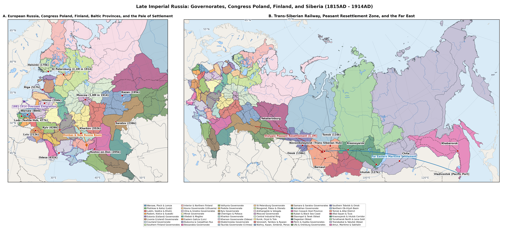
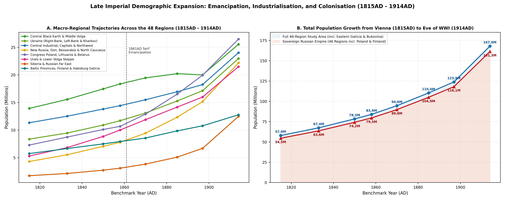
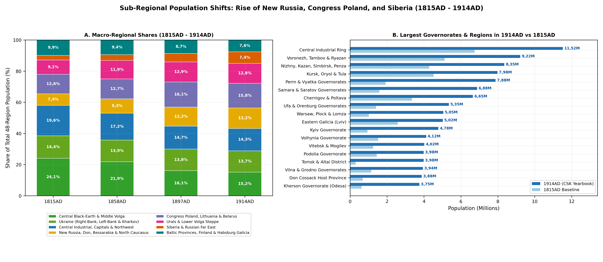
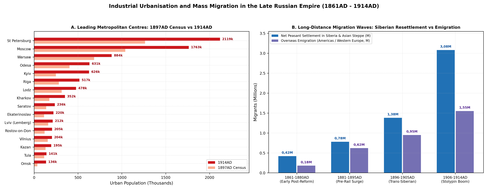

# Abstract

Between the Congress of Vienna in 1815AD and the fall of the Romanov
monarchy in 1917AD, the population of the Russian Empire and the
Ukrainian crownlands of Austria-Hungary (covering 18,61M km² across 48
provinces, excluding Central Asia and the Southern Caucasus) nearly
tripled. Under the final decades of serfdom, total numbers rose from
57,87M in 1815AD to 83,92M at the Tenth Soul Revision in 1858AD.
Following the peasant emancipations of the 1860s, the spread of railways
and the industrial boom in Poland, the Donbas and the two capitals, the
population climbed to 123,89M at the 1897AD Census and reached a pre-war
peak of 167,94M on 1 January 1914AD. First World War mobilisation,
frontline casualties and the flight of more than 6M refugees from the
western borderlands reduced the total slightly to 165,38M in 1917AD
[\[1\]](#ref-Kabuzan1971)[\[2\]](#ref-Kabuzan1992)[\[3\]](#ref-Rashin1956)[\[4\]](#ref-Troinitsky1905)[\[5\]](#ref-TsSK1915)[\[6\]](#ref-Gatrell1999).

# Background

Between 1815AD and 1917AD, Eastern Europe and Northern Asia were divided
into 48 provinces and regional groupings whose laws, land tenure and
railways shaped where people lived and how fast their numbers grew
(Figure and Table ).

In the west, three territories acquired between 1809AD and 1815AD kept
their own legal codes, customs borders and statistical offices
[\[7\]](#ref-Corrsin1989)[\[8\]](#ref-CoaleAndersonHarm1979)[\[9\]](#ref-Gortfelder2023BalticFertility)[\[10\]](#ref-Pitkanen1993).
These were Congress Poland (Regions 1-4, covering the ten Vistula
governorates of Warsaw, Plock, Lomza, Piotrkow, Kalisz, Lublin, Siedlce
with the 1912AD Kholm split, Radom, Kielce and Suwalki), the three
Baltic governorates ruled by German-speaking nobility (Regions 5-7,
covering Estland, Livland and Courland, where the abolition of serfdom
in 1816-1819AD triggered the Empire’s earliest decline in birth rates)
and the Grand Duchy of Finland (Regions 8-9, covering all eight Finnish
provinces administered by the Senate in Helsingfors).

East of the Vistula and Baltic provinces, the Pale of Permanent Jewish
Settlement, codified in 1835AD and tightened under the May Laws of
1882AD, confined Jewish residence to Lithuania and Belarus (Regions
10-13, covering Kovno, Vilna, Grodno, Minsk, Vitebsk and Mogilev),
Bessarabia (Region 16), Right-Bank Ukraine (Regions 17-19, covering
Volhynia, Podolia and Kyiv), Left-Bank Ukraine (Region 20, covering
Chernigov and Poltava) and New Russia (Regions 22-24, covering Kherson,
Ekaterinoslav and Taurida), alongside separate civil regulations in
Congress Poland
[\[11\]](#ref-Rowland1986)[\[12\]](#ref-Stampfer1995)[\[13\]](#ref-Perlmann2006PaleEmigration)[\[14\]](#ref-Manakov2022).
Across the southwestern border, Habsburg-ruled Ukrainian lands were
split after the 1867AD Compromise between Austrian rule in Eastern
Galicia (Region 14, with Lemberg/Lviv, Tarnopol, Stanislau and the
Boryslav oil basin) and Bukovina (Czernowitz), and Hungarian rule in the
Subcarpathian counties of Bereg, Ung, Ugocsa and Maramaros in Region 15
[\[15\]](#ref-OsterreichischeStatistik1912)[\[16\]](#ref-MagyarStatisztika1912)[\[17\]](#ref-Himka1988)[\[18\]](#ref-VanDrunen2013Bukovina).

Within the Russian interior, acute peasant land shortage after the
1861AD emancipation and the 1891-1892AD Volga and Black-Earth famine in
Regions 20 and 30-32 stood in sharp contrast to the booming capitals of
Saint Petersburg (Region 25) and Moscow (Region 28) and the coal, iron
and grain belt across Kherson, Ekaterinoslav, Taurida and the Don
Cossack Host in Regions 22-24 and 35
[\[19\]](#ref-Robbins1975)[\[20\]](#ref-Friedgut1989)[\[21\]](#ref-Herlihy1986)[\[22\]](#ref-Troitskaya2017).
Along the North Caucasian frontier, Regions 36-38 separate Kuban Oblast
and the Black Sea Governorate - the main theatre of the 1860-1864AD
Circassian expulsion and subsequent Cossack and Slavic settlement - from
Stavropol Governorate and Terek Oblast (Vladikavkaz, the Grozny
oilfields and the Vainakh and Ossetian highlands) and highland Dagestan
Oblast
[\[23\]](#ref-Richmond2013)[\[24\]](#ref-Jersild2002)[\[25\]](#ref-Kolesov2020Caucasus)[\[26\]](#ref-Dagestan1897Census).
In Asian Russia (Regions 41-48), the southern farm belt along the
Trans-Siberian Railway, the Altai Cabinet lands and the Amur-Ussuri
valleys (Regions 41, 43, 45 and 48, which took in over 3M peasant
migrants under Stolypin between 1906AD and 1914AD) grew rapidly, while
the northern Ob-Irtysh river trail (Region 42), the Altai-Sayan and
Uriankhai highlands (Region 44), the Yenisei-Turukhansk north and Lena
goldfields (Region 46) and Transbaikal and Yakutsk (Region 47) remained
sparsely settled
[\[27\]](#ref-Treadgold1957)[\[28\]](#ref-Coquin1969)[\[29\]](#ref-Dameshek2007)[\[30\]](#ref-Stephan1994).

| Region/Governorate/Oblast | Area (km²) | 1815AD | 1833AD | 1858AD | 1885AD | 1897AD | 1914AD | 1917AD |
|:---|:---|:---|:---|:---|:---|:---|:---|:---|
| 1\. Warsaw, Plock & Lomza Gubs. | 35,96k | 1,02M | 1,28M | 1,62M | 2,65M | 3,54M | 5,05M | 4,42M |
| 2\. Piotrkow & Kalisz Gubs. | 20,16k | 720k | 940k | 1,24M | 1,98M | 2,24M | 3,32M | 2,95M |
| 3\. Lublin & Siedlce Gubs. | 27,34k | 780k | 960k | 1,18M | 1,74M | 1,93M | 2,68M | 2,08M |
| 4\. Radom, Kielce & Suwalki Gubs. | 33,39k | 780k | 950k | 1,16M | 1,68M | 2,16M | 2,6M | 2,18M |
| 5\. Estland Gub. | 22,64k | 232k | 275k | 312k | 382k | 413k | 505k | 515k |
| 6\. Livland Gub. | 54,24k | 615k | 735k | 885k | 1,19M | 1,3M | 1,56M | 1,42M |
| 7\. Courland Gub. | 27,59k | 418k | 495k | 565k | 655k | 674k | 800k | 380k |
| 8\. Southern Finland Gubs.: Nyland | 114,32k | 590k | 745k | 945k | 1,2M | 1,43M | 1,84M | 1,89M |
| 9\. Interior & Northern Finland Gubs.: Vasa, Kuopio, Sankt-Michel & Uleaborg | 263,82k | 520k | 645k | 815k | 1,01M | 1,13M | 1,4M | 1,43M |
| 10\. Kovno Gub. | 43,91k | 660k | 785k | 965k | 1,38M | 1,54M | 1,84M | 1,32M |
| 11\. Vilna & Grodno Gubs. | 85,29k | 1,15M | 1,36M | 1,65M | 2,68M | 3,19M | 3,94M | 2,88M |
| 12\. Minsk Gub. & Pripyat Polesia | 91,93k | 920k | 1,04M | 1,21M | 1,82M | 2,15M | 3,04M | 2,89M |
| 13\. Vitebsk & Mogilev Gubs. | 83,64k | 1,25M | 1,41M | 1,64M | 2,58M | 3,18M | 4,02M | 3,86M |
| 14\. Austro-Hungarian Eastern Galicia | 46,07k | 2,58M | 2,88M | 3,36M | 4,12M | 4,42M | 5,02M | 4,45M |
| 15\. Austro-Hungarian Bukovina | 24,49k | 770k | 870k | 1,03M | 1,29M | 1,4M | 1,63M | 1,5M |
| 16\. Bessarabia Gub. | 47,38k | 385k | 640k | 950k | 1,58M | 1,94M | 2,66M | 2,62M |
| 17\. Volhynia Gub. | 76,53k | 1,52M | 1,68M | 2,01M | 2,64M | 2,99M | 4,12M | 3,68M |
| 18\. Podolia Gub. | 41,43k | 1,44M | 1,62M | 1,98M | 2,65M | 3,02M | 3,98M | 3,82M |
| 19\. Kyiv Gub. | 54,18k | 940k | 1,22M | 1,78M | 2,92M | 3,56M | 4,78M | 4,84M |
| 20\. Little Russian Gubs.: Chernigov & Poltava | 106,76k | 3,35M | 3,68M | 4,34M | 4,88M | 5,08M | 6,65M | 6,72M |
| 21\. Kharkov Gub. | 57,38k | 1,1M | 1,26M | 1,59M | 2,18M | 2,49M | 3,44M | 3,51M |
| 22\. Kherson Gub. | 75,5k | 620k | 880k | 1,38M | 2,24M | 2,73M | 3,75M | 3,78M |
| 23\. Ekaterinoslav Gub. | 60,21k | 820k | 1,04M | 1,46M | 1,92M | 2,11M | 3,45M | 3,58M |
| 24\. Taurida Gub. | 69,87k | 370k | 520k | 660k | 1,08M | 1,45M | 2,06M | 2,08M |
| 25\. Saint Petersburg Gub. | 62,71k | 760k | 940k | 1,22M | 1,76M | 2,11M | 3,15M | 3,38M |
| 26\. Novgorod, Pskov & Olonets Gubs. | 306,05k | 1,77M | 1,96M | 2,26M | 2,68M | 2,85M | 3,58M | 3,68M |
| 27\. Arkhangelsk & Vologda Gubs. | 1,31M | 920k | 1,04M | 1,24M | 1,54M | 1,69M | 2,22M | 2,28M |
| 28\. Moscow Gub. | 28,08k | 1,12M | 1,32M | 1,62M | 2,14M | 2,43M | 3,56M | 3,82M |
| 29\. Central Industrial Ring: Vladimir, Yaroslavl, Kostroma, Tver, Smolensk & Kaluga Gubs. | 320,6k | 6,75M | 7,25M | 8,08M | 8,82M | 9,16M | 11,52M | 11,88M |
| 30\. Western Central Black-Earth Gubs.: Kursk, Oryol & Tula | 116,2k | 4,52M | 5,02M | 5,88M | 6,42M | 6,21M | 7,98M | 8,18M |
| 31\. Eastern Central Black-Earth Gubs.: Voronezh, Tambov & Ryazan | 163,11k | 5,12M | 5,72M | 6,76M | 7,28M | 7,04M | 9,22M | 9,45M |
| 32\. Middle Volga Gubs.: Nizhny Novgorod, Kazan, Simbirsk & Penza | 196,69k | 4,28M | 4,82M | 5,72M | 6,52M | 6,76M | 8,35M | 8,55M |
| 33\. Samara & Saratov Gubs. | 257,22k | 1,58M | 2,18M | 3,38M | 4,68M | 5,16M | 6,88M | 7,12M |
| 34\. Astrakhan Gub. | 157,99k | 380k | 480k | 640k | 880k | 1M | 1,38M | 1,41M |
| 35\. Don Cossack Host | 173,01k | 680k | 880k | 1,42M | 2,12M | 2,56M | 3,88M | 3,94M |
| 36\. Kuban Oblast & Black Sea Gub. | 100,01k | 420k | 480k | 640k | 1,38M | 1,98M | 3,06M | 3,12M |
| 37\. Stavropol Gub. & Terek Oblast | 131,16k | 545k | 640k | 860k | 1,48M | 1,81M | 2,61M | 2,65M |
| 38\. Dagestan Oblast | 30,66k | 450k | 440k | 410k | 530k | 571k | 715k | 725k |
| 39\. Perm & Vyatka Gubs. | 491,79k | 1,92M | 2,38M | 3,42M | 5,18M | 6,03M | 7,88M | 8,04M |
| 40\. Ufa & Orenburg Gubs. | 339,13k | 1,4M | 1,78M | 2,56M | 3,42M | 3,8M | 5,35M | 5,48M |
| 41\. West Siberian Trans-Siberian Belt: Southern Tobolsk | 244,12k | 545k | 680k | 990k | 1,48M | 1,74M | 3,18M | 3,32M |
| 42\. Ob-Irtysh River Trail & Polar Tundra: Tobolsk, Surgut, Berezov & Narym | 1,64M | 160k | 185k | 240k | 325k | 375k | 505k | 520k |
| 43\. Tomsk Railway Trunk | 499,97k | 300k | 410k | 690k | 1,34M | 1,93M | 3,98M | 4,18M |
| 44\. Altai-Sayan Highlands: Gorny Altai, Minusinsk & Uriankhai Protectorate | 418,84k | 125k | 150k | 205k | 285k | 330k | 565k | 575k |
| 45\. Central Siberian Trans-Siberian Corridor: Achinsk-Krasnoyarsk-Kansk & Irkutsk | 521,6k | 210k | 260k | 375k | 610k | 795k | 1,54M | 1,56M |
| 46\. Yenisei-Turukhansk Polar North & Bodaibo Lena Goldfields | 2,48M | 68k | 80k | 110k | 165k | 195k | 270k | 265k |
| 47\. Transbaikal Oblast | 6,01M | 278k | 320k | 415k | 680k | 942k | 1,29M | 1,3M |
| 48\. Priamurye Gov.-Gen.: Amur, Primorskaya | 1,04M | 30k | 35k | 55k | 195k | 372k | 1,14M | 1,15M |
| Total (All 48 Regions) | 18,61M | 57,87M | 67,36M | 83,92M | 110,35M | 123,89M | 167,94M | 165,38M |

Regional population estimates and land areas across all 48 provinces at
seven benchmark dates from the Congress of Vienna in 1815AD to the
1917AD wartime censuses.

# Methodology

Our provincial population figures across this 102-year period draw on
seven main documentary and statistical series, summarised across all ten
benchmark dates in Table .

For the decades before the 1861AD emancipation, the estimates rest on
the last four Imperial Soul Revisions (*revizii*, VII-X, 1815-1858AD).
Following the Seventh Revision (1815-1816AD), which recorded Napoleonic
wartime losses across western and central provinces, fiscal commissions
conducted the Eighth (1833-1835AD), Ninth (1850AD) and Tenth
(1857-1858AD) Soul Revisions
[\[1\]](#ref-Kabuzan1971)[\[31\]](#ref-Kabuzan1963)[\[32\]](#ref-Ulyanova2016).
Unlike the male-only Sixth Revision of 1811AD, Revisions VII-X
registered both sexes of the tax-paying estates. Following V. M. Kabuzan
(1971AD, 1992AD) and A. G. Troinitsky (1861AD), the raw revision returns
are combined with provincial statistical committee and police registers
for tax-exempt nobles, clergy, civil servants, regular troops and
Cossack hosts
[\[2\]](#ref-Kabuzan1992)[\[22\]](#ref-Troitskaya2017)[\[33\]](#ref-Troinitsky1861).

After emancipation, population tracking passed to the Central
Statistical Committee (*Tsentralnyy Statisticheskiy Komitet*, TsSK MVD)
for 1863-1914AD. Set up within the Ministry of Internal Affairs under P.
P. Semenov, the committee published periodic volumes (*Statisticheskiy
vremennik Rossiyskoy imperii*) and, from 1904AD to 1915AD, annual
yearbooks (*Statisticheskiy ezhegodnik Rossii*), combining Orthodox,
Lutheran, Catholic, Jewish and Muslim parish registers with *zemstvo*
household surveys
[\[3\]](#ref-Rashin1956)[\[5\]](#ref-TsSK1915)[\[34\]](#ref-Mironov2000).

The late nineteenth-century figures are anchored by the First
All-Russian General Census of 28 January 1897AD. Directed by
Semenov-Tyan-Shansky and edited by N. A. Troinitsky across 89 provincial
volumes (1899-1905AD), the 1897AD Census counted 125,64M residents
present across the Empire excluding Finland
[\[4\]](#ref-Troinitsky1905)[\[35\]](#ref-Troinitsky1905Goroda). Across
our 46 Russian, Polish, Baltic, Siberian and Finnish regions, the 1897AD
benchmark comes to 118,06M (115,51M across the 44 Imperial and Vistula
regions - matching the 1897AD Census provincial totals minus the 10,13M
inhabitants of Transcaucasia and Central Asia outside the study area -
plus 2,56M in the Grand Duchy of Finland), which together with 5,82M in
Austro-Hungarian Galicia, Bukovina and Subcarpathia gives the 48-region
total of 123,89M
[\[4\]](#ref-Troinitsky1905)[\[15\]](#ref-OsterreichischeStatistik1912)[\[36\]](#ref-FinlandStat1870_1915).

In the western borderlands, separate statistical offices kept their own
records. Because the Grand Duchy of Finland retained its Swedish-era
Lutheran parish registers (*kirkonkirjat* and *vaestotaulut*, begun in
1749AD) and established its own Central Statistical Office
(*Tilastollinen paatoimisto*) in 1865AD, Regions 8-9 have continuous
five- and ten-year series from 1815AD to 1910AD (1,11M in 1815AD, 1,76M
in 1858AD, 1,77M in 1870AD after the 1866-1868AD famine, 2,56M in 1897AD
and 3,05M in 1910AD)
[\[36\]](#ref-FinlandStat1870_1915)[\[37\]](#ref-Luostarinen2026FinlandMortality).
For the ten Vistula Governorates (Regions 1-4), civil registers
introduced under the Napoleonic Code in 1808AD and the 40 volumes
published by the Warsaw Statistical Committee (1888-1914AD) reconcile
permanent residents and temporary industrial migrants in Warsaw, Lodz
and Sosnowiec alongside the 1897AD Census (9,87M in 1897AD and 13,65M on
1 January 1914AD)
[\[7\]](#ref-Corrsin1989)[\[38\]](#ref-WarsawStat1914)[\[39\]](#ref-Repczynska2022Lodz).

Across the Habsburg frontier, Regions 14-15 rely before 1857AD on
Josephinian military conscription rolls and from 1869AD to 1910AD on the
ten-year censuses of the Vienna Statistical Commission for Eastern
Galicia and Bukovina and the Budapest Statistical Office for
Subcarpathia
[\[15\]](#ref-OsterreichischeStatistik1912)[\[16\]](#ref-MagyarStatisztika1912).
Finally, after plans for a Second Imperial Census in 1915AD were shelved
[\[40\]](#ref-Borshchik2018), the Ministry of Agriculture and the
Provisional Government carried out the 1916AD and 1917AD All-Russian
Agricultural, Land and Urban Censuses
[\[41\]](#ref-AgCensus1917)[\[42\]](#ref-Oskin2015Food1917). Combined
with the refugee rolls of the Tatiana Committee and *Zemgor* studied by
Peter Gatrell (1999AD), these counts track the displacement of over 6M
wartime refugees (*bezhentsy*) by early 1917AD
[\[6\]](#ref-Gatrell1999)[\[43\]](#ref-Krutikov2024KholmWWI).

| Benchmark & Source | Poland (1-4) | Balt.-Fin. (5-9) | Pale-Bess. (10-19\*) | Habsb. (14-15) | Ukraine-Cauc. (20-24,36-38) | Heartland-Ural (25-35,39-40) | Siberia-FE (41-48) | Total (48 Regs) |
|:---|:---|:---|:---|:---|:---|:---|:---|:---|
| 1815AD (Revision VII/Vienna Act) | 3,3M | 2,38M | 8,26M | 3,35M | 7,68M | 31,2M | 1,72M | 57,87M |
| 1833AD (Revision VIII/Parish) | 4,13M | 2,9M | 9,76M | 3,75M | 8,94M | 35,77M | 2,12M | 67,36M |
| 1850AD (Revision IX/Conscript) | 4,91M | 3,34M | 11,35M | 4,15M | 10,56M | 41,32M | 2,72M | 78,34M |
| 1858AD (Revision X/1857 Habsb.) | 5,2M | 3,52M | 12,19M | 4,39M | 11,34M | 44,2M | 3,08M | 83,92M |
| 1870AD (TsSK/1869 A-H/Fin.) | 6,34M | 3,73M | 14,34M | 4,82M | 13,03M | 48,51M | 3,82M | 94,58M |
| 1885AD (TsSK/Zemstvo/VSK) | 8,05M | 4,43M | 18,25M | 5,41M | 15,69M | 53,44M | 5,08M | 110,35M |
| 1897AD (1st Imperial Census) | 9,87M | 4,94M | 21,57M | 5,82M | 18,22M | 56,79M | 6,68M | 123,89M |
| 1910AD (TsSK/1910 A-H & Fin.) | 12,67M | 5,77M | 26,74M | 6,45M | 23,74M | 70,03M | 10,82M | 156,22M |
| 1914AD (TsSK/VSK Pre-WWI Peak) | 13,65M | 6,11M | 28,38M | 6,65M | 25,74M | 74,95M | 12,47M | 167,94M |
| 1917AD (Ag.-Urban Census/WWI) | 11,63M | 5,64M | 25,91M | 5,95M | 26,16M | 77,21M | 12,88M | 165,38M |

Population totals across the seven main regional groupings at all ten
revision, statistical committee and census benchmarks from 1815AD to
1917AD.

# Results

## Congress Poland, the Baltic Provinces and Finland

### Congress Poland

Created at the Congress of Vienna in 1815AD out of the Napoleonic Duchy
of Warsaw and reorganised into ten Vistula Governorates in 1867AD,
Congress Poland (116,85k km² across Regions 1-4) grew faster than any
other western territory in the Empire, more than quadrupling from 3,3M
in 1815AD (28,2 per km²) to 5,2M in 1858AD, 9,87M in 1897AD and 13,65M
in 1914AD (116,8 per km²)
[\[7\]](#ref-Corrsin1989)[\[38\]](#ref-WarsawStat1914). Although the
November (1830-1831AD) and January (1863-1864AD) Uprisings brought
wartime casualties, estate confiscations and deportations to Siberia,
Tsar Alexander II’s Polish Emancipation Ukase of 2 March 1864AD gave
Polish, Ukrainian and Lithuanian peasants freehold title to their land
without direct redemption payments to landlords, sustaining rural
natural growth of 1,6-1,9% a year
[\[2\]](#ref-Kabuzan1992)[\[44\]](#ref-Meerkerk2023Agrarian).

At the same time, the abolition of the Russo-Polish customs barrier in
1851AD, the opening of the Warsaw-Vienna (1848AD) and Warsaw-Saint
Petersburg (1862AD) railways and the high Imperial gold tariff of 1877AD
turned Congress Poland into the leading textile and coal-and-steel
workshop for the Russian market
[\[7\]](#ref-Corrsin1989)[\[39\]](#ref-Repczynska2022Lodz)[\[45\]](#ref-Liczbinska2025Lodz).

In northern Mazovia, the Warsaw, Plock and Lomza governorates (Region 1)
rose from 1,02M in 1815AD to 3,54M in 1897AD and 5,05M in 1914AD, led by
Warsaw, the Empire’s third largest city (growing from 81k in 1815AD to
162,8k in 1858AD, 683,7k in 1897AD and 884,5k in 1914AD, when 36,9% of
its people were Jewish), alongside the linen-mill town of Zyrardow
(38,6k) and the Vistula river ports of Wloclawek (37,4k) and Plock
(35,2k) [\[7\]](#ref-Corrsin1989)[\[38\]](#ref-WarsawStat1914). To the
southwest, the Piotrkow and Kalisz governorates (Region 2) grew nearly
fivefold from 720k in 1815AD to 2,25M in 1897AD and 3,32M in 1914AD.
Chosen as a factory settlement in 1820AD when it had fewer than 800
inhabitants, Lodz grew to 29,5k in 1858AD, 314k in 1897AD and 477,9k in
1914AD (or over 550k with its mill suburbs of Pabianice and Zgierz),
while coal mining and ironworks in the Dabrowa Basin along the Silesian
border turned small villages into the industrial towns of Sosnowiec
(118,5k in 1914AD, chartered only in 1902AD), Czestochowa (92,9k) and
Bendzin (54,8k)
[\[39\]](#ref-Repczynska2022Lodz)[\[45\]](#ref-Liczbinska2025Lodz).

East of the Vistula and across the southern uplands, the Lublin and
Siedlce governorates (Region 3) and the Radom, Kielce and Suwalki
governorates (Region 4) grew from 780k each in 1815AD to 2,68M and 2,6M
in 1914AD, despite heavy overseas emigration from Suwalki and Kalisz to
Brazil and North America between 1890AD and 1913AD
[\[46\]](#ref-BylyeGody2023BrazilEmigration). In June 1912AD, Saint
Petersburg detached the eastern districts of Lublin and Siedlce to form
Kholm Governorate (Chelm, 24,6k) under Kiev
[\[43\]](#ref-Krutikov2024KholmWWI). During the German and
Austro-Hungarian offensive of summer 1915AD, Russian military evacuation
orders drove over 2M residents eastward, cutting Regions 1-4 from 13,65M
in 1914AD to 11,63M in 1917AD; Region 3 fell by 22,4% (from 2,68M to
2,08M), while Kalisz was shelled to ruins in August 1914AD and shrank
from 65,4k to 29k
[\[6\]](#ref-Gatrell1999)[\[43\]](#ref-Krutikov2024KholmWWI).

### The Baltic Governorates

In Estland (Region 5), Livland (Region 6) and Courland (Region 7),
Alexander I’s emancipation acts of 1816AD (Estland), 1817AD (Courland)
and 1819AD (Livland) ended serfdom forty years before inner Russia while
leaving farmland in the hands of Baltic German nobles until
tenant-purchase reforms in the 1850s and 1860s
[\[9\]](#ref-Gortfelder2023BalticFertility)[\[47\]](#ref-Bogov2017Livland).
Combined with near-universal Lutheran literacy (92-96% adult literacy in
1897AD compared with 21% across the Empire) and late marriage, the three
Baltic provinces were the first in the Russian Empire to see a lasting
fall in marital birth rates between the 1860s and 1880s, forty to fifty
years ahead of Central Russia
[\[8\]](#ref-CoaleAndersonHarm1979)[\[9\]](#ref-Gortfelder2023BalticFertility)[\[48\]](#ref-Gortfelder2020TartuFertility).

As a result, rural population growth across Regions 5-7 was modest
(rising from 1,26M in 1815AD to 1,76M in 1858AD, 2,39M in 1897AD and
2,87M in 1914AD), whereas port and factory towns grew rapidly. Riga
(Region 6) expanded from 36k in 1815AD to 282,2k in 1897AD and 517,5k in
1914AD as the Empire’s leading timber-export port and a major producer
of rubber goods, chemicals, electrical equipment and railway carriages.
In Estland (Region 5), Reval/Tallinn grew to 137,6k in 1914AD and 159k
in 1917AD around its naval shipyards, while Dorpat/Tartu (48,6k)
remained the university town of the Baltic provinces. In Courland
(Region 7), the ice-free port of Libau/Liepaja (90,7k in 1914AD) served
as the home port of the Russian American Line, carrying 40k-70k Jewish
and Baltic emigrants each year to New York
[\[13\]](#ref-Perlmann2006PaleEmigration)[\[47\]](#ref-Bogov2017Livland).
In spring and summer 1915AD, the German army occupied Courland (Region
7), driving half its people into interior Russia (800k in 1914AD to 380k
in 1917AD, -52,5%), while the evacuation of Riga’s factory machinery and
over 300k workers and family members halved Riga’s population to 210k
and lowered Livland (Region 6) from 1,56M to 1,42M
[\[6\]](#ref-Gatrell1999).

### The Grand Duchy of Finland

Self-governing since the Diet of Porvoo in 1809AD and enlarged by the
return of Old Finland (Viipuri/Vyborg province) in 1812AD, the Grand
Duchy of Finland (378,13k km² across Regions 8-9) grew steadily from
1,11M in 1815AD (590k in southern and coastal Region 8; 520k in interior
and northern Region 9) to 1,76M in 1858AD
[\[36\]](#ref-FinlandStat1870_1915)[\[49\]](#ref-Jantti2005Finland).
This steady rise was interrupted by Europe’s last great peacetime famine
in 1866-1868AD. After wet summers and a hard frost in early September
1867AD destroyed the rye and barley crops across Ostrobothnia, Savo and
Kainuu, winter hunger and typhus, dysentery and relapsing fever in
crowded relief shelters killed around 150k people, or roughly 8% of
Finland’s population, pushing the national death rate to 77,6 per 1k in
1868AD
[\[10\]](#ref-Pitkanen1993)[\[37\]](#ref-Luostarinen2026FinlandMortality)[\[50\]](#ref-Pasanen2022FinlandFamine)[\[51\]](#ref-Mansukoski2016Finland).
In our figures, Region 9 (Vasa, Kuopio, Sankt-Michel and Uleaborg) drops
from 815k in 1858AD to 805k in 1870AD, while Region 8 (Nyland,
Abo-Bjorneborg, Tavastehus and Vyborg) barely edges up from 945k to
965k.

After 1870AD, the opening of the Riihimaki-Saint Petersburg railway
(1870AD), dairy farming and the growth of steam sawmills, pulp mills and
paper works carried Finland’s population from 1,77M in 1870AD to 2,56M
in 1897AD, 3,24M in 1914AD and 3,32M in 1917AD (spared fighting before
1918AD), led by Helsingfors/Helsinki (4,8k in 1815AD to 84,5k in 1897AD
and 187,5k in 1917AD), Abo/Turku (54,6k), Tammerfors/Tampere (45,2k) and
Viipuri/Vyborg (29,3k), even as some 300k rural Finns (mainly from Vasa
province in Region 9) emigrated to North America between 1880AD and
1914AD
[\[36\]](#ref-FinlandStat1870_1915)[\[49\]](#ref-Jantti2005Finland).

| Region (1-9) | 1815AD | 1850AD | 1858AD | 1870AD | 1897AD | 1910AD | 1914AD | 1917AD |
|:---|:---|:---|:---|:---|:---|:---|:---|:---|
| 1\. Warsaw, Plock & Lomza Gubs. | 1,02M | 1,52M | 1,62M | 1,98M | 3,54M | 4,68M | 5,05M | 4,42M |
| 2\. Piotrkow & Kalisz Gubs. | 720k | 1,16M | 1,24M | 1,56M | 2,24M | 3,05M | 3,32M | 2,95M |
| 3\. Lublin & Siedlce Gubs. | 780k | 1,12M | 1,18M | 1,42M | 1,93M | 2,48M | 2,68M | 2,08M |
| 4\. Radom, Kielce & Suwalki Gubs. | 780k | 1,11M | 1,16M | 1,38M | 2,16M | 2,46M | 2,6M | 2,18M |
| 5\. Estland Gub. | 232k | 302k | 312k | 338k | 413k | 475k | 505k | 515k |
| 6\. Livland Gub. | 615k | 835k | 885k | 1M | 1,3M | 1,48M | 1,56M | 1,42M |
| 7\. Courland Gub. | 418k | 545k | 565k | 615k | 674k | 765k | 800k | 380k |
| 8\. Southern Finland Gubs.: Nyland | 590k | 890k | 945k | 965k | 1,43M | 1,72M | 1,84M | 1,89M |
| 9\. Interior & Northern Finland Gubs.: Vasa, Kuopio, Sankt-Michel & Uleaborg | 520k | 765k | 815k | 805k | 1,13M | 1,33M | 1,4M | 1,43M |

Population estimates across Congress Poland, the Baltic governorates and
the Grand Duchy of Finland from 1815AD to 1917AD, showing the
1866-1868AD Finnish famine and the 1915AD wartime evacuation of Poland
and Courland.

## The Pale of Settlement, Bessarabia and Austro-Hungarian Ukraine

### Lithuania and Belarus

Across the Lithuanian and Belarusian governorates of the Northwestern
Krai (304,76k km², Regions 10-13), total population grew from 3,97M in
1815AD to 5,46M in 1858AD, 10,06M in 1897AD and 12,84M in 1914AD
[\[2\]](#ref-Kabuzan1992)[\[4\]](#ref-Troinitsky1905)[\[52\]](#ref-Potrosova2021)[\[53\]](#ref-Krotok2024).

In Lithuania, Kovno Governorate (Region 10, formed in 1843AD) rose from
660k in 1815AD to 1,54M in 1897AD and 1,84M in 1914AD. Heavy
Russification after the 1863AD uprising, few factories outside
Kovno/Kaunas (growing from 5,2k to 91,4k) and Shavli/Siauliai (23,5k)
and the subdivision of peasant holdings prompted 250k-300k Lithuanians
and Litvak Jews to emigrate to Pennsylvania, Chicago, Scotland and South
America between 1880AD and 1914AD, before the 1915AD German occupation
cut Kovno’s population by 28,3% to 1,32M in 1917AD
[\[6\]](#ref-Gatrell1999)[\[13\]](#ref-Perlmann2006PaleEmigration)[\[54\]](#ref-Gierowska2020Lithuania).

Farther south and east, the Vilna and Grodno governorates (Region 11,
rising from 1,15M to 3,19M in 1897AD and 3,94M in 1914AD), Minsk
Governorate and Pripyat Polesia (Region 12, 920k to 2,15M and 3,04M) and
the Vitebsk and Mogilev governorates including the Catholic Latgalian
districts of Dvinsk, Rezhitsa and Lyutsin (Region 13, 1,25M to 3,18M and
4,02M) formed the small-town (*shtetl*) heartland of the Pale
[\[11\]](#ref-Rowland1986)[\[14\]](#ref-Manakov2022)[\[55\]](#ref-Ovseychik2024).
After Alexander III’s May Laws of 3 May 1882AD barred Jews from settling
anew in villages, Jewish communities (8-17,5% of the provincial totals)
made up 50-65% of the towns, including Vilna (32k to 204,3k), the
Bialystok woollen-mill boomtown (6,2k to 91,5k, site of the June 1906AD
pogrom), Dvinsk/Daugavpils (4,2k to 112,8k), Minsk (13,2k to 117,6k),
Vitebsk (14,5k to 108,9k), Gomel (5,8k to 104,5k), Grodno (7,2k to
61,6k) and Brest-Litovsk (6,4k to 57,4k, burned and evacuated to 16,5k
in August 1915AD)
[\[13\]](#ref-Perlmann2006PaleEmigration)[\[56\]](#ref-Shtakser2009PaleYouth).
Between 1906AD and 1914AD, crowded Belarusian villages in Mogilev,
Vitebsk and Minsk also sent over 340k peasant settlers to Siberia
[\[57\]](#ref-Kryuchek2017), while the 1915AD front line split Region 11
(falling from 3,94M to 2,88M, -26,9%) from Russian army headquarters at
Mogilev [\[6\]](#ref-Gatrell1999).

### Bessarabia and Right-Bank Ukraine

Taken from the Ottoman Principality of Moldavia at the Treaty of
Bucharest in 1812AD, Bessarabia Governorate (Region 16, 47,38k km²) grew
nearly sevenfold from 385k in 1815AD to 950k in 1858AD, 1,94M in 1897AD
and 2,66M in 1914AD (2,62M in 1917AD), driven by state-backed Bulgarian,
Gagauz, German, Ukrainian and Russian settlement across the southern
Budjak steppe alongside a Moldovan rural majority and fast-growing
Kishinev/Chisinau (14,5k to 108,5k in 1897AD and 128,7k in 1914AD),
Bender (31,8k), Akkerman (28,3k) and Ismail (22,3k)
[\[4\]](#ref-Troinitsky1905)[\[58\]](#ref-Prutyan2026)[\[59\]](#ref-Kapustin2026).
Southern Bessarabia (Cahul, Bolgrad and Ismail districts) was ceded to
Moldavia under the 1856AD Treaty of Paris and taken back by Russia at
the 1878AD Congress of Berlin. In April 1903AD, the Kishinev Pogrom (49
killed), followed by the October 1905AD pogroms in Odessa, Kyiv and
Bialystok, set off the largest wave of Jewish emigration from the
Empire, sending roughly 1,25M people to the United States between 1903AD
and 1914AD out of some 2M total emigrants from the Pale between 1881AD
and 1914AD
[\[12\]](#ref-Stampfer1995)[\[13\]](#ref-Perlmann2006PaleEmigration)[\[60\]](#ref-Klier1995).

In Right-Bank Ukraine (Regions 17-19, covering Volhynia, Podolia and
Kyiv Governorates), the curbing of Polish noble autonomy after 1831AD
and 1863AD and the rise of large sugar-beet estates and refineries
(producing over 80% of the Empire’s refined sugar under the Brodsky,
Tereshchenko and Bobrinsky families) supported some of Europe’s densest
black-earth farming populations
[\[61\]](#ref-Perkovsky1979)[\[62\]](#ref-Zinovev2022). Volhynia (Region
17) grew from 1,52M in 1815AD to 2,99M in 1897AD and 4,12M in 1914AD
before fighting on the Southwestern Front in 1915-1916AD and the Russian
Army’s deportation of some 150k Volhynian Germans and border Jews
reduced it to 3,68M in 1917AD. Podolia (Region 18) rose from 1,44M to
3,02M in 1897AD (72,8 per km²) and 3,98M in 1914AD, while Kyiv
Governorate (Region 19) quintupled from 940k in 1815AD to 3,56M in
1897AD and 4,78M in 1914AD (rising to 4,84M in 1917AD with wartime army
and refugee inflows), led by Kyiv (23,5k in 1815AD to 247,7k in 1897AD
and 626,3k in 1914AD)
[\[4\]](#ref-Troinitsky1905)[\[6\]](#ref-Gatrell1999).

### Galicia, Bukovina and Subcarpathian Rus

Across the Habsburg border, the abolition of compulsory peasant labour
(*Robota*) during the Revolutions of 1848AD freed Ukrainian
(*Ruthenian*) smallholders in Eastern Galicia (Region 14, growing from
2,58M in 1815AD to 3,36M in 1858AD, 4,42M in 1897AD and 5,02M in 1914AD)
and in Bukovina and Hungarian Subcarpathian Rus (Region 15, rising from
770k to 1,03M, 1,4M and 1,63M)
[\[15\]](#ref-OsterreichischeStatistik1912)[\[16\]](#ref-MagyarStatisztika1912)[\[17\]](#ref-Himka1988).
Despite the turn-of-the-century oil boom around Boryslav and Drohobych
(Drohobych 36,5k and Boryslav 16,8k, making Galicia the world’s
third-largest oil producer in 1909AD) and the growth of Lemberg/Lviv
(44,5k to 212k) and Czernowitz/Chernivtsi (7,2k to 94k)
[\[18\]](#ref-VanDrunen2013Bukovina)[\[63\]](#ref-Lylo2025GaliciaLviv),
extreme subdivision of peasant farms (over 80% of holdings were under 5
ha) drove more than 400k Galician, Bukovinian and Transcarpathian
Ukrainians and Jews to settle on the Canadian prairies or take factory
jobs in the United States between 1885AD and 1914AD. Between August
1914AD and 1917AD, four major Russo-Austrian offensives across Galicia
and the Carpathian passes, Austro-Hungarian military executions and
internments at Thalerhof and Russian wartime deportations reduced Region
14 from 5,02M to 4,45M (-11,4%) and Region 15 from 1,63M to 1,5M (-8%)
[\[6\]](#ref-Gatrell1999).

| Region (10-19) | 1815AD | 1850AD | 1870AD | 1885AD | 1897AD | 1910AD | 1914AD | 1917AD |
|:---|:---|:---|:---|:---|:---|:---|:---|:---|
| 10\. Kovno Gub. | 660k | 915k | 1,12M | 1,38M | 1,54M | 1,76M | 1,84M | 1,32M |
| 11\. Vilna & Grodno Gubs. | 1,15M | 1,56M | 2,02M | 2,68M | 3,19M | 3,78M | 3,94M | 2,88M |
| 12\. Minsk Gub. & Pripyat Polesia | 920k | 1,15M | 1,42M | 1,82M | 2,15M | 2,82M | 3,04M | 2,89M |
| 13\. Vitebsk & Mogilev Gubs. | 1,25M | 1,56M | 1,98M | 2,58M | 3,18M | 3,82M | 4,02M | 3,86M |
| 14\. Austro-Hungarian Eastern Galicia | 2,58M | 3,18M | 3,68M | 4,12M | 4,42M | 4,88M | 5,02M | 4,45M |
| 15\. Austro-Hungarian Bukovina | 770k | 970k | 1,14M | 1,29M | 1,4M | 1,57M | 1,63M | 1,5M |
| 16\. Bessarabia Gub. | 385k | 860k | 1,16M | 1,58M | 1,94M | 2,48M | 2,66M | 2,62M |
| 17\. Volhynia Gub. | 1,52M | 1,88M | 2,24M | 2,64M | 2,99M | 3,82M | 4,12M | 3,68M |
| 18\. Podolia Gub. | 1,44M | 1,84M | 2,22M | 2,65M | 3,02M | 3,74M | 3,98M | 3,82M |
| 19\. Kyiv Gub. | 940k | 1,58M | 2,18M | 2,92M | 3,56M | 4,52M | 4,78M | 4,84M |

Population estimates across Lithuania, Belarus, Austro-Hungarian Galicia
and Bukovina, Bessarabia and Right-Bank Ukraine from 1815AD to 1917AD.

## Novorossiya, the Russian Heartland and the North Caucasus

### Left-Bank Ukraine, New Russia and the Russian Heartland

Across the southern Ukrainian and Black Sea steppes, peasant ploughs and
late-Imperial coal and steel works transformed a sparsely settled
frontier into the industrial powerhouse of the southern Empire.

In Left-Bank and Sloboda Ukraine (Regions 20-21), Chernigov and Poltava
(Region 20, rising from 3,35M to 5,08M in 1897AD and 6,65M in 1914AD)
suffered severe land hunger after 1861AD and sent more peasant migrants
to Siberia and the Far East than any other province
[\[27\]](#ref-Treadgold1957), whereas Kharkov Governorate (Region 21,
1,1M to 2,49M and 3,44M) boomed around Kharkov (growing from 14,8k in
1815AD to 174k in 1897AD and 258k in 1914AD), its locomotive works and
southern railway headquarters
[\[62\]](#ref-Zinovev2022)[\[64\]](#ref-Bagaley1918). Farther south
across New Russia and the Don Cossack Host (Regions 22-24 and 35), the
Crimean War (1853-1856AD) in Taurida Governorate (Region 24) battered
Sevastopol (which fell from 34k in 1833AD to 11,2k in 1858AD) and
prompted the 1860-1862AD exodus of 180k-200k Crimean Tatars and Nogais
to the Ottoman Empire, holding Region 24 nearly flat between 1850AD
(640k) and 1858AD (660k), before mainland wheat farming and naval
rebuilding lifted Taurida to 1,45M in 1897AD and 2,06M in 1914AD
[\[40\]](#ref-Borshchik2018)[\[65\]](#ref-Williams2001)[\[66\]](#ref-Konstantinova2010).
To the north and west, Kherson Governorate (Region 22, rising from 620k
to 2,73M and 3,75M, led by the grain port of Odessa at 35k to 403,8k and
630k and the shipyards of Nikolaev at 108,8k)
[\[21\]](#ref-Herlihy1986)[\[67\]](#ref-Zipperstein1985), Ekaterinoslav
Governorate (Region 23, 820k to 2,11M and 3,45M) and the Don Cossack
Host (Region 35, 680k to 2,56M and 3,88M, led by Rostov-on-Don at 204,8k
and Taganrog at 78,6k) saw Europe’s fastest heavy-industrial boom after
the Catherine Railway (1884AD) linked Krivoy Rog iron ore with Donbas
coking coal around John Hughes’s ironworks at Yuzovka/Donetsk (growing
from 0,9k in 1870AD to 28,1k in 1897AD and 54k in 1914AD), Ekaterinoslav
(220,4k in 1914AD), Lugansk (68k) and Mariupol (58k)
[\[20\]](#ref-Friedgut1989)[\[68\]](#ref-Konstantinova2009)[\[69\]](#ref-Matveicheva2014)[\[70\]](#ref-Oleynikov2014)[\[71\]](#ref-Agafonov2017)[\[72\]](#ref-Kolomeytseva2018).

In the northern and central Russian heartland (Regions 25-34 and 39-40),
Saint Petersburg Governorate (Region 25, rising from 760k to 2,11M in
1897AD, 3,15M in 1914AD and 3,38M in 1917AD, with the capital itself
growing from 2,12M in 1914AD to 2,3M in 1917AD as the Putilov munitions
works expanded) and Moscow Governorate (Region 28, rising from 1,12M to
2,43M, 3,56M and 3,82M, with the city reaching 1,76M in 1914AD and 1,85M
in 1917AD) drew in millions of peasant migrant workers (*otkhodniki*)
from Novgorod, Pskov and Olonets (Region 26), Arkhangelsk and Vologda
(Region 27, where Romanov-on-Murman/Murmansk was founded at the end of
the Murman Railway in 1916AD) and the Central Industrial Ring (Region
29, rising from 6,75M to 11,52M, including the cotton-mill town of
Ivanovo-Voznesensk at 146k)
[\[3\]](#ref-Rashin1956)[\[73\]](#ref-Veremenko2026Capitals)[\[74\]](#ref-Krivonozhenko2020).
By contrast, the Central Black-Earth provinces (Regions 30-31) and the
Middle and Lower Volga (Regions 32-34) suffered repeated crop failures
and epidemics. After severe autumn and spring drought across seventeen
black-earth and Volga provinces, the 1891-1892AD famine and cholera
epidemic caused 400k-500k excess deaths, hitting Astrakhan, Saratov,
Samara, Simbirsk, Kazan, Voronezh and Tambov hardest
[\[19\]](#ref-Robbins1975)[\[75\]](#ref-Wheatcroft1991)[\[76\]](#ref-AstrakhanCholera1892_2023)[\[77\]](#ref-Corporaal2024Famines).
Combined with heavy peasant migration to the southern steppes and
Siberia, total population in the Western Black-Earth provinces (Region
30, covering Kursk, Oryol and Tula) and the Eastern Black-Earth
provinces (Region 31, covering Voronezh, Tambov and Ryazan) dipped
between 1885AD and the 1897AD Census (from 6,42M to 6,21M and from 7,28M
to 7,04M) before recovering to 7,98M and 9,22M by 1914AD
[\[78\]](#ref-Myakisheva2016)[\[79\]](#ref-Myakisheva2018)[\[80\]](#ref-Hoch1986).
Farther east, Samara and Saratov (Region 33, rising from 1,58M to 5,16M
and 6,88M, home to over 400k Volga Germans and the river ports of
Saratov at 235,9k, Samara at 143,8k and Tsaritsyn at 101k), Perm and
Vyatka (Region 39, 1,92M to 6,03M and 7,88M, with Ekaterinburg at 70k
and the Izhevsk gun works) and Ufa and Orenburg (Region 40, 1,4M to 3,8M
and 5,35M, including the Trans-Siberian gateway of Chelyabinsk at 70,5k)
grew steadily through peasant settlement and mining
[\[81\]](#ref-Doenninghaus2011)[\[82\]](#ref-Solovyov2013)[\[83\]](#ref-Kyshpanakov2026)[\[84\]](#ref-Akhtyamova2016).

### The North Caucasus

Across the North Caucasus (261,84k km², Regions 36-38),
nineteenth-century population history was shaped by the Caucasian War
(1817-1864AD). In the east, three decades of mountain fighting against
Imam Shamil’s Caucasian Imamate (1829-1859AD, ending at Gunib) reduced
Dagestan Oblast (Region 38) from 450k in 1815AD to 410k in 1858AD before
railway and port links through Petrovsk-Port/Makhachkala (24,8k) and
Derbent (32,7k) lifted the population to 571k in 1897AD and 715k in
1914AD
[\[24\]](#ref-Jersild2002)[\[26\]](#ref-Dagestan1897Census)[\[85\]](#ref-DagestanDemography2015).
In the northwest, the final conquest of Circassia (1860-1864AD, ending
at Kbaada in May 1864AD) was followed by the expulsion and Black Sea
crossing of 500k-650k Circassians (Adyghe), Ubykhs and Abazas to the
Ottoman Empire
[\[23\]](#ref-Richmond2013)[\[25\]](#ref-Kolesov2020Caucasus).
Immediately afterwards, land grants to Kuban Cossacks and incoming
Ukrainian and Russian peasants pushed Kuban Oblast and the Black Sea
Governorate (Region 36) nearly fivefold from 640k in 1858AD to 1,98M in
1897AD and 3,06M in 1914AD (led by Ekaterinodar at 107,1k and the cement
and grain port of Novorossiysk at 66,7k), while Stavropol and Terek
(Region 37) grew from 860k in 1858AD to 1,81M in 1897AD and 2,61M in
1914AD around Vladikavkaz (79,3k) and the Grozny oilfields (growing from
15,6k in 1897AD to 38,2k in 1914AD and 45k in 1917AD)
[\[86\]](#ref-Burykina2008)[\[87\]](#ref-Parshina2023)[\[88\]](#ref-Tovsultanov2017).

| Region (20-40) | 1815AD | 1850AD | 1870AD | 1885AD | 1897AD | 1910AD | 1914AD | 1917AD |
|:---|:---|:---|:---|:---|:---|:---|:---|:---|
| 20\. Little Russian Gubs.: Chernigov & Poltava | 3,35M | 4,12M | 4,62M | 4,88M | 5,08M | 6,28M | 6,65M | 6,72M |
| 21\. Kharkov Gub. | 1,1M | 1,48M | 1,82M | 2,18M | 2,49M | 3,22M | 3,44M | 3,51M |
| 22\. Kherson Gub. | 620k | 1,22M | 1,68M | 2,24M | 2,73M | 3,48M | 3,75M | 3,78M |
| 23\. Ekaterinoslav Gub. | 820k | 1,32M | 1,68M | 1,92M | 2,11M | 3,06M | 3,45M | 3,58M |
| 24\. Taurida Gub. | 370k | 640k | 780k | 1,08M | 1,45M | 1,88M | 2,06M | 2,08M |
| 25\. Saint Petersburg Gub. | 760k | 1,12M | 1,42M | 1,76M | 2,11M | 2,86M | 3,15M | 3,38M |
| 26\. Novgorod, Pskov & Olonets Gubs. | 1,77M | 2,16M | 2,44M | 2,68M | 2,85M | 3,38M | 3,58M | 3,68M |
| 27\. Arkhangelsk & Vologda Gubs. | 920k | 1,18M | 1,36M | 1,54M | 1,69M | 2,08M | 2,22M | 2,28M |
| 28\. Moscow Gub. | 1,12M | 1,52M | 1,82M | 2,14M | 2,43M | 3,22M | 3,56M | 3,82M |
| 29\. Central Industrial Ring: Vladimir, Yaroslavl, Kostroma, Tver, Smolensk & Kaluga Gubs. | 6,75M | 7,82M | 8,45M | 8,82M | 9,16M | 10,85M | 11,52M | 11,88M |
| 30\. Western Central Black-Earth Gubs.: Kursk, Oryol & Tula | 4,52M | 5,62M | 6,22M | 6,42M | 6,21M | 7,52M | 7,98M | 8,18M |
| 31\. Eastern Central Black-Earth Gubs.: Voronezh, Tambov & Ryazan | 5,12M | 6,42M | 7,12M | 7,28M | 7,04M | 8,68M | 9,22M | 9,45M |
| 32\. Middle Volga Gubs.: Nizhny Novgorod, Kazan, Simbirsk & Penza | 4,28M | 5,42M | 6,12M | 6,52M | 6,76M | 7,92M | 8,35M | 8,55M |
| 33\. Samara & Saratov Gubs. | 1,58M | 2,96M | 3,98M | 4,68M | 5,16M | 6,42M | 6,88M | 7,12M |
| 34\. Astrakhan Gub. | 380k | 580k | 740k | 880k | 1M | 1,28M | 1,38M | 1,41M |
| 35\. Don Cossack Host | 680k | 1,22M | 1,68M | 2,12M | 2,56M | 3,52M | 3,88M | 3,94M |
| 36\. Kuban Oblast & Black Sea Gub. | 420k | 580k | 860k | 1,38M | 1,98M | 2,76M | 3,06M | 3,12M |
| 37\. Stavropol Gub. & Terek Oblast | 545k | 780k | 1,12M | 1,48M | 1,81M | 2,38M | 2,61M | 2,65M |
| 38\. Dagestan Oblast | 450k | 420k | 470k | 530k | 571k | 680k | 715k | 725k |
| 39\. Perm & Vyatka Gubs. | 1,92M | 3,02M | 4,18M | 5,18M | 6,03M | 7,38M | 7,88M | 8,04M |
| 40\. Ufa & Orenburg Gubs. | 1,4M | 2,28M | 2,98M | 3,42M | 3,8M | 4,92M | 5,35M | 5,48M |

Population estimates across Left-Bank Ukraine, New Russia, the Great
Russian interior, the Volga, the North Caucasus and the Urals from
1815AD to 1917AD.

## Siberia and the Far East

Across the 13,35M km² of Siberia and the Russian Far East (Regions
41-48), total population grew more than sevenfold from 1,72M in 1815AD
to 3,08M in 1858AD, 6,68M in 1897AD, 12,47M in 1914AD and 12,88M in
1917AD
[\[27\]](#ref-Treadgold1957)[\[28\]](#ref-Coquin1969)[\[29\]](#ref-Dameshek2007)[\[89\]](#ref-Forsyth1992).
As shown in Figure A and Table , this growth was heavily concentrated
along the Trans-Siberian Railway and the Amur-Ussuri river valleys
(Regions 41, 43, 45 and 48), while the northern river basins, goldfields
and native hunting lands (Regions 42, 44, 46 and 47) grew much more
slowly.

The building of the Trans-Siberian Railway (1891-1916AD), begun at both
Vladivostok and Chelyabinsk in 1891AD, transformed peasant settlement
across the southern steppes and forest-steppe belt (Regions 41, 43 and
45). Backed after 1906AD by Prime Minister P. A. Stolypin’s Resettlement
Administration, which offered cheap farm loans, tool depots and
subsidised fourth-class rail fares, peasant migration across the Urals
topped 5M gross (and over 3,5M net) settlers between 1896AD and 1914AD,
peaking in 1907-1909AD at 665k-759k migrants a year
[\[27\]](#ref-Treadgold1957)[\[28\]](#ref-Coquin1969)[\[90\]](#ref-Belyanin2010)[\[91\]](#ref-Khramkov2009).
The Tomsk railway belt and Altai Cabinet lands (Region 43) took in more
Stolypin settlers than any other part of the Empire, growing nearly
fourteenfold from 300k in 1815AD to 1,93M in 1897AD, 3,98M in 1914AD and
4,18M in 1917AD as newcomers ploughed fertile black earth leased from
the Tsar’s Cabinet around Barnaul (growing from 7,4k in 1815AD to 61k in
1914AD), Biysk (33,5k) and the Ob bridge rail boomtown of
Novonikolaevsk/Novosibirsk (founded in 1893AD; rising from 7,8k in
1897AD to 85k in 1914AD and 107k in 1917AD), which soon overtook the
older university and provincial seat of Tomsk (116,7k in 1914AD)
[\[90\]](#ref-Belyanin2010)[\[92\]](#ref-Bryukhanova2023AltaiMigration).
Similarly, the Southern Tobolsk and Omsk railway belt (Region 41) grew
from 545k in 1815AD to 1,74M in 1897AD and 3,18M in 1914AD, led by Omsk
(37,4k in 1897AD to 135,8k in 1914AD) and the butter-exporting town of
Kurgan (38,5k)
[\[93\]](#ref-Tychinskikh2019)[\[94\]](#ref-Zverev2020)[\[95\]](#ref-Semenov2024),
while the Central Siberian rail belt (Region 45) rose from 210k to 1,54M
around Krasnoyarsk (87,5k) and Irkutsk (129,7k)
[\[96\]](#ref-Bryukhanova2021).

By contrast, the northern river basins and southern mountain borderlands
bypassed by the main rail line grew far more slowly (Regions 42, 44, 46
and 47). Along the northern Ob and Irtysh rivers (Region 42, covering
Tobolsk, Berezov, Surgut, Obdorsk and Narym), population rose modestly
from 160k to 375k and 505k, with the old provincial capital of Tobolsk
stalling at 20,4k to 24,5k once the railway passed 250 km to the south.
The Altai-Sayan highlands and Uriankhai (Region 44) grew from 125k to
565k in 1914AD, taking in Minusinsk farmers, Altai herders
[\[97\]](#ref-Ekeev2020) and Tuva (Uriankhai), which was placed under a
Russian protectorate in April 1914AD with its administrative post at
Belotsarsk (Kyzyl). In the Yenisei-Turukhansk north and Lena goldfields
(Region 46, rising from 68k to 195k and 270k), the old river town of
Yeniseysk (5,8k to 11,9k) stood alongside the remote placer camps around
Bodaibo (11,8k in 1914AD), where troops shot over 200 striking Lena
Goldfields miners on 4 April 1912AD. Farther east, Transbaikal and
Yakutsk Oblasts (Region 47, growing from 278k to 942k and 1,29M)
combined Sakha and Buryat herders (roughly 225k Yakuts and 180k
Transbaikal Buryats in 1897AD), the Nerchinsk convict mines, Yakutsk
(10,8k in 1914AD) and the railway junction of Chita (growing from 0,7k
in 1815AD to 79,2k in 1914AD)
[\[89\]](#ref-Forsyth1992)[\[98\]](#ref-Korusenko2011).

In the Russian Far East, the Priamurye region (Region 48, covering Amur,
Primorskaya and Sakhalin across 1,04M km²) was annexed from Qing China
under the Treaty of Aigun (1858AD) and the Convention of Peking
(1860AD), and its population grew nearly fortyfold from 30k native
Tungusic and Nivkh inhabitants in 1815AD and 55k in 1858AD to 372k in
1897AD, 1,14M in 1914AD and 1,15M in 1917AD
[\[30\]](#ref-Stephan1994)[\[99\]](#ref-Golovnev2021FarEast). Growth was
driven by Amur and Ussuri Cossacks and more than 250k Ukrainian peasants
from Poltava, Chernigov and Kyiv who arrived by sea from Odessa or along
the Chinese Eastern (1903AD) and Amur (1916AD) railways to farm the
Ussuri valley around Nikolsk-Ussuriysky (47,4k) and build the towns of
Vladivostok (rising from 3,2k in 1870AD to 108k in 1917AD as an Allied
supply port), Blagoveshchensk (62,5k) and Khabarovsk (51,3k). On
Sakhalin, acquired in full in exchange for the Kuril Islands under the
1875AD Treaty of Saint Petersburg (with 3,9k penal exiles and guards at
Aleksandrovsky Post in 1897AD), defeat in the Russo-Japanese War
(1904-1905AD) forced Russia to cede the southern half of the island
(Karafuto, south of 50°N) to Japan under the September 1905AD Treaty of
Portsmouth [\[30\]](#ref-Stephan1994).

| Region (41-48) | 1815AD | 1850AD | 1858AD | 1870AD | 1897AD | 1910AD | 1914AD | 1917AD |
|:---|:---|:---|:---|:---|:---|:---|:---|:---|
| 41\. West Siberian Trans-Siberian Belt: Southern Tobolsk | 545k | 880k | 990k | 1,18M | 1,74M | 2,78M | 3,18M | 3,32M |
| 42\. Ob-Irtysh River Trail & Polar Tundra: Tobolsk, Surgut, Berezov & Narym | 160k | 220k | 240k | 275k | 375k | 465k | 505k | 520k |
| 43\. Tomsk Railway Trunk | 300k | 580k | 690k | 920k | 1,93M | 3,42M | 3,98M | 4,18M |
| 44\. Altai-Sayan Highlands: Gorny Altai, Minusinsk & Uriankhai Protectorate | 125k | 185k | 205k | 240k | 330k | 495k | 565k | 575k |
| 45\. Central Siberian Trans-Siberian Corridor: Achinsk-Krasnoyarsk-Kansk & Irkutsk | 210k | 330k | 375k | 460k | 795k | 1,32M | 1,54M | 1,56M |
| 46\. Yenisei-Turukhansk Polar North & Bodaibo Lena Goldfields | 68k | 98k | 110k | 135k | 195k | 245k | 270k | 265k |
| 47\. Transbaikal Oblast | 278k | 380k | 415k | 510k | 942k | 1,18M | 1,29M | 1,3M |
| 48\. Priamurye Gov.-Gen.: Amur, Primorskaya | 30k | 45k | 55k | 95k | 372k | 920k | 1,14M | 1,15M |

Population estimates across the eight Siberian and Far Eastern regions
from 1815AD to 1917AD, contrasting the Stolypin railway settlement belt
with the northern taiga and tundra.

# Conclusion

Between 1815AD and 1914AD, the population across these 48 provinces
nearly tripled from 57,87M to 167,94M, shifting the demographic weight
of the Empire outward from the old forest and black-earth interior
toward the industrial cities of Congress Poland and the Baltic coast,
the coal and wheat belt of New Russia and the Donbas, the North
Caucasian steppes and the Trans-Siberian railway corridor. While rural
overcrowding in the Central Black-Earth provinces, Left-Bank Ukraine,
the Pale of Settlement and Galicia sent millions of migrants eastward
across the Urals and westward across the Atlantic, the First World War
abruptly halted growth along the western frontier, uprooting more than
6M refugees between 1914AD and 1917AD on the eve of the Russian
Revolution.

# Sources

1.
Kabuzan, Vladimir Maksimovich.
*Izmeneniya v Razmeshchenii Naseleniya Rossii v XVIII - Pervoy Polovine
XIX v. (Po Materialam Reviziy) \[Changes in the Distribution of the
Population of Russia in the 18th - First Half of the 19th Century\]*.
Nauka, 1971,
<https://search.worldcat.org/search?q=Changes+Distribution+Population+Russia+18th+First+Half+19th+Kabuzan+1971>.

2.
Kabuzan, Vladimir Maksimovich.
*Narody Rossii v Pervoy Polovine XIX v.: Chislennost i Etnicheskiy
Sostav \[Peoples of Russia in the First Half of the 19th Century:
Population Size and Ethnic Composition\]*. Nauka, 1992,
<https://search.worldcat.org/search?q=Peoples+Russia+First+Half+19th+Century+Population+Size+Kabuzan+1992>.

3.
Rashin, Adolf Grigoryevich.
*Naselenie Rossii Za 100 Let (1811-1913 Gg.): Statisticheskie Ocherki
\[Population of Russia over 100 Years, 1811-1913: Statistical Essays\]*.
Gosudarstvennoe statisticheskoe izdatelstvo, 1956,
<https://search.worldcat.org/search?q=Population+Russia+over+100+Years+1811+1913+Statistical+Rashin+1956>.

4.
Troinitsky, Nikolay
Aleksandrovich. *Obshchiy Svod Po Imperii Rezultatov Razrabotki Dannykh
Pervoy Vseobshchey Perepisi Naseleniya, Proizvedennoy 28 Yanvarya 1897
Goda \[General Summary for the Empire of the Results of the First
General Census of Population of 28 January 1897\]*. vol. 1–2,
Tsentralnyy statisticheskiy komitet MVD, 1905,
<https://www.demoscope.ru/weekly/ssp/rus1897_01.php>.

5.
Tsentralnyy statisticheskiy
komitet MVD. *Statisticheskiy Yezhegodnik Rossii 1914 g. (God
Odinnadtsatyy) \[Statistical Yearbook of Russia for 1914\]*. Tsentralnyy
statisticheskiy komitet MVD, 1915,
<https://www.prlib.ru/collections>.

6.
Gatrell, Peter. *A Whole Empire
Walking: Refugees in Russia During World War i*. Indiana University
Press, 1999, <https://doi.org/10.2979/4146.0>.

7.
Corrsin, Stephen D. *Warsaw Before
the First World War: Poles and Jews in the Third City of the Russian
Empire, 1880-1914*. East European Monographs / Columbia University
Press, 1989, <https://doi.org/10.2307/j.ctv1rmj5z.12>.

8.
Coale, Ansley J., et al. *Human
Fertility in Russia Since the Nineteenth Century*. Princeton University
Press, 1979, <https://doi.org/10.1515/9781400867783>.

9.
Gortfelder, Mark, and Hannaliis
Jaadla. “Determinants of Fertility During the Fertility Transition in
Estonia: A Spatial Analysis.” *Spatial Demography*, vol. 11, 2023, pp.
1-29, <https://doi.org/10.1007/s40980-023-00116-6>.

10.
Pitkänen, Kari J. *Deprivation and
Disease: Mortality During the Great Finnish Famine of the 1860s*. Suomen
väestötieteen yhdistys, 1993,
<https://doi.org/10.1007/978-3-642-48800-9_6>.

11.
Rowland, Richard H. “Geographical
Patterns of the Jewish Population in the Pale of Settlement of Late
Nineteenth Century Russia.” *Jewish Social Studies*, vol. 48, no. 3/4,
1986, pp. 207-34, <https://www.jstor.org/stable/4467338>.

12.
Stampfer, Shaul. “Patterns of
Internal Jewish Migration in the Russian Empire.” *Jews and Jewish Life
in Russia and the Soviet Union*, edited by Yaacov Ro’i, Frank Cass,
1995, pp. 28-47,
<https://scholar.google.com/scholar?q=Patterns+Internal+Jewish+Migration+Russian+Empire+Stampfer+1995>.

13.
Perlmann, Joel. *The Local
Geographic Origins of Russian-Jewish Immigrants, Circa 1900*. Levy
Economics Institute Working Paper No. 465, 2006,
<https://doi.org/10.2139/ssrn.922120>.

14.
Manakov, Andrey Gennadyevich, and
Tatyana Alekseevna Korotaeva. “Sdvigi v Rasselenii Evreev:
Kartograficheskiy Analiz Po Materialam Perepisi 1897 g. \[Shifts in the
Settlement of Jews in the Pale of Settlement: Cartographic Analysis
Based on the 1897 Census\].” *Pskovskiy Regionologicheskiy Zhurnal*,
2022, pp. 54-70,
<https://cyberleninka.ru/article/n/sdvigi-v-rasselenii-evreev-kartograficheskiy-analiz-po-materialam-perepisi-1897-g>.

15.
K. K. Statistische
Zentralkommission. *Die Ergebnisse Der Volkszählung Vom 31. Dezember
1910 in Den Im Reichsrate Vertretenen königreichen Und ländern (Galizien
Und Bukowina)*. vol. 1, Karl Gerolds Sohn, 1912,
<https://alex.onb.ac.at/abba.htm>.

16.
Magyar Királyi Központi
Statisztikai Hivatal. *A Magyar Szent Korona Országainak 1910.
évi népszámlálása \[the 1910 Census of the
Lands of the Hungarian Holy Crown: Comitats Bereg, Ung, Ugocsa, and
máramaros\]*. vol. 42, Pesti Könyvnyomda, 1912,
<https://search.worldcat.org/search?q=1910+Census+Lands+Hungarian+Holy+Crown+Comitats+Bereg+1912>.

17.
Himka, John-Paul. *Galician
Villagers and the Ukrainian National Movement in the Nineteenth
Century*. Macmillan, 1988,
<https://doi.org/10.1007/978-1-349-19386-8>.

18.
Drunen, H. F. van. *A Sanguine
Bunch: Regional Identification and Ethno-Demographic Composition in
Habsburg Bukovina, 1774-1919*. University of Amsterdam, 2013,
<https://scholar.google.com/scholar?q=Sanguine+Bunch+Regional+Identification+Ethno+Demographic+Composition+Habsburg+van+2013>.

19.
Robbins, Richard G. *Famine in
Russia, 1891-1892: The Imperial Government Responds to a Crisis*.
Columbia University Press, 1975,
<https://doi.org/10.7312/robb91090>.

20.
Friedgut, Theodore H. *Iuzovka and
Revolution, Volume i: Life and Work in Russia’s Donbass, 1869-1924*.
Princeton University Press, 1989,
<https://doi.org/10.1515/9781400860401>.

21.
Herlihy, Patricia. *Odessa: A
History, 1794-1914*. Harvard Ukrainian Research Institute, 1986,
<https://search.worldcat.org/search?q=Odessa+History+1794+1914+Herlihy+1986>.

22.
Troitskaya, Irina Alekseyevna, and
Galina Nikolayevna Ulyanova. “Sotsialnaya i Territorialnaya Mobilnost
Moskovskikh Kuptsov Po Skazkam VIII (1833-1834) i x (1857-1858) Reviziy
\[Social and Territorial Mobility of Moscow Merchants According to
Revisions VIII and x\].” *Demograficheskoe Obozrenie*, vol. 4, no. 2,
2017, pp. 61-82,
<https://cyberleninka.ru/article/n/sotsialnaya-i-territorialnaya-mobilnost-moskovskih-kuptsov-po-skazkam-viii-1833-1834-i-x-1857-1858-reviziy>.

23.
Richmond, Walter. *The Circassian
Genocide*. Rutgers University Press, 2013,
<https://doi.org/10.36019/9780813560694>.

24.
Jersild, Austin. *Orientalism and
Empire: North Caucasus Mountain Peoples and the Georgian Frontier,
1845-1917*. McGill-Queen’s University Press, 2002,
<https://doi.org/10.1515/9780773569966>.

25.
Kolesov, Vladimir. “The Mountain
Jews, the Uryms, the Cherkesohays: North-Western Caucasus Groups in the
Middle of the 19th Century.” *Judaic-Slavic Journal*, no. 2, 2020, pp.
95-118, <https://doi.org/10.31168/2658-3364.2020.2.05>.

26.
Mirzabekov, Mirzabek Yakhyaevich.
“Materialy Pervoy Vseobshchey Perepisi Naseleniya Rossiyskoy Imperii
1897 g. Kak Istochnik Po Izucheniyu Istoriko-Demograficheskikh
Protsessov v Dagestanskoy Oblasti \[Materials of the 1897 All-Russian
Census on Dagestan Oblast\].” *Istoriya, Arkheologiya i Etnografiya
Kavkaza*, 2017, pp. 74-85,
<https://cyberleninka.ru/article/n/materialy-pervoy-vseobschey-perepisi-naseleniya-rossiyskoy-imperii-1897-g-kak-istochnik-po-izucheniyu-istoriko-demograficheskih-protsessov-v-dagestanskoy-oblasti>.

27.
Treadgold, Donald W. *The Great
Siberian Migration: Government and Peasant in Resettlement from
Emancipation to the First World War*. Princeton University Press, 1957,
<https://doi.org/10.1515/9781400877645>.

28.
Coquin, François-Xavier. *La
Sibérie: Peuplement Et Immigration Paysanne Au XIXe Siècle*. Institut
d’Études Slaves, 1969,
<https://search.worldcat.org/search?q=La+Sib+erie+Peuplement+et+immigration+paysanne+au+1969>.

29.
Dameshek, Lev Mikhaylovich, and
Anatoliy Viktorovich Remnev. *Sibir v Sostave Rossiyskoy Imperii
\[Siberia Within the Russian Empire\]*. Novoe literaturnoe obozrenie,
2007,
<https://search.worldcat.org/search?q=Siberia+within+Russian+Empire+Dameshek+2007>.

30.
Stephan, John J. *The Russian Far
East: A History*. Stanford University Press, 1994,
<https://doi.org/10.1515/9781503615458>.

31.
Kabuzan, Vladimir Maksimovich.
*Narodonaselenie Rossii v XVIII - Pervoy Polovine XIX v. (Po Materialam
Reviziy) \[Population of Russia in the 18th - First Half of the 19th
Century Based on Revision Materials\]*. Izdatelstvo Akademii nauk SSSR,
1963,
<https://search.worldcat.org/search?q=Population+Russia+18th+First+Half+19th+Century+Based+Kabuzan+1963>.

32.
Ulyanova, Galina Nikolayevna, and
Irina Alekseyevna Troitskaya. “Revizskiye Skazki Kak Istochnik v
Istoriografii 1970-Kh - 2010-Kh Godov \[Poll-Tax Revision Lists as a
Source in the Historiography of the 1970s-2010s\].” *Istoricheskiy
Zhurnal: Nauchnye Issledovaniya*, 2016, pp. 412-22,
<https://cyberleninka.ru/article/n/revizskie-skazki-kak-istochnik-v-istoriografii-1970-h-2010-h-godov>.

33.
Troinitsky, Aleksandr
Grigoryevich. *Krepostnoe Naselenie v Rossii, Po 10-y Narodnoy Perepisi:
Statisticheskoe Issledovanie \[the Serf Population in Russia According
to the 10th National Revision\]*. Tipografiya Karla Vulfa, 1861,
<https://www.prlib.ru/collections>.

34.
Mironov, Boris Nikolaevich. *The
Social History of Imperial Russia, 1700-1917*. vol. 1–2, Westview Press,
2000, <https://doi.org/10.4324/9780429499456>.

35.
Troinitsky, Nikolay
Aleksandrovich. *Goroda i Poseleniya v Uezdakh, Imeyushchie 2000 i Bolee
Zhiteley \[Towns and Settlements in Uezds Having 2000 or More
Inhabitants: 1897 Census\]*. Tsentralnyy statisticheskiy komitet MVD,
1905, <https://www.demoscope.ru/weekly/ssp/rus1897_01.php>.

36.
Tilastollinen paatoimisto /
Statistiska Centralbyran. *Suomen Virallinen Tilasto VI: Vaestotilastoa
1815-1915 \[Official Statistics of Finland Series VI: Decennial
Population Censuses and Vital Statistics of the Eight Finnish
Governorates, 1815-1915\]*. Kejserliga Senatens Tryckeri, 1915,
<https://www.doria.fi/handle/10024/67150>.

37.
Luostarinen, Sara, et al. “Sources
and Databases on Mortality and Morbidity in Finland, 1750-1950.”
*Historical Life Course Studies*, vol. 16, 2026, pp. 1-24,
<https://doi.org/10.52024/hlcs25577>.

38.
Varshavskiy statisticheskiy
komitet. *Trudy Varshavskogo Statisticheskogo Komiteta: Sostoyanie
Naseleniya v 10 Guberniyakh Tsarstva Polskogo k 1 Yanvarya 1914 g.
\[Proceedings of the Warsaw Statistical Committee: Population of the 10
Vistula Governorates on 1 January 1914\]*. vol. 40, Tipografiya
Varshavskogo uchebnogo okruga, 1914,
<https://search.worldcat.org/search?q=Proceedings+Warsaw+Statistical+Committee+Population+10+Vistula+Governorates+Varshavskiy+1914>.

39.
Repczyńska-Górczak, Helena, et al.
“Population Registry Cards for Inhabitants of Lodz as a Source of
Information about the City’s Population in the 19th and Early 20th
Century.” *Studia Historiae Oeconomicae*, vol. 40, no. 1, 2022, pp.
85-108, <https://doi.org/10.14746/sho.2022.40.1.005>.

40.
Borshchik, Natalya Dmitrievna.
“Istoriya Podgotovki II Vserossiyskoy Perepisi Naseleniya Rossiyskoy
Imperii 1915 g. V Tavricheskoy Gubernii \[Preparation of the Second
All-Russian Imperial Census of 1915 in Taurida Governorate\].” *Uchenye
Zapiski Krymskogo Federalnogo Universiteta*, 2018, pp. 32-44,
<https://cyberleninka.ru/article/n/istoriya-podgotovki-ii-vserossiyskoy-perepisi-naseleniya-rossiyskoy-imperii-1915-g-v-tavricheskoy-gubernii>.

41.
Vserossiyskaya
selskokhozyaystvennaya i gorodskaya perepis. *Pogubernskie Itogi
Vserossiyskoy Selskokhozyaystvennoy i Pozemelnoy Perepisi 1917 Goda Po
52 Guberniyam i Oblastyam \[Provincial Totals of the 1917 All-Russian
Agricultural and Urban Census\]*. Tsentralnoe statisticheskoe
upravlenie, 1921,
<https://search.worldcat.org/search?q=Provincial+Totals+1917+All+Russian+Agricultural+Urban+Census+Vserossiyskaya+1921>.

42.
Oskin, Maksim Viktorovich.
“Prodovolstvennyy Vopros v Rossii v 1917 Godu \[Food Supply, Wartime
Urban Inflow, and the 1916-1917 Censuses in Russia\].” *Nauchnye
Vedomosti BelGU. Istoriya*, 2015, pp. 122-29,
<https://cyberleninka.ru/article/n/prodovolstvennyy-vopros-v-rossii-v-1917-godu>.

43.
Krutikov, Anton Alekseevich.
“Historical Fate of Kholmshchina During the First World War and the 1915
Refugee Evacuation.” *Perspektivy*, no. 2, 2024, pp. 80-100,
<https://doi.org/10.32726/2411-3417-2024-2-80-100>.

44.
Nederveen Meerkerk, Elise van, and
Rolf Bauer. *Global Agricultural Workers from the 17th to the 21st
Century*. Brill, 2023, <https://doi.org/10.1163/9789004529427>.

45.
Liczbińska, Grażyna, and Renata
Koziarska-Kasperczyk. “Industrial Urban Life and Death: Social and
Environmental Influences on Mortality in 19th-Century Lodz.” *Romanian
Journal of Population Studies*, vol. 19, no. 2, 2025, pp. 5-28,
<https://doi.org/10.24193/RJPS.2025.2.01>.

46.
Degtyarev, Sergey Ivanovich, and
Lyubov Georgievna Polyakova. “Emigration from the Russian Empire to
Brazil in the Late 19th and Early 20th Centuries.” *Bylye Gody*, vol.
18, no. 2, 2023, pp. 842-51,
<https://doi.org/10.13187/bg.2023.2.842>.

47.
Bogov, Vladimir Alekseevich.
“Mezhetnicheskie Protivorechiya i Pravitelstvennaya Politika v
Liflyandii XIX v. \[Interethnic Relations and Demographic Policy in
19th-Century Livland Governorate\].” *Vestnik Pskovskogo
Gosudarstvennogo Universiteta*, 2017, pp. 45-54,
<https://cyberleninka.ru/article/n/mezhetnicheskie-protivorechiya-i-pravitelstvennaya-politika-v-liflyandii-xix-v>.

48.
Gortfelder, Mark, et al.
“Socio-Economic Status and Fertility in an Urban Context at the End of
the Nineteenth Century: A Linked Records Study from Tartu, Estonia.”
*The History of the Family*, vol. 25, no. 1, 2020, pp. 51-73,
<https://doi.org/10.1080/1081602x.2020.1712661>.

49.
Jäntti, Markus, et al. *Growth and
Equity in Finland: Nineteenth-Century Industrialisation and Demographic
Modernisation*. World Bank / UNU-WIDER, 2005,
<https://doi.org/10.1596/9125>.

50.
Pasanen, Tiia-Maria, et al. “A
Bayesian Spatio-Temporal Analysis of Markets During the Finnish 1860s
Famine.” *Journal of the Royal Statistical Society Series C*, vol. 71,
no. 5, 2022, pp. 1501-22,
<https://doi.org/10.48550/arXiv.2106.06268>.

51.
Mansukoski, Liina. *Secular Trends
in Human Skeletal Growth in a 19th and Early 20th Century Finnish
Population*. Durham University, 2016,
<https://etheses.durham.ac.uk/id/eprint/11395>.

52.
Potrosova, Ye. S. “Statisticheskie
Materialy Kak Istochniki Izucheniya Naseleniya Na Territorii Belarusi Vo
Vtoroy Polovine XIX v. \[Statistical Materials as Sources for Studying
the Population of Belarus in the Second Half of the 19th Century\].”
*Trudy BGTU. Seriya 6: Istoriya, Filosofiya*, 2021, pp. 38-43,
<https://cyberleninka.ru/article/n/statisticheskie-materialy-kak-istochniki-izucheniya-naseleniya-na-territorii-belarusi-vo-vtoroy-polovine-xix-v>.

53.
Krotok, Roman Nikolaevich.
“Territorialnye Razlichiya v Konfessionalnoy Strukture Naseleniya
Severo-Zapadnogo Kraya Po Itogam Perepisi Naseleniya Rossiyskoy Imperii
1897 Goda \[Territorial Differences in the Confessional Structure of the
Northwestern Krai in the 1897 Census\].” *Pskovskiy Regionologicheskiy
Zhurnal*, 2024, pp. 85-101,
<https://cyberleninka.ru/article/n/territorialnye-razlichiya-v-konfessionalnoy-strukture-naseleniya-severo-zapadnogo-kraya-po-itogam-perepisi-naseleniya-rossiyskoy-imperii-1897-goda>.

54.
Gierowska-Kałłaur, Joanna.
“Demographic and Political Shifts in Lithuania at the Close of the First
World War.” *Studia z Dziejow Rosji i Europy Srodkowo-Wschodniej*, vol.
54, 2020, pp. 27-48, <https://doi.org/10.12775/SDR.2019.EN4.02>.

55.
Ovseychik, Vladimir Yevgenyevich.
“Staroobryadtsy Yugo-Vostochnoy Belarusi v Seredine XIX - Nachale XX v.:
Osobennosti Rasseleniya i Dinamika Chislennosti \[Old Believers of
Southeastern Belarus in the Mid-19th - Early 20th Century: Settlement
Patterns and Population Dynamics\].” *Vestnik Polotskogo
Gosudarstvennogo Universiteta*, 2024, pp. 24-35,
<https://doi.org/10.33876/2311-0546/2024-1/33-43>.

56.
Shtakser, Inna. “Pale of the
Settlement Working-Class Jewish Youth and Adoption of Revolutionary
Identity During the 1905 Revolution.” *The Carl Beck Papers in Russian
and East European Studies*, no. 2002, 2009, pp. 1-44,
<https://doi.org/10.5195/cbp.2009.146>.

57.
Kryuchek, Petr Stepanovich.
“Krestyanskie Pereseleniya Iz Belarusi v Gody Stolypinskoy Agrarnoy
Reformy \[Peasant Resettlements from Belarus to Siberia During the
Stolypin Agrarian Reform\].” *Trudy BGTU. Seriya 6: Istoriya,
Filosofiya*, 2017, pp. 41-46,
<https://cyberleninka.ru/article/n/krestyanskie-pereseleniya-iz-belarusi-v-gody-stolypinskoy-agrarnoy-reformy>.

58.
Prutyan, Georgiy Zakharevich.
“Kolonizatsiya Bessarabii Gagauzami v XIX Veke v Kontekste
Russko-Turetskikh Otnosheniy \[Colonisation of Southern Bessarabia and
Budjak in the 19th Century\].” *Vestnik RUDN. Istoriya Rossii*, 2026,
pp. 18-31,
<https://cyberleninka.ru/article/n/kolonizatsiya-bessarabii-gagauzami-v-xix-veke-v-kontekste-russko-turetskih-otnosheniy>.

59.
Kapustin, Sergey Vasilevich.
“Usloviya Priema i Rasseleniya Nemetskikh Kolonistov v Bessarabii v XIX
v. \[Reception and Settlement of German Colonists in Novorossiya and
Bessarabia in the 19th Century\].” *Izvestiya Saratovskogo
Universiteta*, 2026, pp. 45-54,
<https://doi.org/10.48137/23116412_2026_3_136>.

60.
Klier, John Doyle. *Imperial
Russia’s Jewish Question, 1855-1881*. Cambridge University Press, 1995,
<https://search.worldcat.org/search?q=Imperial+Russia+Jewish+Question+1855+1881+Klier+1995>.

61.
Perkovsky, Arnold Leonidovich.
*Etnichna i Sotsialna Struktura Naselennia Pravoberezhnoi Ukrainy u
XVIII St. \[Ethnic and Social Structure of the Population of Right-Bank
Ukraine in the 18th Century\]*. Naukova dumka, 1979,
<https://search.worldcat.org/search?q=Ethnic+Social+Structure+Population+Right+Bank+Ukraine+18th+Perkovsky+1979>.

62.
Zinovev, Vasiliy Pavlovich, and
Sergey Georgievich Sulyak. “Urbanizatsiya i Etnodemograficheskie
Protsessy Na Ukraine v Kontse XIX - Nachale XXI v. \[Urbanisation and
Ethnodemographic Processes in Ukraine from the 1897 Census to the Early
21st Century\].” *Rusin*, vol. 68, 2022, pp. 238-65,
<https://doi.org/10.17223/18572685/69/3>.

63.
Lylo, Ihor. “Urban Consumption and
Society in Late Habsburg Lwow, 1908.” *Folia Historica Cracoviensia*,
vol. 31, 2025, pp. 105-24, <https://doi.org/10.15633/fhc.31105>.

64.
Bagaley, Dmitriy Ivanovich.
*Istoriya Slobodskoy Ukrainy \[History of Sloboda Ukraine\]*. Soyuz,
1918,
<https://search.worldcat.org/search?q=History+Sloboda+Ukraine+Bagaley+1918>.

65.
Williams, Brian Glyn. *The Crimean
Tatars: The Diaspora Experience and the Forging of a Nation*. Brill,
2001, <https://doi.org/10.1163/9789004491281>.

66.
Konstantinova, Viktoriya
Nikolaevna. “Gendernyy Aspekt Struktury Gorodskogo Naseleniya
Tavricheskoy Gubernii v Kontse XIX Veka \[Urban Population Structure of
Taurida Governorate in the Late 19th Century Based on the 1897
Census\].” *Problemy Istorii, Filologii, Kultury*, 2010, pp. 112-19,
<https://cyberleninka.ru/article/n/gendernyy-aspekt-struktury-gorodskogo-naseleniya-tavricheskoy-gubernii-v-kontse-xix-veka>.

67.
Zipperstein, Steven J. *The Jews
of Odessa: A Cultural History, 1794-1881*. Stanford University Press,
1985,
<https://search.worldcat.org/search?q=Jews+Odessa+Cultural+History+1794+1881+Zipperstein+1985>.

68.
Konstantinova, Viktoriya
Nikolaevna. “Gorodskoe Naselenie Rossiyskoy Imperii Kontsa XIX Veka: Na
Primere Ekaterinoslavskoy Gubernii \[Urban Population of the Russian
Empire in the Late 19th Century: The Case of Ekaterinoslav
Governorate\].” *Problemy Istorii, Filologii, Kultury*, 2009, pp.
134-41,
<https://cyberleninka.ru/article/n/gorodskoe-naselenie-rossiyskoy-imperii-kontsa-xix-veka-na-primere-ekaterinoslavskoy-gubernii>.

69.
Matveicheva, Yuliya Olegovna.
“Modernizatsiya Donetskogo Regiona v Kontekste Kulturnoy Politiki
Rossiyskoy Imperii (Vtoraya Polovina XIX - Nachalo XX Vv.)
\[Modernisation and Industrial Urbanisation of the Donbas Region in the
Late 19th - Early 20th Century\].” *Nauchnye Vedomosti BelGU*, 2014, pp.
128-34,
<https://cyberleninka.ru/article/n/modernizatsiya-donetskogo-regiona-v-kontekste-kulturnoy-politiki-rossiyskoy-imperii-vtoraya-polovina-xix-nachalo-xx-vv>.

70.
Oleynikov, Valeriy Vladimirovich.
“Politiko-Pravovye Vzglyady v Yuzovke Dooktyabrskogo Perioda
\[Demographic and Industrial Development of Yuzovka in the Pre-1917
Period\].” *Vestnik Donetskogo Natsionalnogo Universiteta*, 2014, pp.
88-96,
<https://cyberleninka.ru/article/n/politiko-pravovye-vzglyady-v-yuzovke-dooktyabrskogo-perioda>.

71.
Agafonov, Anatoliy Ivanovich. “Ot
Zemli Donskogo Voyska k Oblasti Voyska Donskogo (Seredina XIX - Nachalo
XX Veka) \[from the Land of the Don Host to the Don Host Oblast,
Mid-19th - Early 20th Century\].” *Novoe Proshloe / The New Past*, 2017,
pp. 44-59, <https://doi.org/10.23683/0321-3056-2017-3-28-37>.

72.
Kolomeytseva, Mariya Andreyevna.
“Demograficheskie Protsessy v Srede Krestyanstva Dona v Kontse XIX v.
\[Demographic Processes Among the Peasantry of the Don Region in the
Late 19th Century\].” *Vestnik RGGU*, 2018, pp. 53-64,
<https://doi.org/10.22162/2619-0990-2018-38-4-53-62>.

73.
Veremenko, Valentina
Aleksandrovna, and Yuliya Viktorovna Sutula. “Sanitary Supervision and
Child Mortality in the Capitals of the Russian Empire in the Second Half
of the 19th - Early 20th Century.” *Historia Provinciae - The Journal of
Regional History*, vol. 10, no. 2, 2026, pp. 412-56,
<https://doi.org/10.23859/2587-8344-2026-10-2-3>.

74.
Krivonozhenko, Aleksandr
Fedorovich. “Bezhentsy v Karelii Vo Vremya Pervoy Mirovoy Voyny
\[Refugees in Karelia and Olonets Governorate During the First World
War\].” *Uchenye Zapiski Petrozavodskogo Gosudarstvennogo Universiteta*,
2020, pp. 66-73, <https://doi.org/10.15393/uchz.art.2020.551>.

75.
Wheatcroft, Stephen G. “Crises and
the Condition of the Peasantry in Late Imperial Russia.” *Peasant
Economy, Culture, and Politics of European Russia, 1800-1921*, Princeton
University Press, 1991, pp. 128-72,
<https://doi.org/10.1515/9781400861248.128>.

76.
Ryazantsev, Sergey Vasilevich, and
Aleksey Viktorovich Smirnov. “The Demographic, Social, and Economic
Aftermath of the Cholera Epidemic in Astrakhan in 1892.” *Bylye Gody*,
vol. 18, no. 4, 2023, pp. 1982-92,
<https://doi.org/10.13187/bg.2023.4.1982>.

77.
Corporaal, Marguérite, and Ingrid
J. J. de Zwarte. *Famines and the Making of Heritage: Nineteenth-Century
European and Russian Subsistence Crises*. Routledge, 2024,
<https://doi.org/10.4324/9781003391524>.

78.
Myakisheva, Yekaterina
Aleksandrovna. “Izmeneniya Chislennosti i Soslovnogo Sostava Naseleniya
Guberniy i Uezdov Yuga Tsentralnoy Rossii v 1810-1830-e Gg. \[Changes in
Population Size and Estate Composition in the Southern Central
Black-Earth Governorates in the 1810s-1830s\].” *Vestnik Bryanskogo
Gosudarstvennogo Universiteta*, 2016, pp. 64-70,
<https://doi.org/10.20310/1810-0201-2016-21-12(164)-107-114>.

79.
Myakisheva, Yekaterina
Aleksandrovna. “Osobennosti Sotsialno-Demograficheskikh Pokazateley i
Professionalnogo Sostava Tambovskoy, Voronezhskoy i Ryazanskoy Guberniy
Po Materialam Pervoy Vseobshchey Perepisi Naseleniya 1897 g.
\[Socio-Demographic Indicators of Tambov, Voronezh, and Ryazan
Governorates in the 1897 Census\].” *Manuskript*, 2018, pp. 35-41,
<https://doi.org/10.20310/1810-0201-2018-23-1(171)-124-135>.

80.
Hoch, Steven L. *Serfdom and
Social Control in Russia: Petrovskoe, a Village in Tambov*. University
of Chicago Press, 1986, <https://doi.org/10.2307/130604>.

81.
Doenninghaus, Viktor. “Zemelnye
Otnosheniya i Agrarnaya Reforma v Nemetskikh Koloniyakh Povolzhya
(1861-1914) \[Land Relations and Demographic Growth in the Volga German
Colonies\].” *Vestnik RGGU*, 2011, pp. 112-28,
<https://cyberleninka.ru/article/n/chto-russkomu-horosho-to-nemtsu-smert-zemelnye-otnosheniya-i-agrarnaya-reforma-v-nemetskih-koloniyah-povolzhya-1900-1914>.

82.
Solovyov, V. Yu., et al.
“Osobennosti Dorevolyutsionnogo Issledovaniya Etnokonfessionalnoy
Tematiki (Na Primere Saratovskoy Gubernii) \[Pre-Revolutionary
Ethno-Confessional Statistics of Saratov Governorate\].” *Izvestiya
Saratovskogo Universiteta*, 2013, pp. 85-91,
<https://cyberleninka.ru/article/n/osobennosti-dorevolyutsionnogo-issledovaniya-etnokonfessionalnoy-tematiki-na-primere-saratovskoy-gubernii>.

83.
Kyshpanakov, Vladimir
Alekseyevich. “Kalmyki Astrakhanskoy Gubernii v Zerkale Perepisi 1897 g.
\[The Kalmyks of Astrakhan Governorate in the Mirror of the 1897
Census\].” *Oriental Studies*, 2026, pp. 62-75,
<https://doi.org/10.53315/1995-0713-2026-71-3-44-56>.

84.
Akhtyamova, Alsu Vazikhovna.
“Sotsialnaya Struktura Tatar v Gorodakh Ufimskoy Gubernii (Po Materialam
Pervoy Vseobshchey Perepisi Naseleniya 1897 g.) \[Social Structure of
Tatars in the Towns of Ufa Governorate in the 1897 Census\].”
*Istoricheskie, Filosofskie, Politicheskie i Yuridicheskie Nauki*, 2016,
pp. 26-30,
<https://cyberleninka.ru/article/n/sotsialnaya-struktura-tatar-v-gorodah-ufimskoy-gubernii-po-materialam-pervoy-vseobschey-perepisi-naseleniya-1897-g>.

85.
Ibragimov, Magomed-Rasul
Magomedovich. “Rasselenie Naseleniya i Migratsionnye Protsessy v
Dagestane Vo Vtoroy Polovine XIX - Nachale XX v. \[Population Settlement
and Migration Processes in Dagestan in the Second Half of the 19th -
Early 20th Century\].” *Vestnik Instituta Istorii, Arkheologii i
Etnografii DNTs RAN*, 2015, pp. 82-94,
<https://cyberleninka.ru/article/n/rasselenie-naseleniya-i-migratsionnye-protsessy-v-dagestane-vo-vtoroy-polovine-xix-nachale-xx-v>.

86.
Burykina, Lyudmila Vasilyevna.
“Osvoenie Russkimi i Ukrainskimi Poselentsami Severo-Zapadnogo Kavkaza
(Konets XVIII - Pervaya Polovina XIX Vv.) \[Settlement of the
Northwestern Caucasus by Russian and Ukrainian Colonists\].” *Vestnik
Adygeyskogo Gosudarstvennogo Universiteta*, 2008, pp. 34-42,
<https://cyberleninka.ru/article/n/osvoenie-russkimi-i-ukrainskimi-poselentsami-severo-zapadnogo-kavkaza-konets-hih-nachalo-hh-vv>.

87.
Parshina, Natalya Viktorovna. “K
Voprosu o Provedenii Sudebnoy Reformy Na Territorii Kubanskogo
Kazachyego Voyska Vo Vtoroy Polovine XIX Veka \[Administrative and
Demographic Development of the Kuban Cossack Host in the Second Half of
the 19th Century\].” *Obshchestvo: Filosofiya, Istoriya, Kultura*, 2023,
pp. 78-84, <https://doi.org/10.24412/2309-152-2023-1-27-35>.

88.
Tovsultanov, Rustam Alkhazurovich,
and Liliya Nadipovna Galimova. “Rossiysko-Chechenskie Vzaimootnosheniya
v XVIII - Pervoy Polovine XIX v. \[Russian-Chechen Relations and the
Caucasian Fortified Line in the 18th - First Half of the 19th
Century\].” *Obshchestvo: Filosofiya, Istoriya, Kultura*, 2017, pp.
65-69, <https://doi.org/10.17816/snv201761203>.

89.
Forsyth, James. *A History of the
Peoples of Siberia: Russia’s North Asian Colony, 1581-1990*. Cambridge
University Press, 1992,
<https://doi.org/10.1017/CBO9780511558788>.

90.
Belyanin, Dmitriy Nikolaevich.
“Organizatsiya Krestyanskikh Pereseleniy Na Kazennye Zemli Sibiri v
XIX - Nachale XX Vv. \[Organisation of Peasant Resettlement to State
Lands in Siberia in the 19th - Early 20th Centuries\].” *Vestnik
Tomskogo Gosudarstvennogo Universiteta*, 2010, pp. 78-84,
<https://cyberleninka.ru/article/n/organizatsiya-krestyanskih-pereseleniy-na-kazennye-zemli-sibiri-v-xix-nachale-xx-vv>.

91.
Khramkov, Aleksandr Andreevich.
“Stolypinskie Reformy v Sibiri v Otsenkakh Sovremennykh Istorikov
\[Stolypin Resettlement Reforms in Siberia in the Assessments of Modern
Historians\].” *Izvestiya Altayskogo Gosudarstvennogo Universiteta*,
2009, pp. 204-10,
<https://cyberleninka.ru/article/n/stolypinskie-reformy-v-sibiri-v-otsenkah-sovremennyh-istorikov>.

92.
Bryukhanova, Elena Aleksandrovna,
et al. “The Migration Processes in Altai in the Early 20th Century:
Information Potential of Statistical Sources.” *Vestnik Permskogo
Universiteta. Istoriya*, no. 3, 2023, pp. 117-27,
<https://doi.org/10.17072/2219-3111-2023-3-117-127>.

93.
Tychinskikh, Zaytuna
Aptrashitovna. “Istoriko-Demograficheskaya Kharakteristika Tatarskogo
Naseleniya Tobolskoy Gubernii v Poreformennyy Period (Po Materialam
Pervoy Vseobshchey Perepisi 1897 g.) \[Demographic Characteristics of
the Population of Tobolsk Governorate Based on the 1897 Census\].”
*Zolotoordynskoe Obozrenie*, vol. 7, no. 1, 2019, pp. 138-57,
<https://doi.org/10.17223/15617793/447/22>.

94.
Zverev, Vladimir Aleksandrovich,
and Svetlana Valeryevna Kosygina. “Dinamika Chislennosti i
Vosproizvodstvo Naseleniya Tobolskoy Gubernii Vo Vremya Pervoy Mirovoy
Voyny \[Population Dynamics and Reproduction in Tobolsk Governorate
During the First World War\].” *Vestnik Tomskogo Gosudarstvennogo
Universiteta*, 2020, pp. 105-14,
<https://doi.org/10.31518/2618-9100-2020-1-13>.

95.
Semenov, Yuriy Vladimirovich.
“Etnicheskiy Sostav i Osobennosti Dislokatsii Voinskikh Formirovaniy v
Zapadnoy Sibiri Po Itogam Pervoy Vseobshchey Perepisi Naseleniya 1897 g.
\[Garrisons and Urban Centres of Western Siberia in the 1897 Census\].”
*Vestnik Tomskogo Gosudarstvennogo Universiteta*, 2024, pp. 142-51,
<https://doi.org/10.17223/19988613/90/5>.

96.
Bryukhanova, Elena Aleksandrovna,
et al. “Musulmanskoe Naselenie v Gorodakh Sibiri: Po Materialam Perepisi
1897 Goda \[Urban Populations of Siberian Towns in the 1897 Census\].”
*Vestnik Tomskogo Gosudarstvennogo Universiteta*, 2021, pp. 95-104,
<https://doi.org/10.46539/jfs.v6i4.338>.

97.
Ekeev, Nikolay Vasilyevich.
“Nachalo Adaptatsii Altayskikh Kochevnikov k Regionalnoy
Sotsialno-Politicheskoy Sisteme Rossiyskogo Gosudarstva (1763-1822 Gg.)
\[Integration and Tribute Registration of Altai Populations in
1763-1822\].” *Vestnik Tomskogo Gosudarstvennogo Universiteta*, 2020,
pp. 120-28,
<https://cyberleninka.ru/article/n/nachalo-adaptatsii-altayskih-kochevnikov-k-regionalnoy-sotsialno-politicheskoy-sisteme-rossiyskogo-gosudarstva-1763-1822-gg>.

98.
Korusenko, Svetlana Nikolaevna,
and Nikolay Arkadyevich Tomilov. “Tatary Sibiri v XVIII - Nachale XX v.:
Rasselenie, Chislennost i Sotsialnaya Struktura \[Indigenous and Tatar
Populations of Siberia in the 18th - Early 20th Centuries: Settlement
and Population Size\].” *Vestnik Omskogo Universiteta. Seriya
Istoricheskie Nauki*, 2011, pp. 165-72,
<https://cyberleninka.ru/article/n/tatary-sibiri-v-xviii-nachale-xx-v-rasselenie-chislennost-i-sotsialnaya-struktura>.

99.
Golovnev, Ivan Andreevich. “Images
of the Far Eastern Colonization of the 19th-20th Centuries.” *Vestnik
Permskogo Universiteta. Istoriya*, no. 4, 2021, pp. 141-52,
<https://doi.org/10.17072/2219-3111-2021-4-141-152>.

