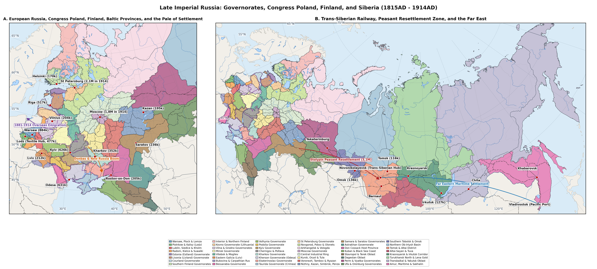

# Abstract

This gazetteer compiles population estimates for 8.881 cities,
industrial towns, railway junctions and ports across the 48 provinces of
Late Imperial Russia and Austro-Hungarian Ukraine at five benchmark
dates between the Congress of Vienna in 1815AD and the Russian
Revolution of 1917AD. Before the emancipation of the serfs in the 1860s,
urban growth remained modest outside Saint Petersburg, Moscow, Warsaw,
Odessa and Riga. Over the next half-century, railway building, coal and
steel works in the Donbas and Congress Poland, the Grozny and Boryslav
oil booms and peasant migration along the Trans-Siberian line
transformed the urban map. By 1914AD, Saint Petersburg (2,12M) and
Moscow (1,76M) led an urban network that included Warsaw (884,5k),
Odessa (630k), Kyiv (626,3k), Riga (517,5k) and the textile and mining
boomtowns of Lodz (477,9k), Sosnowiec (118,5k) and Yuzovka (54k), before
the First World War emptied frontline cities in Poland, Courland and
Lithuania and swelled interior towns with more than 6M refugees
[\[1\]](#ref-Troinitsky1905Goroda)[\[2\]](#ref-TsSK1915)[\[3\]](#ref-Rashin1956)[\[4\]](#ref-Gatrell1999).

# Methodology

This gazetteer traces the population histories of 8.881 towns,
industrial centres, ports and fortresses across the 48 provinces of Late
Imperial Russia and Austro-Hungarian Ukraine (excluding Central Asia and
the Southern Caucasus) from the Congress of Vienna in 1815AD to the
revolutions of 1917AD. Each town is listed under its historical name
alongside its local and modern equivalents, geographic coordinates and
population estimates for 1815AD, 1858AD, 1897AD, 1914AD and 1917AD.

The town figures draw on the main fiscal and statistical surveys of the
nineteenth and early twentieth centuries: the Seventh (1815-1816AD),
Eighth (1833-1835AD) and Tenth (1857-1858AD) Imperial Soul Revisions and
Ministry of Internal Affairs town tables
[\[3\]](#ref-Rashin1956)[\[5\]](#ref-Troinitsky1861)[\[6\]](#ref-Kabuzan1971),
the First All-Russian General Census of 28 January 1897AD across all 89
provincial volumes and its companion register of settlements over 500
inhabitants
[\[1\]](#ref-Troinitsky1905Goroda)[\[7\]](#ref-Troinitsky1905), the 1
January 1914AD yearbooks of the Central Statistical Committee and the
Warsaw Statistical Committee
[\[2\]](#ref-TsSK1915)[\[8\]](#ref-WarsawStat1914), the ten-year
censuses of the Finnish Statistical Office
[\[9\]](#ref-FinlandStat1870_1915), the Austrian and Hungarian censuses
of 1869-1910AD for Galicia, Bukovina and Subcarpathia
[\[10\]](#ref-OsterreichischeStatistik1912)[\[11\]](#ref-MagyarStatisztika1912)
and the 1916-1917AD All-Russian Urban and Agricultural Censuses paired
with Tatiana Committee wartime refugee records
[\[4\]](#ref-Gatrell1999)[\[12\]](#ref-AgCensus1917). Industrial,
coal-mining, railway and northern ports founded after 1815AD - such as
Bodaibo (1864AD), Yuzovka (1869AD), Novonikolaevsk (1893AD), Belotsarsk
(1914AD) and Romanov-on-Murman (1916AD) - are marked `-` at dates prior
to their establishment.

# Results

## Warsaw, Plock and Lomza Governorates

Table gives the populations of the 87 catalogued settlements in the
Warsaw, Plock and Lomza governorates, where the regional population grew
from 1,02M in 1815AD to 3,54M in 1897AD and 5,05M in 1914AD before
falling to 4,42M in 1917AD during the First World War
[\[1\]](#ref-Troinitsky1905Goroda)[\[4\]](#ref-Gatrell1999)[\[8\]](#ref-WarsawStat1914)[\[13\]](#ref-Corrsin1989).

| Settlement | Historical / Local Names | Coords & Country | 1815AD | 1858AD | 1897AD | 1914AD | 1917AD |
|:---|:---|:---|:---|:---|:---|:---|:---|
| Belsk | Бельск | 51,83, 20,81 (Poland) | \- | \- | 7,5k | 6,2k | 6k |
| Bielsk | \- | 52,67, 19,8 (Poland) | \- | \- | 4,2k | 4,6k | 4,7k |
| Blonie | Błonie | 52,2, 20,62 (Poland) | \- | \- | 4,7k | 5,1k | 5,2k |
| Brzests Kujawski | Brześć Kujawski | 52,61, 18,9 (Poland) | \- | \- | 3,1k | 4,1k | 4,3k |
| Chodecz | Chodecz | 52,41, 19,03 (Poland) | \- | \- | 1,1k | 1,5k | 1,6k |
| Choroszcz | Choroszcz | 53,14, 22,99 (Poland) | \- | \- | 1,6k | 2,1k | 2,2k |
| Chorzele | Chorzele | 53,26, 20,9 (Poland) | \- | \- | 2,3k | 2,5k | 2,5k |
| Ciechanow | Цеханов; Ciechanów | 52,88, 20,62 (Poland) | \- | \- | 10,7k | 11,6k | 11,7k |
| Ciechanowiec | Ciechanowiec; Цехановец | 52,68, 22,5 (Poland) | \- | \- | 5,6k | 3,8k | 3,6k |
| Czersk | Czersk | 51,96, 21,23 (Poland) | \- | \- | 6,1k | 6,7k | 6,8k |
| Dobrzyn nad Wisla | Добржин; Dobrzyń nad Wisłą | 52,64, 19,32 (Poland) | \- | \- | 2,5k | 2,6k | 2,7k |
| Gabin | Гомбин; Gąbin | 52,4, 19,74 (Poland) | \- | \- | 5,1k | 5,6k | 5,7k |
| Garwolin | Гарволин; Garwolin | 51,9, 21,61 (Poland) | \- | \- | 5,3k | 5,3k | 5,3k |
| Glowno | Głowno | 51,96, 19,72 (Poland) | \- | \- | 1,6k | 2,1k | 2,3k |
| Gora Kalwaria | Góra-Kalwarja; Góra Kalwaria | 51,98, 21,22 (Poland) | \- | \- | 4,8k | 5,3k | 5,4k |
| Gostynin | Гостынин; Gostynin | 52,43, 19,46 (Poland) | \- | \- | 6,7k | 6,9k | 7k |
| Grodzisk Mazowiecki | Grodisk; Grodzisk | 52,1, 20,63 (Poland) | \- | \- | 2,8k | 7,5k | 8,9k |
| Grojec | Grójec | 51,86, 20,87 (Poland) | \- | \- | 7,4k | 8,1k | 8,2k |
| Jedwabne | Jedwabne | 53,29, 22,3 (Poland) | \- | \- | 949 | 1,3k | 1,3k |
| Kaluszyn | Kałuszyn; Калушин | 52,21, 21,81 (Poland) | \- | \- | 8,7k | 8k | 7,9k |
| Karczew | Корчева; Karczew | 52,08, 21,25 (Poland) | \- | \- | 2,4k | 5,9k | 7k |
| Klodawa | Kłodawa | 52,25, 18,91 (Poland) | \- | \- | 2,9k | 3,8k | 4k |
| Knyszyn | Кнышин; Knyszyn | 53,31, 22,92 (Poland) | \- | \- | 3,9k | 3,7k | 3,6k |
| Kolno | Кольно; Kolno | 53,41, 21,93 (Poland) | \- | \- | 4,9k | 4,6k | 4,6k |
| Kolo | Koło; Warthbrücken | 52,2, 18,64 (Poland) | \- | \- | 9,4k | 11,8k | 12,3k |
| Kowal | Kowal; Коваль | 52,53, 19,15 (Poland) | \- | \- | 4k | 4k | 4,1k |
| Krosniewice | Krośniewice | 52,26, 19,17 (Poland) | \- | \- | 2,3k | 3,1k | 3,3k |
| Kutno | Кутно; Kutno | 52,23, 19,36 (Poland) | \- | \- | 11,2k | 15,9k | 16,9k |
| Lapy | Łapy | 52,99, 22,88 (Poland) | \- | \- | 2,7k | 3,6k | 3,8k |
| Leszno | Лешно; Leszno | 52,26, 20,59 (Poland) | \- | \- | 5,7k | 10,6k | 11,8k |
| Leśnica | Leśnica | 52,2, 18,68 (Poland) | \- | \- | 1,1k | 1,4k | 1,4k |
| Lipno | Липно; Lipno | 52,84, 19,18 (Poland) | \- | \- | 6,8k | 8,1k | 8,3k |
| Lomza | Lomzha; Lomza Governorate | 53,18, 22,06 (Poland) | 3,1k | 5,9k | 26,1k | 29,8k | 22,1k |
| Lowicz | Łowicz; Лович | 52,11, 19,95 (Poland) | \- | \- | 12,4k | 15,1k | 15,7k |
| Lubien Kujawski | Lubień; Lubień Kujawski | 52,41, 19,16 (Poland) | \- | \- | 1,4k | 1,9k | 2k |
| Lubraniec | Lubraniec; Любранец | 52,54, 18,83 (Poland) | \- | \- | 3,4k | 2,5k | 2,4k |
| Makow Mazowiecki | Maków Mazowiecki | 52,86, 21,1 (Poland) | \- | \- | 5,4k | 6k | 6,1k |
| Mielno | Mielno | 52,42, 19 (Poland) | \- | \- | 955 | 1,2k | 1,3k |
| Minsk Mazowiecki | Ново-Минск; Mińsk Mazowiecki | 52,18, 21,57 (Poland) | \- | \- | 9,3k | 10,5k | 10,7k |
| Międzylesie | Międzylesie | 52,08, 18,49 (Poland) | \- | \- | 979 | 1,2k | 1,3k |
| Mlawa | Mława; Млава | 53,11, 20,38 (Poland) | \- | \- | 13,4k | 15,9k | 16,4k |
| Mszczonow | Mszczonów; Мщонов | 51,97, 20,52 (Poland) | \- | \- | 5,1k | 5k | 5k |
| Nasielsk | Насельск; Nasielsk | 52,59, 20,81 (Poland) | \- | \- | 4,7k | 5,2k | 5,3k |
| Nowogrod | Nowogród | 53,23, 21,88 (Poland) | \- | \- | 1,2k | 1,6k | 1,7k |
| Nowy Dwor Mazowiecki | Nowy Dwór; Nowy Dwór Mazowiecki | 52,43, 20,72 (Poland) | \- | \- | 1,5k | 4,8k | 5,9k |
| Ostroleka | Ostrolenka; Ostroleka Lomza | 53,09, 21,58 (Poland) | 2,2k | 3,9k | 12,9k | 15,2k | 9,8k |
| Ostrow Mazowiecka | Ostrów Mazowiecka; Ostrov | 52,8, 21,9 (Poland) | \- | \- | 12,7k | 13,9k | 14,2k |
| Otwock | Otvotsk; Otwozk | 52,11, 21,26 (Poland) | \- | \- | 7,5k | 8,2k | 8,4k |
| Piaseczno | Pjasecno; Pyasechno | 52,08, 21,02 (Poland) | \- | \- | 2,8k | 4,6k | 5k |
| Piastów | Piastów | 52,18, 20,84 (Poland) | \- | \- | 1k | 1,1k | 1,2k |
| Plock | Plotsk; Plock Governorate | 52,55, 19,71 (Poland) | 6,2k | 13,2k | 27k | 35,2k | 28,5k |
| Plonsk | Płońsk; Плонск | 52,62, 20,38 (Poland) | \- | \- | 7,9k | 8,9k | 9,1k |
| Pruszkow | Pruszków; Prushkov | 52,17, 20,81 (Poland) | \- | \- | 1,7k | 8k | 10,5k |
| Przasnysz | Przasnysz | 53,02, 20,88 (Poland) | \- | \- | 5,6k | 6,1k | 6,2k |
| Przedecz | Przedecz | 52,33, 18,9 (Poland) | \- | \- | 2k | 2,7k | 2,8k |
| Pultusk | Pułtusk; Пултуск | 52,7, 21,08 (Poland) | \- | \- | 16k | 14,4k | 14,1k |
| Raciaz | Raciąż | 52,78, 20,12 (Poland) | \- | \- | 4k | 4,3k | 4,4k |
| Radzymin | Radzymin | 52,42, 21,18 (Poland) | \- | \- | 4,4k | 4,8k | 4,9k |
| Rajgrod | Rajgród | 53,73, 22,71 (Poland) | \- | \- | 1,5k | 2k | 2,1k |
| Rozan | Różan | 52,89, 21,39 (Poland) | \- | \- | 2,9k | 3,2k | 3,2k |
| Serock | Serock; Сероцк | 52,51, 21,07 (Poland) | \- | \- | 3,7k | 4,4k | 4,5k |
| Sierpc | Sierpc | 52,86, 19,67 (Poland) | \- | \- | 7,4k | 8,1k | 8,3k |
| Skierniewice | Скерневицы; Skernevitsy | 51,95, 20,16 (Poland) | \- | \- | 10,7k | 14,7k | 15,5k |
| Slupca | Słupca | 52,59, 20,06 (Poland) | \- | \- | 4,8k | 5,3k | 5,4k |
| Sochaczew | Сохачев; Sochacev | 52,23, 20,24 (Poland) | \- | \- | 6k | 5,6k | 5,5k |
| Sokoly | Sokoły | 52,99, 22,7 (Poland) | \- | \- | 2,1k | 2,2k | 2,2k |
| Stawiski | Stawiski; Стависки | 53,38, 22,15 (Poland) | \- | \- | 3,3k | 3,1k | 3,1k |
| Stawiszyn | Stawiszyn | 51,92, 18,11 (Poland) | \- | \- | 1,7k | 2,3k | 2,4k |
| Strykow | Stryków | 51,9, 19,61 (Poland) | \- | \- | 2,7k | 3,7k | 3,9k |
| Szczuczyn | Szczuczyn | 53,56, 22,29 (Poland) | \- | \- | 3k | 4k | 4,2k |
| Tuliszkow | Tuliszków | 52,08, 18,3 (Poland) | \- | \- | 1,6k | 2,1k | 2,2k |
| Turek | Turek | 52,02, 18,5 (Poland) | \- | \- | 8,1k | 9,4k | 9,6k |
| Tykocin | Тыкоцин; Tykocin | 53,21, 22,77 (Poland) | \- | \- | 4,2k | 3,3k | 3,2k |
| Warsaw | Warszawa; Varshava | 52,23, 21,01 (Poland) | 81k | 162,8k | 683,7k | 884,5k | 758k |
| Wiskitki | Вискитки; Wiskitki | 52,09, 20,39 (Poland) | \- | \- | 3,1k | 2,9k | 2,8k |
| Wladyslawow | Władysławów; Владиславов | 52,1, 18,48 (Poland) | \- | \- | 4,6k | 3,8k | 3,6k |
| Wloclawek | Vlotslavsk; Leslau | 52,65, 19,07 (Poland) | 3,3k | 6,8k | 22,9k | 37,4k | 32,5k |
| Wolomin | Wołomin; Volomin | 52,34, 21,24 (Poland) | \- | \- | 5,6k | 6,2k | 6,3k |
| Wysokie Mazowieckie | Wysokie Mazowieckie | 52,92, 22,52 (Poland) | \- | \- | 2,3k | 3,1k | 3,3k |
| Wyszkow | Wyszków; Vyskov | 52,59, 21,46 (Poland) | \- | \- | 574 | 4,1k | 5,7k |
| Wyszogrod | Wyszogród | 52,39, 20,19 (Poland) | \- | \- | 3,8k | 4,1k | 4,2k |
| Zakroczym | Закрочим; Zakroczym | 52,43, 20,61 (Poland) | \- | \- | 4,5k | 5,5k | 5,6k |
| Zambrow | Zambrów; Zambrov | 52,99, 22,24 (Poland) | \- | \- | 10,9k | 7,3k | 6,8k |
| Zelechow | Желехов; Żelechów | 51,81, 21,9 (Poland) | \- | \- | 7,1k | 7,5k | 7,6k |
| Zuromin | Żuromin | 53,07, 19,91 (Poland) | \- | \- | 3,5k | 3,8k | 3,9k |
| Zychlin | Żychlin | 52,24, 19,63 (Poland) | \- | \- | 4,7k | 6,3k | 6,6k |
| Zyrardow | Zhirardov; Ruda Guzowska | 52,05, 20,45 (Poland) | \- | 3,8k | 24,5k | 38,6k | 26,4k |

Populations of Warsaw, the linen-mill town of Zyrardow, the Vistula
river ports of Wloclawek and Plock and the northern Mazovian district
seats, 1815AD - 1917AD.

## Piotrkow and Kalisz Governorates

Table gives the populations of the 39 catalogued settlements in the
Piotrkow and Kalisz governorates, where the regional population rose
from 720k in 1815AD to 2,25M in 1897AD and 3,32M in 1914AD before
dropping to 2,95M in 1917AD
[\[1\]](#ref-Troinitsky1905Goroda)[\[4\]](#ref-Gatrell1999)[\[8\]](#ref-WarsawStat1914)[\[13\]](#ref-Corrsin1989).

| Settlement | Historical / Local Names | Coords & Country | 1815AD | 1858AD | 1897AD | 1914AD | 1917AD |
|:---|:---|:---|:---|:---|:---|:---|:---|
| Aleksandrow Lodzki | Aleksandrów; Aleksandrów Łódzki | 51,82, 19,3 (Poland) | \- | \- | 5,4k | 7,3k | 7,7k |
| Belchatow | Bełchatów; Belchatów | 51,37, 19,36 (Poland) | \- | \- | 4,8k | 6,4k | 6,7k |
| Biala Rawska | Biała Rawska | 51,81, 20,47 (Poland) | \- | \- | 1,8k | 2,4k | 2,5k |
| Blaszki | Błaszki; Блашки | 51,65, 18,43 (Poland) | \- | \- | 4k | 4,5k | 4,6k |
| Brzeziny | Brzeziny | 51,8, 19,75 (Poland) | \- | \- | 7,1k | 9,4k | 9,9k |
| Czestochowa | Chenstokhov; Czestochowa Piotrkow | 50,81, 19,12 (Poland) | 4,5k | 9,2k | 45k | 92,9k | 78,5k |
| Dabie | Домбе; Dąbie | 52,09, 18,82 (Poland) | \- | \- | 3,1k | 3,6k | 3,7k |
| Dobra | Dobra | 51,92, 18,62 (Poland) | \- | \- | 2,7k | 3k | 3k |
| Glebokie | Głębokie | 52,19, 18,88 (Poland) | \- | \- | 3k | 4k | 4,2k |
| Kalisz | Kalish; Kalisz Governorate | 51,77, 18,09 (Poland) | 7,8k | 12,6k | 24,4k | 65,4k | 29k |
| Klobuck | Kłobuck | 50,9, 18,94 (Poland) | \- | \- | 4,4k | 5,8k | 6,1k |
| Koniecpol | Koniecpol | 50,77, 19,69 (Poland) | \- | \- | 1,6k | 2,1k | 2,3k |
| Konin | Конин; Konin | 51,7, 19,29 (Poland) | \- | \- | 8,5k | 9,6k | 9,8k |
| Konstantynow Lodzki | Konstantynów; Konstantynów Łódzki | 51,75, 19,33 (Poland) | \- | \- | 3,8k | 5,1k | 5,4k |
| Lask | Łask; Ласк | 51,59, 19,13 (Poland) | \- | \- | 4,2k | 4,7k | 4,8k |
| Leczyca | Łęczyca | 52,06, 19,2 (Poland) | \- | \- | 6,8k | 9,1k | 9,6k |
| Lodz | Lodz Piotrkow; Polish Manchester | 51,76, 19,46 (Poland) | 800 | 29,5k | 314k | 477,9k | 342k |
| Lutomiersk | Лютомерск; Lutomiersk | 51,75, 19,21 (Poland) | \- | \- | 2,9k | 4,4k | 4,8k |
| Mogielnica | Mogielnica; Могельница | 51,69, 20,72 (Poland) | \- | \- | 3,5k | 5,2k | 5,5k |
| Olkusz | Олькуш; Olkucz | 50,28, 19,57 (Poland) | \- | \- | 3,4k | 6k | 6,7k |
| Ozorkow | Ozorków; Ozjurkov | 51,96, 19,29 (Poland) | \- | \- | 11,5k | 12,3k | 12,4k |
| Pabianice | Pabianitsy; Pabianice Lodz | 51,66, 19,35 (Poland) | 900 | 4,9k | 26,8k | 48,3k | 36,8k |
| Piotrkow | Piotrkow Trybunalski; Petrokov | 51,41, 19,7 (Poland) | 4,2k | 10,9k | 31,2k | 44,8k | 39,2k |
| Przedborz | Przedbórz; Пржедборж | 51,09, 19,87 (Poland) | \- | \- | 5,9k | 5,9k | 5,9k |
| Radomsko | Новорадомск; Novoradomsk | 51,07, 19,44 (Poland) | \- | \- | 12,4k | 17,7k | 18,9k |
| Rawa Mazowiecka | Rawa Mazowiecka | 51,76, 20,25 (Poland) | \- | \- | 5,4k | 7,3k | 7,6k |
| Ruda Pabianicka | Ruda Pabjanicka | 51,7, 19,46 (Poland) | \- | \- | 3,4k | 4,6k | 4,8k |
| Sieradz | Серадз; Seradz | 51,6, 18,73 (Poland) | \- | \- | 7k | 8,6k | 8,9k |
| Sulejow | Sulejów | 51,35, 19,89 (Poland) | \- | \- | 3,8k | 5,1k | 5,3k |
| Szadek | Szadek; Шадек | 51,69, 18,98 (Poland) | \- | \- | 2,5k | 2,9k | 3k |
| Szczekociny | Szczekociny; Щекоцины | 50,63, 19,82 (Poland) | \- | \- | 3,4k | 4,8k | 5,2k |
| Tomaszow Mazowiecki | Tomaszów Mazowiecki | 51,53, 20,01 (Poland) | \- | \- | 18,8k | 25,1k | 26,4k |
| Tuszyn | Tuszyn; Тушин | 51,61, 19,53 (Poland) | \- | \- | 5k | 3,8k | 3,7k |
| Uniejow | Uniejów | 51,97, 18,79 (Poland) | \- | \- | 2,4k | 3,2k | 3,4k |
| Warta | Варта; Warta | 51,71, 18,62 (Poland) | \- | \- | 3,4k | 3,9k | 4k |
| Wloszczowa | Włoszczowa | 50,85, 19,97 (Poland) | \- | \- | 4k | 5,3k | 5,6k |
| Zawiercie | Zavertse; Zawertse | 50,49, 19,42 (Poland) | \- | \- | 16,9k | 25,4k | 27,3k |
| Zdunska Wola | Zduńska Wola; Здунская Воля | 51,6, 18,94 (Poland) | \- | \- | 15,9k | 18k | 18,4k |
| Zgierz | Згерж; Sgiersck | 51,86, 19,41 (Poland) | \- | \- | 19,1k | 20,5k | 20,8k |

Populations of the cotton-mill metropolis of Lodz and Pabianice, the
Dabrowa coal-and-steel towns of Sosnowiec, Czestochowa and Bendzin and
the border seat of Kalisz, 1815AD - 1917AD.

## Lublin and Siedlce Governorates

Table gives the populations of the 38 catalogued settlements in the
Lublin and Siedlce governorates (including the 1912AD Kholm
Governorate), where the regional population grew from 780k in 1815AD to
1,93M in 1897AD and 2,68M in 1914AD before the 1915AD evacuation reduced
it to 2,08M in 1917AD
[\[1\]](#ref-Troinitsky1905Goroda)[\[4\]](#ref-Gatrell1999)[\[8\]](#ref-WarsawStat1914)[\[13\]](#ref-Corrsin1989).

| Settlement | Historical / Local Names | Coords & Country | 1815AD | 1858AD | 1897AD | 1914AD | 1917AD |
|:---|:---|:---|:---|:---|:---|:---|:---|
| Biala Podlaska | Bela; Biala Siedlce | 52,03, 23,12 (Poland) | 2,9k | 5,1k | 13,1k | 16,8k | 11,2k |
| Bielsko | \- | 51,19, 21,96 (Poland) | \- | \- | 13,1k | 17,6k | 18,5k |
| Bilgoraj | Biłgoraj; Belgorai | 50,54, 22,72 (Poland) | \- | \- | 5,8k | 6,4k | 6,5k |
| Brok | Brok | 52,7, 21,86 (Poland) | \- | \- | 2,7k | 2,7k | 2,7k |
| Cieszyn | Cieszyn | 50,82, 23,46 (Poland) | \- | \- | 12,3k | 16,4k | 17,3k |
| Drohiczyn | Drohiczyn | 52,4, 22,66 (Poland) | \- | \- | 1,3k | 1,8k | 1,8k |
| Dubienka | \- | 51,05, 23,89 (Poland) | \- | \- | 2k | 2,6k | 2,8k |
| Hrubieszow | Hrubieszów; Грубешов | 50,81, 23,89 (Poland) | \- | \- | 10,6k | 10,6k | 10,6k |
| Janow Podlaski | Janów Podlaski | 52,19, 23,21 (Poland) | \- | \- | 2,2k | 3k | 3,1k |
| Kholm | Chelm; Kholm 1912 Governorate | 51,14, 23,47 (Poland) | 2,6k | 4,1k | 18,5k | 24,6k | 16,2k |
| Kock | Kock; Коцк | 51,64, 22,44 (Poland) | \- | \- | 4,7k | 4,1k | 4k |
| Kolonia Torun | Toruń; Kolonia Toruń | 51,1, 23,08 (Poland) | \- | \- | 26,2k | 35k | 36,8k |
| Kosow Lacki | Kosów; Kosów Lacki | 52,6, 22,15 (Poland) | \- | \- | 2,1k | 2,3k | 2,4k |
| Krasnik | Kraśnik; Красник | 50,92, 22,23 (Poland) | \- | \- | 8,3k | 8,7k | 8,8k |
| Krasnystaw | Красностав; Shchekariv | 50,98, 23,17 (Poland) | \- | \- | 9,8k | 9,2k | 9,1k |
| Leczna | Łęczna | 51,3, 22,88 (Poland) | \- | \- | 2,4k | 3,2k | 3,4k |
| Losice | Łosice | 52,21, 22,72 (Poland) | \- | \- | 3,4k | 3,7k | 3,8k |
| Lubartow | Lubartów; Любартов | 51,46, 22,61 (Poland) | \- | \- | 5,2k | 6,1k | 6,3k |
| Lublin | Lyublin; Lublin Governorate | 51,25, 22,57 (Poland) | 10,2k | 18,5k | 50,4k | 72,2k | 64,5k |
| Lukow | Łuków; Luków | 51,93, 22,38 (Poland) | \- | \- | 9,4k | 11,5k | 12k |
| Miedzyrzec Podlaski | Międzyrzec; Międzyrzec Podlaski | 51,99, 22,78 (Poland) | \- | \- | 9,4k | 12,6k | 13,3k |
| Mielnik | Мельник | 52,33, 23,04 (Poland) | \- | \- | 1,5k | 1,2k | 1,1k |
| Mordy | Mordy | 52,21, 22,52 (Poland) | \- | \- | 2,5k | 3k | 3,1k |
| Ostrow Lubelski | Ostrów; Ostrów Lubelski | 51,49, 22,85 (Poland) | \- | \- | 2,5k | 3,4k | 3,6k |
| Parczew | Парчев; Parczew | 51,64, 22,9 (Poland) | \- | \- | 6,7k | 7,8k | 8k |
| Poznan | Poznań | 51,68, 22,3 (Poland) | \- | \- | 123,2k | 164,6k | 173,2k |
| Radziejow | Radziejów | 51,04, 23,78 (Poland) | \- | \- | 2,1k | 2,8k | 3k |
| Radzyn Podlaski | Radzyń; Radzyń Podlaski | 51,78, 22,62 (Poland) | \- | \- | 3,2k | 4,3k | 4,5k |
| Rogoźno | Rogoźno | 50,46, 23,39 (Poland) | \- | \- | 2,7k | 3,6k | 3,8k |
| Siedlce | Sedlets; Siedlce Governorate | 52,17, 22,29 (Poland) | 3,1k | 7,8k | 26,2k | 34k | 24,8k |
| Siemiatycze | Siemiatycze; Семятичи | 52,43, 22,86 (Poland) | \- | \- | 6,2k | 5,8k | 5,8k |
| Sokolow Podlaski | Sokołów; Sokołów Podlaski | 52,41, 22,25 (Poland) | \- | \- | 7,1k | 7,7k | 7,9k |
| Stoczek Lukowski | Stoczek; Stoczek Łukowski | 51,96, 21,97 (Poland) | \- | \- | 2k | 2,6k | 2,8k |
| Szczebrzeszyn | Щебрешин; Szczebrzeszyn | 50,69, 22,98 (Poland) | \- | \- | 6,1k | 6,3k | 6,3k |
| Tomaszow Lubelski | Томашев; Tomaszów Lubelski | 50,45, 23,42 (Poland) | \- | \- | 6,2k | 7,2k | 7,4k |
| Wegrow | Венгров; Węgrów | 52,4, 22,02 (Poland) | \- | \- | 8,3k | 8,4k | 8,5k |
| Wlodawa | Włodawa; Влодава | 51,55, 23,55 (Poland) | \- | \- | 6,7k | 6,4k | 6,3k |
| Zamosc | Zamostye; Zamosc Fortress | 50,72, 23,25 (Poland) | 4,2k | 5,7k | 14,7k | 18,9k | 14,8k |

Populations of Lublin, the railway junction of Siedlce, the fortress
town of Zamosc, Biala Podlaska and Kholm (detached as a separate
governorate in 1912AD), 1815AD - 1917AD.

## Radom, Kielce and Suwalki Governorates

Table gives the populations of the 59 catalogued settlements in the
Radom, Kielce and Suwalki governorates, where the regional population
grew from 780k in 1815AD to 2,16M in 1897AD and 2,6M in 1914AD before
falling to 2,18M in 1917AD
[\[1\]](#ref-Troinitsky1905Goroda)[\[4\]](#ref-Gatrell1999)[\[8\]](#ref-WarsawStat1914)[\[13\]](#ref-Corrsin1989).

| Settlement | Historical / Local Names | Coords & Country | 1815AD | 1858AD | 1897AD | 1914AD | 1917AD |
|:---|:---|:---|:---|:---|:---|:---|:---|
| Augustow | Августов; Augustów | 53,84, 22,98 (Poland) | \- | \- | 12,7k | 9,8k | 9,3k |
| Busko-Zdroj | Busko; Busko-Zdrój | 50,47, 20,72 (Poland) | \- | \- | 2,6k | 3,5k | 3,7k |
| Checiny | Хенцины; Chęciny | 50,8, 20,46 (Poland) | \- | \- | 6,2k | 5,4k | 5,2k |
| Chernyshevskoye | Чернышевское; Černyševskoje | 54,64, 22,73 (Russia) | \- | \- | 5,5k | 5,3k | 5,2k |
| Chmielnik | Хмельник; Chmielnik | 50,61, 20,75 (Poland) | \- | \- | 6,9k | 7,5k | 7,6k |
| Dobrovol’sk | Добровольск; Pillkallen | 54,77, 22,51 (Russia) | \- | \- | 4,3k | 4,9k | 5k |
| Dzialoszyce | Дзялошицы; Działoszyce | 50,37, 20,35 (Poland) | \- | \- | 4,6k | 6k | 6,3k |
| Ezherelis | Ežerėlis | 54,88, 23,6 (Lithuania) | \- | \- | 872 | 1k | 1,1k |
| Gelgaudishkis | Gelgaudiškis | 55,08, 22,98 (Lithuania) | \- | \- | 483 | 571 | 588 |
| Ilza | Iłża | 51,16, 21,24 (Poland) | \- | \- | 4k | 4,4k | 4,5k |
| Jedrzejow | Jędrzejów | 50,64, 20,3 (Poland) | \- | \- | 7,8k | 10,4k | 11k |
| Jurbarkas | Jurburg; Georgenburg | 55,08, 22,76 (Lithuania) | \- | \- | 7,4k | 5,3k | 5k |
| Kalvarija | Kalwaria; Kalwarya | 54,42, 23,22 (Lithuania) | \- | \- | 9,4k | 5,8k | 5,4k |
| Kazimierz Dolny | Kazimierz Dolny | 51,32, 21,96 (Poland) | \- | \- | 2,6k | 3,4k | 3,6k |
| Kazlu Ruda | Kazlų Rūda | 54,75, 23,49 (Lithuania) | \- | \- | 1,4k | 1,6k | 1,7k |
| Kielce | Keltse; Keltsy | 50,87, 20,63 (Poland) | 3,1k | 5,2k | 23,2k | 37,6k | 33,2k |
| Konskie | Конск; Końskie | 51,19, 20,41 (Poland) | \- | \- | 8,1k | 8,8k | 8,9k |
| Kozienice | Козеницы; Kozenitsy | 51,59, 21,55 (Poland) | \- | \- | 6,9k | 6,9k | 6,9k |
| Krasnoznamensk | Краснознаменск; Lasdehnen | 54,94, 22,49 (Russia) | \- | \- | 1,4k | 1,6k | 1,7k |
| Kudirkos Naumiestis | Vladislavovas; Kudirkos Naumiestis | 54,77, 22,86 (Lithuania) | \- | \- | 4,6k | 2k | 2,3k |
| Kulautuva | Kulautuva | 54,94, 23,64 (Lithuania) | \- | \- | 405 | 479 | 493 |
| Kutuzovo | Кутузово; Schirwindt | 54,78, 22,84 (Russia) | \- | \- | 1,2k | 1,1k | 1,1k |
| Kybartai | Kibarty; Kybartai | 54,64, 22,76 (Lithuania) | \- | \- | 3,4k | 5,1k | 5,5k |
| Lazdijai | Lodsjeje; Lozdzieje | 54,23, 23,51 (Lithuania) | \- | \- | 2,5k | 2,4k | 2,4k |
| Mariampol | Marijampole; Mariampol Suwalki | 54,56, 23,35 (Lithuania) | 1,4k | 3,6k | 6,7k | 8,6k | 5,9k |
| Miechow | Мехов; Miechów | 50,36, 20,03 (Poland) | \- | \- | 4,2k | 5,5k | 5,8k |
| Nesterov | Нестеров; Stallup | 54,63, 22,57 (Russia) | \- | \- | 5,6k | 5,8k | 5,8k |
| Nowe Miasto nad Pilica | Nowe Miasto; Nowe Miasto nad Pilicą | 51,62, 20,58 (Poland) | \- | \- | 3,3k | 3,6k | 3,7k |
| Opatow | Opatów; Опатов | 50,8, 21,43 (Poland) | \- | \- | 6,6k | 8,1k | 8,4k |
| Opoczno | Опочно; Opocno | 51,38, 20,28 (Poland) | \- | \- | 6,1k | 7,5k | 7,8k |
| Opole Lubelskie | Ополе; Opole Lubelskie | 51,15, 21,97 (Poland) | \- | \- | 5,5k | 3,7k | 3,5k |
| Ostrowiec | Ostrowiec Swietokrzyski; Ostrovets | 50,93, 21,39 (Poland) | 1,6k | 3,9k | 9,8k | 18,4k | 15,2k |
| Pinczow | Pińczów; Пинчов | 50,52, 20,53 (Poland) | \- | \- | 9,1k | 8,1k | 8k |
| Podgorovka | Подгоровка | 54,6, 22,32 (Russia) | \- | \- | 3,3k | 3,7k | 3,8k |
| Proszowice | Proszowice; Прошовице | 50,19, 20,29 (Poland) | \- | \- | 2,6k | 3,1k | 3,2k |
| Pulawy | Puławy; Novaja Aleksandrija | 51,42, 21,97 (Poland) | \- | \- | 4,8k | 6,4k | 6,7k |
| Radom | Radom Governorate; Radom Sandomierz | 51,4, 21,15 (Poland) | 3,2k | 9,8k | 29,9k | 49,2k | 41,5k |
| Rakow | Raków | 50,67, 21,05 (Poland) | \- | \- | 2,2k | 3k | 3,1k |
| Sandomierz | Сандомир; Sandomir | 50,68, 21,75 (Poland) | \- | \- | 6,6k | 6,7k | 6,7k |
| Sejny | Сейны; Sejny | 54,11, 23,35 (Poland) | \- | \- | 3,8k | 2,6k | 2,5k |
| Shakiai | Šakiai; Шаки | 54,95, 23,05 (Lithuania) | \- | \- | 2,2k | 2,1k | 2,1k |
| Simnas | Simnas | 54,38, 23,65 (Lithuania) | \- | \- | 1,4k | 1,5k | 1,5k |
| Skalbmierz | Skalbmierz | 50,32, 20,4 (Poland) | \- | \- | 1,5k | 2k | 2,1k |
| Skaryszew | Skaryszew | 51,31, 21,25 (Poland) | \- | \- | 1,8k | 2k | 2k |
| Skarzysko-Kamienna | Skarżysko-Kamienna; Skargisko-Kamienne | 51,11, 20,87 (Poland) | \- | \- | 5,4k | 7,2k | 7,6k |
| Slomniki | Słomniki | 50,24, 20,08 (Poland) | \- | \- | 3,7k | 4,4k | 4,6k |
| Smalininkai | Smalininkai | 55,08, 22,58 (Lithuania) | \- | \- | 494 | 474 | 471 |
| Starachowice | Starachowice | 51,04, 21,07 (Poland) | \- | \- | 19,3k | 24,6k | 25,6k |
| Staszow | Сташев; Staszów | 50,56, 21,17 (Poland) | \- | \- | 8,7k | 8,5k | 8,4k |
| Suwalki | Suvalki; Suwalki Governorate | 54,11, 22,93 (Poland) | 2,1k | 11,4k | 22,6k | 27,1k | 16,8k |
| Szydlowiec | Szydłowiec; Шидловец | 51,23, 20,86 (Poland) | \- | \- | 7,4k | 8k | 8,1k |
| Vilkaviskis | Vilkaviškis; Vilkavishkis | 54,65, 23,03 (Lithuania) | \- | \- | 5,8k | 6,7k | 6,9k |
| Virbalis | Вержболов; Virbalis | 54,63, 22,82 (Lithuania) | \- | \- | 3,3k | 3,8k | 3,8k |
| Warka | Варка; Warka | 51,78, 21,19 (Poland) | \- | \- | 4,3k | 4,5k | 4,6k |
| Wierzbnik | \- | 51,05, 21,09 (Poland) | \- | \- | 3,6k | 4,8k | 5,1k |
| Wolbrom | Wolbrom; Вольбром | 50,38, 19,76 (Poland) | \- | \- | 4,8k | 6,5k | 6,9k |
| Wysmierzyce | Wyśmierzyce | 51,62, 20,81 (Poland) | \- | \- | 1,2k | 1,4k | 1,4k |
| Zawichost | Zawichost; Завихост | 50,81, 21,85 (Poland) | \- | \- | 2,5k | 2,9k | 2,9k |
| Zwolen | Zwoleń | 51,36, 21,59 (Poland) | \- | \- | 6,8k | 7,5k | 7,6k |

Populations of Radom, Kielce, the Kamienna valley ironworks town of
Ostrowiec and the northern Lithuanian-Polish border towns of Suwalki and
Mariampol, 1815AD - 1917AD.

## Estland Governorate

Table gives the populations of the 33 catalogued settlements in Estland
Governorate, where the regional population grew from 232k in 1815AD to
413k in 1897AD, 505k in 1914AD and 515k in 1917AD
[\[1\]](#ref-Troinitsky1905Goroda)[\[2\]](#ref-TsSK1915)[\[4\]](#ref-Gatrell1999)[\[14\]](#ref-Gortfelder2023BalticFertility).

| Settlement | Historical / Local Names | Coords & Country | 1815AD | 1858AD | 1897AD | 1914AD | 1917AD |
|:---|:---|:---|:---|:---|:---|:---|:---|
| Aegviidu | Aegviidu | 59,29, 25,61 (Estonia) | \- | \- | 425 | 515 | 532 |
| Ambla | Ambla | 59,19, 25,85 (Estonia) | \- | \- | 356 | 444 | 462 |
| Hapsal | Haapsalu; Gapsal | 58,94, 23,54 (Estonia) | 1,1k | 2,1k | 3,2k | 4,4k | 4,2k |
| Jarva-Jaani | Järva-Jaani | 59,04, 25,89 (Estonia) | \- | \- | 588 | 712 | 736 |
| Jarvakandi | Järvakandi | 58,78, 24,83 (Estonia) | \- | \- | 1,3k | 1,6k | 1,6k |
| Johvi | Jõhvi; Jewe | 59,36, 27,42 (Estonia) | \- | \- | 829 | 1,3k | 1,4k |
| Kardla | Kärdla; Kertel | 59, 22,75 (Estonia) | \- | \- | 1,7k | 1,6k | 1,6k |
| Kehra | Kedder; Kekhra | 59,34, 25,32 (Estonia) | \- | \- | 167 | 202 | 209 |
| Keila | Kegel; Keila | 59,3, 24,41 (Estonia) | \- | \- | 569 | 711 | 739 |
| Kivioli | Kiviõli | 59,35, 26,97 (Estonia) | \- | \- | 4,5k | 5,4k | 5,6k |
| Kohila | Haggers (); Kohila | 59,17, 24,76 (Estonia) | \- | \- | 199 | 249 | 259 |
| Kohtla-Jarve | Kohtla Oil-Shale Basin; Kohtla-Järve | 59,4, 27,27 (Estonia) | \- | \- | 2k | 2,4k | 2,5k |
| Kohtla-Nomme | Kohtla-Nõmme | 59,35, 27,18 (Estonia) | \- | \- | 425 | 515 | 532 |
| Kunda | Kunda | 59,48, 26,53 (Estonia) | \- | \- | 767 | 1,6k | 1,9k |
| Lihula | Leal; Lihula | 58,68, 23,85 (Estonia) | \- | \- | 537 | 536 | 535 |
| Loksa | Zitter (); Loksa | 59,58, 25,72 (Estonia) | \- | \- | 199 | 249 | 259 |
| Maardu | Maardu | 59,47, 24,98 (Estonia) | \- | \- | 1,8k | 2,2k | 2,3k |
| Marjamaa | Märjamaa; Merjama | 58,9, 24,43 (Estonia) | \- | \- | 138 | 172 | 179 |
| Narva-Joesuu | Narva-Jõesuu; Hungerburg | 59,46, 28,04 (Estonia) | \- | \- | 2,2k | 2,3k | 2,3k |
| Paldiski | Baltischport; Roggersvik | 59,36, 24,05 (Estonia) | \- | \- | 900 | 1k | 1k |
| Pussi | Püssi | 59,36, 27,05 (Estonia) | \- | \- | 3k | 3,7k | 3,9k |
| Rapla | Rappel; Rapla | 59,01, 24,79 (Estonia) | \- | \- | 218 | 272 | 283 |
| Reval | Tallinn; Revel | 59,44, 24,75 (Estonia) | 12,9k | 21,6k | 64,6k | 137,6k | 159k |
| Saue | Gross Sauss (); Saue | 59,32, 24,55 (Estonia) | \- | \- | 1,8k | 2,2k | 2,3k |
| Sillamae | Combine No. 7 Uranium Town; Sillamäe | 59,4, 27,76 (Estonia) | \- | \- | 650 | 787 | 814 |
| Sompa | Sompa | 59,36, 27,32 (Estonia) | \- | \- | 2,2k | 2,7k | 2,8k |
| Tamsalu | Tamsal; Tamsalu | 59,16, 26,12 (Estonia) | \- | \- | 354 | 429 | 444 |
| Tapa | Taps; Tapa | 59,26, 25,96 (Estonia) | \- | \- | 1,7k | 1,5k | 1,8k |
| Turi | Türi; Turgel | 58,81, 25,43 (Estonia) | \- | \- | 1,5k | 1,9k | 2k |
| Viivikonna | Viivikonna | 59,34, 27,69 (Estonia) | \- | \- | 764 | 925 | 956 |
| Vosu | Võsu | 59,57, 25,98 (Estonia) | \- | \- | 197 | 246 | 256 |
| Weissenstein | Paide; Veysenshteyn | 58,89, 25,54 (Estonia) | \- | \- | 2,5k | 3,1k | 3,2k |
| Wesenberg | Rakvere; Vezenberg | 59,35, 26,36 (Estonia) | 900 | 2,2k | 5,9k | 7,4k | 7,6k |

Populations of the Baltic port and naval shipyard city of Reval
(Tallinn), the Kreenholm cotton-mill town of Narva, Wesenberg and the
coastal resort of Hapsal, 1815AD - 1917AD.

## Livland Governorate

Table gives the populations of the 72 catalogued settlements in Livland
Governorate, where the regional population rose from 615k in 1815AD to
1,3M in 1897AD and 1,56M in 1914AD before wartime factory evacuations
from Riga reduced it to 1,42M in 1917AD
[\[1\]](#ref-Troinitsky1905Goroda)[\[2\]](#ref-TsSK1915)[\[4\]](#ref-Gatrell1999)[\[14\]](#ref-Gortfelder2023BalticFertility).

| Settlement | Historical / Local Names | Coords & Country | 1815AD | 1858AD | 1897AD | 1914AD | 1917AD |
|:---|:---|:---|:---|:---|:---|:---|:---|
| Abja-Paluoja | Abja-Paluoja | 58,13, 25,35 (Estonia) | \- | \- | 385 | 481 | 500 |
| Ainazhi | Ainaži | 57,86, 24,36 (Latvia) | \- | \- | 446 | 705 | 765 |
| Aizkraukle | Stučka; Ascheraden | 56,6, 25,26 (Latvia) | \- | \- | 2,9k | 2,9k | 2,9k |
| Aloja | Allendorf; Aloja | 57,77, 24,88 (Latvia) | \- | \- | 312 | 311 | 310 |
| Aluksne | Alūksne | 57,42, 27,05 (Latvia) | \- | \- | 2k | 2k | 2k |
| Antsla | Antsla | 57,83, 26,54 (Estonia) | \- | \- | 660 | 824 | 856 |
| Ape | Hoppenhof; Ape | 57,54, 26,69 (Latvia) | \- | \- | 747 | 744 | 744 |
| Arensburg | Kuressaare; Arensburg Oesel | 58,25, 22,49 (Estonia) | 1,8k | 3,2k | 4,6k | 5,4k | 4,1k |
| Balozhi | Baloži | 56,88, 24,12 (Latvia) | \- | \- | 965 | 962 | 962 |
| Balvi | Bolowsk; Bolwa | 57,13, 27,27 (Latvia) | \- | \- | 762 | 759 | 759 |
| Cesvaine | Sesswegen; Cesvaine | 56,97, 26,31 (Latvia) | \- | \- | 862 | 860 | 859 |
| Dorpat | Tartu; Yuryev | 58,38, 26,73 (Estonia) | 7,2k | 14,3k | 42,3k | 48,6k | 46,2k |
| Elva | Elwa; Elva | 58,22, 26,42 (Estonia) | \- | \- | 911 | 1,1k | 1,2k |
| Ergli | Ērgļi | 56,9, 25,64 (Latvia) | \- | \- | 1,3k | 1,3k | 1,3k |
| Gulbene | Vecgulbene; Alt-Schwaneburg | 57,18, 26,75 (Latvia) | \- | \- | 2,6k | 2,5k | 2,5k |
| Ikshkile | Ikšķile | 56,83, 24,5 (Latvia) | \- | \- | 971 | 968 | 968 |
| Jaunjelgava | Friedrichstadt; Yaunyelgava | 56,61, 25,08 (Latvia) | \- | \- | 5,2k | 2,2k | 1,9k |
| Jogeva | Jõgeva; Laisholm | 58,75, 26,39 (Estonia) | \- | \- | 657 | 820 | 853 |
| Jurmala | Jūrmala; merged with Rīga | 56,97, 23,77 (Latvia) | \- | \- | 4,2k | 4,4k | 4,4k |
| Kallaste | Kallaste | 58,66, 27,16 (Estonia) | \- | \- | 1,4k | 1,5k | 1,6k |
| Karksi-Nuia | Karksi-Nuia | 58,1, 25,56 (Estonia) | \- | \- | 391 | 488 | 508 |
| Kegums | Ķegums; Keggum | 56,75, 24,72 (Latvia) | \- | \- | 515 | 513 | 513 |
| Kemeri | Ķemeri | 57,41, 26,89 (Latvia) | \- | \- | 561 | 780 | 827 |
| Kilingi-Nomme | Kilingi-Nõmme; Quellenstein | 58,15, 24,96 (Estonia) | \- | \- | 789 | 985 | 1k |
| Koknese | Kukenois; Kokenhusen | 56,65, 25,44 (Latvia) | \- | \- | 631 | 629 | 629 |
| Kuprava | Kuprava | 57,24, 27,5 (Latvia) | \- | \- | 767 | 765 | 764 |
| Lavassaare | Lavassaare | 58,51, 24,39 (Estonia) | \- | \- | 276 | 334 | 346 |
| Lejasciems | Lejasciems | 57,28, 26,58 (Latvia) | \- | \- | 438 | 437 | 436 |
| Lielvarde | Lielvārde; Lennewaden | 56,72, 24,81 (Latvia) | \- | \- | 680 | 678 | 678 |
| Ligatne | Līgatne; Ligat | 57,23, 25,04 (Latvia) | \- | \- | 1,3k | 1,5k | 1,5k |
| Limbazhi | Limbaži; Limbazi | 57,51, 24,72 (Latvia) | \- | \- | 2,4k | 2,5k | 2,5k |
| Lubana | Lubāna; Luban | 56,9, 26,72 (Latvia) | \- | \- | 1,1k | 1k | 1k |
| Madona | Birži; Modohn | 56,85, 26,22 (Latvia) | \- | \- | 619 | 617 | 616 |
| Mazsalaca | Salisburg; Mazsalatsa | 57,86, 25,05 (Latvia) | \- | \- | 518 | 783 | 842 |
| Moisakula | Mõisaküla; Moiseküll | 58,09, 25,19 (Estonia) | \- | \- | 1,4k | 1,7k | 1,8k |
| Mustla | Mustla | 58,13, 25,1 (Estonia) | \- | \- | 489 | 610 | 634 |
| Mustvee | Tschorna; Tschernoje | 58,85, 26,94 (Estonia) | \- | \- | 2,9k | 2,8k | 2,8k |
| Ogre | Oger; Oger-Galle | 56,82, 24,61 (Latvia) | \- | \- | 616 | 614 | 613 |
| Otepaa | Otepää; Odenpä | 58,06, 26,5 (Estonia) | \- | \- | 1,5k | 1,7k | 1,7k |
| Parnu-Jaagupi | Pärnu-Jaagupi; Parnu-Jaagupi | 58,61, 24,51 (Estonia) | \- | \- | 196 | 237 | 245 |
| Pernau | Parnu; Pernov | 58,39, 24,5 (Estonia) | 3,4k | 6,6k | 12,9k | 19,2k | 16,5k |
| Plavinas | Pļaviņas; Stockmannshof | 56,62, 25,73 (Latvia) | \- | \- | 1,1k | 1,1k | 1,1k |
| Poltsamaa | Põltsamaa; Oberpahlen | 58,65, 25,97 (Estonia) | \- | \- | 573 | 1,4k | 1,6k |
| Polva | Põlva; Pölwe | 58,06, 27,07 (Estonia) | \- | \- | 194 | 242 | 252 |
| Rapina | Räpina; Rappin | 58,1, 27,46 (Estonia) | \- | \- | 152 | 189 | 197 |
| Riga | Riia; Livland Capital | 56,95, 24,11 (Latvia) | 36k | 72,1k | 282,2k | 517,5k | 210k |
| Rujiena | Rūjiena; Rújiena | 57,9, 25,33 (Latvia) | \- | \- | 2,9k | 3,3k | 3,4k |
| Salacgriva | Salacgrīva | 57,75, 24,36 (Latvia) | \- | \- | 583 | 759 | 795 |
| Salaspils | Salisstadt; Salaspils | 56,86, 24,37 (Latvia) | \- | \- | 1k | 1k | 1k |
| Saulkrasti | Neubad; Saulkrasti | 57,26, 24,41 (Latvia) | \- | \- | 1,3k | 1,3k | 1,3k |
| Seda | Seda | 57,65, 25,75 (Latvia) | \- | \- | 1,4k | 1,4k | 1,4k |
| Sigulda | Segewold; Sigulda | 57,15, 24,86 (Latvia) | \- | \- | 1,4k | 1,4k | 1,4k |
| Sindi | Zintenhof; Sindi | 58,4, 24,67 (Estonia) | \- | \- | 1,4k | 1,6k | 1,6k |
| Skriveri | Skrīveri | 56,65, 25,12 (Latvia) | \- | \- | 1,4k | 1,4k | 1,4k |
| Smiltene | Smilten; Smiltene | 57,42, 25,9 (Latvia) | \- | \- | 752 | 1,8k | 2k |
| Staicele | Staicele | 57,84, 24,75 (Latvia) | \- | \- | 813 | 811 | 810 |
| Strenchi | Strenči; Strenci | 57,63, 25,69 (Latvia) | \- | \- | 1,3k | 1,3k | 1,3k |
| Suure-Jaani | Suure-Jaani | 58,54, 25,47 (Estonia) | \- | \- | 697 | 870 | 905 |
| Tootsi | Tootsi | 58,58, 24,79 (Estonia) | \- | \- | 452 | 547 | 566 |
| Torva | Tõrva; Törwu | 58, 25,93 (Estonia) | \- | \- | 1k | 1,5k | 1,6k |
| Valga | \- | 57,78, 26,05 (Estonia) | \- | \- | 10,9k | 4,2k | 3,5k |
| Valka | \- | 57,78, 26,01 (Latvia) | \- | \- | 3k | 3k | 3k |
| Valmiera | Wolmar; Valmera | 57,54, 25,43 (Latvia) | \- | \- | 5k | 6,4k | 6,7k |
| Vandra | Vändra; (Alt)-Fennern | 58,65, 25,04 (Estonia) | \- | \- | 402 | 502 | 522 |
| Vangazhi | Vangaži | 57,09, 24,54 (Latvia) | \- | \- | 1,4k | 1,4k | 1,4k |
| Viljandi | Fellin; Vilynadi | 58,36, 25,59 (Estonia) | \- | \- | 7,7k | 8,8k | 9k |
| Vohma | Võhma | 58,63, 25,55 (Estonia) | \- | \- | 401 | 486 | 502 |
| Voopsu | Võõpsu | 58,08, 27,54 (Estonia) | \- | \- | 552 | 514 | 508 |
| Voru | Võru; Werro | 57,83, 27,02 (Estonia) | \- | \- | 4,2k | 4,8k | 4,9k |
| Walk | Valka; Valga | 57,78, 26,05 (Latvia) | 950 | 2,6k | 10,9k | 18,5k | 16,8k |
| Wenden | Cesis; Venden | 57,31, 25,27 (Latvia) | 1,3k | 2,8k | 6,4k | 8,9k | 7,8k |
| Zilaiskalns | Zilaiskalns | 57,56, 25,21 (Latvia) | \- | \- | 707 | 705 | 704 |

Populations of the port and industrial city of Riga, the university town
of Dorpat (Tartu), the timber port of Pernau, the railway junction of
Walk and Livland’s district towns, 1815AD - 1917AD.

## Courland Governorate

Table gives the populations of the 43 catalogued settlements in Courland
Governorate, where the regional population rose from 418k in 1815AD to
674k in 1897AD and 800k in 1914AD before the 1915AD German occupation
and refugee flight halved it to 380k in 1917AD
[\[1\]](#ref-Troinitsky1905Goroda)[\[2\]](#ref-TsSK1915)[\[4\]](#ref-Gatrell1999)[\[14\]](#ref-Gortfelder2023BalticFertility).

| Settlement | Historical / Local Names | Coords & Country | 1815AD | 1858AD | 1897AD | 1914AD | 1917AD |
|:---|:---|:---|:---|:---|:---|:---|:---|
| Aizpute | Hasenpot; Газенпот | 56,72, 21,6 (Latvia) | \- | \- | 3,3k | 2,8k | 2,8k |
| Akniste | Aknīste | 56,16, 25,75 (Latvia) | \- | \- | 439 | 290 | 269 |
| Alsunga | Alsunga | 56,98, 21,56 (Latvia) | \- | \- | 819 | 817 | 816 |
| Auce | Vecauce; Alt-Autz | 56,46, 22,9 (Latvia) | \- | \- | 1,6k | 1,5k | 1,5k |
| Baldone | Baldohn; Baldon | 56,74, 24,4 (Latvia) | \- | \- | 1,2k | 1,2k | 1,2k |
| Bauska | Bausk; Bauske | 56,41, 24,19 (Latvia) | \- | \- | 6,5k | 3,6k | 3,2k |
| Bene | Bēne | 56,48, 23,07 (Latvia) | \- | \- | 896 | 894 | 893 |
| Broceni | Brocēni; Brocéni | 56,68, 22,57 (Latvia) | \- | \- | 1,1k | 1,1k | 1,1k |
| Dobele | Dóbele; Doblen | 56,62, 23,28 (Latvia) | \- | \- | 1,7k | 1,1k | 1k |
| Dundaga | Dundaga | 57,5, 22,35 (Latvia) | \- | \- | 1,2k | 1,2k | 1,2k |
| Durbe | Durben; Durbe | 56,59, 21,37 (Latvia) | \- | \- | 500 | 465 | 459 |
| Dvinsk | Daugavpils; Dinaburg | 55,87, 26,54 (Latvia) | 4,2k | 25,7k | 69,7k | 112,8k | 68,5k |
| Eleja | Eleja | 56,42, 23,68 (Latvia) | \- | \- | 837 | 835 | 834 |
| Goldingen | Kuldiga; Goldingen Courland | 56,97, 21,97 (Latvia) | 2,2k | 4,9k | 9,7k | 12,1k | 6,8k |
| Grobina | Grobiņa; Grobin | 56,54, 21,17 (Latvia) | \- | \- | 1,5k | 1,4k | 1,4k |
| Iecava | Iecava | 56,6, 24,21 (Latvia) | \- | \- | 680 | 678 | 678 |
| Ilukste | Ilūkste; Illuxt | 55,98, 26,3 (Latvia) | \- | \- | 3,7k | 786 | 599 |
| Jakobstadt | Jekabpils; Yakobshtadt | 56,5, 25,88 (Latvia) | 1,9k | 4,1k | 5,8k | 7,4k | 3,2k |
| Kalnciems | Kalnzeem; Kalnciems | 56,8, 23,62 (Latvia) | \- | \- | 2,1k | 2,1k | 2,1k |
| Kandava | Kandau; Kandava | 57,04, 22,77 (Latvia) | \- | \- | 1,8k | 1,2k | 1,1k |
| Kraslava | Krāslava; Kreslavka | 55,9, 27,17 (Latvia) | \- | \- | 7,8k | 4,4k | 4k |
| Libau | Liepaja; Libava | 56,5, 21,01 (Latvia) | 5,6k | 10,4k | 64,5k | 90,7k | 43,2k |
| Livani | Līvāni; Lívání | 56,35, 26,18 (Latvia) | \- | \- | 2,7k | 2,9k | 3k |
| Mitau | Jelgava; Mitava | 56,65, 23,72 (Latvia) | 12,5k | 21,8k | 35,1k | 45,7k | 21,5k |
| Nereta | Nereta | 56,2, 25,31 (Latvia) | \- | \- | 826 | 824 | 823 |
| Olaine | Olai; Olaine | 56,8, 23,94 (Latvia) | \- | \- | 4,9k | 4,9k | 4,9k |
| Ozolnieki | Ozolnieki | 56,69, 23,78 (Latvia) | \- | \- | 1,5k | 1,5k | 1,5k |
| Pavilosta | Pāvilosta; Pauls Hafen | 56,89, 21,19 (Latvia) | \- | \- | 658 | 713 | 724 |
| Piltene | Pilten; Пильтен | 57,22, 21,67 (Latvia) | \- | \- | 1,5k | 1k | 974 |
| Priekule | Prekule; Prekuln | 56,45, 21,59 (Latvia) | \- | \- | 939 | 935 | 935 |
| Roja | Roja | 57,5, 22,81 (Latvia) | \- | \- | 1,4k | 1,4k | 1,4k |
| Sabile | Zabeln; Sabile | 57,05, 22,57 (Latvia) | \- | \- | 1,6k | 1,6k | 1,2k |
| Saldus | Frauenburg; Saldus | 56,66, 22,49 (Latvia) | \- | \- | 3,6k | 2,7k | 2,5k |
| Skrunda | Schrunden; Skrunda | 56,68, 22,02 (Latvia) | \- | \- | 2k | 2k | 2k |
| Sloka | Schlok; Sloka | 56,94, 23,62 (Latvia) | \- | \- | 2,1k | 2k | 2k |
| Stende | Stenden; Stende | 57,14, 22,53 (Latvia) | \- | \- | 689 | 687 | 687 |
| Subate | Subbat; Subate | 56,01, 25,91 (Latvia) | \- | \- | 2k | 1,6k | 1,5k |
| Talsi | Talsen; Talsi | 57,25, 22,58 (Latvia) | \- | \- | 4,2k | 3,3k | 3,1k |
| Tukums | Tuckum; Tukkum | 56,97, 23,16 (Latvia) | \- | \- | 7,6k | 5,1k | 4,8k |
| Vainode | Vaiņode | 56,42, 21,85 (Latvia) | \- | \- | 613 | 611 | 610 |
| Valdemarpils | Valdemārpils; Sasmaka | 57,37, 22,59 (Latvia) | \- | \- | 1,8k | 1,1k | 1k |
| Viesite | Viesīte; Viesíte | 56,35, 25,56 (Latvia) | \- | \- | 1,2k | 1,2k | 1,2k |
| Windau | Ventspils; Vindava | 57,39, 21,56 (Latvia) | 1,6k | 3,5k | 7,1k | 28,8k | 12,4k |

Populations of the ice-free emigrant and naval port of Libau (Liepaja),
the provincial capital of Mitau (Jelgava), the rail port of Windau
(Ventspils), Goldingen and Jakobstadt, 1815AD - 1917AD.

## Southern Finland: Nyland, Abo-Bjorneborg, Tavastehus and Vyborg

Table gives the populations of the 81 catalogued settlements in southern
Finland (Nyland, Abo-Bjorneborg, Tavastehus and Vyborg provinces), where
the regional population grew from 590k in 1815AD to 1,43M in 1897AD,
1,84M in 1914AD and 1,89M in 1917AD
[\[9\]](#ref-FinlandStat1870_1915)[\[15\]](#ref-Pitkanen1993)[\[16\]](#ref-Luostarinen2026FinlandMortality).

| Settlement | Historical / Local Names | Coords & Country | 1815AD | 1858AD | 1897AD | 1914AD | 1917AD |
|:---|:---|:---|:---|:---|:---|:---|:---|
| Abo | Turku; Abo-Bjorneborg | 60,45, 22,27 (Finland) | 11,8k | 16,8k | 36,8k | 54,6k | 56,2k |
| Beloostrov | Белоостров | 60,15, 30 (Russia) | \- | \- | 568 | 655 | 672 |
| Bjorneborg | Pori; Bjorneborg Port | 61,49, 21,8 (Finland) | 3,1k | 7,1k | 13,9k | 17,6k | 18,1k |
| Ekenas | Tammisaari; Ekenäs | 59,97, 23,43 (Finland) | \- | \- | 2,1k | 3,1k | 3,3k |
| Elisenvaara | Элисенваара; Êlisenvaara | 61,41, 29,76 (Russia) | \- | \- | 550 | 733 | 771 |
| Espoo | Esbo; Esbå | 60,21, 24,65 (Finland) | \- | \- | 5,7k | 8,1k | 8,4k |
| Garbolovo | Гарболово | 60,34, 30,5 (Russia) | \- | \- | 786 | 971 | 1k |
| Hamina | Fredrikshamn; Vehkalahti | 60,57, 27,2 (Finland) | \- | \- | 3k | 3,2k | 3,2k |
| Hanko | Hangö | 59,83, 22,95 (Finland) | \- | \- | 3,7k | 6,6k | 6,1k |
| Harjavalta | \- | 61,32, 22,13 (Finland) | \- | \- | 1,7k | 1,8k | 1,9k |
| Heinola | \- | 61,21, 26,04 (Finland) | \- | \- | 1,4k | 1,7k | 1,8k |
| Helsingfors | Helsinki; Gelsingfors | 60,17, 24,94 (Finland) | 4,8k | 22,2k | 84,5k | 170,5k | 187,5k |
| Huittinen | Vittis | 61,18, 22,7 (Finland) | \- | \- | 9,4k | 10,4k | 10,5k |
| Impilakhti | Импилахти; Impilahti | 61,67, 31,16 (Russia) | \- | \- | 343 | 457 | 481 |
| Jamsa | Jämsä | 61,86, 25,19 (Finland) | \- | \- | 12,1k | 14,1k | 14,2k |
| Joutseno | \- | 61,12, 28,51 (Finland) | \- | \- | 3,5k | 6,2k | 6,4k |
| Jyvaskyla | Jyväskylä | 62,24, 25,72 (Finland) | \- | \- | 2,7k | 4,4k | 5,2k |
| Kaarina | S:t Karins | 60,41, 22,37 (Finland) | \- | \- | 2,6k | 4,9k | 4,9k |
| Kamenka | Каменка | 60,45, 29,08 (Russia) | \- | \- | 1,7k | 2k | 2,1k |
| Kamennogorsk | Каменногорск; Antrea | 60,95, 29,13 (Russia) | \- | \- | 723 | 893 | 927 |
| Kangasala | \- | 61,46, 24,08 (Finland) | \- | \- | 5,9k | 7,3k | 7,4k |
| Kankaanpaa | Kankaanpää | 61,8, 22,42 (Finland) | \- | \- | 7,8k | 9k | 9,2k |
| Keuruu | Keuru | 62,27, 24,7 (Finland) | \- | \- | 9,3k | 8,8k | 9k |
| Kharlu | Харлу; Harlu | 61,81, 30,94 (Russia) | \- | \- | 707 | 942 | 991 |
| Khelyulya | Хелюля; Heljulja | 61,74, 30,69 (Russia) | \- | \- | 937 | 1,2k | 1,3k |
| Kokemaki | Kokemäki; Kumo | 61,26, 22,36 (Finland) | \- | \- | 7k | 7,8k | 7,9k |
| Komarovo | Комарово | 60,19, 29,81 (Russia) | \- | \- | 390 | 450 | 462 |
| Kotka | Kotka Timber Port; Svensksund | 60,47, 26,95 (Finland) | \- | \- | 5,8k | 11,2k | 11,6k |
| Koverino | Коверино | 61, 29,76 (Russia) | \- | \- | 5,3k | 6,5k | 6,8k |
| Kuznechnoye | Кузнечное; Kuznečnoje | 61,12, 29,88 (Russia) | \- | \- | 734 | 907 | 941 |
| Lahdenpoh’ja | Лахденпохья; Сиеклахти | 61,52, 30,2 (Russia) | \- | \- | 1,4k | 1,8k | 1,9k |
| Laitila | Letala | 60,88, 21,7 (Finland) | \- | \- | 7,9k | 8,7k | 8,8k |
| Lappeenranta | Villmanstrand; Lapvesi | 61,06, 28,19 (Finland) | \- | \- | 2,3k | 3,3k | 3,7k |
| Leskolovo | Лесколово | 60,26, 30,45 (Russia) | \- | \- | 828 | 1k | 1,1k |
| Lesogorskiy | Лесогорский; Lesogorskij | 61,05, 28,93 (Russia) | \- | \- | 1,3k | 1,6k | 1,6k |
| Lieto | Lundo | 60,51, 22,46 (Finland) | \- | \- | 4,1k | 4,4k | 4,5k |
| Lovisa | Loviisa | 60,46, 26,23 (Finland) | \- | \- | 2k | 3,9k | 3,9k |
| Lyaskelya | Ляскеля; Ljaskelja | 61,76, 31,01 (Russia) | \- | \- | 824 | 1,1k | 1,2k |
| Matrosovo | Матросово; Хацутой | 60,64, 28,73 (Russia) | \- | \- | 686 | 848 | 880 |
| Molodezhnoye | Молодежное; Molodežnoje | 60,2, 29,52 (Russia) | \- | \- | 538 | 621 | 637 |
| Naantali | Nådendal | 60,47, 22,02 (Finland) | \- | \- | 673 | 869 | 806 |
| Nokia | \- | 61,47, 23,5 (Finland) | \- | \- | 5,1k | 9k | 12k |
| Orimattila | \- | 60,8, 25,73 (Finland) | \- | \- | 9k | 9,6k | 9,5k |
| Orivesi | \- | 61,68, 24,36 (Finland) | \- | \- | 7,4k | 6,2k | 6,3k |
| Ozjorskoje | Озёрское; Чибисанский пост | 60,87, 29,48 (Russia) | \- | \- | 806 | 996 | 1k |
| Paimio | Pemar | 60,46, 22,69 (Finland) | \- | \- | 4k | 4,7k | 4,8k |
| Parkano | \- | 62,02, 23,02 (Finland) | \- | \- | 6,1k | 8,3k | 8,6k |
| Pervomayskoye | Первомайское | 60,36, 29,74 (Russia) | \- | \- | 918 | 1,1k | 1,2k |
| Pitkyaranta | Питкяранта; Pitkjaranta | 61,57, 31,48 (Russia) | \- | \- | 1,1k | 1,4k | 1,5k |
| Porvoo | Borgå; Борго | 60,39, 25,67 (Finland) | \- | \- | 4,5k | 5,6k | 5,6k |
| Primorsk | Приморск | 60,37, 28,61 (Russia) | \- | \- | 642 | 793 | 823 |
| Priozersk | Приозерск; Корела | 61,04, 30,14 (Russia) | \- | \- | 1,3k | 2,1k | 2,3k |
| Raisio | Reso | 60,49, 22,17 (Finland) | \- | \- | 1,8k | 2,2k | 2,2k |
| Rauma | Raumo | 61,13, 21,51 (Finland) | \- | \- | 4,3k | 6,8k | 7,6k |
| Repino | Репино | 60,17, 29,87 (Russia) | \- | \- | 1,9k | 2,2k | 2,2k |
| Roshchino | Рощино; Roščino | 60,25, 29,61 (Russia) | \- | \- | 1,3k | 1,7k | 1,7k |
| Salmi | Салми | 61,37, 31,85 (Russia) | \- | \- | 807 | 1,1k | 1,1k |
| Serovo | Серово | 60,2, 29,55 (Russia) | \- | \- | 94 | 108 | 111 |
| Smolyachkovo | Смолячково; Smoljačkovo | 60,18, 29,48 (Russia) | \- | \- | 213 | 246 | 252 |
| Solnechnoye | Солнечное; Solnečnoje | 60,16, 29,95 (Russia) | \- | \- | 893 | 1k | 1,1k |
| Somero | \- | 60,62, 23,53 (Finland) | \- | \- | 7,3k | 8,3k | 8,5k |
| Sortavala | Serdobol; Sordavala | 61,7, 30,69 (Russia) | \- | \- | 1,6k | 3,6k | 3,8k |
| Sosnovo | Сосново | 60,55, 30,21 (Russia) | \- | \- | 1,2k | 1,5k | 1,6k |
| Sovetskiy | Советский; Sovetskij | 60,54, 28,68 (Russia) | \- | \- | 851 | 1,1k | 1,1k |
| Suoyarvi | Суоярви; Suojarvi | 62,09, 32,37 (Russia) | \- | \- | 1,2k | 1,6k | 1,6k |
| Svetogorsk | Светогорск; Enso | 61,11, 28,86 (Russia) | \- | \- | 2,5k | 3,1k | 3,2k |
| Tammerfors | Tampere; Tavastehus Mill Hub | 61,5, 23,76 (Finland) | 850 | 4,9k | 30,2k | 45,2k | 46,8k |
| Tavastehus | Hämeenlinna; Hameenlinna | 61, 24,46 (Finland) | \- | \- | 5,3k | 6,6k | 6,9k |
| Toijala | \- | 60,32, 23,04 (Finland) | \- | \- | 3,2k | 4,7k | 5,1k |
| Ulvila | Ulvsby | 61,43, 21,87 (Finland) | \- | \- | 5k | 7,7k | 8,4k |
| Ushkovo | Ушково; Uškovo | 60,2, 29,63 (Russia) | \- | \- | 1,1k | 1,2k | 1,2k |
| Uusikaupunki | Nystad; Нюстад | 60,8, 21,41 (Finland) | \- | \- | 4k | 4,4k | 4,3k |
| Valaam | Валаам | 61,39, 30,95 (Russia) | \- | \- | 1k | 1,1k | 1,1k |
| Vantaa | Vanda | 60,72, 24,86 (Finland) | \- | \- | 10,4k | 11,7k | 12,4k |
| Viipuri | Vyborg; Viborg | 60,71, 28,75 (Russia) | 3,3k | 5,5k | 23,5k | 48,8k | 49,5k |
| Viipuri | Viborg | 60,16, 23,08 (Finland) | \- | \- | 23,5k | 29k | 28,9k |
| Virrat | Virdois | 62,25, 23,78 (Finland) | \- | \- | 8k | 10k | 10,3k |
| Vyartsilya | Вяртсиля; Vjartsilja | 62,18, 30,69 (Russia) | \- | \- | 664 | 885 | 930 |
| Vysotsk | Высоцк; Vysock | 60,63, 28,57 (Russia) | \- | \- | 321 | 397 | 412 |
| Ylojarvi | Ylöjärvi | 61,56, 23,6 (Finland) | \- | \- | 2,9k | 3,5k | 3,6k |
| Zelenogorsk | Зеленогорск; Terijoki | 60,2, 29,7 (Russia) | \- | \- | 2,1k | 2,4k | 2,4k |

Populations of the Finnish capital of Helsingfors (Helsinki), the port
of Abo (Turku), the textile and paper-mill centre of Tammerfors
(Tampere), Viipuri (Vyborg) and the sawmill ports of Bjorneborg and
Kotka, 1815AD - 1917AD.

## Interior and Northern Finland: Vasa, Kuopio, Sankt-Michel and Uleaborg

Table gives the populations of the 46 catalogued settlements in interior
and northern Finland (Vasa, Kuopio, Sankt-Michel and Uleaborg
provinces), where the regional population rose from 520k in 1815AD to
1,13M in 1897AD, 1,4M in 1914AD and 1,43M in 1917AD
[\[9\]](#ref-FinlandStat1870_1915)[\[15\]](#ref-Pitkanen1993)[\[16\]](#ref-Luostarinen2026FinlandMortality).

| Settlement | Historical / Local Names | Coords & Country | 1815AD | 1858AD | 1897AD | 1914AD | 1917AD |
|:---|:---|:---|:---|:---|:---|:---|:---|
| Ahtari | Ähtäri; Etseri | 62,55, 24,06 (Finland) | \- | \- | 5,5k | 7,4k | 7,6k |
| Alajarvi | Alajärvi | 63, 23,82 (Finland) | \- | \- | 6,1k | 7,7k | 8k |
| Alavus | Alavo | 62,58, 23,62 (Finland) | \- | \- | 8,3k | 10,4k | 10,7k |
| Gamlakarleby | Kokkola; Gamla-Karleby | 63,84, 23,13 (Finland) | 1,8k | 2,3k | 2,6k | 4,1k | 4,3k |
| Haapajarvi | Haapajärvi | 63,75, 25,33 (Finland) | \- | \- | 5,3k | 6,8k | 7,2k |
| Haapavesi | \- | 64,13, 25,37 (Finland) | \- | \- | 5,8k | 7,2k | 7,4k |
| Iisalmi | Idensalmi; Jisalmi | 63,56, 27,19 (Finland) | \- | \- | 1,2k | 2,9k | 3k |
| Joensuu | \- | 62,6, 29,76 (Finland) | \- | \- | 3,2k | 5,4k | 5,2k |
| Juankoski | \- | 63,06, 28,33 (Finland) | \- | \- | 680 | 991 | 1,1k |
| Kajaani | Kajana | 64,23, 27,73 (Finland) | \- | \- | 1,2k | 3,4k | 3,8k |
| Kalajoki | \- | 64,25, 23,95 (Finland) | \- | \- | 5k | 6,3k | 6,5k |
| Kannus | \- | 63,9, 23,9 (Finland) | \- | \- | 4k | 5,1k | 5,3k |
| Kaskinen | Kaskö | 62,38, 21,22 (Finland) | \- | \- | 854 | 1,5k | 1,6k |
| Kauhajoki | \- | 62,43, 22,18 (Finland) | \- | \- | 10,8k | 13,8k | 14,3k |
| Kauhava | \- | 63,1, 23,07 (Finland) | \- | \- | 8k | 9,2k | 9,3k |
| Keminmaa | Kemi | 65,8, 24,54 (Finland) | \- | \- | 1k | 2,5k | 2,6k |
| Kitee | Kides; Kitee \* | 62,1, 30,15 (Finland) | \- | \- | 11,9k | 13,4k | 13,1k |
| Kiuruvesi | Kiuruvesi \* | 63,65, 26,62 (Finland) | \- | \- | 9,5k | 11,4k | 11,6k |
| Kristinestad | Kristiinankaupunki | 62,27, 21,38 (Finland) | \- | \- | 2,7k | 3,4k | 3,5k |
| Kuhmo | Kuhmo \* | 64,13, 29,52 (Finland) | \- | \- | 7,2k | 8,7k | 8,9k |
| Kuopio | Kuopio Savo; Kuopio Governorate | 62,89, 27,68 (Finland) | 1,2k | 4,1k | 10,2k | 17,5k | 18,1k |
| Kurikka | \- | 62,62, 22,42 (Finland) | \- | \- | 7,8k | 9,3k | 9,6k |
| Kuusamo | \- | 65,96, 29,19 (Finland) | \- | \- | 9,1k | 12,8k | 13,4k |
| Lahti | Lahtis | 62,72, 23,53 (Finland) | \- | \- | 4,6k | 5,9k | 6,6k |
| Lapua | Lappo | 62,97, 23,01 (Finland) | \- | \- | 11,5k | 13,2k | 13,4k |
| Narpes | Närpiö; Närpes | 62,47, 21,34 (Finland) | \- | \- | 11,4k | 11,8k | 12k |
| Nilsia | Nilsiä | 63,21, 28,08 (Finland) | \- | \- | 17,8k | 8,6k | 8,7k |
| Nivala | Pidisjärvi | 63,92, 24,97 (Finland) | \- | \- | 7,3k | 9k | 9,4k |
| Nykarleby | Uusikaarlepyy; Uusikarlepyy | 63,52, 22,53 (Finland) | \- | \- | 1,1k | 1,3k | 1,3k |
| Oulainen | \- | 64,27, 24,8 (Finland) | \- | \- | 4,6k | 6,3k | 6,6k |
| Outokumpu | \- | 62,73, 29,02 (Finland) | \- | \- | 3,2k | 3,6k | 3,8k |
| Pedersore | Pietarsaari; Jakobstad | 63,65, 22,68 (Finland) | \- | \- | 2,4k | 7k | 7,4k |
| Pudasjarvi | Pudasjärvi | 65,38, 26,92 (Finland) | \- | \- | 8,5k | 11,1k | 11,4k |
| Pyhajarvi | Pyhäjärvi | 63,68, 25,98 (Finland) | \- | \- | 5,5k | 6,5k | 6,7k |
| Raahe | Brahestad | 64,68, 24,48 (Finland) | \- | \- | 3,2k | 4,1k | 4,1k |
| Saarijarvi | Saarijärvi; Saarijärvi \* | 62,7, 25,25 (Finland) | \- | \- | 11,3k | 9,7k | 9,7k |
| Saloinen | Salo | 64,65, 24,46 (Finland) | \- | \- | 600 | 1,5k | 1,5k |
| Sankt-Michel | Mikkeli; Sankt-Mikhel | 61,69, 27,27 (Finland) | \- | 950 | 3,4k | 4,7k | 4,9k |
| Savonlinna | Nyslott; Olavinlinna | 61,87, 28,88 (Finland) | \- | \- | 1,7k | 4,6k | 4,8k |
| Suonenjoki | \- | 62,62, 27,13 (Finland) | \- | \- | 7,5k | 7,4k | 7,4k |
| Tornio | Torneå | 65,85, 24,15 (Finland) | \- | \- | 1,4k | 1,8k | 2k |
| Uleaborg | Oulu; Uleaborg Governorate | 65,01, 25,47 (Finland) | 3,7k | 6,8k | 14,9k | 21,5k | 22,1k |
| Varkaus | \- | 62,32, 27,87 (Finland) | \- | \- | 944 | 1,2k | 1,7k |
| Vasa | Vaasa; Nikolaistad | 63,1, 21,62 (Finland) | 2,8k | 3,9k | 13,8k | 24,2k | 24,8k |
| Viitasaari | \- | 63,07, 25,87 (Finland) | \- | \- | 9,1k | 10,6k | 10,8k |
| Ylivieska | \- | 64,08, 24,55 (Finland) | \- | \- | 6k | 8,2k | 8,5k |

Populations of the Gulf of Bothnia ports of Vasa, Uleaborg (Oulu) and
Gamlakarleby and the interior lake towns of Kuopio and Sankt-Michel
(Mikkeli), 1815AD - 1917AD.

## Kovno Governorate

Table gives the populations of the 98 catalogued settlements in Kovno
Governorate, where the regional population grew from 660k in 1815AD to
1,54M in 1897AD and 1,84M in 1914AD before falling to 1,32M in 1917AD
during the First World War
[\[1\]](#ref-Troinitsky1905Goroda)[\[2\]](#ref-TsSK1915)[\[4\]](#ref-Gatrell1999)[\[17\]](#ref-Rowland1986).

| Settlement | Historical / Local Names | Coords & Country | 1815AD | 1858AD | 1897AD | 1914AD | 1917AD |
|:---|:---|:---|:---|:---|:---|:---|:---|
| Akmene | Akmenė; Akmenè | 56,25, 22,75 (Lithuania) | \- | \- | 1,5k | 1,5k | 1,5k |
| Anykshchiai | Anykščiai; Anyksciai | 55,53, 25,1 (Lithuania) | \- | \- | 3,9k | 3,7k | 3,6k |
| Ariogala | Ariogala | 55,26, 23,48 (Lithuania) | \- | \- | 2,4k | 1,5k | 1,4k |
| Bagrationovsk | Багратионовск; Preu | 54,39, 20,64 (Russia) | \- | \- | 3,3k | 3,4k | 3,6k |
| Baltiysk | Балтийск; Baltijsk | 54,65, 19,91 (Russia) | \- | \- | 7,1k | 7,2k | 7,2k |
| Birzai | Biržai; Birzhai | 56,2, 24,75 (Lithuania) | \- | \- | 4,4k | 5k | 5,1k |
| Bol’shoe Isakovo | Большое Исаково | 54,72, 20,6 (Russia) | \- | \- | 778 | 984 | 1,1k |
| Bugai | Skaudvilė; Skaudvile | 55,41, 22,61 (Lithuania) | \- | \- | 1,4k | 1,4k | 1,4k |
| Chernyakhovsk | Черняховск; Černjahovsk | 54,63, 21,82 (Russia) | \- | \- | 31,6k | 33,5k | 35k |
| Domnovo | Домново; Domnau | 54,43, 20,83 (Russia) | \- | \- | 1,9k | 2k | 2,1k |
| Dotnuva | Dotnuva | 55,37, 23,88 (Lithuania) | \- | \- | 616 | 531 | 517 |
| Druzhba | Дружба; Družba | 54,49, 21,19 (Russia) | \- | \- | 1,7k | 2k | 2,1k |
| Dukshtas | Dūkštas | 55,52, 26,32 (Lithuania) | \- | \- | 641 | 742 | 761 |
| Dusetos | Dusetos; Дусяты | 55,75, 25,85 (Lithuania) | \- | \- | 1,3k | 1,2k | 1,2k |
| Gargzhdai | Gargždai | 55,71, 21,39 (Lithuania) | \- | \- | 2,5k | 2,2k | 2,2k |
| Gusev | Гусев; Gumbinnen | 54,59, 22,2 (Russia) | \- | \- | 14,5k | 15,6k | 16,5k |
| Gvardeysk | Гвардейск; Gvardejsk | 54,65, 21,07 (Russia) | \- | \- | 6k | 6,3k | 6,5k |
| Jonishkelis | Joniškėlis | 56,02, 24,17 (Lithuania) | \- | \- | 607 | 576 | 571 |
| Jonishkis | Joniškis | 56,24, 23,62 (Lithuania) | \- | \- | 4,8k | 4,3k | 4,3k |
| Juodupe | Juodupė; Juodupè | 56,09, 25,61 (Lithuania) | \- | \- | 564 | 667 | 687 |
| Kaliningrad | Калининград | 54,71, 20,51 (Russia) | \- | \- | 246k | 259,3k | 269,8k |
| Karunava | Koronowo; Karūnava | 55,23, 23,92 (Lithuania) | \- | \- | 3,1k | 3,6k | 3,7k |
| Kavarskas | Kavarskas | 55,43, 24,93 (Lithuania) | \- | \- | 1,5k | 1,1k | 993 |
| Kedainiai | Kėdainiai; Keidany | 55,29, 23,97 (Lithuania) | \- | \- | 6,1k | 6,9k | 7,1k |
| Kelme | Kelmė; Kelmè | 55,63, 22,93 (Lithuania) | \- | \- | 3,9k | 3,2k | 3,1k |
| Klaipeda | Memel; Klaipėda | 55,7, 21,14 (Lithuania) | \- | \- | 26,9k | 31,8k | 32,8k |
| Kornevo | Корнево; Zinten | 54,44, 20,29 (Russia) | \- | \- | 3,4k | 3,5k | 3,5k |
| Kretinga | Krottingen; Kretinga | 55,89, 21,24 (Lithuania) | \- | \- | 4k | 3k | 2,8k |
| Kretingsodis | Кретинген | 55,9, 21,23 (Lithuania) | \- | \- | 3,3k | 2,8k | 2,7k |
| Krylovo | Крылово; Nordenburg | 54,33, 21,55 (Russia) | \- | \- | 2,1k | 2,5k | 2,6k |
| Kupiskis | Kupiškis; Kupishkis | 55,84, 24,98 (Lithuania) | \- | \- | 3,7k | 5,5k | 5,9k |
| Kurshenai | Kuršėnai | 56, 22,94 (Lithuania) | \- | \- | 3,2k | 3k | 3k |
| Ladushkin | Ладушкин; Laduškin | 54,57, 20,17 (Russia) | \- | \- | 331 | 390 | 401 |
| Linkuva | Linkowo; Linkuva | 56,09, 23,97 (Lithuania) | \- | \- | 2k | 1,9k | 1,9k |
| Maloye Isakovo | Малое Исаково | 54,73, 20,58 (Russia) | \- | \- | 778 | 984 | 1,1k |
| Mamonovo | Мамоново; Heiligenbeil | 54,46, 19,94 (Russia) | \- | \- | 4,8k | 4,9k | 5k |
| Mazeikiai | Mažeikiai; Mazheikiai | 56,32, 22,33 (Lithuania) | \- | \- | 2k | 3,3k | 3,6k |
| Moletai | Molėtai; Molètai | 55,22, 25,42 (Lithuania) | \- | \- | 2,4k | 1,8k | 1,7k |
| Mozyr | Мозырь | 54,44, 21,48 (Russia) | \- | \- | 8,1k | 9,2k | 9,4k |
| Naujoji Akmene | Naujoji Akmenė; Naujoji Akmenè | 56,32, 22,9 (Lithuania) | \- | \- | 2,2k | 2,5k | 2,6k |
| Neman | Неман; Ragnit | 55,03, 22,03 (Russia) | \- | \- | 5,5k | 6,1k | 6,5k |
| Nida | Neringa; Nidden | 55,31, 21 (Lithuania) | \- | \- | 585 | 692 | 713 |
| Obeliai | Obeliai | 55,97, 25,16 (Lithuania) | \- | \- | 957 | 969 | 972 |
| Pagegiai | Pagėgiai; Pagègiai | 55,14, 21,91 (Lithuania) | \- | \- | 1,1k | 1,3k | 1,3k |
| Pakruojis | Pokroje; Pakruojis | 55,98, 23,86 (Lithuania) | \- | \- | 1,5k | 1,2k | 1,2k |
| Palanga | Polangen; Palanga | 55,92, 21,07 (Lithuania) | \- | \- | 2,1k | 2,1k | 2,1k |
| Pandelys | Pandėlys; Pandèlys | 56,03, 25,23 (Lithuania) | \- | \- | 1,2k | 1k | 974 |
| Panemune | Panemunė | 55,09, 21,91 (Lithuania) | \- | \- | 206 | 243 | 251 |
| Pasvalys | Posvol; Poswol | 56,06, 24,4 (Lithuania) | \- | \- | 3k | 2,5k | 2,4k |
| Pionerskiy | Пионерский; Pionerskij | 54,95, 20,23 (Russia) | \- | \- | 2,1k | 2,4k | 2,5k |
| Plunge | Plungė; Plungè | 55,91, 21,84 (Lithuania) | \- | \- | 4,5k | 4,3k | 4,3k |
| Podlipnoye | Подлипное | 54,84, 21,46 (Russia) | \- | \- | 4,4k | 5k | 5,2k |
| Polessk | Полесск; Labiau | 54,86, 21,1 (Russia) | \- | \- | 4,6k | 4,7k | 4,7k |
| Ponevezh | Panevezys; Poniewiez | 55,73, 24,36 (Lithuania) | 1,8k | 5,9k | 13k | 17,8k | 11,8k |
| Pravdinsk | Правдинск; Friedland | 54,44, 21,02 (Russia) | \- | \- | 3k | 3,2k | 3,4k |
| Priekule | Priekulė | 55,55, 21,32 (Lithuania) | \- | \- | 500 | 730 | 816 |
| Primor’je | Приморье; Gro | 54,94, 20,04 (Russia) | \- | \- | 307 | 361 | 372 |
| Primorsk | Приморск; Fischhausen | 54,74, 20,01 (Russia) | \- | \- | 2,6k | 2,8k | 2,9k |
| Radviliskis | Radviliškis; Radvilishkis | 55,82, 23,53 (Lithuania) | \- | \- | 4k | 4,9k | 5,1k |
| Ramygala | Ramygala | 55,51, 24,3 (Lithuania) | \- | \- | 1,3k | 1,3k | 1,3k |
| Raseiniai | Raseynyay; Rossieny | 55,38, 23,12 (Lithuania) | \- | \- | 7,5k | 5,9k | 5,7k |
| Rietavas | Retovo; Retowo | 55,73, 21,92 (Lithuania) | \- | \- | 1,8k | 1,7k | 1,7k |
| Rokishkis | Rokiškis; Rakishki | 55,96, 25,59 (Lithuania) | \- | \- | 2,7k | 3,8k | 3,9k |
| Rusne | Rusnė | 55,3, 21,37 (Lithuania) | \- | \- | 919 | 1,1k | 1,1k |
| Rybachiy | Рыбачий; Rybačij | 55,15, 20,85 (Russia) | \- | \- | 414 | 489 | 511 |
| Salantai | Salanty; Salantai | 56,06, 21,57 (Lithuania) | \- | \- | 2,4k | 1,9k | 1,8k |
| Seda | Sjady; Seda | 56,17, 22,09 (Lithuania) | \- | \- | 2k | 1,9k | 1,9k |
| Shavli | Siauliai; Szawle | 55,93, 23,31 (Lithuania) | 2,2k | 6,1k | 16,1k | 23,5k | 11,2k |
| Sheduva | Šeduva; Шадов | 55,75, 23,76 (Lithuania) | \- | \- | 4,5k | 3,6k | 3,4k |
| Shilale | Šilalė | 55,49, 22,19 (Lithuania) | \- | \- | 1,4k | 1,2k | 1,1k |
| Silute | Šilutė; Shilute | 55,35, 21,48 (Lithuania) | \- | \- | 3,6k | 4,2k | 4,4k |
| Skuodas | Schkudy; Szkudy | 56,27, 21,53 (Lithuania) | \- | \- | 3,8k | 3,7k | 3,7k |
| Slavsk | Славск; Heinrichswalde | 55,04, 21,68 (Russia) | \- | \- | 560 | 951 | 1k |
| Slavskoye | Славское; Slavskoje | 54,5, 20,44 (Russia) | \- | \- | 1,7k | 1,8k | 1,9k |
| Sovetsk | Tilsit; East Prussia 1945 Annexation | 55,08, 21,89 (Russia) | \- | \- | 39k | 45,5k | 46,8k |
| Subachius | Subačius | 55,77, 24,74 (Lithuania) | \- | \- | 404 | 487 | 504 |
| Svetlogorsk | Светлогорск; Rauschen | 54,94, 20,15 (Russia) | \- | \- | 1,1k | 1,3k | 1,3k |
| Taurage | Tauragė; Tauragè | 55,25, 22,29 (Lithuania) | \- | \- | 6,7k | 5,9k | 5,7k |
| Telshi | Telsiai; Telsze Samogitia | 55,98, 22,25 (Lithuania) | 1,5k | 3,8k | 6,2k | 8,1k | 5,8k |
| Troshkunai | Troškūnai | 55,59, 24,88 (Lithuania) | \- | \- | 1,2k | 983 | 947 |
| Tyruliai | Tyruliai | 55,77, 23,34 (Lithuania) | \- | \- | 373 | 441 | 455 |
| Tytuvenai | Tytuvėnai | 55,6, 23,2 (Lithuania) | \- | \- | 1,3k | 1,2k | 1,2k |
| Utena | Uzjany; Utenai | 55,5, 25,6 (Lithuania) | \- | \- | 3,3k | 4,2k | 4,4k |
| Uzhventis | Užventis | 55,78, 22,65 (Lithuania) | \- | \- | 927 | 836 | 821 |
| Vabalninkas | Vabalninkas | 55,98, 24,75 (Lithuania) | \- | \- | 2,3k | 1,6k | 1,5k |
| Varniai | Varniai | 55,74, 22,37 (Lithuania) | \- | \- | 3,1k | 2,3k | 2,2k |
| Venta | Venta | 56,19, 22,7 (Lithuania) | \- | \- | 684 | 809 | 833 |
| Verki | Верки | 55,49, 26,9 (Belarus) | \- | \- | 4k | 3,7k | 3,7k |
| Viekshniai | Viekšniai; Vekshnya | 56,24, 22,52 (Lithuania) | \- | \- | 3k | 2,2k | 2,1k |
| Vilkija | Vilkiya; Vilkija | 55,05, 23,59 (Lithuania) | \- | \- | 2k | 1,9k | 1,8k |
| Vilkomir | Ukmerge; Wilkomierz | 55,25, 24,76 (Lithuania) | 3,1k | 7,3k | 13,5k | 16,8k | 10,6k |
| Visaginas | Snieckus (1975-1992); Ignalina NPP Atomgrad | 55,6, 26,43 (Lithuania) | \- | \- | 1,8k | 2,1k | 2,1k |
| Vzmorye | Взморье; Vzmor’je | 54,7, 20,24 (Russia) | \- | \- | 996 | 1,2k | 1,3k |
| Yantarnyy | Янтарный; Jantarnyj | 54,87, 19,94 (Russia) | \- | \- | 1k | 1,2k | 1,2k |
| Zarasai | Ezerenai Zarasai; Nowo Aleksandrowsk | 55,73, 26,25 (Lithuania) | \- | \- | 6,4k | 4,5k | 4,3k |
| Zelenogradsk | Зеленоградск; Cranz | 54,96, 20,48 (Russia) | \- | \- | 2,5k | 2,9k | 3,1k |
| Zheleznodorozhnyy | Железнодорожный; Železnodorožnyj | 54,36, 21,31 (Russia) | \- | \- | 3k | 3,3k | 3,5k |
| Znamensk | Знаменск; Wehlau | 54,61, 21,23 (Russia) | \- | \- | 5,3k | 5,6k | 5,9k |

Populations of the Niemen river fortress city of Kovno (Kaunas), the
leather-working and railway town of Shavli (Siauliai) and the Lithuanian
district seats of Ponevezh, Telshi and Vilkomir, 1815AD - 1917AD.

## Vilna and Grodno Governorates

Table gives the populations of the 149 catalogued settlements in the
Vilna and Grodno governorates, where the regional population grew from
1,15M in 1815AD to 3,19M in 1897AD and 3,94M in 1914AD before the 1915AD
retreat reduced it to 2,88M in 1917AD
[\[1\]](#ref-Troinitsky1905Goroda)[\[2\]](#ref-TsSK1915)[\[4\]](#ref-Gatrell1999)[\[17\]](#ref-Rowland1986).

| Settlement | Historical / Local Names | Coords & Country | 1815AD | 1858AD | 1897AD | 1914AD | 1917AD |
|:---|:---|:---|:---|:---|:---|:---|:---|
| Albertyn | Альбертын; Albiertyn | 53,08, 25,4 (Belarus) | \- | \- | 512 | 556 | 564 |
| Alytus | Olita; Southern Lithuanian Regional Growth Pole | 54,4, 24,04 (Lithuania) | \- | \- | 3,4k | 5,1k | 5,5k |
| Antopal | Антопаль; Антополь | 52,2, 24,79 (Belarus) | \- | \- | 3,9k | 3,3k | 3,2k |
| Ashmyany | Ашмяны; Ašmiany | 54,53, 26,08 (Belarus) | \- | \- | 7,2k | 4,1k | 3,7k |
| Astraviec | Астравец; Островец | 54,61, 25,96 (Belarus) | \- | \- | 257 | 279 | 283 |
| Azyory | Озеры | 53,72, 24,18 (Belarus) | \- | \- | 3,3k | 3,3k | 3,3k |
| Baltoji Voke | Baltoji Vokė | 54,6, 25,19 (Lithuania) | \- | \- | 433 | 512 | 527 |
| Bialystok | Belostok; Bialystok Grodno Gub | 53,13, 23,17 (Poland) | 6,2k | 16,2k | 66k | 91,5k | 58k |
| Birshtonas | Birštonas | 54,61, 24,03 (Lithuania) | \- | \- | 201 | 243 | 251 |
| Borovukha Pervaya | Баравуха; Baravucha | 55,59, 28,59 (Belarus) | \- | \- | 2,6k | 2,4k | 2,4k |
| Botski | Boćki | 52,65, 23,04 (Poland) | \- | \- | 2,6k | 1,9k | 1,8k |
| Bransk | Brańsk | 52,74, 22,84 (Poland) | \- | \- | 2,5k | 3,3k | 3,5k |
| Braslav | Браслаў; Brasłaŭ | 55,64, 27,06 (Belarus) | \- | \- | 1,1k | 1,2k | 1,2k |
| Brest-Litovsk | Brest; Brisk | 52,1, 23,73 (Belarus) | 6,4k | 19,3k | 46,6k | 57,4k | 16,5k |
| Byaroza | Бяроза; Biaroza | 52,53, 24,98 (Belarus) | \- | \- | 6,2k | 4,4k | 4,1k |
| Byarozawka | Бярозаўка; Biarozaŭka | 53,72, 25,5 (Belarus) | \- | \- | 541 | 915 | 1k |
| Byten | Бытень | 52,88, 25,5 (Belarus) | \- | \- | 2,7k | 3,5k | 3,7k |
| Dabrowa Bialostocka | Dąbrowa; Dąbrowa Białostocka | 53,65, 23,35 (Poland) | \- | \- | 2k | 2,7k | 2,8k |
| Damachava | Дамачава; Damačava | 51,74, 23,6 (Belarus) | \- | \- | 1,2k | 1,3k | 1,4k |
| Daugai | Daugai | 54,37, 24,33 (Lithuania) | \- | \- | 1,3k | 584 | 508 |
| Derechin | Деречинъ | 53,25, 24,92 (Belarus) | \- | \- | 2,4k | 2,4k | 2,4k |
| Derevno | Деревно | 54,51, 27,59 (Belarus) | \- | \- | 6,8k | 7,1k | 7,1k |
| Dokshytsy | Докшыцы; Dokšycy | 54,89, 27,77 (Belarus) | \- | \- | 3,6k | 3,2k | 3,1k |
| Dolginovo | Долгинов | 55,74, 27,79 (Belarus) | \- | \- | 3,6k | 3,3k | 3,3k |
| Druja | Друя | 55,79, 27,45 (Belarus) | \- | \- | 4,7k | 1,2k | 913 |
| Druskininkai | Druskieniki; Druskininkai | 54,02, 23,99 (Lithuania) | \- | \- | 1,2k | 1,3k | 1,3k |
| Dyatlovo | Дзятлава; Dziatłava | 53,46, 25,41 (Belarus) | \- | \- | 4k | 3,2k | 3k |
| Dzisna | Дзісна; Дисна | 55,57, 28,21 (Belarus) | \- | \- | 6,8k | 4,9k | 4,6k |
| Eishishkes | Eišiškės; Ejsk | 54,17, 25 (Lithuania) | \- | \- | 3,2k | 2,5k | 2,4k |
| Elektrenai | Elektrėnai; Elektrènai | 54,79, 24,66 (Lithuania) | \- | \- | 61 | 72 | 74 |
| Filipovo | Филипово | 55,66, 28,22 (Belarus) | \- | \- | 2k | 1,9k | 1,9k |
| Galiniai | Golina | 54,49, 25,29 (Lithuania) | \- | \- | 1,8k | 2,2k | 2,3k |
| Garliava | Godlewo; Garliava | 54,82, 23,87 (Lithuania) | \- | \- | 703 | 848 | 876 |
| Gorelki | Горелки | 52,3, 24,07 (Belarus) | \- | \- | 3,8k | 3,8k | 3,8k |
| Gorodok | Городок; Городокъ | 52,09, 24,23 (Belarus) | \- | \- | 3,3k | 3,2k | 3,2k |
| Grigishkes | Grigiškės; Grigiskes | 54,68, 25,08 (Lithuania) | \- | \- | 1k | 1,2k | 1,2k |
| Grodno | Hrodna; Gardinas | 53,67, 23,81 (Belarus) | 7,2k | 19,2k | 46,9k | 61,6k | 34,8k |
| Hlybokaye | Глыбокае; Hłybokaje | 55,14, 27,69 (Belarus) | \- | \- | 5,6k | 5,1k | 5k |
| Ignalina | Ignalino; Ignalina | 55,34, 26,16 (Lithuania) | \- | \- | 459 | 498 | 505 |
| Iliya | Илия | 54,42, 27,3 (Belarus) | \- | \- | 2,4k | 2,5k | 2,5k |
| Indura | Індура | 53,46, 23,88 (Belarus) | \- | \- | 2,7k | 2,4k | 2,4k |
| Ivanovo | Іванава; Ivanava | 52,15, 25,53 (Belarus) | \- | \- | 3k | 2,8k | 2,8k |
| Ivatsevichi | Івацэвічы; Ivacevičy | 52,71, 25,34 (Belarus) | \- | \- | 3,2k | 3,2k | 3,3k |
| Iwye | Іўе; Iŭje | 53,93, 25,78 (Belarus) | \- | \- | 3,7k | 2,9k | 2,8k |
| Jieznas | Jieznas | 54,6, 24,18 (Lithuania) | \- | \- | 1,3k | 1,1k | 1k |
| Jonava | Janov; Janow | 55,08, 24,28 (Lithuania) | \- | \- | 5k | 9,4k | 10,4k |
| Kaishiadorys | Kaišiadorys | 54,87, 24,47 (Lithuania) | \- | \- | 883 | 1,3k | 1,4k |
| Kamenets | Камянец; Kamianiec | 52,4, 23,81 (Belarus) | \- | \- | 3,6k | 3,3k | 3,2k |
| Khomsk | Хомск; Хомскъ | 52,33, 25,23 (Belarus) | \- | \- | 2,3k | 2,3k | 2,3k |
| Khoroshcha | Хороща | 52,81, 25,25 (Belarus) | \- | \- | 2,5k | 2,5k | 2,5k |
| Kleszczele | Клещели; Kleszczele | 52,57, 23,33 (Poland) | \- | \- | 2k | 1,6k | 1,5k |
| Kobryn | Кобрын; Кобрин | 52,21, 24,36 (Belarus) | \- | \- | 10,4k | 9,2k | 9k |
| Koden | Кодень | 51,91, 23,6 (Poland) | \- | \- | 2,8k | 1,9k | 1,8k |
| Korycin | Корицын | 53,45, 23,09 (Poland) | \- | \- | 683 | 3,6k | 4,8k |
| Kosava | Косава; Коссово | 52,76, 25,16 (Belarus) | \- | \- | 3,1k | 2,5k | 2,4k |
| Kovno | Kaunas; Kovna | 54,9, 23,9 (Lithuania) | 5,2k | 22,5k | 70,9k | 91,4k | 42k |
| Kozlovshchina | Казлоўшчына; Kazłoŭščyna | 53,32, 25,28 (Belarus) | \- | \- | 438 | 475 | 482 |
| Krasnaselski | Краснасельскі; Krasnasielski | 53,26, 24,42 (Belarus) | \- | \- | 2,6k | 2,7k | 2,7k |
| Kreva | Крево | 54,31, 26,29 (Belarus) | \- | \- | 2,3k | 2,3k | 2,3k |
| Krynki | Krynki; Кринки | 53,26, 23,77 (Poland) | \- | \- | 5k | 5,1k | 5,2k |
| Kryvichy | Крывічы; Kryvičy | 54,71, 27,29 (Belarus) | \- | \- | 580 | 630 | 639 |
| Kuraniec | Куренецъ | 54,56, 26,96 (Belarus) | \- | \- | 4,9k | 5,1k | 5,1k |
| Kuznica | Кузница; Kuźnica | 53,51, 23,65 (Poland) | \- | \- | 1,3k | 4,9k | 6,2k |
| Lahishyn | Лагішын; Łahišyn | 52,34, 25,99 (Belarus) | \- | \- | 3,3k | 2,1k | 1,9k |
| Lentvaris | Landwarów; Landwarowo | 54,64, 25,05 (Lithuania) | \- | \- | 1,2k | 1,3k | 1,3k |
| Lesnichevka | Лесничевка | 55,75, 27,39 (Belarus) | \- | \- | 5,2k | 4,9k | 4,8k |
| Lida | Lida Vilna Gub; Lyda | 53,89, 25,3 (Belarus) | 1,8k | 4,4k | 9,3k | 14,8k | 11,2k |
| Lyntupy | Лынтупы; Łyntupy | 55,05, 26,31 (Belarus) | \- | \- | 685 | 732 | 740 |
| Lyubcha | Любча; Lubča | 53,75, 26,06 (Belarus) | \- | \- | 503 | 546 | 554 |
| Milcha | Мильча | 54,68, 27,62 (Belarus) | \- | \- | 90,9k | 95k | 95,8k |
| Miory | Миоры | 55,62, 27,63 (Belarus) | \- | \- | 10,6k | 9,8k | 9,7k |
| Molodechno | Maladzyechna; Molodeczno | 54,31, 26,85 (Belarus) | \- | \- | 2,4k | 1,8k | 1,7k |
| Mosty | Масты; Masty | 53,41, 24,54 (Belarus) | \- | \- | 2,6k | 1,9k | 1,8k |
| Motol | Мотоль | 52,31, 25,61 (Belarus) | \- | \- | 4,3k | 8,8k | 10k |
| Myadzyel | Мядзель; Miadziel | 54,88, 26,94 (Belarus) | \- | \- | 616 | 669 | 678 |
| Narach | Нарач; Narač | 54,91, 26,71 (Belarus) | \- | \- | 594 | 621 | 626 |
| Narew | Нарев | 52,91, 23,52 (Poland) | \- | \- | 1,4k | 1,1k | 1k |
| Naujoji Vilnia | Nowa Wilejka; Naujoji Vilnia | 54,7, 25,42 (Lithuania) | \- | \- | 3,4k | 4,7k | 4,9k |
| Navaelnya | Наваельня; Navajelnia | 53,46, 25,58 (Belarus) | \- | \- | 358 | 369 | 370 |
| Nemenchine | Nemenčinė | 54,85, 25,47 (Lithuania) | \- | \- | 886 | 483 | 434 |
| Nowe Miasto | Starosielce | 53,11, 23,12 (Poland) | \- | \- | 1,6k | 2,1k | 2,3k |
| Nowy Dwor | Nowy Dwór | 53,63, 23,54 (Poland) | \- | \- | 812 | 1,1k | 1,1k |
| Oshmyany | Ошмяны | 54,42, 25,94 (Belarus) | \- | \- | 7,2k | 8k | 8,2k |
| Ostryna | Астрына; Astryna | 53,73, 24,53 (Belarus) | \- | \- | 2,4k | 1,7k | 1,5k |
| Pabrade | Pabradė; Podbrodzie | 54,98, 25,76 (Lithuania) | \- | \- | 1,3k | 1,4k | 1,4k |
| Padbalotstsye | Подболотье | 53,24, 24,75 (Belarus) | \- | \- | 3,2k | 3,2k | 3,2k |
| Padsvillye | Падсвілле; Padsville | 55,15, 27,96 (Belarus) | \- | \- | 2,5k | 2,3k | 2,3k |
| Pastavy | Паставы; Поставы | 55,12, 26,83 (Belarus) | \- | \- | 2,4k | 1k | 893 |
| Peski | Пески | 53,78, 25,4 (Belarus) | \- | \- | 2,4k | 2,4k | 2,4k |
| Pogranichnyy | Пагранічны; Pahraničny | 53,12, 23,97 (Belarus) | \- | \- | 652 | 667 | 670 |
| Porazava | Поразава; Порозово | 52,94, 24,37 (Belarus) | \- | \- | 2k | 1,9k | 1,8k |
| Prienai | Preny; Прены | 54,64, 23,95 (Lithuania) | \- | \- | 2,5k | 3k | 3,1k |
| Prokopovichi | Прокоповичи | 53,45, 23,92 (Belarus) | \- | \- | 7,8k | 7,7k | 7,7k |
| Pruzhany | Пружаны; Pružany | 52,55, 24,45 (Belarus) | \- | \- | 7,6k | 6,5k | 6,3k |
| Putno | Путно | 53,52, 23,81 (Belarus) | \- | \- | 18,1k | 18,1k | 18,1k |
| Pyershamayski | Першамайскі; Pieršamajski | 53,89, 25,41 (Belarus) | \- | \- | 848 | 868 | 871 |
| Radun | Радунь; Raduń | 54,05, 25 (Belarus) | \- | \- | 1,6k | 1,4k | 1,4k |
| Ros | Рось; Roś | 53,28, 24,41 (Belarus) | \- | \- | 983 | 857 | 836 |
| Rudishkes | Rūdiškės | 54,52, 24,83 (Lithuania) | \- | \- | 770 | 835 | 847 |
| Ruzhany | Ружаны; Ružany | 52,87, 24,89 (Belarus) | \- | \- | 3,3k | 3,6k | 3,6k |
| Seniava | Sieniawa | 54,6, 24,4 (Lithuania) | \- | \- | 1,1k | 1,3k | 1,3k |
| Shalchininkai | Šalčininkai | 54,31, 25,39 (Lithuania) | \- | \- | 586 | 538 | 530 |
| Sharashova | Шарашова; Šarašova | 52,56, 24,22 (Belarus) | \- | \- | 5,1k | 3,6k | 3,4k |
| Sharkovshchina | Шарковщина | 55,37, 27,47 (Belarus) | \- | \- | 1,7k | 2,1k | 2,2k |
| Shchuchyn | Шчучын; Ščučyn | 53,6, 24,75 (Belarus) | \- | \- | 5,8k | 2,1k | 1,7k |
| Shirvintos | Širvintos | 55,04, 24,95 (Lithuania) | \- | \- | 1,9k | 1,8k | 1,8k |
| Shvenchioneliai | Švenčionėliai; Nowo-Święciany | 55,16, 26 (Lithuania) | \- | \- | 1,3k | 2,6k | 3k |
| Shvenchionys | Švenčionys; Свенцяны | 55,13, 26,16 (Lithuania) | \- | \- | 6k | 4,3k | 4,1k |
| Sivitsa | Сивица | 54,36, 26,51 (Belarus) | \- | \- | 8,9k | 8,9k | 8,9k |
| Skidzel | Скідзель; Skidziel | 53,59, 24,25 (Belarus) | \- | \- | 2,8k | 2,7k | 2,7k |
| Slonim | Slonim Grodno; Slonim Pale | 53,09, 25,32 (Belarus) | 3,8k | 9,8k | 15,9k | 21,2k | 13,4k |
| Smargon | Смаргонь; Smarhoń | 54,48, 26,4 (Belarus) | \- | \- | 139 | 150 | 153 |
| Sokolka | Sokółka; Соколка | 53,41, 23,5 (Poland) | \- | \- | 7,6k | 6,5k | 6,3k |
| Sopotskin | Сапоцкін; Sapockin | 53,83, 23,66 (Belarus) | \- | \- | 2,5k | 2,9k | 3k |
| Suchowola | Суховоля; Suchowola | 53,58, 23,11 (Poland) | \- | \- | 3,2k | 2,7k | 2,6k |
| Suprasl | Supraśl | 53,21, 23,34 (Poland) | \- | \- | 2,5k | 2,4k | 2,3k |
| Suraz | Suraż; Сураж | 52,95, 22,96 (Poland) | \- | \- | 1,6k | 1,3k | 1,3k |
| Svir | Свір | 54,85, 26,4 (Belarus) | \- | \- | 1,2k | 1,3k | 1,4k |
| Svislach | Свіслач; Svisłač | 53,03, 24,1 (Belarus) | \- | \- | 3,1k | 2,9k | 2,9k |
| Tarnova | Тарново | 53,79, 25,15 (Belarus) | \- | \- | 4,2k | 4,2k | 4,2k |
| Terespol | Тересполь; Terespol | 52,08, 23,62 (Poland) | \- | \- | 4,1k | 2,4k | 2,2k |
| Trakai | Troki; Tracken | 54,64, 24,93 (Lithuania) | \- | \- | 3,2k | 2,1k | 2k |
| Tsyelyakhany | Целяханы; Cielachany | 52,52, 25,84 (Belarus) | \- | \- | 2,3k | 1,1k | 929 |
| Varena | Varėna; Varèna | 54,22, 24,58 (Lithuania) | \- | \- | 2,6k | 579 | 443 |
| Vasilishki | Василишки | 53,78, 24,85 (Belarus) | \- | \- | 3,4k | 3,3k | 3,3k |
| Vaukavysk | Ваўкавыск; Vaŭkavysk | 53,16, 24,45 (Belarus) | \- | \- | 10,3k | 8,9k | 8,6k |
| Veisiejai | Veisiejai | 54,1, 23,7 (Lithuania) | \- | \- | 1,5k | 1,4k | 1,3k |
| Verkhnedvinsk | Верхнядзвінск; Vierchniadzvinsk | 55,78, 27,94 (Belarus) | \- | \- | 4,2k | 4,4k | 4,4k |
| Vidzy | Відзы; Видзы | 55,4, 26,63 (Belarus) | \- | \- | 5,1k | 528 | 354 |
| Vievis | Vievis | 54,77, 24,81 (Lithuania) | \- | \- | 725 | 442 | 405 |
| Vileyka | Вілейка; Vilejka | 54,49, 26,91 (Belarus) | \- | \- | 3,6k | 5,3k | 5,6k |
| Vilna | Vilnius; Wilno | 54,69, 25,28 (Lithuania) | 32k | 58,2k | 154,5k | 204,3k | 138,9k |
| Volozhin | Валожын; Vałožyn | 54,09, 26,53 (Belarus) | \- | \- | 4,5k | 2k | 1,7k |
| Volyntsy | Валынцы; Vałyncy | 55,71, 28,19 (Belarus) | \- | \- | 985 | 995 | 997 |
| Voronovo | Воранава; Voranava | 54,15, 25,31 (Belarus) | \- | \- | 1,6k | 1,2k | 1,2k |
| Voropayevo | Варапаева; Varapajeva | 55,14, 27,21 (Belarus) | \- | \- | 2,1k | 2k | 2k |
| Vyalikaya Byerastavitsa | Вялікая Бераставіца; Vialikaja Bierastavica | 53,2, 24,02 (Belarus) | \- | \- | 1,3k | 1,5k | 1,5k |
| Vyetryna | Ветрына; Vietryna | 55,41, 28,47 (Belarus) | \- | \- | 501 | 469 | 464 |
| Vysokaye | Высокае; Vysokaje | 52,37, 23,37 (Belarus) | \- | \- | 2,8k | 3k | 3k |
| Wasilkow | Wasilków | 53,2, 23,21 (Poland) | \- | \- | 2,6k | 6,5k | 7,7k |
| Yuratsishki | Юрацішкі; Juraciški | 54,03, 25,93 (Belarus) | \- | \- | 120 | 130 | 132 |
| Zabludow | Zabłudów | 53,01, 23,34 (Poland) | \- | \- | 1,9k | 2,5k | 2,7k |
| Zahorow | Zagórów; Zahorów | 51,93, 23,49 (Poland) | \- | \- | 2,5k | 3,3k | 3,5k |
| Zelva | Зэльва; Зельва | 53,15, 24,81 (Belarus) | \- | \- | 2,8k | 2,3k | 2,2k |
| Zhabinka | Жабінка; Žabinka | 52,2, 24,01 (Belarus) | \- | \- | 550 | 597 | 605 |
| Zhagare | Žagarė | 54,55, 25,34 (Lithuania) | \- | \- | 8,1k | 5,7k | 5,4k |
| Zhaludok | Жалудок; Žałudok | 53,6, 24,98 (Belarus) | \- | \- | 1,9k | 1,6k | 1,6k |
| Zhiezhmariai | Žiežmariai | 54,81, 24,44 (Lithuania) | \- | \- | 2,8k | 2,4k | 2,3k |
| Zhuprany | Жупраны | 54,47, 26,09 (Belarus) | \- | \- | 2,6k | 2,6k | 2,6k |

Populations of Vilna (Vilnius), the woollen-mill boomtown of Bialystok,
Grodno, the Bug fortress and railway junction of Brest-Litovsk, Slonim
and Lida, 1815AD - 1917AD.

## Minsk Governorate and Pripyat Polesia

Table gives the populations of the 116 catalogued settlements in Minsk
Governorate, where the regional population grew from 920k in 1815AD to
2,15M in 1897AD and 3,04M in 1914AD before dipping to 2,89M in 1917AD
[\[1\]](#ref-Troinitsky1905Goroda)[\[2\]](#ref-TsSK1915)[\[4\]](#ref-Gatrell1999)[\[17\]](#ref-Rowland1986).

| Settlement | Historical / Local Names | Coords & Country | 1815AD | 1858AD | 1897AD | 1914AD | 1917AD |
|:---|:---|:---|:---|:---|:---|:---|:---|
| Aktsyabrski | Акцябрскі; Akciabrski | 52,65, 28,88 (Belarus) | \- | \- | 1,5k | 1,7k | 1,8k |
| Astrashytski Haradok | Астрашыцкі Гарадок; Astrašycki Haradok | 54,07, 27,7 (Belarus) | \- | \- | 994 | 1,1k | 1,1k |
| Azarychy | Азарычы; Azaryčy | 52,46, 29,26 (Belarus) | \- | \- | 939 | 1,1k | 1,1k |
| Baranovichi | Baranavichy; Baranowicze Junction | 53,13, 26,01 (Belarus) | \- | \- | 20,7k | 30,5k | 18,4k |
| Bierazino | Беразіно | 53,84, 28,99 (Belarus) | \- | \- | 2,1k | 2,2k | 2,2k |
| Bobr | Бобр | 54,34, 29,27 (Belarus) | \- | \- | 2,5k | 2,7k | 2,7k |
| Bobruisk | Babruysk; Bobrujsk Fortress | 53,14, 29,22 (Belarus) | 5,4k | 19,5k | 34,3k | 44,2k | 46,5k |
| Borisov | Barysaw; Borisow | 54,22, 28,51 (Belarus) | 3,9k | 7,1k | 15,1k | 21,5k | 23,2k |
| Bragin | Брагін; Brahin | 51,79, 30,27 (Belarus) | \- | \- | 4,3k | 4,4k | 4,4k |
| Byagoml | Бягомль; Biahoml | 54,73, 28,06 (Belarus) | \- | \- | 1,6k | 1,5k | 1,5k |
| Chashniki | Чашнікі; Čašniki | 54,85, 29,17 (Belarus) | \- | \- | 4,6k | 2,8k | 2,6k |
| Chereya | Чарэя; Čareja | 54,61, 29,28 (Belarus) | \- | \- | 2,6k | 2,4k | 2,4k |
| Cherven | Чэрвень; Červień | 53,71, 28,43 (Belarus) | \- | \- | 4,6k | 4,6k | 4,7k |
| Davyd-Haradok | Давыд-Гарадок; Давид-Городок | 52,06, 27,22 (Belarus) | \- | \- | 6,8k | 7,4k | 7,5k |
| Doktorovichi | Докторовичи | 53,1, 27,21 (Belarus) | \- | \- | 5,3k | 5,6k | 5,6k |
| Dubrovytsya | Дубровиця; Dubrovycja | 51,57, 26,56 (Ukraine) | \- | \- | 2,1k | 2,5k | 2,6k |
| Dzyarzhynsk | Дзяржынск; Dziaržynsk | 53,68, 27,13 (Belarus) | \- | \- | 4,7k | 4,3k | 4k |
| Elsk | Ельск; Jelsk | 51,81, 29,15 (Belarus) | \- | \- | 1k | 1,1k | 1,2k |
| Fanipol | Фаніпаль; Fanipal | 53,75, 27,33 (Belarus) | \- | \- | 2,2k | 2,3k | 2,3k |
| Gantsevichi | Ганцевичи | 52,94, 26,21 (Belarus) | \- | \- | 3,5k | 3,6k | 3,6k |
| Glusha | Глуша; Hłuša | 53,1, 28,82 (Belarus) | \- | \- | 721 | 761 | 769 |
| Glusk | Глуск; Hłusk | 52,9, 28,68 (Belarus) | \- | \- | 800 | 3,3k | 4,2k |
| Gogolev | Гоголев; Гоголевъ | 52,34, 29,66 (Belarus) | \- | \- | 6,2k | 6,7k | 6,8k |
| Gorodeya | Гарадзея; Haradzieja | 53,31, 26,54 (Belarus) | \- | \- | 955 | 1k | 1,1k |
| Gorodishche | Гарадзішча; Haradzišča | 53,32, 26,01 (Belarus) | \- | \- | 1,1k | 1,1k | 1,1k |
| Gorodishche Bolshoe | Городище Большое | 52,95, 26,12 (Belarus) | \- | \- | 3,7k | 3,7k | 3,7k |
| Gorval | Горваль | 52,57, 30,19 (Belarus) | \- | \- | 2,1k | 2,3k | 2,3k |
| Hantsavichy | Ганцавічы; Hancavičy | 52,76, 26,43 (Belarus) | \- | \- | 1,3k | 1,4k | 1,4k |
| Hradzyanka | Градзянка; Hradzianka | 53,55, 28,74 (Belarus) | \- | \- | 827 | 873 | 881 |
| Hrozava | Грозава | 53,17, 27,33 (Belarus) | \- | \- | 1,1k | 1,1k | 1,2k |
| Ivyanyets | Івянец; Ivianiec | 53,89, 26,74 (Belarus) | \- | \- | 2,7k | 2,3k | 2,3k |
| Kalinkovichi | Калінкавічы; Kalinkavičy | 52,13, 29,33 (Belarus) | \- | \- | 3,1k | 3,6k | 3,7k |
| Kapatkyevichy | Капаткевічы; Kapatkievičy | 52,32, 28,82 (Belarus) | \- | \- | 1,8k | 2k | 2k |
| Kaptsevichy | Капцэвічы; Kapcevičy | 52,23, 28,32 (Belarus) | \- | \- | 850 | 965 | 987 |
| Kapyl | Капыль; Копыль | 53,15, 27,09 (Belarus) | \- | \- | 4,5k | 3,9k | 3,9k |
| Karpilovka | Карпиловка | 51,88, 30,12 (Belarus) | \- | \- | 2,2k | 2,3k | 2,4k |
| Kazhan-Haradok | Кожанъ-Городокъ | 52,21, 27,01 (Belarus) | \- | \- | 3,3k | 3,3k | 3,3k |
| Khatyn | Khatyn Logoisk | 54,33, 27,94 (Belarus) | \- | \- | 136 | 138 | 139 |
| Kholopenichi | Халапенічы; Chałapieničy | 54,52, 28,96 (Belarus) | \- | \- | 1,9k | 2k | 2k |
| Khoyniki | Хойнікі; Chojniki | 51,91, 29,98 (Belarus) | \- | \- | 2,7k | 3,1k | 3,2k |
| Kirovsk | Кіраўск; Kiraŭsk | 53,27, 29,47 (Belarus) | \- | \- | 355 | 375 | 378 |
| Kletsk | Клецк; Kleck | 53,06, 26,64 (Belarus) | \- | \- | 4,7k | 5,1k | 5,2k |
| Klichau | Клічаў; Kličaŭ | 53,49, 29,34 (Belarus) | \- | \- | 1,5k | 1,6k | 1,6k |
| Korelichi | Карэлічы; Kareličy | 53,56, 26,14 (Belarus) | \- | \- | 292 | 316 | 321 |
| Korolevskaya Sloboda Vtoraya | Казимир | 52,93, 29,34 (Belarus) | \- | \- | 3,8k | 4,1k | 4,2k |
| Krucha | Круча; Kruča | 54,24, 29,55 (Belarus) | \- | \- | 919 | 711 | 679 |
| Krupki | Крупкі | 54,32, 29,14 (Belarus) | \- | \- | 1,4k | 1,5k | 1,5k |
| Kublichi | Кублічы; Kubličy | 55,16, 28,34 (Belarus) | \- | \- | 1,3k | 1,1k | 1,1k |
| Lapichy | Лапічы; Lapičy | 53,44, 28,54 (Belarus) | \- | \- | 573 | 622 | 631 |
| Lelchytsy | Лельчыцы; Lelčycy | 51,79, 28,33 (Belarus) | \- | \- | 890 | 1,2k | 1,2k |
| Lepel | Лепель; Lepiel | 54,88, 28,7 (Belarus) | \- | \- | 6,3k | 4,8k | 4,6k |
| Lipen | Ліпень; Lipień | 53,41, 28,82 (Belarus) | \- | \- | 573 | 622 | 631 |
| Liubech | Любеч; Ljubeč | 51,7, 30,66 (Ukraine) | \- | \- | 3,3k | 3,5k | 3,5k |
| Liubeshiv | Любешів; Ljubešiv | 51,77, 25,51 (Ukraine) | \- | \- | 3,7k | 4,2k | 4,3k |
| Logoysk | Лагойск; Łahojsk | 54,21, 27,85 (Belarus) | \- | \- | 2,3k | 2k | 2k |
| Loyev | Лоеў; Łojeŭ | 51,94, 30,79 (Belarus) | \- | \- | 4,7k | 3,7k | 3,5k |
| Luninyets | Лунінец; Łuniniec | 52,25, 26,8 (Belarus) | \- | \- | 7,2k | 7,8k | 7,9k |
| Lyakhovichi | Ляхавічы; Lachavičy | 53,04, 26,26 (Belarus) | \- | \- | 630 | 1,8k | 2,2k |
| Lyuban | Любань; Lubań | 52,8, 28 (Belarus) | \- | \- | 519 | 568 | 577 |
| Machulishchy | Мачулішчы; Mačuliščy | 53,78, 27,59 (Belarus) | \- | \- | 1,8k | 1,8k | 1,8k |
| Mar’Ina Gorka | Мар’іна Горка; Marjina Horka | 53,51, 28,15 (Belarus) | \- | \- | 4,2k | 4,4k | 4,4k |
| Mikashevichy | Мікашэвічы; Mikaševičy | 52,22, 27,48 (Belarus) | \- | \- | 955 | 982 | 987 |
| Minsk | Mensk; Miensk | 53,9, 27,56 (Belarus) | 13,2k | 26,7k | 90,9k | 117,6k | 134k |
| Mir | Мір; Мир | 53,45, 26,47 (Belarus) | \- | \- | 5,1k | 4,2k | 4k |
| Mozyr | Mazyr; Mozyr Pripyat | 52,05, 29,25 (Belarus) | 2,8k | 5,8k | 8,1k | 12,4k | 12,8k |
| Narovlya | Нароўля; Naroŭla | 51,8, 29,5 (Belarus) | \- | \- | 1,3k | 1,6k | 1,6k |
| Nesvizh | Нясвіж; Niasviž | 53,22, 26,68 (Belarus) | \- | \- | 8,5k | 6,5k | 6,2k |
| Novogrudok | Навагрудак; Navahrudak | 53,59, 25,82 (Belarus) | \- | \- | 7,9k | 5,6k | 5,3k |
| Osipovichi | Асіповічы; Asipovičy | 53,31, 28,63 (Belarus) | \- | \- | 3,3k | 3,6k | 3,6k |
| Parychy | Парычы; Paryčy | 52,8, 29,42 (Belarus) | \- | \- | 3,2k | 3,6k | 3,7k |
| Petrikov | Петрыкаў; Pietrykaŭ | 52,13, 28,5 (Belarus) | \- | \- | 5,5k | 5,5k | 5,5k |
| Pinsk | Pinsk Polesia; Pinska | 52,11, 26,1 (Belarus) | 5,8k | 12,9k | 28,4k | 38,6k | 21,5k |
| Plyeshchanitsy | Плешчаніцы; Pleščanicy | 54,42, 27,83 (Belarus) | \- | \- | 617 | 670 | 679 |
| Prawdzinski | Праўдзінскі; Praŭdzinski | 53,52, 27,83 (Belarus) | \- | \- | 1,1k | 1,2k | 1,2k |
| Pukhavichy | Пухавічы; Puchavičy | 53,53, 28,25 (Belarus) | \- | \- | 2,2k | 2,4k | 2,4k |
| Radashkovichy | Радашковічы; Radaškovičy | 54,16, 27,24 (Belarus) | \- | \- | 2,6k | 2,6k | 2,6k |
| Radul | Радуль; Raduľ | 51,83, 30,72 (Ukraine) | \- | \- | 500 | 2,2k | 2,9k |
| Rakaw | Ракаў; Rakaŭ | 53,97, 27,06 (Belarus) | \- | \- | 2,1k | 2,9k | 3,1k |
| Rechen | Речень | 52,75, 27,85 (Belarus) | \- | \- | 9,9k | 10,3k | 10,4k |
| Rechitsa | Rechytsa; Рэчыца | 52,37, 30,39 (Belarus) | \- | \- | 9,3k | 11,5k | 11,9k |
| Rechytsa | Рэчыца; Rečyca | 51,86, 26,78 (Belarus) | \- | \- | 1,5k | 1,5k | 1,5k |
| Rudzyensk | Рудзенск; Rudziensk | 53,6, 27,86 (Belarus) | \- | \- | 387 | 420 | 426 |
| Samakhvalavichy | Самахвалавічы; Samachvałavičy | 53,74, 27,5 (Belarus) | \- | \- | 284 | 308 | 312 |
| Sasnovy Bor | Сасновы Бор; Сосновый Бор | 52,52, 29,6 (Belarus) | \- | \- | 969 | 1,1k | 1,1k |
| Shatsk | Шацк; Šack | 53,43, 27,7 (Belarus) | \- | \- | 873 | 947 | 961 |
| Skuraty | Скураты | 54, 27,77 (Belarus) | \- | \- | 8,4k | 8,8k | 8,9k |
| Slutsk | Sluck; Слуцк | 53,03, 27,56 (Belarus) | \- | \- | 14,3k | 14,2k | 14,2k |
| Smalyavichy | Смалявічы; Smalavičy | 54,02, 28,09 (Belarus) | \- | \- | 3k | 3,6k | 3,8k |
| Smilavichy | Смілавічы; Smiłavičy | 53,75, 28,01 (Belarus) | \- | \- | 2,8k | 3k | 3k |
| Sokal | Сокал; Sokał | 53,88, 27,9 (Belarus) | \- | \- | 8,4k | 8,6k | 8,7k |
| Sosny | Сосны | 53,83, 27,77 (Belarus) | \- | \- | 727 | 744 | 748 |
| Starobin | Старобін | 52,73, 27,46 (Belarus) | \- | \- | 2,2k | 2,4k | 2,4k |
| Staryye Dorogi | Старыя Дарогі; Staryja Darohi | 53,04, 28,27 (Belarus) | \- | \- | 1,4k | 1,5k | 1,5k |
| Stolin | Столін; Столин | 51,89, 26,84 (Belarus) | \- | \- | 3,3k | 4,1k | 4,2k |
| Stowbtsy | Стоўбцы; Stoŭbcy | 53,48, 26,74 (Belarus) | \- | \- | 3,7k | 2,8k | 2,7k |
| Streshyn | Стрэшын; Strešyn | 52,73, 30,1 (Belarus) | \- | \- | 1,8k | 2,1k | 2,1k |
| Svetlogorsk | Svyetlahorsk; Shatilki | 52,63, 29,73 (Belarus) | \- | \- | 3k | 3,4k | 3,4k |
| Tatarka | Татарка | 53,25, 28,82 (Belarus) | \- | \- | 984 | 1k | 1k |
| Timkovichi | Цімкавічы; Cimkavičy | 53,07, 26,99 (Belarus) | \- | \- | 2,3k | 1,9k | 1,9k |
| Tselevichi | Целевичи | 52,95, 27,37 (Belarus) | \- | \- | 4,9k | 5,1k | 5,1k |
| Turau | Тураў; Turaŭ | 52,07, 27,74 (Belarus) | \- | \- | 567 | 2,9k | 3,9k |
| Urechcha | Урэчча; Urečča | 52,95, 27,89 (Belarus) | \- | \- | 1,2k | 1,3k | 1,3k |
| Ushachi | Ушачы; Ušačy | 55,18, 28,62 (Belarus) | \- | \- | 1,4k | 1,3k | 1,2k |
| Uzda | Узда | 53,46, 27,21 (Belarus) | \- | \- | 2,6k | 2,4k | 2,4k |
| Vasilyevichy | Васілевічы; Vasilevičy | 52,25, 29,83 (Belarus) | \- | \- | 2,2k | 2,6k | 2,7k |
| Veliun | Велюнь; Велюн | 51,66, 26,66 (Ukraine) | \- | \- | 7,8k | 8,6k | 8,7k |
| Vitchin | Вичинъ | 52,26, 26,94 (Belarus) | \- | \- | 32,7k | 32,6k | 32,6k |
| Yalizava | Елизово | 53,4, 29 (Belarus) | \- | \- | 3k | 3,2k | 3,2k |
| Yasen | Ясень; Jasień | 53,25, 28,93 (Belarus) | \- | \- | 563 | 611 | 620 |
| Zarechcha | Зарэчча; Zarečča | 51,78, 30,37 (Belarus) | \- | \- | 370 | 420 | 430 |
| Zarichne | Зарічне; Zarične | 51,81, 26,13 (Ukraine) | \- | \- | 2,2k | 2,5k | 2,6k |
| Zaslawye | Заслаўе; Zasłaŭje | 54,01, 27,27 (Belarus) | \- | \- | 885 | 960 | 974 |
| Zhodino | Zhodzina BelAZ Hub; Жодзіна | 54,1, 28,32 (Belarus) | \- | \- | 3,7k | 3,7k | 3,8k |
| Zhytkavichy | Жыткавічы; Žytkavičy | 52,22, 27,86 (Belarus) | \- | \- | 2k | 2,2k | 2,3k |
| Zyalyony Bor | Зялёны Бор; Zialony Bor | 54,01, 28,48 (Belarus) | \- | \- | 1,5k | 1,6k | 1,6k |
| Zyembin | Зембін; Ziembin | 54,36, 28,22 (Belarus) | \- | \- | 1,4k | 1,5k | 1,5k |

Populations of Minsk, the Berezina fortress town of Bobruisk, the
Pripyat waterway port of Pinsk, the railway junction of Baranovichi,
Borisov and Mozyr, 1815AD - 1917AD.

## Vitebsk and Mogilev Governorates

Table gives the populations of the 130 catalogued settlements in the
Vitebsk and Mogilev governorates, where the regional population grew
from 1,25M in 1815AD to 3,18M in 1897AD and 4,02M in 1914AD before
edging down to 3,86M in 1917AD
[\[1\]](#ref-Troinitsky1905Goroda)[\[2\]](#ref-TsSK1915)[\[4\]](#ref-Gatrell1999)[\[17\]](#ref-Rowland1986).

| Settlement | Historical / Local Names | Coords & Country | 1815AD | 1858AD | 1897AD | 1914AD | 1917AD |
|:---|:---|:---|:---|:---|:---|:---|:---|
| Aktsyabrski | Акцябрскі; Akciabrski | 54,87, 29,34 (Belarus) | \- | \- | 359 | 336 | 332 |
| Asvieja | Асвея; Освея | 56,01, 28,11 (Belarus) | \- | \- | 2,8k | 1,8k | 1,7k |
| Babinovichi | Бабінавічы; Babinavičy | 54,83, 30,57 (Belarus) | \- | \- | 1,2k | 1,2k | 1,2k |
| Bahushewsk | Багушэўск; Bahušeŭsk | 54,84, 30,21 (Belarus) | \- | \- | 768 | 707 | 697 |
| Balshavik | Бальшавік; Balšavik | 52,56, 30,88 (Belarus) | \- | \- | 1,2k | 1,4k | 1,4k |
| Baran | Барань; Barań | 54,48, 30,31 (Belarus) | \- | \- | 986 | 924 | 913 |
| Belynichi | Бялынічы; Białyničy | 54, 29,71 (Belarus) | \- | \- | 2,2k | 2,2k | 2,2k |
| Beshenkovichi | Бешанковічы; Biešankovičy | 55,04, 29,46 (Belarus) | \- | \- | 4,4k | 3,5k | 3,4k |
| Bocheykovo | Бочейково | 55,01, 29,15 (Belarus) | \- | \- | 12,2k | 11,3k | 11,2k |
| Bolbasovo | Балбасава; Bałbasava | 54,42, 30,29 (Belarus) | \- | \- | 2k | 1,8k | 1,8k |
| Borovno | Боровно | 56,04, 30,45 (Russia) | \- | \- | 4,1k | 4,9k | 5,1k |
| Buda-Kashalyova | Буда-Кашалёва; Buda-Kašalova | 52,72, 30,57 (Belarus) | \- | \- | 2k | 2,3k | 2,3k |
| Butory | Буторы | 54,52, 29,46 (Belarus) | \- | \- | 5,2k | 4,8k | 4,8k |
| Byelitsk | Беліцк; Bielick | 52,94, 30,41 (Belarus) | \- | \- | 515 | 585 | 598 |
| Bykhov | Быхаў; Bychaŭ | 53,52, 30,23 (Belarus) | \- | \- | 6,4k | 6,5k | 6,5k |
| Chachersk | Чачэрск; Čačersk | 52,92, 30,92 (Belarus) | \- | \- | 12,4k | 3,4k | 2,7k |
| Chausy | Чавусы; Čavusy | 53,81, 30,97 (Belarus) | \- | \- | 5k | 5,5k | 5,6k |
| Cherikov | Чэрыкаў; Čerykaŭ | 53,57, 31,38 (Belarus) | \- | \- | 5,2k | 5k | 4,9k |
| Dagda | Dagda | 56,1, 27,54 (Latvia) | \- | \- | 1,5k | 1,2k | 1,2k |
| Dobrush | Добруш; Dobruš | 52,41, 31,31 (Belarus) | \- | \- | 2,6k | 3,7k | 4k |
| Drybin | Дрыбін; Дрибин | 54,12, 31,09 (Belarus) | \- | \- | 1,8k | 1,5k | 1,4k |
| Dubrowna | Дуброўна; Dubroŭna | 54,57, 30,69 (Belarus) | \- | \- | 8k | 6,6k | 5,3k |
| Golynki | Голынки | 54,87, 31,39 (Russia) | \- | \- | 1,7k | 2k | 2,1k |
| Gomel | Homyel; Homel Mogilev Gub | 52,43, 30,98 (Belarus) | 5,8k | 15,4k | 36,8k | 104,5k | 106,8k |
| Gorki | Горки | 53,71, 31,43 (Belarus) | \- | \- | 3,7k | 3,9k | 4k |
| Gorodok | Гарадок; Haradok | 55,46, 29,98 (Belarus) | \- | \- | 5k | 6,1k | 6,3k |
| Gory | Горы; Hory | 54,27, 31,2 (Belarus) | \- | \- | 1k | 562 | 505 |
| Gostini | Gostiņi | 56,23, 27,59 (Latvia) | \- | \- | 2,3k | 1,1k | 1k |
| Griva | Grīva | 57,07, 27,51 (Latvia) | \- | \- | 8k | 3,3k | 2,9k |
| Haradzyets | Гарадзец; Haradziec | 52,97, 30,35 (Belarus) | \- | \- | 583 | 684 | 704 |
| Horki | Горкі | 54,29, 30,99 (Belarus) | \- | \- | 6,7k | 4,8k | 4,6k |
| Idritsa | Идрица; Idrica | 56,33, 28,89 (Russia) | \- | \- | 2,2k | 2,7k | 2,7k |
| Kamen | Камень; Kamień | 55,01, 28,88 (Belarus) | \- | \- | 1,1k | 783 | 741 |
| Kapitanovo | Свято-Дмитриевка | 55,2, 30,03 (Belarus) | \- | \- | 4k | 3,7k | 3,6k |
| Karsava | Kārsava | 56,78, 27,69 (Latvia) | \- | \- | 1,3k | 1,7k | 1,8k |
| Kastsyukowka | Касцюкоўка; Kasciukoŭka | 52,54, 30,92 (Belarus) | \- | \- | 3,6k | 4,1k | 4,2k |
| Khalochcha | Холочье | 52,78, 30,76 (Belarus) | \- | \- | 7,4k | 8k | 8,1k |
| Khislavichi | Хиславичи; Hislaviči | 54,19, 32,16 (Russia) | \- | \- | 2,4k | 3k | 3,1k |
| Kholm | Холм | 55,88, 31,13 (Russia) | \- | \- | 5,9k | 7,1k | 7,4k |
| Klimovichi | Клімавічы; Klimavičy | 53,6, 31,96 (Belarus) | \- | \- | 4,7k | 5k | 5k |
| Knyazishchevo | Князищево | 54,15, 31,51 (Belarus) | \- | \- | 6,3k | 6,6k | 6,6k |
| Kokhanovo | Коханава; Kochanava | 54,46, 30 (Belarus) | \- | \- | 984 | 1,1k | 1,2k |
| Kolyshki | Колышки | 55,17, 30,96 (Belarus) | \- | \- | 2,5k | 2,3k | 2,3k |
| Kopys | Копысь; Kopyś | 54,32, 30,29 (Belarus) | \- | \- | 3,4k | 1,5k | 2,3k |
| Korma | Карма; Karma | 53,13, 30,8 (Belarus) | \- | \- | 1,5k | 1,6k | 1,6k |
| Kostyukovichi | Касцюковічы; Kasciukovičy | 53,35, 32,05 (Belarus) | \- | \- | 3,4k | 2,9k | 2,8k |
| Kostyukovka | Костюковка | 53,25, 30,95 (Belarus) | \- | \- | 3,6k | 4,1k | 4,2k |
| Krasnapollye | Краснаполле; Krasnapolle | 53,34, 31,4 (Belarus) | \- | \- | 5,8k | 3,4k | 3,1k |
| Krasnaya Gora | Красная Гора; Krasnaja Gora | 53, 31,6 (Russia) | \- | \- | 1,4k | 1,6k | 1,6k |
| Krugloye | Круглае; Kruhłaje | 54,25, 29,8 (Belarus) | \- | \- | 1,4k | 1,5k | 1,6k |
| Krychaw | Крычаў; Kryčaŭ | 53,72, 31,71 (Belarus) | \- | \- | 3,7k | 5,5k | 5,9k |
| Liozno | Лёзна; Lozna | 55,02, 30,8 (Belarus) | \- | \- | 2,8k | 2,6k | 2,5k |
| Ludza | Ljuzin; Ludse | 56,53, 27,72 (Latvia) | \- | \- | 5,1k | 5,1k | 5,1k |
| Lyady | Ляды; Lady | 54,6, 31,17 (Belarus) | \- | \- | 1k | 2,6k | 3,1k |
| Makovnya | Маковня | 53,99, 30,6 (Belarus) | \- | \- | 12,9k | 13,6k | 13,7k |
| Malta | \- | 56,35, 27,16 (Latvia) | \- | \- | 1,5k | 1,5k | 1,5k |
| Malta | \- | 56,57, 26,92 (Latvia) | \- | \- | 1,5k | 1,5k | 1,5k |
| Mikulino | Микулино | 55,03, 31,11 (Russia) | \- | \- | 1k | 1,3k | 1,3k |
| Mogilev | Mahilyow; Mogilev Stavka | 53,9, 30,33 (Belarus) | 16,8k | 31,2k | 43,1k | 69,7k | 76,5k |
| Monastyrshchina | Монастырщина; Monastyrščina | 54,35, 31,84 (Russia) | \- | \- | 1,9k | 2,3k | 2,4k |
| Motovilikha | Мотовилиха; Motoviliha | 56,15, 29,59 (Russia) | \- | \- | 21,4k | 27,1k | 28,3k |
| Mscislau | Мсціслаў; Mscisłaŭ | 54,02, 31,72 (Belarus) | \- | \- | 8,5k | 8,7k | 8,8k |
| Nevel’ | Невель | 56,02, 29,93 (Russia) | \- | \- | 9,3k | 12k | 12,6k |
| Novo-Nikolsk | Ново-Никольскъ | 52,88, 30,92 (Belarus) | \- | \- | 2,5k | 2,5k | 2,5k |
| Novoye Mesto | Новое Место; Novoje Mesto | 52,54, 31,81 (Russia) | \- | \- | 1,5k | 1,6k | 1,6k |
| Novozybkov | Bryansk Chernobyl Strict-Control Zone; Новозыбков | 52,53, 31,93 (Russia) | \- | \- | 15,4k | 21,5k | 22,8k |
| Nowka | Ноўка; Noŭka | 55,13, 30,14 (Belarus) | \- | \- | 1k | 963 | 952 |
| Obal | Обаль; Оболь | 55,69, 29,73 (Belarus) | \- | \- | 1,9k | 1,8k | 1,8k |
| Olkhovets | Ольховецъ | 55,97, 29,51 (Russia) | \- | \- | 3,8k | 4,6k | 4,8k |
| Opochka | Опочка; Opočka | 56,71, 28,66 (Russia) | \- | \- | 5,7k | 5,7k | 5,7k |
| Orekhovsk | Арэхаўск; Arechaŭsk | 54,68, 30,49 (Belarus) | \- | \- | 2,9k | 2,7k | 2,7k |
| Orsha | Vorsha; Орша | 54,51, 30,42 (Belarus) | \- | \- | 13,1k | 15,1k | 15,5k |
| Osintorf | Асінторф; Asintorf | 54,71, 30,66 (Belarus) | \- | \- | 3,2k | 3k | 3k |
| Peregon | Перегонъ | 53,33, 30,73 (Belarus) | \- | \- | 19,6k | 20,6k | 20,8k |
| Perelazy | Перелазы | 53,04, 31,47 (Russia) | \- | \- | 4,5k | 3,6k | 3,4k |
| Polotsk | Polatsk; Polock | 55,49, 28,79 (Belarus) | 7,2k | 12,2k | 20,3k | 31,1k | 32,4k |
| Preili | Preiļi; Preli | 56,29, 26,72 (Latvia) | \- | \- | 2,1k | 2k | 2k |
| Pukhovichi | Пуховичи | 55,45, 30,72 (Belarus) | \- | \- | 2,6k | 2,3k | 2,3k |
| Pustoshka | Пустошка; Pustoška | 56,34, 29,37 (Russia) | \- | \- | 1,1k | 1,4k | 1,4k |
| Pytalovo | Пыталово | 57,07, 27,92 (Russia) | \- | \- | 1,7k | 2,1k | 2,2k |
| Rahachow | Рагачоў; Rahačoŭ | 53,09, 30,05 (Belarus) | \- | \- | 9k | 9,7k | 9,8k |
| Rezhitsa | Rezekne; Rositten Latgale | 56,51, 27,33 (Latvia) | 1,6k | 5,4k | 10,8k | 21,8k | 16,2k |
| Rositsa | Росица | 55,92, 27,76 (Belarus) | \- | \- | 16,6k | 15,4k | 15,2k |
| Rossony | Расоны; Rasony | 55,91, 28,81 (Belarus) | \- | \- | 1k | 962 | 951 |
| Ruba | Руба | 55,3, 30,31 (Belarus) | \- | \- | 2,7k | 2,5k | 2,5k |
| Rudnya | Рудня; Rudnja | 54,95, 31,09 (Russia) | \- | \- | 2,4k | 3k | 3,1k |
| Rudnya | Рудня | 55,78, 29,13 (Belarus) | \- | \- | 2,9k | 2,7k | 2,7k |
| Sebezh | Себеж; Sebež | 56,29, 28,48 (Russia) | \- | \- | 4,3k | 6k | 5k |
| Senkov | Сеньковъ | 53,76, 29,58 (Belarus) | \- | \- | 2,7k | 2,9k | 2,9k |
| Senno | Сянно; Sianno | 54,81, 29,7 (Belarus) | \- | \- | 4,1k | 4,3k | 4,4k |
| Shamovo | Шамава; Šamava | 54,19, 31,36 (Belarus) | \- | \- | 689 | 738 | 747 |
| Shirki | Ширки | 54,02, 31,39 (Belarus) | \- | \- | 4,4k | 4,6k | 4,7k |
| Shklov | Шклоў; Škłoŭ | 54,21, 30,29 (Belarus) | \- | \- | 10,6k | 6,5k | 6k |
| Shumilino | Шуміліна; Šumilina | 55,3, 29,61 (Belarus) | \- | \- | 1,1k | 1k | 1k |
| Sirotino | Сиротино | 55,38, 29,62 (Belarus) | \- | \- | 3,2k | 2,9k | 2,9k |
| Skitok | Скитокъ | 52,28, 30,92 (Belarus) | \- | \- | 4,5k | 4,8k | 4,9k |
| Slawharad | Слаўгарад; Słaŭharad | 53,44, 31 (Belarus) | \- | \- | 2k | 3,5k | 3,8k |
| Smolyany | Смальяны; Smaljany | 54,6, 30,06 (Belarus) | \- | \- | 1,8k | 1,6k | 1,6k |
| Surazh | Сураж; Suraž | 55,41, 30,72 (Belarus) | \- | \- | 2,7k | 2,7k | 2,7k |
| Svyatsk | Святск; Svjatsk | 52,67, 31,56 (Russia) | \- | \- | 3,6k | 3,1k | 3k |
| Tatarsk | Татарск | 54,25, 31,56 (Russia) | \- | \- | 919 | 1,1k | 1,2k |
| Tishkovka | Тишковка | 54,31, 31,37 (Russia) | \- | \- | 6,6k | 7,8k | 8k |
| Tolochin | Талачын; Tałačyn | 54,41, 29,69 (Belarus) | \- | \- | 3,6k | 3,3k | 3,3k |
| Trudy | Труды | 55,64, 29,39 (Belarus) | \- | \- | 1,6k | 1,5k | 1,5k |
| Tsikhinichy | Ціхінічы; Cichiničy | 53,15, 29,86 (Belarus) | \- | \- | 594 | 697 | 717 |
| Ulla | Ула; Uła | 55,22, 29,24 (Belarus) | \- | \- | 2,5k | 2,1k | 2k |
| Ushcherpe | Ущерпье | 52,71, 31,89 (Russia) | \- | \- | 5,8k | 4,4k | 4,2k |
| Usvyaty | Усвяты; Usvjaty | 55,74, 30,75 (Russia) | \- | \- | 2,3k | 2,6k | 2,7k |
| Uvaravichy | Уваравічы; Uvaravičy | 52,6, 30,73 (Belarus) | \- | \- | 2k | 2,1k | 2,2k |
| Varaklani | Varakļāni; Varakláni | 56,61, 26,75 (Latvia) | \- | \- | 1,8k | 1,9k | 1,9k |
| Velikoye Selo | Великое-Село | 54,94, 29,68 (Belarus) | \- | \- | 5,6k | 5,2k | 5,1k |
| Vetka | Vietka Chernobyl Zone; Ветка | 52,56, 31,18 (Belarus) | \- | \- | 6k | 5,9k | 5,8k |
| Vetka | Ветка; Vietka | 52,67, 30,63 (Belarus) | \- | \- | 4,7k | 5,5k | 5,7k |
| Vilaka | Viļaka; Marienhausen | 57,18, 27,67 (Latvia) | \- | \- | 839 | 836 | 836 |
| Vilani | Viļāni | 56,55, 26,92 (Latvia) | \- | \- | 774 | 992 | 1k |
| Viry | Виры | 56,65, 28,4 (Russia) | \- | \- | 4,9k | 6k | 6,2k |
| Vitebsk | Vitsebsk; Witebsk | 55,19, 30,2 (Belarus) | 14,5k | 29,8k | 65,9k | 108,9k | 112k |
| Vostochnyy | Усходні; Uschodni | 54,24, 29,82 (Belarus) | \- | \- | 4,9k | 5,2k | 5,2k |
| Vyshkov | Вышков; Vyškov | 52,48, 31,69 (Russia) | \- | \- | 2,3k | 2,5k | 2,6k |
| Vysochany | Высачаны; Vysačany | 54,98, 30,44 (Belarus) | \- | \- | 984 | 922 | 911 |
| Yakovlevichi | Якаўлевічы; Jakaŭlevičy | 54,33, 30,52 (Belarus) | \- | \- | 396 | 371 | 367 |
| Yanov | Янов | 53,73, 31,35 (Belarus) | \- | \- | 7,9k | 8,3k | 8,4k |
| Yanovichi | Янавічы; Janavičy | 55,29, 30,7 (Belarus) | \- | \- | 2,4k | 2,4k | 2,4k |
| Yezerishche | Езярышча; Jeziaryšča | 55,84, 29,99 (Belarus) | \- | \- | 903 | 846 | 836 |
| Yukhovichi | Юхавічы; Juchavičy | 56,01, 28,65 (Belarus) | \- | \- | 618 | 684 | 696 |
| Zamlyne | Замлыне | 52,52, 32,22 (Russia) | \- | \- | 12,2k | 13,1k | 13,3k |
| Zhiguri | Žīguri | 57,27, 27,66 (Latvia) | \- | \- | 645 | 643 | 643 |
| Zhlobin | Zhlobin Steel Mill; Жлобін | 52,89, 30,02 (Belarus) | \- | \- | 2,1k | 6,4k | 7,7k |
| Zilupe | Rosenhof; Rosenowskaja | 56,39, 28,12 (Latvia) | \- | \- | 1,5k | 1,5k | 1,5k |
| Zlynka | Злынка | 52,43, 31,74 (Russia) | \- | \- | 5,4k | 7,2k | 7,6k |

Populations of the railway and fortress city of Dvinsk (Daugavpils),
Vitebsk, Mogilev (site of the 1915-1917AD Russian army headquarters),
the rail hub of Gomel, Polotsk and Rezhitsa, 1815AD - 1917AD.

## Austro-Hungarian Eastern Galicia

Table gives the populations of the 190 catalogued settlements in Eastern
Galicia, where the regional population grew from 2,58M in 1815AD to
4,42M in 1897AD and 5,02M in 1914AD before fighting on the Carpathian
and Galician fronts reduced it to 4,45M in 1917AD
[\[4\]](#ref-Gatrell1999)[\[10\]](#ref-OsterreichischeStatistik1912)[\[11\]](#ref-MagyarStatisztika1912)[\[18\]](#ref-Himka1988).

| Settlement | Historical / Local Names | Coords & Country | 1815AD | 1858AD | 1897AD | 1914AD | 1917AD |
|:---|:---|:---|:---|:---|:---|:---|:---|
| Andrushivka | Андрушовка | 50,23, 26,17 (Ukraine) | \- | \- | 5k | 5,4k | 5,5k |
| Belz | Белз; Belz | 50,38, 24,01 (Ukraine) | \- | \- | 3,3k | 3,9k | 4k |
| Berezhany | Бережани; Berežany | 49,45, 24,94 (Ukraine) | \- | \- | 10,2k | 10,3k | 10,2k |
| Bibrka | Бібрка; Бибрка | 49,64, 24,29 (Ukraine) | \- | \- | 3,5k | 4,1k | 4,2k |
| Bila | Била | 49,59, 25,58 (Ukraine) | \- | \- | 1,5k | 1,7k | 1,7k |
| Bili Oslavy | Били Ослави; Bili Oslavi | 48,48, 24,7 (Ukraine) | \- | \- | 2,5k | 2,8k | 2,9k |
| Bilshivtsi | Більшівці; Biľšivci | 49,18, 24,74 (Ukraine) | \- | \- | 1,7k | 2k | 2,1k |
| Bohorodchany | Богородчани; Bohorodčany | 48,81, 24,54 (Ukraine) | \- | \- | 2,1k | 2,4k | 2,5k |
| Bolekhiv | Болехів; Bolechiv | 49,06, 23,86 (Ukraine) | \- | \- | 2,5k | 2,9k | 3k |
| Borshchiv | Борщів; Borščiv | 48,8, 26,03 (Ukraine) | \- | \- | 3,9k | 4,7k | 4,8k |
| Borynia | Бориня; Borynja | 49,07, 23,01 (Ukraine) | \- | \- | 4,1k | 4,8k | 4,9k |
| Boryslav | Boryslaw; Tustanowice Oilfield | 49,29, 23,42 (Ukraine) | \- | 1,8k | 12,2k | 16,8k | 13,5k |
| Brody | Броди; Brodi | 50,09, 25,15 (Ukraine) | \- | \- | 909 | 5,3k | 7,2k |
| Broshniv-Osada | Брошнів-Осада; Brošniv-Osada | 49, 24,19 (Ukraine) | \- | \- | 3,3k | 3,8k | 3,9k |
| Bryukhovychi | Брюховичі; Brjuchovyči | 49,9, 23,96 (Ukraine) | \- | \- | 3,3k | 3,8k | 3,9k |
| Buchach | Бучач; Bučač | 49,06, 25,39 (Ukraine) | \- | \- | 5,9k | 7k | 7,2k |
| Bukachivtsi | Букачівці; Bukačivci | 49,25, 24,5 (Ukraine) | \- | \- | 1,8k | 2,1k | 2,2k |
| Burshtyn | Бурштин; Burštyn | 49,25, 24,63 (Ukraine) | \- | \- | 2,8k | 3,3k | 3,4k |
| Busk | Буськ; Buśk | 49,97, 24,61 (Ukraine) | \- | \- | 2,2k | 4,5k | 5,2k |
| Bytkiv | Битків; Биткив | 48,63, 24,47 (Ukraine) | \- | \- | 2,8k | 3,2k | 3,3k |
| Chernelytsia | Чернелиця; Černelycja | 48,81, 25,43 (Ukraine) | \- | \- | 2,5k | 3k | 3,1k |
| Cherniiv | Черниїв; Cherniyiv | 48,86, 24,72 (Ukraine) | \- | \- | 2,1k | 2,4k | 2,5k |
| Chortkiv | Чортків; Čortkiv | 49,02, 25,8 (Ukraine) | \- | \- | 4,1k | 4,8k | 5k |
| Dashava | Дашава; Dašava | 49,26, 24,02 (Ukraine) | \- | \- | 2,9k | 3,3k | 3,4k |
| Davydiv | Давидив; Davidiv | 49,75, 24,14 (Ukraine) | \- | \- | 2,4k | 2,8k | 2,9k |
| Delyatyn | Делятин; Deljatyn | 48,52, 24,63 (Ukraine) | \- | \- | 4,7k | 5,6k | 5,7k |
| Dobromyl | Добромиль; Dobromyľ | 49,57, 22,79 (Ukraine) | \- | \- | 2,7k | 3,2k | 3,3k |
| Dobrotvir | Добротвір; Добротвир | 50,21, 24,38 (Ukraine) | \- | \- | 2,3k | 2,8k | 2,9k |
| Dolyna | Долина; Dolina | 48,97, 23,97 (Ukraine) | \- | \- | 6,9k | 8,2k | 8,4k |
| Dombrova | Домброва | 49,18, 24,45 (Ukraine) | \- | \- | 3,6k | 3,9k | 4k |
| Drohobych | Drogobych; Drohobycz | 49,35, 23,51 (Ukraine) | 7,6k | 14,1k | 19,1k | 36,5k | 31,2k |
| Druzhba | Дружба; Družba | 49,37, 25,64 (Ukraine) | \- | \- | 475 | 546 | 560 |
| Dubliany | Дубляни; Dubljany | 49,9, 24,09 (Ukraine) | \- | \- | 3,4k | 3,9k | 4k |
| Dvorichchia | Дворіччя; Dvoriččja | 49,39, 25,53 (Ukraine) | \- | \- | 770 | 886 | 908 |
| Halych | Галич; Halyč | 49,12, 24,73 (Ukraine) | \- | \- | 2,7k | 3,2k | 3,3k |
| Hirnyk | Гірник; Гирник | 50,33, 24,2 (Ukraine) | \- | \- | 2,8k | 3,2k | 3,3k |
| Hlynyany | Глиняни; Hlynjany | 49,82, 24,51 (Ukraine) | \- | \- | 3,4k | 4,1k | 4,2k |
| Hnizdychiv | Гніздичів; Hnizdyčiv | 49,34, 24,11 (Ukraine) | \- | \- | 2,7k | 3,1k | 3,2k |
| Holyn | Голинь; Golin | 49,01, 24,25 (Ukraine) | \- | \- | 7,4k | 8,5k | 8,7k |
| Horodenka | Городенка; Gorodenka | 48,67, 25,5 (Ukraine) | \- | \- | 7,8k | 9,2k | 9,5k |
| Horodok | Городок; Gorodok | 49,78, 23,65 (Ukraine) | \- | \- | 8,3k | 9,8k | 10,1k |
| Hrymailiv | Гримайлів; Hrymajliv | 49,33, 26,01 (Ukraine) | \- | \- | 2,2k | 2,6k | 2,6k |
| Hvizdets | Гвіздець; Hvizdeć | 48,58, 25,28 (Ukraine) | \- | \- | 1,6k | 1,9k | 1,9k |
| Iliv | Иловъ | 49,53, 24,12 (Ukraine) | \- | \- | 4k | 4,3k | 4,4k |
| Ivano-Frankove | Івано-Франкове; Ивано-Франкове | 49,92, 23,72 (Ukraine) | \- | \- | 1,4k | 1,7k | 1,7k |
| Kalush | Kalush Galicia; Калуш | 49,01, 24,37 (Ukraine) | \- | \- | 5,4k | 6,2k | 6,4k |
| Kamyanka-Buzka | Кам’янка-Бузька; Kam’janka-Buźka | 50,11, 24,34 (Ukraine) | \- | \- | 5,1k | 6,1k | 6,3k |
| Khodoriv | Ходорів; Chodoriv | 49,41, 24,31 (Ukraine) | \- | \- | 3,3k | 3,9k | 4k |
| Khorostkiv | Хоростків; Chorostkiv | 49,21, 25,92 (Ukraine) | \- | \- | 5,1k | 6,1k | 6,2k |
| Khyriv | Хирів; Chyriv | 49,53, 22,85 (Ukraine) | \- | \- | 2,1k | 2,5k | 2,5k |
| Kolomyia | Kolomea; Kolomyja | 48,53, 25,04 (Ukraine) | 8,4k | 15,8k | 33,2k | 43,8k | 34k |
| Komarno | Комарно; Komarno | 49,63, 23,7 (Ukraine) | \- | \- | 3,9k | 4,7k | 4,8k |
| Kopychyntsi | Копичинці; Kopyčynci | 49,1, 25,91 (Ukraine) | \- | \- | 6,2k | 7,4k | 7,6k |
| Koropets | Коропець; Koropeć | 48,93, 25,18 (Ukraine) | \- | \- | 2,2k | 2,6k | 2,6k |
| Kosiv | Косів; Косив | 48,32, 25,09 (Ukraine) | \- | \- | 3,3k | 3,9k | 4,1k |
| Kosmach | Космач | 48,33, 24,81 (Ukraine) | \- | \- | 3,1k | 3,6k | 3,7k |
| Kozliv | Козлів; Козлив | 49,55, 25,35 (Ukraine) | \- | \- | 3,2k | 3,7k | 3,9k |
| Kozova | Козова; smt Kozova | 49,43, 25,15 (Ukraine) | \- | \- | 3,9k | 4,6k | 4,7k |
| Krakovets | Краковець; Krakoveć | 49,96, 23,16 (Ukraine) | \- | \- | 1,1k | 1,3k | 1,3k |
| Krasna | Красна | 48,57, 24,7 (Ukraine) | \- | \- | 9,2k | 1,2k | 860 |
| Krasne | Красне; smt Krasne | 49,91, 24,61 (Ukraine) | \- | \- | 797 | 4,6k | 6,2k |
| Kremenets | Krzemieniec; Kremenets Volhynia | 50,1, 25,73 (Ukraine) | 6,8k | 11,4k | 17,7k | 22,4k | 19,8k |
| Krykhivtsi | Крихивци; Krikhivtsi | 48,9, 24,67 (Ukraine) | \- | \- | 4k | 4,6k | 4,7k |
| Kulykiv | Куликів; Куликив | 49,99, 24,04 (Ukraine) | \- | \- | 2,3k | 2,7k | 2,8k |
| Lanchyn | Ланчин; Lančyn | 48,55, 24,75 (Ukraine) | \- | \- | 5k | 5,7k | 5,8k |
| Lanivtsi | Ланівці; Lanivci | 49,86, 26,09 (Ukraine) | \- | \- | 572 | 677 | 698 |
| Lemberg | Lviv; Lwow | 49,84, 24,03 (Ukraine) | 44,5k | 70,4k | 152k | 212k | 178k |
| Lopatyn | Лопатин; smt Lopatyn | 50,22, 24,85 (Ukraine) | \- | \- | 2,5k | 3k | 3,1k |
| Lysets | Лисець; Lyseć | 48,87, 24,61 (Ukraine) | \- | \- | 1,2k | 1,4k | 1,5k |
| Maheriv | Магерів; Магерив | 50,11, 23,7 (Ukraine) | \- | \- | 1,9k | 2,3k | 2,4k |
| Medenychi | Меденичі; Medenyči | 49,43, 23,75 (Ukraine) | \- | \- | 2,2k | 2,5k | 2,6k |
| Melnytsya-Podilska | Мельниця-Подільська; Meľnycja-Podiľśka | 48,61, 26,17 (Ukraine) | \- | \- | 2,9k | 3,5k | 3,6k |
| Mezhyrichchia | Межиречье | 49,41, 24,16 (Ukraine) | \- | \- | 13,8k | 15k | 15,3k |
| Monastyryska | Монастириська; Monastyryśka | 49,09, 25,17 (Ukraine) | \- | \- | 2,3k | 2,8k | 2,9k |
| Morshyn | Моршин; Moršyn | 49,16, 23,87 (Ukraine) | \- | \- | 2,4k | 2,7k | 2,8k |
| Mostyska | Мостиська; Mostyśka | 49,79, 23,15 (Ukraine) | \- | \- | 3,7k | 4,4k | 4,6k |
| Murovane | Муроване | 49,52, 22,94 (Ukraine) | \- | \- | 2,4k | 2,7k | 2,8k |
| Mykolaiv | Миколаїв; Mykolajiv | 50,34, 24,98 (Ukraine) | \- | \- | 2,5k | 2,9k | 3k |
| Mykulychyn | Микуличин; Mikulichin | 48,41, 24,61 (Ukraine) | \- | \- | 3,1k | 3,6k | 3,7k |
| Mykulyntsi | Микулинці; Mykulynci | 49,39, 25,61 (Ukraine) | \- | \- | 2,5k | 3k | 3,1k |
| Mykytyntsi | Микитинци; Mikitintsi | 48,91, 24,75 (Ukraine) | \- | \- | 3,2k | 3,7k | 3,8k |
| Nadvirna | Надвірна; Надвирна | 48,64, 24,57 (Ukraine) | \- | \- | 4,8k | 5,7k | 5,8k |
| Nemyriv | Немирів; Немирив | 50,1, 23,44 (Ukraine) | \- | \- | 1,9k | 2,3k | 2,4k |
| Novi Strilyscha | Нові Стрілища; Novi Strilyšča | 49,52, 24,4 (Ukraine) | \- | \- | 1,5k | 1,7k | 1,8k |
| Novoyavorivs’k | Новояворівськ (Новояворівське); Novojavorivśk (Novojavorivśke) | 49,93, 23,57 (Ukraine) | \- | \- | 717 | 825 | 845 |
| Novyi Kalyniv | Новий Калинів; Novyj Kalyniv | 49,56, 23,31 (Ukraine) | \- | \- | 1,8k | 2k | 2,1k |
| Novyi Yarychiv | Новий Яричів; Novyj Jaryčiv | 49,9, 24,3 (Ukraine) | \- | \- | 1,7k | 2k | 2,1k |
| Nyzhankovychi | Нижанковичі; Nyžankovyči | 49,68, 22,81 (Ukraine) | \- | \- | 1,5k | 1,7k | 1,8k |
| Obertyn | Обертин; smt Obertyn | 48,7, 25,17 (Ukraine) | \- | \- | 3,7k | 4,4k | 4,5k |
| Obroshyne | Оброшине; Obroshine | 49,78, 23,87 (Ukraine) | \- | \- | 2,2k | 2,6k | 2,6k |
| Olesko | Олесько; Oleśko | 49,96, 24,89 (Ukraine) | \- | \- | 2,9k | 3,4k | 3,5k |
| Ostrovets | Островец | 48,64, 25,3 (Ukraine) | \- | \- | 9,8k | 10,7k | 10,8k |
| Otyniia | Отинія; Otynija | 48,74, 24,86 (Ukraine) | \- | \- | 3,5k | 4,2k | 4,3k |
| Ozerna | Озерна | 49,63, 25,33 (Ukraine) | \- | \- | 1,6k | 1,8k | 1,9k |
| Pasichna | Пасична | 48,57, 24,42 (Ukraine) | \- | \- | 2,6k | 3k | 3k |
| Pechenizhyn | Печеніжин; Pečenižyn | 48,52, 24,88 (Ukraine) | \- | \- | 4,7k | 5,6k | 5,8k |
| Perehinske | Перегінське; Perehinśke | 48,81, 24,19 (Ukraine) | \- | \- | 7,7k | 8,9k | 9,1k |
| Peremyshliany | Перемишляни; Peremyšljany | 49,67, 24,56 (Ukraine) | \- | \- | 3,2k | 3,8k | 3,9k |
| Petrykiv | Петрикив; Petrikiv | 49,53, 25,58 (Ukraine) | \- | \- | 1,8k | 2k | 2,1k |
| Pidbuzh | Підбуж; Pidbuž | 49,33, 23,25 (Ukraine) | \- | \- | 3,2k | 3,7k | 3,8k |
| Pidhaytsi | Підгайці; Pidhajci | 49,27, 25,13 (Ukraine) | \- | \- | 3,8k | 4,5k | 4,6k |
| Pidkamin | Підкамінь; Pidkamiń | 49,95, 25,32 (Ukraine) | \- | \- | 2,4k | 2,8k | 2,9k |
| Pidvolochysk | Підволочиськ; Pidvoločyśk | 49,53, 26,14 (Ukraine) | \- | \- | 2,9k | 3,4k | 3,5k |
| Pistyn | Пистинь; Pistin | 48,36, 25,03 (Ukraine) | \- | \- | 7,1k | 8,2k | 8,4k |
| Pniv | Пнив | 48,61, 24,53 (Ukraine) | \- | \- | 2,5k | 2,9k | 3k |
| Pochayiv | Почаїв; Počajiv | 50, 25,51 (Ukraine) | \- | \- | 1,8k | 2,2k | 2,2k |
| Pomoriany | Поморяни; Pomorjany | 49,64, 24,94 (Ukraine) | \- | \- | 2,7k | 3,1k | 3,2k |
| Pustomyty | Пустомити; Pustomiti | 49,72, 23,91 (Ukraine) | \- | \- | 1,1k | 1,3k | 1,3k |
| Putyatintsy | Путинъ | 49,38, 24,65 (Ukraine) | \- | \- | 2,6k | 2,2k | 2,1k |
| Pyaski | Пяски | 49,68, 23,72 (Ukraine) | \- | \- | 3,4k | 3,7k | 3,8k |
| Radekhiv | Радехів; Radechiv | 50,28, 24,64 (Ukraine) | \- | \- | 3,5k | 4,1k | 4,2k |
| Ralivka | Раливка | 49,5, 23,23 (Ukraine) | \- | \- | 1,7k | 2k | 2k |
| Rava-Ruska | Рава-Руська; Rava-Ruśka | 50,23, 23,62 (Ukraine) | \- | \- | 7,1k | 8,4k | 8,6k |
| Rohatyn | Рогатин; Rogatin | 49,41, 24,61 (Ukraine) | \- | \- | 4,5k | 5,3k | 5,5k |
| Rozdil | Розділ; Роздил | 49,46, 24,06 (Ukraine) | \- | \- | 3k | 3,5k | 3,7k |
| Rozhniativ | Рожнятів; Rožnjativ | 48,94, 24,16 (Ukraine) | \- | \- | 2,6k | 3k | 3,1k |
| Rozhniv | Рожнив | 48,37, 25,23 (Ukraine) | \- | \- | 2,9k | 3,3k | 3,4k |
| Rudky | Рудки; Rudki | 49,65, 23,49 (Ukraine) | \- | \- | 502 | 2k | 2,5k |
| Rudne | Рудно (Рудне); Rudno (Rudne) | 49,83, 23,9 (Ukraine) | \- | \- | 636 | 2,7k | 3,4k |
| Sambir | Самбір; Самбир | 49,52, 23,2 (Ukraine) | \- | \- | 15,3k | 18,1k | 18,7k |
| Shchyrets | Щирець; Ščyreć | 49,65, 23,86 (Ukraine) | \- | \- | 737 | 873 | 899 |
| Sheptytskyi | Шептицький (Червоноград); Šeptyćkyj (Červonohrad) | 50,39, 24,24 (Ukraine) | \- | \- | 3,5k | 3k | 2,9k |
| Shklo | Шкло; Šklo | 49,96, 23,54 (Ukraine) | \- | \- | 1,9k | 2,2k | 2,2k |
| Shpykolosy | Шпиколосы | 50,44, 24,51 (Ukraine) | \- | \- | 4,3k | 3,4k | 3,2k |
| Shumsk | Шумськ; Šumśk | 50,12, 26,12 (Ukraine) | \- | \- | 2,3k | 2,3k | 2,3k |
| Skala-Podilska | Скала-Подільська; Skala-Podiľśka | 48,85, 26,2 (Ukraine) | \- | \- | 3,2k | 3,7k | 3,9k |
| Skalat | Скалат; Skalat | 49,43, 25,98 (Ukraine) | \- | \- | 4,7k | 5,5k | 5,7k |
| Skhidnytsia | Східниця; Schidnycja | 49,22, 23,35 (Ukraine) | \- | \- | 1,9k | 2,2k | 2,2k |
| Skole | Сколе; Skole | 49,04, 23,51 (Ukraine) | \- | \- | 4,7k | 5,6k | 5,8k |
| Slavske | Славсько (Славське); Slavśko (Slavśke) | 48,85, 23,45 (Ukraine) | \- | \- | 1,7k | 1,9k | 1,9k |
| Sniatyn | Снятин; Snjatyn | 48,45, 25,56 (Ukraine) | \- | \- | 8,3k | 9,9k | 10,2k |
| Sokal | Сокаль; Sokaľ | 50,47, 24,28 (Ukraine) | \- | \- | 8k | 9,5k | 9,8k |
| Sokilnyky | Сокильники; Sokilniki | 49,78, 23,98 (Ukraine) | \- | \- | 3,1k | 3,6k | 3,7k |
| Solonka | Солонка | 49,76, 24,01 (Ukraine) | \- | \- | 1,8k | 2,1k | 2,1k |
| Solotvyn | Солотвин; smt Solotvyn | 48,71, 24,42 (Ukraine) | \- | \- | 1,7k | 2k | 2,1k |
| Sosnivka | Соснівка; Соснивка | 50,29, 24,25 (Ukraine) | \- | \- | 1,7k | 2k | 2k |
| Stanislau | Ivano-Frankivsk; Stanislawow | 48,92, 24,71 (Ukraine) | 7,2k | 13,4k | 29,2k | 36,8k | 28,4k |
| Stara Sil | Стара Сіль; Stara Siľ | 49,49, 22,97 (Ukraine) | \- | \- | 921 | 1,1k | 1,1k |
| Stari Kuty | Стари Кути; Stari Kuti | 48,28, 25,16 (Ukraine) | \- | \- | 2,7k | 3,2k | 3,2k |
| Staryi Lysets | Старий Лисець; Stariy Lisets | 48,88, 24,58 (Ukraine) | \- | \- | 2k | 2,3k | 2,3k |
| Staryi Sambir | Старий Самбір; Staryj Sambir | 49,44, 23 (Ukraine) | \- | \- | 3,4k | 4k | 4,1k |
| Stebnyk | Стебник; Stebnik | 49,3, 23,55 (Ukraine) | \- | \- | 11,1k | 12,7k | 13,1k |
| Strutyn | Фольварки | 49,79, 24,94 (Ukraine) | \- | \- | 6k | 4,5k | 4,2k |
| Stryi | Stryj; Стрий | 49,26, 23,85 (Ukraine) | \- | \- | 17,7k | 24,1k | 25,4k |
| Sudova Vyshnia | Судова Вишня; Sudova Vyšnja | 49,79, 23,37 (Ukraine) | \- | \- | 3,3k | 3,9k | 4k |
| Svarychiv | Сваричив; Svarichiv | 48,96, 24,19 (Ukraine) | \- | \- | 2,6k | 3k | 3k |
| Tarnopol | Ternopil; Tarnopol Galicia | 49,55, 25,59 (Ukraine) | 9,8k | 17,8k | 29,6k | 35,2k | 26,5k |
| Terebovlia | Теребовля; Terebovlja | 49,3, 25,69 (Ukraine) | \- | \- | 5,5k | 6,5k | 6,7k |
| Tlumach | Тлумач; Tlumač | 48,87, 25 (Ukraine) | \- | \- | 4,6k | 5,4k | 5,6k |
| Tovste | Товсте; smt Tovste | 48,85, 25,73 (Ukraine) | \- | \- | 2,1k | 2,5k | 2,5k |
| Trostianets | Тростянец; Тростянецъ | 49,55, 24,01 (Ukraine) | \- | \- | 4,7k | 3,5k | 3,3k |
| Truskavets | Трускавець; Truskaveć | 49,28, 23,5 (Ukraine) | \- | \- | 1,3k | 1,7k | 1,8k |
| Trybukhivtsi | Трибухивци; Tribukhivtsi | 49,05, 25,45 (Ukraine) | \- | \- | 1,7k | 1,9k | 2k |
| Turka | Турка; Turka | 49,15, 23,03 (Ukraine) | \- | \- | 642 | 4,5k | 6,3k |
| Tysmenytsia | Тисмениця; Tysmenycja | 48,9, 24,85 (Ukraine) | \- | \- | 5,5k | 6,6k | 6,8k |
| Uhniv | Угнів; Угнив | 50,37, 23,75 (Ukraine) | \- | \- | 2,8k | 3,3k | 3,4k |
| Uhornyky | Угорники; Ugorniki | 48,92, 24,76 (Ukraine) | \- | \- | 3,1k | 3,6k | 3,7k |
| Ulychne | Уличне; Ulichne | 49,23, 23,65 (Ukraine) | \- | \- | 1,8k | 2k | 2,1k |
| Velyka Berezovytsya | Велика Березовиця; Velyka Berezovycja | 49,5, 25,61 (Ukraine) | \- | \- | 2,1k | 2,5k | 2,5k |
| Velyki Birky | Великі Бірки; Велики Бирки | 49,52, 25,75 (Ukraine) | \- | \- | 1,5k | 1,7k | 1,8k |
| Velyki Hai | Велики Гаї; Veliki Gayi | 49,52, 25,65 (Ukraine) | \- | \- | 1,8k | 2,1k | 2,2k |
| Velyki Mosty | Великі Мости; Велики Мости | 50,24, 24,14 (Ukraine) | \- | \- | 3k | 3,5k | 3,6k |
| Velykyi Hlybochok | Великий Глибочок; Velykyj Hlybočok | 49,62, 25,53 (Ukraine) | \- | \- | 1,4k | 1,6k | 1,7k |
| Velykyi Liubin | Великий Любінь; Velykyj Ljubiń | 49,72, 23,73 (Ukraine) | \- | \- | 2,7k | 3,1k | 3,2k |
| Verkhnie Synevydne | Верхнє Синьовидне; Verchnje Synjovydne | 49,1, 23,59 (Ukraine) | \- | \- | 3,2k | 3,7k | 3,8k |
| Verkhovyna | Верховина; Verchovyna | 48,16, 24,83 (Ukraine) | \- | \- | 4,4k | 5,1k | 5,2k |
| Voinyliv | Войнилів; Vojnyliv | 49,13, 24,49 (Ukraine) | \- | \- | 2,6k | 3k | 3,1k |
| Vorokhta | Ворохта; Vorochta | 48,29, 24,56 (Ukraine) | \- | \- | 3,9k | 4,5k | 4,6k |
| Vovchynets | Вовчинець; Vovchinets | 48,95, 24,75 (Ukraine) | \- | \- | 2,6k | 3k | 3,1k |
| Vyhoda | Вигода; smt Vyhoda | 48,93, 23,91 (Ukraine) | \- | \- | 2k | 2,3k | 2,3k |
| Vynnyky | Винники; Vinniki | 49,82, 24,14 (Ukraine) | \- | \- | 2,8k | 3,2k | 3,3k |
| Vyshnivets | Вишнівець; Vyšniveć | 49,9, 25,74 (Ukraine) | \- | \- | 1k | 1,2k | 1,2k |
| Yabluniv | Яблунів; Jabluniv | 48,4, 24,94 (Ukraine) | \- | \- | 1,4k | 1,7k | 1,7k |
| Yaremche | Яремче (Яремча); Jaremče (Jaremča) | 48,45, 24,55 (Ukraine) | \- | \- | 2,9k | 3,3k | 3,4k |
| Yavoriv | Яворів; Javoriv | 49,94, 23,38 (Ukraine) | \- | \- | 7k | 8,3k | 8,6k |
| Yezupil | Єзупіль; Jezupiľ | 49,04, 24,78 (Ukraine) | \- | \- | 2,4k | 2,8k | 2,9k |
| Zabolotiv | Заболотів; Заболотив | 48,47, 25,29 (Ukraine) | \- | \- | 2,8k | 3,3k | 3,4k |
| Zahvizdia | Загвиздя; Zagvizdya | 48,92, 24,66 (Ukraine) | \- | \- | 1,9k | 2,2k | 2,3k |
| Zaliztsi | Залізці; Zalizci | 49,8, 25,38 (Ukraine) | \- | \- | 3,8k | 4,5k | 4,6k |
| Zapytiv | Запитів; Запитив | 49,92, 24,21 (Ukraine) | \- | \- | 1,2k | 1,4k | 1,4k |
| Zarichchia | Зариччя; Zarichchya | 48,52, 24,65 (Ukraine) | \- | \- | 2,2k | 2,5k | 2,6k |
| Zavodske | Заводське; Zavodśke | 49, 25,85 (Ukraine) | \- | \- | 1,2k | 1,4k | 1,4k |
| Zbarazh | Збараж; Zbaraž | 49,66, 25,78 (Ukraine) | \- | \- | 6,6k | 7,8k | 8,1k |
| Zboriv | Зборів; Зборив | 49,66, 25,14 (Ukraine) | \- | \- | 2,9k | 3,5k | 3,6k |
| Zhovkva | Жовква (Нестеров); Žovkva (Nesterov) | 50,06, 23,97 (Ukraine) | \- | \- | 6,2k | 7,3k | 7,6k |
| Zhuravno | Журавно; Žuravno | 49,26, 24,28 (Ukraine) | \- | \- | 1,5k | 1,8k | 1,9k |
| Zhydachiv | Жидачів; Žydačiv | 49,38, 24,14 (Ukraine) | \- | \- | 3k | 3,6k | 3,7k |
| Zolochiv | Золочів; Zoločiv | 49,81, 24,9 (Ukraine) | \- | \- | 6,3k | 7,5k | 7,8k |
| Zolotnyky | Золотники | 49,29, 25,38 (Ukraine) | \- | \- | 1,4k | 1,6k | 1,6k |
| Zolotyi Potik | Золотий Потік; Zolotyj Potik | 48,91, 25,34 (Ukraine) | \- | \- | 2,5k | 3k | 3k |

Populations of the Galician capital of Lemberg (Lviv), the oil-basin
boomtowns of Drohobych and Boryslav and the rail and market centres of
Tarnopol, Stanislau and Kolomyia, 1815AD - 1917AD.

## Austro-Hungarian Bukovina and Subcarpathian Rus

Table gives the populations of the 124 catalogued settlements in
Bukovina and Subcarpathian Rus, where the regional population rose from
770k in 1815AD to 1,4M in 1897AD and 1,63M in 1914AD before falling to
1,5M in 1917AD
[\[4\]](#ref-Gatrell1999)[\[10\]](#ref-OsterreichischeStatistik1912)[\[11\]](#ref-MagyarStatisztika1912)[\[18\]](#ref-Himka1988).

| Settlement | Historical / Local Names | Coords & Country | 1815AD | 1858AD | 1897AD | 1914AD | 1917AD |
|:---|:---|:---|:---|:---|:---|:---|:---|
| Banyliv | Банилив; Baniliv | 48,37, 25,35 (Ukraine) | \- | \- | 1,3k | 1,5k | 1,6k |
| Banyliv-Pidhirnyi | Банилив-Пидгирний; Baniliv-Pidgirniy | 48,08, 25,48 (Ukraine) | \- | \- | 1,5k | 1,8k | 1,8k |
| Batiovo | Батьово; Batjovo | 48,36, 22,4 (Ukraine) | \- | \- | 1,4k | 1,7k | 1,8k |
| Bedevlya | Бедевля | 48,01, 23,66 (Ukraine) | \- | \- | 1,3k | 1,4k | 1,5k |
| Beregszasz | Berehove; Beregovo | 48,21, 22,64 (Ukraine) | 2,9k | 5,8k | 9,4k | 13,2k | 12,4k |
| Berehomet | Берегомет; smt Berehomet | 48,17, 25,33 (Ukraine) | \- | \- | 4,6k | 5,3k | 5,5k |
| Bilky | Билки; Bilki | 48,31, 23,13 (Ukraine) | \- | \- | 2,5k | 2,9k | 2,9k |
| Bohdan | Богдан | 48,04, 24,34 (Ukraine) | \- | \- | 2,5k | 3k | 3,1k |
| Boiany | Бояни; Boyani | 48,26, 26,13 (Ukraine) | \- | \- | 1,4k | 1,6k | 1,7k |
| Bushtyno | Буштино; Buštyno | 48,05, 23,49 (Ukraine) | \- | \- | 1,7k | 2,1k | 2,1k |
| Chahor | Чагор; Chagor | 48,24, 25,99 (Ukraine) | \- | \- | 1,6k | 1,8k | 1,9k |
| Cherna | Черна | 48,14, 23,19 (Ukraine) | \- | \- | 2,3k | 2,6k | 2,7k |
| Chop | Чоп; Čop | 48,43, 22,2 (Ukraine) | \- | \- | 2,4k | 2,9k | 3k |
| Chudei | Чудей; Chudey | 48,05, 25,62 (Ukraine) | \- | \- | 2k | 2,4k | 2,4k |
| Chynadiyovo | Чинадійово; Čynadijovo | 48,49, 22,83 (Ukraine) | \- | \- | 1,3k | 1,5k | 1,6k |
| Czernowitz | Chernivtsi; Cernauti | 48,29, 25,94 (Ukraine) | 7,2k | 26,3k | 65,4k | 94k | 76k |
| Dovhe | Довге; Dovge | 48,37, 23,28 (Ukraine) | \- | \- | 2,8k | 3,4k | 3,5k |
| Drahovo | Драгово; Dragovo | 48,24, 23,55 (Ukraine) | \- | \- | 1,3k | 1,5k | 1,6k |
| Dubove | Дубове; smt Dubove | 48,17, 23,89 (Ukraine) | \- | \- | 3,2k | 3,8k | 3,9k |
| Hanychi | Ганичи; Ganichi | 48,13, 23,82 (Ukraine) | \- | \- | 1,7k | 1,9k | 2k |
| Hertsa | Герца; Herca | 48,15, 26,26 (Ukraine) | \- | \- | 5,3k | 6,1k | 6,3k |
| Hlyboka | Глибока; smt Hlyboka | 48,09, 25,93 (Ukraine) | \- | \- | 3,4k | 3,9k | 4k |
| Hlybokyi Potik | Глибокий Потик; Glibokiy Potik | 48,06, 23,9 (Ukraine) | \- | \- | 1,8k | 2k | 2,1k |
| Horonda | Горонда; Goronda | 48,38, 22,57 (Ukraine) | \- | \- | 1,2k | 1,4k | 1,4k |
| Hrushovo | Грушово; Grushovo | 48,01, 23,77 (Ukraine) | \- | \- | 1,9k | 2,1k | 2,2k |
| Huszt | Khust; Maramaros Huszt | 48,18, 23,3 (Ukraine) | 2,7k | 5,3k | 8,5k | 10,9k | 10,2k |
| Ilnytsia | Ільниця; Iľnycja | 48,36, 23,08 (Ukraine) | \- | \- | 3,4k | 4,1k | 4,2k |
| Irshava | Іршава; Iršava | 48,31, 23,04 (Ukraine) | \- | \- | 1,8k | 2,1k | 2,2k |
| Ispas | Испас | 48,3, 25,27 (Ukraine) | \- | \- | 1,5k | 1,8k | 1,8k |
| Ivankivtsi | Иванковцы | 48,45, 25,67 (Ukraine) | \- | \- | 4,5k | 3,8k | 3,7k |
| Iza | Иза | 48,22, 23,33 (Ukraine) | \- | \- | 1,6k | 1,8k | 1,9k |
| Kalyny | Калини; Kalini | 48,14, 23,87 (Ukraine) | \- | \- | 1,9k | 2,1k | 2,2k |
| Kamyanka | Кам’янка; Kam’Yanka | 48,03, 25,9 (Ukraine) | \- | \- | 2,3k | 2,7k | 2,7k |
| Kelmentsi | Кельменці; Keľmenci | 48,47, 26,83 (Ukraine) | \- | \- | 2,9k | 3,3k | 3,4k |
| Keretsky | Керецьки; Keretski | 48,48, 23,22 (Ukraine) | \- | \- | 1,3k | 1,5k | 1,5k |
| Khotin | Khotyn; Hotin | 48,51, 26,49 (Ukraine) | 5,2k | 13,6k | 18,4k | 24,5k | 21,8k |
| Kitsman | Кіцмань; Kicmań | 48,44, 25,76 (Ukraine) | \- | \- | 3,1k | 3,6k | 3,7k |
| Klishkivtsi | Клишкивци; Клишковцы | 48,42, 26,25 (Ukraine) | \- | \- | 7,7k | 7,3k | 7,3k |
| Kobyletska Polyana | Кобилецька Поляна; Kobylećka Poljana | 48,06, 24,07 (Ukraine) | \- | \- | 1,2k | 1,5k | 1,5k |
| Kolchyno | Кольчино; Koľčyno | 48,47, 22,76 (Ukraine) | \- | \- | 434 | 518 | 534 |
| Kolinkivtsy | Колинкивци; Kolinkivtsi | 48,41, 26,12 (Ukraine) | \- | \- | 1,6k | 1,8k | 1,9k |
| Kolochava | Колочава; Koločava | 48,43, 23,7 (Ukraine) | \- | \- | 2,2k | 2,6k | 2,7k |
| Komariv | Комаров | 48,56, 26,99 (Ukraine) | \- | \- | 2,6k | 2,4k | 2,4k |
| Korneshty | Корнешты | 48,5, 26,18 (Ukraine) | \- | \- | 3,7k | 4,1k | 4,1k |
| Korolevo | Королево; smt Korolevo | 48,16, 23,14 (Ukraine) | \- | \- | 2,8k | 3,3k | 3,4k |
| Kosivska Poliana | Косивська Поляна; Kosivska Polyana | 48, 24,11 (Ukraine) | \- | \- | 1,3k | 1,5k | 1,6k |
| Kostryzhivka | Кострижівка; Kostryživka | 48,65, 25,71 (Ukraine) | \- | \- | 520 | 598 | 613 |
| Krasnoyilsk | Красноїльськ; Krasnojiľśk | 48,02, 25,56 (Ukraine) | \- | \- | 2k | 2,3k | 2,4k |
| Kushnytsia | Кушниця; Kushnitsya | 48,45, 23,26 (Ukraine) | \- | \- | 1,4k | 1,7k | 1,7k |
| Kuty | Кути; smt Kuty | 48,26, 25,18 (Ukraine) | \- | \- | 4,3k | 5,1k | 5,3k |
| Lazeshchyna | Лазещина; Lazeshchina | 48,27, 24,42 (Ukraine) | \- | \- | 1,3k | 1,5k | 1,5k |
| Lazy | Лази; Lazi | 48,06, 23,62 (Ukraine) | \- | \- | 224 | 265 | 273 |
| Lenkivtsi | Ленківці; Lenkivci | 48,51, 26,76 (Ukraine) | \- | \- | 911 | 1k | 1,1k |
| Luzhany | Лужани; Lužany | 48,36, 25,78 (Ukraine) | \- | \- | 2,3k | 2,6k | 2,7k |
| Lypcha | Липча; Lipcha | 48,26, 23,38 (Ukraine) | \- | \- | 1,1k | 1,3k | 1,4k |
| Maidan | Майдан; Majdan | 48,6, 23,47 (Ukraine) | \- | \- | 1,8k | 2,1k | 2,2k |
| Mamayvtsi | Мамаївци; Mamayivtsi | 48,35, 25,83 (Ukraine) | \- | \- | 2k | 2,3k | 2,3k |
| Marshyntsi | Маршинци; Marshintsi | 48,21, 26,3 (Ukraine) | \- | \- | 1,7k | 1,9k | 2k |
| Mizhhirya | Міжгір’я; Mižhir’ja | 48,52, 23,5 (Ukraine) | \- | \- | 2,9k | 3,5k | 3,6k |
| Molodiia | Молодия; Molodiya | 48,22, 26,02 (Ukraine) | \- | \- | 1,4k | 1,6k | 1,7k |
| Munkacs | Mukachevo; Mukacheve | 48,44, 22,72 (Ukraine) | 4,1k | 8,2k | 13,9k | 18,2k | 16,9k |
| Nepolokivtsi | Неполоківці; Nepolokivci | 48,39, 25,64 (Ukraine) | \- | \- | 1,2k | 1,4k | 1,4k |
| Neresnytsia | Нересниця; Neresnitsya | 48,12, 23,77 (Ukraine) | \- | \- | 1,2k | 1,4k | 1,4k |
| Nove Davydkovo | Нове Давидково; Nove Davidkovo | 48,44, 22,62 (Ukraine) | \- | \- | 1,2k | 1,4k | 1,4k |
| Novoselytsya | Новоселиця; Novoselycja | 48,22, 26,27 (Ukraine) | \- | \- | 3k | 4,7k | 5,1k |
| Nyzhni Vorota | Нижні Ворота; Nyžni Vorota | 48,77, 23,1 (Ukraine) | \- | \- | 1,3k | 1,6k | 1,7k |
| Nyzhnia Apsha | Нижня Апша; Nizhnya Apsha | 48, 23,83 (Ukraine) | \- | \- | 2,3k | 2,6k | 2,7k |
| Oleshnyk | Олешник; Oleshnik | 48,17, 22,96 (Ukraine) | \- | \- | 1,5k | 1,7k | 1,7k |
| Osii | Осий; Osiy | 48,36, 23,11 (Ukraine) | \- | \- | 1,1k | 1,3k | 1,3k |
| Ostrytsya | Остриця; Ostritsya | 48,26, 26,05 (Ukraine) | \- | \- | 1,4k | 1,6k | 1,6k |
| Perechyn | Перечин; Perečyn | 48,73, 22,48 (Ukraine) | \- | \- | 1,9k | 2,2k | 2,3k |
| Pidvynohradiv | Пидвиноградив; Pidvinogradiv | 48,14, 22,97 (Ukraine) | \- | \- | 1,4k | 1,6k | 1,6k |
| Poliana | Поляна; Poljana | 48,62, 22,97 (Ukraine) | \- | \- | 658 | 785 | 809 |
| Poroshkovo | Порошково | 48,67, 22,75 (Ukraine) | \- | \- | 1,2k | 1,4k | 1,4k |
| Pryborzhavske | Приборжавське; Priborzhavske | 48,34, 23,23 (Ukraine) | \- | \- | 1,1k | 1,3k | 1,3k |
| Putyla | Путила; smt Putyla | 47,99, 25,09 (Ukraine) | \- | \- | 1,1k | 1,3k | 1,3k |
| Rakhiv | Рахів; Rachiv | 48,05, 24,2 (Ukraine) | \- | \- | 5,4k | 6,5k | 6,7k |
| Ridkivtsi | Ридкивци | 48,34, 26,07 (Ukraine) | \- | \- | 1,3k | 1,5k | 1,6k |
| Rokosovo | Рокосово | 48,21, 23,18 (Ukraine) | \- | \- | 1,4k | 1,6k | 1,7k |
| Romankivtsi | Романкивци | 48,48, 27,21 (Ukraine) | \- | \- | 1,5k | 1,8k | 1,8k |
| Ropcha | Ропча | 48,11, 25,77 (Ukraine) | \- | \- | 1,3k | 1,5k | 1,5k |
| Rukshyn | Рукшинъ | 48,49, 26,4 (Ukraine) | \- | \- | 5k | 4,6k | 4,6k |
| Ruske Pole | Руське Поле | 48,06, 23,54 (Ukraine) | \- | \- | 1,4k | 1,6k | 1,6k |
| Serednie Vodiane | Середнє Водяне; Serednye Vodyane | 47,98, 23,91 (Ukraine) | \- | \- | 1,8k | 2k | 2,1k |
| Serednye | Середнє; Serednje | 48,54, 22,5 (Ukraine) | \- | \- | 1,7k | 2k | 2,1k |
| Sokyrnytsia | Сокирниця; Sokirnitsya | 48,12, 23,4 (Ukraine) | \- | \- | 1,6k | 1,8k | 1,8k |
| Sokyryany | Сокиряни; Sokyrjany | 48,45, 27,41 (Ukraine) | \- | \- | 9k | 9,7k | 9,8k |
| Solotvyno | Солотвино; smt Solotvyno | 47,95, 23,87 (Ukraine) | \- | \- | 4,9k | 5,9k | 6,1k |
| Storozhynets | Сторожинець; Storožyneć | 48,16, 25,72 (Ukraine) | \- | \- | 5,5k | 6,3k | 6,5k |
| Svalyava | Свалява; Svaljava | 48,55, 22,99 (Ukraine) | \- | \- | 3,5k | 4,2k | 4,3k |
| Synevyr | Синевир; Sinevir | 48,49, 23,62 (Ukraine) | \- | \- | 1,4k | 1,6k | 1,6k |
| Tarasivtsi | Тарасивци | 48,21, 26,36 (Ukraine) | \- | \- | 1,7k | 1,9k | 2k |
| Tereblia | Теребля; Tereblya | 48,11, 23,6 (Ukraine) | \- | \- | 1,2k | 1,4k | 1,4k |
| Teresva | Тересва; smt Teresva | 48, 23,7 (Ukraine) | \- | \- | 1,4k | 1,7k | 1,8k |
| Ternovo | Терново | 48,08, 23,74 (Ukraine) | \- | \- | 1,4k | 1,6k | 1,6k |
| Toporivtsi | Топоривци | 48,39, 26,09 (Ukraine) | \- | \- | 1,4k | 1,6k | 1,6k |
| Tyachiv | Тячів; Tjačiv | 48,01, 23,57 (Ukraine) | \- | \- | 4,3k | 5,1k | 5,2k |
| Tysovets | Тисовець; Tisovets | 48,17, 25,9 (Ukraine) | \- | \- | 1,4k | 1,6k | 1,6k |
| Ungvar | Uzhhorod; Uzhgorod | 48,62, 22,29 (Ukraine) | 4,8k | 9,1k | 14,3k | 17,6k | 16,4k |
| Ust-Chorna | Усть-Чорна; Usť-Čorna | 48,32, 23,93 (Ukraine) | \- | \- | 602 | 718 | 741 |
| Vashkivtsi | Вашківці; Vaškivci | 48,38, 25,52 (Ukraine) | \- | \- | 4k | 4,6k | 4,7k |
| Velyatyno | Велятино; Velyatino | 48,11, 23,32 (Ukraine) | \- | \- | 1,4k | 1,6k | 1,6k |
| Velyka Dobron | Велика Добронь; Velika Dobron | 48,42, 22,39 (Ukraine) | \- | \- | 1,9k | 2,2k | 2,2k |
| Velyki Komiaty | Велики Ком’яти; Veliki Kom’Yati | 48,24, 22,98 (Ukraine) | \- | \- | 2,1k | 2,4k | 2,5k |
| Velyki Luchky | Велики Лучки; Veliki Luchki | 48,42, 22,57 (Ukraine) | \- | \- | 2,7k | 3,1k | 3,2k |
| Velykyi Rakovets | Великий Раковець; Velikiy Rakovets | 48,27, 23,15 (Ukraine) | \- | \- | 1,4k | 1,6k | 1,6k |
| Velykyy Bereznyy | Великий Березний; Velykyj Bereznyj | 48,89, 22,46 (Ukraine) | \- | \- | 2,1k | 2,5k | 2,6k |
| Velykyy Bychkiv | Великий Бичків; Velykyj Byčkiv | 47,97, 24,01 (Ukraine) | \- | \- | 4,4k | 5,2k | 5,4k |
| Velykyy Kuchuriv | Великий Кучурив; Velikiy Kuchuriv | 48,19, 25,9 (Ukraine) | \- | \- | 2,4k | 2,7k | 2,8k |
| Verkhni Petrivtsi | Верхни Петривци | 48,07, 25,7 (Ukraine) | \- | \- | 1,5k | 1,7k | 1,7k |
| Verkhnye Vodyane | Верхнє Водяне | 48, 23,96 (Ukraine) | \- | \- | 1,6k | 1,9k | 1,9k |
| Volovets | Воловець; Voloveć | 48,71, 23,19 (Ukraine) | \- | \- | 1,3k | 1,5k | 1,6k |
| Vylok | Вилок; smt Vylok | 48,11, 22,84 (Ukraine) | \- | \- | 2,3k | 2,8k | 2,9k |
| Vynohradiv | Виноградів; Виноградив | 48,14, 23,04 (Ukraine) | \- | \- | 7,2k | 8,6k | 8,8k |
| Vyshkovo | Вишково; Vyškovo | 48,05, 23,42 (Ukraine) | \- | \- | 3,7k | 4,4k | 4,6k |
| Vyzhnytsya | Вижниця; Vyžnycja | 48,24, 25,18 (Ukraine) | \- | \- | 2,4k | 2,8k | 2,8k |
| Yasinya | Ясіня; Jasinja | 48,27, 24,36 (Ukraine) | \- | \- | 7,4k | 8,8k | 9,1k |
| Yizhivtsi | Їживци | 48,03, 25,65 (Ukraine) | \- | \- | 2,1k | 2,4k | 2,5k |
| Zalishchyky | Заліщики; Zališčyky | 48,64, 25,73 (Ukraine) | \- | \- | 3,2k | 3,7k | 3,9k |
| Zamostia | Замостя; Zamostja | 48,35, 25,42 (Ukraine) | \- | \- | 2,9k | 3,3k | 3,4k |
| Zarichchia | Зариччя; Zarichchya | 48,28, 22,99 (Ukraine) | \- | \- | 1,2k | 1,4k | 1,4k |
| Zastavna | Заставна; Zastavna | 48,52, 25,84 (Ukraine) | \- | \- | 3,2k | 3,7k | 3,8k |
| Zhdeniyevo | Жденієво; Ždenijevo | 48,77, 22,97 (Ukraine) | \- | \- | 559 | 667 | 688 |
| Zolotarovo | Золотарьово | 48,18, 23,5 (Ukraine) | \- | \- | 1,3k | 1,5k | 1,5k |

Populations of the Bukovinian university and provincial capital of
Czernowitz (Chernivtsi) and the Hungarian Subcarpathian county towns of
Ungvar, Munkacs, Beregszasz and Huszt, 1815AD - 1917AD.

## Bessarabia Governorate

Table gives the populations of the 99 catalogued settlements in
Bessarabia Governorate, where the regional population grew from 385k in
1815AD to 1,94M in 1897AD and 2,66M in 1914AD (2,62M in 1917AD)
[\[1\]](#ref-Troinitsky1905Goroda)[\[2\]](#ref-TsSK1915)[\[4\]](#ref-Gatrell1999)[\[19\]](#ref-Perlmann2006PaleEmigration).

| Settlement | Historical / Local Names | Coords & Country | 1815AD | 1858AD | 1897AD | 1914AD | 1917AD |
|:---|:---|:---|:---|:---|:---|:---|:---|
| Anenii Noi | Anenii Noi | 46,88, 29,24 (Moldova) | \- | \- | 760 | 1,1k | 1,2k |
| Artsyz | Арциз; Arcyz | 45,99, 29,43 (Ukraine) | \- | \- | 2,5k | 2,8k | 2,8k |
| Bahate | Багате; Bagate | 45,41, 28,94 (Ukraine) | \- | \- | 1,9k | 2,1k | 2,1k |
| Basarabeasca | Bessarabka; Basarabka | 46,33, 28,96 (Moldova) | \- | \- | 1,6k | 2,8k | 3,1k |
| Beltsy | Balti; Beltsy Bessarabia | 47,76, 27,93 (Moldova) | 2,4k | 8,9k | 18,5k | 31,2k | 31,8k |
| Bender | Bendery; Tighina | 46,83, 29,47 (Moldova) | 6,8k | 21,4k | 31,8k | 38,6k | 39,2k |
| Bessarabske | Бессарабське (Тарутине); Bessarabśke (Tarutyne) | 46,19, 29,15 (Ukraine) | \- | \- | 5,2k | 5,5k | 5,6k |
| Bilolissya | Акмангитъ | 45,89, 29,7 (Ukraine) | \- | \- | 10,1k | 8,1k | 7,8k |
| Biruinta | Biruința; Biruinţa | 47,81, 28,07 (Moldova) | \- | \- | 1k | 1,1k | 1,1k |
| Bolhrad | Болград; Bolgrad | 45,68, 28,62 (Ukraine) | \- | \- | 12,3k | 13,3k | 13,5k |
| Briceni | Brinceni; Briceni | 48,36, 27,08 (Moldova) | \- | \- | 7,4k | 8,1k | 8,2k |
| Bucovat | Bucovăț; Bucovăţ | 47,19, 28,46 (Moldova) | \- | \- | 330 | 342 | 344 |
| Budzhak | Буджак (Бородіно); Budžak (Borodino) | 46,3, 29,24 (Ukraine) | \- | \- | 2k | 2,3k | 2,3k |
| Bugeac | Bugeac | 46,37, 28,66 (Moldova) | \- | \- | 641 | 663 | 667 |
| Cahul | Kagul; Kagul (1946-47 Famine Core) | 45,9, 28,2 (Moldova) | \- | \- | 7,1k | 9,2k | 9,7k |
| Cainari | Căinari | 46,68, 29,05 (Moldova) | \- | \- | 1,2k | 1,5k | 1,6k |
| Calarasi | Călărași; Călăraşi | 47,26, 28,31 (Moldova) | \- | \- | 8,1k | 8,5k | 8,6k |
| Cantemir | Cantemir | 46,28, 28,2 (Moldova) | \- | \- | 993 | 1k | 1k |
| Causeni | Căușeni; Căuşeni | 46,64, 29,41 (Moldova) | \- | \- | 4,9k | 5,9k | 6,1k |
| Ceadir-Lunga | Ceadîr-Lunga | 46,06, 28,83 (Moldova) | \- | \- | 3,6k | 5,2k | 5,6k |
| Chervonyi Yar | Китай | 45,58, 29,21 (Ukraine) | \- | \- | 22,3k | 24,4k | 24,7k |
| Cimislia | Cimișlia; Cimişlia | 46,53, 28,76 (Moldova) | \- | \- | 4,4k | 5,4k | 5,6k |
| Codru | Codru | 46,98, 28,82 (Moldova) | \- | \- | 4,6k | 4,7k | 4,7k |
| Comrat | Komrat; Gagauz Steppe Centre | 46,29, 28,66 (Moldova) | \- | \- | 8,1k | 10,1k | 10,5k |
| Cornesti | Cornești; Corneşti | 47,37, 28 (Moldova) | \- | \- | 695 | 719 | 724 |
| Costesti | Costești; Costeşti | 47,86, 27,26 (Moldova) | \- | \- | 1,2k | 1,2k | 1,2k |
| Cricova | Cricova | 47,14, 28,86 (Moldova) | \- | \- | 547 | 566 | 570 |
| Criuleni | Criuleni | 47,21, 29,16 (Moldova) | \- | \- | 2,1k | 2,3k | 2,4k |
| Cupcini | Cupcini | 48,11, 27,38 (Moldova) | \- | \- | 557 | 786 | 835 |
| Delzhyler | Дельжилер; Delzhiler | 45,84, 29,49 (Ukraine) | \- | \- | 1,8k | 2k | 2,1k |
| Dmytrivka | Дмитривка; Dmitrivka | 45,97, 28,99 (Ukraine) | \- | \- | 2,2k | 2,4k | 2,5k |
| Donduseni | Dondușeni; Donduşeni | 48,24, 27,61 (Moldova) | \- | \- | 833 | 862 | 867 |
| Drochia | Drochia | 48,04, 27,81 (Moldova) | \- | \- | 520 | 538 | 541 |
| Dubasari | Дубоссары; Dubăsari | 47,27, 29,17 (Moldova) | \- | \- | 12,1k | 10,8k | 10,5k |
| Durlesti | Durlești; Durleşti | 47,02, 28,76 (Moldova) | \- | \- | 3,7k | 3,8k | 3,8k |
| Edinet | Edineț; Edineţ | 48,17, 27,3 (Moldova) | \- | \- | 10,2k | 10,7k | 10,8k |
| Falesti | Fălești; Fâlesti | 47,58, 27,71 (Moldova) | \- | \- | 6,7k | 6,5k | 6,4k |
| Floresti | Florești; Floreşti | 47,89, 28,29 (Moldova) | \- | \- | 1,5k | 2,4k | 2,6k |
| Frunza | Frunză | 48,41, 27,59 (Moldova) | \- | \- | 917 | 949 | 955 |
| Furmanivka | Фурмановка | 45,64, 29,23 (Ukraine) | \- | \- | 58,4k | 63,8k | 64,8k |
| Ghindesti | Ghindești | 47,85, 28,38 (Moldova) | \- | \- | 1,2k | 1,3k | 1,3k |
| Glodeni | Glodyany; Glodeni | 47,77, 27,52 (Moldova) | \- | \- | 1k | 1,7k | 1,9k |
| Hincesti | Hîncești; Hînceşti | 46,83, 28,59 (Moldova) | \- | \- | 5k | 5,7k | 5,8k |
| Horodnye | Городнє; Gorodnye | 45,89, 28,85 (Ukraine) | \- | \- | 4,3k | 4,3k | 4,3k |
| Hryhoriopol | Григориополь; Grigoriopol | 47,15, 29,3 (Moldova) | \- | \- | 7,6k | 8,2k | 8,3k |
| Ialoveni | Ialoveni | 46,94, 28,78 (Moldova) | \- | \- | 2,6k | 3,1k | 3,2k |
| Iargara | Iargara | 46,43, 28,43 (Moldova) | \- | \- | 536 | 555 | 558 |
| Ismail | Izmail; Tuchkov | 45,35, 28,83 (Ukraine) | 9,5k | 21,2k | 22,3k | 35,7k | 35,1k |
| Katlabuh | Катлабуг (Суворове); Katlabuh (Suvorove) | 45,58, 28,98 (Ukraine) | \- | \- | 3,6k | 4k | 4k |
| Kiliya | Кілія; Kilija | 45,44, 29,26 (Ukraine) | \- | \- | 11,6k | 14,2k | 14,8k |
| Kishinev | Chisinau; Kishinyov | 47,01, 28,86 (Moldova) | 14,5k | 85,2k | 108,5k | 128,7k | 131k |
| Krynychne | Криничне; Krinichne | 45,54, 28,67 (Ukraine) | \- | \- | 2k | 2,3k | 2,3k |
| Kubey | Кубей | 45,79, 28,74 (Ukraine) | \- | \- | 4k | 4,2k | 4,3k |
| Kulevcha | Кулевча | 46,03, 29,94 (Ukraine) | \- | \- | 2,6k | 2,7k | 2,7k |
| Leova | Leovo; Leova | 46,48, 28,25 (Moldova) | \- | \- | 4,9k | 5,7k | 5,8k |
| Lipcani | Lipcani | 48,26, 26,81 (Moldova) | \- | \- | 6,9k | 6,2k | 6,7k |
| Marculesti | Mărculești; Mărculeşti | 47,87, 28,24 (Moldova) | \- | \- | 1,3k | 1,9k | 2k |
| Muravlivka | Муравлевка | 45,56, 29,16 (Ukraine) | \- | \- | 6,9k | 5,3k | 5,1k |
| Nisporeni | Nisporeny; Nisporeni | 47,08, 28,17 (Moldova) | \- | \- | 4,5k | 5,2k | 5,4k |
| Novi Troyany | Нови Трояни; Novi Troyani | 45,94, 28,86 (Ukraine) | \- | \- | 1,9k | 2,2k | 2,2k |
| Ocnita | Ocnița; Ocniţa | 48,38, 27,44 (Moldova) | \- | \- | 1,1k | 1,7k | 1,9k |
| Orhei | Orgeyev; Orgjejev | 47,39, 28,83 (Moldova) | \- | \- | 12,3k | 13,7k | 14k |
| Ozerne | Озерне | 45,41, 28,67 (Ukraine) | \- | \- | 2,6k | 2,8k | 2,9k |
| Petrivka | Буялик (Петрівка); Bujalyk (Petrivka) | 46,31, 29,95 (Ukraine) | \- | \- | 2,5k | 2,8k | 2,8k |
| Plakhtiyivka | Плахтиївка | 46,09, 29,72 (Ukraine) | \- | \- | 2,4k | 2,7k | 2,7k |
| Reni | Рені; Рени | 45,45, 28,28 (Ukraine) | \- | \- | 6,9k | 9,2k | 9,6k |
| Rezina | Reazina-Târg; Rezina | 47,75, 28,97 (Moldova) | \- | \- | 3,7k | 4,1k | 4,2k |
| Ribnita | Rybnitsa; Moldavian Metallurgical Plant City | 47,77, 29 (Moldova) | \- | \- | 8,8k | 9,1k | 9,2k |
| Riscani | Rîșcani; Rîşcani | 47,95, 27,57 (Moldova) | \- | \- | 3,2k | 3,4k | 3,4k |
| Sarata | Сарата; smt Sarata | 46,02, 29,66 (Ukraine) | \- | \- | 2,2k | 2,5k | 2,5k |
| Serpneve | Серпневе; smt Serpneve | 46,3, 29,02 (Ukraine) | \- | \- | 2,1k | 2,4k | 2,4k |
| Shevchenkove | Шевченкове | 45,55, 29,33 (Ukraine) | \- | \- | 2,5k | 2,7k | 2,8k |
| Singera | Sîngera; Sângera | 46,92, 28,97 (Moldova) | \- | \- | 865 | 1,2k | 1,3k |
| Singerei | Sîngerei; Sângerei | 47,64, 28,14 (Moldova) | \- | \- | 2k | 2,8k | 3k |
| Soborne | Соборне (Березине); Soborne (Berezyne) | 46,23, 29,2 (Ukraine) | \- | \- | 2,4k | 2,6k | 2,6k |
| Soldanesti | Șoldănești; Şoldăneşti | 47,82, 28,8 (Moldova) | \- | \- | 582 | 925 | 1k |
| Soroca | Soroki; Сороки | 48,16, 28,28 (Moldova) | \- | \- | 15,4k | 15,2k | 15,1k |
| Starokozache | Старокозаче | 46,34, 29,99 (Ukraine) | \- | \- | 2,6k | 2,9k | 2,9k |
| Stauceni | Stăuceni | 47,1, 28,87 (Moldova) | \- | \- | 2,5k | 2,5k | 2,6k |
| Stefan Voda | Ștefan Vodă; Ştefan Vodă | 46,51, 29,66 (Moldova) | \- | \- | 198 | 205 | 206 |
| Straseni | Strășeni; Strâseni | 47,14, 28,61 (Moldova) | \- | \- | 3,5k | 4,3k | 4,4k |
| Taraclia | Tarakliya; Taraclia | 45,9, 28,67 (Moldova) | \- | \- | 5,3k | 6,8k | 7,1k |
| Tatarbunary | Tatar-Bunar; 1924 Uprising | 45,84, 29,61 (Ukraine) | \- | \- | 6k | 11,8k | 12,1k |
| Telenesti | Telenești; Teleneşti | 47,5, 28,36 (Moldova) | \- | \- | 4,4k | 4,8k | 4,9k |
| Tiraspol | Tiraspol Dniester; Tiraspol Kherson Gub | 46,84, 29,64 (Moldova) | 4,2k | 10,2k | 31,6k | 37,8k | 38,4k |
| Tsekynivka | Цекиновка | 48,15, 28,32 (Ukraine) | \- | \- | 3k | 2,7k | 2,7k |
| Tuzly | Тузли | 45,87, 30,1 (Ukraine) | \- | \- | 1k | 1,8k | 2k |
| Tvardita | Tvardița | 46,15, 28,96 (Moldova) | \- | \- | 3,5k | 4,3k | 4,4k |
| Ungheni | Ungeny; Ungeny Border Rail Junction | 47,21, 27,8 (Moldova) | \- | \- | 1,7k | 2,5k | 2,6k |
| Utkonosivka | Утконосивка | 45,5, 28,96 (Ukraine) | \- | \- | 2,1k | 2,3k | 2,3k |
| Vadul lui Voda | Vadul lui Vodă | 47,09, 29,08 (Moldova) | \- | \- | 888 | 1,1k | 1,1k |
| Vasylivka | Василивка; Vasilivka | 45,64, 28,83 (Ukraine) | \- | \- | 1,9k | 2,1k | 2,1k |
| Vatra | Vatra | 47,07, 28,74 (Moldova) | \- | \- | 75 | 78 | 78 |
| Veselyy Kut | Парижъ | 46,05, 29,29 (Ukraine) | \- | \- | 3,7k | 3,2k | 3,1k |
| Visniovca | Vișniovca; Vişniovca | 46,33, 28,45 (Moldova) | \- | \- | 1,2k | 1,2k | 1,2k |
| Vladychen | Импуцита | 45,56, 28,61 (Ukraine) | \- | \- | 101,7k | 111,1k | 112,8k |
| Vulcanesti | Vulcănești; Vulcăneşti | 45,68, 28,41 (Moldova) | \- | \- | 4,3k | 5,3k | 5,5k |
| Vylkove | Вилкове; Vilkove | 45,4, 29,59 (Ukraine) | \- | \- | 2,9k | 4,7k | 5,1k |
| Zorya | Зоря | 45,99, 29,69 (Ukraine) | \- | \- | 2,5k | 2,8k | 2,8k |

Populations of the provincial capital of Kishinev (Chisinau), the
Dniester fortress towns of Bender, Akkerman and Khotin, the Danube port
of Ismail and the northern market town of Beltsy, 1815AD - 1917AD.

## Volhynia Governorate

Table gives the populations of the 170 catalogued settlements in
Volhynia Governorate, where the regional population rose from 1,52M in
1815AD to 2,99M in 1897AD and 4,12M in 1914AD before Southwestern Front
fighting lowered it to 3,68M in 1917AD
[\[1\]](#ref-Troinitsky1905Goroda)[\[2\]](#ref-TsSK1915)[\[4\]](#ref-Gatrell1999)[\[19\]](#ref-Perlmann2006PaleEmigration).

| Settlement | Historical / Local Names | Coords & Country | 1815AD | 1858AD | 1897AD | 1914AD | 1917AD |
|:---|:---|:---|:---|:---|:---|:---|:---|
| Andrushivka | Андрушівка; Andrušivka | 50,02, 29,02 (Ukraine) | \- | \- | 3,2k | 3,6k | 3,7k |
| Antoniny | Антоніни; Антонини | 49,81, 26,87 (Ukraine) | \- | \- | 3,2k | 3,3k | 3,3k |
| Baranivka | Баранівка; Баранивка | 50,3, 27,66 (Ukraine) | \- | \- | 1,5k | 1,7k | 1,7k |
| Bazaliya | Базалія; Bazalija | 49,71, 26,47 (Ukraine) | \- | \- | 3,3k | 3,4k | 3,4k |
| Berdichev | Berdychiv; Berdyczow | 49,89, 28,6 (Ukraine) | 16,5k | 51,8k | 53,4k | 79,1k | 77,5k |
| Berestechko | Берестечко; Berestečko | 50,36, 25,11 (Ukraine) | \- | \- | 4,4k | 5,3k | 5,4k |
| Berezne | Березне; Berezne | 51, 26,75 (Ukraine) | \- | \- | 2k | 2,3k | 2,4k |
| Bilohirya | Білогір’я; Bilohir’ja | 50, 26,41 (Ukraine) | \- | \- | 723 | 732 | 734 |
| Blahodatne | Благодатне (Жовтневе); Blahodatne (Žovtneve) | 50,66, 24,25 (Ukraine) | \- | \- | 4,4k | 5,1k | 5,2k |
| Bortniki | Бортники | 50,15, 27,5 (Ukraine) | \- | \- | 3,7k | 5,3k | 5,7k |
| Brodetske | Бродецьке; Brodećke | 49,76, 28,62 (Ukraine) | \- | \- | 5,4k | 4,8k | 4,7k |
| Bronytska Huta | Броницька Гута; Bronyćka Huta | 50,93, 27,32 (Ukraine) | \- | \- | 960 | 1,1k | 1,1k |
| Brovky Pershi | Бровки | 49,93, 29,2 (Ukraine) | \- | \- | 13,1k | 15,7k | 16,3k |
| Buchmany | Бучмани; Bučmany | 51,07, 28,04 (Ukraine) | \- | \- | 494 | 546 | 556 |
| Bykivka | Биківка; Бикивка | 50,29, 27,98 (Ukraine) | \- | \- | 672 | 723 | 728 |
| Cherniakhiv | Черняхів; Černjachiv | 50,45, 28,67 (Ukraine) | \- | \- | 3,9k | 4k | 4,1k |
| Chervone | Червоне; Červone | 49,96, 28,87 (Ukraine) | \- | \- | 1,1k | 2,2k | 2,5k |
| Chopovychi | Чоповичі; Čopovyči | 50,83, 28,95 (Ukraine) | \- | \- | 6,9k | 3,7k | 3,3k |
| Chudniv | Чуднів; Čudniv | 50,05, 28,12 (Ukraine) | \- | \- | 4k | 3,2k | 3,1k |
| Demydivka | Демидівка; Демидивка | 50,43, 25,34 (Ukraine) | \- | \- | 481 | 574 | 592 |
| Dibrova | Діброва; Диброва | 51,16, 27,98 (Ukraine) | \- | \- | 777 | 859 | 874 |
| Dovbysh | Довбиш; Dovbyš | 50,37, 27,99 (Ukraine) | \- | \- | 2,9k | 3,2k | 3,3k |
| Drogichin | Драгічын; Drahičyn | 52,19, 25,16 (Belarus) | \- | \- | 1,7k | 1,8k | 1,8k |
| Druzhba | Дружба; Družba | 51,19, 27,97 (Ukraine) | \- | \- | 349 | 386 | 393 |
| Dubno | Дубно; Dubno | 50,41, 25,76 (Ukraine) | \- | \- | 14,3k | 10,3k | 9,7k |
| Dubove | Дубовое) | 51,26, 24,68 (Ukraine) | \- | \- | 5,1k | 4,2k | 4,1k |
| Dubyshche | Дубище; Dubyšče | 50,93, 25,32 (Ukraine) | \- | \- | 958 | 721 | 686 |
| Hlukhivtsi | Глухівці; Hluchivci | 49,77, 28,73 (Ukraine) | \- | \- | 3,9k | 3,8k | 3,8k |
| Holoby | Голоби; smt Holoby | 51,09, 25,01 (Ukraine) | \- | \- | 7,3k | 8,7k | 8,9k |
| Holovne | Головне; smt Holovne | 51,34, 24,08 (Ukraine) | \- | \- | 3,9k | 4,5k | 4,6k |
| Holovyne | Головине; smt Holovyne | 50,47, 28,83 (Ukraine) | \- | \- | 759 | 848 | 865 |
| Horodnytsia | Городниця; Horodnycja | 50,81, 27,31 (Ukraine) | \- | \- | 2,3k | 2,1k | 2,1k |
| Horodyshche | Городище; Gorodishche | 50,64, 26,37 (Ukraine) | \- | \- | 1k | 1,2k | 1,2k |
| Horokhiv | Горохів; Horochiv | 50,5, 24,76 (Ukraine) | \- | \- | 3,5k | 4,1k | 4,2k |
| Hoshcha | Гоща; Hošča | 50,6, 26,68 (Ukraine) | \- | \- | 1,1k | 1,3k | 1,3k |
| Hradysk | Градиск | 51,38, 25,34 (Ukraine) | \- | \- | 3,1k | 2,3k | 2,1k |
| Hranitne | Гранітне; Гранитне | 50,58, 28,55 (Ukraine) | \- | \- | 935 | 1k | 1,1k |
| Hryshkivtsi | Гришківці; Hryškivci | 49,93, 28,61 (Ukraine) | \- | \- | 1,5k | 1,7k | 1,7k |
| Hrytsiv | Гриців; Hryciv | 49,97, 27,22 (Ukraine) | \- | \- | 3,7k | 3,7k | 3,7k |
| Huiva | Гуйва; Hujva | 50,21, 28,66 (Ukraine) | \- | \- | 2,2k | 2,4k | 2,5k |
| Irshansk | Іршанськ; Iršanśk | 50,75, 28,72 (Ukraine) | \- | \- | 2k | 2,2k | 2,3k |
| Iskorost | Искорость | 50,91, 28,66 (Ukraine) | \- | \- | 2,6k | 3,1k | 3,2k |
| Ivanopil | Іванопіль; Ivanopiľ | 49,86, 28,22 (Ukraine) | \- | \- | 5,1k | 5,8k | 5,9k |
| Ivanychi | Іваничі; Ivanyči | 50,64, 24,36 (Ukraine) | \- | \- | 1,1k | 1,6k | 1,7k |
| Iziaslav | Ізяслав; Izjaslav | 50,12, 26,82 (Ukraine) | \- | \- | 12,6k | 10,4k | 10,1k |
| Kamin-Kashyrskyi | Камінь-Каширський; Kamiń-Kašyrśkyj | 51,63, 24,96 (Ukraine) | \- | \- | 996 | 1,2k | 1,2k |
| Kamyanyi Brid | Кам’яний Брід; Kam’janyj Brid | 50,42, 27,84 (Ukraine) | \- | \- | 2,2k | 2,5k | 2,5k |
| Karpylivka | Карпиловка | 51,39, 25,03 (Ukraine) | \- | \- | 5,7k | 4,8k | 4,7k |
| Khoroshiv | Хорошів (Володарськ-Волинський); Chorošiv (Volodarśk-Volynśkyj) | 50,59, 28,44 (Ukraine) | \- | \- | 2k | 2,2k | 2,2k |
| Kivertsi | Ківерці; Kiverci | 50,84, 25,46 (Ukraine) | \- | \- | 649 | 769 | 792 |
| Klesiv | Клесів; Клесив | 51,31, 26,89 (Ukraine) | \- | \- | 2,1k | 2,5k | 2,5k |
| Klevan | Клевань; Klevań | 50,75, 26,01 (Ukraine) | \- | \- | 3,7k | 4,2k | 4,3k |
| Kodnia | Кодня | 50,08, 28,7 (Ukraine) | \- | \- | 3,8k | 2,9k | 2,8k |
| Kolky | Колки; smt Kolky | 51,1, 25,67 (Ukraine) | \- | \- | 1,4k | 1,9k | 2k |
| Komariv | Комаровъ | 51,19, 24,26 (Ukraine) | \- | \- | 17,4k | 19k | 19,3k |
| Korets | Корець; Koreć | 50,62, 27,16 (Ukraine) | \- | \- | 9,6k | 5,9k | 5,4k |
| Korosten | Iskorosten; Коростень | 50,95, 28,65 (Ukraine) | \- | \- | 7,3k | 8,2k | 8,4k |
| Koskiv | Коськовъ | 49,98, 27,13 (Ukraine) | \- | \- | 17,2k | 17,4k | 17,4k |
| Kostopil | Костопіль; Kostopiľ | 50,88, 26,45 (Ukraine) | \- | \- | 2,4k | 2,8k | 2,9k |
| Kovel | Kowel; Kovel Junction | 51,21, 24,71 (Ukraine) | 2,8k | 4,9k | 17,7k | 29,2k | 19,4k |
| Krasiatychi | Красятичі; Krasjatyči | 51,08, 29,64 (Ukraine) | \- | \- | 1,3k | 1,2k | 1,2k |
| Krasyliv | Красилів; Красилив | 49,65, 26,97 (Ukraine) | \- | \- | 3,6k | 5,1k | 5,5k |
| Kremenets | Кременец | 50,92, 25,2 (Ukraine) | \- | \- | 17,7k | 19,3k | 19,6k |
| Kulchyny | Кульчины | 49,75, 26,91 (Ukraine) | \- | \- | 4,2k | 3,3k | 3,2k |
| Kupil | Купель | 49,61, 26,51 (Ukraine) | \- | \- | 4k | 3,1k | 2,9k |
| Kvartsytne | Першотравневе; Peršotravneve | 51,39, 28,87 (Ukraine) | \- | \- | 1,4k | 1,6k | 1,6k |
| Kvasyliv | Квасилів; Квасилив | 50,56, 26,26 (Ukraine) | \- | \- | 1,4k | 1,6k | 1,6k |
| Kykyshivka | Кикишовка | 49,82, 28,56 (Ukraine) | \- | \- | 7,9k | 9,4k | 9,7k |
| Levkiv | Левковъ | 50,24, 28,85 (Ukraine) | \- | \- | 3,7k | 4,6k | 4,7k |
| Liubar | Любар; Ljubar | 49,92, 27,75 (Ukraine) | \- | \- | 12,5k | 9,3k | 8,8k |
| Liublynets | Люблинець; Ljublyneć | 51,18, 24,62 (Ukraine) | \- | \- | 1,1k | 1,2k | 1,2k |
| Lokachi | Локачі; Lokači | 50,74, 24,65 (Ukraine) | \- | \- | 1,4k | 1,7k | 1,7k |
| Luhyny | Лугини; smt Luhyny | 51,08, 28,4 (Ukraine) | \- | \- | 1,7k | 2k | 2k |
| Lukashevka | Лукашевка | 50,92, 29,67 (Ukraine) | \- | \- | 2,6k | 3k | 3,1k |
| Lukiv | Луків; Лукив | 51,23, 24,34 (Ukraine) | \- | \- | 3,9k | 3,6k | 3,5k |
| Lutsk | Luck; Lutsk Volhynia | 50,75, 25,33 (Ukraine) | 3,6k | 7,1k | 15,8k | 28,1k | 21,6k |
| Lyakhovtsy | Ляховцы | 51,8, 24,2 (Belarus) | \- | \- | 5,4k | 5,4k | 5,4k |
| Lypyny | Липини; Lipini | 50,76, 25,41 (Ukraine) | \- | \- | 2,1k | 2,4k | 2,5k |
| Lyuboml | Любомль; Ljubomľ | 51,23, 24,03 (Ukraine) | \- | \- | 4,5k | 3,6k | 3,5k |
| Malorita | Маларыта; Małaryta | 51,79, 24,07 (Belarus) | \- | \- | 1,3k | 1,4k | 1,5k |
| Manevychi | Маневичі; Manevyči | 51,29, 25,53 (Ukraine) | \- | \- | 990 | 1,5k | 1,6k |
| Marianivka | Мар’янівка; Mar’janivka | 51,33, 29,08 (Ukraine) | \- | \- | 1,1k | 1,2k | 1,2k |
| Maryanivka | Мар’янівка; Mar’janivka | 50,45, 24,8 (Ukraine) | \- | \- | 2,1k | 2,5k | 2,5k |
| Melnytsia | Мельница | 51,15, 25,1 (Ukraine) | \- | \- | 2,6k | 2,1k | 2k |
| Mizoch | Мізоч; Mizoč | 50,4, 26,14 (Ukraine) | \- | \- | 2,7k | 1,5k | 1,4k |
| Mlyniv | Млинів; Млинив | 50,51, 25,62 (Ukraine) | \- | \- | 995 | 1,2k | 1,2k |
| Mokvyn | Моквин | 50,96, 26,8 (Ukraine) | \- | \- | 1,6k | 1,8k | 1,9k |
| Mykolaiv | Николаевъ | 49,58, 26,84 (Ukraine) | \- | \- | 3,7k | 2,7k | 2,5k |
| Myroliubiv | Миролюбив; Mirolyubiv | 51,25, 28,12 (Ukraine) | \- | \- | 303 | 335 | 341 |
| Myropil | Миропіль; Myropiľ | 50,11, 27,7 (Ukraine) | \- | \- | 4,7k | 4,4k | 4,4k |
| Narodychi | Народичі; Narodyči | 51,2, 29,08 (Ukraine) | \- | \- | 4,5k | 3k | 2,8k |
| Nekhvoroshch | Нехворощъ | 49,97, 28,97 (Ukraine) | \- | \- | 2,2k | 2k | 2k |
| Netishyn | Нетішин; Netišyn | 50,33, 26,65 (Ukraine) | \- | \- | 18,9k | 19,1k | 19,1k |
| Nova Borova | Нова Борова; smt Nova Borova | 50,69, 28,63 (Ukraine) | \- | \- | 3,7k | 4k | 4,1k |
| Novi Bilokorovychi | Нові Білокоровичі; Novi Bilokorovyči | 51,12, 28,05 (Ukraine) | \- | \- | 4,2k | 4,7k | 4,8k |
| Novohuivynske | Новогуйвинське; Novohujvynśke | 50,21, 28,69 (Ukraine) | \- | \- | 1,7k | 1,8k | 1,9k |
| Novolabun | Лабунь | 50,01, 27,35 (Ukraine) | \- | \- | 2,3k | 1,8k | 1,7k |
| Novoozerianka | Новоозерянка; Novoozerjanka | 51,21, 28,01 (Ukraine) | \- | \- | 741 | 819 | 834 |
| Olevsk | Олевськ; Olevśk | 51,22, 27,65 (Ukraine) | \- | \- | 2,1k | 2k | 2k |
| Olyka | Олика; smt Olyka | 50,72, 25,81 (Ukraine) | \- | \- | 4,2k | 4,3k | 4,3k |
| Orzhiv | Оржів; Orživ | 50,75, 26,12 (Ukraine) | \- | \- | 617 | 710 | 728 |
| Ostroh | Острог; Ostrog | 50,33, 26,52 (Ukraine) | \- | \- | 14,7k | 13,4k | 13,2k |
| Ovruch | Овруч; Ovruč | 51,33, 28,8 (Ukraine) | \- | \- | 7,4k | 5,7k | 5,4k |
| Ozerne | Озерне; smt Ozerne | 50,18, 28,73 (Ukraine) | \- | \- | 2,7k | 3k | 3k |
| Ozhenyn | Оженин; Ozhenin | 50,44, 26,49 (Ukraine) | \- | \- | 1,1k | 1,3k | 1,3k |
| Piatka | Пятка | 50,02, 28,37 (Ukraine) | \- | \- | 2,7k | 2,3k | 2,2k |
| Pidhaytsi | Пидгайци; Pidgaytsi | 50,71, 25,4 (Ukraine) | \- | \- | 2,2k | 2,5k | 2,5k |
| Ploska | Плоска | 50,5, 27,02 (Ukraine) | \- | \- | 5,8k | 5,9k | 5,9k |
| Polianka | Полянка; Poljanka | 50,26, 27,69 (Ukraine) | \- | \- | 1,1k | 1,2k | 1,2k |
| Poliske | Khabne (Resettled 1990-1993); Поліське | 51,24, 29,39 (Ukraine) | \- | \- | 2,4k | 2,8k | 2,9k |
| Polonne | Полонне; Polonne | 50,12, 27,51 (Ukraine) | \- | \- | 10k | 13k | 13,6k |
| Poninka | Понінка; Понинка | 50,18, 27,53 (Ukraine) | \- | \- | 2,1k | 2,1k | 2,1k |
| Portselianove | Порцелянове (Першотравенськ); Porceljanove (Peršotravenśk) | 50,2, 27,64 (Ukraine) | \- | \- | 2,4k | 2,7k | 2,7k |
| Pulyny | Пулини (Червоноармійськ); Pulyny (Červonoarmijśk) | 50,47, 28,27 (Ukraine) | \- | \- | 2,7k | 1,6k | 1,5k |
| Radohoshch | Радогощ | 50,96, 28,32 (Ukraine) | \- | \- | 5,9k | 7,1k | 7,3k |
| Radyvyliv | Радивилів (Червоноармійськ); Radyvyliv (Červonoarmijśk) | 50,13, 25,25 (Ukraine) | \- | \- | 7,3k | 4,9k | 4,6k |
| Rafalivka | Рафалівка; Рафаливка | 51,31, 25,99 (Ukraine) | \- | \- | 2k | 1,5k | 1,4k |
| Raihorodok | Райгородокъ | 49,83, 28,38 (Ukraine) | \- | \- | 2,1k | 1,8k | 1,7k |
| Ratne | Ратне; smt Ratne | 51,67, 24,53 (Ukraine) | \- | \- | 3,1k | 2,6k | 2,5k |
| Rivne | Ровно | 51,24, 23,82 (Ukraine) | \- | \- | 24,6k | 26,8k | 27,3k |
| Rokyni | Рокині; Рокини | 50,83, 25,27 (Ukraine) | \- | \- | 452 | 520 | 533 |
| Rokytne | Рокитне; smt Rokytne | 51,28, 27,22 (Ukraine) | \- | \- | 1,2k | 1,4k | 1,4k |
| Romaniv | Романів (Дзержинськ); Romaniv (Dzeržynśk) | 50,15, 27,93 (Ukraine) | \- | \- | 4,2k | 4,7k | 4,8k |
| Romaniv | Романовъ | 50,74, 25,6 (Ukraine) | \- | \- | 5,6k | 4,4k | 4,2k |
| Rovno | Rivne; Rowne | 50,62, 26,25 (Ukraine) | 3,4k | 6,1k | 24,6k | 36,8k | 32,5k |
| Rozhyshche | Рожище; Rožyšče | 50,92, 25,27 (Ukraine) | \- | \- | 3,8k | 3,4k | 3,4k |
| Salnytsia | Сальниця; Saľnycja | 49,74, 28,02 (Ukraine) | \- | \- | 3,7k | 4,1k | 4,2k |
| Sarny | Сарни; Sarni | 51,34, 26,61 (Ukraine) | \- | \- | 4,7k | 5,6k | 5,7k |
| Senkevychivka | Сенкевичівка; Senkevyčivka | 50,53, 25,04 (Ukraine) | \- | \- | 2,9k | 3,3k | 3,4k |
| Shatsk | Шацьк; Šaćk | 51,5, 23,94 (Ukraine) | \- | \- | 2,4k | 2,9k | 2,9k |
| Shepetivka | Shepetovka; Шепетівка | 50,19, 27,06 (Ukraine) | \- | \- | 1,9k | 4,2k | 4,8k |
| Slavuta | Славута; Slavuta | 50,3, 26,87 (Ukraine) | \- | \- | 4k | 5,9k | 6,4k |
| Smyha | Смига; smt Smyha | 50,24, 25,76 (Ukraine) | \- | \- | 942 | 1,1k | 1,1k |
| Sosnove | Соснове; smt Sosnove | 50,82, 27 (Ukraine) | \- | \- | 2,2k | 2,6k | 2,6k |
| Stara Vyzhivka | Стара Вижівка; Stara Vyživka | 51,44, 24,44 (Ukraine) | \- | \- | 2,6k | 3k | 3,1k |
| Starosillia | Котельня | 50,1, 28,95 (Ukraine) | \- | \- | 2,8k | 3,1k | 3,2k |
| Staryi Chortoryisk | Чарторийскъ | 51,23, 25,88 (Ukraine) | \- | \- | 2,8k | 2,6k | 2,5k |
| Stepan | Степань; Stepań | 51,13, 26,31 (Ukraine) | \- | \- | 2k | 2,4k | 2,4k |
| Sudylkiv | Судилкив; Sudilkiv | 50,17, 27,13 (Ukraine) | \- | \- | 5,6k | 5,4k | 5,4k |
| Tarnoruda | Тарноруда | 49,41, 26,23 (Ukraine) | \- | \- | 2k | 1,7k | 1,6k |
| Teofipol | Теофіполь; Teofipoľ | 49,84, 26,42 (Ukraine) | \- | \- | 4,5k | 3,4k | 3,2k |
| Tomashhorod | Томашгород; Tomašhorod | 51,37, 27,07 (Ukraine) | \- | \- | 632 | 754 | 778 |
| Torchyn | Торчин; Torčyn | 50,77, 25 (Ukraine) | \- | \- | 4,5k | 3,5k | 3,4k |
| Torhovytsia | Торговица | 50,56, 25,4 (Ukraine) | \- | \- | 3,7k | 2,6k | 2,5k |
| Troianiv | Трояновъ; Троянов | 50,11, 28,53 (Ukraine) | \- | \- | 7,2k | 6,4k | 6,3k |
| Tsuman | Цумань; Cumań | 50,83, 25,88 (Ukraine) | \- | \- | 860 | 1,4k | 1,5k |
| Tuchyn | Тучинъ | 50,7, 26,57 (Ukraine) | \- | \- | 3,8k | 3,5k | 3,4k |
| Turiisk | Турійськ; Turijśk | 51,09, 24,53 (Ukraine) | \- | \- | 1,2k | 1,4k | 1,4k |
| Tynne | Тинне; Tinne | 50,6, 26,18 (Ukraine) | \- | \- | 1,2k | 1,4k | 1,4k |
| Ulaniv | Уланов; Улановъ | 49,7, 28,13 (Ukraine) | \- | \- | 3,5k | 3,1k | 3k |
| Ushomyr | Ушомир | 50,86, 28,47 (Ukraine) | \- | \- | 2,2k | 2,4k | 2,4k |
| Ustyluh | Устилуг; Ustilug | 50,86, 24,15 (Ukraine) | \- | \- | 3,6k | 3,7k | 3,7k |
| Vakulenchuk | Вакуленчук; Vakulenčuk | 49,94, 28,3 (Ukraine) | \- | \- | 1,2k | 1,4k | 1,4k |
| Vchoraishe | Вчерайше | 49,86, 29,14 (Ukraine) | \- | \- | 3,3k | 1,9k | 1,7k |
| Velyki Korovyntsi | Великі Коровинці; Velyki Korovynci | 49,98, 28,3 (Ukraine) | \- | \- | 1,4k | 1,5k | 1,7k |
| Vilcha | Вільча; Viľča | 51,36, 29,43 (Ukraine) | \- | \- | 1,2k | 1,4k | 1,4k |
| Volochysk | Волочиськ; Voločyśk | 49,54, 26,21 (Ukraine) | \- | \- | 5,5k | 5,5k | 5,6k |
| Volodymyr-Volynskyi | Володимир (Володимир-Волинський); Volodymyr (Volodymyr-Volynśkyj) | 50,85, 24,32 (Ukraine) | \- | \- | 9,9k | 11,1k | 11,3k |
| Volodymyrets | Володимирець; Volodymyreć | 51,42, 26,14 (Ukraine) | \- | \- | 2,1k | 2,7k | 2,8k |
| Vytkiv | Витковъ | 50,63, 26,72 (Ukraine) | \- | \- | 3,2k | 2,3k | 2,2k |
| Yablunets | Яблунець; Jabluneć | 50,81, 28,07 (Ukraine) | \- | \- | 947 | 1k | 1,1k |
| Yampil | Ямпіль; Jampiľ | 49,96, 26,24 (Ukraine) | \- | \- | 1k | 1,1k | 1,1k |
| Yemilchyne | Ємільчине; Jemiľčyne | 50,87, 27,8 (Ukraine) | \- | \- | 2,5k | 1,8k | 1,7k |
| Zabolottya | Заболоття; Zabolottja | 51,63, 24,25 (Ukraine) | \- | \- | 5k | 5,8k | 5,9k |
| Zdolbuniv | Здолбунів; Здолбунив | 50,52, 26,25 (Ukraine) | \- | \- | 4,7k | 6,5k | 6,9k |
| Zdovbytsia | Здовбиця; Zdovbitsya | 50,5, 26,25 (Ukraine) | \- | \- | 1,2k | 1,4k | 1,4k |
| Zhitomir | Zhytomyr; Zytomierz | 50,25, 28,66 (Ukraine) | 10,8k | 36,8k | 65,9k | 92,6k | 89,4k |
| Zhornyshche | Жорнище | 50,71, 25,75 (Ukraine) | \- | \- | 3,5k | 2,9k | 2,8k |
| Zoria | Зоря; Zorya | 50,73, 26,03 (Ukraine) | \- | \- | 1,4k | 1,7k | 1,7k |
| Zviahel | Novohrad-Volynskyi; Звягель (Новоград-Волинський) | 50,59, 27,62 (Ukraine) | \- | \- | 16,9k | 14,1k | 13,7k |

Populations of the provincial seat of Zhitomir, the strategic railway
junctions of Rovno and Kovel, the Styr fortress town of Lutsk and
Kremenets, 1815AD - 1917AD.

## Podolia Governorate

Table gives the populations of the 134 catalogued settlements in Podolia
Governorate, where the regional population grew from 1,44M in 1815AD to
3,02M in 1897AD and 3,98M in 1914AD (3,82M in 1917AD)
[\[1\]](#ref-Troinitsky1905Goroda)[\[2\]](#ref-TsSK1915)[\[4\]](#ref-Gatrell1999)[\[19\]](#ref-Perlmann2006PaleEmigration).

| Settlement | Historical / Local Names | Coords & Country | 1815AD | 1858AD | 1897AD | 1914AD | 1917AD |
|:---|:---|:---|:---|:---|:---|:---|:---|
| Ahronomichne | Агрономичне; Agronomichne | 49,19, 28,37 (Ukraine) | \- | \- | 3,1k | 3,1k | 3,1k |
| Ananyiv | Ананьїв; Anańjiv | 47,72, 29,96 (Ukraine) | \- | \- | 16,7k | 17,9k | 18,1k |
| Babchyntsi | Бабчинцы | 48,42, 28,16 (Ukraine) | \- | \- | 6,7k | 5,6k | 5,5k |
| Bahrynivtsi | Багриновцы | 49,3, 27,93 (Ukraine) | \- | \- | 4k | 3,5k | 3,4k |
| Balanivka | Балановка | 48,4, 29,39 (Ukraine) | \- | \- | 5,2k | 4,8k | 4,7k |
| Balta | Balta Podolia; Balta Fair Town | 47,94, 29,62 (Ukraine) | 6,4k | 14,6k | 23,4k | 28,9k | 28,4k |
| Bar | Бар; Bar | 49,07, 27,67 (Ukraine) | \- | \- | 10k | 8,6k | 8,3k |
| Bershad | Бершадь; Beršaď | 48,36, 29,51 (Ukraine) | \- | \- | 8,9k | 9,6k | 9,8k |
| Blahovishchenske | Благовіщенське (Ульяновка); Blahoviščenśke (Uľjanovka) | 48,33, 30,24 (Ukraine) | \- | \- | 638 | 676 | 683 |
| Borivka | Боровка | 48,5, 28,26 (Ukraine) | \- | \- | 5,9k | 5,3k | 5,1k |
| Bratslav | Брацлав; Braclav | 48,82, 28,94 (Ukraine) | \- | \- | 7,9k | 7,8k | 7,2k |
| Brayiliv | Браїлів; Brajiliv | 49,11, 28,16 (Ukraine) | \- | \- | 2,3k | 2,3k | 2,3k |
| Budey | Будеи | 48,05, 29,28 (Ukraine) | \- | \- | 3,7k | 3,1k | 3k |
| Chechelnyk | Чечельник; Čečeľnyk | 48,22, 29,36 (Ukraine) | \- | \- | 857 | 2,2k | 2,5k |
| Chemerivtsi | Чемерівці; Čemerivci | 49,01, 26,34 (Ukraine) | \- | \- | 3,5k | 1,5k | 1,3k |
| Chernivtsi | Чернівці; Černivci | 48,54, 28,12 (Ukraine) | \- | \- | 5,7k | 2,6k | 2,3k |
| Chetvertynivka | Четвертиновка | 48,59, 29,29 (Ukraine) | \- | \- | 3,6k | 3,1k | 3k |
| Chornyy Ostriv | Чорний Острів; Čornyj Ostriv | 49,51, 26,76 (Ukraine) | \- | \- | 2,5k | 2,5k | 2,5k |
| Derazhnya | Деражня; Deražnja | 49,27, 27,43 (Ukraine) | \- | \- | 3,5k | 3,6k | 3,6k |
| Desna | Десна; smt Desna | 49,28, 28,54 (Ukraine) | \- | \- | 1,1k | 1,1k | 1,1k |
| Dovzhok | Довжок | 48,68, 26,54 (Ukraine) | \- | \- | 2,9k | 3k | 3k |
| Dunayivtsi | Дунаївці; Dunajivci | 48,89, 26,85 (Ukraine) | \- | \- | 10,9k | 6,8k | 6,3k |
| Dzhulynka | Джулинка | 48,44, 29,75 (Ukraine) | \- | \- | 4,6k | 4,6k | 4,6k |
| Handrabury | Гандрабуры | 47,72, 29,87 (Ukraine) | \- | \- | 4,8k | 4,3k | 4,2k |
| Hayvoron | Гайворон; Hajvoron | 48,34, 29,87 (Ukraine) | \- | \- | 471 | 499 | 504 |
| Hnivan | Гнівань; Hnivań | 49,09, 28,34 (Ukraine) | \- | \- | 1,8k | 1,8k | 1,8k |
| Holovanivsk | Голованівськ; Holovanivśk | 48,39, 30,46 (Ukraine) | \- | \- | 3,8k | 4k | 4,1k |
| Horodkivka | Городкивка; Gorodkivka | 48,38, 28,69 (Ukraine) | \- | \- | 3,5k | 3,5k | 3,5k |
| Horodok | Городок; Gorodok | 49,17, 26,56 (Ukraine) | \- | \- | 535 | 1,3k | 1,5k |
| Horyshkivka | Горышковка | 48,64, 28,62 (Ukraine) | \- | \- | 3,2k | 2,4k | 2,3k |
| Hrabove | Грабова | 48,02, 29,04 (Ukraine) | \- | \- | 4,7k | 3,8k | 3,6k |
| Husiatyn | Гусятин; Husjatyn | 49,07, 26,2 (Ukraine) | \- | \- | 1,7k | 2k | 2k |
| Hvardiiske | Фельштинъ | 49,34, 26,7 (Ukraine) | \- | \- | 2k | 2k | 2k |
| Ivashkivtsi | Ивашковцы | 48,8, 27,22 (Ukraine) | \- | \- | 3,8k | 3,1k | 3k |
| Kalius | Калюсъ | 48,63, 27,32 (Ukraine) | \- | \- | 3,1k | 3,1k | 3,1k |
| Kalna | Кувакъ Новый | 49,27, 27,54 (Ukraine) | \- | \- | 3,7k | 2,8k | 2,6k |
| Kalynivka | Калинівка; Калинивка | 49,46, 28,52 (Ukraine) | \- | \- | 2,6k | 1,7k | 1,6k |
| Kamenets-Podolsky | Kamianets-Podilskyi; Kamieniec Podolski | 48,68, 26,59 (Ukraine) | 11,2k | 20,8k | 35,9k | 50,5k | 46,2k |
| Khmelivka | Хмелевка | 49,31, 26,63 (Ukraine) | \- | \- | 7,7k | 7,8k | 7,8k |
| Khmilnyk | Хмільник; Chmiľnyk | 49,56, 27,96 (Ukraine) | \- | \- | 11,7k | 11,2k | 11,1k |
| Kitay Gorod | Китай-Город; Китай-Городъ | 48,49, 29,01 (Ukraine) | \- | \- | 4,1k | 4,1k | 4,1k |
| Kleban | Клебань | 48,66, 29,02 (Ukraine) | \- | \- | 3,9k | 3,4k | 3,4k |
| Klembivka | Клембовка | 48,39, 28,41 (Ukraine) | \- | \- | 5k | 4,6k | 4,5k |
| Kodyma | Кодима; Kodima | 48,1, 29,13 (Ukraine) | \- | \- | 4,1k | 4,6k | 4,8k |
| Kontseba | Концеба | 48,12, 29,98 (Ukraine) | \- | \- | 3,8k | 3,4k | 3,3k |
| Kopaihorod | Копайгород; Kopajhorod | 48,85, 27,8 (Ukraine) | \- | \- | 2,9k | 1,6k | 1,4k |
| Krasnohirka | Красногорка | 48,54, 28,91 (Ukraine) | \- | \- | 3,5k | 2,5k | 2,4k |
| Kryve Ozero | Криве Озеро; smt Kryve Ozero | 47,95, 30,35 (Ukraine) | \- | \- | 3,8k | 4,2k | 4,2k |
| Kryzhopil | Крижопіль; Kryžopiľ | 48,38, 28,87 (Ukraine) | \- | \- | 2,4k | 2,4k | 2,4k |
| Kupyn | Купинъ | 49,1, 26,58 (Ukraine) | \- | \- | 2,3k | 1,9k | 1,8k |
| Kuzmyn | Кузьминъ | 49,26, 26,52 (Ukraine) | \- | \- | 3,2k | 2,9k | 2,9k |
| Kyrnasivka | Кирнасівка; Кирнасивка | 48,59, 28,98 (Ukraine) | \- | \- | 4,1k | 4,4k | 4,5k |
| Ladyzhyn | Ладижин; Ladyžyn | 48,68, 29,24 (Ukraine) | \- | \- | 6,4k | 2,5k | 2,2k |
| Letychiv | Летичів; Letyčiv | 49,38, 27,62 (Ukraine) | \- | \- | 7,2k | 6,8k | 6,7k |
| Lityn | Літин; Литин | 49,33, 28,09 (Ukraine) | \- | \- | 9,4k | 7,5k | 7,2k |
| Litynka | Литинка | 49,35, 27,93 (Ukraine) | \- | \- | 9,5k | 9,5k | 9,5k |
| Lozove | Лозове; smt Lozove | 49,29, 27,3 (Ukraine) | \- | \- | 1k | 1k | 1k |
| Luka-Meleshkivska | Лука-Мелешкивська | 49,18, 28,49 (Ukraine) | \- | \- | 2,9k | 2,9k | 2,9k |
| Lyubashivka | Любашівка; Ljubašivka | 47,83, 30,25 (Ukraine) | \- | \- | 2,8k | 3,1k | 3,2k |
| Makiv | Маков | 48,79, 26,68 (Ukraine) | \- | \- | 7,2k | 6,3k | 6,2k |
| Medzhybizh | Меджибіж; Medžybiž | 49,44, 27,41 (Ukraine) | \- | \- | 8,2k | 6,7k | 6,5k |
| Mezhyriv | Межировъ | 49,07, 28,01 (Ukraine) | \- | \- | 2,3k | 1,7k | 1,6k |
| Mogilev-Podolsky | Mohyliv-Podilskyi; Mogilev on Dniester | 48,45, 27,8 (Ukraine) | 7,1k | 13,4k | 22,3k | 32,6k | 31,5k |
| Murovani Kurylivtsi | Муровані Курилівці; Murovani Kurylivci | 48,72, 27,53 (Ukraine) | \- | \- | 804 | 801 | 801 |
| Mykhailivka | Михалполь | 49,24, 27,15 (Ukraine) | \- | \- | 2,4k | 1,8k | 1,8k |
| Mynkivtsi | Миньковцы | 48,85, 27,11 (Ukraine) | \- | \- | 3,3k | 3,4k | 3,4k |
| Narkevychi | Наркевичі; Narkevyči | 49,52, 26,64 (Ukraine) | \- | \- | 1,4k | 1,4k | 1,4k |
| Nemyriv | Немирів; Немирив | 48,97, 28,84 (Ukraine) | \- | \- | 8,9k | 7,2k | 7,1k |
| Nova Pryluka | Прилука Новая | 49,38, 28,7 (Ukraine) | \- | \- | 3,6k | 3,2k | 3,1k |
| Nova Ushytsya | Нова Ушиця; Nova Ušycja | 48,84, 27,27 (Ukraine) | \- | \- | 6,4k | 6,2k | 6,2k |
| Obodivka | Ободовка | 48,41, 29,25 (Ukraine) | \- | \- | 7,8k | 8,2k | 8,2k |
| Okny | Окни (Красні Окни); Okny (Krasni Okny) | 47,54, 29,46 (Ukraine) | \- | \- | 2,4k | 2,9k | 3k |
| Olhopil | Ольгопіль; Oľhopiľ | 48,18, 29,49 (Ukraine) | \- | \- | 8,1k | 9,5k | 9,7k |
| Orynyn | Орынинъ; Оринин | 48,76, 26,4 (Ukraine) | \- | \- | 5,7k | 5,8k | 5,8k |
| Otaci | Otaci; Атаки | 48,44, 27,79 (Moldova) | \- | \- | 7k | 6,3k | 6,1k |
| Ozaryntsi | Озаринцы | 48,54, 27,81 (Ukraine) | \- | \- | 4k | 3,5k | 3,4k |
| Petrashivka | Петрашовка | 49,1, 27,19 (Ukraine) | \- | \- | 8,9k | 6,4k | 6k |
| Petrikovtsy | Петриковцы | 49,46, 26,48 (Ukraine) | \- | \- | 22,9k | 23,1k | 23,1k |
| Pishchanka | Піщанка; Piščanka | 48,21, 28,88 (Ukraine) | \- | \- | 4,5k | 4,4k | 4,4k |
| Pobuzke | Побузьке; Pobuźke | 48,16, 30,59 (Ukraine) | \- | \- | 3k | 3,1k | 3,2k |
| Podilsk | Подільськ (Котовськ); Podiľsk (Kotovśk) | 47,75, 29,53 (Ukraine) | \- | \- | 5,9k | 6,7k | 6,8k |
| Proskurov | Khmelnytskyi; Ploskyriv | 49,42, 26,99 (Ukraine) | 3,1k | 7,8k | 22,9k | 40,6k | 38,9k |
| Rakhny-Lisovi | Рахни-Лисови; Rakhni-Lisovi | 48,79, 28,48 (Ukraine) | \- | \- | 3,1k | 3,1k | 3,1k |
| Rudnytsya | Рудниця; Rudnycja | 48,26, 28,93 (Ukraine) | \- | \- | 477 | 476 | 475 |
| Salkove | Салькове; Saľkove | 48,26, 29,98 (Ukraine) | \- | \- | 1,7k | 1,7k | 1,7k |
| Sataniv | Сатанів; Сатанив | 49,25, 26,25 (Ukraine) | \- | \- | 4k | 3,6k | 3,6k |
| Savran | Саврань; Savrań | 48,13, 30,08 (Ukraine) | \- | \- | 5,9k | 7,1k | 6,8k |
| Sharhorod | Шаргород; Šarhorod | 48,74, 28,08 (Ukraine) | \- | \- | 5,2k | 3,5k | 3,3k |
| Shpykiv | Шпиків; Špykiv | 48,78, 28,56 (Ukraine) | \- | \- | 4,1k | 2,3k | 2,1k |
| Slobidka | Слобідка; Слобидка | 47,88, 29,34 (Ukraine) | \- | \- | 4,4k | 7,6k | 8,4k |
| Smotrych | Смотрич; Smotryč | 48,95, 26,56 (Ukraine) | \- | \- | 4,4k | 3,1k | 2,9k |
| Snitkiv | Снитковъ | 48,81, 27,64 (Ukraine) | \- | \- | 2,9k | 2,3k | 2,2k |
| Sobolivka | Соболевка | 48,62, 29,49 (Ukraine) | \- | \- | 5,7k | 5,2k | 5,1k |
| Sokolivka | Соколовка | 49,16, 26,86 (Ukraine) | \- | \- | 3,6k | 3,1k | 3k |
| Sokyryntsi | Секиринцы | 48,95, 26,2 (Ukraine) | \- | \- | 3,9k | 4,3k | 4,4k |
| Solobkivtsi | Солобковцы | 49,09, 26,92 (Ukraine) | \- | \- | 3,4k | 3,9k | 4k |
| Stanislavchyk | Станиславчикъ; Станиславчик | 48,97, 28,11 (Ukraine) | \- | \- | 5,1k | 5,2k | 5,2k |
| Stara Synyava | Стара Синява; Stara Synjava | 49,6, 27,61 (Ukraine) | \- | \- | 1,3k | 1,4k | 1,4k |
| Stara Ushytsya | Стара Ушиця; Stara Ušycja | 48,59, 27,07 (Ukraine) | \- | \- | 4,2k | 5,7k | 6k |
| Starokostyantyniv | Старокостянтинів; Starokostjantyniv | 49,76, 27,21 (Ukraine) | \- | \- | 16,4k | 14,3k | 14k |
| Stryzhavka | Стрижавка; Stryžavka | 49,31, 28,47 (Ukraine) | \- | \- | 2,2k | 798 | 667 |
| Sutysky | Сутиски; smt Sutysky | 49,04, 28,42 (Ukraine) | \- | \- | 5,5k | 5,5k | 5,5k |
| Teplyk | Теплик; smt Teplyk | 48,67, 29,74 (Ukraine) | \- | \- | 7k | 3,8k | 3,4k |
| Tomashpil | Томашпіль; Tomašpiľ | 48,54, 28,51 (Ukraine) | \- | \- | 5k | 4,1k | 3,9k |
| Trostyanets | Тростянець; Trostjaneć | 48,51, 29,23 (Ukraine) | \- | \- | 1,4k | 1,5k | 1,5k |
| Tulchyn | Тульчин; Tuľčyn | 48,67, 28,87 (Ukraine) | \- | \- | 11k | 12,5k | 12,3k |
| Tyvriv | Тиврів; Тиврив | 49,01, 28,5 (Ukraine) | \- | \- | 3,2k | 1,2k | 1k |
| Vapnyarka | Вапнярка; Vapnjarka | 48,53, 28,75 (Ukraine) | \- | \- | 1,1k | 565 | 506 |
| Velikiy Zhvanchik | Жванчикъ | 48,77, 26,98 (Ukraine) | \- | \- | 2,9k | 2,6k | 2,5k |
| Vendychany | Вендичани; Vendyčany | 48,62, 27,79 (Ukraine) | \- | \- | 3,4k | 3,4k | 3,4k |
| Verbovets | Вербовець; Verboveć | 48,72, 27,43 (Ukraine) | \- | \- | 2,3k | 530 | 409 |
| Verkhivka | Верховка | 48,9, 27,65 (Ukraine) | \- | \- | 3,1k | 2,6k | 2,5k |
| Viitivka | Войтовка | 48,42, 29,54 (Ukraine) | \- | \- | 4k | 3,9k | 3,9k |
| Vilshanka | Вільшанка; Viľšanka | 48,23, 30,87 (Ukraine) | \- | \- | 5,3k | 5,6k | 5,6k |
| Vinkivtsi | Віньківці; Vińkivci | 49,03, 27,23 (Ukraine) | \- | \- | 1,5k | 1,5k | 1,5k |
| Vinnitsa | Vinnytsia; Winnica | 49,23, 28,47 (Ukraine) | 4,8k | 10,9k | 30,6k | 53,8k | 54,6k |
| Vinozh | Виножъ | 48,69, 27,7 (Ukraine) | \- | \- | 7,9k | 7,8k | 7,8k |
| Viytivtsi | Війтівці; Vijtivci | 49,49, 26,44 (Ukraine) | \- | \- | 873 | 882 | 884 |
| Voroshylivka | Ворошиловка | 49,04, 28,33 (Ukraine) | \- | \- | 3,2k | 2,7k | 2,7k |
| Vovkovyntsi | Вовковинці; Vovkovynci | 49,21, 27,66 (Ukraine) | \- | \- | 3,5k | 3,6k | 3,6k |
| Yaltushkiv | Ялтушковъ | 48,99, 27,51 (Ukraine) | \- | \- | 3,5k | 3,1k | 3,1k |
| Yampil | Ямпіль; Jampiľ | 48,24, 28,28 (Ukraine) | \- | \- | 6,6k | 6,3k | 6,3k |
| Yarmolyntsi | Ярмолинці; Jarmolynci | 49,19, 26,83 (Ukraine) | \- | \- | 5,3k | 2k | 1,7k |
| Yaruha | Яруга | 48,33, 28,05 (Ukraine) | \- | \- | 2,5k | 2k | 2k |
| Yaryshiv | Ярышевъ | 48,51, 27,63 (Ukraine) | \- | \- | 3,6k | 3,1k | 3,1k |
| Zakupne | Закупне; smt Zakupne | 49,12, 26,33 (Ukraine) | \- | \- | 1,4k | 1,4k | 1,4k |
| Zamikhiv | Замеховъ | 48,86, 27,37 (Ukraine) | \- | \- | 2,1k | 1,7k | 1,7k |
| Zavallya | Завалля; Zavallja | 48,22, 30,02 (Ukraine) | \- | \- | 4,1k | 4,3k | 4,3k |
| Zelenohirske | Зеленогірське; Zelenohirśke | 47,88, 30,1 (Ukraine) | \- | \- | 1,2k | 1,3k | 1,4k |
| Zhabokrich | Жабокричъ | 48,77, 28,7 (Ukraine) | \- | \- | 9,9k | 7,7k | 7,3k |
| Zhmerynka | Жмеринка; Žmerynka | 49,04, 28,11 (Ukraine) | \- | \- | 4k | 9,6k | 11,3k |
| Zhvanets | Жванецъ; Жванец | 48,55, 26,49 (Ukraine) | \- | \- | 6,4k | 4,5k | 4,2k |
| Ziatkivtsi | Зятковцы | 48,73, 29,48 (Ukraine) | \- | \- | 2,8k | 2,4k | 2,4k |
| Zinkiv | Зиньковъ | 49,09, 27,08 (Ukraine) | \- | \- | 2,4k | 2,2k | 2,2k |

Populations of Kamenets-Podolsky, the South-Western Railway towns of
Vinnitsa and Proskurov, the cattle-and-grain fair town of Balta and the
Dniester crossing of Mogilev-Podolsky, 1815AD - 1917AD.

## Kyiv Governorate

Table gives the populations of the 215 catalogued settlements in Kyiv
Governorate, where the regional population grew from 940k in 1815AD to
3,56M in 1897AD, 4,78M in 1914AD and 4,84M in 1917AD
[\[1\]](#ref-Troinitsky1905Goroda)[\[2\]](#ref-TsSK1915)[\[4\]](#ref-Gatrell1999)[\[19\]](#ref-Perlmann2006PaleEmigration).

| Settlement | Historical / Local Names | Coords & Country | 1815AD | 1858AD | 1897AD | 1914AD | 1917AD |
|:---|:---|:---|:---|:---|:---|:---|:---|
| Babanka | Бабанка; smt Babanka | 48,71, 30,44 (Ukraine) | \- | \- | 3,3k | 4k | 4,1k |
| Babyntsi | Бабинці; Babynci | 50,63, 30,02 (Ukraine) | \- | \- | 2,1k | 2,4k | 2,5k |
| Bahacheve | Багачеве (Ватутіне); Bahačeve (Vatutine) | 49,01, 31,05 (Ukraine) | \- | \- | 9k | 10,7k | 11k |
| Balakleia | Балаклея; Balakleya | 49,23, 31,72 (Ukraine) | \- | \- | 2,2k | 2,6k | 2,7k |
| Barakhty | Барахты | 50,11, 30,37 (Ukraine) | \- | \- | 3,7k | 3k | 2,9k |
| Bendiuhivka | Бендюговка | 49,89, 30,65 (Ukraine) | \- | \- | 51,2k | 59,5k | 61,1k |
| Berkozivka | Беркозовка | 49,61, 31,24 (Ukraine) | \- | \- | 3,9k | 2,8k | 2,7k |
| Bila Krynytsia | Біла Криниця; Bila Krynycja | 50,64, 29,47 (Ukraine) | \- | \- | 458 | 823 | 925 |
| Bila Tserkva | Belaya Tserkov; Biala Cerkiew | 49,8, 30,12 (Ukraine) | 6,8k | 14,8k | 35,4k | 60,5k | 61,2k |
| Bilohorodka | Билогородка; Bilogorodka | 50,39, 30,23 (Ukraine) | \- | \- | 2,9k | 3,4k | 3,5k |
| Bilozirya | Билозир’я; Bilozir’Ya | 49,3, 31,89 (Ukraine) | \- | \- | 4,8k | 5,7k | 5,9k |
| Bilychi | Біличі; Bilyči | 50,47, 30,35 (Ukraine) | \- | \- | 2,4k | 2,8k | 2,8k |
| Bohuslav | Богуслав; Boguslav | 49,55, 30,87 (Ukraine) | \- | \- | 2k | 7,4k | 9,4k |
| Bondurivka | Бондуровка | 49,04, 29,05 (Ukraine) | \- | \- | 4,2k | 3,2k | 3,1k |
| Borodani | Бородани | 49,55, 30,75 (Ukraine) | \- | \- | 6,1k | 7,1k | 7,3k |
| Borodianka | Бородянка; Borodjanka | 50,64, 29,92 (Ukraine) | \- | \- | 2,6k | 3,1k | 3,1k |
| Borova | Борова; smt Borova | 50,18, 30,1 (Ukraine) | \- | \- | 843 | 1k | 1,1k |
| Bortnyky | Бертники | 50, 29,89 (Ukraine) | \- | \- | 3,9k | 4,6k | 4,7k |
| Bovkun | Болкунъ | 49,58, 30,63 (Ukraine) | \- | \- | 14,6k | 16,9k | 17,4k |
| Boyarka | Боярка; Bojarka | 50,32, 30,3 (Ukraine) | \- | \- | 3,1k | 1,2k | 971 |
| Brusyliv | Брусилів; Брусилив | 50,28, 29,52 (Ukraine) | \- | \- | 2,7k | 3,1k | 3,1k |
| Bubnivska Slobidka | Бубновская Слободка | 49,7, 31,71 (Ukraine) | \- | \- | 4,2k | 3,6k | 3,4k |
| Bucha | Bucha Kyiv Oblast; Буча | 50,54, 30,21 (Ukraine) | \- | \- | 896 | 1,1k | 1,1k |
| Buky | Буки; smt Buky | 49,09, 30,41 (Ukraine) | \- | \- | 3,2k | 4k | 4,2k |
| Buzhanka | Бужанка | 49,24, 30,74 (Ukraine) | \- | \- | 4,1k | 3,5k | 3,4k |
| Byshiv | Бышев | 50,27, 29,88 (Ukraine) | \- | \- | 2,8k | 3,3k | 3,4k |
| Chabany | Чабани; Čabany | 50,34, 30,43 (Ukraine) | \- | \- | 967 | 1,1k | 1,2k |
| Cherkassy | Cherkasy; Czerkasy | 49,44, 32,06 (Ukraine) | 5,4k | 13,5k | 29,6k | 43,8k | 44,5k |
| Cherniakhiv | Черняховъ | 50,01, 30,78 (Ukraine) | \- | \- | 6k | 4,7k | 4,5k |
| Chernobyl | Chornobyl (Evacuated May 1986); Чорнобиль | 51,28, 30,22 (Ukraine) | \- | \- | 3,3k | 7,3k | 8,4k |
| Chyhyryn | Чигирин; Čyhyryn | 49,08, 32,66 (Ukraine) | \- | \- | 9,9k | 7,3k | 6,9k |
| Dashiv | Дашів; Dašiv | 49, 29,44 (Ukraine) | \- | \- | 3,2k | 3,2k | 3,2k |
| Derenkovets | Деренковецъ | 49,44, 31,44 (Ukraine) | \- | \- | 4k | 3,4k | 3,3k |
| Dmytrivka | Дмитривка; Dmitrivka | 50,46, 30,17 (Ukraine) | \- | \- | 1k | 1,2k | 1,3k |
| Doslidnytske | Дослідницьке; Doslidnyćke | 49,92, 30,14 (Ukraine) | \- | \- | 541 | 639 | 658 |
| Dymer | Димер; smt Dymer | 50,79, 30,3 (Ukraine) | \- | \- | 3,2k | 3,3k | 3,3k |
| Dziunkiv | Дзюньковъ | 49,46, 29,44 (Ukraine) | \- | \- | 4,1k | 3,4k | 3,2k |
| Fastiv | Фастів; Фастив | 50,08, 29,92 (Ukraine) | \- | \- | 6,2k | 7,6k | 7,9k |
| Fastivets | Фастовецъ | 50,06, 30,04 (Ukraine) | \- | \- | 3,9k | 3,1k | 3k |
| Gaysin | Гайсин; Hajsyn | 49,23, 29,07 (Ukraine) | \- | \- | 9,4k | 11k | 11,3k |
| Golubivka | Киселевка; Голубовка | 49,68, 29,16 (Ukraine) | \- | \- | 3,6k | 2,3k | 2,1k |
| Hatne | Гатне; Gatne | 50,36, 30,41 (Ukraine) | \- | \- | 1,5k | 1,8k | 1,9k |
| Hermanivka | Германовка | 49,99, 30,56 (Ukraine) | \- | \- | 3,6k | 3,1k | 3,1k |
| Hlevakha | Глеваха; Hlevacha | 50,27, 30,33 (Ukraine) | \- | \- | 2,1k | 2,9k | 3,1k |
| Horenka | Горенка; Gorenka | 50,56, 30,33 (Ukraine) | \- | \- | 2,7k | 3,2k | 3,2k |
| Horenychi | Гореничи; Gorenichi | 50,41, 30,21 (Ukraine) | \- | \- | 666 | 859 | 898 |
| Hornostaypil | Горностайполь | 51,07, 30,25 (Ukraine) | \- | \- | 3,3k | 2,7k | 2,6k |
| Horodok | Городок; Gorodok | 50,59, 29,46 (Ukraine) | \- | \- | 1,1k | 1,2k | 1,2k |
| Horodyshche | Городище; Horodyšče | 49,29, 31,44 (Ukraine) | \- | \- | 4,9k | 10,7k | 12,3k |
| Hostomel | Gostomel; Гостомель | 50,57, 30,27 (Ukraine) | \- | \- | 2k | 2,2k | 2,2k |
| Hraniv | Грановъ | 48,87, 29,56 (Ukraine) | \- | \- | 7,2k | 6k | 5,8k |
| Hrebinky | Гребінки; Гребинки | 49,95, 30,18 (Ukraine) | \- | \- | 4k | 4,4k | 4,4k |
| Illintsi | Іллінці; Illinci | 49,11, 29,21 (Ukraine) | \- | \- | 8k | 8k | 8k |
| Illintsi | Ильинцы | 51,3, 29,86 (Ukraine) | \- | \- | 3,3k | \- | \- |
| Irdyn | Ірдинь; Irdyń | 49,37, 31,69 (Ukraine) | \- | \- | 1,5k | 1,8k | 1,9k |
| Irpin | Irpen; Ірпінь | 50,52, 30,24 (Ukraine) | \- | \- | 836 | 1k | 1k |
| Ivaniv | Иванив; Яновъ | 49,49, 28,34 (Ukraine) | \- | \- | 5,5k | 5,3k | 5,2k |
| Ivankiv | Іванків; Иванкив | 50,94, 29,9 (Ukraine) | \- | \- | 2,7k | 2,5k | 2,4k |
| Kaharlyk | Кагарлик; Kagarlik | 49,86, 30,82 (Ukraine) | \- | \- | 5k | 6,1k | 6,4k |
| Kamyanka | Кам’янка; Kam’janka | 49,04, 32,1 (Ukraine) | \- | \- | 6,7k | 9,2k | 9,7k |
| Kaniv | Канів; Канив | 49,75, 31,47 (Ukraine) | \- | \- | 8,9k | 8,6k | 8,5k |
| Kapitanivka | Капітанівка; Капитанивка | 48,92, 31,72 (Ukraine) | \- | \- | 3,1k | 3,2k | 3,2k |
| Katerynopil | Калинопіль (Катеринопіль); Kalynopiľ (Katerynopiľ) | 48,95, 30,97 (Ukraine) | \- | \- | 5,8k | 7,2k | 7,5k |
| Katiuzhanka | Катюжанка; Katyuzhanka | 50,81, 30,14 (Ukraine) | \- | \- | 1,2k | 1,4k | 1,4k |
| Khlystunivka | Хлыстуновка | 49,21, 31,45 (Ukraine) | \- | \- | 3,8k | 3,4k | 3,3k |
| Khodorkiv | Ходорковъ | 50,1, 29,31 (Ukraine) | \- | \- | 2,7k | 2,3k | 2,3k |
| Khotiv | Хотив | 50,33, 30,47 (Ukraine) | \- | \- | 2,3k | 2,8k | 2,8k |
| Khrystynivka | Христинівка; Chrystynivka | 48,81, 29,97 (Ukraine) | \- | \- | 1,7k | 2,1k | 2,2k |
| Khudoliivka | Худолеевка | 49,23, 32,34 (Ukraine) | \- | \- | 3,6k | 2,8k | 2,6k |
| Kivshovata | Кошевата | 49,49, 30,62 (Ukraine) | \- | \- | 5,5k | 4,7k | 4,5k |
| Klavdiievo-Tarasove | Клавдієво-Тарасове; Klavdijevo-Tarasove | 50,58, 30,01 (Ukraine) | \- | \- | 468 | 577 | 599 |
| Kodra | Кодра; smt Kodra | 50,59, 29,56 (Ukraine) | \- | \- | 879 | 1,4k | 1,5k |
| Komarin | Камарын; Kamaryn | 51,44, 30,57 (Belarus) | \- | \- | 550 | 765 | 810 |
| Kornyn | Корнин; smt Kornyn | 50,1, 29,54 (Ukraine) | \- | \- | 2,7k | 3k | 3k |
| Korobchyne | Коробчино | 48,77, 31,49 (Ukraine) | \- | \- | 4,6k | 3,6k | 3,4k |
| Korolivka | Каролевка | 49,99, 29,9 (Ukraine) | \- | \- | 2,3k | 1,9k | 1,9k |
| Korostyshiv | Коростишів; Korostyšiv | 50,32, 29,06 (Ukraine) | \- | \- | 5,3k | 6k | 6,1k |
| Korsun-Shevchenkivskyi | Корсунь-Шевченківський; Korsuń-Ševčenkivśkyj | 49,42, 31,25 (Ukraine) | \- | \- | 9,4k | 11,6k | 12k |
| Kotsyubynske | Коцюбинське; Kocjubynśke | 50,49, 30,33 (Ukraine) | \- | \- | 2,9k | 3,4k | 3,5k |
| Kozhanka | Кожанка; Kožanka | 49,97, 29,76 (Ukraine) | \- | \- | 1,7k | 2k | 2,1k |
| Kozyatyn | Козятин; Kozjatyn | 49,72, 28,84 (Ukraine) | \- | \- | 10,4k | 10,4k | 10,4k |
| Kozyn | Козин; smt Kozyn | 50,22, 30,65 (Ukraine) | \- | \- | 1k | 1,1k | 1,2k |
| Krasylivka | Красиловка | 51,12, 29,86 (Ukraine) | \- | \- | 2,2k | 2,3k | 2,3k |
| Kremenchug | Kremenchuk; Kremenchug Kryukov | 49,07, 33,42 (Ukraine) | 9,2k | 23,2k | 63k | 98,7k | 99,5k |
| Kryukiv | Крюков | 49,03, 33,44 (Ukraine) | \- | \- | 8,4k | 9,4k | 9,6k |
| Kryukivschina | Крюкивщина; Kryukivshchina | 50,37, 30,37 (Ukraine) | \- | \- | 1,7k | 2k | 2,1k |
| Kvitneve | Миролюбів (Жовтневе); Myroljubiv (Žovtneve) | 49,99, 29,52 (Ukraine) | \- | \- | 150 | 166 | 169 |
| Kydanivka | Кидановка | 49,45, 30,95 (Ukraine) | \- | \- | 6,4k | 7,4k | 7,6k |
| Kyiv | Kiev; Kijow | 50,45, 30,52 (Ukraine) | 23,5k | 62,5k | 247,7k | 626,3k | 644k |
| Ladyzhynka | Ладыжинка | 48,54, 30,24 (Ukraine) | \- | \- | 3,7k | 3,9k | 4k |
| Lesky | Леськи; Leski | 49,33, 32,22 (Ukraine) | \- | \- | 6,5k | 6,1k | 6k |
| Lisove | Лісове; Лисове | 48,84, 32,33 (Ukraine) | \- | \- | 809 | 846 | 853 |
| Lisovychi | Лисовичи | 49,52, 30,48 (Ukraine) | \- | \- | 4k | 3,3k | 3,2k |
| Luka | Лука | 49,48, 30,67 (Ukraine) | \- | \- | 4,3k | 3,8k | 3,8k |
| Lypovets | Липовец | 49,79, 30,89 (Ukraine) | \- | \- | 8,7k | 10,1k | 10,3k |
| Lysyanka | Лисянка; Lysjanka | 49,25, 30,83 (Ukraine) | \- | \- | 4,1k | 5,1k | 5,3k |
| Makariv | Макарів; Макарив | 50,46, 29,81 (Ukraine) | \- | \- | 867 | 1,1k | 1,1k |
| Makhnivka | Махновка; Комсомольское | 49,72, 28,67 (Ukraine) | \- | \- | 2,1k | 3,1k | 3,3k |
| Malopolovetske | Мало-Половецкое | 49,92, 29,82 (Ukraine) | \- | \- | 5,6k | 4,4k | 4,2k |
| Malyn | Малин; Malin | 50,77, 29,24 (Ukraine) | \- | \- | 4,3k | 6k | 6,3k |
| Mankivka | Маньківка; Mańkivka | 48,96, 30,34 (Ukraine) | \- | \- | 4,9k | 5,8k | 6k |
| Martonosha | Мартоноша | 48,76, 31,79 (Ukraine) | \- | \- | 4,6k | 3,8k | 3,6k |
| Matviikha | Матвеиха | 49,48, 29,99 (Ukraine) | \- | \- | 3,6k | 2,6k | 2,5k |
| Medvyn | Медвинъ | 49,39, 30,78 (Ukraine) | \- | \- | 9,8k | 8,2k | 7,9k |
| Mokra Kalyhirka | Мокра Калигірка | 48,84, 31,22 (Ukraine) | \- | \- | 1,6k | 2k | 2,1k |
| Monastyryshche | Монастирище; Monastyryšče | 48,99, 29,81 (Ukraine) | \- | \- | 2,9k | 3,6k | 3,7k |
| Moshny | Мошни; Moshni | 49,53, 31,74 (Ukraine) | \- | \- | 7,3k | 6,8k | 6,7k |
| Moshuriv | Мошуровъ | 48,89, 30,58 (Ukraine) | \- | \- | 5,3k | 4,4k | 4,3k |
| Motyzhyn | Мотыжин’ | 50,39, 29,92 (Ukraine) | \- | \- | 2,6k | 2,2k | 2,2k |
| Murzyntsi | Мурзинцы | 49,17, 30,92 (Ukraine) | \- | \- | 3,7k | 4,2k | 4,3k |
| Mykhailivka-Rubezhivka | Михайливка-Рубеживка; Mikhaylivka-Rubezhivka | 50,52, 30,14 (Ukraine) | \- | \- | 1,7k | 2k | 2,1k |
| Myrivka | Мировка | 49,93, 30,62 (Ukraine) | \- | \- | 3,6k | 3k | 2,9k |
| Myronivka | Миронівка; Миронивка | 49,66, 30,98 (Ukraine) | \- | \- | 3,6k | 4,4k | 4,6k |
| Nastashka | Насташка | 49,64, 30,31 (Ukraine) | \- | \- | 4,8k | 4k | 3,9k |
| Nebelivka | Небелевка | 48,63, 30,58 (Ukraine) | \- | \- | 3,9k | 4,5k | 4,6k |
| Nemishayeve | Немішаєве; Nemišajeve | 50,56, 30,09 (Ukraine) | \- | \- | 1,5k | 1,7k | 1,8k |
| Nerubaika | Нерубайка | 48,66, 30,69 (Ukraine) | \- | \- | 4,2k | 3,4k | 3,3k |
| Novi Petrivtsi | Нови Петривци | 50,63, 30,44 (Ukraine) | \- | \- | 2,1k | 2,4k | 2,5k |
| Novoarkhanhelsk | Новоархангельськ; Novoarchanheľśk | 48,66, 30,81 (Ukraine) | \- | \- | 4,1k | 4,3k | 4,3k |
| Novofastiv | Новофастовъ | 49,58, 29,45 (Ukraine) | \- | \- | 2,4k | 2k | 1,9k |
| Novomyrhorod | Новомиргород; Novomirgorod | 48,79, 31,65 (Ukraine) | \- | \- | 9,4k | 8,6k | 8,5k |
| Novosilky | Новосилки; Novosilki | 50,31, 30,08 (Ukraine) | \- | \- | 1,9k | 2,2k | 2,3k |
| Obukhiv | Обухів; Obuchiv | 50,12, 30,63 (Ukraine) | \- | \- | 8,5k | 8,3k | 8,3k |
| Ocheretiane | Очеретна | 49,83, 30,98 (Ukraine) | \- | \- | 3,5k | 4,1k | 4,2k |
| Oleksandrivka | Олександрівка; Олександривка | 48,97, 32,24 (Ukraine) | \- | \- | 2,3k | 2,4k | 2,5k |
| Oleksandrivka | Александровка | 49,69, 30,78 (Ukraine) | \- | \- | 3,7k | 2,8k | 2,7k |
| Onufriyivka | Онуфріївка; Onufrijivka | 48,9, 33,45 (Ukraine) | \- | \- | 4k | 4,1k | 4,2k |
| Orativ | Оратів; Оратив | 49,19, 29,53 (Ukraine) | \- | \- | 2,4k | 1,9k | 1,9k |
| Orlovets | Орловецъ | 49,23, 31,58 (Ukraine) | \- | \- | 7,6k | 6,1k | 5,9k |
| Osokorky | Осокорки | 50,38, 30,6 (Ukraine) | \- | \- | 2,6k | 3k | 3,1k |
| Palanka | Паланка | 48,73, 30,1 (Ukraine) | \- | \- | 3,5k | 3,1k | 3k |
| Pavlysh | Павлиш; Pavlyš | 48,92, 33,36 (Ukraine) | \- | \- | 5,1k | 5,3k | 5,3k |
| Pavoloch | Паволочь | 49,87, 29,46 (Ukraine) | \- | \- | 4,5k | 2,9k | 2,7k |
| Petropavlivska Borshchahivka | Петропавливська Борщагивка; Petropavlivska Borshchagivka | 50,43, 30,33 (Ukraine) | \- | \- | 3k | 3,6k | 3,7k |
| Piatyhory | Пятигоры | 49,34, 29,93 (Ukraine) | \- | \- | 4,4k | 3,8k | 3,7k |
| Pidlisne | Федварь | 48,78, 32,25 (Ukraine) | \- | \- | 6,3k | 4,6k | 4,4k |
| Pidvysoke | Подвысокое | 48,58, 30,68 (Ukraine) | \- | \- | 4,6k | 4,9k | 4,9k |
| Piskivka | Пісківка; Пискивка | 50,69, 29,62 (Ukraine) | \- | \- | 3,5k | 4,1k | 4,2k |
| Plyskiv | Плисковъ | 49,37, 29,28 (Ukraine) | \- | \- | 3,7k | 3,1k | 3k |
| Pohrebyshche | Погребище; Pohrebyšče | 49,49, 29,26 (Ukraine) | \- | \- | 2,9k | 2,9k | 2,9k |
| Pokotylove | Покотилова | 48,47, 30,69 (Ukraine) | \- | \- | 3k | 2,3k | 2,2k |
| Popilnia | Попільня; Popiľnja | 49,95, 29,45 (Ukraine) | \- | \- | 1,2k | 1,3k | 1,4k |
| Potik | Потокъ | 49,77, 31,05 (Ukraine) | \- | \- | 4k | 5,9k | 6,3k |
| Pushcha-Vodytsya | Пуща-Водиця; Pušča-Vodycja | 50,54, 30,36 (Ukraine) | \- | \- | 3,2k | 3,7k | 3,8k |
| Pyshchyky | Пищики | 49,82, 29,96 (Ukraine) | \- | \- | 5,1k | 4,1k | 4k |
| Radomyshl | Радомишль; Radomyšľ | 50,5, 29,23 (Ukraine) | \- | \- | 10,9k | 10,1k | 9,9k |
| Rodnykivka | Сентово | 48,75, 32,08 (Ukraine) | \- | \- | 4,2k | 3,1k | 2,9k |
| Rokytne | Рокитне; smt Rokytne | 49,69, 30,47 (Ukraine) | \- | \- | 1,8k | 2,3k | 2,4k |
| Rosava | Рассава | 49,69, 30,95 (Ukraine) | \- | \- | 3,7k | 3,4k | 3,3k |
| Rososha | Россоше | 49,25, 29,19 (Ukraine) | \- | \- | 2,5k | 2,4k | 2,4k |
| Rotmistrivka | Ротмістрівка; Мястковка | 49,15, 31,71 (Ukraine) | \- | \- | 8k | 7k | 6,8k |
| Rozhiv | Рожевъ | 50,38, 29,65 (Ukraine) | \- | \- | 2,1k | 1,6k | 1,6k |
| Ruska Poliana | Руська Поляна; Ruśka Poljana | 49,42, 31,92 (Ukraine) | \- | \- | 5,3k | 6,3k | 6,5k |
| Ruzhyn | Ружин; Ružyn | 49,72, 29,22 (Ukraine) | \- | \- | 4,3k | 4,4k | 4,5k |
| Ryzhanivka | Рыжановка | 49,1, 30,72 (Ukraine) | \- | \- | 4,1k | 3,2k | 3,1k |
| Rzhyshchiv | Ржищів; Ržyščiv | 49,97, 31,04 (Ukraine) | \- | \- | 11,6k | 7,3k | 6,7k |
| Shabelnyky | Шабельники | 49,69, 31,77 (Ukraine) | \- | \- | 4,4k | 3,3k | 3,1k |
| Shamraivka | Шамраевка | 49,77, 29,83 (Ukraine) | \- | \- | 3,9k | 3,4k | 3,3k |
| Shenderovka | Шендеровка | 49,41, 28,92 (Ukraine) | \- | \- | 4,1k | 4,1k | 4k |
| Shpola | Шпола; Špola | 49,01, 31,39 (Ukraine) | \- | \- | 11,9k | 11,8k | 11,8k |
| Shpytky | Шпитьки; Shpitki | 50,42, 30,13 (Ukraine) | \- | \- | 1k | 1,2k | 1,2k |
| Skvyra | Сквира; Skvira | 49,73, 29,66 (Ukraine) | \- | \- | 18k | 15,9k | 15,5k |
| Sloboda | Червона Слобода; Chervona Sloboda | 49,37, 32,16 (Ukraine) | \- | \- | 5,5k | 6,5k | 6,7k |
| Smila | Smela; Сміла | 49,22, 31,87 (Ukraine) | \- | \- | 872 | 10,5k | 16,4k |
| Sofiivska Borschahivka | Софиївська Борщагивка; Sofiyivska Borshchagivka | 50,41, 30,36 (Ukraine) | \- | \- | 3,2k | 3,8k | 3,9k |
| Sokilets | Соколецъ | 49,68, 28,88 (Ukraine) | \- | \- | 2,7k | 2,2k | 2,2k |
| Stavyshche | Ставище; Stavyšče | 49,39, 30,19 (Ukraine) | \- | \- | 3,3k | 4,1k | 4,2k |
| Stebliv | Стеблів; Стеблив | 49,4, 31,1 (Ukraine) | \- | \- | 4,2k | 3,9k | 3,8k |
| Stepantsi | Степанцы | 49,7, 31,3 (Ukraine) | \- | \- | 7,4k | 6k | 5,7k |
| Stetsivka | Стецовка | 49,03, 32,77 (Ukraine) | \- | \- | 4,7k | 4k | 3,9k |
| Subotiv | Субботовъ | 49,09, 32,55 (Ukraine) | \- | \- | 5,6k | 4,1k | 3,9k |
| Svyatopetrivske | Святопетривське | 50,38, 30,32 (Ukraine) | \- | \- | 984 | 1,2k | 1,2k |
| Sytkivtsi | Ситківці; Sytkivci | 48,91, 29,2 (Ukraine) | \- | \- | 4k | 4k | 4k |
| Talianky | Тальянки | 48,81, 30,55 (Ukraine) | \- | \- | 3,6k | 3,1k | 3k |
| Talne | Тальне; Taľne | 48,89, 30,7 (Ukraine) | \- | \- | 9,5k | 10,2k | 10,3k |
| Tarashcha | Тараща; Tarašča | 49,56, 30,5 (Ukraine) | \- | \- | 11,3k | 10,6k | 10,4k |
| Tarasivka | Тарасивка; Тарасовка | 50,34, 30,32 (Ukraine) | \- | \- | 3,6k | 4,1k | 4,1k |
| Tashlyk | Ташлыкъ | 49,07, 31,73 (Ukraine) | \- | \- | 4,8k | 4,1k | 4k |
| Teolyn | Теолинъ | 49,02, 29,95 (Ukraine) | \- | \- | 6,3k | 7,2k | 7,4k |
| Terlytsia | Терлица | 48,93, 29,68 (Ukraine) | \- | \- | 2,3k | 1,8k | 1,7k |
| Ternivka | Терновка | 49,13, 31,84 (Ukraine) | \- | \- | 5,4k | 4,2k | 4k |
| Tetiiv | Тетіїв; Tetijiv | 49,37, 29,67 (Ukraine) | \- | \- | 3,3k | 3,2k | 3,2k |
| Trubiivka | Трубиевка | 49,8, 29,38 (Ukraine) | \- | \- | 5,7k | 6,8k | 7,1k |
| Trypillia | Триполье | 50,12, 30,78 (Ukraine) | \- | \- | 5,6k | 4,9k | 4,8k |
| Tsvitkove | Цвіткове; Cvitkove | 49,15, 31,53 (Ukraine) | \- | \- | 912 | 1,1k | 1,1k |
| Tsvitne | Цветна | 48,96, 32,5 (Ukraine) | \- | \- | 4k | 3,2k | 3k |
| Tsybuleve | Цыбулево | 48,81, 32,49 (Ukraine) | \- | \- | 6,4k | 5,2k | 5k |
| Tsybuliv | Цибулів; Cybuliv | 49,07, 29,84 (Ukraine) | \- | \- | 3,9k | 4,6k | 4,8k |
| Turbiv | Турбів; Турбив | 49,34, 28,72 (Ukraine) | \- | \- | 4,7k | 4,6k | 4,6k |
| Ukrayinka | Українка; Ukrajinka | 50,14, 30,75 (Ukraine) | \- | \- | 3,8k | 4,8k | 5k |
| Uman | Human; Uman Kyiv Gub | 48,75, 30,22 (Ukraine) | 6,2k | 14,4k | 31k | 50,2k | 50,8k |
| Uzyn | Узин; Uzin | 49,82, 30,42 (Ukraine) | \- | \- | 3,4k | 4,7k | 5k |
| Vasylkiv | Васильків; Vasyľkiv | 50,18, 30,31 (Ukraine) | \- | \- | 13,1k | 13,5k | 13,5k |
| Vedmedivka | Медведовка | 49,88, 31,17 (Ukraine) | \- | \- | 2,3k | 1,7k | 1,6k |
| Verkhnyachka | Верхнячка; Verchnjačka | 48,83, 30,04 (Ukraine) | \- | \- | 4k | 4,7k | 4,9k |
| Vilkhovets | Ольховецъ | 49,55, 31,01 (Ukraine) | \- | \- | 6,2k | 7,2k | 7,4k |
| Vilkhovets | Ольховецъ | 49,04, 30,89 (Ukraine) | \- | \- | 2,4k | 2,3k | 2,3k |
| Vilshana | Вільшана; Viľšana | 49,22, 31,22 (Ukraine) | \- | \- | 5,1k | 6,4k | 6,6k |
| Vinnytski Khutory | Винницьки Хутори; Vinnitski Khutori | 49,21, 28,55 (Ukraine) | \- | \- | 5,5k | 5,5k | 5,5k |
| Vlasivka | Власівка; Власивка | 49,12, 33,28 (Ukraine) | \- | \- | 3k | 3,1k | 3,1k |
| Volodarka | Володарка; smt Volodarka | 49,53, 29,91 (Ukraine) | \- | \- | 4,6k | 3,2k | 3k |
| Voronovytsya | Вороновиця; Voronovycja | 49,11, 28,69 (Ukraine) | \- | \- | 3,2k | 2,2k | 2,1k |
| Vorzel | Ворзель; Vorzeľ | 50,54, 30,15 (Ukraine) | \- | \- | 717 | 884 | 917 |
| Vyshhorod | Вишгород; Vyšhorod | 50,58, 30,49 (Ukraine) | \- | \- | 4,4k | 5,1k | 5,3k |
| Vyshneve | Вишневе; Vyšneve | 50,39, 30,37 (Ukraine) | \- | \- | 4,1k | 4,9k | 5k |
| Yelyzavethradka | Гайдамацьке (Єлизаветградка); Hajdamaćke (Jelyzavethradka) | 48,8, 32,4 (Ukraine) | \- | \- | 5k | 5,3k | 5,3k |
| Yerky | Єрки; Jerky | 48,99, 31 (Ukraine) | \- | \- | 3,4k | 4,1k | 4,2k |
| Yurkivka | Юрківка; Jurkivka | 49,01, 31,09 (Ukraine) | \- | \- | 2,4k | 2,9k | 3k |
| Yurkivka | Юрковка | 49,32, 30,1 (Ukraine) | \- | \- | 3,5k | 2,6k | 2,4k |
| Zaliznychne | Залізничне; Zaliznyčne | 49,75, 28,79 (Ukraine) | \- | \- | 1,1k | 1,1k | 1,1k |
| Zelenki | Зеленки | 49,75, 30,93 (Ukraine) | \- | \- | 5k | 4,2k | 4,1k |
| Zhashkiv | Жашків; Žaškiv | 49,25, 30,1 (Ukraine) | \- | \- | 5,2k | 3,7k | 3,5k |
| Zlatopil | Златопіль; Zlatopiľ | 48,82, 31,65 (Ukraine) | \- | \- | 10,4k | 11,1k | 11,2k |
| Zoziv | Зозовъ | 49,32, 29,01 (Ukraine) | \- | \- | 3,7k | 3,3k | 3,2k |
| Zvenyhorodka | Звенигородка; Zvenigorodka | 49,08, 30,96 (Ukraine) | \- | \- | 16,9k | 19k | 19,4k |

Populations of Kyiv, the commercial and banking town of Berdichev, the
sugar-refining centres of Bila Tserkva and Cherkassy and Uman, 1815AD -
1917AD.

## Chernigov and Poltava Governorates

Table gives the populations of the 328 catalogued settlements in the
Chernigov and Poltava governorates, where the regional population rose
from 3,35M in 1815AD to 5,08M in 1897AD, 6,65M in 1914AD and 6,72M in
1917AD
[\[1\]](#ref-Troinitsky1905Goroda)[\[2\]](#ref-TsSK1915)[\[3\]](#ref-Rashin1956)[\[20\]](#ref-Friedgut1989).

| Settlement | Historical / Local Names | Coords & Country | 1815AD | 1858AD | 1897AD | 1914AD | 1917AD |
|:---|:---|:---|:---|:---|:---|:---|:---|
| Agarodnya Gomelskaya | Агародня Гомельская; Aharodnia Homielskaja | 52,33, 31,55 (Belarus) | \- | \- | 1,6k | 1,9k | 1,9k |
| Ardon’ | Ардонь | 52,74, 32,31 (Russia) | \- | \- | 664 | 756 | 773 |
| Atiusha | Атюша | 51,42, 32,99 (Ukraine) | \- | \- | 3,7k | 3,1k | 3k |
| Babaikivka | Бабайковка | 49,02, 34,53 (Ukraine) | \- | \- | 6,2k | 4,9k | 4,7k |
| Bahachka Persha | Богачка | 49,7, 33,61 (Ukraine) | \- | \- | 4,5k | 5k | 5,1k |
| Bakhmach | Бахмач; Bachmač | 51,18, 32,83 (Ukraine) | \- | \- | 6,8k | 6k | 5,8k |
| Baryshivka | Баришівка; Baryšivka | 50,36, 31,32 (Ukraine) | \- | \- | 1,5k | 1,8k | 1,9k |
| Baturyn | Батурин; smt Baturyn | 51,34, 32,88 (Ukraine) | \- | \- | 4,8k | 4,7k | 4,6k |
| Bazylivshchyna | Тагамлыкъ Мокрый | 49,48, 34,88 (Ukraine) | \- | \- | 5,5k | 4,2k | 4k |
| Belaja Berjozka | Белая Берёзка; Белая Березка | 52,38, 33,48 (Russia) | \- | \- | 2,4k | 2,7k | 2,7k |
| Berestyn | Берестин (Красноград); Berestyn (Krasnohrad) | 49,38, 35,44 (Ukraine) | \- | \- | 6,5k | 9,4k | 10,1k |
| Berezan | Березань; Berezań | 50,31, 31,47 (Ukraine) | \- | \- | 5,7k | 6,8k | 7k |
| Berezivka | Березовка | 50,07, 32,47 (Ukraine) | \- | \- | 4,2k | 3k | 2,9k |
| Berezna | Березна; smt Berezna | 51,58, 31,79 (Ukraine) | \- | \- | 9,9k | 9,4k | 9,3k |
| Biliaky | Беляки | 49,58, 33,43 (Ukraine) | \- | \- | 3,5k | 2,8k | 2,7k |
| Bilopillia | Білопілля; Bilopillja | 51,15, 34,31 (Ukraine) | \- | \- | 15,2k | 14,5k | 14,4k |
| Bilotserkivka | Белоцерковка | 49,67, 33,79 (Ukraine) | \- | \- | 4,3k | 3,2k | 3k |
| Bilotserkivtsi | Белоцерковцы | 50,33, 32,73 (Ukraine) | \- | \- | 4,3k | 4,8k | 4,9k |
| Bilousivka | Белоусовка | 50,36, 32,89 (Ukraine) | \- | \- | 3,5k | 4k | 4k |
| Bilovod | Беловодъ | 50,67, 33,46 (Ukraine) | \- | \- | 6,6k | 4,8k | 4,6k |
| Bilsk | Глинск; Бельскъ | 50,09, 34,64 (Ukraine) | \- | \- | 3,5k | 3,6k | 3,6k |
| Bilyky | Білики; Билики | 49,25, 34,27 (Ukraine) | \- | \- | 5,6k | 6,3k | 6,4k |
| Birky | Борки | 50,12, 34,17 (Ukraine) | \- | \- | 3,6k | 9,3k | 11k |
| Bobrovytsia | Бобровиця; Bobrovycja | 50,75, 31,38 (Ukraine) | \- | \- | 5,1k | 5,4k | 5,4k |
| Bobryk | Бобрик | 50,41, 34,24 (Ukraine) | \- | \- | 3,6k | 2,8k | 2,6k |
| Bochechky | Бочечки | 51,3, 33,41 (Ukraine) | \- | \- | 5,2k | 4,2k | 4k |
| Bondury | Бондури | 49,44, 34,35 (Ukraine) | \- | \- | 4,9k | 5,4k | 5,6k |
| Borovenka | Боровенька | 50,47, 34,41 (Ukraine) | \- | \- | 2,5k | 1,9k | 1,8k |
| Boryspil | Бориспіль; Boryspiľ | 50,35, 30,95 (Ukraine) | \- | \- | 9k | 8,7k | 8,6k |
| Borzna | Борзна; Borzna | 51,25, 32,43 (Ukraine) | \- | \- | 12,5k | 10,8k | 10,5k |
| Branytsia | Браница | 50,83, 31,39 (Ukraine) | \- | \- | 3,9k | 3,1k | 3k |
| Brovary | Brovari; Бровари | 50,51, 30,79 (Ukraine) | \- | \- | 3,8k | 4,5k | 4,6k |
| Buniakivka | Буняковка | 49,4, 33,91 (Ukraine) | \- | \- | 8,3k | 9,3k | 9,5k |
| Buryn | Буринь; Buryń | 51,2, 33,83 (Ukraine) | \- | \- | 726 | 837 | 858 |
| Chaplynka | Чаплинка | 48,73, 34,78 (Ukraine) | \- | \- | 10k | 8k | 7,6k |
| Chemer | Чемеръ | 51,1, 31,22 (Ukraine) | \- | \- | 7,1k | 5,5k | 5,2k |
| Chernechchyna | Чернетчина | 49,12, 34,77 (Ukraine) | \- | \- | 8,2k | 6,1k | 5,8k |
| Chernigov | Chernihiv; Czernihow | 51,5, 31,29 (Ukraine) | 7,6k | 15,2k | 27,7k | 38,4k | 39,1k |
| Chervone | Червоне; smt Červone | 52,27, 33,45 (Ukraine) | \- | \- | 1,4k | 1,5k | 1,6k |
| Chornobay | Чорнобай; Čornobaj | 49,67, 32,32 (Ukraine) | \- | \- | 5,9k | 6,5k | 6,6k |
| Chornukhy | Чорнухи; Čornuchy | 50,27, 32,94 (Ukraine) | \- | \- | 2,7k | 3k | 3,1k |
| Chupakhivka | Чупахівка; Čupachivka | 50,38, 34,58 (Ukraine) | \- | \- | 3,9k | 4,3k | 4,4k |
| Churovichi | Чуровичи; Čuroviči | 52,17, 31,99 (Russia) | \- | \- | 3,6k | 2,9k | 2,8k |
| Chutivka | Чутовка | 49,7, 32,69 (Ukraine) | \- | \- | 4,2k | 3,3k | 3,2k |
| Chutove | Чутове; Čutove | 49,71, 35,16 (Ukraine) | \- | \- | 2,9k | 3,2k | 3,3k |
| Denhy | Деньги | 49,6, 32,16 (Ukraine) | \- | \- | 4,1k | 3,4k | 3,3k |
| Deniskovichi | Денисковичи | 52,31, 31,71 (Russia) | \- | \- | 6,9k | 4,7k | 4,4k |
| Deptivka | Дептовка | 51,02, 33,12 (Ukraine) | \- | \- | 4k | 3,2k | 3,1k |
| Desna | Десна; smt Desna | 50,93, 30,77 (Ukraine) | \- | \- | 2,3k | 2,5k | 2,6k |
| Dihtiari | Дігтярі; Dihtjari | 50,58, 32,77 (Ukraine) | \- | \- | 1,6k | 1,8k | 1,8k |
| Dmitrovka | Дмитровка | 49,73, 35,18 (Ukraine) | \- | \- | 12,6k | 14,1k | 14,4k |
| Dmytrivka | Дмитрівка; Дмитривка | 50,94, 32,95 (Ukraine) | \- | \- | 3,4k | 3,8k | 3,8k |
| Dobrianka | Добрянка; Dobrjanka | 52,06, 31,18 (Ukraine) | \- | \- | 6k | 4,3k | 4,1k |
| Drabiv | Драбів; Драбив | 49,96, 32,15 (Ukraine) | \- | \- | 3,1k | 4,5k | 4,9k |
| Druzhba | Дружба; Družba | 50,8, 32,36 (Ukraine) | \- | \- | 300 | 327 | 332 |
| Dubinovka | Ново-Красная | 52,92, 32,5 (Russia) | \- | \- | 3,6k | 3,9k | 4k |
| Duboviazivka | Дубов’язівка; Dubov’jazivka | 51,14, 33,37 (Ukraine) | \- | \- | 585 | 655 | 668 |
| Dubovychi | Дубовичи | 51,63, 33,57 (Ukraine) | \- | \- | 3,1k | 2,6k | 2,5k |
| Dykanka | Диканька; Dykańka | 49,83, 34,52 (Ukraine) | \- | \- | 4,3k | 4,6k | 4,6k |
| Esman | Есмань (Червоне); Esmań (Červone) | 51,77, 34,07 (Ukraine) | \- | \- | 3,5k | 3,9k | 3,9k |
| Fastivtsi | Фастовцы | 51,04, 32,58 (Ukraine) | \- | \- | 4,3k | 3,4k | 3,2k |
| Hadyach | Гадяч; Hadjač | 50,37, 34 (Ukraine) | \- | \- | 7,7k | 9,9k | 10,3k |
| Halytsia | Галица | 50,76, 32,03 (Ukraine) | \- | \- | 4k | 3,4k | 3,3k |
| Hayvoron | Гайворон; Гайворонъ | 50,98, 32,92 (Ukraine) | \- | \- | 3,6k | 2,8k | 2,6k |
| Helmiaziv | Гельмязив; Gelmyaziv | 49,82, 31,84 (Ukraine) | \- | \- | 6k | 5,8k | 5,7k |
| Hlobyne | Глобине; Globine | 49,38, 33,28 (Ukraine) | \- | \- | 4,3k | 5,7k | 5,9k |
| Hlukhiv | Glukhov; Глухів | 51,68, 33,92 (Ukraine) | \- | \- | 14,8k | 13,4k | 13,2k |
| Hlynsk | Глинськ; Hlynśk | 50,62, 33,32 (Ukraine) | \- | \- | 3,5k | 3,6k | 3,6k |
| Hoholeve | Гоголеве; smt Hoholeve | 49,92, 33,82 (Ukraine) | \- | \- | 1,8k | 2k | 2,1k |
| Hoholiv | Гоголив; Gogoliv | 50,52, 31,02 (Ukraine) | \- | \- | 1,2k | 1,4k | 1,4k |
| Holinka | Голенка | 51,04, 33,01 (Ukraine) | \- | \- | 4,6k | 3,5k | 3,4k |
| Honcharivske | Гончарівське; Hončarivśke | 51,3, 30,92 (Ukraine) | \- | \- | 1,6k | 1,8k | 1,8k |
| Horodnia | Городня; Horodnja | 51,89, 31,6 (Ukraine) | \- | \- | 4,3k | 5,3k | 5,4k |
| Horodyshche | Городище | 51,63, 32,95 (Ukraine) | \- | \- | 3,8k | 3,1k | 3k |
| Horodyshche | Городище | 50,27, 31 (Ukraine) | \- | \- | 14,6k | 17k | 17,5k |
| Horoshyne | Горошинъ | 49,66, 32,75 (Ukraine) | \- | \- | 2,9k | 2,3k | 2,2k |
| Hovtva | Голтва | 49,42, 33,87 (Ukraine) | \- | \- | 2,8k | 2,1k | 2k |
| Hradyzk | Градизьк; Hradyźk | 49,24, 33,14 (Ukraine) | \- | \- | 9,5k | 10,3k | 10,5k |
| Hrebinka | Гребінка; Гребинка | 50,12, 32,43 (Ukraine) | \- | \- | 689 | 796 | 817 |
| Hremiach | Гремячъ; Гремяч | 52,34, 33,28 (Ukraine) | \- | \- | 3,3k | 3,4k | 3,5k |
| Hrun | Грунь | 50,24, 34,61 (Ukraine) | \- | \- | 5,3k | 5,2k | 5,2k |
| Hupalivka | Гупаловка | 49,11, 34,74 (Ukraine) | \- | \- | 4,8k | 4k | 3,8k |
| Ichnia | Ічня; Ičnja | 50,86, 32,39 (Ukraine) | \- | \- | 9,7k | 11k | 11,2k |
| Ivanhorod | Ивангород; Ивангородъ | 51,03, 32,46 (Ukraine) | \- | \- | 5,7k | 4,3k | 4,1k |
| Ivanytsia | Иваница | 50,79, 32,64 (Ukraine) | \- | \- | 4,3k | 4,3k | 4,3k |
| Kalynivka | Калинівка; Kalynivka | 50,56, 30,82 (Ukraine) | \- | \- | 1,2k | 1,5k | 1,5k |
| Kalyta | Калита; smt Kalyta | 50,75, 31,02 (Ukraine) | \- | \- | 20,9k | 15,6k | 14,8k |
| Karlivka | Карлівка; Карливка | 49,46, 35,13 (Ukraine) | \- | \- | 5,3k | 6,6k | 6,9k |
| Kazilovka | Казиловка | 52,66, 33,34 (Russia) | \- | \- | 3,8k | 4k | 4,1k |
| Khmeliv | Хмелев; Хмелевъ | 50,89, 33,48 (Ukraine) | \- | \- | 4,5k | 3,7k | 3,5k |
| Kholmy | Холми; Cholmy | 51,87, 32,6 (Ukraine) | \- | \- | 1,2k | 2,2k | 2,4k |
| Khomutets | Хомутец; Хомутецъ | 50,06, 33,72 (Ukraine) | \- | \- | 4,2k | 3,7k | 3,6k |
| Khomutovka | Хомутовка; Homutovka | 51,92, 34,56 (Russia) | \- | \- | 1k | 1,4k | 1,5k |
| Khomyntsi | Хоминцы | 50,64, 33,23 (Ukraine) | \- | \- | 4,2k | 4,7k | 4,8k |
| Khorol | Хорол; Chorol | 49,78, 33,27 (Ukraine) | \- | \- | 8k | 10k | 10,4k |
| Khoroshevka | Хорошевка | 52,36, 31,6 (Belarus) | \- | \- | 5,6k | 6,1k | 6,2k |
| Khoruzhivka | Хоружовка | 49,99, 32,67 (Ukraine) | \- | \- | 5,1k | 5,7k | 5,8k |
| Khotsky | Хоцки | 49,91, 31,65 (Ukraine) | \- | \- | 3,9k | 3,3k | 3,2k |
| Khrestyteleve | Крестителево | 49,73, 32,52 (Ukraine) | \- | \- | 8,5k | 6,2k | 5,9k |
| Khutir-Mykhaylivskyi | Хутір-Михайлівський (Дружба); Chutir-Mychajlivśkyj (Družba) | 52,05, 33,95 (Ukraine) | \- | \- | 623 | 718 | 736 |
| Khyttsi | Хитцы | 50,4, 34 (Ukraine) | \- | \- | 4,5k | 3,3k | 3,1k |
| Klimovo | Климово; Климов | 52,38, 32,2 (Russia) | \- | \- | 6,8k | 5,8k | 5,6k |
| Klintsy | Western Bryansk Chernobyl Zone; Клинцы | 52,75, 32,24 (Russia) | \- | \- | 12,2k | 11,7k | 11,6k |
| Klyshky | Клишки | 51,77, 33,3 (Ukraine) | \- | \- | 5,4k | 4,6k | 4,5k |
| Knyazhichi | Княжичи | 50,46, 30,78 (Ukraine) | \- | \- | 1,3k | 1,6k | 1,6k |
| Kobelyaky | Кобеляки; Kobeljaky | 49,15, 34,2 (Ukraine) | \- | \- | 10,5k | 11,9k | 12,1k |
| Kobyzhcha | Кобыжча | 50,83, 31,5 (Ukraine) | \- | \- | 10,9k | 9,2k | 8,9k |
| Kolontayiv | Колонтаев; Колонтаевъ | 49,98, 34,96 (Ukraine) | \- | \- | 5,8k | 4,5k | 4,3k |
| Komarivka | Комаровка | 51,24, 32,14 (Ukraine) | \- | \- | 3,8k | 3,9k | 4k |
| Komyshnya | Комишня; Komyšnja | 50,19, 33,68 (Ukraine) | \- | \- | 6k | 6,8k | 6,9k |
| Konotop | Konotop Rail Hub; Konotop Chernigov | 51,24, 33,2 (Ukraine) | 5,8k | 9,6k | 18,8k | 28,6k | 29,4k |
| Konotop | Конотоп | 51,74, 31,7 (Ukraine) | \- | \- | 18,8k | 20,4k | 20,7k |
| Korop | Короп; smt Korop | 51,57, 32,95 (Ukraine) | \- | \- | 6,3k | 6,5k | 6,5k |
| Korovyntsi | Коровинцы | 50,81, 33,75 (Ukraine) | \- | \- | 3,6k | 3,3k | 3,2k |
| Koryukivka | Корюківка; Korjukivka | 51,77, 32,25 (Ukraine) | \- | \- | 3,5k | 5,3k | 5,7k |
| Kostyantynivka | Костянтинівка; Kostjantynivka | 49,95, 35,11 (Ukraine) | \- | \- | 2,1k | 2,6k | 2,6k |
| Kotelva | Котельва; Koteľva | 50,07, 34,75 (Ukraine) | \- | \- | 18k | 19,4k | 19,6k |
| Kotovka | Котовка | 49,13, 34,94 (Ukraine) | \- | \- | 4,5k | 4,4k | 4,4k |
| Kovalivka | Ковалевка | 49,61, 34,71 (Ukraine) | \- | \- | 4k | 3,7k | 3,6k |
| Kozelets | Козелець; Kozeleć | 50,91, 31,12 (Ukraine) | \- | \- | 5,1k | 4k | 3,9k |
| Kozelshchyna | Козельщина; Kozeľščyna | 49,22, 33,85 (Ukraine) | \- | \- | 1,1k | 1,8k | 2k |
| Krasne | Красное | 51,29, 31,27 (Ukraine) | \- | \- | 4,5k | 7,6k | 8,3k |
| Krasnokutsk | Краснокутськ; Krasnokutśk | 50,07, 35,16 (Ukraine) | \- | \- | 6,9k | 6,7k | 6,7k |
| Krasnyi Koliadyn | Красный Колядинъ | 50,95, 33,04 (Ukraine) | \- | \- | 10,1k | 11k | 11,1k |
| Krolevets | Кролевець; Kroleveć | 51,55, 33,38 (Ukraine) | \- | \- | 10,4k | 11,3k | 11,5k |
| Krupoderyntsi | Круподеренцы | 49,92, 32,5 (Ukraine) | \- | \- | 4,1k | 3,2k | 3,1k |
| Krutki | Крутьки | 50,32, 33,93 (Ukraine) | \- | \- | 12,1k | 13,6k | 13,9k |
| Kryukov | Крюков | 52,58, 32,61 (Russia) | \- | \- | 5k | 5,7k | 5,9k |
| Kulykivka | Куликівка; Куликивка | 51,37, 31,65 (Ukraine) | \- | \- | 2,9k | 3,2k | 3,2k |
| Kurin | Курень | 51,15, 32,78 (Ukraine) | \- | \- | 6,6k | 5,8k | 5,7k |
| Kurinka | Куринька | 50,21, 32,74 (Ukraine) | \- | \- | 2,1k | 1,5k | 1,4k |
| Kuzemyn | Куземинъ | 50,14, 34,65 (Ukraine) | \- | \- | 3,4k | 3k | 3k |
| Kytayhorod | Китайгородъ | 48,9, 34,45 (Ukraine) | \- | \- | 2,6k | 2,5k | 2,4k |
| Ladan | Ладан; smt Ladan | 50,52, 32,58 (Ukraine) | \- | \- | 3,6k | 3,9k | 3,9k |
| Lanna | Ланна | 49,35, 35,26 (Ukraine) | \- | \- | 1,5k | 1,7k | 1,7k |
| Lebedyn | Лебедин; Lebedin | 50,58, 34,48 (Ukraine) | \- | \- | 14,3k | 15,9k | 16,3k |
| Lebedyn | Лебединъ | 50,36, 31,16 (Ukraine) | \- | \- | 6,6k | 5,2k | 4,9k |
| Lekhnivka | Лехновка | 50,38, 31,54 (Ukraine) | \- | \- | 8k | 6,1k | 5,9k |
| Lisovi Sorochyntsi | Сорочинцы | 50,69, 32,33 (Ukraine) | \- | \- | 6,2k | 6,7k | 6,8k |
| Liubartsi | Любарцы | 50,26, 31,17 (Ukraine) | \- | \- | 4,1k | 3,7k | 3,7k |
| Liubivka | Любовка | 50,02, 35,06 (Ukraine) | \- | \- | 2,2k | 1,9k | 1,8k |
| Liutenka | Лютенька | 50,21, 34,03 (Ukraine) | \- | \- | 7,8k | 6,7k | 6,5k |
| Lokhvytsya | Лохвиця; Lochvycja | 50,36, 33,27 (Ukraine) | \- | \- | 8,9k | 10,2k | 10,4k |
| Lomaky | Ломаки | 50,17, 33,29 (Ukraine) | \- | \- | 19,9k | 22,3k | 22,8k |
| Losynivka | Лосинівка; Лосинивка | 50,84, 31,92 (Ukraine) | \- | \- | 7,3k | 8,7k | 8,9k |
| Lubny | Lubny Poltava; Лубни | 50,02, 33 (Ukraine) | \- | \- | 10,1k | 15,9k | 17,2k |
| Lutava | Лутава | 50,96, 30,8 (Ukraine) | \- | \- | 9,4k | 10,2k | 10,3k |
| Lyashchivka | Лящовка | 49,54, 32,68 (Ukraine) | \- | \- | 3,6k | 3k | 2,9k |
| Lykhachiv | Лихачевъ | 51,13, 31,51 (Ukraine) | \- | \- | 5,9k | 4,4k | 4,2k |
| Lynovytsia | Линовиця; Lynovycja | 50,47, 32,39 (Ukraine) | \- | \- | 3,1k | 3,4k | 3,5k |
| Lypianka | Липянка | 49,38, 35,01 (Ukraine) | \- | \- | 3,8k | 3k | 2,8k |
| Lypova Dolyna | Липова Долина; smt Lypova Dolyna | 50,56, 33,79 (Ukraine) | \- | \- | 4,9k | 4,2k | 4,1k |
| Machukhy | Мачехи | 49,52, 34,43 (Ukraine) | \- | \- | 5,4k | 5k | 5k |
| Maiachka | Маячка | 49,11, 34,52 (Ukraine) | \- | \- | 4,4k | 3,4k | 3,2k |
| Makoshyne | Макошине; Makošyne | 51,46, 32,35 (Ukraine) | \- | \- | 2,4k | 2,6k | 2,7k |
| Makyshyn | Макишинъ | 51,69, 31,62 (Ukraine) | \- | \- | 4,3k | 3,3k | 3,1k |
| Mala Divytsia | Мала Дівиця; Mala Divycja | 50,69, 32,18 (Ukraine) | \- | \- | 3,4k | 3,7k | 3,8k |
| Manzheliia | Манжелея | 49,32, 33,64 (Ukraine) | \- | \- | 2,1k | 1,8k | 1,8k |
| Martynivka | Халтурине; Chalturyne | 49,52, 35,29 (Ukraine) | \- | \- | 1,4k | 1,5k | 1,6k |
| Mashivka | Машівка; Mašivka | 49,44, 34,87 (Ukraine) | \- | \- | 1,7k | 2k | 2k |
| Melnyky | Мельники | 49,55, 32,24 (Ukraine) | \- | \- | 3,9k | 3,3k | 3,2k |
| Mena | Мена; Mena | 51,52, 32,21 (Ukraine) | \- | \- | 6,3k | 6,5k | 6,6k |
| Mglin | Мглин | 53,06, 32,85 (Russia) | \- | \- | 7,6k | 9,4k | 8k |
| Mit’kovka | Митьковка | 52,43, 32,16 (Russia) | \- | \- | 2,2k | 1,7k | 1,6k |
| Mohyliv | Могилев; Могилевъ | 48,87, 34,49 (Ukraine) | \- | \- | 7,7k | 6,8k | 6,7k |
| Mokiivka | Мокиевка | 50,24, 32,77 (Ukraine) | \- | \- | 4,6k | 5,2k | 5,3k |
| Monastyryshche | Монастырище | 50,81, 32,16 (Ukraine) | \- | \- | 4,3k | 3,3k | 3,2k |
| Mryn | Мринъ | 51,05, 31,55 (Ukraine) | \- | \- | 2,9k | 2,6k | 2,6k |
| Mutyn | Мутин; Мутинъ | 51,42, 33,48 (Ukraine) | \- | \- | 3,6k | 3k | 2,9k |
| Mykhailo-Kotsiubynske | Михайло-Коцюбинське; Mychajlo-Kocjubynśke | 51,45, 31,08 (Ukraine) | \- | \- | 2,7k | 3k | 3k |
| Mykolaivka | Миколаївка (Жовтневе); Mykolajivka (Žovtneve) | 50,94, 34,37 (Ukraine) | \- | \- | 5,2k | 5,8k | 6k |
| Mynivka | Миновка | 49,5, 34,72 (Ukraine) | \- | \- | 10,9k | 12,2k | 12,4k |
| Myrhorod | Mirgorod; Миргород | 49,97, 33,61 (Ukraine) | \- | \- | 10k | 12,6k | 13,1k |
| Mytchenky | Митченки | 51,29, 32,94 (Ukraine) | \- | \- | 4,2k | 3,4k | 3,2k |
| Nedryhailiv | Недригайлів; Nedryhajliv | 50,84, 33,88 (Ukraine) | \- | \- | 5,9k | 6,3k | 6,3k |
| Nekhvoroshcha | Нехвороща | 49,15, 34,72 (Ukraine) | \- | \- | 4,2k | 4,7k | 4,8k |
| Nezhin | Nizhyn; Niezyn | 51,05, 31,89 (Ukraine) | 14,2k | 19,4k | 32,1k | 52,4k | 53k |
| Nosivka | Носівка; Носивка | 50,94, 31,58 (Ukraine) | \- | \- | 15,6k | 14k | 13,7k |
| Nosovichi | Носовичи | 52,28, 31,27 (Belarus) | \- | \- | 2,7k | 2,9k | 3k |
| Nova Basan | Новая Басань | 50,57, 31,51 (Ukraine) | \- | \- | 6,3k | 6,9k | 7k |
| Nova Haleshchyna | Нова Галещина; Nova Haleščyna | 49,17, 33,76 (Ukraine) | \- | \- | 1,6k | 1,7k | 1,8k |
| Novhorod-Siverskyi | Новгород-Сіверський; Novhorod-Siverśkyj | 52,01, 33,26 (Ukraine) | \- | \- | 9,2k | 9k | 9k |
| Novi Sanzhary | Нові Санжари; Novi Sanžary | 49,33, 34,31 (Ukraine) | \- | \- | 3,2k | 3,7k | 3,8k |
| Novoorzhytske | Новооржицьке; Novooržyćke | 50,03, 32,73 (Ukraine) | \- | \- | 1,2k | 1,3k | 1,4k |
| Novyi Bykiv | Новий Биків; Novyj Bykiv | 50,6, 31,67 (Ukraine) | \- | \- | 2,3k | 2,5k | 2,6k |
| Obolon | Оболонь | 49,6, 32,87 (Ukraine) | \- | \- | 4,3k | 4,1k | 4,1k |
| Obolonnia | Оболонье | 51,62, 32,93 (Ukraine) | \- | \- | 6,5k | 7,1k | 7,2k |
| Oleksandrivka | Александровка | 52,19, 32,91 (Ukraine) | \- | \- | 3,7k | 2,8k | 2,7k |
| Olenivka | Оленовка | 51,25, 32,3 (Ukraine) | \- | \- | 4,2k | 3,4k | 3,2k |
| Olyshivka | Олишівка; Olyšivka | 51,22, 31,34 (Ukraine) | \- | \- | 4,2k | 4,6k | 4,7k |
| Omelnyk | Омельникъ | 49,21, 33,55 (Ukraine) | \- | \- | 2,4k | 2,3k | 2,2k |
| Opishnya | Опішня; Opišnja | 49,96, 34,61 (Ukraine) | \- | \- | 7,8k | 8,4k | 8,5k |
| Orlivka | Орловка | 51,92, 32,81 (Ukraine) | \- | \- | 3,9k | 3,1k | 3k |
| Orzhytsya | Оржиця; Oržycja | 49,79, 32,7 (Ukraine) | \- | \- | 2,1k | 2,4k | 2,4k |
| Ostapie | Остапье | 49,55, 33,76 (Ukraine) | \- | \- | 3,9k | 6,1k | 6,6k |
| Oster | Остер; Oster | 50,95, 30,88 (Ukraine) | \- | \- | 5,4k | 5,6k | 5,7k |
| Parafiivka | Парафіївка; Parafijivka | 50,88, 32,65 (Ukraine) | \- | \- | 4,4k | 4,8k | 4,9k |
| Pecheniuhy | Печенюги | 52,05, 33 (Ukraine) | \- | \- | 5,8k | 6,3k | 6,4k |
| Pereiaslav | Переяслав (Переяслав-Хмельницький); Perejaslav (Perejaslav-Chmeľnyćkyj) | 50,07, 31,45 (Ukraine) | \- | \- | 14,6k | 15k | 15,1k |
| Perekopivka | Перекоповка | 49,63, 33,54 (Ukraine) | \- | \- | 4,2k | 4,8k | 4,9k |
| Peschanoye | Песчаное | 49,47, 33,98 (Ukraine) | \- | \- | 5,3k | 6k | 6,1k |
| Petrivka | Петровка | 49,74, 34,98 (Ukraine) | \- | \- | 4,3k | 3,6k | 3,5k |
| Petrykivka | Петриківка; Петрикивка | 48,73, 34,62 (Ukraine) | \- | \- | 12,6k | 19,3k | 20,8k |
| Pishchane | Пищане | 49,12, 33,4 (Ukraine) | \- | \- | 2,7k | 3k | 3k |
| Pisky | Пески | 50,37, 33,45 (Ukraine) | \- | \- | 4k | 3,6k | 3,5k |
| Pisky | Пески | 51,68, 32,15 (Ukraine) | \- | \- | 9,2k | 10k | 10,1k |
| Plavna | Плавна | 52,45, 32,43 (Russia) | \- | \- | 32,5k | 35k | 35,4k |
| Plishyvets | Плешивецъ | 50,44, 34,2 (Ukraine) | \- | \- | 5k | 3,7k | 3,5k |
| Plysky | Плиски | 51,12, 32,43 (Ukraine) | \- | \- | 3,7k | 3k | 2,9k |
| Pochep | Почеп; Počep | 52,93, 33,45 (Russia) | \- | \- | 9,7k | 14,8k | 16k |
| Poddobryanka | Поддобрянка | 52,08, 31,18 (Belarus) | \- | \- | 9,8k | 10,6k | 10,8k |
| Pogar | Погар | 52,55, 33,26 (Russia) | \- | \- | 5k | 5k | 5k |
| Pohoriltsi | Погорельцы | 52,04, 32,51 (Ukraine) | \- | \- | 2,9k | 2,3k | 2,2k |
| Pokrovske | Баба | 51,52, 32,34 (Ukraine) | \- | \- | 4k | 3,2k | 3k |
| Polohy-Yanenky | Пологи Яненки | 49,96, 31,73 (Ukraine) | \- | \- | 4,4k | 3,3k | 3,1k |
| Poltava | Poltava Governorate; Pultawa | 49,59, 34,55 (Ukraine) | 10,4k | 24,6k | 53,7k | 83,5k | 85,2k |
| Pomokli | Помокли | 50,11, 31,68 (Ukraine) | \- | \- | 4,4k | 3,5k | 3,4k |
| Ponornytsia | Понорниця; Ponornycja | 51,73, 32,85 (Ukraine) | \- | \- | 4,5k | 4,8k | 4,9k |
| Ponurovka | Понуровка | 52,36, 32,84 (Russia) | \- | \- | 2,7k | 2,2k | 2,1k |
| Popivka | Поповка | 52,04, 32,86 (Ukraine) | \- | \- | 6,9k | 7,5k | 7,6k |
| Popivka | Поповка | 49,45, 35,18 (Ukraine) | \- | \- | 6k | 5,3k | 5,2k |
| Popivka | Поповка | 51,23, 33,11 (Ukraine) | \- | \- | 6,7k | 6,5k | 6,4k |
| Pravoberezhna Sokilka | Соколка | 49,02, 34,14 (Ukraine) | \- | \- | 4,3k | 6,8k | 7,6k |
| Prokhory | Прохоры | 51,16, 32,19 (Ukraine) | \- | \- | 4,5k | 3,3k | 3,2k |
| Prorub | Прорубъ | 51,18, 34,32 (Ukraine) | \- | \- | 2,6k | 2,9k | 3k |
| Pryluky | Priluki; Прилуки | 50,59, 32,39 (Ukraine) | \- | \- | 18,5k | 22,2k | 22,9k |
| Pyryatyn | Пирятин; Pyrjatyn | 50,24, 32,52 (Ukraine) | \- | \- | 8k | 10,3k | 10,8k |
| Radin | Радин | 52,38, 33,12 (Russia) | \- | \- | 5,9k | 6,4k | 6,5k |
| Ramasukha | Рамасуха; Ramasuha | 52,74, 33,54 (Russia) | \- | \- | 615 | 682 | 694 |
| Rashivka | Рашевка | 50,23, 33,89 (Ukraine) | \- | \- | 5,2k | 4,3k | 4,2k |
| Remivka | Ремівка; Ремовка | 50,11, 33,34 (Ukraine) | \- | \- | 4,6k | 5,1k | 5,2k |
| Reshetylivka | Решетилівка; Rešetylivka | 49,56, 34,08 (Ukraine) | \- | \- | 7,3k | 7,3k | 7,3k |
| Riabushky | Рябушки | 50,55, 34,62 (Ukraine) | \- | \- | 2,6k | 2,1k | 2k |
| Riaske | Рясское | 49,18, 34,91 (Ukraine) | \- | \- | 5,3k | 4,2k | 4k |
| Ripky | Ріпки; Рипки | 51,8, 31,09 (Ukraine) | \- | \- | 3,4k | 4,8k | 5,1k |
| Romny | Romny Fair; Romen | 50,75, 33,47 (Ukraine) | 5,4k | 9,2k | 22,5k | 35,8k | 36,2k |
| Romodan | Ромодан; smt Romodan | 49,99, 33,33 (Ukraine) | \- | \- | 966 | 1,1k | 1,1k |
| Rozsoshentsi | Розсошенци | 49,54, 34,51 (Ukraine) | \- | \- | 4,2k | 4,7k | 4,8k |
| Ruchky | Ручки | 50,32, 33,75 (Ukraine) | \- | \- | 7,7k | 8,7k | 8,8k |
| Rudka | Рудка | 50,01, 32,53 (Ukraine) | \- | \- | 7,8k | 5,3k | 5k |
| Sakhnivshchyna | Сахновщина | 49,45, 34,97 (Ukraine) | \- | \- | 2,6k | 2,9k | 3k |
| Salohubivka | Салогубовка | 50,79, 33,33 (Ukraine) | \- | \- | 3,6k | 4,1k | 4,1k |
| Sedniv | Седнів; Седнив | 51,64, 31,56 (Ukraine) | \- | \- | 3,5k | 3,2k | 3,1k |
| Semenivka | Семенівка; Семенивка | 49,6, 33,18 (Ukraine) | \- | \- | 5,3k | 5,9k | 6k |
| Semenivka | Семенівка; Семенивка | 52,18, 32,58 (Ukraine) | \- | \- | 14,1k | 13,9k | 13,9k |
| Semypolky | Семиполки | 50,73, 30,93 (Ukraine) | \- | \- | 3,3k | 3,2k | 3,2k |
| Sencha | Сенча | 50,25, 33,35 (Ukraine) | \- | \- | 3,6k | 3,4k | 3,3k |
| Seredyna-Buda | Середина-Буда; Seredina-Buda | 52,19, 34,04 (Ukraine) | \- | \- | 4,5k | 5,9k | 6,2k |
| Sevsk | Севск | 52,15, 34,49 (Russia) | \- | \- | 9,2k | 10,6k | 8,7k |
| Shalyhyne | Шалигине; Šalyhyne | 51,57, 34,13 (Ukraine) | \- | \- | 1,2k | 1,3k | 1,4k |
| Shapovalivka | Шаповаловка | 51,27, 32,57 (Ukraine) | \- | \- | 4,1k | 3,3k | 3,2k |
| Shostka | Shostka Powder Works; Шостка | 51,86, 33,48 (Ukraine) | \- | \- | 552 | 3,7k | 5,1k |
| Shramkivka | Шрамківка; Šramkivka | 50,14, 32,13 (Ukraine) | \- | \- | 3,9k | 4,6k | 4,8k |
| Shyshaky | Шишаки; Šyšaky | 49,88, 34,01 (Ukraine) | \- | \- | 4,3k | 4,2k | 4,1k |
| Skorokhodove | Скороходове (Артемівка); Skorochodove (Artemivka) | 49,77, 35,07 (Ukraine) | \- | \- | 2,4k | 2,7k | 2,8k |
| Smolevichi | Смолевичи | 52,83, 32,21 (Russia) | \- | \- | 2,6k | 2,9k | 3k |
| Smolianka | Смолянка | 51,25, 31,46 (Ukraine) | \- | \- | 3,8k | 3,1k | 3k |
| Snovsk | Сновськ (Щорс); Snovśk (Ščors) | 51,82, 31,94 (Ukraine) | \- | \- | 5,8k | 6,5k | 6,6k |
| Sobych | Собич; Собичъ | 51,86, 33,26 (Ukraine) | \- | \- | 3,8k | 3,2k | 3,1k |
| Sokolki | Санчелеево Верхнее | 52,99, 32,03 (Russia) | \- | \- | 3,9k | 2,7k | 2,5k |
| Sosnivka | Сосновка | 51,78, 32,11 (Ukraine) | \- | \- | 3,5k | 3,8k | 3,9k |
| Sosnytsia | Сосниця; Sosnycja | 51,52, 32,5 (Ukraine) | \- | \- | 7,1k | 7,5k | 7,5k |
| Sribne | Срібне; Срибне | 50,66, 32,92 (Ukraine) | \- | \- | 1,5k | 1,6k | 1,6k |
| Starodub | Стародуб | 52,59, 32,76 (Russia) | \- | \- | 12,4k | 13,8k | 14,1k |
| Staropochepe | Старопочепье | 52,99, 33,28 (Russia) | \- | \- | 4,3k | 4,6k | 4,7k |
| Staryy Gorodok | Старый Городок | 52,17, 32,15 (Russia) | \- | \- | 2,1k | 2,4k | 2,4k |
| Stolne | Стольное | 51,52, 31,92 (Ukraine) | \- | \- | 4k | 3,4k | 3,3k |
| Suchkino | Сучкино | 51,85, 34,42 (Russia) | \- | \- | 6,7k | 6,5k | 6,5k |
| Suprotyvna Balka | Супротивная Балка | 49,4, 34,09 (Ukraine) | \- | \- | 8,3k | 9,3k | 9,5k |
| Suprunivka | Супрунивка | 49,58, 34,44 (Ukraine) | \- | \- | 2,5k | 2,8k | 2,9k |
| Surazh | Сураж; Suraž | 53,02, 32,39 (Russia) | \- | \- | 4k | 6k | 5,5k |
| Svarkove | Сварковъ | 51,62, 34,03 (Ukraine) | \- | \- | 6,4k | 4,6k | 4,3k |
| Svesa | Свеса; smt Svesa | 51,95, 33,93 (Ukraine) | \- | \- | 824 | 949 | 973 |
| Svystunivka | Свистуновка | 49,26, 34,75 (Ukraine) | \- | \- | 3k | 3,3k | 3,4k |
| Syniavka | Синявка | 51,61, 32,01 (Ukraine) | \- | \- | 3,1k | 2,5k | 2,5k |
| Talalaivka | Талалаївка; Talalajivka | 50,84, 33,14 (Ukraine) | \- | \- | 4k | 3,7k | 3,6k |
| Tarasivka | Тарасовка | 50,25, 34,35 (Ukraine) | \- | \- | 4,5k | 3,6k | 3,5k |
| Terekhovka | Церахоўка; Cierachoŭka | 52,22, 31,42 (Belarus) | \- | \- | 1,8k | 2,1k | 2,1k |
| Terny | Терни; smt Terny | 50,99, 33,97 (Ukraine) | \- | \- | 5,8k | 6,5k | 6,6k |
| Tetkino | Теткино | 51,28, 34,29 (Russia) | \- | \- | 12,5k | 8,8k | 8,3k |
| Trebukhiv | Требухив | 50,48, 30,9 (Ukraine) | \- | \- | 1,6k | 1,9k | 2k |
| Tsarychanka | Царичанка; Caryčanka | 48,94, 34,49 (Ukraine) | \- | \- | 5,5k | 5,7k | 5,7k |
| Tupychiv | Тупичев | 51,77, 31,43 (Ukraine) | \- | \- | 3,1k | 3,3k | 3,4k |
| Ulianivka | Улянівка; Uljanivka | 50,97, 34,3 (Ukraine) | \- | \- | 4,2k | 4,7k | 4,8k |
| Unecha | Унеча; Uneča | 52,84, 32,69 (Russia) | \- | \- | 2,4k | 2,8k | 2,8k |
| Varva | Варва; smt Varva | 50,5, 32,72 (Ukraine) | \- | \- | 3,6k | 3,5k | 3,5k |
| Varvarivka | Варварівка; Варваровка | 49,54, 35,2 (Ukraine) | \- | \- | 4,4k | 2,7k | 2,5k |
| Vasiutyntsi | Васютинцы | 49,45, 32,46 (Ukraine) | \- | \- | 4,5k | 3,8k | 3,6k |
| Velyka Bahachka | Велика Багачка; Velyka Bahačka | 49,8, 33,72 (Ukraine) | \- | \- | 3,1k | 3,5k | 3,6k |
| Velyka Dymerka | Велика Димерка; smt Velyka Dymerka | 50,59, 30,9 (Ukraine) | \- | \- | 5,9k | 6,9k | 7,1k |
| Velyka Kokhnivka | Велика Кохнівка; Velyka Kochnivka | 49,12, 33,48 (Ukraine) | \- | \- | 4,7k | 5,3k | 5,4k |
| Vepryk | Веприк; Веприкъ | 50,37, 34,18 (Ukraine) | \- | \- | 6,3k | 5,4k | 5,2k |
| Vepryk | Веприкъ | 50,68, 31,62 (Ukraine) | \- | \- | 15,8k | 17,2k | 17,5k |
| Vertiyivka | Вертіївка; Vertijivka | 51,17, 31,86 (Ukraine) | \- | \- | 7,2k | 7,9k | 8k |
| Veselynivka | Скопцы | 50,24, 31,27 (Ukraine) | \- | \- | 4,1k | 3,4k | 3,3k |
| Vilkhuvatka | Ольховатка | 48,95, 34,19 (Ukraine) | \- | \- | 5,6k | 4,1k | 3,8k |
| Vilshana | Ольшана | 50,82, 34,02 (Ukraine) | \- | \- | 6,1k | 6k | 6k |
| Vlasivka | Власовка | 50,17, 34,32 (Ukraine) | \- | \- | 2,5k | 2k | 1,9k |
| Vlasivka | Петрушовка | 50,84, 32,65 (Ukraine) | \- | \- | 15,4k | 16,7k | 17k |
| Voronizh | Вороніж; Voroniž | 51,78, 33,46 (Ukraine) | \- | \- | 5,4k | 6,3k | 6,4k |
| Voronkiv | Воронькив; Вороньков | 50,22, 30,9 (Ukraine) | \- | \- | 5,6k | 5,3k | 5,3k |
| Voronky | Вороньки | 50,21, 33,03 (Ukraine) | \- | \- | 4,2k | 3,4k | 3,2k |
| Voronok | Воронок | 52,36, 32,67 (Russia) | \- | \- | 3,7k | 3,2k | 3,1k |
| Vorozhba | Ворожба; Vorožba | 51,17, 34,23 (Ukraine) | \- | \- | 7k | 4k | 3,6k |
| Yablunivka | Яблоновка | 50,28, 33,25 (Ukraine) | \- | \- | 4,3k | 4,9k | 5k |
| Yablunivka | Яблуновка | 50,46, 32,18 (Ukraine) | \- | \- | 3,6k | 4k | 4k |
| Yahotyn | Яготин; Jahotyn | 50,28, 31,76 (Ukraine) | \- | \- | 2,3k | 4,3k | 4,7k |
| Yampil | Ямпіль; Jampiľ | 51,95, 33,79 (Ukraine) | \- | \- | 3,9k | 4,3k | 4,4k |
| Yaresky | Яреськи | 49,84, 33,91 (Ukraine) | \- | \- | 2,1k | 2,3k | 2,3k |
| Yaroshi | Яроши | 49,32, 33,18 (Ukraine) | \- | \- | 8,7k | 9,8k | 10k |
| Yaroslavka | Ярославка | 50,67, 31,29 (Ukraine) | \- | \- | 3,6k | 2,9k | 2,8k |
| Yelionka | Елионка | 52,43, 32,6 (Russia) | \- | \- | 3,4k | 2,6k | 2,5k |
| Zachepylivka | Зачепилівка; Začepylivka | 49,2, 35,24 (Ukraine) | \- | \- | 2k | 2,4k | 2,5k |
| Zachepylivka | Зачепиловка | 49,31, 34,34 (Ukraine) | \- | \- | 4,1k | 3,2k | 3k |
| Zaizd | Заездъ | 50,86, 33,29 (Ukraine) | \- | \- | 4,5k | 5,1k | 5,2k |
| Zamhlai | Замглай; Zamhlaj | 51,82, 31,16 (Ukraine) | \- | \- | 1,3k | 1,4k | 1,4k |
| Zavodske | Заводське (Червонозаводське); Zavodśke (Červonozavodśke) | 50,4, 33,4 (Ukraine) | \- | \- | 3,4k | 3,8k | 3,9k |
| Zaymishche | Займище; Zajmišče | 52,73, 32,23 (Russia) | \- | \- | 1,6k | 1,8k | 1,8k |
| Zhadove | Жадов; Жадовъ | 52,05, 32,69 (Ukraine) | \- | \- | 4,8k | 4k | 3,9k |
| Zhovtneve | Жовтневе; Žovtneve | 49,88, 34,52 (Ukraine) | \- | \- | 1,8k | 2k | 2,1k |
| Zhukivka | Жуковка | 51,33, 31,68 (Ukraine) | \- | \- | 3,5k | 2,8k | 2,7k |
| Zhuravka | Журавка | 50,48, 32,59 (Ukraine) | \- | \- | 3,9k | 3,6k | 3,5k |
| Zhurivka | Згурівка; Згуривка | 50,5, 31,78 (Ukraine) | \- | \- | 4,5k | 5,1k | 5,2k |
| Zinkiv | Зіньків; Zińkiv | 50,21, 34,36 (Ukraine) | \- | \- | 10,4k | 11,2k | 11,3k |
| Znob Novhorodske | Зноб-Новгородське; Znob-Novhorodśke | 52,26, 33,6 (Ukraine) | \- | \- | 2,2k | 2,5k | 2,5k |
| Zolotonosha | Золотоноша; Zolotonoša | 49,67, 32,04 (Ukraine) | \- | \- | 8,7k | 13,7k | 14,8k |
| Zubivka | Зубовка | 50,02, 33,7 (Ukraine) | \- | \- | 4,7k | 3,6k | 3,5k |
| Zuivtsi | Зуевцы | 50,18, 33,75 (Ukraine) | \- | \- | 4,7k | 3,7k | 3,6k |

Populations of the Dnieper timber and tobacco port of Kremenchug, the
provincial capitals of Poltava and Chernigov, the railway workshop town
of Konotop and the market towns of Nezhin and Romny, 1815AD - 1917AD.

## Kharkov Governorate

Table gives the populations of the 278 catalogued settlements in Kharkov
Governorate, where the regional population grew from 1,1M in 1815AD to
2,49M in 1897AD, 3,44M in 1914AD and 3,51M in 1917AD
[\[1\]](#ref-Troinitsky1905Goroda)[\[2\]](#ref-TsSK1915)[\[3\]](#ref-Rashin1956)[\[20\]](#ref-Friedgut1989).

| Settlement | Historical / Local Names | Coords & Country | 1815AD | 1858AD | 1897AD | 1914AD | 1917AD |
|:---|:---|:---|:---|:---|:---|:---|:---|
| Akhtyrka | Okhtyrka; Akhtyrka Sloboda | 50,31, 34,9 (Ukraine) | 12,6k | 16,8k | 23,4k | 31,8k | 32,1k |
| Aleksandrovka | Александровка | 49,8, 35,75 (Ukraine) | \- | \- | 2,6k | 3,1k | 3,2k |
| Alekseyevka | Алексеевка | 49,75, 37,09 (Ukraine) | \- | \- | 5,4k | 6,6k | 6,8k |
| Alekseyevka | Алексеевка | 49,34, 37,94 (Ukraine) | \- | \- | 3,7k | 4,5k | 4,7k |
| Andriyivka | Андріївка; Andrijivka | 48,62, 37,29 (Ukraine) | \- | \- | 534 | 791 | 848 |
| Andriyivka | Андріївка; Andrijivka | 49,54, 36,63 (Ukraine) | \- | \- | 8,5k | 9,3k | 9,4k |
| Annovka | Анновка | 50,77, 37,45 (Russia) | \- | \- | 2k | 1,8k | 1,7k |
| Aydar | Айдар (Новопсков); Ajdar (Novopskov) | 49,53, 39,12 (Ukraine) | \- | \- | 2,6k | 2,8k | 2,9k |
| Babayi | Бабаї; Babaji | 49,9, 36,19 (Ukraine) | \- | \- | 3k | 3,6k | 3,7k |
| Baidivka | Байдовка | 49,18, 38,92 (Ukraine) | \- | \- | 2,3k | 2k | 1,9k |
| Balakliia | Balakleya; Балаклія | 49,46, 36,85 (Ukraine) | \- | \- | 5,2k | 5,9k | 6k |
| Baranykivka | Бараниковка | 49,23, 38,3 (Ukraine) | \- | \- | 3,4k | 3,1k | 3,1k |
| Barvinkove | Барвінкове; Барвинкове | 48,91, 37,02 (Ukraine) | \- | \- | 9,5k | 11,6k | 12k |
| Bazaliivka | Базалеевка | 49,83, 36,99 (Ukraine) | \- | \- | 2,5k | 2k | 2k |
| Belenkoe | Беленькое | 50,58, 35,92 (Russia) | \- | \- | 4,1k | 4,8k | 4,9k |
| Belgorod | Belgorod Kursk Gub; Belgorod Chalk | 50,6, 36,59 (Russia) | 8,8k | 14,6k | 26,6k | 31,2k | 31,8k |
| Bereka | Берека | 49,47, 36,21 (Ukraine) | \- | \- | 7k | 5,1k | 4,8k |
| Berestovenka | Берестовенька | 49,49, 35,59 (Ukraine) | \- | \- | 3,8k | 3,1k | 3k |
| Berezivka | Березівка; Березивка | 49,91, 36,07 (Ukraine) | \- | \- | 1,6k | 2k | 2k |
| Berezivka | Танюшевка | 49,62, 37,48 (Ukraine) | \- | \- | 2,3k | 2,2k | 2,2k |
| Bezliudivka | Безлюдівка; Bezljudivka | 49,87, 36,28 (Ukraine) | \- | \- | 4,1k | 5k | 5,1k |
| Bilenke | Біленьке; Bileńke | 48,77, 37,63 (Ukraine) | \- | \- | 705 | 1k | 1,1k |
| Bilohorivka | Білогорівка; Билогоривка | 48,93, 38,25 (Ukraine) | \- | \- | 433 | 528 | 547 |
| Bilokurakyne | Білокуракине; Билокуракине | 49,53, 38,73 (Ukraine) | \- | \- | 6,6k | 4,7k | 4,4k |
| Bilolutsk | Білолуцьк; Bilolućk | 49,7, 39,02 (Ukraine) | \- | \- | 4,1k | 5,1k | 5,2k |
| Bilovods’k | Біловодськ; Bilovodśk | 49,21, 39,59 (Ukraine) | \- | \- | 12,6k | 13,3k | 13,4k |
| Bilyi Kolodiaz | Білий Колодязь; Bilyj Kolodjaź | 50,2, 37,11 (Ukraine) | \- | \- | 3k | 3,7k | 3,8k |
| Birky | Бірки; Бирки | 49,72, 36,06 (Ukraine) | \- | \- | 1,6k | 1,9k | 2k |
| Bohodarove | Богодарово | 48,85, 36,96 (Ukraine) | \- | \- | 11,8k | 14,2k | 14,6k |
| Bohodukhiv | Богодухів; Bohoduchiv | 50,16, 35,52 (Ukraine) | \- | \- | 11,8k | 13,6k | 13,9k |
| Borisovka | Борисовка | 50,6, 36,02 (Russia) | \- | \- | 16,4k | 18,3k | 18,7k |
| Boromlia | Боромля | 50,62, 34,97 (Ukraine) | \- | \- | 11,1k | 9,3k | 9k |
| Borova | Борова; smt Borova | 49,38, 37,62 (Ukraine) | \- | \- | 3k | 3,1k | 3,1k |
| Brusivka | Брусовка | 48,91, 37,78 (Ukraine) | \- | \- | 2,7k | 2,8k | 2,8k |
| Bryhadyrivka | Бригадировка | 49,56, 37,08 (Ukraine) | \- | \- | 3,5k | 2,9k | 2,8k |
| Budy | Буди; smt Budy | 49,89, 36,02 (Ukraine) | \- | \- | 924 | 1,2k | 1,2k |
| Bugayevka | Бугаевка | 49,78, 37,15 (Ukraine) | \- | \- | 2,7k | 3,2k | 3,4k |
| Bylbasivka | Билбасівка; Билбасивка | 48,84, 37,5 (Ukraine) | \- | \- | 3,2k | 4,3k | 4,5k |
| Chasiv Yar | Chasov Yar; Часів Яр | 48,59, 37,84 (Ukraine) | \- | \- | 535 | 834 | 902 |
| Cherkaska Lozova | Черкаська Лозова | 50,11, 36,22 (Ukraine) | \- | \- | 2k | 2,4k | 2,5k |
| Cherkaske | Черкаське; Čerkaśke | 48,83, 37,39 (Ukraine) | \- | \- | 1,7k | 2,5k | 2,7k |
| Chuhuiv | Chuguyev; Чугуїв | 49,84, 36,69 (Ukraine) | \- | \- | 12,6k | 14k | 14,3k |
| Derhachi | Дергачі; Derhači | 50,11, 36,12 (Ukraine) | \- | \- | 6,2k | 9,1k | 9,8k |
| Dmitriyevka | Дмитриевка | 48,75, 37,87 (Ukraine) | \- | \- | 7k | 7,3k | 7,4k |
| Dokuchayevske | Комунист; s-šče Komunist | 49,89, 36,45 (Ukraine) | \- | \- | 4k | 4,8k | 5k |
| Donets | Донець (Червоний Донець); Doneć (Červonyj Doneć) | 49,51, 36,57 (Ukraine) | \- | \- | 1,1k | 1,4k | 1,4k |
| Dovhenke | Долгенькое | 49,02, 37,32 (Ukraine) | \- | \- | 3,7k | 2,9k | 2,8k |
| Drobysheve | Дробышево | 49,04, 37,73 (Ukraine) | \- | \- | 1,2k | 1,7k | 1,8k |
| Druzhba | Дружба | 50,49, 35,34 (Ukraine) | \- | \- | 3k | 3,3k | 3,4k |
| Druzhkivka | Druzhkovka; Дружківка | 48,62, 37,53 (Ukraine) | \- | \- | 1,9k | 5,3k | 6,4k |
| Dubovoye | Дубовое | 50,54, 36,59 (Russia) | \- | \- | 2,9k | 3,4k | 3,5k |
| Dvorichna | Дворічна; Dvorična | 49,85, 37,68 (Ukraine) | \- | \- | 1,6k | 1,9k | 2k |
| Eskhar | Есхар; Eschar | 49,8, 36,59 (Ukraine) | \- | \- | 1,3k | 1,6k | 1,7k |
| Fedorivka | Федоровка | 48,99, 36,16 (Ukraine) | \- | \- | 8,6k | 10,4k | 10,7k |
| Golovchino | Головчино | 50,53, 35,81 (Russia) | \- | \- | 4,6k | 4k | 3,9k |
| Grayvoron | Грайворон; Grajvoron | 50,48, 35,68 (Russia) | \- | \- | 6,3k | 8,1k | 8,5k |
| Gruzskoye | Грузское | 50,51, 35,98 (Russia) | \- | \- | 4,2k | 3,4k | 3,3k |
| Hai-Moshenka | Мошонка | 50,25, 34,83 (Ukraine) | \- | \- | 6,7k | 7,5k | 7,6k |
| Havrylivka | Гаврилівка | 49,41, 37,51 (Ukraine) | \- | \- | 1,5k | 1,8k | 1,8k |
| Heivka | Геевка | 49,5, 36,49 (Ukraine) | \- | \- | 3,7k | 4,5k | 4,7k |
| Hlushkivka | Глушковка | 49,59, 37,71 (Ukraine) | \- | \- | 5,5k | 4,1k | 3,9k |
| Holubivka | Кировськ; smt Kirovśk | 48,7, 37,13 (Ukraine) | \- | \- | 516 | 764 | 819 |
| Horokhovatka | Гороховатка | 49,34, 37,53 (Ukraine) | \- | \- | 3,7k | 2,7k | 2,6k |
| Huty | Гути; smt Huty | 50,13, 35,34 (Ukraine) | \- | \- | 1,8k | 2,1k | 2,2k |
| Huziyivka | Ново-Астрахань; Новая Астрахань | 49,13, 38,61 (Ukraine) | \- | \- | 5,1k | 4,5k | 4,4k |
| Ivanchukivka | Иванчуковка | 49,37, 37,19 (Ukraine) | \- | \- | 13,5k | 16,2k | 16,8k |
| Iverske | Иверское | 48,64, 36,96 (Ukraine) | \- | \- | 10k | 7,2k | 6,8k |
| Izyum | Izium; Izyum Donets | 49,21, 37,26 (Ukraine) | 5,6k | 9,8k | 13k | 19,6k | 20,4k |
| Kamiana Yaruha | Каменная Яруга | 49,89, 36,6 (Ukraine) | \- | \- | 2,5k | 2,4k | 2,4k |
| Kamianka | Камянка | 49,4, 36,41 (Ukraine) | \- | \- | 3,7k | 3k | 2,9k |
| Kamianka | Каменка | 49,64, 39,36 (Ukraine) | \- | \- | 9,9k | 7,4k | 7k |
| Kamianka | Каменка | 49,12, 37,29 (Ukraine) | \- | \- | 2k | 1,8k | 1,7k |
| Kantemirovka | Кантемировка | 49,7, 39,86 (Russia) | \- | \- | 8,7k | 10,2k | 10,4k |
| Kehychivka | Кегичівка; Kehyčivka | 49,29, 35,76 (Ukraine) | \- | \- | 632 | 761 | 787 |
| Kharkov | Kharkiv; Sloboda Capital | 49,99, 36,23 (Ukraine) | 14,8k | 50,3k | 174k | 352k | 382k |
| Khorosheve | Хорошеве; Choroševe | 49,85, 36,23 (Ukraine) | \- | \- | 2,2k | 2,7k | 2,7k |
| Khotimlia | Хотомля | 50,02, 36,88 (Ukraine) | \- | \- | 4,1k | 3,4k | 3,2k |
| Khotin | Хотінь; Chotiń | 51,08, 34,77 (Ukraine) | \- | \- | 2,6k | 2,9k | 2,9k |
| Khotmyzhsk | Хотмыжск; Hotmyžsk | 50,59, 35,86 (Russia) | \- | \- | 2,9k | 3,1k | 3,1k |
| Khukhra | Хухра | 50,21, 34,82 (Ukraine) | \- | \- | 4,2k | 3,7k | 3,6k |
| Khutor Dergachi | Деркачи | 49,96, 35,48 (Ukraine) | \- | \- | 7,1k | 8k | 8,2k |
| Kivsharivka | Ківшарівка; Kivšarivka | 49,63, 37,68 (Ukraine) | \- | \- | 6,6k | 7,9k | 8,2k |
| Klimov | Климов | 50,47, 35,94 (Russia) | \- | \- | 5k | 5,1k | 5,1k |
| Kochetok | Кочеток; Kočetok | 49,88, 36,74 (Ukraine) | \- | \- | 1,4k | 1,7k | 1,7k |
| Koliadivka | Колядовка | 49,08, 39,19 (Ukraine) | \- | \- | 3,4k | 2,7k | 2,6k |
| Kolomak | Коломак; smt Kolomak | 49,84, 35,3 (Ukraine) | \- | \- | 5,1k | 5,4k | 5,5k |
| Komarivka | Комарівка | 49,29, 37,48 (Ukraine) | \- | \- | 1,8k | 2,2k | 2,2k |
| Komyshuvakha | Комишуваха; Komyšuvacha | 48,64, 37,45 (Ukraine) | \- | \- | 89 | 132 | 141 |
| Konstantynivka | Konstantinovka; Костянтинівка | 48,53, 37,71 (Ukraine) | \- | \- | 2,6k | 8,6k | 10,7k |
| Korobchyne | Коробочкино | 49,78, 36,81 (Ukraine) | \- | \- | 2,9k | 2,8k | 2,8k |
| Korotych | Коротич; Korotyč | 49,95, 36,04 (Ukraine) | \- | \- | 1,6k | 2,4k | 2,6k |
| Koviahy | Ков’яги; Kov’jahy | 49,9, 35,56 (Ukraine) | \- | \- | 3,7k | 4k | 4,1k |
| Kozacha Lopan | Козача Лопань; Kozača Lopań | 50,33, 36,2 (Ukraine) | \- | \- | 3,8k | 4,8k | 5,1k |
| Koziyivka | Козиевка | 50,15, 35,22 (Ukraine) | \- | \- | 3,4k | 3,2k | 3,1k |
| Kramatorsk | Kramatorskaya; Краматорськ | 48,74, 37,58 (Ukraine) | \- | \- | 3,4k | 5,4k | 5,8k |
| Krasna Hora | Красна Гора; smt Krasna Hora | 48,66, 38,02 (Ukraine) | \- | \- | 115 | 170 | 183 |
| Krasnopavlivka | Краснопавлівка; Краснопавливка | 49,14, 36,32 (Ukraine) | \- | \- | 4,1k | 5k | 5,1k |
| Krasnopillya | Краснопілля; Krasnopillja | 50,77, 35,26 (Ukraine) | \- | \- | 6,7k | 7,5k | 7,7k |
| Krasnorichenske | Красноріченське; Krasnoričenśke | 49,22, 38,21 (Ukraine) | \- | \- | 1,2k | 1,4k | 1,5k |
| Krasnotorka | Красноторка; smt Krasnotorka | 48,69, 37,53 (Ukraine) | \- | \- | 1,1k | 1,6k | 1,7k |
| Kreminna | Кремінна; Креминна | 49,05, 38,22 (Ukraine) | \- | \- | 6,3k | 7,7k | 8k |
| Kulynychi | Кулиничі; Kulynyči | 49,98, 36,38 (Ukraine) | \- | \- | 1,7k | 2,1k | 2,1k |
| Kunie | Кунье | 49,39, 37,25 (Ukraine) | \- | \- | 3,9k | 3,1k | 3k |
| Kupiansk | Kupyansk; Куп’янськ | 49,71, 37,62 (Ukraine) | \- | \- | 6,9k | 10,3k | 11k |
| Kupievakha | Купьеваха | 50,21, 35,26 (Ukraine) | \- | \- | 8k | 9,7k | 10k |
| Kupyansk-Vuzlovyi | Куп’янськ-Вузловий; Kup’janśk-Vuzlovyj | 49,67, 37,64 (Ukraine) | \- | \- | 2,3k | 2,9k | 3k |
| Kuriachivka | Курячевка | 49,65, 38,69 (Ukraine) | \- | \- | 3,2k | 2,5k | 2,4k |
| Kurylivka | Куриловка | 49,66, 37,7 (Ukraine) | \- | \- | 5,9k | 5,3k | 5,2k |
| Kuzemivka | Куземовка | 49,52, 37,98 (Ukraine) | \- | \- | 2,7k | 2,1k | 2k |
| Kyrykivka | Кириківка; Кирикивка | 50,36, 35,11 (Ukraine) | \- | \- | 4,1k | 4,8k | 5k |
| Lageri | Лагері; Laheri | 49,47, 36,8 (Ukraine) | \- | \- | 2,4k | 3k | 3,1k |
| Lenivka | Ленивка | 49,34, 36,01 (Ukraine) | \- | \- | 4k | 4,8k | 5k |
| Lipetskoye | Липецкое | 50,28, 36,34 (Ukraine) | \- | \- | 5,4k | 6,6k | 6,8k |
| Liubotyn | Люботин; Ljubotyn | 49,95, 35,93 (Ukraine) | \- | \- | 3,3k | 3,5k | 3,5k |
| Lozno-Oleksandrivka | Лозно-Олександрівка; Лозно-Олександривка | 49,84, 38,74 (Ukraine) | \- | \- | 300 | 366 | 380 |
| Lozovenka | Лозовенька | 49,27, 36,64 (Ukraine) | \- | \- | 3,2k | 2,5k | 2,4k |
| Lyman | Krasnyi Lyman; Лиман (Красний Лиман) | 48,99, 37,8 (Ukraine) | \- | \- | 2,7k | 3,8k | 4k |
| Lyman | Лиман | 49,59, 36,47 (Ukraine) | \- | \- | 4,7k | 5k | 5,1k |
| Lyptsi | Липци; Liptsi | 50,21, 36,42 (Ukraine) | \- | \- | 7k | 5,9k | 5,7k |
| Lytvynivka | Литвиновка | 49,84, 35,69 (Ukraine) | \- | \- | 3,3k | 4k | 4,1k |
| Mala Danylivka | Мала Данилівка; Мала Даниливка | 50,06, 36,17 (Ukraine) | \- | \- | 3,5k | 4,3k | 4,4k |
| Malotaranivka | Малотаранівка; Малотаранивка | 48,66, 37,51 (Ukraine) | \- | \- | 640 | 948 | 1k |
| Malynivka | Малинівка; Малинивка | 49,8, 36,72 (Ukraine) | \- | \- | 5,3k | 6,3k | 6,5k |
| Manchenky | Манченки; Mančenky | 49,98, 35,86 (Ukraine) | \- | \- | 3,6k | 4,3k | 4,5k |
| Manuilivka | Мануйлівка; Manujlivka | 49,74, 37,91 (Ukraine) | \- | \- | 589 | 709 | 733 |
| Markivka | Марківка; Маркивка | 49,53, 39,57 (Ukraine) | \- | \- | 8,1k | 7k | 6,8k |
| Martove | Мартовая | 49,94, 36,97 (Ukraine) | \- | \- | 4k | 3,6k | 3,5k |
| Mayskiy | Майский; Majskij | 50,52, 36,47 (Russia) | \- | \- | 2,6k | 3,1k | 3,2k |
| Merefa | Мерефа; Merefa | 49,82, 36,06 (Ukraine) | \- | \- | 5,6k | 6,9k | 7,2k |
| Milova | Меловая | 49,45, 36,7 (Ukraine) | \- | \- | 5,9k | 4,6k | 4,4k |
| Mohrytsia | Могрица | 51,03, 35,11 (Ukraine) | \- | \- | 3,6k | 2,9k | 2,8k |
| Morozivka | Морозовка | 49,42, 37,03 (Ukraine) | \- | \- | 3,6k | 2,9k | 2,8k |
| Mospanove | Мосьпаново | 49,64, 36,75 (Ukraine) | \- | \- | 3,6k | 2,9k | 2,8k |
| Murafa | Мурафа | 50,05, 35,33 (Ukraine) | \- | \- | 5,1k | 4,6k | 4,5k |
| Mykilske | Микільське (Володарське, Нікольське); Mykiľśke (Volodarśke, Nikoľśke) | 48,92, 37,45 (Ukraine) | \- | \- | 687 | 1k | 1,1k |
| Mykolaivka | Миколаївка; smt Mykolajivka | 48,86, 37,77 (Ukraine) | \- | \- | 2,5k | 3,7k | 3,9k |
| Myropillia | Миропілля; Myropillja | 51,02, 35,25 (Ukraine) | \- | \- | 10,1k | 14,3k | 15,1k |
| Nikolayevka | Ново-Николаевское; Николаевка | 48,78, 37,22 (Ukraine) | \- | \- | 3,5k | 3,7k | 3,7k |
| Nova Vodolaha | Нова Водолага; smt Nova Vodolaha | 49,72, 35,86 (Ukraine) | \- | \- | 8,4k | 10,1k | 10,4k |
| Novaya Tavolzhanka | Новая Таволжанка; Novaja Tavolžanka | 50,35, 36,83 (Russia) | \- | \- | 548 | 667 | 691 |
| Novi Basy | Нові Баси | 50,86, 34,88 (Ukraine) | \- | \- | 4,7k | 5,3k | 5,4k |
| Novo-Nikolayevka | Ново Николаевка | 49,54, 36,8 (Ukraine) | \- | \- | 2,9k | 3,4k | 3,5k |
| Novo-Pavlovka | Ново-Павловка; Ново Павловка | 48,58, 37,04 (Ukraine) | \- | \- | 4,2k | 4,3k | 4,4k |
| Novoaidar | Новоайдар; Novoajdar | 48,96, 39 (Ukraine) | \- | \- | 3,7k | 4,5k | 4,7k |
| Novodonetske | Новодонецьке; Novodonećke | 48,64, 36,98 (Ukraine) | \- | \- | 981 | 1,5k | 1,6k |
| Novomarkovka | Марковка | 49,71, 39,73 (Russia) | \- | \- | 4k | 3,5k | 3,4k |
| Novopokrovka | Новопокровка; smt Novopokrovka | 49,84, 36,55 (Ukraine) | \- | \- | 2,6k | 3,1k | 3,2k |
| Novoselivka | Новоселівка; Новоселивка | 49,07, 37,7 (Ukraine) | \- | \- | 646 | 957 | 1k |
| Novoselovka | Новоселовка | 49,82, 37,76 (Ukraine) | \- | \- | 2,5k | 3k | 3,1k |
| Novotroyitske | Новотроїцьке; Novotrojićke | 48,58, 37,22 (Ukraine) | \- | \- | 1,3k | 2k | 2,1k |
| Nyzhnia Duvanka | Нижня Дуванка; Nyžnja Duvanka | 49,59, 38,17 (Ukraine) | \- | \- | 849 | 1k | 1,1k |
| Nyzhnya Syrovatka | Нижня Сироватка; Nizhnya Sirovatka | 50,77, 34,83 (Ukraine) | \- | \- | 2,3k | 2,6k | 2,7k |
| Nyzy | Низи; smt Nyzy | 50,78, 34,78 (Ukraine) | \- | \- | 2,9k | 3,3k | 3,3k |
| Okhoche | Охочее | 49,56, 36,03 (Ukraine) | \- | \- | 5,1k | 4,2k | 4,1k |
| Oktjabr’skij | Октябрьский; Микояновка | 50,45, 36,36 (Russia) | \- | \- | 4,6k | 5,4k | 5,6k |
| Oleksandrivka | Олександрівка; Олександривка | 48,71, 36,91 (Ukraine) | \- | \- | 302 | 448 | 480 |
| Oleksiyevo-Druzhkivka | Олексієво-Дружківка; Oleksijevo-Družkivka | 48,58, 37,61 (Ukraine) | \- | \- | 1,3k | 1,9k | 2k |
| Olshanka | Ольшанка | 49,65, 36,18 (Ukraine) | \- | \- | 9,3k | 11,1k | 11,5k |
| Orilka | Орілька; Oriľka | 48,97, 36,02 (Ukraine) | \- | \- | 2k | 2,4k | 2,5k |
| Parkhomivka | Пархомовка | 50,12, 35,01 (Ukraine) | \- | \- | 3,7k | 3,6k | 3,6k |
| Pavlivka | Павлівка; Павливка | 49,61, 38,7 (Ukraine) | \- | \- | 379 | 462 | 479 |
| Pavlivka | Павловка | 49,78, 35,89 (Ukraine) | \- | \- | 3,5k | 2,9k | 2,8k |
| Pechenihy | Печеніги; Pečenihy | 49,87, 36,94 (Ukraine) | \- | \- | 7,9k | 7,5k | 7,5k |
| Perekip | Перекопъ | 49,88, 35,5 (Ukraine) | \- | \- | 2,8k | 2,2k | 2,1k |
| Peresichna | Пересічне (Пересічна); Peresične (Peresična) | 50,02, 35,98 (Ukraine) | \- | \- | 4,3k | 5,2k | 5,4k |
| Petrivka | Петрівка; Петривка | 48,57, 37,2 (Ukraine) | \- | \- | 220 | 326 | 349 |
| Petrivka | Петропавлівка (Петрівка); Petropavlivka (Petrivka) | 49,87, 38,8 (Ukraine) | \- | \- | 825 | 1k | 1k |
| Petrivske | Петровская; Петровское | 49,17, 36,9 (Ukraine) | \- | \- | 4,9k | 4,8k | 4,8k |
| Petropavlivka | Петропавловка | 49,72, 37,71 (Ukraine) | \- | \- | 4,6k | 4,1k | 4k |
| Pishchanka | Пищанка | 49,96, 37,98 (Ukraine) | \- | \- | 2,4k | 2,9k | 3k |
| Pisky-Radkivski | Пески Радьковские | 49,27, 37,61 (Ukraine) | \- | \- | 2,8k | 2,6k | 2,6k |
| Pisochyn | Пісочин; Pisočyn | 49,95, 36,1 (Ukraine) | \- | \- | 2,1k | 2,7k | 2,8k |
| Plotovka | Плотовка | 50,32, 37,76 (Russia) | \- | \- | 2,7k | 3,2k | 3,3k |
| Pokotylivka | Покотилівка; Покотиливка | 49,91, 36,18 (Ukraine) | \- | \- | 630 | 796 | 830 |
| Polova | Польова; Poljova | 50,09, 36,01 (Ukraine) | \- | \- | 1,5k | 1,8k | 1,8k |
| Popivka | Поповка | 49,37, 35,54 (Ukraine) | \- | \- | 4,7k | 3,8k | 3,7k |
| Prolisne | Пролісне (Чкаловське); Prolisne (Čkalovśke) | 49,72, 36,93 (Ukraine) | \- | \- | 1,8k | 2,2k | 2,3k |
| Prosiane | Просяное | 49,71, 35,8 (Ukraine) | \- | \- | 3,8k | 3,2k | 3,1k |
| Prudianka | Прудянка; Prudjanka | 50,24, 36,17 (Ukraine) | \- | \- | 2k | 2,5k | 2,5k |
| Prykolotne | Приколотне; smt Prykolotne | 50,16, 37,35 (Ukraine) | \- | \- | 1,8k | 2,2k | 2,2k |
| Pryvillia | Привілля; Pryvillja | 49,01, 38,3 (Ukraine) | \- | \- | 873 | 1,1k | 1,1k |
| Raihorodok | Райгородок; Rajhorodok | 48,9, 37,72 (Ukraine) | \- | \- | 874 | 1,3k | 1,4k |
| Rayske | Райське; Rajśke | 48,57, 37,46 (Ukraine) | \- | \- | 363 | 538 | 577 |
| Rohan | Рогань; Rohań | 49,9, 36,48 (Ukraine) | \- | \- | 782 | 1,8k | 2k |
| Rubanovka | Рубановка | 49,87, 35,62 (Ukraine) | \- | \- | 9,3k | 11,2k | 11,6k |
| Ruska Lozova | Руська Лозова | 50,14, 36,29 (Ukraine) | \- | \- | 2,4k | 2,9k | 3k |
| Sakhnovshchyna | Сахновщина; Sachnovščyna | 49,15, 35,87 (Ukraine) | \- | \- | 1k | 1,3k | 1,3k |
| Samotoyivka | Самотоевка | 50,81, 35,15 (Ukraine) | \- | \- | 4,7k | 3,8k | 3,7k |
| Savyntsi | Савинці; Savynci | 49,4, 37,05 (Ukraine) | \- | \- | 4,8k | 5,7k | 5,8k |
| Semenivka | Семеновка | 48,67, 37,65 (Ukraine) | \- | \- | 3,2k | 2,3k | 2,2k |
| Serebrianka | Серебрянка | 48,92, 38,14 (Ukraine) | \- | \- | 4k | 3,2k | 3,1k |
| Serhiyivka | Сергеевка | 48,67, 37,37 (Ukraine) | \- | \- | 5,5k | 4,6k | 4,4k |
| Shabelkivka | Шабельківка; Šabeľkivka | 48,75, 37,49 (Ukraine) | \- | \- | 612 | 907 | 972 |
| Sharivka | Шарівка; Šarivka | 50,02, 35,45 (Ukraine) | \- | \- | 1,8k | 2,2k | 2,3k |
| Shebekino | Shebekino Belgorod; Шебекино | 50,41, 36,89 (Russia) | \- | \- | 10,4k | 12,2k | 12,6k |
| Shebekino | Шебекино; Šebekino | 50,41, 36,93 (Russia) | \- | \- | 598 | 728 | 754 |
| Shebelynka | Шебелинка | 49,45, 36,52 (Ukraine) | \- | \- | 4,7k | 5,7k | 5,9k |
| Sheludkivka | Шелудковка | 49,69, 36,54 (Ukraine) | \- | \- | 3,8k | 3,5k | 3,5k |
| Shestakove | Непокрытое | 50,08, 36,62 (Ukraine) | \- | \- | 4k | 3k | 2,8k |
| Shevchenkove | Шевченкове; Ševčenkove | 49,7, 37,18 (Ukraine) | \- | \- | 3,1k | 3,7k | 3,8k |
| Shulhynka | Шульгинка | 49,14, 38,92 (Ukraine) | \- | \- | 5k | 4,4k | 4,2k |
| Sil | Сіль; Siľ | 48,72, 38,03 (Ukraine) | \- | \- | 192 | 284 | 305 |
| Sinne | Сенное | 50,21, 35,64 (Ukraine) | \- | \- | 4,6k | 3,4k | 3,3k |
| Siversk | Сіверськ; Siverśk | 48,86, 38,1 (Ukraine) | \- | \- | 1k | 1,6k | 1,7k |
| Slatyne | Слатине; smt Slatyne | 50,21, 36,15 (Ukraine) | \- | \- | 3,6k | 4,3k | 4,5k |
| Slavyansk | Sloviansk; Tor Salt Works | 48,85, 37,61 (Ukraine) | 4,9k | 9,6k | 15,8k | 25,4k | 26,1k |
| Slobozhanske | Слобожанське (Комсомольське); Slobožanśke (Komsomoľśke) | 49,59, 36,52 (Ukraine) | \- | \- | 5,3k | 6,4k | 6,6k |
| Slobozhanske | Чапаєве; smt Čapajeve | 49,37, 35,87 (Ukraine) | \- | \- | 1,4k | 1,7k | 1,7k |
| Sokolove | Соколово | 49,71, 36,19 (Ukraine) | \- | \- | 3k | 2,6k | 2,6k |
| Soledar | Karlo-Libknekhtivsk; Соледар | 48,7, 38,07 (Ukraine) | \- | \- | 540 | 841 | 910 |
| Solonytsivka | Солоницівка; Solonycivka | 50, 36,03 (Ukraine) | \- | \- | 1,4k | 1,7k | 1,8k |
| Soniachne | Сонячне; Sonjačne | 50,19, 35,05 (Ukraine) | \- | \- | 651 | 729 | 743 |
| Sotsgorodok | Соцгородок; Socgorodok | 50,17, 38,12 (Russia) | \- | \- | 6,7k | 7,9k | 8,4k |
| Starobilsk | Старобільськ; Starobiľśk | 49,28, 38,91 (Ukraine) | \- | \- | 9,8k | 5,7k | 5,2k |
| Starovirivka | Староверовка | 49,55, 35,75 (Ukraine) | \- | \- | 8,1k | 6,9k | 6,8k |
| Staryi Saltiv | Старий Салтів; Staryj Saltiv | 50,07, 36,79 (Ukraine) | \- | \- | 1,9k | 2,2k | 2,3k |
| Staryy | Городъ Старый | 50,4, 37,48 (Russia) | \- | \- | 3,7k | 4,3k | 4,5k |
| Staryy Merchyk | Старий Мерчик; Staryj Merčyk | 49,98, 35,76 (Ukraine) | \- | \- | 2,9k | 3,5k | 3,6k |
| Stepanivka | Степанівка; Степанивка | 50,95, 34,61 (Ukraine) | \- | \- | 2,6k | 2,9k | 3k |
| Stetskivka | Стецькивка | 51,01, 34,79 (Ukraine) | \- | \- | 2,3k | 2,6k | 2,6k |
| Stetskivka | Стецковка | 49,92, 37,53 (Ukraine) | \- | \- | 4,2k | 5,1k | 5,3k |
| Sudzha | Sudzha Kursk; Суджа | 51,19, 35,27 (Russia) | \- | \- | 3,7k | 3,3k | 3,2k |
| Sumy | Sumy Sugar Hub; Sumy Sloboda | 50,91, 34,8 (Ukraine) | 10,8k | 14,2k | 27,6k | 50,4k | 51,2k |
| Svatove | Svatovo Luhansk; Сватове | 49,41, 38,16 (Ukraine) | \- | \- | 11,9k | 14,5k | 15k |
| Svyatohirsk | Святогірськ (Слов’яногірськ); Svjatohirśk (Slov’janohirśk) | 49,04, 37,57 (Ukraine) | \- | \- | 1k | 1,6k | 1,7k |
| Taranivka | Таранивка; Тарановка | 49,63, 36,15 (Ukraine) | \- | \- | 5,8k | 5,6k | 5,5k |
| Tarasovka | Тарасовка | 50, 35,62 (Ukraine) | \- | \- | 4k | 4,8k | 4,9k |
| Tavrovo | Таврово | 50,51, 36,58 (Russia) | \- | \- | 1,3k | 1,5k | 1,5k |
| Ternova | Терновая | 50,19, 36,67 (Ukraine) | \- | \- | 2,7k | 2,7k | 2,7k |
| Ternovka | Терновка | 49,35, 37,39 (Ukraine) | \- | \- | 3k | 3,6k | 3,7k |
| Terny | Терны | 49,89, 38,03 (Ukraine) | \- | \- | 7,3k | 8,8k | 9,1k |
| Topoli | Тополи | 50,02, 37,92 (Ukraine) | \- | \- | 3,3k | 2,6k | 2,5k |
| Torske | Торская | 49,02, 37,96 (Ukraine) | \- | \- | 3,9k | 3,3k | 3,2k |
| Troitske | Троїцьке; Trojićke | 49,91, 38,28 (Ukraine) | \- | \- | 6,3k | 5,1k | 4,9k |
| Trostianets | Trostyanets Sumy; Тростянець | 50,48, 34,97 (Ukraine) | \- | \- | 1,2k | 3,8k | 4,7k |
| Tsyrkuny | Циркуни; Tsirkuni | 50,08, 36,39 (Ukraine) | \- | \- | 3,7k | 4k | 4k |
| Tyshkivka | Тишковъ | 49,47, 39,49 (Ukraine) | \- | \- | 3,6k | 4,3k | 4,5k |
| Udy | Уды | 50,39, 36,06 (Ukraine) | \- | \- | 4,7k | 3,8k | 3,7k |
| Uhroidy | Угроїди; Uhrojidy | 50,86, 35,28 (Ukraine) | \- | \- | 3,6k | 4k | 4,1k |
| Ulyanovka | Ульяновка | 49,59, 37,27 (Ukraine) | \- | \- | 4,4k | 5,4k | 5,5k |
| Urazovo | Уразово; Уразова | 50,08, 38,04 (Russia) | \- | \- | 10,1k | 13k | 13,6k |
| Utkivka | Утківка; Уткивка | 49,79, 36,02 (Ukraine) | \- | \- | 2,1k | 2,5k | 2,6k |
| Valky | Валки; Valki | 49,84, 35,61 (Ukraine) | \- | \- | 7,9k | 7,4k | 7,3k |
| Valuyki | Валуйки; Valujki | 50,2, 38,12 (Russia) | \- | \- | 6,7k | 7,9k | 8,4k |
| Vasylenkove | Василенково | 49,77, 37,04 (Ukraine) | \- | \- | 3,6k | 2,8k | 2,7k |
| Vasylivka | Васильевка | 50,24, 37,31 (Ukraine) | \- | \- | 2,2k | 1,7k | 1,6k |
| Vasyshcheve | Васищеве; Vasyščeve | 49,83, 36,33 (Ukraine) | \- | \- | 2,1k | 2,5k | 2,6k |
| Velyka Danylivka | Велика Данилівка | 50,04, 36,33 (Ukraine) | \- | \- | 4,7k | 5,7k | 5,9k |
| Velyka Pysarivka | Велика Писарівка; Велика Писаривка | 50,42, 35,48 (Ukraine) | \- | \- | 6,9k | 7,7k | 7,9k |
| Velykyi Burluk | Великий Бурлук; Velykyj Burluk | 50,06, 37,38 (Ukraine) | \- | \- | 5k | 6,1k | 6,3k |
| Verkhnya Syrovatka | Верхня Сироватка; Verkhnya Sirovatka | 50,83, 34,96 (Ukraine) | \- | \- | 2,4k | 2,7k | 2,7k |
| Vesele | Злодеевка | 49,09, 36,25 (Ukraine) | \- | \- | 6,6k | 5,2k | 4,9k |
| Vilcha | Вільча; Viľča | 50,25, 36,94 (Ukraine) | \- | \- | 846 | 1k | 1,1k |
| Vilkhivka | Вільхівка; Viľchivka | 49,99, 36,51 (Ukraine) | \- | \- | 3,7k | 4,5k | 4,6k |
| Vilkhuvatka | Ольховатка | 50,19, 37,52 (Ukraine) | \- | \- | 3k | 2,5k | 2,5k |
| Vilshana | Ольшана | 49,8, 37,76 (Ukraine) | \- | \- | 4,8k | 3,9k | 3,8k |
| Vilshany | Вільшани; Viľšany | 50,05, 35,88 (Ukraine) | \- | \- | 9,4k | 11,3k | 11,7k |
| Volnoe | Вольное | 50,16, 37,31 (Ukraine) | \- | \- | 3,7k | 4,5k | 4,6k |
| Volokhiv Yar | Волохов Яр | 49,6, 36,98 (Ukraine) | \- | \- | 3,9k | 3,3k | 3,2k |
| Vovchansk | Volchansk; Вовчанськ | 50,29, 36,95 (Ukraine) | \- | \- | 11k | 11,6k | 11,7k |
| Vvedenka | Введенка; smt Vvedenka | 49,82, 36,5 (Ukraine) | \- | \- | 2,8k | 3,4k | 3,5k |
| Vysokopillia | окополье | 49,92, 35,42 (Ukraine) | \- | \- | 3,6k | 3,2k | 3,2k |
| Vysokyi | Високий; Vysokyj | 49,89, 36,12 (Ukraine) | \- | \- | 749 | 947 | 987 |
| Yampil | Ямпіль; Jampiľ | 48,94, 37,96 (Ukraine) | \- | \- | 2,6k | 2,7k | 2,7k |
| Yarova | Ярова; Jarova | 49,06, 37,63 (Ukraine) | \- | \- | 509 | 754 | 808 |
| Yasna Polyana | Ясна Поляна; Jasna Poljana | 48,74, 37,53 (Ukraine) | \- | \- | 421 | 624 | 669 |
| Yasnohirka | Ясногірка; Jasnohirka | 48,77, 37,55 (Ukraine) | \- | \- | 1k | 1,5k | 1,7k |
| Yevsuh | Евсуг | 49,21, 39,31 (Ukraine) | \- | \- | 5,5k | 4,9k | 4,8k |
| Yunakivka | Юнаковка | 51,12, 35,04 (Ukraine) | \- | \- | 7k | 5,8k | 5,6k |
| Zamoste | Замостье | 51,18, 35,3 (Russia) | \- | \- | 2,6k | 2,5k | 2,5k |
| Zarichne | Зарічне (Кіровськ); Zarične (Kirovśk) | 49,02, 37,93 (Ukraine) | \- | \- | 1,2k | 1,8k | 1,9k |
| Zhigaylovka | Жигайловка | 50,72, 37,38 (Russia) | \- | \- | 3,6k | 2,7k | 2,5k |
| Zidky | Зідьки; Ziďky | 49,7, 36,4 (Ukraine) | \- | \- | 1,4k | 2,2k | 2,4k |
| Zlatopil | Pervomaiskyi Kharkiv; Златопіль (Первомайський) | 49,39, 36,22 (Ukraine) | \- | \- | 11,4k | 11,3k | 11,3k |
| Zmiyiv | Зміїв; Zmijiv | 49,7, 36,36 (Ukraine) | \- | \- | 4,7k | 5,6k | 5,8k |
| Zolochiv | Золочів; Zoločiv | 50,27, 35,98 (Ukraine) | \- | \- | 6,6k | 7,7k | 8k |
| Zolotoy Kolodez | Золотой Колодезь | 48,53, 37,24 (Ukraine) | \- | \- | 7,3k | 5,2k | 4,9k |
| Zorykivka | Зориковка | 49,4, 39,84 (Ukraine) | \- | \- | 2,3k | 1,9k | 1,9k |

Populations of the university, railway and locomotive-building city of
Kharkov, the sugar-refining centre of Sumy, the salt-and-soda works town
of Slavyansk, Akhtyrka and Izyum, 1815AD - 1917AD.

## Kherson Governorate

Table gives the populations of the 215 catalogued settlements in Kherson
Governorate, where the regional population grew more than sixfold from
620k in 1815AD to 2,73M in 1897AD, 3,75M in 1914AD and 3,78M in 1917AD
[\[1\]](#ref-Troinitsky1905Goroda)[\[2\]](#ref-TsSK1915)[\[3\]](#ref-Rashin1956)[\[20\]](#ref-Friedgut1989).

| Settlement | Historical / Local Names | Coords & Country | 1815AD | 1858AD | 1897AD | 1914AD | 1917AD |
|:---|:---|:---|:---|:---|:---|:---|:---|
| Adzhamka | Аджамка | 48,54, 32,54 (Ukraine) | \- | \- | 9,7k | 8k | 7,7k |
| Akkerman | Bilhorod-Dnistrovskyi; Cetatea Alba | 46,2, 30,34 (Ukraine) | 8,2k | 22,8k | 28,3k | 39,8k | 40,2k |
| Aleksandrovka | Александровка | 47,22, 33,73 (Ukraine) | \- | \- | 3,6k | 3,9k | 4k |
| Alferovo | Алферово | 48,38, 33,97 (Ukraine) | \- | \- | 6,7k | 7,1k | 7,2k |
| Antonivka | Антонівка; Антонивка | 46,68, 32,73 (Ukraine) | \- | \- | 7,6k | 7,6k | 7,6k |
| Antonivka | Антоновка | 47,55, 29,62 (Ukraine) | \- | \- | 6k | 4,5k | 4,2k |
| Apostolove | Апостолове; Apostolove | 47,66, 33,72 (Ukraine) | \- | \- | 6,4k | 7,1k | 7,2k |
| Arbuzynka | Арбузинка; smt Arbuzynka | 47,91, 31,32 (Ukraine) | \- | \- | 6,2k | 6,7k | 6,8k |
| Arkhanhelske | Архангельське; Archanheľśke | 47,43, 33,41 (Ukraine) | \- | \- | 3,8k | 3,4k | 3,4k |
| Avanhard | Авангард; smt Avanhard | 46,47, 30,62 (Ukraine) | \- | \- | 808 | 893 | 909 |
| Babyne | Бабина | 47,41, 34,05 (Ukraine) | \- | \- | 4,2k | 4,6k | 4,7k |
| Baraboi | Барабой | 46,29, 30,51 (Ukraine) | \- | \- | 19,5k | 14,4k | 13,7k |
| Bashtanka | Баштанка; Baštanka | 47,41, 32,43 (Ukraine) | \- | \- | 6,3k | 6,5k | 6,5k |
| Berezanka | Березанка; smt Berezanka | 46,85, 31,39 (Ukraine) | \- | \- | 1,1k | 1,2k | 1,2k |
| Berezivka | Березівка; Березивка | 47,2, 30,91 (Ukraine) | \- | \- | 3,7k | 6,6k | 7,3k |
| Bereznehuvate | Березнегувате; smt Bereznehuvate | 47,31, 32,85 (Ukraine) | \- | \- | 6,7k | 7,4k | 7,5k |
| Beryslav | Berislav; Kizi-Kermen | 46,84, 33,43 (Ukraine) | \- | \- | 12,1k | 8,5k | 8k |
| Bila Krynytsya | Біла Криниця; Bila Krynycja | 47,35, 33,2 (Ukraine) | \- | \- | 1,7k | 1,7k | 1,7k |
| Bilozerka | Білозерка; Билозерка | 46,63, 32,44 (Ukraine) | \- | \- | 3,7k | 3,4k | 3,4k |
| Bilyayivka | Біляївка; Biljajivka | 46,48, 30,21 (Ukraine) | \- | \- | 5,9k | 6,5k | 6,6k |
| Blakytne | Блакитная | 47,41, 33,44 (Ukraine) | \- | \- | 3,6k | 4k | 4k |
| Bobrynets | Бобринець; Bobryneć | 48,06, 32,17 (Ukraine) | \- | \- | 14,3k | 15,6k | 15,9k |
| Bogdanovskiy | Богдановка | 47,68, 34,12 (Ukraine) | \- | \- | 6,5k | 6,9k | 7k |
| Borodaivka | Бородаевка | 48,75, 34,12 (Ukraine) | \- | \- | 5k | 3,9k | 3,7k |
| Bozhedarivka | Божедарівка (Щорськ); Božedarivka (Ščorśk) | 48,36, 34,11 (Ukraine) | \- | \- | 1,7k | 1,9k | 1,9k |
| Bratske | Братське; Bratśke | 47,87, 31,58 (Ukraine) | \- | \- | 2,4k | 2,6k | 2,6k |
| Chornobaivka | Чорнобаївка; Chornobayivka | 46,7, 32,55 (Ukraine) | \- | \- | 5,5k | 5,5k | 5,5k |
| Chornomorsk | Чорноморськ (Іллічівськ); Čornomorśk (Illičivśk) | 46,3, 30,66 (Ukraine) | \- | \- | 3,1k | 3,4k | 3,5k |
| Chornomorske | Чорноморське; Čornomorśke | 46,58, 30,93 (Ukraine) | \- | \- | 2k | 2,2k | 2,2k |
| Chortomlyk | Чортомлик; Čortomlyk | 47,62, 34,14 (Ukraine) | \- | \- | 325 | 358 | 364 |
| Dachne | Дачне | 46,58, 30,55 (Ukraine) | \- | \- | 4,1k | 4,5k | 4,6k |
| Devladove | Девладове | 48,1, 33,75 (Ukraine) | \- | \- | 616 | 678 | 689 |
| Dnipryany | Дніпряни; Dniprjany | 46,75, 33,27 (Ukraine) | \- | \- | 4,5k | 4,5k | 4,5k |
| Dobrianka | Добрянка | 47,46, 33,62 (Ukraine) | \- | \- | 3,7k | 4k | 4,1k |
| Dobroslav | Доброслав (Комінтернівське); Dobroslav (Kominternivśke) | 46,82, 30,95 (Ukraine) | \- | \- | 1,5k | 1,6k | 1,7k |
| Dobrovelychkivka | Добровеличківка; Dobrovelyčkivka | 48,39, 31,18 (Ukraine) | \- | \- | 2,8k | 3,5k | 3,6k |
| Dolynska | Долинська; Dolynśka | 48,12, 32,78 (Ukraine) | \- | \- | 293 | 311 | 314 |
| Dolynske | Валегоцулово | 47,53, 29,93 (Ukraine) | \- | \- | 9,3k | 9,8k | 9,8k |
| Domanivka | Доманівка; Доманивка | 47,63, 30,99 (Ukraine) | \- | \- | 1,4k | 1,5k | 1,5k |
| Doroshivka | Арнаутовка | 47,48, 31,46 (Ukraine) | \- | \- | 3,8k | 3,4k | 3,3k |
| Dubrovka | Больше-Михайловка | 48, 33,4 (Ukraine) | \- | \- | 5,9k | 6,3k | 6,4k |
| Dykivka | Диковка | 48,78, 32,85 (Ukraine) | \- | \- | 5,6k | 4,5k | 4,3k |
| Elisavetgrad | Kropyvnytskyi; Zinovievsk | 48,51, 32,26 (Ukraine) | 10,2k | 25,4k | 61,5k | 78,2k | 79,4k |
| Fedorovka | Федоровка | 47,18, 33,37 (Ukraine) | \- | \- | 4,9k | 5,3k | 5,4k |
| Fontanka | Фонтанка | 46,57, 30,86 (Ukraine) | \- | \- | 3,6k | 4k | 4k |
| Gurovka | Гуровка | 47,24, 33,66 (Ukraine) | \- | \- | 5,5k | 6k | 6,1k |
| Hirnytske | Гірницьке; Hirnyćke | 47,72, 34,15 (Ukraine) | \- | \- | 508 | 559 | 568 |
| Hola Prystan | Гола Пристань; Hola Prystań | 46,53, 32,52 (Ukraine) | \- | \- | 6,1k | 7,3k | 7,5k |
| Holovkivka | Головковка | 48,58, 33,07 (Ukraine) | \- | \- | 4,9k | 4,3k | 4,2k |
| Hornostayivka | Горностаївка; Hornostajivka | 47,01, 33,73 (Ukraine) | \- | \- | 3,8k | 3,8k | 3,8k |
| Hradenytsi | Граденици; Gradenitsi | 46,6, 30 (Ukraine) | \- | \- | 5,9k | 5,7k | 5,6k |
| Inhulets | Інгулець; Inhuleć | 47,73, 33,25 (Ukraine) | \- | \- | 900 | 990 | 1k |
| Inhulets | Ингулецъ | 46,79, 32,83 (Ukraine) | \- | \- | 5,8k | 5k | 4,8k |
| Inhuletske | Інгулецьке (Балахівка); Inhulećke (Balachivka) | 48,46, 33,18 (Ukraine) | \- | \- | 1,1k | 1,2k | 1,2k |
| Ivanivka | Іванівка; Иванивка | 46,97, 30,47 (Ukraine) | \- | \- | 1,7k | 1,9k | 1,9k |
| Kachkarivka | Качкаровка | 47,1, 33,75 (Ukraine) | \- | \- | 4,6k | 4k | 3,9k |
| Kairy | Каиры | 46,95, 33,71 (Ukraine) | \- | \- | 6,5k | 5,8k | 5,7k |
| Kakhovka | Каховка; Kachovka | 46,82, 33,48 (Ukraine) | \- | \- | 7,5k | 8,2k | 8,3k |
| Kalynivka | Калиновка | 47,05, 32,18 (Ukraine) | \- | \- | 3,4k | 3,4k | 3,4k |
| Kalynivske | Калинівське (Калінінське); Kalynivśke (Kalininśke) | 47,12, 32,98 (Ukraine) | \- | \- | 3,1k | 3,1k | 3,1k |
| Kamianka | Знаменка Малая; Камянка | 47,54, 33,16 (Ukraine) | \- | \- | 9k | 9,8k | 9,9k |
| Kamyanets | Кам’янець (Новгородка); Kam’janeć (Novhorodka) | 48,36, 32,65 (Ukraine) | \- | \- | 8,9k | 9,3k | 9,4k |
| Kanizh | Каниж | 48,72, 31,93 (Ukraine) | \- | \- | 4,6k | 3,6k | 3,5k |
| Karyerne | Кар’єрне; Kar’jerne | 47,34, 33,21 (Ukraine) | \- | \- | 738 | 737 | 737 |
| Kazanka | Казанка; smt Kazanka | 47,83, 32,83 (Ukraine) | \- | \- | 10k | 10,9k | 11,1k |
| Kherson | Kherson Port; Kherson Governorate | 46,64, 32,62 (Ukraine) | 14,2k | 40,4k | 59,1k | 98,6k | 99,2k |
| Khlibodarske | Хлібодарське; Chlibodarśke | 46,48, 30,59 (Ukraine) | \- | \- | 1,3k | 1,5k | 1,5k |
| Khmelove | Хмелевое | 48,57, 31,4 (Ukraine) | \- | \- | 4,4k | 4,7k | 4,7k |
| Khrystoforivka | Христофорівка; Chrystoforivka | 47,98, 33,09 (Ukraine) | \- | \- | 2,1k | 2,4k | 2,4k |
| Kompaniyivka | Компаніївка; Kompanijivka | 48,25, 32,2 (Ukraine) | \- | \- | 1,5k | 1,5k | 1,6k |
| Komyshany | Комишани; Komyšany | 46,64, 32,5 (Ukraine) | \- | \- | 4,1k | 4k | 4k |
| Kopani | Варваровка | 47,75, 32,99 (Ukraine) | \- | \- | 5,3k | 5,7k | 5,8k |
| Kosivka | Косовка | 48,81, 33,03 (Ukraine) | \- | \- | 4k | 3,3k | 3,2k |
| Kostyantynivka | Костянтинівка; Kostjantynivka | 47,83, 31,15 (Ukraine) | \- | \- | 5,8k | 6,3k | 6,4k |
| Kozachi Laheri | Козачи Лагери; Kozachi Lageri | 46,71, 32,98 (Ukraine) | \- | \- | 4k | 4k | 3,9k |
| Kozatske | Козацьке; Kozaćke | 46,79, 33,35 (Ukraine) | \- | \- | 2,6k | 2,6k | 2,6k |
| Krasnosilka | Красносилка; Красноселка | 46,62, 30,77 (Ukraine) | \- | \- | 3,7k | 3,9k | 3,9k |
| Krivoy Rog | Kryvyi Rih; Krivbass Iron | 47,91, 33,39 (Ukraine) | 2,2k | 3,8k | 15,4k | 26,8k | 28,2k |
| Krizhanivka | Крижанивка | 47,24, 30,44 (Ukraine) | \- | \- | 1,8k | 2k | 2,1k |
| Krynychuvate | Криничеватое | 47,91, 34,32 (Ukraine) | \- | \- | 6,6k | 7k | 7,1k |
| Kukolivka | Куколовка | 48,64, 33,29 (Ukraine) | \- | \- | 3,6k | 2,8k | 2,7k |
| Kurisove | Курисове | 46,97, 30,96 (Ukraine) | \- | \- | 2,1k | 2,3k | 2,4k |
| Kyselivka | Киселевка | 46,76, 32,41 (Ukraine) | \- | \- | 5,2k | 4,6k | 4,6k |
| Kyshenky | Кишенка | 48,89, 34,11 (Ukraine) | \- | \- | 4,2k | 4,7k | 4,8k |
| Lelekivka | Лелеківка; Лелековка | 48,24, 33,24 (Ukraine) | \- | \- | 3,5k | 3,5k | 3,5k |
| Lozuvatka | Лозуватка; Лозоватка | 48,06, 33,28 (Ukraine) | \- | \- | 7,5k | 7,3k | 7,3k |
| Lykhivka | Лихівка; Lychivka | 48,68, 33,93 (Ukraine) | \- | \- | 5,3k | 5,9k | 6k |
| Lymanka | Лиманка; Limanka | 46,39, 30,68 (Ukraine) | \- | \- | 4,3k | 4,7k | 4,8k |
| Lymanske | Лиманське; Lymanśke | 46,68, 29,97 (Ukraine) | \- | \- | 3,8k | 4,2k | 4,3k |
| Lypnyazhka | Липняжка | 48,45, 31,08 (Ukraine) | \- | \- | 5,6k | 5,2k | 5,1k |
| Lysa Hora | Лысая Гора | 48,17, 31,11 (Ukraine) | \- | \- | 6,7k | 6,1k | 6k |
| Lyubymivka | Любимівка; Ljubymivka | 46,81, 33,57 (Ukraine) | \- | \- | 4,3k | 4,5k | 4,5k |
| Mala Vyska | Мала Виска; Mala Viska | 48,65, 31,63 (Ukraine) | \- | \- | 5,2k | 5,6k | 5,6k |
| Mayaky | Маяки; Majaky | 46,41, 30,27 (Ukraine) | \- | \- | 4,6k | 4,8k | 4,8k |
| Mikhaylovka | Елисаветградовка; Михайловка | 46,88, 33,58 (Ukraine) | \- | \- | 9,3k | 10,2k | 10,3k |
| Mishkovo-Pohorilove | Мишково-Погорилове; Mishkovo-Pogorilove | 46,99, 32,11 (Ukraine) | \- | \- | 2,6k | 2,8k | 2,8k |
| Moldovanka | Первомайск | 46,65, 30,34 (Ukraine) | \- | \- | 27,8k | 30,7k | 31,3k |
| Molodizhne | Молодіжне; Molodižne | 48,18, 32,66 (Ukraine) | \- | \- | 1,7k | 1,8k | 1,8k |
| Moloha | Молога | 46,22, 30,23 (Ukraine) | \- | \- | 4,3k | 4,4k | 4,4k |
| Moshoryne | Мошорино | 48,62, 32,72 (Ukraine) | \- | \- | 4,8k | 4,1k | 4k |
| Mykolayivka | Миколаївка; Mykolajivka | 47,54, 30,76 (Ukraine) | \- | \- | 1,3k | 1,5k | 1,5k |
| Myrne | Мирне | 47,7, 33,01 (Ukraine) | \- | \- | 466 | 513 | 522 |
| Naddnipryanske | Наддніпрянське; Naddniprjanśke | 46,74, 32,71 (Ukraine) | \- | \- | 673 | 672 | 672 |
| Nerubayske | Нерубайське | 46,54, 30,63 (Ukraine) | \- | \- | 4,1k | 4,5k | 4,6k |
| Nikolaev | Mykolaiv; Black Sea Shipyard | 46,98, 31,99 (Ukraine) | 11,5k | 44,2k | 92k | 108,8k | 116k |
| Nova Dolyna | Нова Долина; Nova Dolina | 46,4, 30,58 (Ukraine) | \- | \- | 1,9k | 2,1k | 2,1k |
| Nova Odesa | Нова Одеса; Nova Odesa | 47,31, 31,77 (Ukraine) | \- | \- | 5,5k | 6,1k | 6,2k |
| Nova Praha | Нова Прага; smt Nova Praha | 48,57, 32,9 (Ukraine) | \- | \- | 8,2k | 3,2k | 2,7k |
| Nove | Нове; smt Nove | 48,53, 32,12 (Ukraine) | \- | \- | 2,3k | 2,4k | 2,4k |
| Novi Bilyari | Нові Білярі; Novi Biljari | 46,64, 31,01 (Ukraine) | \- | \- | 2,6k | 2,9k | 3k |
| Novo-Nikolayevka | Ново-Николаевка | 46,92, 33,2 (Ukraine) | \- | \- | 4,3k | 4,7k | 4,8k |
| Novo-Odessa | Ново-Одесса | 47,32, 34,2 (Ukraine) | \- | \- | 5,5k | 6k | 6,1k |
| Novopokrovka | Ново-Покровка | 47,44, 30,8 (Ukraine) | \- | \- | 3,9k | 4,3k | 4,3k |
| Novoukrayinka | Новоукраїнка; Novoukrajinka | 48,32, 31,52 (Ukraine) | \- | \- | 22,4k | 23,7k | 24k |
| Novovorontsovka | Нововоронцовка; Novovoroncovka | 47,5, 33,92 (Ukraine) | \- | \- | 5,4k | 5,4k | 5,4k |
| Novyi Buh | Новий Буг; Novyj Buh | 47,69, 32,51 (Ukraine) | \- | \- | 13,6k | 15k | 15,2k |
| Novyi Starodub | Новий Стародуб; Noviy Starodub | 48,51, 33,17 (Ukraine) | \- | \- | 2,9k | 3,1k | 3,1k |
| Ochakiv | Очаків; Očakiv | 46,61, 31,55 (Ukraine) | \- | \- | 10,8k | 6,8k | 6,2k |
| Odessa | Odesa; Khadzhibey | 46,48, 30,72 (Ukraine) | 35k | 114,2k | 403,8k | 630k | 620k |
| Oleksandrivka | Олександрівка; Олександривка | 47,69, 31,28 (Ukraine) | \- | \- | 3,5k | 3,8k | 3,8k |
| Oleksandrivka | Олександрівка; Олександривка | 46,33, 30,64 (Ukraine) | \- | \- | 3,6k | 4k | 4,1k |
| Oleksandriya | Олександрія; Oleksandrija | 48,67, 33,12 (Ukraine) | \- | \- | 14k | 19,5k | 20,6k |
| Oleksandriyske | Олександрійське (Димитрове); Oleksandrijśke (Dymytrove) | 48,6, 32,99 (Ukraine) | \- | \- | 7,4k | 7,7k | 7,8k |
| Oleksandro-Hryhorivka | Олександро-Григорівка | 48,77, 33,82 (Ukraine) | \- | \- | 4,4k | 4,8k | 4,9k |
| Oleshky | Tsiurupynsk; Олешки (Цюрупинськ) | 46,62, 32,72 (Ukraine) | \- | \- | 9k | 7,2k | 6,9k |
| Olshanske | Ольшанське; Oľšanśke | 47,17, 31,76 (Ukraine) | \- | \- | 1,3k | 1,4k | 1,4k |
| Ovidiopol | Овідіополь; Ovidiopoľ | 46,25, 30,44 (Ukraine) | \- | \- | 5,2k | 6,7k | 7k |
| Pantayivka | Пантаївка; Pantajivka | 48,68, 32,9 (Ukraine) | \- | \- | 3,4k | 3,6k | 3,6k |
| Pervomaisk | Olviopol-Bohopil; Первомайськ | 48,04, 30,85 (Ukraine) | \- | \- | 6,9k | 17,7k | 20,9k |
| Pervomayske | Заводське (Первомайське); Zavodśke (Pervomajśke) | 47,04, 32,44 (Ukraine) | \- | \- | 2,1k | 2,2k | 2,3k |
| Petrodolynske | Петродолинське; Petrodolinske | 46,43, 30,4 (Ukraine) | \- | \- | 2,2k | 2,5k | 2,5k |
| Petrove | Петрове; smt Petrove | 48,34, 33,27 (Ukraine) | \- | \- | 7,4k | 7,7k | 7,8k |
| Pidhorodna | Підгородна; Пидгородна | 48,11, 30,89 (Ukraine) | \- | \- | 1,6k | 1,7k | 1,7k |
| Pischchanyy Brid | Шпейеръ | 47,21, 31,41 (Ukraine) | \- | \- | 5,4k | 3,8k | 3,6k |
| Pishchanyi Brid | Песчаный Брод | 48,28, 31,31 (Ukraine) | \- | \- | 5,5k | 5,8k | 5,8k |
| Pletenyi Tashlyk | Плетеный Ташлык; Плетеный Ташлыкъ | 48,48, 31,67 (Ukraine) | \- | \- | 6,2k | 4,9k | 4,7k |
| Podgorodneye | Подгороднее | 47,76, 33,39 (Ukraine) | \- | \- | 5,3k | \- | \- |
| Pokrov | Покров (Орджонікідзе); Pokrov (Ordžonikidze) | 47,65, 34,11 (Ukraine) | \- | \- | 2,6k | 2,8k | 2,9k |
| Pokrovske | Покровське; Pokrovśke | 47,55, 34,15 (Ukraine) | \- | \- | 7,6k | 7,9k | 8k |
| Pomichna | Помічна; Pomična | 48,24, 31,41 (Ukraine) | \- | \- | 5,9k | 6,1k | 6,2k |
| Prybuzhzhya | Ахмечетка | 47,67, 31,23 (Ukraine) | \- | \- | 4,6k | 4k | 3,9k |
| Prychornomorske | Першотравневе; Pershotravneve | 46,74, 30,91 (Ukraine) | \- | \- | 2,1k | 2,3k | 2,4k |
| Prylymanske | Прилиманське; Prilimanske | 46,42, 30,61 (Ukraine) | \- | \- | 3,1k | 3,4k | 3,5k |
| Pryvilne | Привольное | 47,49, 32,3 (Ukraine) | \- | \- | 4,3k | 4,7k | 4,8k |
| Pryyutivka | Приютівка; Pryjutivka | 48,73, 33,07 (Ukraine) | \- | \- | 3k | 3,2k | 3,2k |
| Pyatykhatky | П’ятихатки; P’jatychatky | 48,41, 33,71 (Ukraine) | \- | \- | 3,9k | 4,4k | 4,5k |
| Radisne | Радісне; Радисне | 47, 30,34 (Ukraine) | \- | \- | 1,2k | 1,3k | 1,3k |
| Radushne | Радушне; Radušne | 47,82, 33,51 (Ukraine) | \- | \- | 983 | 1,1k | 1,1k |
| Raukhivka | Раухівка; Rauchivka | 47,17, 30,82 (Ukraine) | \- | \- | 1,3k | 1,4k | 1,5k |
| Rivne | Ривне | 48,24, 31,76 (Ukraine) | \- | \- | 3,3k | 3,5k | 3,5k |
| Rozdilna | Роздільна; Rozdiľna | 46,85, 30,07 (Ukraine) | \- | \- | 1,1k | 1,6k | 1,8k |
| Saksahan | Саксагань | 48,34, 33,84 (Ukraine) | \- | \- | 9,4k | 7,5k | 7,3k |
| Serhiyivka | Сергіївка; Serhijivka | 46,03, 30,37 (Ukraine) | \- | \- | 2k | 2,2k | 2,2k |
| Shabo | Шабо | 46,13, 30,39 (Ukraine) | \- | \- | 3,7k | 4k | 4,1k |
| Shestakovka | Шостаківка; Šostakivka | 48,52, 31,98 (Ukraine) | \- | \- | 397 | 415 | 419 |
| Sholokhove | Шолохово | 47,69, 33,99 (Ukraine) | \- | \- | 5,2k | 4,8k | 4,7k |
| Shyroka Balka | Широка Балка; Šyroka Balka | 46,54, 30,35 (Ukraine) | \- | \- | 1,7k | 1,9k | 1,9k |
| Shyroke | Широке; Šyroke | 47,69, 33,26 (Ukraine) | \- | \- | 8,1k | 9k | 9,1k |
| Smoline | Смоліне; Смолине | 48,6, 31,31 (Ukraine) | \- | \- | 3,8k | 4k | 4k |
| Snihurivka | Снігурівка; Снигуривка | 47,08, 32,82 (Ukraine) | \- | \- | 4,7k | 5k | 5,1k |
| Sofiyivka | Софіївка; Sofijivka | 48,05, 33,87 (Ukraine) | \- | \- | 9,3k | 9,9k | 10k |
| Stanislav | Станислав | 46,57, 32,15 (Ukraine) | \- | \- | 4,4k | 4,4k | 4,4k |
| Stepanivka | Степанивка | 46,7, 32,58 (Ukraine) | \- | \- | 2,9k | 2,8k | 2,8k |
| Subottsi | Субботец | 48,65, 32,52 (Ukraine) | \- | \- | 3,8k | 3,6k | 3,5k |
| Svitlohirske | Переволочна | 48,89, 34,07 (Ukraine) | \- | \- | 2,3k | 2,2k | 2,2k |
| Tayirove | Таїрове; Tajirove | 46,36, 30,65 (Ukraine) | \- | \- | 839 | 927 | 944 |
| Ternivka | Тернівка | 47,2, 33,01 (Ukraine) | \- | \- | 4,7k | 5,1k | 5,2k |
| Ternove | Терновое | 47,92, 32,89 (Ukraine) | \- | \- | 4,6k | 5k | 5k |
| Terny | Терни | 48,15, 33,56 (Ukraine) | \- | \- | 1,9k | 2k | 2,1k |
| Tokarivka | Токарівка (Кудрявцівка); Tokarivka (Kudrjavcivka) | 47,31, 31,02 (Ukraine) | \- | \- | 1,5k | 1,6k | 1,6k |
| Tokivske | Токівське; Tokivśke | 47,66, 33,97 (Ukraine) | \- | \- | 385 | 424 | 431 |
| Troyitske | Троїцьке | 46,54, 30,02 (Ukraine) | \- | \- | 2,5k | 2,7k | 2,8k |
| Tsebrykove | Цебрикове; Cebrykove | 47,15, 30,11 (Ukraine) | \- | \- | 2,6k | 2,8k | 2,9k |
| Tsvitkove | Жовтневе; Žovtneve | 47,63, 31,18 (Ukraine) | \- | \- | 8,3k | 9,1k | 9,3k |
| Tyshkivka | Тишковка | 48,5, 30,94 (Ukraine) | \- | \- | 6,9k | 7,2k | 7,3k |
| Usatove | Усатове | 46,53, 30,65 (Ukraine) | \- | \- | 3,8k | 4,2k | 4,3k |
| Ustynivka | Устинівка; Устинивка | 47,96, 32,54 (Ukraine) | \- | \- | 5,4k | 5,7k | 5,8k |
| Velyka Lepetykha | Велика Лепетиха; Velyka Lepetycha | 47,17, 33,93 (Ukraine) | \- | \- | 11,9k | 11,9k | 11,9k |
| Velyka Mykhaylivka | Велика Михайлівка; Velyka Mychajlivka | 47,08, 29,85 (Ukraine) | \- | \- | 1,1k | 1,2k | 1,2k |
| Velyka Oleksandrivka | Велика Олександрівка; Велика Олександривка | 47,32, 33,29 (Ukraine) | \- | \- | 7,1k | 7,1k | 7,1k |
| Velyka Vyska | Большая Виска | 48,56, 31,85 (Ukraine) | \- | \- | 5,7k | 6k | 6k |
| Velykodolynske | Великодолинське; Velykodolynśke | 46,35, 30,58 (Ukraine) | \- | \- | 2,8k | 3,1k | 3,2k |
| Velykyi Dalnyk | Великий Дальник; Velikiy Dalnik | 46,47, 30,56 (Ukraine) | \- | \- | 3,7k | 4k | 4,1k |
| Vershyno-Kamianka | Вершино-Каменка; Вёршино-Каменка | 48,43, 32,73 (Ukraine) | \- | \- | 6,2k | 4,7k | 4,5k |
| Veseli Terny | Веселые Терны | 48,1, 33,56 (Ukraine) | \- | \- | 5,8k | 6,4k | 6,5k |
| Veselynove | Веселинове; smt Veselynove | 47,36, 31,23 (Ukraine) | \- | \- | 1,8k | 1,9k | 1,9k |
| Vilni Khutory | Вольные Хутора | 48,53, 34,05 (Ukraine) | \- | \- | 3,9k | 2,8k | 2,7k |
| Vladimirovka | Владимировка | 47,38, 33,77 (Ukraine) | \- | \- | 3,8k | 4,1k | 4,2k |
| Volna | Вольна | 47,58, 32,97 (Ukraine) | \- | \- | 13,8k | 14,8k | 15k |
| Volodymyrivka | Владимировка | 47,52, 32,93 (Ukraine) | \- | \- | 3,9k | 4,2k | 4,3k |
| Voskresenske | Воскресенське; Voskresenśke | 47,01, 32,15 (Ukraine) | \- | \- | 2,3k | 2,5k | 2,5k |
| Voznesensk | Вознесенськ; Voznesenśk | 47,56, 31,34 (Ukraine) | \- | \- | 15,7k | 17k | 17,2k |
| Vradiyivka | Врадіївка; Vradijivka | 47,86, 30,59 (Ukraine) | \- | \- | 7,1k | 7,6k | 7,7k |
| Vyhoda | Вигода; Vigoda | 46,62, 30,4 (Ukraine) | \- | \- | 1,9k | 2,1k | 2,2k |
| Vypasne | Випасне; Vipasne | 46,19, 30,26 (Ukraine) | \- | \- | 5,3k | 5,5k | 5,6k |
| Vyshneve | Вишневе; Vyšneve | 48,44, 33,91 (Ukraine) | \- | \- | 1,2k | 1,4k | 1,4k |
| Vysokopillya | Високопілля; Vysokopillja | 47,49, 33,53 (Ukraine) | \- | \- | 4,6k | 4,6k | 4,6k |
| Vysunsk | Висунск; Висунскъ | 47,26, 32,82 (Ukraine) | \- | \- | 6,6k | 5,5k | 5,3k |
| Yanovka | Яновка | 47,78, 30,29 (Ukraine) | \- | \- | 1,9k | 2,1k | 2,2k |
| Yasky | Яськи; Yaski | 46,51, 30,08 (Ukraine) | \- | \- | 2k | 2,2k | 2,2k |
| Yelanets | Єланець; Jelaneć | 47,7, 31,85 (Ukraine) | \- | \- | 4,6k | 4,1k | 4k |
| Zakharivka | Захарівка (Фрунзівка); Zacharivka (Frunzivka) | 47,33, 29,75 (Ukraine) | \- | \- | 3,6k | 3,7k | 3,7k |
| Zatoka | Затока; smt Zatoka | 46,07, 30,46 (Ukraine) | \- | \- | 1,2k | 1,3k | 1,3k |
| Zatyshshya | Затишшя; Zatyššja | 47,33, 29,88 (Ukraine) | \- | \- | 2,2k | 2,4k | 2,4k |
| Zelene | Зелене; smt Zelene | 47,72, 33,23 (Ukraine) | \- | \- | 6,1k | 6,7k | 6,8k |
| Zelene | Зеленое | 47,93, 34,26 (Ukraine) | \- | \- | 4,7k | 3,7k | 3,6k |
| Zelenivka | Зеленівка; Зеленивка | 46,72, 32,66 (Ukraine) | \- | \- | 2,4k | 2,4k | 2,4k |
| Zelenodolsk | Зеленодольськ; Zelenodoľśk | 47,55, 33,66 (Ukraine) | \- | \- | 4,4k | 4,8k | 4,9k |
| Zhovte | Жовте; Žovte | 48,5, 33,54 (Ukraine) | \- | \- | 6k | 3,7k | 3,4k |
| Zhovti Vody | Жовті Води; Žovti Vody | 48,35, 33,5 (Ukraine) | \- | \- | 4,2k | 4,6k | 4,7k |
| Zlynka | Злинка; Zlinka | 48,48, 31,54 (Ukraine) | \- | \- | 2,9k | 3,1k | 3,1k |
| Znamianka | Знаменка | 46,71, 32,39 (Ukraine) | \- | \- | 4,3k | 4,7k | 4,8k |
| Znamyanka | Знам’янка; Znam’janka | 48,72, 32,66 (Ukraine) | \- | \- | 2k | 2,1k | 2,1k |
| Znamyanka | Знам’янка; Znam’Yanka | 47,02, 30,29 (Ukraine) | \- | \- | 1,9k | 2,1k | 2,1k |
| Znamyanka Druha | Знам’янка Друга; Znam’janka Druha | 48,71, 32,6 (Ukraine) | \- | \- | 5,9k | 6,2k | 6,2k |

Populations of the Black Sea grain port of Odessa, the naval shipyard
city of Nikolaev, the agricultural-machinery centre of Elisavetgrad,
Kherson and the Dniester garrison of Tiraspol, 1815AD - 1917AD.

## Ekaterinoslav Governorate

Table gives the populations of the 360 catalogued settlements in
Ekaterinoslav Governorate, where the regional population rose from 820k
in 1815AD to 2,11M in 1897AD, 3,45M in 1914AD and 3,58M in 1917AD
[\[1\]](#ref-Troinitsky1905Goroda)[\[2\]](#ref-TsSK1915)[\[3\]](#ref-Rashin1956)[\[20\]](#ref-Friedgut1989).

| Settlement | Historical / Local Names | Coords & Country | 1815AD | 1858AD | 1897AD | 1914AD | 1917AD |
|:---|:---|:---|:---|:---|:---|:---|:---|
| Alchevsk | Voroshilovsk; Kommunarsk (1961-1992) | 48,47, 38,8 (Ukraine) | \- | \- | 6,6k | 8,3k | 8,6k |
| Aleksandrovka | Александровка | 48,93, 35,53 (Ukraine) | \- | \- | 4,9k | 5,2k | 5,3k |
| Aleksandrovsk | Zaporizhzhia; Alexandrovsk | 47,84, 35,14 (Ukraine) | 2,1k | 4,6k | 18,8k | 53,4k | 58,5k |
| Almazna | Алмазна; Almazna | 48,52, 38,58 (Ukraine) | \- | \- | 1,2k | 1,6k | 1,6k |
| Andriyivka | Карань | 47,46, 37,66 (Ukraine) | \- | \- | 3,6k | 3,6k | 3,6k |
| Annovka | Анновка | 48,77, 35,12 (Ukraine) | \- | \- | 2,4k | 2,5k | 2,5k |
| Auly | Аули; smt Auly | 48,55, 34,46 (Ukraine) | \- | \- | 3,8k | 4,4k | 4,5k |
| Avdiivka | Avdeyevka; Авдіївка | 48,14, 37,75 (Ukraine) | \- | \- | 4,6k | 5k | 5,1k |
| Avdotyine | Авдотьїне; Avdoťjine | 47,92, 37,85 (Ukraine) | \- | \- | 793 | 1,2k | 1,3k |
| Aviatorske | Авіаторське; Aviatorśke | 48,37, 35,08 (Ukraine) | \- | \- | 1k | 1,1k | 1,1k |
| Bairachky | Байрачки; Bajračky | 48,39, 38,6 (Ukraine) | \- | \- | 266 | 325 | 336 |
| Bairak | Калінінськ; Kalininśk | 48,36, 38,13 (Ukraine) | \- | \- | 530 | 870 | 950 |
| Bakhmut | Artemovsk; Bakhmut Salt-Coal | 48,6, 38 (Ukraine) | 3,8k | 9,8k | 19,3k | 33,5k | 34,8k |
| Balabyne | Балабине; smt Balabyne | 47,74, 35,21 (Ukraine) | \- | \- | 2,7k | 2,9k | 3k |
| Basan | Басань | 47,39, 36,17 (Ukraine) | \- | \- | 5,6k | 4,5k | 4,3k |
| Belitskoye | Белицкое | 47,67, 35,72 (Ukraine) | \- | \- | 5k | 5,3k | 5,3k |
| Berestovskyi | Червоногвардійський; Červonohvardijśkyj | 48,04, 37,88 (Ukraine) | \- | \- | 1,4k | 2k | 2,2k |
| Bile | Біле; Биле | 48,5, 39,05 (Ukraine) | \- | \- | 9k | 6,6k | 6,3k |
| Bilenke | Биленьке | 47,63, 35,04 (Ukraine) | \- | \- | 2,3k | 2,5k | 2,5k |
| Bilmak | Куйбишеве; smt Kujbyševe | 47,36, 36,65 (Ukraine) | \- | \- | 3,6k | 3,9k | 4k |
| Bilorichenskyi | Білоріченський; Biloričenśkyj | 48,45, 39,1 (Ukraine) | \- | \- | 1k | 1,3k | 1,3k |
| Bilozerske | Білозерське; Bilozerśke | 48,53, 37,06 (Ukraine) | \- | \- | 1,1k | 1,6k | 1,7k |
| Bilytske | Білицьке; Bilyćke | 48,41, 37,18 (Ukraine) | \- | \- | 1,2k | 1,7k | 1,8k |
| Blahodatne | Войкове; Vojkove | 47,97, 38,21 (Ukraine) | \- | \- | 1,9k | 2,7k | 2,9k |
| Blahodatne | Желанне; smt Želanne | 48,21, 37,44 (Ukraine) | \- | \- | 244 | 361 | 387 |
| Blahovishchenka | Благовещенка | 47,46, 34,83 (Ukraine) | \- | \- | 4,5k | 4,1k | 4,1k |
| Blyzniuky | Близнюки; Blyznjuky | 48,86, 36,55 (Ukraine) | \- | \- | 1,3k | 1,5k | 1,6k |
| Bohdanivka | Богданивка; Bogdanivka | 48,5, 36,12 (Ukraine) | \- | \- | 1,7k | 1,9k | 2k |
| Bohoiavlenka | Доброволье | 47,86, 37,21 (Ukraine) | \- | \- | 3,8k | 3,3k | 3,2k |
| Bohuslav | Богуслав; Богуславъ | 48,47, 36,02 (Ukraine) | \- | \- | 4,1k | 4k | 4k |
| Bohynivka | Брагинивка; smt Brahynivka | 48,49, 36,35 (Ukraine) | \- | \- | 290 | 319 | 325 |
| Bokovo-Khrustalne | Боково-Хрустальне (Вахрушеве); Bokovo-Chrustaľne (Vachruševe) | 48,15, 38,78 (Ukraine) | \- | \- | 1,1k | 1,3k | 1,4k |
| Boltyshka | Болтышка | 48,23, 34,18 (Ukraine) | \- | \- | 35,4k | 37,6k | 38k |
| Borivske | Борівське; Borivśke | 48,87, 38,57 (Ukraine) | \- | \- | 3,7k | 4,5k | 4,6k |
| Boykivske | Бойківське (Тельманове); Bojkivśke (Teľmanove) | 47,41, 38,02 (Ukraine) | \- | \- | 294 | 436 | 467 |
| Bryanka | Брянка; Brjanka | 48,51, 38,67 (Ukraine) | \- | \- | 2,3k | 3k | 3,1k |
| Buhayivka | Бугаївка; Buhajivka | 48,42, 38,86 (Ukraine) | \- | \- | 1,4k | 1,7k | 1,8k |
| Bulavynske | Булавинське; Bulavynśke | 48,26, 38,33 (Ukraine) | \- | \- | 1,3k | 1,9k | 2k |
| Bunchuzhne | Григорьевка | 48,1, 36,11 (Ukraine) | \- | \- | 3,2k | 3,5k | 3,6k |
| Bunhe | Бунге (Юнокомунарівськ); Bunhe (Junokomunarivśk) | 48,22, 38,28 (Ukraine) | \- | \- | 1,5k | 2,3k | 2,5k |
| Chapli | Чаплі; Čapli | 48,42, 35,16 (Ukraine) | \- | \- | 2,3k | 2,6k | 2,6k |
| Chaplyne | Чаплине; Čaplyne | 48,13, 36,23 (Ukraine) | \- | \- | 1,8k | 2k | 2,1k |
| Cherkaske | Черкаське; Čerkaśke | 48,71, 35,38 (Ukraine) | \- | \- | 480 | 528 | 537 |
| Chermalyk | Чермалыкъ | 47,31, 37,81 (Ukraine) | \- | \- | 3,9k | 3,4k | 3,4k |
| Chervonohryhorivka | Червоногригорівка; Červonohryhorivka | 47,62, 34,54 (Ukraine) | \- | \- | 4,8k | 5,3k | 5,4k |
| Chornukhyne | Чорнушине (Чорнухине); Čornušyne (Čornuchyne) | 48,32, 38,52 (Ukraine) | \- | \- | 4,8k | 5k | 5,1k |
| Debaltseve | Дебальцеве; Debaľceve | 48,34, 38,4 (Ukraine) | \- | \- | 4,8k | 7,9k | 8,6k |
| Demuryne | Демурине; smt Demuryne | 48,18, 36,48 (Ukraine) | \- | \- | 2,1k | 2,3k | 2,4k |
| Diyivka | Диевка | 48,47, 34,88 (Ukraine) | \- | \- | 6,1k | 6,5k | 6,6k |
| Dniprodzerzhynsk | Kamianske; Кам’янське (Дніпродзержинськ) | 48,52, 34,62 (Ukraine) | \- | \- | 16,9k | 22,4k | 23,6k |
| Dniprove | Ямбургъ | 48,34, 35,15 (Ukraine) | \- | \- | 5,2k | 5,5k | 5,6k |
| Dniprovske | Дніпровське; Dniprovśke | 48,59, 34,41 (Ukraine) | \- | \- | 612 | 674 | 685 |
| Dobropillya | Добропілля; Dobropillja | 48,47, 37,09 (Ukraine) | \- | \- | 282 | 463 | 506 |
| Dokuchayevsk | Докучаєвськ; Dokučajevśk | 47,75, 37,68 (Ukraine) | \- | \- | 1,8k | 2,6k | 2,8k |
| Domotkan | Домотканъ | 48,7, 34,25 (Ukraine) | \- | \- | 3,8k | 4,1k | 4,1k |
| Donetskyi | Донецький; Donećkyj | 48,7, 38,68 (Ukraine) | \- | \- | 446 | 545 | 564 |
| Donske | Донське; Donśke | 47,51, 37,54 (Ukraine) | \- | \- | 375 | 555 | 595 |
| Druzhne | Дружне; Družne | 48,2, 38,28 (Ukraine) | \- | \- | 149 | 221 | 236 |
| Ekaterinoslav | Dnipro; Dnipropetrovsk | 48,46, 35,05 (Ukraine) | 6,8k | 18,9k | 112,8k | 220,4k | 231k |
| Fashchivka | Фащівка; Faščivka | 48,27, 38,62 (Ukraine) | \- | \- | 4,1k | 4,6k | 4,8k |
| Fedorivka | Федорівка; Федоривка | 48,32, 38,85 (Ukraine) | \- | \- | 98 | 119 | 123 |
| Fedorivka | Федоровка | 47,95, 36,76 (Ukraine) | \- | \- | 2,6k | 2k | 1,9k |
| Golubovka | Голубовка | 48,54, 39,14 (Ukraine) | \- | \- | 3,8k | 4,6k | 4,8k |
| Grodovka | Гродовка | 48,42, 37,48 (Ukraine) | \- | \- | 5,7k | 6k | 6k |
| Hannivka | Ганнівка; Ганнивка | 48,48, 38,55 (Ukraine) | \- | \- | 125 | 153 | 158 |
| Heorhiivka | Георгіївка; Heorhijivka | 48,42, 39,25 (Ukraine) | \- | \- | 1,2k | 1,4k | 1,5k |
| Hirne | Гірне; Гирне | 48,06, 38,2 (Ukraine) | \- | \- | 316 | 468 | 502 |
| Hirnyk | Гірник; Гирник | 48,06, 37,37 (Ukraine) | \- | \- | 2,1k | 3,1k | 3,3k |
| Hirske | Гірське; Hirśke | 48,74, 38,5 (Ukraine) | \- | \- | 2,5k | 3,1k | 3,2k |
| Hlybokyi | Глибокий; Hlybokyj | 48,48, 38,59 (Ukraine) | \- | \- | 109 | 133 | 138 |
| Holmivskyi | Гольмівський; Hoľmivśkyj | 48,4, 38,08 (Ukraine) | \- | \- | 741 | 1,1k | 1,2k |
| Holubivka | Голубівка (Кіровськ); Holubivka (Kirovśk) | 48,64, 38,64 (Ukraine) | \- | \- | 2,7k | 3,4k | 3,6k |
| Horbachevo-Mykhailivka | Горбачево-Михайлівка; Horbačevo-Mychajlivka | 47,85, 38,01 (Ukraine) | \- | \- | 366 | 542 | 581 |
| Horlivka | Gorlovka; Горлівка | 48,31, 38,03 (Ukraine) | \- | \- | 6,3k | 9,3k | 10k |
| Horodyshche | Городище; Horodyšče | 48,32, 38,64 (Ukraine) | \- | \- | 3,6k | 4,4k | 4,5k |
| Hostre | Гостре; smt Hostre | 47,99, 37,4 (Ukraine) | \- | \- | 191 | 283 | 303 |
| Hrafs’ke | Графське (Комсомольський); Hrafśke (Komsomoľśkyj) | 47,67, 37,41 (Ukraine) | \- | \- | 95 | 141 | 151 |
| Hranitne | Гранітне | 47,32, 37,55 (Ukraine) | \- | \- | 530 | 785 | 841 |
| Hrodivka | Гродівка; Гродивка | 48,26, 37,38 (Ukraine) | \- | \- | 573 | 849 | 910 |
| Hruzko-Lomivka | Грузько-Ломівка; Hruźko-Lomivka | 47,9, 38,11 (Ukraine) | \- | \- | 281 | 417 | 447 |
| Hruzko-Zorianske | Грузько-Зорянське; Hruźko-Zorjanśke | 47,94, 38,09 (Ukraine) | \- | \- | 907 | 1,3k | 1,4k |
| Hubynykha | Губиниха; Hubynycha | 48,81, 35,26 (Ukraine) | \- | \- | 6k | 6,6k | 6,7k |
| Huliaipole | Gulyaypole; Makhno HQ | 47,66, 36,26 (Ukraine) | \- | \- | 9,5k | 16,2k | 16,5k |
| Huselske | Гусельське; Huseľśke | 47,99, 38,12 (Ukraine) | \- | \- | 96 | 142 | 152 |
| Ihren | Ігрень; Ihreń | 48,47, 35,2 (Ukraine) | \- | \- | 1,9k | 1,4k | 1,3k |
| Illinka | Іллінка; Иллинка | 48,27, 38,42 (Ukraine) | \- | \- | 171 | 253 | 271 |
| Ilovaysk | Іловайськ; Ilovajśk | 47,92, 38,2 (Ukraine) | \- | \- | 1,6k | 2,4k | 2,6k |
| Irmino | Ірміно (Теплогірськ); Irmino (Teplohirśk) | 48,6, 38,59 (Ukraine) | \- | \- | 1,9k | 2,5k | 2,6k |
| Ivanivka | Іванівка; Иванивка | 48,24, 38,94 (Ukraine) | \- | \- | 6,3k | 6,6k | 6,7k |
| Ivanivka | Ивановка | 47,48, 34,76 (Ukraine) | \- | \- | 3,1k | 3,4k | 3,4k |
| Ivanivske | Іванівське (Лотикове); Ivanivśke (Lotykove) | 48,53, 38,92 (Ukraine) | \- | \- | 790 | 987 | 1k |
| Kadievka | Stakhanov; Sergo | 48,57, 38,64 (Ukraine) | \- | \- | 5,9k | 7,6k | 7,9k |
| Kal’mius’ke | Кальміуське (Комсомольське); Kaľmiuśke (Komsomoľśke) | 47,66, 38,08 (Ukraine) | \- | \- | 1,1k | 1,6k | 1,7k |
| Kalynivske | Калиновское | 47,86, 36,46 (Ukraine) | \- | \- | 3,8k | 4,1k | 4,1k |
| Kalynove | Калинове; smt Kalynove | 48,57, 38,52 (Ukraine) | \- | \- | 1,1k | 1,3k | 1,3k |
| Kamyane | Кам’яне; Kam’jane | 47,88, 35,4 (Ukraine) | \- | \- | 470 | 508 | 515 |
| Kamyanka-Dniprovska | Кам’янка-Дніпровська; Kam’janka-Dniprovśka | 47,5, 34,41 (Ukraine) | \- | \- | 8,3k | 9k | 9,1k |
| Karnaukhivka | Карнаухівка; Karnauchivka | 48,48, 34,74 (Ukraine) | \- | \- | 4,3k | 4,8k | 4,8k |
| Katerynivka | Катеринівка (Ювілейне); Katerynivka (Juvilejne) | 48,56, 39,18 (Ukraine) | \- | \- | 643 | 785 | 813 |
| Keramik | Керамік; Керамик | 48,25, 37,68 (Ukraine) | \- | \- | 125 | 185 | 199 |
| Khanzhonkove | Ханженково | 48,09, 38,08 (Ukraine) | \- | \- | 1,1k | 1,6k | 1,7k |
| Khartsyzk | Харцизьк; Charcyźk | 48,04, 38,14 (Ukraine) | \- | \- | 1,8k | 2,8k | 3,1k |
| Kholodne | Холодне (Свердлове); Cholodne (Sverdlove) | 48,03, 38,06 (Ukraine) | \- | \- | 248 | 367 | 394 |
| Khrestivka | Хрестівка (Кіровське); Chrestivka (Kirovśke) | 48,15, 38,36 (Ukraine) | \- | \- | 2,4k | 3,5k | 3,8k |
| Khrustalne | Хрустальне; Chrustaľne | 48,15, 38,85 (Ukraine) | \- | \- | 1,7k | 2,1k | 2,1k |
| Kindrativskyi | Кіндратівський; Kindrativśkyj | 48,3, 38,05 (Ukraine) | \- | \- | 1,6k | 2,3k | 2,5k |
| Kinski Rozdory | Конские Раздоры | 47,41, 36,42 (Ukraine) | \- | \- | 7,8k | 6,6k | 6,5k |
| Kirove | Кирове; smt Kirove | 48,09, 38,03 (Ukraine) | \- | \- | 1,7k | 2,5k | 2,7k |
| Kocherezhky | Кочережки | 48,67, 35,69 (Ukraine) | \- | \- | 4,5k | 3,8k | 3,7k |
| Kolosnykove | Колосникове; smt Kolosnykove | 48,05, 38,06 (Ukraine) | \- | \- | 131 | 194 | 208 |
| Komisarivka | Комисаривка; smt Komisarivka | 48,47, 39,5 (Ukraine) | \- | \- | 7,6k | 6,4k | 6,2k |
| Komysh-Zorya | Комиш-Зоря; Komyš-Zorja | 47,33, 36,7 (Ukraine) | \- | \- | 962 | 1k | 1,1k |
| Komyshivka | Комишівка; Komyšivka | 48,18, 37,47 (Ukraine) | \- | \- | 92 | 136 | 146 |
| Komyshuvakha | Комишуваха; Komyšuvacha | 47,71, 35,52 (Ukraine) | \- | \- | 4k | 4,4k | 4,4k |
| Komyshuvakha | Комишуваха; Komyšuvacha | 48,45, 39,03 (Ukraine) | \- | \- | 325 | 397 | 411 |
| Korsun | Корсунь; Korsuń | 48,2, 38,08 (Ukraine) | \- | \- | 3,3k | 4,1k | 4,3k |
| Kostiantynopil | Константинополь | 48, 37,04 (Ukraine) | \- | \- | 32,4k | 33,9k | 34,2k |
| Krasniy Oktyabr | Красний Октябр; Krasnyj Oktjabr | 48,25, 38,2 (Ukraine) | \- | \- | 284 | 441 | 476 |
| Krasnohorivka | Krasnogorovka; Красногорівка | 48,01, 37,51 (Ukraine) | \- | \- | 2,8k | 4k | 4,2k |
| Krasnyi Kut | Красний Кут; Krasnyj Kut | 48,2, 38,8 (Ukraine) | \- | \- | 1,2k | 1,4k | 1,5k |
| Krasnyy Profintern | Красний Профінтерн; Krasnyj Profintern | 48,27, 38,18 (Ukraine) | \- | \- | 1,4k | 2,2k | 2,4k |
| Kremenivka | Чердаклы | 47,33, 37,48 (Ukraine) | \- | \- | 7,3k | 5,6k | 5,3k |
| Krinichki | Кринички; Krynyčky | 48,53, 36,2 (Ukraine) | \- | \- | 7,2k | 7,9k | 8k |
| Krymske | Крымское | 48,75, 38,79 (Ukraine) | \- | \- | 3,9k | 3,4k | 3,3k |
| Krynychanske | Криничанське (Червоногвардійське); Krynyčanśke (Červonohvardijśke) | 48,59, 38,75 (Ukraine) | \- | \- | 486 | 593 | 614 |
| Krynychna | Кринична; Krynyčna | 48,13, 38,03 (Ukraine) | \- | \- | 3,6k | 3,2k | 3,1k |
| Kryvorizhzhya | Криворіжжя; Kryvorižžja | 48,55, 38,84 (Ukraine) | \- | \- | 3,2k | 4k | 4,1k |
| Kurakhivka | Курахівка; Kurachivka | 48,03, 37,37 (Ukraine) | \- | \- | 1,4k | 2,1k | 2,2k |
| Kurakhove | Kurakhovo; Курахове | 47,99, 37,28 (Ukraine) | \- | \- | 8,3k | 6,9k | 6,7k |
| Kurdyumivka | Курдюмівка; Kurdjumivka | 48,47, 37,96 (Ukraine) | \- | \- | 212 | 314 | 337 |
| Kurylivka | Курилівка; Куриливка | 48,58, 34,61 (Ukraine) | \- | \- | 1,9k | 2,1k | 2,1k |
| Kushuhum | Кушугум; Kušuhum | 47,71, 35,22 (Ukraine) | \- | \- | 3,1k | 3,4k | 3,4k |
| Kypuche | Кипуче (Артемівськ); Kypuče (Artemivśk) | 48,44, 38,73 (Ukraine) | \- | \- | 1,2k | 1,5k | 1,6k |
| Laryne | Ларине; smt Laryne | 47,89, 37,93 (Ukraine) | \- | \- | 442 | 655 | 702 |
| Lisne | Лісне; Лисне | 47,17, 37,3 (Ukraine) | \- | \- | 60 | 88 | 95 |
| Lomuvatka | Ломуватка; smt Lomuvatka | 48,45, 38,57 (Ukraine) | \- | \- | 209 | 255 | 264 |
| Loshkarivka | Лошкарівка; Loškarivka | 47,94, 34,16 (Ukraine) | \- | \- | 234 | 258 | 262 |
| Lozivskyi | Лозівський; Lozivśkyj | 48,56, 38,88 (Ukraine) | \- | \- | 841 | 1k | 1,1k |
| Lozova | Lozovaya; Лозова | 48,89, 36,31 (Ukraine) | \- | \- | 1,6k | 6,1k | 7,8k |
| Lugansk | Luhansk; Lugansky Zavod | 48,57, 39,31 (Ukraine) | 2,4k | 8,6k | 20,4k | 68k | 72,5k |
| Luhanske | Луганське; Luhanśke | 48,44, 38,26 (Ukraine) | \- | \- | 5,7k | 6,2k | 6,3k |
| Lutuhyne | Лутугине; Lutugine | 48,4, 39,21 (Ukraine) | \- | \- | 872 | 1,1k | 1,1k |
| Lymanivka | Лиманівка (Панютине); Lymanivka (Panjutyne) | 48,94, 36,28 (Ukraine) | \- | \- | 3,1k | 4k | 4,1k |
| Lysychansk | Lisichansk; Лисичанськ | 48,9, 38,43 (Ukraine) | \- | \- | 3,2k | 8,7k | 10,4k |
| Mahdalynivka | Магдалинівка; Магдалинивка | 48,91, 34,91 (Ukraine) | \- | \- | 1,3k | 1,4k | 1,5k |
| Maiak | Маяк; Majak | 47,97, 38,03 (Ukraine) | \- | \- | 218 | 323 | 347 |
| Makiivka | Makeyevka; Dmitrievsk | 48,05, 37,97 (Ukraine) | \- | \- | 8,7k | 13,6k | 14,7k |
| Makiyivka | Макіївка; Makijivka | 48,05, 37,93 (Ukraine) | \- | \- | 1,6k | 2,4k | 2,6k |
| Maloianysol | Мало-Янисоль | 47,38, 37,33 (Ukraine) | \- | \- | 5k | 4,4k | 4,3k |
| Malokaterynivka | Малокатеринівка; Малокатеринивка | 47,66, 35,26 (Ukraine) | \- | \- | 2k | 2,2k | 2,2k |
| Malomykolayivka | Маломиколаївка; Malomykolajivka | 48,31, 39,03 (Ukraine) | \- | \- | 393 | 480 | 497 |
| Maloriazantseve | Малорязанцеве; Malorjazanceve | 48,88, 38,38 (Ukraine) | \- | \- | 404 | 493 | 510 |
| Malynivka | Туркеновка | 47,68, 36,48 (Ukraine) | \- | \- | 5,9k | 4,3k | 4k |
| Manhush | Мангуш; Manhuš | 47,06, 37,31 (Ukraine) | \- | \- | 5,8k | 5,8k | 5,7k |
| Mar’yinka | Мар’їнка; Mar’jinka | 47,95, 37,51 (Ukraine) | \- | \- | 1,2k | 1,8k | 1,9k |
| Marhanets | Marganets; Марганець | 47,64, 34,6 (Ukraine) | \- | \- | 13,2k | 14,6k | 14,9k |
| Mariia | Марія (Леніна); Marija (Lenina) | 48,43, 39,15 (Ukraine) | \- | \- | 303 | 369 | 383 |
| Mariupol | Mariupol Azov Port; Mariupol Metallurgical | 47,1, 37,54 (Ukraine) | 3,1k | 5,9k | 31,1k | 58k | 61,2k |
| Maryivka | Мар’ївка; Mar’jivka | 47,61, 34,62 (Ukraine) | \- | \- | 293 | 322 | 328 |
| Marynivka | Мариновка | 48,18, 37,35 (Ukraine) | \- | \- | 17,1k | 17,9k | 18,1k |
| Matviivka | Матвіївка; Matvijivka | 47,91, 35,3 (Ukraine) | \- | \- | 2,6k | 2,8k | 2,9k |
| Melioratyvne | Меліоративне; Мелиоративне | 48,62, 35,4 (Ukraine) | \- | \- | 1,9k | 2k | 2,1k |
| Metolkine | Метьолчине (Метьолкіне); Metjolčyne (Metjolkine) | 48,93, 38,56 (Ukraine) | \- | \- | 130 | 159 | 165 |
| Mezhova | Межова; Mežova | 48,25, 36,73 (Ukraine) | \- | \- | 3,2k | 3,5k | 3,6k |
| Mezhove | Межове; Mežove | 47,97, 38,07 (Ukraine) | \- | \- | 353 | 523 | 560 |
| Mezhyrich | Межеричь | 48,56, 35,77 (Ukraine) | \- | \- | 7,1k | 6,4k | 6,3k |
| Mikhaylovka | Михайловка | 48,88, 35,35 (Ukraine) | \- | \- | 4,6k | 4,9k | 5k |
| Mityakinskaya | Митякинская | 48,61, 39,78 (Russia) | \- | \- | 20k | 13,7k | 12,8k |
| Monakhove | Монахове; Monachove | 48,15, 38,11 (Ukraine) | \- | \- | 80 | 118 | 127 |
| Mospyne | Моспине; Mospine | 47,89, 38,06 (Ukraine) | \- | \- | 2,9k | 4,2k | 4,6k |
| Mushketove | Мушкетово | 47,97, 37,87 (Ukraine) | \- | \- | 1,2k | 1,8k | 1,9k |
| Mykhailivka | Михайлівка; Mychajlivka | 47,95, 35,26 (Ukraine) | \- | \- | 15,3k | 16,6k | 16,8k |
| Mykhailivka | Михайлівка; Mychajlivka | 48,5, 38,9 (Ukraine) | \- | \- | 778 | 950 | 984 |
| Mykolaivka | Миколаївка; Mykolajivka | 48,36, 34,69 (Ukraine) | \- | \- | 1,6k | 1,7k | 1,7k |
| Mykolaivka | Миколаївка; Mykolajivka | 47,65, 37,68 (Ukraine) | \- | \- | 1k | 1,5k | 1,6k |
| Mykolaivka | Миколаївка; Mykolajivka | 48,59, 39,52 (Ukraine) | \- | \- | 440 | 537 | 556 |
| Mykytivka | Микитівка | 48,37, 38,04 (Ukraine) | \- | \- | 2,2k | 3,6k | 3,9k |
| Myrna Dolyna | Мирна Долина; smt Myrna Dolyna | 48,81, 38,48 (Ukraine) | \- | \- | 144 | 176 | 182 |
| Myrne | Мирне; smt Myrne | 47,43, 37,73 (Ukraine) | \- | \- | 199 | 295 | 316 |
| Myrnohrad | Dymytrov; Dimitrov | 48,3, 37,27 (Ukraine) | \- | \- | 2,2k | 3,4k | 3,7k |
| Myronivskyi | Миронівський; Myronivśkyj | 48,46, 38,27 (Ukraine) | \- | \- | 758 | 1,1k | 1,2k |
| Myrove | Мирове | 47,77, 34,73 (Ukraine) | \- | \- | 333 | 366 | 373 |
| Nadiyivka | Жданове; Ždanove | 48,23, 34,75 (Ukraine) | \- | \- | 325 | 358 | 364 |
| Nelipivka | Неліпівка; Нелипивка | 48,35, 37,84 (Ukraine) | \- | \- | 292 | 433 | 464 |
| Nikopol | Nikopol Manganese; Нікополь | 47,57, 34,4 (Ukraine) | \- | \- | 15,8k | 13,7k | 13,4k |
| Novo-Aleksandrovka | Ново-Александровка | 48,02, 35,11 (Ukraine) | \- | \- | 4,3k | 4,6k | 4,6k |
| Novo-Troitskoye | Ново-Троицкое | 48,42, 38,43 (Ukraine) | \- | \- | 4,1k | 4,3k | 4,3k |
| Novodruzhesk | Новодружеськ; Novodružeśk | 48,96, 38,35 (Ukraine) | \- | \- | 983 | 1,2k | 1,2k |
| Novoekonomichne | Новоекономічне; Novoekonomične | 48,33, 37,33 (Ukraine) | \- | \- | 2,1k | 3,4k | 3,7k |
| Novohrodivka | Новогродівка; Новогродивка | 48,2, 37,34 (Ukraine) | \- | \- | 371 | 609 | 664 |
| Novohryhorivka | Новогригорівка; Новогригоривка | 48,37, 38,42 (Ukraine) | \- | \- | 83 | 123 | 132 |
| Novoluhanske | Новолуганське; s-šče Novoluhanśke | 48,43, 38,18 (Ukraine) | \- | \- | 660 | 978 | 1k |
| Novomarivka | Новомар’ївка; Novomar’jivka | 48,15, 38,15 (Ukraine) | \- | \- | 80 | 118 | 127 |
| Novomykolaivka | Новомиколаївка; Novomykolajivka | 48,19, 36,93 (Ukraine) | \- | \- | 60 | 85 | 90 |
| Novomykolayivka | Новомиколаївка; Novomykolajivka | 48,56, 34,38 (Ukraine) | \- | \- | 1,8k | 2k | 2k |
| Novomykolayivka | Новомиколаївка; Novomykolajivka | 47,97, 35,9 (Ukraine) | \- | \- | 2,9k | 3,2k | 3,2k |
| Novooleksandrivka | Новоолександривка | 48,35, 34,99 (Ukraine) | \- | \- | 1,9k | 2,1k | 2,2k |
| Novopavlivka | Новопавлівка | 48,41, 39,07 (Ukraine) | \- | \- | 4,4k | 5,3k | 5,5k |
| Novopokrovka | Новопокровка; smt Novopokrovka | 48,06, 34,61 (Ukraine) | \- | \- | 1,3k | 1,4k | 1,4k |
| Novosvitlivka | Новосвітлівка; Новосвитливка | 48,49, 39,51 (Ukraine) | \- | \- | 410 | 500 | 518 |
| Novotoshkivske | Новотошківське; Novotoškivśke | 48,72, 38,63 (Ukraine) | \- | \- | 506 | 617 | 639 |
| Novoviazivske | Вязовка | 48,76, 35,82 (Ukraine) | \- | \- | 5,7k | 4,7k | 4,5k |
| Novyi Donbas | Новий Донбас; Novyj Donbas | 48,45, 37,18 (Ukraine) | \- | \- | 2,4k | 3,6k | 3,8k |
| Novyi Svit | Новий Світ; Novyj Svit | 47,81, 38,02 (Ukraine) | \- | \- | 1,1k | 1,6k | 1,7k |
| Nyu-York | Нью-Йорк (Новгородське); Ńju-Jork (Novhorodśke) | 48,33, 37,84 (Ukraine) | \- | \- | 1,6k | 2,4k | 2,5k |
| Nyzhnya Krynka | Нижня Кринка; Nyžnja Krynka | 48,11, 38,16 (Ukraine) | \- | \- | 921 | 1,4k | 1,5k |
| Nyzhnye | Нижнє; Nyžnje | 48,78, 38,62 (Ukraine) | \- | \- | 3,8k | 4,5k | 4,7k |
| Obukhivka | Обухівка (Кіровське); Obuchivka (Kirovśke) | 48,55, 34,85 (Ukraine) | \- | \- | 3,9k | 4,7k | 4,8k |
| Ocheretyne | Очеретине; Očeretyne | 48,24, 37,62 (Ukraine) | \- | \- | 764 | 1,1k | 1,2k |
| Oleksandrivsk | Олександрівськ; Oleksandrivśk | 48,59, 39,19 (Ukraine) | \- | \- | 660 | 805 | 834 |
| Olenivka | Оленівка; Оленивка | 47,83, 37,66 (Ukraine) | \- | \- | 889 | 1,3k | 1,4k |
| Olenivka | Оленівка | 48,41, 38,57 (Ukraine) | \- | \- | 968 | 1,2k | 1,2k |
| Olhynka | Ольгинка; Oľhynka | 47,7, 37,51 (Ukraine) | \- | \- | 879 | 1,3k | 1,4k |
| Olkhovatka | Ольховатка; Oľchovatka | 48,25, 38,41 (Ukraine) | \- | \- | 2,7k | 2,6k | 2,5k |
| Orikhiv | Orekhov; Оріхів | 47,57, 35,78 (Ukraine) | \- | \- | 6k | 8k | 8,4k |
| Orlivshchyna | Орливщина; Orlivshchina | 48,64, 35,33 (Ukraine) | \- | \- | 3,6k | 3,7k | 3,7k |
| P’yatypill’ya | П’ятипілля (Пролетарське); P’jatypillja (Proletarśke) | 48,02, 38,1 (Ukraine) | \- | \- | 929 | 1,4k | 1,5k |
| Panteleymonivka | Пантелеймонівка; Pantelejmonivka | 48,2, 37,97 (Ukraine) | \- | \- | 770 | 1,1k | 1,2k |
| Pavlohrad | Pavlograd Western Donbas; Павлоград | 48,53, 35,87 (Ukraine) | \- | \- | 15,8k | 17k | 17,3k |
| Peremoha | Лоцманская Каменка; Лоцмано-Каменка | 48,4, 35,09 (Ukraine) | \- | \- | 3,7k | 4,4k | 4,5k |
| Pereshchepyne | Перещепине; Pereščepyne | 49,03, 35,37 (Ukraine) | \- | \- | 6,7k | 8,1k | 8,3k |
| Perevalsk | Перевальськ; Perevaľśk | 48,44, 38,83 (Ukraine) | \- | \- | 1,9k | 2,4k | 2,5k |
| Petropavlivka | Петропавлівка; Петропавливка | 48,46, 36,43 (Ukraine) | \- | \- | 9k | 9,5k | 9,6k |
| Petropavlivka | Петропавливка | 48,81, 39,27 (Ukraine) | \- | \- | 922 | 1,1k | 1,2k |
| Petrovo-Krasnosillya | Петрово-Красносілля (Петровське); Petrovo-Krasnosillja (Petrovśke) | 48,3, 38,88 (Ukraine) | \- | \- | 3,8k | 1,5k | 1,2k |
| Pidhorodnye | Підгороднє (Підгородне); Pidhorodnje (Pidhorodne) | 48,57, 35,1 (Ukraine) | \- | \- | 7,2k | 7,9k | 8,1k |
| Pishchanka | Пищанка; Песчанка | 48,61, 35,33 (Ukraine) | \- | \- | 3,5k | 3,6k | 3,6k |
| Pivnichne | Північне (Кірове); Pivnične (Kirove) | 48,4, 37,91 (Ukraine) | \- | \- | 1,2k | 1,9k | 2,1k |
| Pokrovsk | Krasnoarmiisk; Покровськ (Красноармійськ) | 48,28, 37,18 (Ukraine) | \- | \- | 5,1k | 6,9k | 7,3k |
| Polohy | Пологи; Pologi | 47,48, 36,25 (Ukraine) | \- | \- | 4,4k | 2,1k | 1,9k |
| Popasna | Popasnaya; Попасна | 48,63, 38,38 (Ukraine) | \- | \- | 3,1k | 4k | 4,2k |
| Preobrazhenka | Преображенка | 47,58, 35,8 (Ukraine) | \- | \- | 3,7k | 3,6k | 3,5k |
| Prosyana | Просяна; Prosjana | 48,11, 36,37 (Ukraine) | \- | \- | 2,1k | 2,3k | 2,4k |
| Prydniprovsk | Придніпровськ; Prydniprovśk | 48,41, 35,13 (Ukraine) | \- | \- | 4,5k | 4,9k | 5k |
| Pushkarivka | Пушкаровка | 48,65, 34,3 (Ukraine) | \- | \- | 4,9k | 4,5k | 4,4k |
| Pysmenne | Письменне; Pyśmenne | 48,2, 35,8 (Ukraine) | \- | \- | 1,9k | 2,1k | 2,2k |
| Rodakove | Родакове; smt Rodakove | 48,56, 39,03 (Ukraine) | \- | \- | 628 | 807 | 844 |
| Rodynske | Родинське; Rodynśke | 48,35, 37,21 (Ukraine) | \- | \- | 1,7k | 2,6k | 2,7k |
| Rozdory | Роздори; smt Rozdory | 48,33, 35,71 (Ukraine) | \- | \- | 2,2k | 2,4k | 2,5k |
| Rozivka | Розівка; Розивка | 47,4, 37,07 (Ukraine) | \- | \- | 1,8k | 1,9k | 2k |
| Rozkishne | Розкишне | 48,49, 39,28 (Ukraine) | \- | \- | 1,1k | 1,3k | 1,4k |
| Rozsypne | Розсипне; smt Rozsypne | 48,15, 38,58 (Ukraine) | \- | \- | 873 | 1,3k | 1,4k |
| Rubizhne | Rubezhnoye; Рубіжне | 49,01, 38,37 (Ukraine) | \- | \- | 10,7k | 3,2k | 2,6k |
| Sabivka | Сабівка | 48,58, 39,14 (Ukraine) | \- | \- | 522 | 637 | 660 |
| Sad | Сад; smt Sad | 48,43, 35,25 (Ukraine) | \- | \- | 293 | 322 | 328 |
| Sadovo-Khrustalnenskyi | Садово-Хрустальненський; Sadovo-Chrustaľnenśkyj | 48,15, 38,73 (Ukraine) | \- | \- | 231 | 282 | 292 |
| Samar | Самар (Новомосковськ); Samar (Novomoskovśk) | 48,63, 35,26 (Ukraine) | \- | \- | 12,9k | 14,2k | 14,5k |
| Sartana | Сартана; smt Sartana | 47,18, 37,69 (Ukraine) | \- | \- | 4,8k | 5k | 5k |
| Seleznivka | Селезнівка; Селезнивка | 48,39, 38,79 (Ukraine) | \- | \- | 622 | 759 | 786 |
| Selydove | Selidovo; Селидове | 48,15, 37,3 (Ukraine) | \- | \- | 5,9k | 6k | 6k |
| Sentyanivka | Сентянівка (Фрунзе); Sentjanivka (Frunze) | 48,67, 38,75 (Ukraine) | \- | \- | 484 | 591 | 612 |
| Serdyte | Сердите; smt Serdyte | 48,04, 38,39 (Ukraine) | \- | \- | 475 | 704 | 755 |
| Shakhtne | Шахтне; Šachtne | 47,98, 38,28 (Ukraine) | \- | \- | 250 | 370 | 397 |
| Shchastya | Щастя; Ščastja | 48,74, 39,23 (Ukraine) | \- | \- | 1,2k | 1,5k | 1,6k |
| Shcherbynivka | Щербинівка; Ščerbynivka | 48,39, 37,79 (Ukraine) | \- | \- | 1,4k | 2k | 2,1k |
| Shevchenko | Шевченко; Ševčenko | 48,22, 37,14 (Ukraine) | \- | \- | 793 | 1,2k | 1,3k |
| Shirokaya | Широкая | 47,03, 37,07 (Ukraine) | \- | \- | 5,9k | 6,2k | 6,2k |
| Shterivka | Штерівка; Šterivka | 48,31, 38,94 (Ukraine) | \- | \- | 480 | 586 | 607 |
| Shulhivka | Шульговка | 48,75, 34,39 (Ukraine) | \- | \- | 3,7k | 3,1k | 3k |
| Shyroke | Широке; Šyroke | 47,96, 38,23 (Ukraine) | \- | \- | 368 | 545 | 584 |
| Simeychyne | Сімейчине (Сімейкине); Simejčyne (Simejkyne) | 48,33, 39,53 (Ukraine) | \- | \- | 442 | 539 | 559 |
| Slavhorod | Славгород; smt Slavhorod | 48,1, 35,52 (Ukraine) | \- | \- | 767 | 1,4k | 1,5k |
| Slavyanoserbsk | Славяносербск | 48,55, 38,91 (Ukraine) | \- | \- | 3,1k | 3,8k | 3,9k |
| Slobozhanske | Слобожанське (Ювілейне); Slobožanśke (Juvilejne) | 48,53, 35,07 (Ukraine) | \- | \- | 4,1k | 4,5k | 4,6k |
| Slov’Yanoserbsk | Слов’яносербськ; Slov’janoserbśk | 48,7, 38,98 (Ukraine) | \- | \- | 3,1k | 2,9k | 2,9k |
| Slovyanka | Славянка | 48,4, 36,72 (Ukraine) | \- | \- | 5,7k | 4,8k | 4,7k |
| smt Volodarśke | Володарське; Никольське | 47,21, 37,32 (Ukraine) | \- | \- | 1,4k | 2,1k | 2,2k |
| Sofiivskyi | Софіївський; Sofijivśkyj | 48,22, 38,87 (Ukraine) | \- | \- | 1,2k | 1,5k | 1,5k |
| Sofiyivka | Софіївка; Sofijivka | 48,26, 38,16 (Ukraine) | \- | \- | 164 | 243 | 260 |
| Sokolohirsk | Сокологірськ (Первомайськ); Sokolohirśk (Pervomajśk) | 48,63, 38,52 (Ukraine) | \- | \- | 3k | 3,7k | 3,9k |
| Solone | Солоне; smt Solone | 48,21, 34,88 (Ukraine) | \- | \- | 1,9k | 2,1k | 2,2k |
| Sontsivka | Солнцевка | 48,05, 37,19 (Ukraine) | \- | \- | 3,6k | 2,8k | 2,7k |
| Spaske | Спасское | 48,66, 35,05 (Ukraine) | \- | \- | 3,7k | 3,6k | 3,6k |
| Stanytsya-Luhanska | Станиця Луганська (Станично-Луганське); Stanycja Luhanśka (Stanyčno-Luhanśke) | 48,66, 39,48 (Ukraine) | \- | \- | 20,4k | 14,6k | 13,7k |
| Starobesheve | Старобешеве; Starobeševe | 47,75, 38,03 (Ukraine) | \- | \- | 2,7k | 4k | 4,3k |
| Staromlynivka | Старый Керменчик | 47,7, 36,83 (Ukraine) | \- | \- | 792 | 1,2k | 1,3k |
| Staromykhailivka | Старомихайлівка; Staromychajlivka | 47,99, 37,59 (Ukraine) | \- | \- | 864 | 1,3k | 1,4k |
| Staryi Krym | Старий Крим; Staryj Krym | 47,16, 37,49 (Ukraine) | \- | \- | 869 | 1,3k | 1,4k |
| Stepnohirsk | Степногірськ; Stepnohirśk | 47,59, 35,36 (Ukraine) | \- | \- | 600 | 648 | 657 |
| Stizhkivske | Стіжківське; Stižkivśke | 48,12, 38,47 (Ukraine) | \- | \- | 1k | 1,5k | 1,7k |
| Styla | Стыла | 47,7, 37,85 (Ukraine) | \- | \- | 3,6k | 3,3k | 3,2k |
| Surske | Сурское | 48,31, 34,6 (Ukraine) | \- | \- | 3,6k | 3,8k | 3,8k |
| Sursko-Lytovske | Сурсько-Литовське; Sursko-Litovske | 48,34, 34,94 (Ukraine) | \- | \- | 1,8k | 2k | 2,1k |
| Sviatohorivka | Святогорівка; Svjatohorivka | 48,49, 37,04 (Ukraine) | \- | \- | 364 | 539 | 578 |
| Sviatovasylivka | Єлізарове; Jelizarove | 48,18, 34,56 (Ukraine) | \- | \- | 430 | 473 | 481 |
| Synelnykove | Синельникове; Syneľnykove | 48,32, 35,53 (Ukraine) | \- | \- | 9,2k | 10,4k | 10,6k |
| Syrotyne | Сиротине; smt Syrotyne | 48,92, 38,51 (Ukraine) | \- | \- | 563 | 687 | 711 |
| Talakivka | Талаківка; Талакивка | 47,18, 37,72 (Ukraine) | \- | \- | 421 | 624 | 668 |
| Taromske | Таромське; Taromśke | 48,44, 34,79 (Ukraine) | \- | \- | 5,3k | 5,9k | 6k |
| Tavryiske | Жеребец; Жеребецъ | 47,65, 35,7 (Ukraine) | \- | \- | 8k | 6,9k | 6,7k |
| Temriuk | Темрюк; Темрюкъ | 47,27, 36,98 (Ukraine) | \- | \- | 6,4k | 5,3k | 5,1k |
| Teplychne | Тепличне; Teplyčne | 48,58, 39,23 (Ukraine) | \- | \- | 479 | 585 | 606 |
| Ternivka | Тернівка; Тернивка | 48,53, 36,07 (Ukraine) | \- | \- | 5,3k | 6,7k | 7k |
| Ternuvate | Тернувате; smt Ternuvate | 47,83, 36,13 (Ukraine) | \- | \- | 1,6k | 1,7k | 1,8k |
| Tomakivka | Томаківка; Томакивка | 47,81, 34,74 (Ukraine) | \- | \- | 10,7k | 11,3k | 11,5k |
| Toretsk | Dzerzhynsk; Торецьк (Дзержинськ) | 48,39, 37,85 (Ukraine) | \- | \- | 2,6k | 4,6k | 5,2k |
| Toshkivka | Тошківка; Toškivka | 48,78, 38,56 (Ukraine) | \- | \- | 746 | 910 | 943 |
| Troitsko-Khartsyzk | Троїцько-Харцизьк; Trojićko-Charcyźk | 47,97, 38,27 (Ukraine) | \- | \- | 596 | 883 | 947 |
| Tsentralnyi | Центральний; Centraľnyj | 48,35, 38,57 (Ukraine) | \- | \- | 197 | 241 | 249 |
| Tsukuryne | Цукурине; Cukuryne | 48,08, 37,31 (Ukraine) | \- | \- | 382 | 566 | 607 |
| Tytarenkove | Титаренкове (Челюскінець); Tytarenkove (Čeljuskineć) | 48,43, 39,2 (Ukraine) | \- | \- | 262 | 320 | 331 |
| Udachne | Удачне; Udačne | 48,24, 36,99 (Ukraine) | \- | \- | 255 | 378 | 405 |
| Uspenka | Успенка; smt Uspenka | 48,39, 39,16 (Ukraine) | \- | \- | 1,7k | 2,1k | 2,2k |
| Varvarivka | Варварівка | 48,91, 35,48 (Ukraine) | \- | \- | 725 | 797 | 811 |
| Vasylivka | Василівка; Василивка | 47,44, 35,28 (Ukraine) | \- | \- | 4k | 4,6k | 4,7k |
| Vasylkivka | Васильківка; Vasyľkivka | 48,21, 36,02 (Ukraine) | \- | \- | 9k | 9,9k | 10,1k |
| Velyka Novosilka | Велика Новосілка; Велика Новосилка | 47,84, 36,84 (Ukraine) | \- | \- | 922 | 1,4k | 1,5k |
| Velyka Znamianka | Велика Знам’янка; Velika Znam’Yanka | 47,45, 34,35 (Ukraine) | \- | \- | 3,4k | 3,7k | 3,7k |
| Velyke Orikhove | Велике Оріхове; Velyke Orichove | 48,09, 38,13 (Ukraine) | \- | \- | 109 | 161 | 173 |
| Verbky | Вербки | 48,59, 35,9 (Ukraine) | \- | \- | 5,1k | 4,8k | 4,7k |
| Verhulivka | Вергулівка; Вергуливка | 48,4, 38,49 (Ukraine) | \- | \- | 160 | 195 | 202 |
| Verkhivtseve | Верхівцеве; Verchivceve | 48,48, 34,24 (Ukraine) | \- | \- | 5,9k | 6,5k | 6,6k |
| Verkhneye | Верхнее | 48,88, 38,47 (Ukraine) | \- | \- | 4,6k | 5,6k | 5,7k |
| Verkhnodniprovsk | Верхньодніпровськ; Verchnjodniprovśk | 48,66, 34,33 (Ukraine) | \- | \- | 6,7k | 8,4k | 8,7k |
| Verkhnotoretske | Верхньоторецьке; Verchnjotorećke | 48,22, 37,87 (Ukraine) | \- | \- | 1,1k | 1,6k | 1,7k |
| Vilkhivka | Вільхівка; Viľchivka | 48,11, 38,31 (Ukraine) | \- | \- | 191 | 283 | 304 |
| Vilnyansk | Вільнянськ; Viľnjanśk | 47,95, 35,44 (Ukraine) | \- | \- | 3,9k | 4,3k | 4,3k |
| Virivka | Вірівка | 48,48, 36,98 (Ukraine) | \- | \- | 508 | 753 | 807 |
| Vodiane | Водяне; Vodyane | 47,49, 34,5 (Ukraine) | \- | \- | 7,2k | 6,8k | 6,8k |
| Vodyanske | Водянське; Vodjanśke | 48,41, 37,11 (Ukraine) | \- | \- | 326 | 483 | 518 |
| Volnovakha | Volnovakha Rail Hub; Волноваха | 47,6, 37,5 (Ukraine) | \- | \- | 1,7k | 1,4k | 1,4k |
| Volodymyrivka | Володимирівка; Володимиривка | 47,73, 37,39 (Ukraine) | \- | \- | 708 | 1k | 1,1k |
| Voloske | Волосское | 48,31, 35,14 (Ukraine) | \- | \- | 4,9k | 4,1k | 4k |
| Voronove | Воронове; smt Voronove | 48,9, 38,57 (Ukraine) | \- | \- | 163 | 199 | 206 |
| Voskresenka | Воскресенка | 47,47, 36,36 (Ukraine) | \- | \- | 5,5k | 5k | 5k |
| Vovchoiarivka | Вовчоярівка; Vovčojarivka | 48,84, 38,36 (Ukraine) | \- | \- | 721 | 880 | 912 |
| Vrubivka | Врубівка; Врубивка | 48,76, 38,38 (Ukraine) | \- | \- | 171 | 209 | 216 |
| Vsesviatske | Боброве | 48,74, 35,52 (Ukraine) | \- | \- | 4,9k | 3,6k | 3,4k |
| Vuhlehirsk | Вуглегірськ; Vuhlehirśk | 48,31, 38,27 (Ukraine) | \- | \- | 557 | 826 | 885 |
| Vuhliar | Вугляр; Vuhljar | 48,02, 38,06 (Ukraine) | \- | \- | 136 | 202 | 216 |
| Vyshneve | Покровск; Покровскъ | 49,08, 35,44 (Ukraine) | \- | \- | 5,1k | 6,2k | 6,4k |
| Vysoke | Високе; smt Vysoke | 47,95, 38,06 (Ukraine) | \- | \- | 242 | 358 | 384 |
| Yalta | Ялта; Jalta | 46,96, 37,27 (Ukraine) | \- | \- | 5,9k | 6k | 6k |
| Yashchykove | Ящикове; Jaščykove | 48,4, 38,74 (Ukraine) | \- | \- | 1,1k | 1,3k | 1,4k |
| Yasynivka | Ясинівка; Jasynivka | 48,13, 37,94 (Ukraine) | \- | \- | 1,5k | 2,3k | 2,4k |
| Yasynuvata | Ясинувата; Jasynuvata | 48,13, 37,86 (Ukraine) | \- | \- | 1,3k | 2,1k | 2,3k |
| Yavornytske | Яворницьке (Іларіонове); Javornyćke (Ilarionove) | 48,4, 35,28 (Ukraine) | \- | \- | 2,5k | 2,8k | 2,8k |
| Yelyzavetivka | Елизаветовка | 48,62, 34,65 (Ukraine) | \- | \- | 3,6k | 3,4k | 3,3k |
| Yenakiieve | Ordzhonikidze Donbas; Rykovo | 48,23, 38,21 (Ukraine) | \- | \- | 11,3k | 17,6k | 19,1k |
| Yurivka | Юріївка (Юр’ївка); Jurijivka (Jur’jivka) | 48,5, 38,98 (Ukraine) | \- | \- | 798 | 973 | 1k |
| Yuryivka | Юріївка (Юр’ївка); Jurijivka (Jur’jivka) | 48,74, 36,02 (Ukraine) | \- | \- | 1,6k | 1,7k | 1,7k |
| Yuzhna Lomuvatka | Южна Ломуватка; Južna Lomuvatka | 48,44, 38,53 (Ukraine) | \- | \- | 725 | 885 | 916 |
| Yuzovka | Donetsk; Hughesovka | 48,02, 37,8 (Ukraine) | \- | \- | 28,1k | 54k | 58,5k |
| Zaitseve | Зайцеве; Zajceve | 48,39, 38,03 (Ukraine) | \- | \- | 1,3k | 2k | 2,1k |
| Zaitseve | Зайцево | 48,43, 35,67 (Ukraine) | \- | \- | 5,7k | 4,4k | 4,2k |
| Zalizne | Залізне (Артемове); Zalizne (Artemove) | 48,37, 37,89 (Ukraine) | \- | \- | 1,2k | 1,8k | 2k |
| Zaliznychne | Залізничне; Zaliznyčne | 48,43, 36,49 (Ukraine) | \- | \- | 1,9k | 2,1k | 2,1k |
| Zaliznychne | Залізничне; Zaliznyčne | 47,65, 36,17 (Ukraine) | \- | \- | 708 | 765 | 776 |
| Zaporizhzhya | Запоріжжя; Zaporižžja | 48,27, 38,72 (Ukraine) | \- | \- | 297 | 362 | 375 |
| Zarichne | Зарічне (Гвардійське); Zarične (Hvardijśke) | 48,73, 35,31 (Ukraine) | \- | \- | 505 | 555 | 565 |
| Zemlianky | Землянки; Zemljanky | 48,13, 37,91 (Ukraine) | \- | \- | 2,2k | 2,5k | 2,5k |
| Zhdanivka | Жданівка; Ždanivka | 48,15, 38,26 (Ukraine) | \- | \- | 1,8k | 2,7k | 2,9k |
| Zheleznoye | Железное | 48,32, 37,85 (Ukraine) | \- | \- | 4,6k | 4,6k | 4,7k |
| Znamenivka | Знаменивка | 48,63, 35,46 (Ukraine) | \- | \- | 1,7k | 1,9k | 1,9k |
| Znamenka | Знаменовка | 48,74, 35,41 (Ukraine) | \- | \- | 5,8k | 6,1k | 6,2k |
| Zolote | Золоте; Zolote | 48,7, 38,52 (Ukraine) | \- | \- | 2,2k | 2,7k | 2,8k |
| Zorynsk | Зоринськ; Zorynśk | 48,41, 38,62 (Ukraine) | \- | \- | 968 | 1,2k | 1,2k |
| Zuhres | Зугрес; Zugres | 48,01, 38,27 (Ukraine) | \- | \- | 2,2k | 3,2k | 3,4k |
| Zuyivka | Зуївка; Zujivka | 48,06, 38,25 (Ukraine) | \- | \- | 1,1k | 1,6k | 1,7k |
| Zymohirya | Зимогір’я; Zymohir’ja | 48,59, 38,94 (Ukraine) | \- | \- | 1,1k | 1,3k | 1,4k |

Populations of the iron-and-steel city of Ekaterinoslav, the Donbas coal
and metallurgical boomtowns of Yuzovka, Lugansk and Bakhmut, the
iron-ore centre of Krivoy Rog, the Sea of Azov port of Mariupol and
Aleksandrovsk, 1815AD - 1917AD.

## Taurida Governorate

Table gives the populations of the 189 catalogued settlements in Taurida
Governorate, where the regional population grew from 370k in 1815AD to
1,45M in 1897AD, 2,06M in 1914AD and 2,08M in 1917AD
[\[1\]](#ref-Troinitsky1905Goroda)[\[2\]](#ref-TsSK1915)[\[3\]](#ref-Rashin1956)[\[20\]](#ref-Friedgut1989).

| Settlement | Historical / Local Names | Coords & Country | 1815AD | 1858AD | 1897AD | 1914AD | 1917AD |
|:---|:---|:---|:---|:---|:---|:---|:---|
| Aeroflotskyi | Аерофлотський; Aeroflotśkyj | 45,02, 34 (Ukraine) | \- | \- | 276 | 324 | 333 |
| Ahrarne | Аграрне; smt Ahrarne | 45,02, 34,06 (Ukraine) | \- | \- | 488 | 573 | 590 |
| Akimovka | Акимовка | 45,52, 34,82 (Ukraine) | \- | \- | 4,2k | 5,9k | 6,3k |
| Albat | Куйбишеве; Kujbyševe | 44,63, 33,87 (Ukraine) | \- | \- | 593 | 808 | 853 |
| Aleksandrovka | Александровка | 45,58, 34,1 (Ukraine) | \- | \- | 26,6k | 37,5k | 39,8k |
| Alekseyevka | Алексеевка | 46,62, 33,98 (Ukraine) | \- | \- | 12,1k | 13,3k | 13,5k |
| Alupka | Алупка | 44,42, 34,04 (Ukraine) | \- | \- | 955 | 2,5k | 3k |
| Alushta | Алушта; Alušta | 44,68, 34,41 (Ukraine) | \- | \- | 2,2k | 4,3k | 4,9k |
| Andriivka | Андреевка | 46,26, 32,93 (Ukraine) | \- | \- | 15,7k | 17,2k | 17,4k |
| Andriyivka | Андріївка; Andrijivka | 47,09, 36,59 (Ukraine) | \- | \- | 5,3k | 5,6k | 5,6k |
| Armyansk | Армянськ; Armjanśk | 46,11, 33,69 (Ukraine) | \- | \- | 1,8k | 2,2k | 2,3k |
| Askaniya-Nova | Асканія-Нова; Askanija-Nova | 46,45, 33,87 (Ukraine) | \- | \- | 2,9k | 2,9k | 2,9k |
| Azovske | Азовське; Azovśke | 45,59, 34,57 (Ukraine) | \- | \- | 587 | 690 | 710 |
| Azovske | Юзкуй | 46,26, 34,86 (Ukraine) | \- | \- | 4,9k | 4,4k | 4,3k |
| Baherove | Багерове; smt Baherove | 45,37, 36,3 (Ukraine) | \- | \- | 1,4k | 1,6k | 1,7k |
| Bakhchisarai | Bagchasaray; Бахчисарай | 44,75, 33,86 (Ukraine) | \- | \- | 13k | 12,5k | 12,4k |
| Balaklava | Балаклава | 44,51, 33,6 (Ukraine) | \- | \- | 1,2k | 1,8k | 2k |
| Balky | Балки; Balki | 47,39, 34,93 (Ukraine) | \- | \- | 5,7k | 5,5k | 5,5k |
| Belyayevka | Беляевка | 46,62, 34,35 (Ukraine) | \- | \- | 5,7k | 6,2k | 6,3k |
| Berdyansk | Berdiansk; Berdyansk Azov Port | 46,76, 36,8 (Ukraine) | \- | 10,8k | 26,5k | 40,2k | 40,8k |
| Berehove | Берегове; smt Berehove | 45,1, 35,44 (Ukraine) | \- | \- | 176 | 206 | 212 |
| Berestove | Берестовое | 47,14, 36,8 (Ukraine) | \- | \- | 12,4k | 9,7k | 9,3k |
| Bilmanka | Бельманка | 47,24, 36,67 (Ukraine) | \- | \- | 3,7k | 2,7k | 2,5k |
| Bilohirsk | Білогірськ; Bilohirśk | 45,06, 34,6 (Ukraine) | \- | \- | 13k | 12,2k | 12,1k |
| Bilotserkivka | Белоцерковка | 47,24, 36,82 (Ukraine) | \- | \- | 4,9k | 4k | 3,9k |
| Borysivka | Борисовка | 46,94, 35,62 (Ukraine) | \- | \- | 5,7k | 4,4k | 4,2k |
| Brylivka | Брилівка; Бриливка | 46,42, 33,14 (Ukraine) | \- | \- | 2,2k | 2,2k | 2,2k |
| Bulganak | Булганакъ | 44,94, 33,79 (Ukraine) | \- | \- | 17,3k | 24,3k | 25,9k |
| Chaplynka | Чаплинка; Čaplynka | 46,36, 33,54 (Ukraine) | \- | \- | 4,7k | 5,1k | 5,2k |
| Chaykino | Чайкино | 45,81, 34,6 (Ukraine) | \- | \- | 2,1k | 2,5k | 2,5k |
| Chekhovo | Чехове; Čechove | 45,55, 33,41 (Ukraine) | \- | \- | 1,1k | 1,3k | 1,3k |
| Chernihivka | Чернігівка; Černihivka | 47,19, 36,22 (Ukraine) | \- | \- | 10,3k | 8k | 7,7k |
| Chervonoye | Червонное | 45,12, 33,69 (Ukraine) | \- | \- | 2,6k | 3,7k | 3,9k |
| Chornomorske | Чорноморське; Čornomorśke | 45,51, 32,7 (Ukraine) | \- | \- | 957 | 1,1k | 1,2k |
| Chulakivka | Чулаковка | 46,36, 32,35 (Ukraine) | \- | \- | 6,2k | 5,5k | 5,4k |
| Dmitriyevka | Дмитриевка | 45,7, 34,36 (Ukraine) | \- | \- | 4,6k | 6,4k | 6,8k |
| Dmytrivka | Дмитровка | 47,26, 34,17 (Ukraine) | \- | \- | 7,7k | 5,7k | 5,4k |
| Dneprovka | Днепровка | 47,38, 35,57 (Ukraine) | \- | \- | 7,7k | 8,1k | 8,2k |
| Dzhankoy | Джанкой; Džankoj | 45,71, 34,39 (Ukraine) | \- | \- | 4,9k | 6k | 6,2k |
| Fedorivka | Федоровка | 46,99, 35,27 (Ukraine) | \- | \- | 4,4k | 3,9k | 3,8k |
| Feodosiya | Theodosia; Kefe | 45,03, 35,38 (Ukraine) | 3,6k | 8,4k | 24,1k | 43,1k | 43,8k |
| Foros | Форос; smt Foros | 44,39, 33,79 (Ukraine) | \- | \- | 246 | 289 | 297 |
| Goluboy Zaliv | Голуба Затока; Holuba Zatoka | 44,41, 33,99 (Ukraine) | \- | \- | 473 | 555 | 571 |
| Gornostayevka | Горностаевка | 45,28, 36,19 (Ukraine) | \- | \- | 6,5k | 5,3k | 5,1k |
| Grigorevka | Григорьевка | 45,42, 34,12 (Ukraine) | \- | \- | 4,5k | 6,3k | 6,7k |
| Grushevka | Грушевка | 47,07, 34,53 (Ukraine) | \- | \- | 4,4k | 4,8k | 4,9k |
| Haspra | Гаспра; smt Haspra | 44,44, 34,11 (Ukraine) | \- | \- | 695 | 696 | 696 |
| Havrylivka | Гавриловка | 47,07, 34,71 (Ukraine) | \- | \- | 7k | 5,2k | 5k |
| Henichesk | Genichesk Azov; Генічеськ | 46,18, 34,8 (Ukraine) | \- | \- | 8,1k | 10,9k | 11,4k |
| Hirsivka | Гирсовка | 46,64, 35,39 (Ukraine) | \- | \- | 6,6k | 5,1k | 4,9k |
| Hresivskyi | Гресівський; Hresivśkyj | 45,01, 34,03 (Ukraine) | \- | \- | 864 | 1k | 1k |
| Hurzuf | Гурзуф; smt Hurzuf | 44,55, 34,29 (Ukraine) | \- | \- | 1,6k | 1,2k | 1,2k |
| Hvardiyske | Гвардійське; Hvardijśke | 45,12, 34,02 (Ukraine) | \- | \- | 3k | 3,6k | 3,7k |
| Ichki | Совєтський; Sovjetśkyj | 45,34, 34,92 (Ukraine) | \- | \- | 683 | 802 | 826 |
| Ilychyovo | Рождественское | 45,28, 35,74 (Ukraine) | \- | \- | 4,6k | 6,5k | 6,9k |
| Inkerman | Інкерман | 44,61, 33,61 (Ukraine) | \- | \- | 4,9k | 5,6k | 5,7k |
| Inzivka | Инзовка | 46,75, 36,08 (Ukraine) | \- | \- | 4k | 3,3k | 3,2k |
| Islyam-Terek | Кіровське; Kirovśke | 45,23, 35,2 (Ukraine) | \- | \- | 720 | 846 | 870 |
| Ivanivka | Іванівка; Иванивка | 46,71, 34,55 (Ukraine) | \- | \- | 5,2k | 5,2k | 5,2k |
| Ivanovka | Ивановка | 45,07, 33,66 (Ukraine) | \- | \- | 4,8k | 6,7k | 7,1k |
| Kacha | Кача; Kača | 44,78, 33,54 (Ukraine) | \- | \- | 1,8k | 2,1k | 2,1k |
| Kalanchak | Каланчак; Kalančak | 46,25, 33,29 (Ukraine) | \- | \- | 6,6k | 7,3k | 7,4k |
| Kalynivka | Калиновка | 46,16, 32,55 (Ukraine) | \- | \- | 4,1k | 3k | 2,8k |
| Kamianka | Кам’янка (Куйбишеве, Більмак); Kam’janka (Kujbyševe, Biľmak) | 47,23, 36,02 (Ukraine) | \- | \- | 7,7k | 6,4k | 6,2k |
| Katsiveli | Кацівелі; Kaciveli | 44,4, 33,97 (Ukraine) | \- | \- | 122 | 143 | 147 |
| Kayhador | Орджонікідзе; Ordžonikidze | 44,96, 35,36 (Ukraine) | \- | \- | 392 | 461 | 474 |
| Kerch | Kerch-Yenikale; Panticapaeum | 45,36, 36,47 (Ukraine) | 2,8k | 13,4k | 33,3k | 55,8k | 56,4k |
| Khorly | Хорли; Chorly | 46,08, 33,3 (Ukraine) | \- | \- | 1,2k | 1,2k | 1,2k |
| Koktebel | Коктебель; Koktebeľ | 44,96, 35,25 (Ukraine) | \- | \- | 60 | 64 | 65 |
| Komsomolske | Комсомольське; Komsomoľśke | 45,78, 34,39 (Ukraine) | \- | \- | 298 | 350 | 360 |
| Komyshova Bukhta | Комишова Бухта; Komyšova Buchta | 44,58, 33,44 (Ukraine) | \- | \- | 4,6k | 5,3k | 5,4k |
| Konstantinovka | Константиновка; Камянка | 46,52, 34,84 (Ukraine) | \- | \- | 5,3k | 3,9k | 3,7k |
| Konstantinovka | Константиновка | 44,86, 34,12 (Ukraine) | \- | \- | 4,3k | 6,1k | 6,5k |
| Koreyiz | Кореїз; Korejiz | 44,43, 34,08 (Ukraine) | \- | \- | 647 | 760 | 782 |
| Kostyantynivka | Костянтинивка; Kostyantinivka | 46,82, 35,42 (Ukraine) | \- | \- | 4,5k | 4,9k | 5k |
| Krasnogvardeyskoye | Красногвардійське; Krasnohvardijśke | 45,18, 34,95 (Ukraine) | \- | \- | 1,1k | 1,3k | 1,3k |
| Krasnokamyanka | Краснокам’янка; Krasnokam’janka | 44,92, 35,08 (Ukraine) | \- | \- | 223 | 262 | 269 |
| Kryvyi Rih | Кривой Рог; Кривой Рогъ | 46,43, 34,25 (Ukraine) | \- | \- | 14,9k | 16,3k | 16,6k |
| Kurortnoye | Курортне; Kurortne | 45, 34,36 (Ukraine) | \- | \- | 193 | 227 | 233 |
| Kurpaty | Курпати; smt Kurpaty | 44,44, 34,13 (Ukraine) | \- | \- | 204 | 239 | 246 |
| Kyrylivka | Кирилівка; Кириливка | 46,37, 35,37 (Ukraine) | \- | \- | 679 | 734 | 744 |
| Lazurne | Лазурне; smt Lazurne | 46,08, 32,53 (Ukraine) | \- | \- | 2k | 2k | 2k |
| Livadiya | Лівадія; Livadija | 44,47, 34,14 (Ukraine) | \- | \- | 1k | 1,2k | 1,3k |
| Luzhki | Лужки | 45,54, 34,85 (Ukraine) | \- | \- | 2,7k | 3,9k | 4,1k |
| Mala Bilozerka | Мала Билозерка | 47,24, 34,93 (Ukraine) | \- | \- | 2k | 2,2k | 2,2k |
| Marianovka | Марьяновка | 46,6, 34,42 (Ukraine) | \- | \- | 7,4k | 8k | 8,2k |
| Maryevka | Марьевка | 45,11, 36,24 (Ukraine) | \- | \- | 5,6k | 7,9k | 8,4k |
| Masandra | Масандра; smt Masandra | 44,52, 34,18 (Ukraine) | \- | \- | 357 | 419 | 432 |
| Melitopol | Novoaleksandrovka; Melitopol Tavria | 46,85, 35,37 (Ukraine) | \- | 5,3k | 15,5k | 23,6k | 24,2k |
| Mikhaylovka | Михайловка | 45,53, 34,64 (Ukraine) | \- | \- | 18,2k | 25,6k | 27,2k |
| Molochansk | Молочанськ; Moločanśk | 47,2, 35,6 (Ukraine) | \- | \- | 7,7k | 8,4k | 8,5k |
| Myrne | Мирне; smt Myrne | 46,95, 35,44 (Ukraine) | \- | \- | 721 | 779 | 790 |
| Myrne | Мирне; smt Myrne | 46,25, 33,47 (Ukraine) | \- | \- | 1,3k | 1,3k | 1,3k |
| Myrnyi | Мирний; Myrnyj | 45,31, 33,04 (Ukraine) | \- | \- | 656 | 770 | 793 |
| Nauchnyi | Научний; Naučnyj | 44,73, 34,01 (Ukraine) | \- | \- | 140 | 164 | 169 |
| Nelhivka | Нельговка | 47,05, 36,25 (Ukraine) | \- | \- | 8,5k | 8,9k | 9k |
| Nikita | Нікіта; Никита | 44,51, 34,24 (Ukraine) | \- | \- | 624 | 673 | 682 |
| Nikolayevka | Миколаївка; Mykolajivka | 44,96, 33,61 (Ukraine) | \- | \- | 8,5k | 6,4k | 6,1k |
| Nikolayevka | Ново-Воронцовка | 46,55, 34,72 (Ukraine) | \- | \- | 5,2k | 5,7k | 5,8k |
| Nizhnegorskiy | Нижньогірський; Nyžnjohirśkyj | 45,45, 34,74 (Ukraine) | \- | \- | 1,2k | 1,4k | 1,5k |
| Nova Mayachka | Нова Маячка; Nova Majačka | 46,6, 33,22 (Ukraine) | \- | \- | 12,7k | 12,6k | 12,6k |
| Nova Zburivka | Нова Збур’ївка; Nova Zbur’Yivka | 46,45, 32,45 (Ukraine) | \- | \- | 4,3k | 4,3k | 4,3k |
| Nove Zhittya | Нове Життя; Nove Žyttja | 45,66, 34,5 (Ukraine) | \- | \- | 540 | 634 | 652 |
| Novo-Pavlovka | Ново-Павловка | 46,5, 33,51 (Ukraine) | \- | \- | 3,9k | 4,3k | 4,4k |
| Novofedorovka | Новофедорівка; Novofedorivka | 45,09, 33,57 (Ukraine) | \- | \- | 1k | 1,2k | 1,2k |
| Novooleksiyivka | Новоолексіївка; Novooleksijivka | 46,23, 34,65 (Ukraine) | \- | \- | 3,4k | 3,4k | 3,4k |
| Novoozerne | Новоозерне; smt Novoozerne | 45,38, 33,12 (Ukraine) | \- | \- | 658 | 773 | 795 |
| Novoselovskoye | Новоселівське; Novoselivśke | 45,44, 33,6 (Ukraine) | \- | \- | 413 | 485 | 499 |
| Novotroyitske | Новотроїцьке; Novotrojićke | 46,35, 34,33 (Ukraine) | \- | \- | 4,9k | 4,9k | 4,9k |
| Novoukrainka | Павловск; Павловскъ | 46,16, 33,16 (Ukraine) | \- | \- | 16k | 17,5k | 17,8k |
| Novovasylivka | Нововасилівка; Нововасиливка | 46,83, 35,76 (Ukraine) | \- | \- | 2,6k | 2,8k | 2,9k |
| Novyi Svit | Новий Світ; Novyj Svit | 44,83, 34,91 (Ukraine) | \- | \- | 139 | 163 | 168 |
| Nyzhni Sirohozy | Нижні Сірогози; Nyžni Sirohozy | 46,85, 34,37 (Ukraine) | \- | \- | 8,2k | 8,2k | 8,2k |
| Oktyabr’skoye | Октябрське; Oktjabrśke | 45,36, 36,37 (Ukraine) | \- | \- | 798 | 937 | 964 |
| Osoviny | Осовины | 45,43, 36,59 (Ukraine) | \- | \- | 4,5k | 6,3k | 6,7k |
| Otradnoye | Відрадне; Vidradne | 44,86, 33,73 (Ukraine) | \- | \- | 226 | 265 | 273 |
| Parkovoye | Паркове; Parkove | 44,4, 33,91 (Ukraine) | \- | \- | 109 | 128 | 132 |
| Partenit | Партеніт; Партенит | 44,58, 34,34 (Ukraine) | \- | \- | 780 | 916 | 943 |
| Partyzany | Партизани; smt Partyzany | 46,89, 34,69 (Ukraine) | \- | \- | 2,3k | 2,3k | 2,3k |
| Perekop | Перекоп | 46,16, 33,69 (Ukraine) | \- | \- | 5,3k | 7,4k | 7,9k |
| Pershopokrovka | Покровка | 47,01, 34,49 (Ukraine) | \- | \- | 4,6k | 3,6k | 3,5k |
| Pervomayskoye | Первомайське; Pervomajśke | 45,06, 35,16 (Ukraine) | \- | \- | 334 | 393 | 404 |
| Peschanoye | Песчаное | 44,84, 33,61 (Ukraine) | \- | \- | 3,7k | 5,3k | 5,6k |
| Petrivka | Петровка | 46,24, 32,85 (Ukraine) | \- | \- | 8,3k | 6,7k | 6,4k |
| Petropavlovka | Петропавловка | 44,9, 34,15 (Ukraine) | \- | \- | 7,6k | 10,6k | 11,3k |
| Petrovka | Петровка | 45,5, 34,29 (Ukraine) | \- | \- | 4,6k | 3,8k | 3,7k |
| Poliana | Маркуръ | 44,55, 33,9 (Ukraine) | \- | \- | 4,4k | 6,2k | 6,6k |
| Popivka | Поповка | 46,04, 34,5 (Ukraine) | \- | \- | 8k | 8,7k | 8,9k |
| Poshtove | Поштове; Poštove | 44,84, 33,96 (Ukraine) | \- | \- | 456 | 536 | 551 |
| Prishib | Пришиб; Pryšyb | 47,22, 35,58 (Ukraine) | \- | \- | 509 | 958 | 1,1k |
| Pryazovske | Приазовське; Pryazovśke | 46,73, 35,64 (Ukraine) | \- | \- | 3,1k | 3,4k | 3,4k |
| Prymorsk | Приморськ; Prymorśk | 46,73, 36,35 (Ukraine) | \- | \- | 4k | 4,8k | 5k |
| Prymorskyi | Приморський; Prymorśkyj | 45,11, 35,48 (Ukraine) | \- | \- | 753 | 885 | 910 |
| Pryvilne | Привольное | 46,56, 33,37 (Ukraine) | \- | \- | 6,6k | 4,5k | 4,2k |
| Pyatikhatka | Пятихатка | 45,32, 34,26 (Ukraine) | \- | \- | 4,9k | 5,7k | 5,9k |
| Radensk | Раденськ | 46,55, 32,93 (Ukraine) | \- | \- | 2,8k | 3k | 3k |
| Rivne | Ровное | 46,36, 34,76 (Ukraine) | \- | \- | 15,1k | 16,5k | 16,7k |
| Rozdolne | Роздольне; Rozdoľne | 45,77, 33,49 (Ukraine) | \- | \- | 405 | 476 | 489 |
| Rubanivka | Рубановка | 47, 34,17 (Ukraine) | \- | \- | 11,7k | 9,6k | 9,3k |
| Rykove | Рикове (Партизани); Rykove (Partyzany) | 46,33, 34,75 (Ukraine) | \- | \- | 3,1k | 3,1k | 3,1k |
| Sakharna Holovka | \- | 44,58, 33,64 (Ukraine) | \- | \- | 1,8k | 2k | 2,1k |
| Saky | Саки | 45,13, 33,6 (Ukraine) | \- | \- | 1,2k | 1,5k | 1,5k |
| Sanatornoye | Санаторне; Sanatorne | 44,4, 33,81 (Ukraine) | \- | \- | 132 | 155 | 160 |
| Semenivka | Семеновка | 46,61, 33,6 (Ukraine) | \- | \- | 3,8k | 3,2k | 3,1k |
| Semenivka | Семеновское | 46,9, 35,41 (Ukraine) | \- | \- | 3,6k | 3,4k | 3,4k |
| Seryy Khutor | Серые Хутора | 47,06, 34,98 (Ukraine) | \- | \- | 5,4k | 5,7k | 5,8k |
| Sevastopol | Sebastopol; Akhtiar Naval Base | 44,62, 33,53 (Ukraine) | 18,5k | 11,2k | 53,6k | 77,5k | 88k |
| Shchebetovka | Щебетовка; Ščebetovka | 44,94, 35,16 (Ukraine) | \- | \- | 497 | 584 | 601 |
| Shcholkine | Щолкіне; Ščolkine | 45,43, 35,82 (Ukraine) | \- | \- | 2k | 2,4k | 2,4k |
| Shirokoye | Широкое | 45,2, 34,05 (Ukraine) | \- | \- | 7,7k | 10,9k | 11,6k |
| Simeyiz | Сімеїз; Simejiz | 44,41, 34,01 (Ukraine) | \- | \- | 745 | 891 | 920 |
| Simferopol | Aqmescit; Taurida Capital | 44,95, 34,1 (Ukraine) | 4,2k | 15,8k | 49,1k | 81,2k | 84,5k |
| Skadovsk | Skadovsk Black Sea; Скадовськ | 46,12, 32,91 (Ukraine) | \- | \- | 3,7k | 3,7k | 3,7k |
| Slavne | Березовка | 46,9, 34,13 (Ukraine) | \- | \- | 6,2k | 6,7k | 6,8k |
| Snezhnoye | Снежное | 45,53, 32,84 (Ukraine) | \- | \- | 6,2k | 7,2k | 7,4k |
| Sovetskoye | Совєтське; Sovjetśke | 45,57, 34,5 (Ukraine) | \- | \- | 147 | 173 | 178 |
| Stara Maiachka | Маячка Старая | 46,51, 33,18 (Ukraine) | \- | \- | 3,9k | 3k | 2,9k |
| Staryi Krym | Старий Крим; Staryj Krym | 45,03, 35,09 (Ukraine) | \- | \- | 3,3k | 6,9k | 7,9k |
| Storozhevoe | Сторожевое | 45,18, 33,91 (Ukraine) | \- | \- | 4,2k | 6k | 6,3k |
| Sudak | Судак | 44,85, 34,97 (Ukraine) | \- | \- | 914 | 1,1k | 1,1k |
| Syvaske | Сиваське; Syvaśke | 46,39, 34,55 (Ukraine) | \- | \- | 5,8k | 5,8k | 5,8k |
| Tavriysk | Таврійськ; Tavrijśk | 46,75, 33,42 (Ukraine) | \- | \- | 6,1k | 6,1k | 6,1k |
| Terpinnia | Терпиння; Terpinnya | 46,98, 35,42 (Ukraine) | \- | \- | 1,8k | 2k | 2k |
| Tokmak | Tokmak Zaporizhzhia; Токмак | 47,25, 35,71 (Ukraine) | \- | \- | 8,2k | 9,5k | 9,8k |
| Tymoshivka | Тимошевка | 47,18, 35,11 (Ukraine) | \- | \- | 7,6k | 6,5k | 6,4k |
| Uspenskoye | Успенское | 47,08, 36,08 (Ukraine) | \- | \- | 5k | 5,2k | 5,3k |
| Velyka Bilozerka | Велика Билозерка; Velika Bilozerka | 47,28, 34,68 (Ukraine) | \- | \- | 3k | 3,3k | 3,3k |
| Velyki Kopani | Велики Копани; Veliki Kopani | 46,49, 32,97 (Ukraine) | \- | \- | 3,4k | 3,4k | 3,4k |
| Verbove | Вербовое | 47,43, 35,99 (Ukraine) | \- | \- | 3,6k | 3k | 2,9k |
| Verkhniy Rohachyk | Верхній Рогачик; Verchnij Rohačyk | 47,25, 34,34 (Ukraine) | \- | \- | 12,7k | 12,7k | 12,7k |
| Vesele | Веселе; smt Vesele | 47,01, 34,92 (Ukraine) | \- | \- | 7,4k | 7,4k | 7,4k |
| Vesele | Кутлакъ | 44,86, 34,88 (Ukraine) | \- | \- | 4,8k | 6,7k | 7,2k |
| Vilne | Вільне; Viľne | 45,57, 34,3 (Ukraine) | \- | \- | 533 | 626 | 644 |
| Voskhod | Восход; Voschod | 45,51, 34,39 (Ukraine) | \- | \- | 161 | 189 | 195 |
| Voykovo | Войково | 45,38, 36,44 (Ukraine) | \- | \- | 3,7k | 4,3k | 4,5k |
| Voznesenka | Вознесенка | 46,87, 35,46 (Ukraine) | \- | \- | 4,7k | 4,7k | 4,7k |
| Vynohradne | Виноградне; smt Vynohradne | 45,29, 35,84 (Ukraine) | \- | \- | 280 | 329 | 339 |
| Vynohradove | Виноградове; Vinogradove | 46,37, 32,94 (Ukraine) | \- | \- | 2,7k | 2,7k | 2,7k |
| Yakymivka | Якимівка; Jakymivka | 46,7, 35,16 (Ukraine) | \- | \- | 4,9k | 5,3k | 5,3k |
| Yalta | All-Union Crimean Health Resort; Ялта | 44,5, 34,17 (Ukraine) | \- | \- | 13,2k | 21,8k | 23,8k |
| Yany Kapu | Красноперекопськ; Krasnoperekopśk | 45,96, 33,79 (Ukraine) | \- | \- | 714 | 838 | 862 |
| Yedy-Kuyu | Леніне; Lenine | 45,3, 35,78 (Ukraine) | \- | \- | 638 | 749 | 771 |
| Yevpatoria | Evpatoria Resort; Євпаторія | 45,19, 33,37 (Ukraine) | \- | \- | 17,9k | 26,3k | 28,1k |
| Zalesnoye | Залісне; Zalisne | 44,62, 33,79 (Ukraine) | \- | \- | 1,1k | 1,2k | 1,3k |
| Zaozerne | Заозерне; smt Zaozerne | 45,16, 33,28 (Ukraine) | \- | \- | 631 | 742 | 763 |
| Zaytsevo | Зайцево | 45,54, 32,88 (Ukraine) | \- | \- | 2,7k | 3,1k | 3,2k |
| Zhuravlyovka | Журавлівка; Žuravlivka | 45,18, 34 (Ukraine) | \- | \- | 1,5k | 1,7k | 1,8k |
| Zolota Dolyna | Кайзерталь | 46,74, 35,1 (Ukraine) | \- | \- | 8,1k | 8,5k | 8,6k |
| Zuya | Зуя; Zuja | 45,05, 34,32 (Ukraine) | \- | \- | 1k | 1,4k | 1,5k |

Populations of the Black Sea Fleet base of Sevastopol, the provincial
seat of Simferopol, the Crimean and Azov grain ports of Kerch, Feodosiya
and Berdyansk and the railway town of Melitopol, 1815AD - 1917AD.

## Saint Petersburg Governorate

Table gives the populations of the 116 catalogued settlements in Saint
Petersburg Governorate, where the regional population grew from 760k in
1815AD to 2,11M in 1897AD, 3,15M in 1914AD and 3,38M in 1917AD
[\[1\]](#ref-Troinitsky1905Goroda)[\[2\]](#ref-TsSK1915)[\[3\]](#ref-Rashin1956)[\[12\]](#ref-AgCensus1917).

| Settlement | Historical / Local Names | Coords & Country | 1815AD | 1858AD | 1897AD | 1914AD | 1917AD |
|:---|:---|:---|:---|:---|:---|:---|:---|
| Agalatovo | Агалатово | 60,22, 30,27 (Russia) | \- | \- | 634 | 780 | 809 |
| Aleksandrovskaya | Александровская; Aleksandrovskaja | 59,73, 30,33 (Russia) | \- | \- | 731 | 1,1k | 1,2k |
| Annino | Аннино | 59,77, 30,06 (Russia) | \- | \- | 680 | 840 | 872 |
| Bol’šaja Ižora | Большая Ижора | 59,94, 29,57 (Russia) | \- | \- | 226 | 279 | 290 |
| Bolshie Kolpany | Большие Колпаны | 59,52, 30,07 (Russia) | \- | \- | 865 | 1,1k | 1,1k |
| Budogošč’ | Будогощь | 59,28, 32,47 (Russia) | \- | \- | 397 | 491 | 509 |
| Bugry | Бугры | 60,07, 30,39 (Russia) | \- | \- | 967 | 1,2k | 1,2k |
| Chudovo | Чудово; Čudovo | 59,12, 31,68 (Russia) | \- | \- | 1,4k | 2,6k | 2,9k |
| Druzhnaya Gorka | Дружная Горка; Družnaja Gorka | 59,28, 30,13 (Russia) | \- | \- | 495 | 646 | 677 |
| Dubrovka | Дубровка | 59,84, 30,93 (Russia) | \- | \- | 697 | 909 | 953 |
| Dubrovy | Дубровы; Новодашково | 59,33, 31,45 (Russia) | \- | \- | 4,9k | 6,1k | 6,3k |
| Fjodorovskoje | Фёдоровское; Федоровское | 59,66, 30,53 (Russia) | \- | \- | 5,1k | 4,7k | 4,6k |
| Fornosovo | Форносово | 59,57, 30,55 (Russia) | \- | \- | 616 | 761 | 790 |
| Gatchina | Gatchina Palace; Trotsk | 59,57, 30,13 (Russia) | 4,8k | 9,1k | 14,8k | 21,5k | 23,4k |
| Gdov | Гдов | 58,74, 27,82 (Russia) | \- | \- | 2,1k | 3,8k | 3,4k |
| Gorbunki | Горбунки | 59,81, 29,98 (Russia) | \- | \- | 1,6k | 1,9k | 2k |
| Gorelovo | Горелово | 59,77, 30,13 (Russia) | \- | \- | 2,4k | 2,7k | 2,8k |
| Gostilitsy | Гостилицы | 59,75, 29,62 (Russia) | \- | \- | 731 | 903 | 937 |
| Gruzino | Грузино | 59,15, 31,89 (Russia) | \- | \- | 959 | 1,8k | 2k |
| Il’inskij | Ильинский | 61,01, 32,67 (Russia) | \- | \- | 596 | 794 | 836 |
| Ivangorod | Ивангород | 59,37, 28,22 (Russia) | \- | \- | 3,4k | 4,3k | 4,4k |
| Ivanovskoye | Ивановское; Ivanovskoje | 59,7, 29 (Russia) | \- | \- | 1,7k | 2,1k | 2,2k |
| Janino-1 | Янино-1 | 59,95, 30,56 (Russia) | \- | \- | 874 | 1,1k | 1,1k |
| Kikerino | Кикерино | 59,46, 29,63 (Russia) | \- | \- | 461 | 569 | 591 |
| Kingisepp | Кингисепп | 59,38, 28,61 (Russia) | \- | \- | 4,6k | 3,5k | 3,4k |
| Kingiseppskiy | Кингисеппский | 59,4, 28,56 (Russia) | \- | \- | 427 | 527 | 547 |
| Kirishi | Кириши; Kiriši | 59,47, 32,04 (Russia) | \- | \- | 1,6k | 1,9k | 2k |
| Kobrinskoye | Кобринское; Kobrinskoje | 59,42, 30,12 (Russia) | \- | \- | 740 | 914 | 949 |
| Kolpino | Колпино | 59,75, 30,59 (Russia) | \- | \- | 12,2k | 13,9k | 12,6k |
| Koltushi | Колтуши; Koltuši | 59,93, 30,64 (Russia) | \- | \- | 60 | 71 | 73 |
| Kommunar | Коммунар | 59,62, 30,39 (Russia) | \- | \- | 1,3k | 1,6k | 1,6k |
| Krasnofarfornyy | Краснофарфорный; Krasnofarfornyj | 59,14, 31,85 (Russia) | \- | \- | 559 | 755 | 796 |
| Krasnoye Selo | Красное Село; Krasnoje Selo | 59,74, 30,09 (Russia) | \- | \- | 3k | 4,6k | 5k |
| Krasnyy Bor | Красный Бор; Krasnyj Bor | 59,68, 30,67 (Russia) | \- | \- | 2,2k | 2,9k | 3k |
| Kronstadt | Kronshtadt; Baltic Fleet Base | 59,99, 29,77 (Russia) | 28k | 48,4k | 59,5k | 68,2k | 74,5k |
| Kudrovo | Кудрово | 59,9, 30,51 (Russia) | \- | \- | 60 | 71 | 73 |
| Kuz’molovskij | Кузьмоловский | 60,11, 30,49 (Russia) | \- | \- | 1,5k | 1,9k | 1,9k |
| Lakhtinskiy | Лахтинский; Lahtinskij | 60, 30,15 (Russia) | \- | \- | 503 | 602 | 622 |
| Lebjaž’je | Лебяжье | 59,96, 29,41 (Russia) | \- | \- | 895 | 1,1k | 1,1k |
| Levashovo | Левашово; Levašovo | 60,1, 30,21 (Russia) | \- | \- | 705 | 844 | 872 |
| Lisiy Nos | Лисий Нос; Lisij Nos | 60,02, 30,02 (Russia) | \- | \- | 458 | 548 | 566 |
| Ljuban’ | Любань | 59,35, 31,22 (Russia) | \- | \- | 1k | 2,7k | 3,2k |
| Lomonosov | Ломоносов; Ораниенбаум | 59,91, 29,77 (Russia) | \- | \- | 5,5k | 6,7k | 7k |
| Lositsy | Лосицы | 58,55, 28,73 (Russia) | \- | \- | 3,3k | 4k | 4,2k |
| Luga | Luga Ingria; Luga St Petersburg | 58,74, 29,85 (Russia) | 1,6k | 3,1k | 5,6k | 11,2k | 12,8k |
| Lychno | Лычно | 58,3, 28,71 (Russia) | \- | \- | 4,9k | 5,9k | 6,1k |
| Maloye Verevo | Малое Верево | 59,61, 30,17 (Russia) | \- | \- | 838 | 1k | 1,1k |
| Metallostroy | Металлострой; Metallostroj | 59,8, 30,55 (Russia) | \- | \- | 4,1k | 4,7k | 4,8k |
| Mga | Мга | 59,75, 31,07 (Russia) | \- | \- | 383 | 500 | 524 |
| Murino | Murino Vsevolozhsky; Мурино | 60,05, 30,45 (Russia) | \- | \- | 704 | 712 | 769 |
| Narva | Kreenholm; Rugodiv | 59,38, 28,18 (Estonia) | 3,8k | 6,2k | 16,6k | 27,4k | 29,2k |
| Naziya | Назия; Nazija | 59,9, 31,34 (Russia) | \- | \- | 3,1k | 3,8k | 4k |
| Nikol’skoje | Никольское | 59,7, 30,78 (Russia) | \- | \- | 626 | 1,2k | 1,3k |
| Novaya Ladoga | Новая Ладога; Novaja Ladoga | 60,1, 32,3 (Russia) | \- | \- | 3,9k | 4,2k | 3,9k |
| Novoselje | Новоселье | 59,81, 30,07 (Russia) | \- | \- | 482 | 595 | 618 |
| Novoye Devyatkino | Новое Девяткино | 60,06, 30,48 (Russia) | \- | \- | 1,8k | 2,2k | 2,3k |
| Novyy Svet | Новый Свет | 59,56, 30,2 (Russia) | \- | \- | 1,1k | 1,4k | 1,5k |
| Ol’gino | Ольгино | 60,01, 30,12 (Russia) | \- | \- | 875 | 1k | 1,1k |
| Otradnoye | Отрадное; Otradnoje | 59,78, 30,82 (Russia) | \- | \- | 1,5k | 1,9k | 2k |
| Pargolovo | Парголово | 60,08, 30,28 (Russia) | \- | \- | 3,3k | 3,8k | 3,9k |
| Pavlovo | Павлово | 59,81, 30,9 (Russia) | \- | \- | 771 | 952 | 988 |
| Pavlovsk | Павловск | 59,68, 30,43 (Russia) | \- | \- | 5,1k | 7,9k | 8,6k |
| Pesochnyy | Песочный; Pesočnyj | 60,12, 30,16 (Russia) | \- | \- | 2k | 2,3k | 2,4k |
| Peterhof | Петергоф; Petergof (Peterhof) | 59,88, 29,9 (Russia) | \- | \- | 11,3k | 9,7k | 9,4k |
| Petro-Slavyanka | Петро-Славянка; Petro-Slavjanka | 59,8, 30,51 (Russia) | \- | \- | 1k | 1,2k | 1,3k |
| Plyussa | Плюсса; Pljussa | 58,43, 29,37 (Russia) | \- | \- | 1k | 1,2k | 1,3k |
| Podgorishche | Подгорище | 58,68, 28,29 (Russia) | \- | \- | 5,4k | 6,5k | 6,7k |
| Pogrebishche | Погребище | 58,53, 29,1 (Russia) | \- | \- | 3,6k | 4,3k | 4,5k |
| Pontonnyy | Понтонный; Pontonnyj | 59,79, 30,62 (Russia) | \- | \- | 3,7k | 4,3k | 4,4k |
| Preobrazhenskoye | Преображенское | 58,88, 28,43 (Russia) | \- | \- | 8,1k | 10k | 10,3k |
| Priladozhskiy | Приладожский; Priladožskij | 59,87, 31,32 (Russia) | \- | \- | 1k | 1,3k | 1,3k |
| Pudost | Пудость | 59,62, 30,05 (Russia) | \- | \- | 511 | 631 | 655 |
| Pulkovo | Пулково | 59,97, 29,19 (Russia) | \- | \- | 3,9k | 4,9k | 5k |
| Rah’ja | Рахья | 60,09, 30,84 (Russia) | \- | \- | 676 | 835 | 867 |
| Romanovka | Романовка | 60,04, 30,71 (Russia) | \- | \- | 1,2k | 1,4k | 1,5k |
| Russko-Vysotskoye | Русско-Высоцкое | 59,7, 29,94 (Russia) | \- | \- | 967 | 1,2k | 1,2k |
| Ryabovo | Рябово; Rjabovo | 59,4, 31,13 (Russia) | \- | \- | 1,1k | 1,3k | 1,4k |
| Saint Petersburg | Petrograd; Sankt-Peterburg | 59,93, 30,34 (Russia) | 385k | 520,1k | 1,26M | 2,12M | 2,42M |
| Sapernyj | Саперный | 59,78, 30,66 (Russia) | \- | \- | 581 | 670 | 687 |
| Sertolovo | Сертолово | 60,14, 30,2 (Russia) | \- | \- | 2k | 2,4k | 2,5k |
| Sestroretsk | Сестрорецк; Sestroreck | 60,1, 29,96 (Russia) | \- | \- | 8,7k | 5,6k | 5,1k |
| Shcheglovo | Щеглово | 60,03, 30,75 (Russia) | \- | \- | 635 | 785 | 814 |
| Shushary | Шушары; Šušary | 59,81, 30,38 (Russia) | \- | \- | 1,1k | 1,3k | 1,3k |
| Shuvalovo | Шувалово-Озерки; Šuvalovo-Ozerki | 60,05, 30,3 (Russia) | \- | \- | 1,8k | 2,1k | 2,2k |
| Sinyavino | Синявино; Sinjavino | 59,91, 31,07 (Russia) | \- | \- | 615 | 1,8k | 2,1k |
| Siverskiy | Сиверский; Siverskij | 59,35, 30,08 (Russia) | \- | \- | 2k | 2,7k | 2,8k |
| Sjas’stroj | Сясьстрой | 60,14, 32,57 (Russia) | \- | \- | 400 | 494 | 513 |
| Slantsy | Сланцы; Slancy | 59,12, 28,09 (Russia) | \- | \- | 1,9k | 2,4k | 2,4k |
| Soboleva | Соболева | 59,72, 30,33 (Russia) | \- | \- | 3,8k | 4,7k | 4,9k |
| Staraya Ladoga | Старая Ладога; Staraja Ladga | 60, 32,29 (Russia) | \- | \- | 500 | 578 | 593 |
| Strel’na | Стрельна | 59,85, 30,04 (Russia) | \- | \- | 1,3k | 2,6k | 3k |
| Strugi-Krasnyye | Струги Красные; Strugi Krasnyje | 58,27, 29,11 (Russia) | \- | \- | 1,1k | 1,4k | 1,4k |
| Sviritsa | Свирица; Svirica | 60,48, 32,89 (Russia) | \- | \- | 754 | 931 | 967 |
| Taytsy | Тайцы; Tajcy | 59,66, 30,11 (Russia) | \- | \- | 491 | 606 | 630 |
| Tel’mana | Тельмана | 59,73, 30,63 (Russia) | \- | \- | 1,2k | 1,5k | 1,5k |
| Toksovo | Токсово | 60,15, 30,52 (Russia) | \- | \- | 1,7k | 2,1k | 2,1k |
| Tolmachevo | Толмачёво; Tolmačjovo | 58,86, 29,91 (Russia) | \- | \- | 630 | 779 | 808 |
| Torkovichi | Торковичи; Torkoviči | 58,86, 30,34 (Russia) | \- | \- | 1k | 758 | 719 |
| Tosno | Тосно; Тосна | 59,54, 30,88 (Russia) | \- | \- | 2,8k | 4,1k | 4,4k |
| Tsarskoe Selo | Pushkin; Detskoe Selo | 59,72, 30,4 (Russia) | 8,2k | 14,1k | 22,5k | 31,8k | 34,2k |
| Tyarlevo | Тярлево; Tjarlevo | 59,71, 30,45 (Russia) | \- | \- | 1,8k | 2k | 2,1k |
| Ul’janovka | Ульяновка; Саблино | 59,64, 30,76 (Russia) | \- | \- | 2,2k | 2,7k | 2,8k |
| Ulyanino | Ульянино | 60,11, 33,26 (Russia) | \- | \- | 12,5k | 15,4k | 16k |
| Uritsk | Урицк; Urick | 59,84, 30,18 (Russia) | \- | \- | 4,4k | 5,3k | 5,5k |
| Ust’-Ižora | Усть-Ижора | 59,81, 30,58 (Russia) | \- | \- | 3k | 5,6k | 6,2k |
| Veretija | Веретия | 59,86, 32,47 (Russia) | \- | \- | 1,2k | 1,6k | 1,6k |
| Villozi | Виллози | 59,7, 30,1 (Russia) | \- | \- | 626 | 773 | 802 |
| Volkhov | Volkhovstroy Hydro-Aluminium; Волхов | 59,93, 32,34 (Russia) | \- | \- | 1,5k | 1,9k | 2k |
| Volosovo | Волосово | 59,45, 29,49 (Russia) | \- | \- | 653 | 807 | 838 |
| Voyskovitsy | Войсковицы | 59,53, 29,94 (Russia) | \- | \- | 799 | 987 | 1k |
| Vsevolozhsk | Всеволожск; Vsevoložsk | 60,02, 30,67 (Russia) | \- | \- | 994 | 1,3k | 1,4k |
| Vyndin Ostrov | Вындинъ Островъ | 59,81, 32,35 (Russia) | \- | \- | 15,3k | 18,9k | 19,6k |
| Vyritsa | Вырица; Vyrica | 59,41, 30,35 (Russia) | \- | \- | 1,5k | 1,9k | 2k |
| Zapljus’je | Заплюсье | 58,44, 29,73 (Russia) | \- | \- | 975 | 1,2k | 1,2k |
| Černjovo | Чернёво | 58,65, 28,24 (Russia) | \- | \- | 954 | 1,2k | 1,2k |
| Šlissel’burg | Шлиссельбург; Šlissel’burg (Schlüsselburg) | 59,95, 31,04 (Russia) | \- | \- | 5,3k | 6k | 5,2k |

Populations of the Imperial capital of Saint Petersburg (Petrograd), the
island naval fortress of Kronstadt, the palace towns of Tsarskoe Selo
and Gatchina and Luga, 1815AD - 1917AD.

## Novgorod, Pskov and Olonets Governorates

Table gives the populations of the 164 catalogued settlements in the
Novgorod, Pskov and Olonets governorates, where the regional population
grew from 1,77M in 1815AD to 2,85M in 1897AD, 3,58M in 1914AD and 3,68M
in 1917AD
[\[1\]](#ref-Troinitsky1905Goroda)[\[2\]](#ref-TsSK1915)[\[3\]](#ref-Rashin1956)[\[12\]](#ref-AgCensus1917).

| Settlement | Historical / Local Names | Coords & Country | 1815AD | 1858AD | 1897AD | 1914AD | 1917AD |
|:---|:---|:---|:---|:---|:---|:---|:---|
| Aleshnya | Алешня | 57,64, 30,06 (Russia) | \- | \- | 4,3k | 5,2k | 5,4k |
| Andreapol’ | Андреаполь | 56,65, 32,26 (Russia) | \- | \- | 567 | 710 | 738 |
| Antsiferovo | Анциферово; Anciferovo | 58,97, 34,01 (Russia) | \- | \- | 471 | 597 | 623 |
| Babayevo | Бабаево; Babajevo | 59,39, 35,94 (Russia) | \- | \- | 1,9k | 2,1k | 2,2k |
| Belka | Белка | 58,32, 32,22 (Russia) | \- | \- | 3,4k | 5k | 5,4k |
| Belozersk | Белозерск | 60,03, 37,81 (Russia) | \- | \- | 5k | 5,9k | 5,9k |
| Bereg | Берегъ | 63,13, 33,17 (Russia) | \- | \- | 4,5k | 5,1k | 5,2k |
| Berezayka | Березайка; Berezajka | 57,99, 33,9 (Russia) | \- | \- | 473 | 592 | 616 |
| Bezhanitsy | Бежаницы; Bežanicy | 56,98, 29,88 (Russia) | \- | \- | 719 | 869 | 899 |
| Boksitogorsk | Бокситогорск; Бокситы | 59,48, 33,85 (Russia) | \- | \- | 994 | 1,2k | 1,3k |
| Bol’šaja Višera | Большая Вишера | 58,91, 32,09 (Russia) | \- | \- | 529 | 1k | 1,2k |
| Bologoye | Бологое; Bologoje | 57,89, 34,05 (Russia) | \- | \- | 5,8k | 11,5k | 13k |
| Borovichi | Боровичи; Boroviči | 58,39, 33,92 (Russia) | \- | \- | 9,4k | 11,2k | 12k |
| Buylovo | Буйловка | 58,24, 33,01 (Russia) | \- | \- | 5,3k | 8k | 8,6k |
| Bykova | Быкова | 56,48, 31,18 (Russia) | \- | \- | 2,5k | 3k | 3,1k |
| Chagoda | Чагода; Čagoda | 59,16, 35,33 (Russia) | \- | \- | 4k | 4,5k | 4,6k |
| Chalna | Чална; Čalna | 61,88, 34,06 (Russia) | \- | \- | 1,3k | 1,8k | 1,8k |
| Chebsara | Чёбсара; Čjobsara | 59,2, 38,84 (Russia) | \- | \- | 494 | 570 | 585 |
| Cherepovets | Cherepovets Mariinsk Canal; Cherepovets Novgorod | 59,13, 37,9 (Russia) | 1,5k | 3,6k | 6,9k | 10,8k | 12,4k |
| Dedovichi | Дедовичи; Dedoviči | 57,55, 29,95 (Russia) | \- | \- | 1,4k | 1,6k | 1,7k |
| Demyansk | Демянск; Demjansk | 57,64, 32,47 (Russia) | \- | \- | 1,6k | 2k | 2k |
| Derevyanka | Деревянка; Derevjanka | 61,57, 34,45 (Russia) | \- | \- | 773 | 1k | 1,1k |
| Dno | Дно | 57,83, 29,97 (Russia) | \- | \- | 725 | 2,9k | 3,7k |
| Dubovo | Дубово | 61,77, 37,73 (Russia) | \- | \- | 2,8k | 3,2k | 3,2k |
| Dubrovy | Дубровы | 56,98, 29,2 (Russia) | \- | \- | 5,8k | 7,1k | 7,3k |
| Firovo | Фирово | 57,48, 33,7 (Russia) | \- | \- | 567 | 677 | 699 |
| Girvas | Гирвас | 62,48, 33,68 (Russia) | \- | \- | 376 | 501 | 527 |
| Gorodno | Городно | 57,53, 29,58 (Russia) | \- | \- | 2,3k | 2,8k | 2,9k |
| Govorovo | Говорово | 58,23, 31,95 (Russia) | \- | \- | 2,1k | 3,2k | 3,4k |
| Grigorovo | Григорово | 58,55, 31,21 (Russia) | \- | \- | 824 | 1k | 1,1k |
| Idel’ | Идель | 64,13, 34,24 (Russia) | \- | \- | 566 | 754 | 794 |
| Il’ino | Ильино | 58,2, 34,85 (Russia) | \- | \- | 756 | 946 | 984 |
| Imeni Zhelyabova | им. Желябова; im. Željabova | 58,95, 36,6 (Russia) | \- | \- | 844 | 946 | 965 |
| Kaduy | Кадуй; Kaduj | 59,2, 37,15 (Russia) | \- | \- | 1,3k | 1,4k | 1,5k |
| Kargopol’ | Каргополь | 61,5, 38,95 (Russia) | \- | \- | 3,1k | 3,9k | 3,6k |
| Khokhlovo | Хохлово; Hohlovo | 59,15, 37,4 (Russia) | \- | \- | 956 | 1,1k | 1,1k |
| Kholm | Холм; Holm | 57,15, 31,18 (Russia) | \- | \- | 5,9k | 6,6k | 6k |
| Khvoynaya | Хвойная; Hvojnaja | 58,9, 34,51 (Russia) | \- | \- | 1,8k | 2,3k | 2,4k |
| Kirillov | Кириллов | 59,86, 38,38 (Russia) | \- | \- | 4,3k | 4,2k | 4,2k |
| Komarovo | Комарово | 58,88, 34,9 (Russia) | \- | \- | 315 | 399 | 416 |
| Komarovo | Коморово | 58,33, 32,72 (Russia) | \- | \- | 6,4k | 9,6k | 10,3k |
| Kondopoga | Кондопога | 62,2, 34,27 (Russia) | \- | \- | 1,6k | 2,1k | 2,2k |
| Korovina | Коровина | 62,14, 38,55 (Russia) | \- | \- | 10,5k | 13,1k | 13,7k |
| Koshkovo | Буялык Большой | 59,78, 33,92 (Russia) | \- | \- | 5,2k | 6,4k | 6,7k |
| Krasnogorodsk | Красногородск; Красный | 56,83, 28,3 (Russia) | \- | \- | 659 | 737 | 752 |
| Krasnosele | Красноселье | 57,88, 34,58 (Russia) | \- | \- | 5,1k | 6,1k | 6,3k |
| Krasnyy Luch | Красный Луч; Krasnyj Luč | 57,07, 30,09 (Russia) | \- | \- | 1,9k | 2,3k | 2,3k |
| Krechevitsy | Кречевицы; Krečevicy | 58,62, 31,4 (Russia) | \- | \- | 657 | 834 | 869 |
| Kresttsy | Крестцы; Krestcy | 58,25, 32,52 (Russia) | \- | \- | 2,6k | 3,1k | 3,2k |
| Krokhino | Крохино | 60,05, 38,06 (Russia) | \- | \- | 6,3k | 6,7k | 6,8k |
| Kulotino | Кулотино | 58,45, 33,38 (Russia) | \- | \- | 629 | 849 | 895 |
| Kun’ja | Кунья | 56,29, 30,98 (Russia) | \- | \- | 320 | 387 | 400 |
| Kuzhenkino | Куженкино; Kuženkino | 57,76, 33,95 (Russia) | \- | \- | 1,1k | 1,3k | 1,4k |
| Kuzino | Кузино | 59,78, 38,31 (Russia) | \- | \- | 695 | 779 | 795 |
| Ladva-Vetka | Ладва; Ladva | 61,36, 34,45 (Russia) | \- | \- | 730 | 973 | 1k |
| Ledmozero | Ледмозеро | 64,25, 32,03 (Russia) | \- | \- | 490 | 653 | 687 |
| Lodeynoye Pole | Лодейное Поле; Lodejnoje Pole | 60,73, 33,56 (Russia) | \- | \- | 1,4k | 2k | 2k |
| Loknya | Локня; Loknja | 56,83, 30,14 (Russia) | \- | \- | 1,1k | 1,4k | 1,4k |
| Luzhno | Лужно | 57,81, 32,55 (Russia) | \- | \- | 9,4k | 14,1k | 15,1k |
| Lychkovo | Лычково; Lyčkovo | 57,92, 32,4 (Russia) | \- | \- | 967 | 1,2k | 1,3k |
| Lyubytino | Любытино; Ljubytino | 58,81, 33,39 (Russia) | \- | \- | 254 | 322 | 336 |
| Malaya Vishera | Малая Вишера; Malaja Višera | 58,85, 32,22 (Russia) | \- | \- | 4,9k | 6,9k | 7,3k |
| Marinskoe | Марьинское | 58,27, 34,05 (Russia) | \- | \- | 5,6k | 8,4k | 9k |
| Masel’gskaja | Масельгская | 63,15, 34,31 (Russia) | \- | \- | 313 | 449 | 479 |
| Medvezhyegorsk | Medvezhya Gora; Belbaltlag BBK HQ (Karelia) | 62,92, 34,46 (Russia) | \- | \- | 490 | 704 | 750 |
| Meliorativnyy | Мелиоративный; Meliorativnyj | 61,86, 34,25 (Russia) | \- | \- | 424 | 565 | 594 |
| Menyusha | Менюша | 58,38, 30,7 (Russia) | \- | \- | 4,4k | 6,6k | 7k |
| Mikhalkino | Михалкино | 57,07, 29,61 (Russia) | \- | \- | 16,1k | 19,4k | 20,1k |
| Mostki | Мостки | 58,88, 31,48 (Russia) | \- | \- | 5,1k | 5,1k | 5,1k |
| Muyezerskiy | Муезерский; Mujezerskij | 63,96, 31,99 (Russia) | \- | \- | 498 | 663 | 698 |
| Nadvoitsy | Надвоицы; Nadvoicy | 63,89, 34,26 (Russia) | \- | \- | 1,8k | 2,4k | 2,6k |
| Najstenjarvi | Найстенъярви | 62,28, 32,68 (Russia) | \- | \- | 836 | 1,1k | 1,2k |
| Nebolchi | Неболчи; Nebolči | 59,12, 33,35 (Russia) | \- | \- | 694 | 880 | 918 |
| Nevskaya | Невская | 58,33, 32,32 (Russia) | \- | \- | 6,5k | 9,7k | 10,4k |
| Nikol’skij | Никольский | 60,92, 34,06 (Russia) | \- | \- | 561 | 693 | 719 |
| Novgorod | Veliky Novgorod; Novgorod Governorate | 58,52, 31,28 (Russia) | 10,5k | 17,5k | 25,7k | 28,4k | 29,8k |
| Novorzhev | Новоржев; Novoržev | 57,03, 29,33 (Russia) | \- | \- | 2,8k | 3,8k | 3,5k |
| Novosokol’niki | Новосокольники | 56,35, 30,16 (Russia) | \- | \- | 968 | 1,2k | 1,3k |
| Novyy Izborsk | Новый Изборск; Novyj Izborsk | 57,77, 27,97 (Russia) | \- | \- | 483 | 584 | 603 |
| Nyandoma | Няндома; Njandoma | 61,67, 40,21 (Russia) | \- | \- | 2,3k | 3,1k | 3,3k |
| Oksovskiy | Оксовский; Oksovskij | 62,61, 39,9 (Russia) | \- | \- | 1,3k | 1,6k | 1,6k |
| Okulovka | Окуловка | 58,41, 33,29 (Russia) | \- | \- | 560 | 1,6k | 2k |
| Olonets | Олонец; Olonec | 60,98, 32,97 (Russia) | \- | \- | 1,2k | 1,9k | 1,7k |
| Opechenskiy Posad | Опеченский Посад; Opecenskij Posad | 58,28, 34,12 (Russia) | \- | \- | 395 | 533 | 562 |
| Ostraya Luka | Острая Лука | 57,6, 30,07 (Russia) | \- | \- | 3,5k | 4,3k | 4,4k |
| Ostrov | Остров | 57,34, 28,35 (Russia) | \- | \- | 6,3k | 7,2k | 6,8k |
| Ozerniy | Озёрный; Ozjornyj | 57,87, 33,66 (Russia) | \- | \- | 3k | 3,6k | 3,7k |
| Palkino | Палкино | 57,54, 28,01 (Russia) | \- | \- | 266 | 322 | 333 |
| Pankovka | Панковка | 58,5, 31,2 (Russia) | \- | \- | 975 | 1,2k | 1,3k |
| Parfino | Парфино; Жересло | 57,97, 31,65 (Russia) | \- | \- | 355 | 479 | 505 |
| Pay | Пай; Paj | 61,21, 34,43 (Russia) | \- | \- | 748 | 997 | 1k |
| Pechory | Печоры; Pečory | 57,82, 27,61 (Russia) | \- | \- | 2,2k | 2,7k | 2,8k |
| Pererva | Перерва | 57,48, 33 (Russia) | \- | \- | 2k | 2,7k | 2,8k |
| Pes’ | Песь | 58,92, 34,33 (Russia) | \- | \- | 671 | 851 | 887 |
| Pestovo | Пестово | 58,59, 35,8 (Russia) | \- | \- | 1,1k | 1,4k | 1,5k |
| Petrozavodsk | Olonets Capital; Petrovskaya Sloboda | 61,78, 34,35 (Russia) | 5,2k | 10,8k | 12,5k | 18,8k | 26,4k |
| Pikaljovo | Пикалёво; Пикалево | 59,52, 34,17 (Russia) | \- | \- | 4k | 5k | 5,2k |
| Pindushi | Пиндуши; Pinduši | 62,92, 34,58 (Russia) | \- | \- | 849 | 1,1k | 1,2k |
| Pjal’ma | Пяльма | 62,4, 35,89 (Russia) | \- | \- | 641 | 854 | 898 |
| Pjažijeva Sel’ga | Пяжиева Сельга | 61,48, 34,5 (Russia) | \- | \- | 527 | 702 | 739 |
| Plesetsk | Плесецк; Pleseck | 62,71, 40,29 (Russia) | \- | \- | 1k | 1,3k | 1,3k |
| Podporož’je | Подпорожье | 60,91, 34,16 (Russia) | \- | \- | 3,8k | 4,7k | 4,9k |
| Porkhov | Порхов; Porhov | 57,77, 29,56 (Russia) | \- | \- | 5,6k | 6,9k | 7,1k |
| Porosozero | Поросозеро | 62,72, 32,73 (Russia) | \- | \- | 1,1k | 1,4k | 1,5k |
| Povenets | Повенец; Povenec | 62,85, 34,83 (Russia) | \- | \- | 1,3k | 1,7k | 1,8k |
| Proletariy | Пролетарий; Proletarij | 58,43, 31,7 (Russia) | \- | \- | 1,2k | 1,5k | 1,6k |
| Pryazha | Пряжа; Prjaža | 61,7, 33,63 (Russia) | \- | \- | 463 | 617 | 649 |
| Pskov | Pleskov; Pskov Governorate | 57,82, 28,33 (Russia) | 9,8k | 16,8k | 30,5k | 38,3k | 52k |
| Pudozh | Пудож; Pudož | 61,8, 36,53 (Russia) | \- | \- | 1,5k | 2,6k | 2,2k |
| Puksoozero | Пуксоозеро | 62,59, 40,61 (Russia) | \- | \- | 1,9k | 2,4k | 2,5k |
| Pushkinskiye Gory | Пушкинские Горы; Puškinskije Gory | 57,02, 28,92 (Russia) | \- | \- | 870 | 1,1k | 1,1k |
| Putilovo | Путилово | 62,29, 37 (Russia) | \- | \- | 3,6k | 4k | 4,1k |
| Rechki | Речки | 58,01, 30,94 (Russia) | \- | \- | 8k | 12k | 12,9k |
| Rodina | Родина | 57,83, 28,26 (Russia) | \- | \- | 830 | 1k | 1k |
| Rybatskoye | Рыбацкое; Rybackoje | 60,66, 38,78 (Russia) | \- | \- | 2,6k | 5k | 5,7k |
| Sazonovo | Сазоново; Белые | 59,09, 35,23 (Russia) | \- | \- | 422 | 487 | 499 |
| Segezha | Сегежа; Segeža | 63,75, 34,32 (Russia) | \- | \- | 1,2k | 1,6k | 1,7k |
| Severoonezhsk | Североонежск; Severoonežsk | 62,59, 39,84 (Russia) | \- | \- | 1,8k | 2,2k | 2,3k |
| Shalakusha | Шалакуша; Šalakuša | 62,22, 40,25 (Russia) | \- | \- | 2,4k | 3,1k | 3,2k |
| Sheksna | Шексна; Šeksna | 59,21, 38,51 (Russia) | \- | \- | 3,4k | 3,8k | 3,8k |
| Shesternya | Шестерня | 58,8, 34,9 (Russia) | \- | \- | 4,2k | 6,2k | 6,7k |
| Shimsk | Шимск; Šimsk | 58,21, 30,72 (Russia) | \- | \- | 794 | 835 | 842 |
| Shuya | Шуя; Šuja | 61,95, 34,23 (Russia) | \- | \- | 578 | 770 | 810 |
| Sloboda | Слободское | 60,37, 36,38 (Russia) | \- | \- | 9,8k | 7k | 6,6k |
| Smerdomskiy | Смердомский; Smerdomskij | 59,18, 35,06 (Russia) | \- | \- | 554 | 640 | 656 |
| Sol’cy | Сольцы | 58,12, 30,32 (Russia) | \- | \- | 4k | 4,9k | 5,1k |
| Solomennoye | Соломенное; Solomennoje | 61,84, 34,37 (Russia) | \- | \- | 1,2k | 1,6k | 1,7k |
| Staraya Russa | Russa; Staraya Russa Spa | 57,98, 31,37 (Russia) | 6,4k | 11,2k | 15,2k | 18,6k | 19,4k |
| Staraya Toropa | Старая Торопа; Staraja Toropa | 56,28, 31,67 (Russia) | \- | \- | 746 | 891 | 919 |
| Staroye Selo | Старое Село | 57,91, 30,12 (Russia) | \- | \- | 4,2k | 5k | 5,2k |
| Suda | Суда | 59,15, 37,56 (Russia) | \- | \- | 2,3k | 2,5k | 2,6k |
| Sukkozero | Суккозеро | 63,17, 32,34 (Russia) | \- | \- | 516 | 687 | 723 |
| Svir’stroy | Свирьстрой; Svir’stroj | 60,8, 33,72 (Russia) | \- | \- | 2,2k | 2,7k | 2,8k |
| Tesovskiy | Тёсовский; Tjosovskij | 58,83, 30,83 (Russia) | \- | \- | 915 | 1,2k | 1,2k |
| Tikhvin | Тихвин; Tihvin | 59,64, 33,53 (Russia) | \- | \- | 6,6k | 8,2k | 9,9k |
| Tjosovo-Netyl’skij | Тёсово-Нетыльский | 58,95, 31,07 (Russia) | \- | \- | 2,4k | 3k | 3,1k |
| Tonshalovo | Тоншалово; Tonšalovo | 59,19, 37,95 (Russia) | \- | \- | 1,5k | 1,7k | 1,7k |
| Toropets | Торопец; Toropec | 56,5, 31,64 (Russia) | \- | \- | 7,4k | 9,1k | 9,9k |
| Trud | Труд | 57,61, 33,96 (Russia) | \- | \- | 355 | 424 | 437 |
| Uglovka | Угловка | 58,24, 33,51 (Russia) | \- | \- | 383 | 517 | 545 |
| Ukhtoma | Ухтома | 60,17, 38,04 (Russia) | \- | \- | 5,3k | 5,7k | 5,8k |
| Ustyuzhna | Устюжна; Ustjužna | 58,84, 36,43 (Russia) | \- | \- | 5,1k | 5,3k | 5,1k |
| Valday | Валдай; Valdaj | 57,98, 33,25 (Russia) | \- | \- | 2,9k | 3,1k | 3,6k |
| Vazhiny | Важины; Važiny | 60,96, 34,02 (Russia) | \- | \- | 872 | 1,1k | 1,1k |
| Vel’gija | Вельгия | 58,38, 33,98 (Russia) | \- | \- | 1,3k | 1,6k | 1,7k |
| Velikie Luki | Velikiye Luki; Luki on Lovat | 56,34, 30,55 (Russia) | 4,2k | 6,8k | 8,5k | 15,2k | 18,5k |
| Velikooktjabr’skij | Великооктябрьский | 57,43, 33,82 (Russia) | \- | \- | 858 | 1k | 1,1k |
| Velikoye Selo | Великое Село | 57,02, 28,8 (Russia) | \- | \- | 69,7k | 84,2k | 87,1k |
| Vereb’je | Веребье | 58,68, 32,7 (Russia) | \- | \- | 653 | 881 | 929 |
| Vetka | Ветка | 58,75, 35,26 (Russia) | \- | \- | 406 | 548 | 578 |
| Volkhovskiy | Волховский; Volhovskij | 58,58, 31,32 (Russia) | \- | \- | 911 | 1,2k | 1,2k |
| Voloshka | Волошка; Vološka | 61,33, 40,09 (Russia) | \- | \- | 1,5k | 1,9k | 2k |
| Voznesen’je | Вознесенье | 61,01, 35,48 (Russia) | \- | \- | 1,1k | 1,2k | 1,2k |
| Vyazhishchi | Вяжищи | 58,62, 31,17 (Russia) | \- | \- | 23,9k | 35,7k | 38,3k |
| Vypolzovo | Выползово | 57,88, 33,7 (Russia) | \- | \- | 1,3k | 1,6k | 1,6k |
| Vytegra | Вытегра | 61,01, 36,45 (Russia) | \- | \- | 4,5k | 5,6k | 5k |
| Yefimovskiy | Ефимовский; Jefimovskij | 59,5, 34,67 (Russia) | \- | \- | 543 | 670 | 696 |
| Yeremeyevskaya | Еремеевская | 60,62, 36,78 (Russia) | \- | \- | 16,6k | 17,8k | 18k |
| Yesipovo | Есипово | 60,02, 38,02 (Russia) | \- | \- | 14,5k | 15,5k | 15,7k |
| Zapadnaya Dvina | Западная Двина; Zapadnaja Dvina | 56,26, 32,07 (Russia) | \- | \- | 1,5k | 1,8k | 1,8k |
| Zarubino | Зарубино | 58,74, 33,48 (Russia) | \- | \- | 917 | 1,2k | 1,2k |
| Zgudovo | Згудово | 58,15, 34,21 (Russia) | \- | \- | 3,7k | 4,4k | 4,5k |
| Čjornyj Porog | Чёрный Порог | 64, 33,67 (Russia) | \- | \- | 243 | 324 | 340 |
| Šal’skij | Шальский | 61,8, 36,02 (Russia) | \- | \- | 533 | 710 | 747 |

Populations of Pskov, Novgorod, the spa and garrison town of Staraya
Russa, the Onega ironworks seat of Petrozavodsk, the railway junction of
Velikie Luki and the Mariinsk Canal port of Cherepovets, 1815AD -
1917AD.

## Arkhangelsk and Vologda Governorates

Table gives the populations of the 222 catalogued settlements in the
Arkhangelsk and Vologda governorates, where the regional population rose
from 920k in 1815AD to 1,69M in 1897AD, 2,22M in 1914AD and 2,28M in
1917AD
[\[1\]](#ref-Troinitsky1905Goroda)[\[2\]](#ref-TsSK1915)[\[3\]](#ref-Rashin1956)[\[12\]](#ref-AgCensus1917).

| Settlement | Historical / Local Names | Coords & Country | 1815AD | 1858AD | 1897AD | 1914AD | 1917AD |
|:---|:---|:---|:---|:---|:---|:---|:---|
| Abez’ | Абезь | 66,53, 61,78 (Russia) | \- | \- | 540 | 636 | 654 |
| Afrikanda | Африканда | 67,44, 32,78 (Russia) | \- | \- | 917 | 1,1k | 1,1k |
| Alakurtti | Алакуртти | 66,97, 30,35 (Russia) | \- | \- | 2k | 2,4k | 2,5k |
| Ambarnyy | Амбарный; Ambarnyj | 65,9, 33,71 (Russia) | \- | \- | 349 | 465 | 490 |
| Amderma | Амдерма | 69,76, 61,67 (Russia) | \- | \- | 1,2k | 1,4k | 1,4k |
| Arkhangelsk | Archangel; Pomorye Port | 64,54, 40,52 (Russia) | 13,5k | 19,5k | 20,9k | 43,6k | 68k |
| Baturino | Батурино | 59,25, 42,54 (Russia) | \- | \- | 4,5k | 4,7k | 4,8k |
| Baza | Югыдъяг; Jugyd’jag | 61,63, 54,94 (Russia) | \- | \- | 1,8k | 2,1k | 2,1k |
| Belomorsk | Soroka; White Sea-Baltic Canal Terminus | 64,52, 34,77 (Russia) | \- | \- | 2,4k | 3,5k | 3,7k |
| Beluš’ja Guba | Белушья Губа | 71,54, 52,33 (Russia) | \- | \- | 910 | 1,1k | 1,2k |
| Bereznik | Березник | 62,86, 42,7 (Russia) | \- | \- | 1,4k | 1,8k | 1,9k |
| Berjozovka | Берёзовка | 65,01, 56,58 (Russia) | \- | \- | 689 | 811 | 835 |
| Blagoyevo | Благоево; Blagojevo | 63,42, 47,96 (Russia) | \- | \- | 1,1k | 1,3k | 1,4k |
| Borisoglebskoye | Борисоглебское | 59,47, 39,16 (Russia) | \- | \- | 14k | 15k | 15,2k |
| Borovoy | Боровой; Borovoj | 64,61, 32,25 (Russia) | \- | \- | 351 | 467 | 492 |
| Borovoy | Боровой; Borovoj | 63,23, 52,89 (Russia) | \- | \- | 458 | 539 | 554 |
| Borovskaya | Боровская | 66,28, 30,86 (Russia) | \- | \- | 3,9k | 4,4k | 4,5k |
| Cheremushskiy | Черёмушский; Čerjomušskij | 61,27, 47,26 (Russia) | \- | \- | 1,4k | 1,8k | 1,9k |
| Chernorechenskiy | Чернореченский; Černorečenskij | 60,72, 52,04 (Russia) | \- | \- | 1,4k | 1,5k | 1,5k |
| Chkalovskiy | Чкаловский; Čkalovskij | 66,3, 33,4 (Russia) | \- | \- | 87 | 116 | 122 |
| Chupa | Чупа; Čupa | 66,27, 33,05 (Russia) | \- | \- | 717 | 955 | 1k |
| Dem’janovo | Демьяново | 60,35, 47,08 (Russia) | \- | \- | 798 | 993 | 1k |
| Dvinskoy | Двинской; Dvinskoj | 62,15, 45,12 (Russia) | \- | \- | 722 | 906 | 943 |
| Ezhva | Эжва; Ežva | 61,81, 50,73 (Russia) | \- | \- | 785 | 924 | 951 |
| Fedotovo | Федотово | 60,1, 42,8 (Russia) | \- | \- | 1,8k | 2k | 2k |
| Fortnite Battle Pass | Порт-Владимир; Port-Vladimir | 69,42, 33,11 (Russia) | \- | \- | 462 | 544 | 560 |
| Gadzhiyevo | Гаджиево; Gadžijevo | 69,26, 33,34 (Russia) | \- | \- | 3,7k | 4,4k | 4,5k |
| Gornyatskiy | Горняцкий; Gornjackij | 67,52, 64,09 (Russia) | \- | \- | 5,1k | 6k | 6,1k |
| Gornyy | Горный; Gornyj | 69,4, 30,87 (Russia) | \- | \- | 645 | 759 | 781 |
| Gryazovets | Грязовец; Grjazovec | 58,88, 40,25 (Russia) | \- | \- | 3,2k | 3,6k | 3,9k |
| Gulyayevo | Гуляево | 64,52, 40,57 (Russia) | \- | \- | 3,5k | 4,4k | 4,6k |
| Ileza | Илеза | 61,05, 43,9 (Russia) | \- | \- | 881 | 1,1k | 1,2k |
| Ilyushkino | Илюшкино | 58,7, 40,98 (Russia) | \- | \- | 6,7k | 7,2k | 7,3k |
| Irajol’ | Ираёль | 64,41, 55,2 (Russia) | \- | \- | 639 | 752 | 774 |
| Isakogorka | Исакогорка | 64,45, 40,65 (Russia) | \- | \- | 1,8k | 2,4k | 2,6k |
| Iskateley | Искателей; Iskatelej | 67,68, 53,15 (Russia) | \- | \- | 2,2k | 2,6k | 2,7k |
| Izjaju | Изъяю | 65,11, 56,99 (Russia) | \- | \- | 568 | 669 | 688 |
| Kadnikov | Кадников | 59,5, 40,34 (Russia) | \- | \- | 2,4k | 2,8k | 2,4k |
| Kadzherom | Каджером; Kadžerom | 64,69, 55,92 (Russia) | \- | \- | 973 | 1,1k | 1,2k |
| Kalevala | Калевала | 65,2, 31,19 (Russia) | \- | \- | 820 | 1,1k | 1,1k |
| Kamenka | Каменка | 65,88, 44,13 (Russia) | \- | \- | 1,8k | 2,3k | 2,4k |
| Kandalaksha | Кандалакша; Kandalakša | 67,15, 32,41 (Russia) | \- | \- | 400 | 1k | 1,2k |
| Karpogory | Карпогоры | 64, 44,45 (Russia) | \- | \- | 1,6k | 2k | 2,1k |
| Kazhym | Кажым; Kažym | 60,33, 51,54 (Russia) | \- | \- | 623 | 765 | 794 |
| Kem’ | Кемь | 64,96, 34,59 (Russia) | \- | \- | 2,4k | 3,8k | 3,1k |
| Keret’ | Кереть | 66,2, 32,9 (Russia) | \- | \- | 463 | 665 | 709 |
| Kesten’ga | Кестеньга | 65,89, 31,83 (Russia) | \- | \- | 346 | 461 | 485 |
| Khanovey | Хановей; Hanovej | 67,33, 64,4 (Russia) | \- | \- | 557 | 655 | 674 |
| Kharitonovo | Харитоново; Haritonovo | 61,4, 47,5 (Russia) | \- | \- | 1,2k | 1,5k | 1,6k |
| Kharovsk | Харовск; Harovsk | 59,96, 40,19 (Russia) | \- | \- | 3,7k | 4,2k | 4,3k |
| Khetolambina | Хетоламбина; Hetolambina | 66,36, 33,28 (Russia) | \- | \- | 333 | 444 | 467 |
| Khmelevoye | Хмелевое | 61,25, 40,83 (Russia) | \- | \- | 5,1k | 6,4k | 6,7k |
| Kholmogory | Холмогоры; Holmogory | 64,23, 41,65 (Russia) | \- | \- | 1,1k | 952 | 926 |
| Khristoforovo | Христофорово; Hristoforovo | 60,9, 47,25 (Russia) | \- | \- | 660 | 821 | 853 |
| Kichmengskiy Gorodok | Кичменгский Городок | 59,98, 45,79 (Russia) | \- | \- | 2,5k | 2,8k | 2,8k |
| Kil’dinstroj | Кильдинстрой | 68,8, 33,1 (Russia) | \- | \- | 1,2k | 1,4k | 1,4k |
| Kizema | Кизема | 61,11, 44,83 (Russia) | \- | \- | 3,3k | 4,1k | 4,3k |
| Knyazhaya Guba | Княжая Губа; Knjazaja Guba | 66,87, 32,39 (Russia) | \- | \- | 420 | 516 | 535 |
| Kodino | Кодино | 63,72, 39,64 (Russia) | \- | \- | 1,2k | 1,6k | 1,6k |
| Kola | Кола | 68,88, 33,02 (Russia) | \- | \- | 615 | 701 | 715 |
| Komsomol’skij | Комсомольский | 67,55, 63,78 (Russia) | \- | \- | 3,3k | 3,9k | 4k |
| Konosha | Коноша; Konoša | 60,97, 40,26 (Russia) | \- | \- | 4,2k | 5,3k | 5,5k |
| Kortkeros | Корткерос | 61,81, 51,58 (Russia) | \- | \- | 1,4k | 1,7k | 1,8k |
| Koryazhma | Коряжма; Korjažma | 61,31, 47,15 (Russia) | \- | \- | 3,2k | 4,1k | 4,2k |
| Kos’ju | Косью | 65,67, 59,18 (Russia) | \- | \- | 467 | 549 | 565 |
| Kotlas | Kulak Exile & Sevzheldorlag Transit Hub; Котлас | 61,26, 46,65 (Russia) | \- | \- | 1,9k | 2,4k | 2,5k |
| Kovda | Ковда | 66,69, 32,87 (Russia) | \- | \- | 847 | 1k | 1,1k |
| Kozhva | Кожва; Kožva | 65,11, 57,05 (Russia) | \- | \- | 1k | 1,2k | 1,2k |
| Kozhym | Кожым; Kožym | 65,73, 59,52 (Russia) | \- | \- | 764 | 899 | 925 |
| Krasavino | Красавино | 60,96, 46,48 (Russia) | \- | \- | 532 | 725 | 765 |
| Krasnoborsk | Красноборск | 61,56, 45,93 (Russia) | \- | \- | 671 | 716 | 725 |
| Krasnozatonskiy | Краснозатонский; Krasnozatonskij | 61,68, 50,98 (Russia) | \- | \- | 995 | 1,2k | 1,2k |
| Krivoy Porog | Кривой Порог; Krivoj Porog | 65,04, 33,67 (Russia) | \- | \- | 231 | 308 | 324 |
| Kukisvumchorr | Кукисвумчорр; Kukisvumčorr | 67,66, 33,72 (Russia) | \- | \- | 3,9k | 4,6k | 4,7k |
| Kulikovo | Куликово | 61,71, 46,68 (Russia) | \- | \- | 5,1k | 3,8k | 3,7k |
| Kuloy | Кулой; Kuloj | 61,03, 42,49 (Russia) | \- | \- | 3k | 3,7k | 3,9k |
| Lal’sk | Лальск | 60,74, 47,59 (Russia) | \- | \- | 1,1k | 1,4k | 1,4k |
| Leshukonskoye | Лешуконское | 64,9, 45,76 (Russia) | \- | \- | 1,7k | 2,2k | 2,3k |
| Lesozavodskiy | Лесозаводский; Lesozavodskij | 66,73, 32,84 (Russia) | \- | \- | 469 | 552 | 568 |
| Letnerechenskiy | Летнереченский; Letnerečenskij | 64,28, 34,38 (Russia) | \- | \- | 769 | 1k | 1,1k |
| Limenda | Лименда | 61,27, 46,69 (Russia) | \- | \- | 3,3k | 4,1k | 4,3k |
| Loukhi | Лоухи; Louhi | 66,08, 33,05 (Russia) | \- | \- | 506 | 674 | 709 |
| Loyga | Лойга; Lojga | 61,08, 44,61 (Russia) | \- | \- | 799 | 1k | 1k |
| Lukovetskiy | Луковецкий; Lukoveckij | 64,3, 41,92 (Russia) | \- | \- | 854 | 1,1k | 1,1k |
| Luza | Луза | 60,63, 47,26 (Russia) | \- | \- | 2,1k | 2,6k | 2,7k |
| Malenga | Маленга | 63,84, 36,44 (Russia) | \- | \- | 559 | 745 | 783 |
| Maloshuyka | Малошуйка; Malošujka | 63,71, 37,45 (Russia) | \- | \- | 2,3k | 2,9k | 3k |
| Mankovka Malaya | Маньковка Малая | 63,07, 42,07 (Russia) | \- | \- | 3,8k | 4,7k | 4,9k |
| Maromitsa | Маромица; Maromica | 59,87, 48,01 (Russia) | \- | \- | 352 | 437 | 455 |
| Mezen’ | Мезень | 65,84, 44,25 (Russia) | \- | \- | 1,8k | 3,5k | 2,7k |
| Mezhdurechensk | Междуреченск; Meždurečensk | 63,25, 48,55 (Russia) | \- | \- | 686 | 807 | 830 |
| Mikun’ | Микунь | 62,35, 50,08 (Russia) | \- | \- | 2k | 2,4k | 2,4k |
| Molochnoye | Молочное; Moločnoje | 59,29, 39,68 (Russia) | \- | \- | 1,8k | 2k | 2,1k |
| Molochnyy | Молочный; Moločnyj | 68,85, 33,02 (Russia) | \- | \- | 1,3k | 1,5k | 1,6k |
| Molodjožnyj | Молодёжный | 67,6, 33,38 (Russia) | \- | \- | 1,6k | 1,9k | 1,9k |
| Morozovskaya | Морозовская | 61,17, 50,3 (Russia) | \- | \- | 7,4k | 9k | 9,4k |
| Mud’juga | Мудьюга | 63,78, 39,24 (Russia) | \- | \- | 1,2k | 1,5k | 1,5k |
| Mul’da | Мульда | 67,5, 63,85 (Russia) | \- | \- | 555 | 653 | 672 |
| Murmashi | Мурмаши; Murmaši | 68,82, 32,81 (Russia) | \- | \- | 877 | 1k | 1,1k |
| Naryan-Mar | Beloshchelye; Nenets National Okrug Capital | 67,64, 53 (Russia) | \- | \- | 3,6k | 4,2k | 4,3k |
| Nigino | Нигино | 59,65, 45,28 (Russia) | \- | \- | 4k | 2,7k | 2,6k |
| Nikol’sk | Никольск | 59,54, 45,46 (Russia) | \- | \- | 2,6k | 3,1k | 3,2k |
| Nikolskaya | Никольская | 64,38, 40,86 (Russia) | \- | \- | 4,5k | 5,7k | 5,9k |
| Nivskiy | Нивский; Nivskij | 67,3, 32,48 (Russia) | \- | \- | 3,2k | 3,7k | 3,8k |
| Nizhniy Odes | Нижний Одес; Nižnij Odes | 63,64, 54,86 (Russia) | \- | \- | 1,6k | 1,9k | 1,9k |
| Nizhnyaya Omra | Нижняя Омра; Nižnjaja Omra | 62,75, 55,83 (Russia) | \- | \- | 944 | 1,1k | 1,1k |
| Novodvinsk | Новодвинск; Первомайский | 64,42, 40,82 (Russia) | \- | \- | 2k | 2,5k | 2,6k |
| Nyuksenitsa | Нюксеница | 60,41, 44,23 (Russia) | \- | \- | 1,6k | 1,8k | 1,9k |
| Nyuvchim | Нювчим; Njuvčim | 61,4, 50,74 (Russia) | \- | \- | 449 | 551 | 572 |
| Objatschewo | Объячево | 60,34, 49,61 (Russia) | \- | \- | 1,8k | 2,1k | 2,2k |
| Obozerskij | Обозерский | 63,45, 40,3 (Russia) | \- | \- | 2,1k | 2,6k | 2,7k |
| Oktjabr’skij | Октябрьский | 67,57, 64,13 (Russia) | \- | \- | 1,9k | 2,2k | 2,3k |
| Oktjabr’skij | Октябрьский; Oktjabr’skij | 61,09, 43,17 (Russia) | \- | \- | 1,4k | 1,7k | 1,8k |
| Onega | Онега; Устье | 63,91, 38,1 (Russia) | \- | \- | 2,5k | 4,7k | 5,4k |
| Oparino | Опарино | 59,85, 48,29 (Russia) | \- | \- | 431 | 567 | 595 |
| Orlova | Орлова | 59,55, 42,43 (Russia) | \- | \- | 11k | 11,9k | 12k |
| Ostrovnoy | Островной; Ostrovnoj | 68,05, 39,51 (Russia) | \- | \- | 275 | 324 | 333 |
| Parma | Парма | 66, 57,7 (Russia) | \- | \- | 2,7k | 3,2k | 3,3k |
| Pechenga | Печенга; Pečenga | 69,53, 31,17 (Russia) | \- | \- | 930 | 1,1k | 1,1k |
| Peles | Пелес | 60,63, 51,99 (Russia) | \- | \- | 1,5k | 1,6k | 1,6k |
| Pezmeg | Пезмогъ | 61,82, 51,72 (Russia) | \- | \- | 3,6k | 2,5k | 2,4k |
| Pinega | Пинега | 64,7, 43,39 (Russia) | \- | \- | 994 | 1,2k | 1,3k |
| Pinyug | Пинюг; Pinjug | 60,25, 47,78 (Russia) | \- | \- | 1,6k | 1,9k | 2k |
| Podosinovets | Подосиновец; Podosinovec | 60,28, 47,07 (Russia) | \- | \- | 470 | 584 | 607 |
| Podyuga | Подюга; Podjuga | 61,09, 40,86 (Russia) | \- | \- | 2,8k | 3,5k | 3,6k |
| Pokrovskaya | Покровская | 62,27, 45,03 (Russia) | \- | \- | 21,6k | 27,1k | 28,2k |
| Polyarnyy | Полярный; Poljarnyj | 69,2, 33,44 (Russia) | \- | \- | 472 | 865 | 913 |
| Priluki | Прилуки | 63,23, 39,13 (Russia) | \- | \- | 18,5k | 22,2k | 22,9k |
| Prirechnyy | Приречный; Prirečnyj | 69,01, 30,29 (Russia) | \- | \- | 352 | 414 | 426 |
| Privodino | Приводино | 61,08, 46,5 (Russia) | \- | \- | 1k | 1,3k | 1,3k |
| Promyshlennyy | Промышленный; Promyšlennyj | 67,58, 63,92 (Russia) | \- | \- | 3,6k | 4,3k | 4,4k |
| Puteyets | Путеец; Putejec | 65,17, 57,09 (Russia) | \- | \- | 430 | 506 | 520 |
| Pyaozerskiy | Пяозерский; Pjaozerskij | 65,77, 31,09 (Russia) | \- | \- | 478 | 637 | 670 |
| Rabocheostrovsk | Рабочеостровск; Rabočeostrovsk | 64,99, 34,78 (Russia) | \- | \- | 1k | 1,3k | 1,4k |
| Revda | Ревда | 67,94, 34,56 (Russia) | \- | \- | 1,2k | 1,5k | 1,5k |
| Rochegda | Рочегда; Ročegda | 62,67, 43,41 (Russia) | \- | \- | 1,1k | 1,4k | 1,5k |
| Romanov-on-Murman | Murmansk; Murman Terminus | 68,97, 33,07 (Russia) | \- | \- | 1,4k | 1,5k | 12,5k |
| Roslyakovo | Росляково; Rosljakovo | 69,04, 33,2 (Russia) | \- | \- | 1,1k | 1,3k | 1,3k |
| Rusanova | Русановская | 69,6, 63,53 (Russia) | \- | \- | 6,4k | 7,3k | 7,5k |
| Rusanovo | Русаново | 62,93, 56,17 (Russia) | \- | \- | 4,4k | 3k | 2,8k |
| Safonovo | Сафоново | 69,06, 33,3 (Russia) | \- | \- | 1,3k | 1,5k | 1,5k |
| Samoded | Самодед | 63,61, 40,51 (Russia) | \- | \- | 1,4k | 1,7k | 1,8k |
| Savinskiy | Савинский; Savinskij | 62,93, 40,14 (Russia) | \- | \- | 2,7k | 3,3k | 3,5k |
| Sedkyrkeshch | Седкыркещ; Sedkyrkešč | 61,72, 50,95 (Russia) | \- | \- | 514 | 605 | 623 |
| Severnyy | Северный; Severnyj | 67,6, 64,11 (Russia) | \- | \- | 2,7k | 3,2k | 3,3k |
| Severodvinsk | Sudostroy; Molotovsk (1938-57); Jagrinlag Shipyard | 64,56, 39,83 (Russia) | \- | \- | 8k | 9,7k | 10k |
| Severomorsk | Североморск; Ваенга | 69,07, 33,41 (Russia) | \- | \- | 7,6k | 8,9k | 9,2k |
| Shenkursk | Шенкурск; Šenkursk | 62,11, 42,9 (Russia) | \- | \- | 1,5k | 2,3k | 1,9k |
| Shipitsyno | Шипицыно; Šipicyno | 61,28, 46,52 (Russia) | \- | \- | 1,6k | 2,1k | 2,1k |
| Shonguy | Шонгуй; Šonguj | 68,74, 33,16 (Russia) | \- | \- | 508 | 597 | 615 |
| Shudayag | Шудаяг; Šudajag | 63,53, 53,61 (Russia) | \- | \- | 1k | 1,2k | 1,3k |
| Sindor | Синдор | 62,86, 51,89 (Russia) | \- | \- | 566 | 666 | 685 |
| Sivomaskinskiy | Сивомаскинский; Sivomaskinskij | 66,67, 62,58 (Russia) | \- | \- | 628 | 739 | 761 |
| Snezhnogorsk | Снежногорск; Snežnogorsk | 69,19, 33,25 (Russia) | \- | \- | 2,3k | 2,7k | 2,8k |
| Sokol | Сокол | 59,46, 40,12 (Russia) | \- | \- | 2,3k | 2,7k | 2,8k |
| Sol’vyčegodsk | Сольвычегодск | 61,33, 46,92 (Russia) | \- | \- | 1,8k | 1,8k | 1,8k |
| Solginskiy | Солгинский; Solginskij | 61,05, 41,34 (Russia) | \- | \- | 997 | 1,3k | 1,3k |
| Soligalich | Солигалич; Soligalič | 59,08, 42,29 (Russia) | \- | \- | 3,4k | 4k | 4,1k |
| Solombala | Соломбала | 64,58, 40,53 (Russia) | \- | \- | 9k | 11,3k | 11,8k |
| Sosnovets | Сосновец; Sosnovec | 64,43, 34,47 (Russia) | \- | \- | 581 | 774 | 814 |
| Sovetskiy | Советский; Sovetskij | 67,48, 64,42 (Russia) | \- | \- | 1,3k | 1,5k | 1,6k |
| Sulskiy | Сульский | 64,8, 48,42 (Russia) | \- | \- | 26,8k | 33,6k | 35k |
| Sumskiy Posad | Сумский Посад; Sumskij Posad | 64,26, 35,42 (Russia) | \- | \- | 677 | 972 | 1k |
| Synya | Сыня; Synja | 65,37, 58,04 (Russia) | \- | \- | 354 | 416 | 429 |
| Taezhniy | Таежный | 64,04, 44,03 (Russia) | \- | \- | 877 | 1,1k | 1,1k |
| Tarnogskiy Gorodok | Тарногский Городок | 60,5, 43,58 (Russia) | \- | \- | 2k | 2,3k | 2,3k |
| Teriberka | Териберка | 69,16, 35,15 (Russia) | \- | \- | 1,2k | 1,4k | 1,5k |
| Tot’ma | Тотьма | 59,97, 42,76 (Russia) | \- | \- | 4,9k | 5,4k | 5,4k |
| Trakt | Тракт | 62,7, 51,29 (Russia) | \- | \- | 748 | 881 | 906 |
| Troitsko-Pechorsk | Троицко-Печорск; Troicko-Pečorsk | 62,72, 56,17 (Russia) | \- | \- | 616 | 725 | 746 |
| Tsementnozavodskiy | Цементнозаводский; Cementnozavodskij | 67,63, 64,09 (Russia) | \- | \- | 272 | 320 | 329 |
| Tumannyy | Туманный; Tumannyj | 68,88, 35,69 (Russia) | \- | \- | 705 | 829 | 853 |
| Turya | Турья | 62,82, 50,64 (Russia) | \- | \- | 4,7k | 5,3k | 5,5k |
| Udimskiy | Удимский; Udimskij | 61,14, 45,91 (Russia) | \- | \- | 1,9k | 2,4k | 2,5k |
| Unskiy | Унский | 64,84, 38,37 (Russia) | \- | \- | 2,1k | 2,7k | 2,8k |
| Urdoma | Урдома | 61,75, 48,54 (Russia) | \- | \- | 1,2k | 1,5k | 1,5k |
| Usogorsk | Усогорск | 63,41, 48,69 (Russia) | \- | \- | 2,1k | 2,5k | 2,5k |
| Ust’-Šonoša | Усть-Шоноша | 61,15, 41,34 (Russia) | \- | \- | 943 | 1,2k | 1,2k |
| Ust’je | Устье | 59,63, 39,74 (Russia) | \- | \- | 598 | 1,3k | 1,5k |
| Ust-Kulom | Усть-Кулом | 61,69, 53,69 (Russia) | \- | \- | 1,6k | 1,9k | 2k |
| Ust-Sysolsk | Syktyvkar; Komi Ust-Sysolsk | 61,67, 50,84 (Russia) | 2,1k | 3,4k | 4,5k | 6,2k | 6,5k |
| Ust-Tsilma | Усть-Цильма; Ust’-Cil’ma | 65,44, 52,15 (Russia) | \- | \- | 2,1k | 2,7k | 2,9k |
| Uyemskiy | Уемский; Ujemskij | 64,47, 40,85 (Russia) | \- | \- | 1,1k | 1,4k | 1,5k |
| Vasilevskaya | Васильевская | 60,22, 41,31 (Russia) | \- | \- | 5,4k | 5,8k | 5,9k |
| Vel’sk | Вельск | 61,07, 42,1 (Russia) | \- | \- | 2k | 2,9k | 2,8k |
| Veliky Ustyug | Ustyug Veliky; Sukhona Port | 60,76, 46,3 (Russia) | 7,8k | 9,1k | 11,1k | 18,2k | 18,8k |
| Verhovaž’je | Верховажье | 60,75, 42,05 (Russia) | \- | \- | 605 | 699 | 717 |
| Verkhnetulomskiy | Верхнетуломский; Verhnetulomskij | 68,61, 31,8 (Russia) | \- | \- | 428 | 504 | 518 |
| Verkhnyaya Inta | Верхняя Инта; Verhnjaja Inta | 65,98, 60,31 (Russia) | \- | \- | 1,2k | 1,4k | 1,4k |
| Verkhnyaya Maksakovka | Верхняя Максаковка; Verhnjaja Maksakovka | 61,64, 50,97 (Russia) | \- | \- | 1,3k | 1,5k | 1,5k |
| Virandozero | Вирандозеро | 64,02, 36,01 (Russia) | \- | \- | 568 | 757 | 796 |
| Vizinga | Визинга | 61,07, 50,08 (Russia) | \- | \- | 2,2k | 2,6k | 2,7k |
| Vodnyy | Водный; Vodnyj | 63,5, 53,41 (Russia) | \- | \- | 615 | 724 | 745 |
| Vokhma | Вохма; Vohma | 58,93, 46,76 (Russia) | \- | \- | 1,6k | 1,7k | 1,7k |
| Vokhtoga | Вохтога; Vohtoga | 58,81, 41,06 (Russia) | \- | \- | 1,7k | 1,9k | 2k |
| Vologda | Vologda Governorate; Vologda Rail Junction | 59,22, 39,89 (Russia) | 11,8k | 17,9k | 27,7k | 43,8k | 49,5k |
| Vorgashor | Воргашор; Vorgašor | 67,58, 63,79 (Russia) | \- | \- | 2,7k | 3,1k | 3,2k |
| Voyvozh | Войвож; Vojvož | 62,89, 54,96 (Russia) | \- | \- | 1,9k | 2,2k | 2,3k |
| Vozdvizhenskoye | Воздвиженское | 58,8, 39,91 (Russia) | \- | \- | 5,2k | 5,6k | 5,6k |
| Vozhega | Вожега; Vožega | 60,47, 40,22 (Russia) | \- | \- | 544 | 628 | 644 |
| Vožajol’ | Вожаёль | 62,84, 51,33 (Russia) | \- | \- | 778 | 916 | 942 |
| Vychegodskiy | Вычегодский; Vyčegodskij | 61,25, 46,9 (Russia) | \- | \- | 2,9k | 3,6k | 3,8k |
| Vylgort | Выльгорт | 61,62, 50,76 (Russia) | \- | \- | 3,2k | 3,7k | 3,8k |
| Vysokiy | Высокий; Vysokij | 68,14, 33,42 (Russia) | \- | \- | 1,5k | 1,8k | 1,8k |
| Yarega | Ярега; Jarega | 63,44, 53,58 (Russia) | \- | \- | 1,5k | 1,8k | 1,8k |
| Yarensk | Яренск; Jarensk | 62,17, 49,1 (Russia) | \- | \- | 993 | 1,5k | 1,6k |
| Yeletskiy | Елецкий; Jeleckij | 67,05, 64,21 (Russia) | \- | \- | 570 | 671 | 691 |
| Yemetsk | Емецк; Jemeck | 63,47, 41,78 (Russia) | \- | \- | 403 | 537 | 565 |
| Yemtsa | Емца; Jemca | 63,07, 40,33 (Russia) | \- | \- | 480 | 603 | 628 |
| Yemva | Емва; Jemva | 62,59, 50,86 (Russia) | \- | \- | 2,4k | 2,9k | 3k |
| Yertsevo | Ерцево; Jercevo | 60,8, 40,09 (Russia) | \- | \- | 1,6k | 1,9k | 2k |
| Yuma | Юма; Juma | 65,08, 33,26 (Russia) | \- | \- | 173 | 230 | 242 |
| Zabore | Заборье | 62,74, 42,85 (Russia) | \- | \- | 3,7k | 4,7k | 4,9k |
| Zaozjorsk | Заозёрск; Заозерный | 69,4, 32,45 (Russia) | \- | \- | 3,9k | 4,6k | 4,7k |
| Zapolyarnyy | Заполярный; Zapoljarnyj | 67,5, 63,73 (Russia) | \- | \- | 1,6k | 1,8k | 1,9k |
| Zapolyarnyy | Заполярный; Zapoljarnyj | 69,43, 30,81 (Russia) | \- | \- | 1k | 1,2k | 1,2k |
| Zarechensk | Зареченск; Zarečensk | 66,68, 31,43 (Russia) | \- | \- | 1,4k | 1,7k | 1,8k |
| Zarya | Заря; Zarja | 60,01, 48,03 (Russia) | \- | \- | 202 | 251 | 261 |
| Zasheyek | Зашеек; Zašejek | 67,4, 32,55 (Russia) | \- | \- | 2k | 2,3k | 2,4k |
| Zelenoborskiy | Зеленоборский; Zelenoborskij | 66,84, 32,36 (Russia) | \- | \- | 2,4k | 2,8k | 2,9k |
| Zheshart | Жешарт; Žešart | 62,07, 49,57 (Russia) | \- | \- | 2k | 2,3k | 2,4k |
| Ščel’jajur | Щельяюр | 65,33, 53,43 (Russia) | \- | \- | 1k | 1,2k | 1,3k |

Populations of the dairy and railway hub of Vologda, the White Sea
timber port of Arkhangelsk, Veliky Ustyug, Ust-Sysolsk and the ice-free
Arctic rail terminus of Romanov-on-Murman (Murmansk, founded 1916AD),
1815AD - 1917AD.

## Moscow Governorate

Table gives the populations of the 271 catalogued settlements in Moscow
Governorate, where the regional population grew from 1,12M in 1815AD to
2,43M in 1897AD, 3,56M in 1914AD and 3,82M in 1917AD
[\[1\]](#ref-Troinitsky1905Goroda)[\[2\]](#ref-TsSK1915)[\[3\]](#ref-Rashin1956)[\[12\]](#ref-AgCensus1917).

| Settlement | Historical / Local Names | Coords & Country | 1815AD | 1858AD | 1897AD | 1914AD | 1917AD |
|:---|:---|:---|:---|:---|:---|:---|:---|
| Abramtsevo | Абрамцево; Abramcevo | 55,83, 37,84 (Russia) | \- | \- | 60 | 71 | 73 |
| Alabino | Алабино | 55,53, 37,01 (Russia) | \- | \- | 89 | 116 | 122 |
| Alabushevo | Алабушево; Alabuševo | 56,02, 37,15 (Russia) | \- | \- | 420 | 546 | 572 |
| Alachkovo | Алачково | 55,21, 37,56 (Russia) | \- | \- | 1,2k | 1,5k | 1,6k |
| Andreyevka | Андреевка; Andrejevka | 55,98, 37,13 (Russia) | \- | \- | 414 | 538 | 564 |
| Aniskino | Анискино | 55,91, 38,1 (Russia) | \- | \- | 510 | 749 | 801 |
| Aprelevka | Апрелевка | 55,55, 37,08 (Russia) | \- | \- | 1,4k | 1,8k | 1,9k |
| Ashukino | Ашукино; Ašukino | 56,17, 37,95 (Russia) | \- | \- | 1,6k | 2,1k | 2,2k |
| Avsyunino | Авсюнино | 55,57, 39,12 (Russia) | \- | \- | 1k | 1,2k | 1,2k |
| Babushkin | Бабушкин; Babuškin | 55,87, 37,73 (Russia) | \- | \- | 6,6k | 8,1k | 8,4k |
| Balashikha | Balashikha-Zheleznodorozhny; Балашиха | 55,81, 37,96 (Russia) | \- | \- | 2,6k | 3,7k | 3,9k |
| Barvikha | Барвиха | 55,74, 37,28 (Russia) | \- | \- | 511 | 665 | 697 |
| Barybino | Барыбино | 55,27, 37,89 (Russia) | \- | \- | 923 | 1,2k | 1,3k |
| Beloozyorskiy | Белоозёрский; Beloozjorskij | 55,46, 38,44 (Russia) | \- | \- | 500 | 650 | 681 |
| Belyye Stolby | Белые Столбы; Belyje Stolby | 55,33, 37,85 (Russia) | \- | \- | 1k | 1,4k | 1,4k |
| Birjuljovo | Бирюлёво | 55,59, 37,68 (Russia) | \- | \- | 1,2k | 1,5k | 1,5k |
| Bobrovo | Боброво | 55,53, 37,62 (Russia) | \- | \- | 60 | 71 | 73 |
| Bogorodsk | Noginsk; Bogorodsk Klyazma | 55,85, 38,44 (Russia) | 1,9k | 5,4k | 11,1k | 25,6k | 27,2k |
| Bol’šije Dvory | Большие Дворы | 55,82, 38,65 (Russia) | \- | \- | 968 | 1,3k | 1,3k |
| Bolshoe Bunkovo | Большое Буньково | 55,85, 38,6 (Russia) | \- | \- | 1k | 1,4k | 1,4k |
| Brekhovo | Брёхово | 55,93, 37,19 (Russia) | \- | \- | 713 | 928 | 972 |
| Bronnitsy | Бронницы; Bronnicy | 55,42, 38,26 (Russia) | \- | \- | 3,9k | 4,4k | 3,9k |
| Butovo | Бутово | 55,54, 37,59 (Russia) | \- | \- | 1,5k | 1,9k | 2k |
| Bykovo | Быково | 55,64, 38,08 (Russia) | \- | \- | 1,1k | 1,4k | 1,5k |
| Chastsy | Часцы | 55,62, 36,86 (Russia) | \- | \- | 181 | 236 | 247 |
| Chekhov | Чехов; Čehov | 55,15, 37,46 (Russia) | \- | \- | 847 | 1,1k | 1,2k |
| Cherkizovo | Черкизово; Čerkizovo | 55,98, 37,79 (Russia) | \- | \- | 1,2k | 1,6k | 1,7k |
| Chernaya | Чёрная | 56,13, 37,52 (Russia) | \- | \- | 570 | 741 | 776 |
| Chernogolovka | Черноголовка; Černogolovka | 56, 38,36 (Russia) | \- | \- | 1,6k | 2,1k | 2,2k |
| Chornoye | Черное | 55,75, 38,07 (Russia) | \- | \- | 702 | 913 | 956 |
| Danilovo | Данилово | 55,67, 38,77 (Russia) | \- | \- | 4,8k | 5,9k | 6,2k |
| Davydovo | Давыдово | 55,61, 38,86 (Russia) | \- | \- | 1,3k | 1,7k | 1,8k |
| Dedenevo | Деденево | 56,24, 37,52 (Russia) | \- | \- | 912 | 1,2k | 1,2k |
| Dedovsk | Дедовск; Дедовский | 55,87, 37,12 (Russia) | \- | \- | 800 | 1,1k | 1,2k |
| Demikhovo | Демихово | 55,8, 38,88 (Russia) | \- | \- | 667 | 868 | 909 |
| Dmitrov | Дмитров | 56,34, 37,52 (Russia) | \- | \- | 4,5k | 5,8k | 4,6k |
| Dmitrovskoye | Дмитровское | 55,75, 37,12 (Russia) | \- | \- | 5k | 3,5k | 3,3k |
| Dolgoprudnyy | Долгопрудный; Dolgoprudnyj | 55,95, 37,5 (Russia) | \- | \- | 1,9k | 2,5k | 2,6k |
| Domodedovo | Domodedovo Moscow Oblast; Домодедово | 55,44, 37,77 (Russia) | \- | \- | 637 | 1,8k | 2,2k |
| Dorokhovo | Дорохово; Dorohovo | 55,55, 36,37 (Russia) | \- | \- | 1,4k | 1,8k | 1,8k |
| Drezna | Дрезна | 55,74, 38,85 (Russia) | \- | \- | 2,5k | 3,5k | 3,7k |
| Drozhzhino | Дрожжино; Drožžino | 55,52, 37,59 (Russia) | \- | \- | 3,5k | 4,6k | 4,8k |
| Druzhba | Дружба | 55,89, 37,74 (Russia) | \- | \- | 495 | 644 | 674 |
| Dubki | Дубки | 55,67, 37,21 (Russia) | \- | \- | 68 | 88 | 92 |
| Dzerzhinskiy | Дзержинский; Dzeržinskij | 55,63, 37,84 (Russia) | \- | \- | 1,8k | 2,4k | 2,5k |
| Elektrougli | Электроугли; Êlektrougli | 55,72, 38,21 (Russia) | \- | \- | 2k | 2,7k | 2,8k |
| Fedurnovo | Федурново | 55,75, 38,05 (Russia) | \- | \- | 219 | 285 | 298 |
| Firsanovka | Фирсановка | 55,95, 37,24 (Russia) | \- | \- | 1,1k | 1,4k | 1,4k |
| Fosforitnyy | Фосфоритный; Fosforitnyj | 55,33, 38,9 (Russia) | \- | \- | 451 | 587 | 614 |
| Fryazino | Фрязино; Frjazino | 55,96, 38,05 (Russia) | \- | \- | 583 | 593 | 595 |
| Glukhovo | Глухово | 56,24, 37,19 (Russia) | \- | \- | 8,2k | 6,4k | 6,2k |
| Golitsyno | Голицыно; Golicyno | 55,61, 36,98 (Russia) | \- | \- | 358 | 499 | 529 |
| Golovinskiy | Краснооктябрьский; Krasnooktjabr’skij | 55,85, 37,5 (Russia) | \- | \- | 2,5k | 2,9k | 3k |
| Gorki-10 | Горки-10 | 55,7, 37,02 (Russia) | \- | \- | 760 | 989 | 1k |
| Gorki-Leninskiye | Горки Ленинские; Gorki Leninskije | 55,51, 37,78 (Russia) | \- | \- | 192 | 249 | 261 |
| Gorodishche-Yushkovo | Городищи; Gorodišči | 55,19, 38,54 (Russia) | \- | \- | 582 | 884 | 951 |
| Gubino | Губино | 56,4, 36,8 (Russia) | \- | \- | 3,7k | 3,5k | 3,5k |
| Horošjovskij Serebrjanyj Bor | Хорошёвский Серебряный Бор | 55,78, 37,44 (Russia) | \- | \- | 1k | 1,3k | 1,3k |
| Iksha | Икша; Ikša | 56,17, 37,5 (Russia) | \- | \- | 998 | 1,3k | 1,4k |
| Il’inskij | Ильинский | 55,62, 38,12 (Russia) | \- | \- | 1,6k | 2k | 2,1k |
| Ilinskoe | Ильинское | 55,25, 37,96 (Russia) | \- | \- | 683 | 889 | 931 |
| Ivanteyevka | Ивантеевка; Ivantejevka | 55,97, 37,92 (Russia) | \- | \- | 1,2k | 1,6k | 1,7k |
| Izmaylovo | Измайлово; Izmajlovo | 55,56, 37,64 (Russia) | \- | \- | 3k | 2,7k | 2,7k |
| Jegor’jevsk | Егорьевск | 55,38, 39,04 (Russia) | \- | \- | 19,2k | 14k | 13,3k |
| Kapotnya | Капотня; Kapotnja | 55,64, 37,79 (Russia) | \- | \- | 1,3k | 1,6k | 1,6k |
| Kashira | Кашира; Kašira | 54,85, 38,18 (Russia) | \- | \- | 4k | 4,5k | 4,5k |
| Khimki | Khimki Moscow Ring; Химки | 55,9, 37,43 (Russia) | \- | \- | 1,4k | 1,9k | 2k |
| Khorlovo | Хорлово; Horlovo | 55,33, 38,81 (Russia) | \- | \- | 611 | 1,1k | 1,2k |
| Khovrino | Ховрино; Hovrino | 55,93, 37,65 (Russia) | \- | \- | 525 | 731 | 775 |
| Kievskiy | Киевский; Kijevskij | 55,43, 36,87 (Russia) | \- | \- | 866 | 1,1k | 1,2k |
| Klimovsk | Климовск | 55,36, 37,53 (Russia) | \- | \- | 2,6k | 3,4k | 3,6k |
| Klin | Клин | 56,33, 36,73 (Russia) | \- | \- | 4,7k | 6,9k | 5,5k |
| Kljaz’ma | Клязьма | 55,98, 37,85 (Russia) | \- | \- | 667 | 929 | 986 |
| Kokoshkino | Кокошкино; Kokoškino | 55,6, 37,17 (Russia) | \- | \- | 1,2k | 1,4k | 1,4k |
| Kolomenskoe | Коломенское | 56,22, 37,41 (Russia) | \- | \- | 21k | 25,9k | 26,9k |
| Kolomna | Kolomna Locomotive Works; Kolomna Oka | 55,08, 38,78 (Russia) | 9,8k | 16,2k | 20,3k | 34,6k | 38,9k |
| Kolyubakino | Колюбакино; Koljubakino | 55,67, 36,53 (Russia) | \- | \- | 504 | 655 | 687 |
| Kommunarka | Коммунарка | 55,57, 37,49 (Russia) | \- | \- | 352 | 414 | 427 |
| Konobeyevo | Конобеево | 55,41, 38,66 (Russia) | \- | \- | 3,9k | 1,9k | 1,6k |
| Konstantinovo | Константиновский; Konstantinovskij | 55,43, 37,71 (Russia) | \- | \- | 1,1k | 1,3k | 1,3k |
| Korenevo | Коренево | 55,67, 38,01 (Russia) | \- | \- | 743 | 967 | 1k |
| Korolev | Kaliningrad (Moscow Obl.); RKK Energiya Space Naukograd | 55,92, 37,83 (Russia) | \- | \- | 1,2k | 1,8k | 2k |
| Kosino | Косино | 55,72, 37,86 (Russia) | \- | \- | 1,2k | 1,4k | 1,4k |
| Kostino | Костино | 56,03, 37,92 (Russia) | \- | \- | 766 | 2,6k | 3,2k |
| Kotel’niki | Котельники | 55,65, 37,86 (Russia) | \- | \- | 765 | 726 | 720 |
| Kraskovo | Красково | 55,66, 37,98 (Russia) | \- | \- | 1,7k | 2,2k | 2,3k |
| Krasnaya Polyana | Красная Поляна; Krasnaja Poljana | 56,02, 37,42 (Russia) | \- | \- | 797 | 1,1k | 1,2k |
| Krasnoarmeysk | Красноармейск; Krasnoarmejsk | 56,1, 38,13 (Russia) | \- | \- | 1,4k | 1,9k | 2k |
| Krasnogorsk | Krasnogorsk Moscow Oblast; Красногорск | 55,83, 37,33 (Russia) | \- | \- | 1k | 1,3k | 1,4k |
| Krasnoznamensk | Краснознаменск | 55,6, 37,05 (Russia) | \- | \- | 3,4k | 4,4k | 4,6k |
| Krasnyj Stroitel’ | Красный Строитель | 55,59, 37,65 (Russia) | \- | \- | 1,7k | 2k | 2k |
| Kratovo | Кратово | 55,6, 38,18 (Russia) | \- | \- | 2,4k | 3,2k | 3,3k |
| Kryukovo | Крюково | 55,87, 36,99 (Russia) | \- | \- | 575 | 775 | 817 |
| Kubinka | Кубинка | 55,58, 36,7 (Russia) | \- | \- | 974 | 1,3k | 1,3k |
| Kuchino | Кучино; Kučino | 55,43, 37,66 (Russia) | \- | \- | 404 | 562 | 596 |
| Kudinovo | Кудиново | 55,76, 38,21 (Russia) | \- | \- | 5,4k | 5k | 4,9k |
| Kulikovo | Куликово | 56,45, 37,29 (Russia) | \- | \- | 5,9k | 2,4k | 2,1k |
| Kuntsevo | Кунцево; Kuncevo | 55,74, 37,4 (Russia) | \- | \- | 2,5k | 3k | 3,2k |
| Kupavna | Купавна | 55,75, 38,13 (Russia) | \- | \- | 2,6k | 3,4k | 3,5k |
| Kurovskoye | Куровское; Kurovskoje | 55,58, 38,92 (Russia) | \- | \- | 2,2k | 2,8k | 2,9k |
| L’vovskij | Львовский | 55,32, 37,52 (Russia) | \- | \- | 1,4k | 1,8k | 1,9k |
| Lesnoy Gorodok | Лесной Городок; Lesnoj Gorodok | 55,64, 37,21 (Russia) | \- | \- | 481 | 626 | 656 |
| Lesnyye Polyany | Лесные Поляны | 55,97, 37,87 (Russia) | \- | \- | 451 | 587 | 614 |
| Lianozovo | Лианозово | 55,9, 37,59 (Russia) | \- | \- | 696 | 819 | 843 |
| Likino-Dulevo | Ликино-Дулёво; Likino-Duljovo | 55,71, 38,95 (Russia) | \- | \- | 2,1k | 2,9k | 3k |
| LMS | ЛМС | 55,31, 37,19 (Russia) | \- | \- | 404 | 475 | 489 |
| Lobnya | Лобня; Lobnja | 56,03, 37,47 (Russia) | \- | \- | 2k | 2,6k | 2,8k |
| Lopatino | Лопатино | 55,53, 37,65 (Russia) | \- | \- | 60 | 71 | 73 |
| Lopatinskiy | Лопатинский; Lopatinskij | 55,34, 38,72 (Russia) | \- | \- | 956 | 1,2k | 1,3k |
| Losino-Petrovskiy | Лосино-Петровский; Losino-Petrovskij | 55,87, 38,19 (Russia) | \- | \- | 608 | 847 | 898 |
| Lugovaya | Луговая; Lugovaja | 56,05, 37,48 (Russia) | \- | \- | 413 | 537 | 563 |
| Lunevo | Лунёво | 55,38, 38,88 (Russia) | \- | \- | 495 | 644 | 674 |
| Lytkarino | Лыткарино | 55,58, 37,91 (Russia) | \- | \- | 839 | 816 | 812 |
| Lyubertsy | Lyubertsy Moscow Ring; Люберцы | 55,68, 37,9 (Russia) | \- | \- | 671 | 1,8k | 2,2k |
| Lyublino | Люблино; Ljublino | 55,68, 37,76 (Russia) | \- | \- | 2,8k | 3,5k | 3,6k |
| Lyubuchany | Любучаны | 55,25, 37,55 (Russia) | \- | \- | 431 | 561 | 587 |
| Malakhovka | Малаховка; Malahovka | 55,65, 38,02 (Russia) | \- | \- | 1,4k | 1,9k | 2k |
| Malino | Малино | 55,11, 38,17 (Russia) | \- | \- | 1,3k | 1,4k | 1,4k |
| Malye Vyazemy | Малые Вязёмы | 55,63, 37,01 (Russia) | \- | \- | 127 | 165 | 173 |
| Mamontovka | Мамонтовка | 55,98, 37,82 (Russia) | \- | \- | 367 | 478 | 500 |
| Marfino | Марфино | 56,07, 37,56 (Russia) | \- | \- | 449 | 584 | 612 |
| Marinki | Маринки | 55,09, 37,03 (Russia) | \- | \- | 1,5k | 1,6k | 1,6k |
| Marusino | Марусино | 55,7, 37,98 (Russia) | \- | \- | 180 | 234 | 245 |
| Medvezhi Ozera | Медвежьи Озёра | 55,87, 37,99 (Russia) | \- | \- | 282 | 367 | 384 |
| Mendeleyevo | Менделеево; Mendelejevo | 56,03, 37,22 (Russia) | \- | \- | 701 | 912 | 955 |
| Meshcherino | Мещерино | 55,2, 38,36 (Russia) | \- | \- | 513 | 668 | 699 |
| Meščjorskij | Мещёрский | 55,67, 37,41 (Russia) | \- | \- | 633 | 745 | 766 |
| Mihel’sonovskij | Михельсоновский | 55,7, 37,9 (Russia) | \- | \- | 1,1k | 1,6k | 1,7k |
| Mihnevo | Михнево | 55,13, 37,95 (Russia) | \- | \- | 559 | 727 | 761 |
| Misaylovo | Мисайлово | 55,56, 37,82 (Russia) | \- | \- | 3,3k | 4,3k | 4,5k |
| Misheronskiy | Мишеронский; Mišeronskij | 55,72, 39,74 (Russia) | \- | \- | 504 | 703 | 745 |
| Molokovo | Молоково | 55,56, 37,86 (Russia) | \- | \- | 1,5k | 1,9k | 2k |
| Monino | Монино | 55,84, 38,19 (Russia) | \- | \- | 1,8k | 2,3k | 2,4k |
| Moscow | Moskva; Second Imperial Capital | 55,76, 37,62 (Russia) | 251k | 386,4k | 1,04M | 1,76M | 2,02M |
| Moskovskiy | Московский; Moskovskij | 55,6, 37,36 (Russia) | \- | \- | 980 | 1,2k | 1,2k |
| Mozhaysk | Можайск; Možajsk | 55,5, 36,03 (Russia) | \- | \- | 3,2k | 5,3k | 4,7k |
| Mytishchi | Mytishchi Moscow Ring; Мытищи | 55,91, 37,73 (Russia) | \- | \- | 1k | 2,2k | 2,5k |
| Nagatino | Нагатино | 55,68, 37,68 (Russia) | \- | \- | 3,1k | 3,6k | 3,7k |
| Nakhabino | Нахабино; Nahabino | 55,85, 37,18 (Russia) | \- | \- | 1,1k | 2,3k | 2,7k |
| Nekrasovka | Некрасовка | 55,7, 37,94 (Russia) | \- | \- | 572 | 673 | 693 |
| Nekrasovskiy | Некрасовский; Nekrasovskij | 56,09, 37,5 (Russia) | \- | \- | 1,3k | 1,7k | 1,7k |
| Nemchinovka | Немчиновка; Nemčinovka | 55,72, 37,36 (Russia) | \- | \- | 788 | 1,2k | 1,3k |
| Nemchinovo | Немчиново | 55,68, 37,36 (Russia) | \- | \- | 1,4k | 1,8k | 1,9k |
| Nikol’skij | Никольский | 55,68, 37,48 (Russia) | \- | \- | 3k | 3,5k | 3,6k |
| Nikol’sko-Arhangel’skij | Никольско-Архангельский | 55,74, 37,97 (Russia) | \- | \- | 736 | 1k | 1,1k |
| Novo-Arkhangelsk | Ново-Архангельск | 55,45, 36,4 (Russia) | \- | \- | 6,3k | 5,9k | 5,8k |
| Novo-Mikhaylovskoye | Ново-Михайловское | 55,45, 36,28 (Russia) | \- | \- | 4,4k | 5,5k | 5,7k |
| Novobrattsevskiy | Новобратцевский; Novobratcevskij | 55,85, 37,36 (Russia) | \- | \- | 389 | 458 | 471 |
| Novogireyevo | Новогиреево; Novogirejevo | 55,75, 37,82 (Russia) | \- | \- | 726 | 891 | 924 |
| Novoivanovskoye | Новоивановское; Novoivanovskoje | 55,7, 37,37 (Russia) | \- | \- | 86 | 112 | 117 |
| Novokashirsk | Новокаширск; Novokaširsk | 54,85, 38,25 (Russia) | \- | \- | 1,6k | 2,1k | 2,2k |
| Novokuz’minki | Новокузьминки | 55,72, 37,78 (Russia) | \- | \- | 1,8k | 2,1k | 2,1k |
| Novopetrovskoye | Новопетровское | 55,99, 36,47 (Russia) | \- | \- | 404 | 525 | 550 |
| Novopodrezkovo | Новоподрезково | 55,94, 37,34 (Russia) | \- | \- | 986 | 1,3k | 1,3k |
| Novosinkovo | Новосиньково | 56,38, 37,33 (Russia) | \- | \- | 778 | 1k | 1,1k |
| Obukhovo | Обухово; Obuhovo | 55,83, 38,27 (Russia) | \- | \- | 828 | 1,2k | 1,2k |
| Ochakovo-Matveyevskoye | Очаково; Očakovo | 55,68, 37,45 (Russia) | \- | \- | 2,6k | 3k | 3,1k |
| Odintsovo | Odintsovo Moscow Ring; Одинцово | 55,68, 37,26 (Russia) | \- | \- | 895 | 1,2k | 1,3k |
| Oktjabr’skij | Октябрьский | 55,61, 37,98 (Russia) | \- | \- | 1,1k | 1,5k | 1,6k |
| Opalikha | Опалиха; Opaliha | 55,83, 37,25 (Russia) | \- | \- | 1,3k | 1,7k | 1,8k |
| Orekhovo-Zuevo | Morozov Mills; Nikolskoe-Orekhovo | 55,81, 38,96 (Russia) | \- | 6,5k | 43,2k | 69,8k | 72,4k |
| Orekhovo-Zuyevo | Никольское | 55,81, 38,99 (Russia) | \- | \- | 7,2k | 5k | 4,7k |
| Ostrov | Островъ | 55,59, 37,84 (Russia) | \- | \- | 10,3k | 12,7k | 13,1k |
| Ostrovtsy | Островцы | 55,59, 38,01 (Russia) | \- | \- | 828 | 971 | 999 |
| Otradnoye | Отрадное | 55,88, 37,31 (Russia) | \- | \- | 1,1k | 1,5k | 1,6k |
| Ozjory | Озёры; Озерки | 54,86, 38,55 (Russia) | \- | \- | 11,2k | 7,8k | 7,3k |
| Ožerel’je | Ожерелье | 54,79, 38,27 (Russia) | \- | \- | 1,3k | 1,7k | 1,8k |
| Pavlovskaya Sloboda | Павловская Слобода; Pavlovskaja Sloboda | 55,82, 37,08 (Russia) | \- | \- | 451 | 629 | 667 |
| Pavlovskiy Posad | Павловский Посад; Pavlovskij Posad | 55,78, 38,65 (Russia) | \- | \- | 10k | 9,6k | 9,5k |
| Perlovka | Перловка | 55,9, 37,75 (Russia) | \- | \- | 852 | 1,2k | 1,3k |
| Perovo | Перово | 55,75, 37,76 (Russia) | \- | \- | 6,1k | 7,5k | 7,8k |
| Pervomayskiy | Первомайский; Pervomajskij | 55,07, 38,66 (Russia) | \- | \- | 2,4k | 3,1k | 3,2k |
| Peski | Пески; Лахва | 55,22, 38,76 (Russia) | \- | \- | 2,4k | 2,9k | 3k |
| Pirogovskiy | Пироговский; Pirogovskij | 55,98, 37,73 (Russia) | \- | \- | 1,9k | 1,7k | 1,6k |
| Podmoshe | Подмошье | 56,38, 37,4 (Russia) | \- | \- | 4,2k | 5,2k | 5,4k |
| Podolsk | Podolsk Moscow; Подольск | 55,43, 37,55 (Russia) | \- | \- | 3,8k | 5,9k | 8,5k |
| Podsobnogo Khozyaystva Voskresenskoe | подсобного хозяйства Воскресенское; Подсобного Хозяйства “Воскресенское” | 55,53, 37,45 (Russia) | \- | \- | 414 | 487 | 502 |
| Pokrovka | Покровка | 56,23, 36,82 (Russia) | \- | \- | 65 | 85 | 89 |
| Povarovo | Поварово | 56,07, 37,05 (Russia) | \- | \- | 1k | 1,3k | 1,4k |
| Pravdinskiy | Правдинский; Pravdinskij | 56,06, 37,86 (Russia) | \- | \- | 1,5k | 1,9k | 2k |
| Proletarskiy | Пролетарский; Proletarskij | 55,02, 37,39 (Russia) | \- | \- | 1k | 1,5k | 1,5k |
| Ptichnoye | Птичное | 55,52, 37,22 (Russia) | \- | \- | 145 | 170 | 175 |
| Pushkino | Пушкино; Puškino | 55,99, 37,83 (Russia) | \- | \- | 2k | 2,3k | 2,4k |
| Putilkovo | Путилково | 55,86, 37,39 (Russia) | \- | \- | 3,3k | 4,3k | 4,5k |
| Ramenskoye | Раменское; Ramenskoje | 55,56, 38,24 (Russia) | \- | \- | 1,6k | 5,2k | 6,3k |
| Rastunovo | Растуново | 55,27, 37,83 (Russia) | \- | \- | 489 | 636 | 666 |
| Ravenskaya | Равенская | 55,49, 39,15 (Russia) | \- | \- | 7,3k | 9k | 9,4k |
| Razvilka | Развилка | 55,59, 37,74 (Russia) | \- | \- | 1,1k | 1,4k | 1,4k |
| Rechitsy | Речицы | 55,6, 38,47 (Russia) | \- | \- | 2,9k | 2,1k | 2k |
| Reshetnikovo | Решетниково; Rešetnikovo | 56,45, 36,57 (Russia) | \- | \- | 739 | 962 | 1k |
| Reutov | Реутов; Реутово | 55,76, 37,86 (Russia) | \- | \- | 10k | 4,1k | 3,5k |
| Rodniki | Родники | 55,65, 38,07 (Russia) | \- | \- | 456 | 593 | 621 |
| Rozhdestvenno | Рождественно | 56,12, 37,62 (Russia) | \- | \- | 5,8k | 7,2k | 7,4k |
| Rozhdestveno | Рождествено | 55,85, 37,05 (Russia) | \- | \- | 547 | 724 | 761 |
| Rubljovo | Рублёво | 55,79, 37,35 (Russia) | \- | \- | 770 | 946 | 981 |
| Rumyantsevo | Румянцево | 55,97, 36,53 (Russia) | \- | \- | 2,3k | 3k | 3,2k |
| Ruza | Руза | 55,7, 36,19 (Russia) | \- | \- | 2,3k | 2,8k | 2,4k |
| Rzhavki | Ржавки; Ržavki | 56,02, 37,23 (Russia) | \- | \- | 498 | 648 | 679 |
| Saburovo | Сабурово | 55,64, 37,67 (Russia) | \- | \- | 1k | 1,2k | 1,2k |
| Saburovo | Сабурово | 56, 38,05 (Russia) | \- | \- | 942 | 1,2k | 1,3k |
| Saltykovka | Салтыковка | 55,77, 37,94 (Russia) | \- | \- | 534 | 694 | 727 |
| Sapronovo | Сапроново | 55,22, 38,43 (Russia) | \- | \- | 2k | 2,6k | 2,8k |
| Savvinskaya Sloboda | Саввино; Savvino | 55,72, 36,8 (Russia) | \- | \- | 671 | 873 | 914 |
| Selyatino | Селятино; Seljatino | 55,52, 36,98 (Russia) | \- | \- | 1,6k | 2,1k | 2,2k |
| Sereda | Середа | 55,9, 35,5 (Russia) | \- | \- | 29,9k | 36,8k | 38,2k |
| Serpukhov | Serpukhov Textile; Serpukhov Oka | 54,92, 37,41 (Russia) | 6,8k | 15,2k | 30,6k | 41,5k | 43,2k |
| Setun’ | Сетунь | 55,72, 37,42 (Russia) | \- | \- | 1,1k | 1,3k | 1,4k |
| Severnyy | Северный; Severnyj | 55,94, 37,55 (Russia) | \- | \- | 601 | 708 | 728 |
| Shakhovskaya | Шаховская; Šahovskaja | 56,03, 35,51 (Russia) | \- | \- | 784 | 1k | 1,1k |
| Shcherbinka | Щербинка; Ščerbinka | 55,5, 37,56 (Russia) | \- | \- | 728 | 857 | 882 |
| Shchyolkovo | Щёлково; Ščjolkovo | 55,92, 37,97 (Russia) | \- | \- | 1,1k | 3,2k | 3,8k |
| Shishkin Les | Шишкин Лес | 55,41, 37,19 (Russia) | \- | \- | 311 | 366 | 377 |
| Shuvoye | Шувое; Šuvoje | 55,47, 39,08 (Russia) | \- | \- | 1,4k | 1,9k | 2k |
| Skhodnya | Сходня; Shodnja | 55,95, 37,3 (Russia) | \- | \- | 971 | 1,4k | 1,4k |
| Snegiri | Снегири | 55,89, 37,02 (Russia) | \- | \- | 871 | 1,1k | 1,2k |
| Sofino | Софьино | 55,51, 38,18 (Russia) | \- | \- | 1k | 1,2k | 1,3k |
| Sofrino | Софрино | 56,15, 37,93 (Russia) | \- | \- | 1,1k | 1,4k | 1,5k |
| Solnechnogorsk | Солнечногорск; Solnečnogorsk | 56,18, 36,97 (Russia) | \- | \- | 1,1k | 1,1k | 1,1k |
| Solntsevo | Солнцево; Solncevo | 55,64, 37,38 (Russia) | \- | \- | 1,7k | 2,1k | 2,1k |
| Staraya Kupavna | Старая Купавна; Staraja Kupavna | 55,81, 38,18 (Russia) | \- | \- | 1,9k | 2,7k | 2,8k |
| Starbeyevo | Старбеево; Starbejevo | 55,92, 37,48 (Russia) | \- | \- | 83 | 108 | 113 |
| Stolbovaya | Столбовая; Stolbovaja | 55,25, 37,49 (Russia) | \- | \- | 576 | 749 | 785 |
| Stromyn | Стромынь | 56,04, 38,48 (Russia) | \- | \- | 638 | 888 | 941 |
| Stupino | Ступино; Электровоз | 54,9, 38,07 (Russia) | \- | \- | 4,5k | 5,9k | 6,2k |
| Sverdlovskiy | Свердловский; Sverdlovskij | 55,91, 38,15 (Russia) | \- | \- | 1,2k | 1,6k | 1,6k |
| Syčjovo | Сычёво | 55,06, 38,71 (Russia) | \- | \- | 395 | 514 | 538 |
| Tekstil’ščik | Текстильщик | 55,94, 37,84 (Russia) | \- | \- | 492 | 640 | 671 |
| Tomilino | Томилино | 55,66, 37,95 (Russia) | \- | \- | 490 | 683 | 724 |
| Troitsk | Троицк; Troick | 55,48, 37,31 (Russia) | \- | \- | 466 | 548 | 564 |
| Troitskoye | Троицкое | 56,3, 36,48 (Russia) | \- | \- | 554 | 721 | 755 |
| Tsaritsyno | Ленино; Lenino | 55,63, 37,65 (Russia) | \- | \- | 1,7k | 2,1k | 2,1k |
| Tuchkovo | Тучково; Tučkovo | 55,6, 36,47 (Russia) | \- | \- | 732 | 952 | 998 |
| Tushino | Тушино; Tušino | 55,85, 37,43 (Russia) | \- | \- | 458 | 562 | 583 |
| Udel’naja | Удельная | 55,64, 38,05 (Russia) | \- | \- | 2,2k | 2,9k | 3k |
| Vagonoremont | Вагоноремонт | 55,9, 37,55 (Russia) | \- | \- | 1,6k | 1,8k | 1,9k |
| Vatutinki | Ватутинки | 55,5, 37,33 (Russia) | \- | \- | 715 | 841 | 866 |
| Vaulovo | Ваулово | 55,15, 37,3 (Russia) | \- | \- | 506 | 658 | 690 |
| Venyukovskiy | Венюковский; Venjukovskij | 55,16, 37,42 (Russia) | \- | \- | 812 | 1,1k | 1,1k |
| Verzilovo | Верзилово | 55,02, 38,09 (Russia) | \- | \- | 723 | 941 | 986 |
| Veshnyaki | Вешняки; Vešnjaki | 55,72, 37,82 (Russia) | \- | \- | 1k | 1,2k | 1,3k |
| Vidnoye | Видное; Vidnoje | 55,55, 37,71 (Russia) | \- | \- | 2,4k | 3,1k | 3,2k |
| Vishnyakovskiye Dachi | Вишняковские Дачи; Višnjakovskije Dači | 55,76, 38,13 (Russia) | \- | \- | 220 | 286 | 300 |
| Vladychino | Владычино | 56,09, 35,88 (Russia) | \- | \- | 9,6k | 11,9k | 12,3k |
| Vlasikha | Власиха; Vlasiha | 55,68, 37,2 (Russia) | \- | \- | 3,2k | 4,1k | 4,3k |
| Vnukovo | Внуково | 55,61, 37,3 (Russia) | \- | \- | 1,2k | 1,5k | 1,5k |
| Volodarskogo | Володарского | 55,5, 37,94 (Russia) | \- | \- | 419 | 545 | 571 |
| Volokolamsk | Волоколамск | 56,03, 35,97 (Russia) | \- | \- | 3,1k | 3,4k | 3,1k |
| Voskhod | Восход; Voshod | 55,97, 36,46 (Russia) | \- | \- | 216 | 281 | 294 |
| Voskresensk | Воскресенск; Истра | 55,31, 38,69 (Russia) | \- | \- | 3,1k | 3,8k | 3,9k |
| Vostochnyy | Восточный; Vostočnyj | 55,82, 37,87 (Russia) | \- | \- | 842 | 991 | 1k |
| Vostryakovo | Востряково; Vostrjakovo | 55,4, 37,81 (Russia) | \- | \- | 1,9k | 2,4k | 2,5k |
| Vysokovsk | Высоковск; Высоковский | 56,32, 36,55 (Russia) | \- | \- | 3,7k | 3,5k | 3,4k |
| Yakhroma | Яхрома; Jahroma | 56,3, 37,46 (Russia) | \- | \- | 2,8k | 4k | 4,2k |
| Yakovlevskoye | Яковлевское | 55,44, 37,95 (Russia) | \- | \- | 4,1k | 5,4k | 5,6k |
| Yershovo | Ершово | 55,77, 36,86 (Russia) | \- | \- | 3,3k | 4,3k | 4,5k |
| Yushkovo | Калининец; Kalininec | 55,56, 36,97 (Russia) | \- | \- | 1,2k | 1,6k | 1,7k |
| Zareč’je | Заречье | 55,69, 37,39 (Russia) | \- | \- | 618 | 804 | 842 |
| Zavety Il’iča | Заветы Ильича | 56,04, 37,85 (Russia) | \- | \- | 1,5k | 2k | 2,1k |
| Zelenogradskiy | Зеленоградский; Zelenogradskij | 56,1, 37,92 (Russia) | \- | \- | 301 | 392 | 410 |
| Zelenyy | Зеленый | 55,81, 38,11 (Russia) | \- | \- | 316 | 411 | 431 |
| Zhavoronki | Жаворонки; Žavoronki | 55,65, 37,1 (Russia) | \- | \- | 1,1k | 1,4k | 1,4k |
| Zheleznodorozhnyy | Железнодорожный; Železnodorožnyj | 55,74, 38,02 (Russia) | \- | \- | 627 | 816 | 854 |
| Znamya Oktyabrya | Знамя Октября | 55,48, 37,54 (Russia) | \- | \- | 483 | 569 | 585 |
| Zubovo | Зубово | 56,38, 36,93 (Russia) | \- | \- | 664 | 617 | 607 |
| Zuyevo | Зуево | 56,39, 37,1 (Russia) | \- | \- | 9,9k | 12,2k | 12,7k |
| Zvenigorod | Звенигород | 55,73, 36,86 (Russia) | \- | \- | 2,4k | 2,2k | 2,2k |
| Zvjozdnyj Gorodok | Звёздный Городок; Звездный городок | 55,88, 38,11 (Russia) | \- | \- | 766 | 996 | 1k |
| Êlektrostal’ | Электросталь; Затишье | 55,79, 38,46 (Russia) | \- | \- | \- | \- | 10,1k |
| Čerjomuški | Черёмушки | 55,66, 37,56 (Russia) | \- | \- | 2k | 2,4k | 2,5k |
| Šeremet’jevskij | Шереметьевский | 55,98, 37,49 (Russia) | \- | \- | 1,6k | 2k | 2,1k |
| Žiljovo | Жилёво | 55,01, 38,01 (Russia) | \- | \- | 558 | 726 | 760 |

Populations of Moscow, the cotton-weaving cities of Orekhovo-Zuevo,
Serpukhov and Bogorodsk and the locomotive-building town of Kolomna,
1815AD - 1917AD.

## Central Industrial Ring: Vladimir, Yaroslavl, Kostroma, Tver, Smolensk and Kaluga Governorates

Table gives the populations of the 459 catalogued settlements in the
Central Industrial Ring governorates (Vladimir, Yaroslavl, Kostroma,
Tver, Smolensk and Kaluga), where the regional population rose from
6,75M in 1815AD to 9,16M in 1897AD, 11,52M in 1914AD and 11,88M in
1917AD
[\[1\]](#ref-Troinitsky1905Goroda)[\[2\]](#ref-TsSK1915)[\[3\]](#ref-Rashin1956)[\[12\]](#ref-AgCensus1917).

| Settlement | Historical / Local Names | Coords & Country | 1815AD | 1858AD | 1897AD | 1914AD | 1917AD |
|:---|:---|:---|:---|:---|:---|:---|:---|
| Abbakumovo | Аббакумово | 55,92, 39,69 (Russia) | \- | \- | 828 | 1,1k | 1,1k |
| Ageyevo | Агеево; Agejevo | 54,16, 36,47 (Russia) | \- | \- | 5,7k | 6,2k | 6,3k |
| Aleksandrov | Александров; Александровская слобода | 56,4, 38,71 (Russia) | \- | \- | 6,8k | 8,7k | 9,9k |
| Andreyevo | Андреево; Andrejevo | 55,95, 41,15 (Russia) | \- | \- | 1,6k | 1,9k | 2k |
| Anopino | Анопино | 55,7, 40,67 (Russia) | \- | \- | 697 | 853 | 884 |
| Antropovo | Антропово | 58,4, 43,01 (Russia) | \- | \- | 945 | 988 | 996 |
| Ar’ja | Арья | 57,49, 45,97 (Russia) | \- | \- | 1,1k | 1,3k | 1,4k |
| Arkhangelskoe | Архангельское | 55,85, 35,33 (Russia) | \- | \- | 437 | 568 | 595 |
| Arkhipovka | Архиповка; Arhipovka | 56,66, 41,25 (Russia) | \- | \- | 585 | 859 | 919 |
| Avdotino | Авдотьино | 56,31, 39,82 (Russia) | \- | \- | 1,7k | 2k | 2,1k |
| Babynino | Бабынино | 54,39, 35,74 (Russia) | \- | \- | 1,5k | 1,5k | 1,6k |
| Baksheyevo | Бакшеево; Bakšejevo | 55,71, 39,88 (Russia) | \- | \- | 907 | 1,2k | 1,2k |
| Balabanovo | Балабаново | 55,18, 36,66 (Russia) | \- | \- | 1,4k | 1,5k | 1,5k |
| Balakirevo | Балакирево | 56,51, 38,84 (Russia) | \- | \- | 1,2k | 1,4k | 1,5k |
| Balandino | Баландино | 55,89, 42,37 (Russia) | \- | \- | 6,9k | 8,4k | 8,7k |
| Bavleny | Бавлены | 56,39, 39,57 (Russia) | \- | \- | 941 | 1,2k | 1,2k |
| Belaya Rechka | Белая Речка; Belaja Rečka | 56,28, 39,41 (Russia) | \- | \- | 653 | 799 | 828 |
| Beljov | Белёв; Белев | 53,81, 36,13 (Russia) | \- | \- | 9,6k | 11,6k | 11,3k |
| Belousovo | Белоусово | 55,09, 36,67 (Russia) | \- | \- | 2,3k | 2,4k | 2,4k |
| Belyy | Белый; Belyj | 55,84, 32,94 (Russia) | \- | \- | 7k | 6,6k | 6,6k |
| Belyy Gorodok | Белый Городок; Belyj Gorodok | 56,97, 37,51 (Russia) | \- | \- | 858 | 1k | 1,1k |
| Berendeyevo | Берендеево; Berendejevo | 56,6, 39,02 (Russia) | \- | \- | 2k | 2,3k | 2,4k |
| Berezino | Березино | 57,31, 34,59 (Russia) | \- | \- | 2,2k | 2,6k | 2,7k |
| Bezhetsk | Бежецк; Bežeck | 57,78, 36,7 (Russia) | \- | \- | 9,4k | 10,3k | 10,9k |
| Blizhne-Pesochnoye | Ближне-Песочное; Bližne-Pesočnoje | 55,35, 42,1 (Russia) | \- | \- | 2,1k | 2,9k | 3k |
| Bobrova | Боброва | 57,73, 34,78 (Russia) | \- | \- | 2,5k | 3k | 3,1k |
| Bobrovitsa | Бобровицы | 54,27, 35,02 (Russia) | \- | \- | 5,1k | 5,4k | 5,4k |
| Bogolyubovo | Боголюбово; Bogoljubovo | 56,19, 40,52 (Russia) | \- | \- | 1,5k | 1,5k | 1,5k |
| Bogorodskoye | Богородское; Bogorodskoje | 56,55, 37,88 (Russia) | \- | \- | 1,1k | 5k | 6,6k |
| Bogorodskoye | Богородское | 57,36, 45,01 (Russia) | \- | \- | 9k | 10,8k | 11,1k |
| Bol’šoje Selo | Большое Село | 57,72, 38,93 (Russia) | \- | \- | 593 | 685 | 703 |
| Bondareva | Бондарева | 56,13, 32,46 (Russia) | \- | \- | 2,9k | 3,5k | 3,6k |
| Borisoglebskiy | Борисоглебский; Borisoglebskij | 57,26, 39,15 (Russia) | \- | \- | 1,3k | 1,4k | 1,5k |
| Borovsk | Боровск | 55,2, 36,49 (Russia) | \- | \- | 8,4k | 8k | 5,9k |
| Breytovo | Брейтово; Brejtovo | 58,3, 37,86 (Russia) | \- | \- | 808 | 1,1k | 1,2k |
| Budovo | Будово | 57,25, 34,91 (Russia) | \- | \- | 10,9k | 13k | 13,4k |
| Burmakino | Бурмакино | 57,42, 40,24 (Russia) | \- | \- | 550 | 998 | 1,1k |
| Buy | Буй; Buj | 58,48, 41,54 (Russia) | \- | \- | 2,6k | 3,7k | 5,1k |
| Bytoš’ | Бытошь | 53,82, 34,09 (Russia) | \- | \- | 932 | 2,1k | 2,4k |
| Central’nyj | Центральный | 56,3, 42,79 (Russia) | \- | \- | 445 | 532 | 549 |
| Chekalin | Чекалин; Čekalin | 54,1, 36,24 (Russia) | \- | \- | 1,6k | 1,9k | 1,8k |
| Cherusti | Черусти; Čerusti | 55,55, 40,01 (Russia) | \- | \- | 1,6k | 2,1k | 2,2k |
| Chukhloma | Чухлома; Čuhloma | 58,75, 42,69 (Russia) | \- | \- | 2,2k | 2,4k | 2,4k |
| Danilov | Данилов | 58,19, 40,17 (Russia) | \- | \- | 4,3k | 6,1k | 6,5k |
| Demidov | Демидов; Поречье | 55,27, 31,52 (Russia) | \- | \- | 5,7k | 8,8k | 7,1k |
| Detchino | Детчино | 54,81, 36,31 (Russia) | \- | \- | 1k | 1,1k | 1,1k |
| Dobryatino | Добрятино; Dobrjatino | 55,51, 41,32 (Russia) | \- | \- | 688 | 842 | 873 |
| Dolmatovskiy | Долматовский; Dolmatovskij | 57,5, 42,33 (Russia) | \- | \- | 399 | 586 | 627 |
| Dorogobuzh | Дорогобуж; Dorogobuž | 54,92, 33,3 (Russia) | \- | \- | 6,5k | 11,6k | 8,3k |
| Doschatoye | Досчатое; Dosčatoje | 55,39, 42,1 (Russia) | \- | \- | 1,2k | 2,2k | 2k |
| Druzhba | Дружба | 55,42, 42,18 (Russia) | \- | \- | 1,2k | 1,5k | 1,5k |
| Dubenka | Дубенка | 57,26, 33,26 (Russia) | \- | \- | 4,8k | 5,7k | 5,9k |
| Dubrovka | Дубровка | 53,69, 33,51 (Russia) | \- | \- | 1,1k | 1,3k | 1,3k |
| Dudorovskiy | Дудоровский; Dudorovskij | 53,66, 35,37 (Russia) | \- | \- | 670 | 745 | 747 |
| Dukhovshchina | Духовщина; Duhovščina | 55,19, 32,41 (Russia) | \- | \- | 3,1k | 6k | 4,5k |
| Dulyapino | Дуляпино; Duljapino | 57,26, 40,81 (Russia) | \- | \- | 407 | 598 | 640 |
| Duminichi | Думиничи; Duminiči | 53,93, 35,11 (Russia) | \- | \- | 1,4k | 2k | 1,4k |
| Dunilovo | Дунилово | 57,75, 38,93 (Russia) | \- | \- | 574 | 663 | 680 |
| Elektrogorsk | Электрогорск; Êlektrogorsk | 55,88, 38,79 (Russia) | \- | \- | 3,5k | 4,9k | 5,2k |
| Energetik | Энергетик; Ênergetik | 56,1, 40,2 (Russia) | \- | \- | 1,8k | 2,2k | 2,3k |
| Ferzikovo | Ферзиково | 54,52, 36,76 (Russia) | \- | \- | 1,6k | 1,7k | 1,7k |
| Frolishchi | Фролищи; Frolišči | 56,42, 42,65 (Russia) | \- | \- | 912 | 1,1k | 1,1k |
| Frolovo | Фролова | 53,57, 35,08 (Russia) | \- | \- | 2,4k | 1,6k | 1,5k |
| Fryanovo | Фряново; Frjanovo | 56,13, 38,45 (Russia) | \- | \- | 1k | 1,4k | 1,5k |
| Furmanov | Фурманов; Середа | 57,25, 41,11 (Russia) | \- | \- | 5,2k | 8,5k | 9,3k |
| Gagarin | Гагарин; Гжатск | 55,55, 35 (Russia) | \- | \- | 6,3k | 9,9k | 8,4k |
| Galich | Галич; Galič | 58,38, 42,35 (Russia) | \- | \- | 6,2k | 7,5k | 7,8k |
| Galitsy | Галицы; Galicy | 56,18, 42,85 (Russia) | \- | \- | 659 | 807 | 836 |
| Gavrilov Posad | Гаврилов Посад | 56,56, 40,12 (Russia) | \- | \- | 1,2k | 1,5k | 1,6k |
| Gavrilov-Yam | Гаврилов-Ям; Gavrilov-Jam | 57,3, 39,85 (Russia) | \- | \- | 2,1k | 4,3k | 4,9k |
| Glebovskoe | Глебовское | 56,65, 38,7 (Russia) | \- | \- | 4,2k | 3,3k | 3,1k |
| Glinnoye | Глинное | 55,85, 34,37 (Russia) | \- | \- | 4,5k | 5,3k | 5,4k |
| Gnezdovo | Гнёздово; Gnjozdovo | 54,78, 31,85 (Russia) | \- | \- | 2,3k | 2,7k | 2,8k |
| Golovino | Головино | 55,96, 40,43 (Russia) | \- | \- | 919 | 1,1k | 1,2k |
| Gorchukha | Горчуха; Gorčuha | 57,7, 43,72 (Russia) | \- | \- | 1,2k | 1,3k | 1,3k |
| Gordeyevka | Гордеевка | 57,31, 44,34 (Russia) | \- | \- | 6,3k | 7,6k | 7,8k |
| Gorodishchi | Городищи; Gorodišči | 55,87, 39,08 (Russia) | \- | \- | 614 | 1,5k | 1,8k |
| Gorokhovets | Гороховец; Gorohovec | 56,2, 42,69 (Russia) | \- | \- | 2,3k | 3,2k | 3,1k |
| Granitsa | Граница | 57,63, 34,9 (Russia) | \- | \- | 5k | 6k | 6,2k |
| Granki | Гранки | 54,85, 31,44 (Russia) | \- | \- | 903 | 1,1k | 1,1k |
| Gus’-Hrustal’nyj | Гусь-Хрустальный | 55,61, 40,65 (Russia) | \- | \- | 12k | 10,5k | 10,2k |
| Gus’-Železnyj | Гусь-Железный | 55,06, 41,17 (Russia) | \- | \- | 3,5k | 3k | 2,9k |
| Gusevskiy | Гусевский; Gusevskij | 55,66, 40,56 (Russia) | \- | \- | 1,7k | 2,1k | 2,2k |
| Gusino | Гусино | 54,73, 31,37 (Russia) | \- | \- | 501 | 619 | 643 |
| Gvozdovka | Гвоздовка | 54,32, 32,61 (Russia) | \- | \- | 4,4k | 5,2k | 5,4k |
| Il’inskoje-Hovanskoje | Ильинское-Хованское | 56,97, 39,77 (Russia) | \- | \- | 1,3k | 1,5k | 1,5k |
| Ilinskoe | Ильинское | 54,98, 36,17 (Russia) | \- | \- | 49,5k | 52,6k | 53,1k |
| Ilyinogorsk | Ильиногорск; Il’inogorsk | 56,23, 42,95 (Russia) | \- | \- | 1,7k | 2,1k | 2,1k |
| Imeni Vorovskogo | им. Воровского; im. Vorovskogo | 55,72, 41,12 (Russia) | \- | \- | 812 | 875 | 886 |
| Ishnya | Ишня; Išnja | 57,19, 39,36 (Russia) | \- | \- | 1,3k | 1,4k | 1,5k |
| Ivan’kovo | Иваньково | 56,63, 37,97 (Russia) | \- | \- | 2,4k | 3,1k | 3,2k |
| Ivan’kovskij | Иваньковский | 56,68, 40,11 (Russia) | \- | \- | 350 | 514 | 550 |
| Ivanishchi | Иванищи; Ivanišči | 55,77, 40,43 (Russia) | \- | \- | 672 | 842 | 896 |
| Ivanovo-Voznesensk | Ivanovo; Russian Manchester | 57, 40,97 (Russia) | 5,4k | 14,8k | 54,2k | 146k | 152k |
| Izdeškovo | Издешково | 55,14, 33,62 (Russia) | \- | \- | 447 | 552 | 573 |
| Izoplit | Изоплит | 56,63, 36,22 (Russia) | \- | \- | 1,8k | 2,1k | 2,2k |
| Jel’nja | Ельня | 54,58, 33,18 (Russia) | \- | \- | 2,4k | 3,9k | 4,2k |
| Jur’jev-Pol’skij | Юрьев-Польский | 56,5, 39,68 (Russia) | \- | \- | 5,8k | 10,2k | 8,5k |
| Jur’jevec | Юрьевец | 56,1, 40,27 (Russia) | \- | \- | 1,1k | 1,3k | 1,4k |
| Jur’jevec | Юрьевец | 57,31, 43,1 (Russia) | \- | \- | 4,8k | 6k | 6,3k |
| Kabitsyno | Кабицыно | 55,14, 36,63 (Russia) | \- | \- | 1,5k | 1,6k | 1,6k |
| Kadyy | Кадый; Kadyj | 57,79, 43,19 (Russia) | \- | \- | 1,1k | 1,1k | 1,1k |
| Kalashnikovo | Калашниково; Kalašnikovo | 57,28, 35,23 (Russia) | \- | \- | 1,4k | 1,6k | 1,7k |
| Kaloshino | Калошино; Kalošino | 56,67, 38,07 (Russia) | \- | \- | 4k | 5,2k | 5,4k |
| Kaluga | Kaluga Oka; Kaluga Governorate | 54,53, 36,28 (Russia) | 23,2k | 34,5k | 49,5k | 57,6k | 59,2k |
| Kalyazin | Калязин; Kaljazin | 57,24, 37,83 (Russia) | \- | \- | 5,5k | 6k | 5,5k |
| Kamenka | Каменка | 57,39, 41,79 (Russia) | \- | \- | 913 | 1,3k | 1,4k |
| Kameshkovo | Камешково; Kameškovo | 56,35, 41 (Russia) | \- | \- | 2,3k | 2,1k | 2k |
| Kaminskiy | Каминский; Kaminskij | 57,15, 41,47 (Russia) | \- | \- | 510 | 668 | 721 |
| Karabanovo | Карабаново | 56,31, 38,7 (Russia) | \- | \- | 710 | 2,6k | 3,3k |
| Karavayevo | Караваево; Karavajevo | 57,74, 41,07 (Russia) | \- | \- | 2,7k | 2,8k | 2,8k |
| Kardymovo | Кардымово | 54,89, 32,43 (Russia) | \- | \- | 1,1k | 1,3k | 1,3k |
| Kashin | Кашин; Kašin | 57,36, 37,61 (Russia) | \- | \- | 7,5k | 8,4k | 9,3k |
| Katunki | Катунки | 56,83, 43,22 (Russia) | \- | \- | 1,9k | 1,7k | 1,7k |
| Kerva | Керва | 55,61, 39,58 (Russia) | \- | \- | 1,2k | 1,6k | 1,6k |
| Kesova Gora | Кесова Гора | 57,58, 37,3 (Russia) | \- | \- | 1,1k | 1,7k | 1,8k |
| Khanino | Ханино; Hanino | 54,21, 36,62 (Russia) | \- | \- | 1k | 1,1k | 1,1k |
| Kholm-Zhirkovskiy | Холм-Жирковский; Holm-Žirkovskij | 55,51, 33,49 (Russia) | \- | \- | 752 | 889 | 916 |
| Kholuy | Холуй; Holuj | 56,58, 41,87 (Russia) | \- | \- | 3,5k | 1,7k | 1,5k |
| Khot’kovo | Хотьково; Hot’kovo | 56,26, 38 (Russia) | \- | \- | 1,7k | 2,3k | 2,4k |
| Khotenskoye | Хотенское | 56,23, 40,31 (Russia) | \- | \- | 6,2k | 7,6k | 7,9k |
| Khotimsk | Хоцімск; Chocimsk | 53,41, 32,58 (Belarus) | \- | \- | 2,3k | 2,5k | 2,5k |
| Khotkova | Хотькова | 53,76, 35,23 (Russia) | \- | \- | 2,2k | 1,6k | 1,5k |
| Khvastovichi | Хвастовичи | 53,47, 35,09 (Russia) | \- | \- | 517 | 736 | 784 |
| Kimry | Кимры | 56,87, 37,36 (Russia) | \- | \- | 7k | 7,9k | 8,1k |
| Kineshma | Кинешма; Kinešma | 57,44, 42,13 (Russia) | \- | \- | 7,6k | 10,6k | 11,3k |
| Kirov | Киров; Песочня | 54,07, 34,3 (Russia) | \- | \- | 666 | 3,1k | 4,1k |
| Kirzhach | Киржач; Kiržač | 56,15, 38,86 (Russia) | \- | \- | 4,9k | 7,2k | 4,4k |
| Kiselevo | Киселево | 56,99, 34,14 (Russia) | \- | \- | 4,3k | 5,1k | 5,3k |
| Klimovo | Климово | 56,9, 37,85 (Russia) | \- | \- | 5,7k | 7k | 7,3k |
| Knjaž’ji Gory | Княжьи Горы | 56,08, 35,23 (Russia) | \- | \- | 431 | 540 | 561 |
| Kokhma | Кохма; Kohma | 56,93, 41,09 (Russia) | \- | \- | 3,3k | 5,3k | 5,1k |
| Kol’čugino | Кольчугино | 56,3, 39,38 (Russia) | \- | \- | 1,3k | 1,4k | 1,4k |
| Kolobovo | Колобово | 56,7, 41,34 (Russia) | \- | \- | 905 | 1,3k | 1,4k |
| Kolodnya | Колодня; Kolodnja | 54,81, 32,19 (Russia) | \- | \- | 492 | 582 | 599 |
| Kologriv | Кологрив | 58,83, 44,32 (Russia) | \- | \- | 2,6k | 2,9k | 2,8k |
| Komsomol’sk | Комсомольск | 57,03, 40,38 (Russia) | \- | \- | 4,6k | 6,7k | 7,2k |
| Konakovo | Конаково; Кузнецово | 56,7, 36,77 (Russia) | \- | \- | 2,5k | 2,6k | 2,7k |
| Kondrovo | Кондрово | 54,81, 35,93 (Russia) | \- | \- | 1,5k | 2,2k | 1,9k |
| Konstantinovskiy | Константиновский; Konstantinovskij | 57,83, 39,59 (Russia) | \- | \- | 783 | 940 | 970 |
| Koptevo | Коптево | 57,08, 40,38 (Russia) | \- | \- | 242 | 355 | 380 |
| Kosmynino | Космынино | 57,58, 40,76 (Russia) | \- | \- | 2,2k | 2,3k | 2,3k |
| Kosterevo | Костерёво; Kosterjovo | 55,93, 39,61 (Russia) | \- | \- | 2,5k | 3,1k | 3,2k |
| Kostroma | Kostroma Textile; Kostroma Governorate | 57,77, 40,93 (Russia) | 12,4k | 21,8k | 41,4k | 73,2k | 74,8k |
| Kovernino | Ковернино | 57,13, 43,81 (Russia) | \- | \- | 1,2k | 1,5k | 1,5k |
| Kovrov | Ковров | 56,36, 41,32 (Russia) | \- | \- | 14,6k | 16,6k | 16,9k |
| Kozel’sk | Козельск | 54,04, 35,77 (Russia) | \- | \- | 5,6k | 6,1k | 5,3k |
| Kozlovo | Козлово; Нечаянное | 56,51, 36,27 (Russia) | \- | \- | 2,9k | 1,5k | 1,3k |
| Krainka | Краинка | 54,12, 36,35 (Russia) | \- | \- | 338 | 365 | 370 |
| Krasnaya Gorbatka | Красная Горбатка; Krasnaja Gorbatka | 55,88, 41,76 (Russia) | \- | \- | 837 | 1k | 1,1k |
| Krasnomayskiy | Красномайский; Krasnomajskij | 57,62, 34,41 (Russia) | \- | \- | 719 | 899 | 935 |
| Krasnoye | Красное | 58,83, 46,05 (Russia) | \- | \- | 3,9k | \- | \- |
| Krasnoye Ekho | Красное Эхо; Krasnoje Êho | 55,79, 40,71 (Russia) | \- | \- | 749 | 917 | 950 |
| Krasnoye Znamya | Красное Знамя | 57,43, 35,21 (Russia) | \- | \- | 1,8k | 2,1k | 2,2k |
| Krasnoye-na-Volge | Красное-на-Волге; Krasnoje-na-Volge | 57,51, 41,24 (Russia) | \- | \- | 3,3k | 3,5k | 3,5k |
| Krasnozavodsk | Краснозаводск | 56,45, 38,22 (Russia) | \- | \- | 3,2k | 4,2k | 4,4k |
| Krasnye Baki | Красные Баки; Krasnyje Baki | 57,13, 45,16 (Russia) | \- | \- | 1,4k | 1,8k | 1,9k |
| Krasnyj Bogatyr’ | Красный Богатырь | 56,01, 41,13 (Russia) | \- | \- | 386 | 473 | 490 |
| Krasnyj Oktjabr’ | Красный Октябрь | 56,12, 38,88 (Russia) | \- | \- | 609 | 746 | 773 |
| Krasnyy | Красный; Krasnyj | 54,57, 31,43 (Russia) | \- | \- | 2,8k | 2,7k | 2,7k |
| Krasnyy Bor | Красный Бор | 58,11, 40,86 (Russia) | \- | \- | 2,4k | 2,7k | 2,8k |
| Krasnyy Kholm | Красный Холм; Krasnyj Holm | 58,06, 37,12 (Russia) | \- | \- | 2,5k | 3,4k | 3,6k |
| Krasnyy Mayak | Красный Маяк; Krasnyj Majak | 56,05, 41,37 (Russia) | \- | \- | 461 | 559 | 588 |
| Krasnyy Profintern | Красный Профинтерн; Krasnyj Profintern | 57,74, 40,44 (Russia) | \- | \- | 885 | 1,1k | 1,1k |
| Krasnyye Tkachi | Красные Ткачи; Krasnyje Tkači | 57,49, 39,76 (Russia) | \- | \- | 1,1k | 1,2k | 1,3k |
| Kremenki | Кремёнки; Kremjonki | 54,89, 37,12 (Russia) | \- | \- | 4,4k | 4,6k | 4,7k |
| Krivtsovo | Кривцово | 53,48, 36,27 (Russia) | \- | \- | 6k | 5,8k | 5,8k |
| Kryukovo | Крюково; Krjukovo | 57,12, 34,94 (Russia) | \- | \- | 587 | 735 | 764 |
| Kubrinsk | Кубринск | 56,73, 38,35 (Russia) | \- | \- | 848 | 980 | 1k |
| Kupanskoye | Купанское; Kupanskoje | 56,82, 38,67 (Russia) | \- | \- | 729 | 842 | 864 |
| Kurlovo | Курлово; Курловский | 55,43, 40,49 (Russia) | \- | \- | 1,1k | 1,5k | 1,5k |
| Kurovskoy | Куровской; Kurovskoj | 54,53, 36,02 (Russia) | \- | \- | 1,2k | 1,3k | 1,3k |
| Kuskovo | Кусково | 55,27, 35,4 (Russia) | \- | \- | 1,9k | 2,6k | 2,7k |
| Kuvshinovo | Кувшиново; Kuvšinovo | 57,03, 34,18 (Russia) | \- | \- | 928 | 1,8k | 2k |
| Kuznechikha | Кузнечиха | 58,4, 39,82 (Russia) | \- | \- | 1,2k | 1,4k | 1,4k |
| Lakinsk | Лакинск; Лакинский | 56,02, 39,95 (Russia) | \- | \- | 490 | 536 | 545 |
| Lesnaya Polyana | Лесная Поляна; Lesnaja Poljana | 57,69, 39,89 (Russia) | \- | \- | 1,1k | 1,2k | 1,3k |
| Levshino | Левшино | 54,81, 35,56 (Russia) | \- | \- | 2,8k | 2,9k | 3k |
| Lezhnevo | Лежнево; Ležnevo | 56,78, 40,89 (Russia) | \- | \- | 2,7k | 2,7k | 2,8k |
| Lihoslavl’ | Лихославль | 57,13, 35,46 (Russia) | \- | \- | 1,4k | 1,8k | 1,8k |
| Lipovets | Липовец | 57,14, 33,5 (Russia) | \- | \- | 7,2k | 9,1k | 9,4k |
| Lotoshino | Лотошино; Lotošino | 56,23, 35,64 (Russia) | \- | \- | 813 | 1,1k | 1,1k |
| Lukh | Лух; Luh | 57,01, 42,26 (Russia) | \- | \- | 2k | 1,8k | 1,8k |
| Luknovo | Лукново | 56,18, 42,04 (Russia) | \- | \- | 513 | 566 | 577 |
| Lyubim | Любим; Ljubim | 58,36, 40,69 (Russia) | \- | \- | 3k | 3,1k | 3,1k |
| Lyudinovo | Людиново; Ljudinovo | 53,87, 34,45 (Russia) | \- | \- | 7,8k | 9,1k | 7,8k |
| Makar’jev | Макарьев | 57,89, 43,81 (Russia) | \- | \- | 6k | 6k | 6k |
| Maklaki | Маклаки | 54,03, 34,87 (Russia) | \- | \- | 5,6k | 6k | 6k |
| Maksatikha | Максатиха; Maksatiha | 57,8, 35,88 (Russia) | \- | \- | 1,6k | 1,9k | 2k |
| Maloyaroslavets | Малоярославец; Malojaroslavec | 55,01, 36,47 (Russia) | \- | \- | 2,5k | 3,5k | 4k |
| Manturovo | Мантурово | 58,33, 44,76 (Russia) | \- | \- | 1,9k | 2k | 2k |
| Markovo | Марково | 57,02, 40,49 (Russia) | \- | \- | 1,1k | 1,6k | 1,7k |
| Medvedevo | Медведево | 57,29, 34,08 (Russia) | \- | \- | 1,6k | 2k | 2,1k |
| Medvezhe | Медвежье | 57,02, 34,41 (Russia) | \- | \- | 3,9k | 4,6k | 4,7k |
| Medyn | Медынь; Medyn’ | 54,97, 35,86 (Russia) | \- | \- | 4,4k | 4,4k | 4,2k |
| Melekhovo | Мелехово; Melehovo | 56,28, 41,29 (Russia) | \- | \- | 1,4k | 1,7k | 1,7k |
| Melenki | Меленки | 55,34, 41,63 (Russia) | \- | \- | 8,9k | 9,9k | 8,8k |
| Meshchovsk | Мещовск; Meščovsk | 54,32, 35,28 (Russia) | \- | \- | 3,6k | 3,4k | 3,1k |
| Mezinovskiy | Мезиновский; Mezinovskij | 55,5, 40,36 (Russia) | \- | \- | 1,9k | 2,4k | 2,4k |
| Mileyevo | Милеево | 54,02, 33,82 (Russia) | \- | \- | 2,2k | 1,6k | 1,5k |
| Miropole | Мирополье | 55,39, 32,94 (Russia) | \- | \- | 10,1k | 11,9k | 12,3k |
| Mogilki | Могилки | 57,33, 35,88 (Russia) | \- | \- | 3,5k | 4,2k | 4,3k |
| Molodjožnyj | Молодёжный | 55,33, 36,79 (Russia) | \- | \- | 314 | 409 | 428 |
| Mologa | Молога | 58,52, 41,58 (Russia) | \- | \- | 4,3k | 4,5k | 4,6k |
| Molokovo | Молоково | 58,17, 36,77 (Russia) | \- | \- | 778 | 1,1k | 1,1k |
| Mosal’sk | Мосальск | 54,49, 34,98 (Russia) | \- | \- | 2,7k | 2,1k | 2,2k |
| Mosta | Моста | 56,53, 42,16 (Russia) | \- | \- | 342 | 503 | 538 |
| Mstera | Мстёра; Mstjora | 56,38, 41,92 (Russia) | \- | \- | 4k | 3,1k | 3k |
| Mugreyevskiy | Мугреевский; Mugrejevskij | 56,6, 42,35 (Russia) | \- | \- | 1,8k | 2,6k | 2,8k |
| Mukhanovo | Муханово; Muhanovo | 56,51, 38,32 (Russia) | \- | \- | 336 | 468 | 496 |
| Mulino | Мулино | 56,29, 42,92 (Russia) | \- | \- | 3,3k | 4k | 4,1k |
| Murom | Муром; Муромъ | 55,57, 42,02 (Russia) | \- | \- | 13,3k | 14k | 14,2k |
| Myatlevo | Мятлево; Mjatlevo | 54,9, 35,68 (Russia) | \- | \- | 862 | 884 | 942 |
| Myshega | Мышега; Myšega | 54,51, 37,02 (Russia) | \- | \- | 1,5k | 1,6k | 1,6k |
| Myshkin | Мышкин; Myškin | 57,79, 38,45 (Russia) | \- | \- | 2,2k | 2,6k | 2,7k |
| Naro-Fominsk | Наро-Фоминск; Нара | 55,39, 36,73 (Russia) | \- | \- | 5,6k | 7,8k | 8,3k |
| Navashino | Навашино; Navašino | 55,54, 42,19 (Russia) | \- | \- | 757 | 924 | 957 |
| Navoloki | Наволоки | 57,47, 41,96 (Russia) | \- | \- | 1,4k | 2,2k | 2,4k |
| Nekrasovskoye | Некрасовское; Nekrasovskoje | 57,68, 40,37 (Russia) | \- | \- | 1,1k | 1,3k | 1,4k |
| Nelidovo | Нелидово | 56,23, 32,77 (Russia) | \- | \- | 1,1k | 1,3k | 1,3k |
| Nerekhta | Нерехта; Nerehta | 57,46, 40,57 (Russia) | \- | \- | 3,1k | 4,5k | 4,8k |
| Nerl’ | Нерль | 56,66, 40,39 (Russia) | \- | \- | 358 | 582 | 634 |
| Neya | Нея; Neja | 58,3, 43,87 (Russia) | \- | \- | 1,6k | 1,6k | 1,6k |
| Nikitino | Никитино | 57,05, 44,63 (Russia) | \- | \- | 3,7k | 2,9k | 2,8k |
| Nikologory | Никологоры | 56,14, 41,99 (Russia) | \- | \- | 1,1k | 1,4k | 1,4k |
| Nikolskoe | Никольское | 58,01, 44,05 (Russia) | \- | \- | 562 | 801 | 853 |
| Norskoye | Красный Перевал; Krasnyj Pereval | 57,74, 39,74 (Russia) | \- | \- | 932 | 1,1k | 1,2k |
| Novaya | Новая | 55,17, 35,97 (Russia) | \- | \- | 5,1k | 5,4k | 5,5k |
| Novgorodka | Новгородка | 57,35, 35,3 (Russia) | \- | \- | 8,2k | 9,8k | 10,1k |
| Novki | Новки | 56,36, 41,09 (Russia) | \- | \- | 773 | 946 | 980 |
| Novo-Talitsy | Ново-Талицы | 57, 40,86 (Russia) | \- | \- | 2,7k | 4k | 4,3k |
| Novodugino | Новодугино | 55,63, 34,3 (Russia) | \- | \- | 866 | 1k | 1,1k |
| Novopistsovo | Новописцово; Novopiscovo | 57,32, 41,85 (Russia) | \- | \- | 703 | 1k | 1,1k |
| Novovyazniki | Нововязники; Novovjazniki | 56,2, 42,17 (Russia) | \- | \- | 3,3k | 4k | 4,1k |
| Novoye Leushino | Новое Леушино; Novoje Leušino | 56,81, 40,51 (Russia) | \- | \- | 1,2k | 1,8k | 1,9k |
| Novozavidovskiy | Новозавидовский; Novozavidovskij | 56,55, 36,43 (Russia) | \- | \- | 1,2k | 1,4k | 1,5k |
| Novyy Nekouz | Новый Некоуз; Novyj Nekouz | 57,9, 38,07 (Russia) | \- | \- | 288 | 333 | 342 |
| Novyye Gorki | Новые Горки; Novyje Gorki | 56,73, 41,06 (Russia) | \- | \- | 944 | 1,4k | 1,5k |
| Obolensk | Оболенск | 54,98, 37,22 (Russia) | \- | \- | 660 | 859 | 900 |
| Oktjabr’ | Октябрь | 57,83, 37,5 (Russia) | \- | \- | 1,1k | 1,3k | 1,3k |
| Oktjabr’skij | Октябрьский; Лосево | 56,22, 42,04 (Russia) | \- | \- | 565 | 592 | 597 |
| Oktjabr’skij | Октябрьский | 57,13, 40,33 (Russia) | \- | \- | 954 | 1,4k | 1,5k |
| Oktjabr’skij | Октябрьский; Брантовка | 58,32, 44,32 (Russia) | \- | \- | 1,6k | 1,7k | 1,7k |
| Olenino | Оленино | 56,21, 33,49 (Russia) | \- | \- | 394 | 493 | 513 |
| Olshanka | Ольшанка | 55,61, 33,44 (Russia) | \- | \- | 5,5k | 6,5k | 6,7k |
| Orekhovo | Орехово | 55,8, 41,03 (Russia) | \- | \- | 6,8k | 8,4k | 8,7k |
| Orgtrud | Оргтруд | 56,18, 40,61 (Russia) | \- | \- | 822 | 1,1k | 1,1k |
| Orsha | Орша; Orša | 56,91, 36,23 (Russia) | \- | \- | 705 | 842 | 869 |
| Ostashkov | Осташков; Ostaškov | 57,15, 33,11 (Russia) | \- | \- | 10,4k | 11,7k | 12,5k |
| Oster | Остёр; Ostjor | 54,02, 32,8 (Russia) | \- | \- | 1,2k | 1,4k | 1,5k |
| Ostrovskoye | Островское; Ostrovskoje | 57,81, 42,24 (Russia) | \- | \- | 4,3k | 4,2k | 4,2k |
| Ozjornyj | Озёрный | 57,16, 40,98 (Russia) | \- | \- | 279 | 410 | 438 |
| Ozjornyj | Озёрный; Озерный | 55,58, 32,41 (Russia) | \- | \- | 2,4k | 2,8k | 2,9k |
| Pakino | Пакино | 56,36, 41,24 (Russia) | \- | \- | 631 | 772 | 801 |
| Palekh | Палех; Paleh | 56,8, 41,86 (Russia) | \- | \- | 1,4k | 928 | 1k |
| Panfilovo | Панфилово | 56,69, 41,19 (Russia) | \- | \- | 335 | 492 | 527 |
| Parfen’jevo | Парфеньево | 58,48, 43,41 (Russia) | \- | \- | 1,3k | 1,2k | 1,1k |
| Pechersk | Печерск | 54,85, 32,03 (Russia) | \- | \- | 1,5k | 1,7k | 1,8k |
| Peno | Пено | 56,93, 32,74 (Russia) | \- | \- | 665 | 832 | 865 |
| Pereborovo | Переборово | 56,38, 40,56 (Russia) | \- | \- | 11,1k | 13,6k | 14,1k |
| Peremyšl’ | Перемышль | 54,26, 36,16 (Russia) | \- | \- | 1,7k | 3,4k | 2,5k |
| Pereslavl’-Zalesskij | Переславль-Залесский | 56,74, 38,86 (Russia) | \- | \- | 10,6k | 9,8k | 9,7k |
| Peresvet | Пересвет | 56,42, 38,18 (Russia) | \- | \- | 1,8k | 2,3k | 2,4k |
| Pesochenskiy | Песоченский; Pesočenskij | 54,17, 36,11 (Russia) | \- | \- | 903 | 993 | 1k |
| Pesochnoye | Песочное; Pesočnoje | 58,01, 39,18 (Russia) | \- | \- | 601 | 1,2k | 1,4k |
| Pestyaki | Пестяки; Pestjaki | 56,71, 42,67 (Russia) | \- | \- | 1,6k | 1,5k | 1,6k |
| Petrovsk | Петровское; Petrovskoje | 57,01, 39,27 (Russia) | \- | \- | 1,5k | 1,8k | 1,8k |
| Petrovskiy | Петровский; Petrovskij | 56,64, 40,32 (Russia) | \- | \- | 935 | 1,4k | 1,5k |
| Petrovskiy | Петровский; Petrovskij | 54,5, 36,98 (Russia) | \- | \- | 1,8k | 1,9k | 2k |
| Petushki | Петушки; Petuški | 55,93, 39,46 (Russia) | \- | \- | 817 | 1k | 1k |
| Pistsovo | Писцово; Piscovo | 57,18, 40,53 (Russia) | \- | \- | 2,7k | 3,1k | 3k |
| Plyos | Плёс; Pljos | 57,46, 41,52 (Russia) | \- | \- | 2,2k | 2k | 2k |
| Pochinok | Починок; Počinok | 54,41, 32,44 (Russia) | \- | \- | 566 | 877 | 947 |
| Podbuzhe | Подбужье | 53,5, 34,93 (Russia) | \- | \- | 4k | 2,9k | 2,7k |
| Podozjorskij | Подозёрский | 57,22, 40,34 (Russia) | \- | \- | 515 | 757 | 810 |
| Pogoreloye Gorodishche | Погорелое Городище | 56,14, 34,94 (Russia) | \- | \- | 2,5k | 2,4k | 2,3k |
| Pogost | Погостъ | 58,16, 43,75 (Russia) | \- | \- | 4,6k | 4,8k | 4,9k |
| Pokrov | Покров | 55,92, 39,17 (Russia) | \- | \- | 2,8k | 2,3k | 2,2k |
| Poldnevitsa | Полдневица; Poldnevica | 58,61, 46,61 (Russia) | \- | \- | 2,4k | 2,5k | 2,5k |
| Polotnyany Zavod | Полотняный Завод; Polotnjanyj Zavod | 54,72, 35,97 (Russia) | \- | \- | 3,7k | 4,3k | 3,4k |
| Ponazyrevo | Поназырево | 58,36, 46,32 (Russia) | \- | \- | 3k | 3,1k | 3,1k |
| Poreč’je-Rybnoje | Поречье-Рыбное | 57,1, 39,38 (Russia) | \- | \- | 988 | 1,1k | 1,2k |
| Pozdnyakovo | Поздняково | 56,19, 41,82 (Russia) | \- | \- | 4,1k | 5k | 5,2k |
| Pošehon’je | Пошехонье; Пертома | 58,5, 39,14 (Russia) | \- | \- | 4k | 4,3k | 4,3k |
| Prechistoye | Пречистое; Prečistoje | 58,42, 40,33 (Russia) | \- | \- | 482 | 557 | 571 |
| Privolzhsk | Приволжск; Privolžsk | 57,38, 41,29 (Russia) | \- | \- | 3,8k | 2,9k | 2,8k |
| Protva | Протва | 55,02, 36,7 (Russia) | \- | \- | 1,4k | 1,4k | 1,4k |
| Provolochnoye | Проволочное; Provoločnoje | 55,23, 42,18 (Russia) | \- | \- | 759 | 951 | 990 |
| Prževal’skoje | Пржевальское | 55,51, 31,85 (Russia) | \- | \- | 1,3k | 1,5k | 1,5k |
| Puchezh | Пучеж; Pučež | 56,98, 43,17 (Russia) | \- | \- | 3k | 2,8k | 2,7k |
| Pyatovskiy | Пятовский; Pjatovskij | 54,69, 36,06 (Russia) | \- | \- | 1,2k | 1,2k | 1,2k |
| Radchenko | Радченко; Radčenko | 56,68, 36,37 (Russia) | \- | \- | 634 | 757 | 781 |
| Rameshki | Рамешки; Rameški | 57,34, 36,04 (Russia) | \- | \- | 449 | 536 | 553 |
| Redkino | Редкино | 56,65, 36,3 (Russia) | \- | \- | 695 | 830 | 857 |
| Remmash | Реммаш | 56,45, 38,09 (Russia) | \- | \- | 922 | 1,2k | 1,3k |
| Rodniki | Родники | 57,11, 41,74 (Russia) | \- | \- | 3,2k | 4,4k | 4,6k |
| Rodniki | Родники | 58,28, 43,88 (Russia) | \- | \- | 10,2k | 6,9k | 6,4k |
| Rognedino | Рогнедино | 53,8, 33,56 (Russia) | \- | \- | 451 | 500 | 509 |
| Roslavl’ | Рославль | 53,95, 32,86 (Russia) | \- | \- | 17,8k | 29,2k | 26,5k |
| Rostov Veliky | Ростов Великий; Rostov Velikij | 57,19, 39,41 (Russia) | \- | \- | 13,7k | 14,7k | 14,9k |
| Rovnaya | Ровная | 56,52, 33,36 (Russia) | \- | \- | 6,8k | 8,1k | 8,4k |
| Rošal’ | Рошаль; Крестов | 55,67, 39,87 (Russia) | \- | \- | 1,6k | 2,2k | 2,3k |
| Ryazanovskiy | Рязановский; Rjazanovskij | 55,55, 39,43 (Russia) | \- | \- | 819 | 1,1k | 1,1k |
| Rybinsk | Rybinsk Grain Port; Rybinsk Yaroslavl | 58,05, 38,86 (Russia) | 3,8k | 11,8k | 25,3k | 33,4k | 35,1k |
| Rzhev | Ржев; Ržev | 56,26, 34,33 (Russia) | \- | \- | 21,3k | 23,5k | 24,6k |
| Safonovo | Сафоново | 55,11, 33,24 (Russia) | \- | \- | 1,9k | 2,2k | 2,3k |
| Sakharovo | Сахарово; Saharovo | 56,9, 36,05 (Russia) | \- | \- | 1k | 1,2k | 1,3k |
| Sandovo | Сандово | 58,46, 36,42 (Russia) | \- | \- | 425 | 507 | 524 |
| Savino | Савино | 56,59, 41,21 (Russia) | \- | \- | 399 | 649 | 707 |
| Selishche | Селище; Selišče | 56,89, 33,27 (Russia) | \- | \- | 535 | 853 | 927 |
| Selizharovo | Селижарово; Seližarovo | 56,85, 33,45 (Russia) | \- | \- | 1,4k | 1,5k | 1,6k |
| Semibratovo | Семибратово | 57,3, 39,54 (Russia) | \- | \- | 1k | 1,2k | 1,2k |
| Semkhoz | Семхоз; Semhoz | 56,28, 38,07 (Russia) | \- | \- | 344 | 447 | 468 |
| Sennaya | Сенная | 54,86, 33,71 (Russia) | \- | \- | 5,9k | 7k | 7,2k |
| Seredeyskiy | Середейский; Seredejskij | 54,05, 35,23 (Russia) | \- | \- | 1,4k | 1,5k | 1,5k |
| Sergiyev Posad | Сергиев Посад; Sergijev Posad | 56,31, 38,14 (Russia) | \- | \- | 25k | 18,1k | 17,1k |
| Sergiyevo | Сергиево; Sergijevo | 54,75, 35,52 (Russia) | \- | \- | 1,5k | 2,3k | 2,5k |
| Serpeysk | Серпейск; Serpejsk | 54,34, 34,99 (Russia) | \- | \- | 1k | 965 | 954 |
| Seshcha | Сеща | 53,74, 33,34 (Russia) | \- | \- | 1,7k | 1,9k | 1,9k |
| Severnyy | Северный; Severnyj | 56,73, 37,65 (Russia) | \- | \- | 408 | 531 | 556 |
| Sharapovo | Шарапово; Šarapovo | 56,25, 38,25 (Russia) | \- | \- | 409 | 570 | 605 |
| Shatalovo | Шаталово | 54,33, 32,45 (Russia) | \- | \- | 1,7k | 2k | 2k |
| Shatura | Шатура; Šatura | 55,57, 39,53 (Russia) | \- | \- | 1,4k | 1,9k | 2k |
| Shaturtorf | Шатурторф; Šaturtorf | 55,57, 39,42 (Russia) | \- | \- | 1,8k | 2,5k | 2,7k |
| Shaygino | Шайгино; Šajgino | 57,77, 46,86 (Russia) | \- | \- | 1,5k | 1,8k | 1,9k |
| Shekshema | Шекшема; Šekšema | 58,34, 45,18 (Russia) | \- | \- | 1,9k | 2k | 2k |
| Shemetovo | Шеметово | 56,53, 38,08 (Russia) | \- | \- | 527 | 686 | 718 |
| Shimorskoye | Шиморское; Šimorskoje | 55,33, 42,03 (Russia) | \- | \- | 1,7k | 2,8k | 3,1k |
| Shumyachi | Шумячи; Šumjači | 53,86, 32,43 (Russia) | \- | \- | 2,6k | 3,2k | 3,3k |
| Shuya | Шуя; Šuja | 56,85, 41,39 (Russia) | \- | \- | 19,6k | 17k | 16,5k |
| Sknyatinovo | Скнятиново | 57,08, 39,34 (Russia) | \- | \- | 5,4k | 6,3k | 6,4k |
| Skoropuskovskiy | Скоропусковский; Skoropuskovskij | 56,37, 38,17 (Russia) | \- | \- | 693 | 902 | 945 |
| Smolensk | Smolensk Dnieper; Smolensk Governorate | 54,78, 32,05 (Russia) | 9,4k | 21,2k | 46,7k | 75,8k | 82,4k |
| Snovitsy | Сновицы | 56,17, 40,37 (Russia) | \- | \- | 6,3k | 957 | 938 |
| Sobinka | Собинка | 55,99, 40,02 (Russia) | \- | \- | 5,5k | 5,9k | 6k |
| Sofiyskoye | Софийское | 56,26, 35,54 (Russia) | \- | \- | 4,5k | 5,5k | 5,8k |
| Sokol’skoje | Сокольское | 57,14, 43,16 (Russia) | \- | \- | 1,8k | 2,2k | 2,3k |
| Sokolovo | Соколово | 56,41, 38,92 (Russia) | \- | \- | 10,6k | 13,1k | 13,5k |
| Solnechnyy | Солнечный; Solnečnyj | 57,67, 34,46 (Russia) | \- | \- | 590 | 705 | 727 |
| Sonkovo | Сонково | 57,78, 37,16 (Russia) | \- | \- | 938 | 1,2k | 1,2k |
| Sortirovochnaya | Сортировочная; Sortirovočnaja | 54,16, 36,49 (Russia) | \- | \- | 742 | 816 | 830 |
| Sos | Сосъ | 54,61, 33,55 (Russia) | \- | \- | 6,3k | 7,5k | 7,7k |
| Sosenskiy | Сосенский; Sosenskij | 54,06, 35,96 (Russia) | \- | \- | 3,1k | 3,2k | 3,2k |
| Sosnovitsy | Сосновицы | 57,22, 35,47 (Russia) | \- | \- | 5k | 6k | 6,2k |
| Spas-Demensk | Спас-Деменск | 54,41, 34,02 (Russia) | \- | \- | 829 | 985 | 1,2k |
| Spirovo | Спирово | 57,42, 34,98 (Russia) | \- | \- | 1,5k | 1,8k | 1,9k |
| Stanishino | Станишино | 56,67, 35,19 (Russia) | \- | \- | 8,9k | 10,6k | 11k |
| Staraya Vichuga | Старая Вичуга; Staraja Vičuga | 57,27, 41,88 (Russia) | \- | \- | 1,2k | 1,7k | 1,8k |
| Staritsa | Старица; Starica | 56,51, 34,93 (Russia) | \- | \- | 6,4k | 6,1k | 4,5k |
| Stavrovo | Ставрово | 56,13, 40,01 (Russia) | \- | \- | 2,1k | 1,9k | 1,9k |
| Stepantsevo | Стёпанцево; Stjopancevo | 56,13, 41,7 (Russia) | \- | \- | 760 | 930 | 964 |
| Stodolishche | Стодолище; Stodolišče | 54,19, 32,65 (Russia) | \- | \- | 402 | 475 | 490 |
| Strunino | Струнино | 56,37, 38,58 (Russia) | \- | \- | 6,3k | 4,2k | 3,9k |
| Sudislavl’ | Судиславль | 57,88, 41,71 (Russia) | \- | \- | 1,4k | 991 | 937 |
| Sudogda | Судогда | 55,95, 40,87 (Russia) | \- | \- | 3,2k | 3,9k | 3,5k |
| Sukhinichi | Сухиничи; Suhiniči | 54,1, 35,34 (Russia) | \- | \- | 5,4k | 6,7k | 6,4k |
| Sukhoverkovo | Суховерково; Suhoverkovo | 56,63, 35,56 (Russia) | \- | \- | 500 | 597 | 616 |
| Sukreml’ | Сукремль | 53,82, 34,4 (Russia) | \- | \- | 1,8k | 1,9k | 1,9k |
| Susanino | Сусанино; Молвитино | 58,15, 41,59 (Russia) | \- | \- | 1,4k | 1,9k | 2k |
| Suvorov | Суворов; Суворовский | 54,12, 36,5 (Russia) | \- | \- | 7,5k | 8k | 8,1k |
| Suzdal’ | Суздаль | 56,42, 40,45 (Russia) | \- | \- | 6,4k | 7,5k | 7k |
| Syava | Сява; Sjava | 58,01, 46,32 (Russia) | \- | \- | 2,4k | 2,9k | 3k |
| Syrova | Сырова | 55,83, 31,81 (Russia) | \- | \- | 4,7k | 5,6k | 5,8k |
| Syčjovka | Сычёвка; Сычевка | 55,83, 34,28 (Russia) | \- | \- | 4,8k | 7,8k | 6,5k |
| Taldom | Талдом | 56,73, 37,53 (Russia) | \- | \- | 1,2k | 2,1k | 2,3k |
| Talitsy | Талицы; Talicy | 56,53, 42,33 (Russia) | \- | \- | 1,9k | 2,8k | 3k |
| Tarusa | Таруса | 54,72, 37,17 (Russia) | \- | \- | 2k | 1,7k | 1,7k |
| Telepino | Телепино | 58,53, 39,25 (Russia) | \- | \- | 3,2k | 3,7k | 3,8k |
| Tempy | Темпы | 56,63, 37,3 (Russia) | \- | \- | 308 | 400 | 419 |
| Teykovo | Тейково; Tejkovo | 56,86, 40,54 (Russia) | \- | \- | 7,6k | 9k | 9,5k |
| Tikhmenevo | Тихменево; Tihmenevo | 57,99, 38,61 (Russia) | \- | \- | 800 | 924 | 948 |
| Tolmachi | Толмачи | 57,43, 35,69 (Russia) | \- | \- | 13k | 15,5k | 16k |
| Tonkino | Тонкино | 57,37, 46,46 (Russia) | \- | \- | 78 | 93 | 96 |
| Tonshayevo | Тоншаево; Tonšajevo | 57,74, 47,01 (Russia) | \- | \- | 764 | 913 | 943 |
| Torzhok | Торжок; Toržok | 57,04, 34,96 (Russia) | \- | \- | 12,7k | 13,6k | 12,5k |
| Tovarkovo | Товарково | 54,68, 35,94 (Russia) | \- | \- | 1,8k | 1,9k | 1,9k |
| Trekhovitsy | Треховицы | 55,65, 41,95 (Russia) | \- | \- | 8,2k | 10,1k | 10,5k |
| Troitskoye | Троицкое; Troickoje | 55,19, 35,92 (Russia) | \- | \- | 1,7k | 1,8k | 1,8k |
| Tugolesskiy Bor | Туголесский Бор; Tugolesskij Bor | 55,55, 39,82 (Russia) | \- | \- | 600 | 780 | 817 |
| Tumbotino | Тумботино | 56, 43,02 (Russia) | \- | \- | 1,1k | 2,1k | 2,3k |
| Tutayev | Тутаев; Tutajev | 57,87, 39,53 (Russia) | \- | \- | 6,7k | 7,9k | 8,1k |
| Tver | Kalinin; Tver Governorate | 56,86, 35,92 (Russia) | 17,5k | 28,6k | 53,5k | 64,3k | 68,5k |
| Tverdilovo | Твердилово | 57,04, 38,23 (Russia) | \- | \- | 51,8k | 61,8k | 63,8k |
| Udomlya | Удомля; Udomlja | 57,88, 35,01 (Russia) | \- | \- | 672 | 803 | 828 |
| Uglich | Углич; Uglič | 57,52, 38,32 (Russia) | \- | \- | 9,7k | 8,4k | 8,2k |
| Ugra | Угра | 54,78, 34,33 (Russia) | \- | \- | 1,6k | 1,9k | 2k |
| Undol | Ундол | 56,02, 39,99 (Russia) | \- | \- | 2,1k | 2,2k | 2,2k |
| Unzha | Унжа; Unža | 58,02, 44,01 (Russia) | \- | \- | 1,3k | 1,2k | 1,2k |
| Uren’ | Урень | 57,46, 45,79 (Russia) | \- | \- | 2,1k | 2,6k | 2,6k |
| Uršel’skij | Уршельский; Уршель | 55,68, 40,22 (Russia) | \- | \- | 1,7k | 1,9k | 2k |
| Utekhovo Vtoroye | Утехово | 54,1, 33,04 (Russia) | \- | \- | 16,2k | 19,2k | 19,7k |
| Utkina | Уткина | 57,09, 32,42 (Russia) | \- | \- | 4,3k | 5,1k | 5,2k |
| Uvarovka | Уваровка | 55,53, 35,61 (Russia) | \- | \- | 412 | 574 | 609 |
| Vacha | Вача; Vača | 55,8, 42,77 (Russia) | \- | \- | 1,8k | 1,3k | 1,4k |
| Vakhrameyevo | Вахрамеево | 58,7, 38,52 (Russia) | \- | \- | 5,6k | 6,5k | 6,7k |
| Varegovo | Варегово | 57,78, 39,28 (Russia) | \- | \- | 1,3k | 1,5k | 1,5k |
| Varnavino | Варнавино | 57,4, 45,09 (Russia) | \- | \- | 1,4k | 1,8k | 1,9k |
| Vasil’jevskij Moh | Васильевский Мох | 57,01, 35,92 (Russia) | \- | \- | 1,2k | 1,4k | 1,5k |
| Velet’ma | Велетьма | 55,33, 42,42 (Russia) | \- | \- | 1,1k | 2,5k | 2,5k |
| Velikoye | Великое; Velikoje | 57,35, 39,77 (Russia) | \- | \- | 4,5k | 4,2k | 4,2k |
| Velizh | Велиж; Veliž | 55,6, 31,2 (Russia) | \- | \- | 12,2k | 11,8k | 11,7k |
| Verbilki | Вербилки | 56,53, 37,6 (Russia) | \- | \- | 974 | 1,4k | 1,4k |
| Verbovskiy | Вербовский; Verbovskij | 55,53, 41,97 (Russia) | \- | \- | 1,5k | 1,8k | 1,9k |
| Verevkina | Веревкина | 57,82, 41,67 (Russia) | \- | \- | 3,7k | 3,9k | 3,9k |
| Vereya | Верея; Vereja | 55,34, 36,17 (Russia) | \- | \- | 3,7k | 4k | 3,4k |
| Verkhnedneprovskiy | Верхнеднепровский; Verhnedneprovskij | 54,98, 33,35 (Russia) | \- | \- | 1,5k | 1,7k | 1,8k |
| Verkhniy Landekh | Верхний Ландех; Verhnij Landeh | 56,84, 42,6 (Russia) | \- | \- | 630 | 549 | 586 |
| Verkhounzha | Верхоунжа; Verhounža | 55,45, 41,52 (Russia) | \- | \- | 483 | 739 | 839 |
| Ves’jegonsk | Весьегонск | 58,67, 37,26 (Russia) | \- | \- | 3,5k | 3,9k | 4k |
| Veski | Вески | 57,07, 35,46 (Russia) | \- | \- | 4k | 3k | 2,9k |
| Vetluga | Ветлуга | 57,86, 45,78 (Russia) | \- | \- | 5,2k | 6,4k | 6,5k |
| Vetluzhskiy | Ветлужский; Vetlužskij | 58,39, 45,47 (Russia) | \- | \- | 2,4k | 2,6k | 2,6k |
| Vetluzhskiy | Ветлужский; Vetlužskij | 57,17, 45,12 (Russia) | \- | \- | 1k | 1,2k | 1,2k |
| Vichuga | Вичуга; Vičuga | 57,21, 41,93 (Russia) | \- | \- | 910 | 1,5k | 1,6k |
| Vilya | Виля; Vilja | 55,25, 42,21 (Russia) | \- | \- | 1,7k | 2,2k | 2,3k |
| Vishenki | Вишенки | 56,46, 40,29 (Russia) | \- | \- | 27,2k | 33,4k | 34,7k |
| Vjaz’ma | Вязьма | 55,21, 34,3 (Russia) | \- | \- | 15,6k | 28,2k | 21,6k |
| Vladimir | Vladimir Klyazma; Vladimir Governorate | 56,13, 40,41 (Russia) | 7,4k | 14,4k | 28,5k | 43,5k | 45,2k |
| Vnukovichi | Родонежское | 53,83, 32,9 (Russia) | \- | \- | 14,1k | 16,7k | 17,2k |
| Vol’ginskij | Вольгинский | 55,95, 39,24 (Russia) | \- | \- | 1,3k | 1,6k | 1,7k |
| Volga | Волга | 57,95, 38,39 (Russia) | \- | \- | 1,6k | 1,9k | 2k |
| Volgorechensk | Волгореченск; Volgorečensk | 57,44, 41,16 (Russia) | \- | \- | 3,5k | 3,7k | 3,7k |
| Vorga | Ворга | 53,76, 32,75 (Russia) | \- | \- | 819 | 968 | 997 |
| Vorotynsk | Воротынск | 54,43, 36,05 (Russia) | \- | \- | 777 | 1k | 1,1k |
| Voskresenskoye | Воскресенское; Voskresenskoje | 56,84, 45,43 (Russia) | \- | \- | 1,6k | 1,7k | 1,8k |
| Vyatskoye | Вятское | 57,87, 40,26 (Russia) | \- | \- | 40,8k | 47,1k | 48,3k |
| Vyazma-Bryanskaya | Вязьма-Брянская | 55,16, 34,37 (Russia) | \- | \- | 1,8k | 2,1k | 2,2k |
| Vyazniki | Вязники; Vjazniki | 56,24, 42,15 (Russia) | \- | \- | 8,9k | 10,7k | 10k |
| Vyksa | Выкса | 55,32, 42,17 (Russia) | \- | \- | 8,2k | 6,9k | 6,7k |
| Vypolzovo | Выползово | 54,59, 35,61 (Russia) | \- | \- | 1,7k | 1,8k | 1,8k |
| Vysokovo | оково | 57,32, 36 (Russia) | \- | \- | 16,8k | 20k | 20,7k |
| Vyšnij Voločjok | Вышний Волочёк; Вышний Волочек | 57,59, 34,57 (Russia) | \- | \- | 16,6k | 20,5k | 24,8k |
| Yakshanga | Якшанга; Jakšanga | 58,36, 45,92 (Russia) | \- | \- | 1,9k | 2k | 2k |
| Yamnoye | Ямное | 54,13, 33,79 (Russia) | \- | \- | 4k | 4,3k | 4,3k |
| Yaroslavets | Ярославецъ | 57,15, 36,97 (Russia) | \- | \- | 4,3k | 5,1k | 5,3k |
| Yaroslavl | Yaroslavl Volga; Yaroslavl Governorate | 57,63, 39,88 (Russia) | 22,5k | 36,2k | 71,6k | 120,4k | 125k |
| Yartsevo | Ярцево; Jarcevo | 55,79, 41,56 (Russia) | \- | \- | 854 | 1,1k | 1,2k |
| Yartsevo | Ярцево; Jarcevo | 55,06, 32,7 (Russia) | \- | \- | 18,3k | 13,3k | 12,5k |
| Yekimovichi | Екимовичи; Jekimoviči | 54,11, 33,3 (Russia) | \- | \- | 811 | 959 | 988 |
| Yelenskiy | Еленский; Jelenskij | 53,48, 35,37 (Russia) | \- | \- | 270 | 287 | 290 |
| Yermolino | Ермолино; Jermolino | 55,19, 36,6 (Russia) | \- | \- | 1,6k | 1,7k | 1,7k |
| Yukhnov | Юхнов; Juhnov | 54,74, 35,23 (Russia) | \- | \- | 2,2k | 4,6k | 3,2k |
| Yurovskiy | Юровский; Jurovskij | 58,33, 44,78 (Russia) | \- | \- | 1,9k | 2k | 2k |
| Yuzha | Южа; Juža | 56,58, 42,01 (Russia) | \- | \- | 4k | 7,2k | 7k |
| Yuzhnyy | Южный; Južnyj | 57,61, 47,44 (Russia) | \- | \- | 1,1k | 1,3k | 1,3k |
| Zaprudnya | Запрудня; Zaprudnja | 56,57, 37,43 (Russia) | \- | \- | 1,4k | 1,8k | 1,9k |
| Zarechnyy | Заречный; Zarečnyj | 57,47, 42,28 (Russia) | \- | \- | 571 | 839 | 897 |
| Zavolzhsk | Заволжск; Zavolžsk | 57,48, 42,14 (Russia) | \- | \- | 3,5k | 5,2k | 5,5k |
| Zaytsevo | Зайцево | 53,65, 36,05 (Russia) | \- | \- | 4k | 3k | 2,8k |
| Zeblyaki | Зебляки; Zebljaki | 58,42, 45,65 (Russia) | \- | \- | 2,4k | 2,5k | 2,5k |
| Zharki | Жарки | 57,93, 41,4 (Russia) | \- | \- | 4,1k | 4,3k | 4,3k |
| Zharkovskiy | Жарковский; Žarkovskij | 55,85, 32,27 (Russia) | \- | \- | 2,3k | 2,7k | 2,8k |
| Zhizdra | Жиздра; Žizdra | 53,75, 34,74 (Russia) | \- | \- | 6k | 5,8k | 5,1k |
| Zhukov | Жуков; Žukov | 55,02, 36,74 (Russia) | \- | \- | 693 | 806 | 898 |
| Zolotkovo | Золотково | 55,53, 41,11 (Russia) | \- | \- | 707 | 818 | 839 |
| Zubtsov | Зубцов; Zubcov | 56,18, 34,59 (Russia) | \- | \- | 3k | 3,2k | 3,3k |
| Čerepet’ | Черепеть | 54,12, 36,38 (Russia) | \- | \- | 1,2k | 1,3k | 1,3k |
| Šahun’ja | Шахунья | 57,68, 46,61 (Russia) | \- | \- | 7,5k | 9k | 9,3k |
| Šar’ja | Шарья | 58,37, 45,52 (Russia) | \- | \- | 1,9k | 2k | 2,1k |

Populations of the cotton-mill city of Ivanovo-Voznesensk, the upper
Volga ports and textile centres of Yaroslavl, Tver, Kostroma and Rybinsk
and the provincial seats of Smolensk, Kaluga and Vladimir, 1815AD -
1917AD.

## Western Central Black-Earth Governorates: Kursk, Oryol and Tula

Table gives the populations of the 255 catalogued settlements in the
Kursk, Oryol and Tula governorates, where the regional population grew
from 4,52M in 1815AD to 6,21M in 1897AD, 7,98M in 1914AD and 8,18M in
1917AD
[\[1\]](#ref-Troinitsky1905Goroda)[\[2\]](#ref-TsSK1915)[\[3\]](#ref-Rashin1956)[\[12\]](#ref-AgCensus1917).

| Settlement | Historical / Local Names | Coords & Country | 1815AD | 1858AD | 1897AD | 1914AD | 1917AD |
|:---|:---|:---|:---|:---|:---|:---|:---|
| Ageyevka | Агеевка | 52,78, 35,8 (Russia) | \- | \- | 2,6k | 2,5k | 2,5k |
| Alekseyevskiy | Алексеевский; Aleksejevskij | 53,18, 33,03 (Russia) | \- | \- | 2,3k | 2,5k | 2,5k |
| Aleksin | Алексин | 54,5, 37,07 (Russia) | \- | \- | 3,5k | 5,7k | 4,6k |
| Altukhovo | Алтухово; Altuhovo | 52,68, 34,37 (Russia) | \- | \- | 1,1k | 1,2k | 1,3k |
| Arsen’jevo | Арсеньево | 53,74, 36,67 (Russia) | \- | \- | 762 | 822 | 833 |
| Banishchi | Банищи | 51,7, 35,07 (Russia) | \- | \- | 4k | 3,2k | 3,1k |
| Barsuki | Барсуки | 54,27, 37,49 (Russia) | \- | \- | 730 | 1,1k | 1,2k |
| Begichevskiy | Бегичевский; Begičevskij | 53,8, 38,25 (Russia) | \- | \- | 4,8k | 5,2k | 5,2k |
| Bekhteyevka | Бехтеевка | 50,81, 37,22 (Russia) | \- | \- | 3,9k | 4,1k | 4,1k |
| Belaya | Белая | 51,06, 35,71 (Russia) | \- | \- | 4,8k | 4,6k | 4,5k |
| Belopole | Белополье | 54,35, 37,58 (Russia) | \- | \- | 15,2k | 15,7k | 15,8k |
| Belyye Berega | Белые Берега; Belyje Berega | 53,21, 34,66 (Russia) | \- | \- | 2,6k | 2,9k | 3k |
| Bezhitsa | Бежица; Bežica | 53,33, 34,3 (Russia) | \- | \- | 17,6k | 20,1k | 20,5k |
| Blagodatnoye | Благодатное | 51,6, 35,28 (Russia) | \- | \- | 4,1k | 2,9k | 2,8k |
| Blizhnyaya Igumenka | Ближняя Игуменка | 50,62, 36,71 (Russia) | \- | \- | 2,8k | 3,3k | 3,3k |
| Bogoroditsk | Богородицк; Bogorodick | 53,77, 38,12 (Russia) | \- | \- | 4,8k | 6,7k | 6,2k |
| Bol’šoje Polpino | Большое Полпино | 53,24, 34,5 (Russia) | \- | \- | 4,7k | 5,2k | 5,3k |
| Bolkhov | Болхов; Bolhov | 53,44, 36,01 (Russia) | \- | \- | 21,4k | 23,3k | 18,7k |
| Bolokhovo | Болохово; Bolohovo | 54,08, 37,83 (Russia) | \- | \- | 7,2k | 7,8k | 7,9k |
| Borodinskiy | Бородинский; Borodinskij | 54, 37,82 (Russia) | \- | \- | 4,3k | 4,6k | 4,7k |
| Brusyanka | Брусянский; Brusjanskij | 53,98, 38,04 (Russia) | \- | \- | 4,8k | 5,2k | 5,3k |
| Bryansk | Bryansk Works; Bezhitsa-Bryansk | 53,24, 34,36 (Russia) | 5,8k | 12,2k | 24,8k | 34,5k | 39,8k |
| Cheremisinovo | Черемисиново; Čeremisinovo | 51,89, 37,26 (Russia) | \- | \- | 933 | 908 | 903 |
| Chernatske | Чернацкое | 52,18, 33,93 (Ukraine) | \- | \- | 3,8k | 2,8k | 2,7k |
| Chernousovo | Черноусово | 53,39, 36,9 (Russia) | \- | \- | 4,8k | 5,1k | 5,2k |
| Chernyanka | Чернянка | 51,91, 37,33 (Russia) | \- | \- | 5,9k | 5,7k | 5,7k |
| Churilovo | Чурилова | 51,96, 36,57 (Russia) | \- | \- | 8,2k | 8k | 8k |
| Dedilovo | Дедилово | 53,98, 37,93 (Russia) | \- | \- | 5,2k | 5,1k | 5k |
| Djat’kovo | Дятьково; Дятково | 53,6, 34,34 (Russia) | \- | \- | 3,8k | 5k | 5,2k |
| Dmitriyev | Дмитриев-Льговский; Dmitrijev-L’govskij | 52,13, 35,08 (Russia) | \- | \- | 6,1k | 6,6k | 5,6k |
| Dmitrovsk | Дмитровск; Дмитровка | 52,51, 35,15 (Russia) | \- | \- | 5,3k | 9,1k | 6,2k |
| Dobrun | Добрунь | 53,19, 34,24 (Russia) | \- | \- | 1,4k | 1,5k | 1,6k |
| Dolgorukovo | Долгоруково | 52,32, 38,35 (Russia) | \- | \- | 2,6k | 2,7k | 2,7k |
| Dolgoye | Долгое; Dolgoje | 52,06, 37,52 (Russia) | \- | \- | 892 | 941 | 950 |
| Donskoy | Донской; Donskoj | 53,97, 38,33 (Russia) | \- | \- | 3,2k | 3,5k | 3,5k |
| Dragunskaya | Драгунская | 52,69, 35,75 (Russia) | \- | \- | 2,2k | 2,2k | 2,2k |
| Dubovka | Дубовка | 53,95, 38,06 (Russia) | \- | \- | 7,8k | 8,4k | 8,5k |
| Dubovoye | Дубовое | 53,98, 38,4 (Russia) | \- | \- | 10k | 10,8k | 11k |
| Dugna | Дугна | 54,41, 36,85 (Russia) | \- | \- | 1,4k | 1,3k | 1,2k |
| Dyakonovo | Дьяконово | 51,62, 35,9 (Russia) | \- | \- | 525 | 733 | 777 |
| Dyakovka | Дьяковка | 51,52, 35,13 (Russia) | \- | \- | 5,3k | 5,2k | 5,2k |
| Fatezh | Фатеж; Fatež | 52,09, 35,86 (Russia) | \- | \- | 6k | 7,1k | 6,1k |
| Fokino | Фокино; Цементный | 53,45, 34,41 (Russia) | \- | \- | 710 | 808 | 827 |
| Gerasimovka | Герасимовка | 52,83, 36,23 (Russia) | \- | \- | 5,3k | 5,1k | 5,1k |
| Glazunovka | Глазуновка | 52,5, 36,32 (Russia) | \- | \- | 842 | 811 | 806 |
| Glebovskiy | Глебовский | 52,5, 36,22 (Russia) | \- | \- | 3,3k | 3,2k | 3,2k |
| Glinishchevo | Глинищево | 53,3, 34,07 (Russia) | \- | \- | 1,4k | 1,6k | 1,6k |
| Glinki | Глинки | 52,99, 35,2 (Russia) | \- | \- | 6,6k | 6,4k | 6,3k |
| Glushkovo | Глушково; Gluškovo | 51,34, 34,64 (Russia) | \- | \- | 7,2k | 7,4k | 7,5k |
| Gorelki | Горелки | 54,26, 37,61 (Russia) | \- | \- | 523 | 950 | 1,1k |
| Gorshechnoye | Горшечное; Goršečnoje | 51,52, 38,04 (Russia) | \- | \- | 3,6k | 3,6k | 3,6k |
| Gritsovskiy | Грицовский; Gricovskij | 54,14, 38,16 (Russia) | \- | \- | 1,5k | 1,6k | 1,6k |
| Gubkin | Губкин | 51,28, 37,54 (Russia) | \- | \- | 20,9k | 24,4k | 25,1k |
| Ivanino | Иванино | 51,64, 35,58 (Russia) | \- | \- | 1,8k | 1,7k | 1,7k |
| Ivanovskoye | Ивановское | 51,61, 34,95 (Russia) | \- | \- | 5,3k | 4,6k | 4,5k |
| Ivnitsa | Ивница | 51,42, 35,3 (Russia) | \- | \- | 3,1k | 3k | 3k |
| Ivnya | Ивня; Ivnja | 51,06, 36,15 (Russia) | \- | \- | 1,4k | 1,7k | 1,8k |
| Ivot | Ивот | 53,67, 34,19 (Russia) | \- | \- | 2,3k | 2,6k | 2,7k |
| Izmalkovo | Измалково | 52,69, 37,97 (Russia) | \- | \- | 1,8k | 2,1k | 2,2k |
| Jepifan’ | Епифань | 53,83, 38,55 (Russia) | \- | \- | 4,2k | 3,2k | 3k |
| Kamenetskiy | Каменецкий; Kameneckij | 54,01, 38,22 (Russia) | \- | \- | 3,7k | 4k | 4k |
| Karachev | Карачев; Karačev | 53,12, 34,98 (Russia) | \- | \- | 15,5k | 20,4k | 16,6k |
| Kazachka | Казачка; Kazačka | 53,36, 38,07 (Russia) | \- | \- | 623 | 672 | 681 |
| Kazaki | Казаки | 52,62, 38,26 (Russia) | \- | \- | 5,9k | 5,3k | 5,3k |
| Kazanovka | Казановка | 53,76, 38,57 (Russia) | \- | \- | 3,2k | 3,5k | 3,5k |
| Kazatskaya | Казацкая | 51,22, 36,25 (Russia) | \- | \- | 2,7k | 4,6k | 5,1k |
| Kazatskoye | Казацкое | 50,74, 36,24 (Russia) | \- | \- | 6,4k | 5k | 4,8k |
| Kazinki | Казинки | 53,6, 38,63 (Russia) | \- | \- | 2k | 2,2k | 2,2k |
| Kaznacheyevskiy | Казначеевский; Kaznačejevskij | 54,03, 37,56 (Russia) | \- | \- | 1,5k | 1,7k | 1,7k |
| Kholmech | Холмечъ | 52,54, 34,32 (Russia) | \- | \- | 2,3k | 2,5k | 2,5k |
| Khomutovo | Хомутово; Homutovo | 52,85, 37,44 (Russia) | \- | \- | 567 | 546 | 543 |
| Khotynets | Хотынец; Hotynec | 53,13, 35,4 (Russia) | \- | \- | 1,9k | 1,8k | 1,8k |
| Kimovsk | Кимовск; Михайловка | 53,97, 38,54 (Russia) | \- | \- | 6,8k | 11k | 12k |
| Kireyevsk | Киреевск; Kirejevsk | 53,93, 37,92 (Russia) | \- | \- | 4,1k | 4,4k | 4,5k |
| Kirovskiy | Кировский; Kirovskij | 51,42, 36,67 (Russia) | \- | \- | 2,5k | 2,4k | 2,4k |
| Kletnya | Клетня; Kletnja | 53,39, 33,22 (Russia) | \- | \- | 570 | 1,3k | 1,5k |
| Knyaginino | Княгинино | 53,83, 37,04 (Russia) | \- | \- | 7,5k | 8,1k | 8,2k |
| Kobylki | Кобылки | 51,33, 34,68 (Russia) | \- | \- | 3,7k | 3,1k | 3k |
| Kokino | Кокино | 52,5, 34,78 (Russia) | \- | \- | 1,3k | 1,6k | 1,7k |
| Kokorevka | Кокоревка | 52,59, 34,28 (Russia) | \- | \- | 1,8k | 2k | 2k |
| Kolosovo | Бергдорфъ | 54,55, 37,07 (Russia) | \- | \- | 6,6k | 7,1k | 7,2k |
| Kolpna | Колпна; Колпны | 52,22, 37,03 (Russia) | \- | \- | 1,1k | 1,1k | 1,1k |
| Komarichi | Комаричи; Komariči | 52,42, 34,8 (Russia) | \- | \- | 874 | 995 | 1k |
| Komsomolskiy | Комсомольский | 50,99, 36,61 (Russia) | \- | \- | 938 | 1,1k | 1,1k |
| Komsomolskiy | Комсомольский | 53,9, 38,26 (Russia) | \- | \- | 1,7k | 1,9k | 1,9k |
| Konyšjovka | Конышёвка; Конышевка | 51,84, 35,29 (Russia) | \- | \- | 1k | 977 | 972 |
| Korenevo | Коренево | 51,41, 34,9 (Russia) | \- | \- | 3,8k | 1,4k | 1,1k |
| Korocha | Короча; Koroča | 50,81, 37,2 (Russia) | \- | \- | 10,2k | 11,5k | 13k |
| Korotysh | Коротышъ | 52,37, 37,46 (Russia) | \- | \- | 3,7k | 3,3k | 3,2k |
| Kosaya Gora | Косая Гора; Kosaja Gora | 54,12, 37,54 (Russia) | \- | \- | 1,5k | 1,7k | 1,7k |
| Kotova | Котова | 52,99, 35,73 (Russia) | \- | \- | 3,6k | 3,5k | 3,4k |
| Kozyrevka | Козыревка | 52,9, 35,13 (Russia) | \- | \- | 5,2k | 5k | 5k |
| Krapivna | Крапивна | 53,94, 37,16 (Russia) | \- | \- | 6,1k | 2,7k | 2,4k |
| Krasnaya | Красная | 53,48, 33,61 (Russia) | \- | \- | 2,8k | 1,9k | 1,8k |
| Krasnaya Slobodka | Красная Слободка | 53,35, 37,42 (Russia) | \- | \- | 3k | 3,3k | 3,3k |
| Krasnaya Yaruga | Красная Яруга; Krasnaja Jaruga | 50,8, 35,66 (Russia) | \- | \- | 414 | 505 | 522 |
| Krasnoye | Красное | 52,86, 38,78 (Russia) | \- | \- | 2,5k | 2,5k | 2,5k |
| Kromy | Кромы | 52,69, 35,77 (Russia) | \- | \- | 5,6k | 6,4k | 6,6k |
| Kshenskiy | Кшенский; Kšenskij | 51,84, 37,71 (Russia) | \- | \- | 554 | 535 | 531 |
| Kurkino | Куркино | 53,43, 38,66 (Russia) | \- | \- | 1,8k | 2k | 2k |
| Kursk | Kursk Governorate; Kursk Fair | 51,74, 36,19 (Russia) | 18,6k | 38,2k | 75,7k | 89,8k | 91,5k |
| L’gov | Льгов | 51,69, 35,28 (Russia) | \- | \- | 4,3k | 5,1k | 5,3k |
| Lebyazhe | Лебяжье | 53,49, 37,87 (Russia) | \- | \- | 4,6k | 5k | 5,1k |
| Leninskiy | Ленинский; Leninskij | 54,29, 37,46 (Russia) | \- | \- | 4,4k | 4,8k | 4,9k |
| Lipki | Липки | 54,33, 37,52 (Russia) | \- | \- | 636 | 1,6k | 1,9k |
| Lishnyagi | Лишняги | 54,42, 38,52 (Russia) | \- | \- | 2,3k | 2,8k | 2,9k |
| Livny | Ливны | 52,42, 37,6 (Russia) | \- | \- | 20,4k | 22,8k | 21,3k |
| Lokot’ | Локоть | 52,57, 34,58 (Russia) | \- | \- | 3,2k | 3,6k | 3,6k |
| Lomintsevskiy | Ломинцевский; Lomincevskij | 53,99, 37,66 (Russia) | \- | \- | 3,2k | 3,5k | 3,5k |
| Lopandino | Лопандино | 52,47, 34,82 (Russia) | \- | \- | 1,1k | 1,2k | 1,3k |
| Lyubitskoye | Любитское | 51,53, 36,41 (Russia) | \- | \- | 4,3k | 4,2k | 4,2k |
| Lyubokhna | Любохна; Ljubohna | 53,5, 34,39 (Russia) | \- | \- | 1,8k | 2k | 2k |
| Magnitnyy | Магнитный; Magnitnyj | 52,43, 35,55 (Russia) | \- | \- | 1,1k | 1,1k | 1,1k |
| Malinovo | Малиново | 53,21, 37,3 (Russia) | \- | \- | 10,5k | 10,1k | 10,1k |
| Maloarhangel’sk | Малоархангельск | 52,4, 36,5 (Russia) | \- | \- | 7,8k | 6,6k | 6,4k |
| Maslova Pristan’ | Маслова Пристань | 50,46, 36,74 (Russia) | \- | \- | 2,1k | 2,4k | 2,5k |
| Maslovka | Масловка | 52,7, 35,52 (Russia) | \- | \- | 3k | 2,8k | 2,8k |
| Mayskiy | Майский; Majskij | 53,96, 38,21 (Russia) | \- | \- | 1,8k | 1,9k | 2k |
| Medvenka | Медвенка | 51,42, 36,11 (Russia) | \- | \- | 2,4k | 2,3k | 2,3k |
| Mendeleyevskiy | Менделеевский; Mendelejevskij | 54,14, 37,59 (Russia) | \- | \- | 2,9k | 3,1k | 3,2k |
| Michurinskiy | Мичуринский | 53,28, 34,23 (Russia) | \- | \- | 896 | 993 | 1k |
| Mikhaylovka | Михайловка | 52,23, 35,38 (Russia) | \- | \- | 4,5k | 3,4k | 3,4k |
| Monayenki | Монаенки | 53,05, 38,7 (Russia) | \- | \- | 4k | 4k | 4k |
| Mtsensk | Мценск; Mcensk | 53,28, 36,58 (Russia) | \- | \- | 9,8k | 14,6k | 11,1k |
| Muravlevo | Муравлево | 52,94, 35,47 (Russia) | \- | \- | 66k | 63,6k | 63,2k |
| Nagishi | Нагиши | 53,84, 38,92 (Russia) | \- | \- | 3,7k | 2,6k | 2,4k |
| Naryshkino | Нарышкино; Naryškino | 52,97, 35,73 (Russia) | \- | \- | 906 | 864 | 857 |
| Navlya | Навля; Navlja | 52,83, 34,5 (Russia) | \- | \- | 2,8k | 3,1k | 3,2k |
| Nikitskoye | Никитское | 53,54, 38,16 (Russia) | \- | \- | 5,7k | 6,1k | 6,2k |
| Nikolayevka | Орликъ | 52,1, 36,46 (Russia) | \- | \- | 4k | 3,9k | 3,9k |
| Novaya Slobodka | Новая Слободка; Novaja Slobodka | 53,99, 36,2 (Russia) | \- | \- | 652 | 717 | 730 |
| Novogurovskiy | Новогуровский; Novogurovskij | 54,47, 37,34 (Russia) | \- | \- | 1,7k | 1,8k | 1,8k |
| Novol’vovsk | Новольвовск | 53,92, 38,79 (Russia) | \- | \- | 3,1k | 3,4k | 3,4k |
| Novomoskovsk | Новомосковск; Бобрики | 54,01, 38,29 (Russia) | \- | \- | 12,9k | 3,5k | 2,8k |
| Novosadovyy | Новосадовый | 50,65, 36,66 (Russia) | \- | \- | 4,4k | 5,2k | 5,3k |
| Novosil’ | Новосиль | 52,97, 37,04 (Russia) | \- | \- | 2,9k | 3,2k | 2,4k |
| Novotul’skij | Новотульский | 54,17, 37,67 (Russia) | \- | \- | 7,4k | 8k | 8,1k |
| Novougol’nyj | Новоугольный | 53,99, 38,29 (Russia) | \- | \- | 5,8k | 6,2k | 6,3k |
| Obojan’ | Обоянь | 51,21, 36,28 (Russia) | \- | \- | 11,8k | 13,2k | 13k |
| Obraztsovo | Образцово | 53,1, 35,4 (Russia) | \- | \- | 1,6k | 1,5k | 1,5k |
| Odoyev | Одоев; Odojev | 53,94, 36,69 (Russia) | \- | \- | 4,3k | 3,8k | 3,7k |
| Ogarjovka | Огарёвка | 54,06, 38,05 (Russia) | \- | \- | 4k | 4,3k | 4,4k |
| Oktjabr’skij | Октябрьский; Комсомольский | 53,2, 38,45 (Russia) | \- | \- | 1,9k | 2k | 2,1k |
| Oryol | Orel; Oryol Governorate | 52,97, 36,08 (Russia) | 24,5k | 37,4k | 69,7k | 97,2k | 98,4k |
| Ostrovki | Островки | 52,94, 38,03 (Russia) | \- | \- | 4,4k | 4,4k | 4,4k |
| Pal’co | Пальцо | 53,29, 34,92 (Russia) | \- | \- | 1,1k | 1,2k | 1,2k |
| Partizan | Партизан | 53,95, 38,1 (Russia) | \- | \- | 4,8k | 5,2k | 5,3k |
| Pervoavgustovskiy | Первоавгустовский; Pervoavgustovskij | 52,23, 35,06 (Russia) | \- | \- | 942 | 909 | 904 |
| Pervomayskiy | Первомайский; Pervomajskij | 54,1, 37,11 (Russia) | \- | \- | 7,6k | 8,2k | 8,3k |
| Plavsk | Плавск | 53,71, 37,29 (Russia) | \- | \- | 705 | 767 | 778 |
| Plekhanovo | Плеханово; Plehanovo | 54,25, 37,55 (Russia) | \- | \- | 2,4k | 2,6k | 2,7k |
| Podlesnyy | Подлесный; Podlesnyj | 53,94, 38,27 (Russia) | \- | \- | 4k | 4,4k | 4,4k |
| Pogorelovka | Погореловка | 51,65, 35,47 (Russia) | \- | \- | 10k | 9,7k | 9,6k |
| Pokrovskoye | Покровское; Pokrovskoje | 52,61, 36,87 (Russia) | \- | \- | 2,3k | 1,8k | 1,7k |
| Ponyri | Поныри | 52,32, 36,3 (Russia) | \- | \- | 944 | 915 | 910 |
| Pristen’ | Пристень | 51,24, 36,7 (Russia) | \- | \- | 2,3k | 2,2k | 2,2k |
| Priupskiy | Приупский; Priupskij | 53,91, 37,74 (Russia) | \- | \- | 2,4k | 2,6k | 2,6k |
| Privalnoe | Привальное | 54,5, 38,32 (Russia) | \- | \- | 5,3k | 5,7k | 5,8k |
| Prokhorovka | Прохоровка; Prohorovka | 51,04, 36,73 (Russia) | \- | \- | 1,2k | 1,4k | 1,5k |
| Proletarskiy | Пролетарский; Proletarskij | 50,79, 35,77 (Russia) | \- | \- | 445 | 542 | 561 |
| Pryamitsyno | Прямицыно; Prjamicyno | 51,66, 35,94 (Russia) | \- | \- | 1,5k | 1,5k | 1,5k |
| Pushkarnoye | Пушкарная | 51,49, 34,82 (Russia) | \- | \- | 2,9k | 2,2k | 2,1k |
| Putevka | Путевка | 53,26, 34,3 (Russia) | \- | \- | 1,2k | 1,4k | 1,4k |
| Putyvl | Путивль; Putyvľ | 51,34, 33,87 (Ukraine) | \- | \- | 10k | 8,8k | 8,6k |
| Raditsa-Krylovka | Радица-Крыловка; Radica-Krylovka | 53,32, 34,36 (Russia) | \- | \- | 1,7k | 1,9k | 2k |
| Rakitnoye | Ракитное; Rakitnoje | 50,84, 35,85 (Russia) | \- | \- | 6,8k | 7,9k | 8,1k |
| Rassvet | Рассвет | 54,17, 37,43 (Russia) | \- | \- | 2,3k | 2,5k | 2,5k |
| Razumnoye | Разумное; Razumnoje | 50,53, 36,68 (Russia) | \- | \- | 4,6k | 5,4k | 5,5k |
| Repets | Репецъ | 51,5, 37,46 (Russia) | \- | \- | 4,2k | 2,9k | 2,8k |
| Revyakino | Ревякино; Revjakino | 54,37, 37,66 (Russia) | \- | \- | 1,7k | 1,8k | 1,8k |
| Rozhdestvenskoye | Рождественское | 51,44, 36,24 (Russia) | \- | \- | 3,9k | 2,7k | 2,6k |
| Rudnev | Руднев | 53,94, 38,41 (Russia) | \- | \- | 2,5k | 2,7k | 2,7k |
| Ryl’sk | Рыльск | 51,57, 34,68 (Russia) | \- | \- | 11,5k | 14,7k | 11,9k |
| Rzhanitsa | Ржаница; Ržanica | 53,43, 33,92 (Russia) | \- | \- | 1,4k | 1,6k | 1,6k |
| Sel’co | Сельцо | 53,37, 34,1 (Russia) | \- | \- | 4,6k | 5,1k | 5,1k |
| Serebryanyye Prudy | Серебряные Пруды; Serebrjanyje Prudy | 54,47, 38,73 (Russia) | \- | \- | 4,2k | 4,7k | 4,7k |
| Sergiyevskoye | Сергиевское | 54,11, 37,75 (Russia) | \- | \- | 4,2k | 4,6k | 4,6k |
| Severnyy | Северный; Severnyj | 50,68, 36,56 (Russia) | \- | \- | 2,2k | 2,6k | 2,7k |
| Seym | Сейм; Sejm | 51,36, 37,04 (Russia) | \- | \- | 1,6k | 1,5k | 1,5k |
| Shablykino | Шаблыкино; Šablykino | 52,86, 35,2 (Russia) | \- | \- | 1,1k | 1,1k | 1,1k |
| Shcherbachevka | Щербачевка | 51,4, 35,48 (Russia) | \- | \- | 6,8k | 6,7k | 6,6k |
| Shchigry | Щигры; Ščigry | 51,88, 36,91 (Russia) | \- | \- | 6,1k | 7,1k | 6,9k |
| Shipy | Шипы | 51,13, 36,41 (Russia) | \- | \- | 7,1k | 6,9k | 6,9k |
| Shuklino | Шуклино | 51,96, 35,66 (Russia) | \- | \- | 2,2k | 2,1k | 2,1k |
| Shvartsevskiy | Шварцевский; Švarcevskij | 54,09, 37,99 (Russia) | \- | \- | 1,9k | 2,1k | 2,1k |
| Shyriaieve | Ширяєве; Šyrjajeve | 51,31, 33,98 (Ukraine) | \- | \- | 2,1k | 2,4k | 2,4k |
| Skorodnoye | Скородное | 51,36, 35,62 (Russia) | \- | \- | 3,9k | 2,9k | 2,7k |
| Skorodnoye | Скородное | 53,49, 37,28 (Russia) | \- | \- | 6,6k | 7,1k | 7,2k |
| Skuratovskiy | Скуратовский; Skuratovskij | 54,1, 37,6 (Russia) | \- | \- | 10,7k | 11,5k | 11,7k |
| Slavniy | Славный; Slavnyj | 53,55, 36,47 (Russia) | \- | \- | 1,1k | 1,2k | 1,2k |
| Smorodino | Смородино | 51,9, 34,65 (Russia) | \- | \- | 6,4k | 6,2k | 6,2k |
| Snagost | Снагость | 51,32, 34,89 (Russia) | \- | \- | 4,1k | 3,1k | 2,9k |
| Sokol’niki | Сокольники | 54,07, 38,48 (Russia) | \- | \- | 1,1k | \- | \- |
| Sokovoye | Соковое | 51,28, 37,79 (Russia) | \- | \- | 12,2k | 14,3k | 14,7k |
| Solntsevo | Солнцево; Solncevo | 51,42, 36,76 (Russia) | \- | \- | 1,1k | 1,1k | 1,1k |
| Sovetsk | Советск | 53,94, 37,63 (Russia) | \- | \- | 5,3k | 5,7k | 5,8k |
| Stanovaya | Становая | 53,13, 36,89 (Russia) | \- | \- | 10,3k | 9,9k | 9,8k |
| Stanovoye | Становое | 52,76, 38,34 (Russia) | \- | \- | 2k | 2k | 2k |
| Star’ | Старь | 53,62, 34,15 (Russia) | \- | \- | 1,5k | 1,7k | 1,7k |
| Stary Oskol | OEMK Electrometallurgical Boomtown; Старый Оскол | 51,3, 37,84 (Russia) | \- | \- | 15,6k | 17,7k | 18,1k |
| Steklyannaya Raditsa | Стеклянная Радица; Stekljannaja Radica | 53,37, 34,49 (Russia) | \- | \- | 1,1k | 1,3k | 1,3k |
| Streletskoye | Стрелецкое | 50,74, 36,32 (Russia) | \- | \- | 3,2k | 3,7k | 3,9k |
| Stroitel | Строитель; Stroitel’ | 50,79, 36,48 (Russia) | \- | \- | 3k | 3,5k | 3,6k |
| Strykovo | Стрыково | 53,3, 35,49 (Russia) | \- | \- | 3,1k | 2,9k | 2,9k |
| Suhodol’skij | Суходольский | 53,72, 38,27 (Russia) | \- | \- | 2,2k | 2,4k | 2,4k |
| Suponevo | Супонево | 53,21, 34,31 (Russia) | \- | \- | 2,9k | 3,3k | 3,3k |
| Suzemka | Суземка | 52,32, 34,08 (Russia) | \- | \- | 1,2k | 1,6k | 1,7k |
| Sven’ | Свень | 53,18, 34,55 (Russia) | \- | \- | 1,6k | 1,8k | 1,8k |
| Terbuny | Тербуны | 52,15, 38,28 (Russia) | \- | \- | 1,6k | 1,6k | 1,6k |
| Tim | Тим | 51,63, 37,13 (Russia) | \- | \- | 7,4k | 3,5k | 3k |
| Tjoploje | Тёплое; Теплое | 53,62, 37,59 (Russia) | \- | \- | 601 | 1k | 1,1k |
| Tolstoye | Толстое | 52,6, 36,67 (Russia) | \- | \- | 3,9k | 3,7k | 3,7k |
| Tomarovka | Томаровка | 50,68, 36,23 (Russia) | \- | \- | 11k | 8,8k | 8,5k |
| Tovarkovskiy | Товарковский; Tovarkovskij | 53,68, 38,21 (Russia) | \- | \- | 9,7k | 10,4k | 10,6k |
| Troitskiy | Троицкий; Troickij | 51,36, 37,53 (Russia) | \- | \- | 3,9k | 4,5k | 4,7k |
| Trubchevsk | Трубчевск; Trubčevsk | 52,58, 33,77 (Russia) | \- | \- | 7,4k | 8,8k | 9,6k |
| Tsentralnyy | Центральный | 53,76, 36,42 (Russia) | \- | \- | 2,6k | 2,8k | 2,8k |
| Tula | Tula Imperial Arsenal; Tula Governorate | 54,2, 37,62 (Russia) | 36,5k | 57,8k | 114,7k | 140,6k | 158k |
| Ulanovskiy | Улановский; Ulanovskij | 54,06, 37,85 (Russia) | \- | \- | 1,2k | 1,3k | 1,3k |
| Uritskiy | Урицкий; Urickij | 53,28, 34,51 (Russia) | \- | \- | 2,2k | 2,5k | 2,6k |
| Uspenskoye | Успенское | 52,7, 36,81 (Russia) | \- | \- | 3k | 2,7k | 2,7k |
| Uzlovaya | Узловая; Uzlovaja | 53,98, 38,16 (Russia) | \- | \- | 2,3k | 2,9k | 3k |
| Vasilevka | Васильевка | 54,11, 38,29 (Russia) | \- | \- | 5,2k | 5,6k | 5,6k |
| Venjov | Венёв; Венев | 54,35, 38,26 (Russia) | \- | \- | 5,2k | 5,2k | 4,4k |
| Verhov’je | Верховье | 52,81, 37,24 (Russia) | \- | \- | 2,5k | 2,4k | 2,4k |
| Verkhneye Gutorovo | Вышне-Гуторово | 51,6, 36,57 (Russia) | \- | \- | 4k | 2,9k | 2,7k |
| Vesenniy | Весенний | 53,97, 38,49 (Russia) | \- | \- | 469 | 506 | 512 |
| Volkhonshchino | Волхонщино | 53,75, 37,27 (Russia) | \- | \- | 2,5k | 2,7k | 2,8k |
| Volovo | Волово | 53,56, 38 (Russia) | \- | \- | 3,7k | 3,3k | 3,3k |
| Volovo | Волово | 52,03, 37,88 (Russia) | \- | \- | 4,4k | 4,4k | 4,4k |
| Vygonichi | Выгоничи; Vygoniči | 53,1, 34,07 (Russia) | \- | \- | 833 | 923 | 940 |
| Vysokoye | Высокое; Vysokoje | 54,62, 38,33 (Russia) | \- | \- | 5,4k | 5,8k | 5,9k |
| Yakovlevo | Яковлево; Jakovlevo | 50,85, 36,45 (Russia) | \- | \- | 4k | 4,7k | 4,8k |
| Yamnyy | Ямный | 52,35, 34,96 (Russia) | \- | \- | 3,7k | 3,6k | 3,6k |
| Yasnogorsk | Ясногорск; Jasnogorsk | 54,48, 37,7 (Russia) | \- | \- | 2,7k | 2,9k | 2,9k |
| Yefremov | Ефремов; Jefremov | 53,14, 38,12 (Russia) | \- | \- | 9k | 10k | 10,2k |
| Yelets | Elets; Yelets Grain Hub | 52,62, 38,5 (Russia) | 11,2k | 27,4k | 47k | 58,4k | 59,2k |
| Zadon’je | Задонье | 54,01, 38,4 (Russia) | \- | \- | 7,2k | 7,8k | 7,9k |
| Zalegošč’ | Залегощь | 52,9, 36,89 (Russia) | \- | \- | 846 | 815 | 810 |
| Zaokskiy | Заокский; Zaokskij | 54,73, 37,4 (Russia) | \- | \- | 331 | 357 | 361 |
| Zasetskoye | Старохоперская | 54, 38,19 (Russia) | \- | \- | 3k | 3,3k | 3,3k |
| Zayache | Заячье | 50,77, 36,98 (Russia) | \- | \- | 4,2k | 3,1k | 2,9k |
| Zhdankovskiy | Жданковский; Ždankovskij | 53,75, 38,18 (Russia) | \- | \- | 4,5k | 4,8k | 4,9k |
| Zheremino | Жеремино | 54,03, 36,32 (Russia) | \- | \- | 6,9k | 7,5k | 7,6k |
| Zhilina | Жилина | 53, 36,07 (Russia) | \- | \- | 1,1k | 1,1k | 1,1k |
| Zhukovka | Жуковка; Žukovka | 53,53, 33,73 (Russia) | \- | \- | 1,8k | 2k | 2,1k |
| Zmijovka | Змиёвка | 52,67, 36,38 (Russia) | \- | \- | 656 | 1k | 1,1k |
| Znamenka | Знаменка | 52,9, 35,98 (Russia) | \- | \- | 9,7k | 9,3k | 9,2k |
| Zneber | Знеберь; Zneber’ | 53,58, 34,21 (Russia) | \- | \- | 544 | 619 | 633 |
| Zolotukhino | Золотухино; Zolotuhino | 52,09, 36,38 (Russia) | \- | \- | 2,2k | 2,2k | 2,2k |
| Zvannoye | Званное | 51,38, 34,55 (Russia) | \- | \- | 4,2k | 3,8k | 3,7k |
| Zybino | Николаевское | 53, 36,47 (Russia) | \- | \- | 2,2k | 2,1k | 2,1k |
| Čern’ | Чернь | 53,45, 36,91 (Russia) | \- | \- | 3,7k | 2,6k | 2,4k |
| Šahtjorskij | Шахтёрский; Шахтерский | 53,77, 38,17 (Russia) | \- | \- | 2,8k | 3k | 3,1k |
| Ščjokino | Щёкино; Щекино | 54,01, 37,51 (Russia) | \- | \- | 6,4k | 6,9k | 7k |

Populations of the arms and samovar manufacturing city of Tula, the rail
and ordnance centre of Bryansk, the grain-milling town of Yelets and the
provincial seats of Kursk, Oryol and Belgorod, 1815AD - 1917AD.

## Eastern Central Black-Earth Governorates: Voronezh, Tambov and Ryazan

Table gives the populations of the 360 catalogued settlements in the
Voronezh, Tambov and Ryazan governorates, where the regional population
rose from 5,12M in 1815AD to 7,04M in 1897AD, 9,22M in 1914AD and 9,45M
in 1917AD
[\[1\]](#ref-Troinitsky1905Goroda)[\[2\]](#ref-TsSK1915)[\[3\]](#ref-Rashin1956)[\[12\]](#ref-AgCensus1917).

| Settlement | Historical / Local Names | Coords & Country | 1815AD | 1858AD | 1897AD | 1914AD | 1917AD |
|:---|:---|:---|:---|:---|:---|:---|:---|
| Akhtyrka | Ахтырка | 52,54, 41,64 (Russia) | \- | \- | 23,4k | 26,6k | 27,2k |
| Aleksandro-Nevskiy | Александро-Невский; Aleksandro-Nevskij | 53,48, 40,21 (Russia) | \- | \- | 451 | 549 | 581 |
| Aleksandrovka | Александровка | 51,6, 39,32 (Russia) | \- | \- | 4,9k | 4k | 3,9k |
| Alekseyevka | Алексеевка | 51,68, 40,23 (Russia) | \- | \- | 12,3k | 13,5k | 13,8k |
| Alexeyevka | Алексеевка; Aleksejevka | 50,63, 38,69 (Russia) | \- | \- | 13,6k | 13k | 12,9k |
| Algasovo | Алгасово | 53,68, 41,66 (Russia) | \- | \- | 9,7k | 7,8k | 7,5k |
| Anayevo | Анаево | 54,24, 42,57 (Russia) | \- | \- | 7,7k | 8,8k | 9k |
| Anna | Анна | 51,49, 40,42 (Russia) | \- | \- | 2,2k | 3,4k | 3,6k |
| Aristovo | Аристово | 55,18, 39,89 (Russia) | \- | \- | 4,3k | 4,5k | 4,6k |
| Arkhangelskoe | Архангельское | 51,84, 41,02 (Russia) | \- | \- | 8,4k | 9,6k | 9,8k |
| Atyurevo | Атюрьево | 54,32, 43,34 (Russia) | \- | \- | 1,6k | 1,6k | 1,6k |
| Belogore | Белогорье | 50,49, 40,01 (Russia) | \- | \- | 7,3k | 6k | 5,8k |
| Beloomut | Белоомут | 54,94, 39,34 (Russia) | \- | \- | 1,6k | 2,1k | 2,2k |
| Belyy Kolodez | Белый Колодезь | 49,99, 40,23 (Russia) | \- | \- | 6,7k | 7,4k | 7,5k |
| Bereznyagi | Березняги | 51,65, 40,05 (Russia) | \- | \- | 4k | 3,2k | 3,1k |
| Berezovka | Березовка | 53,4, 41,51 (Russia) | \- | \- | 5,4k | 3,8k | 3,6k |
| Biruch | Бирюч; Birjuč | 50,65, 38,4 (Russia) | \- | \- | 13,1k | 12,5k | 12,4k |
| Biryuch | Бирюч | 51,34, 40,71 (Russia) | \- | \- | 13,1k | 14,4k | 14,6k |
| Bobrov | Бобров; Бобровская слобода | 51,1, 40,03 (Russia) | \- | \- | 3,9k | 5,7k | 9,6k |
| Bogatyy | Богатое; Bogatoje | 50,65, 37,89 (Russia) | \- | \- | 455 | 537 | 553 |
| Boguchar | Богучар; Bogučar | 49,93, 40,55 (Russia) | \- | \- | 6,6k | 7,4k | 7,3k |
| Bokino | Бокино | 52,64, 41,46 (Russia) | \- | \- | 1,4k | 1,7k | 1,7k |
| Bondari | Бондари | 52,95, 42,06 (Russia) | \- | \- | 1,7k | 1,9k | 1,9k |
| Borets | Борецъ | 54,45, 41,8 (Russia) | \- | \- | 3,9k | 3k | 2,9k |
| Borinskoye | Боринское | 52,46, 39,37 (Russia) | \- | \- | 3,8k | 3,8k | 3,8k |
| Boyevo | Боево | 51,4, 39,33 (Russia) | \- | \- | 5,2k | 4,5k | 4,4k |
| Bratki | Братки | 51,59, 41,49 (Russia) | \- | \- | 3,7k | 3,2k | 3,1k |
| Burnak | Бурнакъ | 51,89, 41,5 (Russia) | \- | \- | 4,6k | 4,1k | 4,1k |
| Buturlinovka | Бутурлиновка | 50,83, 40,6 (Russia) | \- | \- | 23,4k | 26,5k | 27,1k |
| Central’nyj | Центральный | 53,68, 39,63 (Russia) | \- | \- | 2,6k | 2,8k | 2,8k |
| Chaplygin | Чаплыгин; Čaplygin | 53,23, 39,96 (Russia) | \- | \- | 15,3k | 14,7k | 11,3k |
| Charykova | Златоустовка | 53,68, 41,11 (Russia) | \- | \- | 10,8k | 11,4k | 11,5k |
| Chernava | Чернава | 53,81, 40,18 (Russia) | \- | \- | 4,1k | 3,4k | 3,2k |
| Chernaya Rechka | Черная Речка | 53,86, 40,74 (Russia) | \- | \- | 3,9k | 2,7k | 2,5k |
| Chernyanka | Чернянка; Černjanka | 50,94, 37,82 (Russia) | \- | \- | 5,9k | 6,8k | 7k |
| Chesmenka | Чесменка | 51,29, 40,17 (Russia) | \- | \- | 3,9k | 3,2k | 3,1k |
| Chuchkovo | Чучково; Čučkovo | 54,27, 41,45 (Russia) | \- | \- | 2,5k | 2,9k | 3k |
| Chulok | Чулокъ | 50,94, 40,65 (Russia) | \- | \- | 5,4k | 3,8k | 3,5k |
| Churyukovo | Чурюково | 53,39, 40,68 (Russia) | \- | \- | 7,7k | 8,7k | 8,9k |
| Dankov | Данков | 53,25, 39,14 (Russia) | \- | \- | 9,1k | 10k | 10,1k |
| Dankovo | Данково | 51,3, 39,53 (Russia) | \- | \- | 80,6k | 88,7k | 90,2k |
| Davydovka | Давыдовка | 51,16, 39,43 (Russia) | \- | \- | 3,9k | 4,8k | 4,9k |
| Dedinovo | Дединово | 55,06, 39,13 (Russia) | \- | \- | 3,5k | 3,2k | 3,2k |
| Dedyukhino | Дедюхино; Dedjuhino | 54,53, 39,57 (Russia) | \- | \- | 3,3k | 3k | 3k |
| Degtyanoye | Дегтяное | 54,44, 40,66 (Russia) | \- | \- | 3,5k | 2,7k | 2,6k |
| Derezovka | Дерезовка | 50,08, 40,31 (Russia) | \- | \- | 4,1k | 3,2k | 3,1k |
| Derkunskiy | Деркунский | 50,35, 38,65 (Russia) | \- | \- | 6k | 7,1k | 7,3k |
| Devitsa | Девица; Салтыково | 51,64, 38,96 (Russia) | \- | \- | 2k | 2,3k | 2,4k |
| Dmitriyevka | Дмитриевка; Dmitrijevka | 52,88, 40,79 (Russia) | \- | \- | 627 | 802 | 838 |
| Dmitriyevka | Дмитриевка | 51,51, 38,93 (Russia) | \- | \- | 4k | 2,8k | 2,6k |
| Dmitryashevka | Дмитряшевка | 52,15, 39,08 (Russia) | \- | \- | 4,4k | 3,7k | 3,6k |
| Dobrinka | Добринка | 52,17, 40,47 (Russia) | \- | \- | 515 | 1k | 1,1k |
| Dobroye | Доброе | 52,86, 39,81 (Russia) | \- | \- | 5,6k | 5,9k | 6k |
| Donskoye | Донское | 52,77, 41,48 (Russia) | \- | \- | 1,8k | 2,1k | 2,1k |
| Dubovka | Макарово | 51,45, 41,44 (Russia) | \- | \- | 8,8k | 9,7k | 9,9k |
| Dubovoye | Дубовое | 54,01, 39,7 (Russia) | \- | \- | 4,7k | 4,9k | 5k |
| Dyachenkova | Дьяченкова | 49,91, 40,6 (Russia) | \- | \- | 4,1k | 3,8k | 3,7k |
| Dyadkovo | Дядьково | 54,61, 39,83 (Russia) | \- | \- | 19,4k | 13,4k | 12,5k |
| Elan-Koleno | Елань-Колено | 51,15, 41,23 (Russia) | \- | \- | 7,6k | 7k | 6,9k |
| Galiyevka | Галиевка | 49,98, 40,63 (Russia) | \- | \- | 4,7k | 3,4k | 3,2k |
| Gavrilovskoye | Гавриловское | 54,43, 40,38 (Russia) | \- | \- | 3,6k | 3k | 2,9k |
| Gniloye | Гнилая | 50,81, 39,07 (Russia) | \- | \- | 2k | 1,8k | 1,8k |
| Gnilusha | Гнилуша | 51,9, 40,51 (Russia) | \- | \- | 8,2k | 9k | 9,1k |
| Goncharovka | Гончаровка | 50,52, 39,47 (Russia) | \- | \- | 4,1k | 3,2k | 3,1k |
| Goreloye | Горелое | 52,94, 41,5 (Russia) | \- | \- | 4,7k | 4,6k | 4,6k |
| Gorlovo | Горлово | 53,83, 39,04 (Russia) | \- | \- | 4,6k | 3,5k | 3,4k |
| Gornyak | Горняк; Gornjak | 53,6, 39,49 (Russia) | \- | \- | 1,5k | 1,5k | 1,6k |
| Gorokhovka | Гороховка | 51,82, 40,47 (Russia) | \- | \- | 7,6k | 5,8k | 5,6k |
| Grachevka | Краснореченс.кое | 51,27, 40,87 (Russia) | \- | \- | 4,1k | 4,5k | 4,6k |
| Grinev | Гриневъ | 50,65, 37,68 (Russia) | \- | \- | 2,1k | 1,5k | 1,4k |
| Gryazi | Грязи; Grjazi | 52,5, 39,94 (Russia) | \- | \- | 1,7k | 3,1k | 3,5k |
| Gryaznoye | Грязное | 54,04, 39,12 (Russia) | \- | \- | 3,7k | 604 | 636 |
| Gubovka | Губовка | 51,74, 38,2 (Russia) | \- | \- | 5,3k | 5,1k | 5,1k |
| Gvazda | Гвазда | 50,74, 40,45 (Russia) | \- | \- | 5,2k | 4,8k | 4,7k |
| Gvozdevka Russkaya | Гвоздевка Русская | 51,81, 39,07 (Russia) | \- | \- | 3,6k | 2,9k | 2,8k |
| Hohol’skij | Хохольский; Хохолъ | 51,57, 38,77 (Russia) | \- | \- | 10,7k | 9,4k | 9,2k |
| Ilinka | Ильинка | 51,26, 40,85 (Russia) | \- | \- | 2,3k | 1,9k | 1,8k |
| Ilovay-Dmitriyevskoye | Иловай-Дмитриевское | 53,2, 40,35 (Russia) | \- | \- | 4,8k | 4,1k | 4k |
| Inokovka | Иноковка | 52,55, 42,57 (Russia) | \- | \- | 8,9k | 10,2k | 10,4k |
| Istobnoye | Истобное | 51,26, 38,66 (Russia) | \- | \- | 11,9k | 8,7k | 8,2k |
| Ivanovka | Ивановка | 51,2, 38,85 (Russia) | \- | \- | 2k | 1,6k | 1,5k |
| Izbishche | Избище | 51,72, 38,59 (Russia) | \- | \- | 4,9k | 5,8k | 5,9k |
| Jelan’-Kolenovskij | Елань-Коленовский | 51,16, 41,15 (Russia) | \- | \- | 3,1k | 3,4k | 3,5k |
| Jelat’ma | Елатьма | 54,97, 41,75 (Russia) | \- | \- | 4,6k | 5k | 5,1k |
| Jermiš’ | Ермишь | 54,77, 42,27 (Russia) | \- | \- | 2,1k | 2,2k | 2,2k |
| Kadom | Кадом | 54,56, 42,47 (Russia) | \- | \- | 6,3k | 7,1k | 7,2k |
| Kalach | Калач; Kalač | 50,42, 41,02 (Russia) | \- | \- | 15k | 18,1k | 18,8k |
| Kalikino | Каликино | 52,03, 41,09 (Russia) | \- | \- | 7,4k | 8,4k | 8,6k |
| Kalinin | Тверь | 52,84, 40,98 (Russia) | \- | \- | 52,5k | 61,8k | 63,6k |
| Kamenka | Каменка | 50,71, 39,42 (Russia) | \- | \- | 2,2k | 3,2k | 3,4k |
| Kandaurovka | Кондауровка | 53,81, 39,81 (Russia) | \- | \- | 4,2k | 4,4k | 4,5k |
| Kanino | Канино | 53,94, 40,49 (Russia) | \- | \- | 4k | 2,8k | 2,6k |
| Karayashnik | Караяшникъ | 50,42, 39,21 (Russia) | \- | \- | 9,4k | 10,3k | 10,5k |
| Kashirskoye | Каширское | 51,41, 39,59 (Russia) | \- | \- | 2,4k | 2,7k | 2,7k |
| Kasimov | Касимов | 54,94, 41,4 (Russia) | \- | \- | 13,5k | 16,1k | 13,5k |
| Kastornoye | Касторное; Kastornoje | 51,83, 38,13 (Russia) | \- | \- | 2,1k | 2,2k | 2,2k |
| Kazinka | Казинка | 52,54, 39,82 (Russia) | \- | \- | 4,4k | 5k | 5,1k |
| Kazinka | Казинка | 51,92, 38,62 (Russia) | \- | \- | 4,4k | 4,9k | 4,9k |
| Kazinka | Казинка | 53,9, 39,4 (Russia) | \- | \- | 3,9k | 2,9k | 2,8k |
| Kaznacheyevka | Казначеевка | 53,63, 39,48 (Russia) | \- | \- | 2,8k | 3k | 3k |
| Khlevnoye | Хлевное | 52,19, 39,09 (Russia) | \- | \- | 4,2k | 4,3k | 4,3k |
| Khrenovoye | Хреновое | 51,12, 40,29 (Russia) | \- | \- | 6,6k | 6,4k | 6,4k |
| Kiselevka | Киселевка | 53,9, 42,7 (Russia) | \- | \- | 9k | 10,2k | 10,5k |
| Klepovka | Клеповка | 50,71, 40,45 (Russia) | \- | \- | 4,6k | 4,3k | 4,2k |
| Klyuchi | Ключи | 51,27, 38,57 (Russia) | \- | \- | 3,9k | 4,3k | 4,4k |
| Kochetovka | Кочетовка; Kočetovka | 53,04, 40,53 (Russia) | \- | \- | 3k | 3,6k | 3,7k |
| Kolobovka | Колобовка | 53,74, 40,45 (Russia) | \- | \- | 7,1k | 7,5k | 7,6k |
| Kolodezi | Колодези | 54,13, 41,47 (Russia) | \- | \- | 2,6k | 2,7k | 2,7k |
| Kolodeznyy | Колодезный | 51,33, 39,18 (Russia) | \- | \- | 2,7k | 3k | 3k |
| Kolybelka | Колыбелка | 50,84, 39,82 (Russia) | \- | \- | 2,3k | 2,1k | 2,1k |
| Kon-Kolodez | Конь-Колодезь | 52,14, 39,16 (Russia) | \- | \- | 2,8k | 2,7k | 2,7k |
| Kopovka | Коповка | 53,57, 43,15 (Russia) | \- | \- | 3,8k | 2,6k | 2,5k |
| Korablino | Кораблино | 53,93, 40,02 (Russia) | \- | \- | 618 | 774 | 827 |
| Korotoyak | Коротояк; Korotojak | 50,99, 39,18 (Russia) | \- | \- | 9,4k | 10,5k | 10,8k |
| Korshevo | Коршево | 51,18, 40,11 (Russia) | \- | \- | 7k | 5,8k | 5,6k |
| Kostenki | Костенки | 51,4, 39,04 (Russia) | \- | \- | 6,7k | 5,3k | 5,1k |
| Kostino-Otdelets | Костино-Отделецъ | 51,54, 41,45 (Russia) | \- | \- | 7,5k | 5,9k | 5,6k |
| Kotovsk | Котовск; Ударный | 52,59, 41,5 (Russia) | \- | \- | 17,1k | 6,2k | 5,2k |
| Kozlov | Michurinsk; Kozlov Rail Hub | 52,9, 40,49 (Russia) | 10,8k | 24,6k | 40,3k | 53,2k | 54,6k |
| Kozlovka | Козловка | 50,86, 40,45 (Russia) | \- | \- | 12,5k | 10,1k | 9,8k |
| Krasnenkaya | Красненькая | 52,76, 41,45 (Russia) | \- | \- | 1,9k | 2,2k | 2,2k |
| Krasnolesnyy | Краснолесный; Krasnolesnyj | 51,88, 39,58 (Russia) | \- | \- | 5k | 5,5k | 5,6k |
| Krasnoselovka | Красноселовка | 50,18, 40,86 (Russia) | \- | \- | 4,3k | 3,7k | 3,6k |
| Krasnyy | Красная | 51,86, 40,92 (Russia) | \- | \- | 2,4k | 1,9k | 1,8k |
| Krasnyy Kholm | Красный Холм | 53,1, 42,14 (Russia) | \- | \- | 3,1k | 3,6k | 3,7k |
| Krasnyy Kurgan | Курган | 51,73, 41,83 (Russia) | \- | \- | 21,3k | 25,1k | 25,8k |
| Krasnyye Kholmy | Красные Холмы | 51,62, 39,92 (Russia) | \- | \- | 6,5k | 7,1k | 7,3k |
| Krinichnoye | Криничная | 50,01, 39,84 (Russia) | \- | \- | 2,3k | 1,9k | 1,8k |
| Krinitsa | Криница | 50,89, 39,24 (Russia) | \- | \- | 2,3k | 1,8k | 1,7k |
| Krivopolyane | Кривополянье | 53,23, 39,93 (Russia) | \- | \- | 7,3k | 7,7k | 7,7k |
| Kuleshovka | Кулешовка | 51,93, 39,18 (Russia) | \- | \- | 4,8k | 5,2k | 5,3k |
| Kupyanka | Купянка | 49,9, 40,55 (Russia) | \- | \- | 2,2k | 2k | 1,9k |
| Lashma | Лашма; Lašma | 54,93, 41,14 (Russia) | \- | \- | 1,3k | 1,2k | 1,3k |
| Latnaya | Латная; Latnaja | 51,65, 38,9 (Russia) | \- | \- | 3,1k | 3,4k | 3,5k |
| Lebedjan’ | Лебедянь | 53,02, 39,14 (Russia) | \- | \- | 12,8k | 13,3k | 13,4k |
| Lev Tolstoy | Лев Толстой; Lev Tolstoj | 53,21, 39,45 (Russia) | \- | \- | 2,3k | 2,4k | 2,4k |
| Levaya Rossosh | Левая Россошь | 51,33, 39,41 (Russia) | \- | \- | 4,7k | 3,8k | 3,7k |
| Lipetsk | Lipetsk Ironworks; Lipetsk Spa | 52,6, 39,57 (Russia) | 5,9k | 12,2k | 20,5k | 25,8k | 26,4k |
| Liski | Лиски; Новая | 50,98, 39,5 (Russia) | \- | \- | 1k | 5,4k | 7,2k |
| Liski | Лыски | 50,94, 39,49 (Russia) | \- | \- | 3,1k | 3k | 3k |
| Livenka | Ливенка | 50,45, 38,3 (Russia) | \- | \- | 5k | 4,9k | 4,8k |
| Livenka | Ливенка; Троицкая | 51,95, 38,6 (Russia) | \- | \- | 3,8k | 3,2k | 3,1k |
| Livenskaya | Ливенская | 52,46, 38,83 (Russia) | \- | \- | 21,2k | 21,3k | 21,4k |
| Lizinovka | Лизиновка | 50,12, 39,46 (Russia) | \- | \- | 7,1k | 5,3k | 5k |
| Log | Логъ | 51,58, 38,37 (Russia) | \- | \- | 5,9k | 6,5k | 6,6k |
| Losevo | Лосево | 50,68, 40,05 (Russia) | \- | \- | 1,1k | 1,4k | 1,4k |
| Lugovoye | Загребайловка; Расковка | 49,91, 40,33 (Russia) | \- | \- | 2,2k | 1,9k | 1,8k |
| Lukhovitsy | Луховицы; Luhovicy | 54,94, 39,02 (Russia) | \- | \- | 444 | 578 | 605 |
| Malaya Vereyka | Верейка; Verejka | 51,97, 38,71 (Russia) | \- | \- | 870 | 977 | 997 |
| Mamonovka | Мамоновка | 50,4, 40,5 (Russia) | \- | \- | 2,5k | 2,1k | 2k |
| Manino | Манина | 50,5, 41,38 (Russia) | \- | \- | 6,5k | 5,6k | 5,5k |
| Marki | Марки | 50,78, 39,68 (Russia) | \- | \- | 3,3k | 2,7k | 2,7k |
| Maslovka | Масловка | 51,55, 39,24 (Russia) | \- | \- | 536 | 824 | 889 |
| Matyskiy | Матырский; Matyrskij | 52,55, 39,8 (Russia) | \- | \- | 4,3k | 4,8k | 4,8k |
| Melovatka | Меловатка | 51,84, 38,66 (Russia) | \- | \- | 4,3k | 3k | 2,8k |
| Mikhaylov | Михайлов; Mihajlov | 54,23, 39,03 (Russia) | \- | \- | 9,2k | 10k | 11,7k |
| Mikhaylovka | Михайловка | 52,05, 39,27 (Russia) | \- | \- | 2,9k | 2,5k | 2,4k |
| Miloslavskoye | Милославское; Miloslavskoje | 53,58, 39,45 (Russia) | \- | \- | 440 | 523 | 549 |
| Mitrofanovka | Митрофановка | 49,97, 39,69 (Russia) | \- | \- | 2,6k | 2,9k | 2,9k |
| Mordovo | Мордово | 52,09, 40,77 (Russia) | \- | \- | 7,6k | 10,2k | 10,7k |
| Morozovka | Морозовка | 51,93, 40,72 (Russia) | \- | \- | 2,4k | 2,2k | 2,2k |
| Morshansk | Morshansk Tsna Port; Morshansk Tambov | 53,44, 41,81 (Russia) | 6,8k | 16,4k | 26,5k | 31,8k | 32,2k |
| Mozdok | Моздок | 51,96, 41,94 (Russia) | \- | \- | 8,9k | 10,4k | 10,7k |
| Murmino | Мурмино | 54,6, 40,05 (Russia) | \- | \- | 2,3k | 2,3k | 2,2k |
| Muzhiche | Мужичье | 50,75, 41,07 (Russia) | \- | \- | 2,1k | 1,8k | 1,8k |
| Nikolaevka | Николаевка | 50,07, 39,37 (Russia) | \- | \- | 2,7k | 2,1k | 2k |
| Nikolayevka | Николаевка | 51,73, 41,23 (Russia) | \- | \- | 2k | 1,9k | 1,9k |
| Nikolskoe | Никольское | 50,89, 38,08 (Russia) | \- | \- | 1,2k | 1,5k | 1,5k |
| Nikolskoe | Никольское | 51,86, 39,74 (Russia) | \- | \- | 566 | 815 | 869 |
| Nizhnedevitsk | Нижнедевицк; Nižnedevick | 51,54, 38,36 (Russia) | \- | \- | 2,4k | 2,1k | 2k |
| Nizhniy Byk | Бычекъ | 50,7, 41,17 (Russia) | \- | \- | 4,7k | 5,1k | 5,2k |
| Nizhniy Kislyay | Нижний Кисляй; Nižnij Kisljaj | 50,85, 40,17 (Russia) | \- | \- | 2k | 2,9k | 3,1k |
| Novaya Chigla | Новая-Чигла | 51,22, 40,48 (Russia) | \- | \- | 11,6k | 9,3k | 9k |
| Novaya Lyada | Новая Ляда; Novaja Ljada | 52,71, 41,64 (Russia) | \- | \- | 1,9k | 2,2k | 2,2k |
| Novaya Usman | Новая Усмань | 51,64, 39,41 (Russia) | \- | \- | 9,5k | 9,8k | 9,9k |
| Novokastornoye | Новокасторное; Novokastornoje | 51,78, 38,12 (Russia) | \- | \- | 1,4k | 1,3k | 1,3k |
| Novomichurinsk | Новомичуринск; Novomičurinsk | 54,04, 39,75 (Russia) | \- | \- | 7,6k | 8k | 8,1k |
| Novopokrovka | Новопокровка | 52,13, 40,88 (Russia) | \- | \- | 718 | 845 | 870 |
| Novoryazhsk | Новоряжск; Novorjažsk | 53,71, 40,11 (Russia) | \- | \- | 3,6k | 3,8k | 3,8k |
| Novoselki | Новоселки | 55,18, 39,93 (Russia) | \- | \- | 4,4k | 3,4k | 3,3k |
| Novy Oskol | Новый Оскол; Novyj Oskol | 50,76, 37,86 (Russia) | \- | \- | 3k | 5,6k | 6,9k |
| Oktjabr’skij | Октябрьский; Oktjabr’skij | 54,23, 38,89 (Russia) | \- | \- | 1,8k | 1,9k | 1,9k |
| Ol’hovatka | Ольховатка | 50,28, 39,29 (Russia) | \- | \- | 8,4k | 4,5k | 4k |
| Olym | Олымский; Olymskij | 51,68, 38,18 (Russia) | \- | \- | 3,9k | 3,8k | 3,8k |
| Orlovka | Орловка | 51,03, 40,53 (Russia) | \- | \- | 6,5k | 4,9k | 4,7k |
| Orlovo | Орлово | 51,76, 39,59 (Russia) | \- | \- | 6k | 5,7k | 5,6k |
| Ostrogozhsk | Острогожск; Ostrogožsk | 50,87, 39,08 (Russia) | \- | \- | 21k | 23,7k | 23k |
| Ostryanka | Острянка | 51,29, 38,42 (Russia) | \- | \- | 3,7k | 2,6k | 2,4k |
| Otradnoye | Отрадное | 51,66, 39,33 (Russia) | \- | \- | 1,5k | 1,6k | 1,7k |
| Otrozhka | Отрожка; Otrozžka | 51,74, 39,27 (Russia) | \- | \- | 1,2k | 2,3k | 2,7k |
| Ozerki | Озерки | 52,98, 42,47 (Russia) | \- | \- | 5,3k | 4,1k | 3,9k |
| Panino | Панино | 51,65, 40,13 (Russia) | \- | \- | 3,4k | 3,7k | 3,8k |
| Pavelets | Павелец; Pavelec | 53,79, 39,25 (Russia) | \- | \- | 1,8k | 1,8k | 1,9k |
| Pavlodar | Павлодар | 53,03, 41,61 (Russia) | \- | \- | 11,5k | 13,5k | 13,9k |
| Pavlovsk | Павловск; Осеред | 50,45, 40,12 (Russia) | \- | \- | 7,2k | 6,9k | 6,8k |
| Pereljošinskij | Перелёшинский | 51,72, 40,2 (Russia) | \- | \- | 2,2k | 2,4k | 2,4k |
| Peresypkino Pervoye | Пересыпкино | 52,91, 42,91 (Russia) | \- | \- | 8,4k | 6,5k | 6,3k |
| Perevalnaya | Перевальная | 50,54, 39,51 (Russia) | \- | \- | 2,8k | 2,1k | 1,9k |
| Perlevka | Перлевка | 51,85, 38,86 (Russia) | \- | \- | 10,5k | 7,3k | 6,9k |
| Pershino | Першино | 51,5, 38,37 (Russia) | \- | \- | 3,7k | 3,1k | 3k |
| Pervomaysk | Первомайск; Pervomajsk | 54,87, 43,8 (Russia) | \- | \- | 1,4k | 1,6k | 1,6k |
| Pervomayskiy | Первомайский; Pervomajskij | 53,25, 40,29 (Russia) | \- | \- | 3,6k | 4,1k | 4,2k |
| Pervoye Maya | Первое Мая | 50,89, 39,59 (Russia) | \- | \- | 2,2k | 2,5k | 2,5k |
| Peski | Пески | 51,82, 39,57 (Russia) | \- | \- | 10,2k | 9,7k | 9,6k |
| Petropavlovka | Петропавловка | 50,1, 40,88 (Russia) | \- | \- | 5,2k | 4,6k | 4,5k |
| Petrovskoye | Петровское | 52,63, 40,25 (Russia) | \- | \- | 1,2k | \- | \- |
| Petrovskoye | Петровская | 50,86, 39,61 (Russia) | \- | \- | 2,7k | \- | \- |
| Pilnya | Пильня | 54,52, 43 (Russia) | \- | \- | 2,2k | 2,5k | 2,6k |
| Pitelino | Пителино | 54,58, 41,81 (Russia) | \- | \- | 1,5k | 1,6k | 1,6k |
| Pobedinka | Побединка | 53,71, 39,56 (Russia) | \- | \- | 850 | 1,4k | 1,6k |
| Podgorenskiy | Подгоренский; Podgorenskij | 50,41, 39,64 (Russia) | \- | \- | 2,3k | 2,5k | 2,6k |
| Podgornaya | Подгорная | 50,47, 41,19 (Russia) | \- | \- | 8k | 8,8k | 8,9k |
| Podgornoye | Подгорное | 51,74, 39,15 (Russia) | \- | \- | 5,9k | 6,2k | 6,2k |
| Podgornoye | Подгорное | 53,26, 40,74 (Russia) | \- | \- | 5k | 3,9k | 3,8k |
| Podkolodnovka | Подколодновка | 50, 40,66 (Russia) | \- | \- | 23k | 25,3k | 25,7k |
| Pokrovo-Prigorodnoye | Покрово-Пригородное | 52,68, 41,42 (Russia) | \- | \- | 2,1k | 2,4k | 2,5k |
| Polkovoye | Полковая | 52,82, 41,42 (Russia) | \- | \- | 2,4k | 2,7k | 2,7k |
| Polyany | Поляны | 54,72, 39,83 (Russia) | \- | \- | 3,9k | 4,2k | 4,3k |
| Poplevinskiy | Поплевинский; Poplevinskij | 53,68, 39,54 (Russia) | \- | \- | 4,2k | 4,4k | 4,4k |
| Popova Sloboda | Попова-Слобода | 53,58, 38,88 (Russia) | \- | \- | 5,1k | 5,4k | 5,5k |
| Popovka | Поповка | 51,54, 41,73 (Russia) | \- | \- | 7k | 5,9k | 5,7k |
| Pot’ma | Потьма | 54,12, 42,91 (Russia) | \- | \- | 1,8k | 2,2k | 2,3k |
| Pridonskoy | Придонской; Pridonskoj | 51,68, 39,07 (Russia) | \- | \- | 2,8k | 3,1k | 3,1k |
| Prigorodnyy | Пригородный | 50,36, 41,01 (Russia) | \- | \- | 1,8k | 2k | 2,1k |
| Progoreloye | Роговатое | 49,95, 40,88 (Russia) | \- | \- | 6,8k | 7,5k | 7,6k |
| Pronsk | Пронск | 54,11, 39,6 (Russia) | \- | \- | 7,9k | 2,4k | 2,1k |
| Putyatino | Путятино | 54,16, 41,12 (Russia) | \- | \- | 3,9k | 4,1k | 4k |
| Pyatnitskoye | Пятницкое; Pjatnickoje | 50,42, 37,83 (Russia) | \- | \- | 3,1k | 3,6k | 3,7k |
| Radovitskiy | Радовицкий; Radovickij | 55,13, 39,8 (Russia) | \- | \- | 575 | 748 | 784 |
| Ramon’ | Рамонь | 51,91, 39,34 (Russia) | \- | \- | 905 | 623 | 583 |
| Rasskazovo | Рассказово | 52,66, 41,89 (Russia) | \- | \- | 12k | 18,3k | 19,7k |
| Repevka | Репьёвка | 51,08, 38,64 (Russia) | \- | \- | 4,4k | 4,6k | 4,6k |
| Repnoye | Репное | 51,89, 39,08 (Russia) | \- | \- | 5,3k | 4,7k | 4,5k |
| Rogachevka | Рогачевка | 51,52, 39,54 (Russia) | \- | \- | 4,2k | 3,7k | 3,6k |
| Romanovskiy | Романовский | 52,2, 41,82 (Russia) | \- | \- | 25,3k | 29,8k | 30,7k |
| Rossoshi | Россоши | 51,12, 38,51 (Russia) | \- | \- | 11k | 7,4k | 6,9k |
| Rossoš’ | Россошь | 50,2, 39,57 (Russia) | \- | \- | 1,9k | 6k | 7,4k |
| Roven’ki | Ровеньки | 49,92, 38,91 (Russia) | \- | \- | 7,7k | 9k | 9,3k |
| Rozhdestvenskaya Khava | Рождественская Хава | 51,66, 39,7 (Russia) | \- | \- | 8,4k | 6,9k | 6,7k |
| Rublevka | Рублевка | 52,28, 38,77 (Russia) | \- | \- | 6,9k | 6,9k | 6,9k |
| Rudnya | Рудня | 50,56, 40,95 (Russia) | \- | \- | 4,4k | 3,6k | 3,5k |
| Rudovka | Рудовка | 53,1, 42,4 (Russia) | \- | \- | 3,6k | 3,1k | 3k |
| Rusanovka | Русановка | 54,46, 41,72 (Russia) | \- | \- | 4,1k | 4,3k | 4,4k |
| Ryazan | Pereyaslavl-Ryazansky; Ryazan Governorate | 54,63, 39,69 (Russia) | 11,5k | 21,8k | 46,1k | 49,6k | 51,2k |
| Ryazhsk | Ряжск; Rjažsk | 53,71, 40,08 (Russia) | \- | \- | 14,8k | 15,7k | 13,6k |
| Rybnoye | Рыбное; Rybnoje | 54,73, 39,51 (Russia) | \- | \- | 1,2k | 1,4k | 1,6k |
| Rykan | Рыкань | 51,62, 39,57 (Russia) | \- | \- | 4,2k | 3,3k | 3,1k |
| Rzhaksa | Ржакса; Ržaksa | 52,14, 42,03 (Russia) | \- | \- | 3,1k | 3,2k | 3,3k |
| Sadovoye | Садовое | 51,53, 40,5 (Russia) | \- | \- | 3,6k | 3,8k | 3,8k |
| Saguny | Сагуны | 50,6, 39,73 (Russia) | \- | \- | 3,4k | 2,9k | 2,8k |
| Salazgor | Салазгорь | 54,12, 43,15 (Russia) | \- | \- | 5,8k | 4,6k | 4,4k |
| Sanskoye | Санское | 54,38, 40,77 (Russia) | \- | \- | 4,5k | 3,3k | 3,1k |
| Sapkovo | Сапково | 54,57, 39,17 (Russia) | \- | \- | 8,6k | 9k | 9,1k |
| Sapozhok | Сапожок; Sapožok | 53,94, 40,68 (Russia) | \- | \- | 8,6k | 7,6k | 8,7k |
| Sarayi | Сараи; Sarai | 53,73, 41 (Russia) | \- | \- | 4k | 4k | 4,4k |
| Sasovo | Сасово | 54,35, 41,92 (Russia) | \- | \- | 5,7k | 6,5k | 6,6k |
| Sayukino | Саюкино | 52,79, 41,97 (Russia) | \- | \- | 5,2k | 4,3k | 4,1k |
| Selezni | Селезни | 52,8, 41,24 (Russia) | \- | \- | 3,5k | 3,2k | 3,1k |
| Semeyka | Семейки | 50,33, 39,96 (Russia) | \- | \- | 2,2k | 1,6k | 1,5k |
| Semidesyatnoye | Семидесятское | 51,34, 38,73 (Russia) | \- | \- | 6,8k | 5,2k | 4,9k |
| Semiluki | Семилуки | 51,73, 39,05 (Russia) | \- | \- | 5,4k | 6k | 6,1k |
| Shatsk | Шацк; Šack | 54,02, 41,72 (Russia) | \- | \- | 13,8k | 16,3k | 16,8k |
| Shchuche | Щучье | 51,76, 40,49 (Russia) | \- | \- | 3,6k | 3,1k | 3k |
| Shchurovo | Щурово; Ščurovo | 55,05, 38,83 (Russia) | \- | \- | 2,7k | 3,6k | 3,7k |
| Shestakovo | Шестаково | 50,79, 40,06 (Russia) | \- | \- | 7,2k | 6k | 5,8k |
| Shevchenkovo | Голая | 49,85, 39,78 (Russia) | \- | \- | 2,5k | 1,9k | 1,8k |
| Shilovo | Шилово; Šilovo | 54,32, 40,88 (Russia) | \- | \- | 678 | 1k | 1,1k |
| Shiringushi | Ширингуши; Širinguši | 53,85, 42,77 (Russia) | \- | \- | 1,3k | 1,4k | 1,4k |
| Shiryayevo | Ширяева | 50,33, 40,95 (Russia) | \- | \- | 7,2k | 6k | 5,9k |
| Shmarovka | Шмаровка | 52,03, 40,64 (Russia) | \- | \- | 5,9k | 6,7k | 6,9k |
| Siniye Lipyagi | Синие Липяги | 51,38, 38,47 (Russia) | \- | \- | 7,7k | 6,3k | 6k |
| Sinyavka | Сенявка | 52,55, 38,93 (Russia) | \- | \- | 7,6k | 5,3k | 4,9k |
| Skopin | Скопин | 53,82, 39,55 (Russia) | \- | \- | 13,2k | 13,9k | 11,9k |
| Sloboda | Слобода | 51,14, 40,3 (Russia) | \- | \- | 3,1k | 3,4k | 3,5k |
| Smagleyevka | Смаглеевка | 49,8, 39,89 (Russia) | \- | \- | 2,5k | 2,2k | 2,2k |
| Solotcha | Солотча; Solotča | 54,79, 39,83 (Russia) | \- | \- | 1,7k | 2k | 2k |
| Somovo | Сомово | 51,74, 39,37 (Russia) | \- | \- | 3k | 3,3k | 3,3k |
| Soshki | Сошки | 52,36, 39,66 (Russia) | \- | \- | 4,5k | 3,8k | 3,7k |
| Sosnovka | Сосновка | 53,23, 41,37 (Russia) | \- | \- | 2,8k | 5k | 5,5k |
| Sotnitsyno | Сотницыно; Sotnicyno | 54,27, 41,8 (Russia) | \- | \- | 1,6k | 1,7k | 1,7k |
| Spas-Klepiki | Спас-Клепики | 55,14, 40,18 (Russia) | \- | \- | 1,3k | 1,7k | 1,7k |
| Spassk | Спасск; Беднодемьяновск | 53,93, 43,18 (Russia) | \- | \- | 6,4k | 9,4k | 7,9k |
| Spassk-Ryazanskiy | Спасск-Рязанский; Spassk-Rjazanskij | 54,41, 40,38 (Russia) | \- | \- | 4,8k | 6,3k | 6,1k |
| Sredniy Ikorets | Средний Икорец | 51,07, 39,76 (Russia) | \- | \- | 4,7k | 4,4k | 4,4k |
| Staroklenskoe | Старокленское | 53,21, 40,17 (Russia) | \- | \- | 4,4k | 3,4k | 3,2k |
| Staroyurevo | Староюрьево | 53,32, 40,7 (Russia) | \- | \- | 2,8k | 3,2k | 3,3k |
| Starozhilovo | Старожилово; Starožilovo | 54,23, 39,91 (Russia) | \- | \- | 1,8k | 1,8k | 1,8k |
| Stezhki | Стежки | 53,11, 41,22 (Russia) | \- | \- | 4,5k | 3,6k | 3,5k |
| Strelitsa | Стрелица; Strelica | 51,61, 38,91 (Russia) | \- | \- | 2,7k | 2,9k | 3k |
| Stroitel | Строитель | 52,65, 41,44 (Russia) | \- | \- | 7,2k | 8,2k | 8,4k |
| Sukhaya Berezovka | Сухая Березовка | 51,18, 40 (Russia) | \- | \- | 4,5k | 3,7k | 3,6k |
| Sukmanovka | Сукмановка | 51,79, 41,57 (Russia) | \- | \- | 6,4k | 4,7k | 4,5k |
| Syntul | Сынтул | 55, 41,3 (Russia) | \- | \- | 1,3k | 2k | 2k |
| Syrskoye | Сырский; Syrskij | 52,57, 39,53 (Russia) | \- | \- | 7,5k | 7,5k | 7,5k |
| Talovaya | Таловая; Talovaja | 51,12, 40,73 (Russia) | \- | \- | 6,3k | 6,9k | 7,1k |
| Taly | Талы | 49,86, 40,08 (Russia) | \- | \- | 6,6k | 5,3k | 5,1k |
| Tambov | Tambov Governorate; Tambov Tsna | 52,72, 41,45 (Russia) | 14,2k | 32,4k | 48k | 71,4k | 73,5k |
| Temnikov | Темников | 54,63, 43,22 (Russia) | \- | \- | 5,4k | 5,2k | 5,2k |
| Tengushevo | Теньгушево | 54,77, 42,72 (Russia) | \- | \- | 1,4k | 1,4k | 1,4k |
| Terekhovo | Терехово | 50,97, 40,78 (Russia) | \- | \- | 3,9k | 2,7k | 2,5k |
| Ternovka | Терновка | 51,68, 41,6 (Russia) | \- | \- | 3,7k | 3,9k | 3,9k |
| Tokaryovka | Токарёвка; Tokarjovka | 52, 41,15 (Russia) | \- | \- | 1,6k | 2,9k | 3,3k |
| Torbeyevo | Торбеево; Torbejevo | 54,08, 43,25 (Russia) | \- | \- | 1,2k | 1,2k | 1,2k |
| Troitskoye | Троицкое | 51,97, 38,41 (Russia) | \- | \- | 10,1k | 7,3k | 6,8k |
| Tugolukovo | Туголуково | 51,94, 41,66 (Russia) | \- | \- | 4,8k | 3,8k | 3,6k |
| Tulinovka | Тулиновка | 52,81, 41,57 (Russia) | \- | \- | 1,2k | 1,4k | 1,5k |
| Tuma | Тума | 55,15, 40,55 (Russia) | \- | \- | 3k | 3,2k | 3,2k |
| Tverdokhlebovka | Твердохлебова | 49,94, 40,35 (Russia) | \- | \- | 3k | 2,4k | 2,3k |
| Uglyanets | Углянец | 51,82, 39,6 (Russia) | \- | \- | 1,7k | 1,9k | 1,9k |
| Ukholovo | Ухолово; Uholovo | 53,79, 40,49 (Russia) | \- | \- | 3,5k | 3,5k | 3,5k |
| Umet | Умёт; Umjot | 54,12, 42,7 (Russia) | \- | \- | 2,4k | 2,5k | 2,5k |
| Ushinka | Ушинка | 53,47, 42,81 (Russia) | \- | \- | 5,8k | 4,8k | 4,6k |
| Usman’ | Усмань | 52,04, 39,73 (Russia) | \- | \- | 10k | 13,1k | 14,5k |
| Utochka | Уточка | 51,77, 40,81 (Russia) | \- | \- | 2k | 1,8k | 1,8k |
| Uvarovo | Уварово | 51,98, 42,26 (Russia) | \- | \- | 10k | 10,9k | 11,1k |
| Vadinsk | Вадинск; Керенск | 53,69, 43,06 (Russia) | \- | \- | 4k | 7,9k | 8,9k |
| Varvarovka | Варваровка | 50,47, 39,36 (Russia) | \- | \- | 4k | 2,9k | 2,7k |
| Velikodvorskiy | Великодворский; Velikodvorskij | 55,25, 40,67 (Russia) | \- | \- | 842 | 664 | 640 |
| Verkhneye Turovo | Турово | 51,61, 38,58 (Russia) | \- | \- | 12,4k | 8,9k | 8,4k |
| Verkhniy Mamon | Верхний Мамон | 50,16, 40,39 (Russia) | \- | \- | 8,2k | 8,3k | 8,3k |
| Verkhnyaya Khava | Верхняя Хава | 51,84, 39,94 (Russia) | \- | \- | 4,9k | 5,3k | 5,4k |
| Verkhnyaya Tishanka | Верхо-Тишанка | 51,32, 40,53 (Russia) | \- | \- | 7,5k | 6,7k | 6,6k |
| Veselaya | Веселая | 53,52, 42,19 (Russia) | \- | \- | 2,9k | 3,3k | 3,3k |
| Veydelevka | Вейделевка; Vejdelevka | 50,15, 38,45 (Russia) | \- | \- | 3,6k | 3,7k | 3,7k |
| Volokonovka | Волоконовка | 50,49, 37,86 (Russia) | \- | \- | 6k | 6,4k | 6,5k |
| Volokonovka | Волоконовка | 49,84, 39,39 (Russia) | \- | \- | 6,8k | 4,7k | 4,4k |
| Volotovo | Волотово | 52,97, 39,09 (Russia) | \- | \- | 4,6k | 3,3k | 3,1k |
| Volya | Воля | 51,77, 39,54 (Russia) | \- | \- | 3,6k | 4k | 4,1k |
| Vorobyovka | Воробьёвка | 50,65, 40,95 (Russia) | \- | \- | 6,8k | 6,3k | 6,3k |
| Voronezh | Voronezh Don; Voronezh Governorate | 51,67, 39,18 (Russia) | 19,5k | 40,2k | 80,6k | 94,8k | 99,2k |
| Vorontsovka | Воронцовка | 50,61, 40,35 (Russia) | \- | \- | 9k | 8,2k | 8,1k |
| Voskresenka | Воскресенка | 54,23, 39,46 (Russia) | \- | \- | 3,5k | 3,7k | 3,8k |
| Vyazovenka | Вязовенка | 53,78, 39,32 (Russia) | \- | \- | 3,6k | 2,5k | 2,6k |
| Vysha | Выша; Vyša | 53,85, 42,38 (Russia) | \- | \- | 2k | 2,1k | 2,1k |
| Yablochnoye | Яблочное; Jabločnoje | 51,3, 39,01 (Russia) | \- | \- | 3,6k | 3,6k | 3,6k |
| Yablonovets | Яблоновецъ | 52,47, 40,45 (Russia) | \- | \- | 4,6k | 3,4k | 3,3k |
| Yamnoye | Ямное | 51,79, 39,14 (Russia) | \- | \- | 900 | 1k | 1k |
| Yaroslavka | Ярославка | 52,91, 40,87 (Russia) | \- | \- | 4,1k | 3,3k | 3,2k |
| Yasenki | Ясенки | 51,5, 38,67 (Russia) | \- | \- | 5,7k | 4,8k | 4,7k |
| Yasinovo | Ясиново | 50,8, 39,4 (Russia) | \- | \- | 4,3k | 4,8k | 4,8k |
| Yavas | Явас; Javas | 54,42, 42,85 (Russia) | \- | \- | 4,8k | 5k | 5k |
| Yerlino | Ерлино | 53,91, 39,73 (Russia) | \- | \- | 3,5k | 3,7k | 3,8k |
| Yurasovka | Юрасовка | 50,49, 39,19 (Russia) | \- | \- | 2k | 1,6k | 1,6k |
| Zaborovo | Заборово | 53,54, 40,52 (Russia) | \- | \- | 22,9k | 24,1k | 24,3k |
| Zabrody | Заброды | 50,4, 41,03 (Russia) | \- | \- | 4,1k | 4,5k | 4,6k |
| Zadonsk | Задонск; Тешевка | 52,39, 38,93 (Russia) | \- | \- | 7,5k | 8,7k | 8,7k |
| Zaraysk | Зарайск; Zarajsk | 54,76, 38,88 (Russia) | \- | \- | 8,1k | 9,4k | 8,4k |
| Zarechnyy | Заречный; Zarečnyj | 53,73, 39,59 (Russia) | \- | \- | 636 | 935 | 1,1k |
| Zasosna | Засосна | 50,63, 38,4 (Russia) | \- | \- | 2,4k | 2,8k | 2,9k |
| Zatvornoye | Затворное | 53,76, 39,07 (Russia) | \- | \- | 4k | 4,9k | 5k |
| Zavoronezhskoye | Заворонежское | 52,88, 40,55 (Russia) | \- | \- | 2,4k | 2,7k | 2,8k |
| Zemetchino | Земетчино; Zemetčino | 53,5, 42,62 (Russia) | \- | \- | 3,2k | 4,3k | 4,6k |
| Zemlyansk | Землянск; Zemljansk | 51,9, 38,73 (Russia) | \- | \- | 5,3k | 4,5k | 4,3k |
| Zemyatchino | Земетчино | 52,91, 41,85 (Russia) | \- | \- | 3,6k | 4,1k | 4,1k |
| Zherdevka | Жердевка; Žerdevka | 51,85, 41,45 (Russia) | \- | \- | 8,9k | 10,1k | 10,3k |
| Zhuravka | Журавка | 50,05, 40,59 (Russia) | \- | \- | 5,9k | 4,4k | 4,1k |
| Znamenka | Знаменка | 52,42, 41,43 (Russia) | \- | \- | 1k | 1,3k | 1,4k |
| Zubova Polyana | Зубова Поляна; Zubova Poljana | 54,08, 42,84 (Russia) | \- | \- | 3k | 3,1k | 3,1k |
| Zverevo | Зверево | 54,4, 39,78 (Russia) | \- | \- | 5k | 5,3k | 5,3k |
| Êrtil’ | Эртиль | 51,84, 40,8 (Russia) | \- | \- | 3,1k | 4,4k | 4,6k |

Populations of Voronezh, Tambov, the railway meat-packing and grain
junction of Kozlov (Michurinsk), Ryazan, Morshansk and the iron-mining
and spa town of Lipetsk, 1815AD - 1917AD.

## Middle Volga Governorates: Nizhny Novgorod, Kazan, Simbirsk and Penza

Table gives the populations of the 355 catalogued settlements in the
Nizhny Novgorod, Kazan, Simbirsk and Penza governorates, where the
regional population grew from 4,28M in 1815AD to 6,75M in 1897AD, 8,35M
in 1914AD and 8,55M in 1917AD
[\[1\]](#ref-Troinitsky1905Goroda)[\[2\]](#ref-TsSK1915)[\[3\]](#ref-Rashin1956)[\[12\]](#ref-AgCensus1917).

| Settlement | Historical / Local Names | Coords & Country | 1815AD | 1858AD | 1897AD | 1914AD | 1917AD |
|:---|:---|:---|:---|:---|:---|:---|:---|
| Abaimovo | Абаимово | 55,35, 45,28 (Russia) | \- | \- | 3,6k | 4,3k | 4,4k |
| Afonino | Афонино | 56,26, 44,1 (Russia) | \- | \- | 917 | 1,1k | 1,1k |
| Aksubayevo | Аксубаево; Aksubajevo | 54,85, 50,8 (Russia) | \- | \- | 1,7k | 2,5k | 2,6k |
| Alatyr’ | Алатырь | 54,84, 46,58 (Russia) | \- | \- | 12,2k | 16,6k | 17,5k |
| Alekseyevskoye | Алексеевское; Aleksejevskoje | 55,31, 50,12 (Russia) | \- | \- | 3,5k | 4,3k | 4,5k |
| Ankudinovka | Анкудиновка | 56,24, 44,05 (Russia) | \- | \- | 1,5k | 1,8k | 1,8k |
| Antonovo | Антоново | 55,87, 45,81 (Russia) | \- | \- | 4k | 2,7k | 2,6k |
| Anyutino | Анютино | 54,84, 45,88 (Russia) | \- | \- | 18,3k | 20,8k | 21,3k |
| Apastovo | Апастово | 55,2, 48,51 (Russia) | \- | \- | 1,7k | 1,9k | 1,9k |
| Arbuzovka | Арбузовка | 54,55, 48,24 (Russia) | \- | \- | 3,8k | 2,8k | 2,6k |
| Ardatov | Ардатов | 54,84, 46,24 (Russia) | \- | \- | 4,9k | 6k | 6,1k |
| Ardatov | Ардатов | 55,24, 43,1 (Russia) | \- | \- | 3,5k | 3,9k | 3,9k |
| Arkhangelskaya | Архангельская | 55,16, 51,26 (Russia) | \- | \- | 2,8k | 2,1k | 2,1k |
| Arsk | Арск | 56,09, 49,88 (Russia) | \- | \- | 1,2k | 1,4k | 1,4k |
| Arzamas | Арзамас | 55,4, 43,84 (Russia) | \- | \- | 10,6k | 15,3k | 16,3k |
| Atemar | Атемар; Атемаръ | 54,18, 45,41 (Russia) | \- | \- | 5k | 4,9k | 4,8k |
| Atmis | Атмис | 53,48, 43,92 (Russia) | \- | \- | 3,3k | 2,6k | 2,5k |
| Atyashevo | Атяшево; Atjaševo | 54,59, 46,12 (Russia) | \- | \- | 2,3k | 1,8k | 1,7k |
| Azeyevo | Азеево | 55,2, 51,1 (Russia) | \- | \- | 5,9k | 6,3k | 6,4k |
| Azrapino | Азрапино | 54,7, 44,56 (Russia) | \- | \- | 3,6k | 2,8k | 2,6k |
| Babino | Бабино | 56,21, 43,6 (Russia) | \- | \- | 1,7k | 2k | 2,1k |
| Balasheyka | Балашейка; Balašejka | 53,28, 48,09 (Russia) | \- | \- | 654 | 736 | 752 |
| Baltasi | Балтаси | 56,35, 50,21 (Russia) | \- | \- | 1,1k | 1,2k | 1,2k |
| Barysh | Барыш; Baryš | 53,65, 47,13 (Russia) | \- | \- | 3k | 3,2k | 3,2k |
| Bashmakovo | Башмаково; Bašmakovo | 53,21, 43,03 (Russia) | \- | \- | 2,4k | 2,6k | 2,7k |
| Batyrevo | Батырево | 55,07, 47,61 (Russia) | \- | \- | 892 | 1,1k | 1,1k |
| Bazarnyy Syzgan | Базарный Сызган; Bazarnyj Syzgan | 53,75, 46,76 (Russia) | \- | \- | 3,3k | 3,5k | 3,5k |
| Bazarnyye Mataki | Базарные Матаки | 54,91, 49,93 (Russia) | \- | \- | 1,2k | 1,2k | 1,3k |
| Belinskiy | Белинский; Belinskij | 52,96, 43,42 (Russia) | \- | \- | 5,3k | 6,1k | 6k |
| Belozere | Белозерье | 54,33, 47,19 (Russia) | \- | \- | 4,4k | 3,5k | 3,4k |
| Berezovka | Березовка | 56,44, 44,75 (Russia) | \- | \- | 837 | 939 | 958 |
| Bessonovka | Бессоновка | 53,31, 45,04 (Russia) | \- | \- | 6,8k | 9,2k | 9,6k |
| Bestuzhevka | Бестужевка | 53,72, 47,74 (Russia) | \- | \- | 2,6k | 2,8k | 2,8k |
| Bezvodnoye | Безводное; Bezvodnoje | 56,83, 44,7 (Russia) | \- | \- | 1,9k | 2,6k | 2,8k |
| Bogatyr’ | Богатырь | 53,43, 49,96 (Russia) | \- | \- | 785 | 883 | 902 |
| Bogatyye Saby | Богатые Сабы; Bogatyje Saby | 56,01, 50,45 (Russia) | \- | \- | 1,5k | 1,6k | 1,7k |
| Bogdashkino | Богдашкино | 54,61, 47,67 (Russia) | \- | \- | 4k | 3,2k | 3k |
| Bogorodsk | Богородск | 56,1, 43,51 (Russia) | \- | \- | 12,3k | 11,1k | 10,9k |
| Bogoslovka | Богословка | 53,21, 44,8 (Russia) | \- | \- | 2,1k | 2,3k | 2,3k |
| Bol’šaja Jelhovka | Большая Елховка | 54,28, 45,32 (Russia) | \- | \- | 1,3k | 1,3k | 1,3k |
| Bol’šoje Kozino | Большое Козино | 56,4, 43,71 (Russia) | \- | \- | 2,9k | 3,5k | 3,6k |
| Bol’šoje Muraškino | Большое Мурашкино | 55,78, 44,78 (Russia) | \- | \- | 3,5k | 4,4k | 4,6k |
| Bol’šoje Pikino | Большое Пикино | 56,35, 44,19 (Russia) | \- | \- | 419 | 501 | 517 |
| Bolgar | Болгар; Спасск | 54,97, 49,03 (Russia) | \- | \- | 2,8k | 4,5k | 4,3k |
| Bolshie Berezniki | Большие Березники | 54,17, 45,97 (Russia) | \- | \- | 3,7k | 3,9k | 3,9k |
| Bolshoe Boldino | Большое Болдино | 55,01, 45,31 (Russia) | \- | \- | 1,4k | 1,7k | 1,7k |
| Bolshoe Nagatkino | Большое Нагаткино | 54,52, 47,97 (Russia) | \- | \- | 1,8k | 1,9k | 1,9k |
| Bor | Бор | 56,36, 44,07 (Russia) | \- | \- | 1,7k | 4k | 4,7k |
| Borovitsa | Боровица | 56,7, 44,12 (Russia) | \- | \- | 8,2k | 9,8k | 10,1k |
| Buinsk | Буинск | 54,97, 48,29 (Russia) | \- | \- | 4,2k | 5,8k | 5,6k |
| Buinsk | Буинск | 55,2, 47,06 (Russia) | \- | \- | 4,2k | 3,5k | 3,4k |
| Buturlino | Бутурлино | 55,57, 44,9 (Russia) | \- | \- | 844 | 1k | 1k |
| Buturlino | Я гановка | 53,9, 45,07 (Russia) | \- | \- | 4,2k | 4,7k | 4,8k |
| Butyrskiy | Бутырский | 53,03, 47,92 (Russia) | \- | \- | 14,7k | 15,9k | 16,1k |
| Buzayevo | Бузаево | 54,33, 46,16 (Russia) | \- | \- | 5,1k | 5,9k | 6k |
| Chaadayevka | Чаадаевка; Čaadajevka | 53,14, 45,91 (Russia) | \- | \- | 1,2k | 1,3k | 1,4k |
| Chamzinka | Чамзинка; Čamzinka | 54,41, 45,79 (Russia) | \- | \- | 2k | 2k | 2k |
| Cheboksary | Shupashkar; Chuvash Capital | 56,14, 47,25 (Russia) | \- | \- | 4,7k | 5,9k | 6,8k |
| Chelmodeyevskiy Maydan | Челмодеевский Майданъ | 53,89, 44,22 (Russia) | \- | \- | 9,9k | 11,3k | 11,6k |
| Chemodanovka | Чемодановка | 53,23, 45,25 (Russia) | \- | \- | 3,5k | 3,1k | 3,1k |
| Chernoe Ozero | Черное Озеро | 56,36, 47,41 (Russia) | \- | \- | 1,7k | 2k | 2,1k |
| Chernogay | Черногай | 53,04, 42,98 (Russia) | \- | \- | 5,8k | 6,5k | 6,6k |
| Chernyayevka | Черняевка | 53,74, 45,68 (Russia) | \- | \- | 6,4k | 7,1k | 7,2k |
| Chistoye | Чистое; Čistoje | 56,54, 43 (Russia) | \- | \- | 1,4k | 1,7k | 1,8k |
| Chkalovsk | Чкаловск; Čkalovsk | 56,76, 43,25 (Russia) | \- | \- | 1k | 1,8k | 1,9k |
| Chkalovskoye | Шыгырдан | 55,05, 47,56 (Russia) | \- | \- | 792 | 980 | 1k |
| Chufarovo | Чуфарово; Čufarovo | 54,1, 47,34 (Russia) | \- | \- | 840 | 1,8k | 1,9k |
| Cil’na | Цильна | 54,6, 48,14 (Russia) | \- | \- | 1,1k | 1,1k | 1,2k |
| Civil’sk | Цивильск | 55,87, 47,48 (Russia) | \- | \- | 2,3k | 3k | 2,9k |
| Dal’neje Konstantinovo | Дальнее Константиново | 55,81, 44,09 (Russia) | \- | \- | 807 | 965 | 995 |
| Diveyevo | Дивеево | 55,04, 43,25 (Russia) | \- | \- | 1,8k | 2,2k | 2,3k |
| Dolgorukovo | Долгоруково | 53,92, 44,93 (Russia) | \- | \- | 3,7k | 1,9k | 1,7k |
| Dubovskiy | Дубовский; Dubovskij | 56,34, 46,79 (Russia) | \- | \- | 1,4k | 1,6k | 1,7k |
| Dzerzhinsk | Rastyapino; Дзержинск | 56,24, 43,46 (Russia) | \- | \- | 3k | 1,7k | 1,5k |
| Elniki | Ельники | 54,62, 43,88 (Russia) | \- | \- | 3,6k | 3,9k | 3,9k |
| Fjodorovka | Фёдоровка; Федоровка | 53,47, 49,63 (Russia) | \- | \- | 674 | 1,1k | 1,3k |
| Gabishevo | Габишево | 55,61, 49,14 (Russia) | \- | \- | 538 | 582 | 591 |
| Gagino | Гагино | 55,23, 45,02 (Russia) | \- | \- | 1,4k | 1,6k | 1,7k |
| Gavrilovka | Гавриловка | 56,23, 43,72 (Russia) | \- | \- | 449 | 537 | 554 |
| Gavrilovka | Горюшка | 53,56, 48,35 (Russia) | \- | \- | 3,7k | 2,6k | 2,5k |
| Gidrotorf | Гидроторф | 56,48, 43,54 (Russia) | \- | \- | 5,1k | 5,5k | 4,6k |
| Glotovka | Глотовка | 53,95, 46,7 (Russia) | \- | \- | 1,3k | 1,4k | 1,4k |
| Golovinshchino | Головинщина | 53,31, 44 (Russia) | \- | \- | 2,9k | 2,4k | 2,3k |
| Gorbatov | Горбатов | 56,13, 43,06 (Russia) | \- | \- | 4,6k | 4,3k | 3k |
| Gorbatovka | Горбатовка | 56,26, 43,75 (Russia) | \- | \- | 5,6k | 5,2k | 5,1k |
| Gorbunovka | Горбуновка | 54,51, 45,83 (Russia) | \- | \- | 3,8k | 4,4k | 4,5k |
| Gorodets | Городец; Gorodec | 56,65, 43,47 (Russia) | \- | \- | 5,2k | 5,5k | 5,6k |
| Gorodets | Городец | 54,43, 47,22 (Russia) | \- | \- | 4,9k | 5,3k | 5,4k |
| Gorodishche | Городище; Gorodišče | 53,28, 45,7 (Russia) | \- | \- | 4k | 4,7k | 4,7k |
| Gorodishche | Городище | 55,3, 51,16 (Russia) | \- | \- | 4,1k | 4,5k | 4,6k |
| Gorodok | Городок | 55,29, 49,92 (Russia) | \- | \- | 5,7k | 6,3k | 6,4k |
| Grabovo | Грабово | 53,39, 45,06 (Russia) | \- | \- | 720 | 718 | 791 |
| Gremyachevo | Гремячево; Gremjačevo | 55,39, 43,03 (Russia) | \- | \- | 1,8k | 2,1k | 2,1k |
| Griboyedovo | Грибоедово | 54,12, 45,32 (Russia) | \- | \- | 5,9k | 6,7k | 6,9k |
| Gurjevka | Гурьевка | 53,63, 47,13 (Russia) | \- | \- | 995 | 1,6k | 1,7k |
| Ibresi | Ибреси | 55,3, 47,04 (Russia) | \- | \- | 466 | 609 | 639 |
| Ichalki | Ичалки | 55,44, 44,5 (Russia) | \- | \- | 4,2k | 3,3k | 3,1k |
| Ignatovka | Игнатовка | 53,95, 47,65 (Russia) | \- | \- | 1,2k | 931 | 892 |
| Illarionovo | Илларионово | 55,05, 45,15 (Russia) | \- | \- | 9,6k | 12k | 12,5k |
| Ilmino | Ильмино | 53,79, 45,66 (Russia) | \- | \- | 4,1k | 3,2k | 3,1k |
| Imeni Stepana Razina | им. Степана Разина; im. Stepana Razina | 54,89, 44,3 (Russia) | \- | \- | 347 | 435 | 453 |
| Inderka | Индерка | 53,25, 46,26 (Russia) | \- | \- | 3,1k | 3,9k | 3,8k |
| Ingener-Pyatina | Ингенеръ-Пятина | 54,39, 44,84 (Russia) | \- | \- | 5,1k | 5,9k | 6k |
| Insar | Инсар | 53,87, 44,37 (Russia) | \- | \- | 4,2k | 4,9k | 5,1k |
| Inza | Инза | 53,85, 46,35 (Russia) | \- | \- | 1,2k | 1,3k | 1,3k |
| Isheyevka | Ишеевка; Išejevka | 54,43, 48,27 (Russia) | \- | \- | 2,6k | 1,3k | 1,2k |
| Issa | Исса | 53,87, 44,86 (Russia) | \- | \- | 4,1k | 4,5k | 4,6k |
| Ivanovskoye Pervoye | Ивановское | 55,9, 44,88 (Russia) | \- | \- | 4,1k | 2,9k | 2,8k |
| Izmaylovo | Измайлово; Izmajlovo | 53,72, 47,25 (Russia) | \- | \- | 1,9k | 2,1k | 2,1k |
| Kadoshkino | Кадошкино; Kadoškino | 54,03, 44,42 (Russia) | \- | \- | 626 | 647 | 651 |
| Kamenka | Каменка | 53,18, 44,05 (Russia) | \- | \- | 711 | 5,1k | 7,3k |
| Kamskiye Polyany | Камские Поляны; Kamskije Poljany | 55,43, 51,42 (Russia) | \- | \- | 3k | 3,2k | 3,3k |
| Kamskoje Ust’je | Камское Устье | 55,2, 49,26 (Russia) | \- | \- | 2k | 2,7k | 2,9k |
| Kanadey | Канадей; Kanadej | 53,17, 47,53 (Russia) | \- | \- | 4,2k | 4,1k | 3,9k |
| Kanash | Канаш; Kanaš | 55,51, 47,49 (Russia) | \- | \- | 1,1k | 1,4k | 1,5k |
| Karsun | Карсун | 54,2, 46,98 (Russia) | \- | \- | 3,8k | 4,7k | 4,9k |
| Kashinka | Кашинка | 54,63, 48,14 (Russia) | \- | \- | 5,1k | 5,4k | 5,4k |
| Kashpir | Кашпировка; Kašpirovka | 53,04, 48,41 (Russia) | \- | \- | 2,6k | 3k | 3k |
| Kazan | Qazan; Kazan University Hub | 55,79, 49,12 (Russia) | 35,2k | 61,8k | 130k | 195,3k | 206k |
| Kemlya | Кемля; Kemlja | 54,69, 45,26 (Russia) | \- | \- | 3,8k | 3,4k | 3,3k |
| Kerzhenets | Керженец; Kerženec | 56,47, 44,42 (Russia) | \- | \- | 543 | 649 | 670 |
| Kevdo-Melsitovo | Кевдо-Мельситово | 53,16, 43,89 (Russia) | \- | \- | 4,6k | 4,4k | 4,4k |
| Kirya | Киря; Kirja | 55,08, 46,86 (Russia) | \- | \- | 1,2k | 1,5k | 1,6k |
| Kisha | Киша | 55,08, 46,03 (Russia) | \- | \- | 3,6k | 4,3k | 4,4k |
| Kivat | Кивать | 54,44, 47,04 (Russia) | \- | \- | 4k | 3,4k | 3,3k |
| Kizhevatovo | Селикса | 53,21, 45,29 (Russia) | \- | \- | 3,9k | 4k | 4k |
| Klyuchevo | Ключево | 55,55, 45,43 (Russia) | \- | \- | 3,6k | 4,3k | 4,4k |
| Klyuchishchi | Ключищи | 55,85, 43,56 (Russia) | \- | \- | 3,6k | 2,6k | 2,5k |
| Klyuchishchi | Ключищи | 54,14, 48,24 (Russia) | \- | \- | 4,9k | 4,7k | 4,7k |
| Knyaginino | Княгинино; Knjaginino | 55,82, 45,03 (Russia) | \- | \- | 2,7k | 2k | 1,9k |
| Kochelayevo | Кочелаево | 54,02, 44,05 (Russia) | \- | \- | 4,6k | 3,9k | 3,8k |
| Kochkurovo | Кочкурово | 54,76, 44,99 (Russia) | \- | \- | 4,8k | 3,9k | 3,7k |
| Kochugury | Девица Верхняя | 54,25, 45,38 (Russia) | \- | \- | 7,1k | 8,1k | 8,3k |
| Komsomol’skij | Комсомольский | 54,45, 45,83 (Russia) | \- | \- | 2,9k | 3k | 3k |
| Komsomol’skoye | Комсомольское | 55,26, 47,55 (Russia) | \- | \- | 758 | 938 | 974 |
| Korzhevka | Коржевка | 54,18, 46,37 (Russia) | \- | \- | 11k | 11,7k | 11,8k |
| Kovylkino | Ковылкино | 54,04, 43,92 (Russia) | \- | \- | 3,8k | 4k | 4k |
| Koz’modem’jansk | Козьмодемьянск | 56,33, 46,56 (Russia) | \- | \- | 5,3k | 7,3k | 7,2k |
| Kozlovka | Козловка | 55,84, 48,25 (Russia) | \- | \- | 689 | 1,6k | 1,9k |
| Krasnaya Gorka | Красная Горка; Krasnaja Gorka | 55,39, 46,11 (Russia) | \- | \- | 1,7k | 2k | 2,1k |
| Krasnoarmeyskoye | Красноармейское | 55,77, 47,17 (Russia) | \- | \- | 678 | 839 | 872 |
| Krasnogorskiy | Красногорский; Krasnogorskij | 56,15, 48,33 (Russia) | \- | \- | 1,1k | 1,4k | 1,4k |
| Krasnoslobodsk | Краснослободск | 54,43, 43,79 (Russia) | \- | \- | 7,4k | 6,9k | 6,9k |
| Krasnyy Gulyay | Красный Гуляй; Krasnyj Guljaj | 54,03, 48,33 (Russia) | \- | \- | 1,3k | 1,3k | 1,4k |
| Krasnyy Steklovar | Красный Стекловар; Krasnyj Steklovar | 56,22, 48,79 (Russia) | \- | \- | 449 | 551 | 572 |
| Kriushi | Криуши | 54,1, 48,53 (Russia) | \- | \- | 4,4k | 4,1k | 4,1k |
| Kstovo | Кстово | 56,15, 44,2 (Russia) | \- | \- | 866 | 1k | 1,1k |
| Kugesi | Кугеси | 56,03, 47,29 (Russia) | \- | \- | 518 | 641 | 666 |
| Kugeyevo | Кугеево | 55,86, 47,92 (Russia) | \- | \- | 4,9k | 3,4k | 3,2k |
| Kukmor | Кукмор | 56,19, 50,89 (Russia) | \- | \- | 1,5k | 2k | 2k |
| Kulebaki | Кулебаки | 55,41, 42,53 (Russia) | \- | \- | 4,9k | 8,4k | 9k |
| Kuperbash | Купербашъ | 56,11, 49,94 (Russia) | \- | \- | 4,4k | 3k | 2,8k |
| Kurmysh | Курмыш; Kurmyš | 55,83, 46,07 (Russia) | \- | \- | 3,2k | 2,9k | 2,8k |
| Kurmyshi | Курмыш | 55,99, 47,06 (Russia) | \- | \- | 3,2k | 2,5k | 2,3k |
| Kuybyshevskiy Zaton | Куйбышевский Затон; Kujbyševskij Zaton | 55,16, 49,17 (Russia) | \- | \- | 1,5k | 1,6k | 1,6k |
| Kuyuki | Куюки | 55,72, 49,36 (Russia) | \- | \- | 1k | 1,5k | 1,6k |
| Kuznetsk | Кузнецк; Kuzneck | 53,12, 46,6 (Russia) | \- | \- | 20,5k | 26,6k | 26,8k |
| Kuzovatovo | Кузоватово | 53,55, 47,69 (Russia) | \- | \- | 3,3k | 3,7k | 3,8k |
| Laishevo | Лаишево; Laiševo | 55,41, 49,55 (Russia) | \- | \- | 3,7k | 4,5k | 4,2k |
| Leninskaya Sloboda | Ленинская Слобода; Leninskaja Sloboda | 56,08, 44,47 (Russia) | \- | \- | 508 | 607 | 627 |
| Lesogorsk | Лесогорск | 55,1, 43,94 (Russia) | \- | \- | 346 | 414 | 427 |
| Letki | Летки | 54,31, 44,57 (Russia) | \- | \- | 3,3k | 2,4k | 2,2k |
| Linda | Линда | 56,62, 44,1 (Russia) | \- | \- | 1,6k | 1,9k | 2k |
| Lubyany | Лубяны; Lubjany | 56,04, 51,4 (Russia) | \- | \- | 891 | 965 | 979 |
| Lukhovka | Луховка; Luhovka | 54,15, 45,26 (Russia) | \- | \- | 2k | 2,1k | 2,1k |
| Lukino | Лукино | 56,44, 43,63 (Russia) | \- | \- | 1k | 1,2k | 1,3k |
| Lukoyanov | Лукоянов; Lukojanov | 55,03, 44,48 (Russia) | \- | \- | 2,1k | 4,5k | 5,2k |
| Lunino | Лунино | 53,59, 45,23 (Russia) | \- | \- | 2,4k | 2,5k | 2,5k |
| Lyambir | Лямбирь | 54,28, 45,12 (Russia) | \- | \- | 2,8k | 2,9k | 2,9k |
| Lyskovo | Лысково | 56,03, 45,04 (Russia) | \- | \- | 5,8k | 7,2k | 7,5k |
| Makar’yevo | Макарьево; Makar’jevo | 56,08, 45,06 (Russia) | \- | \- | 1,6k | 1,1k | 1k |
| Makhalino | Махалино | 53,09, 46,22 (Russia) | \- | \- | 2,4k | 3k | 2,9k |
| Maloye Kozino | Малое Козино; Maloje Kozino | 56,44, 43,67 (Russia) | \- | \- | 1,8k | 2,1k | 2,2k |
| Mamadysh | Мамадыш; Mamadyš | 55,7, 51,4 (Russia) | \- | \- | 4,2k | 5,6k | 4,8k |
| Mariinskiy Posad | Мариинский Посад; Mariinskij Posad | 56,11, 47,72 (Russia) | \- | \- | 3,2k | 4,2k | 4,4k |
| Mayna | Майна; Majna | 54,12, 47,62 (Russia) | \- | \- | 1,6k | 1,7k | 1,7k |
| Melovoy | Меловой; Melovoj | 54,12, 48,33 (Russia) | \- | \- | 262 | 279 | 282 |
| Mezhdurechensk | Междуреченск; Meždurečensk | 53,27, 49,11 (Russia) | \- | \- | 1k | 1,1k | 1,2k |
| Mikhaylovka | Михайловка | 53,85, 45,33 (Russia) | \- | \- | 3,1k | 1,5k | 1,3k |
| Mochalishche | Мочалище; Močališče | 56,33, 48,35 (Russia) | \- | \- | 719 | 846 | 871 |
| Mokshan | Мокшан; Mokšan | 53,44, 44,61 (Russia) | \- | \- | 10k | 10,8k | 10,3k |
| Morki | Морки | 56,43, 49 (Russia) | \- | \- | 580 | 683 | 703 |
| Mukhtolovo | Мухтолово; Muhtolovo | 55,47, 43,2 (Russia) | \- | \- | 2,4k | 2,9k | 3k |
| Narovchat | Наровчат; Narovčat | 53,88, 43,69 (Russia) | \- | \- | 4,7k | 4,7k | 4,7k |
| Nazarevka | Назарьевка | 53,61, 44,98 (Russia) | \- | \- | 5,7k | 6,3k | 6,4k |
| Nechayevka | Нечаевка | 53,78, 45,72 (Russia) | \- | \- | 10,5k | 1,3k | 1,2k |
| Neklyudovo | Неклюдово; Nekljudovo | 56,41, 43,98 (Russia) | \- | \- | 2,3k | 3,1k | 3,2k |
| Neverkino | Неверкино | 52,79, 46,74 (Russia) | \- | \- | 1,5k | 1,8k | 1,9k |
| Nevezhkino | Невежкино | 53,11, 43,33 (Russia) | \- | \- | 5,7k | 4,4k | 4,2k |
| Nikol’sk | Никольск | 53,72, 46,07 (Russia) | \- | \- | 3,5k | 3,9k | 4k |
| Nikolayevka | Николаевка; Nikolajevka | 54,15, 45,14 (Russia) | \- | \- | 1,8k | 1,8k | 1,8k |
| Nikolayevka | Николаевка; Nikolajevka | 53,13, 47,21 (Russia) | \- | \- | 1,8k | 928 | 921 |
| Nizhniy Lomov | Нижний Ломов; Nižnij Lomov | 53,53, 43,68 (Russia) | \- | \- | 10k | 9,7k | 9,7k |
| Nizhniye Vyazovyye | Нижние Вязовые; Nižnije Vjazovyje | 55,8, 48,52 (Russia) | \- | \- | 3,1k | 3,3k | 3,4k |
| Nizhny Novgorod | Makaryev Fair; Nizhegorodskaya Yarmarka | 56,3, 43,94 (Russia) | 15,8k | 38,5k | 90,1k | 112,3k | 127k |
| Novaya Balakhna | Балахна; Balahna | 56,49, 43,6 (Russia) | \- | \- | 5,1k | 5,1k | 5,1k |
| Novinki | Новинки | 56,75, 43,05 (Russia) | \- | \- | 2,7k | 3,3k | 3,4k |
| Novocheboksarsk | Cheboksary Hydro-Chemical Satellite; Новочебоксарск | 56,11, 47,48 (Russia) | \- | \- | 212 | 262 | 272 |
| Novodeviche | Новодевичье | 54,57, 43,97 (Russia) | \- | \- | 3k | 2,1k | 1,9k |
| Novokashpirskiy | Новокашпирский; Novokašpirskij | 53,02, 48,44 (Russia) | \- | \- | 1,9k | 2,1k | 2,1k |
| Novosheshminsk | Новошешминск | 55,07, 51,24 (Russia) | \- | \- | 989 | 1,1k | 1,1k |
| Novosmolinskiy | Новосмолинский | 56,28, 43,05 (Russia) | \- | \- | 1,5k | 1,8k | 1,8k |
| Novospasskoye | Новоспасское; Novospasskoje | 53,15, 47,75 (Russia) | \- | \- | 1,9k | 2k | 2k |
| Novoul’janovsk | Новоульяновск | 54,15, 48,39 (Russia) | \- | \- | 4,1k | 4,3k | 4,4k |
| Novoye Shigaleyevo | Новое Шигалеево | 55,81, 49,46 (Russia) | \- | \- | 1,7k | 1,8k | 1,8k |
| Novyye Lapsary | Новые Лапсары; Novyje Lapsary | 56,07, 47,21 (Russia) | \- | \- | 915 | 1,1k | 1,2k |
| Oktjabr’sk | Октябрьск; Батраки | 53,17, 48,7 (Russia) | \- | \- | 5,1k | 5,9k | 6,1k |
| Oktjabr’skij | Октябрьский | 56,28, 44,19 (Russia) | \- | \- | 1,6k | 1,9k | 1,9k |
| Orel | Орел | 55,57, 49,07 (Russia) | \- | \- | 55,9k | 61,8k | 62,9k |
| Osinovo | Осиново | 55,88, 48,88 (Russia) | \- | \- | 1,7k | 1,8k | 1,9k |
| Pachelma | Пачелма; Pačelma | 53,24, 43,35 (Russia) | \- | \- | 790 | 903 | 925 |
| Pamjat’ Parižskoj Kommuny | Память Парижской Коммуны | 56,1, 44,5 (Russia) | \- | \- | 2,6k | 3,1k | 3,2k |
| Panshino | Паньшино | 52,92, 48,45 (Russia) | \- | \- | 4,1k | 4,3k | 4,4k |
| Parapino | Парапино | 53,99, 43,9 (Russia) | \- | \- | 8,1k | 1,6k | 1,6k |
| Pavlovka | Павловка | 52,69, 47,14 (Russia) | \- | \- | 2k | 2,2k | 2,2k |
| Pavlovo | Павлово | 55,97, 43,09 (Russia) | \- | \- | 12k | 11,1k | 11k |
| Pazelki | Пазелки | 53,35, 45,39 (Russia) | \- | \- | 3,9k | 3,1k | 2,9k |
| Penza | Penza Sura; Penza Governorate | 53,2, 45 (Russia) | 13,2k | 26,4k | 60k | 83,1k | 86,5k |
| Perevoz | Перевоз | 55,6, 44,55 (Russia) | \- | \- | 770 | 1,1k | 1,1k |
| Pervomayskiy | Первомайский; Pervomajskij | 56,61, 43,36 (Russia) | \- | \- | 646 | 772 | 797 |
| Pervoye Maya | Первое Мая; Pervoje Maja | 56,42, 43,65 (Russia) | \- | \- | 626 | 748 | 772 |
| Pestretsy | Пестрецы | 55,75, 49,65 (Russia) | \- | \- | 3,1k | 3,5k | 3,6k |
| Pil’na | Пильна | 55,55, 45,92 (Russia) | \- | \- | 2k | 2,4k | 2,4k |
| Pochinki | Починки; Počinki | 54,7, 44,86 (Russia) | \- | \- | 9,9k | 10k | 10k |
| Poim | Поим | 53,03, 43,19 (Russia) | \- | \- | 8,2k | 9,1k | 9,2k |
| Pokrovka | Покровка | 53,83, 46,01 (Russia) | \- | \- | 6,5k | 4,6k | 4,3k |
| Poretskoye | Порецкое | 55,2, 46,33 (Russia) | \- | \- | 5k | 5,2k | 5,3k |
| Potma | Потьма | 53,51, 44,09 (Russia) | \- | \- | 7,7k | 2,8k | 2,8k |
| Povodimovo | Поводимово | 54,46, 46,31 (Russia) | \- | \- | 3,5k | 3,3k | 3,3k |
| Pravdinsk | Правдинск | 56,52, 43,56 (Russia) | \- | \- | 5,6k | 6,7k | 6,9k |
| Privolzhskiy | Приволжский; Privolžskij | 55,96, 48,42 (Russia) | \- | \- | 387 | 455 | 469 |
| Pyra | Пыра | 56,3, 43,35 (Russia) | \- | \- | 1,5k | 1,8k | 1,8k |
| Radishchevo | Радищево; Radiščevo | 52,85, 47,86 (Russia) | \- | \- | 1,5k | 1,6k | 1,6k |
| Ramzay | Рамзай | 53,3, 44,74 (Russia) | \- | \- | 4k | 4,5k | 4,2k |
| Reshetikha | Решетиха; Rešetiha | 56,22, 43,29 (Russia) | \- | \- | 654 | 786 | 811 |
| Rizovatovo | Ризоватово | 54,78, 44,64 (Russia) | \- | \- | 3,8k | 2,9k | 2,8k |
| Rodniki | Родники | 55,14, 50,25 (Russia) | \- | \- | 4,3k | 4,7k | 4,8k |
| Romodanovo | Ромоданово | 54,42, 45,34 (Russia) | \- | \- | 2,2k | 2,3k | 2,3k |
| Rozhdestveno | Рождествено | 53,24, 50,06 (Russia) | \- | \- | 2,3k | 2,6k | 2,6k |
| Russkaya Lashma | Лашма Русская | 54,02, 43,85 (Russia) | \- | \- | 10,7k | 12,2k | 12,4k |
| Russkiy Kameshkir | Русский Камешкир | 52,86, 46,09 (Russia) | \- | \- | 4,9k | 5,6k | 5,8k |
| Ruzayevka | Рузаевка; Ruzajevka | 54,06, 44,95 (Russia) | \- | \- | 5,9k | 6,1k | 6,2k |
| Rybnaya Sloboda | Рыбная Слобода; Rybnaja Sloboda | 55,46, 50,14 (Russia) | \- | \- | 1,2k | 1,6k | 1,7k |
| Sabayevo | Сабаево | 53,99, 45,72 (Russia) | \- | \- | 3,6k | 3k | 2,9k |
| Samaykino | Самайкино; Samajkino | 53,28, 47,82 (Russia) | \- | \- | 1,8k | 1,3k | 1,3k |
| Saransk | Saransk Penza Gub; Mordovian Hub | 54,18, 45,17 (Russia) | 8,2k | 11,8k | 14,6k | 18,2k | 18,9k |
| Sarov | Arzamas-16 Nuclear Weapons ZATO; Саров | 54,94, 43,32 (Russia) | \- | \- | 1k | 1,3k | 1,4k |
| Satis | Сатис | 54,92, 43,23 (Russia) | \- | \- | 1,2k | 1,5k | 1,5k |
| Sechenovo | Сеченово | 55,22, 45,89 (Russia) | \- | \- | 1,5k | 1,8k | 1,8k |
| Semenovskoe | Семеновское | 55,11, 46,2 (Russia) | \- | \- | 47,7k | 54,3k | 55,6k |
| Semjonov | Семёнов; Семенов | 56,79, 44,5 (Russia) | \- | \- | 3,8k | 5k | 4,6k |
| Sengiley | Сенгилей; Sengilej | 53,96, 48,8 (Russia) | \- | \- | 5,7k | 9k | 8,9k |
| Sergach | Сергач; Sergač | 55,53, 45,46 (Russia) | \- | \- | 4,5k | 4k | 3,1k |
| Shatki | Шатки; Šatki | 55,19, 44,12 (Russia) | \- | \- | 1,6k | 2,1k | 2,3k |
| Shemordan | Шемордан; Šemordan | 56,19, 50,4 (Russia) | \- | \- | 1,9k | 2k | 2k |
| Shemysheyka | Шемышейка; Šemyšejka | 52,89, 45,39 (Russia) | \- | \- | 3,6k | 3,7k | 3,7k |
| Shigony | Шигоны | 53,39, 48,67 (Russia) | \- | \- | 1,1k | 1,3k | 1,3k |
| Shilovka | Шиловка | 54,05, 48,65 (Russia) | \- | \- | 4,2k | 3,3k | 3,2k |
| Shishkeyevo | Шишкеево; Šiškejevo | 54,19, 44,76 (Russia) | \- | \- | 3,8k | 4k | 4k |
| Shugurovo | Шугурово | 53,41, 46,48 (Russia) | \- | \- | 3,6k | 2,6k | 2,5k |
| Shumerlya | Шумерля; Šumerlja | 55,5, 46,41 (Russia) | \- | \- | 694 | 2,4k | 3k |
| Shuvary | Шувары | 54,19, 44,46 (Russia) | \- | \- | 3,7k | 2,6k | 2,5k |
| Silikatnyy | Силикатный; Silikatnyj | 53,99, 48,33 (Russia) | \- | \- | 1,5k | 1,6k | 1,6k |
| Simbirsk | Ulyanovsk; Sinbirsk | 54,31, 48,4 (Russia) | 13,8k | 24,8k | 41,7k | 64k | 66,2k |
| Simonovskiy | Симоновский | 53,2, 48,62 (Russia) | \- | \- | 16k | 18,6k | 19k |
| Sitniki | Ситники | 56,46, 44,07 (Russia) | \- | \- | 1,6k | 1,9k | 2k |
| Sloboda Yekaterininskaya | Екатерининская | 55,01, 51,07 (Russia) | \- | \- | 2,4k | 1,9k | 1,8k |
| Smolino | Смолино | 56,28, 43,09 (Russia) | \- | \- | 527 | 655 | 681 |
| Smychka | Смычка; Smyčka | 53, 45,37 (Russia) | \- | \- | 938 | 1k | 1,1k |
| Smyshlyayevka | Смышляевка | 53,76, 47,73 (Russia) | \- | \- | 3,9k | 2,9k | 2,8k |
| Solnechnaya Polyana | Солнечная Поляна; Solnečnaja Poljana | 53,44, 49,91 (Russia) | \- | \- | 345 | 388 | 396 |
| Sormovo | Сормово | 56,36, 43,84 (Russia) | \- | \- | 6,3k | 15,7k | 18,5k |
| Sosnovka | Сосновка | 56,19, 47,22 (Russia) | \- | \- | 1,9k | 2,4k | 2,5k |
| Sosnovoborsk | Сосновоборск; Литвино | 53,29, 46,25 (Russia) | \- | \- | 2,1k | 2,4k | 2,4k |
| Sosnovskoye | Сосновское; Sosnovskoje | 55,81, 43,17 (Russia) | \- | \- | 1,8k | 2,3k | 2,3k |
| Sotnikovo | Сотниково | 56,03, 47,78 (Russia) | \- | \- | 4,8k | 3,4k | 3,2k |
| Spasskoye | Спасское | 55,86, 45,7 (Russia) | \- | \- | 2,7k | 2,9k | 2,9k |
| Srednyaya Elyuzan | Средняя Елюзань | 53,02, 45,95 (Russia) | \- | \- | 2,9k | 3,7k | 3,8k |
| Staraya Kulatka | Старая Кулатка; Staraja Kulatka | 52,73, 47,62 (Russia) | \- | \- | 1,7k | 1,8k | 1,9k |
| Starotimoshkino | Старотимошкино; Starotimoškino | 53,72, 47,53 (Russia) | \- | \- | 476 | 515 | 522 |
| Staroye Shaygovo | Старое Шайгово | 54,31, 44,47 (Russia) | \- | \- | 1,7k | 1,8k | 1,8k |
| Stolbishchi | Столбище | 55,65, 49,22 (Russia) | \- | \- | 1,3k | 1,5k | 1,6k |
| Studenets | Студенецъ | 55,13, 46,35 (Russia) | \- | \- | 3,8k | 4,3k | 4,4k |
| Sukhobezvodnoye | Сухобезводное; Suhobezvodnoje | 57,05, 44,89 (Russia) | \- | \- | 2,6k | 3,2k | 3,3k |
| Sura | Сура | 53,89, 45,74 (Russia) | \- | \- | 1,4k | 1,7k | 1,8k |
| Sursk | Сурск; Никольский | 53,08, 45,68 (Russia) | \- | \- | 826 | 1,5k | 1,7k |
| Surskoye | Сурское; Surskoje | 54,48, 46,72 (Russia) | \- | \- | 522 | 2,9k | 3,9k |
| Suslonger | Суслонгер | 56,32, 48,25 (Russia) | \- | \- | 878 | 1k | 1,1k |
| Sviyazhsk | Свияжск; Svijažsk | 55,77, 48,66 (Russia) | \- | \- | 2,4k | 2,6k | 2,6k |
| Syzran | Syzran Rail Bridge; Syzran Simbirsk Gub | 53,16, 48,47 (Russia) | 7,8k | 18,6k | 32,4k | 47,8k | 48,9k |
| Tenishevo | Тенишево; Teniševo | 55,25, 49,21 (Russia) | \- | \- | 1,3k | 1,2k | 1,2k |
| Teren’ga | Тереньга | 53,72, 48,37 (Russia) | \- | \- | 1,2k | 1,9k | 2k |
| Tetyushi | Тетюши; Tetjuši | 54,94, 48,83 (Russia) | \- | \- | 4,8k | 6,9k | 6,2k |
| Tjoša | Тёша | 55,52, 42,82 (Russia) | \- | \- | 960 | 1,1k | 1,2k |
| Troitsk | Троицк; Troick | 54,09, 43,82 (Russia) | \- | \- | 5,8k | 6,7k | 6,8k |
| Tsemzavod | Цемзавод; Cemzavod | 54, 48,73 (Russia) | \- | \- | 432 | 460 | 465 |
| Turgenevo | Тургенево | 54,85, 46,33 (Russia) | \- | \- | 622 | 1,1k | 1,2k |
| Tushna | Тушна | 54,03, 48,52 (Russia) | \- | \- | 3,9k | 3,2k | 3,1k |
| Undory | Ундоры | 54,61, 48,39 (Russia) | \- | \- | 2k | 2,2k | 2,2k |
| Urmary | Урмары | 55,68, 47,94 (Russia) | \- | \- | 481 | 595 | 618 |
| Usady | Усады | 55,99, 49,31 (Russia) | \- | \- | 709 | 978 | 1k |
| Usole | Усолье | 53,39, 49,06 (Russia) | \- | \- | 4,3k | 4,9k | 5,1k |
| Ust-Atmis | Усть-Атмисъ | 53,06, 44,15 (Russia) | \- | \- | 5,1k | 5,6k | 5,7k |
| Ust-Uza | Усть-Уза | 52,97, 45,3 (Russia) | \- | \- | 4,4k | 3,8k | 3,7k |
| Uvarovo | Уварово | 53,75, 44,77 (Russia) | \- | \- | 3,5k | 2,4k | 2,2k |
| Vad | Вад | 55,53, 44,21 (Russia) | \- | \- | 1,6k | 2k | 2,1k |
| Vasil’jevo | Васильево | 55,83, 48,72 (Russia) | \- | \- | 1,1k | 2,7k | 3,1k |
| Vasil’sursk | Васильсурск; Васильгород | 56,13, 46,02 (Russia) | \- | \- | 3,8k | 3,3k | 3,2k |
| Vasilevka | Васильевка | 55,25, 45,69 (Russia) | \- | \- | 6,5k | 7,7k | 8k |
| Vechkusy | Вечкусы | 54,69, 45,61 (Russia) | \- | \- | 4,3k | 2,9k | 2,7k |
| Verkhniy Lomov | Верхний Ломов; Verhnij Lomov | 53,47, 43,55 (Russia) | \- | \- | 6k | 7,5k | 8,2k |
| Verkhniy Uslon | Верхний Услон | 55,77, 48,98 (Russia) | \- | \- | 1,6k | 1,9k | 1,9k |
| Veselovka | Лесная Слобода | 53,17, 44,94 (Russia) | \- | \- | 9,8k | 10,9k | 11,2k |
| Veshkayma | Вешкайма; Veškajma | 54,05, 47,12 (Russia) | \- | \- | 2,3k | 2,4k | 2,5k |
| Vizimjary | Визимъяры | 56,44, 46,94 (Russia) | \- | \- | 257 | 302 | 311 |
| Volchya | Волчья | 54,93, 51,27 (Russia) | \- | \- | 3,5k | 2,5k | 2,4k |
| Volodarsk | Володарск; Володары | 56,23, 43,18 (Russia) | \- | \- | 3k | 3,7k | 3,9k |
| Volzhsk | Волжск; Volžsk | 55,87, 48,36 (Russia) | \- | \- | 6,2k | 7,3k | 7,6k |
| Vorotynets | Воротынец; Vorotynec | 56,06, 45,87 (Russia) | \- | \- | 2,4k | 3k | 3,1k |
| Vorsma | Ворсма | 55,99, 43,27 (Russia) | \- | \- | 6k | 4,9k | 4,7k |
| Voznesenskoye | Вознесенское; Voznesenskoje | 54,89, 42,76 (Russia) | \- | \- | 3,2k | 3,1k | 3k |
| Vozrozhdeniye | Возрождение; Vozroždenije | 52,69, 48,2 (Russia) | \- | \- | 1,3k | 1,6k | 1,6k |
| Vurnary | Вурнары | 55,49, 46,96 (Russia) | \- | \- | 2k | 2,4k | 2,5k |
| Vyatskiye Polyany | Вятские Поляны; Vjatskije Poljany | 56,23, 51,06 (Russia) | \- | \- | 2,9k | 3,6k | 3,8k |
| Vyazovka | Вязовка | 54,07, 47,23 (Russia) | \- | \- | 3,8k | 2,7k | 2,6k |
| Vysokaya Gora | окая Гора | 55,91, 49,31 (Russia) | \- | \- | 1,7k | 1,9k | 1,9k |
| Vyyezdnoye | Выездное; Vyjezdnoje | 55,38, 43,79 (Russia) | \- | \- | 3,2k | 3,6k | 3,7k |
| Yablonevyy Ovrag | Яблоневый Овраг; Jablonevyj Ovrag | 53,4, 49,41 (Russia) | \- | \- | 1,1k | 1,2k | 1,3k |
| Yadrin | Ядрин; Jadrin | 55,94, 46,21 (Russia) | \- | \- | 2,5k | 5,3k | 4,6k |
| Yalga | Ялга; Jalga | 54,13, 45,13 (Russia) | \- | \- | 1,2k | 1,2k | 1,3k |
| Yanguzhinskiy Maydan | Янгуженский Майданъ | 53,82, 44,01 (Russia) | \- | \- | 3,8k | 4,3k | 4,4k |
| Yazykovo | Языково; Jazykovo | 54,29, 47,39 (Russia) | \- | \- | 1,6k | 1k | 923 |
| Yekaterinovka | Екатериновка; Jekaterinovka | 53,96, 48,02 (Russia) | \- | \- | 920 | 995 | 1k |
| Yelaur | Елауръ | 53,84, 48,8 (Russia) | \- | \- | 4,3k | 3,5k | 3,3k |
| Yepifanovka | Епифановка | 53,6, 48,41 (Russia) | \- | \- | 2,7k | 3,1k | 3,2k |
| Yevlashevo | Евлашево; Jevlaševo | 53,11, 46,83 (Russia) | \- | \- | 1,7k | 2k | 2,1k |
| Yudino | Юдино; Judino | 55,82, 48,88 (Russia) | \- | \- | 1,2k | 1,3k | 1,3k |
| Yuganets | Юганец; Juganec | 56,25, 43,23 (Russia) | \- | \- | 1,2k | 1,5k | 1,5k |
| Yulovo | Юлово | 53,62, 44,6 (Russia) | \- | \- | 4k | 2,3k | 2,1k |
| Yurino | Юрино; Jurino | 56,29, 46,3 (Russia) | \- | \- | 2,5k | 3,1k | 3,2k |
| Zarechnyy | Заречный; Zarečnyj | 53,2, 45,19 (Russia) | \- | \- | 3,9k | 4,3k | 4,4k |
| Zasechnoye | Засечное | 53,11, 45,08 (Russia) | \- | \- | 2,8k | 1,4k | 1,3k |
| Zavolž’je | Заволжье | 56,64, 43,39 (Russia) | \- | \- | 6,1k | 7,3k | 7,5k |
| Zelenodolsk | Зеленодольск; Zelenodol’sk | 55,84, 48,52 (Russia) | \- | \- | 1,1k | 985 | 968 |
| Zelyony Gorod | Зелёный Город; Zeljonyj Gorod | 56,18, 44,07 (Russia) | \- | \- | 1,4k | 1,6k | 1,7k |
| Zhadovka | Жадовка; Žadovka | 53,57, 46,95 (Russia) | \- | \- | 2,8k | 3k | 3k |
| Zhdanovskiy | Ждановский | 56,21, 44,11 (Russia) | \- | \- | 1,6k | 1,9k | 1,9k |
| Zhelnino | Желнино; Želnino | 56,2, 43,37 (Russia) | \- | \- | 1,1k | 1,3k | 1,3k |
| Zol’noje | Зольное | 53,44, 49,8 (Russia) | \- | \- | 2,1k | 2,3k | 2,4k |
| Zolotaryovka | Золотарёвка; Zolotarjovka | 53,08, 45,32 (Russia) | \- | \- | 675 | 700 | 824 |
| Zubovo | Зубово | 53,72, 43,38 (Russia) | \- | \- | 3,6k | 4k | 4,1k |
| Zvenigovo | Звенигово | 55,97, 48,02 (Russia) | \- | \- | 751 | 923 | 957 |
| Zykovo | Зыково | 54,07, 45,09 (Russia) | \- | \- | 870 | 899 | 904 |
| Čistopol’ | Чистополь | 55,37, 50,64 (Russia) | \- | \- | 20,1k | 29,2k | 24,9k |
| Žiguljovsk | Жигулёвск; Жигулевск | 53,4, 49,51 (Russia) | \- | \- | 11,8k | 13,3k | 13,5k |

Populations of the university and manufacturing city of Kazan, the fair
and Sormovo shipyard city of Nizhny Novgorod, Penza, Simbirsk, the Volga
rail-bridge port of Syzran and Saransk, 1815AD - 1917AD.

## Samara and Saratov Governorates

Table gives the populations of the 327 catalogued settlements in the
Samara and Saratov governorates, where the regional population grew more
than fourfold from 1,58M in 1815AD to 5,16M in 1897AD, 6,88M in 1914AD
and 7,12M in 1917AD
[\[1\]](#ref-Troinitsky1905Goroda)[\[2\]](#ref-TsSK1915)[\[3\]](#ref-Rashin1956)[\[12\]](#ref-AgCensus1917).

| Settlement | Historical / Local Names | Coords & Country | 1815AD | 1858AD | 1897AD | 1914AD | 1917AD |
|:---|:---|:---|:---|:---|:---|:---|:---|
| Abdulino | Абдулино | 53,69, 53,66 (Russia) | \- | \- | 3,7k | 10,6k | 12,7k |
| Aksakovo | Аксаково | 54,03, 54,15 (Russia) | \- | \- | 397 | 527 | 554 |
| Aktyubinskiy | Актюбинский; Aktjubinskij | 54,81, 52,81 (Russia) | \- | \- | 1,9k | 2k | 2,1k |
| Aleksandrov | Александров | 51,98, 49,52 (Russia) | \- | \- | 8,7k | 10,6k | 10,9k |
| Aleksandrov Gay | Александров Гай; Aleksandrov Gaj | 50,14, 48,57 (Russia) | \- | \- | 6,2k | 7,2k | 7,4k |
| Aleksandrovka | Александровка | 52,68, 54,41 (Russia) | \- | \- | 1,1k | 1,4k | 1,4k |
| Alekseyevka | Алексеевка; Aleksejevka | 52,58, 51,27 (Russia) | \- | \- | 928 | 6,4k | 9k |
| Alekseyevka | Алексеевка; Aleksejevka | 52,31, 48,03 (Russia) | \- | \- | 1,3k | 4,3k | 5,4k |
| Almetyevsk | Romashkino Super-Giant Oil Capital (Tatar ASSR); Альметьевск | 54,9, 52,32 (Russia) | \- | \- | 1,5k | 1,6k | 1,6k |
| Antipovka | Антиповка | 52,3, 45,48 (Russia) | \- | \- | 4,6k | 5,6k | 5,8k |
| Apalikha | Апалиха | 52,31, 47,72 (Russia) | \- | \- | 4,1k | 3k | 2,9k |
| Arkadak | Аркадак | 51,94, 43,5 (Russia) | \- | \- | 3,1k | 4,5k | 4,9k |
| Artemevka | Артемьевка | 53,72, 53,51 (Russia) | \- | \- | 4,1k | 3k | 2,9k |
| Asekeyevo | Асекеево | 53,58, 52,82 (Russia) | \- | \- | 1,4k | 1,7k | 1,8k |
| Atkarsk | Аткарск | 51,88, 45,01 (Russia) | \- | \- | 7,3k | 15,3k | 18,1k |
| Aznakayevo | Азнакаево; Aznakajevo | 54,86, 53,08 (Russia) | \- | \- | 1,3k | 1,4k | 1,4k |
| Balakovo | Saratov Hydro & Balakovo NPP Boomtown; Балаково | 52,03, 47,8 (Russia) | \- | \- | 16k | 21,8k | 23k |
| Balashov | Балашов; Balašov | 51,55, 43,17 (Russia) | \- | \- | 10,3k | 26,8k | 26,4k |
| Bavly | Бавлы | 54,4, 53,25 (Russia) | \- | \- | 1,4k | 1,5k | 1,5k |
| Bayryaka | Байряки | 54,72, 53,4 (Russia) | \- | \- | 4k | 3,4k | 3,3k |
| Bazarnyy Karabulak | Базарный Карабулак; Bazarnyj Karabulak | 52,27, 46,42 (Russia) | \- | \- | 8,3k | 9,7k | 10k |
| Bekovo | Беково | 52,47, 43,71 (Russia) | \- | \- | 2,8k | 1,7k | 2,1k |
| Belebey | Белебей; Belebej | 54,11, 54,12 (Russia) | \- | \- | 5,8k | 8,5k | 9,8k |
| Belogornoye | Самодуровка | 52,4, 47,58 (Russia) | \- | \- | 4,6k | 3,4k | 3,3k |
| Bereslavka | Береславка | 48,63, 44,04 (Russia) | \- | \- | 2,2k | 2,3k | 2,3k |
| Bereznyaki | Березники | 51,74, 46,7 (Russia) | \- | \- | 3,8k | 2,7k | 2,5k |
| Berjoza | Берёза; Береза | 53,52, 50,14 (Russia) | \- | \- | 1,2k | 1,3k | 1,3k |
| Bezenchuk | Безенчук; Bezenčuk | 52,98, 49,43 (Russia) | \- | \- | 2k | 2,3k | 2,3k |
| Bizhbulyak | Бижбуляк | 53,7, 54,26 (Russia) | \- | \- | 1,3k | 1,8k | 1,9k |
| Bobrovka | Бобровка | 53,15, 50,65 (Russia) | \- | \- | 4,2k | 3,5k | 3,4k |
| Bogatoye | Богатое | 53,06, 51,33 (Russia) | \- | \- | 732 | 1k | 1,1k |
| Bogodukhovka | Богодуховка | 54,03, 50,73 (Russia) | \- | \- | 4,7k | 5,3k | 5,4k |
| Bogorodskiy | Богородский | 52,3, 48,95 (Russia) | \- | \- | 6,1k | 7,4k | 7,6k |
| Bogorodskoye | Богородское | 53,63, 51,17 (Russia) | \- | \- | 3,7k | 8,1k | 9,3k |
| Bolshaya Chernigovka | Большая Черниговка | 52,09, 50,87 (Russia) | \- | \- | 1,3k | 1,5k | 1,5k |
| Bolshaya Glushitsa | Большая Глушица | 52,39, 50,47 (Russia) | \- | \- | 2,1k | 2,4k | 2,5k |
| Borisovka | Борисовка | 54,32, 49,38 (Russia) | \- | \- | 17,1k | 18,5k | 18,8k |
| Borodayevka | Боаро | 51,68, 46,87 (Russia) | \- | \- | 4,2k | 3,3k | 3,2k |
| Borskoye | Борское | 53,03, 51,7 (Russia) | \- | \- | 7k | 7,3k | 7,3k |
| Bugulma | Бугульма; Bugul’ma | 54,54, 52,8 (Russia) | \- | \- | 7,6k | 9,4k | 12,6k |
| Buguruslan | Бугуруслан | 53,66, 52,44 (Russia) | \- | \- | 12,1k | 16,5k | 17,5k |
| Bulanovka | Булановка | 54,07, 54,43 (Russia) | \- | \- | 4,4k | 6,5k | 6,9k |
| Buzuluk | Бузулук | 52,78, 52,26 (Russia) | \- | \- | 14,4k | 18,2k | 24,3k |
| Chapayevsk | Ivashchenkovo; Trotsky (1927-29); Munitions Hub | 52,98, 49,71 (Russia) | \- | \- | 10,3k | 11,9k | 12,3k |
| Chardym | Чардымъ | 51,79, 46,33 (Russia) | \- | \- | 4,5k | 3,3k | 3,1k |
| Chekalino | Чекалино | 53,87, 50,92 (Russia) | \- | \- | 3,7k | 2,7k | 2,5k |
| Chelno-Vershiny | Челно-Вершины | 54,41, 51,09 (Russia) | \- | \- | 1,3k | 1,4k | 1,5k |
| Cherdakly | Чердаклы; Čerdakly | 54,35, 48,85 (Russia) | \- | \- | 3,5k | 4k | 4,2k |
| Cheremshan | Черемшан | 54,66, 51,51 (Russia) | \- | \- | 1,2k | 1,3k | 1,3k |
| Cherkasskoye | Черкасское; Čerkasskoje | 52,43, 47,21 (Russia) | \- | \- | 3,6k | 3,7k | 3,7k |
| Chernovka | Черновка | 53,71, 50,77 (Russia) | \- | \- | 4,4k | 3,7k | 3,6k |
| Chervlenoe | Червленое | 48,44, 44,38 (Russia) | \- | \- | 2,7k | 2,7k | 2,7k |
| Chuvashskiy Suskan | Сусканъ Чувашский | 53,88, 49,22 (Russia) | \- | \- | 3,5k | 2,5k | 2,3k |
| Dergachi | Дергачи; Dergači | 51,23, 48,77 (Russia) | \- | \- | 9,2k | 11,2k | 11,6k |
| Dergachi | Дергачи | 52,9, 50,04 (Russia) | \- | \- | 7,5k | 8,6k | 8,8k |
| Dergunovka | Дергуновка | 52,49, 50,33 (Russia) | \- | \- | 5,1k | 3,7k | 3,5k |
| Dimitrovgrad | Димитровград; Мелекесс | 54,21, 49,62 (Russia) | \- | \- | 17,2k | 18,6k | 18,8k |
| Dmitriyevka | Дмитриевка | 49,69, 44,31 (Russia) | \- | \- | 6k | 6,2k | 6,2k |
| Dmitriyevka | Дмитриевка | 53,89, 52,44 (Russia) | \- | \- | 4,8k | 3,3k | 3,1k |
| Donguz | Донгузъ | 52,49, 46,81 (Russia) | \- | \- | 3,9k | 3,3k | 3,2k |
| Dubki | Дубки | 51,66, 46,06 (Russia) | \- | \- | 1,9k | 2,2k | 2,2k |
| Dubovka | Дубовка | 49,06, 44,83 (Russia) | \- | \- | 16,5k | 17,2k | 14,7k |
| Dubovka | Дубовка | 51,37, 43,06 (Russia) | \- | \- | 16,3k | 19,8k | 20,4k |
| Dukhovnitskoye | Духовницкое; Duhovnickoje | 52,48, 48,21 (Russia) | \- | \- | 1,3k | 1,5k | 1,5k |
| Džalil’ | Джалиль | 55,02, 52,74 (Russia) | \- | \- | 1,2k | 1,3k | 1,3k |
| Elan | Елань | 52,21, 44,18 (Russia) | \- | \- | 12,5k | 15,2k | 15,7k |
| Georgiyevka | Зимовенька; Георгиевка | 53,27, 51 (Russia) | \- | \- | 2,1k | 3,1k | 3,4k |
| Gor’kovskij | Горьковский | 48,68, 44,33 (Russia) | \- | \- | 3,1k | 3,3k | 3,3k |
| Gorki | Горки | 54, 50,93 (Russia) | \- | \- | 3,5k | 4,1k | 4,2k |
| Gornyy | Горный; Gornyj | 51,76, 48,54 (Russia) | \- | \- | 947 | 1,1k | 1,1k |
| Gorodishche | Городище; Gorodišče | 48,8, 44,47 (Russia) | \- | \- | 3,5k | 8,4k | 9,8k |
| Grachevka | Грачёвка | 52,92, 52,87 (Russia) | \- | \- | 1,7k | 2,1k | 2,2k |
| Gubari | Губари | 51,51, 42,55 (Russia) | \- | \- | 3,7k | 3k | 2,9k |
| Gumrak | Гумрак | 48,78, 44,38 (Russia) | \- | \- | 1,4k | 1,5k | 1,5k |
| Guselka | Гуселка | 50,46, 45,16 (Russia) | \- | \- | 4,3k | 3,1k | 3k |
| Ilmen | Ильмень | 51,88, 43,46 (Russia) | \- | \- | 3,5k | 4,2k | 4,4k |
| Inzhavino | Инжавино; Inžavino | 52,32, 42,49 (Russia) | \- | \- | 2,7k | 3,1k | 3,2k |
| Isakly | Исаклы | 54,13, 51,54 (Russia) | \- | \- | 939 | 1,1k | 1,1k |
| Ivanovka | Ивановка | 53,55, 53,23 (Russia) | \- | \- | 708 | 1,8k | 2,1k |
| Ivanovka | Ивановка | 53,88, 50,6 (Russia) | \- | \- | 4,5k | 5,1k | 5,3k |
| Ivanovka | Ивановка | 52,46, 44,56 (Russia) | \- | \- | 3,7k | 3,1k | 3k |
| Ivanovka Malaya | Ивановка Малая | 51,9, 43,06 (Russia) | \- | \- | 4,6k | 5,6k | 5,8k |
| Ivanteyevka | Ивантеевка; Ivantejevka | 52,27, 49,11 (Russia) | \- | \- | 4,6k | 4,1k | 4,1k |
| Jelan’ | Елань | 50,95, 43,74 (Russia) | \- | \- | 734 | 5,9k | 8,5k |
| Jerzovka | Ерзовка | 48,94, 44,65 (Russia) | \- | \- | 2k | 2,1k | 2,1k |
| Kalach | Калач | 51,85, 48,57 (Russia) | \- | \- | 5,1k | 6,2k | 6,4k |
| Kalininsk | Калининск; Баланда | 51,5, 44,48 (Russia) | \- | \- | 7,2k | 9,4k | 9,9k |
| Kaluga | Калуга | 51,37, 47,17 (Russia) | \- | \- | 31,3k | 38,1k | 39,4k |
| Kamennyy Brod | Каменный Бродъ | 52,89, 49,97 (Russia) | \- | \- | 3,6k | 2,8k | 2,7k |
| Kamyshin | Dmitrievsk; Kamyshin Saratov | 50,1, 45,42 (Russia) | 3,6k | 10,9k | 16,3k | 24,1k | 24,6k |
| Kamyshin | Камышин | 51,95, 51,22 (Russia) | \- | \- | 17,5k | 23,1k | 24,3k |
| Kamyshinka | Камышинка | 52,18, 44,95 (Russia) | \- | \- | 14,7k | 17,9k | 18,5k |
| Kamyshla | Камышла | 54,12, 52,14 (Russia) | \- | \- | 2,5k | 2,8k | 2,8k |
| Karabash | Карабаш; Karabaš | 54,69, 52,58 (Russia) | \- | \- | 2,6k | 2,9k | 2,9k |
| Karamysh | Карамышъ | 51,03, 45,54 (Russia) | \- | \- | 3,5k | 2,4k | 2,2k |
| Kazanka | Казанка | 53,36, 52,58 (Russia) | \- | \- | 4k | 2,9k | 2,7k |
| Khanenevka | Ханеневка | 51,57, 45,32 (Russia) | \- | \- | 12,2k | 14,8k | 15,3k |
| Khmelevka | Хмелевка | 54, 52,37 (Russia) | \- | \- | 4k | 4,5k | 4,6k |
| Khmelinka | Хмелинка | 52,14, 42,89 (Russia) | \- | \- | 4,4k | 5,3k | 5,5k |
| Khrushchevka | Хрущевка | 51,2, 43,99 (Russia) | \- | \- | 52,1k | 63,3k | 65,5k |
| Khryashchevka | Хрящевка | 53,81, 49,09 (Russia) | \- | \- | 7,3k | 3,8k | 3,2k |
| Khvalynsk | Хвалынск; Hvalynsk | 52,49, 48,11 (Russia) | \- | \- | 15,1k | 17,7k | 18,9k |
| Khvatovka | Хватовка; Hvatovka | 52,35, 46,56 (Russia) | \- | \- | 1,6k | 2k | 2,1k |
| Khvorostyanka | Хворостянка | 52,61, 48,96 (Russia) | \- | \- | 6,9k | 6,5k | 6,5k |
| Kinel’ | Кинель | 53,23, 50,63 (Russia) | \- | \- | 4,1k | 4,8k | 4,9k |
| Kinel-Cherkassy | Кинель-Черкассы | 53,47, 51,49 (Russia) | \- | \- | 1,4k | 1,5k | 1,6k |
| Kirovskoye | Чаусы | 50,81, 46,7 (Russia) | \- | \- | 1,1k | 2,9k | 4,1k |
| Kirsanov | Кирсанов | 52,65, 42,73 (Russia) | \- | \- | 9,3k | 14,1k | 16,6k |
| Kisla | Кислянское | 53,65, 52,85 (Russia) | \- | \- | 15,6k | 21,4k | 22,6k |
| Kleny | Клёны; Kljony | 52,09, 47,47 (Russia) | \- | \- | 1k | 1,2k | 1,2k |
| Klin | Клин | 54,22, 51,5 (Russia) | \- | \- | 3,2k | 3,7k | 3,8k |
| Klintsy | Клинцы | 53,09, 52,8 (Russia) | \- | \- | 15,9k | 20,9k | 22k |
| Knyazevka | Князевка; Knjazevka | 52,09, 42,77 (Russia) | \- | \- | 1,7k | 1,8k | 1,8k |
| Koltubanovskiy | Колтубановский; Koltubanovskij | 52,94, 52,03 (Russia) | \- | \- | 1,7k | 2,1k | 2,2k |
| Kolyshley | Колышлей; Kolyšlej | 52,7, 44,54 (Russia) | \- | \- | 508 | 634 | 710 |
| Komarovskiy | Комаровский; Komarovskij | 52,87, 52,42 (Russia) | \- | \- | 2,2k | 2,7k | 2,8k |
| Konovalovka | Коноваловка | 53,1, 51,55 (Russia) | \- | \- | 4,2k | 3,4k | 3,2k |
| Koshki | Кошки | 54,21, 50,47 (Russia) | \- | \- | 3,3k | 3,8k | 3,9k |
| Kotovo | Котово | 50,32, 44,81 (Russia) | \- | \- | 2,2k | 2,3k | 2,4k |
| Kozlovka | Козловка | 52,65, 46,63 (Russia) | \- | \- | 4,4k | 3,2k | 3,1k |
| Kozlovka | Козловка | 52,16, 42,67 (Russia) | \- | \- | 9,1k | 10,4k | 10,6k |
| Krasnoarmeysk | Красноармейск; Krasnoarmejsk | 48,52, 44,6 (Russia) | \- | \- | 3,1k | 3,3k | 3,3k |
| Krasnoarmeysk-Volga | Balzer (Volga German ASSR Canton, Aug 1941 Deportation) | 51,02, 45,7 (Russia) | \- | \- | 9,6k | 10,1k | 9,8k |
| Krasnoarmeyskoye | Красноармейское | 52,72, 50,03 (Russia) | \- | \- | 1,1k | 1,3k | 1,3k |
| Krasnooktjabr’skij | Краснооктябрьский | 48,87, 44,76 (Russia) | \- | \- | 2,3k | 2,4k | 2,5k |
| Krasnosamarskoye | Моча | 53,06, 50,81 (Russia) | \- | \- | 3,7k | 3,2k | 3,1k |
| Krasnoslobodsk | Краснослободск | 48,71, 44,58 (Russia) | \- | \- | 6,6k | 7k | 7k |
| Krasnyj Oktjabr’ | Красный Октябрь | 51,54, 45,7 (Russia) | \- | \- | 2,7k | 3,2k | 3,3k |
| Krasnyj Tekstil’ščik | Красный Текстильщик | 51,36, 45,83 (Russia) | \- | \- | 1,8k | 2,2k | 2,2k |
| Krasnyy | Красный | 51,45, 43,56 (Russia) | \- | \- | 4k | 4,9k | 5,1k |
| Krasnyy Kut | Красный Кут; Krasnyj Kut | 50,95, 46,97 (Russia) | \- | \- | 5,7k | 6,9k | 7,1k |
| Krasnyy Yar | Красный Яр; Krasnyj Jar | 50,7, 44,73 (Russia) | \- | \- | 6,8k | 7,1k | 7,2k |
| Krasnyy Yar | Красный Яр | 53,5, 50,39 (Russia) | \- | \- | 2,6k | 2,9k | 3k |
| Krasnyy Yar | Красный Яръ | 51,63, 46,42 (Russia) | \- | \- | 6,4k | 5,6k | 5,5k |
| Krivoye Ozero | Кривое Озеро | 54,53, 50,55 (Russia) | \- | \- | 4,4k | 4,3k | 4,2k |
| Krotovka | Кротовка | 53,29, 51,17 (Russia) | \- | \- | 1,2k | 1,6k | 1,6k |
| Kurmanayevka | Курманаевка | 52,51, 52,07 (Russia) | \- | \- | 1,2k | 1,5k | 1,5k |
| Kurumoch | Курумоч | 53,49, 50,04 (Russia) | \- | \- | 4,9k | 3k | 3,1k |
| Leninogorsk | Лениногорск | 54,6, 52,45 (Russia) | \- | \- | 14k | 15,2k | 15,4k |
| Lesnoye | Свинуха | 51,58, 42,76 (Russia) | \- | \- | 4,4k | 3,4k | 3,2k |
| Linjovo | Линёво; Гуссенбах | 50,89, 44,83 (Russia) | \- | \- | 5,5k | 5,7k | 5,8k |
| Lipovka | Липовка | 54,12, 51,03 (Russia) | \- | \- | 4,9k | 5,5k | 5,7k |
| Lipovka | Липовка | 52,16, 45,76 (Russia) | \- | \- | 4,2k | 3,5k | 3,4k |
| Lopatino | Лопатино | 52,62, 45,81 (Russia) | \- | \- | 2,4k | 4,2k | 3,7k |
| Luganskoye | Луганское | 51,17, 45,66 (Russia) | \- | \- | 3,3k | 3,8k | 3,9k |
| Lysyye Gory | Лысые Горы; Lysyje Gory | 51,55, 44,84 (Russia) | \- | \- | 848 | 990 | 1k |
| Makashevka | Макашевка | 51,49, 42,62 (Russia) | \- | \- | 4,6k | 3,8k | 3,7k |
| Maksimovka | Максимовка | 52,98, 51,14 (Russia) | \- | \- | 4,1k | 3,3k | 3,2k |
| Malaya Serdoba | Малая Сердоба | 52,47, 44,95 (Russia) | \- | \- | 7,6k | 9,1k | 9,6k |
| Marino | Марьино | 53,28, 51,58 (Russia) | \- | \- | 3,6k | 3,3k | 3,2k |
| Marks | Baronsk; Marxstadt (Volga German ASSR Canton, 1941 Deport.) | 51,71, 46,75 (Russia) | \- | \- | 6k | 11,9k | 13,5k |
| Matveyevka | Матвеевка | 53,1, 49,65 (Russia) | \- | \- | 4,5k | 5,1k | 5,2k |
| Matyshevo | Матышево | 50,82, 44,2 (Russia) | \- | \- | 6,3k | 5k | 4,8k |
| Mayskoye | Майское | 52,27, 50,03 (Russia) | \- | \- | 1,1k | 1,2k | 1,2k |
| Medveditskiy | Медведицкий; Medvedickij | 50,79, 44,71 (Russia) | \- | \- | 1,1k | 1,1k | 1,2k |
| Mikhaylovka | Подъемъ | 54,07, 51,15 (Russia) | \- | \- | 3,7k | 4,3k | 4,4k |
| Mokrous | Мокроус | 51,24, 47,51 (Russia) | \- | \- | 1,6k | 1,8k | 1,9k |
| Moksha | Мокша | 52,67, 50,4 (Russia) | \- | \- | 4,3k | 3,2k | 3k |
| Morets | Морецъ | 52,43, 50,32 (Russia) | \- | \- | 4,9k | 5,5k | 5,7k |
| Morsha | Морша | 52,4, 50,75 (Russia) | \- | \- | 4,3k | 3,2k | 3k |
| Muchkapskiy | Мучкапский; Mučkapskij | 51,85, 42,48 (Russia) | \- | \- | 9k | 9,8k | 10k |
| Mullovka | Мулловка | 54,2, 49,4 (Russia) | \- | \- | 2,3k | 2,7k | 2,6k |
| Neftegorsk | Нефтегорск | 52,8, 51,17 (Russia) | \- | \- | 2,7k | 3k | 3,1k |
| Nekrasovo | Норка | 51,16, 45,31 (Russia) | \- | \- | 6,8k | 5k | 4,8k |
| Nikol’skoje-na-Čeremšane | Никольское-на-Черемшане | 54,05, 49,23 (Russia) | \- | \- | 1,7k | 1,8k | 1,9k |
| Nikolskoe | Никольское | 53,04, 49,46 (Russia) | \- | \- | 4,5k | 3,2k | 3k |
| Nizhnetroitskiy | Нижнетроицкий; Nižnetroickij | 54,34, 53,68 (Russia) | \- | \- | 1,2k | 1,7k | 1,8k |
| Nizhnyaya Maktama | Нижняя Мактама; Nižnjaja Maktama | 54,86, 52,43 (Russia) | \- | \- | 2,1k | 2,2k | 2,3k |
| Novaya Mayna | Новая Майна; Novaja Majna | 54,15, 49,75 (Russia) | \- | \- | 2,1k | 3k | 3,1k |
| Novocheremshansk | Новочеремшанск; Novočeremšansk | 54,36, 50,17 (Russia) | \- | \- | 3,2k | 3,4k | 3,4k |
| Novomikhaylovskiy | Новомихайловский; Novomihajlovskij | 53,9, 54,13 (Russia) | \- | \- | 965 | 1,3k | 1,3k |
| Novorepnoye | Новорепное | 51,07, 48,42 (Russia) | \- | \- | 5,5k | 4,3k | 4,1k |
| Novosemeykino | Новосемейкино; Novosemejkino | 53,37, 50,35 (Russia) | \- | \- | 2,1k | 2,4k | 2,4k |
| Novotulka | Новотулка | 52,66, 48,75 (Russia) | \- | \- | 4k | 3,2k | 3,1k |
| Novouzensk | Новоузенск | 50,46, 48,14 (Russia) | \- | \- | 13,3k | 17,4k | 15,8k |
| Novyy Rogachik | Новый Рогачик; Novyj Rogačik | 48,68, 44,06 (Russia) | \- | \- | 2,8k | 2,9k | 3k |
| Novyye Burasy | Новые Бурасы; Novyje Burasy | 52,13, 46,08 (Russia) | \- | \- | 5k | 5,9k | 6,1k |
| Novyye Klyuchi | Новоключевка | 53,31, 51,88 (Russia) | \- | \- | 3,5k | 2,6k | 2,4k |
| Nurlat | Нурлат | 54,43, 50,81 (Russia) | \- | \- | 2,1k | 2,3k | 2,4k |
| Obsharovka | Обшаровка | 53,12, 48,85 (Russia) | \- | \- | 4,3k | 4,5k | 4,5k |
| Oktjabr’skij | Октябрьский | 54,34, 48,71 (Russia) | \- | \- | 2k | 2,1k | 2,1k |
| Oktyabrsky | Октябрьский; Oktjabr’skij | 54,48, 53,47 (Russia) | \- | \- | 17,2k | 22,9k | 24k |
| Ol’hovka | Ольховка | 49,86, 44,56 (Russia) | \- | \- | 3,1k | 3,2k | 3,3k |
| Orekhovka | Ореховка | 52,56, 50,89 (Russia) | \- | \- | 3,7k | 2,7k | 2,6k |
| Orlov | Орлов | 51,91, 46,08 (Russia) | \- | \- | 2,8k | 3,4k | 3,5k |
| Orlovka | Орловка | 48,85, 44,53 (Russia) | \- | \- | 3,5k | 3k | 2,9k |
| Osinki | Осинки | 52,84, 49,51 (Russia) | \- | \- | 1,1k | 1,2k | 1,3k |
| Otradnyy | Отрадный; Otradnyj | 53,38, 51,35 (Russia) | \- | \- | 7,1k | 8k | 8,2k |
| Oykino | Ойкино | 54,42, 51,83 (Russia) | \- | \- | 3,8k | 4,4k | 4,5k |
| Ozinki | Озинки | 51,2, 49,73 (Russia) | \- | \- | 2,5k | 2,9k | 3k |
| Palatovka | Палатовка | 52,04, 45,08 (Russia) | \- | \- | 4,8k | 5,8k | 6k |
| Palimovka | Палимовка | 52,84, 52,2 (Russia) | \- | \- | 4,4k | 3,8k | 3,7k |
| Pallasovka | Палласовка | 50,05, 46,89 (Russia) | \- | \- | 5,2k | 5,4k | 5,4k |
| Parevka | Паревка | 52,43, 42,58 (Russia) | \- | \- | 5,6k | 3,9k | 3,6k |
| Pavlovskiy | Павловский | 52,67, 51,98 (Russia) | \- | \- | 5,9k | 8k | 8,5k |
| Pechineno | Печенино | 53,06, 51,22 (Russia) | \- | \- | 6,7k | 4,6k | 4,3k |
| Perelyub | Перелюб; Перелюбъ | 51,86, 50,35 (Russia) | \- | \- | 3,5k | 3,1k | 3k |
| Pervomayskiy | Первомайский; Pervomajskij | 51,9, 51,65 (Russia) | \- | \- | 2,3k | 2,9k | 3k |
| Pervomayskiy | Первомайский; Pervomajskij | 53,35, 51,59 (Russia) | \- | \- | 605 | 680 | 695 |
| Pervomayskoye | Линево - Озеро | 50,93, 46,76 (Russia) | \- | \- | 4,7k | 3,7k | 3,5k |
| Peschanka | Песчанка | 48,68, 44,59 (Russia) | \- | \- | 4,4k | 3,2k | 3k |
| Peschanka | Песчанка | 52,28, 43,96 (Russia) | \- | \- | 5,3k | 3,9k | 3,7k |
| Pestravka | Пестравка | 52,4, 49,96 (Russia) | \- | \- | 6,3k | 6,4k | 6,4k |
| Petrov Val | Петров Вал | 50,14, 45,21 (Russia) | \- | \- | 5,9k | 6,1k | 6,2k |
| Petrova Dubrava | Петра Дубрава; Petra Dubrava | 53,3, 50,37 (Russia) | \- | \- | 1,4k | 1,5k | 1,6k |
| Petrovsk | Петровск | 52,31, 45,39 (Russia) | \- | \- | 13,3k | 19,4k | 20,1k |
| Petrovskiy | Петровский | 52,9, 48,92 (Russia) | \- | \- | 11,8k | 13,7k | 14k |
| Pinerovka | Пинеровка | 51,56, 43,07 (Russia) | \- | \- | 4,5k | 5k | 5,1k |
| Piskaly | Пискалы | 53,63, 49,82 (Russia) | \- | \- | 3,9k | 2,7k | 2,7k |
| Piterka | Питерка | 50,68, 47,44 (Russia) | \- | \- | 5,2k | 4,8k | 4,8k |
| Ples | Плес | 51,29, 47,78 (Russia) | \- | \- | 2,2k | 1,6k | 1,5k |
| Pleshanovo | Плешаново; Plešanovo | 52,85, 53,49 (Russia) | \- | \- | 299 | 372 | 387 |
| Podchinnyy | Подчинный; Podčinnyj | 50,88, 45,22 (Russia) | \- | \- | 1,7k | 1,8k | 1,8k |
| Podgornoye | Дурникино | 51,67, 42,81 (Russia) | \- | \- | 7,8k | 5,8k | 5,5k |
| Podlesnoye | Подлесное; Podlesnoje | 51,82, 47,01 (Russia) | \- | \- | 1,6k | 1,8k | 1,9k |
| Podolsk | Подольск | 52,82, 53,58 (Russia) | \- | \- | 8,4k | 11,1k | 11,6k |
| Podstepki | Подстепки | 53,52, 49,14 (Russia) | \- | \- | 523 | 588 | 600 |
| Pokhvistnevo | Похвистнево; Pohvistnevo | 53,65, 52,13 (Russia) | \- | \- | 512 | 594 | 610 |
| Pokrovka | Покровка | 53,28, 50,85 (Russia) | \- | \- | 3,8k | 3k | 2,9k |
| Pokrovskaya Sloboda | Engels; Pokrovsk Volga German | 51,48, 46,12 (Russia) | 4,2k | 13,8k | 21,5k | 34,3k | \- |
| Ponomarevka | Пономарёвка; Пономаревка | 53,32, 54,12 (Russia) | \- | \- | 5,1k | 5,2k | 5,2k |
| Povolzhskiy | Поволжский; Povolžskij | 53,59, 49,76 (Russia) | \- | \- | 1,6k | 1,8k | 1,8k |
| Pribrezhnyy | Прибрежный; Pribrežnyj | 53,49, 49,86 (Russia) | \- | \- | 2,5k | 2,9k | 2,9k |
| Pridorozhnyy | Придорожный | 53,09, 50,16 (Russia) | \- | \- | 5,8k | 6,5k | 6,7k |
| Prigorodnoye | Пригородное | 52,44, 44,21 (Russia) | \- | \- | 5,3k | 6,6k | 6,8k |
| Privolzhe | Приволжье | 52,86, 48,6 (Russia) | \- | \- | 1,6k | 1,8k | 1,8k |
| Privolzhskiy | Приволжский; Privolžskij | 51,41, 46,05 (Russia) | \- | \- | 2,8k | 3,3k | 3,4k |
| Priyutovo | Приютово; Prijutovo | 53,9, 53,93 (Russia) | \- | \- | 5,4k | 7,2k | 7,5k |
| Pugačjov | Пугачёв; Николаевск | 52,02, 48,8 (Russia) | \- | \- | 12,5k | 16,8k | 20,1k |
| Pushkino | Пушкино; Puškino | 51,24, 46,97 (Russia) | \- | \- | 1,9k | 2,3k | 2,3k |
| Rakhinka | Рахинка | 49,02, 44,92 (Russia) | \- | \- | 4,3k | 3,9k | 3,9k |
| Ratchino | Ратчино | 53,07, 54,45 (Russia) | \- | \- | 3,7k | 3k | 2,9k |
| Repnoye | Репное | 51,59, 43,19 (Russia) | \- | \- | 3,7k | 3,6k | 3,6k |
| Romanovka | Романовка | 51,74, 42,75 (Russia) | \- | \- | 7k | 6,6k | 6,5k |
| Roschinskiy | Рощинский; Roščinskij | 53,05, 50,5 (Russia) | \- | \- | 2,7k | 3,1k | 3,1k |
| Rovnoye | Ровное; Rovnoje | 50,78, 46,05 (Russia) | \- | \- | 6,4k | 7,8k | 8,1k |
| Rtishchevo | Ртищево; Rtiščevo | 52,26, 43,79 (Russia) | \- | \- | 753 | 4,7k | 6,6k |
| Rudnya | Рудня; Rudnja | 50,81, 44,56 (Russia) | \- | \- | 4,1k | 4,7k | 4,8k |
| Rudnya | Рудня | 51,77, 44,62 (Russia) | \- | \- | 6,4k | 7,8k | 8,1k |
| Russkiy Aktash | Русский Акташ; Russkij Aktaš | 55,04, 52,12 (Russia) | \- | \- | 3,3k | 3,9k | 4k |
| Ruzayevka | Рузаевка | 52,33, 45,48 (Russia) | \- | \- | 5,3k | 6,4k | 6,6k |
| Rybushka | Рыбушка | 51,27, 45,44 (Russia) | \- | \- | 3,8k | 3,2k | 3,1k |
| Sadki | Садки | 49,18, 44,42 (Russia) | \- | \- | 5,5k | 5,6k | 5,7k |
| Salomatino | Саламатино | 50,02, 44,84 (Russia) | \- | \- | 3,6k | 3,1k | 3,1k |
| Samara | Kuybyshev; Samara Wheat Hub | 53,2, 50,15 (Russia) | 5,4k | 26,8k | 90k | 143,8k | 175k |
| Samoylovka | Самойловка; Samojlovka | 51,19, 43,71 (Russia) | \- | \- | 11,5k | 11,1k | 11,1k |
| Saratov | Saratov Grain Capital; Saratov Governorate | 51,53, 46,03 (Russia) | 27,5k | 63,8k | 137,1k | 235,9k | 242k |
| Sarepta | Сарепта | 48,52, 44,53 (Russia) | \- | \- | 2k | 2,1k | 2,1k |
| Semenovka | Семеновка | 53, 49,88 (Russia) | \- | \- | 4,3k | 3,3k | 3,1k |
| Sennoy | Сенной; Sennoj | 52,15, 46,96 (Russia) | \- | \- | 2,3k | 2,7k | 2,8k |
| Serafimovskiy | Серафимовский; Serafimovskij | 54,42, 53,8 (Russia) | \- | \- | 2,2k | 2,9k | 3k |
| Serdobsk | Сердобск | 52,46, 44,22 (Russia) | \- | \- | 7,4k | 12,2k | 12,2k |
| Sergiyevsk | Сергиевск; Sergijevsk | 53,94, 51,17 (Russia) | \- | \- | 3,1k | 4,2k | 4,5k |
| Sernovodsk | Серноводск | 53,92, 51,26 (Russia) | \- | \- | 3,2k | 3,6k | 3,6k |
| Serp i Molot | Серп и Молот | 52,71, 46,25 (Russia) | \- | \- | 398 | 455 | 466 |
| Severnoye | Северное | 54,09, 52,54 (Russia) | \- | \- | 1,2k | 1,5k | 1,6k |
| Shapkino | Шапкино | 51,71, 42,39 (Russia) | \- | \- | 7,7k | 6,1k | 5,8k |
| Shchigry | Щигры | 52,29, 49,36 (Russia) | \- | \- | 3,6k | 4,3k | 4,5k |
| Shikhany | Шиханы; Šihany | 52,12, 47,2 (Russia) | \- | \- | 3,7k | 4,3k | 4,4k |
| Shugurovo | Шугурово; Šugurovo | 54,51, 52,13 (Russia) | \- | \- | 1,2k | 1,3k | 1,3k |
| Shumeyka | Шумейковка | 51,56, 46,25 (Russia) | \- | \- | 4,2k | 3,5k | 3,4k |
| Skolkovo | Тихвинское | 53,32, 50,74 (Russia) | \- | \- | 7,1k | 4,9k | 4,6k |
| Smyshlyayevka | Смышляевка; Smyšljaevka | 53,24, 50,39 (Russia) | \- | \- | 2,7k | 3,7k | 3,9k |
| Sokolovyy | Соколовый; Sokolovyj | 51,57, 45,83 (Russia) | \- | \- | 2,9k | 3,3k | 3,4k |
| Sorochinsk | Сорочинск; Soročinsk | 52,43, 53,15 (Russia) | \- | \- | 10,3k | 13,6k | 14,3k |
| Sovetskoye | Советское; Sovetskoje | 51,44, 46,74 (Russia) | \- | \- | 3,5k | 4,1k | 4,2k |
| Spiridonovka | Спиридоновка | 53,09, 50,65 (Russia) | \- | \- | 1,7k | 2k | 2,1k |
| Splavnukha | Сплавнуха | 51,07, 45,38 (Russia) | \- | \- | 5,1k | 3,8k | 3,6k |
| Staraya Mayna | Старая Майна; Staraja Majna | 54,61, 48,92 (Russia) | \- | \- | 4,3k | 4k | 3,9k |
| Staraya Poltavka | Старая Полтавка; Staraja Poltavka | 50,48, 46,48 (Russia) | \- | \- | 1,4k | 1,4k | 1,4k |
| Staritsa | Старица | 52,61, 42,81 (Russia) | \- | \- | 3,2k | 3,8k | 3,9k |
| Stepnoye | Степное; Stepnoje | 51,38, 46,85 (Russia) | \- | \- | 582 | 960 | 1k |
| Sukhodol | Суходол; Suhodol | 53,9, 51,21 (Russia) | \- | \- | 1,2k | 1,8k | 1,9k |
| Surgut | Сургут | 53,92, 51,2 (Russia) | \- | \- | 970 | 1,1k | 1,1k |
| Surikovo | Суриково | 52,63, 52,04 (Russia) | \- | \- | 611 | 761 | 791 |
| Svetlyy | Светлый; Svetlyj | 51,67, 45,63 (Russia) | \- | \- | 5,6k | 6,6k | 6,8k |
| Svobodnyy | Свободный; Svobodnyj | 52,33, 46,37 (Russia) | \- | \- | 1,2k | 1,4k | 1,4k |
| Syreyka | Сырейка | 53,35, 50,52 (Russia) | \- | \- | 4,1k | 3,2k | 3,1k |
| Talalikhino | Талалихино; Talalihino | 52,11, 47,65 (Russia) | \- | \- | 452 | 528 | 543 |
| Tamala | Тамала | 52,54, 43,25 (Russia) | \- | \- | 823 | 1,1k | 1,2k |
| Tatishchevo | Татищево; Tatiščevo | 51,67, 45,59 (Russia) | \- | \- | 1,4k | 1,7k | 1,7k |
| Ternovka | Терновка | 51,33, 42,93 (Russia) | \- | \- | 4,1k | 3,4k | 3,3k |
| Tersa | Терса | 52,09, 47,54 (Russia) | \- | \- | 5,4k | 4,8k | 4,7k |
| Timaševo | Тимашево | 53,35, 51,17 (Russia) | \- | \- | 2,3k | 3,7k | 4,1k |
| Timofeyevka | Тимофеевка | 53,56, 49,4 (Russia) | \- | \- | 503 | 605 | 632 |
| Tolyatti | Stavropol-on-Volga (until 1964); AvtoVAZ Boomtown | 53,51, 49,42 (Russia) | \- | \- | 6k | 10k | 10,3k |
| Totskoye | Тоцкое | 52,53, 52,75 (Russia) | \- | \- | 6,1k | 6,3k | 6,3k |
| Totskoye Vtoroye | Тоцкое Второе | 52,54, 52,83 (Russia) | \- | \- | 4,5k | 5,6k | 5,8k |
| Trostyanka | Тростянка | 51,52, 43,08 (Russia) | \- | \- | 4,4k | 3,8k | 3,8k |
| Tsaritsyn | Volgograd; Stalingrad | 48,71, 44,51 (Russia) | 3,8k | 7,2k | 55,2k | 101k | 115k |
| Turki | Турки | 51,99, 43,27 (Russia) | \- | \- | 8,1k | 7,8k | 7,8k |
| Tuymazy | Туймазы; Tujmazy | 54,61, 53,71 (Russia) | \- | \- | 2,4k | 3,1k | 3,3k |
| Umjot | Умёт; Умет | 52,56, 42,97 (Russia) | \- | \- | 618 | 703 | 719 |
| Urussu | Уруссу | 54,6, 53,46 (Russia) | \- | \- | 4,2k | 4,6k | 4,6k |
| Ust’-Kinel’skij | Усть-Кинельский | 53,27, 50,58 (Russia) | \- | \- | 1,5k | 1,7k | 1,8k |
| Ust-Zalikha | Усть-Залиха | 50,97, 45,55 (Russia) | \- | \- | 3,9k | 3,2k | 3,1k |
| Utevka | Утевка | 52,9, 50,95 (Russia) | \- | \- | 5,6k | 5,4k | 5,4k |
| Uvek Beregovoy | Увек Береговой; Uvek Beregovoj | 51,43, 45,97 (Russia) | \- | \- | 1,9k | 2,2k | 2,2k |
| Vasilevka | Васильевка | 53,72, 52,48 (Russia) | \- | \- | 3,5k | 2,7k | 2,6k |
| Verkhozim | Верхозим; Verhozim | 52,71, 45,42 (Russia) | \- | \- | 1,4k | 1,5k | 1,5k |
| Vetka | Ветка | 51,81, 48,16 (Russia) | \- | \- | 4,5k | 5,5k | 5,7k |
| Vetlyanka | Ветлянка; Vetljanka | 53,47, 50,33 (Russia) | \- | \- | 320 | 360 | 367 |
| Vodstroy | Водстрой; Vodstroj | 48,84, 44,56 (Russia) | \- | \- | 2k | 2,1k | 2,1k |
| Volsk | Volgsk; Volsk Cement | 52,04, 47,38 (Russia) | 8,6k | 21,9k | 27,1k | 36,2k | 36,8k |
| Voskresenskoye | Воскресенское | 51,82, 46,94 (Russia) | \- | \- | 6,5k | 5,5k | 5,4k |
| Vyazniki | Вязники | 53,36, 51,67 (Russia) | \- | \- | 8,7k | 10,1k | 10,4k |
| Vyazovka | инцовка | 54,33, 51,68 (Russia) | \- | \- | 3,7k | 4,3k | 4,4k |
| Vyazovka | Вязовка | 52,16, 46,72 (Russia) | \- | \- | 4,4k | 4,1k | 4k |
| Vysokoye | Гололобовка | 51, 45,47 (Russia) | \- | \- | 4,8k | 3,7k | 3,5k |
| Yagodnoye | Ягодное | 53,61, 49,04 (Russia) | \- | \- | 734 | 899 | 932 |
| Yekaterinovka | Екатериновка; Jekaterinovka | 52,05, 44,35 (Russia) | \- | \- | 2,8k | 3,3k | 3,4k |
| Yekaterinovka | Екатериновка | 49,2, 44,87 (Russia) | \- | \- | 7,9k | 8,2k | 8,2k |
| Yekaterinovka | Екатериновка | 54,07, 51,22 (Russia) | \- | \- | 4,2k | 3,7k | 3,6k |
| Yelovatka | Еловатка | 51,12, 43,66 (Russia) | \- | \- | 3k | 2,4k | 2,3k |
| Yelshanka | Елшанка | 53,83, 50,85 (Russia) | \- | \- | 4,5k | 3,2k | 3k |
| Yelshanka | Елшанка | 51,81, 46,4 (Russia) | \- | \- | 4,8k | 4,2k | 4,1k |
| Yermekeyevo | Ермекеево | 54,07, 53,67 (Russia) | \- | \- | 1,3k | 1,8k | 2k |
| Yershov | Ершов; Jeršov | 51,36, 48,27 (Russia) | \- | \- | 3,9k | 4,6k | 4,7k |
| Yusupovka | Юсуповка | 52,2, 44,26 (Russia) | \- | \- | 154,8k | 188,1k | 194,7k |
| Yuzhnyy | Южный; Južnyj | 48,42, 44,49 (Russia) | \- | \- | 845 | 884 | 891 |
| Zalesyanka | Залесянка | 51,21, 43,68 (Russia) | \- | \- | 2,7k | 2,2k | 2,1k |
| Zaplavnoye | Заплавное | 52,98, 51,7 (Russia) | \- | \- | 3,8k | 2,9k | 2,8k |
| Zeljonaja Rošča | Зелёная Роща | 54,49, 52,05 (Russia) | \- | \- | 474 | 513 | 521 |
| Zhirnovsk | Жирновск; Žirnovsk | 50,98, 44,78 (Russia) | \- | \- | 6,7k | 7k | 7k |
| Zobovo | Зобово | 53,2, 54,67 (Russia) | \- | \- | 6,2k | 8,5k | 9k |
| Zolotovka | Золотурнъ | 51,89, 47,15 (Russia) | \- | \- | 10,3k | 3,5k | 3,4k |
| Zolotoye | Золотое | 50,83, 45,9 (Russia) | \- | \- | 5,1k | 5,4k | 5,4k |

Populations of the lower Volga grain-milling and oil-transshipment ports
of Saratov, Samara and Tsaritsyn, the left-bank wheat port of
Pokrovskaya Sloboda (Engels), the cement-making town of Volsk and
Kamyshin, 1815AD - 1917AD.

## Astrakhan Governorate

Table gives the populations of the 79 catalogued settlements in
Astrakhan Governorate, where the regional population grew from 380k in
1815AD to 1M in 1897AD, 1,38M in 1914AD and 1,41M in 1917AD
[\[1\]](#ref-Troinitsky1905Goroda)[\[2\]](#ref-TsSK1915)[\[3\]](#ref-Rashin1956)[\[12\]](#ref-AgCensus1917).

| Settlement | Historical / Local Names | Coords & Country | 1815AD | 1858AD | 1897AD | 1914AD | 1917AD |
|:---|:---|:---|:---|:---|:---|:---|:---|
| Akhtubinsk | Ахтубинск; Ahtubinsk | 48,28, 46,17 (Russia) | \- | \- | 7k | 6,9k | 6,8k |
| Alabuga | Алабуга | 45,35, 47,02 (Russia) | \- | \- | 10,4k | 11,8k | 12,1k |
| Astrakhan | Hajitarkhan; Caspian Fishery Port | 46,35, 48,04 (Russia) | 36,8k | 46,2k | 112,9k | 162,5k | 165k |
| Baranov | Баранов | 49,02, 45,38 (Russia) | \- | \- | 2,4k | 2,5k | 2,5k |
| Bolkhuny | Болхунское | 47,99, 46,42 (Russia) | \- | \- | 10,2k | 8k | 7,7k |
| Bolshoy Tsaryn | Большой Царын | 47,85, 45,43 (Russia) | \- | \- | 911 | 1,1k | 1,1k |
| Bykovo | Быково | 49,77, 45,39 (Russia) | \- | \- | 7,7k | 7,6k | 7,6k |
| Cherny Yar | Chyorny Yar; Cherny Yar Volga | 48,06, 46,11 (Russia) | 2,9k | 4,4k | 4,2k | 5,4k | 5,5k |
| Elista | Kalmyk Steppe; Kalmyk AO | 46,31, 44,26 (Russia) | \- | \- | 2,4k | 1,8k | 1,9k |
| Frolov | Нинское | 48,03, 44,65 (Russia) | \- | \- | 4,8k | 5,5k | 5,6k |
| Glukhov | Глухов | 49,07, 45,38 (Russia) | \- | \- | 14,8k | 15,3k | 15,4k |
| Iki Burul | Ики-Бурул | 45,82, 44,65 (Russia) | \- | \- | 684 | 805 | 828 |
| Ikryanoye | Икряное | 46,09, 47,73 (Russia) | \- | \- | 3,6k | 4,1k | 4,2k |
| Il’inka | Ильинка | 46,24, 47,9 (Russia) | \- | \- | 1,5k | 1,8k | 1,8k |
| Jaškul’ | Яшкуль | 46,17, 45,34 (Russia) | \- | \- | 844 | 1,3k | 1,4k |
| Kalmytskiy | Приволжский; Privolžskij | 46,02, 47,72 (Russia) | \- | \- | 3k | 3,5k | 3,6k |
| Kamennyy Yar | Каменный-Яръ | 48,45, 45,57 (Russia) | \- | \- | 4,2k | 3,4k | 3,3k |
| Kamyzyak | Камызяк; Kamyzjak | 46,11, 48,08 (Russia) | \- | \- | 2,7k | 3,4k | 3,5k |
| Kapustin Yar | Капустин Яр; Kapustin Jar | 48,4, 45,71 (Russia) | \- | \- | 10,2k | 11,8k | 12,1k |
| Ketchenery | Кетченеры; Ketčenery | 47,31, 44,52 (Russia) | \- | \- | 394 | 464 | 477 |
| Kharabali | Харабали; Harabali | 47,41, 47,25 (Russia) | \- | \- | 3,5k | 4,4k | 4,6k |
| Kirovskiy | Кировский; Kirovskij | 45,85, 48,12 (Russia) | \- | \- | 1,3k | 1,5k | 1,5k |
| Kista | Кистинское | 47,41, 44,56 (Russia) | \- | \- | 5,4k | 6,1k | 6,2k |
| Komsomol’skij | Комсомольский | 45,33, 46,04 (Russia) | \- | \- | 846 | 996 | 1k |
| Koshary | Верхне - Ольховая | 48,37, 44,29 (Russia) | \- | \- | 2,1k | 2,2k | 2,2k |
| Krasny Yar | Krasny Yar Delta; Buzan Fortress | 46,53, 48,35 (Russia) | 2,6k | 4,2k | 5,6k | 7,4k | 7,5k |
| Krasnyye Barrikady | Красные Баррикады; Krasnyje Barrikady | 46,2, 47,85 (Russia) | \- | \- | 1,6k | 1,8k | 1,8k |
| Lagan | Kaspiysky (1944-91); Kalmyk ASSR Caspian Fishery Port; Лагань | 45,39, 47,36 (Russia) | \- | \- | 1,3k | 2k | 2,3k |
| Leninsk | Ленинск; Пришиб | 48,7, 45,2 (Russia) | \- | \- | 14k | 25,4k | 16,5k |
| Liman | Лиман | 45,78, 47,22 (Russia) | \- | \- | 1,3k | 1,5k | 1,5k |
| Lineynoye | Линейное | 46,25, 47,41 (Russia) | \- | \- | 5,5k | 4,4k | 4,2k |
| Malyye Derbety | Малые Дербеты | 47,96, 44,68 (Russia) | \- | \- | 1,1k | 1,3k | 1,3k |
| Marfino | Марфино | 46,41, 48,71 (Russia) | \- | \- | 3,9k | 3,8k | 3,8k |
| Mumra | Мумра | 45,77, 47,65 (Russia) | \- | \- | 2,3k | 2,7k | 2,7k |
| Nachalovo | Началово | 46,34, 48,2 (Russia) | \- | \- | 1,7k | 2k | 2k |
| Narimanov | Нариманов; Нижневолжское | 46,69, 47,85 (Russia) | \- | \- | 1,3k | 1,5k | 1,5k |
| Nikol’skoje | Никольское | 47,76, 46,41 (Russia) | \- | \- | 4,8k | 4,9k | 4,9k |
| Nikolayevka | Николаевская | 47,29, 47,03 (Russia) | \- | \- | 22,6k | 26k | 26,7k |
| Nikolayevsk | Николаевск; Nikolajevsk | 50,03, 45,46 (Russia) | \- | \- | 17,8k | 20,5k | 21k |
| Nizhniy Baskunchak | Нижний Баскунчак; Nižnij Baskunčak | 48,22, 46,83 (Russia) | \- | \- | 5,4k | 6,4k | 6,6k |
| Novo-Pokrovskoye | Ново-Покровское | 46,3, 47,98 (Russia) | \- | \- | 5,5k | 6,3k | 6,5k |
| Novogeorgiyevskiy | Новогеоргиевск | 45,87, 47,46 (Russia) | \- | \- | 11,6k | 6,3k | 5,6k |
| Oleynikov | Олейниковъ | 49,88, 45,6 (Russia) | \- | \- | 4,5k | 4,6k | 4,6k |
| Oranzherei | Оранжереи; Oranžerei | 45,85, 47,57 (Russia) | \- | \- | 2,7k | 3,1k | 3,2k |
| Osypnoy Bugor | Осыпной Бугор | 46,29, 48,05 (Russia) | \- | \- | 1k | 1,2k | 1,2k |
| Primorsk | Приморск | 49,27, 45,03 (Russia) | \- | \- | 2,3k | 2,4k | 2,4k |
| Prishib | Пришибъ | 47,68, 46,47 (Russia) | \- | \- | 13,9k | 9,4k | 8,8k |
| Promyslovoye | Промысловка | 45,72, 47,17 (Russia) | \- | \- | 3,9k | 3,4k | 3,3k |
| Remontnoye | Ремонтное | 46,56, 43,65 (Russia) | \- | \- | 3,9k | 5,6k | 5,6k |
| Sadovoye | Садовое | 47,77, 44,51 (Russia) | \- | \- | 4k | 3,7k | 3,6k |
| Sasykoli | Сасыколи | 47,55, 47 (Russia) | \- | \- | 3,5k | 3,7k | 3,7k |
| Sergiyevka | Бакуръ Большой; Камешкиръ Русский | 45,97, 47,62 (Russia) | \- | \- | 5,2k | 6k | 6,2k |
| Sokrutovka | Сокрутовка | 47,9, 46,54 (Russia) | \- | \- | 4,8k | 3,7k | 3,5k |
| Solenoe-Zaymishche | Соленое-Займище; Соленое Займище | 47,92, 46,14 (Russia) | \- | \- | 3,1k | 2,9k | 2,9k |
| Solyanka | Солянка | 46,39, 48,02 (Russia) | \- | \- | 9,1k | 7,7k | 7,5k |
| Srednyaya Akhtuba | Средняя Ахтуба; Srednjaja Ahtuba | 48,71, 44,87 (Russia) | \- | \- | 7,1k | 7,4k | 7,5k |
| Staritsa | Старицкое | 48,22, 45,95 (Russia) | \- | \- | 8,3k | 6,7k | 6,5k |
| Starokucherganovka | Старокучергановка | 46,32, 47,96 (Russia) | \- | \- | 2k | 2,3k | 2,4k |
| Sudache | Судачье | 45,83, 47,42 (Russia) | \- | \- | 4,1k | 4,7k | 4,9k |
| Svetlyy Yar | Светлый Яр; Svetlyj Jar | 48,47, 44,79 (Russia) | \- | \- | 2,6k | 2,7k | 2,7k |
| Trekhizbenka | Трехизбенка | 46,15, 48,36 (Russia) | \- | \- | 4,5k | 5,1k | 5,3k |
| Tri Protoka | Три Протока | 46,33, 48,12 (Russia) | \- | \- | 716 | 824 | 844 |
| Troitskoye | Троицкое | 46,41, 44,26 (Russia) | \- | \- | 5,1k | 6k | 6,2k |
| Trudfront | Трудфронт | 45,93, 47,67 (Russia) | \- | \- | 1,7k | 2k | 2k |
| Tsagan Aman | Цаган Аман; Cagan Aman | 47,56, 46,72 (Russia) | \- | \- | 3,8k | 4,5k | 4,6k |
| Tsarev | Tsarev Akhtuba; Sarai-Berke | 48,66, 45,37 (Russia) | 2,4k | 5,8k | 7k | 8,6k | 8,8k |
| Tumak | Тумак | 46,23, 48,51 (Russia) | \- | \- | 1,3k | 1,5k | 1,5k |
| Ulan Khol | Улан Хол; Ulan Hol | 45,32, 47,06 (Russia) | \- | \- | 461 | 542 | 558 |
| Ushakovka | Ушаковка | 48,43, 45,12 (Russia) | \- | \- | 3,5k | 3,1k | 3,1k |
| Verkhniy Baskunchak | Верхний Баскунчак; Verhnij Baskunčak | 48,23, 46,72 (Russia) | \- | \- | 885 | 1,1k | 1,1k |
| Volgo-Kaspiyskiy | Волго-Каспийский; Volgo-Kaspijskij | 46,2, 47,92 (Russia) | \- | \- | 1,1k | 1,3k | 1,3k |
| Volodarskiy | Володарский; Volodarskij | 46,4, 48,54 (Russia) | \- | \- | 3,2k | 3,8k | 3,9k |
| Vostochnoye | Восточное; Vostočnoje | 46,12, 47,67 (Russia) | \- | \- | 2,2k | 2,5k | 2,6k |
| Vozdvizhenskoye | Воздвиженское | 45,83, 43,66 (Russia) | \- | \- | 4k | 4,6k | 4,2k |
| Yenotayevka | Енотаевка; Jenotajevka | 47,24, 47,03 (Russia) | \- | \- | 2,8k | 3,4k | 3,6k |
| Zaplavnoye | Заплавное | 48,7, 45,02 (Russia) | \- | \- | 8,8k | 7,6k | 7,5k |
| Zavetnoye | Заветное | 47,12, 43,89 (Russia) | \- | \- | 1,1k | 1,4k | 1,4k |
| Znamensk | Знаменск; Капустин | 48,58, 45,73 (Russia) | \- | \- | 11,5k | 13,2k | 13,5k |
| Êl’ton | Эльтон | 49,13, 46,85 (Russia) | \- | \- | 735 | 778 | 786 |

Populations of the Caspian fisheries and oil-shipping port of Astrakhan,
the lower Volga river towns of Tsarev, Cherny Yar and Krasny Yar and the
Bukey Kazakh administrative seat of Khanskaya Stavka, 1815AD - 1917AD.

## Province of the Don Cossack Host

Table gives the populations of the 276 catalogued settlements in the
Province of the Don Cossack Host, where the regional population rose
nearly sixfold from 680k in 1815AD to 2,56M in 1897AD, 3,88M in 1914AD
and 3,94M in 1917AD
[\[1\]](#ref-Troinitsky1905Goroda)[\[2\]](#ref-TsSK1915)[\[3\]](#ref-Rashin1956)[\[12\]](#ref-AgCensus1917).

| Settlement | Historical / Local Names | Coords & Country | 1815AD | 1858AD | 1897AD | 1914AD | 1917AD |
|:---|:---|:---|:---|:---|:---|:---|:---|
| Adamov | Адамовъ | 48,63, 41,34 (Russia) | \- | \- | 5,6k | 6,8k | 7k |
| Aksay | Аксай; Aksaj | 47,26, 39,87 (Russia) | \- | \- | 7,6k | 8,4k | 8,6k |
| Aleksandrovsk-Grushevsky | Shakhty; Grushevsky Anthracite | 47,71, 40,21 (Russia) | \- | 2,4k | 16,5k | 42,8k | 46,2k |
| Aleksandrowka | Александровка | 46,8, 39 (Russia) | \- | \- | 7,3k | 6,8k | 6,7k |
| Alekseyevskaya | Алексеевская; Aleksejevskaja | 50,29, 42,18 (Russia) | \- | \- | 2,5k | 2,6k | 2,6k |
| Alferovka | Алферовка | 51,2, 41,67 (Russia) | \- | \- | 3,7k | 2,9k | 2,8k |
| Almaznyy | Алмазный; Almaznyj | 48,04, 40,05 (Russia) | \- | \- | 1,5k | 1,8k | 1,9k |
| Amvrosiyivka | Амвросіївка; Amvrosijivka | 47,79, 38,48 (Ukraine) | \- | \- | 1,5k | 2,2k | 2,3k |
| Andreyev | Андреев; Андреевъ | 49,02, 41,35 (Russia) | \- | \- | 4,7k | 5,7k | 5,9k |
| Antratsyt | Антрацит; Antracyt | 48,12, 39,09 (Ukraine) | \- | \- | 763 | 952 | 990 |
| Avramovka | Стародуб Новый; Стародубъ Новый | 48,81, 42,46 (Russia) | \- | \- | 4,6k | 5,6k | 5,8k |
| Ayutinskiy | Аютинский; Ajutinskij | 47,78, 40,15 (Russia) | \- | \- | 2,5k | 3k | 3,1k |
| Azov | Азов | 47,11, 39,41 (Russia) | \- | \- | 27,5k | 25,1k | 21,3k |
| Bagayevskaya | Багаевская; Bagajevskaja | 47,32, 40,38 (Russia) | \- | \- | 2,1k | 2,6k | 2,7k |
| Balabanovka | Балабановка | 49,04, 40,71 (Russia) | \- | \- | 4,9k | 5,9k | 6,1k |
| Bataysk | Батайск; Batajsk | 47,14, 39,76 (Russia) | \- | \- | 13,7k | 18,5k | 18,8k |
| Belaya Kalitva | Белая Калитва; Belaja Kalitva | 48,18, 40,78 (Russia) | \- | \- | 7,3k | 3,8k | 3,4k |
| Beloyarovka | Белояровка | 48,45, 41,81 (Russia) | \- | \- | 2,2k | 2,6k | 2,7k |
| Blahodatne | Благодатне; Благодатне (Желанне) | 47,88, 38,48 (Ukraine) | \- | \- | 501 | 742 | 796 |
| Bogana | Богана | 51,48, 42,19 (Russia) | \- | \- | 5k | 4k | 3,8k |
| Bokovskaya | Боковская | 49,23, 41,83 (Russia) | \- | \- | 4k | 4,9k | 5,1k |
| Bol’šaja Martynovka | Большая Мартыновка | 47,27, 41,67 (Russia) | \- | \- | 620 | 757 | 784 |
| Bolshaya Orlovka | Большая Орловка | 47,33, 41,27 (Russia) | \- | \- | 722 | 881 | 913 |
| Bolshevik | Большевик | 50,64, 43,75 (Russia) | \- | \- | 2,4k | 2,5k | 2,5k |
| Bolshie Saly | Большие Салы | 47,39, 39,69 (Russia) | \- | \- | 547 | 667 | 691 |
| Bolshinskaya | Большинская | 48,65, 41,08 (Russia) | \- | \- | 4,5k | 3,9k | 3,8k |
| Bolshoy Log | Большой Лог | 47,3, 39,92 (Russia) | \- | \- | 812 | 991 | 1k |
| Borisoglebsk | Борисоглебск | 51,37, 42,1 (Russia) | \- | \- | 22,3k | 29,5k | 33,8k |
| Borisov | Борисов | 48,31, 41,93 (Russia) | \- | \- | 15,1k | 24,3k | 26,4k |
| Brazhyne | Бражине; Bražyne | 48, 38,84 (Ukraine) | \- | \- | 138 | 204 | 219 |
| Buran | Буран (Енгельсове); Buran (Enheľsove) | 48,3, 39,62 (Ukraine) | \- | \- | 722 | 881 | 913 |
| Bystrogorskiy | Быстрогорский; Bystrogorskij | 48,21, 41,14 (Russia) | \- | \- | 619 | 755 | 782 |
| Chaltyr | Чалтырь | 47,28, 39,48 (Russia) | \- | \- | 5,2k | 6,2k | 6,3k |
| Chernovskiy | Черновский | 48,3, 42,89 (Russia) | \- | \- | 3,9k | 4k | 4,1k |
| Chernyshkovskiy | Чернышковский; Černyškovskij | 48,42, 42,23 (Russia) | \- | \- | 2,6k | 2,7k | 2,7k |
| Chertkovo | Чертково; Čertkovo | 49,38, 40,15 (Russia) | \- | \- | 1,6k | 2k | 2k |
| Chystyakove | Чистякове (Торез); Čystjakove (Torez) | 48,04, 38,6 (Ukraine) | \- | \- | 561 | 870 | 940 |
| Danilovka | Даниловка | 50,36, 44,11 (Russia) | \- | \- | 3,1k | 3,2k | 3,3k |
| Dedovka | Дедовка | 49,89, 40,94 (Russia) | \- | \- | 2,2k | 1,7k | 1,6k |
| Diakove | Дьяково | 47,94, 39,14 (Ukraine) | \- | \- | 5,8k | 5k | 4,9k |
| Divnoye | Дивное | 45,91, 43,35 (Russia) | \- | \- | 5,4k | 7,8k | 8k |
| Donetsk | Донецк; Doneck | 48,34, 39,95 (Russia) | \- | \- | 9,9k | 12,1k | 12,5k |
| Donskoy | Донской; Donskoj | 47,41, 40,26 (Russia) | \- | \- | 1,9k | 2,3k | 2,4k |
| Dovzhansk | Довжанськ (Свердловськ); Dovžanśk (Sverdlovśk) | 48,08, 39,65 (Ukraine) | \- | \- | 2,2k | 2,7k | 2,8k |
| Dubivskyi | Дубівський; Dubivśkyj | 48,06, 39,12 (Ukraine) | \- | \- | 606 | 739 | 766 |
| Dubove | Дубове (Комсомольський); Dubove (Komsomoľśkyj) | 48,13, 39,67 (Ukraine) | \- | \- | 569 | 710 | 739 |
| Dubovskoye | Дубовское | 47,41, 42,77 (Russia) | \- | \- | 1,3k | 1,6k | 1,7k |
| Frolovo | Фролово; Фроловский | 49,77, 43,65 (Russia) | \- | \- | 6,4k | 6,7k | 6,8k |
| Gigant | Гигант | 46,51, 41,34 (Russia) | \- | \- | 2,7k | 3,3k | 3,4k |
| Glubokiy | Глубокий; Glubokij | 48,53, 40,33 (Russia) | \- | \- | 4,5k | 5,8k | 6k |
| Gornyatskiy | Горняцкий; Gornjackij | 48,3, 40,92 (Russia) | \- | \- | 3,1k | 3,8k | 3,9k |
| Gornyy | Горный; Gornyj | 47,82, 40,2 (Russia) | \- | \- | 858 | 1k | 1,1k |
| Gribanovskiy | Грибановский; Gribanovskij | 51,45, 41,96 (Russia) | \- | \- | 8,8k | 9,7k | 9,9k |
| Grushevskaya | Грушевская | 47,44, 39,95 (Russia) | \- | \- | 680 | 830 | 859 |
| Gukovo | Гуково | 48,05, 39,93 (Russia) | \- | \- | 2,9k | 3,5k | 3,7k |
| Gulyayevka | Гуляевка | 49,79, 43,49 (Russia) | \- | \- | 2,7k | 2,1k | 2k |
| Gundorovskiy | Гундоровский; Gundorovskij | 46,78, 41,9 (Russia) | \- | \- | 1,1k | 1,4k | 1,4k |
| Hirne | Гірне; Гирне | 48,28, 39,6 (Ukraine) | \- | \- | 999 | 1,2k | 1,3k |
| Hirnyk | Гірник; Гирник | 48,07, 39,19 (Ukraine) | \- | \- | 205 | 250 | 259 |
| Ilinka | Ильинка | 48,54, 41,09 (Russia) | \- | \- | 2,2k | 2k | 2k |
| Ilovlya | Иловля; Ilovlja | 49,3, 43,98 (Russia) | \- | \- | 2,3k | 2,4k | 2,4k |
| Izvaryne | Ізварине; Изварине | 48,29, 39,9 (Ukraine) | \- | \- | 1,3k | 1,5k | 1,6k |
| Kagalnik | Кагальник | 47,08, 39,32 (Russia) | \- | \- | 13,4k | 12,3k | 12,1k |
| Kagalnitskaya | Кагальницкая | 46,88, 40,15 (Russia) | \- | \- | 1,2k | 1,4k | 1,5k |
| Kalach-na-Donu | Калач-на-Дону; Kalač-na-Donu | 48,69, 43,53 (Russia) | \- | \- | 5,8k | 3k | 3,1k |
| Kalinin | Калинин | 47,25, 39,51 (Russia) | \- | \- | 576 | 703 | 728 |
| Kamenolomni | Каменоломни | 47,67, 40,2 (Russia) | \- | \- | 3,1k | 3,8k | 3,9k |
| Kamenskaya | Kamensk-Shakhtinsky; Kamenskaya Stanitsa | 48,32, 40,26 (Russia) | 4,2k | 10,2k | 12,2k | 23,5k | 24,2k |
| Kamyane | Кам’яне; Kam’jane | 48,17, 39,17 (Ukraine) | \- | \- | 478 | 583 | 604 |
| Kanelovskaya | Канеловская | 46,59, 39,19 (Russia) | \- | \- | 1,9k | 3,3k | 3,6k |
| Kartushyne | Картушине (Пролетарський); Kartušyne (Proletarśkyj) | 48,13, 39,26 (Ukraine) | \- | \- | 427 | 521 | 540 |
| Kashary | Кашары | 49,04, 41 (Russia) | \- | \- | 1,1k | 1,3k | 1,3k |
| Kazachi Lageri | Казачьи Лагери | 47,55, 40,11 (Russia) | \- | \- | 839 | 1k | 1,1k |
| Kazanskaya | Казанская | 49,79, 41,15 (Russia) | \- | \- | 833 | 1k | 1,1k |
| Kepinskiy | Кепинская | 49,84, 43,06 (Russia) | \- | \- | 16,5k | 17,1k | 17,2k |
| Khrustalnyi | Хрустальний (Красний Луч); Chrustaľnyj (Krasnyj Luč) | 48,14, 38,92 (Ukraine) | \- | \- | 1,3k | 1,6k | 1,7k |
| Kirovskaya | Кировская | 46,97, 40,04 (Russia) | \- | \- | 996 | 1,2k | 1,3k |
| Klenovyi | Кленовий; Klenovyj | 48,12, 39,46 (Ukraine) | \- | \- | 852 | 1k | 1,1k |
| Kletskaya | Клетская; Kletskaja | 49,31, 43,06 (Russia) | \- | \- | 2,9k | 3k | 3,1k |
| Klimovka | Климовка | 49,34, 41,54 (Russia) | \- | \- | 2k | 1,4k | 1,3k |
| Kniahynivka | Княгинівка; Knjahynivka | 48,12, 38,85 (Ukraine) | \- | \- | 307 | 375 | 388 |
| Koksovyy | Коксовый; Koksovyj | 48,2, 40,64 (Russia) | \- | \- | 3,8k | 4,7k | 4,8k |
| Kolodezi | Колодези | 49,16, 40,44 (Russia) | \- | \- | 2,7k | 2,4k | 2,4k |
| Kondryuche | Кундрюче (Калінінський); Kundrjuče (Kalininśkyj) | 48,02, 39,59 (Ukraine) | \- | \- | 914 | 1,1k | 1,2k |
| Konstantinovsk | Константиновск; Константиновская | 47,58, 41,09 (Russia) | \- | \- | 9,3k | 9,4k | 9,4k |
| Kontarne | Контарне; smt Kontarne | 48,09, 38,51 (Ukraine) | \- | \- | 623 | 923 | 990 |
| Kopani | Копані (Войковський); Kopani (Vojkovśkyj) | 47,76, 38,34 (Ukraine) | \- | \- | 1,3k | 1,5k | 1,6k |
| Kotel’nikovo | Котельниково | 47,63, 43,14 (Russia) | \- | \- | 7,5k | 7,9k | 7,9k |
| Koysug | Койсугъ | 47,12, 39,69 (Russia) | \- | \- | 10,8k | 8,7k | 8,4k |
| Kraishevo | Краишевка | 50,84, 43,93 (Russia) | \- | \- | 4,9k | 4k | 3,8k |
| Krasnoyarskaya | Красноярская | 47,65, 42,04 (Russia) | \- | \- | 655 | 799 | 827 |
| Krasnoye | Красное; Krasnoje | 46,74, 39,57 (Russia) | \- | \- | 772 | 1,3k | 1,4k |
| Krasnyi Yar | Красний Яр; Krasnyj Jar | 48,3, 39,48 (Ukraine) | \- | \- | 874 | 1,1k | 1,1k |
| Krasnyy | Красный; Krasnyj | 47,39, 39,88 (Russia) | \- | \- | 646 | 1,2k | 1,4k |
| Krasnyy Sad | Красный Сад | 47,1, 39,73 (Russia) | \- | \- | 358 | 436 | 452 |
| Krasnyy Sulin | Красный Сулин; Krasnyj Sulin | 47,89, 40,07 (Russia) | \- | \- | 11,9k | 15,2k | 15,9k |
| Krasyukovskaya | Красюковская | 47,52, 40,08 (Russia) | \- | \- | 727 | 887 | 918 |
| Kripenskyi | Кріпенський; Kripenśkyj | 48,08, 39,06 (Ukraine) | \- | \- | 1,3k | 1,6k | 1,6k |
| Krivorozhe | Криворожье | 48,85, 40,77 (Russia) | \- | \- | 2,2k | 2,1k | 2,1k |
| Krivyanskaya | Кривянская | 47,4, 40,17 (Russia) | \- | \- | 1,7k | 2,1k | 2,2k |
| Krugloye | Круглое | 47,01, 39,24 (Russia) | \- | \- | 5k | 4,4k | 4,3k |
| Krylov | Крылов; Крыловъ | 48,14, 41,53 (Russia) | \- | \- | 2,3k | 2k | 1,9k |
| Krym | Крым | 47,3, 39,52 (Russia) | \- | \- | 754 | 920 | 952 |
| Krynychne | Криничне (Бірюкове); Krynyčne (Birjukove) | 47,96, 39,74 (Ukraine) | \- | \- | 4,1k | 5,1k | 5,2k |
| Kuleshovka | Кулешовка | 47,08, 39,56 (Russia) | \- | \- | 2,5k | 3k | 3,1k |
| Kulykivske | Куликівське (Московське); Kulykivśke (Moskovśke) | 48,11, 38,54 (Ukraine) | \- | \- | 245 | 363 | 389 |
| Kumylzhenskaya | Кумылженская; Kumylženskaja | 49,88, 42,59 (Russia) | \- | \- | 1,8k | 1,7k | 1,7k |
| Kushchyovskaya | Кущевская | 46,56, 39,63 (Russia) | \- | \- | 13,4k | 22,8k | 25,1k |
| Kuteynikovo | Кутейниково | 47,55, 39,77 (Russia) | \- | \- | 1,2k | 1,4k | 1,5k |
| Kuteynikovskaya | Кутейниковская | 47,24, 42,13 (Russia) | \- | \- | 8,7k | 1,7k | 1,7k |
| Kuybyshevo | Куйбышево | 47,81, 38,91 (Russia) | \- | \- | 974 | 1,2k | 1,2k |
| Lakedemonovka | Лакедемоновка | 47,2, 38,54 (Russia) | \- | \- | 3,5k | 3k | 2,9k |
| Lashinovka | Лашиновка | 48,92, 39,4 (Ukraine) | \- | \- | 15,6k | 18,8k | 19,5k |
| Likhovskoy | Лиховской; Lihovskoj | 48,15, 40,18 (Russia) | \- | \- | 942 | 1,1k | 1,2k |
| Log | Лог | 49,48, 43,86 (Russia) | \- | \- | 2,9k | 3k | 3,1k |
| Lomovtsev | Ломовцевъ | 47,83, 41,75 (Russia) | \- | \- | 5,5k | 6,7k | 6,9k |
| Lozovaya | Лозовая | 49,26, 40,04 (Ukraine) | \- | \- | 4,3k | 5,2k | 5,4k |
| Lymanchuk | Лиманчук; Lymančuk | 48,02, 38,82 (Ukraine) | \- | \- | 203 | 301 | 322 |
| Lysogorka | Лысогорка | 48,95, 40,94 (Russia) | \- | \- | 2,4k | 2,2k | 2,1k |
| Lyublinskiy | Люблинский; Ljublinskij | 48,58, 41,28 (Russia) | \- | \- | 627 | 806 | 842 |
| Lyubymivka | Любимівка (Дзержинський); Ljubymivka (Dzeržynśkyj) | 48,05, 39,44 (Ukraine) | \- | \- | 751 | 937 | 975 |
| Machekha | Мачиха | 50,81, 43,31 (Russia) | \- | \- | 3,3k | 3,2k | 3,2k |
| Makhrovka | Махровка | 51,54, 42,4 (Russia) | \- | \- | 5,1k | 3,7k | 3,5k |
| Mankovo-Kalitvenskoe | Маньково-Калитвенское | 49,4, 40,28 (Russia) | \- | \- | 708 | 864 | 895 |
| Mariinskaya | Мариинская | 47,6, 41,7 (Russia) | \- | \- | 6,5k | 4,4k | 4,1k |
| Martynovka | Мартыновка | 48,66, 40,62 (Russia) | \- | \- | 3,3k | 2,4k | 2,3k |
| Masalovka | Заводской; Zavodskoj | 48,4, 40,26 (Russia) | \- | \- | 712 | 869 | 900 |
| Matveyev Kurgan | Матвеев Курган; Matvejev Kurgan | 47,57, 38,87 (Russia) | \- | \- | 3,6k | 4,4k | 4,5k |
| Mayskiy | Майский; Majskij | 47,7, 40,1 (Russia) | \- | \- | 949 | 1,2k | 1,2k |
| Mazurka | Мазурка | 51,28, 42,58 (Russia) | \- | \- | 5,6k | 4,2k | 4k |
| Mechetinskaya | Мечетинская | 46,77, 40,46 (Russia) | \- | \- | 1,1k | 1,3k | 1,4k |
| Merkulovskiy | Меркуловъ | 49,61, 41,54 (Russia) | \- | \- | 6,6k | 5,1k | 4,9k |
| Migulinskaya | Мигулинская | 49,69, 41,26 (Russia) | \- | \- | 28k | 33,9k | 35,1k |
| Mikhaylovka | Михайловка; Mihajlovka | 50,06, 43,23 (Russia) | \- | \- | 17k | 10,4k | 10k |
| Mikhaylovskiy | Михайлов; Mihajlov | 47,67, 40,96 (Russia) | \- | \- | 536 | 776 | 829 |
| Millerovo | Миллерово | 48,93, 40,4 (Russia) | \- | \- | 5,2k | 6,6k | 6,9k |
| Milove | Мілове; Милове | 49,38, 40,14 (Ukraine) | \- | \- | 1k | 1,2k | 1,3k |
| Miusynsk | Міусинськ; Miusynśk | 48,08, 38,9 (Ukraine) | \- | \- | 913 | 1,1k | 1,2k |
| Morozovsk | Морозовск | 48,35, 41,83 (Russia) | \- | \- | 7k | 8,9k | 9,3k |
| Myrne | Мирне; smt Myrne | 48,29, 39,65 (Ukraine) | \- | \- | 428 | 522 | 541 |
| Naholno-Tarasivka | Нагольно-Тарасівка; Nahoľno-Tarasivka | 48, 39,48 (Ukraine) | \- | \- | 666 | 813 | 842 |
| Nekhayevskaya | Нехаевская; Nehajevskaja | 50,41, 41,75 (Russia) | \- | \- | 2k | 2,1k | 2,1k |
| Nikitovka | Никитовка | 51,52, 42,44 (Russia) | \- | \- | 6,4k | 7k | 7,2k |
| Nikolayev | Николаев; Николаевъ | 48,02, 41,74 (Russia) | \- | \- | 92k | 111,4k | 115,3k |
| Nikolayevka | Николаевка | 47,62, 40,48 (Russia) | \- | \- | 2,1k | 2,4k | 2,5k |
| Nikolskaya | Никольская | 48,96, 40,67 (Russia) | \- | \- | 2,1k | 1,8k | 1,8k |
| Nizhniy Chir | Нижний Чир; Nižnij Čir | 48,36, 43,09 (Russia) | \- | \- | 6,8k | 7,9k | 7,5k |
| Novoamvrosiivske | Новоамвросіївське; Novoamvrosijivśke | 47,83, 38,5 (Ukraine) | \- | \- | 412 | 611 | 654 |
| Novoanninskiy | Новоаннинский; Novoanninskij | 50,53, 42,67 (Russia) | \- | \- | 5,1k | 5,4k | 5,4k |
| Novoazovs’k | Новоазовськ; Novoazovśk | 47,11, 38,09 (Ukraine) | \- | \- | 1,1k | 1,6k | 1,8k |
| Novobataysk | Новобатайск | 46,9, 39,78 (Russia) | \- | \- | 858 | 1k | 1,1k |
| Novobessergenovka | Новобессергеневка | 47,19, 38,85 (Russia) | \- | \- | 580 | 707 | 733 |
| Novocherkassk | Don Host Capital; Novocherkassk Stanitsa | 47,42, 40,09 (Russia) | 8,2k | 19,8k | 52k | 69,1k | 72,5k |
| Novodarivka | Новодар’ївка; Novodar’jivka | 48,08, 39,48 (Ukraine) | \- | \- | 587 | 717 | 742 |
| Novohopjorsk | Новохопёрск | 51,1, 41,63 (Russia) | \- | \- | 5,9k | 7,7k | 8,7k |
| Novonikolayevskiy | Новониколаевский; Novonikolajevskij | 50,97, 42,36 (Russia) | \- | \- | 4,1k | 4,3k | 4,3k |
| Novooleksandrivka | Новоолександрівка; Новоолександривка | 48,26, 39,64 (Ukraine) | \- | \- | 845 | 1k | 1,1k |
| Novoshakhtinsk | Новошахтинск; Novošahtinsk | 47,76, 39,93 (Russia) | \- | \- | 3,6k | 4,5k | 4,7k |
| Nykyforove | Никифорове; smt Nykyforove | 48,01, 38,85 (Ukraine) | \- | \- | 94 | 139 | 149 |
| Nyzhnyi Naholchyk | Нижній Нагольчик; Nyžnij Nahoľčyk | 48,02, 39,07 (Ukraine) | \- | \- | 535 | 653 | 677 |
| Oblivskaya | Обливская | 48,54, 42,5 (Russia) | \- | \- | 1,6k | 2k | 2k |
| Oktjabr’skij | Октябрьский | 47,97, 43,65 (Russia) | \- | \- | 3,6k | 3,8k | 3,8k |
| Oktjabr’skij | Октябрьский; Буденновский | 47,4, 39,83 (Russia) | \- | \- | 1,7k | 2,1k | 2,2k |
| Oleksandrivske | Олександрівське; Oleksandrivśke | 47,21, 38,11 (Ukraine) | \- | \- | 411 | 609 | 653 |
| Olginskaya | Ольгинская | 47,19, 39,95 (Russia) | \- | \- | 885 | 1,1k | 1,1k |
| Olkhovyy Rog | Ольховый Рог | 49,01, 40,69 (Russia) | \- | \- | 11,9k | 8k | 7,5k |
| Orekhovka | Орехова | 48,97, 40,52 (Russia) | \- | \- | 3k | 3,6k | 3,8k |
| Orlovskiy | Орловский; Orlovskij | 46,87, 42,05 (Russia) | \- | \- | 539 | 1,5k | 1,8k |
| Otamanivka | Отаманівка (Молодогвардійськ); Otamanivka (Molodohvardijśk) | 48,35, 39,65 (Ukraine) | \- | \- | 3,2k | 3,9k | 4,1k |
| Ovoshchnoy | Овощной | 47,1, 39,64 (Russia) | \- | \- | 371 | 453 | 469 |
| Pelahiivka | Пелагіївка; Pelahijivka | 48,11, 38,61 (Ukraine) | \- | \- | 1k | 1,5k | 1,6k |
| Persianovka | Персиановский | 47,53, 39,42 (Russia) | \- | \- | 2,6k | 3,2k | 3,3k |
| Pervomayske | Первомайське; Pervomajśke | 47,99, 38,79 (Ukraine) | \- | \- | 203 | 301 | 322 |
| Pervomayskyi | Первомайський; Pervomajśkyj | 47,97, 38,79 (Ukraine) | \- | \- | 1,1k | 1,6k | 1,7k |
| Peschanyy Brod | Песчаный Брод; Песчаный Бродъ | 46,87, 40,02 (Russia) | \- | \- | 5,9k | 7,1k | 7,3k |
| Peshkovo | Пешково | 47,02, 39,39 (Russia) | \- | \- | 4,1k | 4k | 4k |
| Pobyeda | Побєда; Pobjeda | 47,98, 38,81 (Ukraine) | \- | \- | 109 | 161 | 173 |
| Podgorinskiy | Подгорный | 50,66, 41,82 (Russia) | \- | \- | 3,6k | 3,7k | 3,7k |
| Pokrovka | Покровка; smt Pokrovka | 47,91, 38,33 (Ukraine) | \- | \- | 659 | 645 | 642 |
| Pokrovka | Покровка | 51,3, 42,56 (Russia) | \- | \- | 8,2k | 6,6k | 6,3k |
| Pokrovskoye | Покровское | 47,41, 38,9 (Russia) | \- | \- | 5k | 5,8k | 5,9k |
| Poltavka | Полтавская | 49,88, 40,55 (Russia) | \- | \- | 2,6k | 2,1k | 2k |
| Popova Balka | Попова Балка (Кутейникове); Popova Balka (Kutejnykove) | 47,81, 38,29 (Ukraine) | \- | \- | 635 | 941 | 1k |
| Potapov | Потаповъ | 49,94, 42,37 (Russia) | \- | \- | 4k | 4,1k | 4,1k |
| Povorino | Поворино | 51,2, 42,25 (Russia) | \- | \- | 8,9k | 2,2k | 1,7k |
| Preobrazhenskaya | Преображенская; Preobraženskaja | 50,74, 43,05 (Russia) | \- | \- | 2,6k | 2,6k | 2,6k |
| Priyutnoye | Приютное | 46,1, 43,51 (Russia) | \- | \- | 1,6k | 1,9k | 2k |
| Proletarsk | Пролетарск; Великокняжеская | 46,7, 41,72 (Russia) | \- | \- | 5,6k | 7,8k | 8,3k |
| Prykordonne | Прикордонне (Краснодарський); Prykordonne (Krasnodarśkyj) | 48,3, 39,97 (Ukraine) | \- | \- | 131 | 160 | 166 |
| Pyatiizbyanskiy | Пятиизбянская | 48,59, 43,46 (Russia) | \- | \- | 13,4k | 13,9k | 14k |
| Pykhovka | Пыховка | 51,02, 41,5 (Russia) | \- | \- | 5,6k | 4,1k | 3,9k |
| Raspopinskaya | Распопинская | 49,4, 42,87 (Russia) | \- | \- | 10,4k | 7,5k | 7,1k |
| Rassvet | Рассвет | 46,83, 40,75 (Russia) | \- | \- | 802 | 978 | 1k |
| Razdolnoe | Раздольное | 46,71, 39,67 (Russia) | \- | \- | 289 | 493 | 541 |
| Rodionovo-Nesvetayskaya | Родионово-Несветайская | 47,61, 39,71 (Russia) | \- | \- | 1k | 1,3k | 1,3k |
| Romanovskaya | Романовская | 47,54, 42,02 (Russia) | \- | \- | 1,2k | 1,4k | 1,5k |
| Rostov-on-Don | Rostov & Nakhichevan; Don Grain Port | 47,24, 39,7 (Russia) | 4,8k | 29,4k | 147,9k | 245k | 255k |
| Rostov-on-Don | Ростов | 47,22, 39,71 (Russia) | \- | \- | 12k | 15,5k | 16,2k |
| Rovenky | Ровеньки; Roveńky | 48,08, 39,38 (Ukraine) | \- | \- | 6,1k | 6,8k | 6,9k |
| Rozhdestvenskoye | Рождественское | 51,24, 42,18 (Russia) | \- | \- | 8,8k | 7,2k | 7k |
| Rubashkin | Мариновский | 49,41, 42,05 (Russia) | \- | \- | 3,7k | 3,8k | 3,8k |
| Sal’sk | Сальск; Торговый | 46,47, 41,54 (Russia) | \- | \- | 5,3k | 4,8k | 4,7k |
| Samarskoye | Самарское | 46,94, 39,68 (Russia) | \- | \- | 3,1k | 3,8k | 3,9k |
| Sambek | Самбек | 47,74, 39,82 (Russia) | \- | \- | 3,1k | 3,2k | 3,2k |
| Sebrovo | Себрово | 50,1, 43,3 (Russia) | \- | \- | 1,8k | 2,2k | 2,3k |
| Semibalki | Семибалки | 47,01, 39,05 (Russia) | \- | \- | 7,5k | 5,9k | 5,7k |
| Semikarakorsk | Семикаракорск | 47,52, 40,81 (Russia) | \- | \- | 1,9k | 2,4k | 2,4k |
| Serafimovich | Серафимович; Serafimovič | 49,58, 42,73 (Russia) | \- | \- | 5,8k | 7,9k | 6,8k |
| Shakhtarsk | Shakhtyorsk; Шахтарськ | 48,05, 38,47 (Ukraine) | \- | \- | 2k | 2,8k | 3k |
| Shaposhnikova | Шапошникова | 47,75, 38,4 (Ukraine) | \- | \- | 3k | 3,1k | 3,1k |
| Shchotove | Щотове; Ščotove | 48,18, 39,11 (Ukraine) | \- | \- | 598 | 747 | 777 |
| Shkurinskaya | Шкуринская | 46,59, 39,36 (Russia) | \- | \- | 719 | 1,2k | 1,3k |
| Sholokhovskiy | Шолоховский; Šolohovskij | 48,28, 41,05 (Russia) | \- | \- | 1,9k | 2,3k | 2,4k |
| Siedove | Сєдове; Sjedove | 47,08, 38,15 (Ukraine) | \- | \- | 545 | 808 | 866 |
| Sievernyi | Сєверний; Sjevernyj | 48,35, 39,92 (Ukraine) | \- | \- | 548 | 669 | 693 |
| Sievero-Hundorivskyi | Сєверо-Гундорівський; Sjevero-Hundorivśkyj | 48,37, 39,88 (Ukraine) | \- | \- | 443 | 541 | 560 |
| Sinegorskiy | Синегорский; Sinegorskij | 48,01, 40,84 (Russia) | \- | \- | 921 | 2k | 2,3k |
| Sinyavskiy | Синявский | 47,57, 39,48 (Russia) | \- | \- | 3,5k | 4,3k | 4,4k |
| Sinyavskoye | Синявское | 47,28, 39,28 (Russia) | \- | \- | 625 | 763 | 790 |
| Sizov | Сизовъ | 48,14, 42,29 (Russia) | \- | \- | 3,7k | 2,8k | 2,6k |
| Skurishenskaya | Скуришенская | 49,84, 42,93 (Russia) | \- | \- | 5k | 3,8k | 3,6k |
| Snizhne | Сніжне; Snižne | 48,02, 38,76 (Ukraine) | \- | \- | 419 | 650 | 702 |
| Sokolov | Соколов | 48,27, 42,3 (Russia) | \- | \- | 7,3k | 7,5k | 7,6k |
| Sokolovo-Kundryuchenskiy | Соколово-Кундрюченский; Sokolovo-Kundrjučenskij | 47,84, 39,95 (Russia) | \- | \- | 2,6k | 3,2k | 3,3k |
| Solonetskiy | Солонецкий | 48,54, 42,28 (Russia) | \- | \- | 119,5k | 144,7k | 149,7k |
| Sorokyne | Сорокине (Краснодон); Sorokyne (Krasnodon) | 48,29, 39,73 (Ukraine) | \- | \- | 1,6k | 2,1k | 2,2k |
| Sovetskaya | Чернышевская | 49,01, 42,12 (Russia) | \- | \- | 16k | 6,6k | 5,6k |
| Staraya Stanitsa | Старая Станица | 48,35, 40,29 (Russia) | \- | \- | 747 | 1,1k | 1,2k |
| Starocherkasskaya | Старочеркасская | 47,24, 40,04 (Russia) | \- | \- | 10,3k | 6,3k | 5,7k |
| Staroshcherbinovskaya | Старощербиновская | 46,63, 38,66 (Russia) | \- | \- | 3,4k | 5,8k | 6,3k |
| Stroitel | Строїтель; Strojiteľ | 47,72, 38,22 (Ukraine) | \- | \- | 78 | 116 | 124 |
| Sukhodilsk | Суходільськ; Suchodiľśk | 48,35, 39,73 (Ukraine) | \- | \- | \- | 1,4k | 1,6k |
| Surovikino | Суровикино | 48,61, 42,86 (Russia) | \- | \- | 3,8k | 3,9k | 4k |
| Syeverne | Сєверне; Sjeverne | 48,1, 38,68 (Ukraine) | \- | \- | 1,3k | 1,9k | 2k |
| Taganrog | Taganrog Azov Port; Troitsk on Tagan-Rog | 47,24, 38,9 (Russia) | 9,6k | 22,6k | 51,4k | 78,6k | 82,4k |
| Talove | Талове; smt Talove | 48,31, 39,67 (Ukraine) | \- | \- | 647 | 790 | 818 |
| Talovyy | Таловый; Talovyj | 47,81, 40,11 (Russia) | \- | \- | 1,1k | 1,6k | 1,7k |
| Tantsyrey | Танцырей | 51,33, 42,37 (Russia) | \- | \- | 11,5k | 8,1k | 7,6k |
| Tarasovskiy | Тарасовский; Tarasovskij | 48,73, 40,36 (Russia) | \- | \- | 1,5k | 1,8k | 1,9k |
| Tatsinskaya | Тацинская; Tacinskaja | 48,19, 41,28 (Russia) | \- | \- | 1,7k | 2,1k | 2,2k |
| Teple | Тепле | 48,31, 39,56 (Ukraine) | \- | \- | 1k | 1,3k | 1,3k |
| Teplinskoye | Теплинское | 48,14, 39,48 (Ukraine) | \- | \- | 4,8k | 5,9k | 6,1k |
| Tretyaki | Третьяки | 51,35, 42,48 (Russia) | \- | \- | 6,6k | 5,1k | 4,9k |
| Tselina | Целина; Celina | 46,53, 41,03 (Russia) | \- | \- | 1,8k | 2,2k | 2,3k |
| Tsimlyansk | Цимлянск; Cimljansk | 47,65, 42,09 (Russia) | \- | \- | 1,5k | 1,8k | 1,8k |
| Uglegorskiy | Углегорский; Uglegorskij | 48,24, 41,25 (Russia) | \- | \- | 677 | 826 | 855 |
| Uglerodovskiy | Углеродовский; Uglerodovskij | 48,15, 40,06 (Russia) | \- | \- | 1,2k | 1,5k | 1,6k |
| Uralo-Kavkaz | Урало-Кавказ; smt Uralo-Kavkaz | 48,32, 39,8 (Ukraine) | \- | \- | 383 | 467 | 484 |
| Uryupinsk | Урюпинск; Urjupinsk | 50,81, 42,01 (Russia) | \- | \- | 11,3k | 11,4k | 11,4k |
| Ust’-Doneckij | Усть-Донецкий | 47,64, 40,87 (Russia) | \- | \- | 946 | 1,2k | 1,2k |
| Valyanivske | Вальянівське (Ленінське); Vaľjanivśke (Leninśke) | 48,07, 39,55 (Ukraine) | \- | \- | 1,6k | 2k | 2,1k |
| Vedmezhe | Ведмеже (Володарськ); Vedmeže (Volodarśk) | 48,12, 39,59 (Ukraine) | \- | \- | 823 | 1k | 1,1k |
| Velykokamianka | Великокам’янка; Velykokam’janka | 48,14, 39,44 (Ukraine) | \- | \- | 254 | 310 | 321 |
| Velykyi Loh | Великий Лог; Velykyj Loh | 48,26, 39,55 (Ukraine) | \- | \- | 517 | 631 | 653 |
| Verkhnetemernitzkiy | Верхнетемерницкий | 47,31, 39,74 (Russia) | \- | \- | 1,1k | 1,3k | 1,3k |
| Verkhnii Naholchyk | Верхній Нагольчик; Verchnij Nahoľčyk | 48,09, 39,09 (Ukraine) | \- | \- | 530 | 647 | 670 |
| Veselo-Voznesenka | Весело-Вознесенская | 47,15, 38,34 (Russia) | \- | \- | 3,5k | 3,2k | 3,1k |
| Veshenskaya | Вешенская | 49,63, 41,73 (Russia) | \- | \- | 6,5k | 8k | 8,3k |
| Vesjolyj | Весёлый; Веселый | 47,09, 40,74 (Russia) | \- | \- | 1,3k | 1,9k | 2,1k |
| Vil’khivchyk | Вільхівчик; Viľchivčyk | 47,85, 38,81 (Ukraine) | \- | \- | 1,8k | 2,7k | 2,9k |
| Voskhod | Восход; Voshod | 47,41, 41,85 (Russia) | \- | \- | 346 | 422 | 437 |
| Voznesenivka | Вознесенівка (Червонопартизанськ); Voznesenivka (Červonopartyzanśk) | 48,08, 39,79 (Ukraine) | \- | \- | 3k | 3,6k | 3,8k |
| Vyshneve | Вишневе; Vyšneve | 47,67, 38,27 (Ukraine) | \- | \- | 68 | 101 | 108 |
| Yasenivskyi | Ясенівський; Jasenivśkyj | 48,16, 39,22 (Ukraine) | \- | \- | 691 | 863 | 898 |
| Yefremovo-Stepanovka | Ефремово-Степановка | 48,71, 40,84 (Russia) | \- | \- | 6k | 4,6k | 4,3k |
| Yegorlykskaya | Егорлыкская | 46,57, 40,66 (Russia) | \- | \- | 5,2k | 8,7k | 9,1k |
| Yermakovskaya | Ермаковская | 48,04, 41,26 (Russia) | \- | \- | 11,8k | 14,3k | 14,8k |
| Yesaulivka | Осавулівка (Єсаулівка); Osavulivka (Jesaulivka) | 48,05, 39,02 (Ukraine) | \- | \- | 412 | 503 | 521 |
| Yevstratovskiy | Евстратовский; Jevstratovskij | 49,19, 42,88 (Russia) | \- | \- | 2,3k | 2,4k | 2,4k |
| Yeyskoye Ukrepleniye | Ейское Укрепление | 46,71, 38,61 (Russia) | \- | \- | 5k | 4,1k | 3,9k |
| Yuzhnyy | Южный; Južnyj | 47,34, 41,86 (Russia) | \- | \- | 570 | 695 | 720 |
| Zaytsevka | Зайцевка | 49,69, 39,97 (Russia) | \- | \- | 2,5k | 2k | 1,9k |
| Zernograd | Зерноград; Зерновой | 46,85, 40,31 (Russia) | \- | \- | 2,9k | 3,5k | 3,6k |
| Zhirnov | Жирнов; Žirnov | 48,17, 41,13 (Russia) | \- | \- | 818 | 1,6k | 1,8k |
| Zimovniki | Зимовники | 47,15, 42,47 (Russia) | \- | \- | 3,1k | 3,8k | 3,9k |
| Zverevo | Зверево | 48,03, 40,12 (Russia) | \- | \- | 1,7k | 2,1k | 2,1k |

Populations of the commercial port and rail hub of Rostov-on-Don, the
Azov grain and steel port of Taganrog, the Don Cossack capital of
Novocherkassk, the anthracite-mining town of Aleksandrovsk-Grushevsky
(Shakhty) and Kamenskaya, 1815AD - 1917AD.

## Kuban Oblast and Black Sea Governorate

Table gives the populations of the 273 catalogued settlements in Kuban
Oblast and the Black Sea Governorate, where the regional population grew
from 420k in 1815AD to 1,98M in 1897AD, 3,06M in 1914AD and 3,12M in
1917AD
[\[1\]](#ref-Troinitsky1905Goroda)[\[2\]](#ref-TsSK1915)[\[21\]](#ref-Richmond2013)[\[22\]](#ref-Dagestan1897Census).

| Settlement | Historical / Local Names | Coords & Country | 1815AD | 1858AD | 1897AD | 1914AD | 1917AD |
|:---|:---|:---|:---|:---|:---|:---|:---|
| Abadzekhskaya | Абадзехская | 44,39, 40,22 (Russia) | \- | \- | 855 | 1k | 1k |
| Abinsk | Абинск; Абинская | 44,87, 38,16 (Russia) | \- | \- | 5,5k | 9,3k | 10,2k |
| Abrau-Dyurso | Абрау-Дюрсо; Abrau-Djurso | 44,7, 37,6 (Russia) | \- | \- | 435 | 741 | 814 |
| Achuyevo | Ачуево; Ačujevo | 45,71, 37,77 (Russia) | \- | \- | 298 | 508 | 559 |
| Adler | Адлер | 43,43, 39,92 (Russia) | \- | \- | 600 | 1,3k | 1,5k |
| Adyge-Khabl | Адыге-Хабль | 44,33, 41,94 (Russia) | \- | \- | 883 | 1k | 1,1k |
| Adygeysk | Адыгейск; Adygejsk | 44,89, 39,19 (Russia) | \- | \- | 2,8k | 3,3k | 3,4k |
| Afipsip | Афипсипъ | 45, 38,78 (Russia) | \- | \- | 3,6k | 3,3k | 3,2k |
| Afipskiy | Афипский; Afipskij | 44,9, 38,84 (Russia) | \- | \- | 2,2k | 3,8k | 4,1k |
| Agronom | Агроном | 45,14, 39,19 (Russia) | \- | \- | 549 | 935 | 1k |
| Akhtarskiy | Ахтарский | 46,01, 38,35 (Russia) | \- | \- | 626 | 1,1k | 1,2k |
| Akhtyrskiy | Ахтырский; Ahtyrskij | 44,85, 38,3 (Russia) | \- | \- | 1,6k | 2,8k | 3k |
| Ali-Berdukovskiy | Али-Бердуковский | 43,99, 41,74 (Russia) | \- | \- | 1,2k | 1,4k | 1,5k |
| Anapa | Анапа | 44,89, 37,32 (Russia) | \- | \- | 6,9k | 13,4k | 15,1k |
| Anapskaya | Анапская | 44,9, 37,39 (Russia) | \- | \- | 2k | 3,4k | 3,8k |
| Anastasiyevskaya | Анастасиевская | 45,22, 37,89 (Russia) | \- | \- | 2,6k | 4,4k | 4,8k |
| Apsheronsk | Апшеронск; Apšeronsk | 44,46, 39,73 (Russia) | \- | \- | 7k | 12k | 13,1k |
| Arkhangelskaya | Архангельская | 45,68, 40,28 (Russia) | \- | \- | 2,8k | 4,8k | 5,2k |
| Arkhipo-Osipovka | Архипо-Осиповка; Arhipo-Osipovka | 44,37, 38,53 (Russia) | \- | \- | 971 | 1,7k | 1,8k |
| Arkhyz | Архыз; Arhyz | 43,57, 41,28 (Russia) | \- | \- | 258 | 304 | 313 |
| Armavir | Armavirskiy Aul; Armavir Kuban Rail | 44,99, 41,12 (Russia) | \- | 3,4k | 18,1k | 49,8k | 52,4k |
| Azovskaya | Азовская | 44,79, 38,63 (Russia) | \- | \- | 569 | 969 | 1,1k |
| Balakhonovskoye | Балахоновское | 44,78, 41,78 (Russia) | \- | \- | 1,2k | 1,5k | 1,5k |
| Barsukovskaya | Барсуковская | 44,76, 41,82 (Russia) | \- | \- | 2,7k | 3,7k | 3,8k |
| Belorechensk | Белореченск; Belorečensk | 44,77, 39,87 (Russia) | \- | \- | 5,3k | 9,2k | 10,2k |
| Beloye | Белое | 45,05, 39,65 (Russia) | \- | \- | 5,4k | 4,9k | 4,8k |
| Belozernyy | Белозерный | 45,07, 38,73 (Russia) | \- | \- | 620 | 1,1k | 1,2k |
| Benokovo | Беноково | 44,42, 40,68 (Russia) | \- | \- | 18,1k | 12,5k | 11,7k |
| Berezanskaya | Березанская | 45,71, 39,59 (Russia) | \- | \- | 943 | 1,6k | 1,8k |
| Berezovyy | Березовый | 45,15, 38,99 (Russia) | \- | \- | 919 | 1,6k | 1,7k |
| Besskorbnaya | Бесскорбная | 44,64, 41,31 (Russia) | \- | \- | 838 | 1,4k | 1,6k |
| Borgustanskaya | Боргустанская | 44,05, 42,53 (Russia) | \- | \- | 5k | 6,3k | 6,6k |
| Borisovka | Борисовка | 44,76, 37,7 (Russia) | \- | \- | 330 | 563 | 618 |
| Brinkovskaya | Бриньковская | 46,03, 38,59 (Russia) | \- | \- | 692 | 1,2k | 1,3k |
| Bryukhovetskaya | Брюховецкая | 45,8, 39 (Russia) | \- | \- | 12,7k | 21,7k | 23,8k |
| Chamlykskaya | Чамлыкская | 44,72, 40,88 (Russia) | \- | \- | 535 | 911 | 1k |
| Chapayevskoye | Чапаевское | 44,29, 42,07 (Russia) | \- | \- | 1,1k | 1,3k | 1,3k |
| Chelbasskaya | Челбасская | 45,98, 39,37 (Russia) | \- | \- | 2,4k | 4,1k | 4,5k |
| Cherkessk | Batalpashinsk; Yezhovo-Cherkessk (1937-39); Cherkess AO Capital | 44,23, 42,06 (Russia) | \- | \- | 11,5k | 12,7k | 12,9k |
| Chernomorskiy | Черноморский; Černomorskij | 44,85, 38,49 (Russia) | \- | \- | 2,3k | 3,8k | 4,2k |
| Dagomys | Дагомыс | 43,67, 39,67 (Russia) | \- | \- | 1,6k | 2,7k | 3k |
| Dinskaya | Динская | 45,22, 39,23 (Russia) | \- | \- | 5k | 8,5k | 9,3k |
| Divnomorskoye | Дивноморское | 44,5, 38,13 (Russia) | \- | \- | 845 | 1,4k | 1,6k |
| Dolgiy | Долгий | 45,69, 37,92 (Russia) | \- | \- | 13,5k | 20,9k | 22,5k |
| Dolzhanskaya | Должанская | 46,63, 37,8 (Russia) | \- | \- | 2,3k | 3,9k | 4,3k |
| Dombay | Домбай; Dombaj | 43,29, 41,63 (Russia) | \- | \- | 174 | 205 | 211 |
| Dondukovskaya | Дондуковская | 44,88, 40,36 (Russia) | \- | \- | 1,4k | 1,7k | 1,7k |
| Dvubratskiy | Двубратский | 45,24, 39,8 (Russia) | \- | \- | 1,5k | 2,5k | 2,8k |
| Dyadkovskaya | Дядьковская | 45,55, 39,19 (Russia) | \- | \- | 649 | 1,1k | 1,2k |
| Dyakov | Дьяковъ | 44,66, 40,15 (Russia) | \- | \- | 6,2k | 7,1k | 7,2k |
| Dzhidzhikhabl | Джиджихабль | 44,95, 39,41 (Russia) | \- | \- | 15k | 17,1k | 17,5k |
| Dzhiginka | Джигинка | 45,13, 37,34 (Russia) | \- | \- | 1,3k | 1,4k | 1,4k |
| Dzhubga | Джубга; Džubga | 44,32, 38,71 (Russia) | \- | \- | 575 | 654 | 670 |
| Ekaterinodar | Krasnodar; Kuban Cossack Capital | 45,04, 38,98 (Russia) | 3,8k | 9,6k | 65,6k | 107,1k | 112k |
| Enem | Энем; Ênem | 44,93, 38,91 (Russia) | \- | \- | 1,6k | 2,3k | 2,4k |
| Erken-Shakhar | Эркен-Шахар; Êrken-Šahar | 44,38, 41,96 (Russia) | \- | \- | 996 | 1,2k | 1,2k |
| Fastovetskaya | Фастовецкая | 45,92, 40,16 (Russia) | \- | \- | 2,2k | 3,8k | 4,1k |
| Fortshtadt | Ирена | 45,03, 41,14 (Russia) | \- | \- | 3,4k | 5,3k | 5,7k |
| Gatlukay | Гатлукай | 44,89, 39,24 (Russia) | \- | \- | 8,2k | 6,2k | 5,9k |
| Gaverdovskiy | Гавердовский | 44,61, 40,03 (Russia) | \- | \- | 620 | 729 | 751 |
| Gayduk | Гайдук; Gajduk | 44,78, 37,7 (Russia) | \- | \- | 181 | 328 | 365 |
| Gelendzhik | Геленджик; Gelendžik | 44,58, 38,07 (Russia) | \- | \- | 1,8k | 3,9k | 4,5k |
| Giaginskaya | Гиагинская | 44,86, 40,07 (Russia) | \- | \- | 3,2k | 3,8k | 3,9k |
| Girey | Гирей; Girej | 45,4, 40,66 (Russia) | \- | \- | 1,1k | 1,9k | 2,1k |
| Golubitskaya | Голубицкая | 45,33, 37,27 (Russia) | \- | \- | 594 | 1k | 1,1k |
| Goryachiy Klyuch | Горячий Ключ; Gorjačij Ključ | 44,63, 39,14 (Russia) | \- | \- | 881 | 1,7k | 1,9k |
| Gostagayevskaya | Гостагаевская | 45,02, 37,51 (Russia) | \- | \- | 2k | 3,4k | 3,7k |
| Grigoropolisskaya | Григорополисская | 45,3, 41,06 (Russia) | \- | \- | 6k | 6,5k | 6,6k |
| Grivenskaya | Гривенская | 45,65, 38,18 (Russia) | \- | \- | 2,1k | 3,6k | 3,9k |
| Gul’keviči | Гулькевичи | 45,35, 40,69 (Russia) | \- | \- | 2,5k | 4,3k | 4,7k |
| Ikon-Khalk | Икон-Халк | 44,31, 41,91 (Russia) | \- | \- | 920 | 1,1k | 1,1k |
| Il’skij | Ильский | 44,84, 38,57 (Russia) | \- | \- | 3,8k | 6,5k | 7,1k |
| Ilinskaya | Ильинская | 45,72, 40,72 (Russia) | \- | \- | 2,1k | 3,5k | 3,9k |
| Industrialnyy | Индустриальный | 45,1, 39,11 (Russia) | \- | \- | 564 | 961 | 1,1k |
| Ispravnaya | Исправная | 44,07, 41,61 (Russia) | \- | \- | 5,1k | 7,5k | 7,6k |
| Ivanovskaya | Ивановская | 45,28, 38,46 (Russia) | \- | \- | 689 | 1k | 1,1k |
| Ivanovskoye | Ивановское | 44,58, 41,88 (Russia) | \- | \- | 5,1k | 2,1k | 1,8k |
| Izobilnyy | Изобильный | 46,21, 39,18 (Russia) | \- | \- | 28,4k | 43,8k | 47,3k |
| Kabardinka | Кабардинка | 44,65, 37,94 (Russia) | \- | \- | 713 | 1,3k | 1,5k |
| Kalinino | Калинино | 45,97, 39,22 (Russia) | \- | \- | 2,9k | 4,9k | 5,4k |
| Kalininskaya | Калининская | 45,48, 38,66 (Russia) | \- | \- | 8,9k | 15,2k | 16,7k |
| Kalnibolotskaya | Калниболотская | 46,01, 40,46 (Russia) | \- | \- | 1,9k | 3,3k | 3,6k |
| Kamennomostskiy | Каменномостский; Kamennomostskij | 44,29, 40,19 (Russia) | \- | \- | 3k | 3,5k | 3,6k |
| Kamyshevatskaya | Камышеватская | 46,41, 37,96 (Russia) | \- | \- | 2,2k | 3,8k | 4,1k |
| Kanevskaya | Каневская | 46,1, 38,98 (Russia) | \- | \- | 6,5k | 11,1k | 12,2k |
| Karachaevsk | Mikoyan-Shakhar; Klukhori (1944-55; Karachay AO Capital) | 43,77, 41,91 (Russia) | \- | \- | 1,1k | 1,2k | 1,3k |
| Kardonikskaya | Кардоникская | 43,87, 41,71 (Russia) | \- | \- | 4,6k | 7,4k | 8,2k |
| Kavkazskaya | Кавказская | 45,44, 40,67 (Russia) | \- | \- | 8,3k | 7,4k | 7,2k |
| Kazanskaya | Казанская | 45,41, 40,44 (Russia) | \- | \- | 2k | 3,5k | 3,8k |
| Kazminskoe | Казьминское | 44,59, 41,67 (Russia) | \- | \- | 9,8k | 10,8k | 10,7k |
| Khabez | Хабез | 44,04, 41,77 (Russia) | \- | \- | 1,1k | 1,3k | 1,4k |
| Khadyzhensk | Хадыженск; Hadyžensk | 44,43, 39,54 (Russia) | \- | \- | 2,6k | 4,5k | 4,9k |
| Khanskaya | Ханская | 44,68, 39,96 (Russia) | \- | \- | 2,4k | 2,8k | 2,9k |
| Khatukay | Хатукай | 45,19, 39,66 (Russia) | \- | \- | 968 | 1,1k | 1,2k |
| Kholmskiy | Холмская; Holmskaja | 44,85, 38,38 (Russia) | \- | \- | 4,1k | 6,9k | 7,6k |
| Khosta | Хоста; Hosta | 43,51, 39,87 (Russia) | \- | \- | 302 | 514 | 565 |
| Kirpilskaya | Кирпильская | 45,37, 39,7 (Russia) | \- | \- | 1,8k | 3,1k | 3,4k |
| Kirpilskiy | Кирпильский | 45,54, 38,9 (Russia) | \- | \- | 4,8k | 7,4k | 8k |
| Kislyakovskaya | Кисляковская | 46,44, 39,67 (Russia) | \- | \- | 4,4k | 7,4k | 8,2k |
| Kiyevskoye | Киевское | 45,04, 37,89 (Russia) | \- | \- | 679 | 1,2k | 1,3k |
| Kochubeyevskoye | Кочубеевское | 44,64, 41,85 (Russia) | \- | \- | 7,9k | 9,5k | 9,8k |
| Konokovo | Коноково | 44,86, 41,33 (Russia) | \- | \- | 1,1k | 1,8k | 2k |
| Konstantinovskaya | Константиновская | 44,84, 40,73 (Russia) | \- | \- | 596 | 1k | 1,1k |
| Korenovsk | Кореновск; Кореновская | 45,47, 39,45 (Russia) | \- | \- | 6,3k | 10,7k | 11,7k |
| Koshekhabl | Кошехабль | 44,9, 40,5 (Russia) | \- | \- | 1,6k | 1,8k | 1,9k |
| Kozet | Козетъ | 44,99, 39 (Russia) | \- | \- | 6k | 4,9k | 4,7k |
| Krasnaya Polyana | Красная Поляна; Krasnaja Poljana | 43,68, 40,2 (Russia) | \- | \- | 486 | 828 | 910 |
| Krasnogvardeyskoye | Красногвардейское | 45,13, 39,57 (Russia) | \- | \- | 1,9k | 2,3k | 2,3k |
| Krasnooktyabrskiy | Краснооктябрьский | 44,58, 40,08 (Russia) | \- | \- | 1,2k | 1,4k | 1,4k |
| Krasnosel’skij | Красносельский | 45,39, 40,61 (Russia) | \- | \- | 1,2k | 2k | 2,2k |
| Krasnoselskoe | Красносельское | 45,29, 39,16 (Russia) | \- | \- | 414 | 705 | 775 |
| Kropotkin | Кропоткин; Романовский | 45,44, 40,57 (Russia) | \- | \- | 10k | 24,5k | 28,7k |
| Krylovskaya | Крыловская | 46,32, 39,97 (Russia) | \- | \- | 9,4k | 16,1k | 17,7k |
| Krymsk | Крымск; Крымская | 44,93, 37,99 (Russia) | \- | \- | 5,8k | 10k | 10,9k |
| Kumysh | Кумыш | 43,88, 41,89 (Russia) | \- | \- | 1k | 1,2k | 1,3k |
| Kurchanskaya | Курчанская | 45,22, 37,57 (Russia) | \- | \- | 913 | 1,6k | 1,7k |
| Kurdzhinovo | Курджиново; Kurdžinovo | 43,99, 40,96 (Russia) | \- | \- | 1,2k | 1,4k | 1,4k |
| Kurganinsk | Курганинск; Курганная | 44,88, 40,59 (Russia) | \- | \- | 5,5k | 9,4k | 10,3k |
| Kutais | Кутаис | 44,52, 39,3 (Russia) | \- | \- | 1,3k | 2,2k | 2,4k |
| Labinsk | Лабинск; Лабинская | 44,64, 40,74 (Russia) | \- | \- | 10,4k | 20,4k | 23k |
| Ladozhskaya | Ладожская | 45,31, 39,94 (Russia) | \- | \- | 2,8k | 4,7k | 5,2k |
| Lazarevskoye | Лазаревское; Lazarevskoje | 43,91, 39,33 (Russia) | \- | \- | 1,1k | 1,8k | 2k |
| Lazurnyy | Лазурный | 45,15, 39,09 (Russia) | \- | \- | 357 | 608 | 668 |
| Lenina | Ленина | 46,07, 39,78 (Russia) | \- | \- | 756 | 1,3k | 1,4k |
| Leningradskaya | Ленинградская; Уманская | 46,32, 39,39 (Russia) | \- | \- | 8,8k | 23,2k | 21,7k |
| Lvovskoe | Львовское | 45,01, 38,6 (Russia) | \- | \- | 686 | 1,2k | 1,3k |
| Maryanskaya | Марьянская | 45,1, 38,64 (Russia) | \- | \- | 2,9k | 5k | 5,5k |
| Maykop | Maikop; Meotida Foothills | 44,61, 40,1 (Russia) | \- | 2,2k | 34,3k | 52,6k | 54,1k |
| Maykopskoye | Майкопское | 45,39, 40,77 (Russia) | \- | \- | 599 | 1k | 1,1k |
| Mednogorskiy | Медногорский; Mednogorskij | 43,92, 41,18 (Russia) | \- | \- | 1,1k | 1,3k | 1,3k |
| Medvedovskaya | Медведовская | 45,45, 39,02 (Russia) | \- | \- | 4,3k | 7,3k | 8k |
| Mefodiyevka | Мефодиевский , пслк | 44,75, 37,78 (Russia) | \- | \- | 4,8k | 7,5k | 8,1k |
| Mikhaylovskaya | Михайловская | 44,99, 40,6 (Russia) | \- | \- | 3,6k | 7,5k | 8,6k |
| Mingrelskaya | Мингрельская | 45,01, 38,34 (Russia) | \- | \- | 2,8k | 4,8k | 5,3k |
| Mostovskoy | Мостовской; Mostovskoj | 44,41, 40,79 (Russia) | \- | \- | 1,8k | 3,1k | 3,4k |
| Myskhako | Мысхако | 44,66, 37,76 (Russia) | \- | \- | 825 | 1,4k | 1,5k |
| Natukhayevskaya | Натухаевская | 44,91, 37,57 (Russia) | \- | \- | 923 | 1,6k | 1,7k |
| Neftegorsk | Нефтегорск | 44,37, 39,71 (Russia) | \- | \- | 657 | 1,2k | 1,3k |
| Nekrasovskaya | Некрасовская | 45,14, 39,75 (Russia) | \- | \- | 691 | 1,2k | 1,3k |
| Nizhnebakanskiy | Нижнебаканская; Nižnebakanskaja | 44,86, 37,87 (Russia) | \- | \- | 1,4k | 2,4k | 2,6k |
| Nizhnyaya Shilovka | Нижняя Шиловка | 43,45, 40,02 (Russia) | \- | \- | 790 | 1,3k | 1,5k |
| Novaya Adygeya | Новая Адыгея | 45,03, 38,94 (Russia) | \- | \- | 2,8k | 3,3k | 3,4k |
| Novaya Dzheguta | Новая Джегута | 44,01, 42,04 (Russia) | \- | \- | 900 | 1,1k | 1,1k |
| Novoderevyankovskaya | Новодеревянковская | 46,32, 38,75 (Russia) | \- | \- | 2,1k | 3,6k | 4k |
| Novodmitriyevskaya | Новодмитриевская | 44,83, 38,88 (Russia) | \- | \- | 751 | 1,3k | 1,4k |
| Novodzhereliyevskaya | Новоджерелиевская | 45,77, 38,67 (Russia) | \- | \- | 1,6k | 2,8k | 3,1k |
| Novokorsunskaya | Новокорсунская | 45,64, 39,15 (Russia) | \- | \- | 737 | 1,3k | 1,4k |
| Novokubansk | Новокубанск; Новокубанское | 45,11, 41,04 (Russia) | \- | \- | 5k | 8,4k | 9,3k |
| Novoleushkovskaya | Новолеушковская | 46, 39,99 (Russia) | \- | \- | 6,2k | 6,7k | 6,8k |
| Novomalorossiyskaya | Новомалороссийская | 45,63, 39,89 (Russia) | \- | \- | 1,7k | 2,9k | 3,2k |
| Novomikhaylovskiy | Новомихайловский; Novomihajlovskij | 44,26, 38,86 (Russia) | \- | \- | 1,1k | 1,9k | 2,1k |
| Novomikhaylovskoye | Новомихайловское | 46,55, 39,85 (Russia) | \- | \- | 5,6k | 4,8k | 4,6k |
| Novominskaya | Новоминская | 46,32, 38,96 (Russia) | \- | \- | 2,8k | 4,7k | 5,2k |
| Novomyshastovskaya | Новомышастовская | 45,2, 38,58 (Russia) | \- | \- | 2k | 3,4k | 3,8k |
| Novorossiysk | Sudzhuk-Kale; Black Sea Governorate Seat | 44,72, 37,77 (Russia) | \- | 900 | 16,9k | 66,7k | 69,5k |
| Novorozhdestvenskaya | Новорождественская | 45,86, 39,95 (Russia) | \- | \- | 2,2k | 3,8k | 4,1k |
| Novoshcherbinovskaya | Новощербиновская | 46,48, 38,65 (Russia) | \- | \- | 2,2k | 3,7k | 4,1k |
| Novotitarovskaya | Новотитаровская | 45,24, 38,98 (Russia) | \- | \- | 2,7k | 4,7k | 5,1k |
| Novoukrainskiy | Новоукраинский | 44,89, 38,05 (Russia) | \- | \- | 513 | 874 | 960 |
| Novoukrainskoye | Новоукраинское | 45,38, 40,53 (Russia) | \- | \- | 852 | 1,5k | 1,6k |
| Novovelichkovskaya | Нововеличковская | 45,28, 38,84 (Russia) | \- | \- | 2,5k | 4,3k | 4,7k |
| Novyy Karachay | Новый Карачай; Novyj Karačaj | 43,82, 41,9 (Russia) | \- | \- | 1,4k | 1,6k | 1,7k |
| Oktyabrskaya | Октябрьская | 46,28, 39,82 (Russia) | \- | \- | 1,7k | 2,8k | 3,1k |
| Olginskaya | Ольгинская | 45,95, 38,55 (Russia) | \- | \- | 638 | 1,1k | 1,2k |
| Ordzhonikidzevskiy | Орджоникидзевский; Ordžonikidzevskij | 43,84, 41,9 (Russia) | \- | \- | 689 | 811 | 834 |
| Orel-Izumrud | Орел-Изумруд | 43,46, 39,92 (Russia) | \- | \- | 663 | 1,1k | 1,2k |
| Otradnaya | Отрадная | 44,39, 41,52 (Russia) | \- | \- | 8,7k | 14,8k | 15,2k |
| Parkovyy | Парковый | 45,83, 40,15 (Russia) | \- | \- | 650 | 1,1k | 1,2k |
| Pashkovskiy | Пашковский; Paškovskij | 45,02, 39,1 (Russia) | \- | \- | 11,3k | 14,9k | 15,6k |
| Pavlovskaya | Павловская | 46,14, 39,79 (Russia) | \- | \- | 1,8k | 2,8k | 3,1k |
| Peredovaya | Передовая | 44,12, 41,48 (Russia) | \- | \- | 4,9k | 7,7k | 7,6k |
| Pereyaslovskaya | Переясловская | 45,84, 39,02 (Russia) | \- | \- | 1,2k | 2,1k | 2,3k |
| Petropavlov-skaya | Петропавловская | 45,08, 40,45 (Russia) | \- | \- | 802 | 1,1k | 1,2k |
| Petrovskaya | Петровская | 45,43, 37,95 (Russia) | \- | \- | 9,1k | 9,7k | 9,8k |
| Plastunovskaya | Пластуновская | 45,29, 39,27 (Russia) | \- | \- | 2,4k | 4,1k | 4,5k |
| Platnirovskaya | Платнировская | 45,4, 39,38 (Russia) | \- | \- | 1,7k | 2,9k | 3,1k |
| Poltavskaya | Stanitsa Krasnoarmeyskaya; Полтавская | 45,37, 38,22 (Russia) | \- | \- | 11,4k | 19,4k | 21,3k |
| Poputnaya | Попутная | 44,51, 41,44 (Russia) | \- | \- | 902 | 1,5k | 1,7k |
| Pravokubanskiy | Правокубанский; Pravokubanskij | 43,91, 41,88 (Russia) | \- | \- | 733 | 862 | 887 |
| Pregradnaya | Преградная | 43,95, 41,19 (Russia) | \- | \- | 1,6k | 1,9k | 1,9k |
| Pridorozhnyy | Придорожный | 46,45, 38,79 (Russia) | \- | \- | 5,8k | 8,9k | 9,6k |
| Primorsko-Akhtarsk | Приморско-Ахтарск; Primorsko-Ahtarsk | 46,05, 38,18 (Russia) | \- | \- | 5,4k | 8,5k | 9,2k |
| Privokzal’nyj | Привокзальный | 45,76, 38,77 (Russia) | \- | \- | 1,5k | 2k | 2,2k |
| Privolnaya | Привольная | 46,14, 38,69 (Russia) | \- | \- | 943 | 1,6k | 1,8k |
| Prochnookopskaya | Прочноокопская | 45,07, 41,12 (Russia) | \- | \- | 3,3k | 5,5k | 6,1k |
| Psebay | Псебай; Psebaj | 44,12, 40,81 (Russia) | \- | \- | 1,6k | 2,8k | 3k |
| Pshekhskaya | Пшехская | 44,7, 39,8 (Russia) | \- | \- | 715 | 1,2k | 1,3k |
| Psyzh | Псыж | 44,23, 42,02 (Russia) | \- | \- | 1,6k | 1,9k | 2k |
| Rakov | Ново-Батайское | 46, 38,91 (Russia) | \- | \- | 7,5k | 11,5k | 12,4k |
| Rasshevatskaya | Расшеватская | 45,57, 41,03 (Russia) | \- | \- | 5,9k | 9,6k | 10k |
| Rayevskaya | Раевская | 44,84, 37,56 (Russia) | \- | \- | 1,2k | 2,1k | 2,3k |
| Rodniki | Родники | 44,74, 39,91 (Russia) | \- | \- | 379 | 646 | 710 |
| Rodnikovskaya | Родниковская | 44,76, 40,67 (Russia) | \- | \- | 1,9k | 3,2k | 3,5k |
| Rogovskaya | Роговская | 45,73, 38,74 (Russia) | \- | \- | 2,6k | 4,4k | 4,8k |
| Rossiyskiy | Российский | 45,12, 39,04 (Russia) | \- | \- | 998 | 1,7k | 1,9k |
| Ryazanskaya | Рязанская | 44,96, 39,59 (Russia) | \- | \- | 1,4k | 2,3k | 2,6k |
| Saratovskaya | Саратовская | 44,71, 39,22 (Russia) | \- | \- | 879 | 1,5k | 1,6k |
| Sennoy | Сенной | 45,3, 37 (Russia) | \- | \- | 1,6k | 1,9k | 2k |
| Severskaya | Северская | 44,85, 38,68 (Russia) | \- | \- | 16,4k | 27,9k | 30,6k |
| Shendzhiy | Шенджий | 44,88, 39,07 (Russia) | \- | \- | 8,1k | 6,5k | 6,2k |
| Shirochanka | Широчанка | 46,66, 38,34 (Russia) | \- | \- | 841 | 1,4k | 1,6k |
| Shovgenovskiy | Хакуринохабль | 45,02, 40,23 (Russia) | \- | \- | 817 | 961 | 989 |
| Shturbino | Штурбино | 45,06, 39,91 (Russia) | \- | \- | 3,5k | 2,6k | 2,5k |
| Sirius | Сириус | 43,41, 39,96 (Russia) | \- | \- | 1,9k | 3,3k | 3,6k |
| Slavyansk-na-Kubani | Славянск-на-Кубани; Slavjansk-na-Kubani | 45,25, 38,12 (Russia) | \- | \- | 15,2k | 16,8k | 17,1k |
| Smolenskaya | Смоленская | 44,79, 38,8 (Russia) | \- | \- | 1,2k | 2k | 2,2k |
| Sochi | Fort Aleksandiya; Dakhovsky Posad | 43,59, 39,72 (Russia) | \- | \- | 1,4k | 13,2k | 14,1k |
| Solntsedar | Солнцедар; Solncedar | 44,57, 38,03 (Russia) | \- | \- | 603 | 1k | 1,1k |
| Sovetskaya | Советская | 44,78, 41,17 (Russia) | \- | \- | 2,6k | 4,5k | 4,9k |
| Sovkhoznyy | Совхозный | 45,29, 38,11 (Russia) | \- | \- | 562 | 958 | 1,1k |
| Spokoynaya | Спокойная | 44,25, 41,4 (Russia) | \- | \- | 5,4k | 12,7k | 12,2k |
| Staraya Matsesta | Мацеста; Macesta | 43,57, 39,8 (Russia) | \- | \- | 2,1k | 3,6k | 3,9k |
| Staraya Stanitsa | Старая Станица | 45,01, 41,15 (Russia) | \- | \- | 1k | 1,7k | 1,9k |
| Staroderevyankovskaya | Стародеревянковская | 46,13, 38,97 (Russia) | \- | \- | 1,6k | 2,7k | 3k |
| Starokorsunskaya | Старокорсунская | 45,06, 39,32 (Russia) | \- | \- | 2,6k | 4,4k | 4,8k |
| Staroleushkovskaya | Старолеушковская | 45,99, 39,76 (Russia) | \- | \- | 1,8k | 3k | 3,3k |
| Starominskaya | Староминская | 46,53, 39,05 (Russia) | \- | \- | 6k | 10,3k | 11,3k |
| Staromyshastovskaya | Старомышастовская | 45,34, 39,08 (Russia) | \- | \- | 2,4k | 4,1k | 4,5k |
| Staronizhestebliyevskaya | Старонижестеблиевская | 45,38, 38,44 (Russia) | \- | \- | 3k | 5,1k | 5,6k |
| Starotitarovskaya | Старотитаровская | 45,22, 37,15 (Russia) | \- | \- | 3,3k | 5,6k | 6,1k |
| Starovelichkovskaya | Старовеличковская | 45,43, 38,73 (Russia) | \- | \- | 2,9k | 4,9k | 5,4k |
| Storozhevaya | Сторожевая | 43,88, 41,45 (Russia) | \- | \- | 2,8k | 3,3k | 3,4k |
| Strelka | Стрелка | 45,21, 37,29 (Russia) | \- | \- | 780 | 1,3k | 1,5k |
| Supsekh | Супсех | 44,86, 37,37 (Russia) | \- | \- | 922 | 1,6k | 1,7k |
| Takhtamukay | Тахтамукай | 44,92, 38,99 (Russia) | \- | \- | 1,1k | 1,3k | 1,3k |
| Taman | Тамань | 45,21, 36,72 (Russia) | \- | \- | 4k | 5,3k | 5,6k |
| Tbilisskaya | Тбилисская | 45,36, 40,2 (Russia) | \- | \- | 5,4k | 9,1k | 10k |
| Temirgoyevskaya | Темиргоевская | 45,11, 40,28 (Russia) | \- | \- | 2,5k | 4,2k | 4,6k |
| Temizhbekskaya | Темижбекская | 45,45, 40,84 (Russia) | \- | \- | 878 | 1,5k | 1,6k |
| Temryuk | Темрюк; Temrjuk | 45,27, 37,4 (Russia) | \- | \- | 14,7k | 15,7k | 15,8k |
| Ternevskaya | Терновская | 45,85, 40,41 (Russia) | \- | \- | 1,8k | 3k | 3,3k |
| Tikhoretsk | Тихорецк; Tihoreck | 45,85, 40,12 (Russia) | \- | \- | 5,1k | 11,9k | 13,8k |
| Tikhoretskiy | Тихорецкий | 45,82, 40,24 (Russia) | \- | \- | 6,7k | 13,1k | 14,7k |
| Timashyovsk | Тимашевск; Timaševsk | 45,62, 38,95 (Russia) | \- | \- | 4,9k | 8,3k | 9,2k |
| Tljustenhabl’ | Тлюстенхабль | 44,98, 39,1 (Russia) | \- | \- | 1,2k | 1,4k | 1,4k |
| Troitskaya | Троицкая | 45,13, 38,13 (Russia) | \- | \- | 1,7k | 2,9k | 3,2k |
| Trudobelikovskiy | Трудобеликовский | 45,27, 38,15 (Russia) | \- | \- | 1,3k | 2,2k | 2,4k |
| Tsibanobalka | Цибанобалка | 44,98, 37,34 (Russia) | \- | \- | 653 | 1,1k | 1,2k |
| Tuapse | Туапсе; Вельяминовский посад | 44,1, 39,08 (Russia) | \- | \- | 1,4k | 5,2k | 6,6k |
| Tul’skij | Тульский | 44,52, 40,18 (Russia) | \- | \- | 1,5k | 1,8k | 1,8k |
| Udarnoye | Ударное; Udarnoje | 45,06, 37,86 (Russia) | \- | \- | 1,3k | 2,2k | 2,4k |
| Udobnaya | Удобная | 44,19, 41,55 (Russia) | \- | \- | 6,6k | 11,5k | 11,4k |
| Urup | Уруп | 43,85, 41,14 (Russia) | \- | \- | 663 | 780 | 803 |
| Uspenskoye | Успенская; Успенское | 44,83, 41,39 (Russia) | \- | \- | 5,2k | 4,6k | 4,5k |
| Ust’-Džeguta | Усть-Джегута | 44,08, 41,98 (Russia) | \- | \- | 2,8k | 3,3k | 3,4k |
| Ust’-Labinsk | Усть-Лабинск; Усть- | 45,21, 39,69 (Russia) | \- | \- | 8k | 13,6k | 15k |
| Varenikovskaya | Варениковская | 45,12, 37,64 (Russia) | \- | \- | 6,7k | 7,4k | 7,6k |
| Vasyurinskaya | Васюринская | 45,12, 39,42 (Russia) | \- | \- | 2,8k | 4,8k | 5,3k |
| Velikovechnoye | Великовечное | 44,93, 39,75 (Russia) | \- | \- | 827 | 1,4k | 1,5k |
| Ventsy | Венцы | 45,38, 40,84 (Russia) | \- | \- | 602 | 1k | 1,1k |
| Verkhnebakanskiy | Верхнебаканский; Verhnebakanskij | 44,85, 37,66 (Russia) | \- | \- | 1,3k | 2,2k | 2,4k |
| Verkhnyaya Teberda | Теберда; Teberda | 43,54, 41,78 (Russia) | \- | \- | 542 | 666 | 690 |
| Veseloe | Веселое | 43,41, 40 (Russia) | \- | \- | 601 | 1k | 1,1k |
| Vinogradnyy | Виноградный | 45,06, 37,32 (Russia) | \- | \- | 467 | 796 | 874 |
| Vityazevo | Витязево; Vitjazevo | 45, 37,28 (Russia) | \- | \- | 850 | 1,4k | 1,6k |
| Vladimirskaya | Владимирская | 44,55, 40,79 (Russia) | \- | \- | 2,4k | 4,2k | 4,6k |
| Voronezhskaya | Воронежская | 45,21, 39,57 (Russia) | \- | \- | 1,2k | 2k | 2,2k |
| Voznesenskaya | Вознесенская | 44,55, 41,03 (Russia) | \- | \- | 4,6k | 6,1k | 6,4k |
| Vyselki | елки | 45,58, 39,66 (Russia) | \- | \- | 361 | 615 | 676 |
| Vyshestebliyevskaya | Вышестеблиевская | 45,2, 37,02 (Russia) | \- | \- | 620 | 1,1k | 1,2k |
| Yablonovskiy | Яблоновский; Jablonovskij | 44,99, 38,94 (Russia) | \- | \- | 4,3k | 5k | 5,2k |
| Yaroslavskaya | Ярославская | 44,61, 40,46 (Russia) | \- | \- | 1,4k | 2,5k | 2,7k |
| Yasenskaya | Ясенская | 46,36, 38,27 (Russia) | \- | \- | 697 | 1,2k | 1,3k |
| Yelizavetinskaya | Елизаветинская | 45,05, 38,79 (Russia) | \- | \- | 3k | 5,2k | 5,7k |
| Yeysk | Eisk; Yeysk Azov Grain Port | 46,71, 38,27 (Russia) | \- | 16,8k | 35,4k | 51,4k | 52,2k |
| Yurovka | Юровка | 45,11, 37,42 (Russia) | \- | \- | 504 | 859 | 944 |
| Yuzhnyy | Южный | 45, 40,47 (Russia) | \- | \- | 647 | 1,1k | 1,2k |
| Zapadnyy | Западный; Zapadnyj | 46,46, 39,19 (Russia) | \- | \- | 647 | 838 | 878 |
| Zavetnyy | Заветный | 44,93, 41,14 (Russia) | \- | \- | 644 | 1,1k | 1,2k |
| Zelenchukskaya | Зеленчукская | 43,85, 41,59 (Russia) | \- | \- | 6,9k | 7,7k | 7,9k |
| Znamenskiy | Знаменский | 45,62, 40,52 (Russia) | \- | \- | 425 | 724 | 796 |
| Zuyevo | Орехово | 44,8, 41,19 (Russia) | \- | \- | 8,1k | 12,5k | 13,5k |
| Êl’brusskij | Эльбрусский | 43,56, 42,13 (Russia) | \- | \- | 430 | 506 | 521 |

Populations of the Kuban Cossack capital of Ekaterinodar, the Black Sea
grain and cement port of Novorossiysk, the Azov port of Yeysk, the oil
and timber town of Maykop, the railway boomtown of Armavir and Sochi,
1815AD - 1917AD.

## Stavropol Governorate and Terek Oblast

Table gives the populations of the 377 catalogued settlements in
Stavropol Governorate and Terek Oblast, where the regional population
grew from 545k in 1815AD to 1,81M in 1897AD, 2,61M in 1914AD and 2,65M
in 1917AD
[\[1\]](#ref-Troinitsky1905Goroda)[\[2\]](#ref-TsSK1915)[\[21\]](#ref-Richmond2013)[\[22\]](#ref-Dagestan1897Census).

| Settlement | Historical / Local Names | Coords & Country | 1815AD | 1858AD | 1897AD | 1914AD | 1917AD |
|:---|:---|:---|:---|:---|:---|:---|:---|
| Achikulak | Ачикулак | 44,55, 44,84 (Russia) | \- | \- | 1,5k | 1,8k | 1,8k |
| Achkhoy-Martan | Ачхой-Мартан; Ačhoj-Martan | 43,19, 45,28 (Russia) | \- | \- | 3,6k | 4,4k | 4,6k |
| Adil-Yangiyurt | Адиль-Янгиюрт | 43,56, 46,58 (Russia) | \- | \- | 1,1k | 1,3k | 1,2k |
| Ahmat-Jurt | Ахмат-Юрт | 43,22, 46,26 (Russia) | \- | \- | 2k | 2,5k | 2,6k |
| Aki-Yurt | Аки-Юрт | 43,53, 44,85 (Russia) | \- | \- | 1,2k | 1,4k | 1,5k |
| Aksay | Аксай | 43,37, 46,44 (Russia) | \- | \- | 6,8k | 6k | 5,4k |
| Alagir | Алагир | 43,04, 44,22 (Russia) | \- | \- | 2,7k | 2,8k | 2,8k |
| Aleksandriya | Александрия | 45,09, 43,25 (Russia) | \- | \- | 14k | 7,4k | 7,3k |
| Aleksandriyskaya | Александрийская | 44,23, 43,35 (Russia) | \- | \- | 4,1k | 6,8k | 6,5k |
| Aleksandrovskoye | Александровское; Aleksandrovskoje | 44,71, 43 (Russia) | \- | \- | 10,3k | 12,7k | 13,1k |
| Ali-Yurt | Али-Юрт | 43,14, 44,85 (Russia) | \- | \- | 2k | 2,4k | 2,5k |
| Alkhan-Churtskiy | Алхан-Чурт | 43,37, 45,72 (Russia) | \- | \- | 1,8k | 2,2k | 2,2k |
| Alkhan-Kala | Алхан-Кала | 43,26, 45,54 (Russia) | \- | \- | 2,3k | 2,9k | 3k |
| Alkhan-Yurt | Алхан-Юрт | 43,23, 45,57 (Russia) | \- | \- | 2,5k | 3,1k | 3,2k |
| Alkhast | Алхасты | 43,18, 44,99 (Russia) | \- | \- | 1k | 1,2k | 1,2k |
| Alkhazurovo | Алхазурово | 43,06, 45,65 (Russia) | \- | \- | 1,2k | 1,5k | 1,6k |
| Alleroy | Аллерой | 43,22, 46,28 (Russia) | \- | \- | 1,8k | 2,4k | 2,5k |
| Alpatovo | Алпатово | 43,7, 45,24 (Russia) | \- | \- | 1,2k | 1,5k | 1,5k |
| Altud | Алтуд | 43,72, 43,87 (Russia) | \- | \- | 509 | 599 | 616 |
| Andi | Анди | 42,78, 46,26 (Russia) | \- | \- | 2k | 2,2k | 2,2k |
| Andzhiyevskiy | Анджиевский; Andžijevskij | 44,24, 43,09 (Russia) | \- | \- | 597 | 754 | 786 |
| Ansalta | Ансалта | 42,69, 46,12 (Russia) | \- | \- | 1,1k | 1,1k | 1,1k |
| Anzorey | Анзорей | 43,36, 43,94 (Russia) | \- | \- | 651 | 766 | 788 |
| Ardon | Ардон | 43,18, 44,29 (Russia) | \- | \- | 745 | 877 | 903 |
| Argudan | Аргудан | 43,42, 43,91 (Russia) | \- | \- | 751 | 884 | 910 |
| Argun | Аргун | 43,29, 45,87 (Russia) | \- | \- | 4,6k | 5,6k | 5,8k |
| Arkhangelskoe | Архангельское | 44,61, 44,09 (Russia) | \- | \- | 8,4k | 10k | 10,2k |
| Arkhonskaya | Архонская | 43,11, 44,51 (Russia) | \- | \- | 3,1k | 3,6k | 3,7k |
| Arzgir | Арзгир | 45,37, 44,22 (Russia) | \- | \- | 10,2k | 13,5k | 13,1k |
| Assinovskaya | Ассиновская | 43,24, 45,18 (Russia) | \- | \- | 3,8k | 4,6k | 4,8k |
| Aushiger | Аушигер | 43,39, 43,74 (Russia) | \- | \- | 452 | 532 | 547 |
| Averyanovka | Аверьяновка | 43,85, 46,75 (Russia) | \- | \- | 552 | 544 | 542 |
| Avtury | Автуры | 43,16, 46 (Russia) | \- | \- | 4,2k | 5,2k | 5,4k |
| Babayurt | Бабаюрт | 43,6, 46,78 (Russia) | \- | \- | 2,6k | 2,6k | 2,6k |
| Bachi-Yurt | Бачи-Юрт | 43,22, 46,19 (Russia) | \- | \- | 3k | 3,9k | 4k |
| Baksan | Баксан | 43,68, 43,54 (Russia) | \- | \- | 964 | 1,2k | 1,2k |
| Baksanenok | Баксаненок | 43,69, 43,65 (Russia) | \- | \- | 643 | 757 | 779 |
| Bammatyurt | Бамматюрт | 43,35, 46,61 (Russia) | \- | \- | 1,7k | 1,9k | 1,5k |
| Bamut | Бамут | 43,16, 45,2 (Russia) | \- | \- | 1,2k | 1,4k | 1,5k |
| Barsuki | Барсуки | 43,26, 44,81 (Russia) | \- | \- | 2,9k | 3,4k | 3,5k |
| Bavtugay | Бавтугай; Bavtugaj | 43,17, 46,83 (Russia) | \- | \- | 1,3k | 1,3k | 1,3k |
| Belaya Glina | Белая Глина | 46,08, 40,87 (Russia) | \- | \- | 8,1k | 13,7k | 15,1k |
| Belaya Rechka | Белая Речка; Belaja Rečka | 43,44, 43,53 (Russia) | \- | \- | 481 | 566 | 583 |
| Belgatoy | Белгатой | 43,19, 45,83 (Russia) | \- | \- | 800 | 1k | 1k |
| Benoy-Yurt | Бено-Юрт | 43,69, 45,05 (Russia) | \- | \- | 1,8k | 2,1k | 2,2k |
| Berdakel | Бердыкель | 43,26, 45,82 (Russia) | \- | \- | 1,9k | 2,4k | 2,4k |
| Berezovskoe | Березовское | 44,2, 44,65 (Russia) | \- | \- | 4,1k | 4,9k | 5k |
| Berkat-Yurt | Беркат-Юрт | 43,32, 45,82 (Russia) | \- | \- | 463 | 567 | 588 |
| Beshpagir | Бешпагир | 45,02, 42,38 (Russia) | \- | \- | 5,5k | 7k | 7,4k |
| Beslan | Беслан; Prigorodny District | 43,18, 44,53 (Russia) | \- | \- | 533 | 649 | 672 |
| Bezopasnoye | Безопасное | 45,65, 41,94 (Russia) | \- | \- | 11,7k | 13,3k | 13,5k |
| Bilty | Бильты | 43,07, 46,36 (Russia) | \- | \- | 6,5k | 4,7k | 4,5k |
| Blagodarnyy | Благодарный; Blagodarnyj | 45,1, 43,44 (Russia) | \- | \- | 12,2k | 12,5k | 12,5k |
| Blagodatnoye | Благодатное | 45,4, 42,59 (Russia) | \- | \- | 6,1k | 6,3k | 5,7k |
| Borzoy | Борзой | 42,84, 45,63 (Russia) | \- | \- | 968 | 1,2k | 1,2k |
| Botashyurt | Баташюрт | 43,31, 46,51 (Russia) | \- | \- | 720 | 709 | 707 |
| Botayurt | Батаюрт | 43,32, 46,68 (Russia) | \- | \- | 1,5k | 1,8k | 1,7k |
| Botlikh | Ботлих | 42,67, 46,22 (Russia) | \- | \- | 1,2k | 1,2k | 1,2k |
| Budyonnovsk | Будённовск; Budjonnovsk | 44,78, 44,17 (Russia) | \- | \- | 6,6k | 11,8k | 13,1k |
| Buron | Бурон | 42,79, 44 (Russia) | \- | \- | 628 | 739 | 761 |
| Burtunay | Буртунай | 42,99, 46,63 (Russia) | \- | \- | 1,7k | 2k | 2k |
| Bylym | Былым; Угольный | 43,46, 43,04 (Russia) | \- | \- | 726 | 854 | 879 |
| Chechen-Aul | Чечен-Аул | 43,2, 45,79 (Russia) | \- | \- | 2,1k | 2,6k | 2,7k |
| Chegem | Чегем; Čegem | 43,57, 43,59 (Russia) | \- | \- | 1,2k | 1,4k | 1,4k |
| Chegem Vtoroy | Чегем Второй | 43,6, 43,6 (Russia) | \- | \- | 998 | 1,2k | 1,2k |
| Chermen | Чермен | 43,15, 44,71 (Russia) | \- | \- | 4,8k | 5,6k | 5,8k |
| Chernolesskoye | Чернолесское | 44,72, 43,71 (Russia) | \- | \- | 8,7k | 10,3k | 10,5k |
| Chervlennaya | Червленная | 43,5, 45,88 (Russia) | \- | \- | 5,8k | 7,6k | 7,4k |
| Chikola | Чикола | 43,2, 43,92 (Russia) | \- | \- | 9,4k | 11k | 11,4k |
| Chiri-Yurt | Чири-Юрт; Čiri-Jurt | 43,09, 45,74 (Russia) | \- | \- | 1k | 1,3k | 1,3k |
| Chontaul | Чонтаул | 43,3, 46,86 (Russia) | \- | \- | 1,6k | 1,5k | 1,5k |
| Dachnoye | Дачное | 42,96, 44,66 (Russia) | \- | \- | 1,3k | 1,5k | 1,5k |
| Dalakovo | Долаково | 43,24, 44,59 (Russia) | \- | \- | 1,6k | 1,9k | 2k |
| Demino | Дёмино | 44,98, 42,03 (Russia) | \- | \- | 1,2k | 1,5k | 1,5k |
| Deyskoye | Дейское | 43,48, 44,16 (Russia) | \- | \- | 432 | 508 | 523 |
| Digora | Дигора | 43,16, 44,16 (Russia) | \- | \- | 5,8k | 8,2k | 8,8k |
| Dmitriyevskoye | Дмитриевская; Городъ Старый | 45,81, 41,9 (Russia) | \- | \- | 3,4k | 3,4k | 3,4k |
| Donskoye | Донское | 45,45, 41,97 (Russia) | \- | \- | 7,8k | 12,3k | 13,1k |
| Duba-Yurt | Дуба-Юрт | 43,04, 45,73 (Russia) | \- | \- | 2k | 2,4k | 2,5k |
| Dubki | Дубки | 43,02, 46,84 (Russia) | \- | \- | 2,8k | 2,8k | 2,8k |
| Dubovaya Roshcha | Дубовая Роща | 44,71, 42,85 (Russia) | \- | \- | 1,2k | 1,4k | 1,4k |
| Dugulubgey | Дугулубгей | 43,66, 43,54 (Russia) | \- | \- | 1,9k | 2,2k | 2,3k |
| Dylym | Дылым | 43,07, 46,63 (Russia) | \- | \- | 1,3k | 1,2k | 1,2k |
| Dyshne-Vedeno | Дышне-Ведено | 42,96, 46,12 (Russia) | \- | \- | 764 | 936 | 971 |
| Dzhalka | Джалка | 43,32, 45,99 (Russia) | \- | \- | 1,4k | 1,8k | 1,8k |
| Edissiya | Эдиссия | 44,05, 44,54 (Russia) | \- | \- | 2,9k | 3,9k | 3,9k |
| Ekazhevo | Экажево | 43,21, 44,82 (Russia) | \- | \- | 6,4k | 7,6k | 7,8k |
| Elin-Yurt | Гвардейское | 43,67, 44,96 (Russia) | \- | \- | 1,7k | 2k | 2,1k |
| Elkhotovo | Эльхотово | 43,34, 44,2 (Russia) | \- | \- | 3,3k | 3,9k | 4k |
| Endirey | Эндирей | 43,16, 46,65 (Russia) | \- | \- | 3,8k | 3,4k | 3,2k |
| Engel-Yurt | Энгель-Юрт | 43,33, 46,36 (Russia) | \- | \- | 1,6k | 2k | 2k |
| Galashki | Галашки | 43,12, 44,99 (Russia) | \- | \- | 1,1k | 1,5k | 1,5k |
| Gamiyakh | Гамиях | 43,21, 46,49 (Russia) | \- | \- | 429 | 423 | 421 |
| Gekhi | Гехи | 43,16, 45,47 (Russia) | \- | \- | 3,7k | 4,1k | 4,2k |
| Geldagan | Гелдаган | 43,21, 46,04 (Russia) | \- | \- | 2,7k | 3,3k | 3,5k |
| Georgievsk | Georgievsk Fortress; Caucasus Line | 44,15, 43,46 (Russia) | 2,8k | 5,8k | 12k | 21,4k | 22,1k |
| Georgiyevskaya | Георгиевская | 44,11, 43,49 (Russia) | \- | \- | 2,1k | 3k | 2,9k |
| Germenchik | Герменчик | 43,59, 43,77 (Russia) | \- | \- | 377 | 443 | 456 |
| Germenchuk | Герменчук | 43,19, 45,92 (Russia) | \- | \- | 2,5k | 3,1k | 3,3k |
| Gerzel-Aul | Герзель-Аул | 43,25, 46,4 (Russia) | \- | \- | 667 | 873 | 916 |
| Gikalovskiy | Гикало | 43,23, 45,73 (Russia) | \- | \- | 1,2k | 1,4k | 1,5k |
| Gimry | Гимры | 42,76, 46,84 (Russia) | \- | \- | 1,2k | 1,2k | 1,2k |
| Gizel | Гизель | 43,04, 44,57 (Russia) | \- | \- | 3,4k | 3,8k | 3,9k |
| Gofitskoye | Гофицкое | 45,08, 43,05 (Russia) | \- | \- | 4,8k | 5,6k | 5,5k |
| Goragorskiy | Горагорский; Goragorskij | 43,5, 45,09 (Russia) | \- | \- | 1,7k | 2,1k | 2,2k |
| Gorodovikovsk | Городовиковск; Башанта | 46,09, 41,93 (Russia) | \- | \- | 1,7k | 2k | 2,1k |
| Goryachevodskiy | Горячеводский; Gorjačevodskij | 44,02, 43,09 (Russia) | \- | \- | 4,8k | 5k | 5,5k |
| Goy-Chu | Гой-Чу | 43,06, 45,61 (Russia) | \- | \- | 1,2k | 1,4k | 1,5k |
| Goyty | Гойты | 43,16, 45,62 (Russia) | \- | \- | 4,8k | 5,2k | 5,3k |
| Grabovets | Грабовец; Грабовецъ | 43,68, 43,73 (Russia) | \- | \- | 3,4k | 3,8k | 3,9k |
| Grachevka | Грачёвка | 45,21, 42,41 (Russia) | \- | \- | 1,8k | 2,1k | 2,2k |
| Grebenskaya | Гребенская | 43,53, 46,37 (Russia) | \- | \- | 1,8k | 2,2k | 2,3k |
| Grozny | Krepost Groznaya; Grozny Oilfields | 43,32, 45,7 (Russia) | \- | 2,8k | 15,6k | 38,2k | 45k |
| Grushevskoye | Грушевское | 44,94, 43,04 (Russia) | \- | \- | 4,1k | 4,5k | 4,6k |
| Gudermes | Chechen-Ingush ASSR Rail Junction (Feb 1944 Deportation); Гудермес | 43,35, 46,1 (Russia) | \- | \- | 2,2k | 2,7k | 2,8k |
| Hasan’ja | Хасанья | 43,43, 43,58 (Russia) | \- | \- | 954 | 1,1k | 1,2k |
| Ilaskhan-Yurt | Илсхан-Юрт; Иласхан-Юрт | 43,28, 46,1 (Russia) | \- | \- | 1k | 1,3k | 1,3k |
| Imeni Kirova | им. Кирова | 45,5, 42,25 (Russia) | \- | \- | 9,4k | 11,3k | 11,7k |
| Inarki | Инарки | 43,47, 44,54 (Russia) | \- | \- | 2k | 2,3k | 2,4k |
| Inozemtsevo | Иноземцево; Inozemcevo | 44,09, 43,09 (Russia) | \- | \- | 932 | 1,7k | 1,5k |
| Ipatovo | Ипатово; Чемрек | 45,72, 42,91 (Russia) | \- | \- | 7,2k | 8,1k | 8k |
| Ishcherskaya | Ищерская | 43,71, 45,13 (Russia) | \- | \- | 3k | 3,7k | 3,9k |
| Ishkhoy-Yurt | Ишхой-Юрт | 43,21, 46,39 (Russia) | \- | \- | 700 | 858 | 890 |
| Islamey | Исламей | 43,68, 43,45 (Russia) | \- | \- | 993 | 1,2k | 1,2k |
| Izobil’nyj | Изобильный; Изобильное | 45,37, 41,71 (Russia) | \- | \- | 1,3k | 1,6k | 1,7k |
| Kadgaron | Кадгарон; Кадгаронъ | 43,13, 44,33 (Russia) | \- | \- | 3,8k | 3,7k | 3,7k |
| Kadi-Yurt | Кади-Юрт | 43,32, 46,31 (Russia) | \- | \- | 770 | 939 | 973 |
| Kakhun | Кахун | 43,54, 43,88 (Russia) | \- | \- | 683 | 803 | 827 |
| Kalininaul | Калининаул | 43,07, 46,57 (Russia) | \- | \- | 1,2k | 1,2k | 1,2k |
| Kalinovskaya | Калиновская | 43,57, 45,52 (Russia) | \- | \- | 3,8k | 4,7k | 4,8k |
| Kalinovskoye | Калиновское | 44,86, 42,96 (Russia) | \- | \- | 5,1k | 6,2k | 6,4k |
| Kambileyevskoye | Камбилеевское | 43,08, 44,75 (Russia) | \- | \- | 2,1k | 2,5k | 2,6k |
| Kambulat | Камбулат | 45,38, 43,07 (Russia) | \- | \- | 4,4k | 4,7k | 4,7k |
| Kamennomostskoye | Каменномостское | 43,74, 43,05 (Russia) | \- | \- | 576 | 678 | 697 |
| Kangly | Канглы | 44,25, 43,03 (Russia) | \- | \- | 4k | 3,8k | 3,9k |
| Kantyshevo | Кантышево | 43,23, 44,63 (Russia) | \- | \- | 4,4k | 5,2k | 5,3k |
| Karabulak | Карабулак | 43,31, 44,9 (Russia) | \- | \- | 2,2k | 2,6k | 2,7k |
| Karagach | Карагач | 43,81, 43,77 (Russia) | \- | \- | 535 | 629 | 648 |
| Kargalinskaya | Каргалинская | 43,74, 46,48 (Russia) | \- | \- | 1,7k | 2,4k | 2,3k |
| Kashkhatau | Кашхатау; Kašhatau | 43,32, 43,61 (Russia) | \- | \- | 489 | 576 | 593 |
| Katyr-Yurt | Катар-Юрт; Катыр-Юрт | 43,17, 45,37 (Russia) | \- | \- | 2,8k | 3,4k | 3,5k |
| Kayasula | Каясула | 44,33, 45 (Russia) | \- | \- | 1,6k | 1,9k | 1,9k |
| Kazgulak | Казгулак | 45,5, 43,23 (Russia) | \- | \- | 4,8k | 4,3k | 4,2k |
| Kenzhe | Кенже; Kenže | 43,5, 43,55 (Russia) | \- | \- | 1,1k | 1,3k | 1,3k |
| Khamamatyurt | Хамаматюрт | 43,61, 46,5 (Russia) | \- | \- | 1,6k | 1,6k | 1,6k |
| Khankala | Ханкала | 43,3, 45,76 (Russia) | \- | \- | 1,8k | 2,2k | 2,3k |
| Khasavyurt | Aukhovsky Chechen Deportation & Novolaksky Resettlement Hub; Хасавюрт | 43,25, 46,59 (Russia) | \- | \- | 5,3k | 4,2k | 4k |
| Kholst | Холст; Holst | 42,83, 44,15 (Russia) | \- | \- | 172 | 202 | 208 |
| Kishpek | Кишпек | 43,66, 43,64 (Russia) | \- | \- | 395 | 465 | 478 |
| Kislovodsk | Narzan Spa; Кисловодск | 43,91, 42,72 (Russia) | \- | \- | 1,8k | 11,3k | 15,7k |
| Kislovodskaya | Кисловодская | 43,93, 42,73 (Russia) | \- | \- | 4,6k | 5,5k | 5,7k |
| Kitayevskoye | Китаевское | 44,79, 43,32 (Russia) | \- | \- | 4k | 4,8k | 4,6k |
| Kizilyurt | Кизилюрт; Kiziljurt | 43,2, 46,87 (Russia) | \- | \- | 1,5k | 1,3k | 1,3k |
| Kizlyar | Кизляр; Kizljar | 43,85, 46,71 (Russia) | \- | \- | 7,3k | 12,5k | 9,4k |
| Kizlyar | Кизляр | 43,7, 44,59 (Russia) | \- | \- | 2,4k | 2,8k | 2,8k |
| Kochubey | Кочубей; Kočubej | 44,39, 46,58 (Russia) | \- | \- | 2,4k | 2,7k | 2,4k |
| Kokrek | Кокрек | 43,24, 46,73 (Russia) | \- | \- | 796 | 784 | 781 |
| Komsomol’skij | Комсомольский | 43,98, 46,7 (Russia) | \- | \- | 846 | 833 | 831 |
| Komsomolskoe | Комсомольское | 43,39, 46,16 (Russia) | \- | \- | 1,6k | 2k | 2,1k |
| Komsomolskoe | Комсомольское | 43,19, 46,9 (Russia) | \- | \- | 1,7k | 1,6k | 1,6k |
| Konstantinovskaya | Константиновская | 44,05, 43,16 (Russia) | \- | \- | 885 | 997 | 999 |
| Konstantinovskoye | Константиновское | 45,3, 42,64 (Russia) | \- | \- | 8,1k | 10,6k | 10,6k |
| Koshkeldy | Кошкельды | 43,25, 46,35 (Russia) | \- | \- | 1,4k | 1,7k | 1,7k |
| Kostek | Костек | 43,34, 46,85 (Russia) | \- | \- | 3,3k | 3,4k | 3,2k |
| Krasnaya Polyana | Красная Поляна | 45,82, 42,08 (Russia) | \- | \- | 11,6k | 13,9k | 14,3k |
| Krasnogvardeyskoye | Красногвардейское | 45,84, 41,52 (Russia) | \- | \- | 12,4k | 13,6k | 13,1k |
| Krasnokumskoye | Краснокумское | 44,18, 43,5 (Russia) | \- | \- | 3,8k | 4,5k | 4,7k |
| Krasnyy Kurgan | Красный Курган | 43,94, 42,61 (Russia) | \- | \- | 781 | 919 | 946 |
| Krasnyy Pakhar | Красный Пахарь | 44,2, 43,1 (Russia) | \- | \- | 756 | 910 | 940 |
| Kruglolesskoye | Круглолесское | 44,66, 42,81 (Russia) | \- | \- | 8,2k | 6,1k | 5,8k |
| Kuba | Куба | 43,86, 43,46 (Russia) | \- | \- | 1,4k | 1,7k | 1,8k |
| Kuchmazukino | Кучмазукино | 43,69, 43,55 (Russia) | \- | \- | 3,9k | 3,9k | 3,9k |
| Kugulta | Кугульта | 45,36, 42,39 (Russia) | \- | \- | 8,6k | 10,7k | 10,9k |
| Kulary | Кулары | 43,24, 45,5 (Russia) | \- | \- | 1,1k | 1,3k | 1,4k |
| Kurchaloy | Курчалой; Kurčaloj | 43,2, 46,09 (Russia) | \- | \- | 2,6k | 3k | 3,1k |
| Kursavka | Курсавка | 44,46, 42,5 (Russia) | \- | \- | 22,2k | 26,7k | 27,6k |
| Kurskaya | Курская | 44,04, 44,45 (Russia) | \- | \- | 14,4k | 17,3k | 17,9k |
| Kyzburun Pervyy | Кызбурун Первый | 43,65, 43,4 (Russia) | \- | \- | 2,4k | 2,8k | 2,9k |
| Ladovskaya Balka | Ладовская Балка | 45,63, 41,4 (Russia) | \- | \- | 12,3k | 12,8k | 12,8k |
| Lechinkay | Лечинкай | 43,56, 43,43 (Russia) | \- | \- | 395 | 465 | 478 |
| Leninaul | Ленинаул | 43,09, 46,57 (Russia) | \- | \- | 1,4k | 1,4k | 1,4k |
| Lermontov | Лермонтов; Лермонтовский | 44,11, 42,98 (Russia) | \- | \- | 6,5k | 7,9k | 8,1k |
| Letnyaya Stavka | Летняя Ставка | 45,43, 43,44 (Russia) | \- | \- | 6,2k | 7,5k | 7,7k |
| Levokumka | Левокумка | 44,23, 43,15 (Russia) | \- | \- | 1,6k | 1,9k | 1,9k |
| Levokumskoye | Левокумское | 44,82, 44,66 (Russia) | \- | \- | 5,4k | 7k | 6,6k |
| Lukovskaya | Луковская | 43,73, 44,63 (Russia) | \- | \- | 1,5k | 1,7k | 1,8k |
| Lysogorskaya | Лысогорская | 44,11, 43,28 (Russia) | \- | \- | 3,5k | 6,1k | 6,2k |
| Makhkety | Махкеты | 42,97, 45,91 (Russia) | \- | \- | 1,4k | 1,5k | 1,5k |
| Malgobek | Малгобек | 43,51, 44,59 (Russia) | \- | \- | 5,4k | 6,4k | 6,5k |
| Malka | Малка; Ашабово | 43,8, 43,32 (Russia) | \- | \- | 3,9k | 4,3k | 4,3k |
| Marinskaya | Марьинская | 43,88, 43,49 (Russia) | \- | \- | 4k | 5,7k | 5,7k |
| Martan-Chu | Мартан-Чу | 43,06, 45,56 (Russia) | \- | \- | 1,2k | 1,5k | 1,6k |
| Mayrtup | Майртуп | 43,2, 46,13 (Russia) | \- | \- | 2,5k | 3k | 3,1k |
| Mayskiy | Майский; Majskij | 43,64, 44,04 (Russia) | \- | \- | 639 | 767 | 792 |
| Mekenskaya | Мекенская | 43,66, 45,38 (Russia) | \- | \- | 1,7k | 2,1k | 2,2k |
| Melchu Khe | Мелчхи | 43,31, 46,19 (Russia) | \- | \- | 935 | 1,1k | 1,2k |
| Mesker-Yurt | Мескер-Юрт | 43,25, 45,91 (Russia) | \- | \- | 2,6k | 3,1k | 3,2k |
| Meskety | Мескеты | 43,16, 46,36 (Russia) | \- | \- | 785 | 968 | 1k |
| Miatli | Миатли | 43,08, 46,83 (Russia) | \- | \- | 842 | 829 | 827 |
| Mikhaylovsk | Михайловск; Mihajlovsk | 45,13, 42,03 (Russia) | \- | \- | 7,6k | 9,7k | 9,8k |
| Mikhaylovskoye | Михайловское | 43,1, 44,63 (Russia) | \- | \- | 2,9k | 3,4k | 3,5k |
| Mineralnye Vody | Минеральные Воды; Mineral’nyje Vody | 44,21, 43,14 (Russia) | \- | \- | 9,7k | 12,3k | 12,8k |
| Mizur | Мизур | 42,85, 44,05 (Russia) | \- | \- | 1,6k | 1,9k | 1,9k |
| Moskovskoye | Московское | 45,28, 41,91 (Russia) | \- | \- | 5,4k | 6,8k | 6,9k |
| Mozdok | Mozdok Terek Line; Mezdeug | 43,75, 44,66 (Russia) | 4,6k | 9,2k | 9,3k | 15,6k | 16,1k |
| Mutsalaul | Муцалаул | 43,28, 46,73 (Russia) | \- | \- | 1,2k | 1,2k | 1,2k |
| Nadezhda | Надежда | 44,1, 44,6 (Russia) | \- | \- | 2,3k | 2,8k | 2,9k |
| Nadterechnoje | Надтеречное | 43,62, 45,34 (Russia) | \- | \- | 2,3k | 2,8k | 2,9k |
| Nalchik | Kabarda; Kabardino-Balkar AO | 43,49, 43,61 (Russia) | \- | \- | 4,8k | 7,8k | 9,2k |
| Nartan | Нартан | 43,51, 43,7 (Russia) | \- | \- | 1,2k | 1,4k | 1,4k |
| Nartkala | Нарткала; Докшукино | 43,55, 43,85 (Russia) | \- | \- | 1,6k | 2,6k | 2,9k |
| Naurskaya | Наурская; Naurskaja | 43,65, 45,31 (Russia) | \- | \- | 3,3k | 4k | 4,2k |
| Nazran | Kosta-Khetagurovo (1944-57; Ingush Centre Ceded to N. Ossetia); Назрань | 43,23, 44,77 (Russia) | \- | \- | 589 | 717 | 743 |
| Nechayevka | Нечаевка | 43,27, 46,92 (Russia) | \- | \- | 1,3k | 1,3k | 1,3k |
| Neftekumsk | Нефтекумск | 44,76, 44,99 (Russia) | \- | \- | 6,5k | 7,8k | 8k |
| Nesterovskaya | Нестеровская | 43,24, 45,05 (Russia) | \- | \- | 4,8k | 5,7k | 5,9k |
| Nevinnomyssk | Невинномысск | 44,63, 41,94 (Russia) | \- | \- | 8,4k | 12,4k | 13,3k |
| Nezlobnaya | Незлобная | 44,12, 43,4 (Russia) | \- | \- | 3,7k | 4,4k | 4,6k |
| Niny | Нины | 44,49, 43,95 (Russia) | \- | \- | 4,8k | 6,7k | 6,7k |
| Nizhnij-Nojbera | Нижний Нойбера | 43,27, 46,28 (Russia) | \- | \- | 1,6k | 1,9k | 2k |
| Nizhniye Achaluki | Нижние Ачалуки | 43,4, 44,76 (Russia) | \- | \- | 1,3k | 1,6k | 1,6k |
| Nogamerzin-Yurt | Братское | 43,65, 44,89 (Russia) | \- | \- | 1,2k | 1,4k | 1,5k |
| Nogir | Ногир | 43,08, 44,64 (Russia) | \- | \- | 2,3k | 2,7k | 2,8k |
| Novoaleksandrovsk | Новоалександровск; Новоалександровское | 45,5, 41,23 (Russia) | \- | \- | 4,7k | 7,4k | 7,5k |
| Novogagatli | Новогагатли | 43,46, 46,48 (Russia) | \- | \- | 879 | 865 | 863 |
| Novokuli | Ярыксу-Аух; Ярыксу-Аухъ | 43,17, 46,52 (Russia) | \- | \- | 3,9k | 3,1k | 3k |
| Novolakskoye | Новолакское | 43,12, 46,48 (Russia) | \- | \- | 1,4k | 1,4k | 1,4k |
| Novopavlovsk | Новопавловск; Новопавловская | 43,96, 43,63 (Russia) | \- | \- | 3,1k | 5,5k | 5,4k |
| Novopokrovskaya | Новопокровская | 45,96, 40,7 (Russia) | \- | \- | 3,2k | 5,5k | 6k |
| Novoselitskoye | Новоселицкое | 44,75, 43,44 (Russia) | \- | \- | 7,8k | 8,6k | 8,4k |
| Novoterskoye | Новотерское | 43,6, 45,59 (Russia) | \- | \- | 609 | 747 | 774 |
| Novotroitskaya | Новотроицкая | 45,33, 41,53 (Russia) | \- | \- | 2,2k | 2,6k | 2,7k |
| Novozavedennoye | Новозаведенное | 44,26, 43,64 (Russia) | \- | \- | 4,7k | 6,5k | 6,7k |
| Novyj-Engeroy | Новый Энгеной | 43,31, 46,02 (Russia) | \- | \- | 511 | 626 | 649 |
| Novyy Chirkey | Новый Чиркей | 43,16, 47,06 (Russia) | \- | \- | 1,4k | 1,4k | 1,4k |
| Novyy Kostek | Новый Костек | 43,34, 46,82 (Russia) | \- | \- | 761 | 749 | 747 |
| Novyy Redant | Новый Редант | 43,47, 44,81 (Russia) | \- | \- | 1,3k | 1,5k | 1,5k |
| Novyy Sulak | Новый Сулак; Novyj Sulak | 43,21, 46,82 (Russia) | \- | \- | 1k | 1k | 1k |
| Novyye Atagi | Новые-Атаги | 43,14, 45,77 (Russia) | \- | \- | 2k | 2,5k | 2,6k |
| Nozhay-Yurt | Ножай-Юрт | 43,09, 46,38 (Russia) | \- | \- | 1,2k | 1,4k | 1,5k |
| Nuradilovo | Нурадилово | 43,28, 46,46 (Russia) | \- | \- | 642 | 632 | 630 |
| Obilnoe | Обильное | 44,24, 43,56 (Russia) | \- | \- | 5,9k | 8,5k | 8,6k |
| Oktyabrskoe | Октябрьское | 43,31, 45,57 (Russia) | \- | \- | 592 | 726 | 752 |
| Oktyabrskoe | Октябрьское | 43,06, 44,74 (Russia) | \- | \- | 3k | 3,5k | 3,6k |
| Otkaznoye | Отказное | 44,33, 43,86 (Russia) | \- | \- | 7,4k | 6,1k | 5,8k |
| Oyskhara | Ойсхара; Ojshara | 43,26, 46,25 (Russia) | \- | \- | 1,7k | 2,1k | 2,2k |
| Pavlodolskaya | Павлодольская | 43,72, 44,48 (Russia) | \- | \- | 1,6k | 1,9k | 1,9k |
| Pavlovka | Павловка | 44,66, 42,3 (Russia) | \- | \- | 6,2k | 7,4k | 7,7k |
| Pelagiada | Пелагиада | 45,21, 42,02 (Russia) | \- | \- | 4,5k | 6,5k | 6,4k |
| Pervomayskaya | Первомайская | 43,4, 45,52 (Russia) | \- | \- | 1,2k | 1,4k | 1,5k |
| Pervomayskiy | Первомайский | 45,48, 42,53 (Russia) | \- | \- | 931 | 1,1k | 1,2k |
| Pervomayskoye | Первомайское | 43,92, 46,71 (Russia) | \- | \- | 1,7k | 1,7k | 1,7k |
| Pervomayskoye | Первомайское | 43,94, 42,48 (Russia) | \- | \- | 1,3k | 1,5k | 1,6k |
| Peschanokopskoye | Песчанокопское | 46,19, 41,08 (Russia) | \- | \- | 6,8k | 7,4k | 7,5k |
| Petrakovskoye | Петраковское | 43,25, 46,63 (Russia) | \- | \- | 405 | 399 | 397 |
| Petropavlov-skaya | Петропавловская | 43,38, 45,83 (Russia) | \- | \- | 846 | 1k | 1,1k |
| Pobedinskoye | Побединское | 43,4, 45,43 (Russia) | \- | \- | 993 | 1,2k | 1,3k |
| Podgornaya | Подгорная | 44,2, 43,43 (Russia) | \- | \- | 3,1k | 4,8k | 4,6k |
| Pokoynoye | Покойное | 44,81, 44,25 (Russia) | \- | \- | 5,5k | 8,2k | 7,9k |
| Pokrovskoye | Покровское | 43,29, 46,67 (Russia) | \- | \- | 728 | 717 | 715 |
| Praskoveya | Прасковея; Praskoveja | 44,74, 44,2 (Russia) | \- | \- | 11k | 14,2k | 14,5k |
| Pravokumskoye | Правокумское | 44,77, 44,65 (Russia) | \- | \- | 4,8k | 6,4k | 6,6k |
| Prigorodnoye | Пригородное | 43,26, 45,76 (Russia) | \- | \- | 1,1k | 1,4k | 1,4k |
| Primalkinskoye | Прималкинское | 43,75, 44,01 (Russia) | \- | \- | 445 | 523 | 539 |
| Privolnoe | Привольное | 45,92, 41,31 (Russia) | \- | \- | 5,5k | 7,5k | 7,6k |
| Prokhladny | Прохладный; Prokhladnaya | 43,76, 44,03 (Russia) | \- | \- | 3,4k | 2,3k | 2,1k |
| Psedakh | Пседах | 43,47, 44,57 (Russia) | \- | \- | 1,6k | 1,7k | 1,7k |
| Psygansu | Псыгансу | 43,41, 43,79 (Russia) | \- | \- | 627 | 738 | 760 |
| Ptiche | Птичье | 45,53, 41,72 (Russia) | \- | \- | 5,2k | 6,8k | 7,1k |
| Pyatigorsk | Konstantinogorsk; Caucasian Mineral Waters | 44,05, 43,06 (Russia) | \- | 6,4k | 18,4k | 36,8k | 38,5k |
| Pyatigorskiy | Пятигорский | 43,97, 43,26 (Russia) | \- | \- | 1,4k | 1,7k | 1,7k |
| Raguli | Рагули | 45,64, 43,72 (Russia) | \- | \- | 5,8k | 6,4k | 6,2k |
| Razvilnoe | Развильное | 46,24, 41,3 (Russia) | \- | \- | 3,1k | 3,5k | 3,6k |
| Roshni-Chu | Рошни-Чу | 43,09, 45,45 (Russia) | \- | \- | 976 | 1,2k | 1,2k |
| Russkoye | Русское | 43,84, 44,62 (Russia) | \- | \- | 1,2k | 1,5k | 1,6k |
| Ryzdvyanyy | Рыздвяный; Ryzdvjanyj | 45,27, 41,84 (Russia) | \- | \- | 1,4k | 1,7k | 1,8k |
| Sadon | Садон | 42,85, 44,01 (Russia) | \- | \- | 1,9k | 2,2k | 2,3k |
| Sagopshi | Сагопши | 43,49, 44,59 (Russia) | \- | \- | 3k | 3,5k | 3,6k |
| Samashki | Самашки | 43,29, 45,3 (Russia) | \- | \- | 2,5k | 3k | 3,2k |
| Sandata | Сандата | 46,27, 41,76 (Russia) | \- | \- | 6,5k | 6k | 5,9k |
| Sarmakovo | Сармаково | 43,75, 43,2 (Russia) | \- | \- | 874 | 1k | 1,1k |
| Sergiyevskoye | Сергиевское | 44,95, 42,7 (Russia) | \- | \- | 4,5k | 4,6k | 4,5k |
| Sernovodsk | Серноводское; Sernovodskoje | 43,31, 45,16 (Russia) | \- | \- | 2,3k | 2,8k | 2,9k |
| Serzhen-Yurt | Сержень-Юрт | 43,12, 45,99 (Russia) | \- | \- | 830 | 1,1k | 1,2k |
| Severnoye | Северное | 44,83, 42,86 (Russia) | \- | \- | 4,3k | 4,9k | 4,9k |
| Shaami-Yurt | Шаами-Юрт | 43,23, 45,39 (Russia) | \- | \- | 735 | 901 | 934 |
| Shalazhi | Шалажи | 43,09, 45,36 (Russia) | \- | \- | 1,1k | 1,5k | 1,5k |
| Shali | Shali Chechnya; Шали | 43,15, 45,9 (Russia) | \- | \- | 8,2k | 10,1k | 10,5k |
| Shalushka | Шалушка | 43,53, 43,57 (Russia) | \- | \- | 1,1k | 1,2k | 1,3k |
| Shelkovskaya | Шелковская | 43,51, 46,34 (Russia) | \- | \- | 2,2k | 2,7k | 2,8k |
| Soldato-Aleksandrovskoye | Солдато-Александровское | 44,27, 43,75 (Russia) | \- | \- | 6,7k | 8k | 8,1k |
| Soldatskaya | Солдатская | 43,82, 43,82 (Russia) | \- | \- | 3,4k | 3,5k | 3,6k |
| Solnechnoye | Солнечное | 43,28, 46,51 (Russia) | \- | \- | 766 | 754 | 752 |
| Solnečnodol’sk | Солнечнодольск | 45,32, 41,54 (Russia) | \- | \- | 4,5k | 5,5k | 5,6k |
| Sotnikovskoye | Сотниковское | 45, 43,78 (Russia) | \- | \- | 7,1k | 9,4k | 9,2k |
| Sovetskaya | Советская | 44,03, 44,05 (Russia) | \- | \- | 3,3k | 4,8k | 4,9k |
| Spasskoye | Спасское | 45,07, 43,69 (Russia) | \- | \- | 4k | 4,4k | 4,4k |
| Sredniye Achaluki | Средние Ачалуки | 43,37, 44,73 (Russia) | \- | \- | 1,1k | 1,3k | 1,4k |
| Stalskoe | Стальское | 43,19, 46,97 (Russia) | \- | \- | 1,2k | 1,2k | 1,2k |
| Staraya Sunzha | Старая Сунжа | 43,34, 45,74 (Russia) | \- | \- | 1,8k | 2,2k | 2,3k |
| Starodubskoye | Стародубское | 44,56, 44,02 (Russia) | \- | \- | 1,6k | 3,4k | 3,4k |
| Staromarevka | Старомарьевка | 45,09, 42,24 (Russia) | \- | \- | 3,6k | 5,3k | 5,7k |
| Staryy Cherek | Старый Черек | 43,47, 43,86 (Russia) | \- | \- | 611 | 719 | 740 |
| Staryye Atagi | Старые-Атаги; Воздвиженская | 43,12, 45,74 (Russia) | \- | \- | 4,9k | 4,9k | 4,9k |
| Stavropol | Stavropol-Kavkazsky; Stavropol Governorate | 45,04, 41,97 (Russia) | 4,2k | 17,4k | 41,6k | 64,4k | 66,2k |
| Stepnoye | Степное | 44,27, 44,58 (Russia) | \- | \- | 3,5k | 6k | 6k |
| Sterch-Kerch | Стерч-Керч; Sterč-Kerč | 42,99, 46,35 (Russia) | \- | \- | 214 | 262 | 272 |
| Sunzha | Сунжа; Sunža | 43,32, 45,05 (Russia) | \- | \- | 3,5k | 4,6k | 4,8k |
| Sunzha | Сунжа | 43,06, 44,82 (Russia) | \- | \- | 2,9k | 3,4k | 3,5k |
| Surkhakhi | Сурхахи | 43,19, 44,9 (Russia) | \- | \- | 2,9k | 3,4k | 3,5k |
| Suvorovskaya | Суворовская | 44,19, 42,66 (Russia) | \- | \- | 7,2k | 10,6k | 10,8k |
| Svetlograd | Светлоград; Петровское | 45,33, 42,86 (Russia) | \- | \- | 7,1k | 13,9k | 12,6k |
| Svobody | Свободы | 44,03, 43,05 (Russia) | \- | \- | 18,4k | 8,4k | 7,1k |
| Talovka | Таловское | 44,25, 46,61 (Russia) | \- | \- | 4,6k | 3,1k | 2,9k |
| Tarskoye | Тарское | 42,97, 44,78 (Russia) | \- | \- | 2,4k | 2,9k | 2,9k |
| Tarumovka | Тарумовка | 44,08, 46,54 (Russia) | \- | \- | 1k | 1,4k | 1,4k |
| Tatarka | Татарка | 44,96, 41,95 (Russia) | \- | \- | 3,4k | 4,8k | 5,1k |
| Temiraul | Темираул; Темиръ-Аулъ | 43,25, 46,83 (Russia) | \- | \- | 5,3k | 2,1k | 1,8k |
| Terek | Терек | 43,48, 44,14 (Russia) | \- | \- | 2k | 2,3k | 2,4k |
| Terekli-Mekteb | Терекли-Мектеб | 44,17, 45,87 (Russia) | \- | \- | 14,9k | 14,7k | 14,7k |
| Tereze | Терезе | 43,94, 42,44 (Russia) | \- | \- | 1,5k | 1,8k | 1,8k |
| Ternovka | Ново-Георгиевское | 44,79, 43,01 (Russia) | \- | \- | 10,7k | 12,7k | 13,1k |
| Tolstoy-Yurt | Толстой-Юрт | 43,44, 45,78 (Russia) | \- | \- | 1,8k | 2,2k | 2,3k |
| Troitskaya | Троицкая | 43,31, 44,98 (Russia) | \- | \- | 3,3k | 4,5k | 4,7k |
| Troitskoye | Троицкое | 43,76, 44,68 (Russia) | \- | \- | 1,1k | 1,3k | 1,3k |
| Trunovskoye | Труновское | 45,49, 42,14 (Russia) | \- | \- | 10,7k | 13,1k | 13,4k |
| Tsentoroy | Центорой; Цонторой | 43,01, 46,22 (Russia) | \- | \- | 6,4k | 6,3k | 6,2k |
| Tsotsin-Yurt | Цоци-Юрт; Цоцин-Юрт | 43,24, 46 (Russia) | \- | \- | 3,7k | 4,5k | 4,7k |
| Tsvetkovka | Цветковка | 43,94, 46,83 (Russia) | \- | \- | 477 | 470 | 469 |
| Tyrnyauz | Girkhodzhan; Balkar Tungsten-Molybdenum Combine (1944 Deport.) | 43,38, 42,92 (Russia) | \- | \- | 1,5k | 1,8k | 1,9k |
| Uchkeken | кекен | 43,95, 42,52 (Russia) | \- | \- | 3,6k | 4,3k | 4,4k |
| Uchkent | кент | 43,11, 47,08 (Russia) | \- | \- | 644 | 634 | 632 |
| Udarnyy | Ударный; Udarnyj | 44,35, 42,51 (Russia) | \- | \- | 336 | 395 | 407 |
| Urozhaynoye | Урожайное | 44,79, 44,92 (Russia) | \- | \- | 5,7k | 7,5k | 7,2k |
| Urukh | Урух | 43,29, 44,03 (Russia) | \- | \- | 398 | 468 | 482 |
| Urus-Martan | Urus-Martan Chechnya; Урус-Мартан | 43,13, 45,54 (Russia) | \- | \- | 11,4k | 12,3k | 12,5k |
| Urvan | Урвань | 43,49, 43,76 (Russia) | \- | \- | 499 | 587 | 605 |
| Utsmiyurt | Уцмиюрт | 43,53, 46,47 (Russia) | \- | \- | 659 | 649 | 647 |
| Valerik | Валерик | 43,18, 45,41 (Russia) | \- | \- | 1,9k | 2,3k | 2,4k |
| Vedeno | Ведено | 42,97, 46,1 (Russia) | \- | \- | 657 | 842 | 879 |
| Velichayevskoye | Величаевское | 44,95, 45,13 (Russia) | \- | \- | 3,3k | 4,5k | 4,3k |
| Verkhnerusskoye | Верхнерусское | 45,13, 41,95 (Russia) | \- | \- | 1,2k | 1,5k | 1,5k |
| Verkhnij Nojber | Верхний-Нойбер | 43,25, 46,29 (Russia) | \- | \- | 1,2k | 1,5k | 1,6k |
| Verkhniy Baksan | Верхний Баксан; Verhnij Baksan | 43,31, 42,75 (Russia) | \- | \- | 98 | 115 | 118 |
| Verkhniy Fiagdon | Верхний Фиагдон; Verhnij Fiagdon | 42,83, 44,31 (Russia) | \- | \- | 771 | 907 | 934 |
| Verkhniy Naur | Верхний Наур | 43,61, 45,25 (Russia) | \- | \- | 1,2k | 1,4k | 1,5k |
| Verkhniy Zgid | Верхний Згид; Verhnij Zgid | 42,87, 43,96 (Russia) | \- | \- | 1,1k | 1,3k | 1,3k |
| Verkhniye Achaluki | Верхние Ачалуки | 43,35, 44,7 (Russia) | \- | \- | 2,2k | 2,5k | 2,6k |
| Verkhnyaya Balkariya | Верхняя Балкария | 43,13, 43,46 (Russia) | \- | \- | 371 | 437 | 449 |
| Vinsady | Винсады | 44,08, 42,97 (Russia) | \- | \- | 2,5k | 3k | 3,1k |
| Vladikavkaz | Terek Oblast Capital; Dzaudzhikau | 43,02, 44,68 (Russia) | 2,9k | 8,6k | 43,7k | 79,3k | 81,5k |
| Voznesenskaya | Вознесенская | 43,54, 44,75 (Russia) | \- | \- | 1,8k | 2,1k | 2,1k |
| Vysotskoye | оцкое | 45,02, 42,91 (Russia) | \- | \- | 5,1k | 5,4k | 5,5k |
| Yalkhoy-Mokhk | Ялхой-Мохк | 43,11, 46,19 (Russia) | \- | \- | 931 | 1,1k | 1,2k |
| Yangi-Yurt | Аднмъ-Юртъ | 43,75, 46,03 (Russia) | \- | \- | 8,4k | 9,6k | 9,8k |
| Yashalta | Яшалта; Jašalta | 46,34, 42,27 (Russia) | \- | \- | 950 | 1,2k | 1,4k |
| Yasnaya Polyana | Ясная Поляна | 44,02, 42,75 (Russia) | \- | \- | 1,4k | 1,7k | 1,7k |
| Yessentuki | Ессентуки; Jessentuki | 44,05, 42,86 (Russia) | \- | \- | 4,4k | 13,6k | 16,6k |
| Yessentukskaya | Ессентукская | 44,03, 42,87 (Russia) | \- | \- | 8,6k | 9,3k | 10,1k |
| Yutsa | Юца | 43,96, 43,01 (Russia) | \- | \- | 2,4k | 2,9k | 3k |
| Yuzhno-Sukhokumsk | Южно-Сухокумск; Južno-Suhokumsk | 44,66, 45,65 (Russia) | \- | \- | 3,1k | 3,1k | 3,1k |
| Zagorskiy | Загорский; Zagorskij | 44,25, 43,13 (Russia) | \- | \- | 930 | 1,1k | 1,2k |
| Zakan-Yurt | Закан-Юрт | 43,26, 45,42 (Russia) | \- | \- | 1,1k | 1,4k | 1,4k |
| Zalukokoazhe | Залукокоаже; Zalukokoaže | 43,9, 43,21 (Russia) | \- | \- | 611 | 719 | 740 |
| Zandak | Зандак | 43,06, 46,46 (Russia) | \- | \- | 1,4k | 1,7k | 1,7k |
| Zaterechnyy | Затеречный; Zaterečnyj | 44,79, 45,21 (Russia) | \- | \- | 2,2k | 2,7k | 2,8k |
| Zavodskoy | Заводской; Zavodskoj | 42,98, 44,69 (Russia) | \- | \- | 2,3k | 2,7k | 2,8k |
| Zayukovo | Заюково | 43,62, 43,33 (Russia) | \- | \- | 2,8k | 3,3k | 3,4k |
| Zelenokumsk | Зеленокумск; Советское | 44,41, 43,88 (Russia) | \- | \- | 11,5k | 13,7k | 12,7k |
| Zheleznovodsk | Железноводск; Železnovodsk | 44,14, 43 (Russia) | \- | \- | 1k | 2,9k | 3,4k |
| Zhuravskoye | Журавское | 44,84, 43,3 (Russia) | \- | \- | 5,1k | 5,5k | 5,1k |
| Zilga | Зильги | 43,23, 44,52 (Russia) | \- | \- | 8,7k | 9,9k | 10,1k |
| Zmeyskaya | Змейская | 43,34, 44,16 (Russia) | \- | \- | 3,1k | 3,7k | 3,8k |
| Znamenskoye | Знаменское | 43,68, 45,13 (Russia) | \- | \- | 2,2k | 2,7k | 2,8k |
| Zolskaya | Зольская | 43,91, 43,3 (Russia) | \- | \- | 4,4k | 5,5k | 5,8k |
| Êl’brus | Эльбрус | 43,26, 42,64 (Russia) | \- | \- | 557 | 655 | 674 |
| Černoreč’je | Черноречье | 43,27, 45,65 (Russia) | \- | \- | 4,6k | 5,6k | 5,8k |

Populations of the Georgian Military Road terminus of Vladikavkaz,
Stavropol, the oil boomtown of Grozny, the mineral-water spa of
Pyatigorsk and the Terek line towns of Georgievsk and Mozdok, 1815AD -
1917AD.

## Dagestan Oblast

Table gives the populations of the 81 catalogued settlements in Dagestan
Oblast, where the regional population rose from 450k in 1815AD to 571k
in 1897AD, 715k in 1914AD and 725k in 1917AD
[\[1\]](#ref-Troinitsky1905Goroda)[\[2\]](#ref-TsSK1915)[\[21\]](#ref-Richmond2013)[\[22\]](#ref-Dagestan1897Census).

| Settlement | Historical / Local Names | Coords & Country | 1815AD | 1858AD | 1897AD | 1914AD | 1917AD |
|:---|:---|:---|:---|:---|:---|:---|:---|
| Achisu | Ачису | 42,65, 47,68 (Russia) | \- | \- | 1,6k | 1,6k | 1,6k |
| Agachaul | Агачаул | 42,92, 47,46 (Russia) | \- | \- | 551 | 543 | 541 |
| Akhty | Ахты | 41,46, 47,73 (Russia) | \- | \- | 4,7k | 4,2k | 4,1k |
| Aknada | Акнада | 42,4, 46,17 (Russia) | \- | \- | 774 | 762 | 760 |
| Akusha | Акуша | 42,28, 47,34 (Russia) | \- | \- | 2,2k | 2,4k | 2,4k |
| Al’burikent | Альбурикент | 42,97, 47,47 (Russia) | \- | \- | 1,4k | 1,4k | 1,4k |
| Belidzhi | Белиджи; Belidži | 41,89, 48,41 (Russia) | \- | \- | 3,5k | 3,5k | 3,5k |
| Bogatyrevka | Богатыревка | 43,12, 47,37 (Russia) | \- | \- | 1,3k | 1,4k | 1,3k |
| Chinar | Чинар | 42,11, 48,14 (Russia) | \- | \- | 888 | 874 | 872 |
| Chirkey | Чиркей | 42,96, 46,98 (Russia) | \- | \- | 1,5k | 1,5k | 1,5k |
| Dagestanskiye Ogni | Дагестанские Огни; Dagestanskije Ogni | 42,12, 48,19 (Russia) | \- | \- | 1,1k | 1,1k | 1,1k |
| Derbent | Bab al-Abwab; Derbent Caspian Gate | 42,06, 48,29 (Russia) | 9,2k | 12,4k | 14,6k | 32,7k | 33,4k |
| Dorgeli | Доргели; Дургели | 42,67, 47,29 (Russia) | \- | \- | 3,5k | 3,3k | 3,3k |
| Druzhba | Дружба; Družba | 42,24, 48 (Russia) | \- | \- | 3,2k | 3,1k | 3,1k |
| Erpeli | Эрпели | 42,81, 46,98 (Russia) | \- | \- | 2,9k | 2,6k | 2,6k |
| Gedzhukh | Геджух | 42,13, 48,06 (Russia) | \- | \- | 1,3k | 1,3k | 1,3k |
| Gerga | Герга | 42,35, 47,96 (Russia) | \- | \- | 637 | 840 | 883 |
| Gergebil | Гергебиль | 42,5, 47,07 (Russia) | \- | \- | 1,4k | 1,5k | 1,5k |
| Gochob | Гочобъ | 42,24, 46,66 (Russia) | \- | \- | 19,4k | 18,7k | 18,6k |
| Gubden | Губден | 42,57, 47,57 (Russia) | \- | \- | 5,1k | 5,7k | 5,8k |
| Gurbuki | Гурбуки | 42,61, 47,6 (Russia) | \- | \- | 873 | 859 | 857 |
| Izberbash | Избербаш; Izberbaš | 42,57, 47,88 (Russia) | \- | \- | 4,8k | 4,7k | 4,7k |
| Kafyr-Kumukh | Кафыр-Кумух | 42,84, 47,15 (Russia) | \- | \- | 1,5k | 1,3k | 1,3k |
| Kakashura | Кака-Шура | 42,65, 47,39 (Russia) | \- | \- | 3,1k | 3,1k | 3,1k |
| Karabudakhkent | Карабудахкент | 42,71, 47,56 (Russia) | \- | \- | 2,5k | 2,5k | 2,5k |
| Karamakhi | Карамахи | 42,62, 47,26 (Russia) | \- | \- | 742 | 731 | 729 |
| Karata | Карата | 42,59, 46,34 (Russia) | \- | \- | 10,5k | 10,3k | 10,3k |
| Kaspiysk | Dvigatelstroy; Dagestan Naval-Industrial Satellite | 42,88, 47,64 (Russia) | \- | \- | 16,8k | 16,8k | 16,8k |
| Kasumkent | Касумкент | 41,68, 48,15 (Russia) | \- | \- | 2,3k | 2,3k | 2,3k |
| Kayakent | Каякент | 42,39, 47,9 (Russia) | \- | \- | 2,2k | 2,2k | 2,2k |
| Khadzhalmakhi | Хаджалмахи | 42,42, 47,18 (Russia) | \- | \- | 1,7k | 1,7k | 1,7k |
| Khalimbekaul | Халимбекаул | 42,85, 47,14 (Russia) | \- | \- | 1k | 1k | 1k |
| Khazar | Хазар | 42, 48,33 (Russia) | \- | \- | 711 | 700 | 698 |
| Khryug | Хрюкъ | 41,49, 47,6 (Russia) | \- | \- | 5k | 2,1k | 1,8k |
| Khunzakh | Avar Nutsalate; Khunzakh Fortress | 42,55, 46,7 (Russia) | 2,8k | 2,1k | 3k | 3,6k | 3,7k |
| Kikuni | Кикуни | 42,51, 47,03 (Russia) | \- | \- | 1,1k | 1k | 1k |
| Korkmaskala | Коркмаскала | 43,02, 47,29 (Russia) | \- | \- | 15,7k | 15,5k | 15,4k |
| Krasnoarmeyskoye | Красноармейское | 43,02, 47,41 (Russia) | \- | \- | 27k | 26,6k | 26,5k |
| Kubachi | Кубачи; Kubači | 42,09, 47,6 (Russia) | \- | \- | 2,3k | 2k | 1,9k |
| Kurakh | Курахъ | 41,58, 47,78 (Russia) | \- | \- | 4,2k | 2,7k | 2,5k |
| Kurkent | Куркент | 41,71, 48,12 (Russia) | \- | \- | 1,2k | 1,1k | 1,1k |
| Kurush | Куруш | 41,28, 47,83 (Russia) | \- | \- | 1,4k | 2,4k | 2,7k |
| Leninkent | Ленинкент | 42,97, 47,35 (Russia) | \- | \- | 1,1k | 1,1k | 1,1k |
| Levashi | Леваши | 42,43, 47,32 (Russia) | \- | \- | 1,3k | 1,5k | 1,5k |
| Madzhalis | Маджалис | 42,12, 47,83 (Russia) | \- | \- | 1,4k | 1,2k | 1,1k |
| Magaramkent | Магарамкент | 41,62, 48,35 (Russia) | \- | \- | 1,3k | 1,3k | 1,3k |
| Mamedkala | Мамедкала | 42,17, 48,12 (Russia) | \- | \- | 2k | 2k | 2k |
| Manas | Манас; Манаскент | 42,73, 47,68 (Russia) | \- | \- | 992 | 977 | 974 |
| Mekegi | Мекеге | 42,4, 47,46 (Russia) | \- | \- | 3,6k | 3k | 2,8k |
| Mezhgyul | Межгюль | 41,81, 48,01 (Russia) | \- | \- | 4k | 1,2k | 970 |
| Myurego | Мюрего | 42,41, 47,69 (Russia) | \- | \- | 2,7k | 2,5k | 2,4k |
| Nizhneye Kazanishche | Нижнее Казанище | 42,76, 47,16 (Russia) | \- | \- | 4,9k | 4,9k | 4,9k |
| Nizhniy Dzhengutay | Нижний Дженгутай | 42,7, 47,24 (Russia) | \- | \- | 4,3k | 4,5k | 4,5k |
| Novaya Maka | Новая Мака | 41,77, 48,36 (Russia) | \- | \- | 865 | 851 | 849 |
| Novokayakent | Новокаякент | 42,39, 47,99 (Russia) | \- | \- | 1,1k | 1,1k | 1,1k |
| Novyy Khushet | Новый Хушет | 42,9, 47,56 (Russia) | \- | \- | 1,5k | 1,5k | 1,5k |
| Novyye Vikri | Новые Викри | 42,3, 47,99 (Russia) | \- | \- | 578 | 569 | 568 |
| Paraul | Параул | 42,74, 47,36 (Russia) | \- | \- | 2,2k | 2,1k | 2,1k |
| Petrovsk-Port | Makhachkala; Petrovskoe Caspian | 42,98, 47,5 (Russia) | \- | 1,8k | 9,8k | 24,8k | 26,5k |
| Rutul | Рутул | 41,53, 47,42 (Russia) | \- | \- | 1,8k | 1,8k | 1,8k |
| Semender | Семендер | 42,99, 47,4 (Russia) | \- | \- | 1,5k | 1,5k | 1,5k |
| Sergokala | Сергокала | 42,45, 47,66 (Russia) | \- | \- | 17,2k | 16,9k | 16,9k |
| Shamkhal | Шамхал; Šamhal | 43,06, 47,34 (Russia) | \- | \- | 1,2k | 1,2k | 1,2k |
| Shamkhal-Termen | Шамхал-Термен | 43,03, 47,31 (Russia) | \- | \- | 1,1k | 1,1k | 1,1k |
| Shukty | Шукти | 42,22, 47,3 (Russia) | \- | \- | 4,1k | 1,4k | 1,2k |
| Siukh | Сиух | 42,6, 46,54 (Russia) | \- | \- | 810 | 719 | 704 |
| Sovetskoye | Советское | 41,73, 48,33 (Russia) | \- | \- | 799 | 787 | 784 |
| Sulak | Сулак; Сулакъ | 43,27, 47,51 (Russia) | \- | \- | 4,9k | 3,2k | 2,9k |
| Tarki | Тарки | 42,94, 47,5 (Russia) | \- | \- | 1,8k | 1,9k | 1,9k |
| Temir-Khan-Shura | Buynaksk; Dagestan Oblast Capital | 42,82, 47,12 (Russia) | \- | 3,6k | 9,2k | 14,6k | 15,2k |
| Tukita | Тукита | 42,57, 46,37 (Russia) | \- | \- | 4,1k | 1,4k | 1,2k |
| Tyube | Тюбе; Tjube | 43,05, 47,31 (Russia) | \- | \- | 845 | 832 | 830 |
| Ulluaya | Уллуая | 42,37, 47,37 (Russia) | \- | \- | 1,1k | 1,1k | 1,1k |
| Ullubiyaul | Уллубийаул | 42,6, 47,72 (Russia) | \- | \- | 2,1k | 1,5k | 1,5k |
| Untsukul | Унцукуль | 42,71, 46,79 (Russia) | \- | \- | 2,3k | 2,3k | 2,3k |
| Urkarakh | Уркарах | 42,16, 47,63 (Russia) | \- | \- | 1,9k | 2,2k | 2,2k |
| Urma | Урма | 42,54, 47,29 (Russia) | \- | \- | 1,4k | 1,4k | 1,4k |
| Usisha | Усиша | 42,25, 47,39 (Russia) | \- | \- | 2,8k | 2,7k | 2,7k |
| Velikent | Великент | 42,19, 48,06 (Russia) | \- | \- | 1,3k | 1,3k | 1,3k |
| Verkhneye Kazanishche | Верхнее Казанище | 42,74, 47,14 (Russia) | \- | \- | 2,1k | 2,3k | 2,4k |
| Šamil’kala | Шамилькала; Светогорск | 42,69, 46,87 (Russia) | \- | \- | 847 | 834 | 832 |

Populations of the Caspian railway ports of Derbent and Petrovsk-Port
(Makhachkala), the provincial seat of Temir-Khan-Shura (Buynaksk) and
the highland Avar fortress of Khunzakh, 1815AD - 1917AD.

## Perm and Vyatka Governorates

Table gives the populations of the 455 catalogued settlements in the
Perm and Vyatka governorates, where the regional population grew more
than fourfold from 1,92M in 1815AD to 6,03M in 1897AD, 7,88M in 1914AD
and 8,04M in 1917AD
[\[1\]](#ref-Troinitsky1905Goroda)[\[2\]](#ref-TsSK1915)[\[3\]](#ref-Rashin1956)[\[23\]](#ref-Kabuzan1992).

| Settlement | Historical / Local Names | Coords & Country | 1815AD | 1858AD | 1897AD | 1914AD | 1917AD |
|:---|:---|:---|:---|:---|:---|:---|:---|
| Achit | Ачит; Ačit | 56,8, 57,9 (Russia) | \- | \- | 3,6k | 3,6k | 3,6k |
| Afanas’jevo | Афанасьево | 58,87, 53,26 (Russia) | \- | \- | 336 | 418 | 434 |
| Agryz | Агрыз | 56,52, 52,99 (Russia) | \- | \- | 5,3k | 4,7k | 4,6k |
| Ajat’ | Аять | 57,03, 60,23 (Russia) | \- | \- | 861 | 959 | 978 |
| Alapayevsk | Алапаевск; Alapajevsk | 57,85, 61,69 (Russia) | \- | \- | 8,6k | 9,5k | 9,6k |
| Aleksandrovsk | Александровск | 59,16, 57,57 (Russia) | \- | \- | 2,2k | 2,4k | 2,5k |
| Aleksandrovskiy | Александровский | 56,98, 47,11 (Russia) | \- | \- | 3,1k | 3,8k | 4k |
| Alnashi | Алнаши | 56,19, 52,48 (Russia) | \- | \- | 800 | 1,1k | 1,2k |
| Alnyash | Альняшъ | 56,73, 54,74 (Russia) | \- | \- | 5,3k | 4k | 3,8k |
| Altynay | Алтынай; Altynaj | 57,07, 61,99 (Russia) | \- | \- | 1,1k | 1,2k | 1,2k |
| Aramil | Арамиль; Aramil’ | 56,7, 60,84 (Russia) | \- | \- | 3k | 4,1k | 4,3k |
| Arbatskiy | Арбатский; Arbatskij | 58,47, 59,63 (Russia) | \- | \- | 546 | 608 | 620 |
| Arbazh | Арбаж; Arbaž | 57,68, 48,31 (Russia) | \- | \- | 485 | 603 | 627 |
| Argayash | Аргаяш; Argajaš | 55,49, 60,87 (Russia) | \- | \- | 451 | 517 | 530 |
| Arkul’ | Аркуль | 57,28, 50,04 (Russia) | \- | \- | 525 | 691 | 725 |
| Artel’nyj | Артельный | 58,84, 59,56 (Russia) | \- | \- | 699 | 778 | 793 |
| Arti | Арти | 56,42, 58,54 (Russia) | \- | \- | 7,2k | 8,3k | 8,5k |
| Artjomovskij | Артёмовский; Егоршино | 57,35, 61,87 (Russia) | \- | \- | 2k | 2,2k | 2,3k |
| Asbest | Асбест; Куделька | 57,01, 61,46 (Russia) | \- | \- | 1,4k | 1,6k | 1,7k |
| Asbestovskiy | Асбестовский; Asbestovskij | 57,76, 61,4 (Russia) | \- | \- | 589 | 656 | 669 |
| Atig | Атиг | 56,69, 59,42 (Russia) | \- | \- | 3k | 3,4k | 3,5k |
| Ayatskoye | Аятское | 57,41, 60,69 (Russia) | \- | \- | 4,2k | 3,2k | 3,1k |
| Balezino | Балезино | 57,98, 53,01 (Russia) | \- | \- | 1,7k | 2k | 2k |
| Baraba | Бараба | 56,75, 61,77 (Russia) | \- | \- | 9,5k | 6,8k | 6,5k |
| Baranchinskiy | Баранчинский; Barančinskij | 58,16, 59,7 (Russia) | \- | \- | 4,1k | 4,7k | 4,8k |
| Barda | Барда | 56,93, 55,59 (Russia) | \- | \- | 2,1k | 2,6k | 2,7k |
| Bas’janovskij | Басьяновский | 58,47, 60,73 (Russia) | \- | \- | 1,4k | 1,6k | 1,6k |
| Baykalovo | Байкалово; Bajkalovo | 57,4, 63,77 (Russia) | \- | \- | 1,3k | 1,4k | 1,4k |
| Belaya Kholunitsa | Белая Холуница; Belaja Holunica | 58,84, 50,84 (Russia) | \- | \- | 2,5k | 3,3k | 3,5k |
| Belorechensk | Белореченск; Belorečensk | 58,77, 52,29 (Russia) | \- | \- | 831 | 1k | 1,1k |
| Belorechka | Белоречка; Belorečka | 57,33, 60,03 (Russia) | \- | \- | 836 | 931 | 949 |
| Beloyarskiy | Белоярский; Belojarskij | 56,76, 61,42 (Russia) | \- | \- | 569 | 634 | 646 |
| Berezniki | Usolye-Berezniki; Березники | 59,41, 56,82 (Russia) | \- | \- | 673 | 694 | 697 |
| Berezovka | Березовка | 57,6, 57,32 (Russia) | \- | \- | 627 | 928 | 994 |
| Beryozovsky | Берёзовский; Berjozovskij | 56,91, 60,8 (Russia) | \- | \- | 11,1k | 9,7k | 9,4k |
| Bilimbay | Билимбай; Bilimbaj | 56,97, 59,81 (Russia) | \- | \- | 3,7k | 4,2k | 4,3k |
| Biser | Бисер | 58,51, 58,88 (Russia) | \- | \- | 873 | 974 | 993 |
| Bisert’ | Бисерть; Бисертский завод | 56,86, 59,05 (Russia) | \- | \- | 6,6k | 7,6k | 7,8k |
| Bobrovskiy | Бобровский; Bobrovskij | 56,67, 60,98 (Russia) | \- | \- | 1,5k | 1,6k | 1,7k |
| Bogdanovich | Богданович; Bogdanovič | 56,78, 62,05 (Russia) | \- | \- | 495 | 567 | 581 |
| Bogorodskoye | Богородское; Bogorodskoje | 57,83, 50,75 (Russia) | \- | \- | 957 | 1,2k | 1,2k |
| Bogoyavlensk | Богоявленск; Богоявленскъ | 58,38, 55,26 (Russia) | \- | \- | 7,4k | 7,8k | 7,9k |
| Bol’šoj Istok | Большой Исток | 56,72, 60,78 (Russia) | \- | \- | 1,4k | 1,5k | 1,5k |
| Bolshaya Sosnova | Большая Соснова | 57,67, 54,6 (Russia) | \- | \- | 1,6k | 1,7k | 1,7k |
| Bolsheustikinskoe | Большеустьикинское | 55,94, 58,26 (Russia) | \- | \- | 930 | 1,2k | 1,3k |
| Borovoy | Боровой; Borovoj | 59,96, 51,69 (Russia) | \- | \- | 587 | 730 | 759 |
| Borovsk | Боровск | 59,7, 56,69 (Russia) | \- | \- | 1,2k | 1,3k | 1,3k |
| Bulanash | Буланаш; Bulanaš | 57,28, 62 (Russia) | \- | \- | 3,4k | 3,8k | 3,9k |
| Bym | Бымовский | 57,43, 56,33 (Russia) | \- | \- | 3k | 2,3k | 2,2k |
| Central’nyj-Kospašskij | Центральный-Коспашский | 59,04, 57,77 (Russia) | \- | \- | 5,5k | 6k | 6,1k |
| Chastyye | Частые | 57,29, 54,97 (Russia) | \- | \- | 1,8k | 2k | 2k |
| Chaykovskiy | Чайковский; Čajkovskij | 56,76, 54,11 (Russia) | \- | \- | 3,1k | 3,3k | 3,4k |
| Chepetskiy | Чепецкий; Čepeckij | 58,5, 51,2 (Russia) | \- | \- | 1k | 1,3k | 1,3k |
| Cheremshanka | Черемшанка; Čeremšanka | 56,12, 60,27 (Russia) | \- | \- | 1,1k | 1,4k | 1,5k |
| Chermoz | Чёрмоз; Čjormoz | 58,78, 56,16 (Russia) | \- | \- | 5,5k | 6,2k | 6,3k |
| Chernoistochinsk | Черноисточинск; Černoistočinsk | 57,74, 59,87 (Russia) | \- | \- | 5,8k | 6,6k | 6,8k |
| Chernushka | Чернушка; Černuška | 56,51, 56,08 (Russia) | \- | \- | 2,2k | 2,4k | 2,4k |
| Chur | Чур; Čur | 57,12, 52,97 (Russia) | \- | \- | 221 | 260 | 268 |
| Churtan | Чуртан; Čurtan | 60,18, 53,88 (Russia) | \- | \- | 871 | 971 | 990 |
| Chusovoy | Чусовой; Čusovoj | 58,29, 57,81 (Russia) | \- | \- | 10k | 11,1k | 11,3k |
| Dalmatovo | Далматово | 56,26, 62,93 (Russia) | \- | \- | 564 | 3,1k | 4,2k |
| Darovskoy | Даровской; Darovskoj | 58,77, 47,96 (Russia) | \- | \- | 530 | 659 | 685 |
| Debesy | Дебесы | 57,65, 53,81 (Russia) | \- | \- | 961 | 1,1k | 1,2k |
| Degtyarsk | Дегтярск; Degtjarsk | 56,7, 60,09 (Russia) | \- | \- | 7,8k | 8,7k | 8,8k |
| Div’ja | Дивья | 58,53, 56,28 (Russia) | \- | \- | 941 | 1k | 1k |
| Dobryanka | Добрянка; Dobrjanka | 58,46, 56,41 (Russia) | \- | \- | 5,7k | 6,6k | 6,4k |
| Druzhinino | Дружинино; Družinino | 56,79, 59,51 (Russia) | \- | \- | 1,3k | 1,4k | 1,4k |
| Dubrovka | Дубровка | 59,23, 51,16 (Russia) | \- | \- | 1,1k | 1,4k | 1,5k |
| Dvurechensk | Двуреченск; Dvurečensk | 56,6, 61,1 (Russia) | \- | \- | 823 | 917 | 935 |
| Ekaterinburg | Yekaterinburg; Sverdlovsk | 56,84, 60,61 (Russia) | 11,5k | 19,8k | 43,2k | 70k | 78,5k |
| Fakel | Факел; Сергиевский | 57,63, 53,03 (Russia) | \- | \- | 727 | 856 | 881 |
| Falyonki | Фаленки; Falenki | 58,36, 51,59 (Russia) | \- | \- | 1,1k | 1,3k | 1,4k |
| Froly | Фролы | 57,92, 56,27 (Russia) | \- | \- | 469 | 512 | 520 |
| Gamovo | Гамово | 57,87, 56,11 (Russia) | \- | \- | 1,6k | 1,7k | 1,8k |
| Gayny | Гайны; Gajny | 60,3, 54,32 (Russia) | \- | \- | 972 | 1,3k | 1,4k |
| Glazov | Глазов | 58,14, 52,66 (Russia) | \- | \- | 3,5k | 5,8k | 5,7k |
| Glubokaya | Глубокая; Glubokaja | 58,77, 59,82 (Russia) | \- | \- | 1,2k | 1,4k | 1,4k |
| Gondyrvay | Гондырвай | 57,27, 54,11 (Russia) | \- | \- | 40,8k | 46,4k | 47,5k |
| Gornoural’skij | Горноуральский | 58,06, 59,9 (Russia) | \- | \- | 714 | 795 | 810 |
| Gornozavodsk | Горнозаводск; Новопашийский | 58,37, 58,33 (Russia) | \- | \- | 2,4k | 2,6k | 2,7k |
| Gornyy Shchit | Горный Щит | 56,69, 60,52 (Russia) | \- | \- | 1,8k | 2,1k | 2,2k |
| Gremyachinsk | Гремячинск; Gremjačinsk | 58,56, 57,85 (Russia) | \- | \- | 9,1k | 9,9k | 10,1k |
| Gubakha | Губаха; Gubaha | 58,84, 57,55 (Russia) | \- | \- | 1,9k | 2,1k | 2,1k |
| Igra | Игра | 57,55, 53,05 (Russia) | \- | \- | 373 | 439 | 451 |
| Il’inskij | Ильинский; Ильинское | 58,57, 55,7 (Russia) | \- | \- | 2,3k | 2,2k | 2,2k |
| Is | Ис | 58,79, 59,72 (Russia) | \- | \- | 4k | 4,5k | 4,6k |
| Iset’ | Исеть | 56,98, 60,37 (Russia) | \- | \- | 1,5k | 1,6k | 1,7k |
| Istok | Исток | 56,79, 60,78 (Russia) | \- | \- | 1,8k | 2k | 2k |
| Ivaka | Ивака | 59,29, 57,52 (Russia) | \- | \- | 451 | 492 | 500 |
| Ivankova | Иванькова | 58,74, 54,8 (Russia) | \- | \- | 5,4k | 5,7k | 5,8k |
| Ivdel’ | Ивдель | 60,69, 60,42 (Russia) | \- | \- | 1,6k | 1,8k | 1,9k |
| Izhevsky Zavod | Izhevsk; Izhevsk Rifle Arsenal | 56,85, 53,21 (Russia) | 8,4k | 21,5k | 41,1k | 64,2k | 95k |
| Izumrud | Изумруд | 57,08, 61,4 (Russia) | \- | \- | 2k | 2,2k | 2,2k |
| Jolkino | Ёлкино; Елкино | 58,69, 59,83 (Russia) | \- | \- | 323 | 360 | 367 |
| Jur’ja | Юрья | 59,04, 49,28 (Russia) | \- | \- | 664 | 826 | 858 |
| Kal’ja | Калья | 60,24, 59,99 (Russia) | \- | \- | 3,1k | 3,5k | 3,6k |
| Kalino | Калино | 58,25, 57,61 (Russia) | \- | \- | 1,6k | 1,8k | 1,8k |
| Kalinovo | Калиново | 57,13, 60,15 (Russia) | \- | \- | 549 | 1,4k | 1,6k |
| Kama | Кама; Бутыш | 56,31, 54,09 (Russia) | \- | \- | 1,1k | 1,3k | 1,4k |
| Kambarka | Камбарка | 56,27, 54,21 (Russia) | \- | \- | 5,3k | 6,5k | 6,7k |
| Kamensk-Ural’skij | Каменск-Уральский; Каменский завод | 56,41, 61,93 (Russia) | \- | \- | 6,9k | 5,5k | 5,9k |
| Kamenskiy | Каменский | 59,25, 61,22 (Russia) | \- | \- | 6,2k | 7k | 7,1k |
| Kamyshlov | Камышлов; Kamyšlov | 56,85, 62,71 (Russia) | \- | \- | 8,2k | 9,5k | 11,2k |
| Karabash | Карабаш; Karabaš | 55,49, 60,21 (Russia) | \- | \- | 2,3k | 2,6k | 2,7k |
| Karagay | Карагай | 58,27, 54,93 (Russia) | \- | \- | 546 | 820 | 882 |
| Karaseva | Карасева | 56,1, 53,6 (Russia) | \- | \- | 5,2k | 5,9k | 6,1k |
| Kargapol’je | Каргаполье | 55,95, 64,43 (Russia) | \- | \- | 1,5k | 1,7k | 1,9k |
| Karintorf | Каринторф | 58,55, 50,19 (Russia) | \- | \- | 1k | 1,3k | 1,3k |
| Karpinsk | Карпинск; Богословский | 59,77, 60,01 (Russia) | \- | \- | 4,6k | 4,6k | 4,7k |
| Karpuninskiy | Карпунинский; Karpuninskij | 58,72, 61,8 (Russia) | \- | \- | 1,9k | 2,1k | 2,2k |
| Karpushikha | Карпушиха; Karpušiha | 57,5, 59,9 (Russia) | \- | \- | 1,9k | 2,1k | 2,2k |
| Kasli | Касли; Каслинский завод | 55,89, 60,75 (Russia) | \- | \- | 14,5k | 16,7k | 17,1k |
| Kataysk | Катайск; Katajsk | 56,29, 62,58 (Russia) | \- | \- | 1,2k | 1,6k | 1,7k |
| Kedrovka | Кедровка | 58,18, 59,37 (Russia) | \- | \- | 753 | 839 | 855 |
| Kedrovoye | Кедровое; Kedrovoje | 57,16, 60,57 (Russia) | \- | \- | 1,1k | 1,3k | 1,3k |
| Kerchevskiy | Керчевский; Kerčevskij | 59,95, 56,3 (Russia) | \- | \- | 985 | 1,1k | 1,1k |
| Kez | Кез | 57,9, 53,71 (Russia) | \- | \- | 733 | 1,1k | 1,1k |
| Khimmash | Нижнеисетский; Nižneisetskij | 56,76, 60,7 (Russia) | \- | \- | 2,9k | 3,4k | 3,5k |
| Khokhryaki | Хохряки | 56,92, 53,32 (Russia) | \- | \- | 591 | 695 | 716 |
| Khudyaki | Худяки | 57,62, 48,16 (Russia) | \- | \- | 4k | 4,9k | 5,1k |
| Kiknur | Кикнур | 57,3, 47,2 (Russia) | \- | \- | 530 | 659 | 684 |
| Kil’mez’ | Кильмезь | 57,01, 51,34 (Russia) | \- | \- | 826 | 972 | 1k |
| Kil’mez’ | Кильмезь | 56,94, 51,06 (Russia) | \- | \- | 986 | 1,2k | 1,3k |
| Kilemary | Килемары | 56,78, 46,86 (Russia) | \- | \- | 170 | 200 | 206 |
| Kirillovo | Кирилово | 56,05, 53,7 (Russia) | \- | \- | 4k | 4,6k | 4,7k |
| Kirovgrad | Кировград; Калата | 57,43, 60,06 (Russia) | \- | \- | 930 | 1,1k | 1,1k |
| Kirovo-Chepetsk | Кирово-Чепецк; Kirovo-Čepeck | 58,55, 50,03 (Russia) | \- | \- | 5,5k | 6,9k | 7,1k |
| Kirs | Кирс | 59,34, 52,24 (Russia) | \- | \- | 2,4k | 3,1k | 3,3k |
| Kizel | Кизел | 59,05, 57,65 (Russia) | \- | \- | 4,2k | 5,2k | 5,4k |
| Kizner | Кизнер | 56,27, 51,51 (Russia) | \- | \- | 637 | 1,1k | 1,2k |
| Klimkovka | Климковка | 58,89, 51,24 (Russia) | \- | \- | 1,2k | 1,6k | 1,7k |
| Klyuchevsk | Ключевск; Ključevsk | 57,12, 60,94 (Russia) | \- | \- | 3,1k | 3,4k | 3,5k |
| Koltsovo | Кольцово; Kol’covo | 56,76, 60,82 (Russia) | \- | \- | 3,3k | 3,7k | 3,8k |
| Komarikhinskiy | Комарихинский; Komarihinskij | 58,1, 57,12 (Russia) | \- | \- | 664 | 724 | 735 |
| Kondratovo | Кондратово | 57,98, 56,11 (Russia) | \- | \- | 2k | 2,2k | 2,3k |
| Kordon | Кордон | 59,95, 55,04 (Russia) | \- | \- | 782 | 852 | 866 |
| Kos’ja | Косья | 58,8, 59,35 (Russia) | \- | \- | 697 | 799 | 818 |
| Kosino | Косино | 58,41, 51,28 (Russia) | \- | \- | 510 | 634 | 659 |
| Kotel’nič | Котельнич | 58,3, 48,34 (Russia) | \- | \- | 4,2k | 5k | 6,2k |
| Krasnaya Polyana | Красная Поляна; Krasnaja Poljana | 56,24, 51,14 (Russia) | \- | \- | 1,7k | 2,1k | 2,2k |
| Krasnogorskoye | Красногорское | 57,7, 52,5 (Russia) | \- | \- | 751 | 884 | 910 |
| Krasnogvardeyskiy | Красногвардейский; Krasnogvardejskij | 57,38, 62,32 (Russia) | \- | \- | 2,3k | 2,6k | 2,7k |
| Krasnokamsk | Краснокамск | 58,08, 55,76 (Russia) | \- | \- | 11,2k | 12,2k | 12,4k |
| Krasnooktjabr’skij | Краснооктябрьский | 56,68, 47,66 (Russia) | \- | \- | 600 | 706 | 727 |
| Krasnoturinsk | Краснотурьинск; Krasnotur’insk | 59,77, 60,21 (Russia) | \- | \- | 10k | 8k | 7,5k |
| Krasnoufimsk | Красноуфимск | 56,61, 57,77 (Russia) | \- | \- | 6,3k | 8k | 8,7k |
| Krasnoural’sk | Красноуральск | 58,36, 60,04 (Russia) | \- | \- | 7k | 7,8k | 7,9k |
| Krasnovishersk | Красновишерск; Krasnovišersk | 60,41, 57,08 (Russia) | \- | \- | 5,7k | 6,2k | 6,3k |
| Krasnoye | Красное | 59,2, 47,88 (Russia) | \- | \- | 2k | 3,2k | 3,5k |
| Krasnoye | Краснослободское | 58,89, 56,62 (Russia) | \- | \- | 7,2k | 7,6k | 7,7k |
| Krasnyy Khimik | Красный Химик; Krasnyj Himik | 58,62, 49,71 (Russia) | \- | \- | 526 | 692 | 727 |
| Kudymkar | Кудымкар | 59,02, 54,65 (Russia) | \- | \- | 5,2k | 5,7k | 5,8k |
| Kukushtan | Кукуштан; Kukuštan | 57,65, 56,5 (Russia) | \- | \- | 2k | 2,2k | 2,3k |
| Kultayevo | Култаево | 57,89, 55,94 (Russia) | \- | \- | 1,6k | 1,7k | 1,7k |
| Kumeny | Кумены | 58,11, 49,91 (Russia) | \- | \- | 210 | 261 | 272 |
| Kunashak | Кунашак | 55,7, 61,55 (Russia) | \- | \- | 4,6k | 4,5k | 4,5k |
| Kungur | Кунгур | 57,41, 56,97 (Russia) | \- | \- | 14,3k | 16,7k | 17,1k |
| Kuri | Курьи | 56,92, 62,12 (Russia) | \- | \- | 1,3k | 1,5k | 1,5k |
| Kus’je-Aleksandrovskij | Кусье-Александровский | 58,28, 58,38 (Russia) | \- | \- | 3,1k | 2,5k | 2,4k |
| Kushva | Кушва; Kušva | 58,29, 59,75 (Russia) | \- | \- | 10,3k | 11,8k | 12,1k |
| Kuyeda | Куеда; Kujeda | 56,43, 55,59 (Russia) | \- | \- | 1,1k | 1,2k | 1,2k |
| Kuzhener | Куженер; Kužener | 56,81, 48,92 (Russia) | \- | \- | 124 | 146 | 150 |
| Kuzino | Кузино | 57,02, 59,44 (Russia) | \- | \- | 719 | 824 | 844 |
| Kyn | Кын | 57,87, 58,64 (Russia) | \- | \- | 465 | 519 | 529 |
| Kyshtym | Кыштым; Kyštym | 55,72, 60,55 (Russia) | \- | \- | 14,3k | 16,4k | 16,8k |
| Kytlym | Кытлым | 59,5, 59,2 (Russia) | \- | \- | 741 | 849 | 870 |
| Lebjaž’je | Лебяжье | 57,41, 49,53 (Russia) | \- | \- | 443 | 551 | 572 |
| Leninskoye | Ленинское; Leninskoje | 58,32, 47,09 (Russia) | \- | \- | 774 | 962 | 1k |
| Lenva | Лёнва; Ljonva | 58,49, 55,49 (Russia) | \- | \- | 3,6k | 3,4k | 3,4k |
| Lesnyye Polyany | Лесные Поляны; Lesnyje Poljany | 59, 52,42 (Russia) | \- | \- | 519 | 646 | 671 |
| Levikha | Лёвиха; Ljoviha | 57,58, 59,9 (Russia) | \- | \- | 3,6k | 4,1k | 4,1k |
| Levintsy | Лёвинцы; Ljovincy | 58,45, 50,96 (Russia) | \- | \- | 421 | 523 | 544 |
| Levshino | Лёвшино; Ljovšino | 58,13, 56,39 (Russia) | \- | \- | 1,1k | 1,4k | 1,5k |
| Lobanovo | Лобаново | 57,86, 56,3 (Russia) | \- | \- | 1,3k | 1,4k | 1,4k |
| Lobva | Лобва | 59,19, 60,52 (Russia) | \- | \- | 1,1k | 1,3k | 1,3k |
| Losinyy | Лосиный; Losinyj | 57,14, 61,07 (Russia) | \- | \- | 1,5k | 1,6k | 1,7k |
| Luchiny | Лучины | 59,63, 50,52 (Russia) | \- | \- | 2,5k | 3,1k | 3,2k |
| Lugovskoy | Луговской; Lugovskoj | 56,96, 64,53 (Russia) | \- | \- | 840 | 936 | 954 |
| Lun’jevka | Луньевка | 59,15, 57,69 (Russia) | \- | \- | 639 | 713 | 727 |
| Lyamino | Лямино; Ljamino | 58,28, 57,73 (Russia) | \- | \- | 1,3k | 1,4k | 1,5k |
| Lyangasovo | Лянгасово; Ljangasovo | 58,52, 49,45 (Russia) | \- | \- | 1,2k | 1,5k | 1,6k |
| Lys’va | Лысьва | 58,11, 57,81 (Russia) | \- | \- | 11,5k | 12,9k | 13,1k |
| Mahnjovo | Махнёво | 58,45, 61,7 (Russia) | \- | \- | 447 | 498 | 508 |
| Malaya Laya | Лая; Laja | 58,12, 59,88 (Russia) | \- | \- | 668 | 2,4k | 3k |
| Malaya Purga | Малая Пурга | 56,56, 53 (Russia) | \- | \- | 1,1k | 1,3k | 1,4k |
| Malmyzh | Малмыж; Malmyž | 56,52, 50,68 (Russia) | \- | \- | 3,2k | 3,8k | 3,9k |
| Malysheva | Малышева; Malyševa | 57,12, 61,4 (Russia) | \- | \- | 942 | 1,5k | 1,7k |
| Maminskoye | Маминское | 56,44, 61,4 (Russia) | \- | \- | 4,6k | 2,3k | 2,3k |
| Mari-Turek | Мари-Турек | 56,79, 49,62 (Russia) | \- | \- | 363 | 427 | 440 |
| Mariinsk | Мариинск | 56,62, 59,87 (Russia) | \- | \- | 1,1k | 1,2k | 1,3k |
| Mariyets | Мариец; Marijec | 56,51, 49,84 (Russia) | \- | \- | 745 | 914 | 948 |
| Markovo | Марковский; Markovskij | 56,64, 54,1 (Russia) | \- | \- | 1,6k | 1,7k | 1,8k |
| Marsyaty | Марсяты; Marsjaty | 60,04, 60,48 (Russia) | \- | \- | 654 | 728 | 742 |
| Martyush | Мартюш; Martjuš | 56,4, 61,88 (Russia) | \- | \- | 1,3k | 1,4k | 1,5k |
| Maslovo | Маслово | 60,11, 60,48 (Russia) | \- | \- | 719 | 801 | 816 |
| Maslyanka | Маслянка | 57,7, 60,93 (Russia) | \- | \- | 15,4k | 17,2k | 17,5k |
| Maykor | Майкор; Majkor | 59, 55,88 (Russia) | \- | \- | 2,7k | 3k | 3,1k |
| Mayskiy | Майский; Majskij | 58,1, 55,58 (Russia) | \- | \- | 768 | 837 | 850 |
| Medvedevo | Медведево | 56,63, 47,8 (Russia) | \- | \- | 461 | 475 | 478 |
| Medvedka | Медведка | 58,74, 59,1 (Russia) | \- | \- | 494 | 538 | 547 |
| Medvedok | Медведок | 57,39, 50,04 (Russia) | \- | \- | 445 | 585 | 615 |
| Mendeleyevsk | Менделеевск; Mendelejevsk | 55,9, 52,31 (Russia) | \- | \- | 3,2k | 3,6k | 3,7k |
| Mikhaylovsk | Михайловск; Mihajlovsk | 56,44, 59,12 (Russia) | \- | \- | 7,7k | 8,8k | 9k |
| Mikhaylovskiy Zavod | Михайловский завод | 56,4, 59,26 (Russia) | \- | \- | 4,8k | 5,3k | 5,4k |
| Monetnyy | Монетный; Monetnyj | 57,05, 60,88 (Russia) | \- | \- | 3,5k | 4k | 4k |
| Mozhga | Можга; Možga | 56,45, 52,22 (Russia) | \- | \- | 1,9k | 2,2k | 2,3k |
| Mramorskoye | Мраморское; Mramorskoje | 56,55, 60,41 (Russia) | \- | \- | 722 | 827 | 847 |
| Murashi | Мураши; Muraši | 59,4, 48,96 (Russia) | \- | \- | 1,2k | 1,6k | 1,7k |
| Murygino | Мурыгино | 58,74, 49,46 (Russia) | \- | \- | 862 | 1,1k | 1,1k |
| Nagornskiy | Нагорнский; Nagornskij | 58,77, 57,55 (Russia) | \- | \- | 829 | 904 | 918 |
| Nagorsk | Нагорск | 59,32, 50,81 (Russia) | \- | \- | 505 | 628 | 652 |
| Natal’insk | Натальинск | 56,47, 57,87 (Russia) | \- | \- | 345 | 384 | 392 |
| Nema | Нема | 57,51, 50,5 (Russia) | \- | \- | 3,7k | 2,6k | 2,4k |
| Nev’jansk | Невьянск | 57,49, 60,21 (Russia) | \- | \- | 16k | 14,4k | 14,1k |
| Neyvo-Rudyanka | Нейво-Рудянка; Nejvo-Rudjanka | 57,34, 60,13 (Russia) | \- | \- | 2,3k | 2,6k | 2,6k |
| Neyvo-Shaytanskiy | Нейво-Шайтанский; Nejvo-Šajtanskij | 57,73, 61,25 (Russia) | \- | \- | 2,9k | 3,4k | 3,4k |
| Nikolo-Berjozovka | Николо-Берёзовка; Николо-Березовка | 56,12, 54,16 (Russia) | \- | \- | 685 | 908 | 954 |
| Nikolo-Pavlovskoye | Николо-Павловское; Nikolo-Pavlovskoje | 57,78, 60,06 (Russia) | \- | \- | 3,8k | 4,3k | 4,5k |
| Nizhneivkino | Нижнеивкино; Nižneivkino | 58,19, 49,52 (Russia) | \- | \- | 454 | 565 | 587 |
| Nizhniy Ufaley | Нижний Уфалей; Nižnij Ufalej | 55,92, 59,98 (Russia) | \- | \- | 3,9k | 4,5k | 4,6k |
| Nizhniye Sergi | Нижние Серги; Nižnije Sergi | 56,66, 59,3 (Russia) | \- | \- | 9,9k | 11,4k | 11,7k |
| Nizhny Tagil | Nizhnetagilsky Zavod; Demidov Ironworks | 57,92, 59,97 (Russia) | 14,5k | 25,4k | 31,4k | 38,5k | 41,2k |
| Nizhnyaya Salda | Нижняя Салда; Nižnjaja Salda | 58,08, 60,72 (Russia) | \- | \- | 13k | 15k | 15,1k |
| Nizhnyaya Tura | Нижняя Тура; Nižnjaja Tura | 58,62, 59,85 (Russia) | \- | \- | 5,1k | 5,8k | 5,9k |
| Nolinsk | Нолинск | 57,56, 49,93 (Russia) | \- | \- | 4,8k | 5k | 4,8k |
| Novaya Lyalya | Новая Ляля; Novaja Ljalja | 59,05, 60,59 (Russia) | \- | \- | 3,9k | 4,5k | 4,6k |
| Novoasbest | Новоасбест | 57,74, 60,29 (Russia) | \- | \- | 759 | 845 | 861 |
| Novobelokatay | Новобелокатай | 55,71, 58,96 (Russia) | \- | \- | 729 | 966 | 1k |
| Novogornyy | Новогорный; Novogornyj | 55,63, 60,79 (Russia) | \- | \- | 1,6k | 1,8k | 1,8k |
| Novoil’inskij | Новоильинский | 57,89, 55,48 (Russia) | \- | \- | 2,8k | 3k | 3,1k |
| Novoutkinsk | Новоуткинск | 56,99, 59,56 (Russia) | \- | \- | 1,8k | 2k | 2k |
| Novovil’venskij | Нововильвенский | 58,72, 58,72 (Russia) | \- | \- | 428 | 467 | 474 |
| Novovyatsk | Нововятск; Novovjatsk | 58,5, 49,72 (Russia) | \- | \- | 1,1k | 1,3k | 1,4k |
| Novyy Toryal | Новый Торъял; Novyj Tor’jal | 57, 48,73 (Russia) | \- | \- | 431 | 507 | 522 |
| Novyye Lyady | Новые Ляды; Novyje Ljady | 58,06, 56,61 (Russia) | \- | \- | 1,1k | 1,2k | 1,2k |
| Nozhovka | Ножовка | 57,09, 54,74 (Russia) | \- | \- | 4k | 3,6k | 3,5k |
| Nyazepetrovsk | Нязепетровск; Njazepetrovsk | 56,04, 59,6 (Russia) | \- | \- | 9,3k | 10,7k | 10,9k |
| Nyrob | Ныроб | 60,73, 56,72 (Russia) | \- | \- | 517 | 714 | 755 |
| Nytva | Нытва | 57,94, 55,34 (Russia) | \- | \- | 3,6k | 4k | 4k |
| Okhansk | Оханск; Ohansk | 57,71, 55,39 (Russia) | \- | \- | 1,9k | 2,5k | 2,7k |
| Oktjabr’skij | Октябрьский | 56,52, 57,2 (Russia) | \- | \- | 620 | 691 | 704 |
| Oktjabr’skij | Октябрьский | 59,44, 48,91 (Russia) | \- | \- | 560 | 696 | 724 |
| Oktjabr’skij | Октябрьский | 56,69, 58,95 (Russia) | \- | \- | 715 | 797 | 812 |
| Oktyabrskiy | Октябрьский | 58,09, 52,87 (Russia) | \- | \- | 482 | 567 | 584 |
| Omutninsk | Омутнинск | 58,67, 52,19 (Russia) | \- | \- | 3,2k | 4,2k | 4,4k |
| Orda | Орда | 57,19, 56,9 (Russia) | \- | \- | 1,2k | 1,5k | 1,6k |
| Orichi | Оричи; Oriči | 58,4, 49,06 (Russia) | \- | \- | 439 | 546 | 567 |
| Orjol | Орёл | 59,34, 56,59 (Russia) | \- | \- | 1,2k | 1,3k | 1,3k |
| Orlov | Орлов | 58,54, 48,89 (Russia) | \- | \- | 3,3k | 3,7k | 3,7k |
| Orshanka | Оршанка; Oršanka | 56,92, 47,9 (Russia) | \- | \- | 455 | 535 | 551 |
| Osa | Оса | 57,28, 55,46 (Russia) | \- | \- | 5,1k | 6,1k | 7,1k |
| Overyata | Оверята; Overjata | 58,08, 55,87 (Russia) | \- | \- | 1,2k | 1,3k | 1,3k |
| Ozjornyj | Озёрный | 57,3, 61,21 (Russia) | \- | \- | 373 | 416 | 424 |
| Očjor | Очёр; Очер | 57,88, 54,72 (Russia) | \- | \- | 3,5k | 4k | 4,1k |
| Paran’ga | Параньга | 56,7, 49,4 (Russia) | \- | \- | 1,1k | 1,3k | 1,3k |
| Parkany | Парканы | 57,8, 57,87 (Russia) | \- | \- | 3,7k | 4k | 4k |
| Pashiya | Пашия; Pašija | 58,43, 58,26 (Russia) | \- | \- | 3,3k | 3,7k | 3,8k |
| Patrushi | Патруши | 56,69, 60,8 (Russia) | \- | \- | 4,8k | 4,4k | 4,3k |
| Pavda | Павда | 59,25, 59,52 (Russia) | \- | \- | 1,6k | 1,8k | 1,8k |
| Pavlovskiy | Павловский; Pavlovskij | 57,84, 54,84 (Russia) | \- | \- | 2,4k | 1,7k | 1,6k |
| Perm | Perm Kama; Motovilikha Cannon Works | 58,01, 56,25 (Russia) | 6,8k | 16,4k | 45,2k | 68,1k | 82k |
| Permskoye | Пермское | 59,4, 56,03 (Russia) | \- | \- | 42,1k | \- | \- |
| Pervomayskiy | Первомайский; Pervomajskij | 59,06, 49,29 (Russia) | \- | \- | 787 | 978 | 1k |
| Pervomayskiy | Первомайский | 57,07, 54,13 (Russia) | \- | \- | 409 | 481 | 495 |
| Pervouralsk | Первоуральск; Pervoural’sk | 56,91, 59,94 (Russia) | \- | \- | 6,2k | 7k | 7,2k |
| Peskovka | Песковка | 59,04, 52,36 (Russia) | \- | \- | 2,1k | 2,7k | 2,9k |
| Petropav-lovsk | Петропавловск | 57,65, 54,29 (Russia) | \- | \- | 31,4k | 35k | 35,7k |
| Pionerskiy | Пионерский; Pionerskij | 57,11, 63,75 (Russia) | \- | \- | 980 | 1,1k | 1,1k |
| Pizhanka | Пижанка; Pižanka | 57,46, 48,54 (Russia) | \- | \- | 360 | 448 | 465 |
| Pizhma | Пижма; Pižma | 57,86, 47,12 (Russia) | \- | \- | 3k | 3,6k | 3,7k |
| Pokrovsk-Ural’skij | Покровск-Уральский; Покровск | 60,14, 59,82 (Russia) | \- | \- | 4,9k | 5,5k | 5,6k |
| Pokrovskoye | Покровское | 56,47, 61,61 (Russia) | \- | \- | 4,1k | 1,8k | 1,8k |
| Polazna | Полазна | 58,29, 56,42 (Russia) | \- | \- | 1,6k | 1,8k | 1,8k |
| Polevskoy | Полевской; Polevskoj | 56,44, 60,19 (Russia) | \- | \- | 6,6k | 7,6k | 7,7k |
| Polovinka | Углеуральск; Ugleural’sk | 57,9, 55,27 (Russia) | \- | \- | 918 | 1k | 1k |
| Polovinkina | Половинкина | 55,83, 59,73 (Russia) | \- | \- | 2,2k | 2,3k | 2,3k |
| Polunochnoye | Полуночное; Polunočnoje | 60,87, 60,42 (Russia) | \- | \- | 1,9k | 2,1k | 2,2k |
| Pozhva | Пожва; Požva | 59,09, 56,09 (Russia) | \- | \- | 3k | 3,3k | 3,4k |
| Privokzal’nyj | Привокзальный | 58,88, 60,73 (Russia) | \- | \- | 2,3k | 2,5k | 2,6k |
| Promysla | Промысла | 58,56, 59,15 (Russia) | \- | \- | 689 | 769 | 784 |
| Pudem | Пудем | 58,3, 52,17 (Russia) | \- | \- | 1,4k | 1,7k | 1,8k |
| Pugačjovo | Пугачёво | 56,61, 53,07 (Russia) | \- | \- | 721 | 849 | 873 |
| Pychas | Пычас; Pyčas | 56,5, 52,44 (Russia) | \- | \- | 708 | 1k | 1,1k |
| Pyshma | Пышма; Pyšma | 56,95, 63,25 (Russia) | \- | \- | 602 | 1,4k | 1,7k |
| Reftinskiy | Рефтинский; Reftinskij | 57,09, 61,68 (Russia) | \- | \- | 2,1k | 2,4k | 2,4k |
| Revda | Ревда | 56,8, 59,94 (Russia) | \- | \- | 7,7k | 8,9k | 9,1k |
| Revdinskiy | Ревдинский | 56,46, 59,53 (Russia) | \- | \- | 7,5k | 8,4k | 8,5k |
| Rezh | Реж; Rež | 57,37, 61,4 (Russia) | \- | \- | 741 | 3,1k | 3,9k |
| Rudnichnyy | Рудничный; Rudničnyj | 59,01, 57,63 (Russia) | \- | \- | 746 | 962 | 1,1k |
| Rudnichnyy | Рудничный; Rudničnyj | 59,62, 52,47 (Russia) | \- | \- | 1,4k | 1,7k | 1,8k |
| Rudnichnyy | Рудничный; Rudničnyj | 59,7, 60,29 (Russia) | \- | \- | 421 | 482 | 494 |
| Ruem | Руэм | 56,63, 47,76 (Russia) | \- | \- | 386 | 454 | 467 |
| Sak-Elginskiy | Сак-Элгинский; Sak-Êlginskij | 55,45, 60,22 (Russia) | \- | \- | 922 | 1,1k | 1,1k |
| Sanchursk | Санчурск; Sančursk | 56,94, 47,25 (Russia) | \- | \- | 1,3k | 1,5k | 1,5k |
| Sarana | Сарана | 56,48, 57,73 (Russia) | \- | \- | 2k | 2,3k | 2,3k |
| Sarany | Сараны | 58,55, 58,76 (Russia) | \- | \- | 598 | 652 | 662 |
| Sarapul | Sarapul Kama Port; Sarapul Vyatka Gub | 56,48, 53,8 (Russia) | 4,2k | 9,6k | 21,4k | 32,4k | 33,8k |
| Sarapulka | Сарапулка | 56,87, 61,06 (Russia) | \- | \- | 966 | 1,3k | 1,3k |
| Sars | Сарс | 56,55, 57,14 (Russia) | \- | \- | 651 | 726 | 741 |
| Selty | Селты | 57,31, 52,13 (Russia) | \- | \- | 578 | 834 | 890 |
| Semenovka | Семеновка | 56,65, 47,98 (Russia) | \- | \- | 752 | 885 | 911 |
| Serebryanka | Серебрянка; Serebrjanka | 59,57, 59,37 (Russia) | \- | \- | 3,7k | 4,3k | 4,4k |
| Sernur | Сернур | 56,94, 49,15 (Russia) | \- | \- | 589 | 724 | 750 |
| Serov | Серов; Надеждинск | 59,6, 60,59 (Russia) | \- | \- | 15,6k | 17,9k | 18,3k |
| Severka | Северка | 56,87, 60,3 (Russia) | \- | \- | 896 | 998 | 1k |
| Severnyy | Северный; Severnyj | 60,98, 60,39 (Russia) | \- | \- | 3,9k | 4,4k | 4,5k |
| Severnyy | Северный; Severnyj | 55,85, 60,48 (Russia) | \- | \- | 1,2k | 1,3k | 1,4k |
| Severnyy Kommunar | Северный Коммунар; Severnyj Kommunar | 58,38, 54,02 (Russia) | \- | \- | 1,1k | 1,2k | 1,2k |
| Severnyy-Kospashskiy | Северный-Коспашский; Severnyj-Kospašskij | 59,09, 57,8 (Russia) | \- | \- | 2,5k | 2,7k | 2,8k |
| Severoural’sk | Североуральск; Петропавловский | 60,15, 59,95 (Russia) | \- | \- | 2,2k | 2,5k | 2,5k |
| Severskiy | Северский; Severskij | 56,5, 60,22 (Russia) | \- | \- | 3,3k | 3,4k | 3,5k |
| Shabrovskiy | Шабровский; Šabrovskij | 56,64, 60,58 (Russia) | \- | \- | 844 | 940 | 959 |
| Shadrinsk | Шадринск; Šadrinsk | 56,09, 63,64 (Russia) | \- | \- | 11,7k | 17,1k | 18,3k |
| Shakhta | Шахта; Šahta | 59,09, 57,66 (Russia) | \- | \- | 3,1k | 3,4k | 3,4k |
| Shakhtnyy | Шахтный; Šahtnyj | 58,98, 57,57 (Russia) | \- | \- | 2,5k | 2,7k | 2,8k |
| Shalya | Шаля; Šalja | 57,25, 58,73 (Russia) | \- | \- | 1,3k | 1,5k | 1,5k |
| Shamary | Шамары; Šamary | 57,34, 58,22 (Russia) | \- | \- | 1,4k | 1,6k | 1,6k |
| Sharanga | Шаранга; Šaranga | 57,18, 46,54 (Russia) | \- | \- | 1,1k | 1,3k | 1,3k |
| Sharkan | Шаркан | 57,3, 53,87 (Russia) | \- | \- | 871 | 1,2k | 1,3k |
| Shatrovo | Шатрово | 56,52, 64,63 (Russia) | \- | \- | 1,4k | 1,8k | 1,9k |
| Shaytanka | Шайтанка | 59,45, 60,02 (Russia) | \- | \- | 9,5k | 10,5k | 10,7k |
| Shirokaya Rechka | Широкая Речка; Širokaja Rečka | 56,8, 60,49 (Russia) | \- | \- | 1,2k | 1,3k | 1,4k |
| Shirokovskiy | Широковский; Širokovskij | 58,84, 57,78 (Russia) | \- | \- | 1,1k | 1,2k | 1,2k |
| Shumikhinskiy | Шумихинский; Šumihinskij | 58,74, 57,69 (Russia) | \- | \- | 2,4k | 2,6k | 2,6k |
| Shurala | Шурала; Šurala | 57,44, 60,18 (Russia) | \- | \- | 1,9k | 2,1k | 2,2k |
| Sigayevo | Сигаево | 56,42, 53,78 (Russia) | \- | \- | 964 | 1,1k | 1,2k |
| Simonikha | Симониха; Simoniha | 56,5, 53,83 (Russia) | \- | \- | 681 | 801 | 825 |
| Sinegorskiy | Синегорский; Sinegorskij | 57,89, 59,52 (Russia) | \- | \- | 430 | 479 | 488 |
| Siva | Сива | 58,38, 54,37 (Russia) | \- | \- | 1,7k | 1,9k | 1,9k |
| Skal’nyj | Скальный | 58,36, 57,97 (Russia) | \- | \- | 2,7k | 3k | 3k |
| Slobodskoy | Слободской; Slobodskoj | 58,73, 50,17 (Russia) | \- | \- | 10,1k | 12k | 13,5k |
| Solikamsk | Sol Kamskaya; Usollag | 59,64, 56,77 (Russia) | \- | \- | 4,1k | 3,6k | 3,5k |
| Sosnovka | Сосновка | 56,25, 51,28 (Russia) | \- | \- | 571 | 1,5k | 1,7k |
| Sovetsk | Советск; Кукарка | 57,59, 48,96 (Russia) | \- | \- | 5,2k | 6,7k | 7,3k |
| Sovetskiy | Советский; Sovetskij | 56,76, 48,48 (Russia) | \- | \- | 390 | 459 | 472 |
| Sovkhoznyy | Совхозный | 56,56, 61,43 (Russia) | \- | \- | 1,1k | 1,2k | 1,3k |
| Sozimskiy | Созимский; Sozimskij | 59,74, 52,25 (Russia) | \- | \- | 737 | 917 | 952 |
| Spasskaya | Спасская | 58,08, 49,9 (Russia) | \- | \- | 4k | 5k | 5,2k |
| Sredneuralsk | Среднеуральск; Sredneural’sk | 56,99, 60,47 (Russia) | \- | \- | 3,5k | 3,9k | 4k |
| Staraya Lyalya | Старая Ляля; Staraja Ljalja | 59,07, 59,87 (Russia) | \- | \- | 466 | 534 | 547 |
| Staropyshminsk | Старопышминск; Staropyšminsk | 56,94, 60,9 (Russia) | \- | \- | 914 | 1k | 1k |
| Staroutkinsk | Староуткинск | 57,23, 59,33 (Russia) | \- | \- | 3,8k | 4,3k | 4,4k |
| Staryy Biser | Старый Бисер; Staryj Biser | 58,41, 58,88 (Russia) | \- | \- | 1,7k | 1,9k | 1,9k |
| Stepanova | Ильтабакова | 58,99, 54,69 (Russia) | \- | \- | 3,9k | 2,8k | 2,6k |
| Strizhi | Стрижи; Striži | 58,47, 49,26 (Russia) | \- | \- | 1,4k | 1,7k | 1,8k |
| Sukhoy Log | Сухой Лог; Suhoj Log | 56,91, 62,03 (Russia) | \- | \- | 4,5k | 5k | 5,1k |
| Suksun | Суксун | 57,15, 57,4 (Russia) | \- | \- | 3,3k | 3,7k | 3,7k |
| Suna | Суна | 57,83, 50,06 (Russia) | \- | \- | 634 | 789 | 820 |
| Svecha | Свеча; Sveča | 58,28, 47,51 (Russia) | \- | \- | 477 | 593 | 617 |
| Svetlopolyansk | Светлополянск; Svetlopoljansk | 59,42, 52,36 (Russia) | \- | \- | 606 | 754 | 783 |
| Svobodnyy | Свободный; Svobodnyj | 58,04, 60,4 (Russia) | \- | \- | 3k | 3,3k | 3,4k |
| Sylva | Сылва | 58,03, 56,77 (Russia) | \- | \- | 867 | 945 | 960 |
| Sysert’ | Сысерть | 56,5, 60,82 (Russia) | \- | \- | 10,4k | 8,8k | 8,6k |
| Syumsi | Сюмси | 57,11, 51,61 (Russia) | \- | \- | 1,1k | 1,4k | 1,5k |
| Talitsa | Талица; Talica | 57,01, 63,73 (Russia) | \- | \- | 794 | 2,6k | 3,2k |
| Tashkent | ТАШКЕНТ | 56,31, 55,41 (Russia) | \- | \- | 156,4k | 230,7k | 247k |
| Tavatuy | Таватуй; Tavatuj | 57,15, 60,21 (Russia) | \- | \- | 877 | 843 | 837 |
| Tayginka | Тайгинка; Tajginka | 55,62, 60,51 (Russia) | \- | \- | 450 | 502 | 512 |
| Tjoplaja Gora | Тёплая Гора; Теплая Гора | 58,52, 59,07 (Russia) | \- | \- | 1,3k | 1,4k | 1,4k |
| Tjul’kino | Тюлькино | 59,84, 56,53 (Russia) | \- | \- | 558 | 609 | 618 |
| Torfyanoy | Торфяной; Torfjanoj | 58,49, 49,2 (Russia) | \- | \- | 488 | 606 | 630 |
| Tretiy Severnyy | Третий Северный; Tretij Severnyj | 60,21, 59,96 (Russia) | \- | \- | 665 | 741 | 755 |
| Troitskiy | Троицкий; Troickij | 57,06, 63,75 (Russia) | \- | \- | 1,2k | 1,4k | 1,4k |
| Trudovoy | Трудовой; Trudovoj | 55,99, 61,75 (Russia) | \- | \- | 917 | 1k | 1k |
| Tsementnyy | Цементный; Cementnyj | 57,47, 60,15 (Russia) | \- | \- | 1,2k | 1,4k | 1,4k |
| Tuzha | Тужа; Tuža | 57,61, 47,94 (Russia) | \- | \- | 229 | 285 | 296 |
| Tyush | Тюшъ | 56,8, 58,35 (Russia) | \- | \- | 11,9k | 13,3k | 13,5k |
| Ufimskiy | Уфимский; Ufimskij | 56,71, 58,05 (Russia) | \- | \- | 827 | 921 | 939 |
| Ugleural’skij | Углеуральский | 58,94, 57,59 (Russia) | \- | \- | 5,3k | 5,8k | 5,8k |
| Uinskoye | Уинское | 56,88, 56,58 (Russia) | \- | \- | 1,9k | 2,2k | 2,3k |
| Uni | Уни | 57,76, 51,49 (Russia) | \- | \- | 814 | 1k | 1,1k |
| Urakovo | Ураково | 57,92, 52,7 (Russia) | \- | \- | 4,9k | 5,6k | 5,7k |
| Ural’skij | Уральский | 57,93, 55,55 (Russia) | \- | \- | 2,1k | 2,3k | 2,3k |
| Ural’skij | Уральский | 56,68, 61,08 (Russia) | \- | \- | 711 | 792 | 807 |
| Uralets | Уралец; Uralec | 57,66, 59,65 (Russia) | \- | \- | 1,8k | 2k | 2k |
| Urzhum | Уржум; Uržum | 57,11, 50 (Russia) | \- | \- | 4,4k | 5k | 5,7k |
| Us’va | Усьва | 58,68, 57,64 (Russia) | \- | \- | 1,7k | 1,8k | 1,9k |
| Usol’je | Усолье | 59,42, 56,68 (Russia) | \- | \- | 5,7k | 6,4k | 6,5k |
| Ust-Kachka | Усть-Качка | 58, 55,67 (Russia) | \- | \- | 1,5k | 1,6k | 1,6k |
| Ust-Kishert | Усть-Кишерть | 57,37, 57,25 (Russia) | \- | \- | 1,4k | 1,6k | 1,6k |
| Uva | Ува | 56,99, 52,19 (Russia) | \- | \- | 1,8k | 2,1k | 2,1k |
| Vakhrushi | Вахруши; Vahruši | 58,68, 50,03 (Russia) | \- | \- | 1,3k | 1,7k | 1,7k |
| Vakhtan | Вахтан; Vahtan | 57,97, 46,69 (Russia) | \- | \- | 2,4k | 2,8k | 2,9k |
| Valamaz | Валамаз | 57,54, 52,1 (Russia) | \- | \- | 889 | 1k | 1,1k |
| Valerianovsk | Валериановск | 58,76, 59,56 (Russia) | \- | \- | 542 | 604 | 616 |
| Vavozh | Вавож | 56,78, 51,93 (Russia) | \- | \- | 929 | 1,1k | 1,1k |
| Vereshchagino | Верещагино; Vereščagino | 58,08, 54,66 (Russia) | \- | \- | 3,2k | 3,5k | 3,6k |
| Verhnjaja Kur’ja | Верхняя Курья | 58,05, 56,29 (Russia) | \- | \- | 1,3k | 1,4k | 1,4k |
| Verhnjaja Sysert’ | Верхняя Сысерть | 56,44, 60,76 (Russia) | \- | \- | 539 | 600 | 612 |
| Verhotur’je | Верхотурье | 58,86, 60,81 (Russia) | \- | \- | 3,2k | 4,5k | 4,8k |
| Verhošižem’je | Верхошижемье | 58,01, 49,11 (Russia) | \- | \- | 565 | 703 | 730 |
| Verkh-Neyvinskiy | Верх-Нейвинский; Verh-Nejvinskij | 57,27, 60,14 (Russia) | \- | \- | 3,7k | 4,2k | 4,3k |
| Verkhne-Turinskiy | Верхне-Туринский | 58,38, 59,79 (Russia) | \- | \- | 8,2k | 9,2k | 9,3k |
| Verkhnechusovskiye Gorodki | Верхнечусовские Городки; Verhnečusovskije Gorodki | 58,17, 57,11 (Russia) | \- | \- | 1,2k | 1,3k | 1,4k |
| Verkhneye Dubrovo | Верхнее Дуброво; Verhneje Dubrovo | 56,76, 61,05 (Russia) | \- | \- | 1k | 1,1k | 1,1k |
| Verkhniy Tagil | Верхний Тагил; Verhnij Tagil | 57,37, 59,95 (Russia) | \- | \- | 4,9k | 5,4k | 5,5k |
| Verkhniy Ufaley | Верхний Уфалей; Verhnij Ufalej | 56,05, 60,23 (Russia) | \- | \- | 10,5k | 12,1k | 12,4k |
| Verkhniye Sergi | Верхние Серги; Verhnije Sergi | 56,65, 59,56 (Russia) | \- | \- | 7,1k | 8,2k | 8,4k |
| Verkhniye Tatyshly | Верхние Татышлы | 56,29, 55,86 (Russia) | \- | \- | 1,3k | 1,7k | 1,8k |
| Verkhnyaya Pyshma | Верхняя Пышма; Verhnjaja Pyšma | 56,97, 60,58 (Russia) | \- | \- | 5,2k | 5,8k | 5,9k |
| Verkhnyaya Salda | Верхняя Салда; Verhnjaja Salda | 58,05, 60,55 (Russia) | \- | \- | 6,1k | 7k | 7,2k |
| Verkhnyaya Sinyachikha | Верхняя Синячиха; Verhnjaja Sinjačiha | 57,98, 61,67 (Russia) | \- | \- | 1,5k | 1,7k | 1,8k |
| Verkhnyaya Tura | Верхняя Тура; Verhnjaja Tura | 58,36, 59,81 (Russia) | \- | \- | 7,3k | 8,4k | 8,6k |
| Veselovka | Веселовка | 59,69, 60 (Russia) | \- | \- | 669 | 745 | 759 |
| Visim | Висим | 57,65, 59,5 (Russia) | \- | \- | 4,6k | 5,3k | 5,5k |
| Visimo-Utkinsk | Висимо-Уткинск; Висимо-Уткинский | 57,68, 59,36 (Russia) | \- | \- | 9k | 4,4k | 3,8k |
| Višnevogorsk | Вишневогорск | 55,99, 60,66 (Russia) | \- | \- | 2,3k | 2,6k | 2,6k |
| Volchansk | Волчанск; Volčansk | 59,94, 60,08 (Russia) | \- | \- | 9,3k | 10,6k | 10,9k |
| Vorontsovka | Воронцовка; Voroncovka | 59,66, 60,24 (Russia) | \- | \- | 796 | 887 | 904 |
| Vostochnyy | Восточный; Vostočnyj | 58,79, 52,25 (Russia) | \- | \- | 553 | 688 | 715 |
| Votkinsk | Воткинск | 57,05, 53,99 (Russia) | \- | \- | 21k | 23,7k | 24,2k |
| Vsekhsvyatskoye | Всехсвятское | 59,06, 50,86 (Russia) | \- | \- | 4,7k | 3,2k | 3k |
| Vsevolodo-Vil’va | Всеволодо-Вильва | 59,22, 57,44 (Russia) | \- | \- | 1,2k | 1,3k | 1,3k |
| Vyatka | Kirov; Khlynov | 58,6, 49,67 (Russia) | 6,2k | 14,6k | 25k | 48,6k | 51,2k |
| Yagul | Ягул | 58,24, 52,67 (Russia) | \- | \- | 434 | 511 | 526 |
| Yakshur-Bodya | Якшур-Бодья | 57,18, 53,16 (Russia) | \- | \- | 1,1k | 1,3k | 1,4k |
| Yanaul | Янаул; Janaul | 56,27, 54,93 (Russia) | \- | \- | 2,1k | 2,7k | 2,9k |
| Yar | Яр; Jar | 58,25, 52,11 (Russia) | \- | \- | 988 | 1,2k | 1,2k |
| Yaransk | Яранск; Jaransk | 57,3, 47,87 (Russia) | \- | \- | 4,8k | 5,5k | 5,6k |
| Yaroslavka | Ярославка | 55,86, 57,97 (Russia) | \- | \- | 3,8k | 3,6k | 3,5k |
| Yayva | Яйва; Jajva | 59,33, 57,26 (Russia) | \- | \- | 3,2k | 3,5k | 3,5k |
| Yelabuga | Елабуга; Jelabuga | 55,76, 52,04 (Russia) | \- | \- | 9,8k | 10,1k | 9,5k |
| Yelanskiy | Еланский | 56,84, 62,5 (Russia) | \- | \- | 2,7k | 3k | 3,1k |
| Yelovo | Елово | 57,05, 54,92 (Russia) | \- | \- | 2k | 1,5k | 1,4k |
| Yeremeyevka | Еремеевка | 57,01, 58,03 (Russia) | \- | \- | 9,5k | 10,6k | 10,8k |
| Yertarskiy | Ертарский; Jertarskij | 56,79, 64,3 (Russia) | \- | \- | 1,6k | 1,8k | 1,9k |
| Yezhovo | Ежово | 58,71, 52,33 (Russia) | \- | \- | 10k | 12,4k | 12,9k |
| Yoshkar-Ola | Tsarevokokshaysk; Krasnokokshaysk | 56,63, 47,9 (Russia) | \- | \- | 1,7k | 2,4k | 2,6k |
| Yubileynyy | Юбилейный; Jubilejnyj | 58,78, 57,78 (Russia) | \- | \- | 1k | 1,1k | 1,1k |
| Yug | Юг; Jug | 57,73, 56,17 (Russia) | \- | \- | 7,1k | 7,9k | 8,1k |
| Yugo-Kamskiy | Юго-Камский; Jugo-Kamskij | 57,7, 55,59 (Russia) | \- | \- | 6,9k | 3,3k | 2,9k |
| Yukamenskoye | Юкаменское | 57,89, 52,24 (Russia) | \- | \- | 714 | 840 | 864 |
| Yurla | Юрла | 59,32, 54,32 (Russia) | \- | \- | 743 | 863 | 886 |
| Yushala | Юшала; Jušala | 57,08, 64,26 (Russia) | \- | \- | 1,5k | 1,7k | 1,7k |
| Yusva | Юсьва | 58,97, 54,96 (Russia) | \- | \- | 645 | 891 | 943 |
| Yuzhnyy-Kospashskiy | Южный-Коспашский; Južnyj-Kospašskij | 58,97, 57,76 (Russia) | \- | \- | 3,3k | 3,6k | 3,6k |
| Zakamsk | Закамск | 57,99, 55,91 (Russia) | \- | \- | 9,9k | 10,8k | 10,9k |
| Zakharova | Захарова | 59,25, 54,64 (Russia) | \- | \- | 13k | 13,8k | 14k |
| Zarechnyy | Заречный; Zarečnyj | 56,81, 61,33 (Russia) | \- | \- | 208 | 232 | 236 |
| Zavod Mikhaylovskiy | Завод Михайловский; Zavod Mihajlovskij | 56,52, 54,28 (Russia) | \- | \- | 634 | 707 | 721 |
| Zavyalovo | Завьялово | 56,79, 53,38 (Russia) | \- | \- | 1,5k | 1,9k | 2k |
| Zaykovo | Зайково; Zajkovo | 57,56, 62,76 (Russia) | \- | \- | 256 | 285 | 291 |
| Zaytsev Khutor | Зайцевъ Хуторъ | 56,92, 56,65 (Russia) | \- | \- | 5k | 5,3k | 5,4k |
| Zjuzel’skij | Зюзельский | 56,49, 60,13 (Russia) | \- | \- | 541 | 602 | 614 |
| Zlatogorova | Златогорова | 56,57, 61,36 (Russia) | \- | \- | 7,8k | 8,7k | 8,8k |
| Zuyevka | Зуевка; Zujevka | 58,4, 51,13 (Russia) | \- | \- | 1,8k | 2,4k | 2,5k |
| Zuyevo | Зуево | 55,88, 53,22 (Russia) | \- | \- | 3,5k | 2,8k | 2,7k |
| Zvjozdnyj | Звёздный | 57,73, 56,31 (Russia) | \- | \- | 599 | 653 | 663 |
| Zyryanovskiy | Зыряновский; Zyrjanovskij | 57,73, 61,7 (Russia) | \- | \- | 638 | 711 | 724 |
| Zyukayka | Зюкайка; Zjukajka | 58,2, 54,71 (Russia) | \- | \- | 994 | 1,1k | 1,1k |
| Zyuzino | Зюзино | 57,47, 54,02 (Russia) | \- | \- | 4,2k | 3,1k | 2,9k |
| Čerdyn’ | Чердынь | 60,4, 56,48 (Russia) | \- | \- | 3,7k | 4,3k | 4,4k |
| Čerjomuhovo | Черёмухово | 60,35, 59,99 (Russia) | \- | \- | 1,7k | 1,9k | 1,9k |
| Černaja Holunica | Черная Холуница | 58,85, 51,72 (Russia) | \- | \- | 1,1k | 1,4k | 1,5k |
| Ščuč’je Ozero | Щучье Озеро | 56,47, 56,65 (Russia) | \- | \- | 1,2k | 1,3k | 1,3k |

Populations of the Ural mining and railway hub of Ekaterinburg, the Kama
river port and cannon-works city of Perm, the state rifle-factory town
of Izhevsky Zavod, the Demidov ironworks centre of Nizhny Tagil, Vyatka
and Sarapul, 1815AD - 1917AD.

## Ufa and Orenburg Governorates

Table gives the populations of the 261 catalogued settlements in the Ufa
and Orenburg governorates, where the regional population grew from 1,4M
in 1815AD to 3,8M in 1897AD, 5,35M in 1914AD and 5,48M in 1917AD
[\[1\]](#ref-Troinitsky1905Goroda)[\[2\]](#ref-TsSK1915)[\[3\]](#ref-Rashin1956)[\[23\]](#ref-Kabuzan1992).

| Settlement | Historical / Local Names | Coords & Country | 1815AD | 1858AD | 1897AD | 1914AD | 1917AD |
|:---|:---|:---|:---|:---|:---|:---|:---|
| Adamovka | Адамовка | 51,52, 59,94 (Russia) | \- | \- | 3,4k | 2,7k | 2,6k |
| Agapovka | Агаповка | 53,3, 59,13 (Russia) | \- | \- | 2k | 2,3k | 2,3k |
| Agidel’ | Агидель | 55,91, 53,93 (Russia) | \- | \- | 3,6k | 4,7k | 5k |
| Akbasheva | Акбашева | 55,29, 60,85 (Russia) | \- | \- | 3,6k | 3k | 2,9k |
| Akberdino | Акбердино | 54,59, 56,18 (Russia) | \- | \- | 1,1k | 1,4k | 1,5k |
| Akbulak | Акбулак | 51, 55,62 (Russia) | \- | \- | 2,6k | 3,4k | 3,6k |
| Akkermanovka | Аккермановка | 51,19, 58,21 (Russia) | \- | \- | 1,1k | 1,4k | 1,4k |
| Aksjonovo | Аксёново | 53,92, 54,6 (Russia) | \- | \- | 813 | 1,1k | 1,1k |
| Aktanysh | Актаныш; Aktanyš | 55,72, 54,07 (Russia) | \- | \- | 1,2k | 1,6k | 1,7k |
| Akyar | Акъяр | 51,86, 58,22 (Russia) | \- | \- | 800 | 1,1k | 1,1k |
| Aleksandrovskiy | Александровский | 54,13, 59,32 (Russia) | \- | \- | 2,7k | 1,9k | 1,8k |
| Alekseyevka | Алексеевка | 54,85, 55,23 (Russia) | \- | \- | 514 | 715 | 758 |
| Alekseyevskiy | Алексеевский | 52,75, 54,73 (Russia) | \- | \- | 9,6k | 12,6k | 13,3k |
| Allaguvat | Аллагуватъ | 53,47, 55,92 (Russia) | \- | \- | 3,7k | 5,4k | 5,8k |
| Almenevo | Альменево | 54,94, 63,58 (Russia) | \- | \- | 1,8k | 2,1k | 2,1k |
| Almukhametova | Альмухаметова | 53,02, 58,69 (Russia) | \- | \- | 4,5k | 2,1k | 1,8k |
| Amzya | Амзя; Amzja | 56,23, 54,38 (Russia) | \- | \- | 1,2k | 1,6k | 1,7k |
| Arkhangelskoe | Архангельское | 54,41, 56,78 (Russia) | \- | \- | 1,3k | 1,7k | 1,8k |
| Asha | Аша; Aša | 55, 57,25 (Russia) | \- | \- | 4,5k | 5,1k | 5,3k |
| Askarovo | Аскарово | 53,33, 58,52 (Russia) | \- | \- | 1,5k | 1,9k | 2k |
| Askarovo | Аскарова | 51,56, 57,16 (Russia) | \- | \- | 4,6k | 6,2k | 6,6k |
| Askino | Аскино | 56,09, 56,58 (Russia) | \- | \- | 1,1k | 1,5k | 1,6k |
| Avdon | Авдон | 54,67, 55,72 (Russia) | \- | \- | 1k | 1,4k | 1,4k |
| Aydyrlinskiy | Айдырлинский; Ajdyrlinskij | 52,05, 59,77 (Russia) | \- | \- | 875 | 1,2k | 1,2k |
| Bakal | Бакал | 54,94, 58,81 (Russia) | \- | \- | 998 | 1,1k | 1,2k |
| Bakaly | Бакалы | 55,18, 53,8 (Russia) | \- | \- | 2,5k | 1,8k | 2,1k |
| Balkany | Балканы | 53,44, 59,61 (Russia) | \- | \- | 630 | 722 | 740 |
| Baymak | Баймак; Bajmak | 52,59, 58,31 (Russia) | \- | \- | 2,1k | 2,7k | 2,9k |
| Bazhovo | Бажово; Bažovo | 55,06, 61,6 (Russia) | \- | \- | 2,9k | 3,2k | 3,3k |
| Beloretsk | Белорецк; Beloreck | 53,96, 58,4 (Russia) | \- | \- | 8,3k | 14,2k | 15,6k |
| Belyayevka | Беляевка | 51,4, 56,41 (Russia) | \- | \- | 1,3k | 1,6k | 1,7k |
| Berdyaush | Бердяуш; Berdjauš | 55,16, 59,15 (Russia) | \- | \- | 1,3k | 1,5k | 1,5k |
| Birsk | Бирск | 55,42, 55,54 (Russia) | \- | \- | 8,6k | 11,6k | 12,4k |
| Blagovesh-chensk | Благовещенск; Blagoveščensk | 55,04, 55,98 (Russia) | \- | \- | 4,7k | 6,7k | 7,1k |
| Blagovesh-chenskiy | Благовещенский | 53,15, 56,15 (Russia) | \- | \- | 5,4k | 8k | 8,6k |
| Bogorodskoye | Богородск | 52,73, 55,05 (Russia) | \- | \- | 5,2k | 6,9k | 7,2k |
| Bredy | Бреды | 52,42, 60,34 (Russia) | \- | \- | 3,6k | 4k | 4,1k |
| Bulgakovo | Булгаково | 54,5, 55,88 (Russia) | \- | \- | 579 | 768 | 807 |
| Burayevo | Бураево | 55,84, 55,41 (Russia) | \- | \- | 967 | 1,3k | 1,3k |
| Buribay | Бурибай; Buribaj | 51,96, 58,16 (Russia) | \- | \- | 1,4k | 1,8k | 1,9k |
| Buzdyak | Буздяк | 54,57, 54,53 (Russia) | \- | \- | 1,9k | 1,3k | 1,2k |
| Chebenki | Чебеньки | 51,94, 55,7 (Russia) | \- | \- | 906 | 1,1k | 1,2k |
| Chekmagush | Чекмагуш | 55,14, 54,64 (Russia) | \- | \- | 1,4k | 1,8k | 1,9k |
| Chelyabinsk | Chelyaba; Trans-Siberian Migration Depot | 55,16, 61,44 (Russia) | 2,9k | 4,9k | 20k | 70,5k | 74,2k |
| Chernavskoye | Чернавское | 54,99, 65,11 (Russia) | \- | \- | 5,1k | 3,7k | 3,5k |
| Chesma | Чесма | 53,81, 60,65 (Russia) | \- | \- | 1,6k | 1,7k | 1,8k |
| Chesnokovka | Чесноковка | 54,61, 55,95 (Russia) | \- | \- | 454 | 602 | 633 |
| Chishmy | Чишмы; Čišmy | 54,59, 55,38 (Russia) | \- | \- | 1k | 1,4k | 1,5k |
| Davlekanovo | Давлеканово | 54,22, 55,03 (Russia) | \- | \- | 13,9k | 13,5k | 8,9k |
| Djoma | Дёма | 54,7, 55,82 (Russia) | \- | \- | 2,8k | 3,7k | 3,9k |
| Dmitriyevka | Дмитриевка | 54,75, 55,33 (Russia) | \- | \- | 638 | 851 | 896 |
| Dolgoderevenskoye | Долгодеревенское | 55,35, 61,34 (Russia) | \- | \- | 1,9k | 2,1k | 2,1k |
| Dombarovskiy | Домбаровский; Dombarovskij | 50,76, 59,54 (Russia) | \- | \- | 902 | 1,1k | 1,2k |
| Dubenskiy | Дубенский; Dubenskij | 51,45, 56,63 (Russia) | \- | \- | 461 | 574 | 597 |
| Dyurtyuli | Дюртюли; Djurtjuli | 55,49, 54,86 (Russia) | \- | \- | 624 | 730 | 751 |
| Energetik | Энергетик; Ênergetik | 51,74, 58,79 (Russia) | \- | \- | 1,7k | 2,2k | 2,3k |
| Fedorovka | Федоровка | 53,18, 55,19 (Russia) | \- | \- | 679 | 900 | 946 |
| Fershampenuaz | Фершампенуаз | 53,52, 59,82 (Russia) | \- | \- | 1,2k | 1,3k | 1,4k |
| Fjodorovka | Фёдоровка; Федоровка | 55,31, 61,59 (Russia) | \- | \- | 797 | 888 | 905 |
| Gay | Гай; Gaj | 51,47, 58,45 (Russia) | \- | \- | 579 | 721 | 750 |
| Glyadyanskoye | Глядянское | 54,91, 65,09 (Russia) | \- | \- | 999 | 790 | 948 |
| Gornyak | Горняк; Gornjak | 55,18, 61,71 (Russia) | \- | \- | 6,4k | 7,1k | 7,3k |
| Iglino | Иглино | 54,83, 56,41 (Russia) | \- | \- | 1,7k | 2,3k | 2,4k |
| Ikovka | Иковка | 55,61, 64,94 (Russia) | \- | \- | 1,2k | 1,5k | 1,6k |
| Ilek | Илек | 51,53, 53,38 (Russia) | \- | \- | 3,1k | 4,1k | 4,3k |
| Inzer | Инзер | 54,22, 57,56 (Russia) | \- | \- | 995 | 1,4k | 1,5k |
| Iriklinskiy | Ириклинский; Iriklinskij | 51,67, 58,64 (Russia) | \- | \- | 1,3k | 1,6k | 1,6k |
| Ishimbay | Ишимбай; Išimbaj | 53,45, 56,04 (Russia) | \- | \- | 18k | 23,9k | 25,1k |
| Isyangulovo | Исянгулово | 52,19, 56,59 (Russia) | \- | \- | 1,5k | 2k | 2,1k |
| Jetkul’ | Еткуль | 54,82, 61,58 (Russia) | \- | \- | 1,1k | 1,3k | 1,3k |
| Jurjuzan’ | Юрюзань | 54,86, 58,42 (Russia) | \- | \- | 7,4k | 7,5k | 7,4k |
| Južnoural’sk | Южноуральск; Южноуральский | 54,45, 61,26 (Russia) | \- | \- | 5,7k | 6,3k | 6,5k |
| Kabakovo | Кабаково | 54,54, 56,15 (Russia) | \- | \- | 783 | 1,1k | 1,2k |
| Kaltasy | Калтасы | 55,97, 54,8 (Russia) | \- | \- | 920 | 1,2k | 1,3k |
| Kananikol’skoje | Кананикольское | 52,78, 57,48 (Russia) | \- | \- | 682 | 904 | 950 |
| Kandry | Кандры | 54,57, 54,12 (Russia) | \- | \- | 656 | 870 | 915 |
| Karaidel | Караидель | 55,84, 56,9 (Russia) | \- | \- | 635 | 842 | 885 |
| Karaidel’skij | Караидельский | 55,82, 57,11 (Russia) | \- | \- | 361 | 479 | 503 |
| Karakulino | Каракулино | 56,01, 53,71 (Russia) | \- | \- | 2,4k | 2,7k | 2,7k |
| Karan | Карань | 55,13, 54,37 (Russia) | \- | \- | 61,1k | 90,1k | 96,5k |
| Kargala | Каргала | 51,89, 54,87 (Russia) | \- | \- | 6,8k | 6,6k | 6,6k |
| Kargalinskiy | Каргалинский | 51,95, 54,73 (Russia) | \- | \- | 4,7k | 6,5k | 6,8k |
| Karmaskaly | Кармаскалы | 54,37, 56,17 (Russia) | \- | \- | 3,8k | 3,7k | 3,7k |
| Kartaly | Карталы | 53,06, 60,64 (Russia) | \- | \- | 5,6k | 6,3k | 6,4k |
| Katav-Ivanovsk | Катав-Ивановск; Катавъ-Ивановский | 54,75, 58,2 (Russia) | \- | \- | 8,5k | 9,5k | 9,7k |
| Kazantsevo | Казанцево | 55,27, 61,35 (Russia) | \- | \- | 610 | 796 | 835 |
| Khalilovo | Халилово; Halilovo | 51,4, 58,12 (Russia) | \- | \- | 1,8k | 2,2k | 2,3k |
| Khersonka | Херсонка | 51,43, 57,67 (Russia) | \- | \- | 10,6k | 14,5k | 15,3k |
| Kirgiz-Miyaki | Киргиз-Мияки | 53,63, 54,8 (Russia) | \- | \- | 902 | 1,2k | 1,3k |
| Kiryabinskoye | Кирябинское | 54,55, 59,26 (Russia) | \- | \- | 3,6k | 2,7k | 2,5k |
| Kizilskoe | Кизильское | 52,72, 58,9 (Russia) | \- | \- | 1,7k | 1,9k | 2k |
| Kopeysk | Копейск; Kopejsk | 55,12, 61,62 (Russia) | \- | \- | 7k | 8,1k | 8,3k |
| Korkino | Коркино | 54,89, 61,39 (Russia) | \- | \- | 4,7k | 5,3k | 5,4k |
| Kostroma | Кострома | 52,03, 53,52 (Russia) | \- | \- | 33,4k | 44k | 46,2k |
| Koyelga | Коелга | 54,65, 60,9 (Russia) | \- | \- | 1,1k | 1,2k | 1,2k |
| Krasnaya Gorka | Красная Горка | 55,19, 56,67 (Russia) | \- | \- | 1,1k | 1,5k | 1,5k |
| Krasnogorskiy | Красногорский; Krasnogorskij | 54,6, 61,23 (Russia) | \- | \- | 3,3k | 3,7k | 3,8k |
| Krasnokamenka | Краснокаменский | 54,6, 60,22 (Russia) | \- | \- | 5,3k | 5,4k | 5,5k |
| Krasnokholm | Краснохолм | 51,6, 54,16 (Russia) | \- | \- | 1,6k | 1,9k | 2k |
| Krasnokholmskiy | Краснохолмский; Krasnoholmskij | 55,99, 55,05 (Russia) | \- | \- | 1,1k | 1,4k | 1,5k |
| Krasnousol’skij | Красноусольский; Красноусольский завод | 53,89, 56,47 (Russia) | \- | \- | 3,2k | 4,5k | 4,8k |
| Krasnoyarskiy | Красноярский; Krasnojarskij | 51,97, 59,9 (Russia) | \- | \- | 2,1k | 2,8k | 3k |
| Krasnyj Oktjabr’ | Красный Октябрь | 55,66, 64,81 (Russia) | \- | \- | 2k | 2,6k | 2,8k |
| Krasnyy Klyuch | Красный Ключ; Krasnyj Ključ | 55,39, 56,65 (Russia) | \- | \- | 1,1k | 1,4k | 1,5k |
| Krasnyy Kommunar | Красный Коммунар; Krasnyj Kommunar | 51,96, 55,37 (Russia) | \- | \- | 803 | 1k | 1k |
| Kropačevo | Кропачево | 55,01, 57,99 (Russia) | \- | \- | 1,5k | 1,7k | 1,8k |
| Kudeyevskiy | Кудеевский; Kudejevskij | 54,88, 56,76 (Russia) | \- | \- | 804 | 1,1k | 1,1k |
| Kumak | Кумак | 51,53, 56 (Russia) | \- | \- | 1,7k | 2,2k | 2,2k |
| Kumertau | Кумертау | 52,76, 55,79 (Russia) | \- | \- | 8,2k | 10,9k | 11,5k |
| Kurtamysh | Куртамыш; Kurtamyš | 54,91, 64,43 (Russia) | \- | \- | 4,5k | 5,4k | 5,9k |
| Kusa | Куса | 55,35, 59,44 (Russia) | \- | \- | 8,8k | 10,1k | 10,3k |
| Kushnarenkovo | Кушнаренково | 55,1, 55,35 (Russia) | \- | \- | 1,8k | 2,4k | 2,5k |
| Kusinskiy Zavod | Кусинский Заводъ; Кусинский завод | 55,35, 59,4 (Russia) | \- | \- | 8,7k | 10,1k | 10,4k |
| Kuvandyk | Кувандык; Покровка | 51,48, 57,36 (Russia) | \- | \- | 1,6k | 2,6k | 2,8k |
| Kvarkeno | Кваркено | 52,08, 59,73 (Russia) | \- | \- | 1,1k | 1,3k | 1,4k |
| Lenina | Ленина | 51,87, 55,06 (Russia) | \- | \- | 1,4k | 1,7k | 1,8k |
| Leninsk | Ленинск | 54,9, 59,87 (Russia) | \- | \- | 1,1k | 1,2k | 1,2k |
| Letyagino | Бабинова | 54,4, 61,13 (Russia) | \- | \- | 6,1k | 6,3k | 6,4k |
| Lokomotivnyy | Локомотивный; Lokomotivnyj | 53,04, 60,62 (Russia) | \- | \- | 2,9k | 3,2k | 3,3k |
| Lomovka | Ломовка | 53,92, 58,37 (Russia) | \- | \- | 2,8k | 3,5k | 3,6k |
| Magnitka | Магнитка | 55,35, 59,7 (Russia) | \- | \- | 2,1k | 2,3k | 2,4k |
| Malouchalinskiy | Учалы; Učaly | 54,32, 59,45 (Russia) | \- | \- | 903 | 1,2k | 1,3k |
| Maloyaz | Малояз | 55,18, 58,16 (Russia) | \- | \- | 698 | 802 | 822 |
| Mariinskoye | Мариинский | 52,33, 61 (Russia) | \- | \- | 1,6k | 2k | 2,1k |
| Mayachnyy | Маячный; Majačnyj | 52,68, 55,69 (Russia) | \- | \- | 1,3k | 1,8k | 1,9k |
| Mednogorsk | Медногорск | 51,41, 57,59 (Russia) | \- | \- | 8,5k | 10,6k | 11k |
| Melekes | Мелекес; Мелекесъ | 55,59, 52,18 (Russia) | \- | \- | 6,8k | 14,2k | 16,2k |
| Melentjevskij | Мелентьевский | 54,9, 59,93 (Russia) | \- | \- | 1,7k | 1,9k | 1,9k |
| Meleuz | Мелеуз | 52,96, 55,93 (Russia) | \- | \- | 3,7k | 4,5k | 4,7k |
| Menzelinsk | Мензелинск | 55,73, 53,1 (Russia) | \- | \- | 7,6k | 9,9k | 9,3k |
| Mesyagutovo | Месягутово; Mesjagutovo | 55,53, 58,25 (Russia) | \- | \- | 2,1k | 3,4k | 3,7k |
| Mezhevoy | Межевой; Meževoj | 55,17, 58,78 (Russia) | \- | \- | 1,6k | 1,8k | 1,8k |
| Mežgor’je | Межгорье | 54,24, 57,96 (Russia) | \- | \- | 3,9k | 5,2k | 5,5k |
| Mežozernyj | Межозерный | 54,15, 59,37 (Russia) | \- | \- | 1,3k | 1,4k | 1,4k |
| Miass | Миасс | 55,05, 60,11 (Russia) | \- | \- | 16,1k | 21,4k | 22,6k |
| Miasskoye | Миасское | 55,28, 61,89 (Russia) | \- | \- | 2,6k | 2,9k | 2,9k |
| Mikhaylovka | Михайловка | 54,8, 55,89 (Russia) | \- | \- | 1,2k | 1,5k | 1,5k |
| Milovka | Миловка | 54,78, 55,83 (Russia) | \- | \- | 517 | 685 | 720 |
| Min’jar | Миньяр | 55,07, 57,56 (Russia) | \- | \- | 5,1k | 5,8k | 6k |
| Mindyak | Миндяк; Mindjak | 54,02, 58,79 (Russia) | \- | \- | 1,3k | 1,8k | 1,9k |
| Mishkino | Мишкино; Miškino | 55,34, 63,91 (Russia) | \- | \- | 3,1k | 4,2k | 4,4k |
| Mishkino | Мишкино | 55,53, 55,96 (Russia) | \- | \- | 1k | 1,4k | 1,4k |
| Mrakovo | Мраково | 52,72, 56,62 (Russia) | \- | \- | 2,5k | 3,6k | 3,9k |
| Mursalimkino | Мурсалимкино | 55,04, 58,56 (Russia) | \- | \- | 522 | 692 | 727 |
| Muslyumovo | Муслюмово; Musljumovo | 55,31, 53,19 (Russia) | \- | \- | 1,4k | 1,5k | 1,5k |
| Naberezhnye Chelny | Brezhnev (1982-1988); KAMAZ Truck Boomtown | 55,74, 52,4 (Russia) | \- | \- | 1k | 2,3k | 2,6k |
| Nagayevo | Нагаево | 54,62, 56,11 (Russia) | \- | \- | 2k | 2,7k | 2,8k |
| Neforoshchanka | Нефороща | 53,97, 55,45 (Russia) | \- | \- | 8,1k | 12k | 12,8k |
| Neftekamsk | Нефтекамск | 56,09, 54,26 (Russia) | \- | \- | 784 | 1k | 1,1k |
| Nezhinka | Нежинка | 51,77, 55,37 (Russia) | \- | \- | 1,3k | 1,6k | 1,7k |
| Novoorsk | Новоорск | 51,38, 58,99 (Russia) | \- | \- | 1,6k | 2k | 2,1k |
| Novorudnyy | Новорудный; Novorudnyj | 51,5, 58,19 (Russia) | \- | \- | 497 | 619 | 643 |
| Novosergiyevka | Новосергиевка; Novosergijevka | 52,09, 53,65 (Russia) | \- | \- | 1,7k | 2,1k | 2,2k |
| Novosineglazovskiy | Новосинеглазовский; Novosineglazovskij | 55,04, 61,38 (Russia) | \- | \- | 2,1k | 2,4k | 2,4k |
| Novotroitsk | Новотроицк; Novotroick | 51,2, 58,31 (Russia) | \- | \- | 16,4k | 20,4k | 21,2k |
| Novotroitskiy | Новотроицкий; Novotroickij | 54,97, 61,08 (Russia) | \- | \- | 787 | 1,9k | 2,2k |
| Oktjabr’skij | Октябрьский | 54,88, 59,78 (Russia) | \- | \- | 2k | 2,2k | 2,3k |
| Oktjabr’skoje | Октябрьское; Исаево- | 52,35, 55,5 (Russia) | \- | \- | 5,5k | 7,5k | 7,9k |
| Oktyabrskoe | Октябрьское | 54,41, 62,73 (Russia) | \- | \- | 2k | 2,3k | 2,3k |
| Orenburg | Orenburg Steppe Gateway; Chkalov | 51,77, 55,1 (Russia) | 10,8k | 24,8k | 72,4k | 100,1k | 118k |
| Orlovskiy | Орловский | 51,18, 56,23 (Russia) | \- | \- | 14,3k | 19,6k | 20,8k |
| Orsk | Orenburg Fortress; Орск | 51,23, 58,48 (Russia) | \- | \- | 14k | 21,9k | 18,9k |
| Orsk | Yuzhuralnikel & Evacuated Refinery Hub (Chkalov Oblast); Орск | 51,2, 58,56 (Russia) | \- | \- | 12k | 15,1k | 15,7k |
| Ozernyy | Озерный | 52,98, 54,82 (Russia) | \- | \- | 70,5k | 96,5k | 102k |
| Pavlovka | Павловка | 55,42, 56,55 (Russia) | \- | \- | 644 | 854 | 897 |
| Perevolotskiy | Переволоцкий; Perevolockij | 51,88, 54,19 (Russia) | \- | \- | 899 | 1,4k | 1,5k |
| Pervomayskiy | Первомайский; Pervomajskij | 55,65, 57,62 (Russia) | \- | \- | 503 | 667 | 701 |
| Pervomayskiy | Первомайский; Pervomajskij | 54,87, 61,17 (Russia) | \- | \- | 2,2k | 2,5k | 2,5k |
| Plast | Пласт | 54,37, 60,81 (Russia) | \- | \- | 2,3k | 2,6k | 2,7k |
| Podgorodnyaya Pokrovka | Подгородняя Покровка | 51,83, 54,99 (Russia) | \- | \- | 809 | 1k | 1k |
| Poletayevo | Полетаево; Poletajevo | 55,03, 61,11 (Russia) | \- | \- | 1,6k | 1,9k | 1,9k |
| Potanino | Потанино | 55,18, 61,62 (Russia) | \- | \- | 1,7k | 1,8k | 1,9k |
| Pribel’skij | Прибельский | 54,38, 56,45 (Russia) | \- | \- | 1,3k | 1,7k | 1,8k |
| Prigorodnyy | Пригородный | 51,77, 55,27 (Russia) | \- | \- | 835 | 1k | 1,1k |
| Rakityanka | Ракитянка; Rakitjanka | 51,47, 57,65 (Russia) | \- | \- | 3,1k | 3,8k | 4k |
| Rayevskiy | Раевский; Rajevskij | 54,06, 54,93 (Russia) | \- | \- | 4,3k | 6,2k | 6,6k |
| Rechnoy | Речной; Rečnoj | 51,22, 59,76 (Russia) | \- | \- | 297 | 369 | 384 |
| Roshchino | Рощино | 55,31, 61,26 (Russia) | \- | \- | 1,4k | 1,6k | 1,6k |
| Roza | Роза | 54,92, 61,46 (Russia) | \- | \- | 3,9k | 4,4k | 4,5k |
| Safakulevo | Сафакулево | 54,99, 62,54 (Russia) | \- | \- | 773 | 1k | 1,1k |
| Sakmara | Сакмара | 51,98, 55,33 (Russia) | \- | \- | 1,2k | 1,5k | 1,5k |
| Salavat | Bashkir Petrochemical Monocity (Founded 1948); Салават | 53,36, 55,92 (Russia) | \- | \- | 8,4k | 10,4k | 10,8k |
| Saraktash | Саракташ; Saraktaš | 51,79, 56,36 (Russia) | \- | \- | 2,7k | 3,3k | 3,5k |
| Sarmanovo | Сарманово | 55,25, 52,59 (Russia) | \- | \- | 1,4k | 1,5k | 1,5k |
| Satka | Сатка | 55,04, 59,05 (Russia) | \- | \- | 8,1k | 10,9k | 11,2k |
| Semiletka | Семилетка | 55,36, 54,62 (Russia) | \- | \- | 1,2k | 1,5k | 1,6k |
| Shafranovo | Шафраново; Šafranovo | 53,97, 54,77 (Russia) | \- | \- | 987 | 1,3k | 1,4k |
| Shaksha | Шакша; Šakša | 54,78, 56,22 (Russia) | \- | \- | 2,1k | 2,8k | 2,9k |
| Sharan | Шаран | 54,82, 53,99 (Russia) | \- | \- | 1,1k | 1,5k | 1,5k |
| Sharlyk | Шарлык | 52,93, 54,74 (Russia) | \- | \- | 2,1k | 2,6k | 2,7k |
| Shumikha | Шумиха; Šumiha | 55,23, 63,29 (Russia) | \- | \- | 1,6k | 2,3k | 2,4k |
| Sibay | Сибай; Sibaj | 52,72, 58,67 (Russia) | \- | \- | 852 | 1,1k | 1,2k |
| Sim | Сим | 54,99, 57,7 (Russia) | \- | \- | 4k | 4,6k | 4,7k |
| Simskiy | Симский | 54,49, 56,45 (Russia) | \- | \- | 4,9k | 7,2k | 7,7k |
| Slak | Слакъ | 53,95, 54,72 (Russia) | \- | \- | 3,6k | 3k | 2,9k |
| Slonovka | Слоновка | 52,8, 55,32 (Russia) | \- | \- | 4,1k | 2,8k | 2,7k |
| Sol’-Ileck | Соль-Илецк; Илецк | 51,16, 54,99 (Russia) | \- | \- | 11,8k | 12,9k | 13,1k |
| Starobaltachevo | Старобалтачево | 56, 55,92 (Russia) | \- | \- | 1,3k | 1,7k | 1,8k |
| Starokamyshinsk | Старокамышинск; Starokamyšinsk | 55,04, 61,59 (Russia) | \- | \- | 3,5k | 3,9k | 4k |
| Starosubkhangulovo | Старосубхангулово | 53,1, 57,43 (Russia) | \- | \- | 2,6k | 3,5k | 3,7k |
| Sterlibashevo | Стерлибашево | 53,44, 55,26 (Russia) | \- | \- | 1,6k | 2,3k | 2,5k |
| Sterlitamak | Sterlitamak Salt Wharf; Sterlitamak Ufa Gub | 53,62, 55,95 (Russia) | 2,4k | 6,8k | 15,6k | 22,4k | 23,5k |
| Subkhankulovo | Субханкулово; Subhankulovo | 54,56, 53,81 (Russia) | \- | \- | 527 | 698 | 734 |
| Suleya | Сулея; Suleja | 55,13, 58,88 (Russia) | \- | \- | 3k | 3,4k | 3,5k |
| Svetlyy | Светлый; Svetlyj | 50,82, 60,85 (Russia) | \- | \- | 4,5k | 5,6k | 5,8k |
| Syrostan | Сыростан | 55,06, 59,9 (Russia) | \- | \- | 2,7k | 3,1k | 3,2k |
| Tashla | Ташла | 51,77, 52,74 (Russia) | \- | \- | 1,7k | 2,1k | 2,2k |
| Tatarskaya Kargala | Татарская Каргала | 51,95, 55,17 (Russia) | \- | \- | 901 | 1,1k | 1,2k |
| Timiryazevskiy | Тимирязевское; Timirjazevskoje | 54,93, 60,76 (Russia) | \- | \- | 2,6k | 3k | 3k |
| Tirlyanskiy | Тирлянский; Tirljanskij | 54,21, 58,58 (Russia) | \- | \- | 5,7k | 8,1k | 8,7k |
| Tjul’gan | Тюльган | 52,34, 56,16 (Russia) | \- | \- | 795 | 990 | 1k |
| Tolbazy | Толбазы | 54,01, 55,89 (Russia) | \- | \- | 1,1k | 1,4k | 1,5k |
| Trekhgornyy | Трехгорный | 54,82, 58,45 (Russia) | \- | \- | 9,2k | 10,3k | 10,5k |
| Troitsk | Troitsk Caravan Mart; Troitsk Orenburg | 54,1, 61,57 (Russia) | 3,4k | 7,8k | 23,3k | 41,6k | 43,2k |
| Troitsk | Троицк | 50,7, 54,62 (Russia) | \- | \- | 23,3k | 31,9k | 33,7k |
| Tselinnoye | Целинное | 54,5, 63,68 (Russia) | \- | \- | 1,3k | 1,7k | 1,8k |
| Tubinskiy | Тубинский; Tubinskij | 52,89, 58,22 (Russia) | \- | \- | 1,3k | 1,7k | 1,8k |
| Tukan | Тукан | 53,84, 57,46 (Russia) | \- | \- | 1,5k | 1,9k | 2k |
| Turgoyak | Тургояк; Turgojak | 55,15, 60,12 (Russia) | \- | \- | 2k | 2,2k | 2,2k |
| Uchaly | алы | 54,36, 59,44 (Russia) | \- | \- | 7,7k | 10,2k | 10,7k |
| Ufa | Ufa Governorate; Bashkiria Seat | 54,74, 55,97 (Russia) | 7,6k | 16,8k | 49,3k | 106,2k | 112k |
| Ulu-Telyak | Улу-Теляк; Ulu-Teljak | 54,92, 56,98 (Russia) | \- | \- | 756 | 1k | 1,1k |
| Ulukulevo | Улукулево | 54,44, 56,32 (Russia) | \- | \- | 938 | 1,2k | 1,3k |
| Urman | Урман | 54,88, 56,87 (Russia) | \- | \- | 1,2k | 1,6k | 1,7k |
| Ust’-Katav | Усть-Катав; Усть- | 54,94, 58,18 (Russia) | \- | \- | 6,3k | 7,3k | 7,4k |
| Uvel’skij | Увельский | 54,44, 61,36 (Russia) | \- | \- | 2,9k | 3,2k | 3,3k |
| Uyskoye | Уйское | 54,38, 60 (Russia) | \- | \- | 2,1k | 2,3k | 2,4k |
| Uzyan | Узянъ | 53,7, 57,85 (Russia) | \- | \- | 6,2k | 4,9k | 4,7k |
| Vakhrushevo | Вахрушево; Vahruševo | 55,23, 61,72 (Russia) | \- | \- | 1,1k | 1,2k | 1,3k |
| Varna | Варна | 53,38, 60,97 (Russia) | \- | \- | 2,7k | 3k | 3k |
| Verhneural’sk | Верхнеуральск | 53,88, 59,22 (Russia) | \- | \- | 11,1k | 17k | 16k |
| Verkhnearshinskiy | Верхнеаршинский; Verhnearšinskij | 54,36, 58,53 (Russia) | \- | \- | 242 | 321 | 337 |
| Verkhneyarkeyevo | Верхнеяркеево | 55,45, 54,31 (Russia) | \- | \- | 1,9k | 2,6k | 2,7k |
| Verkhniy Avzyan | Верхний Авзян; Verhnij Avzjan | 53,53, 57,54 (Russia) | \- | \- | 1,6k | 2,1k | 2,2k |
| Verkhniye Kigi | Верхние Киги | 55,41, 58,6 (Russia) | \- | \- | 920 | 1,2k | 1,3k |
| Voronezhskiy | Воронеж | 51,4, 58,02 (Russia) | \- | \- | 63,8k | 84,2k | 88,4k |
| Voskresenskoye | Воскресенское; Voskresenskoje | 53,12, 56,15 (Russia) | \- | \- | 1,7k | 2,2k | 2,3k |
| Vyazovaya | Вязовая; Vjazovaja | 54,91, 58,36 (Russia) | \- | \- | 538 | 617 | 632 |
| Yasnyy | Ясный; Jasnyj | 51,04, 59,87 (Russia) | \- | \- | 4,3k | 5,3k | 5,5k |
| Yazykovo | Языково | 54,69, 55,01 (Russia) | \- | \- | 1,6k | 1,7k | 1,8k |
| Yemanzhelinsk | Еманжелинск; Jemanželinsk | 54,75, 61,32 (Russia) | \- | \- | 4,6k | 5,1k | 5,2k |
| Yermolayevo | Ермолаево; Jermolajevo | 52,7, 55,82 (Russia) | \- | \- | 706 | 936 | 984 |
| Yumaguzino | Юмагузино; Jumaguzino | 52,9, 56,39 (Russia) | \- | \- | 643 | 852 | 896 |
| Yurgamysh | Юргамыш; Jurgamyš | 55,37, 64,46 (Russia) | \- | \- | 539 | 775 | 826 |
| Yuzhnyy | Южный; Južnyj | 53,12, 59,45 (Russia) | \- | \- | 928 | 1k | 1,1k |
| Yuzhnyy Ural | Южный Урал | 51,73, 55,04 (Russia) | \- | \- | 310 | 386 | 401 |
| Zainsk | Заинск; Новый | 55,28, 52 (Russia) | \- | \- | 2,6k | 3,3k | 3,5k |
| Zakoulovo | Закоулово | 54,83, 64,89 (Russia) | \- | \- | 4,5k | 3,2k | 3k |
| Zapadnyy | Западный | 55,11, 61,28 (Russia) | \- | \- | 2,1k | 2,4k | 2,4k |
| Zaural’skij | Зауральский | 54,79, 61,24 (Russia) | \- | \- | 1,2k | 1,3k | 1,3k |
| Zheleznodorozhnyy | Железнодорожный; Železnodorožnyj | 55,1, 61,55 (Russia) | \- | \- | 921 | 1,3k | 1,4k |
| Zhukovo | Жуково | 54,65, 55,78 (Russia) | \- | \- | 679 | 761 | 777 |
| Zigaza | Зигаза | 53,84, 57,33 (Russia) | \- | \- | 1,2k | 1,3k | 1,3k |
| Zilair | Зилаир | 52,23, 57,44 (Russia) | \- | \- | 3,1k | 4,4k | 4,7k |
| Zirgan | Зирган | 53,22, 55,92 (Russia) | \- | \- | 5,2k | 4,9k | 4,8k |
| Zlatoust | Zlatoustovsky Zavod; Zlatoust Steel | 55,17, 59,65 (Russia) | 6,2k | 14,6k | 20,5k | 34,8k | 39,5k |
| Zubovo | Зубово | 54,62, 55,9 (Russia) | \- | \- | 1,8k | 2,4k | 2,5k |
| Čebarkul’ | Чебаркуль | 54,98, 60,37 (Russia) | \- | \- | 1,5k | 1,7k | 1,7k |
| Šil’da | Шильда | 51,81, 59,77 (Russia) | \- | \- | 897 | 1,1k | 1,2k |
| Šingak-Kul’ | Шингак-Куль | 54,39, 55,21 (Russia) | \- | \- | 484 | 691 | 735 |
| Ščuč’je | Щучье | 55,21, 62,75 (Russia) | \- | \- | 2,3k | 2,5k | 2,7k |

Populations of the steppe caravan and rail hub of Orenburg, Ufa, the
Trans-Siberian gateway and migrant-clearing centre of Chelyabinsk, the
border market town of Troitsk, the steel-and-arms town of Zlatoust and
Sterlitamak, 1815AD - 1917AD.

## West Siberian Railway Belt: Southern Tobolsk and Omsk

Table gives the populations of the 114 catalogued settlements in
southern Tobolsk and the Omsk district, where the regional population
grew nearly sixfold from 545k in 1815AD to 1,74M in 1897AD, 3,18M in
1914AD and 3,32M in 1917AD
[\[1\]](#ref-Troinitsky1905Goroda)[\[2\]](#ref-TsSK1915)[\[24\]](#ref-Treadgold1957)[\[25\]](#ref-Dameshek2007)[\[26\]](#ref-Stephan1994).

| Settlement | Historical / Local Names | Coords & Country | 1815AD | 1858AD | 1897AD | 1914AD | 1917AD |
|:---|:---|:---|:---|:---|:---|:---|:---|
| Abatskoye | Абатское; Abatskoje | 56,29, 70,45 (Russia) | \- | \- | 842 | 991 | 1k |
| Antipino | Антипино | 57,11, 65,76 (Russia) | \- | \- | 645 | 759 | 781 |
| Armizonskoye | Армизонское | 55,95, 67,68 (Russia) | \- | \- | 855 | 1,1k | 1,2k |
| Aromashevo | Аромашево | 56,87, 68,65 (Russia) | \- | \- | 698 | 822 | 846 |
| Asino | Асино; Ксеньевка | 54,72, 71,64 (Russia) | \- | \- | 2,9k | 3k | 3k |
| Azovo | Азово | 54,7, 73,02 (Russia) | \- | \- | 1k | 1,1k | 1,1k |
| Belozerskoye | Белозерское | 55,82, 65,59 (Russia) | \- | \- | 602 | 803 | 845 |
| Belyy Yar | Белый Яр; Belyj Jar | 57,59, 72,39 (Russia) | \- | \- | 763 | 782 | 785 |
| Berdyuzhe | Бердюжье | 55,8, 68,32 (Russia) | \- | \- | 654 | 769 | 792 |
| Beregovoy | Береговой; Beregovoj | 55,17, 73,22 (Russia) | \- | \- | 1,6k | 1,6k | 1,6k |
| Bogandinskiy | Богандинский; Bogandinskij | 56,89, 65,89 (Russia) | \- | \- | 773 | 910 | 937 |
| Bol’šegrivskoje | Большегривское | 53,91, 74,91 (Russia) | \- | \- | 807 | 827 | 830 |
| Bol’šereč’je | Большеречье | 56,1, 74,63 (Russia) | \- | \- | 1,9k | 2k | 2k |
| Bolshie Uki | Большие Уки | 56,95, 72,63 (Russia) | \- | \- | 1,5k | 1,5k | 1,5k |
| Bolshoe Sorokino | Большое Сорокино | 56,64, 69,82 (Russia) | \- | \- | 684 | 805 | 828 |
| Borisovskoye | Борисовское; Borisovskoje | 54,62, 72,59 (Russia) | \- | \- | 1,6k | 1,7k | 1,7k |
| Borovskiy | Боровский; Borovskij | 57,04, 65,72 (Russia) | \- | \- | 536 | 631 | 649 |
| Chaunino | Чаунина | 57,15, 73,08 (Russia) | \- | \- | 18,9k | 21,5k | 22k |
| Cherlak | Черлак; Čerlak | 54,15, 74,81 (Russia) | \- | \- | 2,7k | 2,8k | 2,8k |
| Chernaya | Черная | 56,34, 66,33 (Russia) | \- | \- | 28,6k | 32,5k | 33,3k |
| Chernoluchinskiy | Чернолучинский; Černolučinskij | 55,28, 73,03 (Russia) | \- | \- | 779 | 798 | 802 |
| Chervishevo | Червишево | 56,95, 65,43 (Russia) | \- | \- | 390 | 459 | 472 |
| Druzhino | Дружино | 55,02, 73,13 (Russia) | \- | \- | 479 | 491 | 493 |
| Dudareva | Дударева | 57,11, 65,46 (Russia) | \- | \- | 626 | 736 | 758 |
| Golyshmanovo | Голышманово; Golyšmanovo | 56,4, 68,38 (Russia) | \- | \- | 880 | 1,1k | 1,1k |
| Gor’kovskoje | Горьковское | 55,37, 74,37 (Russia) | \- | \- | 1,2k | 1k | 1k |
| Isetskoye | Исетское | 56,48, 65,32 (Russia) | \- | \- | 769 | 1,1k | 1,2k |
| Ishim | Korkina Sloboda; Ishim Fair | 56,11, 69,49 (Russia) | 1,8k | 4,6k | 7,2k | 14,6k | 15,4k |
| Isil’kul’ | Исилькуль | 54,91, 71,27 (Russia) | \- | \- | 3,7k | 3,8k | 3,8k |
| Kabane | Кабанье | 56,15, 71,49 (Russia) | \- | \- | 5,9k | 4,3k | 4,1k |
| Kalachinsk | Калачинск; Kalačinsk | 55,05, 74,58 (Russia) | \- | \- | 3,6k | 3,7k | 3,7k |
| Kalugino | Калугина | 56,05, 71,87 (Russia) | \- | \- | 57,2k | 65,2k | 66,7k |
| Kaskara | Каскара | 57,18, 65,94 (Russia) | \- | \- | 781 | 919 | 946 |
| Kazanskoye | Казанское; Kazanskoje | 55,65, 69,23 (Russia) | \- | \- | 1,2k | 1,5k | 1,6k |
| Kedrovyy | Кедровый; Kedrovyj | 57,37, 74,65 (Russia) | \- | \- | 377 | 386 | 388 |
| Ketovo | Кетово | 55,35, 65,33 (Russia) | \- | \- | 1,5k | 2,1k | 2,2k |
| Klyuchi | Ключи | 55,15, 73,21 (Russia) | \- | \- | 776 | 795 | 799 |
| Kolosovka | Колосовка | 56,47, 73,62 (Russia) | \- | \- | 1,1k | 1,1k | 1,1k |
| Kormilovka | Кормиловка | 55, 74,1 (Russia) | \- | \- | 1,5k | 1,5k | 1,5k |
| Krasnoyarka | Красноярка | 55,33, 73,12 (Russia) | \- | \- | 784 | 803 | 807 |
| Krasnyy Yar | Красный Яр; Krasnyj Jar | 55,24, 72,93 (Russia) | \- | \- | 951 | 1,3k | 1,4k |
| Krutaya Gorka | Крутая Горка; Krutaja Gorka | 55,36, 73,22 (Russia) | \- | \- | 1,3k | 1,3k | 1,3k |
| Krutinka | Крутинка | 56,01, 71,51 (Russia) | \- | \- | 1,5k | 1,8k | 2k |
| Kurgan | Tsaryovo Gorodishche; Kurgan Butter Hub | 55,45, 65,33 (Russia) | 1,6k | 4,2k | 10,3k | 38,5k | 41,2k |
| Kurganskaya | Курганская | 55,02, 72,65 (Russia) | \- | \- | 10,4k | 11,8k | 12,1k |
| Lebedevka | Лебедёвка; Lebedjovka | 56,79, 66,95 (Russia) | \- | \- | 539 | 634 | 652 |
| Lebjaž’je | Лебяжье | 55,27, 66,49 (Russia) | \- | \- | 515 | 1,5k | 1,8k |
| Lesnikovo | Лесниково | 55,28, 65,32 (Russia) | \- | \- | 1,3k | 1,7k | 1,8k |
| Lesnoye | Лесное; Lesnoje | 56,93, 67,25 (Russia) | \- | \- | 591 | 695 | 716 |
| Lugovoy | Луговой | 56,67, 66,3 (Russia) | \- | \- | 243 | 286 | 294 |
| Luzino | Лузино | 54,95, 73,04 (Russia) | \- | \- | 1k | 1,5k | 1,6k |
| Lyubinskiy | Любинский; Ljubinskij | 55,16, 72,69 (Russia) | \- | \- | 3k | 3k | 3,1k |
| Makushino | Макушино; Makušino | 55,21, 67,25 (Russia) | \- | \- | 1,1k | 1,6k | 2,1k |
| Mar’janovka | Марьяновка | 54,96, 72,64 (Russia) | \- | \- | 1,6k | 1,7k | 1,7k |
| Melioratorov | Мелиораторов | 57,21, 65,61 (Russia) | \- | \- | 609 | 717 | 738 |
| Mokrousovo | Мокроусово | 55,81, 66,77 (Russia) | \- | \- | 940 | 1,3k | 1,3k |
| Moskalenki | Москаленки; Ольгино | 54,94, 71,94 (Russia) | \- | \- | 3,9k | 4k | 4k |
| Moskovskiy | Московский | 57,11, 65,42 (Russia) | \- | \- | 432 | 508 | 523 |
| Muromtsevo | Муромцево; Muromcevo | 56,37, 75,25 (Russia) | \- | \- | 2,1k | 2,4k | 2,4k |
| Mys | Мыс | 57,17, 65,64 (Russia) | \- | \- | 953 | 1,5k | 1,6k |
| Nazyvayevsk | Называевск; Nazyvajevsk | 55,57, 71,36 (Russia) | \- | \- | 4,8k | 5k | 5k |
| Nizhnyaya Omka | Нижняя Омка | 55,43, 74,94 (Russia) | \- | \- | 1k | 1,1k | 1,1k |
| Nizhnyaya Tavda | Нижняя Тавда; Nižnjaja Tavda | 57,67, 66,18 (Russia) | \- | \- | 858 | 1k | 1k |
| Novaya Zaimka | Новая Заимка | 56,49, 66,92 (Russia) | \- | \- | 527 | 620 | 638 |
| Novoomskiy | Новоомский | 54,84, 73,3 (Russia) | \- | \- | 874 | 896 | 899 |
| Novovarshavka | Нововаршавка; Novovaršavka | 54,17, 74,7 (Russia) | \- | \- | 1,2k | 1,3k | 1,3k |
| Novyy Tap | Новый Тап; Novyj Tap | 57,05, 67,74 (Russia) | \- | \- | 807 | 950 | 977 |
| Odesskoye | Одесское | 54,22, 72,97 (Russia) | \- | \- | 1,2k | 1,2k | 1,2k |
| Okoneshnikovo | Оконешниково; Okonešnikovo | 54,84, 75,08 (Russia) | \- | \- | 1,3k | 2k | 2,1k |
| Oktjabr’skoje | Октябрьское | 55,55, 73,6 (Russia) | \- | \- | 377 | 386 | 388 |
| Olviopol | Ольвиополь | 54,52, 71,26 (Russia) | \- | \- | 6,9k | 7,8k | 8k |
| Omsk | Omskaya Krepost; Steppe & Rail Capital | 54,99, 73,32 (Russia) | 6,8k | 18,4k | 37,4k | 135,8k | 148k |
| Omskiy | Омский | 55,1, 73,35 (Russia) | \- | \- | 295 | 302 | 303 |
| Omutinskoye | Омутинское; Omutinskoje | 56,47, 67,64 (Russia) | \- | \- | 1,1k | 1,7k | 1,9k |
| Onokhino | Онохино | 56,93, 65,54 (Russia) | \- | \- | 377 | 444 | 457 |
| Osinova | Осинова | 55,47, 70,73 (Russia) | \- | \- | 3,2k | 3,7k | 3,8k |
| Pavlogradka | Павлоградка | 54,2, 73,56 (Russia) | \- | \- | 1,5k | 1,5k | 1,5k |
| Petukhovo | Петухово; Petuhovo | 55,07, 67,9 (Russia) | \- | \- | 2,4k | 3,5k | 3,7k |
| Polovinnoye | Половинное | 54,79, 65,99 (Russia) | \- | \- | 1,5k | 1,6k | 1,2k |
| Poltavka | Полтавка | 54,36, 71,76 (Russia) | \- | \- | 505 | 1k | 1,2k |
| Rostovka | Ростовка | 55,02, 73,58 (Russia) | \- | \- | 6,6k | 6,4k | 6,4k |
| Russkaya Polyana | Русская Поляна; Russkaja Poljana | 53,78, 73,88 (Russia) | \- | \- | 725 | 742 | 746 |
| Sargatskoye | Саргатское; Sargatskoje | 55,61, 73,5 (Russia) | \- | \- | 1,7k | 1,8k | 1,8k |
| Sedelnikovo | Седельниково | 56,95, 75,31 (Russia) | \- | \- | 788 | 807 | 811 |
| Shchuchya | Щучья | 57,2, 66,7 (Russia) | \- | \- | 4,6k | 5,2k | 5,4k |
| Smeloye | Смелое | 54,5, 71,41 (Russia) | \- | \- | 6,8k | 7,7k | 7,9k |
| Steklozavod | Стеклозавод | 56,22, 65,5 (Russia) | \- | \- | 361 | 519 | 553 |
| Svetlyy | Светлый; Svetlyj | 54,89, 73,49 (Russia) | \- | \- | 1,3k | 1,3k | 1,3k |
| Tara | Tara Irtysh; Tara Tobolsk Gub | 56,89, 74,37 (Russia) | 3,8k | 5,6k | 7,2k | 11,8k | 12,1k |
| Tarmany | Тарманы | 57,18, 65,61 (Russia) | \- | \- | 686 | 807 | 831 |
| Tavricheskoye | Таврическое; Tavričeskoje | 54,59, 73,64 (Russia) | \- | \- | 744 | 827 | 965 |
| Tevriz | Тевриз | 57,51, 72,4 (Russia) | \- | \- | 1,3k | 1,3k | 1,3k |
| Troitskoye | Троицкое | 54,86, 73,3 (Russia) | \- | \- | 766 | 785 | 788 |
| Trubetskoye | Трубетчина | 54,61, 72,9 (Russia) | \- | \- | 3,5k | 1,1k | 906 |
| Tyukalinsk | Тюкалинск; Tjukalinsk | 55,87, 72,2 (Russia) | \- | \- | 4k | 7,4k | 5,5k |
| Tyumen | Chimgi-Tura; Siberian Gateway | 57,15, 65,53 (Russia) | 8,4k | 14,2k | 29,5k | 42,6k | 44,8k |
| Uporovo | Упорово | 56,31, 66,27 (Russia) | \- | \- | 664 | 781 | 804 |
| Ust-Ishim | Усть-Ишим | 57,69, 71,17 (Russia) | \- | \- | 979 | 1k | 1k |
| Vargashi | Варгаши; Vargaši | 55,38, 65,81 (Russia) | \- | \- | 1,1k | 1,6k | 1,7k |
| Vikulovo | Викулово | 56,82, 70,61 (Russia) | \- | \- | 871 | 1k | 1,1k |
| Vinzili | Винзили | 56,96, 65,77 (Russia) | \- | \- | 686 | 807 | 831 |
| Vkhodnoy | Входной; Vhodnoj | 54,95, 73,17 (Russia) | \- | \- | 1,4k | 1,4k | 1,4k |
| Vvedenskoye | Введенское | 55,47, 65,08 (Russia) | \- | \- | 1,4k | 1,5k | 1,6k |
| Yalutorovsk | Ялуторовск; Jalutorovsk | 56,65, 66,3 (Russia) | \- | \- | 3,3k | 6k | 5,5k |
| Yarkovo | Ярково | 57,4, 67,07 (Russia) | \- | \- | 867 | 1k | 1k |
| Yurga | Юрга; Jurga | 56,5, 70,84 (Russia) | \- | \- | 1,6k | 1,9k | 2k |
| Yurginskoye | Юргинское | 56,82, 67,39 (Russia) | \- | \- | 577 | 679 | 699 |
| Yushkova | Юшкова | 56,88, 70,57 (Russia) | \- | \- | 4,5k | 5,1k | 5,2k |
| Zaozernaya | Заозерная | 56,84, 67,34 (Russia) | \- | \- | 5,9k | 6,7k | 6,8k |
| Zavodopetrovskiy | Заводопетровское; Zavodopetrovskoje | 56,84, 66,73 (Russia) | \- | \- | 1,4k | 1,7k | 1,8k |
| Zavodoukovsk | Заводоуковск; Заводоуковский | 56,5, 66,55 (Russia) | \- | \- | 2,1k | 2,4k | 2,5k |
| Znamenskoye | Знаменское | 57,13, 73,83 (Russia) | \- | \- | 1,1k | 1,1k | 1,1k |
| Zverinogolovskoye | Звериноголовское | 54,45, 64,85 (Russia) | \- | \- | 3,4k | 5,6k | 5,8k |
| Šerbakul’ | Шербакуль | 54,63, 72,4 (Russia) | \- | \- | 1,6k | 1,6k | 1,6k |

Populations of the West Siberian railway and administrative metropolis
of Omsk, the river-and-rail transshipment city of Tyumen, the
butter-exporting centres of Kurgan and Ishim and Tara, 1815AD - 1917AD.

## Ob-Irtysh North: Tobolsk, Surgut, Berezov and Narym

Table gives the populations of the 87 catalogued settlements along the
northern Ob and Irtysh rivers, where the regional population grew from
160k in 1815AD to 375k in 1897AD, 505k in 1914AD and 520k in 1917AD
[\[1\]](#ref-Troinitsky1905Goroda)[\[2\]](#ref-TsSK1915)[\[24\]](#ref-Treadgold1957)[\[25\]](#ref-Dameshek2007)[\[26\]](#ref-Stephan1994).

| Settlement | Historical / Local Names | Coords & Country | 1815AD | 1858AD | 1897AD | 1914AD | 1917AD |
|:---|:---|:---|:---|:---|:---|:---|:---|
| Agirish | Агириш; Agiriš | 61,92, 63,02 (Russia) | \- | \- | 451 | 531 | 546 |
| Aksarka | Аксарка | 66,56, 67,8 (Russia) | \- | \- | 2,8k | 3,3k | 3,4k |
| Aleksandrovskoye | Александровское | 60,43, 77,86 (Russia) | \- | \- | 1,2k | 1,4k | 1,4k |
| Andra | Андра | 62,51, 65,89 (Russia) | \- | \- | 339 | 399 | 410 |
| Bakchar | Бакчар | 57,02, 82,07 (Russia) | \- | \- | 1,7k | 2k | 2k |
| Barsovo | Барсово | 61,25, 73,19 (Russia) | \- | \- | 1,7k | 2k | 2,1k |
| Beloyarskiy | Белоярский; Belojarskij | 63,71, 66,67 (Russia) | \- | \- | 2k | 2,4k | 2,5k |
| Belyy Yar | Белый Яр; Belyj Jar | 61,26, 73,24 (Russia) | \- | \- | 1,6k | 1,9k | 2k |
| Belyy Yar | Белый Яр | 58,44, 85,05 (Russia) | \- | \- | 2,1k | 2,4k | 2,5k |
| Berezov | Beryozovo; Sugmut-Vosh Exile Ostrog | 63,94, 65,04 (Russia) | 950 | 1,1k | 1,1k | 1,4k | 1,4k |
| Fedorovskiy | Фёдоровский; Fjodorovskij | 61,61, 73,71 (Russia) | \- | \- | 1,4k | 1,6k | 1,7k |
| Gari | Гари | 59,43, 62,35 (Russia) | \- | \- | 562 | 858 | 925 |
| Gornopravdinsk | Горноправдинск | 60,05, 69,9 (Russia) | \- | \- | 623 | 733 | 755 |
| Igrim | Игрим | 63,19, 64,42 (Russia) | \- | \- | 1,2k | 1,4k | 1,4k |
| Irbit | Ирбит | 57,67, 63,07 (Russia) | \- | \- | 20,1k | 19,4k | 14,4k |
| Irtyshskiy | Иртышский; Irtyšskij | 58,33, 68,13 (Russia) | \- | \- | 876 | 1k | 1,1k |
| Izluchinsk | Излучинск; Izlučinsk | 60,98, 76,92 (Russia) | \- | \- | 1,2k | 1,4k | 1,5k |
| Kargasok | Каргасок | 59,06, 80,86 (Russia) | \- | \- | 1,7k | 2k | 2,1k |
| Kedrovyy | Кедровый | 57,56, 79,57 (Russia) | \- | \- | 766 | 901 | 928 |
| Khanty-Mansiysk | Ostyako-Vogulsk (1931-40); Ostyak-Vogul National Okrug Capital | 61, 69 (Russia) | \- | \- | 2,4k | 2,8k | 2,9k |
| Khanymey | Ханымей | 63,72, 75,96 (Russia) | \- | \- | 446 | 525 | 540 |
| Kharp | Харп; Harp | 66,8, 65,81 (Russia) | \- | \- | 454 | 534 | 550 |
| Kolpashevo | Narym Okrug Capital (Ob-Irtysh Kulak Special Settlements); Колпашево | 58,31, 82,91 (Russia) | \- | \- | 700 | 684 | 681 |
| Kommunisticheskiy | Коммунистический; Kommunističeskij | 61,68, 64,48 (Russia) | \- | \- | 516 | 607 | 625 |
| Kondinskoye | Кондинское; Kondinskoje | 59,65, 67,41 (Russia) | \- | \- | 1,1k | 1,3k | 1,3k |
| Korotchaevo | Коротчаево; Korotčajevo | 65,91, 78,21 (Russia) | \- | \- | 773 | 909 | 936 |
| Krasnoselkup | Красноселькуп | 65,7, 82,45 (Russia) | \- | \- | 388 | 456 | 470 |
| Krivosheino | Кривошеино | 57,34, 83,92 (Russia) | \- | \- | 1,5k | 1,8k | 1,8k |
| Kuminskiy | Куминский; Kuminskij | 58,67, 66,57 (Russia) | \- | \- | 916 | 1,1k | 1,1k |
| Labytnangi | Лабытнанги | 66,66, 66,42 (Russia) | \- | \- | 1,7k | 2k | 2k |
| Lugovoy | Луговой; Lugovoj | 61,07, 68,47 (Russia) | \- | \- | 806 | 948 | 976 |
| Lyantor | Лянтор; Ljantor | 61,62, 72,16 (Russia) | \- | \- | 2,8k | 3,3k | 3,4k |
| Malinovskiy | Малиновский; Malinovskij | 61,2, 62,81 (Russia) | \- | \- | 371 | 437 | 449 |
| Megion | Мегион | 61,03, 76,11 (Russia) | \- | \- | 1,7k | 2k | 2,1k |
| Mendeleyevo | Менделеево; Mendelejevo | 58,17, 68,3 (Russia) | \- | \- | 1,2k | 1,4k | 1,4k |
| Mezhdurechenskiy | Междуреченский; Meždurečenskij | 59,6, 65,93 (Russia) | \- | \- | 1,5k | 1,8k | 1,8k |
| Mogochin | Могочино; Mogočino | 57,71, 83,58 (Russia) | \- | \- | 3,3k | 3,9k | 4k |
| Molchanovo | Молчаново | 57,58, 83,76 (Russia) | \- | \- | 11,3k | 13,2k | 13,6k |
| Mortka | Мортка | 59,33, 66,02 (Russia) | \- | \- | 870 | 1k | 1,1k |
| Narga | Нарга | 57,68, 83,56 (Russia) | \- | \- | 380 | 447 | 460 |
| Narym | Narymsky Ostrog; Narym Exile Post | 58,93, 81,59 (Russia) | 850 | 1k | 1,1k | 1,6k | 1,8k |
| Nizhnesortymskiy | Нижнесортымский | 62,44, 71,76 (Russia) | \- | \- | 1,3k | 1,6k | 1,6k |
| Nizhnevartovsk | Samotlor Super-Giant Oil Boomtown; Нижневартовск | 60,93, 76,55 (Russia) | \- | \- | \- | 186 | 227 |
| Novoagansk | Новоаганск | 61,94, 76,66 (Russia) | \- | \- | 1,7k | 2k | 2,1k |
| Obdorsk | Salekhard; Poluy Yamal Fair | 66,53, 66,6 (Russia) | 520 | 780 | 880 | 1,4k | 1,5k |
| Oktjabr’skoje | Октябрьское | 62,46, 66,03 (Russia) | \- | \- | 1,2k | 1,5k | 1,5k |
| Ous | Оус | 60,91, 61,52 (Russia) | \- | \- | 591 | 658 | 671 |
| Pangody | Пангоды | 65,85, 74,49 (Russia) | \- | \- | 1,1k | 1,3k | 1,3k |
| Parabel | Парабель | 58,7, 81,49 (Russia) | \- | \- | 1,6k | 1,8k | 1,9k |
| Pelym | Пелым | 61,02, 61,99 (Russia) | \- | \- | 1,1k | 1,3k | 1,3k |
| Pionerskiy | Пионерский; Pionerskij | 61,19, 62,87 (Russia) | \- | \- | 1,4k | 1,6k | 1,6k |
| Podgornoye | Подгорное | 57,79, 82,65 (Russia) | \- | \- | 656 | 772 | 794 |
| Poykovskiy | Пойковский; Pojkovskij | 61, 71,89 (Russia) | \- | \- | 772 | 908 | 935 |
| Priob’je | Приобье | 62,52, 65,6 (Russia) | \- | \- | 1,1k | 1,3k | 1,3k |
| Purpe | Пурпе | 64,48, 76,69 (Russia) | \- | \- | 876 | 1k | 1,1k |
| Putilova | Путилова | 58,98, 64,2 (Russia) | \- | \- | 2,3k | 2,6k | 2,6k |
| Salym | Салым | 60,06, 71,48 (Russia) | \- | \- | 692 | 815 | 838 |
| Singapay | Сингапай | 61,15, 72,66 (Russia) | \- | \- | 395 | 465 | 478 |
| Sokolova | Соколова | 57,92, 62,6 (Russia) | \- | \- | 5,8k | 6,4k | 6,6k |
| Sos’va | Сосьва; Сосьвинский завод | 59,18, 61,86 (Russia) | \- | \- | 2,9k | 3,3k | 3,4k |
| Sovetskiy | Советский; Sovetskij | 61,36, 63,58 (Russia) | \- | \- | 1,6k | 1,9k | 1,9k |
| Staryy Nadym | Старый Надым; Staryj Nadym | 65,61, 72,68 (Russia) | \- | \- | 570 | 671 | 690 |
| Strezhevoy | Стрежевой; Streževoj | 60,73, 77,59 (Russia) | \- | \- | 2,3k | 2,7k | 2,8k |
| Sumkino | Сумкино | 58,11, 68,32 (Russia) | \- | \- | 579 | 681 | 701 |
| Surgut | Surgutsky Ostrog; Middle Ob Yasak | 61,25, 73,42 (Russia) | 750 | 980 | 1,1k | 1,6k | 1,6k |
| Tajožnyj | Таёжный | 61,16, 62,68 (Russia) | \- | \- | 886 | 1k | 1,1k |
| Talinka | Талинка | 61,55, 66,44 (Russia) | \- | \- | 611 | 719 | 740 |
| Tarko-Sale | Тарко-Сале | 64,92, 77,77 (Russia) | \- | \- | 184 | 217 | 223 |
| Tavda | Тавда | 58,04, 65,27 (Russia) | \- | \- | 1,1k | 1,3k | 1,3k |
| Tavolozhka | Таволожка | 58,04, 63,99 (Russia) | \- | \- | 3,7k | 4,1k | 4,2k |
| Tazovsky | Тазовский; Tazovskij | 67,47, 78,72 (Russia) | \- | \- | 1k | 1,2k | 1,3k |
| Tobolsk | Tobolsk Governorate Seat; Irtysh-Tobol Confluence | 58,2, 68,25 (Russia) | 15,4k | 18,2k | 20,4k | 24,5k | 23,8k |
| Togur | Тогур | 58,36, 82,83 (Russia) | \- | \- | 2,1k | 2,5k | 2,5k |
| Tugulym | Тугулым | 57,06, 64,65 (Russia) | \- | \- | 1,2k | 1,3k | 1,4k |
| Turinsk | Туринск | 58,05, 63,7 (Russia) | \- | \- | 3,2k | 4,5k | 5k |
| Turinskaya Sloboda | Туринская Слобода | 57,62, 64,38 (Russia) | \- | \- | 1,9k | 2,1k | 2,1k |
| Turtas | Туртас | 58,94, 69,13 (Russia) | \- | \- | 633 | 745 | 766 |
| Unyugan | Унъюган | 61,96, 64,95 (Russia) | \- | \- | 639 | 752 | 774 |
| Urengoy | Уренгой; Urengoj | 65,97, 78,37 (Russia) | \- | \- | 1k | 1,2k | 1,2k |
| Uvat | Уват | 59,14, 68,89 (Russia) | \- | \- | 574 | 676 | 695 |
| Vagay | Вагай; Vagaj | 57,93, 69,01 (Russia) | \- | \- | 327 | 385 | 396 |
| Vostochnyy | Восточный; Vostočnyj | 58,8, 61,81 (Russia) | \- | \- | 1,9k | 2,1k | 2,1k |
| Yar-Sale | Яр-Сале | 66,87, 70,84 (Russia) | \- | \- | 3,8k | 4,5k | 4,7k |
| Yugorsk | Югорск; Jugorsk | 61,31, 63,33 (Russia) | \- | \- | 1,8k | 2,1k | 2,1k |
| Zavodouspenskoye | Заводоуспенское; Zavodouspenskoje | 56,86, 65,02 (Russia) | \- | \- | 1,2k | 1,3k | 1,3k |
| Zelenoborsk | Зеленоборск | 61,47, 64,04 (Russia) | \- | \- | 592 | 696 | 717 |
| Zvereva | Зверева | 59,47, 62,62 (Russia) | \- | \- | 4k | 4,5k | 4,6k |

Populations of the historic provincial seat of Tobolsk and the northern
Ob-Irtysh fur, fishing and exile outposts of Berezov, Surgut, Obdorsk
(Salekhard) and Narym, 1815AD - 1917AD.

## Tomsk Governorate and the Altai Cabinet Lands

Table gives the populations of the 242 catalogued settlements in Tomsk
Governorate and the Altai Cabinet district, where the regional
population surged nearly fourteenfold from 300k in 1815AD to 1,93M in
1897AD, 3,98M in 1914AD and 4,18M in 1917AD
[\[1\]](#ref-Troinitsky1905Goroda)[\[2\]](#ref-TsSK1915)[\[24\]](#ref-Treadgold1957)[\[25\]](#ref-Dameshek2007)[\[26\]](#ref-Stephan1994).

| Settlement | Historical / Local Names | Coords & Country | 1815AD | 1858AD | 1897AD | 1914AD | 1917AD |
|:---|:---|:---|:---|:---|:---|:---|:---|
| Abagur | Абагур | 53,73, 87,25 (Russia) | \- | \- | 884 | 1k | 1,1k |
| Akutikha | Акутиха; Akutiha | 52,43, 84,47 (Russia) | \- | \- | 1,1k | 1,1k | 730 |
| Aleysk | Алейск; Alejsk | 52,5, 82,77 (Russia) | \- | \- | 1,3k | 2,3k | 2,5k |
| Altayskoye | Алтайское; Altajskoje | 51,95, 85,34 (Russia) | \- | \- | 2,9k | 5,1k | 5,6k |
| Anzhero-Sudzhensk | Anzherka; Анжеро-Судженск | 56,08, 86,03 (Russia) | \- | \- | 9,8k | 11,9k | 12,3k |
| Artyshta | Артышта; Artyšta | 54,12, 86,29 (Russia) | \- | \- | 632 | 739 | 760 |
| Asino | Асино | 57, 86,16 (Russia) | \- | \- | 7k | 8,3k | 8,5k |
| Bachatskiy | Бачатский; Bačatskij | 54,29, 86,13 (Russia) | \- | \- | 702 | 855 | 886 |
| Bagan | Баган | 54,1, 77,67 (Russia) | \- | \- | 1,3k | 1,6k | 1,6k |
| Barabinsk | Барабинск | 55,35, 78,36 (Russia) | \- | \- | 6,2k | 7,7k | 7,9k |
| Barnaul | Altai Cabinet Capital; Barnaulsky Zavod | 53,35, 83,78 (Russia) | 7,4k | 11,6k | 21,1k | 61k | 58,4k |
| Baryshevo | Барышево | 54,96, 83,18 (Russia) | \- | \- | 1,2k | 1,4k | 1,4k |
| Barzas | Барзас | 55,73, 86,32 (Russia) | \- | \- | 1,2k | 1,4k | 1,4k |
| Bayevo | Баево | 53,27, 80,78 (Russia) | \- | \- | 1k | 1,8k | 2k |
| Belmesevo | Бельмесёво | 53,2, 83,71 (Russia) | \- | \- | 161 | 285 | 315 |
| Belogorodka | Белогородка | 56,29, 87,16 (Russia) | \- | \- | 5k | 3,7k | 3,5k |
| Belogorsk | Белогорск | 55,02, 88,49 (Russia) | \- | \- | 572 | 669 | 688 |
| Belokurikha | Белокуриха; Belokuriha | 52, 85 (Russia) | \- | \- | 1,1k | 1,9k | 2,1k |
| Belovo | Белово | 54,42, 86,3 (Russia) | \- | \- | 7,9k | 9,2k | 9,5k |
| Beloyarsk | Белоярск; Belojarsk | 53,45, 83,9 (Russia) | \- | \- | 2,3k | 2,8k | 3,1k |
| Berdsk | Бердск; Бердский острог | 54,75, 83,1 (Russia) | \- | \- | 5,4k | 6k | 5,6k |
| Berezovka | Берёзовка | 52,35, 85,83 (Russia) | \- | \- | 748 | 1,3k | 1,5k |
| Berezovye Luki | Березовые Луки | 53,63, 78,02 (Russia) | \- | \- | 4,2k | 4,8k | 4,9k |
| Berikul’skij | Берикульский | 55,53, 88,14 (Russia) | \- | \- | 2,4k | 2,8k | 2,9k |
| Berjozovskij | Берёзовский; Березовский | 55,67, 86,27 (Russia) | \- | \- | 1,2k | 1,5k | 1,5k |
| Biysk | Bikatunskaya Krepost; Chuysky Trakt Terminus | 52,54, 85,21 (Russia) | 2,4k | 5,8k | 17,2k | 33,5k | 35,2k |
| Blagoveshchenka | Благовещенка; Blagoveščenka | 52,83, 79,88 (Russia) | \- | \- | 684 | 1,2k | 1,3k |
| Bogashevo | Богашёво; Bogašjovo | 56,37, 85,14 (Russia) | \- | \- | 909 | 1,1k | 1,1k |
| Bolotnoye | Болотное; Bolotnoje | 55,67, 84,39 (Russia) | \- | \- | 4,4k | 5,4k | 5,6k |
| Borovikha | Боровиха; Boroviha | 53,51, 83,84 (Russia) | \- | \- | 1,6k | 2,8k | 3,1k |
| Borovlyanka | Боровлянка; Borovljanka | 53,87, 85,47 (Russia) | \- | \- | 2,5k | 4,3k | 4,8k |
| Borovoy | Боровой; Borovoj | 55,43, 86,08 (Russia) | \- | \- | 1,3k | 1,5k | 1,5k |
| Burla | Бурла | 53,34, 78,33 (Russia) | \- | \- | 901 | 1,6k | 1,8k |
| Bursol’ | Бурсоль | 53,17, 78,44 (Russia) | \- | \- | 522 | 1,1k | 1,2k |
| Bystryy Istok | Быстрый Исток; Bystryj Istok | 52,37, 84,39 (Russia) | \- | \- | 2,1k | 3,7k | 4,1k |
| Central’nyj | Центральный | 55,24, 85,34 (Russia) | \- | \- | 2,1k | 2,5k | 2,5k |
| Chany | Чаны; Čany | 55,31, 76,76 (Russia) | \- | \- | 2,4k | 2,8k | 2,9k |
| Cheremnoye | Черёмное; Čerjomnoje | 53,17, 83,21 (Russia) | \- | \- | 1,3k | 2,2k | 2,5k |
| Cherepanovo | Черепаново; Čerepanovo | 54,22, 83,38 (Russia) | \- | \- | 3,6k | 4,4k | 4,6k |
| Chik | Чик; Čik | 54,99, 82,43 (Russia) | \- | \- | 962 | 1,1k | 1,2k |
| Chistogorskiy | Чистогорский; Čistogorskij | 53,98, 87,38 (Russia) | \- | \- | 412 | 482 | 495 |
| Chugunash | Чугунаш; Čugunaš | 52,87, 87,78 (Russia) | \- | \- | 583 | 682 | 701 |
| Chulym | Чулым; Čulym | 55,09, 80,97 (Russia) | \- | \- | 4,8k | 5,6k | 5,8k |
| Dorogino | Дорогино | 54,36, 83,32 (Russia) | \- | \- | 707 | 832 | 856 |
| Dovolnoe | Довольное | 54,49, 79,67 (Russia) | \- | \- | 1,7k | 2k | 2k |
| Elitnyy | Элитный | 54,91, 82,95 (Russia) | \- | \- | 1,4k | 1,7k | 1,7k |
| Goncharnaya | Гончарная | 53,92, 83,05 (Russia) | \- | \- | 2,8k | 3,2k | 3,3k |
| Gornyak | Горняк; Gornjak | 51, 81,47 (Russia) | \- | \- | 3k | 5,4k | 6k |
| Gornyy | Горный; Gornyj | 55,12, 83,91 (Russia) | \- | \- | 1,1k | 1,2k | 1,3k |
| Gramoteino | Грамотеино | 54,54, 86,38 (Russia) | \- | \- | 1,2k | 1,4k | 1,5k |
| Gur’jevsk | Гурьевск | 54,28, 85,95 (Russia) | \- | \- | 2,4k | 2,9k | 3k |
| Inskoy | Инской; Inskoj | 54,43, 86,44 (Russia) | \- | \- | 1,6k | 1,9k | 1,9k |
| Iskitim | Искитим | 54,64, 83,3 (Russia) | \- | \- | 5,7k | 6,7k | 6,9k |
| Itatka | Итатка | 56,83, 85,6 (Russia) | \- | \- | 1,1k | 1,3k | 1,4k |
| Itatskiy | Итатский; Itatskij | 56,07, 89,04 (Russia) | \- | \- | 840 | 982 | 1k |
| Izhmorskiy | Ижморский; Ižmorskij | 56,19, 86,64 (Russia) | \- | \- | 740 | 865 | 889 |
| Kaltan | Калтан | 53,53, 87,28 (Russia) | \- | \- | 3,8k | 4,4k | 4,6k |
| Kamen’-na-Obi | Камень-на-Оби; Камень | 53,79, 81,33 (Russia) | \- | \- | 783 | 7,8k | 11,6k |
| Kamenka | Каменка | 55,15, 79,67 (Russia) | \- | \- | 427 | 502 | 517 |
| Karagayla | Карагайлинский; Karagajlinskij | 54,17, 86,55 (Russia) | \- | \- | 917 | 1,1k | 1,1k |
| Karasuk | Карасук | 53,74, 78,04 (Russia) | \- | \- | 2,8k | 3,3k | 3,4k |
| Kargat | Каргат | 55,19, 80,28 (Russia) | \- | \- | 3,5k | 4,3k | 4,5k |
| Kaz | Каз | 53,11, 87,58 (Russia) | \- | \- | 603 | 705 | 725 |
| Kedrovka | Кедровка | 55,52, 86,1 (Russia) | \- | \- | 929 | 1,1k | 1,1k |
| Kemerovo | Shcheglovsk; Кемерово | 55,35, 86,09 (Russia) | \- | \- | 7,9k | 9,7k | 10k |
| Khabary | Хабары | 53,63, 79,54 (Russia) | \- | \- | 768 | 1,4k | 1,5k |
| Kiselevsk | Kiselevsk Kuzbass Coal; Киселёвск | 53,99, 86,64 (Russia) | \- | \- | 8k | 9,3k | 9,6k |
| Kislovka | Кисловка | 56,42, 84,87 (Russia) | \- | \- | 659 | 776 | 798 |
| Klyuchi | Ключи | 52,25, 79,17 (Russia) | \- | \- | 1,4k | 2,5k | 2,8k |
| Kochki | Кочки | 54,33, 80,49 (Russia) | \- | \- | 952 | 1,1k | 1,2k |
| Kochura | Кочура; Kočura | 52,75, 87,87 (Russia) | \- | \- | 153 | 179 | 184 |
| Kol’covo | Кольцово | 54,94, 83,19 (Russia) | \- | \- | 1,8k | 2,1k | 2,1k |
| Kolmakovo | Колмакова | 55,69, 85,49 (Russia) | \- | \- | 3,7k | 4,2k | 4,3k |
| Kolyvan’ | Колывань | 51,31, 82,57 (Russia) | \- | \- | 1,8k | 3,3k | 3,6k |
| Kolyvan’ | Колывань; Чаусский острог | 55,31, 82,74 (Russia) | \- | \- | 11,7k | 10,9k | 10,8k |
| Komsomol’sk | Комсомольск | 55,65, 88,18 (Russia) | \- | \- | 721 | 843 | 866 |
| Kornilovo | Корнилово | 56,5, 85,17 (Russia) | \- | \- | 406 | 478 | 492 |
| Kosikha | Косиха | 53,36, 84,58 (Russia) | \- | \- | 1,2k | 2,1k | 2,3k |
| Kozhevnikovo | Кожевниково | 56,26, 83,97 (Russia) | \- | \- | 2k | 2,3k | 2,4k |
| Kočenjovo | Коченёво; Коченево | 55,01, 82,21 (Russia) | \- | \- | 1,9k | 2,3k | 2,3k |
| Krapivinskiy | Крапивинский; Krapivinskij | 55, 86,8 (Russia) | \- | \- | 553 | 647 | 665 |
| Krasnobrodskiy | Краснобродский; Krasnobrodskij | 54,16, 86,45 (Russia) | \- | \- | 1,7k | 1,9k | 2k |
| Krasnogorskiy | Красногорский; Krasnogorskij | 54,55, 86,28 (Russia) | \- | \- | 1,1k | 1,3k | 1,3k |
| Krasnogorskoye | Красногорское | 52,3, 86,2 (Russia) | \- | \- | 1,3k | 2,3k | 2,6k |
| Krasnoobsk | Краснообск | 54,92, 82,99 (Russia) | \- | \- | 1,8k | 2,1k | 2,2k |
| Krasnoshchekovo | Краснощёково | 51,67, 82,73 (Russia) | \- | \- | 1,4k | 2,5k | 2,7k |
| Krasnozjorskoje | Краснозёрское; Краснозерское | 53,99, 79,24 (Russia) | \- | \- | 1,3k | 1,5k | 1,6k |
| Krivodanovka | Криводановка | 55,09, 82,66 (Russia) | \- | \- | 2,1k | 2,5k | 2,5k |
| Krutikha | Крутиха | 53,96, 81,21 (Russia) | \- | \- | 826 | 1,5k | 1,6k |
| Kulunda | Кулунда | 52,56, 78,94 (Russia) | \- | \- | 1,1k | 2k | 2,2k |
| Kupino | Купино | 54,37, 77,31 (Russia) | \- | \- | 4,8k | 5,7k | 5,8k |
| Kurganovka | Кургановка | 55,58, 86,2 (Russia) | \- | \- | 1,9k | 2,3k | 2,3k |
| Kurya | Курья | 51,6, 82,29 (Russia) | \- | \- | 820 | 1,4k | 1,6k |
| Kuybyshev | Куйбышев; Kujbyšev | 55,45, 78,32 (Russia) | \- | \- | 5,9k | 6,1k | 6,1k |
| Kuzedeyevo | Кузедеево; Kuzedejevo | 53,33, 87,2 (Russia) | \- | \- | 872 | 1k | 1k |
| Kuznetsk | Novokuznetsk; Kuznetsky Ostrog | 53,76, 87,11 (Russia) | 1,7k | 2,6k | 3,1k | 4,2k | 4,5k |
| Kyshtovka | Кыштовка | 56,56, 76,63 (Russia) | \- | \- | 1,3k | 1,6k | 1,6k |
| Kytmanovo | Кытманово | 53,46, 85,45 (Russia) | \- | \- | 835 | 1,5k | 1,6k |
| Lebyazhe | Лебяжье | 53,24, 83,65 (Russia) | \- | \- | 877 | 1,6k | 1,7k |
| Leninsk-Kuznetsky | Kolchugino; Ленинск-Кузнецкий | 54,66, 86,16 (Russia) | \- | \- | 15k | 7,7k | 6,8k |
| Linjovo | Линёво; Линево | 54,46, 83,38 (Russia) | \- | \- | 2,5k | 3k | 3,1k |
| Listvyagi | Листвяги; Listvjagi | 53,68, 86,95 (Russia) | \- | \- | 741 | 867 | 891 |
| Listvyanskiy | Листвянский; Listvjanskij | 54,44, 83,5 (Russia) | \- | \- | 1,4k | 1,7k | 1,7k |
| Makarakskiy | Макаракский; Makarakskij | 55,59, 88,03 (Russia) | \- | \- | 449 | 525 | 540 |
| Malinovka | Малиновка | 53,42, 87,28 (Russia) | \- | \- | 699 | 1,3k | 1,5k |
| Malinovoye Ozero | Малиновое Озеро; Malinovoje Ozero | 51,68, 79,78 (Russia) | \- | \- | 1,1k | 1,9k | 2,1k |
| Mamontovo | Мамонтово | 52,71, 81,62 (Russia) | \- | \- | 1,2k | 2,1k | 2,3k |
| Mariinsk | Kiyskoe; Mariinsk Gold-Rail | 56,21, 87,75 (Russia) | \- | 3,8k | 8,2k | 19,8k | 20,5k |
| Maslyanino | Маслянино; Masljanino | 54,34, 84,21 (Russia) | \- | \- | 2,1k | 2,5k | 2,6k |
| Melnikovo | Мельниково | 56,56, 84,08 (Russia) | \- | \- | 2,4k | 2,9k | 3k |
| Mezhdurechensk | Междуреченск; Meždurečensk | 53,69, 88,06 (Russia) | \- | \- | 7,8k | 9,1k | 9,3k |
| Mikhaylovskoye | Михайловское; Mihajlovskoje | 51,82, 79,72 (Russia) | \- | \- | 4,1k | 4,7k | 4,9k |
| Moryakovskiy Zaton | Моряковский Затон; Morjakovskij Zaton | 56,69, 84,65 (Russia) | \- | \- | 1,7k | 2k | 2,1k |
| Moshkovo | Мошково; Moškovo | 55,31, 83,61 (Russia) | \- | \- | 2,1k | 2,4k | 2,5k |
| Mundybash | Мундыбаш; Mundybaš | 53,21, 87,3 (Russia) | \- | \- | 2k | 2,4k | 2,4k |
| Myski | Мыски | 53,72, 87,8 (Russia) | \- | \- | 4,6k | 5,4k | 5,5k |
| Nagornyy | Нагорный; Nagornyj | 52,8, 83,55 (Russia) | \- | \- | 1,2k | 2,1k | 2,4k |
| Nalobikha | Налобиха; Nalobiha | 53,2, 84,6 (Russia) | \- | \- | 464 | 821 | 907 |
| Nauchnyy Gorodok | Научный Городок; Naučnyj Gorodok | 53,42, 83,52 (Russia) | \- | \- | 772 | 1,4k | 1,5k |
| Nikitinskiy | Никитинский; Nikitinskij | 54,58, 86,01 (Russia) | \- | \- | 502 | 587 | 604 |
| Novichikha | Новичиха | 52,21, 81,39 (Russia) | \- | \- | 893 | 1,6k | 1,7k |
| Novikovo | Новиково; Оямамбэцу | 52,62, 85,96 (Russia) | \- | \- | 194 | 343 | 379 |
| Novoaltaysk | Новоалтайск; Novoaltajsk | 53,41, 83,94 (Russia) | \- | \- | 2,8k | 4,9k | 5,4k |
| Novoegorevskoe | Новоегорьевское | 51,76, 80,9 (Russia) | \- | \- | 1,2k | 2,1k | 2,3k |
| Novogorskiy | Новогорский; Novogorskij | 53,45, 84,01 (Russia) | \- | \- | 448 | 792 | 876 |
| Novokuznetsk | Кузнецк | 53,76, 87,14 (Russia) | \- | \- | 20,5k | 30,4k | 32,5k |
| Novolugovoye | Новолуговое | 54,98, 83,11 (Russia) | \- | \- | 767 | 903 | 929 |
| Novonikola-evsk | Novosibirsk; Ob Railway Crossing | 55,01, 82,94 (Russia) | \- | \- | 7,8k | 85k | 107k |
| Novosilikatnyy | Новосиликатный; Novosilikatnyj | 53,31, 83,62 (Russia) | \- | \- | 1,3k | 2,4k | 2,6k |
| Novyy | Новый; Novyj | 55,65, 86,65 (Russia) | \- | \- | 535 | 626 | 643 |
| Novyy Gorodok | Новый Городок; Novyj Gorodok | 54,31, 86,29 (Russia) | \- | \- | 3k | 3,6k | 3,7k |
| Ob’ | Обь | 54,99, 82,71 (Russia) | \- | \- | 3,9k | 4,6k | 4,8k |
| Oktjabr’skoje | Октябрьское | 53,27, 85,28 (Russia) | \- | \- | 70 | 124 | 137 |
| Oktyabrskiy | Октябрьский | 55,94, 76,14 (Russia) | \- | \- | 1,7k | 2k | 2,1k |
| Oltar | Олтарь | 54,54, 76,65 (Russia) | \- | \- | 3,5k | 4k | 4,1k |
| Ordynskoye | Ордынское; Ordynskoje | 54,36, 81,89 (Russia) | \- | \- | 4,5k | 4,9k | 5k |
| Osinniki | Осинники | 53,6, 87,33 (Russia) | \- | \- | 4,6k | 5,4k | 5,6k |
| Ozerki | станция Озёрки | 53,67, 83,69 (Russia) | \- | \- | 714 | 1,3k | 1,4k |
| Ozerki | Озёрки | 51,52, 83,43 (Russia) | \- | \- | 833 | 1,5k | 1,6k |
| Ozero-Karachi | Озеро-Карачи | 55,34, 76,95 (Russia) | \- | \- | 404 | 475 | 489 |
| Pankrushikha | Панкрушиха | 53,83, 80,35 (Russia) | \- | \- | 1,4k | 2,4k | 2,7k |
| Parizhskaya Kommuna | Парижская Коммуна | 52,81, 84,84 (Russia) | \- | \- | 6,3k | 11,1k | 12,3k |
| Pashino | Пашино; Pašino | 55,16, 82,97 (Russia) | \- | \- | 2,6k | 3k | 3,1k |
| Pavlovsk | Павловск | 53,32, 82,99 (Russia) | \- | \- | 1,2k | 2,2k | 2,4k |
| Pervomayskiy | Первомайский; Pervomajskij | 55,35, 87,87 (Russia) | \- | \- | 7,7k | 9k | 9,2k |
| Pervomayskoye | Первомайское | 53,72, 84,02 (Russia) | \- | \- | 1k | 1,8k | 2k |
| Pervomayskoye | Первомайское | 57,07, 86,24 (Russia) | \- | \- | 1,5k | 1,7k | 1,8k |
| Peshcherka | Пещерка | 54,09, 84,77 (Russia) | \- | \- | 5k | 4,1k | 3,9k |
| Pioner | Пионер | 55,32, 85,95 (Russia) | \- | \- | 818 | 956 | 983 |
| Plotnikovo | Плотниково | 55,02, 85,94 (Russia) | \- | \- | 822 | 962 | 988 |
| Polysayevo | Полысаево; Polysajevo | 54,6, 86,28 (Russia) | \- | \- | 4,4k | 5,1k | 5,3k |
| Posevnaya | Посевная; Posevnaja | 54,3, 83,33 (Russia) | \- | \- | 2,7k | 3,2k | 3,3k |
| Pospelikha | Поспелиха; Pospeliha | 51,95, 81,77 (Russia) | \- | \- | 2,5k | 4,5k | 5k |
| Pritomskiy | Притомский; Pritomskij | 53,77, 87,61 (Russia) | \- | \- | 483 | 565 | 581 |
| Prokudskoye | Прокудское | 55,01, 82,46 (Russia) | \- | \- | 2,3k | 2,7k | 2,8k |
| Promyshlennaya | Промышленная; Promyšlennaja | 54,91, 85,64 (Russia) | \- | \- | 2,5k | 3k | 3k |
| Promyshlennovskiy | Промышленновский; Promyšlennovskij | 55,48, 86,2 (Russia) | \- | \- | 1k | 1,2k | 1,2k |
| Razdolnoe | Раздольное | 55,06, 83,12 (Russia) | \- | \- | 630 | 742 | 763 |
| Rebrikha | Ребриха | 53,08, 82,34 (Russia) | \- | \- | 1,8k | 3,1k | 3,4k |
| Rodino | Родино | 52,5, 80,2 (Russia) | \- | \- | 2,2k | 3,9k | 4,3k |
| Romanovo | Романово | 52,62, 81,23 (Russia) | \- | \- | 2,6k | 3,3k | 3,4k |
| Rubtsovsk | Evacuated Altai Tractor Plant & German Deportee Hub; Рубцовск | 51,52, 81,21 (Russia) | \- | \- | 4,4k | 7,7k | 8,4k |
| Rudnichnyy | Рудничный; Rudničnyj | 56,08, 86,25 (Russia) | \- | \- | 409 | 478 | 492 |
| Sadovyy | Садовый | 55,14, 82,97 (Russia) | \- | \- | 475 | 559 | 575 |
| Salair | Салаир | 54,23, 85,8 (Russia) | \- | \- | 4k | 4,7k | 4,8k |
| Samus’ | Самусь | 56,74, 84,7 (Russia) | \- | \- | 1,7k | 2k | 2,1k |
| Severnoye | Северное | 56,35, 78,36 (Russia) | \- | \- | 2,6k | 3,1k | 3,2k |
| Shelabolikha | Шелаболиха | 53,42, 82,61 (Russia) | \- | \- | 827 | 1,5k | 1,6k |
| Sheregesh | Шерегеш; Šeregeš | 52,92, 87,99 (Russia) | \- | \- | 801 | 937 | 963 |
| Shipunovo | Шипуново; Šipunovo | 52,22, 82,27 (Russia) | \- | \- | 1,8k | 3,3k | 3,6k |
| Sibirskiy | Сибирский; Sibirskij | 53,58, 83,77 (Russia) | \- | \- | 2,3k | 4,1k | 4,5k |
| Slavgorod | Kulunda Steppe Volga German & Kalmyk Deportee Centre; Славгород | 53, 78,65 (Russia) | \- | \- | 4,5k | 7,8k | 8,5k |
| Smolenskoye | Смоленское | 52,3, 85,08 (Russia) | \- | \- | 3,2k | 5,6k | 6,2k |
| Sokolovo | Соколово | 52,53, 84,79 (Russia) | \- | \- | 398 | 817 | 927 |
| Sokur | Сокур | 55,21, 83,32 (Russia) | \- | \- | 1,3k | 1,6k | 1,6k |
| Soloneshnoye | Солонешное | 51,66, 84,32 (Russia) | \- | \- | 983 | 1,7k | 1,9k |
| Sorokino | Сорокино | 53,75, 84,92 (Russia) | \- | \- | 1,3k | 2,2k | 2,5k |
| Sovetskoye | Советское | 52,29, 85,41 (Russia) | \- | \- | 916 | 1,6k | 1,8k |
| Spassk | Спасск | 52,75, 87,75 (Russia) | \- | \- | 319 | 373 | 384 |
| Stantsionno-Oyashinskiy | Станционно-Ояшинский; Stancionno-Ojašinskij | 55,47, 83,82 (Russia) | \- | \- | 880 | 1,1k | 1,1k |
| Stantsiya Yevsino | станция Евсино | 54,51, 83,35 (Russia) | \- | \- | 1,2k | 1,4k | 1,4k |
| Staroaleyskoye | Староалейское | 51,01, 82 (Russia) | \- | \- | 997 | 1,8k | 1,9k |
| Starobachaty | Старобачаты; Starobačaty | 54,24, 86,21 (Russia) | \- | \- | 2,7k | 3,1k | 3,2k |
| Stepnoye Ozero | Степное Озеро; Stepnoje Ozero | 52,78, 79,86 (Russia) | \- | \- | 1,4k | 2,5k | 2,7k |
| Sudzhenka | Судженка; Sudženka | 56,18, 86,25 (Russia) | \- | \- | 6,8k | 8,2k | 8,5k |
| Suzun | Сузун | 53,78, 82,32 (Russia) | \- | \- | 3,6k | 4,7k | 5k |
| Svetlyy | Светлый | 56,92, 85,97 (Russia) | \- | \- | 1,9k | 2,2k | 2,3k |
| Tal’menka | Тальменка | 53,82, 83,57 (Russia) | \- | \- | 3,9k | 7k | 7,7k |
| Tashtagol | Таштагол; Taštagol | 52,77, 87,89 (Russia) | \- | \- | 2,4k | 2,8k | 2,9k |
| Tashtagol | Шалым; Šalym | 52,86, 87,93 (Russia) | \- | \- | 453 | 530 | 545 |
| Tatarsk | Татарск | 55,22, 75,98 (Russia) | \- | \- | 5,3k | 6,5k | 6,7k |
| Tayga | Тайга; Tajga | 56,07, 85,62 (Russia) | \- | \- | 9,5k | 11,6k | 12k |
| Tayzhina | Тайжина; Tajžina | 53,67, 87,44 (Russia) | \- | \- | 1,2k | 1,4k | 1,4k |
| Teguldet | Тегульдет | 57,31, 88,16 (Russia) | \- | \- | 1,2k | 1,4k | 1,5k |
| Tel’bes | Тельбес | 53,23, 87,38 (Russia) | \- | \- | 596 | 697 | 716 |
| Temirtau | Темиртау | 53,14, 87,45 (Russia) | \- | \- | 1,9k | 2,2k | 2,3k |
| Timiryazevskoye | Тимирязевское | 56,49, 84,88 (Russia) | \- | \- | 1,6k | 1,8k | 1,9k |
| Tisul’ | Тисуль | 55,76, 88,31 (Russia) | \- | \- | 2,9k | 4,2k | 4,4k |
| Toguchin | Тогучин; Togučin | 55,24, 84,4 (Russia) | \- | \- | 4,9k | 5,7k | 5,9k |
| Togul | Тогул | 53,47, 85,91 (Russia) | \- | \- | 1,7k | 3k | 3,3k |
| Tolmachevo | Толмачево | 54,98, 82,74 (Russia) | \- | \- | 685 | 806 | 829 |
| Tomsk | Tomsk Governorate; Siberian University City | 56,5, 84,97 (Russia) | 9,6k | 20,8k | 52,2k | 116,7k | 108,5k |
| Topchikha | Топчиха; Topčiha | 52,82, 83,12 (Russia) | \- | \- | 1,6k | 2,8k | 3,1k |
| Topki | Топки | 55,28, 85,61 (Russia) | \- | \- | 554 | 675 | 699 |
| Troitskoye | Троицкое; Troickoje | 52,98, 84,68 (Russia) | \- | \- | 4,7k | 5k | 5,1k |
| Trudarmeyskiy | Трудармейский; Trudarmejskij | 54,13, 86,41 (Russia) | \- | \- | 721 | 843 | 866 |
| Tselinnoye | Целинное | 53,08, 85,66 (Russia) | \- | \- | 2k | 3,5k | 3,9k |
| Tsentralnyy | Центральный | 53,22, 83,61 (Russia) | \- | \- | 351 | 621 | 686 |
| Tyagun | Тягун; Tjagun | 53,95, 85,66 (Russia) | \- | \- | 2,2k | 3,8k | 4,2k |
| Tyazhinskiy | Тяжинский; Tjažinskij | 56,11, 88,52 (Russia) | \- | \- | 1,1k | 1,3k | 1,3k |
| Tyumentsevo | Тюменцево | 53,32, 81,5 (Russia) | \- | \- | 2k | 3,5k | 3,9k |
| Ubinskoye | Убинское | 55,31, 79,68 (Russia) | \- | \- | 1,4k | 1,6k | 1,7k |
| Uglovskoye | Угловское | 51,36, 80,19 (Russia) | \- | \- | 884 | 1,6k | 1,7k |
| Ursk | Урск | 54,45, 85,4 (Russia) | \- | \- | 1,7k | 2k | 2k |
| Ust-Charyshskaya Pristan | Усть-Чарышская Пристань | 52,39, 83,66 (Russia) | \- | \- | 2,7k | 4,8k | 5,4k |
| Ust-Kalmanka | Усть-Калманка | 52,12, 83,31 (Russia) | \- | \- | 1,9k | 3,3k | 3,7k |
| Ust-Tarka | Усть-Тарка | 55,57, 75,71 (Russia) | \- | \- | 1k | 1,2k | 1,2k |
| Vengerovo | Венгерово | 55,68, 76,75 (Russia) | \- | \- | 1,6k | 1,9k | 2k |
| Verkh-Chebula | Верх-Чебула; Verh-Čebula | 56,03, 87,62 (Russia) | \- | \- | 452 | 528 | 543 |
| Verkh-Tula | Верх-Тула | 54,88, 82,78 (Russia) | \- | \- | 1,6k | 1,9k | 2k |
| Veseloyarsk | Веселоярск | 51,29, 81,11 (Russia) | \- | \- | 1,9k | 3,4k | 3,8k |
| Vlasikha | Власиха | 53,3, 83,57 (Russia) | \- | \- | 902 | 1,6k | 1,8k |
| Volchikha | Волчиха; Volčiha | 52,02, 80,36 (Russia) | \- | \- | 2,5k | 4,5k | 5k |
| Yagotino | Яготино | 52,75, 79,63 (Russia) | \- | \- | 4,4k | 3,3k | 3,1k |
| Yagunovskiy | Ягуновский; Jagunovskij | 55,28, 85,98 (Russia) | \- | \- | 1,1k | 1,3k | 1,3k |
| Yarkovo | Ярково | 54,81, 82,6 (Russia) | \- | \- | 1,2k | 1,4k | 1,4k |
| Yarovoye | Яровое; Jarovoje | 52,93, 78,58 (Russia) | \- | \- | 2,2k | 4k | 4,4k |
| Yashkino | Яшкино; Jaškino | 55,87, 85,43 (Russia) | \- | \- | 620 | 725 | 746 |
| Yaya | Яя; Jaja | 56,2, 86,43 (Russia) | \- | \- | 1,9k | 2,3k | 2,3k |
| Yuzhnyy | Южный; Južnyj | 53,25, 83,69 (Russia) | \- | \- | 224 | 396 | 438 |
| Zalesovo | Залесово | 53,99, 84,74 (Russia) | \- | \- | 1,5k | 2,7k | 3k |
| Zarinsk | Заринск; Заринский | 53,71, 84,94 (Russia) | \- | \- | 2,1k | 3,7k | 4,1k |
| Zaton | Затон | 53,29, 83,81 (Russia) | \- | \- | 1,2k | 2,1k | 2,3k |
| Zavodskoy | Заводской; Zavodskoj | 53,87, 87,27 (Russia) | \- | \- | 750 | 877 | 902 |
| Zavyalovo | Завьялово | 52,84, 80,92 (Russia) | \- | \- | 1,3k | 2,2k | 2,4k |
| Zdvinsk | Здвинск | 54,7, 78,67 (Russia) | \- | \- | 1,3k | 1,5k | 1,6k |
| Zelenogorskiy | Зеленогорский; Zelenogorskij | 55,03, 87 (Russia) | \- | \- | 403 | 471 | 484 |
| Zmeinogorsk | Змеиногорск | 51,16, 82,19 (Russia) | \- | \- | 7,4k | 10,4k | 11,1k |
| Zonalnaya Stantsiya | Зональная Станция | 56,43, 85,02 (Russia) | \- | \- | 1,3k | 1,5k | 1,5k |
| Zudilovo | Зудилово | 53,49, 83,89 (Russia) | \- | \- | 605 | 1,1k | 1,2k |
| Zyryanskoye | Зырянское | 56,83, 86,63 (Russia) | \- | \- | 1,6k | 1,9k | 1,9k |
| Čistoozjornoje | Чистоозёрное; Чистоозерное | 54,71, 76,58 (Russia) | \- | \- | 1,6k | 1,9k | 2k |

Populations of the university and provincial capital of Tomsk, the Ob
rail-bridge boomtown of Novonikolaevsk (Novosibirsk, founded 1893AD),
the Altai Cabinet centres of Barnaul and Biysk, Mariinsk and Kuznetsk,
1815AD - 1917AD.

## Altai-Sayan Highlands: Gorny Altai, Minusinsk and Uriankhai

Table gives the populations of the 73 catalogued settlements in the
Altai-Sayan highlands, Minusinsk and the Uriankhai (Tuva) protectorate,
where the regional population grew from 125k in 1815AD to 330k in
1897AD, 565k in 1914AD and 575k in 1917AD
[\[1\]](#ref-Troinitsky1905Goroda)[\[2\]](#ref-TsSK1915)[\[24\]](#ref-Treadgold1957)[\[25\]](#ref-Dameshek2007)[\[26\]](#ref-Stephan1994).

| Settlement | Historical / Local Names | Coords & Country | 1815AD | 1858AD | 1897AD | 1914AD | 1917AD |
|:---|:---|:---|:---|:---|:---|:---|:---|
| Abaza | Абаза | 52,65, 90,09 (Russia) | \- | \- | 1,6k | 2k | 2,1k |
| Ak-Dovurak | Ak-Dovurak Tuva; Ак-Довурак | 51,18, 90,6 (Russia) | \- | \- | 2,9k | 3,4k | 3,5k |
| Aktash | Акташ; Aktaš | 50,31, 87,6 (Russia) | \- | \- | 717 | 844 | 869 |
| Artemovsk | Артёмовск; Artjomovsk | 54,35, 93,44 (Russia) | \- | \- | 518 | 896 | 986 |
| Askiz | Аскиз | 53,13, 90,53 (Russia) | \- | \- | 1,2k | 1,5k | 1,5k |
| Balakhta | Балахта; Balahta | 55,38, 91,62 (Russia) | \- | \- | 791 | 1,4k | 1,5k |
| Balyksa | Балыкса | 53,41, 89,13 (Russia) | \- | \- | 4,1k | 4,9k | 5k |
| Barnaulskoe | Барнаульское | 53,8, 91,87 (Russia) | \- | \- | 3,9k | 4,4k | 4,5k |
| Belotsarsk | Kyzyl; Uriankhai 1914 Protectorate | 51,72, 94,44 (Russia) | \- | \- | 585 | 650 | 1,8k |
| Belyy Yar | Белый Яр | 53,59, 91,38 (Russia) | \- | \- | 779 | 1,2k | 1,2k |
| Beya | Бея | 53,05, 90,92 (Russia) | \- | \- | 2k | 2,4k | 2,4k |
| Birikčul’ | Бирикчуль | 53,33, 89,88 (Russia) | \- | \- | 4,6k | 5,4k | 5,5k |
| Biskamzha | Бискамжа; Biskamža | 53,45, 89,53 (Russia) | \- | \- | 1,2k | 1,4k | 1,4k |
| Bograd | Боград | 54,23, 90,85 (Russia) | \- | \- | 989 | 1,2k | 1,2k |
| Bol’šaja Irba | Большая Ирба | 54,08, 92,93 (Russia) | \- | \- | 394 | 682 | 751 |
| Chadan | Чадан; Čadan | 51,29, 91,57 (Russia) | \- | \- | 1,5k | 1,8k | 1,8k |
| Chapayevo | Чапаево | 53,66, 91,34 (Russia) | \- | \- | 3,3k | 3,9k | 4k |
| Chemal | Чемал; Čemal | 51,42, 85,99 (Russia) | \- | \- | 4k | 4,4k | 4,6k |
| Chernogorsk | Chernogorskie Kopi; Khakass Coal & Kulak/German Spetsposelok | 53,82, 91,28 (Russia) | \- | \- | 394 | 480 | 497 |
| Idrinskoye | Идринское | 54,37, 92,14 (Russia) | \- | \- | 738 | 1,3k | 1,4k |
| Kaa-Khem | Каа-Хем; Kaa-Hem | 51,69, 94,57 (Russia) | \- | \- | 1,2k | 1,4k | 1,5k |
| Kalinino | Калинино | 53,74, 91,39 (Russia) | \- | \- | 1,3k | 1,5k | 1,6k |
| Karatuzskoye | Каратузское | 53,6, 92,87 (Russia) | \- | \- | 830 | 1,4k | 1,6k |
| Khovu-Aksy | Хову-Аксы; Hovu-Aksy | 51,13, 93,71 (Russia) | \- | \- | 933 | 1,1k | 1,1k |
| Kommunar | Коммунар | 54,35, 89,28 (Russia) | \- | \- | 3,5k | 4,1k | 4,2k |
| Kop’jovo | Копьёво | 54,99, 89,82 (Russia) | \- | \- | 1,9k | 2,3k | 2,3k |
| Korchin | Корчин | 54,05, 90,33 (Russia) | \- | \- | 5,2k | 5,9k | 6,1k |
| Kosh-Agach | Кош-Агач | 49,99, 88,68 (Russia) | \- | \- | 2,3k | 2,1k | 2,6k |
| Koshurnikovo | Кошурниково; Košurnikovo | 54,17, 93,3 (Russia) | \- | \- | 566 | 979 | 1,1k |
| Krasnokamensk | Краснокаменск | 54,33, 93,26 (Russia) | \- | \- | 462 | 799 | 880 |
| Krasnoturansk | Краснотуранск | 54,32, 91,57 (Russia) | \- | \- | 810 | 1,4k | 1,5k |
| Kuragino | Курагино | 53,89, 92,68 (Russia) | \- | \- | 1,6k | 2,8k | 3,1k |
| Kyzyl-Mazhalyk | Кызыл-Мажалык; Kyzyl-Mažalyk | 51,15, 90,58 (Russia) | \- | \- | 1,6k | 1,9k | 1,9k |
| Kyzylozek | Кызыл-Озек | 51,89, 86 (Russia) | \- | \- | 890 | 1k | 1,1k |
| Mayma | Майма | 52, 85,9 (Russia) | \- | \- | 4,3k | 5k | 5,2k |
| Mayna | Майна; Majna | 53,01, 91,48 (Russia) | \- | \- | 1,7k | 2,1k | 2,1k |
| Meny | Мены | 50,28, 87,68 (Russia) | \- | \- | 4,6k | 5,6k | 5,8k |
| Minusinsk | Minusinsk Hollow; Minusinsk Yeniseysk Gub | 53,71, 91,69 (Russia) | 1,1k | 3,8k | 10,2k | 15,8k | 16,4k |
| Mugur-Aksy | Мугур-Аксы | 50,38, 90,44 (Russia) | \- | \- | 962 | 1,1k | 1,2k |
| Novosjolovo | Новосёлово; Новоселово | 55, 90,97 (Russia) | \- | \- | 615 | 1,1k | 1,2k |
| Onguday | Онгудай | 50,75, 86,13 (Russia) | \- | \- | 5,1k | 6,3k | 6,9k |
| Ordzhonikidzevskiy | Орджоникидзевское; Ordžonikidzevskoje | 54,78, 88,96 (Russia) | \- | \- | 1,7k | 2k | 2,1k |
| Podgornyy | Подгорный; Podgornyj | 53,85, 92,85 (Russia) | \- | \- | 758 | 1,3k | 1,4k |
| Priiskovoe | Приисковое; Priiskovoje | 54,65, 88,69 (Russia) | \- | \- | 1,2k | 1,4k | 1,4k |
| Sarala | Сарала | 54,87, 89,25 (Russia) | \- | \- | 6,4k | 7,5k | 7,8k |
| Saryg-Sep | Сарыг-Сеп | 51,49, 95,56 (Russia) | \- | \- | 1,1k | 1,3k | 1,3k |
| Sayanogorsk | Sayano-Shushenskaya Hydro/Aluminium Boomtown; Саяногорск | 53,09, 91,4 (Russia) | \- | \- | 967 | 1,1k | 1,2k |
| Seyka | Сёйка; Sjojka | 51,88, 86,74 (Russia) | \- | \- | 510 | 600 | 617 |
| Shagonar | Шагонар; Šagonar | 51,53, 92,93 (Russia) | \- | \- | 1,3k | 1,6k | 1,6k |
| Shebalino | Шебалино | 51,3, 85,68 (Russia) | \- | \- | 7,4k | 10,2k | 10,6k |
| Shira | Шира; Šira | 54,49, 89,97 (Russia) | \- | \- | 2,1k | 2,4k | 2,5k |
| Shushenskoye | Шушенское; Šušenskoje | 53,32, 91,94 (Russia) | \- | \- | 1,9k | 2,5k | 2,7k |
| Sorsk | Сорск; Дзержинский | 54, 90,25 (Russia) | \- | \- | 4,2k | 5k | 5,1k |
| Sukpak | Сукпак | 51,65, 94,27 (Russia) | \- | \- | 875 | 1k | 1,1k |
| Tashtyp | Таштып | 52,8, 89,89 (Russia) | \- | \- | 2,4k | 2,8k | 2,9k |
| Tsvetnogorsk | Цветногорск; Cvetnogorsk | 54,24, 90,45 (Russia) | \- | \- | 430 | 528 | 548 |
| Tuim | Туим | 54,34, 89,95 (Russia) | \- | \- | 3,6k | 4,2k | 4,3k |
| Turan | Туран | 52,15, 93,92 (Russia) | \- | \- | 1,8k | 2,1k | 2,2k |
| Turochak | Турочак | 52,26, 87,12 (Russia) | \- | \- | 2k | 2k | 2k |
| Ugol’nyj | Угольный | 55,38, 91,34 (Russia) | \- | \- | 546 | 944 | 1k |
| Ulagan | Улаган | 50,63, 87,96 (Russia) | \- | \- | 480 | 565 | 582 |
| Ulala | Gorno-Altaysk; Altai Spiritual Mission | 51,96, 85,96 (Russia) | \- | 1,1k | 3,5k | 6,8k | 7,4k |
| Ust’-Abakan | Усть-Абакан | 53,84, 91,39 (Russia) | \- | \- | 2,4k | 2,8k | 2,9k |
| Ust-Abakanskoe | Abakan; Khakassia Steppe Duma | 53,72, 91,43 (Russia) | 650 | 1k | 1,7k | 2,6k | 2,8k |
| Ust-Kan | Усть-Кан | 50,93, 84,77 (Russia) | \- | \- | 8,4k | 7,9k | 7,8k |
| Ust-Koksa | Усть-Кокса | 50,27, 85,63 (Russia) | \- | \- | 7,4k | 8,6k | 9,3k |
| Vershina Tei | Вершина Тёи; Veršina Tjoi | 53,27, 89,56 (Russia) | \- | \- | 768 | 904 | 930 |
| Yermakovskoye | Ермаковское | 53,28, 92,4 (Russia) | \- | \- | 976 | 1,7k | 1,9k |
| Zeljonyj Bor | Зелёный Бор; Зеленый Бор | 53,62, 91,62 (Russia) | \- | \- | 258 | 446 | 492 |
| Zhemchuzhnyy | Жемчужный; Žemčužnyj | 54,5, 90,15 (Russia) | \- | \- | 775 | 912 | 939 |
| Znamenka | Знаменка | 53,54, 91,92 (Russia) | \- | \- | 121 | 241 | 272 |
| Čerjomuški | Черёмушки | 52,86, 91,42 (Russia) | \- | \- | 4,2k | 4,9k | 5k |
| Čibižek | Чибижек | 54,4, 93,6 (Russia) | \- | \- | 189 | 327 | 360 |

Populations of the upper Yenisei farming town of Minusinsk, the Altai
mission and market seat of Ulala, Ust-Abakanskoe and the Uriankhai
protectorate post of Belotsarsk (Kyzyl, founded 1914AD), 1815AD -
1917AD.

## Central Siberian Railway Belt: Krasnoyarsk and Irkutsk

Table gives the populations of the 135 catalogued settlements along the
Central Siberian railway belt in southern Yeniseysk and Irkutsk
governorates, where the regional population grew more than sevenfold
from 210k in 1815AD to 795k in 1897AD, 1,54M in 1914AD and 1,56M in
1917AD
[\[1\]](#ref-Troinitsky1905Goroda)[\[2\]](#ref-TsSK1915)[\[24\]](#ref-Treadgold1957)[\[25\]](#ref-Dameshek2007)[\[26\]](#ref-Stephan1994).

| Settlement | Historical / Local Names | Coords & Country | 1815AD | 1858AD | 1897AD | 1914AD | 1917AD |
|:---|:---|:---|:---|:---|:---|:---|:---|
| Aban | Абан | 56,68, 96,07 (Russia) | \- | \- | 452 | 781 | 861 |
| Achinsk | Achinsky Ostrog; Chulym Crossing | 56,27, 90,5 (Russia) | 1,5k | 3,1k | 6,7k | 12,4k | 12,8k |
| Aginskoye | Агинское | 55,26, 94,91 (Russia) | \- | \- | 734 | 1,3k | 1,4k |
| Aleksandrovka | Александровка | 54,79, 100,71 (Russia) | \- | \- | 10,9k | 14,1k | 14,8k |
| Alzamay | Алзамай; Alzamaj | 55,56, 98,66 (Russia) | \- | \- | 1,7k | 2,4k | 2,6k |
| Atagay | Атагай; Atagaj | 55,1, 99,39 (Russia) | \- | \- | 618 | 872 | 927 |
| Bajkal’sk | Байкальск | 51,52, 104,14 (Russia) | \- | \- | 1,7k | 2,4k | 2,6k |
| Baklashi | Баклаши | 52,23, 104,04 (Russia) | \- | \- | 344 | 485 | 516 |
| Balagansk | Балаганск; Balagansk | 54,01, 103,05 (Russia) | \- | \- | 1,3k | 1,8k | 1,9k |
| Belorechenskiy | Белореченский; Belorečenskij | 52,81, 103,52 (Russia) | \- | \- | 1,1k | 1,5k | 1,6k |
| Berjozovka | Берёзовка; Березовка | 56,04, 93,13 (Russia) | \- | \- | 4k | 5,8k | 6,2k |
| Biryusinsk | Бирюсинск; Birjusinsk | 55,96, 97,82 (Russia) | \- | \- | 998 | 1,4k | 1,5k |
| Bogotol | Боготол | 56,2, 89,53 (Russia) | \- | \- | 5,3k | 6,3k | 6,7k |
| Bokhan | Бохан; Bohan | 53,15, 103,77 (Russia) | \- | \- | 474 | 669 | 711 |
| Bol’šaja Murta | Большая Мурта | 56,9, 93,15 (Russia) | \- | \- | 590 | 1k | 1,1k |
| Bol’šoj Lug | Большой Луг | 54,6, 105,6 (Russia) | \- | \- | 961 | 1,4k | 1,4k |
| Borodino | Бородино | 55,91, 94,91 (Russia) | \- | \- | 1,4k | 2,4k | 2,6k |
| Bratsk | Bratsk Hydroelectric & Aluminium Boomtown; Братск | 56,15, 101,63 (Russia) | \- | \- | 568 | 801 | 852 |
| Chekanovskiy | Чекановский; Čekanovskij | 56,16, 101,46 (Russia) | \- | \- | 1,6k | 2,3k | 2,4k |
| Cheremkhovo | Irkutsk Coal Basin & Special-Settlement Hub; Черемхово | 53,16, 103,07 (Russia) | \- | \- | 2k | 7k | 8,7k |
| Chunskiy | Чунский; Čunskij | 56,09, 99,64 (Russia) | \- | \- | 708 | 999 | 1,1k |
| Divnogorsk | Krasnoyarsk Hydroelectric Dam Builders’ City; Дивногорск | 55,96, 92,36 (Russia) | \- | \- | 969 | 1,7k | 1,8k |
| Dubinino | Дубинино | 55,62, 89,09 (Russia) | \- | \- | 1,3k | 2,3k | 2,5k |
| Dzerzhinsk | Дзержинск | 52,28, 104,39 (Russia) | \- | \- | 226 | 319 | 339 |
| Dzerzhinskoye | Дзержинское; Dzeržinskoje | 56,83, 95,23 (Russia) | \- | \- | 586 | 1k | 1,1k |
| Filimonovo | Филимоново | 56,2, 95,46 (Russia) | \- | \- | 558 | 965 | 1,1k |
| Gmiryanka | Гмирянка | 56,01, 94,88 (Russia) | \- | \- | 3,7k | 2,5k | 2,3k |
| Goryachegorsk | Горячегорск; Gorjačegorsk | 55,4, 88,92 (Russia) | \- | \- | 555 | 959 | 1,1k |
| Granovshchina | Грановщина | 52,47, 104,28 (Russia) | \- | \- | 1,2k | 1,7k | 1,9k |
| Ilanskiy | Иланский; Ilanskij | 56,24, 96,07 (Russia) | \- | \- | 2,2k | 4,4k | 4,9k |
| Ilimsk | Илимск | 56,77, 103,82 (Russia) | \- | \- | 622 | \- | \- |
| Irbeyskoye | Ирбейское | 55,65, 95,46 (Russia) | \- | \- | 1,8k | 2,2k | 2,3k |
| Irkutsk | East Siberian Capital; Angara-Irkut | 52,29, 104,31 (Russia) | 14,8k | 26,5k | 51,5k | 129,7k | 118,5k |
| Irsha | Ирша; Irša | 55,93, 94,8 (Russia) | \- | \- | 568 | 983 | 1,1k |
| Jangel’ | Янгель | 57,08, 103,65 (Russia) | \- | \- | 150 | 211 | 224 |
| Jemel’janovo | Емельяново | 56,17, 92,67 (Russia) | \- | \- | 275 | 475 | 523 |
| Kachug | Качуг; Kačug | 53,96, 105,89 (Russia) | \- | \- | 529 | 866 | 945 |
| Kansk | Kansky Ostrog; Kansk Trans-Siberian | 56,2, 95,72 (Russia) | 1,1k | 2,4k | 7,5k | 17,8k | 18,2k |
| Karluk | Карлук | 53,43, 105,99 (Russia) | \- | \- | 271 | 383 | 407 |
| Kazachinskoye | Казачинское | 57,7, 93,28 (Russia) | \- | \- | 447 | 773 | 852 |
| Kedrovyy | Кедровый; Kedrovyj | 56,24, 92,33 (Russia) | \- | \- | 643 | 1,1k | 1,2k |
| Khomutovo | Хомутово | 52,47, 104,4 (Russia) | \- | \- | 753 | 1,1k | 1,1k |
| Khrebtovaya | Хребтовая; Hrebtovaja | 56,7, 104,25 (Russia) | \- | \- | 350 | 494 | 524 |
| Khudonogovo | Жерлыкъ | 56,16, 93,23 (Russia) | \- | \- | 3,5k | 2,7k | 2,5k |
| Khuzhir | Хужир; Hužir | 53,19, 107,34 (Russia) | \- | \- | 391 | 551 | 586 |
| Kitoy | Китой; Kitoj | 52,6, 103,9 (Russia) | \- | \- | 752 | 1,1k | 1,1k |
| Kozul’ka | Козулька | 56,16, 91,39 (Russia) | \- | \- | 658 | 1,1k | 1,3k |
| Krasnoyarsk | Krasny Yar on Yenisei; Yeniseysk Capital | 56,02, 92,89 (Russia) | 4,8k | 9,6k | 26,7k | 87,5k | 82,4k |
| Kuda | Куда | 52,44, 104,41 (Russia) | \- | \- | 265 | 374 | 397 |
| Kultuk | Култук | 51,72, 103,7 (Russia) | \- | \- | 1,1k | 1,9k | 2,1k |
| Kutulik | Кутулик | 53,35, 102,79 (Russia) | \- | \- | 906 | 1,3k | 1,4k |
| Kuytun | Куйтун; Kujtun | 54,34, 101,51 (Russia) | \- | \- | 2,7k | 3,3k | 3,4k |
| Kvitok | Квиток | 56,07, 98,48 (Russia) | \- | \- | 699 | 986 | 1k |
| Lenino | Ленино | 53,66, 103,74 (Russia) | \- | \- | 5,7k | 8,9k | 9,6k |
| Lesogorsk | Лесогорск | 56,05, 99,51 (Russia) | \- | \- | 784 | 1,1k | 1,2k |
| Makrushina | Макрушина | 53,88, 106,27 (Russia) | \- | \- | 2,2k | 2,9k | 3k |
| Maksimovshchina | Максимовщина | 52,27, 104,12 (Russia) | \- | \- | 168 | 237 | 252 |
| Mamony | Мамоны | 52,31, 104,16 (Russia) | \- | \- | 245 | 346 | 367 |
| Markova | Маркова | 52,21, 104,22 (Russia) | \- | \- | 326 | 460 | 488 |
| Mazul’skij | Мазульский | 56,2, 90,35 (Russia) | \- | \- | 461 | 797 | 878 |
| Medvezhiy | Медвежий; Medvežij | 57,86, 92,27 (Russia) | \- | \- | 687 | 1,2k | 1,3k |
| Meget | Мегет | 52,42, 104,05 (Russia) | \- | \- | 653 | 921 | 979 |
| Mikhaylovka | Михайловка; Mihajlovka | 52,96, 103,28 (Russia) | \- | \- | 744 | 1,1k | 1,2k |
| Minino | Минино | 56,07, 92,7 (Russia) | \- | \- | 10,1k | 7,6k | 7,2k |
| Mishelevka | Мишелёвка; Mišeljovka | 52,86, 103,17 (Russia) | \- | \- | 1k | 1,6k | 1,7k |
| Nazarovo | Назарово | 56,01, 90,42 (Russia) | \- | \- | 773 | 1,3k | 1,5k |
| Neroy | Нерой; Neroj | 54,48, 97,83 (Russia) | \- | \- | 385 | 543 | 577 |
| Nizhneudinsk | Pokrovsky Gorodok; Uda Rail Depot | 54,91, 99,03 (Russia) | 1,2k | 2,8k | 5,8k | 10,6k | 11,2k |
| Nizhniy Ingash | Нижний Ингаш; Nižnij Ingaš | 56,2, 96,54 (Russia) | \- | \- | 924 | 1,6k | 1,8k |
| Nizhnyaya Poyma | Нижняя Пойма; Nižnjaja Pojma | 56,16, 97,21 (Russia) | \- | \- | 4,4k | 7,7k | 8,4k |
| Novaya Igirma | Новая Игирма; Novaja Igirma | 57,13, 103,91 (Russia) | \- | \- | 980 | 1,4k | 1,5k |
| Novobirilyussy | Новобирилюссы | 56,95, 90,69 (Russia) | \- | \- | 534 | 924 | 1k |
| Novobiryusinskiy | Новобирюсинский; Novobirjusinskij | 56,96, 97,71 (Russia) | \- | \- | 440 | 621 | 660 |
| Novochernorechenskiy | Новочернореченский; Novočernorečenskij | 56,27, 91,09 (Russia) | \- | \- | 1,2k | 2,1k | 2,4k |
| Novokamala | Новокамала | 55,97, 95,01 (Russia) | \- | \- | 490 | 847 | 933 |
| Novotroitskoye | Новотроицкое | 56,66, 93,03 (Russia) | \- | \- | 4,2k | 3,2k | 3,1k |
| Oktjabr’skij | Октябрьский | 56,07, 99,41 (Russia) | \- | \- | 1,1k | 1,6k | 1,7k |
| Osa | Оса | 53,39, 103,87 (Russia) | \- | \- | 846 | 1,1k | 1,2k |
| Osinovka | Осиновка | 56,27, 101,9 (Russia) | \- | \- | 1,2k | 2k | 2,2k |
| Ovsyanka | Овсянка; Ovsjanka | 55,96, 92,57 (Russia) | \- | \- | 781 | 1,4k | 1,5k |
| Pad Melnichnaya | Падь Мельничная | 52,16, 104,38 (Russia) | \- | \- | 702 | 991 | 1,1k |
| Pivovarikha | Пивовариха | 52,27, 104,45 (Russia) | \- | \- | 363 | 512 | 544 |
| Pokanayevka | Поканаевка; Pokanajevka | 56,52, 97,66 (Russia) | \- | \- | 804 | 1,4k | 1,5k |
| Porozhskiy | Порожский; Porožskij | 56,09, 101,67 (Russia) | \- | \- | 823 | 1,2k | 1,2k |
| Predivinsk | Предивинск | 57,06, 93,44 (Russia) | \- | \- | 493 | 853 | 940 |
| Radishchev | Радищев; Radiščev | 57,23, 103,49 (Russia) | \- | \- | 177 | 250 | 265 |
| Rassvet | Рассвет | 57, 91,47 (Russia) | \- | \- | 693 | 1,2k | 1,3k |
| Rudnogorsk | Рудногорск | 57,26, 103,75 (Russia) | \- | \- | 502 | 708 | 753 |
| Shalinskoye | Шалинское | 55,72, 93,75 (Russia) | \- | \- | 1,2k | 1,8k | 1,9k |
| Sharypovo | Шарыпово; Šarypovo | 55,54, 89,2 (Russia) | \- | \- | 461 | 797 | 878 |
| Shelekhov | Шелехов; Šelehov | 52,22, 104,1 (Russia) | \- | \- | 1,7k | 2,4k | 2,6k |
| Shestakovo | Илим; Ilim | 56,48, 104,07 (Russia) | \- | \- | 601 | 848 | 902 |
| Shestakovo | Шестаково; Šestakovo | 56,49, 103,96 (Russia) | \- | \- | 868 | 1,2k | 1,3k |
| Shitkino | Шиткино; Šitkino | 56,37, 98,35 (Russia) | \- | \- | 481 | 679 | 722 |
| Shumskiy | Шумский; Šumskij | 54,83, 99,13 (Russia) | \- | \- | 671 | 947 | 1k |
| Slyudyanka | Слюдянка; Sljudjanka | 51,66, 103,71 (Russia) | \- | \- | 2,8k | 4,4k | 4,7k |
| Smolenshchina | Смоленщина | 52,26, 104,12 (Russia) | \- | \- | 356 | 503 | 534 |
| Solnechnyy | Солнечный; Solnečnyj | 55,29, 89,83 (Russia) | \- | \- | 1,3k | 2,3k | 2,5k |
| Solontsy | Солонцы | 56,07, 92,85 (Russia) | \- | \- | 330 | 571 | 629 |
| Sosnovoborsk | Сосновоборск | 56,12, 93,34 (Russia) | \- | \- | 1,6k | 2,8k | 3k |
| Sredniy | Средний; Srednij | 52,89, 103,49 (Russia) | \- | \- | 865 | 1,2k | 1,3k |
| Sukhobuzimskoye | Сухобузимское | 56,5, 93,27 (Russia) | \- | \- | 1,5k | 1,7k | 1,8k |
| Svirsk | Свирск | 53,09, 103,34 (Russia) | \- | \- | 1,8k | 2,6k | 2,7k |
| Taseyevo | Тасеево | 57,22, 94,89 (Russia) | \- | \- | 768 | 1,3k | 1,5k |
| Tayshet | Ozerlag (Special Camp No. 7) & Angarstroy Western BAM HQ; Тайшет | 55,94, 98 (Russia) | \- | \- | 1,4k | 2,6k | 2,9k |
| Tayturka | Тайтурка; Tajturka | 52,87, 103,46 (Russia) | \- | \- | 1,5k | 2,1k | 2,3k |
| Tel’ma | Тельма | 52,7, 103,71 (Russia) | \- | \- | 1k | 1,5k | 1,6k |
| Tinskoy | Тинской; Tinskoj | 56,15, 96,92 (Russia) | \- | \- | 835 | 1,4k | 1,6k |
| Tulun | Тулун | 54,57, 100,58 (Russia) | \- | \- | 3,8k | 5,8k | 6,2k |
| Tyret’ Pervaja | Тыреть 1-я | 53,67, 102,31 (Russia) | \- | \- | 440 | 679 | 734 |
| Tyukhtet | Тюхтет | 56,54, 89,32 (Russia) | \- | \- | 508 | 878 | 968 |
| Uk | Ук | 55,08, 98,86 (Russia) | \- | \- | 924 | 1,3k | 1,4k |
| Ural | Урал | 55,91, 94,75 (Russia) | \- | \- | 326 | 563 | 621 |
| Uralo-Klyuchi | Урало-Ключи; Uralo-Ključi | 56,07, 97,46 (Russia) | \- | \- | 327 | 461 | 490 |
| Usol’je-Sibirskoje | Усолье-Сибирское; Усолье | 52,75, 103,65 (Russia) | \- | \- | 3,6k | 5,6k | 6k |
| Ust’-Ordynskij | Усть-Ордынский | 52,81, 104,75 (Russia) | \- | \- | 869 | 1,2k | 1,3k |
| Ust’-Uda | Усть-Уда | 54,17, 103,03 (Russia) | \- | \- | 470 | 663 | 704 |
| Uyar | Уяр; Ujar | 55,81, 94,33 (Russia) | \- | \- | 1,5k | 1,6k | 1,6k |
| Uzhur | Ужур; Užur | 55,32, 89,83 (Russia) | \- | \- | 1,7k | 3,9k | 4,6k |
| Verkholensk | Верхоленск; Verholensk | 54,09, 105,57 (Russia) | \- | \- | 1,4k | 1,5k | 1,5k |
| Vidim | Видим | 56,41, 103,11 (Russia) | \- | \- | 873 | 1,2k | 1,3k |
| Vikhorevka | Вихоревка; Vihorevka | 56,12, 101,18 (Russia) | \- | \- | 1,4k | 2k | 2,2k |
| Yegorovskaya | Егоровская | 53,3, 103,02 (Russia) | \- | \- | 4,1k | 2,8k | 2,6k |
| Yelantsy | Еланцы | 52,8, 106,41 (Russia) | \- | \- | 561 | 792 | 842 |
| Yurty | Юрты; Jurty | 56,05, 97,63 (Russia) | \- | \- | 749 | 1,1k | 1,1k |
| Zabituy | Забитуй; Zabituj | 53,28, 102,83 (Russia) | \- | \- | 646 | 911 | 968 |
| Zalari | Залари | 53,56, 102,51 (Russia) | \- | \- | 663 | 936 | 994 |
| Zaozyornyy | Заозёрный; Zaozjornyj | 55,96, 94,71 (Russia) | \- | \- | 1,7k | 2,9k | 3,2k |
| Zayarsk | Заярск; Zajarsk | 56,19, 102,83 (Russia) | \- | \- | 853 | 1,2k | 1,3k |
| Zelenogorsk | Зеленогорск | 56,11, 94,59 (Russia) | \- | \- | 8,5k | 14,8k | 16,3k |
| Zheleznodorozhnyy | Железнодорожный; Železnodorožnyj | 57,91, 102,78 (Russia) | \- | \- | 1,1k | 1,6k | 1,7k |
| Zheleznogorsk-Ilimskiy | Железногорск-Илимский; Železnogorsk-Ilimskij | 56,58, 104,13 (Russia) | \- | \- | 263 | 371 | 394 |
| Zhigalovo | Жигалово; Žigalovo | 54,81, 105,16 (Russia) | \- | \- | 714 | 1,1k | 1,2k |
| Zima | Зима | 53,92, 102,04 (Russia) | \- | \- | 4,1k | 6,3k | 6,8k |
| Zykovo | Зыково | 55,96, 93,16 (Russia) | \- | \- | 671 | 1,2k | 1,3k |

Populations of the East Siberian capital of Irkutsk, the Yenisei
rail-bridge and workshop city of Krasnoyarsk and the Trans-Siberian
division towns of Kansk, Achinsk and Nizhneudinsk, 1815AD - 1917AD.

## Yenisei-Turukhansk North and the Lena Goldfields

Table gives the populations of the 47 catalogued settlements in the
Yenisei-Turukhansk north and the Lena goldfields around Bodaibo, where
the regional population rose from 68k in 1815AD to 195k in 1897AD and
270k in 1914AD (265k in 1917AD)
[\[1\]](#ref-Troinitsky1905Goroda)[\[2\]](#ref-TsSK1915)[\[24\]](#ref-Treadgold1957)[\[25\]](#ref-Dameshek2007)[\[26\]](#ref-Stephan1994).

| Settlement | Historical / Local Names | Coords & Country | 1815AD | 1858AD | 1897AD | 1914AD | 1917AD |
|:---|:---|:---|:---|:---|:---|:---|:---|
| Alekseyevskaya | Алексеевск; Aleksejevsk | 57,85, 108,4 (Russia) | \- | \- | 240 | 338 | 359 |
| Andreyevsk | Андреевск; Andrejevsk | 58,13, 114,32 (Russia) | \- | \- | 1,2k | 1,7k | 1,8k |
| Aprel’sk | Апрельск | 58,18, 114,54 (Russia) | \- | \- | 1,5k | 2,1k | 2,2k |
| Artjomovskij | Артёмовский; Артемовский | 58,21, 114,64 (Russia) | \- | \- | 1,8k | 2,5k | 2,6k |
| Balakhninskiy | Балахнинский; Balahninskij | 58,01, 114,28 (Russia) | \- | \- | 188 | 266 | 282 |
| Baykit | Байкит | 61,68, 96,38 (Russia) | \- | \- | 206 | 356 | 392 |
| Bodaibo | Bodaybo; Lena Goldfields 1912 | 57,85, 114,19 (Russia) | \- | \- | 4,2k | 11,8k | 9,5k |
| Boguchany | Богучаны | 58,38, 97,45 (Russia) | \- | \- | 1,4k | 2,4k | 2,7k |
| Dikson | Диксон | 73,51, 80,53 (Russia) | \- | \- | 480 | 831 | 915 |
| Dudinka | Taymyr (Dolgan-Nenets) Okrug Capital & Norillag River Port; Дудинка | 69,41, 86,18 (Russia) | \- | \- | 118 | 204 | 225 |
| Gorno-Chuyskiy | Горно-Чуйский; Gorno-Čujskij | 57,64, 111,72 (Russia) | \- | \- | 527 | 744 | 790 |
| Jantal’ | Янталь | 56,85, 105,25 (Russia) | \- | \- | 365 | 515 | 547 |
| Kayyerkan | Кайеркан; Kajerkan | 69,38, 87,74 (Russia) | \- | \- | 715 | 1,2k | 1,4k |
| Kirensk | Ust-Kirensky Ostrog; Upper Lena Portage | 57,79, 108,1 (Russia) | 900 | 1,6k | 2,3k | 4,2k | 4,4k |
| Konduyak | Аяхта; Ajahta | 59,23, 94,08 (Russia) | \- | \- | 341 | 590 | 650 |
| Kropotkin | Кропоткин | 58,51, 115,32 (Russia) | \- | \- | 373 | 526 | 559 |
| Kunerma | Кунерма | 55,77, 108,42 (Russia) | \- | \- | 169 | 238 | 253 |
| Lesosibirsk | Лесосибирск; Новомаклаково | 58,24, 92,48 (Russia) | \- | \- | 2,3k | 3,9k | 4,3k |
| Lesosibirsk | Новоенисейск; Novojenisejsk | 58,29, 92,38 (Russia) | \- | \- | 1,4k | 2,5k | 2,7k |
| Lugovskiy | Луговский; Lugovskij | 58,06, 112,89 (Russia) | \- | \- | 495 | 698 | 742 |
| Magistral’nyj | Магистральный | 56,17, 107,44 (Russia) | \- | \- | 690 | 973 | 1k |
| Mama | Мама | 58,31, 112,9 (Russia) | \- | \- | 1,3k | 1,8k | 1,9k |
| Mamakan | Мамакан | 57,82, 114 (Russia) | \- | \- | 320 | 451 | 479 |
| Motygino | Мотыгино | 58,18, 94,69 (Russia) | \- | \- | 599 | 1k | 1,1k |
| Novoyerudinskiy | Новоерудинский; Novojerudinskij | 59,78, 93,48 (Russia) | \- | \- | 222 | 384 | 423 |
| Oktjabr’skij | Октябрьский | 57,44, 97,52 (Russia) | \- | \- | 432 | 747 | 823 |
| Osetrovo | Осетрово | 56,78, 105,78 (Russia) | \- | \- | 615 | 868 | 922 |
| Podtjosovo | Подтёсово; Подтесово | 58,6, 92,09 (Russia) | \- | \- | 850 | 1,5k | 1,6k |
| Razdolinsk | Раздолинск | 58,42, 94,62 (Russia) | \- | \- | 887 | 1,5k | 1,7k |
| Severo-Yeniseyskiy | Северо-Енисейский; Severo-Jenisejskij | 60,38, 93,03 (Russia) | \- | \- | 1,2k | 2k | 2,2k |
| Snezhnogorsk | Снежногорск; Snežnogorsk | 68,09, 87,8 (Russia) | \- | \- | 1,2k | 2,1k | 2,3k |
| Sogdiondon | Согдиондон | 57,69, 112,16 (Russia) | \- | \- | 308 | 435 | 462 |
| Strelka | Стрелка | 58,07, 93,03 (Russia) | \- | \- | 855 | 1,5k | 1,6k |
| Svetlogorsk | Светлогорск | 66,94, 88,35 (Russia) | \- | \- | 391 | 676 | 745 |
| Svetlyy | Светлый; Svetlyj | 58,44, 115,97 (Russia) | \- | \- | 1k | 1,4k | 1,5k |
| Talnakh | Талнах; Talnah | 69,49, 88,4 (Russia) | \- | \- | 1,2k | 2k | 2,2k |
| Tayezhnyy | Таёжный; Tajožnyj | 58,07, 97,32 (Russia) | \- | \- | 676 | 1,2k | 1,3k |
| Teya | Тея; Teja | 60,37, 92,63 (Russia) | \- | \- | 461 | 797 | 878 |
| Tura | Тура; Evenkia Capital | 64,28, 100,22 (Russia) | \- | \- | 285 | 493 | 543 |
| Turukhansk | Monastyrskoe; Novaya Mangazeya | 65,79, 87,95 (Russia) | 480 | 380 | 212 | 450 | 520 |
| Ul’kan | Улькан | 57,24, 107,32 (Russia) | \- | \- | 537 | 758 | 805 |
| Ust-Kut | Osetrovo Lena Port & Western BAM Gateway; Усть-Кут | 56,79, 105,77 (Russia) | \- | \- | 578 | 1,3k | 1,4k |
| Vitimskiy | Витимский; Vitimskij | 58,22, 113,26 (Russia) | \- | \- | 646 | 911 | 968 |
| Yakurim | Якурим; Jakurim | 56,82, 105,97 (Russia) | \- | \- | 536 | 756 | 803 |
| Yeniseysk | Eniseisk; Yenisey Gold Boomtown | 58,45, 92,17 (Russia) | 5,8k | 9,8k | 11,5k | 11,9k | 9,8k |
| Yuzhno-Yeniseyskiy | Южно-Енисейский | 58,78, 94,63 (Russia) | \- | \- | 101 | 175 | 192 |
| Zvjozdnyj | Звёздный | 56,75, 106,48 (Russia) | \- | \- | 372 | 525 | 558 |

Populations of the old river port of Yeniseysk, the Vitim-Lena
gold-mining centre of Bodaibo (founded 1864AD), the upper Lena steamer
port of Kirensk and the northern trading post of Turukhansk, 1815AD -
1917AD.

## Transbaikal and Yakutsk Oblasts

Table gives the populations of the 302 catalogued settlements in
Transbaikal and Yakutsk oblasts, where the regional population grew from
278k in 1815AD to 942k in 1897AD, 1,29M in 1914AD and 1,3M in 1917AD
[\[1\]](#ref-Troinitsky1905Goroda)[\[2\]](#ref-TsSK1915)[\[24\]](#ref-Treadgold1957)[\[25\]](#ref-Dameshek2007)[\[26\]](#ref-Stephan1994).

| Settlement | Historical / Local Names | Coords & Country | 1815AD | 1858AD | 1897AD | 1914AD | 1917AD |
|:---|:---|:---|:---|:---|:---|:---|:---|
| Adygalakh | Адыгалах; Adygalah | 62,92, 146,39 (Russia) | \- | \- | 298 | 351 | 361 |
| Aginskoye | Агинское; Aginskoje | 51,11, 114,54 (Russia) | \- | \- | 805 | 1,1k | 1,1k |
| Aksenovo-Zilovskoje | Аксеново-Зиловское | 53,07, 117,51 (Russia) | \- | \- | 1,1k | 1,5k | 1,6k |
| Aksha | Акша; Akša | 50,28, 113,29 (Russia) | \- | \- | 1,6k | 1,9k | 1,9k |
| Aldan | Nezametny (until 1939); Yakut ASSR Goldfields Centre | 58,61, 125,39 (Russia) | \- | \- | 1,4k | 1,8k | 1,9k |
| Aleksandrovskiy | Александровск-Сахалинский; Aleksandrovsk-Sahalinskij | 62,23, 117,72 (Russia) | \- | \- | 3,9k | 3,2k | 3,1k |
| Aleksandrovskiy Zavod | Александровский завод | 50,93, 117,94 (Russia) | \- | \- | 2k | 2,7k | 2,8k |
| Aliskerovo | Алискерово | 67,78, 167,52 (Russia) | \- | \- | 295 | 347 | 357 |
| Allah-Jun’ | Аллах-Юнь | 61,14, 138,05 (Russia) | \- | \- | 548 | 726 | 763 |
| Almaznyy | Алмазный; Almaznyj | 62,45, 114,33 (Russia) | \- | \- | 429 | 568 | 597 |
| Amazar | Амазар | 53,86, 120,87 (Russia) | \- | \- | 319 | 443 | 469 |
| Amga | Амга | 60,9, 131,98 (Russia) | \- | \- | 1k | 1,3k | 1,4k |
| Anadyr | Chukotka Autonomous Okrug Capital; Анадырь | 64,73, 177,52 (Russia) | \- | \- | 1,5k | 1,7k | 1,8k |
| Arbagar | Арбагар | 51,94, 116,28 (Russia) | \- | \- | 688 | 923 | 972 |
| Arkagala | Аркагала | 63,15, 146,94 (Russia) | \- | \- | 684 | 805 | 828 |
| Arman’ | Армань | 59,67, 150,13 (Russia) | \- | \- | 447 | 526 | 541 |
| Artyk | Артык | 64,18, 145,13 (Russia) | \- | \- | 530 | 702 | 738 |
| Atamanovka | Атамановка | 51,93, 113,64 (Russia) | \- | \- | 698 | 936 | 986 |
| Atka | Атка | 60,83, 151,79 (Russia) | \- | \- | 474 | 558 | 574 |
| Atlasovo | Атласово | 55,61, 159,64 (Russia) | \- | \- | 382 | 449 | 462 |
| Aykhal | Айхал; Ajhal | 65,93, 111,48 (Russia) | \- | \- | 795 | 1,1k | 1,1k |
| Babushkin | Бабушкин; Babuškin | 51,71, 105,86 (Russia) | \- | \- | 2,3k | 2,8k | 2,9k |
| Bada | Бада | 51,39, 109,86 (Russia) | \- | \- | 1,2k | 1,7k | 1,8k |
| Bagdarin | Багдарин | 54,44, 113,59 (Russia) | \- | \- | 807 | 950 | 977 |
| Baley | Балей; Balej | 51,58, 116,63 (Russia) | \- | \- | 5,5k | 7,4k | 7,8k |
| Balyaga | Баляга; Baljaga | 51,15, 108,91 (Russia) | \- | \- | 663 | 889 | 937 |
| Baranikha | Бараниха; Baraniha | 68,5, 168,27 (Russia) | \- | \- | 472 | 555 | 572 |
| Barguzin | Баргузин | 53,62, 109,63 (Russia) | \- | \- | 1,4k | 1,9k | 2k |
| Batagay | Батагай; Batagaj | 67,66, 134,64 (Russia) | \- | \- | 1,1k | 1,4k | 1,5k |
| Bayangol | Баянгол; Bajangol | 50,7, 103,47 (Russia) | \- | \- | 1,7k | 2k | 2k |
| Baykal | Байкал; Bajkal | 51,87, 104,8 (Russia) | \- | \- | 166 | 234 | 249 |
| Belaya Gora | Белая Гора; Belaja Gora | 68,54, 146,19 (Russia) | \- | \- | 288 | 382 | 401 |
| Belichan | Беличан; Beličan | 62,89, 148,14 (Russia) | \- | \- | 215 | 253 | 260 |
| Berdigestyakh | Бердигестях | 62,1, 126,7 (Russia) | \- | \- | 976 | 1,3k | 1,4k |
| Berezkina | Березкина | 66,38, 159,42 (Russia) | \- | \- | 4,6k | 5,2k | 5,4k |
| Beringovskiy | Беринговский; Beringovskij | 63,06, 179,35 (Russia) | \- | \- | 897 | 1,1k | 1,1k |
| Berkakit | Беркакит | 56,58, 124,77 (Russia) | \- | \- | 679 | 899 | 945 |
| Bestyakh | Бестях; Bestjah | 61,37, 128,88 (Russia) | \- | \- | 249 | 330 | 346 |
| Bezymyannyy | Безымянный; Bezymjannyj | 58,74, 126,39 (Russia) | \- | \- | 60 | 79 | 83 |
| Bichura | Бичура | 50,59, 107,6 (Russia) | \- | \- | 5,3k | 6,5k | 6,8k |
| Bol’šaja Rečka | Большая Речка | 51,95, 104,73 (Russia) | \- | \- | 485 | 684 | 727 |
| Bol’ševik | Большевик | 62,69, 147,58 (Russia) | \- | \- | 371 | 437 | 449 |
| Bol’šoj Nimnyr | Большой Нимныр | 58,04, 125,48 (Russia) | \- | \- | 60 | 78 | 82 |
| Borogontsy | Борогонцы | 62,67, 131,17 (Russia) | \- | \- | 866 | 1,1k | 1,2k |
| Borzya | Borzya 36th Motor Rifle Brigade; Борзя | 50,38, 116,52 (Russia) | \- | \- | 1,8k | 2,2k | 2,2k |
| Brindakit | Бриндакит | 60,07, 137,69 (Russia) | \- | \- | 325 | 431 | 452 |
| Bukachacha | Букачача; Bukačača | 52,98, 116,9 (Russia) | \- | \- | 1,1k | 1,4k | 1,5k |
| Bukuka | Букука | 51,18, 116,63 (Russia) | \- | \- | 698 | 936 | 986 |
| Burkand’ja | Буркандья | 63,38, 147,55 (Russia) | \- | \- | 377 | 443 | 456 |
| Burkhala | Бурхала; Burhala | 62,65, 149,11 (Russia) | \- | \- | 438 | 515 | 530 |
| Bykovskiy | Быковский; Bykovskij | 72, 129,11 (Russia) | \- | \- | 149 | 198 | 208 |
| Chagda | Чагда; Čagda | 58,75, 130,61 (Russia) | \- | \- | 209 | 277 | 291 |
| Chernyshevsk | Чернышевск; Černyševsk | 52,52, 117,02 (Russia) | \- | \- | 1,7k | 2,3k | 2,4k |
| Chernyshevskiy | Чернышевский; Černyševskij | 63,02, 112,47 (Russia) | \- | \- | 1,4k | 1,8k | 1,9k |
| Cherskiy | Черский; Čerskij | 68,75, 161,33 (Russia) | \- | \- | 1,4k | 1,8k | 1,9k |
| Chikoy | Чикой; Čikoj | 50,27, 106,92 (Russia) | \- | \- | 716 | 842 | 867 |
| Chita | Transbaikal Capital; Chita Rail Hub | 52,05, 113,47 (Russia) | 650 | 3,2k | 11,5k | 79,2k | 74,5k |
| Chokurdakh | Чокурдах; Čokurdah | 70,62, 147,9 (Russia) | \- | \- | 204 | 270 | 284 |
| Churapcha | Yakut ASSR Ulus Centre (Aug 1942 Arctic Deportation Tragedy); Чурапча | 62, 132,43 (Russia) | \- | \- | 857 | 937 | 952 |
| Darasun | Дарасун | 51,66, 113,97 (Russia) | \- | \- | 3,2k | 4,3k | 4,5k |
| Davenda | Давенда | 53,55, 119,32 (Russia) | \- | \- | 818 | 1,1k | 1,2k |
| Debin | Дебин | 62,34, 150,76 (Russia) | \- | \- | 746 | 878 | 904 |
| Deputatsky | Депутатский; Deputatskij | 69,31, 139,98 (Russia) | \- | \- | 333 | 441 | 464 |
| Domna | Домна | 51,89, 113,15 (Russia) | \- | \- | 1,6k | 2,1k | 2,2k |
| Drovyanaya | Дровяная; Drovjanaja | 51,58, 113,04 (Russia) | \- | \- | 832 | 1,2k | 1,2k |
| Dukat | Дукат | 62,57, 155,35 (Russia) | \- | \- | 798 | 939 | 966 |
| Duldurga | Дульдурга | 50,67, 113,59 (Russia) | \- | \- | 1,5k | 2k | 2,1k |
| Dzhebariki-Khaya | Джебарики-Хая; Džebariki-Haja | 62,21, 135,85 (Russia) | \- | \- | 480 | 636 | 669 |
| Dzhida | Джида; Džida | 50,68, 106,18 (Russia) | \- | \- | 2,3k | 2,7k | 2,7k |
| Egvekinot | Эгвекинот; Êgvekinot | 66,32, -179,12 (Russia) | \- | \- | 970 | 1,1k | 1,2k |
| Erkhirik | Эрхирик | 51,89, 107,82 (Russia) | \- | \- | 733 | 862 | 887 |
| Ese-Khayya | Эсэ-Хайя; Êsê-Hajja | 67,54, 134,67 (Russia) | \- | \- | 583 | 772 | 811 |
| Evensk | Эвенск; Êvensk | 61,92, 159,23 (Russia) | \- | \- | 780 | 918 | 944 |
| Galimyy | Галимый; Galimyj | 62,35, 155,96 (Russia) | \- | \- | 248 | 292 | 300 |
| Gizhiga | Гижигинск; Gižiginsk | 61,95, 160,38 (Russia) | \- | \- | 435 | 457 | 461 |
| Gornyi | Горный; Gornyj | 51,55, 113,04 (Russia) | \- | \- | 2,3k | 3k | 3,2k |
| Gornyy Zerentuy | Горный Зерентуй; Gornyj Zerentuj | 51,22, 119,52 (Russia) | \- | \- | 489 | 656 | 691 |
| Gurulba | Гурульба | 51,83, 107,41 (Russia) | \- | \- | 783 | 922 | 949 |
| Gusinoozyorsk | Гусиноозёрск; Gusinoozjorsk | 51,28, 106,5 (Russia) | \- | \- | 18,9k | 22,3k | 22,9k |
| Gusinoye Ozero | Гусиное Озеро; Gusinoje Ozero | 51,11, 106,26 (Russia) | \- | \- | 2,6k | 3k | 3,1k |
| Il’inka | Ильинка | 52,12, 107,27 (Russia) | \- | \- | 2k | 2,4k | 2,5k |
| Il’ka | Илька | 51,72, 108,52 (Russia) | \- | \- | 1,4k | 1,7k | 1,7k |
| Il’pyrskoje | Ильпырское | 59,96, 164,19 (Russia) | \- | \- | 546 | 643 | 661 |
| Inkur | Инкур | 50,32, 103,34 (Russia) | \- | \- | 521 | 613 | 631 |
| Itaka | Итака | 53,89, 118,71 (Russia) | \- | \- | 136 | 183 | 192 |
| Ivolginsk | Иволгинск | 51,75, 107,28 (Russia) | \- | \- | 1,1k | 1,2k | 1,3k |
| Jugorjonok | Югорёнок; Югоренок | 59,76, 137,69 (Russia) | \- | \- | 209 | 277 | 291 |
| Kabaktan | Кабактан | 56,68, 122,42 (Russia) | \- | \- | 444 | 588 | 618 |
| Kabansk | Кабанск | 52,05, 106,65 (Russia) | \- | \- | 1,8k | 2,2k | 2,2k |
| Kadaya | Кадая; Kadaja | 50,93, 119,3 (Russia) | \- | \- | 415 | 556 | 586 |
| Kadykchan | Kadykchan Kolyma Coal Ghost Town; Кадыкчан | 63,09, 147,06 (Russia) | \- | \- | 669 | 782 | 804 |
| Kalanguy | Калангуй; Kalanguj | 51,01, 116,52 (Russia) | \- | \- | 896 | 1,2k | 1,3k |
| Kamensk | Каменск | 51,98, 106,58 (Russia) | \- | \- | 4,3k | 5,1k | 5,2k |
| Kangalassy | Кангалассы | 62,35, 129,96 (Russia) | \- | \- | 223 | 296 | 311 |
| Kankunskiy | Канкунский; Kankunskij | 57,62, 126,03 (Russia) | \- | \- | 471 | 624 | 656 |
| Karamken | Карамкен | 60,21, 151,09 (Russia) | \- | \- | 801 | 943 | 970 |
| Karymskoye | Карымское; Karymskoje | 51,63, 114,34 (Russia) | \- | \- | 1,6k | 2,2k | 2,3k |
| Kasivobara | Северо-Курильск; Severo-Kuril’sk | 50,67, 156,12 (Russia) | \- | \- | 1,8k | 2,1k | 2,2k |
| Kazanovo | Казаново | 51,77, 115,86 (Russia) | \- | \- | 550 | 738 | 777 |
| Khandyga | Хандыга; Handyga | 62,65, 135,57 (Russia) | \- | \- | 740 | 981 | 1k |
| Khani | Хани; Hani | 57,04, 121 (Russia) | \- | \- | 262 | 347 | 365 |
| Khapcheranga | Хапчеранга; Hapčeranga | 49,7, 112,39 (Russia) | \- | \- | 1,5k | 2k | 2,1k |
| Khatassy | Хатассы | 61,91, 129,63 (Russia) | \- | \- | 603 | 799 | 839 |
| Khilok | Хилок; Hilok | 51,36, 110,46 (Russia) | \- | \- | 2,8k | 3,8k | 4,1k |
| Kholbon | Холбон; Holbon | 51,9, 116,25 (Russia) | \- | \- | 1,3k | 1,8k | 1,9k |
| Kholodnyy | Холодный; Holodnyj | 62,71, 147,91 (Russia) | \- | \- | 242 | 285 | 293 |
| Kholtoson | Холтосон; Holtoson | 50,3, 103,31 (Russia) | \- | \- | 1,6k | 1,9k | 1,9k |
| Khorinsk | Хоринск; Horinsk | 52,16, 109,78 (Russia) | \- | \- | 2k | 2,3k | 2,4k |
| Kichera | Кичера; Kičera | 55,94, 110,1 (Russia) | \- | \- | 1,1k | 1,3k | 1,3k |
| Kizhinga | Кижинга | 51,85, 109,91 (Russia) | \- | \- | 3,1k | 3,7k | 3,8k |
| Klichka | Кличка; Klička | 50,44, 118 (Russia) | \- | \- | 1,1k | 1,5k | 1,6k |
| Klyuchevskiy | Ключевский; Ključevskij | 53,53, 119,46 (Russia) | \- | \- | 604 | 810 | 853 |
| Klyuchi | Ключи; Ključi | 56,32, 160,85 (Russia) | \- | \- | 4,9k | 5,4k | 5,5k |
| Kokuy | Кокуй; Kokuj | 52,21, 117,55 (Russia) | \- | \- | 1,1k | 1,5k | 1,6k |
| Komsomol’skij | Комсомольский | 69,13, 172,74 (Russia) | \- | \- | 152 | 179 | 184 |
| Korf | Корф | 60,37, 166,02 (Russia) | \- | \- | 689 | 811 | 835 |
| Kozyrevsk | Козыревск | 56,05, 159,87 (Russia) | \- | \- | 1,4k | 1,6k | 1,6k |
| Krasnokamensk | Краснокаменск; Priargunsky Uranium Combine | 50,1, 118,04 (Russia) | \- | \- | 2,9k | 3,4k | 3,5k |
| Krasnyy Chikoy | Красный Чикой | 50,36, 108,76 (Russia) | \- | \- | 1,6k | 2,2k | 2,3k |
| Ksen’jevka | Ксеньевка | 53,56, 118,73 (Russia) | \- | \- | 631 | 876 | 928 |
| Kulli | Кулли | 54,25, 121,42 (Russia) | \- | \- | 3,5k | 4k | 4,1k |
| Kurleya | Курлея; Kurleja | 52,19, 119,12 (Russia) | \- | \- | 534 | 716 | 754 |
| Kurort-Darasun | Курорт-Дарасун; Курорт Дарасун | 51,2, 113,71 (Russia) | \- | \- | 703 | 943 | 993 |
| Kurumkan | Курумкан | 54,32, 110,31 (Russia) | \- | \- | 2,8k | 3,3k | 3,4k |
| Kyra | Кыра | 49,58, 111,98 (Russia) | \- | \- | 1,1k | 1,4k | 1,5k |
| Kyren | Кырен | 51,68, 102,14 (Russia) | \- | \- | 1,3k | 1,5k | 1,6k |
| Kysyl-Syr | Кысыл-Сыр | 63,89, 122,77 (Russia) | \- | \- | 418 | 554 | 582 |
| Lebedinyy | Лебединый; Lebedinyj | 58,49, 125,49 (Russia) | \- | \- | 340 | 451 | 474 |
| Leningradskiy | Ленинградский; Leningradskij | 69,36, 178,4 (Russia) | \- | \- | 630 | 742 | 763 |
| Leninskiy | Ленинский; Leninskij | 58,57, 125,44 (Russia) | \- | \- | 1,3k | 1,7k | 1,8k |
| Lensk | Ленск; Мухтуя | 60,72, 114,93 (Russia) | \- | \- | 3,3k | 4,3k | 4,5k |
| Listvyanka | Листвянка; Listvjanka | 51,86, 104,86 (Russia) | \- | \- | 831 | 1,8k | 2,1k |
| Magadan | Dalstroy; Sevvostlag | 59,56, 150,81 (Russia) | \- | \- | 3,3k | 3,9k | 4k |
| Magan | Маган | 62,11, 129,53 (Russia) | \- | \- | 194 | 257 | 270 |
| Makkaveyevo | Маккавеево | 51,75, 113,94 (Russia) | \- | \- | 947 | 1,3k | 1,3k |
| Markha | Марха; Marha | 62,11, 129,74 (Russia) | \- | \- | 553 | 732 | 770 |
| Markovo | Марково | 64,68, 170,41 (Russia) | \- | \- | 311 | 334 | 338 |
| Matusovo | Матусово | 51,47, 116,35 (Russia) | \- | \- | 5,2k | 3,6k | 3,4k |
| Mayya | Майя | 61,74, 130,28 (Russia) | \- | \- | 1,1k | 1,5k | 1,6k |
| Milkovo | Мильково | 54,69, 158,62 (Russia) | \- | \- | 1,3k | 1,5k | 1,6k |
| Mogocha | Могоча; Mogoča | 53,74, 119,77 (Russia) | \- | \- | 1,5k | 2,1k | 2,2k |
| Mogoytuy | Могойтуй; Mogojtuj | 51,29, 114,93 (Russia) | \- | \- | 646 | 866 | 913 |
| Mogzon | Могзон | 51,74, 111,97 (Russia) | \- | \- | 953 | 1,3k | 1,4k |
| Mokhovaya | Моховая; Mohovaja | 53,07, 158,58 (Russia) | \- | \- | 2,8k | 3,3k | 3,4k |
| Mokhsogollokh | Мохсоголлох; Mohsogolloh | 61,4, 128,94 (Russia) | \- | \- | 354 | 469 | 492 |
| Molodezhnyy | Молодежный | 52,24, 104,42 (Russia) | \- | \- | 990 | 1,4k | 1,5k |
| Mukhorshibir | Мухоршибирь | 51,05, 107,83 (Russia) | \- | \- | 2,6k | 3k | 3,1k |
| Myakit | Мякит; Mjakit | 61,41, 152,09 (Russia) | \- | \- | 396 | 466 | 480 |
| Myaundzha | Мяунджа; Mjaundža | 63,04, 147,18 (Russia) | \- | \- | 689 | 811 | 834 |
| Mys Shmidta | Мыс Шмидта; Mys Šmidta | 68,89, -179,41 (Russia) | \- | \- | 430 | 506 | 520 |
| Nagornyy | Нагорный; Nagornyj | 55,95, 124,92 (Russia) | \- | \- | 121 | 160 | 168 |
| Namtsy | Намцы | 62,72, 129,67 (Russia) | \- | \- | 1,3k | 1,7k | 1,8k |
| Naushki | Наушки; Nauški | 50,38, 106,11 (Russia) | \- | \- | 1,6k | 1,8k | 1,9k |
| Neksikan | Нексикан | 62,67, 147,76 (Russia) | \- | \- | 677 | 797 | 820 |
| Nel’kan | Нелькан | 64,25, 142,97 (Russia) | \- | \- | 244 | 323 | 340 |
| Nerchinsk | Nerchinsky Zavod Katorga; Shilka Silver-Gold | 51,98, 116,58 (Russia) | 2,4k | 4,4k | 6,8k | 12,4k | 11,9k |
| Nizhneangarsk | Нижнеангарск; Nižneangarsk | 55,79, 109,58 (Russia) | \- | \- | 3k | 3,6k | 3,7k |
| Nizhneyansk | Нижнеянск; Nižnejansk | 71,44, 136,14 (Russia) | \- | \- | 158 | 209 | 220 |
| Nizhnie Taltsy | Нижние Тальцы | 51,88, 107,9 (Russia) | \- | \- | 474 | 558 | 574 |
| Nizhniy Bestyakh | Нижний Бестях; Nižnij Bestjah | 61,97, 129,92 (Russia) | \- | \- | 496 | 657 | 690 |
| Nizhniy Kuranakh | Нижний Куранах; Nižnij Kuranah | 58,82, 125,52 (Russia) | \- | \- | 899 | 1,2k | 1,3k |
| Nizhniy Sayantuy | Нижний Саянтуй | 51,74, 107,51 (Russia) | \- | \- | 5k | 5,9k | 6k |
| Nizhnyaya Ivolga | Нижняя Иволга | 51,77, 107,42 (Russia) | \- | \- | 469 | 552 | 568 |
| Nizhnyaya Shakhtama | Нижняя Шахтама; Nižnjaja Šahtama | 51,39, 117,69 (Russia) | \- | \- | 1,8k | 2,4k | 2,6k |
| Novaya Bryan | Новая Брянь | 51,71, 108,26 (Russia) | \- | \- | 2,3k | 2,7k | 2,8k |
| Novaya Chara | Новая Чара; Novaja Čara | 56,8, 118,27 (Russia) | \- | \- | 1,5k | 2k | 2,2k |
| Novoil’insk | Новоильинск | 51,68, 108,71 (Russia) | \- | \- | 2,7k | 3,2k | 3,3k |
| Novokizhinginsk | Новокижингинск; Novokižinginsk | 51,62, 109,6 (Russia) | \- | \- | 1,6k | 1,9k | 1,9k |
| Novokruchininskiy | Новокручининский; Novokručininskij | 51,77, 113,8 (Russia) | \- | \- | 756 | 1k | 1,1k |
| Novoorlovsk | Новоорловск | 51,08, 114,73 (Russia) | \- | \- | 918 | 1,2k | 1,3k |
| Novopavlovka | Новопавловка | 51,22, 109,22 (Russia) | \- | \- | 578 | 775 | 816 |
| Novyy Uoyan | Новый Уоян; Novyj Uojan | 56,16, 111,71 (Russia) | \- | \- | 2,7k | 3,1k | 3,2k |
| Nyurba | Нюрба; Njurba | 63,28, 118,35 (Russia) | \- | \- | 410 | 543 | 571 |
| Ogonjok | Огонёк | 59,73, 138,14 (Russia) | \- | \- | 149 | 197 | 207 |
| Okhotsk | Охотск; Ohotsk | 59,36, 143,21 (Russia) | \- | \- | 304 | 492 | 536 |
| Oktjabr’skij | Октябрьский | 50,08, 118,25 (Russia) | \- | \- | 991 | 1,3k | 1,4k |
| Oktjabr’skij | Октябрьский | 52,66, 156,24 (Russia) | \- | \- | 1,8k | 2,1k | 2,1k |
| Ol’čan | Ольчан | 64,7, 142,59 (Russia) | \- | \- | 153 | 203 | 213 |
| Ola | Ола | 59,58, 151,3 (Russia) | \- | \- | 295 | 347 | 357 |
| Olovyannaya | Оловянная; Olovjannaja | 50,95, 115,58 (Russia) | \- | \- | 2,3k | 3,2k | 3,4k |
| Olyokminsk | Олёкминск; Oljokminsk | 60,37, 120,42 (Russia) | \- | \- | 1,1k | 1,7k | 1,8k |
| Omchak | Омчак; Omčak | 61,64, 147,88 (Russia) | \- | \- | 627 | 738 | 760 |
| Omsukchan | Омсукчан; Omsukčan | 62,52, 155,79 (Russia) | \- | \- | 376 | 442 | 455 |
| Onokhoy | Онохой; Onohoj | 51,93, 108,06 (Russia) | \- | \- | 4k | 4,7k | 4,9k |
| Orlovskiy | Орловский; Orlovskij | 51,04, 114,85 (Russia) | \- | \- | 550 | 737 | 777 |
| Orochen Pervyy | Орочён Первый; Oročjon Pervyj | 58,5, 125,41 (Russia) | \- | \- | 997 | 1,3k | 1,4k |
| Orotukan | Оротукан | 62,26, 151,67 (Russia) | \- | \- | 731 | 860 | 885 |
| Ossora | Оссора | 59,25, 163,07 (Russia) | \- | \- | 739 | 869 | 895 |
| Ozernovskiy | Озерновский; Ozernovskij | 51,5, 156,5 (Russia) | \- | \- | 1,8k | 2,1k | 2,1k |
| Pakhachi | Пахачи; Pahači | 60,56, 169,14 (Russia) | \- | \- | 409 | 481 | 495 |
| Palana | Палана | 59,08, 159,96 (Russia) | \- | \- | 345 | 406 | 418 |
| Palatka | Палатка | 60,1, 150,93 (Russia) | \- | \- | 801 | 942 | 970 |
| Pashki | Пашковская | 52,08, 104,57 (Russia) | \- | \- | 9,1k | 14k | 15,2k |
| Peleduy | Пеледуй; Peleduj | 59,63, 112,74 (Russia) | \- | \- | 956 | 1,3k | 1,3k |
| Pervomayskiy | Первомайский; Pervomajskij | 51,66, 115,62 (Russia) | \- | \- | 2k | 2,7k | 2,9k |
| Petropavlovka | Петропавловка | 50,61, 105,32 (Russia) | \- | \- | 7,1k | 8,3k | 8,6k |
| Petropav-lovsk | Petropav-lovsk-Kamchatsky; Avacha Bay | 53,05, 158,65 (Russia) | 650 | 1,1k | 395 | 1,7k | 1,9k |
| Petrovsk-Zabajkal’skij | Петровск-Забайкальский; Петровский | 51,28, 108,85 (Russia) | \- | \- | 3,8k | 5,2k | 5,5k |
| Pokrovsk | Покровск | 61,48, 129,14 (Russia) | \- | \- | 471 | 624 | 656 |
| Polyarnyy | Полярный; Poljarnyj | 69,16, 178,72 (Russia) | \- | \- | 951 | 1,1k | 1,2k |
| Polyarnyy | Александровск | 71,13, 149,28 (Russia) | \- | \- | 1,7k | 2,3k | 2,4k |
| Posele | Поселье | 50,61, 107,89 (Russia) | \- | \- | 7,4k | 8,7k | 8,9k |
| Predporozhnyy | Предпорожный; Predporožnyj | 65,17, 143,2 (Russia) | \- | \- | 300 | 397 | 417 |
| Priargunsk | Приаргунск; Цурухайтуй | 50,36, 119,1 (Russia) | \- | \- | 853 | 1,1k | 1,2k |
| Priiskovyy | Приисковый; Priiskovyj | 51,92, 116,62 (Russia) | \- | \- | 226 | 303 | 319 |
| Provideniya | Провидения; Providenija | 64,42, -173,23 (Russia) | \- | \- | 1,6k | 1,8k | 1,9k |
| Rybachiy | Рыбачий; Rybačij | 52,92, 158,53 (Russia) | \- | \- | 1,6k | 1,9k | 2k |
| Sagan-Nur | Саган-Нур | 51,34, 108,44 (Russia) | \- | \- | 2,1k | 2,4k | 2,5k |
| Sangar | Сангар | 63,92, 127,47 (Russia) | \- | \- | 466 | 617 | 648 |
| Sarylakh | Сарылах; Sarylah | 64,35, 142,53 (Russia) | \- | \- | 116 | 153 | 161 |
| Selenduma | Селендума | 50,91, 106,24 (Russia) | \- | \- | 2,1k | 2,4k | 2,5k |
| Selenginsk | Новоселенгинск; Novoselenginsk | 52,01, 106,86 (Russia) | \- | \- | 1,1k | 1,5k | 1,6k |
| Serebryanyy Bor | Серебряный Бор; Serebrjanyj Bor | 56,67, 124,84 (Russia) | \- | \- | 596 | 789 | 829 |
| Severnyy | Северный; Severnyj | 66,32, 138,02 (Russia) | \- | \- | 436 | 577 | 607 |
| Severobaikalsk | Severobaykalsk; Northern Baikal BAM Boomtown (Founded 1974) | 55,64, 109,32 (Russia) | \- | \- | 6,1k | 7,1k | 7,3k |
| Severomuysk | Северомуйск; Severomujsk | 56,18, 113,57 (Russia) | \- | \- | 1,8k | 2,1k | 2,2k |
| Seymchan | Сеймчан; Sejmčan | 62,93, 152,39 (Russia) | \- | \- | 121 | 143 | 147 |
| Sherlovaya Gora | Шерловая Гора; Šerlovaja Gora | 50,53, 116,32 (Russia) | \- | \- | 801 | 1,1k | 1,1k |
| Shilka | Шилка; Šilka | 51,85, 116,03 (Russia) | \- | \- | 1,3k | 1,8k | 1,9k |
| Shirokiy | Широкий; Širokij | 63,08, 148,04 (Russia) | \- | \- | 739 | 870 | 895 |
| Sinegor’ye | Синегорье; Sinegor’je | 62,09, 150,52 (Russia) | \- | \- | 1,7k | 2k | 2k |
| Smolenka | Смоленка | 52,14, 113,51 (Russia) | \- | \- | 708 | 950 | 1k |
| Sokol | Сокол | 51,8, 107,44 (Russia) | \- | \- | 1,9k | 2,3k | 2,4k |
| Sokol | Сокол | 59,92, 150,74 (Russia) | \- | \- | 842 | 991 | 1k |
| Solnechnyy | Солнечный; Solnečnyj | 60,3, 137,56 (Russia) | \- | \- | 201 | 266 | 279 |
| Sosnovo-Ozerskoe | Сосново-Озерское | 52,52, 111,54 (Russia) | \- | \- | 2,8k | 3,3k | 3,4k |
| Sotnikovo | Сотниково | 51,88, 107,48 (Russia) | \- | \- | 2,1k | 2,5k | 2,6k |
| Spornoye | Спорное; Spornoje | 62,34, 151,1 (Russia) | \- | \- | 625 | 735 | 757 |
| Srednekolymsk | Среднеколымск | 67,46, 153,7 (Russia) | \- | \- | 538 | 620 | 636 |
| Sretensk | Сретенск | 52,25, 117,71 (Russia) | \- | \- | 1,4k | 3,9k | 4,6k |
| Stekol’nyj | Стекольный | 60,04, 150,74 (Russia) | \- | \- | 589 | 693 | 714 |
| Suntar | Сунтар | 62,16, 117,66 (Russia) | \- | \- | 1,4k | 1,9k | 2k |
| Susuman | Zavodskoy; Dalstroy West Kolyma Gold Mining Lagpunkt HQ | 62,78, 148,15 (Russia) | \- | \- | 2,1k | 2,5k | 2,5k |
| Svetlyy | Светлый; Svetlyj | 61,36, 137,15 (Russia) | \- | \- | 506 | 670 | 704 |
| Tabaga | Табага | 61,86, 129,6 (Russia) | \- | \- | 321 | 425 | 447 |
| Taksimo | Таксимо | 56,35, 114,89 (Russia) | \- | \- | 5,1k | 6k | 6,1k |
| Tal’cy | Тальцы | 51,99, 104,67 (Russia) | \- | \- | 349 | 539 | 582 |
| Talaya | Талая; Talaja | 61,13, 152,39 (Russia) | \- | \- | 463 | 545 | 561 |
| Tankhoy | Танхой; Tanhoj | 51,56, 105,13 (Russia) | \- | \- | 2,4k | 2,8k | 2,9k |
| Tarbagatay | Тарбагатай; Tarbagataj | 51,18, 109,1 (Russia) | \- | \- | 681 | 913 | 962 |
| Tarbagatay | Тарбагатай | 51,48, 107,36 (Russia) | \- | \- | 2k | 2,4k | 2,4k |
| Tiksi | Тикси; Arctic Lena Port | 71,64, 128,87 (Russia) | \- | \- | 145 | 192 | 202 |
| Tit-Ary | Тит-Ары | 71,99, 127,09 (Russia) | \- | \- | 89 | 118 | 124 |
| Tommot | Томмот | 58,96, 126,29 (Russia) | \- | \- | 586 | 776 | 816 |
| Tonnel’nyj | Тоннельный | 56,29, 113,35 (Russia) | \- | \- | 944 | 1,1k | 1,1k |
| Torgo | Торго | 58,46, 119,52 (Russia) | \- | \- | 209 | 277 | 291 |
| Troitsko-savsk | Kyakhta Tea Entrepot; Troitsko-savsk-Kyakhta | 50,35, 106,45 (Russia) | 3,8k | 5,6k | 8,8k | 11,2k | 10,8k |
| Turka | Турка | 52,95, 108,22 (Russia) | \- | \- | 955 | 1,1k | 1,2k |
| Turuntayevo | Турунтаево | 52,2, 107,64 (Russia) | \- | \- | 3k | 3,5k | 3,6k |
| Udachny | Yakutian Arctic Diamond Pipe Boomtown; Удачный | 66,42, 112,4 (Russia) | \- | \- | 256 | 339 | 357 |
| Ugol’nyje Kopi | Угольные Копи | 64,75, 177,69 (Russia) | \- | \- | 1,4k | 1,7k | 1,7k |
| Ulety | Улеты | 51,36, 112,48 (Russia) | \- | \- | 1,5k | 2k | 2,1k |
| Uptar | Уптар | 59,9, 150,87 (Russia) | \- | \- | 611 | 719 | 740 |
| Urey | Урей | 68,3, 134,98 (Russia) | \- | \- | 3,8k | 4,3k | 4,4k |
| Urul’ga | Урульга | 51,77, 114,8 (Russia) | \- | \- | 726 | 974 | 1k |
| Ust’-Barguzin | Усть-Баргузин | 53,41, 109,03 (Russia) | \- | \- | 1,6k | 1,9k | 2k |
| Ust’-Kamčatsk | Усть-Камчатск | 56,24, 162,53 (Russia) | \- | \- | 791 | 931 | 958 |
| Ust’-Karsk | Усть-Карск | 52,7, 118,8 (Russia) | \- | \- | 855 | 1,1k | 1,2k |
| Ust’-Omčug | Усть-Омчуг | 61,14, 149,63 (Russia) | \- | \- | 932 | 1,1k | 1,1k |
| Ust-Kuyga | Усть-Куйга; Ust’-Kujga | 70, 135,55 (Russia) | \- | \- | 269 | 357 | 375 |
| Ust-Maya | Усть-Мая; Ust’-Maja | 60,42, 134,54 (Russia) | \- | \- | 277 | 367 | 385 |
| Ust-Nera | Усть-Нера; Ust’-Nera | 64,57, 143,24 (Russia) | \- | \- | 2k | 2,6k | 2,7k |
| Verkhne-udinsk | Ulan-Ude; Udinsky Ostrog | 51,83, 107,58 (Russia) | 2,8k | 4,1k | 8,1k | 19,8k | 21,5k |
| Verkhnevilyuysk | Верхневилюйск | 63,45, 120,31 (Russia) | \- | \- | 1k | 1,4k | 1,4k |
| Verkhniy At-Uryakh | Верхний Ат-Урях; Verhnij At-Urjah | 62,65, 150,11 (Russia) | \- | \- | 880 | 1k | 1,1k |
| Verkhoyansk | Верхоянск; Verhojansk | 67,55, 133,39 (Russia) | \- | \- | 354 | 672 | 596 |
| Vershino-Darasunskiy | Вершино-Дарасунский; Veršino-Darasunskij | 52,37, 115,53 (Russia) | \- | \- | 1,9k | 2,5k | 2,7k |
| Vershino-Shakhtaminskiy | Вершино-Шахтаминский; Veršino-Šahtaminskij | 51,3, 117,89 (Russia) | \- | \- | 595 | 798 | 841 |
| Vilyuchinsk | Вилючинск; Viljučinsk | 52,93, 158,41 (Russia) | \- | \- | 8,6k | 10,1k | 10,4k |
| Vilyuysk | Вилюйск; Viljujsk | 63,75, 121,63 (Russia) | \- | \- | 611 | 966 | 1k |
| Vitim | Витим | 59,44, 112,57 (Russia) | \- | \- | 525 | 695 | 731 |
| Vstrechnyy | Встречный; Vstrečnyj | 67,95, 165,6 (Russia) | \- | \- | 430 | 506 | 521 |
| Vulkannyy | Вулканный; Vulkannyj | 53,1, 158,35 (Russia) | \- | \- | 577 | 679 | 699 |
| Vydrino | Выдрино | 51,46, 104,64 (Russia) | \- | \- | 1,8k | 2,2k | 2,2k |
| Yablonovo | Яблоново; Jablonovo | 51,84, 112,76 (Russia) | \- | \- | 592 | 418 | 393 |
| Yagodnoye | Ягодное; Jagodnoje | 62,53, 149,63 (Russia) | \- | \- | 897 | 1,1k | 1,1k |
| Yakokut | Якокут; Jakokut | 58,53, 125,72 (Russia) | \- | \- | 122 | 162 | 170 |
| Yakutsk | Tuimaada; Yakutsk Oblast Seat | 62,04, 129,68 (Russia) | 2,7k | 5,3k | 6,5k | 10,8k | 10,6k |
| Yamarovka | Ямаровка; Jamarovka | 50,72, 110,27 (Russia) | \- | \- | 60 | 71 | 73 |
| Yanchukan | Янчукан; Jančukan | 56,25, 112,8 (Russia) | \- | \- | 598 | 704 | 725 |
| Yasnogorsk | Ясногорск; Jasnogorsk | 50,87, 115,7 (Russia) | \- | \- | 1,3k | 1,8k | 1,8k |
| Yelizovo | Елизово; Jelizovo | 53,19, 158,38 (Russia) | \- | \- | 559 | 658 | 677 |
| Yllymakh | Ыллымах; Yllymah | 58,58, 126,69 (Russia) | \- | \- | 284 | 376 | 395 |
| Ynykchanskiy | Ыныкчан; Ynykčan | 60,26, 137,7 (Russia) | \- | \- | 450 | 596 | 626 |
| Ytyk-Kyuel | Ытык-Кюёль | 62,36, 133,56 (Russia) | \- | \- | 995 | 1,3k | 1,4k |
| Zabajkal’sk | Забайкальск | 49,65, 117,33 (Russia) | \- | \- | 1,1k | 1,5k | 1,6k |
| Zaigrayevo | Заиграево; Zaigrajevo | 51,83, 108,26 (Russia) | \- | \- | 1,1k | 1,3k | 1,4k |
| Zakamensk | Gorodok (until 1959); Dzhidlag Tungsten Combine (Buryat ASSR) | 50,37, 103,29 (Russia) | \- | \- | 5k | 6,1k | 6,3k |
| Zapokrovskiy | Запокровский; Zapokrovskij | 50,82, 119,17 (Russia) | \- | \- | 264 | 354 | 373 |
| Zarechnyy | Заречный; Zarečnyj | 51,85, 107,52 (Russia) | \- | \- | 3,2k | 3,8k | 3,9k |
| Zasopka | Засопка | 52,01, 113,42 (Russia) | \- | \- | 465 | 624 | 657 |
| Zhatay | Жатай; Žataj | 62,16, 129,83 (Russia) | \- | \- | 815 | 1,1k | 1,1k |
| Zhireken | Жирекен; Žireken | 52,83, 117,31 (Russia) | \- | \- | 95 | 127 | 134 |
| Zolotinka | Золотинка | 56,18, 124,86 (Russia) | \- | \- | 793 | 1k | 1,1k |
| Zolotorechensk | Золотореченск; Zolotorečensk | 51,06, 116,74 (Russia) | \- | \- | 1,1k | 1,4k | 1,5k |
| Zvjozdočka | Звёздочка; Звездочка | 60,51, 137,77 (Russia) | \- | \- | 74 | 98 | 103 |
| Zyryanka | Зырянка; Zyrjanka | 65,74, 150,89 (Russia) | \- | \- | 5,7k | 5,3k | 5,2k |
| Êl’dikan | Эльдикан | 60,78, 135,15 (Russia) | \- | \- | 566 | 750 | 788 |
| Êl’ginskij | Эльгинский | 64,56, 141,67 (Russia) | \- | \- | 960 | 1,3k | 1,3k |
| Černovskije Kopi | Черновские Копи | 51,99, 113,28 (Russia) | \- | \- | 1,4k | 1,9k | 2k |
| Čul’man | Чульман | 56,85, 124,91 (Russia) | \- | \- | 1,1k | 1,5k | 1,6k |
| Šahtjorskij | Шахтёрский; Шахтерский | 64,79, 177,57 (Russia) | \- | \- | 471 | 554 | 571 |

Populations of the Transbaikal railway hub of Chita, Verkhneudinsk
(Ulan-Ude), the Mongolia tea-trade town of Troitskosavsk (Kyakhta),
Nerchinsk, Yakutsk and the Kamchatka port of Petropavlovsk, 1815AD -
1917AD.

## Priamurye: Amur, Primorskaya and Sakhalin

Table gives the populations of the 257 catalogued settlements in the
Amur, Primorskaya and Sakhalin provinces of the Russian Far East, where
the regional population rose from 30k in 1815AD to 372k in 1897AD, 1,14M
in 1914AD and 1,15M in 1917AD
[\[1\]](#ref-Troinitsky1905Goroda)[\[2\]](#ref-TsSK1915)[\[24\]](#ref-Treadgold1957)[\[25\]](#ref-Dameshek2007)[\[26\]](#ref-Stephan1994).

| Settlement | Historical / Local Names | Coords & Country | 1815AD | 1858AD | 1897AD | 1914AD | 1917AD |
|:---|:---|:---|:---|:---|:---|:---|:---|
| Adimi | Адими | 47,32, 138,94 (Russia) | \- | \- | 111 | 189 | 208 |
| Aleksandrov-sky Post | Aleksandrovsk-Sakhalinsky; Sakhalin Katorga Seat | 50,9, 142,16 (Russia) | \- | \- | 3,9k | 5,8k | 6,1k |
| Altynovka | Алтыновка | 44,4, 132,53 (Russia) | \- | \- | 5k | 3,4k | 3,2k |
| Amurzet | Амурзет | 47,69, 131,1 (Russia) | \- | \- | 1,7k | 2k | 2k |
| Andrusovka | Андрусовка | 43,07, 131,3 (Russia) | \- | \- | 4,4k | 5,1k | 5,2k |
| Aniva | Анива; Лютога | 46,72, 142,53 (Russia) | \- | \- | 1,8k | 2,2k | 2,2k |
| Anuchino | Анучино | 43,96, 133,06 (Russia) | \- | \- | 528 | 897 | 985 |
| Arkhara | Архара; Arhara | 49,42, 130,08 (Russia) | \- | \- | 1,6k | 2k | 2k |
| Arsen’jev | Арсеньев; Семёновка | 44,16, 133,27 (Russia) | \- | \- | 6,6k | 11,3k | 12,4k |
| Artjom | Артём; Артем | 43,36, 132,19 (Russia) | \- | \- | 1,2k | 2,2k | 2,5k |
| Artjomovskij | Артёмовский; Артемовский | 43,37, 132,32 (Russia) | \- | \- | 1k | 1,7k | 1,9k |
| Avangard | Авангард | 42,89, 132,72 (Russia) | \- | \- | 359 | 610 | 670 |
| Babstovo | Бабстово | 48,12, 132,48 (Russia) | \- | \- | 1,3k | 1,6k | 1,6k |
| Barabash | Барабаш | 43,2, 131,49 (Russia) | \- | \- | 1,6k | 990 | 896 |
| Belogorsk | Белогорск; Александровское | 50,91, 128,51 (Russia) | \- | \- | 3,8k | 4,5k | 4,7k |
| Berezovyy | Березовый | 51,67, 135,68 (Russia) | \- | \- | 1,3k | 1,5k | 1,5k |
| Berjozovka | Берёзовка | 53,47, 126,96 (Russia) | \- | \- | 665 | 783 | 805 |
| Bikin | Бикин | 46,81, 134,25 (Russia) | \- | \- | 8,4k | 9,8k | 10,1k |
| Bira | Бира | 49, 132,46 (Russia) | \- | \- | 955 | 1,1k | 1,2k |
| Birakan | Биракан | 48,99, 131,72 (Russia) | \- | \- | 1,2k | 1,5k | 1,5k |
| Birobidzhan | Tikhonkaya (until 1931); Jewish Autonomous Oblast Capital (1934) | 48,79, 132,92 (Russia) | \- | \- | \- | 336 | 420 |
| Blagovesh-chensk | Ust-Zeysky Post; Amur Oblast Capital | 50,29, 127,53 (Russia) | \- | 1,3k | 32,8k | 62,5k | 64,2k |
| Bogorodskoye | Богородское | 52,37, 140,44 (Russia) | \- | \- | 526 | 619 | 637 |
| Bol’šoj Kamen’ | Большой Камень | 43,11, 132,35 (Russia) | \- | \- | 1,1k | 1,9k | 2,1k |
| Bolon’ | Болонь | 49,9, 136,14 (Russia) | \- | \- | 529 | 622 | 640 |
| Boshnyakovo | Бошняково; Bošnjakovo | 49,65, 142,18 (Russia) | \- | \- | 355 | 417 | 430 |
| Bureya | Бурея; Bureja | 49,81, 129,81 (Russia) | \- | \- | 978 | 1,2k | 1,2k |
| Buyukly | Буюклы; Bujukly | 49,54, 142,87 (Russia) | \- | \- | 578 | 680 | 700 |
| Bykov | Быков; Найбути | 47,32, 142,57 (Russia) | \- | \- | 2k | 2,4k | 2,4k |
| Chegdomyn | Чегдомын; Čegdomyn | 51,13, 133 (Russia) | \- | \- | 1,7k | 2k | 2k |
| Chekhov | Чехов | 47,45, 141,99 (Russia) | \- | \- | 1,9k | 2,2k | 2,3k |
| Cheremshany | Черемшаны; Čeremšany | 44,71, 135,81 (Russia) | \- | \- | 148 | 252 | 276 |
| Chernigovka | Черниговка | 44,34, 132,57 (Russia) | \- | \- | 1,6k | 2,8k | 3,1k |
| Chigiri | Чигири | 50,34, 127,51 (Russia) | \- | \- | 3,6k | 4,3k | 4,4k |
| Chuguyevka | Чугуевка | 44,16, 133,87 (Russia) | \- | \- | 1,8k | 3k | 3,3k |
| Dalnegorsk | Дальнегорск; Dal’negorsk | 44,56, 135,62 (Russia) | \- | \- | 2,4k | 4k | 4,4k |
| Dalnerechensk | Дальнереченск; Dal’nerečensk | 45,93, 133,74 (Russia) | \- | \- | 6,7k | 7,4k | 5k |
| Dolinsk | Долинск; Галкино- | 47,33, 142,8 (Russia) | \- | \- | 4,5k | 5,3k | 5,5k |
| Dormidontovka | Дормидонтовка | 47,77, 134,91 (Russia) | \- | \- | 664 | 734 | 716 |
| Due | Дуэ; Duê | 50,82, 142,11 (Russia) | \- | \- | 796 | 937 | 964 |
| Dunay | Дунай; Dunaj | 42,88, 132,34 (Russia) | \- | \- | 886 | 1,5k | 1,7k |
| Ekhabi | Эхаби; Êhabi | 53,51, 142,97 (Russia) | \- | \- | 1k | 1,2k | 1,2k |
| Ekimchan | Экимчан; Êkimčan | 53,07, 132,94 (Russia) | \- | \- | 183 | 215 | 221 |
| Fevral’sk | Февральск | 52,46, 130,88 (Russia) | \- | \- | 1,4k | 1,7k | 1,7k |
| Fokino | Фокино; Тихоокеанский | 42,97, 132,41 (Russia) | \- | \- | 1,2k | 2,1k | 2,3k |
| Galenki | Галёнки | 44,04, 131,76 (Russia) | \- | \- | 687 | 1,2k | 1,3k |
| Gastello | Гастелло; Найро | 49,1, 142,94 (Russia) | \- | \- | 976 | 1,2k | 1,2k |
| Goluboye | Голубое | 51,79, 127,97 (Russia) | \- | \- | 1,6k | 1,9k | 1,9k |
| Gorin | Горин | 51,2, 136,66 (Russia) | \- | \- | 831 | 978 | 1k |
| Gornorechenskiy | Горнореченский; Gornorečenskij | 44,26, 135,11 (Russia) | \- | \- | 448 | 761 | 836 |
| Gornozavodsk | Горнозаводск | 46,56, 141,84 (Russia) | \- | \- | 2,1k | 2,5k | 2,6k |
| Gornyy | Горный; Gornyj | 44,84, 133,96 (Russia) | \- | \- | 180 | 306 | 337 |
| Gornyye Klyuchi | Горные Ключи; Gornyje Ključi | 45,24, 133,5 (Russia) | \- | \- | 545 | 926 | 1k |
| Gurskoye | Гурское; Gurskoje | 50,31, 138,09 (Russia) | \- | \- | 542 | 638 | 656 |
| Hrustal’nyj | Хрустальный | 44,35, 135,1 (Russia) | \- | \- | 776 | 1,3k | 1,4k |
| Ilinskiy | Ильинский | 47,99, 142,2 (Russia) | \- | \- | 1,1k | 1,3k | 1,4k |
| Innokent’jevka | Иннокентьевка | 49,68, 136,9 (Russia) | \- | \- | 374 | 440 | 453 |
| Innokent’jevskij | Иннокентьевский | 48,6, 140,17 (Russia) | \- | \- | 418 | 492 | 506 |
| Ivanovka | Ивановка | 50,36, 128 (Russia) | \- | \- | 3k | 2,8k | 2,8k |
| Izvestkovyy | Известковый; Izvestkovyj | 48,98, 131,56 (Russia) | \- | \- | 1,5k | 1,8k | 1,8k |
| Kamen-Rybolov | Камень-Рыболов | 44,74, 132,04 (Russia) | \- | \- | 1,5k | 2,6k | 2,8k |
| Kamenka | Каменка; Макарово | 44,46, 136,01 (Russia) | \- | \- | 262 | 445 | 489 |
| Katangli | Катангли | 51,71, 143,23 (Russia) | \- | \- | 615 | 724 | 745 |
| Kavalerovo | Кавалерово | 44,27, 135,05 (Russia) | \- | \- | 1,7k | 3k | 3,2k |
| Khabarovsk | Khabarovka; Priamurye Seat | 48,48, 135,08 (Russia) | \- | 450 | 15k | 51,3k | 53,5k |
| Khasan | Хасан; Hasan | 42,42, 130,65 (Russia) | \- | \- | 132 | 224 | 246 |
| Khingansk | Хинганск; Hingansk | 49,13, 131,2 (Russia) | \- | \- | 976 | 1,1k | 1,2k |
| Kholmsk | Холмск; Holmsk | 47,05, 142,05 (Russia) | \- | \- | 9,2k | 10,9k | 11,3k |
| Khor | Хор; Hor | 47,88, 134,96 (Russia) | \- | \- | 2k | 2,4k | 2,5k |
| Khorol | Хороль | 44,43, 132,08 (Russia) | \- | \- | 1,2k | 2k | 2,2k |
| Khurba | Хурба | 50,41, 136,88 (Russia) | \- | \- | 1,2k | 1,5k | 1,5k |
| Kirovskiy | Кировский; Kirovskij | 45,09, 133,5 (Russia) | \- | \- | 1,6k | 2k | 2,2k |
| Kivdinskiy | Кивдинский; Kivdinskij | 49,83, 129,64 (Russia) | \- | \- | 883 | 1k | 1,1k |
| Knevichi | Кневичи | 43,4, 132,19 (Russia) | \- | \- | 605 | 1k | 1,1k |
| Knyaze-Volkonskoye | Князе-Волконское | 48,47, 135,45 (Russia) | \- | \- | 2k | 2,4k | 2,4k |
| Koboldo | Коболдо | 52,96, 132,73 (Russia) | \- | \- | 177 | 208 | 214 |
| Kolendo | Колендо | 53,78, 142,78 (Russia) | \- | \- | 550 | 647 | 666 |
| Konstantinovka | Константиновка | 49,62, 127,99 (Russia) | \- | \- | 8,7k | 8,2k | 8,1k |
| Korfovskiy | Корфовский; Korfovskij | 48,22, 135,07 (Russia) | \- | \- | 767 | 903 | 929 |
| Korsakov | Корсаков; Муравьёвский пост | 46,63, 142,78 (Russia) | \- | \- | 1,7k | 3,8k | 4,4k |
| Kraskino | Краскино; Новокиевское | 42,71, 130,78 (Russia) | \- | \- | 716 | 1,3k | 1,4k |
| Krasnaya Rechka | Красная Речка; Krasnaja Rečka | 48,37, 135,04 (Russia) | \- | \- | 2,6k | 3,1k | 3,2k |
| Krasnogorsk | Красногорск | 48,41, 142,09 (Russia) | \- | \- | 1,2k | 1,4k | 1,4k |
| Krasnorechenskiy | Краснореченский; Krasnorečenskij | 44,63, 135,35 (Russia) | \- | \- | 831 | 1,4k | 1,6k |
| Kul’dur | Кульдур | 49,2, 131,64 (Russia) | \- | \- | 579 | 681 | 701 |
| Kuril’sk | Курильск; Сяна | 45,23, 147,88 (Russia) | \- | \- | 358 | 421 | 433 |
| Kustanay | Кустанай | 45,82, 134,68 (Russia) | \- | \- | 9,2k | 17,9k | 20,2k |
| Lazarev | Лазарев | 52,23, 141,51 (Russia) | \- | \- | 450 | 530 | 545 |
| Leninskoye | Ленинское | 47,94, 132,62 (Russia) | \- | \- | 874 | 1k | 1,1k |
| Leonidovo | Леонидово; Камисикука | 49,29, 142,87 (Russia) | \- | \- | 1,2k | 1,5k | 1,5k |
| Lermontovka | Лермонтовка | 47,15, 134,34 (Russia) | \- | \- | 1k | 1,2k | 1,2k |
| Lesopil’noje | Лесопильное | 46,74, 134,34 (Russia) | \- | \- | 364 | 428 | 441 |
| Lesozavodsk | Лесозаводск | 45,47, 133,4 (Russia) | \- | \- | 9,3k | 15,8k | 17,3k |
| Lipovtsy | Липовцы; Lipovcy | 44,2, 131,72 (Russia) | \- | \- | 1,3k | 2,2k | 2,4k |
| Litovko | Литовко | 49,24, 135,18 (Russia) | \- | \- | 1,6k | 1,8k | 1,9k |
| Livadiya | Ливадия; Livadija | 42,87, 132,67 (Russia) | \- | \- | 846 | 1,4k | 1,6k |
| Londoko | Лондоко | 49,02, 131,99 (Russia) | \- | \- | 467 | 549 | 565 |
| Londoko Zavod | Лондоко-завод; Londoko-zavod | 49,02, 131,93 (Russia) | \- | \- | 923 | 1,1k | 1,1k |
| Lososina | Лососина | 49, 140,32 (Russia) | \- | \- | 460 | 541 | 557 |
| Luchegorsk | Лучегорск; Lučegorsk | 46,44, 134,29 (Russia) | \- | \- | 526 | 894 | 982 |
| Magdagachi | Магдагачи; Magdagači | 53,45, 125,81 (Russia) | \- | \- | 1,1k | 1,3k | 1,4k |
| Mago | Маго | 53,26, 140,18 (Russia) | \- | \- | 980 | 1,2k | 1,2k |
| Makarov | Макаров; Селютора | 48,63, 142,78 (Russia) | \- | \- | 7,1k | 8,4k | 8,7k |
| Mayskiy | Майский; Majskij | 49, 140,21 (Russia) | \- | \- | 1,2k | 1,5k | 1,5k |
| Mayskiy | Майский; Majskij | 54,2, 124,48 (Russia) | \- | \- | 117 | 138 | 142 |
| Mgachi | Мгачи; Mgači | 51,05, 142,27 (Russia) | \- | \- | 1,5k | 1,8k | 1,9k |
| Mikhaylovka | Михайловка | 43,93, 132,01 (Russia) | \- | \- | 1,6k | 2,7k | 3k |
| Mnogovershinnyy | Многовершинный; Mnogoveršinnyj | 53,93, 139,93 (Russia) | \- | \- | 338 | 398 | 409 |
| Monastyrishche | Монастырище | 44,19, 132,5 (Russia) | \- | \- | 1,5k | 1,7k | 1,9k |
| Mongokhto | Монгохто | 49,24, 140,23 (Russia) | \- | \- | 955 | 1,1k | 1,2k |
| Mukhen | Мухен; Muhen | 48,2, 136,12 (Russia) | \- | \- | 1,3k | 1,5k | 1,5k |
| Nakhodka | Far Eastern Commercial Port; Находка | 42,81, 132,87 (Russia) | \- | \- | 660 | 729 | 848 |
| Nekrasovka | Некрасовка | 48,35, 135,24 (Russia) | \- | \- | 2,1k | 2,4k | 2,5k |
| Nel’ma | Нельма | 47,65, 139,18 (Russia) | \- | \- | 733 | 863 | 888 |
| Nevel’sk | Невельск; Хонто | 46,68, 141,86 (Russia) | \- | \- | 4,6k | 5,5k | 5,6k |
| Never | Невер; Ларинское | 53,98, 124,16 (Russia) | \- | \- | 889 | 1k | 1,1k |
| Nikolaevsk-on-Amur | Nikolaevsky Post; Amur Estuary | 53,14, 140,73 (Russia) | \- | 2,6k | 5,7k | 14,9k | 15,4k |
| Nikolayevka | Николаевка; Nikolajevka | 48,56, 134,78 (Russia) | \- | \- | 651 | 766 | 789 |
| Nikolayevka | Николаевка | 43,89, 132,45 (Russia) | \- | \- | 532 | 904 | 992 |
| Nikolsk-Ussuriysky | Ussuriysk; Nikolskoe Green Wedge | 43,8, 131,95 (Russia) | \- | \- | 10,9k | 47,4k | 50,2k |
| Nogliki | Ноглики | 51,8, 143,14 (Russia) | \- | \- | 538 | 633 | 651 |
| Novo-Troitskoye | Ново-Троицкое | 50,5, 127,55 (Russia) | \- | \- | 7,1k | 6,2k | 6k |
| Novobureyskiy | Новобурейский; Novoburejskij | 49,8, 129,88 (Russia) | \- | \- | 564 | 664 | 683 |
| Novokiyevskiy Uval | Новокиевский Увал | 51,66, 128,92 (Russia) | \- | \- | 208 | 244 | 252 |
| Novonikolsk | Новоникольск | 43,86, 131,86 (Russia) | \- | \- | 534 | 907 | 996 |
| Novopokrovka | Новопокровка | 45,85, 134,5 (Russia) | \- | \- | 389 | 661 | 726 |
| Novoraychikhinsk | Новорайчихинск; Novorajčihinsk | 49,79, 129,59 (Russia) | \- | \- | 1,1k | 1,3k | 1,3k |
| Novoshakhtinskiy | Новошахтинский; Novošahtinskij | 44,03, 132,17 (Russia) | \- | \- | 265 | 450 | 494 |
| Novosysoyevka | Новосысоевка | 44,23, 133,37 (Russia) | \- | \- | 644 | 1,1k | 1,2k |
| Novyy | Новый; Novyj | 43,37, 132,02 (Russia) | \- | \- | 700 | 1,2k | 1,3k |
| Novyy Urgal | Новый Ургал; Novyj Urgal | 51,07, 132,6 (Russia) | \- | \- | 883 | 1k | 1,1k |
| Obluč’je | Облучье | 49,02, 131,05 (Russia) | \- | \- | 864 | 1k | 1,1k |
| Ogodzha | Огоджа; Ogodža | 52,77, 132,54 (Russia) | \- | \- | 147 | 173 | 178 |
| Okha | Оха; Oha | 53,59, 142,95 (Russia) | \- | \- | 5,8k | 6,9k | 7,1k |
| Oktjabr’skij | Октябрьский | 49,06, 140,25 (Russia) | \- | \- | 1,2k | 1,4k | 1,4k |
| Oktjabr’skij | Октябрьский | 53,02, 128,65 (Russia) | \- | \- | 986 | 1,2k | 1,2k |
| Ol’ga | Ольга | 43,75, 135,29 (Russia) | \- | \- | 421 | 465 | 524 |
| Ozerskiy | Озерский | 46,61, 143,13 (Russia) | \- | \- | 917 | 1,1k | 1,1k |
| Ozeryane | Озеряне | 50,64, 128,74 (Russia) | \- | \- | 4,1k | 4,7k | 4,8k |
| Partizansk | Партизанск; Сучанский | 43,12, 133,12 (Russia) | \- | \- | 2,5k | 2,8k | 3,3k |
| Pereyaslavka | Переяславка; Perejaslavka | 47,97, 135,06 (Russia) | \- | \- | 917 | 1,1k | 1,1k |
| Pivan’ | Пивань | 50,48, 137,09 (Russia) | \- | \- | 768 | 904 | 930 |
| Plastun | Пластун | 44,76, 136,28 (Russia) | \- | \- | 316 | 537 | 590 |
| Pogranichnyy | Пограничный; Pograničnyj | 44,41, 131,38 (Russia) | \- | \- | 1,8k | 3k | 3,3k |
| Pokrovka | Покровка | 43,95, 131,64 (Russia) | \- | \- | 921 | 1,6k | 1,7k |
| Popova | Попова | 42,96, 131,72 (Russia) | \- | \- | 1,1k | 1,2k | 1,3k |
| Poronaysk | Поронайск; Poronajsk | 49,22, 143,09 (Russia) | \- | \- | 8,5k | 10k | 10,2k |
| Pos’jet | Посьет | 42,65, 130,81 (Russia) | \- | \- | 1,1k | 798 | 754 |
| Poyarkovo | Поярково; Pojarkovo | 49,63, 128,65 (Russia) | \- | \- | 336 | 396 | 407 |
| Pravda | Правда; Хироти | 46,94, 142,01 (Russia) | \- | \- | 741 | 877 | 903 |
| Preobrazheniye | Преображение; Preobraženije | 42,9, 133,9 (Russia) | \- | \- | 1,1k | 1,8k | 2k |
| Priamurskiy | Приамурский; Priamurskij | 48,53, 134,91 (Russia) | \- | \- | 870 | 1k | 1,1k |
| Primorskiy | Приморский; Primorskij | 43,1, 131,59 (Russia) | \- | \- | 228 | 388 | 426 |
| Progress | Прогресс | 49,75, 129,67 (Russia) | \- | \- | 1,5k | 1,7k | 1,8k |
| Putyatin | Путятин; Putjatin | 42,86, 132,42 (Russia) | \- | \- | 511 | 868 | 953 |
| Raychikhinsk | Райчихинск; Rajčihinsk | 49,8, 129,4 (Russia) | \- | \- | 678 | 798 | 821 |
| Razdol’noje | Раздольное | 43,54, 131,9 (Russia) | \- | \- | 589 | 728 | 876 |
| Rettikhovka | Реттиховка; Rettihovka | 44,17, 132,77 (Russia) | \- | \- | 600 | 1k | 1,1k |
| Reyneke | Рейнеке; Rejneke | 42,92, 131,73 (Russia) | \- | \- | 112 | 191 | 210 |
| Roshchino | Рощино | 45,9, 134,89 (Russia) | \- | \- | 556 | 945 | 1k |
| Rudnyy | Рудный; Rudnyj | 44,28, 134,96 (Russia) | \- | \- | 582 | 989 | 1,1k |
| Russkiy | Русский; Russkij | 43,02, 131,86 (Russia) | \- | \- | 892 | 1,5k | 1,7k |
| Selikhino | Селихино | 50,37, 137,5 (Russia) | \- | \- | 1,1k | 1,2k | 1,3k |
| Sergeyevka | Сергеевка | 43,35, 133,36 (Russia) | \- | \- | 479 | 698 | 859 |
| Sergeyevka | Сергиевский | 44,34, 131,66 (Russia) | \- | \- | 15,1k | 12,7k | 12,3k |
| Seryshevo | Серышево; Seryševo | 51,09, 128,38 (Russia) | \- | \- | 323 | 380 | 392 |
| Shebunino | Шебунино; Šebunino | 46,43, 141,86 (Russia) | \- | \- | 555 | 653 | 672 |
| Shimanovsk | Шимановск; Šimanovsk | 52, 127,68 (Russia) | \- | \- | 1,2k | 1,4k | 1,5k |
| Shirokiy | Широкий; Širokij | 49,76, 129,52 (Russia) | \- | \- | 751 | 884 | 910 |
| Shkotovo | Шкотово; Škotovo | 43,32, 132,35 (Russia) | \- | \- | 726 | 1,3k | 1,9k |
| Sibirtsevo | Сибирцево; Sibircevo | 44,2, 132,46 (Russia) | \- | \- | 1,3k | 2,2k | 2,5k |
| Sinegorsk | Синегорск; Каваками | 47,17, 142,52 (Russia) | \- | \- | 1,8k | 2,1k | 2,2k |
| Sivaki | Сиваки | 52,63, 126,75 (Russia) | \- | \- | 1,4k | 1,7k | 1,7k |
| Skovorodino | Сковородино; Змеиный | 53,98, 123,94 (Russia) | \- | \- | 1,2k | 1,5k | 1,5k |
| Slavyanka | Славянка; Slavjanka | 42,86, 131,39 (Russia) | \- | \- | 1,8k | 2,1k | 2,1k |
| Smidovich | Смидович; Smidovič | 48,59, 133,81 (Russia) | \- | \- | 1,3k | 1,5k | 1,6k |
| Smirnykh | Смирных; Smirnyh | 49,75, 142,83 (Russia) | \- | \- | 1,2k | 1,5k | 1,5k |
| Smolyaninovo | Смоляниново; Smoljaninovo | 43,29, 132,45 (Russia) | \- | \- | 1,1k | 1,9k | 2,1k |
| Sofiysk | Софийск; Sofijsk | 52,26, 133,99 (Russia) | \- | \- | 900 | 782 | 763 |
| Sogda | Согда | 50,34, 132,29 (Russia) | \- | \- | 427 | 503 | 517 |
| Sokolovka | Соколовка | 44,12, 133,86 (Russia) | \- | \- | 516 | 570 | 624 |
| Solnechnyy | Горный; Gornyj | 50,72, 136,64 (Russia) | \- | \- | 436 | 513 | 528 |
| Solovjevsk | Соловьёвск; Solov’jovsk | 54,23, 124,43 (Russia) | \- | \- | 2,5k | 3k | 3,1k |
| Sovetskaja Gavan’ | Советская Гавань; Императорская | 48,97, 140,29 (Russia) | \- | \- | 4,6k | 5,4k | 5,6k |
| Spassk-Dal’nij | Спасск-Дальний; Спасское | 44,6, 132,82 (Russia) | \- | \- | 4,2k | 4,2k | 3,5k |
| Srednebelaya | Среднебелая; Srednebelaja | 50,66, 128,01 (Russia) | \- | \- | 736 | 866 | 892 |
| Sredniy Urgal | Средний Ургал; Srednij Urgal | 51,16, 132,94 (Russia) | \- | \- | 552 | 649 | 668 |
| Srednyaya Nyukzha | Средняя Нюкжа; Srednjaja Njukža | 55,22, 123,38 (Russia) | \- | \- | 744 | 875 | 901 |
| Stoyba | Стойба; Stojba | 52,79, 131,72 (Russia) | \- | \- | 339 | 399 | 411 |
| Susanino | МИХЕЛЬ | 52,79, 140,08 (Russia) | \- | \- | 2,9k | 2,4k | 2,3k |
| Svetlaya | Светлая; Svetlaja | 46,54, 138,33 (Russia) | \- | \- | 161 | 274 | 301 |
| Svobodny | Alekseyevsk; Bamlag | 51,38, 128,13 (Russia) | \- | \- | 9,4k | 11,2k | 11,6k |
| Tajožnoje | Таёжное; Таежное | 48,6, 135,6 (Russia) | \- | \- | 1,2k | 1,4k | 1,4k |
| Takhtamygda | Тахтамыгда; Tahtamygda | 54,11, 123,61 (Russia) | \- | \- | 645 | 759 | 781 |
| Talakan | Талакан | 50,26, 130,27 (Russia) | \- | \- | 733 | 862 | 887 |
| Taldan | Талдан | 53,69, 124,82 (Russia) | \- | \- | 717 | 844 | 869 |
| Tambovka | Тамбовка | 50,1, 128,06 (Russia) | \- | \- | 1,6k | 1,9k | 1,9k |
| Tavrichanka | Тавричанка; Tavričanka | 43,33, 131,86 (Russia) | \- | \- | 1,7k | 2,8k | 3,1k |
| Tel’novskoje | Тельновское; Тельновский | 49,39, 142,12 (Russia) | \- | \- | 1,3k | 1,5k | 1,6k |
| Teploozjorsk | Теплоозёрск; Теплоозерск | 49,01, 131,87 (Russia) | \- | \- | 1,7k | 2k | 2k |
| Terney | Терней; Ternej | 45,05, 136,61 (Russia) | \- | \- | 782 | 1,3k | 1,5k |
| Tigrovoy | Тигровой; Tigrovoj | 43,19, 132,9 (Russia) | \- | \- | 323 | 548 | 602 |
| Tikhmenevo | Тихменево; Tihmenevo | 49,2, 142,89 (Russia) | \- | \- | 567 | 667 | 686 |
| Tokur | Токур | 53,14, 132,89 (Russia) | \- | \- | 492 | 579 | 596 |
| Tomari | Томари; Томариору | 47,77, 142,07 (Russia) | \- | \- | 4,6k | 5,4k | 5,6k |
| Topolevo | Тополево | 48,51, 135,18 (Russia) | \- | \- | 926 | 1,1k | 1,1k |
| Troitskoye | Троицкое; Troickoje | 49,44, 136,55 (Russia) | \- | \- | 697 | 820 | 844 |
| Troitskoye | Троицкое | 46,92, 142,64 (Russia) | \- | \- | 557 | 655 | 674 |
| Trudovoye | Трудовое; Trudovoje | 43,3, 132,08 (Russia) | \- | \- | 1,6k | 2,7k | 3k |
| Tsiolkovskiy | Циолковский; Ciolkovskij | 51,77, 128,12 (Russia) | \- | \- | 994 | 1,2k | 1,2k |
| Tungor | Тунгор | 53,39, 142,96 (Russia) | \- | \- | 874 | 1k | 1,1k |
| Tygda | Тыгда | 53,11, 126,33 (Russia) | \- | \- | 651 | 766 | 788 |
| Tymovskoye | Тымовское; Tymovskoje | 50,85, 142,66 (Russia) | \- | \- | 1k | 1,2k | 1,2k |
| Tynda | Tyndinsky; Capital of the Baikal-Amur Mainline (BAM) | 55,16, 124,72 (Russia) | \- | \- | \- | \- | 736 |
| Tyrma | Тырма | 50,05, 132,17 (Russia) | \- | \- | 848 | 998 | 1k |
| Udarnyy | Ударный | 49,12, 142,14 (Russia) | \- | \- | 208 | 245 | 252 |
| Uglegorsk | Углегорск; Эсутору | 49,08, 142,07 (Russia) | \- | \- | 4,2k | 4,9k | 5k |
| Uglekamensk | Углекаменск; Тудагоу | 43,22, 133,23 (Russia) | \- | \- | 1,5k | 2,6k | 2,8k |
| Uglezavodsk | Углезаводск; Фукакуса | 47,32, 142,63 (Russia) | \- | \- | 500 | 588 | 606 |
| Uglovoye | Угловое; Uglovoje | 43,33, 132,09 (Russia) | \- | \- | 1,8k | 3k | 3,3k |
| Urusha | Уруша; Uruša | 54,05, 122,88 (Russia) | \- | \- | 837 | 985 | 1k |
| Ushumun | Ушумун; Ušumun | 52,79, 126,54 (Russia) | \- | \- | 625 | 735 | 757 |
| Ussurka | Уссурка | 45,2, 133,51 (Russia) | \- | \- | 372 | 633 | 695 |
| Vakhrushev | Вахрушев; Vahrušev | 48,99, 142,86 (Russia) | \- | \- | 2k | 2,3k | 2,4k |
| Valentin | Валентин | 43,12, 134,3 (Russia) | \- | \- | 151 | 256 | 281 |
| Vanino | Ванино | 49,1, 140,25 (Russia) | \- | \- | 2,2k | 2,6k | 2,7k |
| Varvarovka | Варваровка | 50,34, 128,57 (Russia) | \- | \- | 717 | 898 | 935 |
| Vladimiro-Aleksandrovskoye | Владимиро-Александровское | 42,89, 133,08 (Russia) | \- | \- | 494 | 840 | 922 |
| Vladivostok | Golden Horn Fortress; Primorskaya Capital | 43,12, 131,89 (Russia) | \- | \- | 28,9k | 91,5k | 108k |
| Volchanets | Волчанец | 42,91, 132,76 (Russia) | \- | \- | 527 | 896 | 983 |
| Volno-Nadezhdinskoe | Вольно-Надеждинское | 43,37, 132 (Russia) | \- | \- | 3,5k | 5,9k | 6,5k |
| Vostochnyy | Восточный | 48,27, 142,62 (Russia) | \- | \- | 1,5k | 1,8k | 1,8k |
| Vostok | Восток; Vostok | 46,45, 135,83 (Russia) | \- | \- | 482 | 819 | 899 |
| Vozdvizhenka | Воздвиженка | 43,89, 131,95 (Russia) | \- | \- | 865 | 1,5k | 1,6k |
| Vozzhayevka | Возжаевка; Vozžajevka | 50,73, 128,72 (Russia) | \- | \- | 1,3k | 1,5k | 1,6k |
| Vrangel’ | Врангель | 42,73, 133,08 (Russia) | \- | \- | 985 | 1,7k | 1,8k |
| Vyazemskiy | Вяземский; Vjazemskij | 47,53, 134,76 (Russia) | \- | \- | 7,4k | 8,1k | 8,2k |
| Vysokogornyy | Высокогорный; Vysokogornyj | 50,1, 139,12 (Russia) | \- | \- | 1,4k | 1,6k | 1,7k |
| Vysokogorsk | Высокогорск | 44,41, 135,39 (Russia) | \- | \- | 206 | 350 | 384 |
| Yablochnyy | Яблочный | 47,15, 142,06 (Russia) | \- | \- | 1,9k | 2,2k | 2,3k |
| Yakovlevka | Яковлевка | 44,43, 133,48 (Russia) | \- | \- | 437 | 743 | 816 |
| Yaroslavskiy | Ярославский; Jaroslavskij | 44,19, 132,23 (Russia) | \- | \- | 1k | 1,7k | 1,9k |
| Yasnomorskiy | Ясноморское; Jasnomorskoje | 46,75, 141,91 (Russia) | \- | \- | 437 | 514 | 529 |
| Yasnyy | Ясный; Jasnyj | 55,53, 127,02 (Russia) | \- | \- | 2,7k | 3,2k | 3,3k |
| Yekaterinoslavka | Екатеринославка; Jekaterinoslavka | 50,37, 129,11 (Russia) | \- | \- | 1,1k | 1,2k | 1,4k |
| Yerkovtsy | Ерковцы | 50,48, 128,42 (Russia) | \- | \- | 14,2k | 16,1k | 16,5k |
| Yerofey Pavlovich | Ерофей Павлович; Jerofej Pavlovič | 53,96, 121,96 (Russia) | \- | \- | 642 | 770 | 795 |
| Yuzhno-Kurilsk | Южно-Курильск; Južno-Kuril’sk | 44,03, 145,86 (Russia) | \- | \- | 812 | 956 | 983 |
| Yuzhno-Sakhalinsk | Toyohara; Vladimirovka | 46,96, 142,74 (Russia) | \- | \- | 18,5k | 21,6k | 22,2k |
| Zarubino | Зарубино | 42,65, 131,07 (Russia) | \- | \- | 598 | 1k | 1,1k |
| Zavety Il’iča | Заветы Ильича | 49,03, 140,26 (Russia) | \- | \- | 1,8k | 2,2k | 2,2k |
| Zavitinsk | Завитинск; Завитая | 50,11, 129,44 (Russia) | \- | \- | 2,9k | 3,4k | 3,6k |
| Zavodskoy | Заводской; Zavodskoj | 43,46, 132,28 (Russia) | \- | \- | 720 | 1,2k | 1,3k |
| Zeya | Зея; Zeja | 53,74, 127,26 (Russia) | \- | \- | 1,6k | 5,4k | 5,5k |
| Zlatoustovsk | Златоустовск | 52,97, 133,6 (Russia) | \- | \- | 293 | 345 | 355 |
| Êl’ban | Эльбан | 50,1, 136,5 (Russia) | \- | \- | 745 | 877 | 903 |
| Šahtjorsk | Шахтёрск; Торо | 49,17, 142,12 (Russia) | \- | \- | 2,8k | 3,3k | 3,4k |

Populations of the Pacific naval and rail terminus of Vladivostok, the
Amur gold-and-grain city of Blagoveshchensk, Khabarovsk, the Ussuri rail
junction of Nikolsk-Ussuriysky, Nikolaevsk-on-Amur and Sakhalin’s
Aleksandrovsky Post, 1815AD - 1917AD.

# Appendix

## Regional Urban Population Summary

Table sums the populations of all 8.881 towns across the 48 provinces
from 1815AD to 1917AD
[\[1\]](#ref-Troinitsky1905Goroda)[\[2\]](#ref-TsSK1915)[\[3\]](#ref-Rashin1956)[\[12\]](#ref-AgCensus1917).

| Region (Towns) | 1815AD | 1858AD | 1897AD | 1914AD | 1917AD | 1815-1914AD |
|:---|:---|:---|:---|:---|:---|:---|
| 1\. Warsaw, Plock & Lomza Gubs. (87) | 95,8k | 196,4k | 1,19M | 1,49M | 1,35M | +946% |
| 2\. Piotrkow & Kalisz Gubs. (39) | 18,2k | 67,1k | 653,5k | 996,3k | 804,2k | +3906,9% |
| 3\. Lublin & Siedlce Gubs. (38) | 23k | 41,2k | 440,9k | 559,3k | 539,8k | +623,9% |
| 4\. Radom, Kielce & Suwalki Gubs. (59) | 11,4k | 33,9k | 345,7k | 411,1k | 387,9k | +1136% |
| 5\. Estland Gub. (33) | 14,9k | 25,9k | 108,1k | 190,9k | 214,1k | +902,7% |
| 6\. Livland Gub. (72) | 50,6k | 101,6k | 457,6k | 716k | 400,3k | +1120,4% |
| 7\. Courland Gub. (43) | 28k | 70,4k | 271,4k | 359,9k | 215,5k | +962,5% |
| 8\. Southern Finland Gubs.: Nyland (81) | 23,9k | 56,5k | 441,9k | 657,4k | 690,4k | +1311,7% |
| 9\. Interior & Northern Finland Gubs.: Vasa, Kuopio, Sankt-Michel & Uleaborg (46) | 9,5k | 18k | 279,8k | 354,9k | 365,6k | +608,4% |
| 10\. Kovno Gub. (98) | 8,6k | 23,1k | 637,3k | 684k | 675k | +669,8% |
| 11\. Vilna & Grodno Gubs. (149) | 62,6k | 149,6k | 914,5k | 1,03M | 805,8k | +766,1% |
| 12\. Minsk Gub. & Pripyat Polesia (116) | 31,1k | 72k | 534,9k | 615,2k | 611,1k | +653,4% |
| 13\. Vitebsk & Mogilev Gubs. (130) | 45,9k | 94k | 678,1k | 848,7k | 861,3k | +632% |
| 14\. Austro-Hungarian Eastern Galicia (190) | 84,3k | 144,7k | 917,7k | 1,13M | 1,09M | +358,7% |
| 15\. Austro-Hungarian Bukovina (124) | 26,9k | 68,3k | 397,9k | 486,4k | 469,5k | +563,2% |
| 16\. Bessarabia Gub. (99) | 37,4k | 146,9k | 726,5k | 843,2k | 858,1k | +627,3% |
| 17\. Volhynia Gub. (170) | 37,1k | 106,7k | 809,1k | 899,8k | 877,8k | +616,4% |
| 18\. Podolia Gub. (134) | 32,6k | 67,5k | 724,9k | 751,4k | 739,3k | +533,1% |
| 19\. Kyiv Gub. (215) | 51,1k | 128,4k | 1,35M | 1,85M | 1,88M | +1621,1% |
| 20\. Little Russian Gubs.: Chernigov & Poltava (328) | 43,4k | 78k | 1,87M | 1,98M | 2M | +450% |
| 21\. Kharkov Gub. (278) | 57,5k | 115,3k | 1,34M | 1,65M | 1,71M | +787,7% |
| 22\. Kherson Gub. (215) | 81,3k | 250,8k | 1,65M | 1,99M | 2M | +1108,1% |
| 23\. Ekaterinoslav Gub. (360) | 18,2k | 47,8k | 1,28M | 1,64M | 1,7M | +2280,8% |
| 24\. Taurida Gub. (189) | 29,1k | 64,9k | 983k | 1,19M | 1,22M | +785,2% |
| 25\. Saint Petersburg Gub. (116) | 431,4k | 601k | 1,62M | 2,57M | 2,89M | +428,2% |
| 26\. Novgorod, Pskov & Olonets Gubs. (164) | 37,6k | 66,7k | 585,6k | 742,4k | 795,7k | +246% |
| 27\. Arkhangelsk & Vologda Gubs. (222) | 35,2k | 49,9k | 537,6k | 675,5k | 732,7k | +217,6% |
| 28\. Moscow Gub. (271) | 269,5k | 429,7k | 1,66M | 2,54M | 2,83M | +591,8% |
| 29\. Central Industrial Ring: Vladimir, Yaroslavl, Kostroma, Tver, Smolensk & Kaluga Gubs. (459) | 101,6k | 183,3k | 1,89M | 2,37M | 2,41M | +504,5% |
| 30\. Western Central Black-Earth Gubs.: Kursk, Oryol & Tula (255) | 96,6k | 173k | 1,42M | 1,54M | 1,55M | +335,3% |
| 31\. Eastern Central Black-Earth Gubs.: Voronezh, Tambov & Ryazan (360) | 68,7k | 147,6k | 2,22M | 2,29M | 2,3M | +375,4% |
| 32\. Middle Volga Gubs.: Nizhny Novgorod, Kazan, Simbirsk & Penza (355) | 94k | 181,9k | 1,61M | 1,87M | 1,91M | +453,9% |
| 33\. Samara & Saratov Gubs. (327) | 53,1k | 144,4k | 1,99M | 2,45M | 2,53M | +983,4% |
| 34\. Astrakhan Gub. (79) | 44,7k | 60,6k | 475,7k | 551,3k | 547,7k | +311,4% |
| 35\. Don Cossack Host (276) | 26,8k | 84,4k | 1,43M | 1,71M | 1,76M | +1453% |
| 36\. Kuban Oblast & Black Sea Gub. (273) | 3,8k | 32,9k | 984,6k | 1,56M | 1,66M | +2718,4% |
| 37\. Stavropol Gub. & Terek Oblast (377) | 14,5k | 50,2k | 1,31M | 1,66M | 1,7M | +1146,2% |
| 38\. Dagestan Oblast (81) | 12k | 19,9k | 290,4k | 312,1k | 313,2k | +202,5% |
| 39\. Perm & Vyatka Gubs. (455) | 51,6k | 107,3k | 1,71M | 2M | 2,11M | +523,6% |
| 40\. Ufa & Orenburg Gubs. (261) | 33,3k | 75,7k | 1,18M | 1,62M | 1,7M | +1027,9% |
| 41\. West Siberian Trans-Siberian Belt: Southern Tobolsk (114) | 22,4k | 47k | 374,8k | 565,8k | 588,6k | +986,2% |
| 42\. Ob-Irtysh River Trail & Polar Tundra: Tobolsk, Surgut, Berezov & Narym (87) | 18,5k | 22,2k | 164,6k | 190,4k | 189,2k | +65,4% |
| 43\. Tomsk Railway Trunk (242) | 21,1k | 44,6k | 633,1k | 1M | 1,06M | +920,9% |
| 44\. Altai-Sayan Highlands: Gorny Altai, Minusinsk & Uriankhai Protectorate (73) | 1,8k | 6k | 159,1k | 198,9k | 208,8k | +951,4% |
| 45\. Central Siberian Trans-Siberian Corridor: Achinsk-Krasnoyarsk-Kansk & Irkutsk (135) | 23,4k | 44,4k | 275,4k | 508,8k | 512,4k | +1002,6% |
| 46\. Yenisei-Turukhansk Polar North & Bodaibo Lena Goldfields (47) | 7,2k | 11,8k | 48,2k | 76,3k | 76,4k | +130,5% |
| 47\. Transbaikal Oblast (302) | 13k | 23,7k | 437,4k | 623,3k | 638,7k | +939,2% |
| 48\. Priamurye Gov.-Gen.: Amur, Primorskaya (257) | \- | 4,3k | 516,6k | 801,7k | 848,6k | Post-1850AD |
| All 48 Regions (8881 towns) | 2,4M | 4,78M | 42,53M | 53,75M | 54,31M | +676,9% |

Combined urban population of all 8.881 catalogued towns across each of
the 48 provinces at five benchmark dates from 1815AD to 1917AD, with
percentage growth from 1815AD to 1914AD.

# Sources

1.
Troinitsky, Nikolay
Aleksandrovich. *Goroda i Poseleniya v Uezdakh, Imeyushchie 2000 i Bolee
Zhiteley \[Towns and Settlements in Uezds Having 2000 or More
Inhabitants: 1897 Census\]*. Tsentralnyy statisticheskiy komitet MVD,
1905, <https://www.demoscope.ru/weekly/ssp/rus1897_01.php>.

2.
Tsentralnyy statisticheskiy
komitet MVD. *Statisticheskiy Yezhegodnik Rossii 1914 g. (God
Odinnadtsatyy) \[Statistical Yearbook of Russia for 1914\]*. Tsentralnyy
statisticheskiy komitet MVD, 1915,
<https://www.prlib.ru/collections>.

3.
Rashin, Adolf Grigoryevich.
*Naselenie Rossii Za 100 Let (1811-1913 Gg.): Statisticheskie Ocherki
\[Population of Russia over 100 Years, 1811-1913: Statistical Essays\]*.
Gosudarstvennoe statisticheskoe izdatelstvo, 1956,
<https://search.worldcat.org/search?q=Population+Russia+over+100+Years+1811+1913+Statistical+Rashin+1956>.

4.
Gatrell, Peter. *A Whole Empire
Walking: Refugees in Russia During World War i*. Indiana University
Press, 1999, <https://doi.org/10.2979/4146.0>.

5.
Troinitsky, Aleksandr
Grigoryevich. *Krepostnoe Naselenie v Rossii, Po 10-y Narodnoy Perepisi:
Statisticheskoe Issledovanie \[the Serf Population in Russia According
to the 10th National Revision\]*. Tipografiya Karla Vulfa, 1861,
<https://www.prlib.ru/collections>.

6.
Kabuzan, Vladimir Maksimovich.
*Izmeneniya v Razmeshchenii Naseleniya Rossii v XVIII - Pervoy Polovine
XIX v. (Po Materialam Reviziy) \[Changes in the Distribution of the
Population of Russia in the 18th - First Half of the 19th Century\]*.
Nauka, 1971,
<https://search.worldcat.org/search?q=Changes+Distribution+Population+Russia+18th+First+Half+19th+Kabuzan+1971>.

7.
Troinitsky, Nikolay
Aleksandrovich. *Obshchiy Svod Po Imperii Rezultatov Razrabotki Dannykh
Pervoy Vseobshchey Perepisi Naseleniya, Proizvedennoy 28 Yanvarya 1897
Goda \[General Summary for the Empire of the Results of the First
General Census of Population of 28 January 1897\]*. vol. 1–2,
Tsentralnyy statisticheskiy komitet MVD, 1905,
<https://www.demoscope.ru/weekly/ssp/rus1897_01.php>.

8.
Varshavskiy statisticheskiy
komitet. *Trudy Varshavskogo Statisticheskogo Komiteta: Sostoyanie
Naseleniya v 10 Guberniyakh Tsarstva Polskogo k 1 Yanvarya 1914 g.
\[Proceedings of the Warsaw Statistical Committee: Population of the 10
Vistula Governorates on 1 January 1914\]*. vol. 40, Tipografiya
Varshavskogo uchebnogo okruga, 1914,
<https://search.worldcat.org/search?q=Proceedings+Warsaw+Statistical+Committee+Population+10+Vistula+Governorates+Varshavskiy+1914>.

9.
Tilastollinen paatoimisto /
Statistiska Centralbyran. *Suomen Virallinen Tilasto VI: Vaestotilastoa
1815-1915 \[Official Statistics of Finland Series VI: Decennial
Population Censuses and Vital Statistics of the Eight Finnish
Governorates, 1815-1915\]*. Kejserliga Senatens Tryckeri, 1915,
<https://www.doria.fi/handle/10024/67150>.

10.
K. K. Statistische
Zentralkommission. *Die Ergebnisse Der Volkszählung Vom 31. Dezember
1910 in Den Im Reichsrate Vertretenen königreichen Und ländern (Galizien
Und Bukowina)*. vol. 1, Karl Gerolds Sohn, 1912,
<https://alex.onb.ac.at/abba.htm>.

11.
Magyar Királyi Központi
Statisztikai Hivatal. *A Magyar Szent Korona Országainak 1910.
évi népszámlálása \[the 1910 Census of the
Lands of the Hungarian Holy Crown: Comitats Bereg, Ung, Ugocsa, and
máramaros\]*. vol. 42, Pesti Könyvnyomda, 1912,
<https://search.worldcat.org/search?q=1910+Census+Lands+Hungarian+Holy+Crown+Comitats+Bereg+1912>.

12.
Vserossiyskaya
selskokhozyaystvennaya i gorodskaya perepis. *Pogubernskie Itogi
Vserossiyskoy Selskokhozyaystvennoy i Pozemelnoy Perepisi 1917 Goda Po
52 Guberniyam i Oblastyam \[Provincial Totals of the 1917 All-Russian
Agricultural and Urban Census\]*. Tsentralnoe statisticheskoe
upravlenie, 1921,
<https://search.worldcat.org/search?q=Provincial+Totals+1917+All+Russian+Agricultural+Urban+Census+Vserossiyskaya+1921>.

13.
Corrsin, Stephen D. *Warsaw Before
the First World War: Poles and Jews in the Third City of the Russian
Empire, 1880-1914*. East European Monographs / Columbia University
Press, 1989, <https://doi.org/10.2307/j.ctv1rmj5z.12>.

14.
Gortfelder, Mark, and Hannaliis
Jaadla. “Determinants of Fertility During the Fertility Transition in
Estonia: A Spatial Analysis.” *Spatial Demography*, vol. 11, 2023, pp.
1-29, <https://doi.org/10.1007/s40980-023-00116-6>.

15.
Pitkänen, Kari J. *Deprivation and
Disease: Mortality During the Great Finnish Famine of the 1860s*. Suomen
väestötieteen yhdistys, 1993,
<https://doi.org/10.1007/978-3-642-48800-9_6>.

16.
Luostarinen, Sara, et al. “Sources
and Databases on Mortality and Morbidity in Finland, 1750-1950.”
*Historical Life Course Studies*, vol. 16, 2026, pp. 1-24,
<https://doi.org/10.52024/hlcs25577>.

17.
Rowland, Richard H. “Geographical
Patterns of the Jewish Population in the Pale of Settlement of Late
Nineteenth Century Russia.” *Jewish Social Studies*, vol. 48, no. 3/4,
1986, pp. 207-34, <https://www.jstor.org/stable/4467338>.

18.
Himka, John-Paul. *Galician
Villagers and the Ukrainian National Movement in the Nineteenth
Century*. Macmillan, 1988,
<https://doi.org/10.1007/978-1-349-19386-8>.

19.
Perlmann, Joel. *The Local
Geographic Origins of Russian-Jewish Immigrants, Circa 1900*. Levy
Economics Institute Working Paper No. 465, 2006,
<https://doi.org/10.2139/ssrn.922120>.

20.
Friedgut, Theodore H. *Iuzovka and
Revolution, Volume i: Life and Work in Russia’s Donbass, 1869-1924*.
Princeton University Press, 1989,
<https://doi.org/10.1515/9781400860401>.

21.
Richmond, Walter. *The Circassian
Genocide*. Rutgers University Press, 2013,
<https://doi.org/10.36019/9780813560694>.

22.
Mirzabekov, Mirzabek Yakhyaevich.
“Materialy Pervoy Vseobshchey Perepisi Naseleniya Rossiyskoy Imperii
1897 g. Kak Istochnik Po Izucheniyu Istoriko-Demograficheskikh
Protsessov v Dagestanskoy Oblasti \[Materials of the 1897 All-Russian
Census on Dagestan Oblast\].” *Istoriya, Arkheologiya i Etnografiya
Kavkaza*, 2017, pp. 74-85,
<https://cyberleninka.ru/article/n/materialy-pervoy-vseobschey-perepisi-naseleniya-rossiyskoy-imperii-1897-g-kak-istochnik-po-izucheniyu-istoriko-demograficheskih-protsessov-v-dagestanskoy-oblasti>.

23.
Kabuzan, Vladimir Maksimovich.
*Narody Rossii v Pervoy Polovine XIX v.: Chislennost i Etnicheskiy
Sostav \[Peoples of Russia in the First Half of the 19th Century:
Population Size and Ethnic Composition\]*. Nauka, 1992,
<https://search.worldcat.org/search?q=Peoples+Russia+First+Half+19th+Century+Population+Size+Kabuzan+1992>.

24.
Treadgold, Donald W. *The Great
Siberian Migration: Government and Peasant in Resettlement from
Emancipation to the First World War*. Princeton University Press, 1957,
<https://doi.org/10.1515/9781400877645>.

25.
Dameshek, Lev Mikhaylovich, and
Anatoliy Viktorovich Remnev. *Sibir v Sostave Rossiyskoy Imperii
\[Siberia Within the Russian Empire\]*. Novoe literaturnoe obozrenie,
2007,
<https://search.worldcat.org/search?q=Siberia+within+Russian+Empire+Dameshek+2007>.

26.
Stephan, John J. *The Russian Far
East: A History*. Stanford University Press, 1994,
<https://doi.org/10.1515/9781503615458>.

