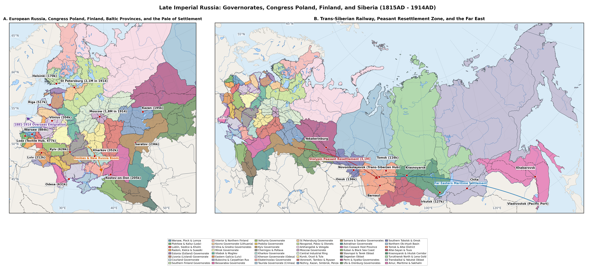

# Abstract

This gazetteer compiles population estimates for 265 cities, industrial
towns, railway junctions and ports across the 48 provinces of Late
Imperial Russia and Austro-Hungarian Ukraine at five benchmark dates
between the Congress of Vienna in 1815AD and the Russian Revolution of
1917AD. Before the emancipation of the serfs in the 1860s, urban growth
remained modest outside Saint Petersburg, Moscow, Warsaw, Odessa and
Riga. Over the next half-century, railway building, coal and steel works
in the Donbas and Congress Poland, the Grozny and Boryslav oil booms and
peasant migration along the Trans-Siberian line transformed the urban
map. By 1914AD, Saint Petersburg (2,12M) and Moscow (1,76M) led an urban
network that included Warsaw (884,5k), Odessa (630k), Kyiv (626,3k),
Riga (517,5k) and the textile and mining boomtowns of Lodz (477,9k),
Sosnowiec (118,5k) and Yuzovka (54k), before the First World War emptied
frontline cities in Poland, Courland and Lithuania and swelled interior
towns with more than 6M refugees
[\[1\]](#ref-Troinitsky1905Goroda)[\[2\]](#ref-TsSK1915)[\[3\]](#ref-Rashin1956)[\[4\]](#ref-Gatrell1999).

# Methodology

This gazetteer traces the population histories of 265 towns, industrial
centres, ports and fortresses across the 48 provinces of Late Imperial
Russia and Austro-Hungarian Ukraine (excluding Central Asia and the
Southern Caucasus) from the Congress of Vienna in 1815AD to the
revolutions of 1917AD. Each town is listed under its historical name
alongside its local and modern equivalents, geographic coordinates and
population estimates for 1815AD, 1858AD, 1897AD, 1914AD and 1917AD.

The town figures draw on the main fiscal and statistical surveys of the
nineteenth and early twentieth centuries: the Seventh (1815-1816AD),
Eighth (1833-1835AD) and Tenth (1857-1858AD) Imperial Soul Revisions and
Ministry of Internal Affairs town tables
[\[3\]](#ref-Rashin1956)[\[5\]](#ref-Troinitsky1861)[\[6\]](#ref-Kabuzan1971),
the First All-Russian General Census of 28 January 1897AD across all 89
provincial volumes and its companion register of settlements over 500
inhabitants
[\[1\]](#ref-Troinitsky1905Goroda)[\[7\]](#ref-Troinitsky1905), the 1
January 1914AD yearbooks of the Central Statistical Committee and the
Warsaw Statistical Committee
[\[2\]](#ref-TsSK1915)[\[8\]](#ref-WarsawStat1914), the ten-year
censuses of the Finnish Statistical Office
[\[9\]](#ref-FinlandStat1870_1915), the Austrian and Hungarian censuses
of 1869-1910AD for Galicia, Bukovina and Subcarpathia
[\[10\]](#ref-OsterreichischeStatistik1912)[\[11\]](#ref-MagyarStatisztika1912)
and the 1916-1917AD All-Russian Urban and Agricultural Censuses paired
with Tatiana Committee wartime refugee records
[\[4\]](#ref-Gatrell1999)[\[12\]](#ref-AgCensus1917). Industrial,
coal-mining, railway and northern ports founded after 1815AD - such as
Bodaibo (1864AD), Yuzovka (1869AD), Novonikolaevsk (1893AD), Belotsarsk
(1914AD) and Romanov-on-Murman (1916AD) - are marked `-` at dates prior
to their establishment.

# Results

## Warsaw, Plock and Lomza Governorates

Table gives the populations of the 6 principal towns in the Warsaw,
Plock and Lomza governorates, where the regional population grew from
1,02M in 1815AD to 3,54M in 1897AD and 5,05M in 1914AD before falling to
4,42M in 1917AD during the First World War
[\[1\]](#ref-Troinitsky1905Goroda)[\[4\]](#ref-Gatrell1999)[\[8\]](#ref-WarsawStat1914)[\[13\]](#ref-Corrsin1989).

| Settlement | Historical / Local Names | Coords & Country | 1815AD | 1858AD | 1897AD | 1914AD | 1917AD |
|:---|:---|:---|:---|:---|:---|:---|:---|
| Warsaw | Warszawa; Varshava | 52,23, 21,01 (Poland) | 81k | 162,8k | 683,7k | 884,5k | 758k |
| Plock | Plotsk; Plock Governorate | 52,55, 19,71 (Poland) | 6,2k | 13,2k | 27k | 35,2k | 28,5k |
| Lomza | Lomzha; Lomza Governorate | 53,18, 22,06 (Poland) | 3,1k | 5,9k | 26,1k | 29,8k | 22,1k |
| Wloclawek | Vlotslavsk; Leslau | 52,65, 19,07 (Poland) | 3,3k | 6,8k | 22,9k | 37,4k | 32,5k |
| Zyrardow | Zhirardov; Ruda Guzowska | 52,05, 20,45 (Poland) | \- | 3,8k | 24,5k | 38,6k | 26,4k |
| Ostroleka | Ostrolenka; Ostroleka Lomza | 53,09, 21,58 (Poland) | 2,2k | 3,9k | 12,9k | 15,2k | 9,8k |

Populations of Warsaw, the linen-mill town of Zyrardow, the Vistula
river ports of Wloclawek and Plock and the northern Mazovian district
seats, 1815AD - 1917AD.

## Piotrkow and Kalisz Governorates

Table gives the populations of the 7 principal towns in the Piotrkow and
Kalisz governorates, where the regional population rose from 720k in
1815AD to 2,25M in 1897AD and 3,32M in 1914AD before dropping to 2,95M
in 1917AD
[\[1\]](#ref-Troinitsky1905Goroda)[\[4\]](#ref-Gatrell1999)[\[8\]](#ref-WarsawStat1914)[\[13\]](#ref-Corrsin1989).

| Settlement | Historical / Local Names | Coords & Country | 1815AD | 1858AD | 1897AD | 1914AD | 1917AD |
|:---|:---|:---|:---|:---|:---|:---|:---|
| Lodz | Lodz Piotrkow; Polish Manchester | 51,76, 19,46 (Poland) | 800 | 29,5k | 314k | 477,9k | 342k |
| Sosnowiec | Sosnovitsy; Dabrowa Basin | 50,29, 19,1 (Poland) | \- | 2,2k | 61k | 118,5k | 94k |
| Czestochowa | Chenstokhov; Czestochowa Piotrkow | 50,81, 19,12 (Poland) | 4,5k | 9,2k | 45k | 92,9k | 78,5k |
| Kalisz | Kalish; Kalisz Governorate | 51,77, 18,09 (Poland) | 7,8k | 12,6k | 24,4k | 65,4k | 29k |
| Piotrkow | Piotrkow Trybunalski; Petrokov | 51,41, 19,7 (Poland) | 4,2k | 10,9k | 31,2k | 44,8k | 39,2k |
| Bendzin | Bedzin; Bendin Dabrowa | 50,32, 19,13 (Poland) | 2,1k | 4,4k | 23,8k | 54,8k | 43,5k |
| Pabianice | Pabianitsy; Pabianice Lodz | 51,66, 19,35 (Poland) | 900 | 4,9k | 26,8k | 48,3k | 36,8k |

Populations of the cotton-mill metropolis of Lodz and Pabianice, the
Dabrowa coal-and-steel towns of Sosnowiec, Czestochowa and Bendzin and
the border seat of Kalisz, 1815AD - 1917AD.

## Lublin and Siedlce Governorates

Table gives the populations of the 5 principal towns in the Lublin and
Siedlce governorates (including the 1912AD Kholm Governorate), where the
regional population grew from 780k in 1815AD to 1,93M in 1897AD and
2,68M in 1914AD before the 1915AD evacuation reduced it to 2,08M in
1917AD
[\[1\]](#ref-Troinitsky1905Goroda)[\[4\]](#ref-Gatrell1999)[\[8\]](#ref-WarsawStat1914)[\[13\]](#ref-Corrsin1989).

| Settlement | Historical / Local Names | Coords & Country | 1815AD | 1858AD | 1897AD | 1914AD | 1917AD |
|:---|:---|:---|:---|:---|:---|:---|:---|
| Lublin | Lyublin; Lublin Governorate | 51,25, 22,57 (Poland) | 10,2k | 18,5k | 50,4k | 72,2k | 64,5k |
| Siedlce | Sedlets; Siedlce Governorate | 52,17, 22,29 (Poland) | 3,1k | 7,8k | 26,2k | 34k | 24,8k |
| Kholm | Chelm; Kholm 1912 Governorate | 51,14, 23,47 (Poland) | 2,6k | 4,1k | 18,5k | 24,6k | 16,2k |
| Zamosc | Zamostye; Zamosc Fortress | 50,72, 23,25 (Poland) | 4,2k | 5,7k | 14,7k | 18,9k | 14,8k |
| Biala Podlaska | Bela; Biala Siedlce | 52,03, 23,12 (Poland) | 2,9k | 5,1k | 13,1k | 16,8k | 11,2k |

Populations of Lublin, the railway junction of Siedlce, the fortress
town of Zamosc, Biala Podlaska and Kholm (detached as a separate
governorate in 1912AD), 1815AD - 1917AD.

## Radom, Kielce and Suwalki Governorates

Table gives the populations of the 5 principal towns in the Radom,
Kielce and Suwalki governorates, where the regional population grew from
780k in 1815AD to 2,16M in 1897AD and 2,6M in 1914AD before falling to
2,18M in 1917AD
[\[1\]](#ref-Troinitsky1905Goroda)[\[4\]](#ref-Gatrell1999)[\[8\]](#ref-WarsawStat1914)[\[13\]](#ref-Corrsin1989).

| Settlement | Historical / Local Names | Coords & Country | 1815AD | 1858AD | 1897AD | 1914AD | 1917AD |
|:---|:---|:---|:---|:---|:---|:---|:---|
| Radom | Radom Governorate; Radom Sandomierz | 51,4, 21,15 (Poland) | 3,2k | 9,8k | 29,9k | 49,2k | 41,5k |
| Kielce | Keltse; Keltsy | 50,87, 20,63 (Poland) | 3,1k | 5,2k | 23,2k | 37,6k | 33,2k |
| Suwalki | Suvalki; Suwalki Governorate | 54,11, 22,93 (Poland) | 2,1k | 11,4k | 22,6k | 27,1k | 16,8k |
| Ostrowiec | Ostrowiec Swietokrzyski; Ostrovets | 50,93, 21,39 (Poland) | 1,6k | 3,9k | 9,8k | 18,4k | 15,2k |
| Mariampol | Marijampole; Mariampol Suwalki | 54,56, 23,35 (Lithuania) | 1,4k | 3,6k | 6,7k | 8,6k | 5,9k |

Populations of Radom, Kielce, the Kamienna valley ironworks town of
Ostrowiec and the northern Lithuanian-Polish border towns of Suwalki and
Mariampol, 1815AD - 1917AD.

## Estland Governorate

Table gives the populations of the 4 principal towns in Estland
Governorate, where the regional population grew from 232k in 1815AD to
413k in 1897AD, 505k in 1914AD and 515k in 1917AD
[\[1\]](#ref-Troinitsky1905Goroda)[\[2\]](#ref-TsSK1915)[\[4\]](#ref-Gatrell1999)[\[14\]](#ref-Gortfelder2023BalticFertility).

| Settlement | Historical / Local Names | Coords & Country | 1815AD | 1858AD | 1897AD | 1914AD | 1917AD |
|:---|:---|:---|:---|:---|:---|:---|:---|
| Reval | Tallinn; Revel | 59,44, 24,75 (Estonia) | 12,9k | 21,6k | 64,6k | 137,6k | 159k |
| Narva | Kreenholm; Rugodiv | 59,38, 28,18 (Estonia) | 3,8k | 6,2k | 16,6k | 27,4k | 29,2k |
| Wesenberg | Rakvere; Vezenberg | 59,35, 26,36 (Estonia) | 900 | 2,2k | 5,9k | 7,4k | 7,6k |
| Hapsal | Haapsalu; Gapsal | 58,94, 23,54 (Estonia) | 1,1k | 2,1k | 3,2k | 4,4k | 4,2k |

Populations of the Baltic port and naval shipyard city of Reval
(Tallinn), the Kreenholm cotton-mill town of Narva, Wesenberg and the
coastal resort of Hapsal, 1815AD - 1917AD.

## Livland Governorate

Table gives the populations of the 6 principal towns in Livland
Governorate, where the regional population rose from 615k in 1815AD to
1,3M in 1897AD and 1,56M in 1914AD before wartime factory evacuations
from Riga reduced it to 1,42M in 1917AD
[\[1\]](#ref-Troinitsky1905Goroda)[\[2\]](#ref-TsSK1915)[\[4\]](#ref-Gatrell1999)[\[14\]](#ref-Gortfelder2023BalticFertility).

| Settlement | Historical / Local Names | Coords & Country | 1815AD | 1858AD | 1897AD | 1914AD | 1917AD |
|:---|:---|:---|:---|:---|:---|:---|:---|
| Riga | Riia; Livland Capital | 56,95, 24,11 (Latvia) | 36k | 72,1k | 282,2k | 517,5k | 210k |
| Dorpat | Tartu; Yuryev | 58,38, 26,73 (Estonia) | 7,2k | 14,3k | 42,3k | 48,6k | 46,2k |
| Pernau | Parnu; Pernov | 58,39, 24,5 (Estonia) | 3,4k | 6,6k | 12,9k | 19,2k | 16,5k |
| Walk | Valka; Valga | 57,78, 26,05 (Latvia) | 950 | 2,6k | 10,9k | 18,5k | 16,8k |
| Wenden | Cesis; Venden | 57,31, 25,27 (Latvia) | 1,3k | 2,8k | 6,4k | 8,9k | 7,8k |
| Arensburg | Kuressaare; Arensburg Oesel | 58,25, 22,49 (Estonia) | 1,8k | 3,2k | 4,6k | 5,4k | 4,1k |

Populations of the port and industrial city of Riga, the university town
of Dorpat (Tartu), the timber port of Pernau, the railway junction of
Walk and Livland’s district towns, 1815AD - 1917AD.

## Courland Governorate

Table gives the populations of the 5 principal towns in Courland
Governorate, where the regional population rose from 418k in 1815AD to
674k in 1897AD and 800k in 1914AD before the 1915AD German occupation
and refugee flight halved it to 380k in 1917AD
[\[1\]](#ref-Troinitsky1905Goroda)[\[2\]](#ref-TsSK1915)[\[4\]](#ref-Gatrell1999)[\[14\]](#ref-Gortfelder2023BalticFertility).

| Settlement | Historical / Local Names | Coords & Country | 1815AD | 1858AD | 1897AD | 1914AD | 1917AD |
|:---|:---|:---|:---|:---|:---|:---|:---|
| Libau | Liepaja; Libava | 56,5, 21,01 (Latvia) | 5,6k | 10,4k | 64,5k | 90,7k | 43,2k |
| Mitau | Jelgava; Mitava | 56,65, 23,72 (Latvia) | 12,5k | 21,8k | 35,1k | 45,7k | 21,5k |
| Windau | Ventspils; Vindava | 57,39, 21,56 (Latvia) | 1,6k | 3,5k | 7,1k | 28,8k | 12,4k |
| Goldingen | Kuldiga; Goldingen Courland | 56,97, 21,97 (Latvia) | 2,2k | 4,9k | 9,7k | 12,1k | 6,8k |
| Jakobstadt | Jekabpils; Yakobshtadt | 56,5, 25,88 (Latvia) | 1,9k | 4,1k | 5,8k | 7,4k | 3,2k |

Populations of the ice-free emigrant and naval port of Libau (Liepaja),
the provincial capital of Mitau (Jelgava), the rail port of Windau
(Ventspils), Goldingen and Jakobstadt, 1815AD - 1917AD.

## Southern Finland: Nyland, Abo-Bjorneborg, Tavastehus and Vyborg

Table gives the populations of the 6 principal towns in southern Finland
(Nyland, Abo-Bjorneborg, Tavastehus and Vyborg provinces), where the
regional population grew from 590k in 1815AD to 1,43M in 1897AD, 1,84M
in 1914AD and 1,89M in 1917AD
[\[9\]](#ref-FinlandStat1870_1915)[\[15\]](#ref-Pitkanen1993)[\[16\]](#ref-Luostarinen2026FinlandMortality).

| Settlement | Historical / Local Names | Coords & Country | 1815AD | 1858AD | 1897AD | 1914AD | 1917AD |
|:---|:---|:---|:---|:---|:---|:---|:---|
| Helsingfors | Helsinki; Gelsingfors | 60,17, 24,94 (Finland) | 4,8k | 22,2k | 84,5k | 170,5k | 187,5k |
| Abo | Turku; Abo-Bjorneborg | 60,45, 22,27 (Finland) | 11,8k | 16,8k | 36,8k | 54,6k | 56,2k |
| Tammerfors | Tampere; Tavastehus Mill Hub | 61,5, 23,76 (Finland) | 850 | 4,9k | 30,2k | 45,2k | 46,8k |
| Viipuri | Vyborg; Viborg | 60,71, 28,75 (Russia) | 3,3k | 5,5k | 23,5k | 29,3k | 30,5k |
| Bjorneborg | Pori; Bjorneborg Port | 61,49, 21,8 (Finland) | 3,1k | 7,1k | 13,9k | 17,6k | 18,1k |
| Kotka | Kotka Timber Port; Svensksund | 60,47, 26,95 (Finland) | \- | \- | 5,8k | 11,2k | 11,6k |

Populations of the Finnish capital of Helsingfors (Helsinki), the port
of Abo (Turku), the textile and paper-mill centre of Tammerfors
(Tampere), Viipuri (Vyborg) and the sawmill ports of Bjorneborg and
Kotka, 1815AD - 1917AD.

## Interior and Northern Finland: Vasa, Kuopio, Sankt-Michel and Uleaborg

Table gives the populations of the 5 principal towns in interior and
northern Finland (Vasa, Kuopio, Sankt-Michel and Uleaborg provinces),
where the regional population rose from 520k in 1815AD to 1,13M in
1897AD, 1,4M in 1914AD and 1,43M in 1917AD
[\[9\]](#ref-FinlandStat1870_1915)[\[15\]](#ref-Pitkanen1993)[\[16\]](#ref-Luostarinen2026FinlandMortality).

| Settlement | Historical / Local Names | Coords & Country | 1815AD | 1858AD | 1897AD | 1914AD | 1917AD |
|:---|:---|:---|:---|:---|:---|:---|:---|
| Vasa | Vaasa; Nikolaistad | 63,1, 21,62 (Finland) | 2,8k | 3,9k | 13,8k | 24,2k | 24,8k |
| Uleaborg | Oulu; Uleaborg Governorate | 65,01, 25,47 (Finland) | 3,7k | 6,8k | 14,9k | 21,5k | 22,1k |
| Kuopio | Kuopio Savo; Kuopio Governorate | 62,89, 27,68 (Finland) | 1,2k | 4,1k | 10,2k | 17,5k | 18,1k |
| Sankt-Michel | Mikkeli; Sankt-Mikhel | 61,69, 27,27 (Finland) | \- | 950 | 3,4k | 4,7k | 4,9k |
| Gamlakarleby | Kokkola; Gamla-Karleby | 63,84, 23,13 (Finland) | 1,8k | 2,3k | 2,6k | 4,1k | 4,3k |

Populations of the Gulf of Bothnia ports of Vasa, Uleaborg (Oulu) and
Gamlakarleby and the interior lake towns of Kuopio and Sankt-Michel
(Mikkeli), 1815AD - 1917AD.

## Kovno Governorate

Table gives the populations of the 5 principal towns in Kovno
Governorate, where the regional population grew from 660k in 1815AD to
1,54M in 1897AD and 1,84M in 1914AD before falling to 1,32M in 1917AD
during the First World War
[\[1\]](#ref-Troinitsky1905Goroda)[\[2\]](#ref-TsSK1915)[\[4\]](#ref-Gatrell1999)[\[17\]](#ref-Rowland1986).

| Settlement | Historical / Local Names | Coords & Country | 1815AD | 1858AD | 1897AD | 1914AD | 1917AD |
|:---|:---|:---|:---|:---|:---|:---|:---|
| Kovno | Kaunas; Kovna | 54,9, 23,9 (Lithuania) | 5,2k | 22,5k | 70,9k | 91,4k | 42k |
| Shavli | Siauliai; Szawle | 55,93, 23,31 (Lithuania) | 2,2k | 6,1k | 16,1k | 23,5k | 11,2k |
| Ponevezh | Panevezys; Poniewiez | 55,73, 24,36 (Lithuania) | 1,8k | 5,9k | 13k | 17,8k | 11,8k |
| Telshi | Telsiai; Telsze Samogitia | 55,98, 22,25 (Lithuania) | 1,5k | 3,8k | 6,2k | 8,1k | 5,8k |
| Vilkomir | Ukmerge; Wilkomierz | 55,25, 24,76 (Lithuania) | 3,1k | 7,3k | 13,5k | 16,8k | 10,6k |

Populations of the Niemen river fortress city of Kovno (Kaunas), the
leather-working and railway town of Shavli (Siauliai) and the Lithuanian
district seats of Ponevezh, Telshi and Vilkomir, 1815AD - 1917AD.

## Vilna and Grodno Governorates

Table gives the populations of the 6 principal towns in the Vilna and
Grodno governorates, where the regional population grew from 1,15M in
1815AD to 3,19M in 1897AD and 3,94M in 1914AD before the 1915AD retreat
reduced it to 2,88M in 1917AD
[\[1\]](#ref-Troinitsky1905Goroda)[\[2\]](#ref-TsSK1915)[\[4\]](#ref-Gatrell1999)[\[17\]](#ref-Rowland1986).

| Settlement | Historical / Local Names | Coords & Country | 1815AD | 1858AD | 1897AD | 1914AD | 1917AD |
|:---|:---|:---|:---|:---|:---|:---|:---|
| Vilna | Vilnius; Wilno | 54,69, 25,28 (Lithuania) | 32k | 58,2k | 154,5k | 204,3k | 138,9k |
| Bialystok | Belostok; Bialystok Grodno Gub | 53,13, 23,17 (Poland) | 6,2k | 16,2k | 66k | 91,5k | 58k |
| Grodno | Hrodna; Gardinas | 53,67, 23,81 (Belarus) | 7,2k | 19,2k | 46,9k | 61,6k | 34,8k |
| Brest-Litovsk | Brest; Brisk | 52,1, 23,73 (Belarus) | 6,4k | 19,3k | 46,6k | 57,4k | 16,5k |
| Slonim | Slonim Grodno; Slonim Pale | 53,09, 25,32 (Belarus) | 3,8k | 9,8k | 15,9k | 21,2k | 13,4k |
| Lida | Lida Vilna Gub; Lyda | 53,89, 25,3 (Belarus) | 1,8k | 4,4k | 9,3k | 14,8k | 11,2k |

Populations of Vilna (Vilnius), the woollen-mill boomtown of Bialystok,
Grodno, the Bug fortress and railway junction of Brest-Litovsk, Slonim
and Lida, 1815AD - 1917AD.

## Minsk Governorate and Pripyat Polesia

Table gives the populations of the 6 principal towns in Minsk
Governorate, where the regional population grew from 920k in 1815AD to
2,15M in 1897AD and 3,04M in 1914AD before dipping to 2,89M in 1917AD
[\[1\]](#ref-Troinitsky1905Goroda)[\[2\]](#ref-TsSK1915)[\[4\]](#ref-Gatrell1999)[\[17\]](#ref-Rowland1986).

| Settlement | Historical / Local Names | Coords & Country | 1815AD | 1858AD | 1897AD | 1914AD | 1917AD |
|:---|:---|:---|:---|:---|:---|:---|:---|
| Minsk | Mensk; Miensk | 53,9, 27,56 (Belarus) | 13,2k | 26,7k | 90,9k | 117,6k | 134k |
| Bobruisk | Babruysk; Bobrujsk Fortress | 53,14, 29,22 (Belarus) | 5,4k | 19,5k | 34,3k | 44,2k | 46,5k |
| Pinsk | Pinsk Polesia; Pinska | 52,11, 26,1 (Belarus) | 5,8k | 12,9k | 28,4k | 38,6k | 21,5k |
| Baranovichi | Baranavichy; Baranowicze Junction | 53,13, 26,01 (Belarus) | \- | \- | 20,7k | 30,5k | 18,4k |
| Borisov | Barysaw; Borisow | 54,22, 28,51 (Belarus) | 3,9k | 7,1k | 15,1k | 21,5k | 23,2k |
| Mozyr | Mazyr; Mozyr Pripyat | 52,05, 29,25 (Belarus) | 2,8k | 5,8k | 8,1k | 12,4k | 12,8k |

Populations of Minsk, the Berezina fortress town of Bobruisk, the
Pripyat waterway port of Pinsk, the railway junction of Baranovichi,
Borisov and Mozyr, 1815AD - 1917AD.

## Vitebsk and Mogilev Governorates

Table gives the populations of the 6 principal towns in the Vitebsk and
Mogilev governorates, where the regional population grew from 1,25M in
1815AD to 3,18M in 1897AD and 4,02M in 1914AD before edging down to
3,86M in 1917AD
[\[1\]](#ref-Troinitsky1905Goroda)[\[2\]](#ref-TsSK1915)[\[4\]](#ref-Gatrell1999)[\[17\]](#ref-Rowland1986).

| Settlement | Historical / Local Names | Coords & Country | 1815AD | 1858AD | 1897AD | 1914AD | 1917AD |
|:---|:---|:---|:---|:---|:---|:---|:---|
| Dvinsk | Daugavpils; Dinaburg | 55,87, 26,54 (Latvia) | 4,2k | 25,7k | 69,7k | 112,8k | 68,5k |
| Vitebsk | Vitsebsk; Witebsk | 55,19, 30,2 (Belarus) | 14,5k | 29,8k | 65,9k | 108,9k | 112k |
| Mogilev | Mahilyow; Mogilev Stavka | 53,9, 30,33 (Belarus) | 16,8k | 31,2k | 43,1k | 69,7k | 76,5k |
| Gomel | Homyel; Homel Mogilev Gub | 52,43, 30,98 (Belarus) | 5,8k | 15,4k | 36,8k | 104,5k | 106,8k |
| Polotsk | Polatsk; Polock | 55,49, 28,79 (Belarus) | 7,2k | 12,2k | 20,3k | 31,1k | 32,4k |
| Rezhitsa | Rezekne; Rositten Latgale | 56,51, 27,33 (Latvia) | 1,6k | 5,4k | 10,8k | 21,8k | 16,2k |

Populations of the railway and fortress city of Dvinsk (Daugavpils),
Vitebsk, Mogilev (site of the 1915-1917AD Russian army headquarters),
the rail hub of Gomel, Polotsk and Rezhitsa, 1815AD - 1917AD.

## Austro-Hungarian Eastern Galicia

Table gives the populations of the 6 principal towns in Eastern Galicia,
where the regional population grew from 2,58M in 1815AD to 4,42M in
1897AD and 5,02M in 1914AD before fighting on the Carpathian and
Galician fronts reduced it to 4,45M in 1917AD
[\[4\]](#ref-Gatrell1999)[\[10\]](#ref-OsterreichischeStatistik1912)[\[11\]](#ref-MagyarStatisztika1912)[\[18\]](#ref-Himka1988).

| Settlement | Historical / Local Names | Coords & Country | 1815AD | 1858AD | 1897AD | 1914AD | 1917AD |
|:---|:---|:---|:---|:---|:---|:---|:---|
| Lemberg | Lviv; Lwow | 49,84, 24,03 (Ukraine) | 44,5k | 70,4k | 152k | 212k | 178k |
| Tarnopol | Ternopil; Tarnopol Galicia | 49,55, 25,59 (Ukraine) | 9,8k | 17,8k | 29,6k | 35,2k | 26,5k |
| Stanislau | Ivano-Frankivsk; Stanislawow | 48,92, 24,71 (Ukraine) | 7,2k | 13,4k | 29,2k | 36,8k | 28,4k |
| Drohobych | Drogobych; Drohobycz | 49,35, 23,51 (Ukraine) | 7,6k | 14,1k | 19,1k | 36,5k | 31,2k |
| Boryslav | Boryslaw; Tustanowice Oilfield | 49,29, 23,42 (Ukraine) | \- | 1,8k | 12,2k | 16,8k | 13,5k |
| Kolomyia | Kolomea; Kolomyja | 48,53, 25,04 (Ukraine) | 8,4k | 15,8k | 33,2k | 43,8k | 34k |

Populations of the Galician capital of Lemberg (Lviv), the oil-basin
boomtowns of Drohobych and Boryslav and the rail and market centres of
Tarnopol, Stanislau and Kolomyia, 1815AD - 1917AD.

## Austro-Hungarian Bukovina and Subcarpathian Rus

Table gives the populations of the 5 principal towns in Bukovina and
Subcarpathian Rus, where the regional population rose from 770k in
1815AD to 1,4M in 1897AD and 1,63M in 1914AD before falling to 1,5M in
1917AD
[\[4\]](#ref-Gatrell1999)[\[10\]](#ref-OsterreichischeStatistik1912)[\[11\]](#ref-MagyarStatisztika1912)[\[18\]](#ref-Himka1988).

| Settlement | Historical / Local Names | Coords & Country | 1815AD | 1858AD | 1897AD | 1914AD | 1917AD |
|:---|:---|:---|:---|:---|:---|:---|:---|
| Czernowitz | Chernivtsi; Cernauti | 48,29, 25,94 (Ukraine) | 7,2k | 26,3k | 65,4k | 94k | 76k |
| Ungvar | Uzhhorod; Uzhgorod | 48,62, 22,29 (Ukraine) | 4,8k | 9,1k | 14,3k | 17,6k | 16,4k |
| Munkacs | Mukachevo; Mukacheve | 48,44, 22,72 (Ukraine) | 4,1k | 8,2k | 13,9k | 18,2k | 16,9k |
| Beregszasz | Berehove; Beregovo | 48,21, 22,64 (Ukraine) | 2,9k | 5,8k | 9,4k | 13,2k | 12,4k |
| Huszt | Khust; Maramaros Huszt | 48,18, 23,3 (Ukraine) | 2,7k | 5,3k | 8,5k | 10,9k | 10,2k |

Populations of the Bukovinian university and provincial capital of
Czernowitz (Chernivtsi) and the Hungarian Subcarpathian county towns of
Ungvar, Munkacs, Beregszasz and Huszt, 1815AD - 1917AD.

## Bessarabia Governorate

Table gives the populations of the 6 principal towns in Bessarabia
Governorate, where the regional population grew from 385k in 1815AD to
1,94M in 1897AD and 2,66M in 1914AD (2,62M in 1917AD)
[\[1\]](#ref-Troinitsky1905Goroda)[\[2\]](#ref-TsSK1915)[\[4\]](#ref-Gatrell1999)[\[19\]](#ref-Perlmann2006PaleEmigration).

| Settlement | Historical / Local Names | Coords & Country | 1815AD | 1858AD | 1897AD | 1914AD | 1917AD |
|:---|:---|:---|:---|:---|:---|:---|:---|
| Kishinev | Chisinau; Kishinyov | 47,01, 28,86 (Moldova) | 14,5k | 85,2k | 108,5k | 128,7k | 131k |
| Bender | Bendery; Tighina | 46,83, 29,47 (Moldova) | 6,8k | 21,4k | 31,8k | 38,6k | 39,2k |
| Akkerman | Bilhorod-Dnistrovskyi; Cetatea Alba | 46,2, 30,34 (Ukraine) | 8,2k | 22,8k | 28,3k | 39,8k | 40,2k |
| Ismail | Izmail; Tuchkov | 45,35, 28,83 (Ukraine) | 9,5k | 21,2k | 22,3k | 35,7k | 35,1k |
| Beltsy | Balti; Beltsy Bessarabia | 47,76, 27,93 (Moldova) | 2,4k | 8,9k | 18,5k | 31,2k | 31,8k |
| Khotin | Khotyn; Hotin | 48,51, 26,49 (Ukraine) | 5,2k | 13,6k | 18,4k | 24,5k | 21,8k |

Populations of the provincial capital of Kishinev (Chisinau), the
Dniester fortress towns of Bender, Akkerman and Khotin, the Danube port
of Ismail and the northern market town of Beltsy, 1815AD - 1917AD.

## Volhynia Governorate

Table gives the populations of the 5 principal towns in Volhynia
Governorate, where the regional population rose from 1,52M in 1815AD to
2,99M in 1897AD and 4,12M in 1914AD before Southwestern Front fighting
lowered it to 3,68M in 1917AD
[\[1\]](#ref-Troinitsky1905Goroda)[\[2\]](#ref-TsSK1915)[\[4\]](#ref-Gatrell1999)[\[19\]](#ref-Perlmann2006PaleEmigration).

| Settlement | Historical / Local Names | Coords & Country | 1815AD | 1858AD | 1897AD | 1914AD | 1917AD |
|:---|:---|:---|:---|:---|:---|:---|:---|
| Zhitomir | Zhytomyr; Zytomierz | 50,25, 28,66 (Ukraine) | 10,8k | 36,8k | 65,9k | 92,6k | 89,4k |
| Rovno | Rivne; Rowne | 50,62, 26,25 (Ukraine) | 3,4k | 6,1k | 24,6k | 36,8k | 32,5k |
| Kovel | Kowel; Kovel Junction | 51,21, 24,71 (Ukraine) | 2,8k | 4,9k | 17,7k | 29,2k | 19,4k |
| Lutsk | Luck; Lutsk Volhynia | 50,75, 25,33 (Ukraine) | 3,6k | 7,1k | 15,8k | 28,1k | 21,6k |
| Kremenets | Krzemieniec; Kremenets Volhynia | 50,1, 25,73 (Ukraine) | 6,8k | 11,4k | 17,7k | 22,4k | 19,8k |

Populations of the provincial seat of Zhitomir, the strategic railway
junctions of Rovno and Kovel, the Styr fortress town of Lutsk and
Kremenets, 1815AD - 1917AD.

## Podolia Governorate

Table gives the populations of the 5 principal towns in Podolia
Governorate, where the regional population grew from 1,44M in 1815AD to
3,02M in 1897AD and 3,98M in 1914AD (3,82M in 1917AD)
[\[1\]](#ref-Troinitsky1905Goroda)[\[2\]](#ref-TsSK1915)[\[4\]](#ref-Gatrell1999)[\[19\]](#ref-Perlmann2006PaleEmigration).

| Settlement | Historical / Local Names | Coords & Country | 1815AD | 1858AD | 1897AD | 1914AD | 1917AD |
|:---|:---|:---|:---|:---|:---|:---|:---|
| Kamenets-Podolsky | Kamianets-Podilskyi; Kamieniec Podolski | 48,68, 26,59 (Ukraine) | 11,2k | 20,8k | 35,9k | 50,5k | 46,2k |
| Vinnitsa | Vinnytsia; Winnica | 49,23, 28,47 (Ukraine) | 4,8k | 10,9k | 30,6k | 53,8k | 54,6k |
| Proskurov | Khmelnytskyi; Ploskyriv | 49,42, 26,99 (Ukraine) | 3,1k | 7,8k | 22,9k | 40,6k | 38,9k |
| Balta | Balta Podolia; Balta Fair Town | 47,94, 29,62 (Ukraine) | 6,4k | 14,6k | 23,4k | 28,9k | 28,4k |
| Mogilev-Podolsky | Mohyliv-Podilskyi; Mogilev on Dniester | 48,45, 27,8 (Ukraine) | 7,1k | 13,4k | 22,3k | 32,6k | 31,5k |

Populations of Kamenets-Podolsky, the South-Western Railway towns of
Vinnitsa and Proskurov, the cattle-and-grain fair town of Balta and the
Dniester crossing of Mogilev-Podolsky, 1815AD - 1917AD.

## Kyiv Governorate

Table gives the populations of the 5 principal towns in Kyiv
Governorate, where the regional population grew from 940k in 1815AD to
3,56M in 1897AD, 4,78M in 1914AD and 4,84M in 1917AD
[\[1\]](#ref-Troinitsky1905Goroda)[\[2\]](#ref-TsSK1915)[\[4\]](#ref-Gatrell1999)[\[19\]](#ref-Perlmann2006PaleEmigration).

| Settlement | Historical / Local Names | Coords & Country | 1815AD | 1858AD | 1897AD | 1914AD | 1917AD |
|:---|:---|:---|:---|:---|:---|:---|:---|
| Kyiv | Kiev; Kijow | 50,45, 30,52 (Ukraine) | 23,5k | 62,5k | 247,7k | 626,3k | 644k |
| Berdichev | Berdychiv; Berdyczow | 49,89, 28,6 (Ukraine) | 16,5k | 51,8k | 53,4k | 79,1k | 77,5k |
| Bila Tserkva | Belaya Tserkov; Biala Cerkiew | 49,8, 30,12 (Ukraine) | 6,8k | 14,8k | 35,4k | 60,5k | 61,2k |
| Uman | Human; Uman Kyiv Gub | 48,75, 30,22 (Ukraine) | 6,2k | 14,4k | 31k | 50,2k | 50,8k |
| Cherkassy | Cherkasy; Czerkasy | 49,44, 32,06 (Ukraine) | 5,4k | 13,5k | 29,6k | 43,8k | 44,5k |

Populations of Kyiv, the commercial and banking town of Berdichev, the
sugar-refining centres of Bila Tserkva and Cherkassy and Uman, 1815AD -
1917AD.

## Chernigov and Poltava Governorates

Table gives the populations of the 6 principal towns in the Chernigov
and Poltava governorates, where the regional population rose from 3,35M
in 1815AD to 5,08M in 1897AD, 6,65M in 1914AD and 6,72M in 1917AD
[\[1\]](#ref-Troinitsky1905Goroda)[\[2\]](#ref-TsSK1915)[\[3\]](#ref-Rashin1956)[\[20\]](#ref-Friedgut1989).

| Settlement | Historical / Local Names | Coords & Country | 1815AD | 1858AD | 1897AD | 1914AD | 1917AD |
|:---|:---|:---|:---|:---|:---|:---|:---|
| Kremenchug | Kremenchuk; Kremenchug Kryukov | 49,07, 33,42 (Ukraine) | 9,2k | 23,2k | 63k | 98,7k | 99,5k |
| Poltava | Poltava Governorate; Pultawa | 49,59, 34,55 (Ukraine) | 10,4k | 24,6k | 53,7k | 83,5k | 85,2k |
| Chernigov | Chernihiv; Czernihow | 51,5, 31,29 (Ukraine) | 7,6k | 15,2k | 27,7k | 38,4k | 39,1k |
| Nezhin | Nizhyn; Niezyn | 51,05, 31,89 (Ukraine) | 14,2k | 19,4k | 32,1k | 52,4k | 53k |
| Konotop | Konotop Rail Hub; Konotop Chernigov | 51,24, 33,2 (Ukraine) | 5,8k | 9,6k | 18,8k | 28,6k | 29,4k |
| Romny | Romny Fair; Romen | 50,75, 33,47 (Ukraine) | 5,4k | 9,2k | 22,5k | 35,8k | 36,2k |

Populations of the Dnieper timber and tobacco port of Kremenchug, the
provincial capitals of Poltava and Chernigov, the railway workshop town
of Konotop and the market towns of Nezhin and Romny, 1815AD - 1917AD.

## Kharkov Governorate

Table gives the populations of the 5 principal towns in Kharkov
Governorate, where the regional population grew from 1,1M in 1815AD to
2,49M in 1897AD, 3,44M in 1914AD and 3,51M in 1917AD
[\[1\]](#ref-Troinitsky1905Goroda)[\[2\]](#ref-TsSK1915)[\[3\]](#ref-Rashin1956)[\[20\]](#ref-Friedgut1989).

| Settlement | Historical / Local Names | Coords & Country | 1815AD | 1858AD | 1897AD | 1914AD | 1917AD |
|:---|:---|:---|:---|:---|:---|:---|:---|
| Kharkov | Kharkiv; Sloboda Capital | 49,99, 36,23 (Ukraine) | 14,8k | 50,3k | 174k | 258k | 285k |
| Sumy | Sumy Sugar Hub; Sumy Sloboda | 50,91, 34,8 (Ukraine) | 10,8k | 14,2k | 27,6k | 50,4k | 51,2k |
| Akhtyrka | Okhtyrka; Akhtyrka Sloboda | 50,31, 34,9 (Ukraine) | 12,6k | 16,8k | 23,4k | 31,8k | 32,1k |
| Slavyansk | Sloviansk; Tor Salt Works | 48,85, 37,61 (Ukraine) | 4,9k | 9,6k | 15,8k | 25,4k | 26,1k |
| Izyum | Izium; Izyum Donets | 49,21, 37,26 (Ukraine) | 5,6k | 9,8k | 13k | 19,6k | 20,4k |

Populations of the university, railway and locomotive-building city of
Kharkov, the sugar-refining centre of Sumy, the salt-and-soda works town
of Slavyansk, Akhtyrka and Izyum, 1815AD - 1917AD.

## Kherson Governorate

Table gives the populations of the 5 principal towns in Kherson
Governorate, where the regional population grew more than sixfold from
620k in 1815AD to 2,73M in 1897AD, 3,75M in 1914AD and 3,78M in 1917AD
[\[1\]](#ref-Troinitsky1905Goroda)[\[2\]](#ref-TsSK1915)[\[3\]](#ref-Rashin1956)[\[20\]](#ref-Friedgut1989).

| Settlement | Historical / Local Names | Coords & Country | 1815AD | 1858AD | 1897AD | 1914AD | 1917AD |
|:---|:---|:---|:---|:---|:---|:---|:---|
| Odessa | Odesa; Khadzhibey | 46,48, 30,72 (Ukraine) | 35k | 114,2k | 403,8k | 630k | 620k |
| Nikolaev | Mykolaiv; Black Sea Shipyard | 46,98, 31,99 (Ukraine) | 11,5k | 44,2k | 92k | 108,8k | 116k |
| Elisavetgrad | Kropyvnytskyi; Zinovievsk | 48,51, 32,26 (Ukraine) | 10,2k | 25,4k | 61,5k | 78,2k | 79,4k |
| Kherson | Kherson Port; Kherson Governorate | 46,64, 32,62 (Ukraine) | 14,2k | 40,4k | 59,1k | 98,6k | 99,2k |
| Tiraspol | Tiraspol Dniester; Tiraspol Kherson Gub | 46,84, 29,64 (Moldova) | 4,2k | 10,2k | 31,6k | 37,8k | 38,4k |

Populations of the Black Sea grain port of Odessa, the naval shipyard
city of Nikolaev, the agricultural-machinery centre of Elisavetgrad,
Kherson and the Dniester garrison of Tiraspol, 1815AD - 1917AD.

## Ekaterinoslav Governorate

Table gives the populations of the 7 principal towns in Ekaterinoslav
Governorate, where the regional population rose from 820k in 1815AD to
2,11M in 1897AD, 3,45M in 1914AD and 3,58M in 1917AD
[\[1\]](#ref-Troinitsky1905Goroda)[\[2\]](#ref-TsSK1915)[\[3\]](#ref-Rashin1956)[\[20\]](#ref-Friedgut1989).

| Settlement | Historical / Local Names | Coords & Country | 1815AD | 1858AD | 1897AD | 1914AD | 1917AD |
|:---|:---|:---|:---|:---|:---|:---|:---|
| Ekaterinoslav | Dnipro; Dnipropetrovsk | 48,46, 35,05 (Ukraine) | 6,8k | 18,9k | 112,8k | 220,4k | 231k |
| Yuzovka | Donetsk; Hughesovka | 48,02, 37,8 (Ukraine) | \- | \- | 28,1k | 54k | 58,5k |
| Lugansk | Luhansk; Lugansky Zavod | 48,57, 39,31 (Ukraine) | 2,4k | 8,6k | 20,4k | 68k | 72,5k |
| Mariupol | Mariupol Azov Port; Mariupol Metallurgical | 47,1, 37,54 (Ukraine) | 3,1k | 5,9k | 31,1k | 58k | 61,2k |
| Krivoy Rog | Kryvyi Rih; Krivbass Iron | 47,91, 33,39 (Ukraine) | 2,2k | 3,8k | 15,4k | 26,8k | 28,2k |
| Aleksandrovsk | Zaporizhzhia; Alexandrovsk | 47,84, 35,14 (Ukraine) | 2,1k | 4,6k | 18,8k | 53,4k | 58,5k |
| Bakhmut | Artemovsk; Bakhmut Salt-Coal | 48,6, 38 (Ukraine) | 3,8k | 9,8k | 19,3k | 33,5k | 34,8k |

Populations of the iron-and-steel city of Ekaterinoslav, the Donbas coal
and metallurgical boomtowns of Yuzovka, Lugansk and Bakhmut, the
iron-ore centre of Krivoy Rog, the Sea of Azov port of Mariupol and
Aleksandrovsk, 1815AD - 1917AD.

## Taurida Governorate

Table gives the populations of the 6 principal towns in Taurida
Governorate, where the regional population grew from 370k in 1815AD to
1,45M in 1897AD, 2,06M in 1914AD and 2,08M in 1917AD
[\[1\]](#ref-Troinitsky1905Goroda)[\[2\]](#ref-TsSK1915)[\[3\]](#ref-Rashin1956)[\[20\]](#ref-Friedgut1989).

| Settlement | Historical / Local Names | Coords & Country | 1815AD | 1858AD | 1897AD | 1914AD | 1917AD |
|:---|:---|:---|:---|:---|:---|:---|:---|
| Sevastopol | Sebastopol; Akhtiar Naval Base | 44,62, 33,53 (Ukraine) | 18,5k | 11,2k | 53,6k | 77,5k | 84k |
| Simferopol | Aqmescit; Taurida Capital | 44,95, 34,1 (Ukraine) | 4,2k | 15,8k | 49,1k | 81,2k | 84,5k |
| Kerch | Kerch-Yenikale; Panticapaeum | 45,36, 36,47 (Ukraine) | 2,8k | 13,4k | 33,3k | 55,8k | 56,4k |
| Berdyansk | Berdiansk; Berdyansk Azov Port | 46,76, 36,8 (Ukraine) | \- | 10,8k | 26,5k | 40,2k | 40,8k |
| Melitopol | Novoaleksandrovka; Melitopol Tavria | 46,85, 35,37 (Ukraine) | \- | 5,3k | 15,5k | 23,6k | 24,2k |
| Feodosiya | Theodosia; Kefe | 45,03, 35,38 (Ukraine) | 3,6k | 8,4k | 24,1k | 43,1k | 43,8k |

Populations of the Black Sea Fleet base of Sevastopol, the provincial
seat of Simferopol, the Crimean and Azov grain ports of Kerch, Feodosiya
and Berdyansk and the railway town of Melitopol, 1815AD - 1917AD.

## Saint Petersburg Governorate

Table gives the populations of the 5 principal towns in Saint Petersburg
Governorate, where the regional population grew from 760k in 1815AD to
2,11M in 1897AD, 3,15M in 1914AD and 3,38M in 1917AD
[\[1\]](#ref-Troinitsky1905Goroda)[\[2\]](#ref-TsSK1915)[\[3\]](#ref-Rashin1956)[\[12\]](#ref-AgCensus1917).

| Settlement | Historical / Local Names | Coords & Country | 1815AD | 1858AD | 1897AD | 1914AD | 1917AD |
|:---|:---|:---|:---|:---|:---|:---|:---|
| Saint Petersburg | Petrograd; Sankt-Peterburg | 59,93, 30,34 (Russia) | 385k | 520,1k | 1,26M | 2,12M | 2,3M |
| Kronstadt | Kronshtadt; Baltic Fleet Base | 59,99, 29,77 (Russia) | 28k | 48,4k | 59,5k | 68,2k | 74,5k |
| Tsarskoe Selo | Pushkin; Detskoe Selo | 59,72, 30,4 (Russia) | 8,2k | 14,1k | 22,5k | 31,8k | 34,2k |
| Gatchina | Gatchina Palace; Trotsk | 59,57, 30,13 (Russia) | 4,8k | 9,1k | 14,8k | 21,5k | 23,4k |
| Luga | Luga Ingria; Luga St Petersburg | 58,74, 29,85 (Russia) | 1,6k | 3,1k | 5,6k | 11,2k | 12,8k |

Populations of the Imperial capital of Saint Petersburg (Petrograd), the
island naval fortress of Kronstadt, the palace towns of Tsarskoe Selo
and Gatchina and Luga, 1815AD - 1917AD.

## Novgorod, Pskov and Olonets Governorates

Table gives the populations of the 6 principal towns in the Novgorod,
Pskov and Olonets governorates, where the regional population grew from
1,77M in 1815AD to 2,85M in 1897AD, 3,58M in 1914AD and 3,68M in 1917AD
[\[1\]](#ref-Troinitsky1905Goroda)[\[2\]](#ref-TsSK1915)[\[3\]](#ref-Rashin1956)[\[12\]](#ref-AgCensus1917).

| Settlement | Historical / Local Names | Coords & Country | 1815AD | 1858AD | 1897AD | 1914AD | 1917AD |
|:---|:---|:---|:---|:---|:---|:---|:---|
| Pskov | Pleskov; Pskov Governorate | 57,82, 28,33 (Russia) | 9,8k | 16,8k | 30,5k | 38,3k | 52k |
| Novgorod | Veliky Novgorod; Novgorod Governorate | 58,52, 31,28 (Russia) | 10,5k | 17,5k | 25,7k | 28,4k | 29,8k |
| Staraya Russa | Russa; Staraya Russa Spa | 57,98, 31,37 (Russia) | 6,4k | 11,2k | 15,2k | 18,6k | 19,4k |
| Petrozavodsk | Olonets Capital; Petrovskaya Sloboda | 61,78, 34,35 (Russia) | 5,2k | 10,8k | 12,5k | 18,8k | 26,4k |
| Velikie Luki | Velikiye Luki; Luki on Lovat | 56,34, 30,55 (Russia) | 4,2k | 6,8k | 8,5k | 15,2k | 18,5k |
| Cherepovets | Cherepovets Mariinsk Canal; Cherepovets Novgorod | 59,13, 37,9 (Russia) | 1,5k | 3,6k | 6,9k | 10,8k | 12,4k |

Populations of Pskov, Novgorod, the spa and garrison town of Staraya
Russa, the Onega ironworks seat of Petrozavodsk, the railway junction of
Velikie Luki and the Mariinsk Canal port of Cherepovets, 1815AD -
1917AD.

## Arkhangelsk and Vologda Governorates

Table gives the populations of the 5 principal towns in the Arkhangelsk
and Vologda governorates, where the regional population rose from 920k
in 1815AD to 1,69M in 1897AD, 2,22M in 1914AD and 2,28M in 1917AD
[\[1\]](#ref-Troinitsky1905Goroda)[\[2\]](#ref-TsSK1915)[\[3\]](#ref-Rashin1956)[\[12\]](#ref-AgCensus1917).

| Settlement | Historical / Local Names | Coords & Country | 1815AD | 1858AD | 1897AD | 1914AD | 1917AD |
|:---|:---|:---|:---|:---|:---|:---|:---|
| Vologda | Vologda Governorate; Vologda Rail Junction | 59,22, 39,89 (Russia) | 11,8k | 17,9k | 27,7k | 43,8k | 49,5k |
| Arkhangelsk | Archangel; Pomorye Port | 64,54, 40,52 (Russia) | 13,5k | 19,5k | 20,9k | 43,6k | 68k |
| Veliky Ustyug | Ustyug Veliky; Sukhona Port | 60,76, 46,3 (Russia) | 7,8k | 9,1k | 11,1k | 18,2k | 18,8k |
| Ust-Sysolsk | Syktyvkar; Komi Ust-Sysolsk | 61,67, 50,84 (Russia) | 2,1k | 3,4k | 4,5k | 6,2k | 6,5k |
| Romanov-on-Murman | Murmansk; Murman Terminus | 68,97, 33,07 (Russia) | \- | \- | \- | \- | 12,5k |

Populations of the dairy and railway hub of Vologda, the White Sea
timber port of Arkhangelsk, Veliky Ustyug, Ust-Sysolsk and the ice-free
Arctic rail terminus of Romanov-on-Murman (Murmansk, founded 1916AD),
1815AD - 1917AD.

## Moscow Governorate

Table gives the populations of the 5 principal towns in Moscow
Governorate, where the regional population grew from 1,12M in 1815AD to
2,43M in 1897AD, 3,56M in 1914AD and 3,82M in 1917AD
[\[1\]](#ref-Troinitsky1905Goroda)[\[2\]](#ref-TsSK1915)[\[3\]](#ref-Rashin1956)[\[12\]](#ref-AgCensus1917).

| Settlement | Historical / Local Names | Coords & Country | 1815AD | 1858AD | 1897AD | 1914AD | 1917AD |
|:---|:---|:---|:---|:---|:---|:---|:---|
| Moscow | Moskva; Second Imperial Capital | 55,76, 37,62 (Russia) | 251k | 386,4k | 1,04M | 1,76M | 1,85M |
| Serpukhov | Serpukhov Textile; Serpukhov Oka | 54,92, 37,41 (Russia) | 6,8k | 15,2k | 30,6k | 41,5k | 43,2k |
| Orekhovo-Zuevo | Morozov Mills; Nikolskoe-Orekhovo | 55,81, 38,96 (Russia) | \- | 6,5k | 43,2k | 69,8k | 72,4k |
| Kolomna | Kolomna Locomotive Works; Kolomna Oka | 55,08, 38,78 (Russia) | 9,8k | 16,2k | 20,3k | 34,6k | 38,9k |
| Bogorodsk | Noginsk; Bogorodsk Klyazma | 55,85, 38,44 (Russia) | 1,9k | 5,4k | 11,1k | 25,6k | 27,2k |

Populations of Moscow, the cotton-weaving cities of Orekhovo-Zuevo,
Serpukhov and Bogorodsk and the locomotive-building town of Kolomna,
1815AD - 1917AD.

## Central Industrial Ring: Vladimir, Yaroslavl, Kostroma, Tver, Smolensk and Kaluga Governorates

Table gives the populations of the 8 principal towns in the Central
Industrial Ring governorates (Vladimir, Yaroslavl, Kostroma, Tver,
Smolensk and Kaluga), where the regional population rose from 6,75M in
1815AD to 9,16M in 1897AD, 11,52M in 1914AD and 11,88M in 1917AD
[\[1\]](#ref-Troinitsky1905Goroda)[\[2\]](#ref-TsSK1915)[\[3\]](#ref-Rashin1956)[\[12\]](#ref-AgCensus1917).

| Settlement | Historical / Local Names | Coords & Country | 1815AD | 1858AD | 1897AD | 1914AD | 1917AD |
|:---|:---|:---|:---|:---|:---|:---|:---|
| Yaroslavl | Yaroslavl Volga; Yaroslavl Governorate | 57,63, 39,88 (Russia) | 22,5k | 36,2k | 71,6k | 120,4k | 125k |
| Ivanovo-Voznesensk | Ivanovo; Russian Manchester | 57, 40,97 (Russia) | 5,4k | 14,8k | 54,2k | 146k | 152k |
| Tver | Kalinin; Tver Governorate | 56,86, 35,92 (Russia) | 17,5k | 28,6k | 53,5k | 64,3k | 68,5k |
| Smolensk | Smolensk Dnieper; Smolensk Governorate | 54,78, 32,05 (Russia) | 9,4k | 21,2k | 46,7k | 75,8k | 82,4k |
| Kaluga | Kaluga Oka; Kaluga Governorate | 54,53, 36,28 (Russia) | 23,2k | 34,5k | 49,5k | 57,6k | 59,2k |
| Kostroma | Kostroma Textile; Kostroma Governorate | 57,77, 40,93 (Russia) | 12,4k | 21,8k | 41,4k | 73,2k | 74,8k |
| Vladimir | Vladimir Klyazma; Vladimir Governorate | 56,13, 40,41 (Russia) | 7,4k | 14,4k | 28,5k | 43,5k | 45,2k |
| Rybinsk | Rybinsk Grain Port; Rybinsk Yaroslavl | 58,05, 38,86 (Russia) | 3,8k | 11,8k | 25,3k | 33,4k | 35,1k |

Populations of the cotton-mill city of Ivanovo-Voznesensk, the upper
Volga ports and textile centres of Yaroslavl, Tver, Kostroma and Rybinsk
and the provincial seats of Smolensk, Kaluga and Vladimir, 1815AD -
1917AD.

## Western Central Black-Earth Governorates: Kursk, Oryol and Tula

Table gives the populations of the 6 principal towns in the Kursk, Oryol
and Tula governorates, where the regional population grew from 4,52M in
1815AD to 6,21M in 1897AD, 7,98M in 1914AD and 8,18M in 1917AD
[\[1\]](#ref-Troinitsky1905Goroda)[\[2\]](#ref-TsSK1915)[\[3\]](#ref-Rashin1956)[\[12\]](#ref-AgCensus1917).

| Settlement | Historical / Local Names | Coords & Country | 1815AD | 1858AD | 1897AD | 1914AD | 1917AD |
|:---|:---|:---|:---|:---|:---|:---|:---|
| Tula | Tula Imperial Arsenal; Tula Governorate | 54,2, 37,62 (Russia) | 36,5k | 57,8k | 114,7k | 140,6k | 158k |
| Kursk | Kursk Governorate; Kursk Fair | 51,74, 36,19 (Russia) | 18,6k | 38,2k | 75,7k | 89,8k | 91,5k |
| Oryol | Orel; Oryol Governorate | 52,97, 36,08 (Russia) | 24,5k | 37,4k | 69,7k | 97,2k | 98,4k |
| Yelets | Elets; Yelets Grain Hub | 52,62, 38,5 (Russia) | 11,2k | 27,4k | 47k | 58,4k | 59,2k |
| Bryansk | Bryansk Works; Bezhitsa-Bryansk | 53,24, 34,36 (Russia) | 5,8k | 12,2k | 24,8k | 34,5k | 39,8k |
| Belgorod | Belgorod Kursk Gub; Belgorod Chalk | 50,6, 36,59 (Russia) | 8,8k | 14,6k | 26,6k | 31,2k | 31,8k |

Populations of the arms and samovar manufacturing city of Tula, the rail
and ordnance centre of Bryansk, the grain-milling town of Yelets and the
provincial seats of Kursk, Oryol and Belgorod, 1815AD - 1917AD.

## Eastern Central Black-Earth Governorates: Voronezh, Tambov and Ryazan

Table gives the populations of the 6 principal towns in the Voronezh,
Tambov and Ryazan governorates, where the regional population rose from
5,12M in 1815AD to 7,04M in 1897AD, 9,22M in 1914AD and 9,45M in 1917AD
[\[1\]](#ref-Troinitsky1905Goroda)[\[2\]](#ref-TsSK1915)[\[3\]](#ref-Rashin1956)[\[12\]](#ref-AgCensus1917).

| Settlement | Historical / Local Names | Coords & Country | 1815AD | 1858AD | 1897AD | 1914AD | 1917AD |
|:---|:---|:---|:---|:---|:---|:---|:---|
| Voronezh | Voronezh Don; Voronezh Governorate | 51,67, 39,18 (Russia) | 19,5k | 40,2k | 80,6k | 94,8k | 99,2k |
| Tambov | Tambov Governorate; Tambov Tsna | 52,72, 41,45 (Russia) | 14,2k | 32,4k | 48k | 71,4k | 73,5k |
| Kozlov | Michurinsk; Kozlov Rail Hub | 52,9, 40,49 (Russia) | 10,8k | 24,6k | 40,3k | 53,2k | 54,6k |
| Ryazan | Pereyaslavl-Ryazansky; Ryazan Governorate | 54,63, 39,69 (Russia) | 11,5k | 21,8k | 46,1k | 49,6k | 51,2k |
| Morshansk | Morshansk Tsna Port; Morshansk Tambov | 53,44, 41,81 (Russia) | 6,8k | 16,4k | 26,5k | 31,8k | 32,2k |
| Lipetsk | Lipetsk Ironworks; Lipetsk Spa | 52,6, 39,57 (Russia) | 5,9k | 12,2k | 20,5k | 25,8k | 26,4k |

Populations of Voronezh, Tambov, the railway meat-packing and grain
junction of Kozlov (Michurinsk), Ryazan, Morshansk and the iron-mining
and spa town of Lipetsk, 1815AD - 1917AD.

## Middle Volga Governorates: Nizhny Novgorod, Kazan, Simbirsk and Penza

Table gives the populations of the 6 principal towns in the Nizhny
Novgorod, Kazan, Simbirsk and Penza governorates, where the regional
population grew from 4,28M in 1815AD to 6,75M in 1897AD, 8,35M in 1914AD
and 8,55M in 1917AD
[\[1\]](#ref-Troinitsky1905Goroda)[\[2\]](#ref-TsSK1915)[\[3\]](#ref-Rashin1956)[\[12\]](#ref-AgCensus1917).

| Settlement | Historical / Local Names | Coords & Country | 1815AD | 1858AD | 1897AD | 1914AD | 1917AD |
|:---|:---|:---|:---|:---|:---|:---|:---|
| Kazan | Qazan; Kazan University Hub | 55,79, 49,12 (Russia) | 35,2k | 61,8k | 130k | 195,3k | 206k |
| Nizhny Novgorod | Makaryev Fair; Nizhegorodskaya Yarmarka | 56,3, 43,94 (Russia) | 15,8k | 38,5k | 90,1k | 112,3k | 127k |
| Penza | Penza Sura; Penza Governorate | 53,2, 45 (Russia) | 13,2k | 26,4k | 60k | 83,1k | 86,5k |
| Simbirsk | Ulyanovsk; Sinbirsk | 54,31, 48,4 (Russia) | 13,8k | 24,8k | 41,7k | 64k | 66,2k |
| Syzran | Syzran Rail Bridge; Syzran Simbirsk Gub | 53,16, 48,47 (Russia) | 7,8k | 18,6k | 32,4k | 47,8k | 48,9k |
| Saransk | Saransk Penza Gub; Mordovian Hub | 54,18, 45,17 (Russia) | 8,2k | 11,8k | 14,6k | 18,2k | 18,9k |

Populations of the university and manufacturing city of Kazan, the fair
and Sormovo shipyard city of Nizhny Novgorod, Penza, Simbirsk, the Volga
rail-bridge port of Syzran and Saransk, 1815AD - 1917AD.

## Samara and Saratov Governorates

Table gives the populations of the 6 principal towns in the Samara and
Saratov governorates, where the regional population grew more than
fourfold from 1,58M in 1815AD to 5,16M in 1897AD, 6,88M in 1914AD and
7,12M in 1917AD
[\[1\]](#ref-Troinitsky1905Goroda)[\[2\]](#ref-TsSK1915)[\[3\]](#ref-Rashin1956)[\[12\]](#ref-AgCensus1917).

| Settlement | Historical / Local Names | Coords & Country | 1815AD | 1858AD | 1897AD | 1914AD | 1917AD |
|:---|:---|:---|:---|:---|:---|:---|:---|
| Saratov | Saratov Grain Capital; Saratov Governorate | 51,53, 46,03 (Russia) | 27,5k | 63,8k | 137,1k | 235,9k | 242k |
| Samara | Kuybyshev; Samara Wheat Hub | 53,2, 50,15 (Russia) | 5,4k | 26,8k | 90k | 143,8k | 152k |
| Tsaritsyn | Volgograd; Stalingrad | 48,71, 44,51 (Russia) | 3,8k | 7,2k | 55,2k | 101k | 115k |
| Pokrovskaya Sloboda | Engels; Pokrovsk Volga German | 51,48, 46,12 (Russia) | 4,2k | 13,8k | 21,5k | 34,3k | 35,6k |
| Volsk | Volgsk; Volsk Cement | 52,04, 47,38 (Russia) | 8,6k | 21,9k | 27,1k | 36,2k | 36,8k |
| Kamyshin | Dmitrievsk; Kamyshin Saratov | 50,1, 45,42 (Russia) | 3,6k | 10,9k | 16,3k | 24,1k | 24,6k |

Populations of the lower Volga grain-milling and oil-transshipment ports
of Saratov, Samara and Tsaritsyn, the left-bank wheat port of
Pokrovskaya Sloboda (Engels), the cement-making town of Volsk and
Kamyshin, 1815AD - 1917AD.

## Astrakhan Governorate

Table gives the populations of the 5 principal towns in Astrakhan
Governorate, where the regional population grew from 380k in 1815AD to
1M in 1897AD, 1,38M in 1914AD and 1,41M in 1917AD
[\[1\]](#ref-Troinitsky1905Goroda)[\[2\]](#ref-TsSK1915)[\[3\]](#ref-Rashin1956)[\[12\]](#ref-AgCensus1917).

| Settlement | Historical / Local Names | Coords & Country | 1815AD | 1858AD | 1897AD | 1914AD | 1917AD |
|:---|:---|:---|:---|:---|:---|:---|:---|
| Astrakhan | Hajitarkhan; Caspian Fishery Port | 46,35, 48,04 (Russia) | 36,8k | 46,2k | 112,9k | 162,5k | 165k |
| Tsarev | Tsarev Akhtuba; Sarai-Berke | 48,66, 45,37 (Russia) | 2,4k | 5,8k | 7k | 8,6k | 8,8k |
| Cherny Yar | Chyorny Yar; Cherny Yar Volga | 48,06, 46,11 (Russia) | 2,9k | 4,4k | 4,2k | 5,4k | 5,5k |
| Krasny Yar | Krasny Yar Delta; Buzan Fortress | 46,53, 48,35 (Russia) | 2,6k | 4,2k | 5,6k | 7,4k | 7,5k |
| Khanskaya Stavka | Urda; Bukey Horde Capital | 48,77, 47,45 (Russia) | \- | 2,2k | 3,4k | 4,8k | 4,9k |

Populations of the Caspian fisheries and oil-shipping port of Astrakhan,
the lower Volga river towns of Tsarev, Cherny Yar and Krasny Yar and the
Bukey Kazakh administrative seat of Khanskaya Stavka, 1815AD - 1917AD.

## Province of the Don Cossack Host

Table gives the populations of the 5 principal towns in the Province of
the Don Cossack Host, where the regional population rose nearly sixfold
from 680k in 1815AD to 2,56M in 1897AD, 3,88M in 1914AD and 3,94M in
1917AD
[\[1\]](#ref-Troinitsky1905Goroda)[\[2\]](#ref-TsSK1915)[\[3\]](#ref-Rashin1956)[\[12\]](#ref-AgCensus1917).

| Settlement | Historical / Local Names | Coords & Country | 1815AD | 1858AD | 1897AD | 1914AD | 1917AD |
|:---|:---|:---|:---|:---|:---|:---|:---|
| Rostov-on-Don | Rostov & Nakhichevan; Don Grain Port | 47,24, 39,7 (Russia) | 4,8k | 29,4k | 147,9k | 204,8k | 218k |
| Novocherkassk | Don Host Capital; Novocherkassk Stanitsa | 47,42, 40,09 (Russia) | 8,2k | 19,8k | 52k | 69,1k | 72,5k |
| Taganrog | Taganrog Azov Port; Troitsk on Tagan-Rog | 47,24, 38,9 (Russia) | 9,6k | 22,6k | 51,4k | 78,6k | 82,4k |
| Aleksandrovsk-Grushevsky | Shakhty; Grushevsky Anthracite | 47,71, 40,21 (Russia) | \- | 2,4k | 16,5k | 42,8k | 46,2k |
| Kamenskaya | Kamensk-Shakhtinsky; Kamenskaya Stanitsa | 48,32, 40,26 (Russia) | 4,2k | 10,2k | 12,2k | 23,5k | 24,2k |

Populations of the commercial port and rail hub of Rostov-on-Don, the
Azov grain and steel port of Taganrog, the Don Cossack capital of
Novocherkassk, the anthracite-mining town of Aleksandrovsk-Grushevsky
(Shakhty) and Kamenskaya, 1815AD - 1917AD.

## Kuban Oblast and Black Sea Governorate

Table gives the populations of the 6 principal towns in Kuban Oblast and
the Black Sea Governorate, where the regional population grew from 420k
in 1815AD to 1,98M in 1897AD, 3,06M in 1914AD and 3,12M in 1917AD
[\[1\]](#ref-Troinitsky1905Goroda)[\[2\]](#ref-TsSK1915)[\[21\]](#ref-Richmond2013)[\[22\]](#ref-Dagestan1897Census).

| Settlement | Historical / Local Names | Coords & Country | 1815AD | 1858AD | 1897AD | 1914AD | 1917AD |
|:---|:---|:---|:---|:---|:---|:---|:---|
| Ekaterinodar | Krasnodar; Kuban Cossack Capital | 45,04, 38,98 (Russia) | 3,8k | 9,6k | 65,6k | 107,1k | 112k |
| Novorossiysk | Sudzhuk-Kale; Black Sea Governorate Seat | 44,72, 37,77 (Russia) | \- | 900 | 16,9k | 66,7k | 69,5k |
| Maykop | Maikop; Meotida Foothills | 44,61, 40,1 (Russia) | \- | 2,2k | 34,3k | 52,6k | 54,1k |
| Armavir | Armavirskiy Aul; Armavir Kuban Rail | 44,99, 41,12 (Russia) | \- | 3,4k | 18,1k | 49,8k | 52,4k |
| Yeysk | Eisk; Yeysk Azov Grain Port | 46,71, 38,27 (Russia) | \- | 16,8k | 35,4k | 51,4k | 52,2k |
| Sochi | Fort Aleksandiya; Dakhovsky Posad | 43,59, 39,72 (Russia) | \- | \- | 1,4k | 13,2k | 14,1k |

Populations of the Kuban Cossack capital of Ekaterinodar, the Black Sea
grain and cement port of Novorossiysk, the Azov port of Yeysk, the oil
and timber town of Maykop, the railway boomtown of Armavir and Sochi,
1815AD - 1917AD.

## Stavropol Governorate and Terek Oblast

Table gives the populations of the 6 principal towns in Stavropol
Governorate and Terek Oblast, where the regional population grew from
545k in 1815AD to 1,81M in 1897AD, 2,61M in 1914AD and 2,65M in 1917AD
[\[1\]](#ref-Troinitsky1905Goroda)[\[2\]](#ref-TsSK1915)[\[21\]](#ref-Richmond2013)[\[22\]](#ref-Dagestan1897Census).

| Settlement | Historical / Local Names | Coords & Country | 1815AD | 1858AD | 1897AD | 1914AD | 1917AD |
|:---|:---|:---|:---|:---|:---|:---|:---|
| Vladikavkaz | Terek Oblast Capital; Dzaudzhikau | 43,02, 44,68 (Russia) | 2,9k | 8,6k | 43,7k | 79,3k | 81,5k |
| Stavropol | Stavropol-Kavkazsky; Stavropol Governorate | 45,04, 41,97 (Russia) | 4,2k | 17,4k | 41,6k | 64,4k | 66,2k |
| Grozny | Krepost Groznaya; Grozny Oilfields | 43,32, 45,7 (Russia) | \- | 2,8k | 15,6k | 38,2k | 45k |
| Pyatigorsk | Konstantinogorsk; Caucasian Mineral Waters | 44,05, 43,06 (Russia) | \- | 6,4k | 18,4k | 36,8k | 38,5k |
| Georgievsk | Georgievsk Fortress; Caucasus Line | 44,15, 43,46 (Russia) | 2,8k | 5,8k | 12k | 21,4k | 22,1k |
| Mozdok | Mozdok Terek Line; Mezdeug | 43,75, 44,66 (Russia) | 4,6k | 9,2k | 9,3k | 15,6k | 16,1k |

Populations of the Georgian Military Road terminus of Vladikavkaz,
Stavropol, the oil boomtown of Grozny, the mineral-water spa of
Pyatigorsk and the Terek line towns of Georgievsk and Mozdok, 1815AD -
1917AD.

## Dagestan Oblast

Table gives the populations of the 4 principal towns in Dagestan Oblast,
where the regional population rose from 450k in 1815AD to 571k in
1897AD, 715k in 1914AD and 725k in 1917AD
[\[1\]](#ref-Troinitsky1905Goroda)[\[2\]](#ref-TsSK1915)[\[21\]](#ref-Richmond2013)[\[22\]](#ref-Dagestan1897Census).

| Settlement | Historical / Local Names | Coords & Country | 1815AD | 1858AD | 1897AD | 1914AD | 1917AD |
|:---|:---|:---|:---|:---|:---|:---|:---|
| Petrovsk-Port | Makhachkala; Petrovskoe Caspian | 42,98, 47,5 (Russia) | \- | 1,8k | 9,8k | 24,8k | 26,5k |
| Derbent | Bab al-Abwab; Derbent Caspian Gate | 42,06, 48,29 (Russia) | 9,2k | 12,4k | 14,6k | 32,7k | 33,4k |
| Temir-Khan-Shura | Buynaksk; Dagestan Oblast Capital | 42,82, 47,12 (Russia) | \- | 3,6k | 9,2k | 14,6k | 15,2k |
| Khunzakh | Avar Nutsalate; Khunzakh Fortress | 42,55, 46,7 (Russia) | 2,8k | 2,1k | 3k | 3,6k | 3,7k |

Populations of the Caspian railway ports of Derbent and Petrovsk-Port
(Makhachkala), the provincial seat of Temir-Khan-Shura (Buynaksk) and
the highland Avar fortress of Khunzakh, 1815AD - 1917AD.

## Perm and Vyatka Governorates

Table gives the populations of the 6 principal towns in the Perm and
Vyatka governorates, where the regional population grew more than
fourfold from 1,92M in 1815AD to 6,03M in 1897AD, 7,88M in 1914AD and
8,04M in 1917AD
[\[1\]](#ref-Troinitsky1905Goroda)[\[2\]](#ref-TsSK1915)[\[3\]](#ref-Rashin1956)[\[23\]](#ref-Kabuzan1992).

| Settlement | Historical / Local Names | Coords & Country | 1815AD | 1858AD | 1897AD | 1914AD | 1917AD |
|:---|:---|:---|:---|:---|:---|:---|:---|
| Ekaterinburg | Yekaterinburg; Sverdlovsk | 56,84, 60,61 (Russia) | 11,5k | 19,8k | 43,2k | 70k | 78,5k |
| Perm | Perm Kama; Motovilikha Cannon Works | 58,01, 56,25 (Russia) | 6,8k | 16,4k | 45,2k | 68,1k | 82k |
| Izhevsky Zavod | Izhevsk; Izhevsk Rifle Arsenal | 56,85, 53,21 (Russia) | 8,4k | 21,5k | 41,1k | 64,2k | 95k |
| Vyatka | Kirov; Khlynov | 58,6, 49,67 (Russia) | 6,2k | 14,6k | 25k | 48,6k | 51,2k |
| Nizhny Tagil | Nizhnetagilsky Zavod; Demidov Ironworks | 57,92, 59,97 (Russia) | 14,5k | 25,4k | 31,4k | 38,5k | 41,2k |
| Sarapul | Sarapul Kama Port; Sarapul Vyatka Gub | 56,48, 53,8 (Russia) | 4,2k | 9,6k | 21,4k | 32,4k | 33,8k |

Populations of the Ural mining and railway hub of Ekaterinburg, the Kama
river port and cannon-works city of Perm, the state rifle-factory town
of Izhevsky Zavod, the Demidov ironworks centre of Nizhny Tagil, Vyatka
and Sarapul, 1815AD - 1917AD.

## Ufa and Orenburg Governorates

Table gives the populations of the 6 principal towns in the Ufa and
Orenburg governorates, where the regional population grew from 1,4M in
1815AD to 3,8M in 1897AD, 5,35M in 1914AD and 5,48M in 1917AD
[\[1\]](#ref-Troinitsky1905Goroda)[\[2\]](#ref-TsSK1915)[\[3\]](#ref-Rashin1956)[\[23\]](#ref-Kabuzan1992).

| Settlement | Historical / Local Names | Coords & Country | 1815AD | 1858AD | 1897AD | 1914AD | 1917AD |
|:---|:---|:---|:---|:---|:---|:---|:---|
| Orenburg | Orenburg Steppe Gateway; Chkalov | 51,77, 55,1 (Russia) | 10,8k | 24,8k | 72,4k | 100,1k | 108,5k |
| Ufa | Ufa Governorate; Bashkiria Seat | 54,74, 55,97 (Russia) | 7,6k | 16,8k | 49,3k | 106,2k | 112k |
| Chelyabinsk | Chelyaba; Trans-Siberian Migration Depot | 55,16, 61,44 (Russia) | 2,9k | 4,9k | 20k | 70,5k | 74,2k |
| Troitsk | Troitsk Caravan Mart; Troitsk Orenburg | 54,1, 61,57 (Russia) | 3,4k | 7,8k | 23,3k | 41,6k | 43,2k |
| Zlatoust | Zlatoustovsky Zavod; Zlatoust Steel | 55,17, 59,65 (Russia) | 6,2k | 14,6k | 20,5k | 34,8k | 39,5k |
| Sterlitamak | Sterlitamak Salt Wharf; Sterlitamak Ufa Gub | 53,62, 55,95 (Russia) | 2,4k | 6,8k | 15,6k | 22,4k | 23,5k |

Populations of the steppe caravan and rail hub of Orenburg, Ufa, the
Trans-Siberian gateway and migrant-clearing centre of Chelyabinsk, the
border market town of Troitsk, the steel-and-arms town of Zlatoust and
Sterlitamak, 1815AD - 1917AD.

## West Siberian Railway Belt: Southern Tobolsk and Omsk

Table gives the populations of the 5 principal towns in southern Tobolsk
and the Omsk district, where the regional population grew nearly sixfold
from 545k in 1815AD to 1,74M in 1897AD, 3,18M in 1914AD and 3,32M in
1917AD
[\[1\]](#ref-Troinitsky1905Goroda)[\[2\]](#ref-TsSK1915)[\[24\]](#ref-Treadgold1957)[\[25\]](#ref-Dameshek2007)[\[26\]](#ref-Stephan1994).

| Settlement | Historical / Local Names | Coords & Country | 1815AD | 1858AD | 1897AD | 1914AD | 1917AD |
|:---|:---|:---|:---|:---|:---|:---|:---|
| Omsk | Omskaya Krepost; Steppe & Rail Capital | 54,99, 73,32 (Russia) | 6,8k | 18,4k | 37,4k | 135,8k | 148k |
| Tyumen | Chimgi-Tura; Siberian Gateway | 57,15, 65,53 (Russia) | 8,4k | 14,2k | 29,5k | 42,6k | 44,8k |
| Kurgan | Tsaryovo Gorodishche; Kurgan Butter Hub | 55,45, 65,33 (Russia) | 1,6k | 4,2k | 10,3k | 38,5k | 41,2k |
| Ishim | Korkina Sloboda; Ishim Fair | 56,11, 69,49 (Russia) | 1,8k | 4,6k | 7,2k | 14,6k | 15,4k |
| Tara | Tara Irtysh; Tara Tobolsk Gub | 56,89, 74,37 (Russia) | 3,8k | 5,6k | 7,2k | 11,8k | 12,1k |

Populations of the West Siberian railway and administrative metropolis
of Omsk, the river-and-rail transshipment city of Tyumen, the
butter-exporting centres of Kurgan and Ishim and Tara, 1815AD - 1917AD.

## Ob-Irtysh North: Tobolsk, Surgut, Berezov and Narym

Table gives the populations of the 5 principal towns along the northern
Ob and Irtysh rivers, where the regional population grew from 160k in
1815AD to 375k in 1897AD, 505k in 1914AD and 520k in 1917AD
[\[1\]](#ref-Troinitsky1905Goroda)[\[2\]](#ref-TsSK1915)[\[24\]](#ref-Treadgold1957)[\[25\]](#ref-Dameshek2007)[\[26\]](#ref-Stephan1994).

| Settlement | Historical / Local Names | Coords & Country | 1815AD | 1858AD | 1897AD | 1914AD | 1917AD |
|:---|:---|:---|:---|:---|:---|:---|:---|
| Tobolsk | Tobolsk Governorate Seat; Irtysh-Tobol Confluence | 58,2, 68,25 (Russia) | 15,4k | 18,2k | 20,4k | 24,5k | 23,8k |
| Berezov | Beryozovo; Sugmut-Vosh Exile Ostrog | 63,94, 65,04 (Russia) | 950 | 1,1k | 1,1k | 1,4k | 1,4k |
| Surgut | Surgutsky Ostrog; Middle Ob Yasak | 61,25, 73,42 (Russia) | 750 | 980 | 1,1k | 1,6k | 1,6k |
| Obdorsk | Salekhard; Poluy Yamal Fair | 66,53, 66,6 (Russia) | 520 | 780 | 880 | 1,4k | 1,5k |
| Narym | Narymsky Ostrog; Narym Exile Post | 58,93, 81,59 (Russia) | 850 | 1k | 1,1k | 1,6k | 1,8k |

Populations of the historic provincial seat of Tobolsk and the northern
Ob-Irtysh fur, fishing and exile outposts of Berezov, Surgut, Obdorsk
(Salekhard) and Narym, 1815AD - 1917AD.

## Tomsk Governorate and the Altai Cabinet Lands

Table gives the populations of the 6 principal towns in Tomsk
Governorate and the Altai Cabinet district, where the regional
population surged nearly fourteenfold from 300k in 1815AD to 1,93M in
1897AD, 3,98M in 1914AD and 4,18M in 1917AD
[\[1\]](#ref-Troinitsky1905Goroda)[\[2\]](#ref-TsSK1915)[\[24\]](#ref-Treadgold1957)[\[25\]](#ref-Dameshek2007)[\[26\]](#ref-Stephan1994).

| Settlement | Historical / Local Names | Coords & Country | 1815AD | 1858AD | 1897AD | 1914AD | 1917AD |
|:---|:---|:---|:---|:---|:---|:---|:---|
| Tomsk | Tomsk Governorate; Siberian University City | 56,5, 84,97 (Russia) | 9,6k | 20,8k | 52,2k | 116,7k | 108,5k |
| Novonikola-evsk | Novosibirsk; Ob Railway Crossing | 55,01, 82,94 (Russia) | \- | \- | 7,8k | 85k | 107k |
| Barnaul | Altai Cabinet Capital; Barnaulsky Zavod | 53,35, 83,78 (Russia) | 7,4k | 11,6k | 21,1k | 61k | 58,4k |
| Biysk | Bikatunskaya Krepost; Chuysky Trakt Terminus | 52,54, 85,21 (Russia) | 2,4k | 5,8k | 17,2k | 33,5k | 35,2k |
| Mariinsk | Kiyskoe; Mariinsk Gold-Rail | 56,21, 87,75 (Russia) | \- | 3,8k | 8,2k | 19,8k | 20,5k |
| Kuznetsk | Novokuznetsk; Kuznetsky Ostrog | 53,76, 87,11 (Russia) | 1,7k | 2,6k | 3,1k | 4,2k | 4,5k |

Populations of the university and provincial capital of Tomsk, the Ob
rail-bridge boomtown of Novonikolaevsk (Novosibirsk, founded 1893AD),
the Altai Cabinet centres of Barnaul and Biysk, Mariinsk and Kuznetsk,
1815AD - 1917AD.

## Altai-Sayan Highlands: Gorny Altai, Minusinsk and Uriankhai

Table gives the populations of the 4 principal towns in the Altai-Sayan
highlands, Minusinsk and the Uriankhai (Tuva) protectorate, where the
regional population grew from 125k in 1815AD to 330k in 1897AD, 565k in
1914AD and 575k in 1917AD
[\[1\]](#ref-Troinitsky1905Goroda)[\[2\]](#ref-TsSK1915)[\[24\]](#ref-Treadgold1957)[\[25\]](#ref-Dameshek2007)[\[26\]](#ref-Stephan1994).

| Settlement | Historical / Local Names | Coords & Country | 1815AD | 1858AD | 1897AD | 1914AD | 1917AD |
|:---|:---|:---|:---|:---|:---|:---|:---|
| Minusinsk | Minusinsk Hollow; Minusinsk Yeniseysk Gub | 53,71, 91,69 (Russia) | 1,1k | 3,8k | 10,2k | 15,8k | 16,4k |
| Ulala | Gorno-Altaysk; Altai Spiritual Mission | 51,96, 85,96 (Russia) | \- | 1,1k | 3,5k | 6,8k | 7,4k |
| Ust-Abakanskoe | Abakan; Khakassia Steppe Duma | 53,72, 91,43 (Russia) | 650 | 1k | 1,7k | 2,6k | 2,8k |
| Belotsarsk | Kyzyl; Uriankhai 1914 Protectorate | 51,72, 94,44 (Russia) | \- | \- | \- | 650 | 1,8k |

Populations of the upper Yenisei farming town of Minusinsk, the Altai
mission and market seat of Ulala, Ust-Abakanskoe and the Uriankhai
protectorate post of Belotsarsk (Kyzyl, founded 1914AD), 1815AD -
1917AD.

## Central Siberian Railway Belt: Krasnoyarsk and Irkutsk

Table gives the populations of the 5 principal towns along the Central
Siberian railway belt in southern Yeniseysk and Irkutsk governorates,
where the regional population grew more than sevenfold from 210k in
1815AD to 795k in 1897AD, 1,54M in 1914AD and 1,56M in 1917AD
[\[1\]](#ref-Troinitsky1905Goroda)[\[2\]](#ref-TsSK1915)[\[24\]](#ref-Treadgold1957)[\[25\]](#ref-Dameshek2007)[\[26\]](#ref-Stephan1994).

| Settlement | Historical / Local Names | Coords & Country | 1815AD | 1858AD | 1897AD | 1914AD | 1917AD |
|:---|:---|:---|:---|:---|:---|:---|:---|
| Irkutsk | East Siberian Capital; Angara-Irkut | 52,29, 104,31 (Russia) | 14,8k | 26,5k | 51,5k | 129,7k | 118,5k |
| Krasnoyarsk | Krasny Yar on Yenisei; Yeniseysk Capital | 56,02, 92,89 (Russia) | 4,8k | 9,6k | 26,7k | 87,5k | 82,4k |
| Kansk | Kansky Ostrog; Kansk Trans-Siberian | 56,2, 95,72 (Russia) | 1,1k | 2,4k | 7,5k | 17,8k | 18,2k |
| Achinsk | Achinsky Ostrog; Chulym Crossing | 56,27, 90,5 (Russia) | 1,5k | 3,1k | 6,7k | 12,4k | 12,8k |
| Nizhneudinsk | Pokrovsky Gorodok; Uda Rail Depot | 54,91, 99,03 (Russia) | 1,2k | 2,8k | 5,8k | 10,6k | 11,2k |

Populations of the East Siberian capital of Irkutsk, the Yenisei
rail-bridge and workshop city of Krasnoyarsk and the Trans-Siberian
division towns of Kansk, Achinsk and Nizhneudinsk, 1815AD - 1917AD.

## Yenisei-Turukhansk North and the Lena Goldfields

Table gives the populations of the 4 principal towns in the
Yenisei-Turukhansk north and the Lena goldfields around Bodaibo, where
the regional population rose from 68k in 1815AD to 195k in 1897AD and
270k in 1914AD (265k in 1917AD)
[\[1\]](#ref-Troinitsky1905Goroda)[\[2\]](#ref-TsSK1915)[\[24\]](#ref-Treadgold1957)[\[25\]](#ref-Dameshek2007)[\[26\]](#ref-Stephan1994).

| Settlement | Historical / Local Names | Coords & Country | 1815AD | 1858AD | 1897AD | 1914AD | 1917AD |
|:---|:---|:---|:---|:---|:---|:---|:---|
| Yeniseysk | Eniseisk; Yenisey Gold Boomtown | 58,45, 92,17 (Russia) | 5,8k | 9,8k | 11,5k | 11,9k | 9,8k |
| Bodaibo | Bodaybo; Lena Goldfields 1912 | 57,85, 114,19 (Russia) | \- | \- | 4,2k | 11,8k | 9,5k |
| Kirensk | Ust-Kirensky Ostrog; Upper Lena Portage | 57,79, 108,1 (Russia) | 900 | 1,6k | 2,3k | 4,2k | 4,4k |
| Turukhansk | Monastyrskoe; Novaya Mangazeya | 65,79, 87,95 (Russia) | 480 | 380 | 212 | 450 | 520 |

Populations of the old river port of Yeniseysk, the Vitim-Lena
gold-mining centre of Bodaibo (founded 1864AD), the upper Lena steamer
port of Kirensk and the northern trading post of Turukhansk, 1815AD -
1917AD.

## Transbaikal and Yakutsk Oblasts

Table gives the populations of the 6 principal towns in Transbaikal and
Yakutsk oblasts, where the regional population grew from 278k in 1815AD
to 942k in 1897AD, 1,29M in 1914AD and 1,3M in 1917AD
[\[1\]](#ref-Troinitsky1905Goroda)[\[2\]](#ref-TsSK1915)[\[24\]](#ref-Treadgold1957)[\[25\]](#ref-Dameshek2007)[\[26\]](#ref-Stephan1994).

| Settlement | Historical / Local Names | Coords & Country | 1815AD | 1858AD | 1897AD | 1914AD | 1917AD |
|:---|:---|:---|:---|:---|:---|:---|:---|
| Chita | Transbaikal Capital; Chita Rail Hub | 52,05, 113,47 (Russia) | 650 | 3,2k | 11,5k | 79,2k | 74,5k |
| Verkhne-udinsk | Ulan-Ude; Udinsky Ostrog | 51,83, 107,58 (Russia) | 2,8k | 4,1k | 8,1k | 19,8k | 21,5k |
| Troitsko-savsk | Kyakhta Tea Entrepot; Troitsko-savsk-Kyakhta | 50,35, 106,45 (Russia) | 3,8k | 5,6k | 8,8k | 11,2k | 10,8k |
| Nerchinsk | Nerchinsky Zavod Katorga; Shilka Silver-Gold | 51,98, 116,58 (Russia) | 2,4k | 4,4k | 6,8k | 12,4k | 11,9k |
| Yakutsk | Tuimaada; Yakutsk Oblast Seat | 62,04, 129,68 (Russia) | 2,7k | 5,3k | 6,5k | 10,8k | 10,6k |
| Petropav-lovsk | Petropav-lovsk-Kamchatsky; Avacha Bay | 53,05, 158,65 (Russia) | 650 | 1,1k | 395 | 1,7k | 1,9k |

Populations of the Transbaikal railway hub of Chita, Verkhneudinsk
(Ulan-Ude), the Mongolia tea-trade town of Troitskosavsk (Kyakhta),
Nerchinsk, Yakutsk and the Kamchatka port of Petropavlovsk, 1815AD -
1917AD.

## Priamurye: Amur, Primorskaya and Sakhalin

Table gives the populations of the 6 principal towns in the Amur,
Primorskaya and Sakhalin provinces of the Russian Far East, where the
regional population rose from 30k in 1815AD to 372k in 1897AD, 1,14M in
1914AD and 1,15M in 1917AD
[\[1\]](#ref-Troinitsky1905Goroda)[\[2\]](#ref-TsSK1915)[\[24\]](#ref-Treadgold1957)[\[25\]](#ref-Dameshek2007)[\[26\]](#ref-Stephan1994).

| Settlement | Historical / Local Names | Coords & Country | 1815AD | 1858AD | 1897AD | 1914AD | 1917AD |
|:---|:---|:---|:---|:---|:---|:---|:---|
| Vladivostok | Golden Horn Fortress; Primorskaya Capital | 43,12, 131,89 (Russia) | \- | \- | 28,9k | 91,5k | 108k |
| Blagovesh-chensk | Ust-Zeysky Post; Amur Oblast Capital | 50,29, 127,53 (Russia) | \- | 1,3k | 32,8k | 62,5k | 64,2k |
| Khabarovsk | Khabarovka; Priamurye Seat | 48,48, 135,08 (Russia) | \- | 450 | 15k | 51,3k | 53,5k |
| Nikolsk-Ussuriysky | Ussuriysk; Nikolskoe Green Wedge | 43,8, 131,95 (Russia) | \- | \- | 10,9k | 47,4k | 50,2k |
| Nikolaevsk-on-Amur | Nikolaevsky Post; Amur Estuary | 53,14, 140,73 (Russia) | \- | 2,6k | 5,7k | 14,9k | 15,4k |
| Aleksandrov-sky Post | Aleksandrovsk-Sakhalinsky; Sakhalin Katorga Seat | 50,9, 142,16 (Russia) | \- | \- | 3,9k | 5,8k | 6,1k |

Populations of the Pacific naval and rail terminus of Vladivostok, the
Amur gold-and-grain city of Blagoveshchensk, Khabarovsk, the Ussuri rail
junction of Nikolsk-Ussuriysky, Nikolaevsk-on-Amur and Sakhalin’s
Aleksandrovsky Post, 1815AD - 1917AD.

# Appendix

## Regional Urban Population Summary

Table sums the populations of all 265 towns across the 48 provinces from
1815AD to 1917AD
[\[1\]](#ref-Troinitsky1905Goroda)[\[2\]](#ref-TsSK1915)[\[3\]](#ref-Rashin1956)[\[12\]](#ref-AgCensus1917).

| Region (Towns) | 1815AD | 1858AD | 1897AD | 1914AD | 1917AD | 1815-1914AD |
|:---|:---|:---|:---|:---|:---|:---|
| 1\. Warsaw, Plock & Lomza Gubs. (6) | 95,8k | 196,4k | 797,1k | 1,04M | 877,3k | +986,3% |
| 2\. Piotrkow & Kalisz Gubs. (7) | 20,3k | 73,7k | 526,2k | 902,6k | 663k | +4346,1% |
| 3\. Lublin & Siedlce Gubs. (5) | 23k | 41,2k | 122,9k | 166,5k | 131,5k | +623,9% |
| 4\. Radom, Kielce & Suwalki Gubs. (5) | 11,4k | 33,9k | 92,3k | 140,9k | 112,6k | +1136% |
| 5\. Estland Gub. (4) | 18,7k | 32,1k | 90,3k | 176,8k | 200k | +845,5% |
| 6\. Livland Gub. (6) | 50,6k | 101,6k | 359,3k | 618,1k | 301,4k | +1120,4% |
| 7\. Courland Gub. (5) | 23,8k | 44,7k | 122,3k | 184,7k | 87,1k | +676,1% |
| 8\. Southern Finland Gubs.: Nyland (6) | 23,9k | 56,5k | 194,7k | 328,4k | 350,7k | +1276,9% |
| 9\. Interior & Northern Finland Gubs.: Vasa, Kuopio, Sankt-Michel & Uleaborg (5) | 9,5k | 18k | 44,9k | 72k | 74,2k | +657,9% |
| 10\. Kovno Gub. (5) | 13,8k | 45,6k | 119,8k | 157,6k | 81,4k | +1042% |
| 11\. Vilna & Grodno Gubs. (6) | 57,4k | 127,1k | 339,2k | 450,8k | 272,8k | +685,4% |
| 12\. Minsk Gub. & Pripyat Polesia (6) | 31,1k | 72k | 197,5k | 264,8k | 256,4k | +751,4% |
| 13\. Vitebsk & Mogilev Gubs. (6) | 50,1k | 119,7k | 246,5k | 448,8k | 412,4k | +795,8% |
| 14\. Austro-Hungarian Eastern Galicia (6) | 77,5k | 133,3k | 275,3k | 381,1k | 311,6k | +391,7% |
| 15\. Austro-Hungarian Bukovina (5) | 21,7k | 54,7k | 111,5k | 153,9k | 131,9k | +609,2% |
| 16\. Bessarabia Gub. (6) | 46,6k | 173,1k | 227,7k | 298,5k | 299,1k | +540,6% |
| 17\. Volhynia Gub. (5) | 27,4k | 66,3k | 141,7k | 209,1k | 182,7k | +663,1% |
| 18\. Podolia Gub. (5) | 32,6k | 67,5k | 135k | 206,4k | 199,6k | +533,1% |
| 19\. Kyiv Gub. (5) | 58,4k | 157k | 397,1k | 859,9k | 878k | +1372,4% |
| 20\. Little Russian Gubs.: Chernigov & Poltava (6) | 52,6k | 101,2k | 217,8k | 337,4k | 342,4k | +541,4% |
| 21\. Kharkov Gub. (5) | 48,7k | 100,7k | 253,7k | 385,2k | 414,8k | +691% |
| 22\. Kherson Gub. (5) | 75,1k | 234,4k | 648k | 953,4k | 953k | +1169,5% |
| 23\. Ekaterinoslav Gub. (7) | 20,4k | 51,6k | 246k | 514,1k | 544,7k | +2420,1% |
| 24\. Taurida Gub. (6) | 29,1k | 64,9k | 202,1k | 321,4k | 333,7k | +1004,5% |
| 25\. Saint Petersburg Gub. (5) | 427,6k | 594,8k | 1,37M | 2,25M | 2,44M | +426,5% |
| 26\. Novgorod, Pskov & Olonets Gubs. (6) | 37,6k | 66,7k | 99,3k | 130,1k | 158,5k | +246% |
| 27\. Arkhangelsk & Vologda Gubs. (5) | 35,2k | 49,9k | 64,2k | 111,8k | 155,3k | +217,6% |
| 28\. Moscow Gub. (5) | 269,5k | 429,7k | 1,14M | 1,93M | 2,04M | +617,7% |
| 29\. Central Industrial Ring: Vladimir, Yaroslavl, Kostroma, Tver, Smolensk & Kaluga Gubs. (8) | 101,6k | 183,3k | 370,7k | 614,2k | 642,2k | +504,5% |
| 30\. Western Central Black-Earth Gubs.: Kursk, Oryol & Tula (6) | 105,4k | 187,6k | 358,5k | 451,7k | 478,7k | +328,6% |
| 31\. Eastern Central Black-Earth Gubs.: Voronezh, Tambov & Ryazan (6) | 68,7k | 147,6k | 262k | 326,6k | 337,1k | +375,4% |
| 32\. Middle Volga Gubs.: Nizhny Novgorod, Kazan, Simbirsk & Penza (6) | 94k | 181,9k | 368,6k | 520,7k | 553,5k | +453,9% |
| 33\. Samara & Saratov Gubs. (6) | 53,1k | 144,4k | 347,2k | 575,3k | 606k | +983,4% |
| 34\. Astrakhan Gub. (5) | 44,7k | 62,8k | 133,1k | 188,7k | 191,7k | +322,1% |
| 35\. Don Cossack Host (5) | 26,8k | 84,4k | 280k | 418,8k | 443,3k | +1462,7% |
| 36\. Kuban Oblast & Black Sea Gub. (6) | 3,8k | 32,9k | 171,7k | 340,8k | 354,3k | +8868,4% |
| 37\. Stavropol Gub. & Terek Oblast (6) | 14,5k | 50,2k | 140,7k | 255,7k | 269,4k | +1663,4% |
| 38\. Dagestan Oblast (4) | 12k | 19,9k | 36,6k | 75,7k | 78,8k | +530,8% |
| 39\. Perm & Vyatka Gubs. (6) | 51,6k | 107,3k | 207,4k | 321,8k | 381,7k | +523,6% |
| 40\. Ufa & Orenburg Gubs. (6) | 33,3k | 75,7k | 201k | 375,6k | 400,9k | +1027,9% |
| 41\. West Siberian Trans-Siberian Belt: Southern Tobolsk (5) | 22,4k | 47k | 91,6k | 243,3k | 261,5k | +986,2% |
| 42\. Ob-Irtysh River Trail & Polar Tundra: Tobolsk, Surgut, Berezov & Narym (5) | 18,5k | 22,2k | 24,6k | 30,6k | 30,1k | +65,4% |
| 43\. Tomsk Railway Trunk (6) | 21,1k | 44,6k | 109,7k | 320,2k | 334,1k | +1417,5% |
| 44\. Altai-Sayan Highlands: Gorny Altai, Minusinsk & Uriankhai Protectorate (4) | 1,8k | 6k | 15,4k | 25,9k | 28,4k | +1377,1% |
| 45\. Central Siberian Trans-Siberian Corridor: Achinsk-Krasnoyarsk-Kansk & Irkutsk (5) | 23,4k | 44,4k | 98,2k | 258k | 243,1k | +1002,6% |
| 46\. Yenisei-Turukhansk Polar North & Bodaibo Lena Goldfields (4) | 7,2k | 11,8k | 18,2k | 28,4k | 24,2k | +294,8% |
| 47\. Transbaikal Oblast (6) | 13k | 23,7k | 42,1k | 135,1k | 131,2k | +939,2% |
| 48\. Priamurye Gov.-Gen.: Amur, Primorskaya (6) | \- | 4,3k | 97,2k | 273,4k | 297,4k | Post-1850AD |
| All 48 Regions (265 towns) | 2,41M | 4,79M | 12,16M | 19,78M | 19,29M | +722,1% |

Combined urban population of all 265 catalogued towns across each of the
48 provinces at five benchmark dates from 1815AD to 1917AD, with
percentage growth from 1815AD to 1914AD.

# Sources

1.
Troinitsky, Nikolay
Aleksandrovich. *Goroda i Poseleniya v Uezdakh, Imeyushchie 2000 i Bolee
Zhiteley \[Towns and Settlements in Uezds Having 2000 or More
Inhabitants: 1897 Census\]*. Tsentralnyy statisticheskiy komitet MVD,
1905, <https://www.demoscope.ru/weekly/ssp/rus1897_01.php>.

2.
Tsentralnyy statisticheskiy
komitet MVD. *Statisticheskiy Yezhegodnik Rossii 1914 g. (God
Odinnadtsatyy) \[Statistical Yearbook of Russia for 1914\]*. Tsentralnyy
statisticheskiy komitet MVD, 1915,
<https://www.prlib.ru/collections>.

3.
Rashin, Adolf Grigoryevich.
*Naselenie Rossii Za 100 Let (1811-1913 Gg.): Statisticheskie Ocherki
\[Population of Russia over 100 Years, 1811-1913: Statistical Essays\]*.
Gosudarstvennoe statisticheskoe izdatelstvo, 1956,
<https://search.worldcat.org/search?q=Population+Russia+over+100+Years+1811+1913+Statistical+Rashin+1956>.

4.
Gatrell, Peter. *A Whole Empire
Walking: Refugees in Russia During World War i*. Indiana University
Press, 1999, <https://doi.org/10.2979/4146.0>.

5.
Troinitsky, Aleksandr
Grigoryevich. *Krepostnoe Naselenie v Rossii, Po 10-y Narodnoy Perepisi:
Statisticheskoe Issledovanie \[the Serf Population in Russia According
to the 10th National Revision\]*. Tipografiya Karla Vulfa, 1861,
<https://www.prlib.ru/collections>.

6.
Kabuzan, Vladimir Maksimovich.
*Izmeneniya v Razmeshchenii Naseleniya Rossii v XVIII - Pervoy Polovine
XIX v. (Po Materialam Reviziy) \[Changes in the Distribution of the
Population of Russia in the 18th - First Half of the 19th Century\]*.
Nauka, 1971,
<https://search.worldcat.org/search?q=Changes+Distribution+Population+Russia+18th+First+Half+19th+Kabuzan+1971>.

7.
Troinitsky, Nikolay
Aleksandrovich. *Obshchiy Svod Po Imperii Rezultatov Razrabotki Dannykh
Pervoy Vseobshchey Perepisi Naseleniya, Proizvedennoy 28 Yanvarya 1897
Goda \[General Summary for the Empire of the Results of the First
General Census of Population of 28 January 1897\]*. vol. 1–2,
Tsentralnyy statisticheskiy komitet MVD, 1905,
<https://www.demoscope.ru/weekly/ssp/rus1897_01.php>.

8.
Varshavskiy statisticheskiy
komitet. *Trudy Varshavskogo Statisticheskogo Komiteta: Sostoyanie
Naseleniya v 10 Guberniyakh Tsarstva Polskogo k 1 Yanvarya 1914 g.
\[Proceedings of the Warsaw Statistical Committee: Population of the 10
Vistula Governorates on 1 January 1914\]*. vol. 40, Tipografiya
Varshavskogo uchebnogo okruga, 1914,
<https://search.worldcat.org/search?q=Proceedings+Warsaw+Statistical+Committee+Population+10+Vistula+Governorates+Varshavskiy+1914>.

9.
Tilastollinen paatoimisto /
Statistiska Centralbyran. *Suomen Virallinen Tilasto VI: Vaestotilastoa
1815-1915 \[Official Statistics of Finland Series VI: Decennial
Population Censuses and Vital Statistics of the Eight Finnish
Governorates, 1815-1915\]*. Kejserliga Senatens Tryckeri, 1915,
<https://www.doria.fi/handle/10024/67150>.

10.
K. K. Statistische
Zentralkommission. *Die Ergebnisse Der Volkszählung Vom 31. Dezember
1910 in Den Im Reichsrate Vertretenen königreichen Und ländern (Galizien
Und Bukowina)*. vol. 1, Karl Gerolds Sohn, 1912,
<https://alex.onb.ac.at/abba.htm>.

11.
Magyar Királyi Központi
Statisztikai Hivatal. *A Magyar Szent Korona Országainak 1910.
évi népszámlálása \[the 1910 Census of the
Lands of the Hungarian Holy Crown: Comitats Bereg, Ung, Ugocsa, and
máramaros\]*. vol. 42, Pesti Könyvnyomda, 1912,
<https://search.worldcat.org/search?q=1910+Census+Lands+Hungarian+Holy+Crown+Comitats+Bereg+1912>.

12.
Vserossiyskaya
selskokhozyaystvennaya i gorodskaya perepis. *Pogubernskie Itogi
Vserossiyskoy Selskokhozyaystvennoy i Pozemelnoy Perepisi 1917 Goda Po
52 Guberniyam i Oblastyam \[Provincial Totals of the 1917 All-Russian
Agricultural and Urban Census\]*. Tsentralnoe statisticheskoe
upravlenie, 1921,
<https://search.worldcat.org/search?q=Provincial+Totals+1917+All+Russian+Agricultural+Urban+Census+Vserossiyskaya+1921>.

13.
Corrsin, Stephen D. *Warsaw Before
the First World War: Poles and Jews in the Third City of the Russian
Empire, 1880-1914*. East European Monographs / Columbia University
Press, 1989, <https://doi.org/10.2307/j.ctv1rmj5z.12>.

14.
Gortfelder, Mark, and Hannaliis
Jaadla. “Determinants of Fertility During the Fertility Transition in
Estonia: A Spatial Analysis.” *Spatial Demography*, vol. 11, 2023, pp.
1-29, <https://doi.org/10.1007/s40980-023-00116-6>.

15.
Pitkänen, Kari J. *Deprivation and
Disease: Mortality During the Great Finnish Famine of the 1860s*. Suomen
väestötieteen yhdistys, 1993,
<https://doi.org/10.1007/978-3-642-48800-9_6>.

16.
Luostarinen, Sara, et al. “Sources
and Databases on Mortality and Morbidity in Finland, 1750-1950.”
*Historical Life Course Studies*, vol. 16, 2026, pp. 1-24,
<https://doi.org/10.52024/hlcs25577>.

17.
Rowland, Richard H. “Geographical
Patterns of the Jewish Population in the Pale of Settlement of Late
Nineteenth Century Russia.” *Jewish Social Studies*, vol. 48, no. 3/4,
1986, pp. 207-34, <https://www.jstor.org/stable/4467338>.

18.
Himka, John-Paul. *Galician
Villagers and the Ukrainian National Movement in the Nineteenth
Century*. Macmillan, 1988,
<https://doi.org/10.1007/978-1-349-19386-8>.

19.
Perlmann, Joel. *The Local
Geographic Origins of Russian-Jewish Immigrants, Circa 1900*. Levy
Economics Institute Working Paper No. 465, 2006,
<https://doi.org/10.2139/ssrn.922120>.

20.
Friedgut, Theodore H. *Iuzovka and
Revolution, Volume i: Life and Work in Russia’s Donbass, 1869-1924*.
Princeton University Press, 1989,
<https://doi.org/10.1515/9781400860401>.

21.
Richmond, Walter. *The Circassian
Genocide*. Rutgers University Press, 2013,
<https://doi.org/10.36019/9780813560694>.

22.
Mirzabekov, Mirzabek Yakhyaevich.
“Materialy Pervoy Vseobshchey Perepisi Naseleniya Rossiyskoy Imperii
1897 g. Kak Istochnik Po Izucheniyu Istoriko-Demograficheskikh
Protsessov v Dagestanskoy Oblasti \[Materials of the 1897 All-Russian
Census on Dagestan Oblast\].” *Istoriya, Arkheologiya i Etnografiya
Kavkaza*, 2017, pp. 74-85,
<https://cyberleninka.ru/article/n/materialy-pervoy-vseobschey-perepisi-naseleniya-rossiyskoy-imperii-1897-g-kak-istochnik-po-izucheniyu-istoriko-demograficheskih-protsessov-v-dagestanskoy-oblasti>.

23.
Kabuzan, Vladimir Maksimovich.
*Narody Rossii v Pervoy Polovine XIX v.: Chislennost i Etnicheskiy
Sostav \[Peoples of Russia in the First Half of the 19th Century:
Population Size and Ethnic Composition\]*. Nauka, 1992,
<https://search.worldcat.org/search?q=Peoples+Russia+First+Half+19th+Century+Population+Size+Kabuzan+1992>.

24.
Treadgold, Donald W. *The Great
Siberian Migration: Government and Peasant in Resettlement from
Emancipation to the First World War*. Princeton University Press, 1957,
<https://doi.org/10.1515/9781400877645>.

25.
Dameshek, Lev Mikhaylovich, and
Anatoliy Viktorovich Remnev. *Sibir v Sostave Rossiyskoy Imperii
\[Siberia Within the Russian Empire\]*. Novoe literaturnoe obozrenie,
2007,
<https://search.worldcat.org/search?q=Siberia+within+Russian+Empire+Dameshek+2007>.

26.
Stephan, John J. *The Russian Far
East: A History*. Stanford University Press, 1994,
<https://doi.org/10.1515/9781503615458>.

