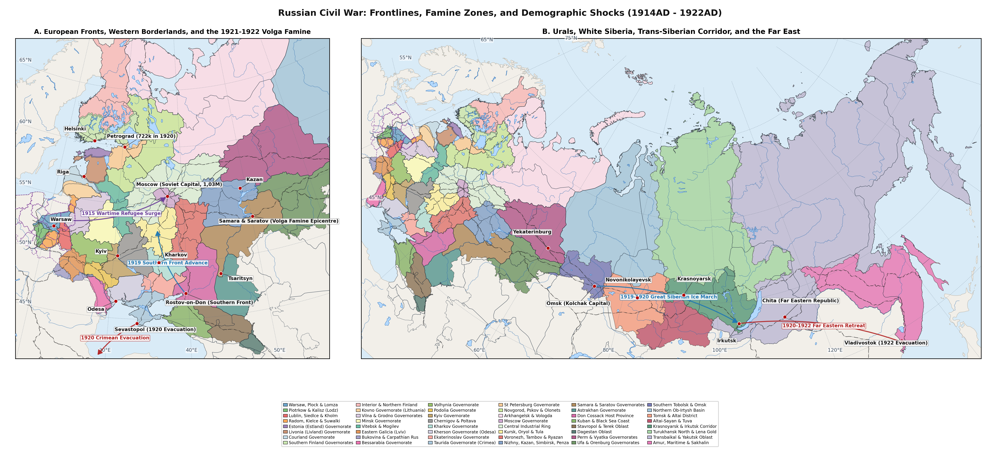

# Overview and Forty-Eight-Region Tsarist Gazetteer Structure

This supplementary settlement gazetteer compiles 275 urban centres, governorate and uezd seats, seceding national capitals, early Soviet autonomous republic (ASSR) and autonomous oblast (AO) capitals, industrial towns and Arctic river posts across all forty-eight pre-war Tsarist Governorates and Oblasts (18 607 231 km2) from the 1914AD pre-war baseline through the 1917AD Revolutions, the 1918-1922AD Civil War and Independence Wars, the 1921-1922AD Povolzhye-Ural-Southern Ukrainian Famine and the 1926AD recovery. Every catalogued settlement is mapped to one of the forty-eight historical regions alongside positive integer population benchmarks across all nine epoch years: 1914AD, 1917AD, 1918AD, 1919AD, 1920AD, 1921AD, 1922AD, 1924AD and 1926AD.

Municipal series are anchored to the 1914AD TsSK statistical yearbooks, the 1917AD All-Russian Municipal Census [@vseros1917gorod], the 28 August 1920AD All-Russian Census [@tsu1920perepis], the 1920AD Finnish Census [@svt1923finland], the 1920AD and 1925AD Latvian Censuses [@skujenieks1927latvia], the 30 September 1921AD First Polish Census [@gus1921skorowidz; @barwinski2015ethnic], the 15 February 1921AD Czechoslovak Census [@csr1924scitani], the 28 December 1922AD Estonian Census [@estonia1924rahvaloendus], the 17 September 1923AD Lithuanian Census [@lithuania1926gyventojai], Romanian administrative directories for Bessarabia and Bukovina [@tartakovsky2009bessarabia; @fondos2024bessarabia], the 15 March 1923AD All-Union Urban Census [@tsu1923gorod] and the 17 December 1926AD First All-Union Population Census [@tsu1926vsesoyuznaya; @koenker1985urbanization; @volkov1930dinamika].

plot of chunk fig1-md-only

# Regions 1 - 4: Former Congress Poland (Ten Vistula Governorates)

Table \ref{tab:reg1-4} documents 23 industrial and administrative centres across Warsaw, Plock and Lomza (Region 1), Piotrkow and Kalisz (Region 2), Lublin, Siedlce and Kholm (Region 3) and Radom, Kielce and Suwalki (Region 4), capturing the 1914AD shelling of Kalisz, the 1915AD Great Retreat evacuation, raw-material blockade de-industrialisation in Lodz (477,9k to 342,0k in 1917AD), the 1920AD Battle of Warsaw and post-Riga urban recovery in the 1921AD Polish Census [@gus1921skorowidz; @barwinski2015ethnic; @gatrell1999whole].

Table: Settlements of Regions 1 - 4: Former Congress Poland / Vistula Governorates (1914AD - 1926AD).

|Settlement (Reg.)                        |Coords         |1914   |1917  |1918  |1919  |1920  |1921   |1922  |1924   |1926   |
|:----------------------------------------|:--------------|:------|:-----|:-----|:-----|:-----|:------|:-----|:------|:------|
|Warsaw [Warszawa] (R1)                   |52,23N, 21,01E |884,5k |758k  |795k  |855k  |905k  |936,7k |956k  |992k   |1,03M  |
|Zyrardow [Zhirardov] (R1)                |52,05N, 20,45E |38,6k  |26,4k |22,5k |21,8k |20,9k |21,3k  |22,1k |23,2k  |24,2k  |
|Wloclawek [Vlotslavsk] (R1)              |52,65N, 19,07E |37,4k  |32,5k |34,2k |36,8k |38,4k |40,3k  |42,4k |45,6k  |48,6k  |
|Plock [Plotsk] (R1)                      |52,55N, 19,71E |35,2k  |28,5k |27,2k |27,6k |27,1k |27,8k  |28,5k |29,7k  |30,8k  |
|Lomza [Lomzha] (R1)                      |53,18N, 22,06E |29,8k  |22,1k |21,4k |21,8k |21,2k |22k    |22,7k |23,6k  |24,5k  |
|Ostroleka [Ostrolenka] (R1)              |53,09N, 21,58E |15,2k  |9,8k  |9,2k  |9,4k  |8,8k  |9,1k   |9,9k  |11,1k  |12,1k  |
|Lodz [Lodz Piotrkow] (R2)                |51,76N, 19,46E |477,9k |342k  |365k  |405k  |432k  |452k   |475k  |518k   |561,6k |
|Sosnowiec [Sosnovitsy] (R2)              |50,29N, 19,10E |118,5k |94k   |88,5k |87,2k |85,8k |86,5k  |90,2k |95,8k  |101,2k |
|Czestochowa [Chenstokhov] (R2)           |50,81N, 19,12E |92,9k  |78,5k |78k   |79,2k |79,8k |80,5k  |84,1k |90,2k  |95,8k  |
|Kalisz [Kalish] (R2)                     |51,77N, 18,09E |65,4k  |29k   |33,5k |38,2k |41,8k |44,6k  |46,8k |49,8k  |52,4k  |
|Bendzin [Bedzin] (R2)                    |50,32N, 19,13E |54,8k  |43,5k |38k   |33,5k |29,5k |27,9k  |30,8k |35,4k  |39,6k  |
|Pabianice [Pabianitsy] (R2)              |51,66N, 19,35E |48,3k  |36,8k |35,2k |34,8k |34,6k |35k    |36,5k |38,9k  |41,2k  |
|Piotrkow [Piotrkow Trybunalski] (R2)     |51,41N, 19,70E |44,8k  |39,2k |39,6k |40,2k |40,6k |41,1k  |42,4k |44,5k  |46,5k  |
|Lublin [Lyublin] (R3)                    |51,25N, 22,57E |72,2k  |64,5k |74k   |82,5k |88,4k |94,4k  |97,5k |102,1k |106,3k |
|Siedlce [Sedlets] (R3)                   |52,17N, 22,29E |34k    |24,8k |26,5k |28,4k |29,1k |30,7k  |31,6k |33,1k  |34,5k  |
|Kholm [Chelm] (R3)                       |51,14N, 23,47E |24,6k  |16,2k |18,1k |20,4k |21,5k |23,2k  |24,4k |25,9k  |27,4k  |
|Zamosc [Zamostye] (R3)                   |50,72N, 23,25E |18,9k  |14,8k |16,1k |17,5k |18,1k |19k    |19,9k |21,2k  |22,4k  |
|Biala Podlaska [Bela] (R3)               |52,03N, 23,12E |16,8k  |11,2k |11,6k |12,2k |12,4k |13k    |13,7k |14,8k  |15,8k  |
|Radom [Radom Governorate] (R4)           |51,40N, 21,15E |49,2k  |41,5k |47,2k |53,5k |58,2k |61,6k  |63,4k |66,1k  |68,4k  |
|Kielce [Keltse] (R4)                     |50,87N, 20,63E |37,6k  |33,2k |35,8k |38,2k |39,8k |41,3k  |43,4k |46,8k  |49,8k  |
|Suwalki [Suvalki] (R4)                   |54,11N, 22,93E |27,1k  |16,8k |15,9k |16,1k |16,3k |16,8k  |17,7k |19,1k  |20,4k  |
|Ostrowiec [Ostrowiec Swietokrzyski] (R4) |50,93N, 21,39E |18,4k  |15,2k |16,5k |17,9k |18,8k |19,7k  |20,7k |22,3k  |23,8k  |
|Mariampol [Marijampole] (R4)             |54,56N, 23,35E |8,6k   |5,9k  |6,5k  |7,2k  |7,9k  |8,6k   |9,2k  |9,6k   |9,9k   |

# Regions 5 - 9: Baltic Baltic Governorates and Finland

Table \ref{tab:reg5-9} lists 28 port, industrial and administrative centres across Estland (Region 5), Livland (Region 6), Courland (Region 7), Southern Finland (Region 8) and Interior and Northern Finland (Region 9), recording the 1915-1917AD evacuation of Courland and Riga (517,5k to 185,1k by 1920AD before recovering to 339,0k by 1926AD), the 1918AD Finnish Civil War and prison camp mortality at Helsingfors, Tammerfors, Tavastehus and Viipuri, and the 1920-1925AD Estonian, Latvian and Finnish censuses [@myrskyla2023finnish; @rantala2020warvictims; @gusachenko2021latvia; @estonia1924rahvaloendus; @skujenieks1927latvia; @svt1923finland].

Table: Settlements of Regions 5 - 9: Estland, Livland, Courland and Southern and Northern Finland Governorates (1914AD - 1926AD).

|Settlement (Reg.)              |Coords         |1914   |1917   |1918   |1919   |1920   |1921   |1922   |1924   |1926   |
|:------------------------------|:--------------|:------|:------|:------|:------|:------|:------|:------|:------|:------|
|Reval [Tallinn] (R5)           |59,44N, 24,75E |137,6k |159k   |132k   |120k   |119k   |121k   |122,4k |125k   |127k   |
|Wesenberg [Rakvere] (R5)       |59,35N, 26,36E |7,4k   |7,6k   |7,1k   |6,9k   |7,1k   |7,4k   |7,7k   |7,9k   |8,1k   |
|Hapsal [Haapsalu] (R5)         |58,94N, 23,54E |4,4k   |4,2k   |3,9k   |3,8k   |4k     |4,1k   |4,2k   |4,3k   |4,4k   |
|Weissenstein [Paide] (R5)      |58,89N, 25,56E |3,1k   |3,2k   |3k     |2,9k   |2,9k   |3k     |3k     |3,1k   |3,2k   |
|Riga [Riia] (R6)               |56,95N, 24,11E |517,5k |210k   |205k   |196k   |185,1k |228k   |270k   |325k   |339k   |
|Dorpat [Tartu] (R6)            |58,38N, 26,73E |48,6k  |46,2k  |43,5k  |42,8k  |44,5k  |47,5k  |50,3k  |54,8k  |59k    |
|Pernau [Parnu] (R6)            |58,39N, 24,50E |19,2k  |16,5k  |15,8k  |15,6k  |16,4k  |17,4k  |18,5k  |20,1k  |21,5k  |
|Walk [Valka] (R6)              |57,78N, 26,05E |18,5k  |16,8k  |15,4k  |14,2k  |13,7k  |13,9k  |14,1k  |14,3k  |14,5k  |
|Wenden [Cesis] (R6)            |57,31N, 25,27E |8,9k   |7,8k   |7,1k   |6,7k   |6,5k   |6,9k   |7,3k   |7,6k   |7,8k   |
|Arensburg [Kuressaare] (R6)    |58,25N, 22,49E |5,4k   |4,1k   |3,6k   |3,5k   |3,6k   |3,9k   |4k     |4,2k   |4,3k   |
|Libau [Liepaja] (R7)           |56,50N, 21,01E |90,7k  |43,2k  |45,5k  |48,2k  |51,6k  |54,2k  |56,8k  |59,5k  |60,7k  |
|Mitau [Jelgava] (R7)           |56,65N, 23,72E |45,7k  |21,5k  |21k    |18,5k  |19,6k  |22,1k  |24,5k  |26,8k  |28,3k  |
|Windau [Ventspils] (R7)        |57,39N, 21,56E |28,8k  |12,4k  |10,8k  |9,2k   |8,2k   |10,4k  |12,6k  |14,8k  |16,3k  |
|Goldingen [Kuldiga] (R7)       |56,97N, 21,97E |12,1k  |6,8k   |6,5k   |6,2k   |5,9k   |6,3k   |6,7k   |7k     |7,2k   |
|Jakobstadt [Jekabpils] (R7)    |56,50N, 25,88E |7,4k   |3,2k   |3,3k   |3,4k   |3,6k   |4,3k   |4,9k   |5,5k   |5,8k   |
|Helsingfors [Helsinki] (R8)    |60,17N, 24,94E |170,5k |187,5k |183,5k |189,2k |197,8k |201,4k |205,1k |210,5k |215,8k |
|Abo [Turku] (R8)               |60,45N, 22,27E |54,6k  |56,2k  |55,1k  |56,8k  |58,4k  |59,1k  |59,8k  |60,8k  |61,8k  |
|Viipuri [Vyborg] (R8)          |60,71N, 28,75E |48,8k  |49,5k  |45,8k  |46,4k  |47,2k  |48k    |48,8k  |50,2k  |51,5k  |
|Tammerfors [Tampere] (R8)      |61,50N, 23,76E |45,2k  |46,8k  |44,6k  |46,1k  |47,8k  |48,7k  |49,6k  |51k    |52,4k  |
|Bjorneborg [Pori] (R8)         |61,49N, 21,80E |17,6k  |18,1k  |16,9k  |17,1k  |17,3k  |17,5k  |17,7k  |18,1k  |18,5k  |
|Kotka [Kotka Timber Port] (R8) |60,47N, 26,95E |11,2k  |11,6k  |10,9k  |11,4k  |12,2k  |12,6k  |13,1k  |14,1k  |15,1k  |
|Tavastehus [Hameenlinna] (R8)  |61,00N, 24,46E |6,6k   |6,9k   |6,2k   |6,4k   |6,7k   |6,8k   |7k     |7,3k   |7,6k   |
|Sortavala [Serdobol] (R8)      |61,70N, 30,69E |3,6k   |3,8k   |3,7k   |3,8k   |3,9k   |4k     |4,1k   |4,3k   |4,5k   |
|Vasa [Vaasa] (R9)              |63,10N, 21,62E |24,2k  |24,8k  |24,3k  |24,1k  |24k    |24,2k  |24,5k  |25k    |25,5k  |
|Uleaborg [Oulu] (R9)           |65,01N, 25,47E |21,5k  |22,1k  |21,2k  |21,3k  |21,3k  |21,7k  |22,1k  |22,8k  |23,5k  |
|Kuopio [Kuopio Savo] (R9)      |62,89N, 27,68E |17,5k  |18,1k  |17,8k  |18,2k  |18,7k  |19,1k  |19,5k  |20,2k  |20,9k  |
|Sankt-Michel [Mikkeli] (R9)    |61,69N, 27,27E |4,7k   |4,9k   |4,8k   |4,9k   |5k     |5,1k   |5,2k   |5,3k   |5,5k   |
|Gamlakarleby [Kokkola] (R9)    |63,84N, 23,13E |4,1k   |4,3k   |4,2k   |4,3k   |4,4k   |4,4k   |4,6k   |4,7k   |4,8k   |

# Regions 10 - 16: Lithuania, Belarus, Galicia, Bukovina-Subcarpathia and Bessarabia

Table \ref{tab:reg10-16} covers 42 cities across Kovno (Region 10), Vilna and Grodno (Region 11), Minsk (Region 12), Vitebsk and Mogilev including Latgalian Dvinsk and Rezhitsa (Region 13), Eastern Galicia (Region 14), Bukovina and Subcarpathian Rus (Region 15) and Bessarabia (Region 16), tracing Ober Ost depopulation, Kaunas's provisional capital boom (42,0k to 94,4k), Zeligowski's 1920AD seizure of Vilna, the 1921AD Riga partition of Belarus, the 1918-1919AD battle for Lviv and the Khotyn (1919AD) and Tatarbunary (1924AD) uprisings in Bessarabia [@balkelis2018war; @marcinkevicius2026lithuania; @cichoracki2014polesia; @mick2016galicia; @tartakovsky2009bessarabia; @bondarenko2019bessarabia].

Table: Settlements of Regions 10 - 16: Northwestern Krai (Lithuania and Belarus), Eastern Galicia, Bukovina-Subcarpathia and Bessarabia (1914AD - 1926AD).

|Settlement (Reg.)                      |Coords         |1914   |1917   |1918   |1919   |1920  |1921   |1922  |1924   |1926   |
|:--------------------------------------|:--------------|:------|:------|:------|:------|:-----|:------|:-----|:------|:------|
|Kovno [Kaunas] (R10)                   |54,90N, 23,90E |91,4k  |42k    |49,5k  |62k    |73,5k |81,2k  |88,5k |92,9k  |94,4k  |
|Shavli [Siauliai] (R10)                |55,93N, 23,31E |23,5k  |11,2k  |13,2k  |15,4k  |17,6k |19,2k  |20,6k |21,5k  |21,8k  |
|Ponevezh [Panevezys] (R10)             |55,73N, 24,36E |17,8k  |11,8k  |13,1k  |14,6k  |16,2k |17,5k  |18,6k |19,3k  |19,7k  |
|Vilkomir [Ukmerge] (R10)               |55,25N, 24,76E |16,8k  |10,6k  |10,1k  |9,8k   |9,9k  |10,2k  |10,5k |10,8k  |11,2k  |
|Telshi [Telsiai] (R10)                 |55,98N, 22,25E |8,1k   |5,8k   |5,1k   |4,8k   |4,6k  |4,7k   |4,7k  |4,8k   |5k     |
|Vilna [Vilnius] (R11)                  |54,69N, 25,28E |204,3k |138,9k |134k   |128,5k |131k  |138k   |152k  |169k   |178k   |
|Bialystok [Belostok] (R11)             |53,13N, 23,17E |91,5k  |58k    |62,5k  |67,8k  |72,1k |76,8k  |79,2k |82,1k  |84,6k  |
|Grodno [Hrodna] (R11)                  |53,67N, 23,81E |61,6k  |34,8k  |33,5k  |33,2k  |34,1k |34,9k  |37,2k |40,8k  |43,8k  |
|Brest-Litovsk [Brest] (R11)            |52,10N, 23,73E |57,4k  |16,5k  |19,5k  |23,8k  |27,2k |29,6k  |33,8k |39,6k  |44,5k  |
|Slonim [Slonim Grodno] (R11)           |53,09N, 25,32E |21,2k  |13,4k  |12,1k  |11,2k  |10,1k |9,6k   |11,2k |13,5k  |15,2k  |
|Lida [Lida Vilna Gub] (R11)            |53,89N, 25,30E |14,8k  |11,2k  |11,8k  |12,4k  |12,9k |13,4k  |14,6k |16,4k  |17,8k  |
|Minsk [Mensk] (R12)                    |53,90N, 27,56E |117,6k |134k   |120k   |104k   |92k   |97k    |102k  |115,9k |131,8k |
|Bobruisk [Babruysk] (R12)              |53,14N, 29,22E |44,2k  |46,5k  |42,8k  |38,6k  |35,5k |37,6k  |39,9k |45,3k  |51,3k  |
|Pinsk [Pinsk Polesia] (R12)            |52,11N, 26,10E |38,6k  |21,5k  |22,4k  |21,8k  |22,6k |23,5k  |25,1k |27,6k  |29,5k  |
|Baranovichi [Baranavichy] (R12)        |53,13N, 26,01E |30,5k  |18,4k  |15,2k  |12,8k  |11,1k |11,5k  |14,2k |18,4k  |21,8k  |
|Borisov [Barysaw] (R12)                |54,22N, 28,51E |21,5k  |23,2k  |21,4k  |19,3k  |17,8k |18,9k  |20,1k |22,9k  |25,8k  |
|Mozyr [Mazyr] (R12)                    |52,05N, 29,25E |12,4k  |12,8k  |11,9k  |10,9k  |10,2k |10,9k  |11,7k |13,2k  |14,6k  |
|Dvinsk [Daugavpils] (R13)              |55,87N, 26,54E |112,8k |68,5k  |52k    |38,5k  |31,5k |34,2k  |36,8k |39,6k  |40,6k  |
|Vitebsk [Vitsebsk] (R13)               |55,19N, 30,20E |108,9k |112k   |101,8k |89k    |80k   |82,6k  |85,4k |91,9k  |98,9k  |
|Gomel [Homyel] (R13)                   |52,43N, 30,98E |104,5k |106,8k |94,4k  |78,9k  |68k   |70,6k  |73,4k |79,7k  |86,4k  |
|Mogilev [Mahilyow] (R13)               |53,90N, 30,33E |69,7k  |76,5k  |65k    |50,6k  |40,5k |41,5k  |42,5k |45,9k  |50,2k  |
|Polotsk [Polatsk] (R13)                |55,49N, 28,79E |31,1k  |32,4k  |27,9k  |22,2k  |18,2k |19,3k  |20,3k |23k    |25,8k  |
|Rezhitsa [Rezekne] (R13)               |56,51N, 27,33E |21,8k  |16,2k  |13,5k  |11,2k  |10k   |10,8k  |11,5k |12,3k  |12,6k  |
|Lemberg [Lviv] (R14)                   |49,84N, 24,03E |212k   |178k   |192k   |198k   |208k  |219,4k |224k  |230,5k |235,2k |
|Przemysl [Peremyshl] (R14)             |49,78N, 22,77E |54,1k  |42k    |44,5k  |45,2k  |46,5k |48k    |48,8k |50,1k  |51,2k  |
|Kolomyia [Kolomea] (R14)               |48,53N, 25,04E |43,8k  |34k    |33,2k  |31,8k  |31,4k |31,7k  |32,5k |33,6k  |34,4k  |
|Stanislau [Ivano-Frankivsk] (R14)      |48,92N, 24,71E |36,8k  |28,4k  |29,2k  |27,5k  |27,8k |28,2k  |32,5k |44k    |51,3k  |
|Drohobych [Drogobych] (R14)            |49,35N, 23,51E |36,5k  |31,2k  |29,5k  |28,1k  |26,9k |26,7k  |28,1k |29,9k  |31,4k  |
|Tarnopol [Ternopil] (R14)              |49,55N, 25,59E |35,2k  |26,5k  |28,1k  |28,8k  |29,8k |30,9k  |31,9k |33,4k  |34,6k  |
|Boryslav [Boryslaw] (R14)              |49,29N, 23,42E |16,8k  |13,5k  |14,2k  |14,8k  |15,4k |16,1k  |17,1k |18,5k  |19,6k  |
|Czernowitz [Chernivtsi] (R15)          |48,29N, 25,94E |94k    |76k    |82,5k  |86,2k  |89,5k |92,4k  |95k   |99,2k  |102,8k |
|Munkacs [Mukachevo] (R15)              |48,44N, 22,72E |18,2k  |16,9k  |17,8k  |18,9k  |19,9k |20,9k  |21,3k |22,1k  |22,9k  |
|Ungvar [Uzhhorod] (R15)                |48,62N, 22,29E |17,6k  |16,4k  |17,2k  |18,4k  |19,6k |20,6k  |21,4k |22,8k  |24,1k  |
|Beregszasz [Berehove] (R15)            |48,21N, 22,64E |13,2k  |12,4k  |12,7k  |13k    |13,3k |13,7k  |14,1k |14,8k  |15,4k  |
|Huszt [Khust] (R15)                    |48,18N, 23,30E |10,9k  |10,2k  |10,6k  |11k    |11,4k |11,9k  |12,4k |13,3k  |14,2k  |
|Kishinev [Chisinau] (R16)              |47,01N, 28,86E |128,7k |131k   |121k   |114k   |111k  |111,5k |112k  |113,5k |115k   |
|Akkerman [Bilhorod-Dnistrovskyi] (R16) |46,20N, 30,34E |39,8k  |40,2k  |35,8k  |32,5k  |29,8k |30,4k  |31k   |32,2k  |33,5k  |
|Bender [Bendery] (R16)                 |46,83N, 29,47E |38,6k  |39,2k  |34,5k  |30,5k  |29,8k |30,1k  |30,5k |31k    |31,5k  |
|Ismail [Izmail] (R16)                  |45,35N, 28,83E |35,7k  |35,1k  |33,8k  |32,9k  |32,5k |33,2k  |34,1k |35,6k  |37k    |
|Beltsy [Balti] (R16)                   |47,76N, 27,93E |31,2k  |31,8k  |29,4k  |28,1k  |27,5k |27,9k  |28,4k |29,2k  |30,1k  |
|Khotin [Khotyn] (R16)                  |48,51N, 26,49E |24,5k  |21,8k  |20,5k  |15,2k  |14,8k |15,1k  |15,4k |16k    |16,6k  |
|Tatarbunary [Tatar-Bunar] (R16)        |45,84N, 29,61E |11,8k  |12,1k  |11,6k  |11,2k  |11k   |11,2k  |11,5k |10,8k  |11,9k  |

# Regions 17 - 24: Ukraine, Novorossiya and Taurida-Crimea

Table \ref{tab:reg17-24} lists 46 urban and industrial centres across Volhynia (Region 17), Podolia (Region 18), Kyiv (Region 19), Chernigov and Poltava (Region 20), Kharkov (Region 21), Kherson (Region 22), Ekaterinoslav (Region 23) and Taurida (Region 24), capturing the 1919AD anti-Jewish pogroms across Right-Bank shtetls, Makhno's Huliaipole epicentre, Odessa's 55% contraction (630,0k to 282,0k in 1922AD), Wrangel's November 1920AD Crimean evacuation from Sevastopol and the 1921-1922AD Southern Ukrainian and Crimean famine [@abramson1999prayer; @veidlinger2021midst; @kulchytsky2015demohrafichni; @kolesnikov2025zarubezhe].

Table: Settlements of Regions 17 - 24: Right-Bank, Left-Bank and Steppe Ukraine, Donbas and Taurida-Crimea (1914AD - 1926AD).

|Settlement (Reg.)                             |Coords         |1914   |1917  |1918   |1919   |1920   |1921   |1922  |1924   |1926   |
|:---------------------------------------------|:--------------|:------|:-----|:------|:------|:------|:------|:-----|:------|:------|
|Zhitomir [Zhytomyr] (R17)                     |50,25N, 28,66E |92,6k  |89,4k |82,9k  |71,9k  |64,5k  |65,7k  |67k   |71,3k  |76,7k  |
|Berdichev [Berdychiv] (R17)                   |49,89N, 28,60E |79,1k  |77,5k |68,7k  |53,6k  |43,5k  |44,6k  |45,7k |50k    |55,6k  |
|Rovno [Rivne] (R17)                           |50,62N, 26,25E |36,8k  |32,5k |31,2k  |29,8k  |29,2k  |30,5k  |32,2k |35,1k  |37,2k  |
|Kovel [Kowel] (R17)                           |51,21N, 24,71E |29,2k  |19,4k |19,8k  |19,5k  |19,9k  |20,8k  |22,1k |24,1k  |26k    |
|Lutsk [Luck] (R17)                            |50,75N, 25,33E |28,1k  |21,6k |21,4k  |20,9k  |20,6k  |21,2k  |23,2k |26,5k  |29,5k  |
|Kremenets [Krzemieniec] (R17)                 |50,10N, 25,73E |22,4k  |19,8k |18,5k  |17,1k  |16,2k  |16,1k  |16,8k |18,1k  |19,2k  |
|Vinnitsa [Vinnytsia] (R18)                    |49,23N, 28,47E |53,8k  |54,6k |52,5k  |48,2k  |45,2k  |47,2k  |49,3k |53,7k  |58k    |
|Kamenets-Podolsky [Kamianets-Podilskyi] (R18) |48,68N, 26,59E |50,5k  |46,2k |41,9k  |33,3k  |27,2k  |27,9k  |28,7k |30,4k  |32,1k  |
|Proskurov [Khmelnytskyi] (R18)                |49,42N, 26,99E |40,6k  |38,9k |35,7k  |29,3k  |24,8k  |25,7k  |26,6k |29,1k  |32k    |
|Mogilev-Podolsky [Mohyliv-Podilskyi] (R18)    |48,45N, 27,80E |32,6k  |31,5k |30,9k  |29,8k  |28,9k  |29,5k  |30k   |31,2k  |32,3k  |
|Balta [Balta Podolia] (R18)                   |47,94N, 29,62E |28,9k  |28,4k |26,5k  |22,6k  |19,8k  |20,3k  |20,7k |21,9k  |23k    |
|Kyiv [Kiev] (R19)                             |50,45N, 30,52E |626,3k |644k  |595k   |544,4k |366,4k |378k   |398k  |448k   |513,6k |
|Kremenchug [Kremenchuk] (R19)                 |49,07N, 33,42E |98,7k  |99,5k |88,2k  |67,8k  |52k    |52,9k  |53,9k |56,3k  |58,8k  |
|Bila Tserkva [Belaya Tserkov] (R19)           |49,80N, 30,12E |60,5k  |61,2k |55,3k  |44,7k  |36,5k  |37,4k  |38,3k |40,5k  |42,9k  |
|Uman [Human] (R19)                            |48,75N, 30,22E |50,2k  |50,8k |47,5k  |41,5k  |36,8k  |37,9k  |39,1k |41,9k  |44,8k  |
|Cherkassy [Cherkasy] (R19)                    |49,44N, 32,06E |43,8k  |44,5k |42k    |37,6k  |34,2k  |35k    |35,7k |37,6k  |39,5k  |
|Poltava [Poltava Governorate] (R20)           |49,59N, 34,55E |83,5k  |85,2k |83,1k  |79,8k  |76,4k  |80,4k  |84,4k |89,7k  |92k    |
|Nezhin [Nizhyn] (R20)                         |51,05N, 31,89E |52,4k  |53k   |48,6k  |41,4k  |34,2k  |34,8k  |35,5k |36,8k  |38k    |
|Chernigov [Chernihiv] (R20)                   |51,50N, 31,29E |38,4k  |39,1k |36,9k  |33,4k  |29,8k  |31,8k  |34k   |35,7k  |35,2k  |
|Romny [Romny Fair] (R20)                      |50,75N, 33,47E |35,8k  |36,2k |33,3k  |28,5k  |23,8k  |24,1k  |24,3k |25k    |25,8k  |
|Konotop [Konotop Rail Hub] (R20)              |51,24N, 33,20E |28,6k  |29,4k |28,7k  |27,5k  |26,4k  |27,5k  |28,7k |31,2k  |33,6k  |
|Kharkov [Kharkiv] (R21)                       |49,99N, 36,23E |352k   |382k  |355k   |318k   |285,2k |292k   |308k  |356k   |417,3k |
|Sumy [Sumy Sugar Hub] (R21)                   |50,91N, 34,80E |50,4k  |51,2k |48k    |42,9k  |37,2k  |38k    |38,8k |41,3k  |44,2k  |
|Akhtyrka [Okhtyrka] (R21)                     |50,31N, 34,90E |31,8k  |32,1k |30,4k  |27,6k  |24,5k  |24,9k  |25,4k |26,2k  |27k    |
|Belgorod [Belgorod Kursk Gub] (R21)           |50,60N, 36,59E |31,2k  |31,8k |30,2k  |27,7k  |24,8k  |25,7k  |26,6k |28,8k  |31,1k  |
|Slavyansk [Sloviansk] (R21)                   |48,85N, 37,61E |25,4k  |26,1k |25,7k  |25,1k  |24,5k  |25,1k  |25,8k |27,3k  |28,8k  |
|Izyum [Izium] (R21)                           |49,21N, 37,26E |19,6k  |20,4k |18,2k  |14,7k  |10,8k  |11k    |11,2k |11,8k  |12,5k  |
|Odessa [Odesa] (R22)                          |46,48N, 30,72E |630k   |620k  |540k   |445k   |317,2k |295k   |282k  |352k   |420,9k |
|Nikolaev [Mykolaiv] (R22)                     |46,98N, 31,99E |108,8k |116k  |107,9k |96,1k  |82,5k  |79,4k  |75,2k |89,7k  |104,9k |
|Kherson [Kherson Port] (R22)                  |46,64N, 32,62E |98,6k  |99,2k |86,9k  |69,1k  |48,5k  |46,1k  |43,6k |47,5k  |58,8k  |
|Elisavetgrad [Kropyvnytskyi] (R22)            |48,51N, 32,26E |78,2k  |79,4k |74,2k  |66,7k  |58k    |55,5k  |52,8k |56,1k  |66,5k  |
|Tiraspol [Tiraspol Dniester] (R22)            |46,84N, 29,64E |37,8k  |38,4k |37,5k  |36,2k  |34,6k  |33k    |31,3k |26,8k  |21,7k  |
|Krivoy Rog [Kryvyi Rih] (R22)                 |47,91N, 33,39E |26,8k  |28,2k |25,4k  |21,4k  |16,8k  |16,2k  |15,3k |23,7k  |31,3k  |
|Ekaterinoslav [Dnipro] (R23)                  |48,46N, 35,05E |220,4k |231k  |212,5k |186,2k |163k   |157,6k |151k  |185,7k |232,9k |
|Lugansk [Luhansk] (R23)                       |48,57N, 39,31E |68k    |72,5k |64,8k  |53,8k  |44,2k  |42,7k  |40,9k |54k    |71,8k  |
|Mariupol [Mariupol Azov Port] (R23)           |47,10N, 37,54E |58k    |61,2k |53k    |41,4k  |31,2k  |30,2k  |28,9k |33k    |41k    |
|Yuzovka [Donetsk] (R23)                       |48,02N, 37,80E |54k    |58,5k |53k    |45,1k  |38,2k  |36,2k  |34k   |58,6k  |105,9k |
|Aleksandrovsk [Zaporizhzhia] (R23)            |47,84N, 35,14E |53,4k  |58,5k |54,2k  |48,2k  |42,8k  |41,4k  |39,7k |48,1k  |55,7k  |
|Bakhmut [Artemovsk] (R23)                     |48,60N, 38,00E |33,5k  |34,8k |32,2k  |28,5k  |25,2k  |24,4k  |23,3k |32,1k  |37,7k  |
|Huliaipole [Gulyaypole] (R23)                 |47,66N, 36,26E |16,2k  |16,5k |15,8k  |14,2k  |11,4k  |9,9k   |9,2k  |10,8k  |12,2k  |
|Simferopol [Aqmescit] (R24)                   |44,95N, 34,10E |81,2k  |84,5k |82k    |86,5k  |74,2k  |64k    |60,5k |77,5k  |88,3k  |
|Sevastopol [Sebastopol] (R24)                 |44,62N, 33,53E |77,5k  |88k   |82k    |86k    |62,5k  |56k    |53,5k |66,8k  |74,6k  |
|Kerch [Kerch-Yenikale] (R24)                  |45,36N, 36,47E |55,8k  |56,4k |50,4k  |42,4k  |27,5k  |25,5k  |23,4k |29,6k  |34,6k  |
|Feodosiya [Theodosia] (R24)                   |45,03N, 35,38E |43,1k  |43,8k |39,6k  |34k    |23,5k  |21,8k  |20k   |24,7k  |28,7k  |
|Berdyansk [Berdiansk] (R24)                   |46,76N, 36,80E |40,2k  |40,8k |36,7k  |31,3k  |21,2k  |19,7k  |18k   |23,5k  |26,4k  |
|Melitopol [Novoaleksandrovka] (R24)           |46,85N, 35,37E |23,6k  |24,2k |23k    |21,4k  |18,5k  |17,2k  |15,8k |21,8k  |25,3k  |

# Regions 25 - 31: Petrograd, Northern Russia, Moscow, Central Industrial Ring and Black-Earth Core

Table \ref{tab:reg25-31} compiles 41 cities across Saint Petersburg Governorate (Region 25), Novgorod, Pskov and Olonets (Region 26), Arkhangelsk and Vologda (Region 27), Moscow Governorate (Region 28), the Central Industrial Ring (Region 29) and Western and Eastern Central Black-Earth Governorates (Regions 30-31), recording Petrograd's 70,2% War Communism collapse (2,42M in 1917AD to 722,2k in 1920AD), Moscow's 49,1% drop (2,02M to 1,03M), Allied intervention at Murmansk and Arkhangelsk and the 1920-1921AD Antonovshchina peasant insurgency in Tambov [@koenker1985urbanization; @tsu1920perepis; @dyachkov2021tambov; @tsu1926vsesoyuznaya].

Table: Settlements of Regions 25 - 31: Saint Petersburg, Northwestern Lakes, European North, Moscow, Central Industrial Ring and Black-Earth Belt (1914AD - 1926AD).

|Settlement (Reg.)                              |Coords         |1914   |1917  |1918   |1919   |1920   |1921   |1922   |1924   |1926   |
|:----------------------------------------------|:--------------|:------|:-----|:------|:------|:------|:------|:------|:------|:------|
|Saint Petersburg [Petrograd] (R25)             |59,93N, 30,34E |2,12M  |2,42M |1,47M  |900k   |722,2k |830k   |960k   |1,22M  |1,61M  |
|Kronstadt [Kronshtadt] (R25)                   |59,99N, 29,77E |68,2k  |74,5k |52k    |41k    |36,5k  |24k    |26,5k  |29,2k  |31,2k  |
|Tsarskoe Selo [Pushkin] (R25)                  |59,72N, 30,40E |31,8k  |34,2k |25,7k  |19,7k  |15,4k  |17,3k  |19,2k  |23,3k  |27,2k  |
|Narva [Kreenholm] (R25)                        |59,38N, 28,18E |27,4k  |29,2k |25,5k  |23,4k  |24,8k  |25,9k  |26,9k  |26,9k  |26,9k  |
|Gatchina [Gatchina Palace] (R25)               |59,57N, 30,13E |21,5k  |23,4k |17,6k  |13,5k  |10,5k  |11,8k  |13,1k  |15,9k  |18,6k  |
|Luga [Luga Ingria] (R25)                       |58,74N, 29,85E |11,2k  |12,8k |9,6k   |7,4k   |5,8k   |6,5k   |7,2k   |8,7k   |10,2k  |
|Pskov [Pleskov] (R26)                          |57,82N, 28,33E |38,3k  |52k   |44,6k  |35,7k  |29,8k  |32,1k  |34,6k  |39,4k  |43,9k  |
|Novgorod [Veliky Novgorod] (R26)               |58,52N, 31,28E |28,4k  |29,8k |28k    |25,9k  |24,5k  |25,4k  |26,2k  |29,1k  |32,8k  |
|Petrozavodsk [Olonets Capital] (R26)           |61,78N, 34,35E |18,8k  |26,4k |24,7k  |22,6k  |21,2k  |21,6k  |22k    |24,1k  |27,1k  |
|Staraya Russa [Russa] (R26)                    |57,98N, 31,37E |18,6k  |19,4k |18,9k  |18,2k  |17,8k  |18,6k  |19,3k  |20,9k  |22,5k  |
|Velikie Luki [Velikiye Luki] (R26)             |56,34N, 30,55E |15,2k  |18,5k |18k    |17,4k  |17k    |17,3k  |17,7k  |18,4k  |19,2k  |
|Cherepovets [Cherepovets Mariinsk Canal] (R26) |59,13N, 37,90E |10,8k  |12,4k |12,1k  |11,7k  |11,4k  |11,6k  |11,9k  |12,4k  |12,8k  |
|Vologda [Vologda Governorate] (R27)            |59,22N, 39,89E |43,8k  |49,5k |48,5k  |47,3k  |46,5k  |48,6k  |50,8k  |54,7k  |58k    |
|Arkhangelsk [Archangel] (R27)                  |64,54N, 40,52E |43,6k  |68k   |61,4k  |53,5k  |48,2k  |50k    |51,8k  |60,5k  |72,6k  |
|Veliky Ustyug [Ustyug Veliky] (R27)            |60,76N, 46,30E |18,2k  |18,8k |18k    |17,1k  |16,5k  |16,9k  |17,4k  |18,3k  |19,1k  |
|Ust-Sysolsk [Syktyvkar] (R27)                  |61,67N, 50,84E |6,2k   |6,5k  |5,8k   |5k     |4,4k   |4,5k   |4,7k   |4,9k   |5,1k   |
|Romanov-on-Murman [Murmansk] (R27)             |68,97N, 33,07E |1,5k   |12,5k |8,4k   |7,2k   |2,5k   |3,2k   |3,9k   |5,9k   |8,8k   |
|Moscow [Moskva] (R28)                          |55,76N, 37,62E |1,76M  |2,02M |1,72M  |1,42M  |1,03M  |1,18M  |1,38M  |1,74M  |2,03M  |
|Orekhovo-Zuevo [Morozov Mills] (R28)           |55,81N, 38,96E |69,8k  |72,4k |57,1k  |49,7k  |45,6k  |50,9k  |56,4k  |68k    |79,2k  |
|Serpukhov [Serpukhov Textile] (R28)            |54,92N, 37,41E |41,5k  |43,2k |34,1k  |29,7k  |27,2k  |31,7k  |36,4k  |46,3k  |55,9k  |
|Kolomna [Kolomna Locomotive Works] (R28)       |55,08N, 38,78E |34,6k  |38,9k |30,7k  |26,7k  |24,5k  |25,5k  |26,5k  |28,6k  |30,7k  |
|Bogorodsk [Noginsk] (R28)                      |55,85N, 38,44E |25,6k  |27,2k |21,5k  |18,7k  |17,1k  |19,1k  |21,2k  |25,6k  |29,8k  |
|Ivanovo-Voznesensk [Ivanovo] (R29)             |57,00N, 40,97E |146k   |152k  |111,1k |80,9k  |57,8k  |62,4k  |67,2k  |86,1k  |111,5k |
|Yaroslavl [Yaroslavl Volga] (R29)              |57,63N, 39,88E |120,4k |125k  |103,9k |88,3k  |76,4k  |81,1k  |86k    |99,2k  |114,3k |
|Smolensk [Smolensk Dnieper] (R29)              |54,78N, 32,05E |75,8k  |82,4k |71,3k  |63,1k  |56,8k  |60,1k  |63,5k  |71k    |78,5k  |
|Kostroma [Kostroma Textile] (R29)              |57,77N, 40,93E |73,2k  |74,8k |64k    |55,9k  |49,8k  |53k    |56,2k  |64,6k  |73,7k  |
|Tver [Kalinin] (R29)                           |56,86N, 35,92E |64,3k  |68,5k |68,5k  |68,5k  |68,5k  |73,4k  |78,6k  |92,5k  |108,4k |
|Kaluga [Kaluga Oka] (R29)                      |54,53N, 36,28E |57,6k  |59,2k |51,2k  |45,3k  |40,8k  |41,7k  |42,5k  |46,3k  |51,6k  |
|Vladimir [Vladimir Klyazma] (R29)              |56,13N, 40,41E |43,5k  |45,2k |37,8k  |32,4k  |28,2k  |29,4k  |30,6k  |34,6k  |39,7k  |
|Rybinsk [Rybinsk Grain Port] (R29)             |58,05N, 38,86E |33,4k  |35,1k |33,5k  |32,4k  |31,5k  |35,3k  |39,2k  |47,5k  |55,5k  |
|Tula [Tula Imperial Arsenal] (R30)             |54,20N, 37,62E |140,6k |158k  |148,5k |137,9k |128,4k |126,8k |125,2k |134,1k |152,7k |
|Oryol [Orel] (R30)                             |52,97N, 36,08E |97,2k  |98,4k |87,4k  |75,2k  |64,2k  |66,6k  |69,1k  |73,8k  |77,9k  |
|Kursk [Kursk Governorate] (R30)                |51,74N, 36,19E |89,8k  |91,5k |86,7k  |81,3k  |76,5k  |79,4k  |82,3k  |90k    |98,6k  |
|Yelets [Elets] (R30)                           |52,62N, 38,50E |58,4k  |59,2k |52,4k  |45k    |38,2k  |38,8k  |39,5k  |41,2k  |43,2k  |
|Bryansk [Bryansk Works] (R30)                  |53,24N, 34,36E |34,5k  |39,8k |35,6k  |31k    |26,8k  |29,7k  |32,7k  |39,3k  |46k    |
|Voronezh [Voronezh Don] (R31)                  |51,67N, 39,18E |94,8k  |99,2k |95,7k  |92,1k  |88,5k  |86,8k  |85,9k  |105,3k |121,6k |
|Tambov [Tambov Governorate] (R31)              |52,72N, 41,45E |71,4k  |73,5k |71,5k  |69,3k  |67,2k  |65,9k  |65,2k  |73,2k  |76,4k  |
|Kozlov [Michurinsk] (R31)                      |52,90N, 40,49E |53,2k  |54,6k |52,1k  |49,4k  |46,8k  |45,9k  |45,4k  |51,5k  |54k    |
|Ryazan [Pereyaslavl-Ryazansky] (R31)           |54,63N, 39,69E |49,6k  |51,2k |48k    |44,6k  |41,2k  |40,4k  |40k    |47,1k  |50,9k  |
|Morshansk [Morshansk Tsna Port] (R31)          |53,44N, 41,81E |31,8k  |32,2k |29,6k  |26,9k  |24,2k  |23,7k  |23,5k  |26,8k  |27,9k  |
|Lipetsk [Lipetsk Ironworks] (R31)              |52,60N, 39,57E |25,8k  |26,4k |25,7k  |25k    |24,3k  |23,9k  |23,6k  |22,6k  |21,4k  |

# Regions 32 - 40: Middle and Lower Volga, Don-Kuban-Caucasus and the Urals

Table \ref{tab:reg32-40} lists 54 cities across the Middle Volga (Region 32), Samara and Saratov (Region 33), Astrakhan (Region 34), the Don Cossack Host (Region 35), Kuban and Black Sea (Region 36), Stavropol and Terek (Region 37), Dagestan (Region 38), Perm and Vyatka (Region 39) and Ufa and Orenburg (Region 40), spanning the 1921-1922AD Povolzhye-Ural famine epicentre, ARA relief hubs, Don-Kuban-Terek decossackisation, the Mountain and Dagestan ASSRs and Ural industrial recovery [@wheatcroft1981famine; @patenaude2002big; @polyakov2005povolzhskiy; @venkov2018kazachestvo; @feldman2001ural].

Table: Settlements of Regions 32 - 40: Povolzhye Famine Core, Don-Kuban-Terek-Dagestan Caucasus and Northern and Southern Urals (1914AD - 1926AD).

|Settlement (Reg.)                          |Coords         |1914   |1917  |1918   |1919   |1920   |1921   |1922   |1924   |1926   |
|:------------------------------------------|:--------------|:------|:-----|:------|:------|:------|:------|:------|:------|:------|
|Kazan [Qazan] (R32)                        |55,79N, 49,12E |195,3k |206k  |188k   |168k   |146,5k |134k   |131k   |164k   |179k   |
|Nizhny Novgorod [Makaryev Fair] (R32)      |56,30N, 43,94E |112,3k |127k  |123k   |119,7k |116,8k |110,6k |105,5k |114,8k |113,5k |
|Penza [Penza Sura] (R32)                   |53,20N, 45,00E |83,1k  |86,5k |82,7k  |79,6k  |76,8k  |72,7k  |69,4k  |84,4k  |91,9k  |
|Simbirsk [Ulyanovsk] (R32)                 |54,31N, 48,40E |64k    |66,2k |65,8k  |65,5k  |65,2k  |61,7k  |58,9k  |68,8k  |72,3k  |
|Syzran [Syzran Rail Bridge] (R32)          |53,16N, 48,47E |47,8k  |48,9k |45,1k  |42k    |39,2k  |37,1k  |35,4k  |45,9k  |50,3k  |
|Saransk [Saransk Penza Gub] (R32)          |54,18N, 45,17E |18,2k  |18,9k |16,9k  |15,3k  |13,8k  |13,1k  |12,5k  |14,8k  |15,4k  |
|Cheboksary [Shupashkar] (R32)              |56,14N, 47,25E |5,9k   |6,8k  |6,7k   |6,7k   |6,6k   |6,2k   |6,1k   |7,9k   |8,8k   |
|Saratov [Saratov Grain Capital] (R33)      |51,53N, 46,03E |235,9k |242k  |224k   |206k   |188,4k |172k   |164k   |195k   |215,3k |
|Samara [Kuybyshev] (R33)                   |53,20N, 50,15E |143,8k |175k  |164k   |151k   |135,2k |121k   |114k   |156k   |175,6k |
|Tsaritsyn [Volgograd] (R33)                |48,71N, 44,51E |101k   |115k  |108,6k |100k   |90,4k  |83,3k  |76,9k  |122k   |148,4k |
|Volsk [Volgsk] (R33)                       |52,04N, 47,38E |36,2k  |36,8k |36,1k  |35,1k  |34k    |31,3k  |28,9k  |32,3k  |31,1k  |
|Pokrovskaya Sloboda [Engels] (R33)         |51,48N, 46,12E |34,3k  |35,6k |33,3k  |30,2k  |26,8k  |24,7k  |22,8k  |30,9k  |34,3k  |
|Kamyshin [Dmitrievsk] (R33)                |50,10N, 45,42E |24,1k  |24,6k |22,6k  |19,8k  |16,8k  |15,5k  |14,3k  |17,5k  |18k    |
|Astrakhan [Hajitarkhan] (R34)              |46,35N, 48,04E |162,5k |165k  |154k   |138,6k |123,2k |116,6k |111,2k |149,4k |176,5k |
|Tsarev [Tsarev Akhtuba] (R34)              |48,66N, 45,37E |8,6k   |8,8k  |8,5k   |8,1k   |7,6k   |7,2k   |6,9k   |7,7k   |7,7k   |
|Krasny Yar [Krasny Yar Delta] (R34)        |46,53N, 48,35E |7,4k   |7,5k  |7,2k   |6,9k   |6,5k   |6,1k   |5,9k   |6,6k   |6,6k   |
|Cherny Yar [Chyorny Yar] (R34)             |48,06N, 46,11E |5,4k   |5,5k  |5,3k   |5k     |4,8k   |4,5k   |4,3k   |4,8k   |4,8k   |
|Khanskaya Stavka [Urda] (R34)              |48,77N, 47,45E |4,8k   |4,9k  |4,7k   |4,5k   |4,2k   |4k     |3,8k   |4,3k   |4,3k   |
|Elista [Kalmyk Steppe] (R34)               |46,31N, 44,26E |1,8k   |1,9k  |1,8k   |1,6k   |1,5k   |1,4k   |1,3k   |2,6k   |4,3k   |
|Rostov-on-Don [Rostov & Nakhichevan] (R35) |47,24N, 39,70E |245k   |255k  |242k   |238k   |177,2k |195k   |215k   |262k   |308,1k |
|Taganrog [Taganrog Azov Port] (R35)        |47,24N, 38,90E |78,6k  |82,4k |79,1k  |74k    |68,2k  |66k    |64,1k  |78,4k  |86,4k  |
|Novocherkassk [Don Host Capital] (R35)     |47,42N, 40,09E |69,1k  |72,5k |66,9k  |58,4k  |48,5k  |46,9k  |45,6k  |56,5k  |62,3k  |
|Aleksandrovsk-Grushevsky [Shakhty] (R35)   |47,71N, 40,21E |42,8k  |46,2k |41,6k  |34,6k  |26,5k  |25,6k  |24,9k  |35,7k  |41,2k  |
|Kamenskaya [Kamensk-Shakhtinsky] (R35)     |48,32N, 40,26E |23,5k  |24,2k |23,4k  |22,2k  |20,8k  |20,1k  |19,5k  |21,6k  |22,2k  |
|Ekaterinodar [Krasnodar] (R36)             |45,04N, 38,98E |107,1k |112k  |117,9k |127,6k |140,2k |135,2k |131,2k |150,9k |162,5k |
|Novorossiysk [Sudzhuk-Kale] (R36)          |44,72N, 37,77E |66,7k  |69,5k |64,4k  |56,1k  |45,2k  |43,6k  |42,3k  |55,9k  |67,9k  |
|Maykop [Maikop] (R36)                      |44,61N, 40,10E |52,6k  |54,1k |52,1k  |49k    |44,8k  |43,2k  |41,9k  |49,3k  |53k    |
|Yeysk [Eisk] (R36)                         |46,71N, 38,27E |51,4k  |52,2k |48,2k  |41,7k  |33,2k  |32k    |31,1k  |35,6k  |37,7k  |
|Armavir [Armavirskiy Aul] (R36)            |44,99N, 41,12E |49,8k  |52,4k |53,6k  |55,6k  |58,2k  |56,1k  |54,5k  |67,5k  |74,5k  |
|Sochi [Fort Aleksandiya] (R36)             |43,59N, 39,72E |13,2k  |14,1k |13,7k  |13,2k  |12,4k  |11,9k  |11,6k  |13k    |13,5k  |
|Vladikavkaz [Terek Oblast Capital] (R37)   |43,02N, 44,68E |79,3k  |81,5k |76,5k  |69,4k  |61,5k  |60,2k  |58,8k  |71,9k  |78,3k  |
|Stavropol [Stavropol-Kavkazsky] (R37)      |45,04N, 41,97E |64,4k  |66,2k |63,7k  |60,1k  |56,2k  |55k    |53,7k  |56,2k  |58,6k  |
|Grozny [Krepost Groznaya] (R37)            |43,32N, 45,70E |38,2k  |45k   |45,4k  |45,9k  |46,5k  |45,5k  |44,4k  |74,1k  |97,1k  |
|Pyatigorsk [Konstantinogorsk] (R37)        |44,05N, 43,06E |36,8k  |38,5k |39,9k  |42k    |44,2k  |43,2k  |42,2k  |50,3k  |54,7k  |
|Georgievsk [Georgievsk Fortress] (R37)     |44,15N, 43,46E |21,4k  |22,1k |21,5k  |20,7k  |19,8k  |19,3k  |18,9k  |20,8k  |21,5k  |
|Mozdok [Mozdok Terek Line] (R37)           |43,75N, 44,66E |15,6k  |16,1k |15,2k  |13,9k  |12,4k  |12,1k  |11,9k  |13,5k  |14,1k  |
|Nalchik [Kabarda] (R37)                    |43,49N, 43,61E |7,8k   |9,2k  |9,5k   |9,8k   |10,2k  |10,6k  |10,9k  |11,9k  |12,9k  |
|Derbent [Bab al-Abwab] (R38)               |42,06N, 48,29E |32,7k  |33,4k |28,2k  |23k    |19,5k  |19,3k  |19k    |21,9k  |23,1k  |
|Petrovsk-Port [Makhachkala] (R38)          |42,98N, 47,50E |24,8k  |26,5k |25,6k  |24,8k  |24,2k  |24k    |23,5k  |28,7k  |32k    |
|Temir-Khan-Shura [Buynaksk] (R38)          |42,82N, 47,12E |14,6k  |15,2k |12,6k  |9,9k   |8,2k   |8,1k   |8k     |9,1k   |9,5k   |
|Khunzakh [Avar Nutsalate] (R38)            |42,55N, 46,70E |3,6k   |3,7k  |3,5k   |3,4k   |3,3k   |3,3k   |3,2k   |3,5k   |3,6k   |
|Ekaterinburg [Yekaterinburg] (R39)         |56,84N, 60,61E |70k    |78,5k |78,4k  |78,3k  |78,2k  |76,1k  |74,3k  |112,8k |140,3k |
|Perm [Perm Kama] (R39)                     |58,01N, 56,25E |68,1k  |82k   |82,2k  |82,4k  |82,5k  |80,3k  |78,4k  |101,5k |119,8k |
|Izhevsky Zavod [Izhevsk] (R39)             |56,85N, 53,21E |64,2k  |95k   |77,6k  |58,2k  |44,2k  |43k    |42k    |56,1k  |63,2k  |
|Vyatka [Kirov] (R39)                       |58,60N, 49,67E |48,6k  |51,2k |49k    |46,6k  |44,8k  |43,6k  |42,6k  |56,1k  |62,1k  |
|Nizhny Tagil [Nizhnetagilsky Zavod] (R39)  |57,92N, 59,97E |38,5k  |41,2k |37,8k  |34k    |31,2k  |30,4k  |29,6k  |35,6k  |38,8k  |
|Sarapul [Sarapul Kama Port] (R39)          |56,48N, 53,80E |32,4k  |33,8k |32,7k  |31,5k  |30,6k  |29,8k  |29,1k  |31,5k  |32k    |
|Yoshkar-Ola [Tsarevokokshaysk] (R39)       |56,63N, 47,90E |2,4k   |2,6k  |2,7k   |2,8k   |2,9k   |2,8k   |2,9k   |3,6k   |4,4k   |
|Ufa [Ufa Governorate] (R40)                |54,74N, 55,97E |106,2k |112k  |104k   |92k    |84,2k  |74,5k  |71,2k  |89,5k  |98,5k  |
|Orenburg [Orenburg Steppe Gateway] (R40)   |51,77N, 55,10E |100,1k |118k  |114k   |110k   |108,5k |96k    |92,5k  |112k   |123,3k |
|Chelyabinsk [Chelyaba] (R40)               |55,16N, 61,44E |70,5k  |74,2k |69k    |60,2k  |52,4k  |48,3k  |44,9k  |56k    |59,3k  |
|Troitsk [Troitsk Caravan Mart] (R40)       |54,10N, 61,57E |41,6k  |43,2k |42,3k  |40,7k  |39,3k  |36,2k  |33,6k  |37,7k  |36,7k  |
|Zlatoust [Zlatoustovsky Zavod] (R40)       |55,17N, 59,65E |34,8k  |39,5k |38,6k  |37,1k  |35,8k  |33k    |30,7k  |42,5k  |48,3k  |
|Sterlitamak [Sterlitamak Salt Wharf] (R40) |53,62N, 55,95E |22,4k  |23,5k |22,2k  |20,1k  |18,2k  |16,8k  |15,6k  |22,8k  |25,2k  |

# Regions 41 - 48: West and East Siberia, Altai-Tuva, Yakutia and the Far East

Table \ref{tab:reg41-48} compiles 41 towns across Southern Tobolsk and Omsk (Region 41), the Northern Ob-Irtysh Tundra (Region 42), Tomsk and Altai (Region 43), Altai-Sayan and Uriankhai/Tuva (Region 44), Krasnoyarsk and Irkutsk (Region 45), Yenisei-Turukhansk and Lena Goldfields (Region 46), Transbaikalia and Yakutia (Region 47) and Priamurye and Sakhalin (Region 48), tracing Kolchak's 1919AD refugee swell in Omsk (245k), the 1919-1920AD Great Siberian Ice March typhus trail, Chita as capital of the Far Eastern Republic (1920-1922AD), the May 1920AD destruction of Nikolaevsk-on-Amur and the October 1922AD evacuation of Vladivostok [@smele2015russian; @borodin2012siberia; @tumurkhonova2009buryat; @temirgaleev2017primorye].

Table: Settlements of Regions 41 - 48: West and East Siberia, Altai-Tuva, Transbaikalia-Yakutia and Priamurye-Sakhalin (1914AD - 1926AD).

|Settlement (Reg.)                                     |Coords          |1914   |1917   |1918   |1919   |1920   |1921  |1922  |1924   |1926   |
|:-----------------------------------------------------|:---------------|:------|:------|:------|:------|:------|:-----|:-----|:------|:------|
|Omsk [Omskaya Krepost] (R41)                          |54,99N, 73,32E  |135,8k |148k   |195k   |245k   |113,4k |126k  |136k  |152k   |161,7k |
|Tyumen [Chimgi-Tura] (R41)                            |57,15N, 65,53E  |42,6k  |44,8k  |44,6k  |43,9k  |43,2k  |43,7k |44,3k |46,8k  |50,3k  |
|Kurgan [Tsaryovo Gorodishche] (R41)                   |55,45N, 65,33E  |38,5k  |41,2k  |38,7k  |32,1k  |24,5k  |24,7k |25k   |26,2k  |28k    |
|Ishim [Korkina Sloboda] (R41)                         |56,11N, 69,49E  |14,6k  |15,4k  |15k    |14k    |12,8k  |13k   |13,2k |13,7k  |14,3k  |
|Tara [Tara Irtysh] (R41)                              |56,89N, 74,37E  |11,8k  |12,1k  |12k    |11,9k  |11,7k  |12k   |12,3k |12,9k  |13,6k  |
|Tobolsk [Tobolsk Governorate Seat] (R42)              |58,20N, 68,25E  |24,5k  |23,8k  |22,1k  |18,6k  |15,2k  |15,5k |15,8k |17k    |18,5k  |
|Narym [Narymsky Ostrog] (R42)                         |58,93N, 81,59E  |1,6k   |1,8k   |1,6k   |1,4k   |1,1k   |1,2k  |1,2k  |1,3k   |1,4k   |
|Surgut [Surgutsky Ostrog] (R42)                       |61,25N, 73,42E  |1,6k   |1,6k   |1,6k   |1,5k   |1,4k   |1,5k  |1,5k  |1,6k   |1,7k   |
|Obdorsk [Salekhard] (R42)                             |66,53N, 66,60E  |1,4k   |1,5k   |1,5k   |1,5k   |1,6k   |1,6k  |1,7k  |1,9k   |2,2k   |
|Berezov [Beryozovo] (R42)                             |63,94N, 65,04E  |1,4k   |1,4k   |1,4k   |1,4k   |1,3k   |1,4k  |1,4k  |1,4k   |1,5k   |
|Tomsk [Tomsk Governorate] (R43)                       |56,50N, 84,97E  |116,7k |108,5k |105,8k |104,3k |90,2k  |88,5k |86,8k |87,7k  |92,3k  |
|Novonikolaevsk [Novosibirsk] (R43)                    |55,01N, 82,94E  |85k    |107k   |115k   |122k   |67,2k  |69,5k |73k   |92k    |120,1k |
|Barnaul [Altai Cabinet Capital] (R43)                 |53,35N, 83,78E  |61k    |58,4k  |59,5k  |60,1k  |65,8k  |66,9k |68,1k |70,9k  |73,9k  |
|Biysk [Bikatunskaya Krepost] (R43)                    |52,54N, 85,21E  |33,5k  |35,2k  |36k    |36,4k  |40,2k  |40,7k |41,3k |43,2k  |45,6k  |
|Mariinsk [Kiyskoe] (R43)                              |56,21N, 87,75E  |19,8k  |20,5k  |20,5k  |20,5k  |20,4k  |21k   |21,6k |22,9k  |24,1k  |
|Kuznetsk [Novokuznetsk] (R43)                         |53,76N, 87,11E  |4,2k   |4,5k   |4,5k   |4,5k   |4,4k   |4,3k  |4,3k  |4,1k   |3,9k   |
|Minusinsk [Minusinsk Hollow] (R44)                    |53,71N, 91,69E  |15,8k  |16,4k  |16,8k  |17,4k  |17,8k  |18,3k |18,7k |19,6k  |20,4k  |
|Ulala [Gorno-Altaysk] (R44)                           |51,96N, 85,96E  |6,8k   |7,4k   |6,8k   |5,7k   |5,1k   |5,2k  |5,3k  |5,5k   |5,7k   |
|Ust-Abakanskoe [Abakan] (R44)                         |53,72N, 91,43E  |2,6k   |2,8k   |2,7k   |2,5k   |2,4k   |2,5k  |2,7k  |2,9k   |3,1k   |
|Belotsarsk [Kyzyl] (R44)                              |51,72N, 94,44E  |650    |1,8k   |1,7k   |1,6k   |1,5k   |1,8k  |2,1k  |2,8k   |3,5k   |
|Irkutsk [East Siberian Capital] (R45)                 |52,29N, 104,31E |129,7k |118,5k |116k   |124k   |103,8k |94,5k |89,5k |92,4k  |99k    |
|Krasnoyarsk [Krasny Yar on Yenisei] (R45)             |56,02N, 92,89E  |87,5k  |82,4k  |85k    |89k    |66,8k  |63,5k |60,8k |65,2k  |72,3k  |
|Kansk [Kansky Ostrog] (R45)                           |56,20N, 95,72E  |17,8k  |18,2k  |17,8k  |17,6k  |15,4k  |16k   |16,6k |17,9k  |19,2k  |
|Achinsk [Achinsky Ostrog] (R45)                       |56,27N, 90,50E  |12,4k  |12,8k  |13k    |13,1k  |14,2k  |14,7k |15,1k |16,4k  |17,9k  |
|Nizhneudinsk [Pokrovsky Gorodok] (R45)                |54,91N, 99,03E  |10,6k  |11,2k  |11,2k  |11,2k  |11,2k  |11,5k |11,9k |12,6k  |13,3k  |
|Yeniseysk [Eniseisk] (R46)                            |58,45N, 92,17E  |11,9k  |9,8k   |9,6k   |9,4k   |9,2k   |9,4k  |9,5k  |9,7k   |10k    |
|Bodaibo [Bodaybo] (R46)                               |57,85N, 114,19E |11,8k  |9,5k   |7,9k   |6,4k   |4,8k   |4,9k  |5,1k  |5,4k   |5,7k   |
|Kirensk [Ust-Kirensky Ostrog] (R46)                   |57,79N, 108,10E |4,2k   |4,4k   |4,4k   |4,4k   |4,4k   |4,5k  |4,6k  |4,9k   |5,1k   |
|Turukhansk [Monastyrskoe] (R46)                       |65,79N, 87,95E  |450    |520    |530    |540    |550    |583   |617   |697    |780    |
|Chita [Transbaikal Capital] (R47)                     |52,05N, 113,47E |79,2k  |74,5k  |76k    |78k    |61,5k  |64k   |59,5k |58,8k  |61,5k  |
|Verkhneudinsk [Ulan-Ude] (R47)                        |51,83N, 107,58E |19,8k  |21,5k  |21,6k  |22k    |22,4k  |22,2k |22,1k |24,4k  |28,9k  |
|Nerchinsk [Nerchinsky Zavod Katorga] (R47)            |51,98N, 116,58E |12,4k  |11,9k  |11,8k  |11,6k  |11,4k  |11,6k |11,8k |12,2k  |12,7k  |
|Troitskosavsk [Kyakhta Tea Entrepot] (R47)            |50,35N, 106,45E |11,2k  |10,8k  |10,5k  |9,9k   |9,2k   |9,1k  |8,9k  |8,9k   |9,1k   |
|Yakutsk [Tuimaada] (R47)                              |62,04N, 129,68E |10,8k  |10,6k  |10,5k  |10,3k  |10,1k  |10,2k |10,3k |10,4k  |10,6k  |
|Petropavlovsk [Petropavlovsk-Kamchatsky] (R47)        |53,05N, 158,65E |1,7k   |1,9k   |1,8k   |1,6k   |1,4k   |1,4k  |1,5k  |1,6k   |1,7k   |
|Vladivostok [Golden Horn Fortress] (R48)              |43,12N, 131,89E |91,5k  |108k   |122k   |134k   |118k   |136k  |112k  |106,8k |108k   |
|Blagoveshchensk [Ust-Zeysky Post] (R48)               |50,29N, 127,53E |62,5k  |64,2k  |59,8k  |56,8k  |56,2k  |56,2k |56,1k |57,9k  |61,2k  |
|Khabarovsk [Khabarovka] (R48)                         |48,48N, 135,08E |51,3k  |53,5k  |43k    |35,7k  |34,2k  |34,6k |35,1k |41,5k  |52k    |
|Nikolsk-Ussuriysky [Ussuriysk] (R48)                  |43,80N, 131,95E |47,4k  |50,2k  |41,1k  |34,8k  |33,5k  |32,9k |32,4k |33,1k  |35,3k  |
|Nikolaevsk-on-Amur [Nikolaevsky Post] (R48)           |53,14N, 140,73E |14,9k  |15,4k  |8,7k   |4,2k   |3,2k   |3,9k  |4,7k  |6,1k   |7,4k   |
|Aleksandrovsky Post [Aleksandrovsk-Sakhalinsky] (R48) |50,90N, 142,16E |5,8k   |6,1k   |5k     |4,3k   |4,1k   |4,2k  |4,3k  |4,6k   |4,8k   |

# Forty-Eight-Region Gazetteer Coverage and Urban-Regional Summary

Table \ref{tab:reg48-summary} verifies 100% regional coverage across all forty-eight pre-war Tsarist Governorates and Oblasts (275 settlements in total, with at least four settlements in every region), comparing total regional populations (k) against gazetteer municipal sums (k) at 1914AD, 1917AD, 1920AD, 1922AD and 1926AD.

Table: Summary of Regional Totals and Gazetteer Urban Sums Across All Forty-Eight Tsarist Regions (1914AD - 1926AD).

|Region (Tsarist Governorate / Oblast)                        |Cities |Reg 1914 |Reg 1917 |Reg 1922 |Reg 1926 |Urb 1914 |Urb 1920 |Urb 1926 |
|:------------------------------------------------------------|:------|:--------|:--------|:--------|:--------|:--------|:--------|:--------|
|1. Warsaw, Plock & Lomza Governorates                        |6      |5 050k   |4 420k   |4 740k   |5 110k   |1 041k   |1 021k   |1 169k   |
|2. Piotrkow & Kalisz Governorates                            |7      |3 320k   |2 950k   |3 150k   |3 410k   |903k     |744k     |938k     |
|3. Lublin & Siedlce Governorates                             |5      |2 680k   |2 080k   |2 430k   |2 680k   |166k     |170k     |206k     |
|4. Radom, Kielce & Suwalki Governorates                      |5      |2 600k   |2 180k   |2 410k   |2 630k   |141k     |141k     |172k     |
|5. Estland Governorate                                       |4      |505k     |515k     |480k     |498k     |152k     |133k     |143k     |
|6. Livland Governorate                                       |6      |1 565k   |1 420k   |1 225k   |1 330k   |618k     |270k     |446k     |
|7. Courland Governorate                                      |5      |800k     |380k     |555k     |615k     |185k     |89k      |118k     |
|8. Southern Finland Governorates                             |8      |1 840k   |1 890k   |1 935k   |2 055k   |358k     |391k     |427k     |
|9. Interior & Northern Finland Governorates                  |5      |1 400k   |1 430k   |1 470k   |1 550k   |72k      |73k      |80k      |
|10. Kovno Governorate                                        |5      |1 840k   |1 320k   |1 590k   |1 740k   |158k     |122k     |152k     |
|11. Vilna & Grodno Governorates                              |6      |3 940k   |2 880k   |3 010k   |3 360k   |451k     |287k     |384k     |
|12. Minsk Governorate & Pripyat Polesia                      |6      |3 040k   |2 890k   |2 790k   |3 110k   |265k     |189k     |275k     |
|13. Vitebsk & Mogilev Governorates                           |6      |4 020k   |3 860k   |3 710k   |4 080k   |449k     |248k     |315k     |
|14. Austro-Hungarian Eastern Galicia                         |7      |5 020k   |4 450k   |4 490k   |4 860k   |435k     |386k     |458k     |
|15. Austro-Hungarian Bukovina                                |5      |1 630k   |1 500k   |1 510k   |1 630k   |154k     |154k     |179k     |
|16. Bessarabia Governorate                                   |7      |2 660k   |2 620k   |2 590k   |2 770k   |310k     |256k     |276k     |
|17. Volhynia Governorate                                     |6      |4 120k   |3 680k   |3 540k   |3 910k   |288k     |194k     |244k     |
|18. Podolia Governorate                                      |5      |3 980k   |3 820k   |3 580k   |3 920k   |206k     |146k     |177k     |
|19. Kyiv Governorate                                         |5      |4 780k   |4 840k   |4 510k   |4 980k   |880k     |526k     |700k     |
|20. Little Russian Governorates                              |5      |6 650k   |6 720k   |6 260k   |6 810k   |239k     |191k     |225k     |
|21. Kharkov Governorate                                      |6      |3 440k   |3 510k   |3 190k   |3 540k   |510k     |407k     |561k     |
|22. Kherson Governorate                                      |6      |3 750k   |3 780k   |2 980k   |3 480k   |980k     |558k     |704k     |
|23. Ekaterinoslav Governorate                                |7      |3 450k   |3 580k   |2 810k   |3 460k   |504k     |356k     |557k     |
|24. Taurida Governorate                                      |6      |2 060k   |2 080k   |1 410k   |1 790k   |321k     |227k     |278k     |
|25. Saint Petersburg Governorate                             |6      |3 150k   |3 380k   |1 960k   |2 690k   |2 279k   |815k     |1 728k   |
|26. Novgorod, Pskov & Olonets Governorates                   |6      |3 580k   |3 680k   |3 480k   |3 810k   |130k     |122k     |158k     |
|27. Arkhangelsk & Vologda Governorates                       |5      |2 220k   |2 280k   |2 170k   |2 390k   |113k     |118k     |164k     |
|28. Moscow Governorate                                       |5      |3 560k   |3 820k   |3 020k   |4 180k   |1 934k   |1 142k   |2 222k   |
|29. Central Industrial Ring                                  |8      |11 520k  |11 880k  |11 080k  |12 120k  |614k     |410k     |633k     |
|30. Western Central Black-Earth Governorates                 |5      |7 980k   |8 180k   |7 360k   |8 180k   |420k     |334k     |418k     |
|31. Eastern Central Black-Earth Governorates                 |6      |9 220k   |9 450k   |8 340k   |9 380k   |327k     |292k     |352k     |
|32. Middle Volga Governorates                                |7      |8 350k   |8 550k   |6 780k   |7 640k   |527k     |465k     |531k     |
|33. Samara & Saratov Governorates                            |6      |6 880k   |7 120k   |5 180k   |6 020k   |575k     |492k     |623k     |
|34. Astrakhan Governorate                                    |6      |1 380k   |1 410k   |1 050k   |1 240k   |190k     |148k     |204k     |
|35. Province of the Don Cossack Host                         |5      |3 880k   |3 940k   |3 090k   |3 620k   |459k     |341k     |520k     |
|36. Kuban Oblast & Black Sea Governorate                     |6      |3 060k   |3 120k   |2 490k   |2 980k   |341k     |334k     |409k     |
|37. Stavropol Governorate & Terek Oblast                     |7      |2 610k   |2 650k   |2 220k   |2 580k   |264k     |251k     |337k     |
|38. Dagestan Oblast                                          |4      |715k     |725k     |620k     |710k     |76k      |55k      |68k      |
|39. Perm & Vyatka Governorates                               |7      |7 880k   |8 040k   |6 760k   |7 620k   |324k     |314k     |461k     |
|40. Ufa & Orenburg Governorates                              |6      |5 350k   |5 480k   |3 960k   |4 660k   |376k     |338k     |391k     |
|41. West Siberian Trans-Siberian Belt                        |5      |3 180k   |3 320k   |3 160k   |3 720k   |243k     |206k     |268k     |
|42. Ob-Irtysh River Trail & Polar Tundra                     |5      |505k     |520k     |495k     |550k     |31k      |21k      |25k      |
|43. Tomsk Railway Trunk                                      |6      |3 980k   |4 180k   |4 250k   |4 920k   |320k     |288k     |360k     |
|44. Altai-Sayan Highlands                                    |4      |565k     |575k     |570k     |635k     |26k      |27k      |33k      |
|45. Central Siberian Trans-Siberian Corridor                 |5      |1 540k   |1 560k   |1 595k   |1 855k   |258k     |211k     |222k     |
|46. Yenisei-Turukhansk Polar North & Bodaibo Lena Goldfields |4      |270k     |265k     |250k     |270k     |28k      |19k      |22k      |
|47. Transbaikal Oblast                                       |6      |1 295k   |1 305k   |1 245k   |1 390k   |135k     |116k     |124k     |
|48. Priamurye Governor-Generalship                           |6      |1 135k   |1 150k   |1 165k   |1 302k   |273k     |249k     |269k     |
|Total (All 48 Tsarist Regions)                               |275    |167 945k |165 375k |148 655k |167 780k |20 049k  |14 387k  |19 727k  |

# Sources
