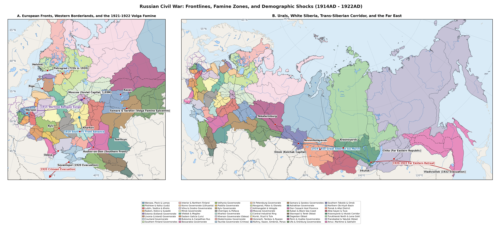

# Abstract

Between 1914 and 1926 the towns of the former Russian Empire went
through two sharp upheavals. First World War evacuations emptied the
western borderland cities of Riga, Liepaja, Kovno, Vilna and Warsaw
while crowding rear garrison and railway towns in the interior; then
food and fuel shortages under War Communism cut Petrograd by 70,2% and
Moscow by nearly half between 1917 and 1920 before the New Economic
Policy (*NEP*) and post-war refugee returns restored urban trade and
industry. This gazetteer presents population figures for 2.760 urban and
census-enumerated settlements across the 48 pre-war provinces (18,61M
km2) between 1914 and 1926.

# Methodology

The settlement series are drawn from the 1914 Russian statistical
yearbooks, the 1917 town census [\[1\]](#ref-vseros1917gorod), the 28
August 1920 Russian census [\[2\]](#ref-tsu1920perepis), the 1920
Finnish census [\[3\]](#ref-svt1923finland), the 1920 and 1925 Latvian
censuses [\[4\]](#ref-skujenieks1927latvia), the 30 September 1921
Polish census
[\[5\]](#ref-gus1921skorowidz)[\[6\]](#ref-barwinski2015ethnic), the 15
February 1921 Czechoslovak census [\[7\]](#ref-csr1924scitani), the 28
December 1922 Estonian census [\[8\]](#ref-estonia1924rahvaloendus), the
17 September 1923 Lithuanian census
[\[9\]](#ref-lithuania1926gyventojai), Romanian municipal counts for
Bessarabia and Bukovina
[\[10\]](#ref-tartakovsky2009bessarabia)[\[11\]](#ref-fondos2024bessarabia),
the 15 March 1923 Soviet urban census [\[12\]](#ref-tsu1923gorod) and
the 17 December 1926 All-Union Census
[\[13\]](#ref-tsu1926vsesoyuznaya)[\[14\]](#ref-koenker1985urbanization)[\[15\]](#ref-volkov1930dinamika).

# Results

## Regions 1 - 4: Former Congress Poland

Table gives population figures for 23 towns across Warsaw, Plock and
Lomza (Region 1), Piotrkow and Kalisz (Region 2), Lublin, Siedlce and
Kholm (Region 3) and Radom, Kielce and Suwalki (Region 4)
[\[5\]](#ref-gus1921skorowidz)[\[6\]](#ref-barwinski2015ethnic)[\[16\]](#ref-gatrell1999whole).

<table>
<caption>Urban populations in the ten Vistula provinces, showing the
1915 evacuation losses in Warsaw, Lodz and Lublin and post-1921 recovery
under the Second Polish Republic.</caption>
<colgroup>
<col style="width: 39%" />
<col style="width: 12%" />
<col style="width: 5%" />
<col style="width: 4%" />
<col style="width: 4%" />
<col style="width: 4%" />
<col style="width: 4%" />
<col style="width: 5%" />
<col style="width: 4%" />
<col style="width: 5%" />
<col style="width: 5%" />
</colgroup>
<thead>
<tr>
<th style="text-align: left;">Settlement (Reg.)</th>
<th style="text-align: left;">Coords</th>
<th style="text-align: left;">1914</th>
<th style="text-align: left;">1917</th>
<th style="text-align: left;">1918</th>
<th style="text-align: left;">1919</th>
<th style="text-align: left;">1920</th>
<th style="text-align: left;">1921</th>
<th style="text-align: left;">1922</th>
<th style="text-align: left;">1924</th>
<th style="text-align: left;">1926</th>
</tr>
</thead>
<tbody>
<tr>
<td style="text-align: left;">Warsaw [Warszawa] (R1)</td>
<td style="text-align: left;">52,23N, 21,01E</td>
<td style="text-align: left;">884,5k</td>
<td style="text-align: left;">758k</td>
<td style="text-align: left;">795k</td>
<td style="text-align: left;">855k</td>
<td style="text-align: left;">905k</td>
<td style="text-align: left;">936,7k</td>
<td style="text-align: left;">956k</td>
<td style="text-align: left;">992k</td>
<td style="text-align: left;">1,03M</td>
</tr>
<tr>
<td style="text-align: left;">Zyrardow [Zhirardov] (R1)</td>
<td style="text-align: left;">52,05N, 20,45E</td>
<td style="text-align: left;">38,6k</td>
<td style="text-align: left;">26,4k</td>
<td style="text-align: left;">22,5k</td>
<td style="text-align: left;">21,8k</td>
<td style="text-align: left;">20,9k</td>
<td style="text-align: left;">21,3k</td>
<td style="text-align: left;">22,1k</td>
<td style="text-align: left;">23,2k</td>
<td style="text-align: left;">24,2k</td>
</tr>
<tr>
<td style="text-align: left;">Wloclawek [Vlotslavsk] (R1)</td>
<td style="text-align: left;">52,65N, 19,07E</td>
<td style="text-align: left;">37,4k</td>
<td style="text-align: left;">32,5k</td>
<td style="text-align: left;">34,2k</td>
<td style="text-align: left;">36,8k</td>
<td style="text-align: left;">38,4k</td>
<td style="text-align: left;">40,3k</td>
<td style="text-align: left;">42,4k</td>
<td style="text-align: left;">45,6k</td>
<td style="text-align: left;">48,6k</td>
</tr>
<tr>
<td style="text-align: left;">Plock [Plotsk] (R1)</td>
<td style="text-align: left;">52,55N, 19,71E</td>
<td style="text-align: left;">35,2k</td>
<td style="text-align: left;">28,5k</td>
<td style="text-align: left;">27,2k</td>
<td style="text-align: left;">27,6k</td>
<td style="text-align: left;">27,1k</td>
<td style="text-align: left;">27,8k</td>
<td style="text-align: left;">28,5k</td>
<td style="text-align: left;">29,7k</td>
<td style="text-align: left;">30,8k</td>
</tr>
<tr>
<td style="text-align: left;">Lomza [Lomzha] (R1)</td>
<td style="text-align: left;">53,18N, 22,06E</td>
<td style="text-align: left;">29,8k</td>
<td style="text-align: left;">22,1k</td>
<td style="text-align: left;">21,4k</td>
<td style="text-align: left;">21,8k</td>
<td style="text-align: left;">21,2k</td>
<td style="text-align: left;">22k</td>
<td style="text-align: left;">22,7k</td>
<td style="text-align: left;">23,6k</td>
<td style="text-align: left;">24,5k</td>
</tr>
<tr>
<td style="text-align: left;">Ostroleka [Ostrolenka] (R1)</td>
<td style="text-align: left;">53,09N, 21,58E</td>
<td style="text-align: left;">15,2k</td>
<td style="text-align: left;">9,8k</td>
<td style="text-align: left;">9,2k</td>
<td style="text-align: left;">9,4k</td>
<td style="text-align: left;">8,8k</td>
<td style="text-align: left;">9,1k</td>
<td style="text-align: left;">9,9k</td>
<td style="text-align: left;">11,1k</td>
<td style="text-align: left;">12,1k</td>
</tr>
<tr>
<td style="text-align: left;">Lodz [Lodz Piotrkow] (R2)</td>
<td style="text-align: left;">51,76N, 19,46E</td>
<td style="text-align: left;">477,9k</td>
<td style="text-align: left;">342k</td>
<td style="text-align: left;">365k</td>
<td style="text-align: left;">405k</td>
<td style="text-align: left;">432k</td>
<td style="text-align: left;">452k</td>
<td style="text-align: left;">475k</td>
<td style="text-align: left;">518k</td>
<td style="text-align: left;">561,6k</td>
</tr>
<tr>
<td style="text-align: left;">Sosnowiec [Sosnovitsy] (R2)</td>
<td style="text-align: left;">50,29N, 19,1E</td>
<td style="text-align: left;">118,5k</td>
<td style="text-align: left;">94k</td>
<td style="text-align: left;">88,5k</td>
<td style="text-align: left;">87,2k</td>
<td style="text-align: left;">85,8k</td>
<td style="text-align: left;">86,5k</td>
<td style="text-align: left;">90,2k</td>
<td style="text-align: left;">95,8k</td>
<td style="text-align: left;">101,2k</td>
</tr>
<tr>
<td style="text-align: left;">Czestochowa [Chenstokhov] (R2)</td>
<td style="text-align: left;">50,81N, 19,12E</td>
<td style="text-align: left;">92,9k</td>
<td style="text-align: left;">78,5k</td>
<td style="text-align: left;">78k</td>
<td style="text-align: left;">79,2k</td>
<td style="text-align: left;">79,8k</td>
<td style="text-align: left;">80,5k</td>
<td style="text-align: left;">84,1k</td>
<td style="text-align: left;">90,2k</td>
<td style="text-align: left;">95,8k</td>
</tr>
<tr>
<td style="text-align: left;">Kalisz [Kalish] (R2)</td>
<td style="text-align: left;">51,77N, 18,09E</td>
<td style="text-align: left;">65,4k</td>
<td style="text-align: left;">29k</td>
<td style="text-align: left;">33,5k</td>
<td style="text-align: left;">38,2k</td>
<td style="text-align: left;">41,8k</td>
<td style="text-align: left;">44,6k</td>
<td style="text-align: left;">46,8k</td>
<td style="text-align: left;">49,8k</td>
<td style="text-align: left;">52,4k</td>
</tr>
<tr>
<td style="text-align: left;">Bendzin [Bedzin] (R2)</td>
<td style="text-align: left;">50,32N, 19,13E</td>
<td style="text-align: left;">54,8k</td>
<td style="text-align: left;">43,5k</td>
<td style="text-align: left;">38k</td>
<td style="text-align: left;">33,5k</td>
<td style="text-align: left;">29,5k</td>
<td style="text-align: left;">27,9k</td>
<td style="text-align: left;">30,8k</td>
<td style="text-align: left;">35,4k</td>
<td style="text-align: left;">39,6k</td>
</tr>
<tr>
<td style="text-align: left;">Pabianice [Pabianitsy] (R2)</td>
<td style="text-align: left;">51,66N, 19,35E</td>
<td style="text-align: left;">48,3k</td>
<td style="text-align: left;">36,8k</td>
<td style="text-align: left;">35,2k</td>
<td style="text-align: left;">34,8k</td>
<td style="text-align: left;">34,6k</td>
<td style="text-align: left;">35k</td>
<td style="text-align: left;">36,5k</td>
<td style="text-align: left;">38,9k</td>
<td style="text-align: left;">41,2k</td>
</tr>
<tr>
<td style="text-align: left;">Piotrkow [Piotrkow Trybunalski] (R2)</td>
<td style="text-align: left;">51,41N, 19,7E</td>
<td style="text-align: left;">44,8k</td>
<td style="text-align: left;">39,2k</td>
<td style="text-align: left;">39,6k</td>
<td style="text-align: left;">40,2k</td>
<td style="text-align: left;">40,6k</td>
<td style="text-align: left;">41,1k</td>
<td style="text-align: left;">42,4k</td>
<td style="text-align: left;">44,5k</td>
<td style="text-align: left;">46,5k</td>
</tr>
<tr>
<td style="text-align: left;">Lublin [Lyublin] (R3)</td>
<td style="text-align: left;">51,25N, 22,57E</td>
<td style="text-align: left;">72,2k</td>
<td style="text-align: left;">64,5k</td>
<td style="text-align: left;">74k</td>
<td style="text-align: left;">82,5k</td>
<td style="text-align: left;">88,4k</td>
<td style="text-align: left;">94,4k</td>
<td style="text-align: left;">97,5k</td>
<td style="text-align: left;">102,1k</td>
<td style="text-align: left;">106,3k</td>
</tr>
<tr>
<td style="text-align: left;">Siedlce [Sedlets] (R3)</td>
<td style="text-align: left;">52,17N, 22,29E</td>
<td style="text-align: left;">34k</td>
<td style="text-align: left;">24,8k</td>
<td style="text-align: left;">26,5k</td>
<td style="text-align: left;">28,4k</td>
<td style="text-align: left;">29,1k</td>
<td style="text-align: left;">30,7k</td>
<td style="text-align: left;">31,6k</td>
<td style="text-align: left;">33,1k</td>
<td style="text-align: left;">34,5k</td>
</tr>
<tr>
<td style="text-align: left;">Kholm [Chelm] (R3)</td>
<td style="text-align: left;">51,14N, 23,47E</td>
<td style="text-align: left;">24,6k</td>
<td style="text-align: left;">16,2k</td>
<td style="text-align: left;">18,1k</td>
<td style="text-align: left;">20,4k</td>
<td style="text-align: left;">21,5k</td>
<td style="text-align: left;">23,2k</td>
<td style="text-align: left;">24,4k</td>
<td style="text-align: left;">25,9k</td>
<td style="text-align: left;">27,4k</td>
</tr>
<tr>
<td style="text-align: left;">Zamosc [Zamostye] (R3)</td>
<td style="text-align: left;">50,72N, 23,25E</td>
<td style="text-align: left;">18,9k</td>
<td style="text-align: left;">14,8k</td>
<td style="text-align: left;">16,1k</td>
<td style="text-align: left;">17,5k</td>
<td style="text-align: left;">18,1k</td>
<td style="text-align: left;">19k</td>
<td style="text-align: left;">19,9k</td>
<td style="text-align: left;">21,2k</td>
<td style="text-align: left;">22,4k</td>
</tr>
<tr>
<td style="text-align: left;">Biala Podlaska [Bela] (R3)</td>
<td style="text-align: left;">52,03N, 23,12E</td>
<td style="text-align: left;">16,8k</td>
<td style="text-align: left;">11,2k</td>
<td style="text-align: left;">11,6k</td>
<td style="text-align: left;">12,2k</td>
<td style="text-align: left;">12,4k</td>
<td style="text-align: left;">13k</td>
<td style="text-align: left;">13,7k</td>
<td style="text-align: left;">14,8k</td>
<td style="text-align: left;">15,8k</td>
</tr>
<tr>
<td style="text-align: left;">Radom [Radom Governorate] (R4)</td>
<td style="text-align: left;">51,4N, 21,15E</td>
<td style="text-align: left;">49,2k</td>
<td style="text-align: left;">41,5k</td>
<td style="text-align: left;">47,2k</td>
<td style="text-align: left;">53,5k</td>
<td style="text-align: left;">58,2k</td>
<td style="text-align: left;">61,6k</td>
<td style="text-align: left;">63,4k</td>
<td style="text-align: left;">66,1k</td>
<td style="text-align: left;">68,4k</td>
</tr>
<tr>
<td style="text-align: left;">Kielce [Keltse] (R4)</td>
<td style="text-align: left;">50,87N, 20,63E</td>
<td style="text-align: left;">37,6k</td>
<td style="text-align: left;">33,2k</td>
<td style="text-align: left;">35,8k</td>
<td style="text-align: left;">38,2k</td>
<td style="text-align: left;">39,8k</td>
<td style="text-align: left;">41,3k</td>
<td style="text-align: left;">43,4k</td>
<td style="text-align: left;">46,8k</td>
<td style="text-align: left;">49,8k</td>
</tr>
<tr>
<td style="text-align: left;">Suwalki [Suvalki] (R4)</td>
<td style="text-align: left;">54,11N, 22,93E</td>
<td style="text-align: left;">27,1k</td>
<td style="text-align: left;">16,8k</td>
<td style="text-align: left;">15,9k</td>
<td style="text-align: left;">16,1k</td>
<td style="text-align: left;">16,3k</td>
<td style="text-align: left;">16,8k</td>
<td style="text-align: left;">17,7k</td>
<td style="text-align: left;">19,1k</td>
<td style="text-align: left;">20,4k</td>
</tr>
<tr>
<td style="text-align: left;">Ostrowiec [Ostrowiec Swietok-rzyski]
(R4)</td>
<td style="text-align: left;">50,93N, 21,39E</td>
<td style="text-align: left;">18,4k</td>
<td style="text-align: left;">15,2k</td>
<td style="text-align: left;">16,5k</td>
<td style="text-align: left;">17,9k</td>
<td style="text-align: left;">18,8k</td>
<td style="text-align: left;">19,7k</td>
<td style="text-align: left;">20,7k</td>
<td style="text-align: left;">22,3k</td>
<td style="text-align: left;">23,8k</td>
</tr>
<tr>
<td style="text-align: left;">Mariampol [Marijampole] (R4)</td>
<td style="text-align: left;">54,56N, 23,35E</td>
<td style="text-align: left;">8,6k</td>
<td style="text-align: left;">5,9k</td>
<td style="text-align: left;">6,5k</td>
<td style="text-align: left;">7,2k</td>
<td style="text-align: left;">7,9k</td>
<td style="text-align: left;">8,6k</td>
<td style="text-align: left;">9,2k</td>
<td style="text-align: left;">9,6k</td>
<td style="text-align: left;">9,9k</td>
</tr>
<tr>
<td style="text-align: left;">Lazdijai [Lodsjeje] (R4)</td>
<td style="text-align: left;">54,23N, 23,51E</td>
<td style="text-align: left;">-</td>
<td style="text-align: left;">-</td>
<td style="text-align: left;">-</td>
<td style="text-align: left;">-</td>
<td style="text-align: left;">-</td>
<td style="text-align: left;">-</td>
<td style="text-align: left;">-</td>
<td style="text-align: left;">-</td>
<td style="text-align: left;">-</td>
</tr>
<tr>
<td style="text-align: left;">Simnas (R4)</td>
<td style="text-align: left;">54,38N, 23,65E</td>
<td style="text-align: left;">-</td>
<td style="text-align: left;">-</td>
<td style="text-align: left;">-</td>
<td style="text-align: left;">-</td>
<td style="text-align: left;">-</td>
<td style="text-align: left;">-</td>
<td style="text-align: left;">-</td>
<td style="text-align: left;">-</td>
<td style="text-align: left;">-</td>
</tr>
<tr>
<td style="text-align: left;">Kalvarija [Kalwaria] (R4)</td>
<td style="text-align: left;">54,42N, 23,22E</td>
<td style="text-align: left;">-</td>
<td style="text-align: left;">-</td>
<td style="text-align: left;">-</td>
<td style="text-align: left;">-</td>
<td style="text-align: left;">-</td>
<td style="text-align: left;">-</td>
<td style="text-align: left;">-</td>
<td style="text-align: left;">-</td>
<td style="text-align: left;">-</td>
</tr>
<tr>
<td style="text-align: left;">Kudirkos Naumiestis [Vladislavovas]
(R4)</td>
<td style="text-align: left;">54,77N, 22,86E</td>
<td style="text-align: left;">-</td>
<td style="text-align: left;">-</td>
<td style="text-align: left;">-</td>
<td style="text-align: left;">-</td>
<td style="text-align: left;">-</td>
<td style="text-align: left;">-</td>
<td style="text-align: left;">-</td>
<td style="text-align: left;">-</td>
<td style="text-align: left;">-</td>
</tr>
<tr>
<td style="text-align: left;">Kybartai [Kibarty] (R4)</td>
<td style="text-align: left;">54,64N, 22,76E</td>
<td style="text-align: left;">-</td>
<td style="text-align: left;">-</td>
<td style="text-align: left;">-</td>
<td style="text-align: left;">-</td>
<td style="text-align: left;">-</td>
<td style="text-align: left;">-</td>
<td style="text-align: left;">-</td>
<td style="text-align: left;">-</td>
<td style="text-align: left;">-</td>
</tr>
<tr>
<td style="text-align: left;">Shakiai [Šakiai] (R4)</td>
<td style="text-align: left;">54,95N, 23,05E</td>
<td style="text-align: left;">-</td>
<td style="text-align: left;">-</td>
<td style="text-align: left;">-</td>
<td style="text-align: left;">-</td>
<td style="text-align: left;">-</td>
<td style="text-align: left;">-</td>
<td style="text-align: left;">-</td>
<td style="text-align: left;">-</td>
<td style="text-align: left;">-</td>
</tr>
<tr>
<td style="text-align: left;">Vilkaviskis [Vilkaviškis] (R4)</td>
<td style="text-align: left;">54,65N, 23,03E</td>
<td style="text-align: left;">-</td>
<td style="text-align: left;">-</td>
<td style="text-align: left;">-</td>
<td style="text-align: left;">-</td>
<td style="text-align: left;">-</td>
<td style="text-align: left;">-</td>
<td style="text-align: left;">-</td>
<td style="text-align: left;">-</td>
<td style="text-align: left;">-</td>
</tr>
<tr>
<td style="text-align: left;">Virbalis (R4)</td>
<td style="text-align: left;">54,63N, 22,82E</td>
<td style="text-align: left;">-</td>
<td style="text-align: left;">-</td>
<td style="text-align: left;">-</td>
<td style="text-align: left;">-</td>
<td style="text-align: left;">-</td>
<td style="text-align: left;">-</td>
<td style="text-align: left;">-</td>
<td style="text-align: left;">-</td>
<td style="text-align: left;">-</td>
</tr>
<tr>
<td style="text-align: left;">Jurbarkas [Jurburg] (R4)</td>
<td style="text-align: left;">55,08N, 22,76E</td>
<td style="text-align: left;">-</td>
<td style="text-align: left;">-</td>
<td style="text-align: left;">-</td>
<td style="text-align: left;">-</td>
<td style="text-align: left;">-</td>
<td style="text-align: left;">-</td>
<td style="text-align: left;">-</td>
<td style="text-align: left;">-</td>
<td style="text-align: left;">-</td>
</tr>
<tr>
<td style="text-align: left;">Grodzisk Mazowiecki [Grodisk] (R1)</td>
<td style="text-align: left;">52,1N, 20,63E</td>
<td style="text-align: left;">-</td>
<td style="text-align: left;">-</td>
<td style="text-align: left;">-</td>
<td style="text-align: left;">-</td>
<td style="text-align: left;">-</td>
<td style="text-align: left;">11,3k</td>
<td style="text-align: left;">-</td>
<td style="text-align: left;">-</td>
<td style="text-align: left;">-</td>
</tr>
<tr>
<td style="text-align: left;">Blonie [Błonie] (R1)</td>
<td style="text-align: left;">52,2N, 20,62E</td>
<td style="text-align: left;">-</td>
<td style="text-align: left;">-</td>
<td style="text-align: left;">-</td>
<td style="text-align: left;">-</td>
<td style="text-align: left;">-</td>
<td style="text-align: left;">5,3k</td>
<td style="text-align: left;">-</td>
<td style="text-align: left;">-</td>
<td style="text-align: left;">-</td>
</tr>
<tr>
<td style="text-align: left;">Mszczonow [Mszczonów] (R1)</td>
<td style="text-align: left;">51,97N, 20,52E</td>
<td style="text-align: left;">-</td>
<td style="text-align: left;">-</td>
<td style="text-align: left;">-</td>
<td style="text-align: left;">-</td>
<td style="text-align: left;">-</td>
<td style="text-align: left;">5k</td>
<td style="text-align: left;">-</td>
<td style="text-align: left;">-</td>
<td style="text-align: left;">-</td>
</tr>
<tr>
<td style="text-align: left;">Ciechanow [Ciechanów] (R1)</td>
<td style="text-align: left;">52,88N, 20,62E</td>
<td style="text-align: left;">-</td>
<td style="text-align: left;">-</td>
<td style="text-align: left;">-</td>
<td style="text-align: left;">-</td>
<td style="text-align: left;">-</td>
<td style="text-align: left;">12k</td>
<td style="text-align: left;">-</td>
<td style="text-align: left;">-</td>
<td style="text-align: left;">-</td>
</tr>
<tr>
<td style="text-align: left;">Gostynin [Гостынин] (R1)</td>
<td style="text-align: left;">52,43N, 19,46E</td>
<td style="text-align: left;">-</td>
<td style="text-align: left;">-</td>
<td style="text-align: left;">-</td>
<td style="text-align: left;">-</td>
<td style="text-align: left;">-</td>
<td style="text-align: left;">7k</td>
<td style="text-align: left;">-</td>
<td style="text-align: left;">-</td>
<td style="text-align: left;">-</td>
</tr>
<tr>
<td style="text-align: left;">Gabin [Gąbin] (R1)</td>
<td style="text-align: left;">52,4N, 19,74E</td>
<td style="text-align: left;">-</td>
<td style="text-align: left;">-</td>
<td style="text-align: left;">-</td>
<td style="text-align: left;">-</td>
<td style="text-align: left;">-</td>
<td style="text-align: left;">5,8k</td>
<td style="text-align: left;">-</td>
<td style="text-align: left;">-</td>
<td style="text-align: left;">-</td>
</tr>
<tr>
<td style="text-align: left;">Grojec [Grójec] (R1)</td>
<td style="text-align: left;">51,86N, 20,87E</td>
<td style="text-align: left;">-</td>
<td style="text-align: left;">-</td>
<td style="text-align: left;">-</td>
<td style="text-align: left;">-</td>
<td style="text-align: left;">-</td>
<td style="text-align: left;">8,4k</td>
<td style="text-align: left;">-</td>
<td style="text-align: left;">-</td>
<td style="text-align: left;">-</td>
</tr>
<tr>
<td style="text-align: left;">Gora Kalwaria [Góra-Kalwarja] (R1)</td>
<td style="text-align: left;">51,98N, 21,22E</td>
<td style="text-align: left;">-</td>
<td style="text-align: left;">-</td>
<td style="text-align: left;">-</td>
<td style="text-align: left;">-</td>
<td style="text-align: left;">-</td>
<td style="text-align: left;">5,5k</td>
<td style="text-align: left;">-</td>
<td style="text-align: left;">-</td>
<td style="text-align: left;">-</td>
</tr>
<tr>
<td style="text-align: left;">Mogielnica (R2)</td>
<td style="text-align: left;">51,69N, 20,72E</td>
<td style="text-align: left;">-</td>
<td style="text-align: left;">-</td>
<td style="text-align: left;">-</td>
<td style="text-align: left;">-</td>
<td style="text-align: left;">-</td>
<td style="text-align: left;">6k</td>
<td style="text-align: left;">-</td>
<td style="text-align: left;">-</td>
<td style="text-align: left;">-</td>
</tr>
<tr>
<td style="text-align: left;">Warka [Варка] (R4)</td>
<td style="text-align: left;">51,78N, 21,19E</td>
<td style="text-align: left;">-</td>
<td style="text-align: left;">-</td>
<td style="text-align: left;">-</td>
<td style="text-align: left;">-</td>
<td style="text-align: left;">-</td>
<td style="text-align: left;">4,7k</td>
<td style="text-align: left;">-</td>
<td style="text-align: left;">-</td>
<td style="text-align: left;">-</td>
</tr>
<tr>
<td style="text-align: left;">Kutno [Кутно] (R1)</td>
<td style="text-align: left;">52,23N, 19,36E</td>
<td style="text-align: left;">-</td>
<td style="text-align: left;">-</td>
<td style="text-align: left;">-</td>
<td style="text-align: left;">-</td>
<td style="text-align: left;">-</td>
<td style="text-align: left;">18,3k</td>
<td style="text-align: left;">-</td>
<td style="text-align: left;">-</td>
<td style="text-align: left;">-</td>
</tr>
<tr>
<td style="text-align: left;">Krosniewice [Krośniewice] (R1)</td>
<td style="text-align: left;">52,26N, 19,17E</td>
<td style="text-align: left;">-</td>
<td style="text-align: left;">-</td>
<td style="text-align: left;">-</td>
<td style="text-align: left;">-</td>
<td style="text-align: left;">-</td>
<td style="text-align: left;">3,5k</td>
<td style="text-align: left;">-</td>
<td style="text-align: left;">-</td>
<td style="text-align: left;">-</td>
</tr>
<tr>
<td style="text-align: left;">Zychlin [Żychlin] (R1)</td>
<td style="text-align: left;">52,24N, 19,63E</td>
<td style="text-align: left;">-</td>
<td style="text-align: left;">-</td>
<td style="text-align: left;">-</td>
<td style="text-align: left;">-</td>
<td style="text-align: left;">-</td>
<td style="text-align: left;">7,1k</td>
<td style="text-align: left;">-</td>
<td style="text-align: left;">-</td>
<td style="text-align: left;">-</td>
</tr>
<tr>
<td style="text-align: left;">Lipno [Липно] (R1)</td>
<td style="text-align: left;">52,84N, 19,18E</td>
<td style="text-align: left;">-</td>
<td style="text-align: left;">-</td>
<td style="text-align: left;">-</td>
<td style="text-align: left;">-</td>
<td style="text-align: left;">-</td>
<td style="text-align: left;">8,6k</td>
<td style="text-align: left;">-</td>
<td style="text-align: left;">-</td>
<td style="text-align: left;">-</td>
</tr>
<tr>
<td style="text-align: left;">Dobrzyn nad Wisla [Dobrzyń nad Wisłą]
(R1)</td>
<td style="text-align: left;">52,64N, 19,32E</td>
<td style="text-align: left;">-</td>
<td style="text-align: left;">-</td>
<td style="text-align: left;">-</td>
<td style="text-align: left;">-</td>
<td style="text-align: left;">-</td>
<td style="text-align: left;">2,7k</td>
<td style="text-align: left;">-</td>
<td style="text-align: left;">-</td>
<td style="text-align: left;">-</td>
</tr>
<tr>
<td style="text-align: left;">Lowicz [Łowicz] (R1)</td>
<td style="text-align: left;">52,11N, 19,95E</td>
<td style="text-align: left;">-</td>
<td style="text-align: left;">-</td>
<td style="text-align: left;">-</td>
<td style="text-align: left;">-</td>
<td style="text-align: left;">-</td>
<td style="text-align: left;">16,5k</td>
<td style="text-align: left;">-</td>
<td style="text-align: left;">-</td>
<td style="text-align: left;">-</td>
</tr>
<tr>
<td style="text-align: left;">Makow Mazowiecki [Maków Mazowiecki]
(R1)</td>
<td style="text-align: left;">52,86N, 21,1E</td>
<td style="text-align: left;">-</td>
<td style="text-align: left;">-</td>
<td style="text-align: left;">-</td>
<td style="text-align: left;">-</td>
<td style="text-align: left;">-</td>
<td style="text-align: left;">6,2k</td>
<td style="text-align: left;">-</td>
<td style="text-align: left;">-</td>
<td style="text-align: left;">-</td>
</tr>
<tr>
<td style="text-align: left;">Rozan [Różan] (R1)</td>
<td style="text-align: left;">52,89N, 21,39E</td>
<td style="text-align: left;">-</td>
<td style="text-align: left;">-</td>
<td style="text-align: left;">-</td>
<td style="text-align: left;">-</td>
<td style="text-align: left;">-</td>
<td style="text-align: left;">3,3k</td>
<td style="text-align: left;">-</td>
<td style="text-align: left;">-</td>
<td style="text-align: left;">-</td>
</tr>
<tr>
<td style="text-align: left;">Minsk Mazowiecki [Mińsk Mazowiecki]
(R1)</td>
<td style="text-align: left;">52,18N, 21,57E</td>
<td style="text-align: left;">-</td>
<td style="text-align: left;">-</td>
<td style="text-align: left;">-</td>
<td style="text-align: left;">-</td>
<td style="text-align: left;">-</td>
<td style="text-align: left;">11k</td>
<td style="text-align: left;">-</td>
<td style="text-align: left;">-</td>
<td style="text-align: left;">-</td>
</tr>
<tr>
<td style="text-align: left;">Kaluszyn [Kałuszyn] (R1)</td>
<td style="text-align: left;">52,21N, 21,81E</td>
<td style="text-align: left;">-</td>
<td style="text-align: left;">-</td>
<td style="text-align: left;">-</td>
<td style="text-align: left;">-</td>
<td style="text-align: left;">-</td>
<td style="text-align: left;">7,7k</td>
<td style="text-align: left;">-</td>
<td style="text-align: left;">-</td>
<td style="text-align: left;">-</td>
</tr>
<tr>
<td style="text-align: left;">Mlawa [Mława] (R1)</td>
<td style="text-align: left;">53,11N, 20,38E</td>
<td style="text-align: left;">-</td>
<td style="text-align: left;">-</td>
<td style="text-align: left;">-</td>
<td style="text-align: left;">-</td>
<td style="text-align: left;">-</td>
<td style="text-align: left;">17k</td>
<td style="text-align: left;">-</td>
<td style="text-align: left;">-</td>
<td style="text-align: left;">-</td>
</tr>
<tr>
<td style="text-align: left;">Aleksandrow Lodzki [Aleksandrów] (R2)</td>
<td style="text-align: left;">51,82N, 19,3E</td>
<td style="text-align: left;">-</td>
<td style="text-align: left;">-</td>
<td style="text-align: left;">-</td>
<td style="text-align: left;">-</td>
<td style="text-align: left;">-</td>
<td style="text-align: left;">8,2k</td>
<td style="text-align: left;">-</td>
<td style="text-align: left;">-</td>
<td style="text-align: left;">-</td>
</tr>
<tr>
<td style="text-align: left;">Radziejow [Radziejów] (R3)</td>
<td style="text-align: left;">51,04N, 23,78E</td>
<td style="text-align: left;">-</td>
<td style="text-align: left;">-</td>
<td style="text-align: left;">-</td>
<td style="text-align: left;">-</td>
<td style="text-align: left;">-</td>
<td style="text-align: left;">3,2k</td>
<td style="text-align: left;">-</td>
<td style="text-align: left;">-</td>
<td style="text-align: left;">-</td>
</tr>
<tr>
<td style="text-align: left;">Wyszogrod [Wyszogród] (R1)</td>
<td style="text-align: left;">52,39N, 20,19E</td>
<td style="text-align: left;">-</td>
<td style="text-align: left;">-</td>
<td style="text-align: left;">-</td>
<td style="text-align: left;">-</td>
<td style="text-align: left;">-</td>
<td style="text-align: left;">4,3k</td>
<td style="text-align: left;">-</td>
<td style="text-align: left;">-</td>
<td style="text-align: left;">-</td>
</tr>
<tr>
<td style="text-align: left;">Plonsk [Płońsk] (R1)</td>
<td style="text-align: left;">52,62N, 20,38E</td>
<td style="text-align: left;">-</td>
<td style="text-align: left;">-</td>
<td style="text-align: left;">-</td>
<td style="text-align: left;">-</td>
<td style="text-align: left;">-</td>
<td style="text-align: left;">9,3k</td>
<td style="text-align: left;">-</td>
<td style="text-align: left;">-</td>
<td style="text-align: left;">-</td>
</tr>
<tr>
<td style="text-align: left;">Przasnysz (R1)</td>
<td style="text-align: left;">53,02N, 20,88E</td>
<td style="text-align: left;">-</td>
<td style="text-align: left;">-</td>
<td style="text-align: left;">-</td>
<td style="text-align: left;">-</td>
<td style="text-align: left;">-</td>
<td style="text-align: left;">6,3k</td>
<td style="text-align: left;">-</td>
<td style="text-align: left;">-</td>
<td style="text-align: left;">-</td>
</tr>
<tr>
<td style="text-align: left;">Chorzele (R1)</td>
<td style="text-align: left;">53,26N, 20,9E</td>
<td style="text-align: left;">-</td>
<td style="text-align: left;">-</td>
<td style="text-align: left;">-</td>
<td style="text-align: left;">-</td>
<td style="text-align: left;">-</td>
<td style="text-align: left;">2,6k</td>
<td style="text-align: left;">-</td>
<td style="text-align: left;">-</td>
<td style="text-align: left;">-</td>
</tr>
<tr>
<td style="text-align: left;">Pultusk [Pułtusk] (R1)</td>
<td style="text-align: left;">52,7N, 21,08E</td>
<td style="text-align: left;">-</td>
<td style="text-align: left;">-</td>
<td style="text-align: left;">-</td>
<td style="text-align: left;">-</td>
<td style="text-align: left;">-</td>
<td style="text-align: left;">13,7k</td>
<td style="text-align: left;">-</td>
<td style="text-align: left;">-</td>
<td style="text-align: left;">-</td>
</tr>
<tr>
<td style="text-align: left;">Nasielsk [Насельск] (R1)</td>
<td style="text-align: left;">52,59N, 20,81E</td>
<td style="text-align: left;">-</td>
<td style="text-align: left;">-</td>
<td style="text-align: left;">-</td>
<td style="text-align: left;">-</td>
<td style="text-align: left;">-</td>
<td style="text-align: left;">5,5k</td>
<td style="text-align: left;">-</td>
<td style="text-align: left;">-</td>
<td style="text-align: left;">-</td>
</tr>
<tr>
<td style="text-align: left;">Serock (R1)</td>
<td style="text-align: left;">52,51N, 21,07E</td>
<td style="text-align: left;">-</td>
<td style="text-align: left;">-</td>
<td style="text-align: left;">-</td>
<td style="text-align: left;">-</td>
<td style="text-align: left;">-</td>
<td style="text-align: left;">4,7k</td>
<td style="text-align: left;">-</td>
<td style="text-align: left;">-</td>
<td style="text-align: left;">-</td>
</tr>
<tr>
<td style="text-align: left;">Wyszkow [Wyszków] (R1)</td>
<td style="text-align: left;">52,59N, 21,46E</td>
<td style="text-align: left;">-</td>
<td style="text-align: left;">-</td>
<td style="text-align: left;">-</td>
<td style="text-align: left;">-</td>
<td style="text-align: left;">-</td>
<td style="text-align: left;">9,1k</td>
<td style="text-align: left;">-</td>
<td style="text-align: left;">-</td>
<td style="text-align: left;">-</td>
</tr>
<tr>
<td style="text-align: left;">Radzymin (R1)</td>
<td style="text-align: left;">52,42N, 21,18E</td>
<td style="text-align: left;">-</td>
<td style="text-align: left;">-</td>
<td style="text-align: left;">-</td>
<td style="text-align: left;">-</td>
<td style="text-align: left;">-</td>
<td style="text-align: left;">5k</td>
<td style="text-align: left;">-</td>
<td style="text-align: left;">-</td>
<td style="text-align: left;">-</td>
</tr>
<tr>
<td style="text-align: left;">Wolomin [Wołomin] (R1)</td>
<td style="text-align: left;">52,34N, 21,24E</td>
<td style="text-align: left;">-</td>
<td style="text-align: left;">-</td>
<td style="text-align: left;">-</td>
<td style="text-align: left;">-</td>
<td style="text-align: left;">-</td>
<td style="text-align: left;">6,4k</td>
<td style="text-align: left;">-</td>
<td style="text-align: left;">-</td>
<td style="text-align: left;">-</td>
</tr>
<tr>
<td style="text-align: left;">Rawa Mazowiecka (R2)</td>
<td style="text-align: left;">51,76N, 20,25E</td>
<td style="text-align: left;">-</td>
<td style="text-align: left;">-</td>
<td style="text-align: left;">-</td>
<td style="text-align: left;">-</td>
<td style="text-align: left;">-</td>
<td style="text-align: left;">8,2k</td>
<td style="text-align: left;">-</td>
<td style="text-align: left;">-</td>
<td style="text-align: left;">-</td>
</tr>
<tr>
<td style="text-align: left;">Biala Rawska [Biała Rawska] (R2)</td>
<td style="text-align: left;">51,81N, 20,47E</td>
<td style="text-align: left;">-</td>
<td style="text-align: left;">-</td>
<td style="text-align: left;">-</td>
<td style="text-align: left;">-</td>
<td style="text-align: left;">-</td>
<td style="text-align: left;">2,7k</td>
<td style="text-align: left;">-</td>
<td style="text-align: left;">-</td>
<td style="text-align: left;">-</td>
</tr>
<tr>
<td style="text-align: left;">Nowe Miasto nad Pilica [Nowe Miasto]
(R4)</td>
<td style="text-align: left;">51,62N, 20,58E</td>
<td style="text-align: left;">-</td>
<td style="text-align: left;">-</td>
<td style="text-align: left;">-</td>
<td style="text-align: left;">-</td>
<td style="text-align: left;">-</td>
<td style="text-align: left;">3,8k</td>
<td style="text-align: left;">-</td>
<td style="text-align: left;">-</td>
<td style="text-align: left;">-</td>
</tr>
<tr>
<td style="text-align: left;">Sierpc (R1)</td>
<td style="text-align: left;">52,86N, 19,67E</td>
<td style="text-align: left;">-</td>
<td style="text-align: left;">-</td>
<td style="text-align: left;">-</td>
<td style="text-align: left;">-</td>
<td style="text-align: left;">-</td>
<td style="text-align: left;">8,5k</td>
<td style="text-align: left;">-</td>
<td style="text-align: left;">-</td>
<td style="text-align: left;">-</td>
</tr>
<tr>
<td style="text-align: left;">Raciaz [Raciąż] (R1)</td>
<td style="text-align: left;">52,78N, 20,12E</td>
<td style="text-align: left;">-</td>
<td style="text-align: left;">-</td>
<td style="text-align: left;">-</td>
<td style="text-align: left;">-</td>
<td style="text-align: left;">-</td>
<td style="text-align: left;">4,5k</td>
<td style="text-align: left;">-</td>
<td style="text-align: left;">-</td>
<td style="text-align: left;">-</td>
</tr>
<tr>
<td style="text-align: left;">Zuromin [Żuromin] (R1)</td>
<td style="text-align: left;">53,07N, 19,91E</td>
<td style="text-align: left;">-</td>
<td style="text-align: left;">-</td>
<td style="text-align: left;">-</td>
<td style="text-align: left;">-</td>
<td style="text-align: left;">-</td>
<td style="text-align: left;">4k</td>
<td style="text-align: left;">-</td>
<td style="text-align: left;">-</td>
<td style="text-align: left;">-</td>
</tr>
<tr>
<td style="text-align: left;">Skierniewice [Skernevitsy] (R1)</td>
<td style="text-align: left;">51,95N, 20,16E</td>
<td style="text-align: left;">-</td>
<td style="text-align: left;">-</td>
<td style="text-align: left;">-</td>
<td style="text-align: left;">-</td>
<td style="text-align: left;">-</td>
<td style="text-align: left;">16,6k</td>
<td style="text-align: left;">-</td>
<td style="text-align: left;">-</td>
<td style="text-align: left;">-</td>
</tr>
<tr>
<td style="text-align: left;">Sochaczew [Sochacev] (R1)</td>
<td style="text-align: left;">52,23N, 20,24E</td>
<td style="text-align: left;">-</td>
<td style="text-align: left;">-</td>
<td style="text-align: left;">-</td>
<td style="text-align: left;">-</td>
<td style="text-align: left;">-</td>
<td style="text-align: left;">5,4k</td>
<td style="text-align: left;">-</td>
<td style="text-align: left;">-</td>
<td style="text-align: left;">-</td>
</tr>
<tr>
<td style="text-align: left;">Nowy Dwor Mazowiecki [Nowy Dwór] (R1)</td>
<td style="text-align: left;">52,43N, 20,72E</td>
<td style="text-align: left;">-</td>
<td style="text-align: left;">-</td>
<td style="text-align: left;">-</td>
<td style="text-align: left;">-</td>
<td style="text-align: left;">-</td>
<td style="text-align: left;">7,8k</td>
<td style="text-align: left;">-</td>
<td style="text-align: left;">-</td>
<td style="text-align: left;">-</td>
</tr>
<tr>
<td style="text-align: left;">Otwock [Otvotsk] (R1)</td>
<td style="text-align: left;">52,11N, 21,26E</td>
<td style="text-align: left;">-</td>
<td style="text-align: left;">-</td>
<td style="text-align: left;">-</td>
<td style="text-align: left;">-</td>
<td style="text-align: left;">-</td>
<td style="text-align: left;">8,6k</td>
<td style="text-align: left;">-</td>
<td style="text-align: left;">-</td>
<td style="text-align: left;">-</td>
</tr>
<tr>
<td style="text-align: left;">Piaseczno [Pjasecno] (R1)</td>
<td style="text-align: left;">52,08N, 21,02E</td>
<td style="text-align: left;">-</td>
<td style="text-align: left;">-</td>
<td style="text-align: left;">-</td>
<td style="text-align: left;">-</td>
<td style="text-align: left;">-</td>
<td style="text-align: left;">5,6k</td>
<td style="text-align: left;">-</td>
<td style="text-align: left;">-</td>
<td style="text-align: left;">-</td>
</tr>
<tr>
<td style="text-align: left;">Pruszkow [Pruszków] (R1)</td>
<td style="text-align: left;">52,17N, 20,81E</td>
<td style="text-align: left;">-</td>
<td style="text-align: left;">-</td>
<td style="text-align: left;">-</td>
<td style="text-align: left;">-</td>
<td style="text-align: left;">-</td>
<td style="text-align: left;">15,1k</td>
<td style="text-align: left;">-</td>
<td style="text-align: left;">-</td>
<td style="text-align: left;">-</td>
</tr>
<tr>
<td style="text-align: left;">Zakroczym [Закрочим] (R1)</td>
<td style="text-align: left;">52,43N, 20,61E</td>
<td style="text-align: left;">-</td>
<td style="text-align: left;">-</td>
<td style="text-align: left;">-</td>
<td style="text-align: left;">-</td>
<td style="text-align: left;">-</td>
<td style="text-align: left;">5,9k</td>
<td style="text-align: left;">-</td>
<td style="text-align: left;">-</td>
<td style="text-align: left;">-</td>
</tr>
<tr>
<td style="text-align: left;">Brzests Kujawski [Brześć Kujawski]
(R1)</td>
<td style="text-align: left;">52,61N, 18,9E</td>
<td style="text-align: left;">-</td>
<td style="text-align: left;">-</td>
<td style="text-align: left;">-</td>
<td style="text-align: left;">-</td>
<td style="text-align: left;">-</td>
<td style="text-align: left;">4,6k</td>
<td style="text-align: left;">-</td>
<td style="text-align: left;">-</td>
<td style="text-align: left;">-</td>
</tr>
<tr>
<td style="text-align: left;">Chodecz (R1)</td>
<td style="text-align: left;">52,41N, 19,03E</td>
<td style="text-align: left;">-</td>
<td style="text-align: left;">-</td>
<td style="text-align: left;">-</td>
<td style="text-align: left;">-</td>
<td style="text-align: left;">-</td>
<td style="text-align: left;">1,7k</td>
<td style="text-align: left;">-</td>
<td style="text-align: left;">-</td>
<td style="text-align: left;">-</td>
</tr>
<tr>
<td style="text-align: left;">Kowal (R1)</td>
<td style="text-align: left;">52,53N, 19,15E</td>
<td style="text-align: left;">-</td>
<td style="text-align: left;">-</td>
<td style="text-align: left;">-</td>
<td style="text-align: left;">-</td>
<td style="text-align: left;">-</td>
<td style="text-align: left;">4,1k</td>
<td style="text-align: left;">-</td>
<td style="text-align: left;">-</td>
<td style="text-align: left;">-</td>
</tr>
<tr>
<td style="text-align: left;">Lubien Kujawski [Lubień] (R1)</td>
<td style="text-align: left;">52,41N, 19,16E</td>
<td style="text-align: left;">-</td>
<td style="text-align: left;">-</td>
<td style="text-align: left;">-</td>
<td style="text-align: left;">-</td>
<td style="text-align: left;">-</td>
<td style="text-align: left;">2,1k</td>
<td style="text-align: left;">-</td>
<td style="text-align: left;">-</td>
<td style="text-align: left;">-</td>
</tr>
<tr>
<td style="text-align: left;">Lubraniec (R1)</td>
<td style="text-align: left;">52,54N, 18,83E</td>
<td style="text-align: left;">-</td>
<td style="text-align: left;">-</td>
<td style="text-align: left;">-</td>
<td style="text-align: left;">-</td>
<td style="text-align: left;">-</td>
<td style="text-align: left;">2,2k</td>
<td style="text-align: left;">-</td>
<td style="text-align: left;">-</td>
<td style="text-align: left;">-</td>
</tr>
<tr>
<td style="text-align: left;">Przedecz (R1)</td>
<td style="text-align: left;">52,33N, 18,9E</td>
<td style="text-align: left;">-</td>
<td style="text-align: left;">-</td>
<td style="text-align: left;">-</td>
<td style="text-align: left;">-</td>
<td style="text-align: left;">-</td>
<td style="text-align: left;">3k</td>
<td style="text-align: left;">-</td>
<td style="text-align: left;">-</td>
<td style="text-align: left;">-</td>
</tr>
<tr>
<td style="text-align: left;">Brzeziny (R2)</td>
<td style="text-align: left;">51,8N, 19,75E</td>
<td style="text-align: left;">-</td>
<td style="text-align: left;">-</td>
<td style="text-align: left;">-</td>
<td style="text-align: left;">-</td>
<td style="text-align: left;">-</td>
<td style="text-align: left;">10,6k</td>
<td style="text-align: left;">-</td>
<td style="text-align: left;">-</td>
<td style="text-align: left;">-</td>
</tr>
<tr>
<td style="text-align: left;">Glowno [Głowno] (R1)</td>
<td style="text-align: left;">51,96N, 19,72E</td>
<td style="text-align: left;">-</td>
<td style="text-align: left;">-</td>
<td style="text-align: left;">-</td>
<td style="text-align: left;">-</td>
<td style="text-align: left;">-</td>
<td style="text-align: left;">2,4k</td>
<td style="text-align: left;">-</td>
<td style="text-align: left;">-</td>
<td style="text-align: left;">-</td>
</tr>
<tr>
<td style="text-align: left;">Strykow [Stryków] (R1)</td>
<td style="text-align: left;">51,9N, 19,61E</td>
<td style="text-align: left;">-</td>
<td style="text-align: left;">-</td>
<td style="text-align: left;">-</td>
<td style="text-align: left;">-</td>
<td style="text-align: left;">-</td>
<td style="text-align: left;">4,1k</td>
<td style="text-align: left;">-</td>
<td style="text-align: left;">-</td>
<td style="text-align: left;">-</td>
</tr>
<tr>
<td style="text-align: left;">Tomaszow Mazowiecki [Tomaszów Mazowiecki]
(R2)</td>
<td style="text-align: left;">51,53N, 20,01E</td>
<td style="text-align: left;">-</td>
<td style="text-align: left;">-</td>
<td style="text-align: left;">-</td>
<td style="text-align: left;">-</td>
<td style="text-align: left;">-</td>
<td style="text-align: left;">28,3k</td>
<td style="text-align: left;">-</td>
<td style="text-align: left;">-</td>
<td style="text-align: left;">-</td>
</tr>
<tr>
<td style="text-align: left;">Blaszki [Błaszki] (R2)</td>
<td style="text-align: left;">51,65N, 18,43E</td>
<td style="text-align: left;">-</td>
<td style="text-align: left;">-</td>
<td style="text-align: left;">-</td>
<td style="text-align: left;">-</td>
<td style="text-align: left;">-</td>
<td style="text-align: left;">4,7k</td>
<td style="text-align: left;">-</td>
<td style="text-align: left;">-</td>
<td style="text-align: left;">-</td>
</tr>
<tr>
<td style="text-align: left;">Stawiszyn (R1)</td>
<td style="text-align: left;">51,92N, 18,11E</td>
<td style="text-align: left;">-</td>
<td style="text-align: left;">-</td>
<td style="text-align: left;">-</td>
<td style="text-align: left;">-</td>
<td style="text-align: left;">-</td>
<td style="text-align: left;">2,6k</td>
<td style="text-align: left;">-</td>
<td style="text-align: left;">-</td>
<td style="text-align: left;">-</td>
</tr>
<tr>
<td style="text-align: left;">Kolo [Koło] (R1)</td>
<td style="text-align: left;">52,2N, 18,64E</td>
<td style="text-align: left;">-</td>
<td style="text-align: left;">-</td>
<td style="text-align: left;">-</td>
<td style="text-align: left;">-</td>
<td style="text-align: left;">-</td>
<td style="text-align: left;">13k</td>
<td style="text-align: left;">-</td>
<td style="text-align: left;">-</td>
<td style="text-align: left;">-</td>
</tr>
<tr>
<td style="text-align: left;">Dabie [Dąbie] (R2)</td>
<td style="text-align: left;">52,09N, 18,82E</td>
<td style="text-align: left;">-</td>
<td style="text-align: left;">-</td>
<td style="text-align: left;">-</td>
<td style="text-align: left;">-</td>
<td style="text-align: left;">-</td>
<td style="text-align: left;">3,8k</td>
<td style="text-align: left;">-</td>
<td style="text-align: left;">-</td>
<td style="text-align: left;">-</td>
</tr>
<tr>
<td style="text-align: left;">Klodawa [Kłodawa] (R1)</td>
<td style="text-align: left;">52,25N, 18,91E</td>
<td style="text-align: left;">-</td>
<td style="text-align: left;">-</td>
<td style="text-align: left;">-</td>
<td style="text-align: left;">-</td>
<td style="text-align: left;">-</td>
<td style="text-align: left;">4,3k</td>
<td style="text-align: left;">-</td>
<td style="text-align: left;">-</td>
<td style="text-align: left;">-</td>
</tr>
<tr>
<td style="text-align: left;">Slupca [Słupca] (R1)</td>
<td style="text-align: left;">52,59N, 20,06E</td>
<td style="text-align: left;">-</td>
<td style="text-align: left;">-</td>
<td style="text-align: left;">-</td>
<td style="text-align: left;">-</td>
<td style="text-align: left;">-</td>
<td style="text-align: left;">5,5k</td>
<td style="text-align: left;">-</td>
<td style="text-align: left;">-</td>
<td style="text-align: left;">-</td>
</tr>
<tr>
<td style="text-align: left;">Tuliszkow [Tuliszków] (R1)</td>
<td style="text-align: left;">52,08N, 18,3E</td>
<td style="text-align: left;">-</td>
<td style="text-align: left;">-</td>
<td style="text-align: left;">-</td>
<td style="text-align: left;">-</td>
<td style="text-align: left;">-</td>
<td style="text-align: left;">2,4k</td>
<td style="text-align: left;">-</td>
<td style="text-align: left;">-</td>
<td style="text-align: left;">-</td>
</tr>
<tr>
<td style="text-align: left;">Wladyslawow [Władysławów] (R1)</td>
<td style="text-align: left;">52,1N, 18,48E</td>
<td style="text-align: left;">-</td>
<td style="text-align: left;">-</td>
<td style="text-align: left;">-</td>
<td style="text-align: left;">-</td>
<td style="text-align: left;">-</td>
<td style="text-align: left;">960</td>
<td style="text-align: left;">-</td>
<td style="text-align: left;">-</td>
<td style="text-align: left;">-</td>
</tr>
<tr>
<td style="text-align: left;">Lask [Łask] (R2)</td>
<td style="text-align: left;">51,59N, 19,13E</td>
<td style="text-align: left;">-</td>
<td style="text-align: left;">-</td>
<td style="text-align: left;">-</td>
<td style="text-align: left;">-</td>
<td style="text-align: left;">-</td>
<td style="text-align: left;">4,9k</td>
<td style="text-align: left;">-</td>
<td style="text-align: left;">-</td>
<td style="text-align: left;">-</td>
</tr>
<tr>
<td style="text-align: left;">Leczyca [Łęczyca] (R2)</td>
<td style="text-align: left;">52,06N, 19,2E</td>
<td style="text-align: left;">-</td>
<td style="text-align: left;">-</td>
<td style="text-align: left;">-</td>
<td style="text-align: left;">-</td>
<td style="text-align: left;">-</td>
<td style="text-align: left;">10,3k</td>
<td style="text-align: left;">-</td>
<td style="text-align: left;">-</td>
<td style="text-align: left;">-</td>
</tr>
<tr>
<td style="text-align: left;">Ozorkow [Ozorków] (R2)</td>
<td style="text-align: left;">51,96N, 19,29E</td>
<td style="text-align: left;">-</td>
<td style="text-align: left;">-</td>
<td style="text-align: left;">-</td>
<td style="text-align: left;">-</td>
<td style="text-align: left;">-</td>
<td style="text-align: left;">12,6k</td>
<td style="text-align: left;">-</td>
<td style="text-align: left;">-</td>
<td style="text-align: left;">-</td>
</tr>
<tr>
<td style="text-align: left;">Konstantynow Lodzki [Konstantynów]
(R2)</td>
<td style="text-align: left;">51,75N, 19,33E</td>
<td style="text-align: left;">-</td>
<td style="text-align: left;">-</td>
<td style="text-align: left;">-</td>
<td style="text-align: left;">-</td>
<td style="text-align: left;">-</td>
<td style="text-align: left;">5,7k</td>
<td style="text-align: left;">-</td>
<td style="text-align: left;">-</td>
<td style="text-align: left;">-</td>
</tr>
<tr>
<td style="text-align: left;">Ruda Pabianicka [Ruda Pabjanicka]
(R2)</td>
<td style="text-align: left;">51,7N, 19,46E</td>
<td style="text-align: left;">-</td>
<td style="text-align: left;">-</td>
<td style="text-align: left;">-</td>
<td style="text-align: left;">-</td>
<td style="text-align: left;">-</td>
<td style="text-align: left;">5,1k</td>
<td style="text-align: left;">-</td>
<td style="text-align: left;">-</td>
<td style="text-align: left;">-</td>
</tr>
<tr>
<td style="text-align: left;">Tuszyn (R2)</td>
<td style="text-align: left;">51,61N, 19,53E</td>
<td style="text-align: left;">-</td>
<td style="text-align: left;">-</td>
<td style="text-align: left;">-</td>
<td style="text-align: left;">-</td>
<td style="text-align: left;">-</td>
<td style="text-align: left;">3,5k</td>
<td style="text-align: left;">-</td>
<td style="text-align: left;">-</td>
<td style="text-align: left;">-</td>
</tr>
<tr>
<td style="text-align: left;">Zgierz [Згерж] (R2)</td>
<td style="text-align: left;">51,86N, 19,41E</td>
<td style="text-align: left;">-</td>
<td style="text-align: left;">-</td>
<td style="text-align: left;">-</td>
<td style="text-align: left;">-</td>
<td style="text-align: left;">-</td>
<td style="text-align: left;">21,1k</td>
<td style="text-align: left;">-</td>
<td style="text-align: left;">-</td>
<td style="text-align: left;">-</td>
</tr>
<tr>
<td style="text-align: left;">Belchatow [Bełchatów] (R2)</td>
<td style="text-align: left;">51,37N, 19,36E</td>
<td style="text-align: left;">-</td>
<td style="text-align: left;">-</td>
<td style="text-align: left;">-</td>
<td style="text-align: left;">-</td>
<td style="text-align: left;">-</td>
<td style="text-align: left;">7,2k</td>
<td style="text-align: left;">-</td>
<td style="text-align: left;">-</td>
<td style="text-align: left;">-</td>
</tr>
<tr>
<td style="text-align: left;">Sulejow [Sulejów] (R2)</td>
<td style="text-align: left;">51,35N, 19,89E</td>
<td style="text-align: left;">-</td>
<td style="text-align: left;">-</td>
<td style="text-align: left;">-</td>
<td style="text-align: left;">-</td>
<td style="text-align: left;">-</td>
<td style="text-align: left;">5,7k</td>
<td style="text-align: left;">-</td>
<td style="text-align: left;">-</td>
<td style="text-align: left;">-</td>
</tr>
<tr>
<td style="text-align: left;">Radomsko [Novoradomsk] (R2)</td>
<td style="text-align: left;">51,07N, 19,44E</td>
<td style="text-align: left;">-</td>
<td style="text-align: left;">-</td>
<td style="text-align: left;">-</td>
<td style="text-align: left;">-</td>
<td style="text-align: left;">-</td>
<td style="text-align: left;">20,6k</td>
<td style="text-align: left;">-</td>
<td style="text-align: left;">-</td>
<td style="text-align: left;">-</td>
</tr>
<tr>
<td style="text-align: left;">Koniecpol (R2)</td>
<td style="text-align: left;">50,77N, 19,69E</td>
<td style="text-align: left;">-</td>
<td style="text-align: left;">-</td>
<td style="text-align: left;">-</td>
<td style="text-align: left;">-</td>
<td style="text-align: left;">-</td>
<td style="text-align: left;">2,4k</td>
<td style="text-align: left;">-</td>
<td style="text-align: left;">-</td>
<td style="text-align: left;">-</td>
</tr>
<tr>
<td style="text-align: left;">Sieradz [Серадз] (R2)</td>
<td style="text-align: left;">51,6N, 18,73E</td>
<td style="text-align: left;">-</td>
<td style="text-align: left;">-</td>
<td style="text-align: left;">-</td>
<td style="text-align: left;">-</td>
<td style="text-align: left;">-</td>
<td style="text-align: left;">9,3k</td>
<td style="text-align: left;">-</td>
<td style="text-align: left;">-</td>
<td style="text-align: left;">-</td>
</tr>
<tr>
<td style="text-align: left;">Szadek (R2)</td>
<td style="text-align: left;">51,69N, 18,98E</td>
<td style="text-align: left;">-</td>
<td style="text-align: left;">-</td>
<td style="text-align: left;">-</td>
<td style="text-align: left;">-</td>
<td style="text-align: left;">-</td>
<td style="text-align: left;">3,1k</td>
<td style="text-align: left;">-</td>
<td style="text-align: left;">-</td>
<td style="text-align: left;">-</td>
</tr>
<tr>
<td style="text-align: left;">Warta [Варта] (R2)</td>
<td style="text-align: left;">51,71N, 18,62E</td>
<td style="text-align: left;">-</td>
<td style="text-align: left;">-</td>
<td style="text-align: left;">-</td>
<td style="text-align: left;">-</td>
<td style="text-align: left;">-</td>
<td style="text-align: left;">4,1k</td>
<td style="text-align: left;">-</td>
<td style="text-align: left;">-</td>
<td style="text-align: left;">-</td>
</tr>
<tr>
<td style="text-align: left;">Zdunska Wola [Zduńska Wola] (R2)</td>
<td style="text-align: left;">51,6N, 18,94E</td>
<td style="text-align: left;">-</td>
<td style="text-align: left;">-</td>
<td style="text-align: left;">-</td>
<td style="text-align: left;">-</td>
<td style="text-align: left;">-</td>
<td style="text-align: left;">18,9k</td>
<td style="text-align: left;">-</td>
<td style="text-align: left;">-</td>
<td style="text-align: left;">-</td>
</tr>
<tr>
<td style="text-align: left;">Turek (R1)</td>
<td style="text-align: left;">52,02N, 18,5E</td>
<td style="text-align: left;">-</td>
<td style="text-align: left;">-</td>
<td style="text-align: left;">-</td>
<td style="text-align: left;">-</td>
<td style="text-align: left;">-</td>
<td style="text-align: left;">9,9k</td>
<td style="text-align: left;">-</td>
<td style="text-align: left;">-</td>
<td style="text-align: left;">-</td>
</tr>
<tr>
<td style="text-align: left;">Dobra (R2)</td>
<td style="text-align: left;">51,92N, 18,62E</td>
<td style="text-align: left;">-</td>
<td style="text-align: left;">-</td>
<td style="text-align: left;">-</td>
<td style="text-align: left;">-</td>
<td style="text-align: left;">-</td>
<td style="text-align: left;">3,1k</td>
<td style="text-align: left;">-</td>
<td style="text-align: left;">-</td>
<td style="text-align: left;">-</td>
</tr>
<tr>
<td style="text-align: left;">Uniejow [Uniejów] (R2)</td>
<td style="text-align: left;">51,97N, 18,79E</td>
<td style="text-align: left;">-</td>
<td style="text-align: left;">-</td>
<td style="text-align: left;">-</td>
<td style="text-align: left;">-</td>
<td style="text-align: left;">-</td>
<td style="text-align: left;">3,7k</td>
<td style="text-align: left;">-</td>
<td style="text-align: left;">-</td>
<td style="text-align: left;">-</td>
</tr>
<tr>
<td style="text-align: left;">Klobuck [Kłobuck] (R2)</td>
<td style="text-align: left;">50,9N, 18,94E</td>
<td style="text-align: left;">-</td>
<td style="text-align: left;">-</td>
<td style="text-align: left;">-</td>
<td style="text-align: left;">-</td>
<td style="text-align: left;">-</td>
<td style="text-align: left;">6,6k</td>
<td style="text-align: left;">-</td>
<td style="text-align: left;">-</td>
<td style="text-align: left;">-</td>
</tr>
<tr>
<td style="text-align: left;">Wierzbnik (R4)</td>
<td style="text-align: left;">51,05N, 21,09E</td>
<td style="text-align: left;">-</td>
<td style="text-align: left;">-</td>
<td style="text-align: left;">-</td>
<td style="text-align: left;">-</td>
<td style="text-align: left;">-</td>
<td style="text-align: left;">5,5k</td>
<td style="text-align: left;">-</td>
<td style="text-align: left;">-</td>
<td style="text-align: left;">-</td>
</tr>
<tr>
<td style="text-align: left;">Ilza [Iłża] (R4)</td>
<td style="text-align: left;">51,16N, 21,24E</td>
<td style="text-align: left;">-</td>
<td style="text-align: left;">-</td>
<td style="text-align: left;">-</td>
<td style="text-align: left;">-</td>
<td style="text-align: left;">-</td>
<td style="text-align: left;">4,6k</td>
<td style="text-align: left;">-</td>
<td style="text-align: left;">-</td>
<td style="text-align: left;">-</td>
</tr>
<tr>
<td style="text-align: left;">Jedrzejow [Jędrzejów] (R4)</td>
<td style="text-align: left;">50,64N, 20,3E</td>
<td style="text-align: left;">-</td>
<td style="text-align: left;">-</td>
<td style="text-align: left;">-</td>
<td style="text-align: left;">-</td>
<td style="text-align: left;">-</td>
<td style="text-align: left;">11,7k</td>
<td style="text-align: left;">-</td>
<td style="text-align: left;">-</td>
<td style="text-align: left;">-</td>
</tr>
<tr>
<td style="text-align: left;">Checiny [Chęciny] (R4)</td>
<td style="text-align: left;">50,8N, 20,46E</td>
<td style="text-align: left;">-</td>
<td style="text-align: left;">-</td>
<td style="text-align: left;">-</td>
<td style="text-align: left;">-</td>
<td style="text-align: left;">-</td>
<td style="text-align: left;">5k</td>
<td style="text-align: left;">-</td>
<td style="text-align: left;">-</td>
<td style="text-align: left;">-</td>
</tr>
<tr>
<td style="text-align: left;">Konskie [Końskie] (R4)</td>
<td style="text-align: left;">51,19N, 20,41E</td>
<td style="text-align: left;">-</td>
<td style="text-align: left;">-</td>
<td style="text-align: left;">-</td>
<td style="text-align: left;">-</td>
<td style="text-align: left;">-</td>
<td style="text-align: left;">9,1k</td>
<td style="text-align: left;">-</td>
<td style="text-align: left;">-</td>
<td style="text-align: left;">-</td>
</tr>
<tr>
<td style="text-align: left;">Przedborz [Przedbórz] (R2)</td>
<td style="text-align: left;">51,09N, 19,87E</td>
<td style="text-align: left;">-</td>
<td style="text-align: left;">-</td>
<td style="text-align: left;">-</td>
<td style="text-align: left;">-</td>
<td style="text-align: left;">-</td>
<td style="text-align: left;">5,9k</td>
<td style="text-align: left;">-</td>
<td style="text-align: left;">-</td>
<td style="text-align: left;">-</td>
</tr>
<tr>
<td style="text-align: left;">Skarzysko-Kamienna [Skarżysko-Kamienna]
(R4)</td>
<td style="text-align: left;">51,11N, 20,87E</td>
<td style="text-align: left;">-</td>
<td style="text-align: left;">-</td>
<td style="text-align: left;">-</td>
<td style="text-align: left;">-</td>
<td style="text-align: left;">-</td>
<td style="text-align: left;">8,2k</td>
<td style="text-align: left;">-</td>
<td style="text-align: left;">-</td>
<td style="text-align: left;">-</td>
</tr>
<tr>
<td style="text-align: left;">Szydlowiec [Szydłowiec] (R4)</td>
<td style="text-align: left;">51,23N, 20,86E</td>
<td style="text-align: left;">-</td>
<td style="text-align: left;">-</td>
<td style="text-align: left;">-</td>
<td style="text-align: left;">-</td>
<td style="text-align: left;">-</td>
<td style="text-align: left;">8,3k</td>
<td style="text-align: left;">-</td>
<td style="text-align: left;">-</td>
<td style="text-align: left;">-</td>
</tr>
<tr>
<td style="text-align: left;">Kozienice [Kozenitsy] (R4)</td>
<td style="text-align: left;">51,58N, 21,55E</td>
<td style="text-align: left;">-</td>
<td style="text-align: left;">-</td>
<td style="text-align: left;">-</td>
<td style="text-align: left;">-</td>
<td style="text-align: left;">-</td>
<td style="text-align: left;">6,9k</td>
<td style="text-align: left;">-</td>
<td style="text-align: left;">-</td>
<td style="text-align: left;">-</td>
</tr>
<tr>
<td style="text-align: left;">Zwolen [Zwoleń] (R4)</td>
<td style="text-align: left;">51,36N, 21,59E</td>
<td style="text-align: left;">-</td>
<td style="text-align: left;">-</td>
<td style="text-align: left;">-</td>
<td style="text-align: left;">-</td>
<td style="text-align: left;">-</td>
<td style="text-align: left;">7,8k</td>
<td style="text-align: left;">-</td>
<td style="text-align: left;">-</td>
<td style="text-align: left;">-</td>
</tr>
<tr>
<td style="text-align: left;">Miechow [Miechów] (R4)</td>
<td style="text-align: left;">50,36N, 20,03E</td>
<td style="text-align: left;">-</td>
<td style="text-align: left;">-</td>
<td style="text-align: left;">-</td>
<td style="text-align: left;">-</td>
<td style="text-align: left;">-</td>
<td style="text-align: left;">6,2k</td>
<td style="text-align: left;">-</td>
<td style="text-align: left;">-</td>
<td style="text-align: left;">-</td>
</tr>
<tr>
<td style="text-align: left;">Proszowice (R4)</td>
<td style="text-align: left;">50,19N, 20,29E</td>
<td style="text-align: left;">-</td>
<td style="text-align: left;">-</td>
<td style="text-align: left;">-</td>
<td style="text-align: left;">-</td>
<td style="text-align: left;">-</td>
<td style="text-align: left;">3,3k</td>
<td style="text-align: left;">-</td>
<td style="text-align: left;">-</td>
<td style="text-align: left;">-</td>
</tr>
<tr>
<td style="text-align: left;">Slomniki [Słomniki] (R4)</td>
<td style="text-align: left;">50,24N, 20,08E</td>
<td style="text-align: left;">-</td>
<td style="text-align: left;">-</td>
<td style="text-align: left;">-</td>
<td style="text-align: left;">-</td>
<td style="text-align: left;">-</td>
<td style="text-align: left;">4,8k</td>
<td style="text-align: left;">-</td>
<td style="text-align: left;">-</td>
<td style="text-align: left;">-</td>
</tr>
<tr>
<td style="text-align: left;">Olkusz [Олькуш] (R2)</td>
<td style="text-align: left;">50,28N, 19,57E</td>
<td style="text-align: left;">-</td>
<td style="text-align: left;">-</td>
<td style="text-align: left;">-</td>
<td style="text-align: left;">-</td>
<td style="text-align: left;">-</td>
<td style="text-align: left;">7,6k</td>
<td style="text-align: left;">-</td>
<td style="text-align: left;">-</td>
<td style="text-align: left;">-</td>
</tr>
<tr>
<td style="text-align: left;">Wolbrom (R4)</td>
<td style="text-align: left;">50,38N, 19,76E</td>
<td style="text-align: left;">-</td>
<td style="text-align: left;">-</td>
<td style="text-align: left;">-</td>
<td style="text-align: left;">-</td>
<td style="text-align: left;">-</td>
<td style="text-align: left;">7,4k</td>
<td style="text-align: left;">-</td>
<td style="text-align: left;">-</td>
<td style="text-align: left;">-</td>
</tr>
<tr>
<td style="text-align: left;">Opatow [Opatów] (R4)</td>
<td style="text-align: left;">50,8N, 21,43E</td>
<td style="text-align: left;">-</td>
<td style="text-align: left;">-</td>
<td style="text-align: left;">-</td>
<td style="text-align: left;">-</td>
<td style="text-align: left;">-</td>
<td style="text-align: left;">8,8k</td>
<td style="text-align: left;">-</td>
<td style="text-align: left;">-</td>
<td style="text-align: left;">-</td>
</tr>
<tr>
<td style="text-align: left;">Opoczno [Опочно] (R4)</td>
<td style="text-align: left;">51,38N, 20,28E</td>
<td style="text-align: left;">-</td>
<td style="text-align: left;">-</td>
<td style="text-align: left;">-</td>
<td style="text-align: left;">-</td>
<td style="text-align: left;">-</td>
<td style="text-align: left;">8,3k</td>
<td style="text-align: left;">-</td>
<td style="text-align: left;">-</td>
<td style="text-align: left;">-</td>
</tr>
<tr>
<td style="text-align: left;">Pinczow [Pińczów] (R4)</td>
<td style="text-align: left;">50,52N, 20,53E</td>
<td style="text-align: left;">-</td>
<td style="text-align: left;">-</td>
<td style="text-align: left;">-</td>
<td style="text-align: left;">-</td>
<td style="text-align: left;">-</td>
<td style="text-align: left;">7,7k</td>
<td style="text-align: left;">-</td>
<td style="text-align: left;">-</td>
<td style="text-align: left;">-</td>
</tr>
<tr>
<td style="text-align: left;">Dzialoszyce [Działoszyce] (R4)</td>
<td style="text-align: left;">50,37N, 20,35E</td>
<td style="text-align: left;">-</td>
<td style="text-align: left;">-</td>
<td style="text-align: left;">-</td>
<td style="text-align: left;">-</td>
<td style="text-align: left;">-</td>
<td style="text-align: left;">6,8k</td>
<td style="text-align: left;">-</td>
<td style="text-align: left;">-</td>
<td style="text-align: left;">-</td>
</tr>
<tr>
<td style="text-align: left;">Skalbmierz (R4)</td>
<td style="text-align: left;">50,32N, 20,4E</td>
<td style="text-align: left;">-</td>
<td style="text-align: left;">-</td>
<td style="text-align: left;">-</td>
<td style="text-align: left;">-</td>
<td style="text-align: left;">-</td>
<td style="text-align: left;">2,3k</td>
<td style="text-align: left;">-</td>
<td style="text-align: left;">-</td>
<td style="text-align: left;">-</td>
</tr>
<tr>
<td style="text-align: left;">Skaryszew (R4)</td>
<td style="text-align: left;">51,31N, 21,25E</td>
<td style="text-align: left;">-</td>
<td style="text-align: left;">-</td>
<td style="text-align: left;">-</td>
<td style="text-align: left;">-</td>
<td style="text-align: left;">-</td>
<td style="text-align: left;">2,1k</td>
<td style="text-align: left;">-</td>
<td style="text-align: left;">-</td>
<td style="text-align: left;">-</td>
</tr>
<tr>
<td style="text-align: left;">Wysmierzyce [Wyśmierzyce] (R4)</td>
<td style="text-align: left;">51,62N, 20,81E</td>
<td style="text-align: left;">-</td>
<td style="text-align: left;">-</td>
<td style="text-align: left;">-</td>
<td style="text-align: left;">-</td>
<td style="text-align: left;">-</td>
<td style="text-align: left;">1,4k</td>
<td style="text-align: left;">-</td>
<td style="text-align: left;">-</td>
<td style="text-align: left;">-</td>
</tr>
<tr>
<td style="text-align: left;">Sandomierz [Sandomir] (R4)</td>
<td style="text-align: left;">50,68N, 21,75E</td>
<td style="text-align: left;">-</td>
<td style="text-align: left;">-</td>
<td style="text-align: left;">-</td>
<td style="text-align: left;">-</td>
<td style="text-align: left;">-</td>
<td style="text-align: left;">6,8k</td>
<td style="text-align: left;">-</td>
<td style="text-align: left;">-</td>
<td style="text-align: left;">-</td>
</tr>
<tr>
<td style="text-align: left;">Staszow [Staszów] (R4)</td>
<td style="text-align: left;">50,56N, 21,17E</td>
<td style="text-align: left;">-</td>
<td style="text-align: left;">-</td>
<td style="text-align: left;">-</td>
<td style="text-align: left;">-</td>
<td style="text-align: left;">-</td>
<td style="text-align: left;">8,4k</td>
<td style="text-align: left;">-</td>
<td style="text-align: left;">-</td>
<td style="text-align: left;">-</td>
</tr>
<tr>
<td style="text-align: left;">Zawichost (R4)</td>
<td style="text-align: left;">50,81N, 21,85E</td>
<td style="text-align: left;">-</td>
<td style="text-align: left;">-</td>
<td style="text-align: left;">-</td>
<td style="text-align: left;">-</td>
<td style="text-align: left;">-</td>
<td style="text-align: left;">3k</td>
<td style="text-align: left;">-</td>
<td style="text-align: left;">-</td>
<td style="text-align: left;">-</td>
</tr>
<tr>
<td style="text-align: left;">Busko-Zdroj [Busko] (R4)</td>
<td style="text-align: left;">50,47N, 20,72E</td>
<td style="text-align: left;">-</td>
<td style="text-align: left;">-</td>
<td style="text-align: left;">-</td>
<td style="text-align: left;">-</td>
<td style="text-align: left;">-</td>
<td style="text-align: left;">3,9k</td>
<td style="text-align: left;">-</td>
<td style="text-align: left;">-</td>
<td style="text-align: left;">-</td>
</tr>
<tr>
<td style="text-align: left;">Chmielnik (R4)</td>
<td style="text-align: left;">50,61N, 20,75E</td>
<td style="text-align: left;">-</td>
<td style="text-align: left;">-</td>
<td style="text-align: left;">-</td>
<td style="text-align: left;">-</td>
<td style="text-align: left;">-</td>
<td style="text-align: left;">7,7k</td>
<td style="text-align: left;">-</td>
<td style="text-align: left;">-</td>
<td style="text-align: left;">-</td>
</tr>
<tr>
<td style="text-align: left;">Wloszczowa [Włoszczowa] (R2)</td>
<td style="text-align: left;">50,85N, 19,97E</td>
<td style="text-align: left;">-</td>
<td style="text-align: left;">-</td>
<td style="text-align: left;">-</td>
<td style="text-align: left;">-</td>
<td style="text-align: left;">-</td>
<td style="text-align: left;">6k</td>
<td style="text-align: left;">-</td>
<td style="text-align: left;">-</td>
<td style="text-align: left;">-</td>
</tr>
<tr>
<td style="text-align: left;">Szczekociny (R2)</td>
<td style="text-align: left;">50,63N, 19,82E</td>
<td style="text-align: left;">-</td>
<td style="text-align: left;">-</td>
<td style="text-align: left;">-</td>
<td style="text-align: left;">-</td>
<td style="text-align: left;">-</td>
<td style="text-align: left;">5,6k</td>
<td style="text-align: left;">-</td>
<td style="text-align: left;">-</td>
<td style="text-align: left;">-</td>
</tr>
<tr>
<td style="text-align: left;">Zawiercie [Zavertse] (R2)</td>
<td style="text-align: left;">50,49N, 19,42E</td>
<td style="text-align: left;">-</td>
<td style="text-align: left;">-</td>
<td style="text-align: left;">-</td>
<td style="text-align: left;">-</td>
<td style="text-align: left;">-</td>
<td style="text-align: left;">30k</td>
<td style="text-align: left;">-</td>
<td style="text-align: left;">-</td>
<td style="text-align: left;">-</td>
</tr>
<tr>
<td style="text-align: left;">Janow Podlaski [Janów Podlaski] (R3)</td>
<td style="text-align: left;">52,19N, 23,21E</td>
<td style="text-align: left;">-</td>
<td style="text-align: left;">-</td>
<td style="text-align: left;">-</td>
<td style="text-align: left;">-</td>
<td style="text-align: left;">-</td>
<td style="text-align: left;">3,4k</td>
<td style="text-align: left;">-</td>
<td style="text-align: left;">-</td>
<td style="text-align: left;">-</td>
</tr>
<tr>
<td style="text-align: left;">Bilgoraj [Biłgoraj] (R3)</td>
<td style="text-align: left;">50,54N, 22,72E</td>
<td style="text-align: left;">-</td>
<td style="text-align: left;">-</td>
<td style="text-align: left;">-</td>
<td style="text-align: left;">-</td>
<td style="text-align: left;">-</td>
<td style="text-align: left;">6,6k</td>
<td style="text-align: left;">-</td>
<td style="text-align: left;">-</td>
<td style="text-align: left;">-</td>
</tr>
<tr>
<td style="text-align: left;">Garwolin [Гарволин] (R1)</td>
<td style="text-align: left;">51,9N, 21,61E</td>
<td style="text-align: left;">-</td>
<td style="text-align: left;">-</td>
<td style="text-align: left;">-</td>
<td style="text-align: left;">-</td>
<td style="text-align: left;">-</td>
<td style="text-align: left;">5,3k</td>
<td style="text-align: left;">-</td>
<td style="text-align: left;">-</td>
<td style="text-align: left;">-</td>
</tr>
<tr>
<td style="text-align: left;">Zelechow [Żelechów] (R1)</td>
<td style="text-align: left;">51,81N, 21,9E</td>
<td style="text-align: left;">-</td>
<td style="text-align: left;">-</td>
<td style="text-align: left;">-</td>
<td style="text-align: left;">-</td>
<td style="text-align: left;">-</td>
<td style="text-align: left;">7,7k</td>
<td style="text-align: left;">-</td>
<td style="text-align: left;">-</td>
<td style="text-align: left;">-</td>
</tr>
<tr>
<td style="text-align: left;">Hrubieszow [Hrubieszów] (R3)</td>
<td style="text-align: left;">50,81N, 23,89E</td>
<td style="text-align: left;">-</td>
<td style="text-align: left;">-</td>
<td style="text-align: left;">-</td>
<td style="text-align: left;">-</td>
<td style="text-align: left;">-</td>
<td style="text-align: left;">10,6k</td>
<td style="text-align: left;">-</td>
<td style="text-align: left;">-</td>
<td style="text-align: left;">-</td>
</tr>
<tr>
<td style="text-align: left;">Dubienka (R3)</td>
<td style="text-align: left;">51,05N, 23,89E</td>
<td style="text-align: left;">-</td>
<td style="text-align: left;">-</td>
<td style="text-align: left;">-</td>
<td style="text-align: left;">-</td>
<td style="text-align: left;">-</td>
<td style="text-align: left;">3k</td>
<td style="text-align: left;">-</td>
<td style="text-align: left;">-</td>
<td style="text-align: left;">-</td>
</tr>
<tr>
<td style="text-align: left;">Krasnik [Kraśnik] (R3)</td>
<td style="text-align: left;">50,92N, 22,23E</td>
<td style="text-align: left;">-</td>
<td style="text-align: left;">-</td>
<td style="text-align: left;">-</td>
<td style="text-align: left;">-</td>
<td style="text-align: left;">-</td>
<td style="text-align: left;">8,9k</td>
<td style="text-align: left;">-</td>
<td style="text-align: left;">-</td>
<td style="text-align: left;">-</td>
</tr>
<tr>
<td style="text-align: left;">Krasnystaw [Shchekariv] (R3)</td>
<td style="text-align: left;">50,98N, 23,17E</td>
<td style="text-align: left;">-</td>
<td style="text-align: left;">-</td>
<td style="text-align: left;">-</td>
<td style="text-align: left;">-</td>
<td style="text-align: left;">-</td>
<td style="text-align: left;">8,9k</td>
<td style="text-align: left;">-</td>
<td style="text-align: left;">-</td>
<td style="text-align: left;">-</td>
</tr>
<tr>
<td style="text-align: left;">Lubartow [Lubartów] (R3)</td>
<td style="text-align: left;">51,46N, 22,61E</td>
<td style="text-align: left;">-</td>
<td style="text-align: left;">-</td>
<td style="text-align: left;">-</td>
<td style="text-align: left;">-</td>
<td style="text-align: left;">-</td>
<td style="text-align: left;">6,5k</td>
<td style="text-align: left;">-</td>
<td style="text-align: left;">-</td>
<td style="text-align: left;">-</td>
</tr>
<tr>
<td style="text-align: left;">Leczna [Łęczna] (R3)</td>
<td style="text-align: left;">51,3N, 22,88E</td>
<td style="text-align: left;">-</td>
<td style="text-align: left;">-</td>
<td style="text-align: left;">-</td>
<td style="text-align: left;">-</td>
<td style="text-align: left;">-</td>
<td style="text-align: left;">3,6k</td>
<td style="text-align: left;">-</td>
<td style="text-align: left;">-</td>
<td style="text-align: left;">-</td>
</tr>
<tr>
<td style="text-align: left;">Lukow [Łuków] (R3)</td>
<td style="text-align: left;">51,93N, 22,38E</td>
<td style="text-align: left;">-</td>
<td style="text-align: left;">-</td>
<td style="text-align: left;">-</td>
<td style="text-align: left;">-</td>
<td style="text-align: left;">-</td>
<td style="text-align: left;">12,6k</td>
<td style="text-align: left;">-</td>
<td style="text-align: left;">-</td>
<td style="text-align: left;">-</td>
</tr>
<tr>
<td style="text-align: left;">Kock (R3)</td>
<td style="text-align: left;">51,64N, 22,44E</td>
<td style="text-align: left;">-</td>
<td style="text-align: left;">-</td>
<td style="text-align: left;">-</td>
<td style="text-align: left;">-</td>
<td style="text-align: left;">-</td>
<td style="text-align: left;">3,9k</td>
<td style="text-align: left;">-</td>
<td style="text-align: left;">-</td>
<td style="text-align: left;">-</td>
</tr>
<tr>
<td style="text-align: left;">Stoczek Lukowski [Stoczek] (R3)</td>
<td style="text-align: left;">51,96N, 21,97E</td>
<td style="text-align: left;">-</td>
<td style="text-align: left;">-</td>
<td style="text-align: left;">-</td>
<td style="text-align: left;">-</td>
<td style="text-align: left;">-</td>
<td style="text-align: left;">3k</td>
<td style="text-align: left;">-</td>
<td style="text-align: left;">-</td>
<td style="text-align: left;">-</td>
</tr>
<tr>
<td style="text-align: left;">Pulawy [Puławy] (R4)</td>
<td style="text-align: left;">51,42N, 21,97E</td>
<td style="text-align: left;">-</td>
<td style="text-align: left;">-</td>
<td style="text-align: left;">-</td>
<td style="text-align: left;">-</td>
<td style="text-align: left;">-</td>
<td style="text-align: left;">7,2k</td>
<td style="text-align: left;">-</td>
<td style="text-align: left;">-</td>
<td style="text-align: left;">-</td>
</tr>
<tr>
<td style="text-align: left;">Kazimierz Dolny (R4)</td>
<td style="text-align: left;">51,32N, 21,96E</td>
<td style="text-align: left;">-</td>
<td style="text-align: left;">-</td>
<td style="text-align: left;">-</td>
<td style="text-align: left;">-</td>
<td style="text-align: left;">-</td>
<td style="text-align: left;">3,9k</td>
<td style="text-align: left;">-</td>
<td style="text-align: left;">-</td>
<td style="text-align: left;">-</td>
</tr>
<tr>
<td style="text-align: left;">Radzyn Podlaski [Radzyń] (R3)</td>
<td style="text-align: left;">51,78N, 22,62E</td>
<td style="text-align: left;">-</td>
<td style="text-align: left;">-</td>
<td style="text-align: left;">-</td>
<td style="text-align: left;">-</td>
<td style="text-align: left;">-</td>
<td style="text-align: left;">4,8k</td>
<td style="text-align: left;">-</td>
<td style="text-align: left;">-</td>
<td style="text-align: left;">-</td>
</tr>
<tr>
<td style="text-align: left;">Miedzyrzec Podlaski [Międzyrzec] (R3)</td>
<td style="text-align: left;">51,99N, 22,78E</td>
<td style="text-align: left;">-</td>
<td style="text-align: left;">-</td>
<td style="text-align: left;">-</td>
<td style="text-align: left;">-</td>
<td style="text-align: left;">-</td>
<td style="text-align: left;">14,2k</td>
<td style="text-align: left;">-</td>
<td style="text-align: left;">-</td>
<td style="text-align: left;">-</td>
</tr>
<tr>
<td style="text-align: left;">Losice [Łosice] (R3)</td>
<td style="text-align: left;">52,21N, 22,72E</td>
<td style="text-align: left;">-</td>
<td style="text-align: left;">-</td>
<td style="text-align: left;">-</td>
<td style="text-align: left;">-</td>
<td style="text-align: left;">-</td>
<td style="text-align: left;">3,9k</td>
<td style="text-align: left;">-</td>
<td style="text-align: left;">-</td>
<td style="text-align: left;">-</td>
</tr>
<tr>
<td style="text-align: left;">Mordy (R3)</td>
<td style="text-align: left;">52,21N, 22,52E</td>
<td style="text-align: left;">-</td>
<td style="text-align: left;">-</td>
<td style="text-align: left;">-</td>
<td style="text-align: left;">-</td>
<td style="text-align: left;">-</td>
<td style="text-align: left;">3,3k</td>
<td style="text-align: left;">-</td>
<td style="text-align: left;">-</td>
<td style="text-align: left;">-</td>
</tr>
<tr>
<td style="text-align: left;">Sokolow Podlaski [Sokołów] (R3)</td>
<td style="text-align: left;">52,41N, 22,25E</td>
<td style="text-align: left;">-</td>
<td style="text-align: left;">-</td>
<td style="text-align: left;">-</td>
<td style="text-align: left;">-</td>
<td style="text-align: left;">-</td>
<td style="text-align: left;">8,1k</td>
<td style="text-align: left;">-</td>
<td style="text-align: left;">-</td>
<td style="text-align: left;">-</td>
</tr>
<tr>
<td style="text-align: left;">Tomaszow Lubelski [Tomaszów Lubelski]
(R3)</td>
<td style="text-align: left;">50,45N, 23,42E</td>
<td style="text-align: left;">-</td>
<td style="text-align: left;">-</td>
<td style="text-align: left;">-</td>
<td style="text-align: left;">-</td>
<td style="text-align: left;">-</td>
<td style="text-align: left;">7,6k</td>
<td style="text-align: left;">-</td>
<td style="text-align: left;">-</td>
<td style="text-align: left;">-</td>
</tr>
<tr>
<td style="text-align: left;">Wegrow [Węgrów] (R3)</td>
<td style="text-align: left;">52,4N, 22,02E</td>
<td style="text-align: left;">-</td>
<td style="text-align: left;">-</td>
<td style="text-align: left;">-</td>
<td style="text-align: left;">-</td>
<td style="text-align: left;">-</td>
<td style="text-align: left;">8,5k</td>
<td style="text-align: left;">-</td>
<td style="text-align: left;">-</td>
<td style="text-align: left;">-</td>
</tr>
<tr>
<td style="text-align: left;">Wlodawa [Włodawa] (R3)</td>
<td style="text-align: left;">51,55N, 23,55E</td>
<td style="text-align: left;">-</td>
<td style="text-align: left;">-</td>
<td style="text-align: left;">-</td>
<td style="text-align: left;">-</td>
<td style="text-align: left;">-</td>
<td style="text-align: left;">6,3k</td>
<td style="text-align: left;">-</td>
<td style="text-align: left;">-</td>
<td style="text-align: left;">-</td>
</tr>
<tr>
<td style="text-align: left;">Ostrow Lubelski [Ostrów] (R3)</td>
<td style="text-align: left;">51,49N, 22,85E</td>
<td style="text-align: left;">-</td>
<td style="text-align: left;">-</td>
<td style="text-align: left;">-</td>
<td style="text-align: left;">-</td>
<td style="text-align: left;">-</td>
<td style="text-align: left;">3,8k</td>
<td style="text-align: left;">-</td>
<td style="text-align: left;">-</td>
<td style="text-align: left;">-</td>
</tr>
<tr>
<td style="text-align: left;">Parczew [Парчев] (R3)</td>
<td style="text-align: left;">51,64N, 22,9E</td>
<td style="text-align: left;">-</td>
<td style="text-align: left;">-</td>
<td style="text-align: left;">-</td>
<td style="text-align: left;">-</td>
<td style="text-align: left;">-</td>
<td style="text-align: left;">8,3k</td>
<td style="text-align: left;">-</td>
<td style="text-align: left;">-</td>
<td style="text-align: left;">-</td>
</tr>
<tr>
<td style="text-align: left;">Szczebrzeszyn (R3)</td>
<td style="text-align: left;">50,69N, 22,98E</td>
<td style="text-align: left;">-</td>
<td style="text-align: left;">-</td>
<td style="text-align: left;">-</td>
<td style="text-align: left;">-</td>
<td style="text-align: left;">-</td>
<td style="text-align: left;">6,3k</td>
<td style="text-align: left;">-</td>
<td style="text-align: left;">-</td>
<td style="text-align: left;">-</td>
</tr>
<tr>
<td style="text-align: left;">Augustow [Augustów] (R4)</td>
<td style="text-align: left;">53,84N, 22,98E</td>
<td style="text-align: left;">-</td>
<td style="text-align: left;">-</td>
<td style="text-align: left;">-</td>
<td style="text-align: left;">-</td>
<td style="text-align: left;">-</td>
<td style="text-align: left;">8,8k</td>
<td style="text-align: left;">-</td>
<td style="text-align: left;">-</td>
<td style="text-align: left;">-</td>
</tr>
<tr>
<td style="text-align: left;">Choroszcz (R1)</td>
<td style="text-align: left;">53,14N, 22,99E</td>
<td style="text-align: left;">-</td>
<td style="text-align: left;">-</td>
<td style="text-align: left;">-</td>
<td style="text-align: left;">-</td>
<td style="text-align: left;">-</td>
<td style="text-align: left;">2,4k</td>
<td style="text-align: left;">-</td>
<td style="text-align: left;">-</td>
<td style="text-align: left;">-</td>
</tr>
<tr>
<td style="text-align: left;">Goniadz [Goniądz] (R1)</td>
<td style="text-align: left;">53,49N, 22,74E</td>
<td style="text-align: left;">-</td>
<td style="text-align: left;">-</td>
<td style="text-align: left;">-</td>
<td style="text-align: left;">-</td>
<td style="text-align: left;">-</td>
<td style="text-align: left;">3k</td>
<td style="text-align: left;">-</td>
<td style="text-align: left;">-</td>
<td style="text-align: left;">-</td>
</tr>
<tr>
<td style="text-align: left;">Knyszyn [Кнышин] (R1)</td>
<td style="text-align: left;">53,31N, 22,92E</td>
<td style="text-align: left;">-</td>
<td style="text-align: left;">-</td>
<td style="text-align: left;">-</td>
<td style="text-align: left;">-</td>
<td style="text-align: left;">-</td>
<td style="text-align: left;">3,6k</td>
<td style="text-align: left;">-</td>
<td style="text-align: left;">-</td>
<td style="text-align: left;">-</td>
</tr>
<tr>
<td style="text-align: left;">Bielsk (R1)</td>
<td style="text-align: left;">52,67N, 19,8E</td>
<td style="text-align: left;">-</td>
<td style="text-align: left;">-</td>
<td style="text-align: left;">-</td>
<td style="text-align: left;">-</td>
<td style="text-align: left;">-</td>
<td style="text-align: left;">4,8k</td>
<td style="text-align: left;">-</td>
<td style="text-align: left;">-</td>
<td style="text-align: left;">-</td>
</tr>
<tr>
<td style="text-align: left;">Ciechanowiec (R1)</td>
<td style="text-align: left;">52,68N, 22,5E</td>
<td style="text-align: left;">-</td>
<td style="text-align: left;">-</td>
<td style="text-align: left;">-</td>
<td style="text-align: left;">-</td>
<td style="text-align: left;">-</td>
<td style="text-align: left;">3,3k</td>
<td style="text-align: left;">-</td>
<td style="text-align: left;">-</td>
<td style="text-align: left;">-</td>
</tr>
<tr>
<td style="text-align: left;">Drohiczyn (R3)</td>
<td style="text-align: left;">52,4N, 22,66E</td>
<td style="text-align: left;">-</td>
<td style="text-align: left;">-</td>
<td style="text-align: left;">-</td>
<td style="text-align: left;">-</td>
<td style="text-align: left;">-</td>
<td style="text-align: left;">2k</td>
<td style="text-align: left;">-</td>
<td style="text-align: left;">-</td>
<td style="text-align: left;">-</td>
</tr>
<tr>
<td style="text-align: left;">Mielnik [Мельник] (R3)</td>
<td style="text-align: left;">52,33N, 23,04E</td>
<td style="text-align: left;">-</td>
<td style="text-align: left;">-</td>
<td style="text-align: left;">-</td>
<td style="text-align: left;">-</td>
<td style="text-align: left;">-</td>
<td style="text-align: left;">1,1k</td>
<td style="text-align: left;">-</td>
<td style="text-align: left;">-</td>
<td style="text-align: left;">-</td>
</tr>
<tr>
<td style="text-align: left;">Siemiatycze (R3)</td>
<td style="text-align: left;">52,43N, 22,86E</td>
<td style="text-align: left;">-</td>
<td style="text-align: left;">-</td>
<td style="text-align: left;">-</td>
<td style="text-align: left;">-</td>
<td style="text-align: left;">-</td>
<td style="text-align: left;">5,7k</td>
<td style="text-align: left;">-</td>
<td style="text-align: left;">-</td>
<td style="text-align: left;">-</td>
</tr>
<tr>
<td style="text-align: left;">Jedwabne (R1)</td>
<td style="text-align: left;">53,29N, 22,3E</td>
<td style="text-align: left;">-</td>
<td style="text-align: left;">-</td>
<td style="text-align: left;">-</td>
<td style="text-align: left;">-</td>
<td style="text-align: left;">-</td>
<td style="text-align: left;">1,4k</td>
<td style="text-align: left;">-</td>
<td style="text-align: left;">-</td>
<td style="text-align: left;">-</td>
</tr>
<tr>
<td style="text-align: left;">Kolno [Кольно] (R1)</td>
<td style="text-align: left;">53,41N, 21,93E</td>
<td style="text-align: left;">-</td>
<td style="text-align: left;">-</td>
<td style="text-align: left;">-</td>
<td style="text-align: left;">-</td>
<td style="text-align: left;">-</td>
<td style="text-align: left;">4,5k</td>
<td style="text-align: left;">-</td>
<td style="text-align: left;">-</td>
<td style="text-align: left;">-</td>
</tr>
<tr>
<td style="text-align: left;">Nowogrod [Nowogród] (R1)</td>
<td style="text-align: left;">53,23N, 21,88E</td>
<td style="text-align: left;">-</td>
<td style="text-align: left;">-</td>
<td style="text-align: left;">-</td>
<td style="text-align: left;">-</td>
<td style="text-align: left;">-</td>
<td style="text-align: left;">1,9k</td>
<td style="text-align: left;">-</td>
<td style="text-align: left;">-</td>
<td style="text-align: left;">-</td>
</tr>
<tr>
<td style="text-align: left;">Stawiski (R1)</td>
<td style="text-align: left;">53,38N, 22,15E</td>
<td style="text-align: left;">-</td>
<td style="text-align: left;">-</td>
<td style="text-align: left;">-</td>
<td style="text-align: left;">-</td>
<td style="text-align: left;">-</td>
<td style="text-align: left;">3k</td>
<td style="text-align: left;">-</td>
<td style="text-align: left;">-</td>
<td style="text-align: left;">-</td>
</tr>
<tr>
<td style="text-align: left;">Zambrow [Zambrów] (R1)</td>
<td style="text-align: left;">52,99N, 22,24E</td>
<td style="text-align: left;">-</td>
<td style="text-align: left;">-</td>
<td style="text-align: left;">-</td>
<td style="text-align: left;">-</td>
<td style="text-align: left;">-</td>
<td style="text-align: left;">6,2k</td>
<td style="text-align: left;">-</td>
<td style="text-align: left;">-</td>
<td style="text-align: left;">-</td>
</tr>
<tr>
<td style="text-align: left;">Ostrow Mazowiecka [Ostrów Mazowiecka]
(R1)</td>
<td style="text-align: left;">52,8N, 21,9E</td>
<td style="text-align: left;">-</td>
<td style="text-align: left;">-</td>
<td style="text-align: left;">-</td>
<td style="text-align: left;">-</td>
<td style="text-align: left;">-</td>
<td style="text-align: left;">14,5k</td>
<td style="text-align: left;">-</td>
<td style="text-align: left;">-</td>
<td style="text-align: left;">-</td>
</tr>
<tr>
<td style="text-align: left;">Brok (R3)</td>
<td style="text-align: left;">52,7N, 21,86E</td>
<td style="text-align: left;">-</td>
<td style="text-align: left;">-</td>
<td style="text-align: left;">-</td>
<td style="text-align: left;">-</td>
<td style="text-align: left;">-</td>
<td style="text-align: left;">2,7k</td>
<td style="text-align: left;">-</td>
<td style="text-align: left;">-</td>
<td style="text-align: left;">-</td>
</tr>
<tr>
<td style="text-align: left;">Sejny [Сейны] (R4)</td>
<td style="text-align: left;">54,11N, 23,35E</td>
<td style="text-align: left;">-</td>
<td style="text-align: left;">-</td>
<td style="text-align: left;">-</td>
<td style="text-align: left;">-</td>
<td style="text-align: left;">-</td>
<td style="text-align: left;">2,3k</td>
<td style="text-align: left;">-</td>
<td style="text-align: left;">-</td>
<td style="text-align: left;">-</td>
</tr>
<tr>
<td style="text-align: left;">Rajgrod [Rajgród] (R1)</td>
<td style="text-align: left;">53,73N, 22,71E</td>
<td style="text-align: left;">-</td>
<td style="text-align: left;">-</td>
<td style="text-align: left;">-</td>
<td style="text-align: left;">-</td>
<td style="text-align: left;">-</td>
<td style="text-align: left;">2,3k</td>
<td style="text-align: left;">-</td>
<td style="text-align: left;">-</td>
<td style="text-align: left;">-</td>
</tr>
<tr>
<td style="text-align: left;">Szczuczyn (R1)</td>
<td style="text-align: left;">53,56N, 22,29E</td>
<td style="text-align: left;">-</td>
<td style="text-align: left;">-</td>
<td style="text-align: left;">-</td>
<td style="text-align: left;">-</td>
<td style="text-align: left;">-</td>
<td style="text-align: left;">4,5k</td>
<td style="text-align: left;">-</td>
<td style="text-align: left;">-</td>
<td style="text-align: left;">-</td>
</tr>
<tr>
<td style="text-align: left;">Wysokie Mazowieckie (R1)</td>
<td style="text-align: left;">52,92N, 22,52E</td>
<td style="text-align: left;">-</td>
<td style="text-align: left;">-</td>
<td style="text-align: left;">-</td>
<td style="text-align: left;">-</td>
<td style="text-align: left;">-</td>
<td style="text-align: left;">3,5k</td>
<td style="text-align: left;">-</td>
<td style="text-align: left;">-</td>
<td style="text-align: left;">-</td>
</tr>
<tr>
<td style="text-align: left;">Lapy [Łapy] (R1)</td>
<td style="text-align: left;">52,99N, 22,88E</td>
<td style="text-align: left;">-</td>
<td style="text-align: left;">-</td>
<td style="text-align: left;">-</td>
<td style="text-align: left;">-</td>
<td style="text-align: left;">-</td>
<td style="text-align: left;">4,1k</td>
<td style="text-align: left;">-</td>
<td style="text-align: left;">-</td>
<td style="text-align: left;">-</td>
</tr>
<tr>
<td style="text-align: left;">Sokoly [Sokoły] (R1)</td>
<td style="text-align: left;">52,99N, 22,7E</td>
<td style="text-align: left;">-</td>
<td style="text-align: left;">-</td>
<td style="text-align: left;">-</td>
<td style="text-align: left;">-</td>
<td style="text-align: left;">-</td>
<td style="text-align: left;">2,2k</td>
<td style="text-align: left;">-</td>
<td style="text-align: left;">-</td>
<td style="text-align: left;">-</td>
</tr>
<tr>
<td style="text-align: left;">Tykocin [Тыкоцин] (R1)</td>
<td style="text-align: left;">53,21N, 22,77E</td>
<td style="text-align: left;">-</td>
<td style="text-align: left;">-</td>
<td style="text-align: left;">-</td>
<td style="text-align: left;">-</td>
<td style="text-align: left;">-</td>
<td style="text-align: left;">3k</td>
<td style="text-align: left;">-</td>
<td style="text-align: left;">-</td>
<td style="text-align: left;">-</td>
</tr>
<tr>
<td style="text-align: left;">Glebokie [Głębokie] (R2)</td>
<td style="text-align: left;">52,19N, 18,88E</td>
<td style="text-align: left;">-</td>
<td style="text-align: left;">-</td>
<td style="text-align: left;">-</td>
<td style="text-align: left;">-</td>
<td style="text-align: left;">-</td>
<td style="text-align: left;">4,5k</td>
<td style="text-align: left;">-</td>
<td style="text-align: left;">-</td>
<td style="text-align: left;">-</td>
</tr>
<tr>
<td style="text-align: left;">Rakow [Raków] (R4)</td>
<td style="text-align: left;">50,67N, 21,05E</td>
<td style="text-align: left;">-</td>
<td style="text-align: left;">-</td>
<td style="text-align: left;">-</td>
<td style="text-align: left;">-</td>
<td style="text-align: left;">-</td>
<td style="text-align: left;">3,3k</td>
<td style="text-align: left;">-</td>
<td style="text-align: left;">-</td>
<td style="text-align: left;">-</td>
</tr>
<tr>
<td style="text-align: left;">Kosow Lacki [Kosów] (R3)</td>
<td style="text-align: left;">52,6N, 22,15E</td>
<td style="text-align: left;">-</td>
<td style="text-align: left;">-</td>
<td style="text-align: left;">-</td>
<td style="text-align: left;">-</td>
<td style="text-align: left;">-</td>
<td style="text-align: left;">2,4k</td>
<td style="text-align: left;">-</td>
<td style="text-align: left;">-</td>
<td style="text-align: left;">-</td>
</tr>
<tr>
<td style="text-align: left;">Poznan [Poznań] (R3)</td>
<td style="text-align: left;">51,68N, 22,3E</td>
<td style="text-align: left;">-</td>
<td style="text-align: left;">-</td>
<td style="text-align: left;">-</td>
<td style="text-align: left;">-</td>
<td style="text-align: left;">-</td>
<td style="text-align: left;">185,5k</td>
<td style="text-align: left;">-</td>
<td style="text-align: left;">-</td>
<td style="text-align: left;">-</td>
</tr>
<tr>
<td style="text-align: left;">Kolonia Torun [Toruń] (R3)</td>
<td style="text-align: left;">51,1N, 23,08E</td>
<td style="text-align: left;">-</td>
<td style="text-align: left;">-</td>
<td style="text-align: left;">-</td>
<td style="text-align: left;">-</td>
<td style="text-align: left;">-</td>
<td style="text-align: left;">39,4k</td>
<td style="text-align: left;">-</td>
<td style="text-align: left;">-</td>
<td style="text-align: left;">-</td>
</tr>
<tr>
<td style="text-align: left;">Bielsko (R3)</td>
<td style="text-align: left;">51,19N, 21,96E</td>
<td style="text-align: left;">-</td>
<td style="text-align: left;">-</td>
<td style="text-align: left;">-</td>
<td style="text-align: left;">-</td>
<td style="text-align: left;">-</td>
<td style="text-align: left;">19,8k</td>
<td style="text-align: left;">-</td>
<td style="text-align: left;">-</td>
<td style="text-align: left;">-</td>
</tr>
<tr>
<td style="text-align: left;">Cieszyn (R3)</td>
<td style="text-align: left;">50,82N, 23,46E</td>
<td style="text-align: left;">-</td>
<td style="text-align: left;">-</td>
<td style="text-align: left;">-</td>
<td style="text-align: left;">-</td>
<td style="text-align: left;">-</td>
<td style="text-align: left;">18,5k</td>
<td style="text-align: left;">-</td>
<td style="text-align: left;">-</td>
<td style="text-align: left;">-</td>
</tr>
</tbody>
</table>

## Regions 5 - 9: Baltic Provinces and Finland

Table covers 28 ports and inland towns across Estland (Region 5),
Livland (Region 6), Courland (Region 7), Southern Finland (Region 8) and
Interior and Northern Finland (Region 9)
[\[3\]](#ref-svt1923finland)[\[4\]](#ref-skujenieks1927latvia)[\[8\]](#ref-estonia1924rahvaloendus)[\[17\]](#ref-myrskyla2023finnish)[\[18\]](#ref-rantala2020warvictims)[\[19\]](#ref-gusachenko2021latvia).

<table style="width:99%;">
<caption>Urban populations in the Baltic provinces and Finland,
reflecting factory evacuations from Riga and Courland (1915-1917) and
the 1918 Finnish Civil War.</caption>
<colgroup>
<col style="width: 33%" />
<col style="width: 12%" />
<col style="width: 5%" />
<col style="width: 5%" />
<col style="width: 5%" />
<col style="width: 5%" />
<col style="width: 5%" />
<col style="width: 5%" />
<col style="width: 5%" />
<col style="width: 5%" />
<col style="width: 5%" />
</colgroup>
<thead>
<tr>
<th style="text-align: left;">Settlement (Reg.)</th>
<th style="text-align: left;">Coords</th>
<th style="text-align: left;">1914</th>
<th style="text-align: left;">1917</th>
<th style="text-align: left;">1918</th>
<th style="text-align: left;">1919</th>
<th style="text-align: left;">1920</th>
<th style="text-align: left;">1921</th>
<th style="text-align: left;">1922</th>
<th style="text-align: left;">1924</th>
<th style="text-align: left;">1926</th>
</tr>
</thead>
<tbody>
<tr>
<td style="text-align: left;">Reval [Tallinn] (R5)</td>
<td style="text-align: left;">59,44N, 24,75E</td>
<td style="text-align: left;">137,6k</td>
<td style="text-align: left;">159k</td>
<td style="text-align: left;">132k</td>
<td style="text-align: left;">120k</td>
<td style="text-align: left;">119k</td>
<td style="text-align: left;">121k</td>
<td style="text-align: left;">122,4k</td>
<td style="text-align: left;">125k</td>
<td style="text-align: left;">127k</td>
</tr>
<tr>
<td style="text-align: left;">Wesenberg [Rakvere] (R5)</td>
<td style="text-align: left;">59,35N, 26,36E</td>
<td style="text-align: left;">7,4k</td>
<td style="text-align: left;">7,6k</td>
<td style="text-align: left;">7,1k</td>
<td style="text-align: left;">6,9k</td>
<td style="text-align: left;">7,1k</td>
<td style="text-align: left;">7,4k</td>
<td style="text-align: left;">7,7k</td>
<td style="text-align: left;">7,9k</td>
<td style="text-align: left;">8,1k</td>
</tr>
<tr>
<td style="text-align: left;">Hapsal [Haapsalu] (R5)</td>
<td style="text-align: left;">58,94N, 23,54E</td>
<td style="text-align: left;">4,4k</td>
<td style="text-align: left;">4,2k</td>
<td style="text-align: left;">3,9k</td>
<td style="text-align: left;">3,8k</td>
<td style="text-align: left;">4k</td>
<td style="text-align: left;">4,1k</td>
<td style="text-align: left;">4,2k</td>
<td style="text-align: left;">4,3k</td>
<td style="text-align: left;">4,4k</td>
</tr>
<tr>
<td style="text-align: left;">Weissenstein [Paide] (R5)</td>
<td style="text-align: left;">58,89N, 25,56E</td>
<td style="text-align: left;">3,1k</td>
<td style="text-align: left;">3,2k</td>
<td style="text-align: left;">3k</td>
<td style="text-align: left;">2,9k</td>
<td style="text-align: left;">2,9k</td>
<td style="text-align: left;">3k</td>
<td style="text-align: left;">3k</td>
<td style="text-align: left;">3,1k</td>
<td style="text-align: left;">3,2k</td>
</tr>
<tr>
<td style="text-align: left;">Riga [Riia] (R6)</td>
<td style="text-align: left;">56,95N, 24,11E</td>
<td style="text-align: left;">517,5k</td>
<td style="text-align: left;">210k</td>
<td style="text-align: left;">205k</td>
<td style="text-align: left;">196k</td>
<td style="text-align: left;">185,1k</td>
<td style="text-align: left;">228k</td>
<td style="text-align: left;">270k</td>
<td style="text-align: left;">325k</td>
<td style="text-align: left;">339k</td>
</tr>
<tr>
<td style="text-align: left;">Dorpat [Tartu] (R6)</td>
<td style="text-align: left;">58,38N, 26,73E</td>
<td style="text-align: left;">48,6k</td>
<td style="text-align: left;">46,2k</td>
<td style="text-align: left;">43,5k</td>
<td style="text-align: left;">42,8k</td>
<td style="text-align: left;">44,5k</td>
<td style="text-align: left;">47,5k</td>
<td style="text-align: left;">50,3k</td>
<td style="text-align: left;">54,8k</td>
<td style="text-align: left;">59k</td>
</tr>
<tr>
<td style="text-align: left;">Pernau [Parnu] (R6)</td>
<td style="text-align: left;">58,39N, 24,5E</td>
<td style="text-align: left;">19,2k</td>
<td style="text-align: left;">16,5k</td>
<td style="text-align: left;">15,8k</td>
<td style="text-align: left;">15,6k</td>
<td style="text-align: left;">16,4k</td>
<td style="text-align: left;">17,4k</td>
<td style="text-align: left;">18,5k</td>
<td style="text-align: left;">20,1k</td>
<td style="text-align: left;">21,5k</td>
</tr>
<tr>
<td style="text-align: left;">Walk [Valka] (R6)</td>
<td style="text-align: left;">57,78N, 26,05E</td>
<td style="text-align: left;">18,5k</td>
<td style="text-align: left;">16,8k</td>
<td style="text-align: left;">15,4k</td>
<td style="text-align: left;">14,2k</td>
<td style="text-align: left;">13,7k</td>
<td style="text-align: left;">13,9k</td>
<td style="text-align: left;">14,1k</td>
<td style="text-align: left;">14,3k</td>
<td style="text-align: left;">14,5k</td>
</tr>
<tr>
<td style="text-align: left;">Wenden [Cesis] (R6)</td>
<td style="text-align: left;">57,31N, 25,27E</td>
<td style="text-align: left;">8,9k</td>
<td style="text-align: left;">7,8k</td>
<td style="text-align: left;">7,1k</td>
<td style="text-align: left;">6,7k</td>
<td style="text-align: left;">6,5k</td>
<td style="text-align: left;">6,9k</td>
<td style="text-align: left;">7,3k</td>
<td style="text-align: left;">7,6k</td>
<td style="text-align: left;">7,8k</td>
</tr>
<tr>
<td style="text-align: left;">Arensburg [Kuressaare] (R6)</td>
<td style="text-align: left;">58,25N, 22,49E</td>
<td style="text-align: left;">5,4k</td>
<td style="text-align: left;">4,1k</td>
<td style="text-align: left;">3,6k</td>
<td style="text-align: left;">3,5k</td>
<td style="text-align: left;">3,6k</td>
<td style="text-align: left;">3,9k</td>
<td style="text-align: left;">4k</td>
<td style="text-align: left;">4,2k</td>
<td style="text-align: left;">4,3k</td>
</tr>
<tr>
<td style="text-align: left;">Libau [Liepaja] (R7)</td>
<td style="text-align: left;">56,5N, 21,01E</td>
<td style="text-align: left;">90,7k</td>
<td style="text-align: left;">43,2k</td>
<td style="text-align: left;">45,5k</td>
<td style="text-align: left;">48,2k</td>
<td style="text-align: left;">51,6k</td>
<td style="text-align: left;">54,2k</td>
<td style="text-align: left;">56,8k</td>
<td style="text-align: left;">59,5k</td>
<td style="text-align: left;">60,7k</td>
</tr>
<tr>
<td style="text-align: left;">Mitau [Jelgava] (R7)</td>
<td style="text-align: left;">56,65N, 23,72E</td>
<td style="text-align: left;">45,7k</td>
<td style="text-align: left;">21,5k</td>
<td style="text-align: left;">21k</td>
<td style="text-align: left;">18,5k</td>
<td style="text-align: left;">19,6k</td>
<td style="text-align: left;">22,1k</td>
<td style="text-align: left;">24,5k</td>
<td style="text-align: left;">26,8k</td>
<td style="text-align: left;">28,3k</td>
</tr>
<tr>
<td style="text-align: left;">Windau [Ventspils] (R7)</td>
<td style="text-align: left;">57,39N, 21,56E</td>
<td style="text-align: left;">28,8k</td>
<td style="text-align: left;">12,4k</td>
<td style="text-align: left;">10,8k</td>
<td style="text-align: left;">9,2k</td>
<td style="text-align: left;">8,2k</td>
<td style="text-align: left;">10,4k</td>
<td style="text-align: left;">12,6k</td>
<td style="text-align: left;">14,8k</td>
<td style="text-align: left;">16,3k</td>
</tr>
<tr>
<td style="text-align: left;">Goldingen [Kuldiga] (R7)</td>
<td style="text-align: left;">56,97N, 21,97E</td>
<td style="text-align: left;">12,1k</td>
<td style="text-align: left;">6,8k</td>
<td style="text-align: left;">6,5k</td>
<td style="text-align: left;">6,2k</td>
<td style="text-align: left;">5,9k</td>
<td style="text-align: left;">6,3k</td>
<td style="text-align: left;">6,7k</td>
<td style="text-align: left;">7k</td>
<td style="text-align: left;">7,2k</td>
</tr>
<tr>
<td style="text-align: left;">Jakobstadt [Jekabpils] (R7)</td>
<td style="text-align: left;">56,5N, 25,88E</td>
<td style="text-align: left;">7,4k</td>
<td style="text-align: left;">3,2k</td>
<td style="text-align: left;">3,3k</td>
<td style="text-align: left;">3,4k</td>
<td style="text-align: left;">3,6k</td>
<td style="text-align: left;">4,3k</td>
<td style="text-align: left;">4,9k</td>
<td style="text-align: left;">5,5k</td>
<td style="text-align: left;">5,8k</td>
</tr>
<tr>
<td style="text-align: left;">Helsingfors [Helsinki] (R8)</td>
<td style="text-align: left;">60,17N, 24,94E</td>
<td style="text-align: left;">170,5k</td>
<td style="text-align: left;">187,5k</td>
<td style="text-align: left;">183,5k</td>
<td style="text-align: left;">189,2k</td>
<td style="text-align: left;">197,8k</td>
<td style="text-align: left;">201,4k</td>
<td style="text-align: left;">205,1k</td>
<td style="text-align: left;">210,5k</td>
<td style="text-align: left;">215,8k</td>
</tr>
<tr>
<td style="text-align: left;">Abo [Turku] (R8)</td>
<td style="text-align: left;">60,45N, 22,27E</td>
<td style="text-align: left;">54,6k</td>
<td style="text-align: left;">56,2k</td>
<td style="text-align: left;">55,1k</td>
<td style="text-align: left;">56,8k</td>
<td style="text-align: left;">58,4k</td>
<td style="text-align: left;">59,1k</td>
<td style="text-align: left;">59,8k</td>
<td style="text-align: left;">60,8k</td>
<td style="text-align: left;">61,8k</td>
</tr>
<tr>
<td style="text-align: left;">Viipuri [Vyborg] (R8)</td>
<td style="text-align: left;">60,71N, 28,75E</td>
<td style="text-align: left;">48,8k</td>
<td style="text-align: left;">49,5k</td>
<td style="text-align: left;">45,8k</td>
<td style="text-align: left;">46,4k</td>
<td style="text-align: left;">47,2k</td>
<td style="text-align: left;">48k</td>
<td style="text-align: left;">48,8k</td>
<td style="text-align: left;">50,2k</td>
<td style="text-align: left;">51,5k</td>
</tr>
<tr>
<td style="text-align: left;">Tammerfors [Tampere] (R8)</td>
<td style="text-align: left;">61,5N, 23,76E</td>
<td style="text-align: left;">45,2k</td>
<td style="text-align: left;">46,8k</td>
<td style="text-align: left;">44,6k</td>
<td style="text-align: left;">46,1k</td>
<td style="text-align: left;">47,8k</td>
<td style="text-align: left;">48,7k</td>
<td style="text-align: left;">49,6k</td>
<td style="text-align: left;">51k</td>
<td style="text-align: left;">52,4k</td>
</tr>
<tr>
<td style="text-align: left;">Bjorneborg [Pori] (R8)</td>
<td style="text-align: left;">61,49N, 21,8E</td>
<td style="text-align: left;">17,6k</td>
<td style="text-align: left;">18,1k</td>
<td style="text-align: left;">16,9k</td>
<td style="text-align: left;">17,1k</td>
<td style="text-align: left;">17,3k</td>
<td style="text-align: left;">17,5k</td>
<td style="text-align: left;">17,7k</td>
<td style="text-align: left;">18,1k</td>
<td style="text-align: left;">18,5k</td>
</tr>
<tr>
<td style="text-align: left;">Kotka [Kotka Timber Port] (R8)</td>
<td style="text-align: left;">60,47N, 26,95E</td>
<td style="text-align: left;">11,2k</td>
<td style="text-align: left;">11,6k</td>
<td style="text-align: left;">10,9k</td>
<td style="text-align: left;">11,4k</td>
<td style="text-align: left;">12,2k</td>
<td style="text-align: left;">12,6k</td>
<td style="text-align: left;">13,1k</td>
<td style="text-align: left;">14,1k</td>
<td style="text-align: left;">15,1k</td>
</tr>
<tr>
<td style="text-align: left;">Tavastehus [Hameenlinna] (R8)</td>
<td style="text-align: left;">61N, 24,46E</td>
<td style="text-align: left;">6,6k</td>
<td style="text-align: left;">6,9k</td>
<td style="text-align: left;">6,2k</td>
<td style="text-align: left;">6,4k</td>
<td style="text-align: left;">6,7k</td>
<td style="text-align: left;">6,8k</td>
<td style="text-align: left;">7k</td>
<td style="text-align: left;">7,3k</td>
<td style="text-align: left;">7,6k</td>
</tr>
<tr>
<td style="text-align: left;">Sortavala [Serdobol] (R8)</td>
<td style="text-align: left;">61,7N, 30,69E</td>
<td style="text-align: left;">3,6k</td>
<td style="text-align: left;">3,8k</td>
<td style="text-align: left;">3,7k</td>
<td style="text-align: left;">3,8k</td>
<td style="text-align: left;">3,9k</td>
<td style="text-align: left;">4k</td>
<td style="text-align: left;">4,1k</td>
<td style="text-align: left;">4,3k</td>
<td style="text-align: left;">4,2k</td>
</tr>
<tr>
<td style="text-align: left;">Vasa [Vaasa] (R9)</td>
<td style="text-align: left;">63,1N, 21,62E</td>
<td style="text-align: left;">24,2k</td>
<td style="text-align: left;">24,8k</td>
<td style="text-align: left;">24,3k</td>
<td style="text-align: left;">24,1k</td>
<td style="text-align: left;">24k</td>
<td style="text-align: left;">24,2k</td>
<td style="text-align: left;">24,5k</td>
<td style="text-align: left;">25k</td>
<td style="text-align: left;">25,5k</td>
</tr>
<tr>
<td style="text-align: left;">Uleaborg [Oulu] (R9)</td>
<td style="text-align: left;">65,01N, 25,47E</td>
<td style="text-align: left;">21,5k</td>
<td style="text-align: left;">22,1k</td>
<td style="text-align: left;">21,2k</td>
<td style="text-align: left;">21,3k</td>
<td style="text-align: left;">21,3k</td>
<td style="text-align: left;">21,7k</td>
<td style="text-align: left;">22,1k</td>
<td style="text-align: left;">22,8k</td>
<td style="text-align: left;">23,5k</td>
</tr>
<tr>
<td style="text-align: left;">Kuopio [Kuopio Savo] (R9)</td>
<td style="text-align: left;">62,89N, 27,68E</td>
<td style="text-align: left;">17,5k</td>
<td style="text-align: left;">18,1k</td>
<td style="text-align: left;">17,8k</td>
<td style="text-align: left;">18,2k</td>
<td style="text-align: left;">18,7k</td>
<td style="text-align: left;">19,1k</td>
<td style="text-align: left;">19,5k</td>
<td style="text-align: left;">20,2k</td>
<td style="text-align: left;">20,9k</td>
</tr>
<tr>
<td style="text-align: left;">Sankt-Michel [Mikkeli] (R9)</td>
<td style="text-align: left;">61,69N, 27,27E</td>
<td style="text-align: left;">4,7k</td>
<td style="text-align: left;">4,9k</td>
<td style="text-align: left;">4,8k</td>
<td style="text-align: left;">4,9k</td>
<td style="text-align: left;">5k</td>
<td style="text-align: left;">5,1k</td>
<td style="text-align: left;">5,2k</td>
<td style="text-align: left;">5,3k</td>
<td style="text-align: left;">5,5k</td>
</tr>
<tr>
<td style="text-align: left;">Gamlakarleby [Kokkola] (R9)</td>
<td style="text-align: left;">63,84N, 23,13E</td>
<td style="text-align: left;">4,1k</td>
<td style="text-align: left;">4,3k</td>
<td style="text-align: left;">4,2k</td>
<td style="text-align: left;">4,3k</td>
<td style="text-align: left;">4,4k</td>
<td style="text-align: left;">4,4k</td>
<td style="text-align: left;">4,6k</td>
<td style="text-align: left;">4,7k</td>
<td style="text-align: left;">4,8k</td>
</tr>
<tr>
<td style="text-align: left;">Dvinsk [Daugavpils] (R7)</td>
<td style="text-align: left;">55,87N, 26,54E</td>
<td style="text-align: left;">112,8k</td>
<td style="text-align: left;">68,5k</td>
<td style="text-align: left;">52k</td>
<td style="text-align: left;">38,5k</td>
<td style="text-align: left;">31,5k</td>
<td style="text-align: left;">34,2k</td>
<td style="text-align: left;">36,8k</td>
<td style="text-align: left;">39,6k</td>
<td style="text-align: left;">40,6k</td>
</tr>
<tr>
<td style="text-align: left;">Priozersk [Приозерск] (R8)</td>
<td style="text-align: left;">61,04N, 30,14E</td>
<td style="text-align: left;">2,1k</td>
<td style="text-align: left;">2,4k</td>
<td style="text-align: left;">-</td>
<td style="text-align: left;">-</td>
<td style="text-align: left;">-</td>
<td style="text-align: left;">-</td>
<td style="text-align: left;">-</td>
<td style="text-align: left;">-</td>
<td style="text-align: left;">-</td>
</tr>
<tr>
<td style="text-align: left;">Abja-Paluoja (R6)</td>
<td style="text-align: left;">58,13N, 25,35E</td>
<td style="text-align: left;">-</td>
<td style="text-align: left;">-</td>
<td style="text-align: left;">-</td>
<td style="text-align: left;">-</td>
<td style="text-align: left;">-</td>
<td style="text-align: left;">-</td>
<td style="text-align: left;">534</td>
<td style="text-align: left;">-</td>
<td style="text-align: left;">-</td>
</tr>
<tr>
<td style="text-align: left;">Antsla (R6)</td>
<td style="text-align: left;">57,83N, 26,54E</td>
<td style="text-align: left;">-</td>
<td style="text-align: left;">-</td>
<td style="text-align: left;">-</td>
<td style="text-align: left;">-</td>
<td style="text-align: left;">-</td>
<td style="text-align: left;">-</td>
<td style="text-align: left;">914</td>
<td style="text-align: left;">-</td>
<td style="text-align: left;">-</td>
</tr>
<tr>
<td style="text-align: left;">Elva [Elwa] (R6)</td>
<td style="text-align: left;">58,22N, 26,42E</td>
<td style="text-align: left;">-</td>
<td style="text-align: left;">-</td>
<td style="text-align: left;">-</td>
<td style="text-align: left;">-</td>
<td style="text-align: left;">-</td>
<td style="text-align: left;">-</td>
<td style="text-align: left;">1,3k</td>
<td style="text-align: left;">-</td>
<td style="text-align: left;">-</td>
</tr>
<tr>
<td style="text-align: left;">Jogeva [Jõgeva] (R6)</td>
<td style="text-align: left;">58,75N, 26,39E</td>
<td style="text-align: left;">-</td>
<td style="text-align: left;">-</td>
<td style="text-align: left;">-</td>
<td style="text-align: left;">-</td>
<td style="text-align: left;">-</td>
<td style="text-align: left;">-</td>
<td style="text-align: left;">910</td>
<td style="text-align: left;">-</td>
<td style="text-align: left;">-</td>
</tr>
<tr>
<td style="text-align: left;">Johvi [Jõhvi] (R5)</td>
<td style="text-align: left;">59,36N, 27,42E</td>
<td style="text-align: left;">-</td>
<td style="text-align: left;">-</td>
<td style="text-align: left;">-</td>
<td style="text-align: left;">-</td>
<td style="text-align: left;">-</td>
<td style="text-align: left;">-</td>
<td style="text-align: left;">1,6k</td>
<td style="text-align: left;">-</td>
<td style="text-align: left;">-</td>
</tr>
<tr>
<td style="text-align: left;">Kallaste (R6)</td>
<td style="text-align: left;">58,66N, 27,16E</td>
<td style="text-align: left;">-</td>
<td style="text-align: left;">-</td>
<td style="text-align: left;">-</td>
<td style="text-align: left;">-</td>
<td style="text-align: left;">-</td>
<td style="text-align: left;">-</td>
<td style="text-align: left;">1,6k</td>
<td style="text-align: left;">-</td>
<td style="text-align: left;">-</td>
</tr>
<tr>
<td style="text-align: left;">Kardla [Kärdla] (R5)</td>
<td style="text-align: left;">59N, 22,75E</td>
<td style="text-align: left;">-</td>
<td style="text-align: left;">-</td>
<td style="text-align: left;">-</td>
<td style="text-align: left;">-</td>
<td style="text-align: left;">-</td>
<td style="text-align: left;">-</td>
<td style="text-align: left;">1,6k</td>
<td style="text-align: left;">-</td>
<td style="text-align: left;">-</td>
</tr>
<tr>
<td style="text-align: left;">Karksi-Nuia (R6)</td>
<td style="text-align: left;">58,1N, 25,56E</td>
<td style="text-align: left;">-</td>
<td style="text-align: left;">-</td>
<td style="text-align: left;">-</td>
<td style="text-align: left;">-</td>
<td style="text-align: left;">-</td>
<td style="text-align: left;">-</td>
<td style="text-align: left;">542</td>
<td style="text-align: left;">-</td>
<td style="text-align: left;">-</td>
</tr>
<tr>
<td style="text-align: left;">Keila [Kegel] (R5)</td>
<td style="text-align: left;">59,3N, 24,41E</td>
<td style="text-align: left;">-</td>
<td style="text-align: left;">-</td>
<td style="text-align: left;">-</td>
<td style="text-align: left;">-</td>
<td style="text-align: left;">-</td>
<td style="text-align: left;">-</td>
<td style="text-align: left;">789</td>
<td style="text-align: left;">-</td>
<td style="text-align: left;">-</td>
</tr>
<tr>
<td style="text-align: left;">Kilingi-Nomme [Kilingi-Nõmme] (R6)</td>
<td style="text-align: left;">58,15N, 24,96E</td>
<td style="text-align: left;">-</td>
<td style="text-align: left;">-</td>
<td style="text-align: left;">-</td>
<td style="text-align: left;">-</td>
<td style="text-align: left;">-</td>
<td style="text-align: left;">-</td>
<td style="text-align: left;">1,1k</td>
<td style="text-align: left;">-</td>
<td style="text-align: left;">-</td>
</tr>
<tr>
<td style="text-align: left;">Kunda (R5)</td>
<td style="text-align: left;">59,48N, 26,53E</td>
<td style="text-align: left;">-</td>
<td style="text-align: left;">-</td>
<td style="text-align: left;">-</td>
<td style="text-align: left;">-</td>
<td style="text-align: left;">-</td>
<td style="text-align: left;">-</td>
<td style="text-align: left;">2,3k</td>
<td style="text-align: left;">-</td>
<td style="text-align: left;">-</td>
</tr>
<tr>
<td style="text-align: left;">Lihula [Leal] (R5)</td>
<td style="text-align: left;">58,68N, 23,85E</td>
<td style="text-align: left;">-</td>
<td style="text-align: left;">-</td>
<td style="text-align: left;">-</td>
<td style="text-align: left;">-</td>
<td style="text-align: left;">-</td>
<td style="text-align: left;">-</td>
<td style="text-align: left;">535</td>
<td style="text-align: left;">-</td>
<td style="text-align: left;">-</td>
</tr>
<tr>
<td style="text-align: left;">Loksa [Zitter ()] (R5)</td>
<td style="text-align: left;">59,58N, 25,72E</td>
<td style="text-align: left;">-</td>
<td style="text-align: left;">-</td>
<td style="text-align: left;">-</td>
<td style="text-align: left;">-</td>
<td style="text-align: left;">-</td>
<td style="text-align: left;">-</td>
<td style="text-align: left;">276</td>
<td style="text-align: left;">-</td>
<td style="text-align: left;">-</td>
</tr>
<tr>
<td style="text-align: left;">Moisakula [Mõisaküla] (R6)</td>
<td style="text-align: left;">58,09N, 25,19E</td>
<td style="text-align: left;">-</td>
<td style="text-align: left;">-</td>
<td style="text-align: left;">-</td>
<td style="text-align: left;">-</td>
<td style="text-align: left;">-</td>
<td style="text-align: left;">-</td>
<td style="text-align: left;">1,9k</td>
<td style="text-align: left;">-</td>
<td style="text-align: left;">-</td>
</tr>
<tr>
<td style="text-align: left;">Mustla (R6)</td>
<td style="text-align: left;">58,13N, 25,1E</td>
<td style="text-align: left;">-</td>
<td style="text-align: left;">-</td>
<td style="text-align: left;">-</td>
<td style="text-align: left;">-</td>
<td style="text-align: left;">-</td>
<td style="text-align: left;">-</td>
<td style="text-align: left;">677</td>
<td style="text-align: left;">-</td>
<td style="text-align: left;">-</td>
</tr>
<tr>
<td style="text-align: left;">Mustvee [Tschorna] (R6)</td>
<td style="text-align: left;">58,85N, 26,94E</td>
<td style="text-align: left;">-</td>
<td style="text-align: left;">-</td>
<td style="text-align: left;">-</td>
<td style="text-align: left;">-</td>
<td style="text-align: left;">-</td>
<td style="text-align: left;">-</td>
<td style="text-align: left;">2,7k</td>
<td style="text-align: left;">-</td>
<td style="text-align: left;">-</td>
</tr>
<tr>
<td style="text-align: left;">Narva-Joesuu [Narva-Jõesuu] (R5)</td>
<td style="text-align: left;">59,46N, 28,04E</td>
<td style="text-align: left;">-</td>
<td style="text-align: left;">-</td>
<td style="text-align: left;">-</td>
<td style="text-align: left;">-</td>
<td style="text-align: left;">-</td>
<td style="text-align: left;">-</td>
<td style="text-align: left;">2,3k</td>
<td style="text-align: left;">-</td>
<td style="text-align: left;">-</td>
</tr>
<tr>
<td style="text-align: left;">Kilingi-Nomme [Nõmme] (R6)</td>
<td style="text-align: left;">58,15N, 24,96E</td>
<td style="text-align: left;">-</td>
<td style="text-align: left;">-</td>
<td style="text-align: left;">-</td>
<td style="text-align: left;">-</td>
<td style="text-align: left;">-</td>
<td style="text-align: left;">-</td>
<td style="text-align: left;">5,2k</td>
<td style="text-align: left;">-</td>
<td style="text-align: left;">-</td>
</tr>
<tr>
<td style="text-align: left;">Otepaa [Otepää] (R6)</td>
<td style="text-align: left;">58,06N, 26,5E</td>
<td style="text-align: left;">-</td>
<td style="text-align: left;">-</td>
<td style="text-align: left;">-</td>
<td style="text-align: left;">-</td>
<td style="text-align: left;">-</td>
<td style="text-align: left;">-</td>
<td style="text-align: left;">1,8k</td>
<td style="text-align: left;">-</td>
<td style="text-align: left;">-</td>
</tr>
<tr>
<td style="text-align: left;">Paldiski [Baltischport] (R5)</td>
<td style="text-align: left;">59,36N, 24,05E</td>
<td style="text-align: left;">-</td>
<td style="text-align: left;">-</td>
<td style="text-align: left;">-</td>
<td style="text-align: left;">-</td>
<td style="text-align: left;">-</td>
<td style="text-align: left;">-</td>
<td style="text-align: left;">1,1k</td>
<td style="text-align: left;">-</td>
<td style="text-align: left;">-</td>
</tr>
<tr>
<td style="text-align: left;">Poltsamaa [Põltsamaa] (R6)</td>
<td style="text-align: left;">58,65N, 25,97E</td>
<td style="text-align: left;">-</td>
<td style="text-align: left;">-</td>
<td style="text-align: left;">-</td>
<td style="text-align: left;">-</td>
<td style="text-align: left;">-</td>
<td style="text-align: left;">-</td>
<td style="text-align: left;">2,1k</td>
<td style="text-align: left;">-</td>
<td style="text-align: left;">-</td>
</tr>
<tr>
<td style="text-align: left;">Polva [Põlva] (R6)</td>
<td style="text-align: left;">58,06N, 27,07E</td>
<td style="text-align: left;">-</td>
<td style="text-align: left;">-</td>
<td style="text-align: left;">-</td>
<td style="text-align: left;">-</td>
<td style="text-align: left;">-</td>
<td style="text-align: left;">-</td>
<td style="text-align: left;">269</td>
<td style="text-align: left;">-</td>
<td style="text-align: left;">-</td>
</tr>
<tr>
<td style="text-align: left;">Rapina [Räpina] (R6)</td>
<td style="text-align: left;">58,1N, 27,46E</td>
<td style="text-align: left;">-</td>
<td style="text-align: left;">-</td>
<td style="text-align: left;">-</td>
<td style="text-align: left;">-</td>
<td style="text-align: left;">-</td>
<td style="text-align: left;">-</td>
<td style="text-align: left;">210</td>
<td style="text-align: left;">-</td>
<td style="text-align: left;">-</td>
</tr>
<tr>
<td style="text-align: left;">Rapla [Rappel] (R5)</td>
<td style="text-align: left;">59,01N, 24,79E</td>
<td style="text-align: left;">-</td>
<td style="text-align: left;">-</td>
<td style="text-align: left;">-</td>
<td style="text-align: left;">-</td>
<td style="text-align: left;">-</td>
<td style="text-align: left;">-</td>
<td style="text-align: left;">302</td>
<td style="text-align: left;">-</td>
<td style="text-align: left;">-</td>
</tr>
<tr>
<td style="text-align: left;">Sindi [Zintenhof] (R6)</td>
<td style="text-align: left;">58,4N, 24,67E</td>
<td style="text-align: left;">-</td>
<td style="text-align: left;">-</td>
<td style="text-align: left;">-</td>
<td style="text-align: left;">-</td>
<td style="text-align: left;">-</td>
<td style="text-align: left;">-</td>
<td style="text-align: left;">1,6k</td>
<td style="text-align: left;">-</td>
<td style="text-align: left;">-</td>
</tr>
<tr>
<td style="text-align: left;">Suure-Jaani (R6)</td>
<td style="text-align: left;">58,54N, 25,47E</td>
<td style="text-align: left;">-</td>
<td style="text-align: left;">-</td>
<td style="text-align: left;">-</td>
<td style="text-align: left;">-</td>
<td style="text-align: left;">-</td>
<td style="text-align: left;">-</td>
<td style="text-align: left;">966</td>
<td style="text-align: left;">-</td>
<td style="text-align: left;">-</td>
</tr>
<tr>
<td style="text-align: left;">Tapa [Taps] (R5)</td>
<td style="text-align: left;">59,26N, 25,96E</td>
<td style="text-align: left;">-</td>
<td style="text-align: left;">-</td>
<td style="text-align: left;">-</td>
<td style="text-align: left;">-</td>
<td style="text-align: left;">-</td>
<td style="text-align: left;">-</td>
<td style="text-align: left;">2,4k</td>
<td style="text-align: left;">-</td>
<td style="text-align: left;">-</td>
</tr>
<tr>
<td style="text-align: left;">Torva [Tõrva] (R6)</td>
<td style="text-align: left;">58N, 25,93E</td>
<td style="text-align: left;">-</td>
<td style="text-align: left;">-</td>
<td style="text-align: left;">-</td>
<td style="text-align: left;">-</td>
<td style="text-align: left;">-</td>
<td style="text-align: left;">-</td>
<td style="text-align: left;">1,8k</td>
<td style="text-align: left;">-</td>
<td style="text-align: left;">-</td>
</tr>
<tr>
<td style="text-align: left;">Turi [Türi] (R5)</td>
<td style="text-align: left;">58,81N, 25,43E</td>
<td style="text-align: left;">-</td>
<td style="text-align: left;">-</td>
<td style="text-align: left;">-</td>
<td style="text-align: left;">-</td>
<td style="text-align: left;">-</td>
<td style="text-align: left;">-</td>
<td style="text-align: left;">2,1k</td>
<td style="text-align: left;">-</td>
<td style="text-align: left;">-</td>
</tr>
<tr>
<td style="text-align: left;">Viljandi [Fellin] (R6)</td>
<td style="text-align: left;">58,36N, 25,59E</td>
<td style="text-align: left;">-</td>
<td style="text-align: left;">-</td>
<td style="text-align: left;">-</td>
<td style="text-align: left;">-</td>
<td style="text-align: left;">-</td>
<td style="text-align: left;">-</td>
<td style="text-align: left;">9,4k</td>
<td style="text-align: left;">-</td>
<td style="text-align: left;">-</td>
</tr>
<tr>
<td style="text-align: left;">Voru [Võru] (R6)</td>
<td style="text-align: left;">57,83N, 27,02E</td>
<td style="text-align: left;">-</td>
<td style="text-align: left;">-</td>
<td style="text-align: left;">-</td>
<td style="text-align: left;">-</td>
<td style="text-align: left;">-</td>
<td style="text-align: left;">-</td>
<td style="text-align: left;">5,1k</td>
<td style="text-align: left;">-</td>
<td style="text-align: left;">-</td>
</tr>
<tr>
<td style="text-align: left;">Ambla (R5)</td>
<td style="text-align: left;">59,19N, 25,85E</td>
<td style="text-align: left;">-</td>
<td style="text-align: left;">-</td>
<td style="text-align: left;">-</td>
<td style="text-align: left;">-</td>
<td style="text-align: left;">-</td>
<td style="text-align: left;">-</td>
<td style="text-align: left;">493</td>
<td style="text-align: left;">-</td>
<td style="text-align: left;">-</td>
</tr>
<tr>
<td style="text-align: left;">Kohila [Haggers ()] (R5)</td>
<td style="text-align: left;">59,17N, 24,76E</td>
<td style="text-align: left;">-</td>
<td style="text-align: left;">-</td>
<td style="text-align: left;">-</td>
<td style="text-align: left;">-</td>
<td style="text-align: left;">-</td>
<td style="text-align: left;">-</td>
<td style="text-align: left;">276</td>
<td style="text-align: left;">-</td>
<td style="text-align: left;">-</td>
</tr>
<tr>
<td style="text-align: left;">Marjamaa [Märjamaa] (R5)</td>
<td style="text-align: left;">58,9N, 24,43E</td>
<td style="text-align: left;">-</td>
<td style="text-align: left;">-</td>
<td style="text-align: left;">-</td>
<td style="text-align: left;">-</td>
<td style="text-align: left;">-</td>
<td style="text-align: left;">-</td>
<td style="text-align: left;">191</td>
<td style="text-align: left;">-</td>
<td style="text-align: left;">-</td>
</tr>
<tr>
<td style="text-align: left;">Vandra [Vändra] (R6)</td>
<td style="text-align: left;">58,65N, 25,04E</td>
<td style="text-align: left;">-</td>
<td style="text-align: left;">-</td>
<td style="text-align: left;">-</td>
<td style="text-align: left;">-</td>
<td style="text-align: left;">-</td>
<td style="text-align: left;">-</td>
<td style="text-align: left;">557</td>
<td style="text-align: left;">-</td>
<td style="text-align: left;">-</td>
</tr>
<tr>
<td style="text-align: left;">Voopsu [Võõpsu] (R6)</td>
<td style="text-align: left;">58,08N, 27,54E</td>
<td style="text-align: left;">-</td>
<td style="text-align: left;">-</td>
<td style="text-align: left;">-</td>
<td style="text-align: left;">-</td>
<td style="text-align: left;">-</td>
<td style="text-align: left;">-</td>
<td style="text-align: left;">497</td>
<td style="text-align: left;">-</td>
<td style="text-align: left;">-</td>
</tr>
<tr>
<td style="text-align: left;">Vosu [Võsu] (R5)</td>
<td style="text-align: left;">59,57N, 25,98E</td>
<td style="text-align: left;">-</td>
<td style="text-align: left;">-</td>
<td style="text-align: left;">-</td>
<td style="text-align: left;">-</td>
<td style="text-align: left;">-</td>
<td style="text-align: left;">-</td>
<td style="text-align: left;">273</td>
<td style="text-align: left;">-</td>
<td style="text-align: left;">-</td>
</tr>
<tr>
<td style="text-align: left;">Ainazhi [Ainaži] (R6)</td>
<td style="text-align: left;">57,86N, 24,36E</td>
<td style="text-align: left;">-</td>
<td style="text-align: left;">-</td>
<td style="text-align: left;">-</td>
<td style="text-align: left;">-</td>
<td style="text-align: left;">829</td>
<td style="text-align: left;">-</td>
<td style="text-align: left;">-</td>
<td style="text-align: left;">-</td>
<td style="text-align: left;">-</td>
</tr>
<tr>
<td style="text-align: left;">Aizpute [Hasenpot] (R7)</td>
<td style="text-align: left;">56,72N, 21,6E</td>
<td style="text-align: left;">-</td>
<td style="text-align: left;">-</td>
<td style="text-align: left;">-</td>
<td style="text-align: left;">-</td>
<td style="text-align: left;">2,7k</td>
<td style="text-align: left;">-</td>
<td style="text-align: left;">-</td>
<td style="text-align: left;">-</td>
<td style="text-align: left;">-</td>
</tr>
<tr>
<td style="text-align: left;">Akniste [Aknīste] (R7)</td>
<td style="text-align: left;">56,16N, 25,75E</td>
<td style="text-align: left;">-</td>
<td style="text-align: left;">-</td>
<td style="text-align: left;">-</td>
<td style="text-align: left;">-</td>
<td style="text-align: left;">250</td>
<td style="text-align: left;">-</td>
<td style="text-align: left;">-</td>
<td style="text-align: left;">-</td>
<td style="text-align: left;">-</td>
</tr>
<tr>
<td style="text-align: left;">Aloja [Allendorf] (R6)</td>
<td style="text-align: left;">57,77N, 24,88E</td>
<td style="text-align: left;">-</td>
<td style="text-align: left;">-</td>
<td style="text-align: left;">-</td>
<td style="text-align: left;">-</td>
<td style="text-align: left;">310</td>
<td style="text-align: left;">-</td>
<td style="text-align: left;">-</td>
<td style="text-align: left;">-</td>
<td style="text-align: left;">-</td>
</tr>
<tr>
<td style="text-align: left;">Aluksne [Alūksne] (R6)</td>
<td style="text-align: left;">57,42N, 27,05E</td>
<td style="text-align: left;">-</td>
<td style="text-align: left;">-</td>
<td style="text-align: left;">-</td>
<td style="text-align: left;">-</td>
<td style="text-align: left;">2k</td>
<td style="text-align: left;">-</td>
<td style="text-align: left;">-</td>
<td style="text-align: left;">-</td>
<td style="text-align: left;">-</td>
</tr>
<tr>
<td style="text-align: left;">Ape [Hoppenhof] (R6)</td>
<td style="text-align: left;">57,54N, 26,69E</td>
<td style="text-align: left;">-</td>
<td style="text-align: left;">-</td>
<td style="text-align: left;">-</td>
<td style="text-align: left;">-</td>
<td style="text-align: left;">743</td>
<td style="text-align: left;">-</td>
<td style="text-align: left;">-</td>
<td style="text-align: left;">-</td>
<td style="text-align: left;">-</td>
</tr>
<tr>
<td style="text-align: left;">Auce [Vecauce] (R7)</td>
<td style="text-align: left;">56,46N, 22,9E</td>
<td style="text-align: left;">-</td>
<td style="text-align: left;">-</td>
<td style="text-align: left;">-</td>
<td style="text-align: left;">-</td>
<td style="text-align: left;">1,5k</td>
<td style="text-align: left;">-</td>
<td style="text-align: left;">-</td>
<td style="text-align: left;">-</td>
<td style="text-align: left;">-</td>
</tr>
<tr>
<td style="text-align: left;">Balvi [Bolowsk] (R6)</td>
<td style="text-align: left;">57,13N, 27,27E</td>
<td style="text-align: left;">-</td>
<td style="text-align: left;">-</td>
<td style="text-align: left;">-</td>
<td style="text-align: left;">-</td>
<td style="text-align: left;">758</td>
<td style="text-align: left;">-</td>
<td style="text-align: left;">-</td>
<td style="text-align: left;">-</td>
<td style="text-align: left;">-</td>
</tr>
<tr>
<td style="text-align: left;">Bauska [Bausk] (R7)</td>
<td style="text-align: left;">56,41N, 24,19E</td>
<td style="text-align: left;">-</td>
<td style="text-align: left;">-</td>
<td style="text-align: left;">-</td>
<td style="text-align: left;">-</td>
<td style="text-align: left;">2,9k</td>
<td style="text-align: left;">-</td>
<td style="text-align: left;">-</td>
<td style="text-align: left;">-</td>
<td style="text-align: left;">-</td>
</tr>
<tr>
<td style="text-align: left;">Dobele [Dóbele] (R7)</td>
<td style="text-align: left;">56,62N, 23,28E</td>
<td style="text-align: left;">-</td>
<td style="text-align: left;">-</td>
<td style="text-align: left;">-</td>
<td style="text-align: left;">-</td>
<td style="text-align: left;">933</td>
<td style="text-align: left;">-</td>
<td style="text-align: left;">-</td>
<td style="text-align: left;">-</td>
<td style="text-align: left;">-</td>
</tr>
<tr>
<td style="text-align: left;">Durbe [Durben] (R7)</td>
<td style="text-align: left;">56,59N, 21,37E</td>
<td style="text-align: left;">-</td>
<td style="text-align: left;">-</td>
<td style="text-align: left;">-</td>
<td style="text-align: left;">-</td>
<td style="text-align: left;">453</td>
<td style="text-align: left;">-</td>
<td style="text-align: left;">-</td>
<td style="text-align: left;">-</td>
<td style="text-align: left;">-</td>
</tr>
<tr>
<td style="text-align: left;">Grobina [Grobiņa] (R7)</td>
<td style="text-align: left;">56,54N, 21,17E</td>
<td style="text-align: left;">-</td>
<td style="text-align: left;">-</td>
<td style="text-align: left;">-</td>
<td style="text-align: left;">-</td>
<td style="text-align: left;">1,4k</td>
<td style="text-align: left;">-</td>
<td style="text-align: left;">-</td>
<td style="text-align: left;">-</td>
<td style="text-align: left;">-</td>
</tr>
<tr>
<td style="text-align: left;">Ilukste [Ilūkste] (R7)</td>
<td style="text-align: left;">55,98N, 26,3E</td>
<td style="text-align: left;">-</td>
<td style="text-align: left;">-</td>
<td style="text-align: left;">-</td>
<td style="text-align: left;">-</td>
<td style="text-align: left;">457</td>
<td style="text-align: left;">-</td>
<td style="text-align: left;">-</td>
<td style="text-align: left;">-</td>
<td style="text-align: left;">-</td>
</tr>
<tr>
<td style="text-align: left;">Jaunjelgava [Friedri-chstadt] (R6)</td>
<td style="text-align: left;">56,61N, 25,08E</td>
<td style="text-align: left;">-</td>
<td style="text-align: left;">-</td>
<td style="text-align: left;">-</td>
<td style="text-align: left;">-</td>
<td style="text-align: left;">1,6k</td>
<td style="text-align: left;">-</td>
<td style="text-align: left;">-</td>
<td style="text-align: left;">-</td>
<td style="text-align: left;">-</td>
</tr>
<tr>
<td style="text-align: left;">Jurmala [Jūrmala] (R6)</td>
<td style="text-align: left;">56,97N, 23,77E</td>
<td style="text-align: left;">-</td>
<td style="text-align: left;">-</td>
<td style="text-align: left;">-</td>
<td style="text-align: left;">-</td>
<td style="text-align: left;">4,5k</td>
<td style="text-align: left;">-</td>
<td style="text-align: left;">-</td>
<td style="text-align: left;">-</td>
<td style="text-align: left;">-</td>
</tr>
<tr>
<td style="text-align: left;">Kandava [Kandau] (R7)</td>
<td style="text-align: left;">57,04N, 22,77E</td>
<td style="text-align: left;">-</td>
<td style="text-align: left;">-</td>
<td style="text-align: left;">-</td>
<td style="text-align: left;">-</td>
<td style="text-align: left;">1,1k</td>
<td style="text-align: left;">-</td>
<td style="text-align: left;">-</td>
<td style="text-align: left;">-</td>
<td style="text-align: left;">-</td>
</tr>
<tr>
<td style="text-align: left;">Kemeri [Ķemeri] (R6)</td>
<td style="text-align: left;">57,41N, 26,89E</td>
<td style="text-align: left;">-</td>
<td style="text-align: left;">-</td>
<td style="text-align: left;">-</td>
<td style="text-align: left;">-</td>
<td style="text-align: left;">876</td>
<td style="text-align: left;">-</td>
<td style="text-align: left;">-</td>
<td style="text-align: left;">-</td>
<td style="text-align: left;">-</td>
</tr>
<tr>
<td style="text-align: left;">Kraslava [Krāslava] (R7)</td>
<td style="text-align: left;">55,9N, 27,17E</td>
<td style="text-align: left;">-</td>
<td style="text-align: left;">-</td>
<td style="text-align: left;">-</td>
<td style="text-align: left;">-</td>
<td style="text-align: left;">3,6k</td>
<td style="text-align: left;">-</td>
<td style="text-align: left;">-</td>
<td style="text-align: left;">-</td>
<td style="text-align: left;">-</td>
</tr>
<tr>
<td style="text-align: left;">Krustpils [Jékabpils] (R7)</td>
<td style="text-align: left;">56,51N, 25,86E</td>
<td style="text-align: left;">-</td>
<td style="text-align: left;">-</td>
<td style="text-align: left;">-</td>
<td style="text-align: left;">-</td>
<td style="text-align: left;">1,9k</td>
<td style="text-align: left;">-</td>
<td style="text-align: left;">-</td>
<td style="text-align: left;">-</td>
<td style="text-align: left;">-</td>
</tr>
<tr>
<td style="text-align: left;">Lejasciems (R6)</td>
<td style="text-align: left;">57,28N, 26,58E</td>
<td style="text-align: left;">-</td>
<td style="text-align: left;">-</td>
<td style="text-align: left;">-</td>
<td style="text-align: left;">-</td>
<td style="text-align: left;">436</td>
<td style="text-align: left;">-</td>
<td style="text-align: left;">-</td>
<td style="text-align: left;">-</td>
<td style="text-align: left;">-</td>
</tr>
<tr>
<td style="text-align: left;">Limbazhi [Limbaži] (R6)</td>
<td style="text-align: left;">57,51N, 24,72E</td>
<td style="text-align: left;">-</td>
<td style="text-align: left;">-</td>
<td style="text-align: left;">-</td>
<td style="text-align: left;">-</td>
<td style="text-align: left;">2,6k</td>
<td style="text-align: left;">-</td>
<td style="text-align: left;">-</td>
<td style="text-align: left;">-</td>
<td style="text-align: left;">-</td>
</tr>
<tr>
<td style="text-align: left;">Madona [Birži] (R6)</td>
<td style="text-align: left;">56,85N, 26,22E</td>
<td style="text-align: left;">-</td>
<td style="text-align: left;">-</td>
<td style="text-align: left;">-</td>
<td style="text-align: left;">-</td>
<td style="text-align: left;">616</td>
<td style="text-align: left;">-</td>
<td style="text-align: left;">-</td>
<td style="text-align: left;">-</td>
<td style="text-align: left;">-</td>
</tr>
<tr>
<td style="text-align: left;">Mazsalaca [Salisburg] (R6)</td>
<td style="text-align: left;">57,86N, 25,05E</td>
<td style="text-align: left;">-</td>
<td style="text-align: left;">-</td>
<td style="text-align: left;">-</td>
<td style="text-align: left;">-</td>
<td style="text-align: left;">906</td>
<td style="text-align: left;">-</td>
<td style="text-align: left;">-</td>
<td style="text-align: left;">-</td>
<td style="text-align: left;">-</td>
</tr>
<tr>
<td style="text-align: left;">Ogre [Oger] (R6)</td>
<td style="text-align: left;">56,82N, 24,61E</td>
<td style="text-align: left;">-</td>
<td style="text-align: left;">-</td>
<td style="text-align: left;">-</td>
<td style="text-align: left;">-</td>
<td style="text-align: left;">613</td>
<td style="text-align: left;">-</td>
<td style="text-align: left;">-</td>
<td style="text-align: left;">-</td>
<td style="text-align: left;">-</td>
</tr>
<tr>
<td style="text-align: left;">Pavilosta [Pāvilosta] (R7)</td>
<td style="text-align: left;">56,89N, 21,19E</td>
<td style="text-align: left;">-</td>
<td style="text-align: left;">-</td>
<td style="text-align: left;">-</td>
<td style="text-align: left;">-</td>
<td style="text-align: left;">734</td>
<td style="text-align: left;">-</td>
<td style="text-align: left;">-</td>
<td style="text-align: left;">-</td>
<td style="text-align: left;">-</td>
</tr>
<tr>
<td style="text-align: left;">Piltene [Pilten] (R7)</td>
<td style="text-align: left;">57,22N, 21,67E</td>
<td style="text-align: left;">-</td>
<td style="text-align: left;">-</td>
<td style="text-align: left;">-</td>
<td style="text-align: left;">-</td>
<td style="text-align: left;">912</td>
<td style="text-align: left;">-</td>
<td style="text-align: left;">-</td>
<td style="text-align: left;">-</td>
<td style="text-align: left;">-</td>
</tr>
<tr>
<td style="text-align: left;">Plavinas [Pļaviņas] (R6)</td>
<td style="text-align: left;">56,62N, 25,73E</td>
<td style="text-align: left;">-</td>
<td style="text-align: left;">-</td>
<td style="text-align: left;">-</td>
<td style="text-align: left;">-</td>
<td style="text-align: left;">1,1k</td>
<td style="text-align: left;">-</td>
<td style="text-align: left;">-</td>
<td style="text-align: left;">-</td>
<td style="text-align: left;">-</td>
</tr>
<tr>
<td style="text-align: left;">Priekule [Prekule] (R7)</td>
<td style="text-align: left;">56,45N, 21,59E</td>
<td style="text-align: left;">-</td>
<td style="text-align: left;">-</td>
<td style="text-align: left;">-</td>
<td style="text-align: left;">-</td>
<td style="text-align: left;">934</td>
<td style="text-align: left;">-</td>
<td style="text-align: left;">-</td>
<td style="text-align: left;">-</td>
<td style="text-align: left;">-</td>
</tr>
<tr>
<td style="text-align: left;">Rujiena [Rūjiena] (R6)</td>
<td style="text-align: left;">57,9N, 25,33E</td>
<td style="text-align: left;">-</td>
<td style="text-align: left;">-</td>
<td style="text-align: left;">-</td>
<td style="text-align: left;">-</td>
<td style="text-align: left;">3,5k</td>
<td style="text-align: left;">-</td>
<td style="text-align: left;">-</td>
<td style="text-align: left;">-</td>
<td style="text-align: left;">-</td>
</tr>
<tr>
<td style="text-align: left;">Sabile [Zabeln] (R7)</td>
<td style="text-align: left;">57,05N, 22,57E</td>
<td style="text-align: left;">-</td>
<td style="text-align: left;">-</td>
<td style="text-align: left;">-</td>
<td style="text-align: left;">-</td>
<td style="text-align: left;">930</td>
<td style="text-align: left;">-</td>
<td style="text-align: left;">-</td>
<td style="text-align: left;">-</td>
<td style="text-align: left;">-</td>
</tr>
<tr>
<td style="text-align: left;">Saldus [Frauenburg] (R7)</td>
<td style="text-align: left;">56,66N, 22,49E</td>
<td style="text-align: left;">-</td>
<td style="text-align: left;">-</td>
<td style="text-align: left;">-</td>
<td style="text-align: left;">-</td>
<td style="text-align: left;">2,4k</td>
<td style="text-align: left;">-</td>
<td style="text-align: left;">-</td>
<td style="text-align: left;">-</td>
<td style="text-align: left;">-</td>
</tr>
<tr>
<td style="text-align: left;">Sloka [Schlok] (R7)</td>
<td style="text-align: left;">56,94N, 23,62E</td>
<td style="text-align: left;">-</td>
<td style="text-align: left;">-</td>
<td style="text-align: left;">-</td>
<td style="text-align: left;">-</td>
<td style="text-align: left;">2k</td>
<td style="text-align: left;">-</td>
<td style="text-align: left;">-</td>
<td style="text-align: left;">-</td>
<td style="text-align: left;">-</td>
</tr>
<tr>
<td style="text-align: left;">Smiltene [Smilten] (R6)</td>
<td style="text-align: left;">57,42N, 25,9E</td>
<td style="text-align: left;">-</td>
<td style="text-align: left;">-</td>
<td style="text-align: left;">-</td>
<td style="text-align: left;">-</td>
<td style="text-align: left;">2,4k</td>
<td style="text-align: left;">-</td>
<td style="text-align: left;">-</td>
<td style="text-align: left;">-</td>
<td style="text-align: left;">-</td>
</tr>
<tr>
<td style="text-align: left;">Strenchi [Strenči] (R6)</td>
<td style="text-align: left;">57,63N, 25,69E</td>
<td style="text-align: left;">-</td>
<td style="text-align: left;">-</td>
<td style="text-align: left;">-</td>
<td style="text-align: left;">-</td>
<td style="text-align: left;">1,3k</td>
<td style="text-align: left;">-</td>
<td style="text-align: left;">-</td>
<td style="text-align: left;">-</td>
<td style="text-align: left;">-</td>
</tr>
<tr>
<td style="text-align: left;">Subate [Subbat] (R7)</td>
<td style="text-align: left;">56,01N, 25,91E</td>
<td style="text-align: left;">-</td>
<td style="text-align: left;">-</td>
<td style="text-align: left;">-</td>
<td style="text-align: left;">-</td>
<td style="text-align: left;">1,4k</td>
<td style="text-align: left;">-</td>
<td style="text-align: left;">-</td>
<td style="text-align: left;">-</td>
<td style="text-align: left;">-</td>
</tr>
<tr>
<td style="text-align: left;">Talsi [Talsen] (R7)</td>
<td style="text-align: left;">57,25N, 22,58E</td>
<td style="text-align: left;">-</td>
<td style="text-align: left;">-</td>
<td style="text-align: left;">-</td>
<td style="text-align: left;">-</td>
<td style="text-align: left;">3k</td>
<td style="text-align: left;">-</td>
<td style="text-align: left;">-</td>
<td style="text-align: left;">-</td>
<td style="text-align: left;">-</td>
</tr>
<tr>
<td style="text-align: left;">Tukums [Tuckum] (R7)</td>
<td style="text-align: left;">56,97N, 23,16E</td>
<td style="text-align: left;">-</td>
<td style="text-align: left;">-</td>
<td style="text-align: left;">-</td>
<td style="text-align: left;">-</td>
<td style="text-align: left;">4,4k</td>
<td style="text-align: left;">-</td>
<td style="text-align: left;">-</td>
<td style="text-align: left;">-</td>
<td style="text-align: left;">-</td>
</tr>
<tr>
<td style="text-align: left;">Valdemarpils [Valdemārpils] (R7)</td>
<td style="text-align: left;">57,37N, 22,59E</td>
<td style="text-align: left;">-</td>
<td style="text-align: left;">-</td>
<td style="text-align: left;">-</td>
<td style="text-align: left;">-</td>
<td style="text-align: left;">959</td>
<td style="text-align: left;">-</td>
<td style="text-align: left;">-</td>
<td style="text-align: left;">-</td>
<td style="text-align: left;">-</td>
</tr>
<tr>
<td style="text-align: left;">Valka [Valga] (R6)</td>
<td style="text-align: left;">57,78N, 26,01E</td>
<td style="text-align: left;">-</td>
<td style="text-align: left;">-</td>
<td style="text-align: left;">-</td>
<td style="text-align: left;">-</td>
<td style="text-align: left;">3k</td>
<td style="text-align: left;">-</td>
<td style="text-align: left;">-</td>
<td style="text-align: left;">-</td>
<td style="text-align: left;">-</td>
</tr>
<tr>
<td style="text-align: left;">Valmiera [Wolmar] (R6)</td>
<td style="text-align: left;">57,54N, 25,43E</td>
<td style="text-align: left;">-</td>
<td style="text-align: left;">-</td>
<td style="text-align: left;">-</td>
<td style="text-align: left;">-</td>
<td style="text-align: left;">6,9k</td>
<td style="text-align: left;">-</td>
<td style="text-align: left;">-</td>
<td style="text-align: left;">-</td>
<td style="text-align: left;">-</td>
</tr>
<tr>
<td style="text-align: left;">Vainode [Vaiņode] (R7)</td>
<td style="text-align: left;">56,42N, 21,85E</td>
<td style="text-align: left;">-</td>
<td style="text-align: left;">-</td>
<td style="text-align: left;">-</td>
<td style="text-align: left;">-</td>
<td style="text-align: left;">610</td>
<td style="text-align: left;">-</td>
<td style="text-align: left;">-</td>
<td style="text-align: left;">-</td>
<td style="text-align: left;">-</td>
</tr>
<tr>
<td style="text-align: left;">Lovisa [Loviisa] (R8)</td>
<td style="text-align: left;">60,46N, 26,23E</td>
<td style="text-align: left;">3,9k</td>
<td style="text-align: left;">3,9k</td>
<td style="text-align: left;">-</td>
<td style="text-align: left;">-</td>
<td style="text-align: left;">-</td>
<td style="text-align: left;">-</td>
<td style="text-align: left;">-</td>
<td style="text-align: left;">-</td>
<td style="text-align: left;">-</td>
</tr>
<tr>
<td style="text-align: left;">Porvoo [Borgå] (R8)</td>
<td style="text-align: left;">60,39N, 25,67E</td>
<td style="text-align: left;">5,6k</td>
<td style="text-align: left;">5,6k</td>
<td style="text-align: left;">-</td>
<td style="text-align: left;">-</td>
<td style="text-align: left;">-</td>
<td style="text-align: left;">-</td>
<td style="text-align: left;">-</td>
<td style="text-align: left;">-</td>
<td style="text-align: left;">-</td>
</tr>
<tr>
<td style="text-align: left;">Ekenas [Tammisaari] (R8)</td>
<td style="text-align: left;">59,97N, 23,43E</td>
<td style="text-align: left;">3,1k</td>
<td style="text-align: left;">3,3k</td>
<td style="text-align: left;">-</td>
<td style="text-align: left;">-</td>
<td style="text-align: left;">-</td>
<td style="text-align: left;">-</td>
<td style="text-align: left;">-</td>
<td style="text-align: left;">-</td>
<td style="text-align: left;">-</td>
</tr>
<tr>
<td style="text-align: left;">Hanko [Hangö] (R8)</td>
<td style="text-align: left;">59,83N, 22,95E</td>
<td style="text-align: left;">6,6k</td>
<td style="text-align: left;">6,1k</td>
<td style="text-align: left;">-</td>
<td style="text-align: left;">-</td>
<td style="text-align: left;">-</td>
<td style="text-align: left;">-</td>
<td style="text-align: left;">-</td>
<td style="text-align: left;">-</td>
<td style="text-align: left;">-</td>
</tr>
<tr>
<td style="text-align: left;">Espoo [Esbo] (R8)</td>
<td style="text-align: left;">60,21N, 24,65E</td>
<td style="text-align: left;">8,1k</td>
<td style="text-align: left;">8,4k</td>
<td style="text-align: left;">-</td>
<td style="text-align: left;">-</td>
<td style="text-align: left;">-</td>
<td style="text-align: left;">-</td>
<td style="text-align: left;">-</td>
<td style="text-align: left;">-</td>
<td style="text-align: left;">-</td>
</tr>
<tr>
<td style="text-align: left;">Vantaa [Vanda] (R8)</td>
<td style="text-align: left;">60,72N, 24,86E</td>
<td style="text-align: left;">11,7k</td>
<td style="text-align: left;">12,4k</td>
<td style="text-align: left;">-</td>
<td style="text-align: left;">-</td>
<td style="text-align: left;">-</td>
<td style="text-align: left;">-</td>
<td style="text-align: left;">-</td>
<td style="text-align: left;">-</td>
<td style="text-align: left;">-</td>
</tr>
<tr>
<td style="text-align: left;">Orimattila (R8)</td>
<td style="text-align: left;">60,8N, 25,73E</td>
<td style="text-align: left;">9,6k</td>
<td style="text-align: left;">9,5k</td>
<td style="text-align: left;">-</td>
<td style="text-align: left;">-</td>
<td style="text-align: left;">-</td>
<td style="text-align: left;">-</td>
<td style="text-align: left;">-</td>
<td style="text-align: left;">-</td>
<td style="text-align: left;">-</td>
</tr>
<tr>
<td style="text-align: left;">Rauma [Raumo] (R8)</td>
<td style="text-align: left;">61,13N, 21,51E</td>
<td style="text-align: left;">6,8k</td>
<td style="text-align: left;">7,6k</td>
<td style="text-align: left;">-</td>
<td style="text-align: left;">-</td>
<td style="text-align: left;">-</td>
<td style="text-align: left;">-</td>
<td style="text-align: left;">-</td>
<td style="text-align: left;">-</td>
<td style="text-align: left;">-</td>
</tr>
<tr>
<td style="text-align: left;">Uusikaupunki [Nystad] (R8)</td>
<td style="text-align: left;">60,8N, 21,41E</td>
<td style="text-align: left;">4,4k</td>
<td style="text-align: left;">4,3k</td>
<td style="text-align: left;">-</td>
<td style="text-align: left;">-</td>
<td style="text-align: left;">-</td>
<td style="text-align: left;">-</td>
<td style="text-align: left;">-</td>
<td style="text-align: left;">-</td>
<td style="text-align: left;">-</td>
</tr>
<tr>
<td style="text-align: left;">Naantali [Nådendal] (R8)</td>
<td style="text-align: left;">60,47N, 22,02E</td>
<td style="text-align: left;">869</td>
<td style="text-align: left;">806</td>
<td style="text-align: left;">-</td>
<td style="text-align: left;">-</td>
<td style="text-align: left;">-</td>
<td style="text-align: left;">-</td>
<td style="text-align: left;">-</td>
<td style="text-align: left;">-</td>
<td style="text-align: left;">-</td>
</tr>
<tr>
<td style="text-align: left;">Laitila [Letala] (R8)</td>
<td style="text-align: left;">60,88N, 21,7E</td>
<td style="text-align: left;">8,7k</td>
<td style="text-align: left;">8,8k</td>
<td style="text-align: left;">-</td>
<td style="text-align: left;">-</td>
<td style="text-align: left;">-</td>
<td style="text-align: left;">-</td>
<td style="text-align: left;">-</td>
<td style="text-align: left;">-</td>
<td style="text-align: left;">-</td>
</tr>
<tr>
<td style="text-align: left;">Kaarina [S:t Karins] (R8)</td>
<td style="text-align: left;">60,41N, 22,37E</td>
<td style="text-align: left;">4,9k</td>
<td style="text-align: left;">4,9k</td>
<td style="text-align: left;">-</td>
<td style="text-align: left;">-</td>
<td style="text-align: left;">-</td>
<td style="text-align: left;">-</td>
<td style="text-align: left;">-</td>
<td style="text-align: left;">-</td>
<td style="text-align: left;">-</td>
</tr>
<tr>
<td style="text-align: left;">Paimio [Pemar] (R8)</td>
<td style="text-align: left;">60,46N, 22,69E</td>
<td style="text-align: left;">4,7k</td>
<td style="text-align: left;">4,8k</td>
<td style="text-align: left;">-</td>
<td style="text-align: left;">-</td>
<td style="text-align: left;">-</td>
<td style="text-align: left;">-</td>
<td style="text-align: left;">-</td>
<td style="text-align: left;">-</td>
<td style="text-align: left;">-</td>
</tr>
<tr>
<td style="text-align: left;">Saloinen [Salo] (R9)</td>
<td style="text-align: left;">64,65N, 24,46E</td>
<td style="text-align: left;">-</td>
<td style="text-align: left;">1,5k</td>
<td style="text-align: left;">-</td>
<td style="text-align: left;">-</td>
<td style="text-align: left;">-</td>
<td style="text-align: left;">-</td>
<td style="text-align: left;">-</td>
<td style="text-align: left;">-</td>
<td style="text-align: left;">-</td>
</tr>
<tr>
<td style="text-align: left;">Lieto [Lundo] (R8)</td>
<td style="text-align: left;">60,51N, 22,46E</td>
<td style="text-align: left;">4,4k</td>
<td style="text-align: left;">4,5k</td>
<td style="text-align: left;">-</td>
<td style="text-align: left;">-</td>
<td style="text-align: left;">-</td>
<td style="text-align: left;">-</td>
<td style="text-align: left;">-</td>
<td style="text-align: left;">-</td>
<td style="text-align: left;">-</td>
</tr>
<tr>
<td style="text-align: left;">Raisio [Reso] (R8)</td>
<td style="text-align: left;">60,49N, 22,17E</td>
<td style="text-align: left;">2,2k</td>
<td style="text-align: left;">2,2k</td>
<td style="text-align: left;">-</td>
<td style="text-align: left;">-</td>
<td style="text-align: left;">-</td>
<td style="text-align: left;">-</td>
<td style="text-align: left;">-</td>
<td style="text-align: left;">-</td>
<td style="text-align: left;">-</td>
</tr>
<tr>
<td style="text-align: left;">Ulvila [Ulvsby] (R8)</td>
<td style="text-align: left;">61,43N, 21,87E</td>
<td style="text-align: left;">7,7k</td>
<td style="text-align: left;">8,4k</td>
<td style="text-align: left;">-</td>
<td style="text-align: left;">-</td>
<td style="text-align: left;">-</td>
<td style="text-align: left;">-</td>
<td style="text-align: left;">-</td>
<td style="text-align: left;">-</td>
<td style="text-align: left;">-</td>
</tr>
<tr>
<td style="text-align: left;">Kankaanpaa [Kankaanpää] (R8)</td>
<td style="text-align: left;">61,8N, 22,42E</td>
<td style="text-align: left;">9k</td>
<td style="text-align: left;">9,2k</td>
<td style="text-align: left;">-</td>
<td style="text-align: left;">-</td>
<td style="text-align: left;">-</td>
<td style="text-align: left;">-</td>
<td style="text-align: left;">-</td>
<td style="text-align: left;">-</td>
<td style="text-align: left;">-</td>
</tr>
<tr>
<td style="text-align: left;">Parkano (R8)</td>
<td style="text-align: left;">62,02N, 23,02E</td>
<td style="text-align: left;">8,3k</td>
<td style="text-align: left;">8,6k</td>
<td style="text-align: left;">-</td>
<td style="text-align: left;">-</td>
<td style="text-align: left;">-</td>
<td style="text-align: left;">-</td>
<td style="text-align: left;">-</td>
<td style="text-align: left;">-</td>
<td style="text-align: left;">-</td>
</tr>
<tr>
<td style="text-align: left;">Harjavalta (R8)</td>
<td style="text-align: left;">61,32N, 22,13E</td>
<td style="text-align: left;">1,8k</td>
<td style="text-align: left;">1,9k</td>
<td style="text-align: left;">-</td>
<td style="text-align: left;">-</td>
<td style="text-align: left;">-</td>
<td style="text-align: left;">-</td>
<td style="text-align: left;">-</td>
<td style="text-align: left;">-</td>
<td style="text-align: left;">-</td>
</tr>
<tr>
<td style="text-align: left;">Kokemaki [Kokemäki] (R8)</td>
<td style="text-align: left;">61,26N, 22,36E</td>
<td style="text-align: left;">7,8k</td>
<td style="text-align: left;">7,9k</td>
<td style="text-align: left;">-</td>
<td style="text-align: left;">-</td>
<td style="text-align: left;">-</td>
<td style="text-align: left;">-</td>
<td style="text-align: left;">-</td>
<td style="text-align: left;">-</td>
<td style="text-align: left;">-</td>
</tr>
<tr>
<td style="text-align: left;">Huittinen [Vittis] (R8)</td>
<td style="text-align: left;">61,18N, 22,7E</td>
<td style="text-align: left;">10,4k</td>
<td style="text-align: left;">10,5k</td>
<td style="text-align: left;">-</td>
<td style="text-align: left;">-</td>
<td style="text-align: left;">-</td>
<td style="text-align: left;">-</td>
<td style="text-align: left;">-</td>
<td style="text-align: left;">-</td>
<td style="text-align: left;">-</td>
</tr>
<tr>
<td style="text-align: left;">Lahti [Lahtis] (R9)</td>
<td style="text-align: left;">62,72N, 23,53E</td>
<td style="text-align: left;">5,9k</td>
<td style="text-align: left;">6,6k</td>
<td style="text-align: left;">-</td>
<td style="text-align: left;">-</td>
<td style="text-align: left;">-</td>
<td style="text-align: left;">-</td>
<td style="text-align: left;">-</td>
<td style="text-align: left;">-</td>
<td style="text-align: left;">-</td>
</tr>
<tr>
<td style="text-align: left;">Somero (R8)</td>
<td style="text-align: left;">60,62N, 23,53E</td>
<td style="text-align: left;">8,3k</td>
<td style="text-align: left;">8,5k</td>
<td style="text-align: left;">-</td>
<td style="text-align: left;">-</td>
<td style="text-align: left;">-</td>
<td style="text-align: left;">-</td>
<td style="text-align: left;">-</td>
<td style="text-align: left;">-</td>
<td style="text-align: left;">-</td>
</tr>
<tr>
<td style="text-align: left;">Toijala (R8)</td>
<td style="text-align: left;">60,32N, 23,04E</td>
<td style="text-align: left;">4,7k</td>
<td style="text-align: left;">5,1k</td>
<td style="text-align: left;">-</td>
<td style="text-align: left;">-</td>
<td style="text-align: left;">-</td>
<td style="text-align: left;">-</td>
<td style="text-align: left;">-</td>
<td style="text-align: left;">-</td>
<td style="text-align: left;">-</td>
</tr>
<tr>
<td style="text-align: left;">Nokia (R8)</td>
<td style="text-align: left;">61,47N, 23,5E</td>
<td style="text-align: left;">9k</td>
<td style="text-align: left;">12k</td>
<td style="text-align: left;">-</td>
<td style="text-align: left;">-</td>
<td style="text-align: left;">-</td>
<td style="text-align: left;">-</td>
<td style="text-align: left;">-</td>
<td style="text-align: left;">-</td>
<td style="text-align: left;">-</td>
</tr>
<tr>
<td style="text-align: left;">Ylojarvi [Ylöjärvi] (R8)</td>
<td style="text-align: left;">61,56N, 23,6E</td>
<td style="text-align: left;">3,5k</td>
<td style="text-align: left;">3,6k</td>
<td style="text-align: left;">-</td>
<td style="text-align: left;">-</td>
<td style="text-align: left;">-</td>
<td style="text-align: left;">-</td>
<td style="text-align: left;">-</td>
<td style="text-align: left;">-</td>
<td style="text-align: left;">-</td>
</tr>
<tr>
<td style="text-align: left;">Kangasala (R8)</td>
<td style="text-align: left;">61,46N, 24,08E</td>
<td style="text-align: left;">7,3k</td>
<td style="text-align: left;">7,4k</td>
<td style="text-align: left;">-</td>
<td style="text-align: left;">-</td>
<td style="text-align: left;">-</td>
<td style="text-align: left;">-</td>
<td style="text-align: left;">-</td>
<td style="text-align: left;">-</td>
<td style="text-align: left;">-</td>
</tr>
<tr>
<td style="text-align: left;">Orivesi (R8)</td>
<td style="text-align: left;">61,68N, 24,36E</td>
<td style="text-align: left;">6,2k</td>
<td style="text-align: left;">6,3k</td>
<td style="text-align: left;">-</td>
<td style="text-align: left;">-</td>
<td style="text-align: left;">-</td>
<td style="text-align: left;">-</td>
<td style="text-align: left;">-</td>
<td style="text-align: left;">-</td>
<td style="text-align: left;">-</td>
</tr>
<tr>
<td style="text-align: left;">Jamsa [Jämsä] (R8)</td>
<td style="text-align: left;">61,86N, 25,19E</td>
<td style="text-align: left;">14,1k</td>
<td style="text-align: left;">14,2k</td>
<td style="text-align: left;">-</td>
<td style="text-align: left;">-</td>
<td style="text-align: left;">-</td>
<td style="text-align: left;">-</td>
<td style="text-align: left;">-</td>
<td style="text-align: left;">-</td>
<td style="text-align: left;">-</td>
</tr>
<tr>
<td style="text-align: left;">Viipuri [Viborg] (R8)</td>
<td style="text-align: left;">60,16N, 23,08E</td>
<td style="text-align: left;">29k</td>
<td style="text-align: left;">28,9k</td>
<td style="text-align: left;">-</td>
<td style="text-align: left;">-</td>
<td style="text-align: left;">-</td>
<td style="text-align: left;">-</td>
<td style="text-align: left;">-</td>
<td style="text-align: left;">-</td>
<td style="text-align: left;">-</td>
</tr>
<tr>
<td style="text-align: left;">Lappeenranta [Villmanstrand] (R8)</td>
<td style="text-align: left;">61,06N, 28,19E</td>
<td style="text-align: left;">3,3k</td>
<td style="text-align: left;">3,7k</td>
<td style="text-align: left;">-</td>
<td style="text-align: left;">-</td>
<td style="text-align: left;">-</td>
<td style="text-align: left;">-</td>
<td style="text-align: left;">-</td>
<td style="text-align: left;">-</td>
<td style="text-align: left;">-</td>
</tr>
<tr>
<td style="text-align: left;">Hamina [Fredrikshamn] (R8)</td>
<td style="text-align: left;">60,57N, 27,2E</td>
<td style="text-align: left;">3,2k</td>
<td style="text-align: left;">3,2k</td>
<td style="text-align: left;">-</td>
<td style="text-align: left;">-</td>
<td style="text-align: left;">-</td>
<td style="text-align: left;">-</td>
<td style="text-align: left;">-</td>
<td style="text-align: left;">-</td>
<td style="text-align: left;">-</td>
</tr>
<tr>
<td style="text-align: left;">Joutseno (R8)</td>
<td style="text-align: left;">61,12N, 28,51E</td>
<td style="text-align: left;">6,2k</td>
<td style="text-align: left;">6,4k</td>
<td style="text-align: left;">-</td>
<td style="text-align: left;">-</td>
<td style="text-align: left;">-</td>
<td style="text-align: left;">-</td>
<td style="text-align: left;">-</td>
<td style="text-align: left;">-</td>
<td style="text-align: left;">-</td>
</tr>
<tr>
<td style="text-align: left;">Heinola (R8)</td>
<td style="text-align: left;">61,21N, 26,04E</td>
<td style="text-align: left;">1,7k</td>
<td style="text-align: left;">1,8k</td>
<td style="text-align: left;">-</td>
<td style="text-align: left;">-</td>
<td style="text-align: left;">-</td>
<td style="text-align: left;">-</td>
<td style="text-align: left;">-</td>
<td style="text-align: left;">-</td>
<td style="text-align: left;">-</td>
</tr>
<tr>
<td style="text-align: left;">Savonlinna [Nyslott] (R9)</td>
<td style="text-align: left;">61,87N, 28,88E</td>
<td style="text-align: left;">4,6k</td>
<td style="text-align: left;">4,8k</td>
<td style="text-align: left;">-</td>
<td style="text-align: left;">-</td>
<td style="text-align: left;">-</td>
<td style="text-align: left;">-</td>
<td style="text-align: left;">-</td>
<td style="text-align: left;">-</td>
<td style="text-align: left;">-</td>
</tr>
<tr>
<td style="text-align: left;">Joensuu (R9)</td>
<td style="text-align: left;">62,6N, 29,76E</td>
<td style="text-align: left;">5,4k</td>
<td style="text-align: left;">5,2k</td>
<td style="text-align: left;">-</td>
<td style="text-align: left;">-</td>
<td style="text-align: left;">-</td>
<td style="text-align: left;">-</td>
<td style="text-align: left;">-</td>
<td style="text-align: left;">-</td>
<td style="text-align: left;">-</td>
</tr>
<tr>
<td style="text-align: left;">Iisalmi [Idensalmi] (R9)</td>
<td style="text-align: left;">63,56N, 27,19E</td>
<td style="text-align: left;">2,9k</td>
<td style="text-align: left;">3k</td>
<td style="text-align: left;">-</td>
<td style="text-align: left;">-</td>
<td style="text-align: left;">-</td>
<td style="text-align: left;">-</td>
<td style="text-align: left;">-</td>
<td style="text-align: left;">-</td>
<td style="text-align: left;">-</td>
</tr>
<tr>
<td style="text-align: left;">Varkaus (R9)</td>
<td style="text-align: left;">62,32N, 27,87E</td>
<td style="text-align: left;">1,2k</td>
<td style="text-align: left;">1,7k</td>
<td style="text-align: left;">-</td>
<td style="text-align: left;">-</td>
<td style="text-align: left;">-</td>
<td style="text-align: left;">-</td>
<td style="text-align: left;">-</td>
<td style="text-align: left;">-</td>
<td style="text-align: left;">-</td>
</tr>
<tr>
<td style="text-align: left;">Suonenjoki (R9)</td>
<td style="text-align: left;">62,62N, 27,13E</td>
<td style="text-align: left;">7,4k</td>
<td style="text-align: left;">7,4k</td>
<td style="text-align: left;">-</td>
<td style="text-align: left;">-</td>
<td style="text-align: left;">-</td>
<td style="text-align: left;">-</td>
<td style="text-align: left;">-</td>
<td style="text-align: left;">-</td>
<td style="text-align: left;">-</td>
</tr>
<tr>
<td style="text-align: left;">Kiuruvesi [Kiuruvesi *] (R9)</td>
<td style="text-align: left;">63,65N, 26,62E</td>
<td style="text-align: left;">11,4k</td>
<td style="text-align: left;">11,6k</td>
<td style="text-align: left;">-</td>
<td style="text-align: left;">-</td>
<td style="text-align: left;">-</td>
<td style="text-align: left;">-</td>
<td style="text-align: left;">-</td>
<td style="text-align: left;">-</td>
<td style="text-align: left;">-</td>
</tr>
<tr>
<td style="text-align: left;">Nilsia [Nilsiä] (R9)</td>
<td style="text-align: left;">63,21N, 28,08E</td>
<td style="text-align: left;">8,6k</td>
<td style="text-align: left;">8,7k</td>
<td style="text-align: left;">-</td>
<td style="text-align: left;">-</td>
<td style="text-align: left;">-</td>
<td style="text-align: left;">-</td>
<td style="text-align: left;">-</td>
<td style="text-align: left;">-</td>
<td style="text-align: left;">-</td>
</tr>
<tr>
<td style="text-align: left;">Juankoski (R9)</td>
<td style="text-align: left;">63,06N, 28,33E</td>
<td style="text-align: left;">991</td>
<td style="text-align: left;">1,1k</td>
<td style="text-align: left;">-</td>
<td style="text-align: left;">-</td>
<td style="text-align: left;">-</td>
<td style="text-align: left;">-</td>
<td style="text-align: left;">-</td>
<td style="text-align: left;">-</td>
<td style="text-align: left;">-</td>
</tr>
<tr>
<td style="text-align: left;">Outokumpu (R9)</td>
<td style="text-align: left;">62,73N, 29,02E</td>
<td style="text-align: left;">3,6k</td>
<td style="text-align: left;">3,8k</td>
<td style="text-align: left;">-</td>
<td style="text-align: left;">-</td>
<td style="text-align: left;">-</td>
<td style="text-align: left;">-</td>
<td style="text-align: left;">-</td>
<td style="text-align: left;">-</td>
<td style="text-align: left;">-</td>
</tr>
<tr>
<td style="text-align: left;">Kitee [Kides] (R9)</td>
<td style="text-align: left;">62,1N, 30,15E</td>
<td style="text-align: left;">13,4k</td>
<td style="text-align: left;">13,1k</td>
<td style="text-align: left;">-</td>
<td style="text-align: left;">-</td>
<td style="text-align: left;">-</td>
<td style="text-align: left;">-</td>
<td style="text-align: left;">-</td>
<td style="text-align: left;">-</td>
<td style="text-align: left;">-</td>
</tr>
<tr>
<td style="text-align: left;">Kaskinen [Kaskö] (R9)</td>
<td style="text-align: left;">62,38N, 21,22E</td>
<td style="text-align: left;">1,5k</td>
<td style="text-align: left;">1,6k</td>
<td style="text-align: left;">-</td>
<td style="text-align: left;">-</td>
<td style="text-align: left;">-</td>
<td style="text-align: left;">-</td>
<td style="text-align: left;">-</td>
<td style="text-align: left;">-</td>
<td style="text-align: left;">-</td>
</tr>
<tr>
<td style="text-align: left;">Kristinestad [Kristii-nankaupunki]
(R9)</td>
<td style="text-align: left;">62,27N, 21,38E</td>
<td style="text-align: left;">3,4k</td>
<td style="text-align: left;">3,5k</td>
<td style="text-align: left;">-</td>
<td style="text-align: left;">-</td>
<td style="text-align: left;">-</td>
<td style="text-align: left;">-</td>
<td style="text-align: left;">-</td>
<td style="text-align: left;">-</td>
<td style="text-align: left;">-</td>
</tr>
<tr>
<td style="text-align: left;">Nykarleby [Uusikaarlepyy] (R9)</td>
<td style="text-align: left;">63,52N, 22,53E</td>
<td style="text-align: left;">1,3k</td>
<td style="text-align: left;">1,3k</td>
<td style="text-align: left;">-</td>
<td style="text-align: left;">-</td>
<td style="text-align: left;">-</td>
<td style="text-align: left;">-</td>
<td style="text-align: left;">-</td>
<td style="text-align: left;">-</td>
<td style="text-align: left;">-</td>
</tr>
<tr>
<td style="text-align: left;">Pedersore [Pietarsaari] (R9)</td>
<td style="text-align: left;">63,65N, 22,68E</td>
<td style="text-align: left;">7k</td>
<td style="text-align: left;">7,4k</td>
<td style="text-align: left;">-</td>
<td style="text-align: left;">-</td>
<td style="text-align: left;">-</td>
<td style="text-align: left;">-</td>
<td style="text-align: left;">-</td>
<td style="text-align: left;">-</td>
<td style="text-align: left;">-</td>
</tr>
<tr>
<td style="text-align: left;">Jyvaskyla [Jyväskylä] (R8)</td>
<td style="text-align: left;">62,24N, 25,72E</td>
<td style="text-align: left;">4,4k</td>
<td style="text-align: left;">5,2k</td>
<td style="text-align: left;">-</td>
<td style="text-align: left;">-</td>
<td style="text-align: left;">-</td>
<td style="text-align: left;">-</td>
<td style="text-align: left;">-</td>
<td style="text-align: left;">-</td>
<td style="text-align: left;">-</td>
</tr>
<tr>
<td style="text-align: left;">Narpes [Närpiö] (R9)</td>
<td style="text-align: left;">62,47N, 21,34E</td>
<td style="text-align: left;">11,8k</td>
<td style="text-align: left;">12k</td>
<td style="text-align: left;">-</td>
<td style="text-align: left;">-</td>
<td style="text-align: left;">-</td>
<td style="text-align: left;">-</td>
<td style="text-align: left;">-</td>
<td style="text-align: left;">-</td>
<td style="text-align: left;">-</td>
</tr>
<tr>
<td style="text-align: left;">Kauhajoki (R9)</td>
<td style="text-align: left;">62,43N, 22,18E</td>
<td style="text-align: left;">13,8k</td>
<td style="text-align: left;">14,3k</td>
<td style="text-align: left;">-</td>
<td style="text-align: left;">-</td>
<td style="text-align: left;">-</td>
<td style="text-align: left;">-</td>
<td style="text-align: left;">-</td>
<td style="text-align: left;">-</td>
<td style="text-align: left;">-</td>
</tr>
<tr>
<td style="text-align: left;">Kurikka (R9)</td>
<td style="text-align: left;">62,62N, 22,42E</td>
<td style="text-align: left;">9,3k</td>
<td style="text-align: left;">9,6k</td>
<td style="text-align: left;">-</td>
<td style="text-align: left;">-</td>
<td style="text-align: left;">-</td>
<td style="text-align: left;">-</td>
<td style="text-align: left;">-</td>
<td style="text-align: left;">-</td>
<td style="text-align: left;">-</td>
</tr>
<tr>
<td style="text-align: left;">Lapua [Lappo] (R9)</td>
<td style="text-align: left;">62,97N, 23,01E</td>
<td style="text-align: left;">13,2k</td>
<td style="text-align: left;">13,4k</td>
<td style="text-align: left;">-</td>
<td style="text-align: left;">-</td>
<td style="text-align: left;">-</td>
<td style="text-align: left;">-</td>
<td style="text-align: left;">-</td>
<td style="text-align: left;">-</td>
<td style="text-align: left;">-</td>
</tr>
<tr>
<td style="text-align: left;">Kauhava (R9)</td>
<td style="text-align: left;">63,1N, 23,07E</td>
<td style="text-align: left;">9,2k</td>
<td style="text-align: left;">9,3k</td>
<td style="text-align: left;">-</td>
<td style="text-align: left;">-</td>
<td style="text-align: left;">-</td>
<td style="text-align: left;">-</td>
<td style="text-align: left;">-</td>
<td style="text-align: left;">-</td>
<td style="text-align: left;">-</td>
</tr>
<tr>
<td style="text-align: left;">Kannus (R9)</td>
<td style="text-align: left;">63,9N, 23,9E</td>
<td style="text-align: left;">5,1k</td>
<td style="text-align: left;">5,3k</td>
<td style="text-align: left;">-</td>
<td style="text-align: left;">-</td>
<td style="text-align: left;">-</td>
<td style="text-align: left;">-</td>
<td style="text-align: left;">-</td>
<td style="text-align: left;">-</td>
<td style="text-align: left;">-</td>
</tr>
<tr>
<td style="text-align: left;">Alajarvi [Alajärvi] (R9)</td>
<td style="text-align: left;">63N, 23,82E</td>
<td style="text-align: left;">7,7k</td>
<td style="text-align: left;">8k</td>
<td style="text-align: left;">-</td>
<td style="text-align: left;">-</td>
<td style="text-align: left;">-</td>
<td style="text-align: left;">-</td>
<td style="text-align: left;">-</td>
<td style="text-align: left;">-</td>
<td style="text-align: left;">-</td>
</tr>
<tr>
<td style="text-align: left;">Alavus [Alavo] (R9)</td>
<td style="text-align: left;">62,58N, 23,62E</td>
<td style="text-align: left;">10,4k</td>
<td style="text-align: left;">10,7k</td>
<td style="text-align: left;">-</td>
<td style="text-align: left;">-</td>
<td style="text-align: left;">-</td>
<td style="text-align: left;">-</td>
<td style="text-align: left;">-</td>
<td style="text-align: left;">-</td>
<td style="text-align: left;">-</td>
</tr>
<tr>
<td style="text-align: left;">Virrat [Virdois] (R8)</td>
<td style="text-align: left;">62,25N, 23,78E</td>
<td style="text-align: left;">10k</td>
<td style="text-align: left;">10,3k</td>
<td style="text-align: left;">-</td>
<td style="text-align: left;">-</td>
<td style="text-align: left;">-</td>
<td style="text-align: left;">-</td>
<td style="text-align: left;">-</td>
<td style="text-align: left;">-</td>
<td style="text-align: left;">-</td>
</tr>
<tr>
<td style="text-align: left;">Ahtari [Ähtäri] (R9)</td>
<td style="text-align: left;">62,55N, 24,06E</td>
<td style="text-align: left;">7,4k</td>
<td style="text-align: left;">7,6k</td>
<td style="text-align: left;">-</td>
<td style="text-align: left;">-</td>
<td style="text-align: left;">-</td>
<td style="text-align: left;">-</td>
<td style="text-align: left;">-</td>
<td style="text-align: left;">-</td>
<td style="text-align: left;">-</td>
</tr>
<tr>
<td style="text-align: left;">Keuruu [Keuru] (R8)</td>
<td style="text-align: left;">62,27N, 24,7E</td>
<td style="text-align: left;">8,8k</td>
<td style="text-align: left;">9k</td>
<td style="text-align: left;">-</td>
<td style="text-align: left;">-</td>
<td style="text-align: left;">-</td>
<td style="text-align: left;">-</td>
<td style="text-align: left;">-</td>
<td style="text-align: left;">-</td>
<td style="text-align: left;">-</td>
</tr>
<tr>
<td style="text-align: left;">Saarijarvi [Saarijärvi] (R9)</td>
<td style="text-align: left;">62,7N, 25,25E</td>
<td style="text-align: left;">9,7k</td>
<td style="text-align: left;">9,7k</td>
<td style="text-align: left;">-</td>
<td style="text-align: left;">-</td>
<td style="text-align: left;">-</td>
<td style="text-align: left;">-</td>
<td style="text-align: left;">-</td>
<td style="text-align: left;">-</td>
<td style="text-align: left;">-</td>
</tr>
<tr>
<td style="text-align: left;">Viitasaari (R9)</td>
<td style="text-align: left;">63,07N, 25,87E</td>
<td style="text-align: left;">10,6k</td>
<td style="text-align: left;">10,8k</td>
<td style="text-align: left;">-</td>
<td style="text-align: left;">-</td>
<td style="text-align: left;">-</td>
<td style="text-align: left;">-</td>
<td style="text-align: left;">-</td>
<td style="text-align: left;">-</td>
<td style="text-align: left;">-</td>
</tr>
<tr>
<td style="text-align: left;">Raahe [Brahestad] (R9)</td>
<td style="text-align: left;">64,68N, 24,48E</td>
<td style="text-align: left;">4,1k</td>
<td style="text-align: left;">4,1k</td>
<td style="text-align: left;">-</td>
<td style="text-align: left;">-</td>
<td style="text-align: left;">-</td>
<td style="text-align: left;">-</td>
<td style="text-align: left;">-</td>
<td style="text-align: left;">-</td>
<td style="text-align: left;">-</td>
</tr>
<tr>
<td style="text-align: left;">Keminmaa [Kemi] (R9)</td>
<td style="text-align: left;">65,8N, 24,54E</td>
<td style="text-align: left;">2,5k</td>
<td style="text-align: left;">2,6k</td>
<td style="text-align: left;">-</td>
<td style="text-align: left;">-</td>
<td style="text-align: left;">-</td>
<td style="text-align: left;">-</td>
<td style="text-align: left;">-</td>
<td style="text-align: left;">-</td>
<td style="text-align: left;">-</td>
</tr>
<tr>
<td style="text-align: left;">Tornio [Torneå] (R9)</td>
<td style="text-align: left;">65,85N, 24,15E</td>
<td style="text-align: left;">1,8k</td>
<td style="text-align: left;">2k</td>
<td style="text-align: left;">-</td>
<td style="text-align: left;">-</td>
<td style="text-align: left;">-</td>
<td style="text-align: left;">-</td>
<td style="text-align: left;">-</td>
<td style="text-align: left;">-</td>
<td style="text-align: left;">-</td>
</tr>
<tr>
<td style="text-align: left;">Kajaani [Kajana] (R9)</td>
<td style="text-align: left;">64,23N, 27,73E</td>
<td style="text-align: left;">3,4k</td>
<td style="text-align: left;">3,8k</td>
<td style="text-align: left;">-</td>
<td style="text-align: left;">-</td>
<td style="text-align: left;">-</td>
<td style="text-align: left;">-</td>
<td style="text-align: left;">-</td>
<td style="text-align: left;">-</td>
<td style="text-align: left;">-</td>
</tr>
<tr>
<td style="text-align: left;">Ylivieska (R9)</td>
<td style="text-align: left;">64,08N, 24,55E</td>
<td style="text-align: left;">8,2k</td>
<td style="text-align: left;">8,5k</td>
<td style="text-align: left;">-</td>
<td style="text-align: left;">-</td>
<td style="text-align: left;">-</td>
<td style="text-align: left;">-</td>
<td style="text-align: left;">-</td>
<td style="text-align: left;">-</td>
<td style="text-align: left;">-</td>
</tr>
<tr>
<td style="text-align: left;">Kalajoki (R9)</td>
<td style="text-align: left;">64,25N, 23,95E</td>
<td style="text-align: left;">6,3k</td>
<td style="text-align: left;">6,5k</td>
<td style="text-align: left;">-</td>
<td style="text-align: left;">-</td>
<td style="text-align: left;">-</td>
<td style="text-align: left;">-</td>
<td style="text-align: left;">-</td>
<td style="text-align: left;">-</td>
<td style="text-align: left;">-</td>
</tr>
<tr>
<td style="text-align: left;">Oulainen (R9)</td>
<td style="text-align: left;">64,27N, 24,8E</td>
<td style="text-align: left;">6,3k</td>
<td style="text-align: left;">6,6k</td>
<td style="text-align: left;">-</td>
<td style="text-align: left;">-</td>
<td style="text-align: left;">-</td>
<td style="text-align: left;">-</td>
<td style="text-align: left;">-</td>
<td style="text-align: left;">-</td>
<td style="text-align: left;">-</td>
</tr>
<tr>
<td style="text-align: left;">Pyhajarvi [Pyhäjärvi] (R9)</td>
<td style="text-align: left;">63,68N, 25,98E</td>
<td style="text-align: left;">6,5k</td>
<td style="text-align: left;">6,7k</td>
<td style="text-align: left;">-</td>
<td style="text-align: left;">-</td>
<td style="text-align: left;">-</td>
<td style="text-align: left;">-</td>
<td style="text-align: left;">-</td>
<td style="text-align: left;">-</td>
<td style="text-align: left;">-</td>
</tr>
<tr>
<td style="text-align: left;">Haapajarvi [Haapajärvi] (R9)</td>
<td style="text-align: left;">63,75N, 25,33E</td>
<td style="text-align: left;">6,8k</td>
<td style="text-align: left;">7,2k</td>
<td style="text-align: left;">-</td>
<td style="text-align: left;">-</td>
<td style="text-align: left;">-</td>
<td style="text-align: left;">-</td>
<td style="text-align: left;">-</td>
<td style="text-align: left;">-</td>
<td style="text-align: left;">-</td>
</tr>
<tr>
<td style="text-align: left;">Nivala [Pidisjärvi] (R9)</td>
<td style="text-align: left;">63,92N, 24,97E</td>
<td style="text-align: left;">9k</td>
<td style="text-align: left;">9,4k</td>
<td style="text-align: left;">-</td>
<td style="text-align: left;">-</td>
<td style="text-align: left;">-</td>
<td style="text-align: left;">-</td>
<td style="text-align: left;">-</td>
<td style="text-align: left;">-</td>
<td style="text-align: left;">-</td>
</tr>
<tr>
<td style="text-align: left;">Haapavesi (R9)</td>
<td style="text-align: left;">64,13N, 25,37E</td>
<td style="text-align: left;">7,2k</td>
<td style="text-align: left;">7,4k</td>
<td style="text-align: left;">-</td>
<td style="text-align: left;">-</td>
<td style="text-align: left;">-</td>
<td style="text-align: left;">-</td>
<td style="text-align: left;">-</td>
<td style="text-align: left;">-</td>
<td style="text-align: left;">-</td>
</tr>
<tr>
<td style="text-align: left;">Kuhmo [Kuhmo *] (R9)</td>
<td style="text-align: left;">64,13N, 29,52E</td>
<td style="text-align: left;">8,7k</td>
<td style="text-align: left;">8,9k</td>
<td style="text-align: left;">-</td>
<td style="text-align: left;">-</td>
<td style="text-align: left;">-</td>
<td style="text-align: left;">-</td>
<td style="text-align: left;">-</td>
<td style="text-align: left;">-</td>
<td style="text-align: left;">-</td>
</tr>
<tr>
<td style="text-align: left;">Pudasjarvi [Pudasjärvi] (R9)</td>
<td style="text-align: left;">65,38N, 26,92E</td>
<td style="text-align: left;">11,1k</td>
<td style="text-align: left;">11,4k</td>
<td style="text-align: left;">-</td>
<td style="text-align: left;">-</td>
<td style="text-align: left;">-</td>
<td style="text-align: left;">-</td>
<td style="text-align: left;">-</td>
<td style="text-align: left;">-</td>
<td style="text-align: left;">-</td>
</tr>
<tr>
<td style="text-align: left;">Kuusamo (R9)</td>
<td style="text-align: left;">65,96N, 29,19E</td>
<td style="text-align: left;">12,8k</td>
<td style="text-align: left;">13,4k</td>
<td style="text-align: left;">-</td>
<td style="text-align: left;">-</td>
<td style="text-align: left;">-</td>
<td style="text-align: left;">-</td>
<td style="text-align: left;">-</td>
<td style="text-align: left;">-</td>
<td style="text-align: left;">-</td>
</tr>
</tbody>
</table>

## Regions 10 - 16: Lithuania, Belarus, Galicia, Bukovina and Bessarabia

Table lists 42 towns across Kovno (Region 10), Vilna and Grodno (Region
11), Minsk (Region 12), Vitebsk and Mogilev (Region 13), Eastern Galicia
(Region 14), Bukovina and Subcarpathian Rus (Region 15) and Bessarabia
(Region 16)
[\[10\]](#ref-tartakovsky2009bessarabia)[\[20\]](#ref-balkelis2018war)[\[21\]](#ref-marcinkevicius2026lithuania)[\[22\]](#ref-cichoracki2014polesia)[\[23\]](#ref-mick2016galicia)[\[24\]](#ref-bondarenko2019bessarabia).

<table>
<caption>Urban populations across the Lithuanian, Belarusian, Galician,
Carpathian and Bessarabian borderlands from the 1915 evacuations to the
post-1921 treaty borders.</caption>
<colgroup>
<col style="width: 40%" />
<col style="width: 11%" />
<col style="width: 5%" />
<col style="width: 5%" />
<col style="width: 5%" />
<col style="width: 5%" />
<col style="width: 4%" />
<col style="width: 5%" />
<col style="width: 4%" />
<col style="width: 5%" />
<col style="width: 5%" />
</colgroup>
<thead>
<tr>
<th style="text-align: left;">Settlement (Reg.)</th>
<th style="text-align: left;">Coords</th>
<th style="text-align: left;">1914</th>
<th style="text-align: left;">1917</th>
<th style="text-align: left;">1918</th>
<th style="text-align: left;">1919</th>
<th style="text-align: left;">1920</th>
<th style="text-align: left;">1921</th>
<th style="text-align: left;">1922</th>
<th style="text-align: left;">1924</th>
<th style="text-align: left;">1926</th>
</tr>
</thead>
<tbody>
<tr>
<td style="text-align: left;">Kovno [Kaunas] (R11)</td>
<td style="text-align: left;">54,9N, 23,9E</td>
<td style="text-align: left;">91,4k</td>
<td style="text-align: left;">42k</td>
<td style="text-align: left;">49,5k</td>
<td style="text-align: left;">62k</td>
<td style="text-align: left;">73,5k</td>
<td style="text-align: left;">81,2k</td>
<td style="text-align: left;">88,5k</td>
<td style="text-align: left;">92,9k</td>
<td style="text-align: left;">94,4k</td>
</tr>
<tr>
<td style="text-align: left;">Shavli [Siauliai] (R10)</td>
<td style="text-align: left;">55,93N, 23,31E</td>
<td style="text-align: left;">23,5k</td>
<td style="text-align: left;">11,2k</td>
<td style="text-align: left;">13,2k</td>
<td style="text-align: left;">15,4k</td>
<td style="text-align: left;">17,6k</td>
<td style="text-align: left;">19,2k</td>
<td style="text-align: left;">20,6k</td>
<td style="text-align: left;">21,5k</td>
<td style="text-align: left;">21,8k</td>
</tr>
<tr>
<td style="text-align: left;">Ponevezh [Panevezys] (R10)</td>
<td style="text-align: left;">55,73N, 24,36E</td>
<td style="text-align: left;">17,8k</td>
<td style="text-align: left;">11,8k</td>
<td style="text-align: left;">13,1k</td>
<td style="text-align: left;">14,6k</td>
<td style="text-align: left;">16,2k</td>
<td style="text-align: left;">17,5k</td>
<td style="text-align: left;">18,6k</td>
<td style="text-align: left;">19,3k</td>
<td style="text-align: left;">19,7k</td>
</tr>
<tr>
<td style="text-align: left;">Vilkomir [Ukmerge] (R10)</td>
<td style="text-align: left;">55,25N, 24,76E</td>
<td style="text-align: left;">16,8k</td>
<td style="text-align: left;">10,6k</td>
<td style="text-align: left;">10,1k</td>
<td style="text-align: left;">9,8k</td>
<td style="text-align: left;">9,9k</td>
<td style="text-align: left;">10,2k</td>
<td style="text-align: left;">10,5k</td>
<td style="text-align: left;">10,8k</td>
<td style="text-align: left;">11,2k</td>
</tr>
<tr>
<td style="text-align: left;">Telshi [Telsiai] (R10)</td>
<td style="text-align: left;">55,98N, 22,25E</td>
<td style="text-align: left;">8,1k</td>
<td style="text-align: left;">5,8k</td>
<td style="text-align: left;">5,1k</td>
<td style="text-align: left;">4,8k</td>
<td style="text-align: left;">4,6k</td>
<td style="text-align: left;">4,7k</td>
<td style="text-align: left;">4,7k</td>
<td style="text-align: left;">4,8k</td>
<td style="text-align: left;">5k</td>
</tr>
<tr>
<td style="text-align: left;">Vilna [Vilnius] (R11)</td>
<td style="text-align: left;">54,69N, 25,28E</td>
<td style="text-align: left;">204,3k</td>
<td style="text-align: left;">138,9k</td>
<td style="text-align: left;">134k</td>
<td style="text-align: left;">128,5k</td>
<td style="text-align: left;">131k</td>
<td style="text-align: left;">138k</td>
<td style="text-align: left;">152k</td>
<td style="text-align: left;">169k</td>
<td style="text-align: left;">178k</td>
</tr>
<tr>
<td style="text-align: left;">Bialystok [Belostok] (R11)</td>
<td style="text-align: left;">53,13N, 23,17E</td>
<td style="text-align: left;">91,5k</td>
<td style="text-align: left;">58k</td>
<td style="text-align: left;">62,5k</td>
<td style="text-align: left;">67,8k</td>
<td style="text-align: left;">72,1k</td>
<td style="text-align: left;">76,8k</td>
<td style="text-align: left;">79,2k</td>
<td style="text-align: left;">82,1k</td>
<td style="text-align: left;">84,6k</td>
</tr>
<tr>
<td style="text-align: left;">Grodno [Hrodna] (R11)</td>
<td style="text-align: left;">53,67N, 23,81E</td>
<td style="text-align: left;">61,6k</td>
<td style="text-align: left;">34,8k</td>
<td style="text-align: left;">33,5k</td>
<td style="text-align: left;">33,2k</td>
<td style="text-align: left;">34,1k</td>
<td style="text-align: left;">34,9k</td>
<td style="text-align: left;">37,2k</td>
<td style="text-align: left;">40,8k</td>
<td style="text-align: left;">42,5k</td>
</tr>
<tr>
<td style="text-align: left;">Brest-Litovsk [Brest] (R11)</td>
<td style="text-align: left;">52,1N, 23,73E</td>
<td style="text-align: left;">57,4k</td>
<td style="text-align: left;">16,5k</td>
<td style="text-align: left;">19,5k</td>
<td style="text-align: left;">23,8k</td>
<td style="text-align: left;">27,2k</td>
<td style="text-align: left;">29,6k</td>
<td style="text-align: left;">33,8k</td>
<td style="text-align: left;">39,6k</td>
<td style="text-align: left;">44,5k</td>
</tr>
<tr>
<td style="text-align: left;">Slonim [Slonim Grodno] (R11)</td>
<td style="text-align: left;">53,09N, 25,32E</td>
<td style="text-align: left;">21,2k</td>
<td style="text-align: left;">13,4k</td>
<td style="text-align: left;">12,1k</td>
<td style="text-align: left;">11,2k</td>
<td style="text-align: left;">10,1k</td>
<td style="text-align: left;">9,6k</td>
<td style="text-align: left;">11,2k</td>
<td style="text-align: left;">13,5k</td>
<td style="text-align: left;">15,2k</td>
</tr>
<tr>
<td style="text-align: left;">Lida [Lida Vilna Gub] (R11)</td>
<td style="text-align: left;">53,89N, 25,3E</td>
<td style="text-align: left;">14,8k</td>
<td style="text-align: left;">11,2k</td>
<td style="text-align: left;">11,8k</td>
<td style="text-align: left;">12,4k</td>
<td style="text-align: left;">12,9k</td>
<td style="text-align: left;">13,4k</td>
<td style="text-align: left;">14,6k</td>
<td style="text-align: left;">16,4k</td>
<td style="text-align: left;">17,2k</td>
</tr>
<tr>
<td style="text-align: left;">Minsk [Mensk] (R12)</td>
<td style="text-align: left;">53,9N, 27,56E</td>
<td style="text-align: left;">117,6k</td>
<td style="text-align: left;">134k</td>
<td style="text-align: left;">120k</td>
<td style="text-align: left;">104k</td>
<td style="text-align: left;">92k</td>
<td style="text-align: left;">97k</td>
<td style="text-align: left;">102k</td>
<td style="text-align: left;">115,9k</td>
<td style="text-align: left;">131,8k</td>
</tr>
<tr>
<td style="text-align: left;">Bobruisk [Babruysk] (R12)</td>
<td style="text-align: left;">53,14N, 29,22E</td>
<td style="text-align: left;">44,2k</td>
<td style="text-align: left;">46,5k</td>
<td style="text-align: left;">42,8k</td>
<td style="text-align: left;">38,6k</td>
<td style="text-align: left;">35,5k</td>
<td style="text-align: left;">37,6k</td>
<td style="text-align: left;">39,9k</td>
<td style="text-align: left;">45,3k</td>
<td style="text-align: left;">51,3k</td>
</tr>
<tr>
<td style="text-align: left;">Pinsk [Pinsk Polesia] (R12)</td>
<td style="text-align: left;">52,11N, 26,1E</td>
<td style="text-align: left;">38,6k</td>
<td style="text-align: left;">21,5k</td>
<td style="text-align: left;">22,4k</td>
<td style="text-align: left;">21,8k</td>
<td style="text-align: left;">22,6k</td>
<td style="text-align: left;">23,5k</td>
<td style="text-align: left;">25,1k</td>
<td style="text-align: left;">27,6k</td>
<td style="text-align: left;">28,5k</td>
</tr>
<tr>
<td style="text-align: left;">Baranovichi [Baranavichy] (R12)</td>
<td style="text-align: left;">53,13N, 26,01E</td>
<td style="text-align: left;">30,5k</td>
<td style="text-align: left;">18,4k</td>
<td style="text-align: left;">15,2k</td>
<td style="text-align: left;">12,8k</td>
<td style="text-align: left;">11,1k</td>
<td style="text-align: left;">11,5k</td>
<td style="text-align: left;">14,2k</td>
<td style="text-align: left;">18,4k</td>
<td style="text-align: left;">21k</td>
</tr>
<tr>
<td style="text-align: left;">Borisov [Barysaw] (R12)</td>
<td style="text-align: left;">54,22N, 28,51E</td>
<td style="text-align: left;">21,5k</td>
<td style="text-align: left;">23,2k</td>
<td style="text-align: left;">21,4k</td>
<td style="text-align: left;">19,3k</td>
<td style="text-align: left;">17,8k</td>
<td style="text-align: left;">18,9k</td>
<td style="text-align: left;">20,1k</td>
<td style="text-align: left;">22,9k</td>
<td style="text-align: left;">25,8k</td>
</tr>
<tr>
<td style="text-align: left;">Mozyr [Mazyr] (R12)</td>
<td style="text-align: left;">52,05N, 29,25E</td>
<td style="text-align: left;">12,4k</td>
<td style="text-align: left;">12,8k</td>
<td style="text-align: left;">11,9k</td>
<td style="text-align: left;">10,9k</td>
<td style="text-align: left;">10,2k</td>
<td style="text-align: left;">10,9k</td>
<td style="text-align: left;">11,7k</td>
<td style="text-align: left;">13,2k</td>
<td style="text-align: left;">14,3k</td>
</tr>
<tr>
<td style="text-align: left;">Vitebsk [Vitsebsk] (R13)</td>
<td style="text-align: left;">55,19N, 30,2E</td>
<td style="text-align: left;">108,9k</td>
<td style="text-align: left;">112k</td>
<td style="text-align: left;">101,8k</td>
<td style="text-align: left;">89k</td>
<td style="text-align: left;">80k</td>
<td style="text-align: left;">82,6k</td>
<td style="text-align: left;">85,4k</td>
<td style="text-align: left;">91,9k</td>
<td style="text-align: left;">98,9k</td>
</tr>
<tr>
<td style="text-align: left;">Gomel [Homyel] (R13)</td>
<td style="text-align: left;">52,43N, 30,98E</td>
<td style="text-align: left;">104,5k</td>
<td style="text-align: left;">106,8k</td>
<td style="text-align: left;">94,4k</td>
<td style="text-align: left;">78,9k</td>
<td style="text-align: left;">68k</td>
<td style="text-align: left;">70,6k</td>
<td style="text-align: left;">73,4k</td>
<td style="text-align: left;">79,7k</td>
<td style="text-align: left;">86,4k</td>
</tr>
<tr>
<td style="text-align: left;">Mogilev [Mahilyow] (R13)</td>
<td style="text-align: left;">53,9N, 30,33E</td>
<td style="text-align: left;">69,7k</td>
<td style="text-align: left;">76,5k</td>
<td style="text-align: left;">65k</td>
<td style="text-align: left;">50,6k</td>
<td style="text-align: left;">40,5k</td>
<td style="text-align: left;">41,5k</td>
<td style="text-align: left;">42,5k</td>
<td style="text-align: left;">45,9k</td>
<td style="text-align: left;">50,2k</td>
</tr>
<tr>
<td style="text-align: left;">Polotsk [Polatsk] (R13)</td>
<td style="text-align: left;">55,49N, 28,79E</td>
<td style="text-align: left;">31,1k</td>
<td style="text-align: left;">32,4k</td>
<td style="text-align: left;">27,9k</td>
<td style="text-align: left;">22,2k</td>
<td style="text-align: left;">18,2k</td>
<td style="text-align: left;">19,3k</td>
<td style="text-align: left;">20,3k</td>
<td style="text-align: left;">23k</td>
<td style="text-align: left;">21,5k</td>
</tr>
<tr>
<td style="text-align: left;">Rezhitsa [Rezekne] (R13)</td>
<td style="text-align: left;">56,51N, 27,33E</td>
<td style="text-align: left;">21,8k</td>
<td style="text-align: left;">16,2k</td>
<td style="text-align: left;">13,5k</td>
<td style="text-align: left;">11,2k</td>
<td style="text-align: left;">10k</td>
<td style="text-align: left;">10,8k</td>
<td style="text-align: left;">11,5k</td>
<td style="text-align: left;">12,3k</td>
<td style="text-align: left;">12,6k</td>
</tr>
<tr>
<td style="text-align: left;">Lemberg [Lviv] (R14)</td>
<td style="text-align: left;">49,84N, 24,03E</td>
<td style="text-align: left;">212k</td>
<td style="text-align: left;">178k</td>
<td style="text-align: left;">192k</td>
<td style="text-align: left;">198k</td>
<td style="text-align: left;">208k</td>
<td style="text-align: left;">219,4k</td>
<td style="text-align: left;">224k</td>
<td style="text-align: left;">230,5k</td>
<td style="text-align: left;">235,2k</td>
</tr>
<tr>
<td style="text-align: left;">Przemysl [Peremyshl] (R14)</td>
<td style="text-align: left;">49,78N, 22,77E</td>
<td style="text-align: left;">54,1k</td>
<td style="text-align: left;">42k</td>
<td style="text-align: left;">44,5k</td>
<td style="text-align: left;">45,2k</td>
<td style="text-align: left;">46,5k</td>
<td style="text-align: left;">48k</td>
<td style="text-align: left;">48,8k</td>
<td style="text-align: left;">50,1k</td>
<td style="text-align: left;">51,2k</td>
</tr>
<tr>
<td style="text-align: left;">Kolomyia [Kolomea] (R14)</td>
<td style="text-align: left;">48,53N, 25,04E</td>
<td style="text-align: left;">43,8k</td>
<td style="text-align: left;">34k</td>
<td style="text-align: left;">33,2k</td>
<td style="text-align: left;">31,8k</td>
<td style="text-align: left;">31,4k</td>
<td style="text-align: left;">31,7k</td>
<td style="text-align: left;">32,5k</td>
<td style="text-align: left;">33,6k</td>
<td style="text-align: left;">34,4k</td>
</tr>
<tr>
<td style="text-align: left;">Stanislau [Ivano-Frankivsk] (R14)</td>
<td style="text-align: left;">48,92N, 24,71E</td>
<td style="text-align: left;">36,8k</td>
<td style="text-align: left;">28,4k</td>
<td style="text-align: left;">29,2k</td>
<td style="text-align: left;">27,5k</td>
<td style="text-align: left;">27,8k</td>
<td style="text-align: left;">28,2k</td>
<td style="text-align: left;">32,5k</td>
<td style="text-align: left;">44k</td>
<td style="text-align: left;">51,3k</td>
</tr>
<tr>
<td style="text-align: left;">Drohobych [Drogobych] (R14)</td>
<td style="text-align: left;">49,35N, 23,51E</td>
<td style="text-align: left;">36,5k</td>
<td style="text-align: left;">31,2k</td>
<td style="text-align: left;">29,5k</td>
<td style="text-align: left;">28,1k</td>
<td style="text-align: left;">26,9k</td>
<td style="text-align: left;">26,7k</td>
<td style="text-align: left;">28,1k</td>
<td style="text-align: left;">29,9k</td>
<td style="text-align: left;">29,5k</td>
</tr>
<tr>
<td style="text-align: left;">Tarnopol [Ternopil] (R14)</td>
<td style="text-align: left;">49,55N, 25,59E</td>
<td style="text-align: left;">35,2k</td>
<td style="text-align: left;">26,5k</td>
<td style="text-align: left;">28,1k</td>
<td style="text-align: left;">28,8k</td>
<td style="text-align: left;">29,8k</td>
<td style="text-align: left;">30,9k</td>
<td style="text-align: left;">31,9k</td>
<td style="text-align: left;">33,4k</td>
<td style="text-align: left;">34,6k</td>
</tr>
<tr>
<td style="text-align: left;">Boryslav [Boryslaw] (R14)</td>
<td style="text-align: left;">49,29N, 23,42E</td>
<td style="text-align: left;">16,8k</td>
<td style="text-align: left;">13,5k</td>
<td style="text-align: left;">14,2k</td>
<td style="text-align: left;">14,8k</td>
<td style="text-align: left;">15,4k</td>
<td style="text-align: left;">16,1k</td>
<td style="text-align: left;">17,1k</td>
<td style="text-align: left;">18,5k</td>
<td style="text-align: left;">19,6k</td>
</tr>
<tr>
<td style="text-align: left;">Czernowitz [Chernivtsi] (R15)</td>
<td style="text-align: left;">48,29N, 25,94E</td>
<td style="text-align: left;">94k</td>
<td style="text-align: left;">76k</td>
<td style="text-align: left;">82,5k</td>
<td style="text-align: left;">86,2k</td>
<td style="text-align: left;">89,5k</td>
<td style="text-align: left;">92,4k</td>
<td style="text-align: left;">95k</td>
<td style="text-align: left;">99,2k</td>
<td style="text-align: left;">102,8k</td>
</tr>
<tr>
<td style="text-align: left;">Munkacs [Mukachevo] (R15)</td>
<td style="text-align: left;">48,44N, 22,72E</td>
<td style="text-align: left;">18,2k</td>
<td style="text-align: left;">16,9k</td>
<td style="text-align: left;">17,8k</td>
<td style="text-align: left;">18,9k</td>
<td style="text-align: left;">19,9k</td>
<td style="text-align: left;">20,9k</td>
<td style="text-align: left;">21,3k</td>
<td style="text-align: left;">22,1k</td>
<td style="text-align: left;">22,9k</td>
</tr>
<tr>
<td style="text-align: left;">Ungvar [Uzhhorod] (R15)</td>
<td style="text-align: left;">48,62N, 22,29E</td>
<td style="text-align: left;">17,6k</td>
<td style="text-align: left;">16,4k</td>
<td style="text-align: left;">17,2k</td>
<td style="text-align: left;">18,4k</td>
<td style="text-align: left;">19,6k</td>
<td style="text-align: left;">20,6k</td>
<td style="text-align: left;">21,4k</td>
<td style="text-align: left;">22,8k</td>
<td style="text-align: left;">24,1k</td>
</tr>
<tr>
<td style="text-align: left;">Beregszasz [Berehove] (R15)</td>
<td style="text-align: left;">48,21N, 22,64E</td>
<td style="text-align: left;">13,2k</td>
<td style="text-align: left;">12,4k</td>
<td style="text-align: left;">12,7k</td>
<td style="text-align: left;">13k</td>
<td style="text-align: left;">13,3k</td>
<td style="text-align: left;">13,7k</td>
<td style="text-align: left;">14,1k</td>
<td style="text-align: left;">14,8k</td>
<td style="text-align: left;">15,4k</td>
</tr>
<tr>
<td style="text-align: left;">Huszt [Khust] (R15)</td>
<td style="text-align: left;">48,18N, 23,3E</td>
<td style="text-align: left;">10,9k</td>
<td style="text-align: left;">10,2k</td>
<td style="text-align: left;">10,6k</td>
<td style="text-align: left;">11k</td>
<td style="text-align: left;">11,4k</td>
<td style="text-align: left;">11,9k</td>
<td style="text-align: left;">12,4k</td>
<td style="text-align: left;">13,3k</td>
<td style="text-align: left;">14,2k</td>
</tr>
<tr>
<td style="text-align: left;">Kishinev [Chisinau] (R16)</td>
<td style="text-align: left;">47,01N, 28,86E</td>
<td style="text-align: left;">128,7k</td>
<td style="text-align: left;">131k</td>
<td style="text-align: left;">121k</td>
<td style="text-align: left;">114k</td>
<td style="text-align: left;">111k</td>
<td style="text-align: left;">111,5k</td>
<td style="text-align: left;">112k</td>
<td style="text-align: left;">113,5k</td>
<td style="text-align: left;">115k</td>
</tr>
<tr>
<td style="text-align: left;">Bender [Bendery] (R16)</td>
<td style="text-align: left;">46,83N, 29,47E</td>
<td style="text-align: left;">38,6k</td>
<td style="text-align: left;">39,2k</td>
<td style="text-align: left;">34,5k</td>
<td style="text-align: left;">30,5k</td>
<td style="text-align: left;">29,8k</td>
<td style="text-align: left;">30,1k</td>
<td style="text-align: left;">30,5k</td>
<td style="text-align: left;">31k</td>
<td style="text-align: left;">31,2k</td>
</tr>
<tr>
<td style="text-align: left;">Ismail [Izmail] (R16)</td>
<td style="text-align: left;">45,35N, 28,83E</td>
<td style="text-align: left;">35,7k</td>
<td style="text-align: left;">35,1k</td>
<td style="text-align: left;">33,8k</td>
<td style="text-align: left;">32,9k</td>
<td style="text-align: left;">32,5k</td>
<td style="text-align: left;">33,2k</td>
<td style="text-align: left;">34,1k</td>
<td style="text-align: left;">35,6k</td>
<td style="text-align: left;">37k</td>
</tr>
<tr>
<td style="text-align: left;">Beltsy [Balti] (R16)</td>
<td style="text-align: left;">47,76N, 27,93E</td>
<td style="text-align: left;">31,2k</td>
<td style="text-align: left;">31,8k</td>
<td style="text-align: left;">29,4k</td>
<td style="text-align: left;">28,1k</td>
<td style="text-align: left;">27,5k</td>
<td style="text-align: left;">27,9k</td>
<td style="text-align: left;">28,4k</td>
<td style="text-align: left;">29,2k</td>
<td style="text-align: left;">30,1k</td>
</tr>
<tr>
<td style="text-align: left;">Khotin [Khotyn] (R15)</td>
<td style="text-align: left;">48,51N, 26,49E</td>
<td style="text-align: left;">24,5k</td>
<td style="text-align: left;">21,8k</td>
<td style="text-align: left;">20,5k</td>
<td style="text-align: left;">15,2k</td>
<td style="text-align: left;">14,8k</td>
<td style="text-align: left;">15,1k</td>
<td style="text-align: left;">15,4k</td>
<td style="text-align: left;">16k</td>
<td style="text-align: left;">16,6k</td>
</tr>
<tr>
<td style="text-align: left;">Tatarbunary [Tatar-Bunar] (R16)</td>
<td style="text-align: left;">45,84N, 29,61E</td>
<td style="text-align: left;">11,8k</td>
<td style="text-align: left;">12,1k</td>
<td style="text-align: left;">11,6k</td>
<td style="text-align: left;">11,2k</td>
<td style="text-align: left;">11k</td>
<td style="text-align: left;">11,2k</td>
<td style="text-align: left;">11,5k</td>
<td style="text-align: left;">10,8k</td>
<td style="text-align: left;">11,9k</td>
</tr>
<tr>
<td style="text-align: left;">Kremenets [Krzemieniec] (R14)</td>
<td style="text-align: left;">50,1N, 25,73E</td>
<td style="text-align: left;">22,4k</td>
<td style="text-align: left;">19,8k</td>
<td style="text-align: left;">18,5k</td>
<td style="text-align: left;">17,1k</td>
<td style="text-align: left;">16,2k</td>
<td style="text-align: left;">16,1k</td>
<td style="text-align: left;">16,8k</td>
<td style="text-align: left;">18,1k</td>
<td style="text-align: left;">19,2k</td>
</tr>
<tr>
<td style="text-align: left;">Tiraspol [Tiraspol Dniester] (R16)</td>
<td style="text-align: left;">46,84N, 29,64E</td>
<td style="text-align: left;">37,8k</td>
<td style="text-align: left;">38,4k</td>
<td style="text-align: left;">37,5k</td>
<td style="text-align: left;">36,2k</td>
<td style="text-align: left;">34,6k</td>
<td style="text-align: left;">33k</td>
<td style="text-align: left;">31,3k</td>
<td style="text-align: left;">26,8k</td>
<td style="text-align: left;">21,7k</td>
</tr>
<tr>
<td style="text-align: left;">Motovilikha [Мотовилиха] (R13)</td>
<td style="text-align: left;">56,15N, 29,59E</td>
<td style="text-align: left;">-</td>
<td style="text-align: left;">-</td>
<td style="text-align: left;">-</td>
<td style="text-align: left;">-</td>
<td style="text-align: left;">29,5k</td>
<td style="text-align: left;">-</td>
<td style="text-align: left;">-</td>
<td style="text-align: left;">-</td>
<td style="text-align: left;">-</td>
</tr>
<tr>
<td style="text-align: left;">Zlynka [Злынка] (R13)</td>
<td style="text-align: left;">52,43N, 31,74E</td>
<td style="text-align: left;">-</td>
<td style="text-align: left;">-</td>
<td style="text-align: left;">-</td>
<td style="text-align: left;">-</td>
<td style="text-align: left;">5,7k</td>
<td style="text-align: left;">-</td>
<td style="text-align: left;">-</td>
<td style="text-align: left;">-</td>
<td style="text-align: left;">6,4k</td>
</tr>
<tr>
<td style="text-align: left;">Novoye Mesto [Новое Место] (R13)</td>
<td style="text-align: left;">52,54N, 31,81E</td>
<td style="text-align: left;">-</td>
<td style="text-align: left;">-</td>
<td style="text-align: left;">-</td>
<td style="text-align: left;">-</td>
<td style="text-align: left;">1,6k</td>
<td style="text-align: left;">-</td>
<td style="text-align: left;">-</td>
<td style="text-align: left;">-</td>
<td style="text-align: left;">-</td>
</tr>
<tr>
<td style="text-align: left;">Novozybkov [Новозыбков] (R13)</td>
<td style="text-align: left;">52,54N, 31,94E</td>
<td style="text-align: left;">-</td>
<td style="text-align: left;">-</td>
<td style="text-align: left;">-</td>
<td style="text-align: left;">-</td>
<td style="text-align: left;">14,2k</td>
<td style="text-align: left;">-</td>
<td style="text-align: left;">-</td>
<td style="text-align: left;">-</td>
<td style="text-align: left;">21,5k</td>
</tr>
<tr>
<td style="text-align: left;">Nevel [Невель] (R13)</td>
<td style="text-align: left;">56,02N, 29,93E</td>
<td style="text-align: left;">-</td>
<td style="text-align: left;">-</td>
<td style="text-align: left;">-</td>
<td style="text-align: left;">-</td>
<td style="text-align: left;">13,1k</td>
<td style="text-align: left;">-</td>
<td style="text-align: left;">-</td>
<td style="text-align: left;">-</td>
<td style="text-align: left;">12,9k</td>
</tr>
<tr>
<td style="text-align: left;">Opochka [Опочка] (R13)</td>
<td style="text-align: left;">56,71N, 28,66E</td>
<td style="text-align: left;">-</td>
<td style="text-align: left;">-</td>
<td style="text-align: left;">-</td>
<td style="text-align: left;">-</td>
<td style="text-align: left;">5,7k</td>
<td style="text-align: left;">-</td>
<td style="text-align: left;">-</td>
<td style="text-align: left;">-</td>
<td style="text-align: left;">7,1k</td>
</tr>
<tr>
<td style="text-align: left;">Pustoshka [Пустошка] (R13)</td>
<td style="text-align: left;">56,34N, 29,37E</td>
<td style="text-align: left;">-</td>
<td style="text-align: left;">-</td>
<td style="text-align: left;">-</td>
<td style="text-align: left;">-</td>
<td style="text-align: left;">1,5k</td>
<td style="text-align: left;">-</td>
<td style="text-align: left;">-</td>
<td style="text-align: left;">-</td>
<td style="text-align: left;">1,6k</td>
</tr>
<tr>
<td style="text-align: left;">Sebezh [Себеж] (R13)</td>
<td style="text-align: left;">56,29N, 28,48E</td>
<td style="text-align: left;">-</td>
<td style="text-align: left;">-</td>
<td style="text-align: left;">-</td>
<td style="text-align: left;">-</td>
<td style="text-align: left;">4,1k</td>
<td style="text-align: left;">-</td>
<td style="text-align: left;">-</td>
<td style="text-align: left;">-</td>
<td style="text-align: left;">5,8k</td>
</tr>
<tr>
<td style="text-align: left;">Idritsa [Идрица] (R13)</td>
<td style="text-align: left;">56,33N, 28,89E</td>
<td style="text-align: left;">-</td>
<td style="text-align: left;">-</td>
<td style="text-align: left;">-</td>
<td style="text-align: left;">-</td>
<td style="text-align: left;">140</td>
<td style="text-align: left;">-</td>
<td style="text-align: left;">-</td>
<td style="text-align: left;">-</td>
<td style="text-align: left;">-</td>
</tr>
<tr>
<td style="text-align: left;">Usvyaty [Усвяты] (R13)</td>
<td style="text-align: left;">55,74N, 30,75E</td>
<td style="text-align: left;">-</td>
<td style="text-align: left;">-</td>
<td style="text-align: left;">-</td>
<td style="text-align: left;">-</td>
<td style="text-align: left;">2,7k</td>
<td style="text-align: left;">-</td>
<td style="text-align: left;">-</td>
<td style="text-align: left;">-</td>
<td style="text-align: left;">-</td>
</tr>
<tr>
<td style="text-align: left;">Rudnya [Рудня] (R13)</td>
<td style="text-align: left;">54,95N, 31,09E</td>
<td style="text-align: left;">-</td>
<td style="text-align: left;">-</td>
<td style="text-align: left;">-</td>
<td style="text-align: left;">-</td>
<td style="text-align: left;">3,2k</td>
<td style="text-align: left;">-</td>
<td style="text-align: left;">-</td>
<td style="text-align: left;">-</td>
<td style="text-align: left;">3,6k</td>
</tr>
<tr>
<td style="text-align: left;">Mikulino [Микулино] (R13)</td>
<td style="text-align: left;">55,03N, 31,11E</td>
<td style="text-align: left;">-</td>
<td style="text-align: left;">-</td>
<td style="text-align: left;">-</td>
<td style="text-align: left;">-</td>
<td style="text-align: left;">1,4k</td>
<td style="text-align: left;">-</td>
<td style="text-align: left;">-</td>
<td style="text-align: left;">-</td>
<td style="text-align: left;">1,3k</td>
</tr>
<tr>
<td style="text-align: left;">Monasty-rshchina [Монастырщина] (R13)</td>
<td style="text-align: left;">54,35N, 31,84E</td>
<td style="text-align: left;">-</td>
<td style="text-align: left;">-</td>
<td style="text-align: left;">-</td>
<td style="text-align: left;">-</td>
<td style="text-align: left;">2,5k</td>
<td style="text-align: left;">-</td>
<td style="text-align: left;">-</td>
<td style="text-align: left;">-</td>
<td style="text-align: left;">2,2k</td>
</tr>
<tr>
<td style="text-align: left;">Tatarsk [Татарск] (R13)</td>
<td style="text-align: left;">54,25N, 31,56E</td>
<td style="text-align: left;">-</td>
<td style="text-align: left;">-</td>
<td style="text-align: left;">-</td>
<td style="text-align: left;">-</td>
<td style="text-align: left;">1,2k</td>
<td style="text-align: left;">-</td>
<td style="text-align: left;">-</td>
<td style="text-align: left;">-</td>
<td style="text-align: left;">1,1k</td>
</tr>
<tr>
<td style="text-align: left;">Khislavichi [Хиславичи] (R13)</td>
<td style="text-align: left;">54,19N, 32,16E</td>
<td style="text-align: left;">-</td>
<td style="text-align: left;">-</td>
<td style="text-align: left;">-</td>
<td style="text-align: left;">-</td>
<td style="text-align: left;">3,2k</td>
<td style="text-align: left;">-</td>
<td style="text-align: left;">-</td>
<td style="text-align: left;">-</td>
<td style="text-align: left;">3,6k</td>
</tr>
<tr>
<td style="text-align: left;">Vynohradiv [Виноградів] (R15)</td>
<td style="text-align: left;">48,14N, 23,04E</td>
<td style="text-align: left;">-</td>
<td style="text-align: left;">-</td>
<td style="text-align: left;">-</td>
<td style="text-align: left;">-</td>
<td style="text-align: left;">9,1k</td>
<td style="text-align: left;">-</td>
<td style="text-align: left;">-</td>
<td style="text-align: left;">-</td>
<td style="text-align: left;">-</td>
</tr>
<tr>
<td style="text-align: left;">Irshava [Іршава] (R15)</td>
<td style="text-align: left;">48,31N, 23,04E</td>
<td style="text-align: left;">-</td>
<td style="text-align: left;">-</td>
<td style="text-align: left;">-</td>
<td style="text-align: left;">-</td>
<td style="text-align: left;">2,2k</td>
<td style="text-align: left;">-</td>
<td style="text-align: left;">-</td>
<td style="text-align: left;">-</td>
<td style="text-align: left;">-</td>
</tr>
<tr>
<td style="text-align: left;">Perechyn [Перечин] (R15)</td>
<td style="text-align: left;">48,73N, 22,48E</td>
<td style="text-align: left;">-</td>
<td style="text-align: left;">-</td>
<td style="text-align: left;">-</td>
<td style="text-align: left;">-</td>
<td style="text-align: left;">2,4k</td>
<td style="text-align: left;">-</td>
<td style="text-align: left;">-</td>
<td style="text-align: left;">-</td>
<td style="text-align: left;">-</td>
</tr>
<tr>
<td style="text-align: left;">Rakhiv [Рахів] (R15)</td>
<td style="text-align: left;">48,05N, 24,2E</td>
<td style="text-align: left;">-</td>
<td style="text-align: left;">-</td>
<td style="text-align: left;">-</td>
<td style="text-align: left;">-</td>
<td style="text-align: left;">6,9k</td>
<td style="text-align: left;">-</td>
<td style="text-align: left;">-</td>
<td style="text-align: left;">-</td>
<td style="text-align: left;">-</td>
</tr>
<tr>
<td style="text-align: left;">Svalyava [Свалява] (R15)</td>
<td style="text-align: left;">48,55N, 22,99E</td>
<td style="text-align: left;">-</td>
<td style="text-align: left;">-</td>
<td style="text-align: left;">-</td>
<td style="text-align: left;">-</td>
<td style="text-align: left;">4,5k</td>
<td style="text-align: left;">-</td>
<td style="text-align: left;">-</td>
<td style="text-align: left;">-</td>
<td style="text-align: left;">-</td>
</tr>
<tr>
<td style="text-align: left;">Tyachiv [Тячів] (R15)</td>
<td style="text-align: left;">48,01N, 23,57E</td>
<td style="text-align: left;">-</td>
<td style="text-align: left;">-</td>
<td style="text-align: left;">-</td>
<td style="text-align: left;">-</td>
<td style="text-align: left;">5,4k</td>
<td style="text-align: left;">-</td>
<td style="text-align: left;">-</td>
<td style="text-align: left;">-</td>
<td style="text-align: left;">-</td>
</tr>
<tr>
<td style="text-align: left;">Chop [Чоп] (R15)</td>
<td style="text-align: left;">48,43N, 22,2E</td>
<td style="text-align: left;">-</td>
<td style="text-align: left;">-</td>
<td style="text-align: left;">-</td>
<td style="text-align: left;">-</td>
<td style="text-align: left;">3,1k</td>
<td style="text-align: left;">-</td>
<td style="text-align: left;">-</td>
<td style="text-align: left;">-</td>
<td style="text-align: left;">-</td>
</tr>
<tr>
<td style="text-align: left;">Batiovo [Батьово] (R15)</td>
<td style="text-align: left;">48,36N, 22,4E</td>
<td style="text-align: left;">-</td>
<td style="text-align: left;">-</td>
<td style="text-align: left;">-</td>
<td style="text-align: left;">-</td>
<td style="text-align: left;">1,8k</td>
<td style="text-align: left;">-</td>
<td style="text-align: left;">-</td>
<td style="text-align: left;">-</td>
<td style="text-align: left;">-</td>
</tr>
<tr>
<td style="text-align: left;">Bohdan [Богдан] (R15)</td>
<td style="text-align: left;">48,04N, 24,34E</td>
<td style="text-align: left;">-</td>
<td style="text-align: left;">-</td>
<td style="text-align: left;">-</td>
<td style="text-align: left;">-</td>
<td style="text-align: left;">3,2k</td>
<td style="text-align: left;">-</td>
<td style="text-align: left;">-</td>
<td style="text-align: left;">-</td>
<td style="text-align: left;">-</td>
</tr>
<tr>
<td style="text-align: left;">Bushtyno [Буштино] (R15)</td>
<td style="text-align: left;">48,05N, 23,49E</td>
<td style="text-align: left;">-</td>
<td style="text-align: left;">-</td>
<td style="text-align: left;">-</td>
<td style="text-align: left;">-</td>
<td style="text-align: left;">2,2k</td>
<td style="text-align: left;">-</td>
<td style="text-align: left;">-</td>
<td style="text-align: left;">-</td>
<td style="text-align: left;">-</td>
</tr>
<tr>
<td style="text-align: left;">Velykyy Bereznyy [Великий Березний]
(R15)</td>
<td style="text-align: left;">48,89N, 22,46E</td>
<td style="text-align: left;">-</td>
<td style="text-align: left;">-</td>
<td style="text-align: left;">-</td>
<td style="text-align: left;">-</td>
<td style="text-align: left;">2,7k</td>
<td style="text-align: left;">-</td>
<td style="text-align: left;">-</td>
<td style="text-align: left;">-</td>
<td style="text-align: left;">-</td>
</tr>
<tr>
<td style="text-align: left;">Velykyy Bychkiv [Великий Бичків]
(R15)</td>
<td style="text-align: left;">47,97N, 24,01E</td>
<td style="text-align: left;">-</td>
<td style="text-align: left;">-</td>
<td style="text-align: left;">-</td>
<td style="text-align: left;">-</td>
<td style="text-align: left;">5,6k</td>
<td style="text-align: left;">-</td>
<td style="text-align: left;">-</td>
<td style="text-align: left;">-</td>
<td style="text-align: left;">-</td>
</tr>
<tr>
<td style="text-align: left;">Vylok [Вилок] (R15)</td>
<td style="text-align: left;">48,11N, 22,84E</td>
<td style="text-align: left;">-</td>
<td style="text-align: left;">-</td>
<td style="text-align: left;">-</td>
<td style="text-align: left;">-</td>
<td style="text-align: left;">3k</td>
<td style="text-align: left;">-</td>
<td style="text-align: left;">-</td>
<td style="text-align: left;">-</td>
<td style="text-align: left;">-</td>
</tr>
<tr>
<td style="text-align: left;">Vyshkovo [Вишково] (R15)</td>
<td style="text-align: left;">48,05N, 23,42E</td>
<td style="text-align: left;">-</td>
<td style="text-align: left;">-</td>
<td style="text-align: left;">-</td>
<td style="text-align: left;">-</td>
<td style="text-align: left;">4,7k</td>
<td style="text-align: left;">-</td>
<td style="text-align: left;">-</td>
<td style="text-align: left;">-</td>
<td style="text-align: left;">-</td>
</tr>
<tr>
<td style="text-align: left;">Volovets [Воловець] (R15)</td>
<td style="text-align: left;">48,71N, 23,19E</td>
<td style="text-align: left;">-</td>
<td style="text-align: left;">-</td>
<td style="text-align: left;">-</td>
<td style="text-align: left;">-</td>
<td style="text-align: left;">1,6k</td>
<td style="text-align: left;">-</td>
<td style="text-align: left;">-</td>
<td style="text-align: left;">-</td>
<td style="text-align: left;">-</td>
</tr>
<tr>
<td style="text-align: left;">Dovhe [Довге] (R15)</td>
<td style="text-align: left;">48,37N, 23,28E</td>
<td style="text-align: left;">-</td>
<td style="text-align: left;">-</td>
<td style="text-align: left;">-</td>
<td style="text-align: left;">-</td>
<td style="text-align: left;">3,6k</td>
<td style="text-align: left;">-</td>
<td style="text-align: left;">-</td>
<td style="text-align: left;">-</td>
<td style="text-align: left;">-</td>
</tr>
<tr>
<td style="text-align: left;">Dubove [Дубове] (R15)</td>
<td style="text-align: left;">48,17N, 23,89E</td>
<td style="text-align: left;">-</td>
<td style="text-align: left;">-</td>
<td style="text-align: left;">-</td>
<td style="text-align: left;">-</td>
<td style="text-align: left;">4k</td>
<td style="text-align: left;">-</td>
<td style="text-align: left;">-</td>
<td style="text-align: left;">-</td>
<td style="text-align: left;">-</td>
</tr>
<tr>
<td style="text-align: left;">Zhdeniyevo [Жденієво] (R15)</td>
<td style="text-align: left;">48,77N, 22,97E</td>
<td style="text-align: left;">-</td>
<td style="text-align: left;">-</td>
<td style="text-align: left;">-</td>
<td style="text-align: left;">-</td>
<td style="text-align: left;">710</td>
<td style="text-align: left;">-</td>
<td style="text-align: left;">-</td>
<td style="text-align: left;">-</td>
<td style="text-align: left;">-</td>
</tr>
<tr>
<td style="text-align: left;">Ilnytsia [Ільниця] (R15)</td>
<td style="text-align: left;">48,36N, 23,08E</td>
<td style="text-align: left;">-</td>
<td style="text-align: left;">-</td>
<td style="text-align: left;">-</td>
<td style="text-align: left;">-</td>
<td style="text-align: left;">4,4k</td>
<td style="text-align: left;">-</td>
<td style="text-align: left;">-</td>
<td style="text-align: left;">-</td>
<td style="text-align: left;">-</td>
</tr>
<tr>
<td style="text-align: left;">Kobyletska Polyana [Кобилецька Поляна]
(R15)</td>
<td style="text-align: left;">48,06N, 24,07E</td>
<td style="text-align: left;">-</td>
<td style="text-align: left;">-</td>
<td style="text-align: left;">-</td>
<td style="text-align: left;">-</td>
<td style="text-align: left;">1,6k</td>
<td style="text-align: left;">-</td>
<td style="text-align: left;">-</td>
<td style="text-align: left;">-</td>
<td style="text-align: left;">-</td>
</tr>
<tr>
<td style="text-align: left;">Kolochava [Колочава] (R15)</td>
<td style="text-align: left;">48,43N, 23,7E</td>
<td style="text-align: left;">-</td>
<td style="text-align: left;">-</td>
<td style="text-align: left;">-</td>
<td style="text-align: left;">-</td>
<td style="text-align: left;">2,8k</td>
<td style="text-align: left;">-</td>
<td style="text-align: left;">-</td>
<td style="text-align: left;">-</td>
<td style="text-align: left;">-</td>
</tr>
<tr>
<td style="text-align: left;">Kolchyno [Кольчино] (R15)</td>
<td style="text-align: left;">48,47N, 22,76E</td>
<td style="text-align: left;">-</td>
<td style="text-align: left;">-</td>
<td style="text-align: left;">-</td>
<td style="text-align: left;">-</td>
<td style="text-align: left;">551</td>
<td style="text-align: left;">-</td>
<td style="text-align: left;">-</td>
<td style="text-align: left;">-</td>
<td style="text-align: left;">-</td>
</tr>
<tr>
<td style="text-align: left;">Korolevo [Королево] (R15)</td>
<td style="text-align: left;">48,16N, 23,14E</td>
<td style="text-align: left;">-</td>
<td style="text-align: left;">-</td>
<td style="text-align: left;">-</td>
<td style="text-align: left;">-</td>
<td style="text-align: left;">3,5k</td>
<td style="text-align: left;">-</td>
<td style="text-align: left;">-</td>
<td style="text-align: left;">-</td>
<td style="text-align: left;">-</td>
</tr>
<tr>
<td style="text-align: left;">Maidan [Майдан] (R15)</td>
<td style="text-align: left;">48,6N, 23,47E</td>
<td style="text-align: left;">-</td>
<td style="text-align: left;">-</td>
<td style="text-align: left;">-</td>
<td style="text-align: left;">-</td>
<td style="text-align: left;">2,3k</td>
<td style="text-align: left;">-</td>
<td style="text-align: left;">-</td>
<td style="text-align: left;">-</td>
<td style="text-align: left;">-</td>
</tr>
<tr>
<td style="text-align: left;">Mizhhirya [Міжгір’я] (R15)</td>
<td style="text-align: left;">48,52N, 23,5E</td>
<td style="text-align: left;">-</td>
<td style="text-align: left;">-</td>
<td style="text-align: left;">-</td>
<td style="text-align: left;">-</td>
<td style="text-align: left;">3,7k</td>
<td style="text-align: left;">-</td>
<td style="text-align: left;">-</td>
<td style="text-align: left;">-</td>
<td style="text-align: left;">-</td>
</tr>
<tr>
<td style="text-align: left;">Nyzhni Vorota [Нижні Ворота] (R15)</td>
<td style="text-align: left;">48,77N, 23,1E</td>
<td style="text-align: left;">-</td>
<td style="text-align: left;">-</td>
<td style="text-align: left;">-</td>
<td style="text-align: left;">-</td>
<td style="text-align: left;">1,7k</td>
<td style="text-align: left;">-</td>
<td style="text-align: left;">-</td>
<td style="text-align: left;">-</td>
<td style="text-align: left;">-</td>
</tr>
<tr>
<td style="text-align: left;">Poliana [Поляна] (R15)</td>
<td style="text-align: left;">48,62N, 22,97E</td>
<td style="text-align: left;">-</td>
<td style="text-align: left;">-</td>
<td style="text-align: left;">-</td>
<td style="text-align: left;">-</td>
<td style="text-align: left;">835</td>
<td style="text-align: left;">-</td>
<td style="text-align: left;">-</td>
<td style="text-align: left;">-</td>
<td style="text-align: left;">-</td>
</tr>
<tr>
<td style="text-align: left;">Serednye [Середнє] (R15)</td>
<td style="text-align: left;">48,54N, 22,5E</td>
<td style="text-align: left;">-</td>
<td style="text-align: left;">-</td>
<td style="text-align: left;">-</td>
<td style="text-align: left;">-</td>
<td style="text-align: left;">2,2k</td>
<td style="text-align: left;">-</td>
<td style="text-align: left;">-</td>
<td style="text-align: left;">-</td>
<td style="text-align: left;">-</td>
</tr>
<tr>
<td style="text-align: left;">Solotvyno [Солотвино] (R15)</td>
<td style="text-align: left;">47,95N, 23,87E</td>
<td style="text-align: left;">-</td>
<td style="text-align: left;">-</td>
<td style="text-align: left;">-</td>
<td style="text-align: left;">-</td>
<td style="text-align: left;">6,3k</td>
<td style="text-align: left;">-</td>
<td style="text-align: left;">-</td>
<td style="text-align: left;">-</td>
<td style="text-align: left;">-</td>
</tr>
<tr>
<td style="text-align: left;">Teresva [Тересва] (R15)</td>
<td style="text-align: left;">48N, 23,7E</td>
<td style="text-align: left;">-</td>
<td style="text-align: left;">-</td>
<td style="text-align: left;">-</td>
<td style="text-align: left;">-</td>
<td style="text-align: left;">1,8k</td>
<td style="text-align: left;">-</td>
<td style="text-align: left;">-</td>
<td style="text-align: left;">-</td>
<td style="text-align: left;">-</td>
</tr>
<tr>
<td style="text-align: left;">Turi Remety [Тур’ї Ремети] (R15)</td>
<td style="text-align: left;">48,72N, 22,59E</td>
<td style="text-align: left;">-</td>
<td style="text-align: left;">-</td>
<td style="text-align: left;">-</td>
<td style="text-align: left;">-</td>
<td style="text-align: left;">1,9k</td>
<td style="text-align: left;">-</td>
<td style="text-align: left;">-</td>
<td style="text-align: left;">-</td>
<td style="text-align: left;">-</td>
</tr>
<tr>
<td style="text-align: left;">Ust-Chorna [Усть-Чорна] (R15)</td>
<td style="text-align: left;">48,32N, 23,93E</td>
<td style="text-align: left;">-</td>
<td style="text-align: left;">-</td>
<td style="text-align: left;">-</td>
<td style="text-align: left;">-</td>
<td style="text-align: left;">764</td>
<td style="text-align: left;">-</td>
<td style="text-align: left;">-</td>
<td style="text-align: left;">-</td>
<td style="text-align: left;">-</td>
</tr>
<tr>
<td style="text-align: left;">Chynadiyovo [Чинадійово] (R15)</td>
<td style="text-align: left;">48,49N, 22,83E</td>
<td style="text-align: left;">-</td>
<td style="text-align: left;">-</td>
<td style="text-align: left;">-</td>
<td style="text-align: left;">-</td>
<td style="text-align: left;">1,6k</td>
<td style="text-align: left;">-</td>
<td style="text-align: left;">-</td>
<td style="text-align: left;">-</td>
<td style="text-align: left;">-</td>
</tr>
<tr>
<td style="text-align: left;">Yasinya [Ясіня] (R15)</td>
<td style="text-align: left;">48,27N, 24,36E</td>
<td style="text-align: left;">-</td>
<td style="text-align: left;">-</td>
<td style="text-align: left;">-</td>
<td style="text-align: left;">-</td>
<td style="text-align: left;">9,4k</td>
<td style="text-align: left;">-</td>
<td style="text-align: left;">-</td>
<td style="text-align: left;">-</td>
<td style="text-align: left;">-</td>
</tr>
<tr>
<td style="text-align: left;">Bolekhiv [Болехів] (R14)</td>
<td style="text-align: left;">49,06N, 23,86E</td>
<td style="text-align: left;">-</td>
<td style="text-align: left;">-</td>
<td style="text-align: left;">-</td>
<td style="text-align: left;">-</td>
<td style="text-align: left;">-</td>
<td style="text-align: left;">3,1k</td>
<td style="text-align: left;">-</td>
<td style="text-align: left;">-</td>
<td style="text-align: left;">-</td>
</tr>
<tr>
<td style="text-align: left;">Burshtyn [Бурштин] (R14)</td>
<td style="text-align: left;">49,25N, 24,63E</td>
<td style="text-align: left;">-</td>
<td style="text-align: left;">-</td>
<td style="text-align: left;">-</td>
<td style="text-align: left;">-</td>
<td style="text-align: left;">-</td>
<td style="text-align: left;">3,6k</td>
<td style="text-align: left;">-</td>
<td style="text-align: left;">-</td>
<td style="text-align: left;">-</td>
</tr>
<tr>
<td style="text-align: left;">Halych [Галич] (R14)</td>
<td style="text-align: left;">49,12N, 24,73E</td>
<td style="text-align: left;">-</td>
<td style="text-align: left;">-</td>
<td style="text-align: left;">-</td>
<td style="text-align: left;">-</td>
<td style="text-align: left;">7,6k</td>
<td style="text-align: left;">3,4k</td>
<td style="text-align: left;">-</td>
<td style="text-align: left;">-</td>
<td style="text-align: left;">-</td>
</tr>
<tr>
<td style="text-align: left;">Horodenka [Городенка] (R14)</td>
<td style="text-align: left;">48,67N, 25,5E</td>
<td style="text-align: left;">-</td>
<td style="text-align: left;">-</td>
<td style="text-align: left;">-</td>
<td style="text-align: left;">-</td>
<td style="text-align: left;">-</td>
<td style="text-align: left;">9,9k</td>
<td style="text-align: left;">-</td>
<td style="text-align: left;">-</td>
<td style="text-align: left;">-</td>
</tr>
<tr>
<td style="text-align: left;">Dolyna [Долина] (R14)</td>
<td style="text-align: left;">48,97N, 23,97E</td>
<td style="text-align: left;">-</td>
<td style="text-align: left;">-</td>
<td style="text-align: left;">-</td>
<td style="text-align: left;">-</td>
<td style="text-align: left;">-</td>
<td style="text-align: left;">8,8k</td>
<td style="text-align: left;">-</td>
<td style="text-align: left;">-</td>
<td style="text-align: left;">-</td>
</tr>
<tr>
<td style="text-align: left;">Kalush [Калуш] (R14)</td>
<td style="text-align: left;">49,02N, 24,37E</td>
<td style="text-align: left;">-</td>
<td style="text-align: left;">-</td>
<td style="text-align: left;">-</td>
<td style="text-align: left;">-</td>
<td style="text-align: left;">-</td>
<td style="text-align: left;">6,6k</td>
<td style="text-align: left;">-</td>
<td style="text-align: left;">-</td>
<td style="text-align: left;">-</td>
</tr>
<tr>
<td style="text-align: left;">Kosiv [Косів] (R14)</td>
<td style="text-align: left;">48,32N, 25,09E</td>
<td style="text-align: left;">-</td>
<td style="text-align: left;">-</td>
<td style="text-align: left;">-</td>
<td style="text-align: left;">-</td>
<td style="text-align: left;">-</td>
<td style="text-align: left;">4,2k</td>
<td style="text-align: left;">-</td>
<td style="text-align: left;">-</td>
<td style="text-align: left;">-</td>
</tr>
<tr>
<td style="text-align: left;">Nadvirna [Надвірна] (R14)</td>
<td style="text-align: left;">48,64N, 24,57E</td>
<td style="text-align: left;">-</td>
<td style="text-align: left;">-</td>
<td style="text-align: left;">-</td>
<td style="text-align: left;">-</td>
<td style="text-align: left;">-</td>
<td style="text-align: left;">6,1k</td>
<td style="text-align: left;">-</td>
<td style="text-align: left;">-</td>
<td style="text-align: left;">-</td>
</tr>
<tr>
<td style="text-align: left;">Rohatyn [Рогатин] (R14)</td>
<td style="text-align: left;">49,41N, 24,61E</td>
<td style="text-align: left;">-</td>
<td style="text-align: left;">-</td>
<td style="text-align: left;">-</td>
<td style="text-align: left;">-</td>
<td style="text-align: left;">-</td>
<td style="text-align: left;">5,7k</td>
<td style="text-align: left;">-</td>
<td style="text-align: left;">-</td>
<td style="text-align: left;">-</td>
</tr>
<tr>
<td style="text-align: left;">Sniatyn [Снятин] (R14)</td>
<td style="text-align: left;">48,45N, 25,56E</td>
<td style="text-align: left;">-</td>
<td style="text-align: left;">-</td>
<td style="text-align: left;">-</td>
<td style="text-align: left;">-</td>
<td style="text-align: left;">-</td>
<td style="text-align: left;">10,6k</td>
<td style="text-align: left;">-</td>
<td style="text-align: left;">-</td>
<td style="text-align: left;">-</td>
</tr>
<tr>
<td style="text-align: left;">Tysmenytsia [Тисмениця] (R14)</td>
<td style="text-align: left;">48,9N, 24,85E</td>
<td style="text-align: left;">-</td>
<td style="text-align: left;">-</td>
<td style="text-align: left;">-</td>
<td style="text-align: left;">-</td>
<td style="text-align: left;">-</td>
<td style="text-align: left;">7k</td>
<td style="text-align: left;">-</td>
<td style="text-align: left;">-</td>
<td style="text-align: left;">-</td>
</tr>
<tr>
<td style="text-align: left;">Tlumach [Тлумач] (R14)</td>
<td style="text-align: left;">48,87N, 25E</td>
<td style="text-align: left;">-</td>
<td style="text-align: left;">-</td>
<td style="text-align: left;">-</td>
<td style="text-align: left;">-</td>
<td style="text-align: left;">-</td>
<td style="text-align: left;">5,8k</td>
<td style="text-align: left;">-</td>
<td style="text-align: left;">-</td>
<td style="text-align: left;">-</td>
</tr>
<tr>
<td style="text-align: left;">Bilshivtsi [Більшівці] (R14)</td>
<td style="text-align: left;">49,18N, 24,74E</td>
<td style="text-align: left;">-</td>
<td style="text-align: left;">-</td>
<td style="text-align: left;">-</td>
<td style="text-align: left;">-</td>
<td style="text-align: left;">-</td>
<td style="text-align: left;">2,2k</td>
<td style="text-align: left;">-</td>
<td style="text-align: left;">-</td>
<td style="text-align: left;">-</td>
</tr>
<tr>
<td style="text-align: left;">Bohorodchany [Богородчани] (R14)</td>
<td style="text-align: left;">48,81N, 24,54E</td>
<td style="text-align: left;">-</td>
<td style="text-align: left;">-</td>
<td style="text-align: left;">-</td>
<td style="text-align: left;">-</td>
<td style="text-align: left;">-</td>
<td style="text-align: left;">2,6k</td>
<td style="text-align: left;">-</td>
<td style="text-align: left;">-</td>
<td style="text-align: left;">-</td>
</tr>
<tr>
<td style="text-align: left;">Bukachivtsi [Букачівці] (R14)</td>
<td style="text-align: left;">49,25N, 24,5E</td>
<td style="text-align: left;">-</td>
<td style="text-align: left;">-</td>
<td style="text-align: left;">-</td>
<td style="text-align: left;">-</td>
<td style="text-align: left;">-</td>
<td style="text-align: left;">2,3k</td>
<td style="text-align: left;">-</td>
<td style="text-align: left;">-</td>
<td style="text-align: left;">-</td>
</tr>
<tr>
<td style="text-align: left;">Voinyliv [Войнилів] (R14)</td>
<td style="text-align: left;">49,13N, 24,49E</td>
<td style="text-align: left;">-</td>
<td style="text-align: left;">-</td>
<td style="text-align: left;">-</td>
<td style="text-align: left;">-</td>
<td style="text-align: left;">-</td>
<td style="text-align: left;">3,2k</td>
<td style="text-align: left;">-</td>
<td style="text-align: left;">-</td>
<td style="text-align: left;">-</td>
</tr>
<tr>
<td style="text-align: left;">Hvizdets [Гвіздець] (R14)</td>
<td style="text-align: left;">48,58N, 25,28E</td>
<td style="text-align: left;">-</td>
<td style="text-align: left;">-</td>
<td style="text-align: left;">-</td>
<td style="text-align: left;">-</td>
<td style="text-align: left;">-</td>
<td style="text-align: left;">2k</td>
<td style="text-align: left;">-</td>
<td style="text-align: left;">-</td>
<td style="text-align: left;">-</td>
</tr>
<tr>
<td style="text-align: left;">Delyatyn [Делятин] (R14)</td>
<td style="text-align: left;">48,52N, 24,63E</td>
<td style="text-align: left;">-</td>
<td style="text-align: left;">-</td>
<td style="text-align: left;">-</td>
<td style="text-align: left;">-</td>
<td style="text-align: left;">-</td>
<td style="text-align: left;">6k</td>
<td style="text-align: left;">-</td>
<td style="text-align: left;">-</td>
<td style="text-align: left;">-</td>
</tr>
<tr>
<td style="text-align: left;">Yezupil [Єзупіль] (R14)</td>
<td style="text-align: left;">49,04N, 24,78E</td>
<td style="text-align: left;">-</td>
<td style="text-align: left;">-</td>
<td style="text-align: left;">-</td>
<td style="text-align: left;">-</td>
<td style="text-align: left;">-</td>
<td style="text-align: left;">3k</td>
<td style="text-align: left;">-</td>
<td style="text-align: left;">-</td>
<td style="text-align: left;">-</td>
</tr>
<tr>
<td style="text-align: left;">Zabolotiv [Заболотів] (R14)</td>
<td style="text-align: left;">48,47N, 25,29E</td>
<td style="text-align: left;">-</td>
<td style="text-align: left;">-</td>
<td style="text-align: left;">-</td>
<td style="text-align: left;">-</td>
<td style="text-align: left;">-</td>
<td style="text-align: left;">3,6k</td>
<td style="text-align: left;">-</td>
<td style="text-align: left;">-</td>
<td style="text-align: left;">-</td>
</tr>
<tr>
<td style="text-align: left;">Kuty [Кути] (R15)</td>
<td style="text-align: left;">48,26N, 25,18E</td>
<td style="text-align: left;">-</td>
<td style="text-align: left;">-</td>
<td style="text-align: left;">-</td>
<td style="text-align: left;">-</td>
<td style="text-align: left;">-</td>
<td style="text-align: left;">5,5k</td>
<td style="text-align: left;">-</td>
<td style="text-align: left;">-</td>
<td style="text-align: left;">-</td>
</tr>
<tr>
<td style="text-align: left;">Lysets [Лисець] (R14)</td>
<td style="text-align: left;">48,87N, 24,61E</td>
<td style="text-align: left;">-</td>
<td style="text-align: left;">-</td>
<td style="text-align: left;">-</td>
<td style="text-align: left;">-</td>
<td style="text-align: left;">-</td>
<td style="text-align: left;">1,5k</td>
<td style="text-align: left;">-</td>
<td style="text-align: left;">-</td>
<td style="text-align: left;">-</td>
</tr>
<tr>
<td style="text-align: left;">Obertyn [Обертин] (R14)</td>
<td style="text-align: left;">48,7N, 25,17E</td>
<td style="text-align: left;">-</td>
<td style="text-align: left;">-</td>
<td style="text-align: left;">-</td>
<td style="text-align: left;">-</td>
<td style="text-align: left;">-</td>
<td style="text-align: left;">4,7k</td>
<td style="text-align: left;">-</td>
<td style="text-align: left;">-</td>
<td style="text-align: left;">-</td>
</tr>
<tr>
<td style="text-align: left;">Otyniia [Отинія] (R14)</td>
<td style="text-align: left;">48,74N, 24,86E</td>
<td style="text-align: left;">-</td>
<td style="text-align: left;">-</td>
<td style="text-align: left;">-</td>
<td style="text-align: left;">-</td>
<td style="text-align: left;">-</td>
<td style="text-align: left;">4,5k</td>
<td style="text-align: left;">-</td>
<td style="text-align: left;">-</td>
<td style="text-align: left;">-</td>
</tr>
<tr>
<td style="text-align: left;">Pechenizhyn [Печеніжин] (R14)</td>
<td style="text-align: left;">48,52N, 24,88E</td>
<td style="text-align: left;">-</td>
<td style="text-align: left;">-</td>
<td style="text-align: left;">-</td>
<td style="text-align: left;">-</td>
<td style="text-align: left;">-</td>
<td style="text-align: left;">6k</td>
<td style="text-align: left;">-</td>
<td style="text-align: left;">-</td>
<td style="text-align: left;">-</td>
</tr>
<tr>
<td style="text-align: left;">Rozhniativ [Рожнятів] (R14)</td>
<td style="text-align: left;">48,94N, 24,16E</td>
<td style="text-align: left;">-</td>
<td style="text-align: left;">-</td>
<td style="text-align: left;">-</td>
<td style="text-align: left;">-</td>
<td style="text-align: left;">-</td>
<td style="text-align: left;">3,3k</td>
<td style="text-align: left;">-</td>
<td style="text-align: left;">-</td>
<td style="text-align: left;">-</td>
</tr>
<tr>
<td style="text-align: left;">Solotvyn [Солотвин] (R14)</td>
<td style="text-align: left;">48,71N, 24,42E</td>
<td style="text-align: left;">-</td>
<td style="text-align: left;">-</td>
<td style="text-align: left;">-</td>
<td style="text-align: left;">-</td>
<td style="text-align: left;">-</td>
<td style="text-align: left;">2,1k</td>
<td style="text-align: left;">-</td>
<td style="text-align: left;">-</td>
<td style="text-align: left;">-</td>
</tr>
<tr>
<td style="text-align: left;">Chernelytsia [Чернелиця] (R14)</td>
<td style="text-align: left;">48,81N, 25,43E</td>
<td style="text-align: left;">-</td>
<td style="text-align: left;">-</td>
<td style="text-align: left;">-</td>
<td style="text-align: left;">-</td>
<td style="text-align: left;">-</td>
<td style="text-align: left;">3,2k</td>
<td style="text-align: left;">-</td>
<td style="text-align: left;">-</td>
<td style="text-align: left;">-</td>
</tr>
<tr>
<td style="text-align: left;">Yabluniv [Яблунів] (R14)</td>
<td style="text-align: left;">48,4N, 24,94E</td>
<td style="text-align: left;">-</td>
<td style="text-align: left;">-</td>
<td style="text-align: left;">-</td>
<td style="text-align: left;">-</td>
<td style="text-align: left;">-</td>
<td style="text-align: left;">1,8k</td>
<td style="text-align: left;">-</td>
<td style="text-align: left;">-</td>
<td style="text-align: left;">-</td>
</tr>
<tr>
<td style="text-align: left;">Belz [Белз] (R14)</td>
<td style="text-align: left;">50,38N, 24,01E</td>
<td style="text-align: left;">-</td>
<td style="text-align: left;">-</td>
<td style="text-align: left;">-</td>
<td style="text-align: left;">-</td>
<td style="text-align: left;">-</td>
<td style="text-align: left;">4,1k</td>
<td style="text-align: left;">-</td>
<td style="text-align: left;">-</td>
<td style="text-align: left;">-</td>
</tr>
<tr>
<td style="text-align: left;">Bibrka [Бібрка] (R14)</td>
<td style="text-align: left;">49,64N, 24,29E</td>
<td style="text-align: left;">-</td>
<td style="text-align: left;">-</td>
<td style="text-align: left;">-</td>
<td style="text-align: left;">-</td>
<td style="text-align: left;">-</td>
<td style="text-align: left;">4,4k</td>
<td style="text-align: left;">-</td>
<td style="text-align: left;">-</td>
<td style="text-align: left;">-</td>
</tr>
<tr>
<td style="text-align: left;">Brody [Броди] (R14)</td>
<td style="text-align: left;">50,09N, 25,15E</td>
<td style="text-align: left;">-</td>
<td style="text-align: left;">-</td>
<td style="text-align: left;">-</td>
<td style="text-align: left;">-</td>
<td style="text-align: left;">-</td>
<td style="text-align: left;">10,9k</td>
<td style="text-align: left;">-</td>
<td style="text-align: left;">-</td>
<td style="text-align: left;">-</td>
</tr>
<tr>
<td style="text-align: left;">Busk [Буськ] (R14)</td>
<td style="text-align: left;">49,97N, 24,61E</td>
<td style="text-align: left;">-</td>
<td style="text-align: left;">-</td>
<td style="text-align: left;">-</td>
<td style="text-align: left;">-</td>
<td style="text-align: left;">-</td>
<td style="text-align: left;">6,1k</td>
<td style="text-align: left;">-</td>
<td style="text-align: left;">-</td>
<td style="text-align: left;">-</td>
</tr>
<tr>
<td style="text-align: left;">Velyki Mosty [Великі Мости] (R14)</td>
<td style="text-align: left;">50,24N, 24,14E</td>
<td style="text-align: left;">-</td>
<td style="text-align: left;">-</td>
<td style="text-align: left;">-</td>
<td style="text-align: left;">-</td>
<td style="text-align: left;">-</td>
<td style="text-align: left;">3,8k</td>
<td style="text-align: left;">-</td>
<td style="text-align: left;">-</td>
<td style="text-align: left;">-</td>
</tr>
<tr>
<td style="text-align: left;">Hlynyany [Глиняни] (R14)</td>
<td style="text-align: left;">49,82N, 24,51E</td>
<td style="text-align: left;">-</td>
<td style="text-align: left;">-</td>
<td style="text-align: left;">-</td>
<td style="text-align: left;">-</td>
<td style="text-align: left;">-</td>
<td style="text-align: left;">4,4k</td>
<td style="text-align: left;">-</td>
<td style="text-align: left;">-</td>
<td style="text-align: left;">-</td>
</tr>
<tr>
<td style="text-align: left;">Horodok [Городок] (R14)</td>
<td style="text-align: left;">49,78N, 23,65E</td>
<td style="text-align: left;">-</td>
<td style="text-align: left;">-</td>
<td style="text-align: left;">-</td>
<td style="text-align: left;">-</td>
<td style="text-align: left;">-</td>
<td style="text-align: left;">10,5k</td>
<td style="text-align: left;">-</td>
<td style="text-align: left;">-</td>
<td style="text-align: left;">-</td>
</tr>
<tr>
<td style="text-align: left;">Dobromyl [Добромиль] (R14)</td>
<td style="text-align: left;">49,57N, 22,79E</td>
<td style="text-align: left;">-</td>
<td style="text-align: left;">-</td>
<td style="text-align: left;">-</td>
<td style="text-align: left;">-</td>
<td style="text-align: left;">-</td>
<td style="text-align: left;">3,4k</td>
<td style="text-align: left;">-</td>
<td style="text-align: left;">-</td>
<td style="text-align: left;">-</td>
</tr>
<tr>
<td style="text-align: left;">Zhydachiv [Жидачів] (R14)</td>
<td style="text-align: left;">49,38N, 24,14E</td>
<td style="text-align: left;">-</td>
<td style="text-align: left;">-</td>
<td style="text-align: left;">-</td>
<td style="text-align: left;">-</td>
<td style="text-align: left;">-</td>
<td style="text-align: left;">3,8k</td>
<td style="text-align: left;">-</td>
<td style="text-align: left;">-</td>
<td style="text-align: left;">-</td>
</tr>
<tr>
<td style="text-align: left;">Zhovkva [Жовква (Нестеров)] (R14)</td>
<td style="text-align: left;">50,06N, 23,97E</td>
<td style="text-align: left;">-</td>
<td style="text-align: left;">-</td>
<td style="text-align: left;">-</td>
<td style="text-align: left;">-</td>
<td style="text-align: left;">-</td>
<td style="text-align: left;">7,9k</td>
<td style="text-align: left;">-</td>
<td style="text-align: left;">-</td>
<td style="text-align: left;">-</td>
</tr>
<tr>
<td style="text-align: left;">Zolochiv [Золочів] (R14)</td>
<td style="text-align: left;">49,81N, 24,9E</td>
<td style="text-align: left;">-</td>
<td style="text-align: left;">-</td>
<td style="text-align: left;">-</td>
<td style="text-align: left;">-</td>
<td style="text-align: left;">-</td>
<td style="text-align: left;">11,1k</td>
<td style="text-align: left;">-</td>
<td style="text-align: left;">-</td>
<td style="text-align: left;">-</td>
</tr>
<tr>
<td style="text-align: left;">Kamyanka-Buzka [Кам’янка-Бузька]
(R14)</td>
<td style="text-align: left;">50,11N, 24,34E</td>
<td style="text-align: left;">-</td>
<td style="text-align: left;">-</td>
<td style="text-align: left;">-</td>
<td style="text-align: left;">-</td>
<td style="text-align: left;">-</td>
<td style="text-align: left;">6,5k</td>
<td style="text-align: left;">-</td>
<td style="text-align: left;">-</td>
<td style="text-align: left;">-</td>
</tr>
<tr>
<td style="text-align: left;">Komarno [Комарно] (R14)</td>
<td style="text-align: left;">49,63N, 23,7E</td>
<td style="text-align: left;">-</td>
<td style="text-align: left;">-</td>
<td style="text-align: left;">-</td>
<td style="text-align: left;">-</td>
<td style="text-align: left;">-</td>
<td style="text-align: left;">5k</td>
<td style="text-align: left;">-</td>
<td style="text-align: left;">-</td>
<td style="text-align: left;">-</td>
</tr>
<tr>
<td style="text-align: left;">Mykolayiv [Миколаїв] (R14)</td>
<td style="text-align: left;">49,53N, 23,98E</td>
<td style="text-align: left;">-</td>
<td style="text-align: left;">-</td>
<td style="text-align: left;">-</td>
<td style="text-align: left;">-</td>
<td style="text-align: left;">-</td>
<td style="text-align: left;">3,2k</td>
<td style="text-align: left;">-</td>
<td style="text-align: left;">-</td>
<td style="text-align: left;">-</td>
</tr>
<tr>
<td style="text-align: left;">Mostyska [Мостиська] (R14)</td>
<td style="text-align: left;">49,79N, 23,15E</td>
<td style="text-align: left;">-</td>
<td style="text-align: left;">-</td>
<td style="text-align: left;">-</td>
<td style="text-align: left;">-</td>
<td style="text-align: left;">-</td>
<td style="text-align: left;">4,8k</td>
<td style="text-align: left;">-</td>
<td style="text-align: left;">-</td>
<td style="text-align: left;">-</td>
</tr>
<tr>
<td style="text-align: left;">Peremyshliany [Перемишляни] (R14)</td>
<td style="text-align: left;">49,67N, 24,56E</td>
<td style="text-align: left;">-</td>
<td style="text-align: left;">-</td>
<td style="text-align: left;">-</td>
<td style="text-align: left;">-</td>
<td style="text-align: left;">-</td>
<td style="text-align: left;">4,1k</td>
<td style="text-align: left;">-</td>
<td style="text-align: left;">-</td>
<td style="text-align: left;">-</td>
</tr>
<tr>
<td style="text-align: left;">Rava-Ruska [Рава-Руська] (R14)</td>
<td style="text-align: left;">50,23N, 23,62E</td>
<td style="text-align: left;">-</td>
<td style="text-align: left;">-</td>
<td style="text-align: left;">-</td>
<td style="text-align: left;">-</td>
<td style="text-align: left;">-</td>
<td style="text-align: left;">9k</td>
<td style="text-align: left;">-</td>
<td style="text-align: left;">-</td>
<td style="text-align: left;">-</td>
</tr>
<tr>
<td style="text-align: left;">Radekhiv [Радехів] (R14)</td>
<td style="text-align: left;">50,28N, 24,64E</td>
<td style="text-align: left;">-</td>
<td style="text-align: left;">-</td>
<td style="text-align: left;">-</td>
<td style="text-align: left;">-</td>
<td style="text-align: left;">-</td>
<td style="text-align: left;">4,4k</td>
<td style="text-align: left;">-</td>
<td style="text-align: left;">-</td>
<td style="text-align: left;">-</td>
</tr>
<tr>
<td style="text-align: left;">Rudky [Рудки] (R14)</td>
<td style="text-align: left;">49,65N, 23,49E</td>
<td style="text-align: left;">-</td>
<td style="text-align: left;">-</td>
<td style="text-align: left;">-</td>
<td style="text-align: left;">-</td>
<td style="text-align: left;">-</td>
<td style="text-align: left;">3,5k</td>
<td style="text-align: left;">-</td>
<td style="text-align: left;">-</td>
<td style="text-align: left;">-</td>
</tr>
<tr>
<td style="text-align: left;">Sambir [Самбір] (R14)</td>
<td style="text-align: left;">49,52N, 23,2E</td>
<td style="text-align: left;">-</td>
<td style="text-align: left;">-</td>
<td style="text-align: left;">-</td>
<td style="text-align: left;">-</td>
<td style="text-align: left;">-</td>
<td style="text-align: left;">19,4k</td>
<td style="text-align: left;">-</td>
<td style="text-align: left;">-</td>
<td style="text-align: left;">-</td>
</tr>
<tr>
<td style="text-align: left;">Skole [Сколе] (R14)</td>
<td style="text-align: left;">49,04N, 23,51E</td>
<td style="text-align: left;">-</td>
<td style="text-align: left;">-</td>
<td style="text-align: left;">-</td>
<td style="text-align: left;">-</td>
<td style="text-align: left;">-</td>
<td style="text-align: left;">6k</td>
<td style="text-align: left;">-</td>
<td style="text-align: left;">-</td>
<td style="text-align: left;">-</td>
</tr>
<tr>
<td style="text-align: left;">Sokal [Сокаль] (R14)</td>
<td style="text-align: left;">50,47N, 24,28E</td>
<td style="text-align: left;">-</td>
<td style="text-align: left;">-</td>
<td style="text-align: left;">-</td>
<td style="text-align: left;">-</td>
<td style="text-align: left;">-</td>
<td style="text-align: left;">10,2k</td>
<td style="text-align: left;">-</td>
<td style="text-align: left;">-</td>
<td style="text-align: left;">-</td>
</tr>
<tr>
<td style="text-align: left;">Staryi Sambir [Старий Самбір] (R14)</td>
<td style="text-align: left;">49,44N, 23E</td>
<td style="text-align: left;">-</td>
<td style="text-align: left;">-</td>
<td style="text-align: left;">-</td>
<td style="text-align: left;">-</td>
<td style="text-align: left;">-</td>
<td style="text-align: left;">4,3k</td>
<td style="text-align: left;">-</td>
<td style="text-align: left;">-</td>
<td style="text-align: left;">-</td>
</tr>
<tr>
<td style="text-align: left;">Stryi [Стрий] (R14)</td>
<td style="text-align: left;">49,26N, 23,85E</td>
<td style="text-align: left;">-</td>
<td style="text-align: left;">-</td>
<td style="text-align: left;">-</td>
<td style="text-align: left;">-</td>
<td style="text-align: left;">-</td>
<td style="text-align: left;">27,4k</td>
<td style="text-align: left;">-</td>
<td style="text-align: left;">-</td>
<td style="text-align: left;">-</td>
</tr>
<tr>
<td style="text-align: left;">Sudova Vyshnia [Судова Вишня] (R14)</td>
<td style="text-align: left;">49,79N, 23,37E</td>
<td style="text-align: left;">-</td>
<td style="text-align: left;">-</td>
<td style="text-align: left;">-</td>
<td style="text-align: left;">-</td>
<td style="text-align: left;">-</td>
<td style="text-align: left;">4,2k</td>
<td style="text-align: left;">-</td>
<td style="text-align: left;">-</td>
<td style="text-align: left;">-</td>
</tr>
<tr>
<td style="text-align: left;">Turka [Турка] (R14)</td>
<td style="text-align: left;">49,15N, 23,03E</td>
<td style="text-align: left;">-</td>
<td style="text-align: left;">-</td>
<td style="text-align: left;">-</td>
<td style="text-align: left;">-</td>
<td style="text-align: left;">-</td>
<td style="text-align: left;">10k</td>
<td style="text-align: left;">-</td>
<td style="text-align: left;">-</td>
<td style="text-align: left;">-</td>
</tr>
<tr>
<td style="text-align: left;">Uhniv [Угнів] (R14)</td>
<td style="text-align: left;">50,37N, 23,75E</td>
<td style="text-align: left;">-</td>
<td style="text-align: left;">-</td>
<td style="text-align: left;">-</td>
<td style="text-align: left;">-</td>
<td style="text-align: left;">-</td>
<td style="text-align: left;">3,6k</td>
<td style="text-align: left;">-</td>
<td style="text-align: left;">-</td>
<td style="text-align: left;">-</td>
</tr>
<tr>
<td style="text-align: left;">Khyriv [Хирів] (R14)</td>
<td style="text-align: left;">49,53N, 22,85E</td>
<td style="text-align: left;">-</td>
<td style="text-align: left;">-</td>
<td style="text-align: left;">-</td>
<td style="text-align: left;">-</td>
<td style="text-align: left;">-</td>
<td style="text-align: left;">2,7k</td>
<td style="text-align: left;">-</td>
<td style="text-align: left;">-</td>
<td style="text-align: left;">-</td>
</tr>
<tr>
<td style="text-align: left;">Khodoriv [Ходорів] (R14)</td>
<td style="text-align: left;">49,41N, 24,31E</td>
<td style="text-align: left;">-</td>
<td style="text-align: left;">-</td>
<td style="text-align: left;">-</td>
<td style="text-align: left;">-</td>
<td style="text-align: left;">-</td>
<td style="text-align: left;">4,2k</td>
<td style="text-align: left;">-</td>
<td style="text-align: left;">-</td>
<td style="text-align: left;">-</td>
</tr>
<tr>
<td style="text-align: left;">Sheptytskyi [Шептицький (Червоноград)]
(R14)</td>
<td style="text-align: left;">50,39N, 24,24E</td>
<td style="text-align: left;">-</td>
<td style="text-align: left;">-</td>
<td style="text-align: left;">-</td>
<td style="text-align: left;">-</td>
<td style="text-align: left;">-</td>
<td style="text-align: left;">2,8k</td>
<td style="text-align: left;">-</td>
<td style="text-align: left;">-</td>
<td style="text-align: left;">-</td>
</tr>
<tr>
<td style="text-align: left;">Yavoriv [Яворів] (R14)</td>
<td style="text-align: left;">49,94N, 23,38E</td>
<td style="text-align: left;">-</td>
<td style="text-align: left;">-</td>
<td style="text-align: left;">-</td>
<td style="text-align: left;">-</td>
<td style="text-align: left;">-</td>
<td style="text-align: left;">8,9k</td>
<td style="text-align: left;">-</td>
<td style="text-align: left;">-</td>
<td style="text-align: left;">-</td>
</tr>
<tr>
<td style="text-align: left;">Dobrotvir [Добротвір] (R14)</td>
<td style="text-align: left;">50,21N, 24,38E</td>
<td style="text-align: left;">-</td>
<td style="text-align: left;">-</td>
<td style="text-align: left;">-</td>
<td style="text-align: left;">-</td>
<td style="text-align: left;">-</td>
<td style="text-align: left;">3k</td>
<td style="text-align: left;">-</td>
<td style="text-align: left;">-</td>
<td style="text-align: left;">-</td>
</tr>
<tr>
<td style="text-align: left;">Zhuravno [Журавно] (R14)</td>
<td style="text-align: left;">49,26N, 24,28E</td>
<td style="text-align: left;">-</td>
<td style="text-align: left;">-</td>
<td style="text-align: left;">-</td>
<td style="text-align: left;">-</td>
<td style="text-align: left;">-</td>
<td style="text-align: left;">1,9k</td>
<td style="text-align: left;">-</td>
<td style="text-align: left;">-</td>
<td style="text-align: left;">-</td>
</tr>
<tr>
<td style="text-align: left;">Ivano-Frankove [Івано-Франкове] (R14)</td>
<td style="text-align: left;">49,92N, 23,72E</td>
<td style="text-align: left;">-</td>
<td style="text-align: left;">-</td>
<td style="text-align: left;">-</td>
<td style="text-align: left;">-</td>
<td style="text-align: left;">-</td>
<td style="text-align: left;">1,8k</td>
<td style="text-align: left;">-</td>
<td style="text-align: left;">-</td>
<td style="text-align: left;">-</td>
</tr>
<tr>
<td style="text-align: left;">Krakovets [Краковець] (R14)</td>
<td style="text-align: left;">49,96N, 23,16E</td>
<td style="text-align: left;">-</td>
<td style="text-align: left;">-</td>
<td style="text-align: left;">-</td>
<td style="text-align: left;">-</td>
<td style="text-align: left;">-</td>
<td style="text-align: left;">1,4k</td>
<td style="text-align: left;">-</td>
<td style="text-align: left;">-</td>
<td style="text-align: left;">-</td>
</tr>
<tr>
<td style="text-align: left;">Kulykiv [Куликів] (R14)</td>
<td style="text-align: left;">50,31N, 24,82E</td>
<td style="text-align: left;">-</td>
<td style="text-align: left;">-</td>
<td style="text-align: left;">-</td>
<td style="text-align: left;">-</td>
<td style="text-align: left;">-</td>
<td style="text-align: left;">2,9k</td>
<td style="text-align: left;">-</td>
<td style="text-align: left;">-</td>
<td style="text-align: left;">-</td>
</tr>
<tr>
<td style="text-align: left;">Lopatyn [Лопатин] (R14)</td>
<td style="text-align: left;">50,22N, 24,85E</td>
<td style="text-align: left;">-</td>
<td style="text-align: left;">-</td>
<td style="text-align: left;">-</td>
<td style="text-align: left;">-</td>
<td style="text-align: left;">-</td>
<td style="text-align: left;">3,2k</td>
<td style="text-align: left;">-</td>
<td style="text-align: left;">-</td>
<td style="text-align: left;">-</td>
</tr>
<tr>
<td style="text-align: left;">Maheriv [Магерів] (R14)</td>
<td style="text-align: left;">50,11N, 23,7E</td>
<td style="text-align: left;">-</td>
<td style="text-align: left;">-</td>
<td style="text-align: left;">-</td>
<td style="text-align: left;">-</td>
<td style="text-align: left;">-</td>
<td style="text-align: left;">2,5k</td>
<td style="text-align: left;">-</td>
<td style="text-align: left;">-</td>
<td style="text-align: left;">-</td>
</tr>
<tr>
<td style="text-align: left;">Nemyriv [Немирів] (R14)</td>
<td style="text-align: left;">50,1N, 23,44E</td>
<td style="text-align: left;">-</td>
<td style="text-align: left;">-</td>
<td style="text-align: left;">-</td>
<td style="text-align: left;">-</td>
<td style="text-align: left;">-</td>
<td style="text-align: left;">2,5k</td>
<td style="text-align: left;">-</td>
<td style="text-align: left;">-</td>
<td style="text-align: left;">-</td>
</tr>
<tr>
<td style="text-align: left;">Nyzhankovychi [Нижанковичі] (R14)</td>
<td style="text-align: left;">49,68N, 22,81E</td>
<td style="text-align: left;">-</td>
<td style="text-align: left;">-</td>
<td style="text-align: left;">-</td>
<td style="text-align: left;">-</td>
<td style="text-align: left;">-</td>
<td style="text-align: left;">1,9k</td>
<td style="text-align: left;">-</td>
<td style="text-align: left;">-</td>
<td style="text-align: left;">-</td>
</tr>
<tr>
<td style="text-align: left;">Novyi Yarychiv [Новий Яричів] (R14)</td>
<td style="text-align: left;">49,9N, 24,3E</td>
<td style="text-align: left;">-</td>
<td style="text-align: left;">-</td>
<td style="text-align: left;">-</td>
<td style="text-align: left;">-</td>
<td style="text-align: left;">-</td>
<td style="text-align: left;">2,1k</td>
<td style="text-align: left;">-</td>
<td style="text-align: left;">-</td>
<td style="text-align: left;">-</td>
</tr>
<tr>
<td style="text-align: left;">Novi Strilyshcha [Нові Стрілища]
(R14)</td>
<td style="text-align: left;">49,52N, 24,4E</td>
<td style="text-align: left;">-</td>
<td style="text-align: left;">-</td>
<td style="text-align: left;">-</td>
<td style="text-align: left;">-</td>
<td style="text-align: left;">-</td>
<td style="text-align: left;">1,8k</td>
<td style="text-align: left;">-</td>
<td style="text-align: left;">-</td>
<td style="text-align: left;">-</td>
</tr>
<tr>
<td style="text-align: left;">Olesko [Олесько] (R14)</td>
<td style="text-align: left;">49,96N, 24,89E</td>
<td style="text-align: left;">-</td>
<td style="text-align: left;">-</td>
<td style="text-align: left;">-</td>
<td style="text-align: left;">-</td>
<td style="text-align: left;">-</td>
<td style="text-align: left;">3,6k</td>
<td style="text-align: left;">-</td>
<td style="text-align: left;">-</td>
<td style="text-align: left;">-</td>
</tr>
<tr>
<td style="text-align: left;">Pidkamin [Підкамінь] (R14)</td>
<td style="text-align: left;">49,95N, 25,32E</td>
<td style="text-align: left;">-</td>
<td style="text-align: left;">-</td>
<td style="text-align: left;">-</td>
<td style="text-align: left;">-</td>
<td style="text-align: left;">-</td>
<td style="text-align: left;">3k</td>
<td style="text-align: left;">-</td>
<td style="text-align: left;">-</td>
<td style="text-align: left;">-</td>
</tr>
<tr>
<td style="text-align: left;">Pomoriany [Поморяни] (R14)</td>
<td style="text-align: left;">49,64N, 24,94E</td>
<td style="text-align: left;">-</td>
<td style="text-align: left;">-</td>
<td style="text-align: left;">-</td>
<td style="text-align: left;">-</td>
<td style="text-align: left;">-</td>
<td style="text-align: left;">3,4k</td>
<td style="text-align: left;">-</td>
<td style="text-align: left;">-</td>
<td style="text-align: left;">-</td>
</tr>
<tr>
<td style="text-align: left;">Rozdil [Розділ] (R14)</td>
<td style="text-align: left;">49,46N, 24,06E</td>
<td style="text-align: left;">-</td>
<td style="text-align: left;">-</td>
<td style="text-align: left;">-</td>
<td style="text-align: left;">-</td>
<td style="text-align: left;">-</td>
<td style="text-align: left;">3,8k</td>
<td style="text-align: left;">-</td>
<td style="text-align: left;">-</td>
<td style="text-align: left;">-</td>
</tr>
<tr>
<td style="text-align: left;">Stara Sil [Стара Сіль] (R14)</td>
<td style="text-align: left;">49,49N, 22,97E</td>
<td style="text-align: left;">-</td>
<td style="text-align: left;">-</td>
<td style="text-align: left;">-</td>
<td style="text-align: left;">-</td>
<td style="text-align: left;">-</td>
<td style="text-align: left;">1,2k</td>
<td style="text-align: left;">-</td>
<td style="text-align: left;">-</td>
<td style="text-align: left;">-</td>
</tr>
<tr>
<td style="text-align: left;">Shchyrets [Щирець] (R14)</td>
<td style="text-align: left;">49,65N, 23,86E</td>
<td style="text-align: left;">-</td>
<td style="text-align: left;">-</td>
<td style="text-align: left;">-</td>
<td style="text-align: left;">-</td>
<td style="text-align: left;">-</td>
<td style="text-align: left;">936</td>
<td style="text-align: left;">-</td>
<td style="text-align: left;">-</td>
<td style="text-align: left;">-</td>
</tr>
<tr>
<td style="text-align: left;">Dubrovytsya [Дубровиця] (R12)</td>
<td style="text-align: left;">51,57N, 26,56E</td>
<td style="text-align: left;">-</td>
<td style="text-align: left;">-</td>
<td style="text-align: left;">-</td>
<td style="text-align: left;">-</td>
<td style="text-align: left;">2,7k</td>
<td style="text-align: left;">-</td>
<td style="text-align: left;">-</td>
<td style="text-align: left;">-</td>
<td style="text-align: left;">-</td>
</tr>
<tr>
<td style="text-align: left;">Berezhany [Бережани] (R14)</td>
<td style="text-align: left;">49,45N, 24,94E</td>
<td style="text-align: left;">-</td>
<td style="text-align: left;">-</td>
<td style="text-align: left;">-</td>
<td style="text-align: left;">-</td>
<td style="text-align: left;">-</td>
<td style="text-align: left;">10,1k</td>
<td style="text-align: left;">-</td>
<td style="text-align: left;">-</td>
<td style="text-align: left;">-</td>
</tr>
<tr>
<td style="text-align: left;">Borshchiv [Борщів] (R14)</td>
<td style="text-align: left;">48,8N, 26,03E</td>
<td style="text-align: left;">-</td>
<td style="text-align: left;">-</td>
<td style="text-align: left;">-</td>
<td style="text-align: left;">-</td>
<td style="text-align: left;">-</td>
<td style="text-align: left;">5k</td>
<td style="text-align: left;">-</td>
<td style="text-align: left;">-</td>
<td style="text-align: left;">-</td>
</tr>
<tr>
<td style="text-align: left;">Buchach [Бучач] (R14)</td>
<td style="text-align: left;">49,06N, 25,39E</td>
<td style="text-align: left;">-</td>
<td style="text-align: left;">-</td>
<td style="text-align: left;">-</td>
<td style="text-align: left;">-</td>
<td style="text-align: left;">-</td>
<td style="text-align: left;">7,5k</td>
<td style="text-align: left;">-</td>
<td style="text-align: left;">-</td>
<td style="text-align: left;">-</td>
</tr>
<tr>
<td style="text-align: left;">Zalishchyky [Заліщики] (R15)</td>
<td style="text-align: left;">48,64N, 25,73E</td>
<td style="text-align: left;">-</td>
<td style="text-align: left;">-</td>
<td style="text-align: left;">-</td>
<td style="text-align: left;">-</td>
<td style="text-align: left;">-</td>
<td style="text-align: left;">4k</td>
<td style="text-align: left;">-</td>
<td style="text-align: left;">-</td>
<td style="text-align: left;">-</td>
</tr>
<tr>
<td style="text-align: left;">Zbarazh [Збараж] (R14)</td>
<td style="text-align: left;">49,66N, 25,78E</td>
<td style="text-align: left;">-</td>
<td style="text-align: left;">-</td>
<td style="text-align: left;">-</td>
<td style="text-align: left;">-</td>
<td style="text-align: left;">-</td>
<td style="text-align: left;">8,4k</td>
<td style="text-align: left;">-</td>
<td style="text-align: left;">-</td>
<td style="text-align: left;">-</td>
</tr>
<tr>
<td style="text-align: left;">Zboriv [Зборів] (R14)</td>
<td style="text-align: left;">49,66N, 25,14E</td>
<td style="text-align: left;">-</td>
<td style="text-align: left;">-</td>
<td style="text-align: left;">-</td>
<td style="text-align: left;">-</td>
<td style="text-align: left;">-</td>
<td style="text-align: left;">3,7k</td>
<td style="text-align: left;">-</td>
<td style="text-align: left;">-</td>
<td style="text-align: left;">-</td>
</tr>
<tr>
<td style="text-align: left;">Kopychyntsi [Копичинці] (R14)</td>
<td style="text-align: left;">49,1N, 25,91E</td>
<td style="text-align: left;">-</td>
<td style="text-align: left;">-</td>
<td style="text-align: left;">-</td>
<td style="text-align: left;">-</td>
<td style="text-align: left;">-</td>
<td style="text-align: left;">7,9k</td>
<td style="text-align: left;">-</td>
<td style="text-align: left;">-</td>
<td style="text-align: left;">-</td>
</tr>
<tr>
<td style="text-align: left;">Lanivtsi [Ланівці] (R14)</td>
<td style="text-align: left;">49,86N, 26,09E</td>
<td style="text-align: left;">-</td>
<td style="text-align: left;">-</td>
<td style="text-align: left;">-</td>
<td style="text-align: left;">-</td>
<td style="text-align: left;">-</td>
<td style="text-align: left;">726</td>
<td style="text-align: left;">-</td>
<td style="text-align: left;">-</td>
<td style="text-align: left;">-</td>
</tr>
<tr>
<td style="text-align: left;">Monastyryska [Монастириська] (R14)</td>
<td style="text-align: left;">49,09N, 25,17E</td>
<td style="text-align: left;">-</td>
<td style="text-align: left;">-</td>
<td style="text-align: left;">-</td>
<td style="text-align: left;">-</td>
<td style="text-align: left;">-</td>
<td style="text-align: left;">3k</td>
<td style="text-align: left;">-</td>
<td style="text-align: left;">-</td>
<td style="text-align: left;">-</td>
</tr>
<tr>
<td style="text-align: left;">Pidhaytsi [Підгайці] (R14)</td>
<td style="text-align: left;">49,27N, 25,13E</td>
<td style="text-align: left;">-</td>
<td style="text-align: left;">-</td>
<td style="text-align: left;">-</td>
<td style="text-align: left;">-</td>
<td style="text-align: left;">-</td>
<td style="text-align: left;">4,8k</td>
<td style="text-align: left;">-</td>
<td style="text-align: left;">-</td>
<td style="text-align: left;">-</td>
</tr>
<tr>
<td style="text-align: left;">Pochayiv [Почаїв] (R14)</td>
<td style="text-align: left;">50N, 25,51E</td>
<td style="text-align: left;">-</td>
<td style="text-align: left;">-</td>
<td style="text-align: left;">-</td>
<td style="text-align: left;">-</td>
<td style="text-align: left;">-</td>
<td style="text-align: left;">2,3k</td>
<td style="text-align: left;">-</td>
<td style="text-align: left;">-</td>
<td style="text-align: left;">-</td>
</tr>
<tr>
<td style="text-align: left;">Skalat [Скалат] (R14)</td>
<td style="text-align: left;">49,43N, 25,98E</td>
<td style="text-align: left;">-</td>
<td style="text-align: left;">-</td>
<td style="text-align: left;">-</td>
<td style="text-align: left;">-</td>
<td style="text-align: left;">-</td>
<td style="text-align: left;">5,9k</td>
<td style="text-align: left;">-</td>
<td style="text-align: left;">-</td>
<td style="text-align: left;">-</td>
</tr>
<tr>
<td style="text-align: left;">Terebovlia [Теребовля] (R14)</td>
<td style="text-align: left;">49,3N, 25,69E</td>
<td style="text-align: left;">-</td>
<td style="text-align: left;">-</td>
<td style="text-align: left;">-</td>
<td style="text-align: left;">-</td>
<td style="text-align: left;">-</td>
<td style="text-align: left;">7k</td>
<td style="text-align: left;">-</td>
<td style="text-align: left;">-</td>
<td style="text-align: left;">-</td>
</tr>
<tr>
<td style="text-align: left;">Khorostkiv [Хоростків] (R14)</td>
<td style="text-align: left;">49,21N, 25,92E</td>
<td style="text-align: left;">-</td>
<td style="text-align: left;">-</td>
<td style="text-align: left;">-</td>
<td style="text-align: left;">-</td>
<td style="text-align: left;">-</td>
<td style="text-align: left;">6,5k</td>
<td style="text-align: left;">-</td>
<td style="text-align: left;">-</td>
<td style="text-align: left;">-</td>
</tr>
<tr>
<td style="text-align: left;">Chortkiv [Чортків] (R14)</td>
<td style="text-align: left;">49,02N, 25,8E</td>
<td style="text-align: left;">-</td>
<td style="text-align: left;">-</td>
<td style="text-align: left;">-</td>
<td style="text-align: left;">-</td>
<td style="text-align: left;">-</td>
<td style="text-align: left;">5,2k</td>
<td style="text-align: left;">-</td>
<td style="text-align: left;">-</td>
<td style="text-align: left;">-</td>
</tr>
<tr>
<td style="text-align: left;">Shumsk [Шумськ] (R14)</td>
<td style="text-align: left;">50,12N, 26,12E</td>
<td style="text-align: left;">-</td>
<td style="text-align: left;">-</td>
<td style="text-align: left;">-</td>
<td style="text-align: left;">-</td>
<td style="text-align: left;">-</td>
<td style="text-align: left;">2,3k</td>
<td style="text-align: left;">-</td>
<td style="text-align: left;">-</td>
<td style="text-align: left;">-</td>
</tr>
<tr>
<td style="text-align: left;">Hrymailiv [Гримайлів] (R14)</td>
<td style="text-align: left;">49,33N, 26,01E</td>
<td style="text-align: left;">-</td>
<td style="text-align: left;">-</td>
<td style="text-align: left;">-</td>
<td style="text-align: left;">-</td>
<td style="text-align: left;">-</td>
<td style="text-align: left;">2,7k</td>
<td style="text-align: left;">-</td>
<td style="text-align: left;">-</td>
<td style="text-align: left;">-</td>
</tr>
<tr>
<td style="text-align: left;">Zaliztsi [Залізці] (R14)</td>
<td style="text-align: left;">49,8N, 25,38E</td>
<td style="text-align: left;">-</td>
<td style="text-align: left;">-</td>
<td style="text-align: left;">-</td>
<td style="text-align: left;">-</td>
<td style="text-align: left;">-</td>
<td style="text-align: left;">4,8k</td>
<td style="text-align: left;">-</td>
<td style="text-align: left;">-</td>
<td style="text-align: left;">-</td>
</tr>
<tr>
<td style="text-align: left;">Zolotyi Potik [Золотий Потік] (R14)</td>
<td style="text-align: left;">48,91N, 25,34E</td>
<td style="text-align: left;">-</td>
<td style="text-align: left;">-</td>
<td style="text-align: left;">-</td>
<td style="text-align: left;">-</td>
<td style="text-align: left;">-</td>
<td style="text-align: left;">3,2k</td>
<td style="text-align: left;">-</td>
<td style="text-align: left;">-</td>
<td style="text-align: left;">-</td>
</tr>
<tr>
<td style="text-align: left;">Kozliv [Козлів] (R14)</td>
<td style="text-align: left;">49,55N, 25,35E</td>
<td style="text-align: left;">-</td>
<td style="text-align: left;">-</td>
<td style="text-align: left;">-</td>
<td style="text-align: left;">-</td>
<td style="text-align: left;">-</td>
<td style="text-align: left;">4k</td>
<td style="text-align: left;">-</td>
<td style="text-align: left;">-</td>
<td style="text-align: left;">-</td>
</tr>
<tr>
<td style="text-align: left;">Kozova [Козова] (R14)</td>
<td style="text-align: left;">49,43N, 25,15E</td>
<td style="text-align: left;">-</td>
<td style="text-align: left;">-</td>
<td style="text-align: left;">-</td>
<td style="text-align: left;">-</td>
<td style="text-align: left;">-</td>
<td style="text-align: left;">4,9k</td>
<td style="text-align: left;">-</td>
<td style="text-align: left;">-</td>
<td style="text-align: left;">-</td>
</tr>
<tr>
<td style="text-align: left;">Melnytsya-Podilska [Мельниця-Подільська]
(R14)</td>
<td style="text-align: left;">48,61N, 26,17E</td>
<td style="text-align: left;">-</td>
<td style="text-align: left;">-</td>
<td style="text-align: left;">-</td>
<td style="text-align: left;">-</td>
<td style="text-align: left;">-</td>
<td style="text-align: left;">3,7k</td>
<td style="text-align: left;">-</td>
<td style="text-align: left;">-</td>
<td style="text-align: left;">-</td>
</tr>
<tr>
<td style="text-align: left;">Mykulyntsi [Микулинці] (R14)</td>
<td style="text-align: left;">49,39N, 25,61E</td>
<td style="text-align: left;">-</td>
<td style="text-align: left;">-</td>
<td style="text-align: left;">-</td>
<td style="text-align: left;">-</td>
<td style="text-align: left;">-</td>
<td style="text-align: left;">3,2k</td>
<td style="text-align: left;">-</td>
<td style="text-align: left;">-</td>
<td style="text-align: left;">-</td>
</tr>
<tr>
<td style="text-align: left;">Pidvolochysk [Підволочиськ] (R14)</td>
<td style="text-align: left;">49,53N, 26,14E</td>
<td style="text-align: left;">-</td>
<td style="text-align: left;">-</td>
<td style="text-align: left;">-</td>
<td style="text-align: left;">-</td>
<td style="text-align: left;">-</td>
<td style="text-align: left;">3,7k</td>
<td style="text-align: left;">-</td>
<td style="text-align: left;">-</td>
<td style="text-align: left;">-</td>
</tr>
<tr>
<td style="text-align: left;">Skala-Podilska [Скала-Подільська]
(R14)</td>
<td style="text-align: left;">48,85N, 26,2E</td>
<td style="text-align: left;">-</td>
<td style="text-align: left;">-</td>
<td style="text-align: left;">-</td>
<td style="text-align: left;">-</td>
<td style="text-align: left;">-</td>
<td style="text-align: left;">4k</td>
<td style="text-align: left;">-</td>
<td style="text-align: left;">-</td>
<td style="text-align: left;">-</td>
</tr>
<tr>
<td style="text-align: left;">Tovste [Товсте] (R14)</td>
<td style="text-align: left;">48,85N, 25,73E</td>
<td style="text-align: left;">-</td>
<td style="text-align: left;">-</td>
<td style="text-align: left;">-</td>
<td style="text-align: left;">-</td>
<td style="text-align: left;">-</td>
<td style="text-align: left;">2,6k</td>
<td style="text-align: left;">-</td>
<td style="text-align: left;">-</td>
<td style="text-align: left;">-</td>
</tr>
<tr>
<td style="text-align: left;">Liubech [Любеч] (R12)</td>
<td style="text-align: left;">51,7N, 30,66E</td>
<td style="text-align: left;">-</td>
<td style="text-align: left;">-</td>
<td style="text-align: left;">-</td>
<td style="text-align: left;">-</td>
<td style="text-align: left;">3,5k</td>
<td style="text-align: left;">-</td>
<td style="text-align: left;">-</td>
<td style="text-align: left;">-</td>
<td style="text-align: left;">-</td>
</tr>
<tr>
<td style="text-align: left;">Radul [Радуль] (R12)</td>
<td style="text-align: left;">51,83N, 30,72E</td>
<td style="text-align: left;">-</td>
<td style="text-align: left;">-</td>
<td style="text-align: left;">-</td>
<td style="text-align: left;">-</td>
<td style="text-align: left;">3,8k</td>
<td style="text-align: left;">-</td>
<td style="text-align: left;">-</td>
<td style="text-align: left;">-</td>
<td style="text-align: left;">4,7k</td>
</tr>
<tr>
<td style="text-align: left;">Byaroza [Бяроза] (R11)</td>
<td style="text-align: left;">52,53N, 24,98E</td>
<td style="text-align: left;">-</td>
<td style="text-align: left;">-</td>
<td style="text-align: left;">-</td>
<td style="text-align: left;">4k</td>
<td style="text-align: left;">-</td>
<td style="text-align: left;">3,5k</td>
<td style="text-align: left;">-</td>
<td style="text-align: left;">-</td>
<td style="text-align: left;">-</td>
</tr>
<tr>
<td style="text-align: left;">Vysokaye [Высокае] (R11)</td>
<td style="text-align: left;">52,37N, 23,37E</td>
<td style="text-align: left;">-</td>
<td style="text-align: left;">-</td>
<td style="text-align: left;">-</td>
<td style="text-align: left;">3,1k</td>
<td style="text-align: left;">-</td>
<td style="text-align: left;">2,1k</td>
<td style="text-align: left;">-</td>
<td style="text-align: left;">-</td>
<td style="text-align: left;">-</td>
</tr>
<tr>
<td style="text-align: left;">Hantsavichy [Ганцавічы] (R12)</td>
<td style="text-align: left;">52,76N, 26,43E</td>
<td style="text-align: left;">-</td>
<td style="text-align: left;">-</td>
<td style="text-align: left;">-</td>
<td style="text-align: left;">1,4k</td>
<td style="text-align: left;">-</td>
<td style="text-align: left;">1k</td>
<td style="text-align: left;">-</td>
<td style="text-align: left;">-</td>
<td style="text-align: left;">-</td>
</tr>
<tr>
<td style="text-align: left;">Davyd-Haradok [Давыд-Гарадок] (R12)</td>
<td style="text-align: left;">52,06N, 27,22E</td>
<td style="text-align: left;">-</td>
<td style="text-align: left;">-</td>
<td style="text-align: left;">-</td>
<td style="text-align: left;">7,5k</td>
<td style="text-align: left;">-</td>
<td style="text-align: left;">9,9k</td>
<td style="text-align: left;">-</td>
<td style="text-align: left;">-</td>
<td style="text-align: left;">-</td>
</tr>
<tr>
<td style="text-align: left;">Zhabinka [Жабінка] (R11)</td>
<td style="text-align: left;">52,2N, 24,01E</td>
<td style="text-align: left;">-</td>
<td style="text-align: left;">-</td>
<td style="text-align: left;">-</td>
<td style="text-align: left;">611</td>
<td style="text-align: left;">-</td>
<td style="text-align: left;">610</td>
<td style="text-align: left;">-</td>
<td style="text-align: left;">-</td>
<td style="text-align: left;">-</td>
</tr>
<tr>
<td style="text-align: left;">Ivanovo [Іванава] (R11)</td>
<td style="text-align: left;">52,15N, 25,53E</td>
<td style="text-align: left;">-</td>
<td style="text-align: left;">-</td>
<td style="text-align: left;">-</td>
<td style="text-align: left;">2,7k</td>
<td style="text-align: left;">-</td>
<td style="text-align: left;">3,1k</td>
<td style="text-align: left;">-</td>
<td style="text-align: left;">-</td>
<td style="text-align: left;">-</td>
</tr>
<tr>
<td style="text-align: left;">Kamenets [Камянец] (R11)</td>
<td style="text-align: left;">52,4N, 23,81E</td>
<td style="text-align: left;">-</td>
<td style="text-align: left;">-</td>
<td style="text-align: left;">-</td>
<td style="text-align: left;">3,2k</td>
<td style="text-align: left;">-</td>
<td style="text-align: left;">2,3k</td>
<td style="text-align: left;">-</td>
<td style="text-align: left;">-</td>
<td style="text-align: left;">-</td>
</tr>
<tr>
<td style="text-align: left;">Kobryn [Кобрын] (R11)</td>
<td style="text-align: left;">52,21N, 24,36E</td>
<td style="text-align: left;">-</td>
<td style="text-align: left;">-</td>
<td style="text-align: left;">-</td>
<td style="text-align: left;">8,8k</td>
<td style="text-align: left;">-</td>
<td style="text-align: left;">8,2k</td>
<td style="text-align: left;">-</td>
<td style="text-align: left;">-</td>
<td style="text-align: left;">-</td>
</tr>
<tr>
<td style="text-align: left;">Kosava [Косава] (R11)</td>
<td style="text-align: left;">52,76N, 25,16E</td>
<td style="text-align: left;">-</td>
<td style="text-align: left;">-</td>
<td style="text-align: left;">-</td>
<td style="text-align: left;">2,3k</td>
<td style="text-align: left;">-</td>
<td style="text-align: left;">2,4k</td>
<td style="text-align: left;">-</td>
<td style="text-align: left;">-</td>
<td style="text-align: left;">-</td>
</tr>
<tr>
<td style="text-align: left;">Luninyets [Лунінец] (R12)</td>
<td style="text-align: left;">52,25N, 26,8E</td>
<td style="text-align: left;">-</td>
<td style="text-align: left;">-</td>
<td style="text-align: left;">-</td>
<td style="text-align: left;">8k</td>
<td style="text-align: left;">-</td>
<td style="text-align: left;">8,3k</td>
<td style="text-align: left;">-</td>
<td style="text-align: left;">-</td>
<td style="text-align: left;">-</td>
</tr>
<tr>
<td style="text-align: left;">Lyakhovichi [Ляхавічы] (R12)</td>
<td style="text-align: left;">53,04N, 26,26E</td>
<td style="text-align: left;">-</td>
<td style="text-align: left;">-</td>
<td style="text-align: left;">-</td>
<td style="text-align: left;">2,5k</td>
<td style="text-align: left;">-</td>
<td style="text-align: left;">2,8k</td>
<td style="text-align: left;">-</td>
<td style="text-align: left;">-</td>
<td style="text-align: left;">-</td>
</tr>
<tr>
<td style="text-align: left;">Mikashevichy [Мікашэвічы] (R12)</td>
<td style="text-align: left;">52,22N, 27,48E</td>
<td style="text-align: left;">-</td>
<td style="text-align: left;">-</td>
<td style="text-align: left;">-</td>
<td style="text-align: left;">-</td>
<td style="text-align: left;">-</td>
<td style="text-align: left;">994</td>
<td style="text-align: left;">-</td>
<td style="text-align: left;">-</td>
<td style="text-align: left;">-</td>
</tr>
<tr>
<td style="text-align: left;">Pruzhany [Пружаны] (R11)</td>
<td style="text-align: left;">52,55N, 24,45E</td>
<td style="text-align: left;">-</td>
<td style="text-align: left;">-</td>
<td style="text-align: left;">-</td>
<td style="text-align: left;">6,2k</td>
<td style="text-align: left;">-</td>
<td style="text-align: left;">6,3k</td>
<td style="text-align: left;">-</td>
<td style="text-align: left;">-</td>
<td style="text-align: left;">-</td>
</tr>
<tr>
<td style="text-align: left;">Stolin [Столін] (R12)</td>
<td style="text-align: left;">51,89N, 26,84E</td>
<td style="text-align: left;">-</td>
<td style="text-align: left;">-</td>
<td style="text-align: left;">-</td>
<td style="text-align: left;">4,3k</td>
<td style="text-align: left;">-</td>
<td style="text-align: left;">4,8k</td>
<td style="text-align: left;">-</td>
<td style="text-align: left;">-</td>
<td style="text-align: left;">-</td>
</tr>
<tr>
<td style="text-align: left;">Antopal [Антопаль] (R11)</td>
<td style="text-align: left;">52,2N, 24,79E</td>
<td style="text-align: left;">-</td>
<td style="text-align: left;">-</td>
<td style="text-align: left;">-</td>
<td style="text-align: left;">3,1k</td>
<td style="text-align: left;">-</td>
<td style="text-align: left;">2,2k</td>
<td style="text-align: left;">-</td>
<td style="text-align: left;">-</td>
<td style="text-align: left;">-</td>
</tr>
<tr>
<td style="text-align: left;">Damachava [Дамачава] (R11)</td>
<td style="text-align: left;">51,74N, 23,6E</td>
<td style="text-align: left;">-</td>
<td style="text-align: left;">-</td>
<td style="text-align: left;">-</td>
<td style="text-align: left;">-</td>
<td style="text-align: left;">-</td>
<td style="text-align: left;">1,5k</td>
<td style="text-align: left;">-</td>
<td style="text-align: left;">-</td>
<td style="text-align: left;">-</td>
</tr>
<tr>
<td style="text-align: left;">Lahishyn [Лагішын] (R11)</td>
<td style="text-align: left;">52,34N, 25,99E</td>
<td style="text-align: left;">-</td>
<td style="text-align: left;">-</td>
<td style="text-align: left;">-</td>
<td style="text-align: left;">1,8k</td>
<td style="text-align: left;">-</td>
<td style="text-align: left;">2k</td>
<td style="text-align: left;">-</td>
<td style="text-align: left;">-</td>
<td style="text-align: left;">-</td>
</tr>
<tr>
<td style="text-align: left;">Ruzhany [Ружаны] (R11)</td>
<td style="text-align: left;">52,87N, 24,89E</td>
<td style="text-align: left;">-</td>
<td style="text-align: left;">-</td>
<td style="text-align: left;">-</td>
<td style="text-align: left;">3,6k</td>
<td style="text-align: left;">-</td>
<td style="text-align: left;">3,6k</td>
<td style="text-align: left;">-</td>
<td style="text-align: left;">-</td>
<td style="text-align: left;">-</td>
</tr>
<tr>
<td style="text-align: left;">Tsyelyakhany [Целяханы] (R11)</td>
<td style="text-align: left;">52,52N, 25,84E</td>
<td style="text-align: left;">-</td>
<td style="text-align: left;">-</td>
<td style="text-align: left;">-</td>
<td style="text-align: left;">847</td>
<td style="text-align: left;">-</td>
<td style="text-align: left;">895</td>
<td style="text-align: left;">-</td>
<td style="text-align: left;">-</td>
<td style="text-align: left;">-</td>
</tr>
<tr>
<td style="text-align: left;">Sharashova [Шарашова] (R11)</td>
<td style="text-align: left;">52,56N, 24,22E</td>
<td style="text-align: left;">-</td>
<td style="text-align: left;">-</td>
<td style="text-align: left;">-</td>
<td style="text-align: left;">3,2k</td>
<td style="text-align: left;">-</td>
<td style="text-align: left;">3,3k</td>
<td style="text-align: left;">-</td>
<td style="text-align: left;">-</td>
<td style="text-align: left;">-</td>
</tr>
<tr>
<td style="text-align: left;">Babinovichi [Бабінавічы] (R13)</td>
<td style="text-align: left;">54,83N, 30,57E</td>
<td style="text-align: left;">-</td>
<td style="text-align: left;">-</td>
<td style="text-align: left;">-</td>
<td style="text-align: left;">-</td>
<td style="text-align: left;">1,2k</td>
<td style="text-align: left;">-</td>
<td style="text-align: left;">-</td>
<td style="text-align: left;">-</td>
<td style="text-align: left;">1k</td>
</tr>
<tr>
<td style="text-align: left;">Baran [Барань] (R13)</td>
<td style="text-align: left;">54,48N, 30,31E</td>
<td style="text-align: left;">-</td>
<td style="text-align: left;">-</td>
<td style="text-align: left;">-</td>
<td style="text-align: left;">-</td>
<td style="text-align: left;">-</td>
<td style="text-align: left;">-</td>
<td style="text-align: left;">-</td>
<td style="text-align: left;">-</td>
<td style="text-align: left;">882</td>
</tr>
<tr>
<td style="text-align: left;">Braslav [Браслаў] (R11)</td>
<td style="text-align: left;">55,64N, 27,06E</td>
<td style="text-align: left;">-</td>
<td style="text-align: left;">-</td>
<td style="text-align: left;">-</td>
<td style="text-align: left;">1,2k</td>
<td style="text-align: left;">-</td>
<td style="text-align: left;">1,6k</td>
<td style="text-align: left;">-</td>
<td style="text-align: left;">-</td>
<td style="text-align: left;">-</td>
</tr>
<tr>
<td style="text-align: left;">Verkhnedvinsk [Верхнядзвінск] (R11)</td>
<td style="text-align: left;">55,78N, 27,94E</td>
<td style="text-align: left;">-</td>
<td style="text-align: left;">-</td>
<td style="text-align: left;">-</td>
<td style="text-align: left;">-</td>
<td style="text-align: left;">4,5k</td>
<td style="text-align: left;">-</td>
<td style="text-align: left;">-</td>
<td style="text-align: left;">-</td>
<td style="text-align: left;">2,5k</td>
</tr>
<tr>
<td style="text-align: left;">Gorodok [Гарадок] (R13)</td>
<td style="text-align: left;">55,46N, 29,98E</td>
<td style="text-align: left;">-</td>
<td style="text-align: left;">-</td>
<td style="text-align: left;">-</td>
<td style="text-align: left;">-</td>
<td style="text-align: left;">6,6k</td>
<td style="text-align: left;">-</td>
<td style="text-align: left;">-</td>
<td style="text-align: left;">-</td>
<td style="text-align: left;">5,5k</td>
</tr>
<tr>
<td style="text-align: left;">Hlybokaye [Глыбокае] (R11)</td>
<td style="text-align: left;">55,14N, 27,69E</td>
<td style="text-align: left;">-</td>
<td style="text-align: left;">-</td>
<td style="text-align: left;">-</td>
<td style="text-align: left;">4,9k</td>
<td style="text-align: left;">-</td>
<td style="text-align: left;">4,5k</td>
<td style="text-align: left;">-</td>
<td style="text-align: left;">-</td>
<td style="text-align: left;">-</td>
</tr>
<tr>
<td style="text-align: left;">Dzisna [Дзісна] (R11)</td>
<td style="text-align: left;">55,57N, 28,21E</td>
<td style="text-align: left;">-</td>
<td style="text-align: left;">-</td>
<td style="text-align: left;">-</td>
<td style="text-align: left;">4,4k</td>
<td style="text-align: left;">-</td>
<td style="text-align: left;">4,4k</td>
<td style="text-align: left;">-</td>
<td style="text-align: left;">-</td>
<td style="text-align: left;">-</td>
</tr>
<tr>
<td style="text-align: left;">Dokshytsy [Докшыцы] (R11)</td>
<td style="text-align: left;">54,89N, 27,77E</td>
<td style="text-align: left;">-</td>
<td style="text-align: left;">-</td>
<td style="text-align: left;">-</td>
<td style="text-align: left;">3,1k</td>
<td style="text-align: left;">-</td>
<td style="text-align: left;">3k</td>
<td style="text-align: left;">-</td>
<td style="text-align: left;">-</td>
<td style="text-align: left;">-</td>
</tr>
<tr>
<td style="text-align: left;">Dubrowna [Дуброўна] (R13)</td>
<td style="text-align: left;">54,57N, 30,69E</td>
<td style="text-align: left;">-</td>
<td style="text-align: left;">-</td>
<td style="text-align: left;">-</td>
<td style="text-align: left;">-</td>
<td style="text-align: left;">7,2k</td>
<td style="text-align: left;">-</td>
<td style="text-align: left;">-</td>
<td style="text-align: left;">-</td>
<td style="text-align: left;">7,9k</td>
</tr>
<tr>
<td style="text-align: left;">Lyepyel [Лепель] (R12)</td>
<td style="text-align: left;">54,88N, 28,7E</td>
<td style="text-align: left;">-</td>
<td style="text-align: left;">-</td>
<td style="text-align: left;">-</td>
<td style="text-align: left;">-</td>
<td style="text-align: left;">4,4k</td>
<td style="text-align: left;">-</td>
<td style="text-align: left;">-</td>
<td style="text-align: left;">-</td>
<td style="text-align: left;">6,7k</td>
</tr>
<tr>
<td style="text-align: left;">Miory [Міёры] (R11)</td>
<td style="text-align: left;">55,62N, 27,63E</td>
<td style="text-align: left;">-</td>
<td style="text-align: left;">-</td>
<td style="text-align: left;">-</td>
<td style="text-align: left;">523</td>
<td style="text-align: left;">-</td>
<td style="text-align: left;">422</td>
<td style="text-align: left;">-</td>
<td style="text-align: left;">-</td>
<td style="text-align: left;">-</td>
</tr>
<tr>
<td style="text-align: left;">Orsha [Орша] (R13)</td>
<td style="text-align: left;">54,51N, 30,4E</td>
<td style="text-align: left;">-</td>
<td style="text-align: left;">-</td>
<td style="text-align: left;">-</td>
<td style="text-align: left;">-</td>
<td style="text-align: left;">15,9k</td>
<td style="text-align: left;">-</td>
<td style="text-align: left;">-</td>
<td style="text-align: left;">-</td>
<td style="text-align: left;">22,1k</td>
</tr>
<tr>
<td style="text-align: left;">Pastavy [Паставы] (R11)</td>
<td style="text-align: left;">55,12N, 26,83E</td>
<td style="text-align: left;">-</td>
<td style="text-align: left;">-</td>
<td style="text-align: left;">-</td>
<td style="text-align: left;">809</td>
<td style="text-align: left;">-</td>
<td style="text-align: left;">974</td>
<td style="text-align: left;">-</td>
<td style="text-align: left;">-</td>
<td style="text-align: left;">-</td>
</tr>
<tr>
<td style="text-align: left;">Senno [Сянно] (R13)</td>
<td style="text-align: left;">54,81N, 29,7E</td>
<td style="text-align: left;">-</td>
<td style="text-align: left;">-</td>
<td style="text-align: left;">-</td>
<td style="text-align: left;">-</td>
<td style="text-align: left;">4,4k</td>
<td style="text-align: left;">-</td>
<td style="text-align: left;">-</td>
<td style="text-align: left;">-</td>
<td style="text-align: left;">3,5k</td>
</tr>
<tr>
<td style="text-align: left;">Tolochin [Талачын] (R13)</td>
<td style="text-align: left;">54,41N, 29,69E</td>
<td style="text-align: left;">-</td>
<td style="text-align: left;">-</td>
<td style="text-align: left;">-</td>
<td style="text-align: left;">-</td>
<td style="text-align: left;">3,2k</td>
<td style="text-align: left;">-</td>
<td style="text-align: left;">-</td>
<td style="text-align: left;">-</td>
<td style="text-align: left;">3,6k</td>
</tr>
<tr>
<td style="text-align: left;">Chashniki [Чашнікі] (R12)</td>
<td style="text-align: left;">54,85N, 29,17E</td>
<td style="text-align: left;">-</td>
<td style="text-align: left;">-</td>
<td style="text-align: left;">-</td>
<td style="text-align: left;">-</td>
<td style="text-align: left;">2,4k</td>
<td style="text-align: left;">-</td>
<td style="text-align: left;">-</td>
<td style="text-align: left;">-</td>
<td style="text-align: left;">3k</td>
</tr>
<tr>
<td style="text-align: left;">Asvieja [Асвея] (R13)</td>
<td style="text-align: left;">56,01N, 28,11E</td>
<td style="text-align: left;">-</td>
<td style="text-align: left;">-</td>
<td style="text-align: left;">-</td>
<td style="text-align: left;">-</td>
<td style="text-align: left;">1,5k</td>
<td style="text-align: left;">-</td>
<td style="text-align: left;">-</td>
<td style="text-align: left;">-</td>
<td style="text-align: left;">1,8k</td>
</tr>
<tr>
<td style="text-align: left;">Bahushewsk [Багушэўск] (R13)</td>
<td style="text-align: left;">54,84N, 30,21E</td>
<td style="text-align: left;">-</td>
<td style="text-align: left;">-</td>
<td style="text-align: left;">-</td>
<td style="text-align: left;">-</td>
<td style="text-align: left;">687</td>
<td style="text-align: left;">-</td>
<td style="text-align: left;">-</td>
<td style="text-align: left;">-</td>
<td style="text-align: left;">1,2k</td>
</tr>
<tr>
<td style="text-align: left;">Beshenkovichi [Бешанковічы] (R13)</td>
<td style="text-align: left;">55,04N, 29,46E</td>
<td style="text-align: left;">-</td>
<td style="text-align: left;">-</td>
<td style="text-align: left;">-</td>
<td style="text-align: left;">-</td>
<td style="text-align: left;">3,2k</td>
<td style="text-align: left;">-</td>
<td style="text-align: left;">-</td>
<td style="text-align: left;">-</td>
<td style="text-align: left;">2,7k</td>
</tr>
<tr>
<td style="text-align: left;">Vidzy [Відзы] (R11)</td>
<td style="text-align: left;">55,4N, 26,63E</td>
<td style="text-align: left;">-</td>
<td style="text-align: left;">-</td>
<td style="text-align: left;">-</td>
<td style="text-align: left;">271</td>
<td style="text-align: left;">-</td>
<td style="text-align: left;">856</td>
<td style="text-align: left;">-</td>
<td style="text-align: left;">-</td>
<td style="text-align: left;">-</td>
</tr>
<tr>
<td style="text-align: left;">Kopys [Копысь] (R13)</td>
<td style="text-align: left;">54,32N, 30,29E</td>
<td style="text-align: left;">-</td>
<td style="text-align: left;">-</td>
<td style="text-align: left;">-</td>
<td style="text-align: left;">-</td>
<td style="text-align: left;">3,7k</td>
<td style="text-align: left;">-</td>
<td style="text-align: left;">-</td>
<td style="text-align: left;">-</td>
<td style="text-align: left;">3,6k</td>
</tr>
<tr>
<td style="text-align: left;">Kokhanovo [Коханава] (R13)</td>
<td style="text-align: left;">54,46N, 30E</td>
<td style="text-align: left;">-</td>
<td style="text-align: left;">-</td>
<td style="text-align: left;">-</td>
<td style="text-align: left;">-</td>
<td style="text-align: left;">1,2k</td>
<td style="text-align: left;">-</td>
<td style="text-align: left;">-</td>
<td style="text-align: left;">-</td>
<td style="text-align: left;">1,2k</td>
</tr>
<tr>
<td style="text-align: left;">Liozno [Лёзна] (R13)</td>
<td style="text-align: left;">55,02N, 30,8E</td>
<td style="text-align: left;">-</td>
<td style="text-align: left;">-</td>
<td style="text-align: left;">-</td>
<td style="text-align: left;">-</td>
<td style="text-align: left;">2,5k</td>
<td style="text-align: left;">-</td>
<td style="text-align: left;">-</td>
<td style="text-align: left;">-</td>
<td style="text-align: left;">2,6k</td>
</tr>
<tr>
<td style="text-align: left;">Lyntupy [Лынтупы] (R11)</td>
<td style="text-align: left;">55,05N, 26,31E</td>
<td style="text-align: left;">-</td>
<td style="text-align: left;">-</td>
<td style="text-align: left;">-</td>
<td style="text-align: left;">746</td>
<td style="text-align: left;">-</td>
<td style="text-align: left;">-</td>
<td style="text-align: left;">-</td>
<td style="text-align: left;">-</td>
<td style="text-align: left;">-</td>
</tr>
<tr>
<td style="text-align: left;">Surazh [Сураж] (R13)</td>
<td style="text-align: left;">55,41N, 30,72E</td>
<td style="text-align: left;">-</td>
<td style="text-align: left;">-</td>
<td style="text-align: left;">-</td>
<td style="text-align: left;">-</td>
<td style="text-align: left;">2,7k</td>
<td style="text-align: left;">-</td>
<td style="text-align: left;">-</td>
<td style="text-align: left;">-</td>
<td style="text-align: left;">2,1k</td>
</tr>
<tr>
<td style="text-align: left;">Ushachi [Ушачы] (R12)</td>
<td style="text-align: left;">55,18N, 28,62E</td>
<td style="text-align: left;">-</td>
<td style="text-align: left;">-</td>
<td style="text-align: left;">-</td>
<td style="text-align: left;">-</td>
<td style="text-align: left;">1,2k</td>
<td style="text-align: left;">-</td>
<td style="text-align: left;">-</td>
<td style="text-align: left;">-</td>
<td style="text-align: left;">1,2k</td>
</tr>
<tr>
<td style="text-align: left;">Sharkov-shchina [Шаркоўшчына] (R11)</td>
<td style="text-align: left;">55,37N, 27,47E</td>
<td style="text-align: left;">-</td>
<td style="text-align: left;">-</td>
<td style="text-align: left;">-</td>
<td style="text-align: left;">964</td>
<td style="text-align: left;">-</td>
<td style="text-align: left;">1k</td>
<td style="text-align: left;">-</td>
<td style="text-align: left;">-</td>
<td style="text-align: left;">-</td>
</tr>
<tr>
<td style="text-align: left;">Shumilino [Шуміліна] (R13)</td>
<td style="text-align: left;">55,3N, 29,61E</td>
<td style="text-align: left;">-</td>
<td style="text-align: left;">-</td>
<td style="text-align: left;">-</td>
<td style="text-align: left;">-</td>
<td style="text-align: left;">1k</td>
<td style="text-align: left;">-</td>
<td style="text-align: left;">-</td>
<td style="text-align: left;">-</td>
<td style="text-align: left;">1k</td>
</tr>
<tr>
<td style="text-align: left;">Yanovichi [Янавічы] (R13)</td>
<td style="text-align: left;">55,29N, 30,7E</td>
<td style="text-align: left;">-</td>
<td style="text-align: left;">-</td>
<td style="text-align: left;">-</td>
<td style="text-align: left;">-</td>
<td style="text-align: left;">2,5k</td>
<td style="text-align: left;">-</td>
<td style="text-align: left;">-</td>
<td style="text-align: left;">-</td>
<td style="text-align: left;">2,2k</td>
</tr>
<tr>
<td style="text-align: left;">Volyntsy [Валынцы] (R11)</td>
<td style="text-align: left;">55,71N, 28,19E</td>
<td style="text-align: left;">-</td>
<td style="text-align: left;">-</td>
<td style="text-align: left;">-</td>
<td style="text-align: left;">-</td>
<td style="text-align: left;">999</td>
<td style="text-align: left;">-</td>
<td style="text-align: left;">-</td>
<td style="text-align: left;">-</td>
<td style="text-align: left;">798</td>
</tr>
<tr>
<td style="text-align: left;">Vysochany [Высачаны] (R13)</td>
<td style="text-align: left;">54,98N, 30,44E</td>
<td style="text-align: left;">-</td>
<td style="text-align: left;">-</td>
<td style="text-align: left;">-</td>
<td style="text-align: left;">-</td>
<td style="text-align: left;">-</td>
<td style="text-align: left;">-</td>
<td style="text-align: left;">-</td>
<td style="text-align: left;">-</td>
<td style="text-align: left;">880</td>
</tr>
<tr>
<td style="text-align: left;">Druja [Друя] (R11)</td>
<td style="text-align: left;">55,79N, 27,45E</td>
<td style="text-align: left;">-</td>
<td style="text-align: left;">-</td>
<td style="text-align: left;">-</td>
<td style="text-align: left;">774</td>
<td style="text-align: left;">-</td>
<td style="text-align: left;">2,5k</td>
<td style="text-align: left;">-</td>
<td style="text-align: left;">-</td>
<td style="text-align: left;">-</td>
</tr>
<tr>
<td style="text-align: left;">Kolyshki [Калышкі] (R13)</td>
<td style="text-align: left;">55,52N, 29,63E</td>
<td style="text-align: left;">-</td>
<td style="text-align: left;">-</td>
<td style="text-align: left;">-</td>
<td style="text-align: left;">-</td>
<td style="text-align: left;">1,6k</td>
<td style="text-align: left;">-</td>
<td style="text-align: left;">-</td>
<td style="text-align: left;">-</td>
<td style="text-align: left;">1,4k</td>
</tr>
<tr>
<td style="text-align: left;">Kamyen [Камень] (R13)</td>
<td style="text-align: left;">55,01N, 28,88E</td>
<td style="text-align: left;">-</td>
<td style="text-align: left;">-</td>
<td style="text-align: left;">-</td>
<td style="text-align: left;">-</td>
<td style="text-align: left;">702</td>
<td style="text-align: left;">-</td>
<td style="text-align: left;">-</td>
<td style="text-align: left;">-</td>
<td style="text-align: left;">532</td>
</tr>
<tr>
<td style="text-align: left;">Kublichi [Кублічы] (R12)</td>
<td style="text-align: left;">55,16N, 28,34E</td>
<td style="text-align: left;">-</td>
<td style="text-align: left;">-</td>
<td style="text-align: left;">-</td>
<td style="text-align: left;">-</td>
<td style="text-align: left;">1,1k</td>
<td style="text-align: left;">-</td>
<td style="text-align: left;">-</td>
<td style="text-align: left;">-</td>
<td style="text-align: left;">928</td>
</tr>
<tr>
<td style="text-align: left;">Lyady [Ляды] (R11)</td>
<td style="text-align: left;">55,44N, 27,4E</td>
<td style="text-align: left;">-</td>
<td style="text-align: left;">-</td>
<td style="text-align: left;">-</td>
<td style="text-align: left;">-</td>
<td style="text-align: left;">3,6k</td>
<td style="text-align: left;">-</td>
<td style="text-align: left;">-</td>
<td style="text-align: left;">-</td>
<td style="text-align: left;">3,6k</td>
</tr>
<tr>
<td style="text-align: left;">Nowka [Ноўка] (R13)</td>
<td style="text-align: left;">55,13N, 30,14E</td>
<td style="text-align: left;">-</td>
<td style="text-align: left;">-</td>
<td style="text-align: left;">-</td>
<td style="text-align: left;">-</td>
<td style="text-align: left;">-</td>
<td style="text-align: left;">-</td>
<td style="text-align: left;">-</td>
<td style="text-align: left;">-</td>
<td style="text-align: left;">920</td>
</tr>
<tr>
<td style="text-align: left;">Smolyany [Смальяны] (R13)</td>
<td style="text-align: left;">54,6N, 30,06E</td>
<td style="text-align: left;">-</td>
<td style="text-align: left;">-</td>
<td style="text-align: left;">-</td>
<td style="text-align: left;">-</td>
<td style="text-align: left;">1,6k</td>
<td style="text-align: left;">-</td>
<td style="text-align: left;">-</td>
<td style="text-align: left;">-</td>
<td style="text-align: left;">1,8k</td>
</tr>
<tr>
<td style="text-align: left;">Trudy [Труды] (R11)</td>
<td style="text-align: left;">55,76N, 27,91E</td>
<td style="text-align: left;">-</td>
<td style="text-align: left;">-</td>
<td style="text-align: left;">-</td>
<td style="text-align: left;">-</td>
<td style="text-align: left;">-</td>
<td style="text-align: left;">-</td>
<td style="text-align: left;">-</td>
<td style="text-align: left;">-</td>
<td style="text-align: left;">1,5k</td>
</tr>
<tr>
<td style="text-align: left;">Ulla [Ула] (R13)</td>
<td style="text-align: left;">55,22N, 29,24E</td>
<td style="text-align: left;">-</td>
<td style="text-align: left;">-</td>
<td style="text-align: left;">-</td>
<td style="text-align: left;">-</td>
<td style="text-align: left;">1,9k</td>
<td style="text-align: left;">-</td>
<td style="text-align: left;">-</td>
<td style="text-align: left;">-</td>
<td style="text-align: left;">2,2k</td>
</tr>
<tr>
<td style="text-align: left;">Chereya [Чарэя] (R12)</td>
<td style="text-align: left;">54,61N, 29,28E</td>
<td style="text-align: left;">-</td>
<td style="text-align: left;">-</td>
<td style="text-align: left;">-</td>
<td style="text-align: left;">-</td>
<td style="text-align: left;">2,4k</td>
<td style="text-align: left;">-</td>
<td style="text-align: left;">-</td>
<td style="text-align: left;">-</td>
<td style="text-align: left;">3k</td>
</tr>
<tr>
<td style="text-align: left;">Yukhovichi [Юхавічы] (R13)</td>
<td style="text-align: left;">56,01N, 28,65E</td>
<td style="text-align: left;">-</td>
<td style="text-align: left;">-</td>
<td style="text-align: left;">-</td>
<td style="text-align: left;">-</td>
<td style="text-align: left;">709</td>
<td style="text-align: left;">-</td>
<td style="text-align: left;">-</td>
<td style="text-align: left;">-</td>
<td style="text-align: left;">617</td>
</tr>
<tr>
<td style="text-align: left;">Vasilyevichy [Васілевічы] (R12)</td>
<td style="text-align: left;">52,64N, 29,88E</td>
<td style="text-align: left;">-</td>
<td style="text-align: left;">-</td>
<td style="text-align: left;">-</td>
<td style="text-align: left;">-</td>
<td style="text-align: left;">2,7k</td>
<td style="text-align: left;">-</td>
<td style="text-align: left;">-</td>
<td style="text-align: left;">-</td>
<td style="text-align: left;">-</td>
</tr>
<tr>
<td style="text-align: left;">Vetka [Ветка] (R13)</td>
<td style="text-align: left;">52,55N, 31,18E</td>
<td style="text-align: left;">-</td>
<td style="text-align: left;">-</td>
<td style="text-align: left;">-</td>
<td style="text-align: left;">-</td>
<td style="text-align: left;">5,8k</td>
<td style="text-align: left;">-</td>
<td style="text-align: left;">-</td>
<td style="text-align: left;">-</td>
<td style="text-align: left;">5,9k</td>
</tr>
<tr>
<td style="text-align: left;">Dobrush [Добруш] (R13)</td>
<td style="text-align: left;">52,41N, 31,31E</td>
<td style="text-align: left;">-</td>
<td style="text-align: left;">-</td>
<td style="text-align: left;">-</td>
<td style="text-align: left;">-</td>
<td style="text-align: left;">4,3k</td>
<td style="text-align: left;">-</td>
<td style="text-align: left;">-</td>
<td style="text-align: left;">-</td>
<td style="text-align: left;">6,1k</td>
</tr>
<tr>
<td style="text-align: left;">Yelsk [Ельск] (R12)</td>
<td style="text-align: left;">51,81N, 29,15E</td>
<td style="text-align: left;">-</td>
<td style="text-align: left;">-</td>
<td style="text-align: left;">-</td>
<td style="text-align: left;">1,2k</td>
<td style="text-align: left;">-</td>
<td style="text-align: left;">-</td>
<td style="text-align: left;">-</td>
<td style="text-align: left;">-</td>
<td style="text-align: left;">-</td>
</tr>
<tr>
<td style="text-align: left;">Zhlobin [Жлобін] (R13)</td>
<td style="text-align: left;">52,89N, 30,02E</td>
<td style="text-align: left;">-</td>
<td style="text-align: left;">-</td>
<td style="text-align: left;">-</td>
<td style="text-align: left;">-</td>
<td style="text-align: left;">9,4k</td>
<td style="text-align: left;">-</td>
<td style="text-align: left;">-</td>
<td style="text-align: left;">-</td>
<td style="text-align: left;">11k</td>
</tr>
<tr>
<td style="text-align: left;">Zhytkavichy [Жыткавічы] (R12)</td>
<td style="text-align: left;">52,22N, 27,86E</td>
<td style="text-align: left;">-</td>
<td style="text-align: left;">-</td>
<td style="text-align: left;">-</td>
<td style="text-align: left;">-</td>
<td style="text-align: left;">-</td>
<td style="text-align: left;">-</td>
<td style="text-align: left;">-</td>
<td style="text-align: left;">-</td>
<td style="text-align: left;">3k</td>
</tr>
<tr>
<td style="text-align: left;">Kalinkovichi [Калінкавічы] (R12)</td>
<td style="text-align: left;">52,13N, 29,33E</td>
<td style="text-align: left;">-</td>
<td style="text-align: left;">-</td>
<td style="text-align: left;">-</td>
<td style="text-align: left;">-</td>
<td style="text-align: left;">3,8k</td>
<td style="text-align: left;">-</td>
<td style="text-align: left;">-</td>
<td style="text-align: left;">-</td>
<td style="text-align: left;">6,2k</td>
</tr>
<tr>
<td style="text-align: left;">Narovlya [Нароўля] (R12)</td>
<td style="text-align: left;">51,8N, 29,5E</td>
<td style="text-align: left;">-</td>
<td style="text-align: left;">-</td>
<td style="text-align: left;">-</td>
<td style="text-align: left;">-</td>
<td style="text-align: left;">1,6k</td>
<td style="text-align: left;">-</td>
<td style="text-align: left;">-</td>
<td style="text-align: left;">-</td>
<td style="text-align: left;">2,5k</td>
</tr>
<tr>
<td style="text-align: left;">Petrikov [Петрыкаў] (R12)</td>
<td style="text-align: left;">52,13N, 28,5E</td>
<td style="text-align: left;">-</td>
<td style="text-align: left;">-</td>
<td style="text-align: left;">-</td>
<td style="text-align: left;">5,5k</td>
<td style="text-align: left;">-</td>
<td style="text-align: left;">-</td>
<td style="text-align: left;">-</td>
<td style="text-align: left;">-</td>
<td style="text-align: left;">5,7k</td>
</tr>
<tr>
<td style="text-align: left;">Rahachow [Рагачоў] (R13)</td>
<td style="text-align: left;">53,09N, 30,05E</td>
<td style="text-align: left;">-</td>
<td style="text-align: left;">-</td>
<td style="text-align: left;">-</td>
<td style="text-align: left;">-</td>
<td style="text-align: left;">9,9k</td>
<td style="text-align: left;">-</td>
<td style="text-align: left;">-</td>
<td style="text-align: left;">-</td>
<td style="text-align: left;">11,2k</td>
</tr>
<tr>
<td style="text-align: left;">Rechitsa [Рэчыца] (R12)</td>
<td style="text-align: left;">52,36N, 30,39E</td>
<td style="text-align: left;">-</td>
<td style="text-align: left;">-</td>
<td style="text-align: left;">-</td>
<td style="text-align: left;">-</td>
<td style="text-align: left;">12,4k</td>
<td style="text-align: left;">-</td>
<td style="text-align: left;">-</td>
<td style="text-align: left;">-</td>
<td style="text-align: left;">16,5k</td>
</tr>
<tr>
<td style="text-align: left;">Turaw [Тураў] (R12)</td>
<td style="text-align: left;">52,07N, 27,74E</td>
<td style="text-align: left;">-</td>
<td style="text-align: left;">-</td>
<td style="text-align: left;">-</td>
<td style="text-align: left;">4,8k</td>
<td style="text-align: left;">-</td>
<td style="text-align: left;">-</td>
<td style="text-align: left;">-</td>
<td style="text-align: left;">-</td>
<td style="text-align: left;">5,4k</td>
</tr>
<tr>
<td style="text-align: left;">Khoyniki [Хойнікі] (R12)</td>
<td style="text-align: left;">51,91N, 29,98E</td>
<td style="text-align: left;">-</td>
<td style="text-align: left;">-</td>
<td style="text-align: left;">-</td>
<td style="text-align: left;">-</td>
<td style="text-align: left;">3,3k</td>
<td style="text-align: left;">-</td>
<td style="text-align: left;">-</td>
<td style="text-align: left;">-</td>
<td style="text-align: left;">4,9k</td>
</tr>
<tr>
<td style="text-align: left;">Chachersk [Чачэрск] (R13)</td>
<td style="text-align: left;">52,92N, 30,92E</td>
<td style="text-align: left;">-</td>
<td style="text-align: left;">-</td>
<td style="text-align: left;">-</td>
<td style="text-align: left;">-</td>
<td style="text-align: left;">2,1k</td>
<td style="text-align: left;">-</td>
<td style="text-align: left;">-</td>
<td style="text-align: left;">-</td>
<td style="text-align: left;">3,7k</td>
</tr>
<tr>
<td style="text-align: left;">Azarychy [Азарычы] (R12)</td>
<td style="text-align: left;">52,46N, 29,26E</td>
<td style="text-align: left;">-</td>
<td style="text-align: left;">-</td>
<td style="text-align: left;">-</td>
<td style="text-align: left;">-</td>
<td style="text-align: left;">-</td>
<td style="text-align: left;">-</td>
<td style="text-align: left;">-</td>
<td style="text-align: left;">-</td>
<td style="text-align: left;">1,7k</td>
</tr>
<tr>
<td style="text-align: left;">Bragin [Брагін] (R12)</td>
<td style="text-align: left;">51,79N, 30,27E</td>
<td style="text-align: left;">-</td>
<td style="text-align: left;">-</td>
<td style="text-align: left;">-</td>
<td style="text-align: left;">-</td>
<td style="text-align: left;">4,5k</td>
<td style="text-align: left;">-</td>
<td style="text-align: left;">-</td>
<td style="text-align: left;">-</td>
<td style="text-align: left;">4,9k</td>
</tr>
<tr>
<td style="text-align: left;">Kapatkyevichy [Капаткевічы] (R12)</td>
<td style="text-align: left;">52,32N, 28,82E</td>
<td style="text-align: left;">-</td>
<td style="text-align: left;">-</td>
<td style="text-align: left;">-</td>
<td style="text-align: left;">2k</td>
<td style="text-align: left;">-</td>
<td style="text-align: left;">-</td>
<td style="text-align: left;">-</td>
<td style="text-align: left;">-</td>
<td style="text-align: left;">2,6k</td>
</tr>
<tr>
<td style="text-align: left;">Korma [Карма] (R13)</td>
<td style="text-align: left;">53,13N, 30,8E</td>
<td style="text-align: left;">-</td>
<td style="text-align: left;">-</td>
<td style="text-align: left;">-</td>
<td style="text-align: left;">-</td>
<td style="text-align: left;">1,6k</td>
<td style="text-align: left;">-</td>
<td style="text-align: left;">-</td>
<td style="text-align: left;">-</td>
<td style="text-align: left;">1,7k</td>
</tr>
<tr>
<td style="text-align: left;">Lelchitsy [Лельчыцы] (R12)</td>
<td style="text-align: left;">51,79N, 28,33E</td>
<td style="text-align: left;">-</td>
<td style="text-align: left;">-</td>
<td style="text-align: left;">-</td>
<td style="text-align: left;">1,2k</td>
<td style="text-align: left;">-</td>
<td style="text-align: left;">-</td>
<td style="text-align: left;">-</td>
<td style="text-align: left;">-</td>
<td style="text-align: left;">-</td>
</tr>
<tr>
<td style="text-align: left;">Loyev [Лоеў] (R12)</td>
<td style="text-align: left;">51,94N, 30,79E</td>
<td style="text-align: left;">-</td>
<td style="text-align: left;">-</td>
<td style="text-align: left;">-</td>
<td style="text-align: left;">-</td>
<td style="text-align: left;">3,4k</td>
<td style="text-align: left;">-</td>
<td style="text-align: left;">-</td>
<td style="text-align: left;">-</td>
<td style="text-align: left;">4,2k</td>
</tr>
<tr>
<td style="text-align: left;">Parychy [Парычы] (R12)</td>
<td style="text-align: left;">52,8N, 29,42E</td>
<td style="text-align: left;">-</td>
<td style="text-align: left;">-</td>
<td style="text-align: left;">-</td>
<td style="text-align: left;">-</td>
<td style="text-align: left;">-</td>
<td style="text-align: left;">-</td>
<td style="text-align: left;">-</td>
<td style="text-align: left;">-</td>
<td style="text-align: left;">3,5k</td>
</tr>
<tr>
<td style="text-align: left;">Streshyn [Стрэшын] (R12)</td>
<td style="text-align: left;">52,73N, 30,1E</td>
<td style="text-align: left;">-</td>
<td style="text-align: left;">-</td>
<td style="text-align: left;">-</td>
<td style="text-align: left;">-</td>
<td style="text-align: left;">2,2k</td>
<td style="text-align: left;">-</td>
<td style="text-align: left;">-</td>
<td style="text-align: left;">-</td>
<td style="text-align: left;">2,7k</td>
</tr>
<tr>
<td style="text-align: left;">Uvaravichy [Уваравічы] (R13)</td>
<td style="text-align: left;">52,6N, 30,73E</td>
<td style="text-align: left;">-</td>
<td style="text-align: left;">-</td>
<td style="text-align: left;">-</td>
<td style="text-align: left;">-</td>
<td style="text-align: left;">2,2k</td>
<td style="text-align: left;">-</td>
<td style="text-align: left;">-</td>
<td style="text-align: left;">-</td>
<td style="text-align: left;">-</td>
</tr>
<tr>
<td style="text-align: left;">Haradzyets [Гарадзец] (R13)</td>
<td style="text-align: left;">52,97N, 30,35E</td>
<td style="text-align: left;">-</td>
<td style="text-align: left;">-</td>
<td style="text-align: left;">-</td>
<td style="text-align: left;">-</td>
<td style="text-align: left;">724</td>
<td style="text-align: left;">-</td>
<td style="text-align: left;">-</td>
<td style="text-align: left;">-</td>
<td style="text-align: left;">875</td>
</tr>
<tr>
<td style="text-align: left;">Kaptsevichy [Капцэвічы] (R12)</td>
<td style="text-align: left;">52,23N, 28,32E</td>
<td style="text-align: left;">-</td>
<td style="text-align: left;">-</td>
<td style="text-align: left;">-</td>
<td style="text-align: left;">-</td>
<td style="text-align: left;">-</td>
<td style="text-align: left;">-</td>
<td style="text-align: left;">-</td>
<td style="text-align: left;">-</td>
<td style="text-align: left;">1,1k</td>
</tr>
<tr>
<td style="text-align: left;">Tsikhinichy [Ціхінічы] (R13)</td>
<td style="text-align: left;">53,15N, 29,86E</td>
<td style="text-align: left;">-</td>
<td style="text-align: left;">-</td>
<td style="text-align: left;">-</td>
<td style="text-align: left;">-</td>
<td style="text-align: left;">738</td>
<td style="text-align: left;">-</td>
<td style="text-align: left;">-</td>
<td style="text-align: left;">-</td>
<td style="text-align: left;">1k</td>
</tr>
<tr>
<td style="text-align: left;">Astraviec [Астравец] (R11)</td>
<td style="text-align: left;">54,61N, 25,96E</td>
<td style="text-align: left;">-</td>
<td style="text-align: left;">-</td>
<td style="text-align: left;">-</td>
<td style="text-align: left;">286</td>
<td style="text-align: left;">-</td>
<td style="text-align: left;">-</td>
<td style="text-align: left;">-</td>
<td style="text-align: left;">-</td>
<td style="text-align: left;">-</td>
</tr>
<tr>
<td style="text-align: left;">Oshmyany [Ашмяны] (R11)</td>
<td style="text-align: left;">54,42N, 25,94E</td>
<td style="text-align: left;">-</td>
<td style="text-align: left;">-</td>
<td style="text-align: left;">-</td>
<td style="text-align: left;">3,4k</td>
<td style="text-align: left;">-</td>
<td style="text-align: left;">-</td>
<td style="text-align: left;">-</td>
<td style="text-align: left;">-</td>
<td style="text-align: left;">-</td>
</tr>
<tr>
<td style="text-align: left;">Vaukavysk [Ваўкавыск] (R11)</td>
<td style="text-align: left;">53,16N, 24,45E</td>
<td style="text-align: left;">-</td>
<td style="text-align: left;">-</td>
<td style="text-align: left;">-</td>
<td style="text-align: left;">8,5k</td>
<td style="text-align: left;">-</td>
<td style="text-align: left;">11,1k</td>
<td style="text-align: left;">-</td>
<td style="text-align: left;">-</td>
<td style="text-align: left;">-</td>
</tr>
<tr>
<td style="text-align: left;">Dyatlovo [Дзятлава] (R11)</td>
<td style="text-align: left;">53,46N, 25,41E</td>
<td style="text-align: left;">-</td>
<td style="text-align: left;">-</td>
<td style="text-align: left;">-</td>
<td style="text-align: left;">3k</td>
<td style="text-align: left;">-</td>
<td style="text-align: left;">3,1k</td>
<td style="text-align: left;">-</td>
<td style="text-align: left;">-</td>
<td style="text-align: left;">-</td>
</tr>
<tr>
<td style="text-align: left;">Iwye [Іўе] (R11)</td>
<td style="text-align: left;">53,93N, 25,78E</td>
<td style="text-align: left;">-</td>
<td style="text-align: left;">-</td>
<td style="text-align: left;">-</td>
<td style="text-align: left;">2,7k</td>
<td style="text-align: left;">-</td>
<td style="text-align: left;">2,7k</td>
<td style="text-align: left;">-</td>
<td style="text-align: left;">-</td>
<td style="text-align: left;">-</td>
</tr>
<tr>
<td style="text-align: left;">Mosty [Масты] (R11)</td>
<td style="text-align: left;">53,41N, 24,54E</td>
<td style="text-align: left;">-</td>
<td style="text-align: left;">-</td>
<td style="text-align: left;">-</td>
<td style="text-align: left;">1,8k</td>
<td style="text-align: left;">-</td>
<td style="text-align: left;">1,5k</td>
<td style="text-align: left;">-</td>
<td style="text-align: left;">-</td>
<td style="text-align: left;">-</td>
</tr>
<tr>
<td style="text-align: left;">Novogrudok [Навагрудак] (R12)</td>
<td style="text-align: left;">53,59N, 25,82E</td>
<td style="text-align: left;">-</td>
<td style="text-align: left;">-</td>
<td style="text-align: left;">-</td>
<td style="text-align: left;">5,1k</td>
<td style="text-align: left;">-</td>
<td style="text-align: left;">6,4k</td>
<td style="text-align: left;">-</td>
<td style="text-align: left;">-</td>
<td style="text-align: left;">-</td>
</tr>
<tr>
<td style="text-align: left;">Svislach [Свіслач] (R11)</td>
<td style="text-align: left;">53,03N, 24,1E</td>
<td style="text-align: left;">-</td>
<td style="text-align: left;">-</td>
<td style="text-align: left;">-</td>
<td style="text-align: left;">2,8k</td>
<td style="text-align: left;">-</td>
<td style="text-align: left;">2,9k</td>
<td style="text-align: left;">-</td>
<td style="text-align: left;">-</td>
<td style="text-align: left;">-</td>
</tr>
<tr>
<td style="text-align: left;">Skidel [Скідзель] (R11)</td>
<td style="text-align: left;">53,59N, 24,25E</td>
<td style="text-align: left;">-</td>
<td style="text-align: left;">-</td>
<td style="text-align: left;">-</td>
<td style="text-align: left;">2,6k</td>
<td style="text-align: left;">-</td>
<td style="text-align: left;">2,9k</td>
<td style="text-align: left;">-</td>
<td style="text-align: left;">-</td>
<td style="text-align: left;">-</td>
</tr>
<tr>
<td style="text-align: left;">Smarhon [Смаргонь] (R11)</td>
<td style="text-align: left;">54,48N, 26,4E</td>
<td style="text-align: left;">-</td>
<td style="text-align: left;">-</td>
<td style="text-align: left;">-</td>
<td style="text-align: left;">154</td>
<td style="text-align: left;">-</td>
<td style="text-align: left;">-</td>
<td style="text-align: left;">-</td>
<td style="text-align: left;">-</td>
<td style="text-align: left;">-</td>
</tr>
<tr>
<td style="text-align: left;">Shchuchyn [Шчучын] (R11)</td>
<td style="text-align: left;">53,6N, 24,75E</td>
<td style="text-align: left;">-</td>
<td style="text-align: left;">-</td>
<td style="text-align: left;">-</td>
<td style="text-align: left;">1,5k</td>
<td style="text-align: left;">-</td>
<td style="text-align: left;">1,5k</td>
<td style="text-align: left;">-</td>
<td style="text-align: left;">-</td>
<td style="text-align: left;">-</td>
</tr>
<tr>
<td style="text-align: left;">Ostryna [Астрына] (R11)</td>
<td style="text-align: left;">53,73N, 24,53E</td>
<td style="text-align: left;">-</td>
<td style="text-align: left;">-</td>
<td style="text-align: left;">-</td>
<td style="text-align: left;">1,5k</td>
<td style="text-align: left;">-</td>
<td style="text-align: left;">-</td>
<td style="text-align: left;">-</td>
<td style="text-align: left;">-</td>
<td style="text-align: left;">-</td>
</tr>
<tr>
<td style="text-align: left;">Voronovo [Воранава] (R11)</td>
<td style="text-align: left;">54,15N, 25,31E</td>
<td style="text-align: left;">-</td>
<td style="text-align: left;">-</td>
<td style="text-align: left;">-</td>
<td style="text-align: left;">1,1k</td>
<td style="text-align: left;">-</td>
<td style="text-align: left;">1,2k</td>
<td style="text-align: left;">-</td>
<td style="text-align: left;">-</td>
<td style="text-align: left;">-</td>
</tr>
<tr>
<td style="text-align: left;">Vyalikaya Byerastavitsa [Вялікая
Бераставіца] (R11)</td>
<td style="text-align: left;">53,2N, 24,02E</td>
<td style="text-align: left;">-</td>
<td style="text-align: left;">-</td>
<td style="text-align: left;">-</td>
<td style="text-align: left;">1,5k</td>
<td style="text-align: left;">-</td>
<td style="text-align: left;">1,4k</td>
<td style="text-align: left;">-</td>
<td style="text-align: left;">-</td>
<td style="text-align: left;">-</td>
</tr>
<tr>
<td style="text-align: left;">Zhaludok [Жалудок] (R11)</td>
<td style="text-align: left;">53,6N, 24,98E</td>
<td style="text-align: left;">-</td>
<td style="text-align: left;">-</td>
<td style="text-align: left;">-</td>
<td style="text-align: left;">1,6k</td>
<td style="text-align: left;">-</td>
<td style="text-align: left;">1,6k</td>
<td style="text-align: left;">-</td>
<td style="text-align: left;">-</td>
<td style="text-align: left;">-</td>
</tr>
<tr>
<td style="text-align: left;">Zelva [Зэльва] (R11)</td>
<td style="text-align: left;">53,15N, 24,81E</td>
<td style="text-align: left;">-</td>
<td style="text-align: left;">-</td>
<td style="text-align: left;">-</td>
<td style="text-align: left;">2,2k</td>
<td style="text-align: left;">-</td>
<td style="text-align: left;">2,1k</td>
<td style="text-align: left;">-</td>
<td style="text-align: left;">-</td>
<td style="text-align: left;">-</td>
</tr>
<tr>
<td style="text-align: left;">Kozlovshchina [Казлоўшчына] (R11)</td>
<td style="text-align: left;">53,32N, 25,28E</td>
<td style="text-align: left;">-</td>
<td style="text-align: left;">-</td>
<td style="text-align: left;">-</td>
<td style="text-align: left;">487</td>
<td style="text-align: left;">-</td>
<td style="text-align: left;">467</td>
<td style="text-align: left;">-</td>
<td style="text-align: left;">-</td>
<td style="text-align: left;">-</td>
</tr>
<tr>
<td style="text-align: left;">Korelichi [Карэлічы] (R12)</td>
<td style="text-align: left;">53,56N, 26,14E</td>
<td style="text-align: left;">-</td>
<td style="text-align: left;">-</td>
<td style="text-align: left;">-</td>
<td style="text-align: left;">324</td>
<td style="text-align: left;">-</td>
<td style="text-align: left;">799</td>
<td style="text-align: left;">-</td>
<td style="text-align: left;">-</td>
<td style="text-align: left;">-</td>
</tr>
<tr>
<td style="text-align: left;">Lyubcha [Любча] (R11)</td>
<td style="text-align: left;">53,75N, 26,06E</td>
<td style="text-align: left;">-</td>
<td style="text-align: left;">-</td>
<td style="text-align: left;">-</td>
<td style="text-align: left;">559</td>
<td style="text-align: left;">-</td>
<td style="text-align: left;">937</td>
<td style="text-align: left;">-</td>
<td style="text-align: left;">-</td>
<td style="text-align: left;">-</td>
</tr>
<tr>
<td style="text-align: left;">Mir [Мір] (R12)</td>
<td style="text-align: left;">53,45N, 26,47E</td>
<td style="text-align: left;">-</td>
<td style="text-align: left;">-</td>
<td style="text-align: left;">-</td>
<td style="text-align: left;">3,9k</td>
<td style="text-align: left;">-</td>
<td style="text-align: left;">3,7k</td>
<td style="text-align: left;">-</td>
<td style="text-align: left;">-</td>
<td style="text-align: left;">-</td>
</tr>
<tr>
<td style="text-align: left;">Novoyelnya [Наваельня] (R11)</td>
<td style="text-align: left;">53,46N, 25,58E</td>
<td style="text-align: left;">-</td>
<td style="text-align: left;">-</td>
<td style="text-align: left;">-</td>
<td style="text-align: left;">-</td>
<td style="text-align: left;">-</td>
<td style="text-align: left;">373</td>
<td style="text-align: left;">-</td>
<td style="text-align: left;">-</td>
<td style="text-align: left;">-</td>
</tr>
<tr>
<td style="text-align: left;">Porazava [Поразава] (R11)</td>
<td style="text-align: left;">52,94N, 24,37E</td>
<td style="text-align: left;">-</td>
<td style="text-align: left;">-</td>
<td style="text-align: left;">-</td>
<td style="text-align: left;">1,8k</td>
<td style="text-align: left;">-</td>
<td style="text-align: left;">1,8k</td>
<td style="text-align: left;">-</td>
<td style="text-align: left;">-</td>
<td style="text-align: left;">-</td>
</tr>
<tr>
<td style="text-align: left;">Radun [Радунь] (R11)</td>
<td style="text-align: left;">54,05N, 25E</td>
<td style="text-align: left;">-</td>
<td style="text-align: left;">-</td>
<td style="text-align: left;">-</td>
<td style="text-align: left;">1,4k</td>
<td style="text-align: left;">-</td>
<td style="text-align: left;">-</td>
<td style="text-align: left;">-</td>
<td style="text-align: left;">-</td>
<td style="text-align: left;">-</td>
</tr>
<tr>
<td style="text-align: left;">Ross [Рось] (R11)</td>
<td style="text-align: left;">53,28N, 24,41E</td>
<td style="text-align: left;">-</td>
<td style="text-align: left;">-</td>
<td style="text-align: left;">-</td>
<td style="text-align: left;">823</td>
<td style="text-align: left;">-</td>
<td style="text-align: left;">822</td>
<td style="text-align: left;">-</td>
<td style="text-align: left;">-</td>
<td style="text-align: left;">-</td>
</tr>
<tr>
<td style="text-align: left;">Yuratsishki [Юрацішкі] (R11)</td>
<td style="text-align: left;">54,03N, 25,93E</td>
<td style="text-align: left;">-</td>
<td style="text-align: left;">-</td>
<td style="text-align: left;">-</td>
<td style="text-align: left;">133</td>
<td style="text-align: left;">-</td>
<td style="text-align: left;">203</td>
<td style="text-align: left;">-</td>
<td style="text-align: left;">-</td>
<td style="text-align: left;">-</td>
</tr>
<tr>
<td style="text-align: left;">Albertyn [Альбертын] (R11)</td>
<td style="text-align: left;">53,08N, 25,4E</td>
<td style="text-align: left;">-</td>
<td style="text-align: left;">-</td>
<td style="text-align: left;">-</td>
<td style="text-align: left;">569</td>
<td style="text-align: left;">-</td>
<td style="text-align: left;">-</td>
<td style="text-align: left;">-</td>
<td style="text-align: left;">-</td>
<td style="text-align: left;">-</td>
</tr>
<tr>
<td style="text-align: left;">Indura [Індура] (R11)</td>
<td style="text-align: left;">53,46N, 23,88E</td>
<td style="text-align: left;">-</td>
<td style="text-align: left;">-</td>
<td style="text-align: left;">-</td>
<td style="text-align: left;">-</td>
<td style="text-align: left;">-</td>
<td style="text-align: left;">2,3k</td>
<td style="text-align: left;">-</td>
<td style="text-align: left;">-</td>
<td style="text-align: left;">-</td>
</tr>
<tr>
<td style="text-align: left;">Osipovichi [Асіповічы] (R12)</td>
<td style="text-align: left;">53,31N, 28,63E</td>
<td style="text-align: left;">-</td>
<td style="text-align: left;">-</td>
<td style="text-align: left;">-</td>
<td style="text-align: left;">3,7k</td>
<td style="text-align: left;">-</td>
<td style="text-align: left;">-</td>
<td style="text-align: left;">-</td>
<td style="text-align: left;">-</td>
<td style="text-align: left;">4k</td>
</tr>
<tr>
<td style="text-align: left;">Bykhov [Быхаў] (R13)</td>
<td style="text-align: left;">53,52N, 30,23E</td>
<td style="text-align: left;">-</td>
<td style="text-align: left;">-</td>
<td style="text-align: left;">-</td>
<td style="text-align: left;">-</td>
<td style="text-align: left;">6,6k</td>
<td style="text-align: left;">-</td>
<td style="text-align: left;">-</td>
<td style="text-align: left;">-</td>
<td style="text-align: left;">7,9k</td>
</tr>
<tr>
<td style="text-align: left;">Belynichi [Бялынічы] (R13)</td>
<td style="text-align: left;">54N, 29,71E</td>
<td style="text-align: left;">-</td>
<td style="text-align: left;">-</td>
<td style="text-align: left;">-</td>
<td style="text-align: left;">-</td>
<td style="text-align: left;">2,1k</td>
<td style="text-align: left;">-</td>
<td style="text-align: left;">-</td>
<td style="text-align: left;">-</td>
<td style="text-align: left;">2,4k</td>
</tr>
<tr>
<td style="text-align: left;">Horki [Горкі] (R13)</td>
<td style="text-align: left;">54,29N, 30,99E</td>
<td style="text-align: left;">-</td>
<td style="text-align: left;">-</td>
<td style="text-align: left;">-</td>
<td style="text-align: left;">-</td>
<td style="text-align: left;">4,3k</td>
<td style="text-align: left;">-</td>
<td style="text-align: left;">-</td>
<td style="text-align: left;">-</td>
<td style="text-align: left;">8,4k</td>
</tr>
<tr>
<td style="text-align: left;">Kostyukovichi [Касцюковічы] (R13)</td>
<td style="text-align: left;">53,35N, 32,05E</td>
<td style="text-align: left;">-</td>
<td style="text-align: left;">-</td>
<td style="text-align: left;">-</td>
<td style="text-align: left;">-</td>
<td style="text-align: left;">2,7k</td>
<td style="text-align: left;">-</td>
<td style="text-align: left;">-</td>
<td style="text-align: left;">-</td>
<td style="text-align: left;">3,2k</td>
</tr>
<tr>
<td style="text-align: left;">Klimovichi [Клімавічы] (R13)</td>
<td style="text-align: left;">53,6N, 31,96E</td>
<td style="text-align: left;">-</td>
<td style="text-align: left;">-</td>
<td style="text-align: left;">-</td>
<td style="text-align: left;">-</td>
<td style="text-align: left;">5,1k</td>
<td style="text-align: left;">-</td>
<td style="text-align: left;">-</td>
<td style="text-align: left;">-</td>
<td style="text-align: left;">7,6k</td>
</tr>
<tr>
<td style="text-align: left;">Krugloye [Круглае] (R13)</td>
<td style="text-align: left;">54,25N, 29,8E</td>
<td style="text-align: left;">-</td>
<td style="text-align: left;">-</td>
<td style="text-align: left;">-</td>
<td style="text-align: left;">-</td>
<td style="text-align: left;">1,6k</td>
<td style="text-align: left;">-</td>
<td style="text-align: left;">-</td>
<td style="text-align: left;">-</td>
<td style="text-align: left;">-</td>
</tr>
<tr>
<td style="text-align: left;">Krychaw [Крычаў] (R13)</td>
<td style="text-align: left;">53,72N, 31,71E</td>
<td style="text-align: left;">-</td>
<td style="text-align: left;">-</td>
<td style="text-align: left;">-</td>
<td style="text-align: left;">-</td>
<td style="text-align: left;">6,3k</td>
<td style="text-align: left;">-</td>
<td style="text-align: left;">-</td>
<td style="text-align: left;">-</td>
<td style="text-align: left;">6,4k</td>
</tr>
<tr>
<td style="text-align: left;">Mscislau [Мсціслаў] (R13)</td>
<td style="text-align: left;">54,02N, 31,72E</td>
<td style="text-align: left;">-</td>
<td style="text-align: left;">-</td>
<td style="text-align: left;">-</td>
<td style="text-align: left;">-</td>
<td style="text-align: left;">8,8k</td>
<td style="text-align: left;">-</td>
<td style="text-align: left;">-</td>
<td style="text-align: left;">-</td>
<td style="text-align: left;">8k</td>
</tr>
<tr>
<td style="text-align: left;">Slawharad [Слаўгарад] (R13)</td>
<td style="text-align: left;">53,44N, 31E</td>
<td style="text-align: left;">-</td>
<td style="text-align: left;">-</td>
<td style="text-align: left;">-</td>
<td style="text-align: left;">-</td>
<td style="text-align: left;">4,2k</td>
<td style="text-align: left;">-</td>
<td style="text-align: left;">-</td>
<td style="text-align: left;">-</td>
<td style="text-align: left;">4,4k</td>
</tr>
<tr>
<td style="text-align: left;">Chausy [Чавусы] (R13)</td>
<td style="text-align: left;">53,81N, 30,97E</td>
<td style="text-align: left;">-</td>
<td style="text-align: left;">-</td>
<td style="text-align: left;">-</td>
<td style="text-align: left;">-</td>
<td style="text-align: left;">5,7k</td>
<td style="text-align: left;">-</td>
<td style="text-align: left;">-</td>
<td style="text-align: left;">-</td>
<td style="text-align: left;">5,4k</td>
</tr>
<tr>
<td style="text-align: left;">Cherikov [Чэрыкаў] (R13)</td>
<td style="text-align: left;">53,57N, 31,38E</td>
<td style="text-align: left;">-</td>
<td style="text-align: left;">-</td>
<td style="text-align: left;">-</td>
<td style="text-align: left;">-</td>
<td style="text-align: left;">4,9k</td>
<td style="text-align: left;">-</td>
<td style="text-align: left;">-</td>
<td style="text-align: left;">-</td>
<td style="text-align: left;">4,7k</td>
</tr>
<tr>
<td style="text-align: left;">Shklov [Шклоў] (R13)</td>
<td style="text-align: left;">54,21N, 30,29E</td>
<td style="text-align: left;">-</td>
<td style="text-align: left;">-</td>
<td style="text-align: left;">-</td>
<td style="text-align: left;">-</td>
<td style="text-align: left;">5,5k</td>
<td style="text-align: left;">-</td>
<td style="text-align: left;">-</td>
<td style="text-align: left;">-</td>
<td style="text-align: left;">8,3k</td>
</tr>
<tr>
<td style="text-align: left;">Glusk [Глуск] (R12)</td>
<td style="text-align: left;">52,9N, 28,68E</td>
<td style="text-align: left;">-</td>
<td style="text-align: left;">-</td>
<td style="text-align: left;">-</td>
<td style="text-align: left;">5k</td>
<td style="text-align: left;">-</td>
<td style="text-align: left;">-</td>
<td style="text-align: left;">-</td>
<td style="text-align: left;">-</td>
<td style="text-align: left;">4,4k</td>
</tr>
<tr>
<td style="text-align: left;">Drybin [Дрыбін] (R13)</td>
<td style="text-align: left;">54,12N, 31,09E</td>
<td style="text-align: left;">-</td>
<td style="text-align: left;">-</td>
<td style="text-align: left;">-</td>
<td style="text-align: left;">-</td>
<td style="text-align: left;">1,4k</td>
<td style="text-align: left;">-</td>
<td style="text-align: left;">-</td>
<td style="text-align: left;">-</td>
<td style="text-align: left;">-</td>
</tr>
<tr>
<td style="text-align: left;">Yalizava [Елізава] (R12)</td>
<td style="text-align: left;">53,4N, 29E</td>
<td style="text-align: left;">-</td>
<td style="text-align: left;">-</td>
<td style="text-align: left;">-</td>
<td style="text-align: left;">-</td>
<td style="text-align: left;">-</td>
<td style="text-align: left;">-</td>
<td style="text-align: left;">-</td>
<td style="text-align: left;">-</td>
<td style="text-align: left;">738</td>
</tr>
<tr>
<td style="text-align: left;">Krasnapollye [Краснаполле] (R13)</td>
<td style="text-align: left;">53,34N, 31,4E</td>
<td style="text-align: left;">-</td>
<td style="text-align: left;">-</td>
<td style="text-align: left;">-</td>
<td style="text-align: left;">-</td>
<td style="text-align: left;">2,8k</td>
<td style="text-align: left;">-</td>
<td style="text-align: left;">-</td>
<td style="text-align: left;">-</td>
<td style="text-align: left;">2,5k</td>
</tr>
<tr>
<td style="text-align: left;">Hlusha [Глуша] (R12)</td>
<td style="text-align: left;">53,09N, 28,86E</td>
<td style="text-align: left;">-</td>
<td style="text-align: left;">-</td>
<td style="text-align: left;">-</td>
<td style="text-align: left;">-</td>
<td style="text-align: left;">-</td>
<td style="text-align: left;">-</td>
<td style="text-align: left;">-</td>
<td style="text-align: left;">-</td>
<td style="text-align: left;">791</td>
</tr>
<tr>
<td style="text-align: left;">Gory [Горы] (R13)</td>
<td style="text-align: left;">54,27N, 31,2E</td>
<td style="text-align: left;">-</td>
<td style="text-align: left;">-</td>
<td style="text-align: left;">-</td>
<td style="text-align: left;">-</td>
<td style="text-align: left;">455</td>
<td style="text-align: left;">-</td>
<td style="text-align: left;">-</td>
<td style="text-align: left;">-</td>
<td style="text-align: left;">526</td>
</tr>
<tr>
<td style="text-align: left;">Krucha [Круча] (R12)</td>
<td style="text-align: left;">54,24N, 29,55E</td>
<td style="text-align: left;">-</td>
<td style="text-align: left;">-</td>
<td style="text-align: left;">-</td>
<td style="text-align: left;">-</td>
<td style="text-align: left;">649</td>
<td style="text-align: left;">-</td>
<td style="text-align: left;">-</td>
<td style="text-align: left;">-</td>
<td style="text-align: left;">567</td>
</tr>
<tr>
<td style="text-align: left;">Lapichy [Лапічы] (R12)</td>
<td style="text-align: left;">53,44N, 28,54E</td>
<td style="text-align: left;">-</td>
<td style="text-align: left;">-</td>
<td style="text-align: left;">-</td>
<td style="text-align: left;">637</td>
<td style="text-align: left;">-</td>
<td style="text-align: left;">-</td>
<td style="text-align: left;">-</td>
<td style="text-align: left;">-</td>
<td style="text-align: left;">821</td>
</tr>
<tr>
<td style="text-align: left;">Lipyen [Ліпень] (R12)</td>
<td style="text-align: left;">53,41N, 28,82E</td>
<td style="text-align: left;">-</td>
<td style="text-align: left;">-</td>
<td style="text-align: left;">-</td>
<td style="text-align: left;">637</td>
<td style="text-align: left;">-</td>
<td style="text-align: left;">-</td>
<td style="text-align: left;">-</td>
<td style="text-align: left;">-</td>
<td style="text-align: left;">-</td>
</tr>
<tr>
<td style="text-align: left;">Shamovo [Шамава] (R13)</td>
<td style="text-align: left;">54,19N, 31,36E</td>
<td style="text-align: left;">-</td>
<td style="text-align: left;">-</td>
<td style="text-align: left;">-</td>
<td style="text-align: left;">-</td>
<td style="text-align: left;">756</td>
<td style="text-align: left;">-</td>
<td style="text-align: left;">-</td>
<td style="text-align: left;">-</td>
<td style="text-align: left;">744</td>
</tr>
<tr>
<td style="text-align: left;">Yasyen [Ясень] (R12)</td>
<td style="text-align: left;">53,25N, 28,93E</td>
<td style="text-align: left;">-</td>
<td style="text-align: left;">-</td>
<td style="text-align: left;">-</td>
<td style="text-align: left;">626</td>
<td style="text-align: left;">-</td>
<td style="text-align: left;">-</td>
<td style="text-align: left;">-</td>
<td style="text-align: left;">-</td>
<td style="text-align: left;">701</td>
</tr>
<tr>
<td style="text-align: left;">Bierazino [Беразіно] (R12)</td>
<td style="text-align: left;">53,84N, 28,99E</td>
<td style="text-align: left;">-</td>
<td style="text-align: left;">-</td>
<td style="text-align: left;">-</td>
<td style="text-align: left;">-</td>
<td style="text-align: left;">-</td>
<td style="text-align: left;">-</td>
<td style="text-align: left;">-</td>
<td style="text-align: left;">-</td>
<td style="text-align: left;">3k</td>
</tr>
<tr>
<td style="text-align: left;">Volozhin [Валожын] (R11)</td>
<td style="text-align: left;">54,09N, 26,53E</td>
<td style="text-align: left;">-</td>
<td style="text-align: left;">-</td>
<td style="text-align: left;">-</td>
<td style="text-align: left;">1,6k</td>
<td style="text-align: left;">-</td>
<td style="text-align: left;">2,6k</td>
<td style="text-align: left;">-</td>
<td style="text-align: left;">-</td>
<td style="text-align: left;">-</td>
</tr>
<tr>
<td style="text-align: left;">Vileyka [Вілейка] (R11)</td>
<td style="text-align: left;">54,49N, 26,91E</td>
<td style="text-align: left;">-</td>
<td style="text-align: left;">-</td>
<td style="text-align: left;">-</td>
<td style="text-align: left;">5,9k</td>
<td style="text-align: left;">-</td>
<td style="text-align: left;">3,4k</td>
<td style="text-align: left;">-</td>
<td style="text-align: left;">-</td>
<td style="text-align: left;">-</td>
</tr>
<tr>
<td style="text-align: left;">Dzyarzhynsk [Дзяржынск] (R12)</td>
<td style="text-align: left;">53,68N, 27,13E</td>
<td style="text-align: left;">-</td>
<td style="text-align: left;">-</td>
<td style="text-align: left;">-</td>
<td style="text-align: left;">3,8k</td>
<td style="text-align: left;">-</td>
<td style="text-align: left;">-</td>
<td style="text-align: left;">-</td>
<td style="text-align: left;">-</td>
<td style="text-align: left;">5,5k</td>
</tr>
<tr>
<td style="text-align: left;">Zaslawye [Заслаўе] (R12)</td>
<td style="text-align: left;">54,01N, 27,27E</td>
<td style="text-align: left;">-</td>
<td style="text-align: left;">-</td>
<td style="text-align: left;">-</td>
<td style="text-align: left;">983</td>
<td style="text-align: left;">-</td>
<td style="text-align: left;">-</td>
<td style="text-align: left;">-</td>
<td style="text-align: left;">-</td>
<td style="text-align: left;">1,6k</td>
</tr>
<tr>
<td style="text-align: left;">Kopyl [Капыль] (R12)</td>
<td style="text-align: left;">53,15N, 27,09E</td>
<td style="text-align: left;">-</td>
<td style="text-align: left;">-</td>
<td style="text-align: left;">-</td>
<td style="text-align: left;">3,8k</td>
<td style="text-align: left;">-</td>
<td style="text-align: left;">-</td>
<td style="text-align: left;">-</td>
<td style="text-align: left;">-</td>
<td style="text-align: left;">3,9k</td>
</tr>
<tr>
<td style="text-align: left;">Kletsk [Клецк] (R12)</td>
<td style="text-align: left;">53,06N, 26,64E</td>
<td style="text-align: left;">-</td>
<td style="text-align: left;">-</td>
<td style="text-align: left;">-</td>
<td style="text-align: left;">5,2k</td>
<td style="text-align: left;">-</td>
<td style="text-align: left;">5,7k</td>
<td style="text-align: left;">-</td>
<td style="text-align: left;">-</td>
<td style="text-align: left;">-</td>
</tr>
<tr>
<td style="text-align: left;">Krupki [Крупкі] (R12)</td>
<td style="text-align: left;">54,32N, 29,14E</td>
<td style="text-align: left;">-</td>
<td style="text-align: left;">-</td>
<td style="text-align: left;">-</td>
<td style="text-align: left;">-</td>
<td style="text-align: left;">1,5k</td>
<td style="text-align: left;">-</td>
<td style="text-align: left;">-</td>
<td style="text-align: left;">-</td>
<td style="text-align: left;">2,1k</td>
</tr>
<tr>
<td style="text-align: left;">Logoysk [Лагойск] (R12)</td>
<td style="text-align: left;">54,21N, 27,85E</td>
<td style="text-align: left;">-</td>
<td style="text-align: left;">-</td>
<td style="text-align: left;">-</td>
<td style="text-align: left;">2k</td>
<td style="text-align: left;">-</td>
<td style="text-align: left;">-</td>
<td style="text-align: left;">-</td>
<td style="text-align: left;">-</td>
<td style="text-align: left;">2,2k</td>
</tr>
<tr>
<td style="text-align: left;">Lyuban [Любань] (R12)</td>
<td style="text-align: left;">52,8N, 28E</td>
<td style="text-align: left;">-</td>
<td style="text-align: left;">-</td>
<td style="text-align: left;">-</td>
<td style="text-align: left;">2,2k</td>
<td style="text-align: left;">-</td>
<td style="text-align: left;">-</td>
<td style="text-align: left;">-</td>
<td style="text-align: left;">-</td>
<td style="text-align: left;">2,2k</td>
</tr>
<tr>
<td style="text-align: left;">Molodechno [Маладзечна] (R11)</td>
<td style="text-align: left;">54,32N, 26,85E</td>
<td style="text-align: left;">-</td>
<td style="text-align: left;">-</td>
<td style="text-align: left;">-</td>
<td style="text-align: left;">1,7k</td>
<td style="text-align: left;">-</td>
<td style="text-align: left;">2k</td>
<td style="text-align: left;">-</td>
<td style="text-align: left;">-</td>
<td style="text-align: left;">-</td>
</tr>
<tr>
<td style="text-align: left;">Myadzyel [Мядзель] (R11)</td>
<td style="text-align: left;">54,88N, 26,94E</td>
<td style="text-align: left;">-</td>
<td style="text-align: left;">-</td>
<td style="text-align: left;">-</td>
<td style="text-align: left;">685</td>
<td style="text-align: left;">-</td>
<td style="text-align: left;">635</td>
<td style="text-align: left;">-</td>
<td style="text-align: left;">-</td>
<td style="text-align: left;">-</td>
</tr>
<tr>
<td style="text-align: left;">Nesvizh [Нясвіж] (R12)</td>
<td style="text-align: left;">53,22N, 26,68E</td>
<td style="text-align: left;">-</td>
<td style="text-align: left;">-</td>
<td style="text-align: left;">-</td>
<td style="text-align: left;">6k</td>
<td style="text-align: left;">-</td>
<td style="text-align: left;">6,8k</td>
<td style="text-align: left;">-</td>
<td style="text-align: left;">-</td>
<td style="text-align: left;">-</td>
</tr>
<tr>
<td style="text-align: left;">Slutsk [Слуцк] (R12)</td>
<td style="text-align: left;">53,02N, 27,54E</td>
<td style="text-align: left;">-</td>
<td style="text-align: left;">-</td>
<td style="text-align: left;">-</td>
<td style="text-align: left;">14,2k</td>
<td style="text-align: left;">9,2k</td>
<td style="text-align: left;">-</td>
<td style="text-align: left;">-</td>
<td style="text-align: left;">-</td>
<td style="text-align: left;">15,7k</td>
</tr>
<tr>
<td style="text-align: left;">Smaliavichy [Смалявічы] (R12)</td>
<td style="text-align: left;">54,02N, 28,09E</td>
<td style="text-align: left;">-</td>
<td style="text-align: left;">-</td>
<td style="text-align: left;">-</td>
<td style="text-align: left;">3,8k</td>
<td style="text-align: left;">-</td>
<td style="text-align: left;">-</td>
<td style="text-align: left;">-</td>
<td style="text-align: left;">-</td>
<td style="text-align: left;">3,1k</td>
</tr>
<tr>
<td style="text-align: left;">Staryye Dorogi [Старыя Дарогі] (R12)</td>
<td style="text-align: left;">53,04N, 28,27E</td>
<td style="text-align: left;">-</td>
<td style="text-align: left;">-</td>
<td style="text-align: left;">-</td>
<td style="text-align: left;">1,5k</td>
<td style="text-align: left;">-</td>
<td style="text-align: left;">-</td>
<td style="text-align: left;">-</td>
<td style="text-align: left;">-</td>
<td style="text-align: left;">1,8k</td>
</tr>
<tr>
<td style="text-align: left;">Stowbtsy [Стоўбцы] (R12)</td>
<td style="text-align: left;">53,48N, 26,74E</td>
<td style="text-align: left;">-</td>
<td style="text-align: left;">-</td>
<td style="text-align: left;">-</td>
<td style="text-align: left;">2,6k</td>
<td style="text-align: left;">-</td>
<td style="text-align: left;">3k</td>
<td style="text-align: left;">-</td>
<td style="text-align: left;">-</td>
<td style="text-align: left;">-</td>
</tr>
<tr>
<td style="text-align: left;">Uzda [Узда] (R12)</td>
<td style="text-align: left;">53,46N, 27,21E</td>
<td style="text-align: left;">-</td>
<td style="text-align: left;">-</td>
<td style="text-align: left;">-</td>
<td style="text-align: left;">2,3k</td>
<td style="text-align: left;">-</td>
<td style="text-align: left;">-</td>
<td style="text-align: left;">-</td>
<td style="text-align: left;">-</td>
<td style="text-align: left;">2,5k</td>
</tr>
<tr>
<td style="text-align: left;">Chervien [Чэрвень] (R12)</td>
<td style="text-align: left;">53,71N, 28,43E</td>
<td style="text-align: left;">-</td>
<td style="text-align: left;">-</td>
<td style="text-align: left;">-</td>
<td style="text-align: left;">4,7k</td>
<td style="text-align: left;">-</td>
<td style="text-align: left;">-</td>
<td style="text-align: left;">-</td>
<td style="text-align: left;">-</td>
<td style="text-align: left;">4,9k</td>
</tr>
<tr>
<td style="text-align: left;">Bobr [Бобр] (R12)</td>
<td style="text-align: left;">54,34N, 29,27E</td>
<td style="text-align: left;">-</td>
<td style="text-align: left;">-</td>
<td style="text-align: left;">-</td>
<td style="text-align: left;">-</td>
<td style="text-align: left;">2,7k</td>
<td style="text-align: left;">-</td>
<td style="text-align: left;">-</td>
<td style="text-align: left;">-</td>
<td style="text-align: left;">2,5k</td>
</tr>
<tr>
<td style="text-align: left;">Gorodeya [Гарадзея] (R12)</td>
<td style="text-align: left;">53,31N, 26,54E</td>
<td style="text-align: left;">-</td>
<td style="text-align: left;">-</td>
<td style="text-align: left;">-</td>
<td style="text-align: left;">1,1k</td>
<td style="text-align: left;">-</td>
<td style="text-align: left;">1,1k</td>
<td style="text-align: left;">-</td>
<td style="text-align: left;">-</td>
<td style="text-align: left;">-</td>
</tr>
<tr>
<td style="text-align: left;">Ivyanyets [Івянец] (R12)</td>
<td style="text-align: left;">53,89N, 26,74E</td>
<td style="text-align: left;">-</td>
<td style="text-align: left;">-</td>
<td style="text-align: left;">-</td>
<td style="text-align: left;">2,2k</td>
<td style="text-align: left;">-</td>
<td style="text-align: left;">2,2k</td>
<td style="text-align: left;">-</td>
<td style="text-align: left;">-</td>
<td style="text-align: left;">-</td>
</tr>
<tr>
<td style="text-align: left;">Chyrvonaya Slabada [Красная Слабада]
(R12)</td>
<td style="text-align: left;">52,85N, 27,17E</td>
<td style="text-align: left;">-</td>
<td style="text-align: left;">-</td>
<td style="text-align: left;">-</td>
<td style="text-align: left;">-</td>
<td style="text-align: left;">-</td>
<td style="text-align: left;">-</td>
<td style="text-align: left;">-</td>
<td style="text-align: left;">-</td>
<td style="text-align: left;">-</td>
</tr>
<tr>
<td style="text-align: left;">Kryvichy [Крывічы] (R11)</td>
<td style="text-align: left;">54,71N, 27,29E</td>
<td style="text-align: left;">-</td>
<td style="text-align: left;">-</td>
<td style="text-align: left;">-</td>
<td style="text-align: left;">645</td>
<td style="text-align: left;">-</td>
<td style="text-align: left;">623</td>
<td style="text-align: left;">-</td>
<td style="text-align: left;">-</td>
<td style="text-align: left;">-</td>
</tr>
<tr>
<td style="text-align: left;">Plyeshc-hanitsy [Плешчаніцы] (R12)</td>
<td style="text-align: left;">54,42N, 27,83E</td>
<td style="text-align: left;">-</td>
<td style="text-align: left;">-</td>
<td style="text-align: left;">-</td>
<td style="text-align: left;">686</td>
<td style="text-align: left;">-</td>
<td style="text-align: left;">-</td>
<td style="text-align: left;">-</td>
<td style="text-align: left;">-</td>
<td style="text-align: left;">1,7k</td>
</tr>
<tr>
<td style="text-align: left;">Radashkovichy [Радашковічы] (R12)</td>
<td style="text-align: left;">54,16N, 27,24E</td>
<td style="text-align: left;">-</td>
<td style="text-align: left;">-</td>
<td style="text-align: left;">-</td>
<td style="text-align: left;">2,6k</td>
<td style="text-align: left;">-</td>
<td style="text-align: left;">2,5k</td>
<td style="text-align: left;">-</td>
<td style="text-align: left;">-</td>
<td style="text-align: left;">-</td>
</tr>
<tr>
<td style="text-align: left;">Rudzyensk [Рудзенск] (R12)</td>
<td style="text-align: left;">53,6N, 27,86E</td>
<td style="text-align: left;">-</td>
<td style="text-align: left;">-</td>
<td style="text-align: left;">-</td>
<td style="text-align: left;">430</td>
<td style="text-align: left;">-</td>
<td style="text-align: left;">-</td>
<td style="text-align: left;">-</td>
<td style="text-align: left;">-</td>
<td style="text-align: left;">-</td>
</tr>
<tr>
<td style="text-align: left;">Svir [Свір] (R11)</td>
<td style="text-align: left;">54,85N, 26,4E</td>
<td style="text-align: left;">-</td>
<td style="text-align: left;">-</td>
<td style="text-align: left;">-</td>
<td style="text-align: left;">1,4k</td>
<td style="text-align: left;">-</td>
<td style="text-align: left;">-</td>
<td style="text-align: left;">-</td>
<td style="text-align: left;">-</td>
<td style="text-align: left;">-</td>
</tr>
<tr>
<td style="text-align: left;">Svislach [Свіслач] (R12)</td>
<td style="text-align: left;">53,64N, 27,92E</td>
<td style="text-align: left;">-</td>
<td style="text-align: left;">-</td>
<td style="text-align: left;">-</td>
<td style="text-align: left;">1,9k</td>
<td style="text-align: left;">-</td>
<td style="text-align: left;">2,9k</td>
<td style="text-align: left;">-</td>
<td style="text-align: left;">-</td>
<td style="text-align: left;">1,8k</td>
</tr>
<tr>
<td style="text-align: left;">Smilavichy [Смілавічы] (R12)</td>
<td style="text-align: left;">53,75N, 28,01E</td>
<td style="text-align: left;">-</td>
<td style="text-align: left;">-</td>
<td style="text-align: left;">-</td>
<td style="text-align: left;">3k</td>
<td style="text-align: left;">-</td>
<td style="text-align: left;">-</td>
<td style="text-align: left;">-</td>
<td style="text-align: left;">-</td>
<td style="text-align: left;">3,2k</td>
</tr>
<tr>
<td style="text-align: left;">Starobin [Старобін] (R12)</td>
<td style="text-align: left;">52,73N, 27,46E</td>
<td style="text-align: left;">-</td>
<td style="text-align: left;">-</td>
<td style="text-align: left;">-</td>
<td style="text-align: left;">2,5k</td>
<td style="text-align: left;">-</td>
<td style="text-align: left;">-</td>
<td style="text-align: left;">-</td>
<td style="text-align: left;">-</td>
<td style="text-align: left;">2,6k</td>
</tr>
<tr>
<td style="text-align: left;">Urechcha [Урэчча] (R12)</td>
<td style="text-align: left;">52,95N, 27,89E</td>
<td style="text-align: left;">-</td>
<td style="text-align: left;">-</td>
<td style="text-align: left;">-</td>
<td style="text-align: left;">1,3k</td>
<td style="text-align: left;">-</td>
<td style="text-align: left;">-</td>
<td style="text-align: left;">-</td>
<td style="text-align: left;">-</td>
<td style="text-align: left;">2,1k</td>
</tr>
<tr>
<td style="text-align: left;">Kholopenichi [Халапенічы] (R12)</td>
<td style="text-align: left;">54,52N, 28,96E</td>
<td style="text-align: left;">-</td>
<td style="text-align: left;">-</td>
<td style="text-align: left;">-</td>
<td style="text-align: left;">-</td>
<td style="text-align: left;">-</td>
<td style="text-align: left;">-</td>
<td style="text-align: left;">-</td>
<td style="text-align: left;">-</td>
<td style="text-align: left;">2k</td>
</tr>
<tr>
<td style="text-align: left;">Astrashytski Haradok [Астрашыцкі Гарадок]
(R12)</td>
<td style="text-align: left;">54,07N, 27,7E</td>
<td style="text-align: left;">-</td>
<td style="text-align: left;">-</td>
<td style="text-align: left;">-</td>
<td style="text-align: left;">1,1k</td>
<td style="text-align: left;">-</td>
<td style="text-align: left;">-</td>
<td style="text-align: left;">-</td>
<td style="text-align: left;">-</td>
<td style="text-align: left;">1,3k</td>
</tr>
<tr>
<td style="text-align: left;">Hrozava [Грозава] (R12)</td>
<td style="text-align: left;">53,17N, 27,33E</td>
<td style="text-align: left;">-</td>
<td style="text-align: left;">-</td>
<td style="text-align: left;">-</td>
<td style="text-align: left;">1,2k</td>
<td style="text-align: left;">-</td>
<td style="text-align: left;">-</td>
<td style="text-align: left;">-</td>
<td style="text-align: left;">-</td>
<td style="text-align: left;">1k</td>
</tr>
<tr>
<td style="text-align: left;">Zyembin [Зембін] (R12)</td>
<td style="text-align: left;">54,36N, 28,22E</td>
<td style="text-align: left;">-</td>
<td style="text-align: left;">-</td>
<td style="text-align: left;">-</td>
<td style="text-align: left;">1,5k</td>
<td style="text-align: left;">-</td>
<td style="text-align: left;">-</td>
<td style="text-align: left;">-</td>
<td style="text-align: left;">-</td>
<td style="text-align: left;">1,6k</td>
</tr>
<tr>
<td style="text-align: left;">Puchavichy [Пухавічы] (R12)</td>
<td style="text-align: left;">53,53N, 28,25E</td>
<td style="text-align: left;">-</td>
<td style="text-align: left;">-</td>
<td style="text-align: left;">-</td>
<td style="text-align: left;">2,4k</td>
<td style="text-align: left;">-</td>
<td style="text-align: left;">-</td>
<td style="text-align: left;">-</td>
<td style="text-align: left;">-</td>
<td style="text-align: left;">2,2k</td>
</tr>
<tr>
<td style="text-align: left;">Rakaw [Ракаў] (R12)</td>
<td style="text-align: left;">53,97N, 27,06E</td>
<td style="text-align: left;">-</td>
<td style="text-align: left;">-</td>
<td style="text-align: left;">-</td>
<td style="text-align: left;">-</td>
<td style="text-align: left;">-</td>
<td style="text-align: left;">3,3k</td>
<td style="text-align: left;">-</td>
<td style="text-align: left;">-</td>
<td style="text-align: left;">-</td>
</tr>
<tr>
<td style="text-align: left;">Samakhv-alavichy [Самахвалавічы]
(R12)</td>
<td style="text-align: left;">53,74N, 27,5E</td>
<td style="text-align: left;">-</td>
<td style="text-align: left;">-</td>
<td style="text-align: left;">-</td>
<td style="text-align: left;">315</td>
<td style="text-align: left;">-</td>
<td style="text-align: left;">-</td>
<td style="text-align: left;">-</td>
<td style="text-align: left;">-</td>
<td style="text-align: left;">594</td>
</tr>
<tr>
<td style="text-align: left;">Timkovichi [Цімкавічы] (R12)</td>
<td style="text-align: left;">53,07N, 26,99E</td>
<td style="text-align: left;">-</td>
<td style="text-align: left;">-</td>
<td style="text-align: left;">-</td>
<td style="text-align: left;">-</td>
<td style="text-align: left;">-</td>
<td style="text-align: left;">-</td>
<td style="text-align: left;">-</td>
<td style="text-align: left;">-</td>
<td style="text-align: left;">2,7k</td>
</tr>
<tr>
<td style="text-align: left;">Shack [Шацк] (R12)</td>
<td style="text-align: left;">53,43N, 27,7E</td>
<td style="text-align: left;">-</td>
<td style="text-align: left;">-</td>
<td style="text-align: left;">-</td>
<td style="text-align: left;">970</td>
<td style="text-align: left;">-</td>
<td style="text-align: left;">-</td>
<td style="text-align: left;">-</td>
<td style="text-align: left;">-</td>
<td style="text-align: left;">1,8k</td>
</tr>
<tr>
<td style="text-align: left;">Dagda (R13)</td>
<td style="text-align: left;">56,1N, 27,54E</td>
<td style="text-align: left;">-</td>
<td style="text-align: left;">-</td>
<td style="text-align: left;">-</td>
<td style="text-align: left;">-</td>
<td style="text-align: left;">1,1k</td>
<td style="text-align: left;">-</td>
<td style="text-align: left;">-</td>
<td style="text-align: left;">-</td>
<td style="text-align: left;">-</td>
</tr>
<tr>
<td style="text-align: left;">Gostini [Gostiņi] (R13)</td>
<td style="text-align: left;">56,23N, 27,59E</td>
<td style="text-align: left;">-</td>
<td style="text-align: left;">-</td>
<td style="text-align: left;">-</td>
<td style="text-align: left;">-</td>
<td style="text-align: left;">894</td>
<td style="text-align: left;">-</td>
<td style="text-align: left;">-</td>
<td style="text-align: left;">-</td>
<td style="text-align: left;">-</td>
</tr>
<tr>
<td style="text-align: left;">Griva [Grīva] (R13)</td>
<td style="text-align: left;">57,07N, 27,51E</td>
<td style="text-align: left;">-</td>
<td style="text-align: left;">-</td>
<td style="text-align: left;">-</td>
<td style="text-align: left;">-</td>
<td style="text-align: left;">2,5k</td>
<td style="text-align: left;">-</td>
<td style="text-align: left;">-</td>
<td style="text-align: left;">-</td>
<td style="text-align: left;">-</td>
</tr>
<tr>
<td style="text-align: left;">Karsava [Kārsava] (R13)</td>
<td style="text-align: left;">56,78N, 27,69E</td>
<td style="text-align: left;">-</td>
<td style="text-align: left;">-</td>
<td style="text-align: left;">-</td>
<td style="text-align: left;">-</td>
<td style="text-align: left;">1,9k</td>
<td style="text-align: left;">-</td>
<td style="text-align: left;">-</td>
<td style="text-align: left;">-</td>
<td style="text-align: left;">-</td>
</tr>
<tr>
<td style="text-align: left;">Ludza [Ljuzin] (R13)</td>
<td style="text-align: left;">56,53N, 27,72E</td>
<td style="text-align: left;">-</td>
<td style="text-align: left;">-</td>
<td style="text-align: left;">-</td>
<td style="text-align: left;">-</td>
<td style="text-align: left;">5k</td>
<td style="text-align: left;">-</td>
<td style="text-align: left;">-</td>
<td style="text-align: left;">-</td>
<td style="text-align: left;">-</td>
</tr>
<tr>
<td style="text-align: left;">Varaklani [Varakļāni] (R13)</td>
<td style="text-align: left;">56,61N, 26,75E</td>
<td style="text-align: left;">-</td>
<td style="text-align: left;">-</td>
<td style="text-align: left;">-</td>
<td style="text-align: left;">-</td>
<td style="text-align: left;">1,9k</td>
<td style="text-align: left;">-</td>
<td style="text-align: left;">-</td>
<td style="text-align: left;">-</td>
<td style="text-align: left;">-</td>
</tr>
<tr>
<td style="text-align: left;">Vilaka [Viļaka] (R13)</td>
<td style="text-align: left;">57,18N, 27,67E</td>
<td style="text-align: left;">-</td>
<td style="text-align: left;">-</td>
<td style="text-align: left;">-</td>
<td style="text-align: left;">-</td>
<td style="text-align: left;">835</td>
<td style="text-align: left;">-</td>
<td style="text-align: left;">-</td>
<td style="text-align: left;">-</td>
<td style="text-align: left;">-</td>
</tr>
<tr>
<td style="text-align: left;">Vilani [Viļāni] (R13)</td>
<td style="text-align: left;">56,55N, 26,92E</td>
<td style="text-align: left;">-</td>
<td style="text-align: left;">-</td>
<td style="text-align: left;">-</td>
<td style="text-align: left;">-</td>
<td style="text-align: left;">1,1k</td>
<td style="text-align: left;">-</td>
<td style="text-align: left;">-</td>
<td style="text-align: left;">-</td>
<td style="text-align: left;">-</td>
</tr>
<tr>
<td style="text-align: left;">Alytus [Olita] (R11)</td>
<td style="text-align: left;">54,4N, 24,04E</td>
<td style="text-align: left;">-</td>
<td style="text-align: left;">-</td>
<td style="text-align: left;">-</td>
<td style="text-align: left;">-</td>
<td style="text-align: left;">-</td>
<td style="text-align: left;">-</td>
<td style="text-align: left;">-</td>
<td style="text-align: left;">-</td>
<td style="text-align: left;">-</td>
</tr>
<tr>
<td style="text-align: left;">Daugai (R11)</td>
<td style="text-align: left;">54,37N, 24,33E</td>
<td style="text-align: left;">-</td>
<td style="text-align: left;">-</td>
<td style="text-align: left;">-</td>
<td style="text-align: left;">463</td>
<td style="text-align: left;">-</td>
<td style="text-align: left;">-</td>
<td style="text-align: left;">-</td>
<td style="text-align: left;">-</td>
<td style="text-align: left;">-</td>
</tr>
<tr>
<td style="text-align: left;">Druskininkai [Druskieniki] (R11)</td>
<td style="text-align: left;">54,02N, 23,99E</td>
<td style="text-align: left;">-</td>
<td style="text-align: left;">-</td>
<td style="text-align: left;">-</td>
<td style="text-align: left;">1,3k</td>
<td style="text-align: left;">-</td>
<td style="text-align: left;">-</td>
<td style="text-align: left;">-</td>
<td style="text-align: left;">-</td>
<td style="text-align: left;">-</td>
</tr>
<tr>
<td style="text-align: left;">Varena [Varėna] (R11)</td>
<td style="text-align: left;">54,22N, 24,58E</td>
<td style="text-align: left;">-</td>
<td style="text-align: left;">-</td>
<td style="text-align: left;">-</td>
<td style="text-align: left;">371</td>
<td style="text-align: left;">-</td>
<td style="text-align: left;">-</td>
<td style="text-align: left;">-</td>
<td style="text-align: left;">-</td>
<td style="text-align: left;">-</td>
</tr>
<tr>
<td style="text-align: left;">Veisiejai (R11)</td>
<td style="text-align: left;">54,1N, 23,7E</td>
<td style="text-align: left;">-</td>
<td style="text-align: left;">-</td>
<td style="text-align: left;">-</td>
<td style="text-align: left;">-</td>
<td style="text-align: left;">-</td>
<td style="text-align: left;">-</td>
<td style="text-align: left;">-</td>
<td style="text-align: left;">-</td>
<td style="text-align: left;">-</td>
</tr>
<tr>
<td style="text-align: left;">Ariogala (R10)</td>
<td style="text-align: left;">55,26N, 23,48E</td>
<td style="text-align: left;">-</td>
<td style="text-align: left;">-</td>
<td style="text-align: left;">-</td>
<td style="text-align: left;">-</td>
<td style="text-align: left;">-</td>
<td style="text-align: left;">-</td>
<td style="text-align: left;">-</td>
<td style="text-align: left;">-</td>
<td style="text-align: left;">-</td>
</tr>
<tr>
<td style="text-align: left;">Birshtonas [Birštonas] (R11)</td>
<td style="text-align: left;">54,61N, 24,03E</td>
<td style="text-align: left;">-</td>
<td style="text-align: left;">-</td>
<td style="text-align: left;">-</td>
<td style="text-align: left;">-</td>
<td style="text-align: left;">-</td>
<td style="text-align: left;">-</td>
<td style="text-align: left;">-</td>
<td style="text-align: left;">-</td>
<td style="text-align: left;">-</td>
</tr>
<tr>
<td style="text-align: left;">Dotnuva (R10)</td>
<td style="text-align: left;">55,37N, 23,88E</td>
<td style="text-align: left;">-</td>
<td style="text-align: left;">-</td>
<td style="text-align: left;">-</td>
<td style="text-align: left;">-</td>
<td style="text-align: left;">-</td>
<td style="text-align: left;">-</td>
<td style="text-align: left;">-</td>
<td style="text-align: left;">-</td>
<td style="text-align: left;">-</td>
</tr>
<tr>
<td style="text-align: left;">Garliava [Godlewo] (R11)</td>
<td style="text-align: left;">54,82N, 23,87E</td>
<td style="text-align: left;">-</td>
<td style="text-align: left;">-</td>
<td style="text-align: left;">-</td>
<td style="text-align: left;">-</td>
<td style="text-align: left;">-</td>
<td style="text-align: left;">-</td>
<td style="text-align: left;">-</td>
<td style="text-align: left;">-</td>
<td style="text-align: left;">-</td>
</tr>
<tr>
<td style="text-align: left;">Jieznas (R11)</td>
<td style="text-align: left;">54,6N, 24,18E</td>
<td style="text-align: left;">-</td>
<td style="text-align: left;">-</td>
<td style="text-align: left;">-</td>
<td style="text-align: left;">-</td>
<td style="text-align: left;">-</td>
<td style="text-align: left;">-</td>
<td style="text-align: left;">-</td>
<td style="text-align: left;">-</td>
<td style="text-align: left;">-</td>
</tr>
<tr>
<td style="text-align: left;">Jonava [Janov] (R11)</td>
<td style="text-align: left;">55,08N, 24,28E</td>
<td style="text-align: left;">-</td>
<td style="text-align: left;">-</td>
<td style="text-align: left;">-</td>
<td style="text-align: left;">-</td>
<td style="text-align: left;">-</td>
<td style="text-align: left;">-</td>
<td style="text-align: left;">-</td>
<td style="text-align: left;">-</td>
<td style="text-align: left;">-</td>
</tr>
<tr>
<td style="text-align: left;">Kaishiadorys [Kaišiadorys] (R11)</td>
<td style="text-align: left;">54,87N, 24,47E</td>
<td style="text-align: left;">-</td>
<td style="text-align: left;">-</td>
<td style="text-align: left;">-</td>
<td style="text-align: left;">-</td>
<td style="text-align: left;">-</td>
<td style="text-align: left;">-</td>
<td style="text-align: left;">-</td>
<td style="text-align: left;">-</td>
<td style="text-align: left;">-</td>
</tr>
<tr>
<td style="text-align: left;">Kedainiai [Kėdainiai] (R10)</td>
<td style="text-align: left;">55,29N, 23,97E</td>
<td style="text-align: left;">-</td>
<td style="text-align: left;">-</td>
<td style="text-align: left;">-</td>
<td style="text-align: left;">-</td>
<td style="text-align: left;">-</td>
<td style="text-align: left;">-</td>
<td style="text-align: left;">-</td>
<td style="text-align: left;">-</td>
<td style="text-align: left;">-</td>
</tr>
<tr>
<td style="text-align: left;">Prienai [Preny] (R11)</td>
<td style="text-align: left;">54,64N, 23,95E</td>
<td style="text-align: left;">-</td>
<td style="text-align: left;">-</td>
<td style="text-align: left;">-</td>
<td style="text-align: left;">-</td>
<td style="text-align: left;">-</td>
<td style="text-align: left;">-</td>
<td style="text-align: left;">-</td>
<td style="text-align: left;">-</td>
<td style="text-align: left;">-</td>
</tr>
<tr>
<td style="text-align: left;">Raseiniai [Raseynyay] (R10)</td>
<td style="text-align: left;">55,38N, 23,12E</td>
<td style="text-align: left;">-</td>
<td style="text-align: left;">-</td>
<td style="text-align: left;">-</td>
<td style="text-align: left;">-</td>
<td style="text-align: left;">-</td>
<td style="text-align: left;">-</td>
<td style="text-align: left;">-</td>
<td style="text-align: left;">-</td>
<td style="text-align: left;">-</td>
</tr>
<tr>
<td style="text-align: left;">Vilkija [Vilkiya] (R10)</td>
<td style="text-align: left;">55,05N, 23,59E</td>
<td style="text-align: left;">-</td>
<td style="text-align: left;">-</td>
<td style="text-align: left;">-</td>
<td style="text-align: left;">-</td>
<td style="text-align: left;">-</td>
<td style="text-align: left;">-</td>
<td style="text-align: left;">-</td>
<td style="text-align: left;">-</td>
<td style="text-align: left;">-</td>
</tr>
<tr>
<td style="text-align: left;">Zhiezhmariai [Žiežmariai] (R11)</td>
<td style="text-align: left;">54,81N, 24,44E</td>
<td style="text-align: left;">-</td>
<td style="text-align: left;">-</td>
<td style="text-align: left;">-</td>
<td style="text-align: left;">-</td>
<td style="text-align: left;">-</td>
<td style="text-align: left;">-</td>
<td style="text-align: left;">-</td>
<td style="text-align: left;">-</td>
<td style="text-align: left;">-</td>
</tr>
<tr>
<td style="text-align: left;">Gargzhdai [Gargždai] (R10)</td>
<td style="text-align: left;">55,71N, 21,39E</td>
<td style="text-align: left;">-</td>
<td style="text-align: left;">-</td>
<td style="text-align: left;">-</td>
<td style="text-align: left;">-</td>
<td style="text-align: left;">-</td>
<td style="text-align: left;">-</td>
<td style="text-align: left;">-</td>
<td style="text-align: left;">-</td>
<td style="text-align: left;">-</td>
</tr>
<tr>
<td style="text-align: left;">Kretinga [Krottingen] (R10)</td>
<td style="text-align: left;">55,89N, 21,24E</td>
<td style="text-align: left;">-</td>
<td style="text-align: left;">-</td>
<td style="text-align: left;">-</td>
<td style="text-align: left;">-</td>
<td style="text-align: left;">-</td>
<td style="text-align: left;">-</td>
<td style="text-align: left;">-</td>
<td style="text-align: left;">-</td>
<td style="text-align: left;">-</td>
</tr>
<tr>
<td style="text-align: left;">Palanga [Polangen] (R10)</td>
<td style="text-align: left;">55,92N, 21,07E</td>
<td style="text-align: left;">-</td>
<td style="text-align: left;">-</td>
<td style="text-align: left;">-</td>
<td style="text-align: left;">-</td>
<td style="text-align: left;">-</td>
<td style="text-align: left;">-</td>
<td style="text-align: left;">-</td>
<td style="text-align: left;">-</td>
<td style="text-align: left;">-</td>
</tr>
<tr>
<td style="text-align: left;">Salantai [Salanty] (R10)</td>
<td style="text-align: left;">56,06N, 21,57E</td>
<td style="text-align: left;">-</td>
<td style="text-align: left;">-</td>
<td style="text-align: left;">-</td>
<td style="text-align: left;">-</td>
<td style="text-align: left;">-</td>
<td style="text-align: left;">-</td>
<td style="text-align: left;">-</td>
<td style="text-align: left;">-</td>
<td style="text-align: left;">-</td>
</tr>
<tr>
<td style="text-align: left;">Skuodas [Schkudy] (R10)</td>
<td style="text-align: left;">56,27N, 21,53E</td>
<td style="text-align: left;">-</td>
<td style="text-align: left;">-</td>
<td style="text-align: left;">-</td>
<td style="text-align: left;">-</td>
<td style="text-align: left;">-</td>
<td style="text-align: left;">-</td>
<td style="text-align: left;">-</td>
<td style="text-align: left;">-</td>
<td style="text-align: left;">-</td>
</tr>
<tr>
<td style="text-align: left;">Birzai [Biržai] (R10)</td>
<td style="text-align: left;">56,2N, 24,75E</td>
<td style="text-align: left;">-</td>
<td style="text-align: left;">-</td>
<td style="text-align: left;">-</td>
<td style="text-align: left;">-</td>
<td style="text-align: left;">-</td>
<td style="text-align: left;">-</td>
<td style="text-align: left;">-</td>
<td style="text-align: left;">-</td>
<td style="text-align: left;">-</td>
</tr>
<tr>
<td style="text-align: left;">Jonishkelis [Joniškėlis] (R10)</td>
<td style="text-align: left;">56,02N, 24,17E</td>
<td style="text-align: left;">-</td>
<td style="text-align: left;">-</td>
<td style="text-align: left;">-</td>
<td style="text-align: left;">-</td>
<td style="text-align: left;">-</td>
<td style="text-align: left;">-</td>
<td style="text-align: left;">-</td>
<td style="text-align: left;">-</td>
<td style="text-align: left;">-</td>
</tr>
<tr>
<td style="text-align: left;">Kupiskis [Kupiškis] (R10)</td>
<td style="text-align: left;">55,84N, 24,98E</td>
<td style="text-align: left;">-</td>
<td style="text-align: left;">-</td>
<td style="text-align: left;">-</td>
<td style="text-align: left;">-</td>
<td style="text-align: left;">-</td>
<td style="text-align: left;">-</td>
<td style="text-align: left;">-</td>
<td style="text-align: left;">-</td>
<td style="text-align: left;">-</td>
</tr>
<tr>
<td style="text-align: left;">Obeliai (R10)</td>
<td style="text-align: left;">55,97N, 25,16E</td>
<td style="text-align: left;">-</td>
<td style="text-align: left;">-</td>
<td style="text-align: left;">-</td>
<td style="text-align: left;">-</td>
<td style="text-align: left;">-</td>
<td style="text-align: left;">-</td>
<td style="text-align: left;">-</td>
<td style="text-align: left;">-</td>
<td style="text-align: left;">-</td>
</tr>
<tr>
<td style="text-align: left;">Pandelys [Pandėlys] (R10)</td>
<td style="text-align: left;">56,03N, 25,23E</td>
<td style="text-align: left;">-</td>
<td style="text-align: left;">-</td>
<td style="text-align: left;">-</td>
<td style="text-align: left;">-</td>
<td style="text-align: left;">-</td>
<td style="text-align: left;">-</td>
<td style="text-align: left;">-</td>
<td style="text-align: left;">-</td>
<td style="text-align: left;">-</td>
</tr>
<tr>
<td style="text-align: left;">Pasvalys [Posvol] (R10)</td>
<td style="text-align: left;">56,06N, 24,4E</td>
<td style="text-align: left;">-</td>
<td style="text-align: left;">-</td>
<td style="text-align: left;">-</td>
<td style="text-align: left;">-</td>
<td style="text-align: left;">-</td>
<td style="text-align: left;">-</td>
<td style="text-align: left;">-</td>
<td style="text-align: left;">-</td>
<td style="text-align: left;">-</td>
</tr>
<tr>
<td style="text-align: left;">Ramygala (R10)</td>
<td style="text-align: left;">55,51N, 24,3E</td>
<td style="text-align: left;">-</td>
<td style="text-align: left;">-</td>
<td style="text-align: left;">-</td>
<td style="text-align: left;">-</td>
<td style="text-align: left;">-</td>
<td style="text-align: left;">-</td>
<td style="text-align: left;">-</td>
<td style="text-align: left;">-</td>
<td style="text-align: left;">-</td>
</tr>
<tr>
<td style="text-align: left;">Rokishkis [Rokiškis] (R10)</td>
<td style="text-align: left;">55,96N, 25,59E</td>
<td style="text-align: left;">-</td>
<td style="text-align: left;">-</td>
<td style="text-align: left;">-</td>
<td style="text-align: left;">-</td>
<td style="text-align: left;">-</td>
<td style="text-align: left;">-</td>
<td style="text-align: left;">-</td>
<td style="text-align: left;">-</td>
<td style="text-align: left;">-</td>
</tr>
<tr>
<td style="text-align: left;">Subachius [Subačius] (R10)</td>
<td style="text-align: left;">55,77N, 24,74E</td>
<td style="text-align: left;">-</td>
<td style="text-align: left;">-</td>
<td style="text-align: left;">-</td>
<td style="text-align: left;">-</td>
<td style="text-align: left;">-</td>
<td style="text-align: left;">-</td>
<td style="text-align: left;">-</td>
<td style="text-align: left;">-</td>
<td style="text-align: left;">-</td>
</tr>
<tr>
<td style="text-align: left;">Vabalninkas (R10)</td>
<td style="text-align: left;">55,98N, 24,75E</td>
<td style="text-align: left;">-</td>
<td style="text-align: left;">-</td>
<td style="text-align: left;">-</td>
<td style="text-align: left;">-</td>
<td style="text-align: left;">-</td>
<td style="text-align: left;">-</td>
<td style="text-align: left;">-</td>
<td style="text-align: left;">-</td>
<td style="text-align: left;">-</td>
</tr>
<tr>
<td style="text-align: left;">Akmene [Akmenė] (R10)</td>
<td style="text-align: left;">56,25N, 22,75E</td>
<td style="text-align: left;">-</td>
<td style="text-align: left;">-</td>
<td style="text-align: left;">-</td>
<td style="text-align: left;">-</td>
<td style="text-align: left;">-</td>
<td style="text-align: left;">-</td>
<td style="text-align: left;">-</td>
<td style="text-align: left;">-</td>
<td style="text-align: left;">-</td>
</tr>
<tr>
<td style="text-align: left;">Jonishkis [Joniškis] (R10)</td>
<td style="text-align: left;">56,24N, 23,62E</td>
<td style="text-align: left;">-</td>
<td style="text-align: left;">-</td>
<td style="text-align: left;">-</td>
<td style="text-align: left;">-</td>
<td style="text-align: left;">-</td>
<td style="text-align: left;">-</td>
<td style="text-align: left;">-</td>
<td style="text-align: left;">-</td>
<td style="text-align: left;">-</td>
</tr>
<tr>
<td style="text-align: left;">Kelme [Kelmė] (R10)</td>
<td style="text-align: left;">55,63N, 22,93E</td>
<td style="text-align: left;">-</td>
<td style="text-align: left;">-</td>
<td style="text-align: left;">-</td>
<td style="text-align: left;">-</td>
<td style="text-align: left;">-</td>
<td style="text-align: left;">-</td>
<td style="text-align: left;">-</td>
<td style="text-align: left;">-</td>
<td style="text-align: left;">-</td>
</tr>
<tr>
<td style="text-align: left;">Kurshenai [Kuršėnai] (R10)</td>
<td style="text-align: left;">56N, 22,94E</td>
<td style="text-align: left;">-</td>
<td style="text-align: left;">-</td>
<td style="text-align: left;">-</td>
<td style="text-align: left;">-</td>
<td style="text-align: left;">-</td>
<td style="text-align: left;">-</td>
<td style="text-align: left;">-</td>
<td style="text-align: left;">-</td>
<td style="text-align: left;">-</td>
</tr>
<tr>
<td style="text-align: left;">Linkuva [Linkowo] (R10)</td>
<td style="text-align: left;">56,09N, 23,97E</td>
<td style="text-align: left;">-</td>
<td style="text-align: left;">-</td>
<td style="text-align: left;">-</td>
<td style="text-align: left;">-</td>
<td style="text-align: left;">-</td>
<td style="text-align: left;">-</td>
<td style="text-align: left;">-</td>
<td style="text-align: left;">-</td>
<td style="text-align: left;">-</td>
</tr>
<tr>
<td style="text-align: left;">Pakruojis [Pokroje] (R10)</td>
<td style="text-align: left;">55,98N, 23,86E</td>
<td style="text-align: left;">-</td>
<td style="text-align: left;">-</td>
<td style="text-align: left;">-</td>
<td style="text-align: left;">-</td>
<td style="text-align: left;">-</td>
<td style="text-align: left;">-</td>
<td style="text-align: left;">-</td>
<td style="text-align: left;">-</td>
<td style="text-align: left;">-</td>
</tr>
<tr>
<td style="text-align: left;">Radviliskis [Radviliškis] (R10)</td>
<td style="text-align: left;">55,82N, 23,53E</td>
<td style="text-align: left;">-</td>
<td style="text-align: left;">-</td>
<td style="text-align: left;">-</td>
<td style="text-align: left;">-</td>
<td style="text-align: left;">-</td>
<td style="text-align: left;">-</td>
<td style="text-align: left;">-</td>
<td style="text-align: left;">-</td>
<td style="text-align: left;">-</td>
</tr>
<tr>
<td style="text-align: left;">Sheduva [Šeduva] (R10)</td>
<td style="text-align: left;">55,75N, 23,76E</td>
<td style="text-align: left;">-</td>
<td style="text-align: left;">-</td>
<td style="text-align: left;">-</td>
<td style="text-align: left;">-</td>
<td style="text-align: left;">-</td>
<td style="text-align: left;">-</td>
<td style="text-align: left;">-</td>
<td style="text-align: left;">-</td>
<td style="text-align: left;">-</td>
</tr>
<tr>
<td style="text-align: left;">Tytuvenai [Tytuvėnai] (R10)</td>
<td style="text-align: left;">55,6N, 23,2E</td>
<td style="text-align: left;">-</td>
<td style="text-align: left;">-</td>
<td style="text-align: left;">-</td>
<td style="text-align: left;">-</td>
<td style="text-align: left;">-</td>
<td style="text-align: left;">-</td>
<td style="text-align: left;">-</td>
<td style="text-align: left;">-</td>
<td style="text-align: left;">-</td>
</tr>
<tr>
<td style="text-align: left;">Uzhventis [Užventis] (R10)</td>
<td style="text-align: left;">55,78N, 22,65E</td>
<td style="text-align: left;">-</td>
<td style="text-align: left;">-</td>
<td style="text-align: left;">-</td>
<td style="text-align: left;">-</td>
<td style="text-align: left;">-</td>
<td style="text-align: left;">-</td>
<td style="text-align: left;">-</td>
<td style="text-align: left;">-</td>
<td style="text-align: left;">-</td>
</tr>
<tr>
<td style="text-align: left;">Zhagare [Žagarė] (R11)</td>
<td style="text-align: left;">54,55N, 25,34E</td>
<td style="text-align: left;">-</td>
<td style="text-align: left;">-</td>
<td style="text-align: left;">-</td>
<td style="text-align: left;">-</td>
<td style="text-align: left;">-</td>
<td style="text-align: left;">-</td>
<td style="text-align: left;">-</td>
<td style="text-align: left;">-</td>
<td style="text-align: left;">-</td>
</tr>
<tr>
<td style="text-align: left;">Shilale [Šilalė] (R10)</td>
<td style="text-align: left;">55,49N, 22,19E</td>
<td style="text-align: left;">-</td>
<td style="text-align: left;">-</td>
<td style="text-align: left;">-</td>
<td style="text-align: left;">-</td>
<td style="text-align: left;">-</td>
<td style="text-align: left;">-</td>
<td style="text-align: left;">-</td>
<td style="text-align: left;">-</td>
<td style="text-align: left;">-</td>
</tr>
<tr>
<td style="text-align: left;">Bugai [Skaudvilė] (R10)</td>
<td style="text-align: left;">55,41N, 22,61E</td>
<td style="text-align: left;">-</td>
<td style="text-align: left;">-</td>
<td style="text-align: left;">-</td>
<td style="text-align: left;">-</td>
<td style="text-align: left;">-</td>
<td style="text-align: left;">-</td>
<td style="text-align: left;">-</td>
<td style="text-align: left;">-</td>
<td style="text-align: left;">-</td>
</tr>
<tr>
<td style="text-align: left;">Taurage [Tauragė] (R10)</td>
<td style="text-align: left;">55,25N, 22,29E</td>
<td style="text-align: left;">-</td>
<td style="text-align: left;">-</td>
<td style="text-align: left;">-</td>
<td style="text-align: left;">-</td>
<td style="text-align: left;">-</td>
<td style="text-align: left;">-</td>
<td style="text-align: left;">-</td>
<td style="text-align: left;">-</td>
<td style="text-align: left;">-</td>
</tr>
<tr>
<td style="text-align: left;">Mazeikiai [Mažeikiai] (R10)</td>
<td style="text-align: left;">56,32N, 22,33E</td>
<td style="text-align: left;">-</td>
<td style="text-align: left;">-</td>
<td style="text-align: left;">-</td>
<td style="text-align: left;">-</td>
<td style="text-align: left;">-</td>
<td style="text-align: left;">-</td>
<td style="text-align: left;">-</td>
<td style="text-align: left;">-</td>
<td style="text-align: left;">-</td>
</tr>
<tr>
<td style="text-align: left;">Plunge [Plungė] (R10)</td>
<td style="text-align: left;">55,91N, 21,84E</td>
<td style="text-align: left;">-</td>
<td style="text-align: left;">-</td>
<td style="text-align: left;">-</td>
<td style="text-align: left;">-</td>
<td style="text-align: left;">-</td>
<td style="text-align: left;">-</td>
<td style="text-align: left;">-</td>
<td style="text-align: left;">-</td>
<td style="text-align: left;">-</td>
</tr>
<tr>
<td style="text-align: left;">Rietavas [Retovo] (R10)</td>
<td style="text-align: left;">55,73N, 21,92E</td>
<td style="text-align: left;">-</td>
<td style="text-align: left;">-</td>
<td style="text-align: left;">-</td>
<td style="text-align: left;">-</td>
<td style="text-align: left;">-</td>
<td style="text-align: left;">-</td>
<td style="text-align: left;">-</td>
<td style="text-align: left;">-</td>
<td style="text-align: left;">-</td>
</tr>
<tr>
<td style="text-align: left;">Seda [Sjady] (R10)</td>
<td style="text-align: left;">56,17N, 22,09E</td>
<td style="text-align: left;">-</td>
<td style="text-align: left;">-</td>
<td style="text-align: left;">-</td>
<td style="text-align: left;">-</td>
<td style="text-align: left;">-</td>
<td style="text-align: left;">-</td>
<td style="text-align: left;">-</td>
<td style="text-align: left;">-</td>
<td style="text-align: left;">-</td>
</tr>
<tr>
<td style="text-align: left;">Varniai (R10)</td>
<td style="text-align: left;">55,74N, 22,37E</td>
<td style="text-align: left;">-</td>
<td style="text-align: left;">-</td>
<td style="text-align: left;">-</td>
<td style="text-align: left;">-</td>
<td style="text-align: left;">-</td>
<td style="text-align: left;">-</td>
<td style="text-align: left;">-</td>
<td style="text-align: left;">-</td>
<td style="text-align: left;">-</td>
</tr>
<tr>
<td style="text-align: left;">Viekshniai [Viekšniai] (R10)</td>
<td style="text-align: left;">56,24N, 22,52E</td>
<td style="text-align: left;">-</td>
<td style="text-align: left;">-</td>
<td style="text-align: left;">-</td>
<td style="text-align: left;">-</td>
<td style="text-align: left;">-</td>
<td style="text-align: left;">-</td>
<td style="text-align: left;">-</td>
<td style="text-align: left;">-</td>
<td style="text-align: left;">-</td>
</tr>
<tr>
<td style="text-align: left;">Anykshchiai [Anykščiai] (R10)</td>
<td style="text-align: left;">55,53N, 25,1E</td>
<td style="text-align: left;">-</td>
<td style="text-align: left;">-</td>
<td style="text-align: left;">-</td>
<td style="text-align: left;">-</td>
<td style="text-align: left;">-</td>
<td style="text-align: left;">-</td>
<td style="text-align: left;">-</td>
<td style="text-align: left;">-</td>
<td style="text-align: left;">-</td>
</tr>
<tr>
<td style="text-align: left;">Dukshtas [Dūkštas] (R10)</td>
<td style="text-align: left;">55,52N, 26,32E</td>
<td style="text-align: left;">-</td>
<td style="text-align: left;">-</td>
<td style="text-align: left;">-</td>
<td style="text-align: left;">774</td>
<td style="text-align: left;">-</td>
<td style="text-align: left;">-</td>
<td style="text-align: left;">-</td>
<td style="text-align: left;">-</td>
<td style="text-align: left;">-</td>
</tr>
<tr>
<td style="text-align: left;">Dusetos (R10)</td>
<td style="text-align: left;">55,75N, 25,85E</td>
<td style="text-align: left;">-</td>
<td style="text-align: left;">-</td>
<td style="text-align: left;">-</td>
<td style="text-align: left;">-</td>
<td style="text-align: left;">-</td>
<td style="text-align: left;">-</td>
<td style="text-align: left;">-</td>
<td style="text-align: left;">-</td>
<td style="text-align: left;">-</td>
</tr>
<tr>
<td style="text-align: left;">Ignalina [Ignalino] (R11)</td>
<td style="text-align: left;">55,34N, 26,16E</td>
<td style="text-align: left;">-</td>
<td style="text-align: left;">-</td>
<td style="text-align: left;">-</td>
<td style="text-align: left;">510</td>
<td style="text-align: left;">-</td>
<td style="text-align: left;">-</td>
<td style="text-align: left;">-</td>
<td style="text-align: left;">-</td>
<td style="text-align: left;">-</td>
</tr>
<tr>
<td style="text-align: left;">Kavarskas (R10)</td>
<td style="text-align: left;">55,43N, 24,93E</td>
<td style="text-align: left;">-</td>
<td style="text-align: left;">-</td>
<td style="text-align: left;">-</td>
<td style="text-align: left;">-</td>
<td style="text-align: left;">-</td>
<td style="text-align: left;">-</td>
<td style="text-align: left;">-</td>
<td style="text-align: left;">-</td>
<td style="text-align: left;">-</td>
</tr>
<tr>
<td style="text-align: left;">Moletai [Molėtai] (R10)</td>
<td style="text-align: left;">55,22N, 25,42E</td>
<td style="text-align: left;">-</td>
<td style="text-align: left;">-</td>
<td style="text-align: left;">-</td>
<td style="text-align: left;">1,7k</td>
<td style="text-align: left;">-</td>
<td style="text-align: left;">-</td>
<td style="text-align: left;">-</td>
<td style="text-align: left;">-</td>
<td style="text-align: left;">-</td>
</tr>
<tr>
<td style="text-align: left;">Troshkunai [Troškūnai] (R10)</td>
<td style="text-align: left;">55,59N, 24,88E</td>
<td style="text-align: left;">-</td>
<td style="text-align: left;">-</td>
<td style="text-align: left;">-</td>
<td style="text-align: left;">-</td>
<td style="text-align: left;">-</td>
<td style="text-align: left;">-</td>
<td style="text-align: left;">-</td>
<td style="text-align: left;">-</td>
<td style="text-align: left;">-</td>
</tr>
<tr>
<td style="text-align: left;">Utena [Uzjany] (R10)</td>
<td style="text-align: left;">55,5N, 25,6E</td>
<td style="text-align: left;">-</td>
<td style="text-align: left;">-</td>
<td style="text-align: left;">-</td>
<td style="text-align: left;">-</td>
<td style="text-align: left;">-</td>
<td style="text-align: left;">-</td>
<td style="text-align: left;">-</td>
<td style="text-align: left;">-</td>
<td style="text-align: left;">-</td>
</tr>
<tr>
<td style="text-align: left;">Zarasai [Ezerenai Zarasai] (R10)</td>
<td style="text-align: left;">55,73N, 26,25E</td>
<td style="text-align: left;">-</td>
<td style="text-align: left;">-</td>
<td style="text-align: left;">-</td>
<td style="text-align: left;">-</td>
<td style="text-align: left;">-</td>
<td style="text-align: left;">-</td>
<td style="text-align: left;">-</td>
<td style="text-align: left;">-</td>
<td style="text-align: left;">-</td>
</tr>
<tr>
<td style="text-align: left;">Eishishkes [Eišiškės] (R11)</td>
<td style="text-align: left;">54,17N, 25E</td>
<td style="text-align: left;">-</td>
<td style="text-align: left;">-</td>
<td style="text-align: left;">-</td>
<td style="text-align: left;">2,3k</td>
<td style="text-align: left;">-</td>
<td style="text-align: left;">-</td>
<td style="text-align: left;">-</td>
<td style="text-align: left;">-</td>
<td style="text-align: left;">-</td>
</tr>
<tr>
<td style="text-align: left;">Lentvaris [Landwarów] (R11)</td>
<td style="text-align: left;">54,64N, 25,05E</td>
<td style="text-align: left;">-</td>
<td style="text-align: left;">-</td>
<td style="text-align: left;">-</td>
<td style="text-align: left;">1,4k</td>
<td style="text-align: left;">-</td>
<td style="text-align: left;">-</td>
<td style="text-align: left;">-</td>
<td style="text-align: left;">-</td>
<td style="text-align: left;">-</td>
</tr>
<tr>
<td style="text-align: left;">Nemenchine [Nemenčinė] (R11)</td>
<td style="text-align: left;">54,85N, 25,47E</td>
<td style="text-align: left;">-</td>
<td style="text-align: left;">-</td>
<td style="text-align: left;">-</td>
<td style="text-align: left;">404</td>
<td style="text-align: left;">-</td>
<td style="text-align: left;">-</td>
<td style="text-align: left;">-</td>
<td style="text-align: left;">-</td>
<td style="text-align: left;">-</td>
</tr>
<tr>
<td style="text-align: left;">Pabrade [Pabradė] (R11)</td>
<td style="text-align: left;">54,98N, 25,76E</td>
<td style="text-align: left;">-</td>
<td style="text-align: left;">-</td>
<td style="text-align: left;">-</td>
<td style="text-align: left;">1,4k</td>
<td style="text-align: left;">-</td>
<td style="text-align: left;">-</td>
<td style="text-align: left;">-</td>
<td style="text-align: left;">-</td>
<td style="text-align: left;">-</td>
</tr>
<tr>
<td style="text-align: left;">Rudishkes [Rūdiškės] (R11)</td>
<td style="text-align: left;">54,52N, 24,83E</td>
<td style="text-align: left;">-</td>
<td style="text-align: left;">-</td>
<td style="text-align: left;">-</td>
<td style="text-align: left;">855</td>
<td style="text-align: left;">-</td>
<td style="text-align: left;">-</td>
<td style="text-align: left;">-</td>
<td style="text-align: left;">-</td>
<td style="text-align: left;">-</td>
</tr>
<tr>
<td style="text-align: left;">Shalchininkai [Šalčininkai] (R11)</td>
<td style="text-align: left;">54,31N, 25,39E</td>
<td style="text-align: left;">-</td>
<td style="text-align: left;">-</td>
<td style="text-align: left;">-</td>
<td style="text-align: left;">525</td>
<td style="text-align: left;">-</td>
<td style="text-align: left;">-</td>
<td style="text-align: left;">-</td>
<td style="text-align: left;">-</td>
<td style="text-align: left;">-</td>
</tr>
<tr>
<td style="text-align: left;">Shirvintos [Širvintos] (R11)</td>
<td style="text-align: left;">55,04N, 24,95E</td>
<td style="text-align: left;">-</td>
<td style="text-align: left;">-</td>
<td style="text-align: left;">-</td>
<td style="text-align: left;">1,8k</td>
<td style="text-align: left;">-</td>
<td style="text-align: left;">-</td>
<td style="text-align: left;">-</td>
<td style="text-align: left;">-</td>
<td style="text-align: left;">-</td>
</tr>
<tr>
<td style="text-align: left;">Shvench-ioneliai [Švenčionėliai]
(R11)</td>
<td style="text-align: left;">55,16N, 26E</td>
<td style="text-align: left;">-</td>
<td style="text-align: left;">-</td>
<td style="text-align: left;">-</td>
<td style="text-align: left;">3,2k</td>
<td style="text-align: left;">-</td>
<td style="text-align: left;">-</td>
<td style="text-align: left;">-</td>
<td style="text-align: left;">-</td>
<td style="text-align: left;">-</td>
</tr>
<tr>
<td style="text-align: left;">Shvenchionys [Švenčionys] (R11)</td>
<td style="text-align: left;">55,13N, 26,16E</td>
<td style="text-align: left;">-</td>
<td style="text-align: left;">-</td>
<td style="text-align: left;">-</td>
<td style="text-align: left;">3,9k</td>
<td style="text-align: left;">-</td>
<td style="text-align: left;">-</td>
<td style="text-align: left;">-</td>
<td style="text-align: left;">-</td>
<td style="text-align: left;">-</td>
</tr>
<tr>
<td style="text-align: left;">Trakai [Troki] (R11)</td>
<td style="text-align: left;">54,64N, 24,93E</td>
<td style="text-align: left;">-</td>
<td style="text-align: left;">-</td>
<td style="text-align: left;">-</td>
<td style="text-align: left;">1,9k</td>
<td style="text-align: left;">-</td>
<td style="text-align: left;">-</td>
<td style="text-align: left;">-</td>
<td style="text-align: left;">-</td>
<td style="text-align: left;">-</td>
</tr>
<tr>
<td style="text-align: left;">Vievis (R11)</td>
<td style="text-align: left;">54,77N, 24,81E</td>
<td style="text-align: left;">-</td>
<td style="text-align: left;">-</td>
<td style="text-align: left;">-</td>
<td style="text-align: left;">382</td>
<td style="text-align: left;">-</td>
<td style="text-align: left;">-</td>
<td style="text-align: left;">-</td>
<td style="text-align: left;">-</td>
<td style="text-align: left;">-</td>
</tr>
<tr>
<td style="text-align: left;">Galiniai [Golina] (R11)</td>
<td style="text-align: left;">54,49N, 25,29E</td>
<td style="text-align: left;">-</td>
<td style="text-align: left;">-</td>
<td style="text-align: left;">-</td>
<td style="text-align: left;">-</td>
<td style="text-align: left;">-</td>
<td style="text-align: left;">2,4k</td>
<td style="text-align: left;">-</td>
<td style="text-align: left;">-</td>
<td style="text-align: left;">-</td>
</tr>
<tr>
<td style="text-align: left;">Zahorow [Zagórów] (R11)</td>
<td style="text-align: left;">51,93N, 23,49E</td>
<td style="text-align: left;">-</td>
<td style="text-align: left;">-</td>
<td style="text-align: left;">-</td>
<td style="text-align: left;">-</td>
<td style="text-align: left;">-</td>
<td style="text-align: left;">3,7k</td>
<td style="text-align: left;">-</td>
<td style="text-align: left;">-</td>
<td style="text-align: left;">-</td>
</tr>
<tr>
<td style="text-align: left;">Veliun [Wieluń] (R12)</td>
<td style="text-align: left;">51,66N, 26,66E</td>
<td style="text-align: left;">-</td>
<td style="text-align: left;">-</td>
<td style="text-align: left;">-</td>
<td style="text-align: left;">-</td>
<td style="text-align: left;">-</td>
<td style="text-align: left;">11k</td>
<td style="text-align: left;">-</td>
<td style="text-align: left;">-</td>
<td style="text-align: left;">-</td>
</tr>
<tr>
<td style="text-align: left;">Terespol [Тересполь] (R11)</td>
<td style="text-align: left;">52,08N, 23,62E</td>
<td style="text-align: left;">-</td>
<td style="text-align: left;">-</td>
<td style="text-align: left;">-</td>
<td style="text-align: left;">-</td>
<td style="text-align: left;">-</td>
<td style="text-align: left;">1,9k</td>
<td style="text-align: left;">-</td>
<td style="text-align: left;">-</td>
<td style="text-align: left;">-</td>
</tr>
<tr>
<td style="text-align: left;">Ivano-Frankove [Janów] (R14)</td>
<td style="text-align: left;">49,92N, 23,72E</td>
<td style="text-align: left;">-</td>
<td style="text-align: left;">-</td>
<td style="text-align: left;">-</td>
<td style="text-align: left;">-</td>
<td style="text-align: left;">-</td>
<td style="text-align: left;">6,4k</td>
<td style="text-align: left;">-</td>
<td style="text-align: left;">-</td>
<td style="text-align: left;">-</td>
</tr>
<tr>
<td style="text-align: left;">Nowe Miasto [Starosielce] (R11)</td>
<td style="text-align: left;">53,11N, 23,12E</td>
<td style="text-align: left;">-</td>
<td style="text-align: left;">-</td>
<td style="text-align: left;">-</td>
<td style="text-align: left;">-</td>
<td style="text-align: left;">-</td>
<td style="text-align: left;">2,4k</td>
<td style="text-align: left;">-</td>
<td style="text-align: left;">-</td>
<td style="text-align: left;">-</td>
</tr>
<tr>
<td style="text-align: left;">Suprasl [Supraśl] (R11)</td>
<td style="text-align: left;">53,21N, 23,34E</td>
<td style="text-align: left;">-</td>
<td style="text-align: left;">-</td>
<td style="text-align: left;">-</td>
<td style="text-align: left;">-</td>
<td style="text-align: left;">-</td>
<td style="text-align: left;">2,3k</td>
<td style="text-align: left;">-</td>
<td style="text-align: left;">-</td>
<td style="text-align: left;">-</td>
</tr>
<tr>
<td style="text-align: left;">Suraz [Suraż] (R11)</td>
<td style="text-align: left;">52,95N, 22,96E</td>
<td style="text-align: left;">-</td>
<td style="text-align: left;">-</td>
<td style="text-align: left;">-</td>
<td style="text-align: left;">-</td>
<td style="text-align: left;">-</td>
<td style="text-align: left;">1,2k</td>
<td style="text-align: left;">-</td>
<td style="text-align: left;">-</td>
<td style="text-align: left;">-</td>
</tr>
<tr>
<td style="text-align: left;">Wasilkow [Wasilków] (R11)</td>
<td style="text-align: left;">53,2N, 23,21E</td>
<td style="text-align: left;">-</td>
<td style="text-align: left;">-</td>
<td style="text-align: left;">-</td>
<td style="text-align: left;">-</td>
<td style="text-align: left;">-</td>
<td style="text-align: left;">3,9k</td>
<td style="text-align: left;">-</td>
<td style="text-align: left;">-</td>
<td style="text-align: left;">-</td>
</tr>
<tr>
<td style="text-align: left;">Zabludow [Zabłudów] (R11)</td>
<td style="text-align: left;">53,01N, 23,34E</td>
<td style="text-align: left;">-</td>
<td style="text-align: left;">-</td>
<td style="text-align: left;">-</td>
<td style="text-align: left;">-</td>
<td style="text-align: left;">-</td>
<td style="text-align: left;">2,9k</td>
<td style="text-align: left;">-</td>
<td style="text-align: left;">-</td>
<td style="text-align: left;">-</td>
</tr>
<tr>
<td style="text-align: left;">Botski [Boćki] (R11)</td>
<td style="text-align: left;">52,65N, 23,04E</td>
<td style="text-align: left;">-</td>
<td style="text-align: left;">-</td>
<td style="text-align: left;">-</td>
<td style="text-align: left;">-</td>
<td style="text-align: left;">-</td>
<td style="text-align: left;">1,7k</td>
<td style="text-align: left;">-</td>
<td style="text-align: left;">-</td>
<td style="text-align: left;">-</td>
</tr>
<tr>
<td style="text-align: left;">Bransk [Brańsk] (R11)</td>
<td style="text-align: left;">52,74N, 22,84E</td>
<td style="text-align: left;">-</td>
<td style="text-align: left;">-</td>
<td style="text-align: left;">-</td>
<td style="text-align: left;">-</td>
<td style="text-align: left;">-</td>
<td style="text-align: left;">3,7k</td>
<td style="text-align: left;">-</td>
<td style="text-align: left;">-</td>
<td style="text-align: left;">-</td>
</tr>
<tr>
<td style="text-align: left;">Kleszczele (R11)</td>
<td style="text-align: left;">52,57N, 23,33E</td>
<td style="text-align: left;">-</td>
<td style="text-align: left;">-</td>
<td style="text-align: left;">-</td>
<td style="text-align: left;">-</td>
<td style="text-align: left;">-</td>
<td style="text-align: left;">1,5k</td>
<td style="text-align: left;">-</td>
<td style="text-align: left;">-</td>
<td style="text-align: left;">-</td>
</tr>
<tr>
<td style="text-align: left;">Narew [Нарев] (R11)</td>
<td style="text-align: left;">52,91N, 23,52E</td>
<td style="text-align: left;">-</td>
<td style="text-align: left;">-</td>
<td style="text-align: left;">-</td>
<td style="text-align: left;">-</td>
<td style="text-align: left;">-</td>
<td style="text-align: left;">963</td>
<td style="text-align: left;">-</td>
<td style="text-align: left;">-</td>
<td style="text-align: left;">-</td>
</tr>
<tr>
<td style="text-align: left;">Druskininkai [Druskieniki] (R11)</td>
<td style="text-align: left;">54,02N, 23,99E</td>
<td style="text-align: left;">-</td>
<td style="text-align: left;">-</td>
<td style="text-align: left;">-</td>
<td style="text-align: left;">-</td>
<td style="text-align: left;">-</td>
<td style="text-align: left;">1,1k</td>
<td style="text-align: left;">-</td>
<td style="text-align: left;">-</td>
<td style="text-align: left;">-</td>
</tr>
<tr>
<td style="text-align: left;">Krynki (R11)</td>
<td style="text-align: left;">53,26N, 23,77E</td>
<td style="text-align: left;">-</td>
<td style="text-align: left;">-</td>
<td style="text-align: left;">-</td>
<td style="text-align: left;">-</td>
<td style="text-align: left;">-</td>
<td style="text-align: left;">5,2k</td>
<td style="text-align: left;">-</td>
<td style="text-align: left;">-</td>
<td style="text-align: left;">-</td>
</tr>
<tr>
<td style="text-align: left;">Sokolka [Sokółka] (R11)</td>
<td style="text-align: left;">53,41N, 23,5E</td>
<td style="text-align: left;">-</td>
<td style="text-align: left;">-</td>
<td style="text-align: left;">-</td>
<td style="text-align: left;">-</td>
<td style="text-align: left;">-</td>
<td style="text-align: left;">6,1k</td>
<td style="text-align: left;">-</td>
<td style="text-align: left;">-</td>
<td style="text-align: left;">-</td>
</tr>
<tr>
<td style="text-align: left;">Dabrowa Bialostocka [Dąbrowa] (R11)</td>
<td style="text-align: left;">53,65N, 23,35E</td>
<td style="text-align: left;">-</td>
<td style="text-align: left;">-</td>
<td style="text-align: left;">-</td>
<td style="text-align: left;">-</td>
<td style="text-align: left;">-</td>
<td style="text-align: left;">3k</td>
<td style="text-align: left;">-</td>
<td style="text-align: left;">-</td>
<td style="text-align: left;">-</td>
</tr>
<tr>
<td style="text-align: left;">Nowy Dwor [Nowy Dwór] (R11)</td>
<td style="text-align: left;">53,63N, 23,54E</td>
<td style="text-align: left;">-</td>
<td style="text-align: left;">-</td>
<td style="text-align: left;">-</td>
<td style="text-align: left;">-</td>
<td style="text-align: left;">-</td>
<td style="text-align: left;">1,2k</td>
<td style="text-align: left;">-</td>
<td style="text-align: left;">-</td>
<td style="text-align: left;">-</td>
</tr>
<tr>
<td style="text-align: left;">Adelsk [Odelsk] (R11)</td>
<td style="text-align: left;">53,41N, 23,76E</td>
<td style="text-align: left;">-</td>
<td style="text-align: left;">-</td>
<td style="text-align: left;">-</td>
<td style="text-align: left;">-</td>
<td style="text-align: left;">-</td>
<td style="text-align: left;">1,3k</td>
<td style="text-align: left;">-</td>
<td style="text-align: left;">-</td>
<td style="text-align: left;">-</td>
</tr>
<tr>
<td style="text-align: left;">Suchowola (R11)</td>
<td style="text-align: left;">53,58N, 23,11E</td>
<td style="text-align: left;">-</td>
<td style="text-align: left;">-</td>
<td style="text-align: left;">-</td>
<td style="text-align: left;">-</td>
<td style="text-align: left;">-</td>
<td style="text-align: left;">2,5k</td>
<td style="text-align: left;">-</td>
<td style="text-align: left;">-</td>
<td style="text-align: left;">-</td>
</tr>
<tr>
<td style="text-align: left;">Dokshytsy [Dokszyce] (R11)</td>
<td style="text-align: left;">54,89N, 27,77E</td>
<td style="text-align: left;">-</td>
<td style="text-align: left;">-</td>
<td style="text-align: left;">-</td>
<td style="text-align: left;">-</td>
<td style="text-align: left;">-</td>
<td style="text-align: left;">3k</td>
<td style="text-align: left;">-</td>
<td style="text-align: left;">-</td>
<td style="text-align: left;">-</td>
</tr>
<tr>
<td style="text-align: left;">Radashkovichy [Radoszkowicze] (R12)</td>
<td style="text-align: left;">54,16N, 27,24E</td>
<td style="text-align: left;">-</td>
<td style="text-align: left;">-</td>
<td style="text-align: left;">-</td>
<td style="text-align: left;">-</td>
<td style="text-align: left;">-</td>
<td style="text-align: left;">2,5k</td>
<td style="text-align: left;">-</td>
<td style="text-align: left;">-</td>
<td style="text-align: left;">-</td>
</tr>
<tr>
<td style="text-align: left;">Oshmyany [Oszmiana] (R11)</td>
<td style="text-align: left;">54,42N, 25,94E</td>
<td style="text-align: left;">-</td>
<td style="text-align: left;">-</td>
<td style="text-align: left;">-</td>
<td style="text-align: left;">-</td>
<td style="text-align: left;">-</td>
<td style="text-align: left;">3,4k</td>
<td style="text-align: left;">-</td>
<td style="text-align: left;">-</td>
<td style="text-align: left;">-</td>
</tr>
<tr>
<td style="text-align: left;">Vilnius [Wilno] (R11)</td>
<td style="text-align: left;">54,69N, 25,28E</td>
<td style="text-align: left;">-</td>
<td style="text-align: left;">-</td>
<td style="text-align: left;">-</td>
<td style="text-align: left;">-</td>
<td style="text-align: left;">-</td>
<td style="text-align: left;">129k</td>
<td style="text-align: left;">-</td>
<td style="text-align: left;">-</td>
<td style="text-align: left;">-</td>
</tr>
<tr>
<td style="text-align: left;">Baranovichi [Baranowicze] (R12)</td>
<td style="text-align: left;">53,13N, 26,01E</td>
<td style="text-align: left;">-</td>
<td style="text-align: left;">-</td>
<td style="text-align: left;">-</td>
<td style="text-align: left;">-</td>
<td style="text-align: left;">-</td>
<td style="text-align: left;">28,1k</td>
<td style="text-align: left;">-</td>
<td style="text-align: left;">-</td>
<td style="text-align: left;">-</td>
</tr>
<tr>
<td style="text-align: left;">Lyakhovichi [Lachowicze] (R12)</td>
<td style="text-align: left;">53,04N, 26,26E</td>
<td style="text-align: left;">-</td>
<td style="text-align: left;">-</td>
<td style="text-align: left;">-</td>
<td style="text-align: left;">-</td>
<td style="text-align: left;">-</td>
<td style="text-align: left;">3,4k</td>
<td style="text-align: left;">-</td>
<td style="text-align: left;">-</td>
<td style="text-align: left;">-</td>
</tr>
<tr>
<td style="text-align: left;">Nesvizh [Nieśwież] (R12)</td>
<td style="text-align: left;">53,22N, 26,68E</td>
<td style="text-align: left;">-</td>
<td style="text-align: left;">-</td>
<td style="text-align: left;">-</td>
<td style="text-align: left;">-</td>
<td style="text-align: left;">-</td>
<td style="text-align: left;">7k</td>
<td style="text-align: left;">-</td>
<td style="text-align: left;">-</td>
<td style="text-align: left;">-</td>
</tr>
<tr>
<td style="text-align: left;">Novogrudok [Nowogródek] (R12)</td>
<td style="text-align: left;">53,59N, 25,82E</td>
<td style="text-align: left;">-</td>
<td style="text-align: left;">-</td>
<td style="text-align: left;">-</td>
<td style="text-align: left;">-</td>
<td style="text-align: left;">-</td>
<td style="text-align: left;">6,4k</td>
<td style="text-align: left;">-</td>
<td style="text-align: left;">-</td>
<td style="text-align: left;">-</td>
</tr>
<tr>
<td style="text-align: left;">Dyatlovo [Zdzięcioł] (R11)</td>
<td style="text-align: left;">53,46N, 25,41E</td>
<td style="text-align: left;">-</td>
<td style="text-align: left;">-</td>
<td style="text-align: left;">-</td>
<td style="text-align: left;">-</td>
<td style="text-align: left;">-</td>
<td style="text-align: left;">3,1k</td>
<td style="text-align: left;">-</td>
<td style="text-align: left;">-</td>
<td style="text-align: left;">-</td>
</tr>
<tr>
<td style="text-align: left;">Stowbtsy [Stołpce] (R12)</td>
<td style="text-align: left;">53,48N, 26,74E</td>
<td style="text-align: left;">-</td>
<td style="text-align: left;">-</td>
<td style="text-align: left;">-</td>
<td style="text-align: left;">-</td>
<td style="text-align: left;">-</td>
<td style="text-align: left;">3k</td>
<td style="text-align: left;">-</td>
<td style="text-align: left;">-</td>
<td style="text-align: left;">-</td>
</tr>
<tr>
<td style="text-align: left;">Brest [Brześć nad Bugiem] (R11)</td>
<td style="text-align: left;">52,11N, 23,72E</td>
<td style="text-align: left;">-</td>
<td style="text-align: left;">-</td>
<td style="text-align: left;">-</td>
<td style="text-align: left;">-</td>
<td style="text-align: left;">-</td>
<td style="text-align: left;">29,6k</td>
<td style="text-align: left;">-</td>
<td style="text-align: left;">-</td>
<td style="text-align: left;">-</td>
</tr>
<tr>
<td style="text-align: left;">Kamenets [Kamieniec Litewski] (R11)</td>
<td style="text-align: left;">52,4N, 23,81E</td>
<td style="text-align: left;">-</td>
<td style="text-align: left;">-</td>
<td style="text-align: left;">-</td>
<td style="text-align: left;">-</td>
<td style="text-align: left;">-</td>
<td style="text-align: left;">2,3k</td>
<td style="text-align: left;">-</td>
<td style="text-align: left;">-</td>
<td style="text-align: left;">-</td>
</tr>
<tr>
<td style="text-align: left;">Vysokaye [Wysokie Litewskie] (R11)</td>
<td style="text-align: left;">52,37N, 23,37E</td>
<td style="text-align: left;">-</td>
<td style="text-align: left;">-</td>
<td style="text-align: left;">-</td>
<td style="text-align: left;">-</td>
<td style="text-align: left;">-</td>
<td style="text-align: left;">2,1k</td>
<td style="text-align: left;">-</td>
<td style="text-align: left;">-</td>
<td style="text-align: left;">-</td>
</tr>
<tr>
<td style="text-align: left;">Ruzhany [Różana] (R11)</td>
<td style="text-align: left;">52,87N, 24,89E</td>
<td style="text-align: left;">-</td>
<td style="text-align: left;">-</td>
<td style="text-align: left;">-</td>
<td style="text-align: left;">-</td>
<td style="text-align: left;">-</td>
<td style="text-align: left;">3,6k</td>
<td style="text-align: left;">-</td>
<td style="text-align: left;">-</td>
<td style="text-align: left;">-</td>
</tr>
<tr>
<td style="text-align: left;">Pruzhany [Prużana] (R11)</td>
<td style="text-align: left;">52,55N, 24,45E</td>
<td style="text-align: left;">-</td>
<td style="text-align: left;">-</td>
<td style="text-align: left;">-</td>
<td style="text-align: left;">-</td>
<td style="text-align: left;">-</td>
<td style="text-align: left;">6,3k</td>
<td style="text-align: left;">-</td>
<td style="text-align: left;">-</td>
<td style="text-align: left;">-</td>
</tr>
<tr>
<td style="text-align: left;">Byaroza [Bereza Kartuska] (R11)</td>
<td style="text-align: left;">52,53N, 24,98E</td>
<td style="text-align: left;">-</td>
<td style="text-align: left;">-</td>
<td style="text-align: left;">-</td>
<td style="text-align: left;">-</td>
<td style="text-align: left;">-</td>
<td style="text-align: left;">3,5k</td>
<td style="text-align: left;">-</td>
<td style="text-align: left;">-</td>
<td style="text-align: left;">-</td>
</tr>
<tr>
<td style="text-align: left;">Sharashova [Szereszów] (R11)</td>
<td style="text-align: left;">52,56N, 24,22E</td>
<td style="text-align: left;">-</td>
<td style="text-align: left;">-</td>
<td style="text-align: left;">-</td>
<td style="text-align: left;">-</td>
<td style="text-align: left;">-</td>
<td style="text-align: left;">3,3k</td>
<td style="text-align: left;">-</td>
<td style="text-align: left;">-</td>
<td style="text-align: left;">-</td>
</tr>
<tr>
<td style="text-align: left;">Davyd-Haradok [Dawidgródek] (R12)</td>
<td style="text-align: left;">52,06N, 27,22E</td>
<td style="text-align: left;">-</td>
<td style="text-align: left;">-</td>
<td style="text-align: left;">-</td>
<td style="text-align: left;">-</td>
<td style="text-align: left;">-</td>
<td style="text-align: left;">9,9k</td>
<td style="text-align: left;">-</td>
<td style="text-align: left;">-</td>
<td style="text-align: left;">-</td>
</tr>
<tr>
<td style="text-align: left;">Soborne [Bereźne] (R16)</td>
<td style="text-align: left;">46,23N, 29,2E</td>
<td style="text-align: left;">-</td>
<td style="text-align: left;">-</td>
<td style="text-align: left;">-</td>
<td style="text-align: left;">-</td>
<td style="text-align: left;">-</td>
<td style="text-align: left;">2,5k</td>
<td style="text-align: left;">-</td>
<td style="text-align: left;">-</td>
<td style="text-align: left;">-</td>
</tr>
<tr>
<td style="text-align: left;">Kremenets [Krzemieniec] (R14)</td>
<td style="text-align: left;">50,1N, 25,73E</td>
<td style="text-align: left;">-</td>
<td style="text-align: left;">-</td>
<td style="text-align: left;">-</td>
<td style="text-align: left;">-</td>
<td style="text-align: left;">-</td>
<td style="text-align: left;">16,1k</td>
<td style="text-align: left;">-</td>
<td style="text-align: left;">-</td>
<td style="text-align: left;">-</td>
</tr>
<tr>
<td style="text-align: left;">Dubrovytsya [Dąbrowica] (R12)</td>
<td style="text-align: left;">51,57N, 26,56E</td>
<td style="text-align: left;">-</td>
<td style="text-align: left;">-</td>
<td style="text-align: left;">-</td>
<td style="text-align: left;">-</td>
<td style="text-align: left;">-</td>
<td style="text-align: left;">2,7k</td>
<td style="text-align: left;">-</td>
<td style="text-align: left;">-</td>
<td style="text-align: left;">-</td>
</tr>
<tr>
<td style="text-align: left;">Gnezno [Gniezno] (R11)</td>
<td style="text-align: left;">53,12N, 24,34E</td>
<td style="text-align: left;">-</td>
<td style="text-align: left;">-</td>
<td style="text-align: left;">-</td>
<td style="text-align: left;">-</td>
<td style="text-align: left;">-</td>
<td style="text-align: left;">25,7k</td>
<td style="text-align: left;">-</td>
<td style="text-align: left;">-</td>
<td style="text-align: left;">-</td>
</tr>
<tr>
<td style="text-align: left;">Strumen [Strumień] (R13)</td>
<td style="text-align: left;">53,16N, 30,91E</td>
<td style="text-align: left;">-</td>
<td style="text-align: left;">-</td>
<td style="text-align: left;">-</td>
<td style="text-align: left;">-</td>
<td style="text-align: left;">-</td>
<td style="text-align: left;">1,6k</td>
<td style="text-align: left;">-</td>
<td style="text-align: left;">-</td>
<td style="text-align: left;">-</td>
</tr>
<tr>
<td style="text-align: left;">Lviv [Lwów] (R14)</td>
<td style="text-align: left;">49,84N, 24,02E</td>
<td style="text-align: left;">-</td>
<td style="text-align: left;">-</td>
<td style="text-align: left;">-</td>
<td style="text-align: left;">-</td>
<td style="text-align: left;">-</td>
<td style="text-align: left;">249,6k</td>
<td style="text-align: left;">-</td>
<td style="text-align: left;">-</td>
<td style="text-align: left;">-</td>
</tr>
<tr>
<td style="text-align: left;">Bykhov [Старый Быхов] (R13)</td>
<td style="text-align: left;">53,52N, 30,23E</td>
<td style="text-align: left;">-</td>
<td style="text-align: left;">-</td>
<td style="text-align: left;">-</td>
<td style="text-align: left;">-</td>
<td style="text-align: left;">6,6k</td>
<td style="text-align: left;">-</td>
<td style="text-align: left;">-</td>
<td style="text-align: left;">-</td>
<td style="text-align: left;">-</td>
</tr>
<tr>
<td style="text-align: left;">Babinovichi [Бабиновичи] (R13)</td>
<td style="text-align: left;">55,56N, 30,18E</td>
<td style="text-align: left;">-</td>
<td style="text-align: left;">-</td>
<td style="text-align: left;">-</td>
<td style="text-align: left;">-</td>
<td style="text-align: left;">1,2k</td>
<td style="text-align: left;">-</td>
<td style="text-align: left;">-</td>
<td style="text-align: left;">-</td>
<td style="text-align: left;">-</td>
</tr>
<tr>
<td style="text-align: left;">Dmytriv [Дмитров] (R14)</td>
<td style="text-align: left;">50,2N, 24,63E</td>
<td style="text-align: left;">-</td>
<td style="text-align: left;">-</td>
<td style="text-align: left;">-</td>
<td style="text-align: left;">-</td>
<td style="text-align: left;">4,3k</td>
<td style="text-align: left;">-</td>
<td style="text-align: left;">-</td>
<td style="text-align: left;">-</td>
<td style="text-align: left;">-</td>
</tr>
<tr>
<td style="text-align: left;">Zvenyhorod [Звенигород] (R14)</td>
<td style="text-align: left;">49,74N, 24,25E</td>
<td style="text-align: left;">-</td>
<td style="text-align: left;">-</td>
<td style="text-align: left;">-</td>
<td style="text-align: left;">-</td>
<td style="text-align: left;">2,2k</td>
<td style="text-align: left;">-</td>
<td style="text-align: left;">-</td>
<td style="text-align: left;">-</td>
<td style="text-align: left;">-</td>
</tr>
<tr>
<td style="text-align: left;">Petrivsk [Петровск] (R16)</td>
<td style="text-align: left;">46,45N, 28,97E</td>
<td style="text-align: left;">-</td>
<td style="text-align: left;">-</td>
<td style="text-align: left;">-</td>
<td style="text-align: left;">-</td>
<td style="text-align: left;">1,9k</td>
<td style="text-align: left;">-</td>
<td style="text-align: left;">-</td>
<td style="text-align: left;">-</td>
<td style="text-align: left;">-</td>
</tr>
<tr>
<td style="text-align: left;">Svierzhan [Свержань] (R13)</td>
<td style="text-align: left;">53,13N, 30,32E</td>
<td style="text-align: left;">-</td>
<td style="text-align: left;">-</td>
<td style="text-align: left;">-</td>
<td style="text-align: left;">-</td>
<td style="text-align: left;">638</td>
<td style="text-align: left;">-</td>
<td style="text-align: left;">-</td>
<td style="text-align: left;">-</td>
<td style="text-align: left;">943</td>
</tr>
</tbody>
</table>

## Regions 17 - 24: Ukraine, Novorossiya and Crimea

Table gives figures for 46 towns across Volhynia (Region 17), Podolia
(Region 18), Kyiv (Region 19), Chernigov and Poltava (Region 20),
Kharkov (Region 21), Kherson (Region 22), Ekaterinoslav (Region 23) and
Taurida (Region 24)
[\[25\]](#ref-abramson1999prayer)[\[26\]](#ref-veidlinger2021midst)[\[27\]](#ref-kulchytsky2015demohrafichni)[\[28\]](#ref-kolesnikov2025zarubezhe).

<table>
<caption>Urban populations in Ukraine and Crimea, showing the
contraction of Kyiv, Odessa and the Donbas towns during 1918-1922 and
the growth of Kharkov as the Ukrainian Soviet capital.</caption>
<colgroup>
<col style="width: 44%" />
<col style="width: 10%" />
<col style="width: 5%" />
<col style="width: 4%" />
<col style="width: 5%" />
<col style="width: 5%" />
<col style="width: 5%" />
<col style="width: 5%" />
<col style="width: 4%" />
<col style="width: 5%" />
<col style="width: 5%" />
</colgroup>
<thead>
<tr>
<th style="text-align: left;">Settlement (Reg.)</th>
<th style="text-align: left;">Coords</th>
<th style="text-align: left;">1914</th>
<th style="text-align: left;">1917</th>
<th style="text-align: left;">1918</th>
<th style="text-align: left;">1919</th>
<th style="text-align: left;">1920</th>
<th style="text-align: left;">1921</th>
<th style="text-align: left;">1922</th>
<th style="text-align: left;">1924</th>
<th style="text-align: left;">1926</th>
</tr>
</thead>
<tbody>
<tr>
<td style="text-align: left;">Akkerman [Bilhorod-Dnistrovskyi]
(R22)</td>
<td style="text-align: left;">46,2N, 30,34E</td>
<td style="text-align: left;">39,8k</td>
<td style="text-align: left;">40,2k</td>
<td style="text-align: left;">35,8k</td>
<td style="text-align: left;">32,5k</td>
<td style="text-align: left;">29,8k</td>
<td style="text-align: left;">30,4k</td>
<td style="text-align: left;">31k</td>
<td style="text-align: left;">32,2k</td>
<td style="text-align: left;">33,5k</td>
</tr>
<tr>
<td style="text-align: left;">Zhitomir [Zhytomyr] (R17)</td>
<td style="text-align: left;">50,25N, 28,66E</td>
<td style="text-align: left;">92,6k</td>
<td style="text-align: left;">89,4k</td>
<td style="text-align: left;">82,9k</td>
<td style="text-align: left;">71,9k</td>
<td style="text-align: left;">64,5k</td>
<td style="text-align: left;">65,7k</td>
<td style="text-align: left;">67k</td>
<td style="text-align: left;">71,3k</td>
<td style="text-align: left;">76,7k</td>
</tr>
<tr>
<td style="text-align: left;">Berdichev [Berdychiv] (R17)</td>
<td style="text-align: left;">49,89N, 28,6E</td>
<td style="text-align: left;">79,1k</td>
<td style="text-align: left;">77,5k</td>
<td style="text-align: left;">68,7k</td>
<td style="text-align: left;">53,6k</td>
<td style="text-align: left;">43,5k</td>
<td style="text-align: left;">44,6k</td>
<td style="text-align: left;">45,7k</td>
<td style="text-align: left;">50k</td>
<td style="text-align: left;">55,6k</td>
</tr>
<tr>
<td style="text-align: left;">Rovno [Rivne] (R17)</td>
<td style="text-align: left;">50,62N, 26,25E</td>
<td style="text-align: left;">36,8k</td>
<td style="text-align: left;">32,5k</td>
<td style="text-align: left;">31,2k</td>
<td style="text-align: left;">29,8k</td>
<td style="text-align: left;">29,2k</td>
<td style="text-align: left;">30,5k</td>
<td style="text-align: left;">32,2k</td>
<td style="text-align: left;">35,1k</td>
<td style="text-align: left;">37,2k</td>
</tr>
<tr>
<td style="text-align: left;">Kovel [Kowel] (R17)</td>
<td style="text-align: left;">51,21N, 24,71E</td>
<td style="text-align: left;">29,2k</td>
<td style="text-align: left;">19,4k</td>
<td style="text-align: left;">19,8k</td>
<td style="text-align: left;">19,5k</td>
<td style="text-align: left;">19,9k</td>
<td style="text-align: left;">20,8k</td>
<td style="text-align: left;">22,1k</td>
<td style="text-align: left;">24,1k</td>
<td style="text-align: left;">24,5k</td>
</tr>
<tr>
<td style="text-align: left;">Lutsk [Luck] (R17)</td>
<td style="text-align: left;">50,75N, 25,33E</td>
<td style="text-align: left;">28,1k</td>
<td style="text-align: left;">21,6k</td>
<td style="text-align: left;">21,4k</td>
<td style="text-align: left;">20,9k</td>
<td style="text-align: left;">20,6k</td>
<td style="text-align: left;">21,2k</td>
<td style="text-align: left;">23,2k</td>
<td style="text-align: left;">26,5k</td>
<td style="text-align: left;">29,5k</td>
</tr>
<tr>
<td style="text-align: left;">Vinnitsa [Vinnytsia] (R18)</td>
<td style="text-align: left;">49,23N, 28,47E</td>
<td style="text-align: left;">53,8k</td>
<td style="text-align: left;">54,6k</td>
<td style="text-align: left;">52,5k</td>
<td style="text-align: left;">48,2k</td>
<td style="text-align: left;">45,2k</td>
<td style="text-align: left;">47,2k</td>
<td style="text-align: left;">49,3k</td>
<td style="text-align: left;">53,7k</td>
<td style="text-align: left;">58k</td>
</tr>
<tr>
<td style="text-align: left;">Kamenets-Podolsky [Kamianets-Podilskyi]
(R18)</td>
<td style="text-align: left;">48,68N, 26,59E</td>
<td style="text-align: left;">50,5k</td>
<td style="text-align: left;">46,2k</td>
<td style="text-align: left;">41,9k</td>
<td style="text-align: left;">33,3k</td>
<td style="text-align: left;">27,2k</td>
<td style="text-align: left;">27,9k</td>
<td style="text-align: left;">28,7k</td>
<td style="text-align: left;">30,4k</td>
<td style="text-align: left;">32,1k</td>
</tr>
<tr>
<td style="text-align: left;">Proskurov [Khmelnytskyi] (R18)</td>
<td style="text-align: left;">49,42N, 26,99E</td>
<td style="text-align: left;">40,6k</td>
<td style="text-align: left;">38,9k</td>
<td style="text-align: left;">35,7k</td>
<td style="text-align: left;">29,3k</td>
<td style="text-align: left;">24,8k</td>
<td style="text-align: left;">25,7k</td>
<td style="text-align: left;">26,6k</td>
<td style="text-align: left;">29,1k</td>
<td style="text-align: left;">32k</td>
</tr>
<tr>
<td style="text-align: left;">Mogilev-Podolsky [Mohyliv-Podilskyi]
(R18)</td>
<td style="text-align: left;">48,45N, 27,8E</td>
<td style="text-align: left;">32,6k</td>
<td style="text-align: left;">31,5k</td>
<td style="text-align: left;">30,9k</td>
<td style="text-align: left;">29,8k</td>
<td style="text-align: left;">28,9k</td>
<td style="text-align: left;">29,5k</td>
<td style="text-align: left;">30k</td>
<td style="text-align: left;">31,2k</td>
<td style="text-align: left;">23k</td>
</tr>
<tr>
<td style="text-align: left;">Balta [Balta Podolia] (R18)</td>
<td style="text-align: left;">47,94N, 29,62E</td>
<td style="text-align: left;">28,9k</td>
<td style="text-align: left;">28,4k</td>
<td style="text-align: left;">26,5k</td>
<td style="text-align: left;">22,6k</td>
<td style="text-align: left;">19,8k</td>
<td style="text-align: left;">20,3k</td>
<td style="text-align: left;">20,7k</td>
<td style="text-align: left;">21,9k</td>
<td style="text-align: left;">23k</td>
</tr>
<tr>
<td style="text-align: left;">Kyiv [Kiev] (R19)</td>
<td style="text-align: left;">50,45N, 30,52E</td>
<td style="text-align: left;">626,3k</td>
<td style="text-align: left;">644k</td>
<td style="text-align: left;">595k</td>
<td style="text-align: left;">544,4k</td>
<td style="text-align: left;">366,4k</td>
<td style="text-align: left;">378k</td>
<td style="text-align: left;">398k</td>
<td style="text-align: left;">448k</td>
<td style="text-align: left;">513,6k</td>
</tr>
<tr>
<td style="text-align: left;">Kremenchug [Kremen-chuk] (R19)</td>
<td style="text-align: left;">49,07N, 33,42E</td>
<td style="text-align: left;">98,7k</td>
<td style="text-align: left;">99,5k</td>
<td style="text-align: left;">88,2k</td>
<td style="text-align: left;">67,8k</td>
<td style="text-align: left;">52k</td>
<td style="text-align: left;">52,9k</td>
<td style="text-align: left;">53,9k</td>
<td style="text-align: left;">56,3k</td>
<td style="text-align: left;">58,8k</td>
</tr>
<tr>
<td style="text-align: left;">Bila Tserkva [Belaya Tserkov] (R19)</td>
<td style="text-align: left;">49,8N, 30,12E</td>
<td style="text-align: left;">60,5k</td>
<td style="text-align: left;">61,2k</td>
<td style="text-align: left;">55,3k</td>
<td style="text-align: left;">44,7k</td>
<td style="text-align: left;">36,5k</td>
<td style="text-align: left;">37,4k</td>
<td style="text-align: left;">38,3k</td>
<td style="text-align: left;">40,5k</td>
<td style="text-align: left;">42,1k</td>
</tr>
<tr>
<td style="text-align: left;">Uman [Human] (R19)</td>
<td style="text-align: left;">48,75N, 30,22E</td>
<td style="text-align: left;">50,2k</td>
<td style="text-align: left;">50,8k</td>
<td style="text-align: left;">47,5k</td>
<td style="text-align: left;">41,5k</td>
<td style="text-align: left;">36,8k</td>
<td style="text-align: left;">37,9k</td>
<td style="text-align: left;">39,1k</td>
<td style="text-align: left;">41,9k</td>
<td style="text-align: left;">44,8k</td>
</tr>
<tr>
<td style="text-align: left;">Cherkassy [Cherkasy] (R19)</td>
<td style="text-align: left;">49,44N, 32,06E</td>
<td style="text-align: left;">43,8k</td>
<td style="text-align: left;">44,5k</td>
<td style="text-align: left;">42k</td>
<td style="text-align: left;">37,6k</td>
<td style="text-align: left;">34,2k</td>
<td style="text-align: left;">35k</td>
<td style="text-align: left;">35,7k</td>
<td style="text-align: left;">37,6k</td>
<td style="text-align: left;">39,5k</td>
</tr>
<tr>
<td style="text-align: left;">Poltava [Poltava Governorate] (R20)</td>
<td style="text-align: left;">49,59N, 34,55E</td>
<td style="text-align: left;">83,5k</td>
<td style="text-align: left;">85,2k</td>
<td style="text-align: left;">83,1k</td>
<td style="text-align: left;">79,8k</td>
<td style="text-align: left;">76,4k</td>
<td style="text-align: left;">80,4k</td>
<td style="text-align: left;">84,4k</td>
<td style="text-align: left;">89,7k</td>
<td style="text-align: left;">92k</td>
</tr>
<tr>
<td style="text-align: left;">Nezhin [Nizhyn] (R20)</td>
<td style="text-align: left;">51,05N, 31,89E</td>
<td style="text-align: left;">52,4k</td>
<td style="text-align: left;">53k</td>
<td style="text-align: left;">48,6k</td>
<td style="text-align: left;">41,4k</td>
<td style="text-align: left;">34,2k</td>
<td style="text-align: left;">34,8k</td>
<td style="text-align: left;">35,5k</td>
<td style="text-align: left;">36,8k</td>
<td style="text-align: left;">38k</td>
</tr>
<tr>
<td style="text-align: left;">Chernigov [Chernihiv] (R20)</td>
<td style="text-align: left;">51,5N, 31,29E</td>
<td style="text-align: left;">38,4k</td>
<td style="text-align: left;">39,1k</td>
<td style="text-align: left;">36,9k</td>
<td style="text-align: left;">33,4k</td>
<td style="text-align: left;">29,8k</td>
<td style="text-align: left;">31,8k</td>
<td style="text-align: left;">34k</td>
<td style="text-align: left;">35,7k</td>
<td style="text-align: left;">35,2k</td>
</tr>
<tr>
<td style="text-align: left;">Romny [Romny Fair] (R20)</td>
<td style="text-align: left;">50,75N, 33,47E</td>
<td style="text-align: left;">35,8k</td>
<td style="text-align: left;">36,2k</td>
<td style="text-align: left;">33,3k</td>
<td style="text-align: left;">28,5k</td>
<td style="text-align: left;">23,8k</td>
<td style="text-align: left;">24,1k</td>
<td style="text-align: left;">24,3k</td>
<td style="text-align: left;">25k</td>
<td style="text-align: left;">25,8k</td>
</tr>
<tr>
<td style="text-align: left;">Konotop [Konotop Rail Hub] (R20)</td>
<td style="text-align: left;">51,24N, 33,2E</td>
<td style="text-align: left;">28,6k</td>
<td style="text-align: left;">29,4k</td>
<td style="text-align: left;">28,7k</td>
<td style="text-align: left;">27,5k</td>
<td style="text-align: left;">26,4k</td>
<td style="text-align: left;">27,5k</td>
<td style="text-align: left;">28,7k</td>
<td style="text-align: left;">31,2k</td>
<td style="text-align: left;">33,6k</td>
</tr>
<tr>
<td style="text-align: left;">Kharkov [Kharkiv] (R21)</td>
<td style="text-align: left;">49,99N, 36,23E</td>
<td style="text-align: left;">352k</td>
<td style="text-align: left;">382k</td>
<td style="text-align: left;">355k</td>
<td style="text-align: left;">318k</td>
<td style="text-align: left;">285,2k</td>
<td style="text-align: left;">292k</td>
<td style="text-align: left;">308k</td>
<td style="text-align: left;">356k</td>
<td style="text-align: left;">417,3k</td>
</tr>
<tr>
<td style="text-align: left;">Sumy [Sumy Sugar Hub] (R21)</td>
<td style="text-align: left;">50,91N, 34,8E</td>
<td style="text-align: left;">50,4k</td>
<td style="text-align: left;">51,2k</td>
<td style="text-align: left;">48k</td>
<td style="text-align: left;">42,9k</td>
<td style="text-align: left;">37,2k</td>
<td style="text-align: left;">38k</td>
<td style="text-align: left;">38,8k</td>
<td style="text-align: left;">41,3k</td>
<td style="text-align: left;">44,2k</td>
</tr>
<tr>
<td style="text-align: left;">Akhtyrka [Okhtyrka] (R21)</td>
<td style="text-align: left;">50,31N, 34,9E</td>
<td style="text-align: left;">31,8k</td>
<td style="text-align: left;">32,1k</td>
<td style="text-align: left;">30,4k</td>
<td style="text-align: left;">27,6k</td>
<td style="text-align: left;">24,5k</td>
<td style="text-align: left;">24,9k</td>
<td style="text-align: left;">25,4k</td>
<td style="text-align: left;">26,2k</td>
<td style="text-align: left;">27k</td>
</tr>
<tr>
<td style="text-align: left;">Belgorod [Belgorod Kursk Gub] (R21)</td>
<td style="text-align: left;">50,6N, 36,59E</td>
<td style="text-align: left;">31,2k</td>
<td style="text-align: left;">31,8k</td>
<td style="text-align: left;">30,2k</td>
<td style="text-align: left;">27,7k</td>
<td style="text-align: left;">24,8k</td>
<td style="text-align: left;">25,7k</td>
<td style="text-align: left;">26,6k</td>
<td style="text-align: left;">28,8k</td>
<td style="text-align: left;">31k</td>
</tr>
<tr>
<td style="text-align: left;">Slavyansk [Sloviansk] (R21)</td>
<td style="text-align: left;">48,85N, 37,61E</td>
<td style="text-align: left;">25,4k</td>
<td style="text-align: left;">26,1k</td>
<td style="text-align: left;">25,7k</td>
<td style="text-align: left;">25,1k</td>
<td style="text-align: left;">24,5k</td>
<td style="text-align: left;">25,1k</td>
<td style="text-align: left;">25,8k</td>
<td style="text-align: left;">27,3k</td>
<td style="text-align: left;">28,8k</td>
</tr>
<tr>
<td style="text-align: left;">Izyum [Izium] (R21)</td>
<td style="text-align: left;">49,21N, 37,26E</td>
<td style="text-align: left;">19,6k</td>
<td style="text-align: left;">20,4k</td>
<td style="text-align: left;">18,2k</td>
<td style="text-align: left;">14,7k</td>
<td style="text-align: left;">10,8k</td>
<td style="text-align: left;">11k</td>
<td style="text-align: left;">11,2k</td>
<td style="text-align: left;">11,8k</td>
<td style="text-align: left;">12,5k</td>
</tr>
<tr>
<td style="text-align: left;">Odessa [Odesa] (R22)</td>
<td style="text-align: left;">46,48N, 30,72E</td>
<td style="text-align: left;">630k</td>
<td style="text-align: left;">620k</td>
<td style="text-align: left;">540k</td>
<td style="text-align: left;">445k</td>
<td style="text-align: left;">317,2k</td>
<td style="text-align: left;">295k</td>
<td style="text-align: left;">282k</td>
<td style="text-align: left;">352k</td>
<td style="text-align: left;">420,9k</td>
</tr>
<tr>
<td style="text-align: left;">Nikolaev [Mykolaiv] (R22)</td>
<td style="text-align: left;">46,98N, 31,99E</td>
<td style="text-align: left;">108,8k</td>
<td style="text-align: left;">116k</td>
<td style="text-align: left;">107,9k</td>
<td style="text-align: left;">96,1k</td>
<td style="text-align: left;">82,5k</td>
<td style="text-align: left;">79,4k</td>
<td style="text-align: left;">75,2k</td>
<td style="text-align: left;">89,7k</td>
<td style="text-align: left;">104,9k</td>
</tr>
<tr>
<td style="text-align: left;">Kherson [Kherson Port] (R22)</td>
<td style="text-align: left;">46,64N, 32,62E</td>
<td style="text-align: left;">98,6k</td>
<td style="text-align: left;">99,2k</td>
<td style="text-align: left;">86,9k</td>
<td style="text-align: left;">69,1k</td>
<td style="text-align: left;">48,5k</td>
<td style="text-align: left;">46,1k</td>
<td style="text-align: left;">43,6k</td>
<td style="text-align: left;">47,5k</td>
<td style="text-align: left;">58,8k</td>
</tr>
<tr>
<td style="text-align: left;">Elisavetgrad [Kropyvnytskyi] (R22)</td>
<td style="text-align: left;">48,51N, 32,26E</td>
<td style="text-align: left;">78,2k</td>
<td style="text-align: left;">79,4k</td>
<td style="text-align: left;">74,2k</td>
<td style="text-align: left;">66,7k</td>
<td style="text-align: left;">58k</td>
<td style="text-align: left;">55,5k</td>
<td style="text-align: left;">52,8k</td>
<td style="text-align: left;">56,1k</td>
<td style="text-align: left;">66,5k</td>
</tr>
<tr>
<td style="text-align: left;">Krivoy Rog [Kryvyi Rih] (R22)</td>
<td style="text-align: left;">47,91N, 33,39E</td>
<td style="text-align: left;">26,8k</td>
<td style="text-align: left;">28,2k</td>
<td style="text-align: left;">25,4k</td>
<td style="text-align: left;">21,4k</td>
<td style="text-align: left;">16,8k</td>
<td style="text-align: left;">16,2k</td>
<td style="text-align: left;">15,3k</td>
<td style="text-align: left;">23,7k</td>
<td style="text-align: left;">31,3k</td>
</tr>
<tr>
<td style="text-align: left;">Ekaterinoslav [Dnipro] (R23)</td>
<td style="text-align: left;">48,46N, 35,05E</td>
<td style="text-align: left;">220,4k</td>
<td style="text-align: left;">231k</td>
<td style="text-align: left;">212,5k</td>
<td style="text-align: left;">186,2k</td>
<td style="text-align: left;">163k</td>
<td style="text-align: left;">157,6k</td>
<td style="text-align: left;">151k</td>
<td style="text-align: left;">185,7k</td>
<td style="text-align: left;">232,9k</td>
</tr>
<tr>
<td style="text-align: left;">Lugansk [Luhansk] (R23)</td>
<td style="text-align: left;">48,57N, 39,31E</td>
<td style="text-align: left;">68k</td>
<td style="text-align: left;">72,5k</td>
<td style="text-align: left;">64,8k</td>
<td style="text-align: left;">53,8k</td>
<td style="text-align: left;">44,2k</td>
<td style="text-align: left;">42,7k</td>
<td style="text-align: left;">40,9k</td>
<td style="text-align: left;">54k</td>
<td style="text-align: left;">71,8k</td>
</tr>
<tr>
<td style="text-align: left;">Mariupol [Mariupol Azov Port] (R23)</td>
<td style="text-align: left;">47,1N, 37,54E</td>
<td style="text-align: left;">58k</td>
<td style="text-align: left;">61,2k</td>
<td style="text-align: left;">53k</td>
<td style="text-align: left;">41,4k</td>
<td style="text-align: left;">31,2k</td>
<td style="text-align: left;">30,2k</td>
<td style="text-align: left;">28,9k</td>
<td style="text-align: left;">33k</td>
<td style="text-align: left;">63,9k</td>
</tr>
<tr>
<td style="text-align: left;">Yuzovka [Donetsk] (R23)</td>
<td style="text-align: left;">48,02N, 37,8E</td>
<td style="text-align: left;">54k</td>
<td style="text-align: left;">58,5k</td>
<td style="text-align: left;">53k</td>
<td style="text-align: left;">45,1k</td>
<td style="text-align: left;">38,2k</td>
<td style="text-align: left;">36,2k</td>
<td style="text-align: left;">34k</td>
<td style="text-align: left;">58,6k</td>
<td style="text-align: left;">105,9k</td>
</tr>
<tr>
<td style="text-align: left;">Aleksandrovsk [Zaporizhzhia] (R23)</td>
<td style="text-align: left;">47,84N, 35,14E</td>
<td style="text-align: left;">53,4k</td>
<td style="text-align: left;">58,5k</td>
<td style="text-align: left;">54,2k</td>
<td style="text-align: left;">48,2k</td>
<td style="text-align: left;">42,8k</td>
<td style="text-align: left;">41,4k</td>
<td style="text-align: left;">39,7k</td>
<td style="text-align: left;">48,1k</td>
<td style="text-align: left;">55,7k</td>
</tr>
<tr>
<td style="text-align: left;">Bakhmut [Artemovsk] (R23)</td>
<td style="text-align: left;">48,6N, 38E</td>
<td style="text-align: left;">33,5k</td>
<td style="text-align: left;">34,8k</td>
<td style="text-align: left;">32,2k</td>
<td style="text-align: left;">28,5k</td>
<td style="text-align: left;">25,2k</td>
<td style="text-align: left;">24,4k</td>
<td style="text-align: left;">23,3k</td>
<td style="text-align: left;">32,1k</td>
<td style="text-align: left;">37,8k</td>
</tr>
<tr>
<td style="text-align: left;">Huliaipole [Gulyaypole] (R23)</td>
<td style="text-align: left;">47,66N, 36,26E</td>
<td style="text-align: left;">16,2k</td>
<td style="text-align: left;">16,5k</td>
<td style="text-align: left;">15,8k</td>
<td style="text-align: left;">14,2k</td>
<td style="text-align: left;">11,4k</td>
<td style="text-align: left;">9,9k</td>
<td style="text-align: left;">9,2k</td>
<td style="text-align: left;">10,8k</td>
<td style="text-align: left;">12k</td>
</tr>
<tr>
<td style="text-align: left;">Simferopol [Aqmescit] (R24)</td>
<td style="text-align: left;">44,95N, 34,1E</td>
<td style="text-align: left;">81,2k</td>
<td style="text-align: left;">84,5k</td>
<td style="text-align: left;">82k</td>
<td style="text-align: left;">86,5k</td>
<td style="text-align: left;">74,2k</td>
<td style="text-align: left;">64k</td>
<td style="text-align: left;">60,5k</td>
<td style="text-align: left;">77,5k</td>
<td style="text-align: left;">88,3k</td>
</tr>
<tr>
<td style="text-align: left;">Sevastopol [Sebastopol] (R24)</td>
<td style="text-align: left;">44,62N, 33,53E</td>
<td style="text-align: left;">77,5k</td>
<td style="text-align: left;">88k</td>
<td style="text-align: left;">82k</td>
<td style="text-align: left;">86k</td>
<td style="text-align: left;">62,5k</td>
<td style="text-align: left;">56k</td>
<td style="text-align: left;">53,5k</td>
<td style="text-align: left;">66,8k</td>
<td style="text-align: left;">74,6k</td>
</tr>
<tr>
<td style="text-align: left;">Kerch [Kerch-Yenikale] (R24)</td>
<td style="text-align: left;">45,36N, 36,47E</td>
<td style="text-align: left;">55,8k</td>
<td style="text-align: left;">56,4k</td>
<td style="text-align: left;">50,4k</td>
<td style="text-align: left;">42,4k</td>
<td style="text-align: left;">27,5k</td>
<td style="text-align: left;">25,5k</td>
<td style="text-align: left;">23,4k</td>
<td style="text-align: left;">29,6k</td>
<td style="text-align: left;">34,6k</td>
</tr>
<tr>
<td style="text-align: left;">Feodosiya [Theodosia] (R24)</td>
<td style="text-align: left;">45,03N, 35,38E</td>
<td style="text-align: left;">43,1k</td>
<td style="text-align: left;">43,8k</td>
<td style="text-align: left;">39,6k</td>
<td style="text-align: left;">34k</td>
<td style="text-align: left;">23,5k</td>
<td style="text-align: left;">21,8k</td>
<td style="text-align: left;">20k</td>
<td style="text-align: left;">24,7k</td>
<td style="text-align: left;">28,7k</td>
</tr>
<tr>
<td style="text-align: left;">Berdyansk [Berdiansk] (R24)</td>
<td style="text-align: left;">46,76N, 36,8E</td>
<td style="text-align: left;">40,2k</td>
<td style="text-align: left;">40,8k</td>
<td style="text-align: left;">36,7k</td>
<td style="text-align: left;">31,3k</td>
<td style="text-align: left;">21,2k</td>
<td style="text-align: left;">19,7k</td>
<td style="text-align: left;">18k</td>
<td style="text-align: left;">23,5k</td>
<td style="text-align: left;">26,4k</td>
</tr>
<tr>
<td style="text-align: left;">Melitopol [Novoale-ksandrovka] (R24)</td>
<td style="text-align: left;">46,85N, 35,37E</td>
<td style="text-align: left;">23,6k</td>
<td style="text-align: left;">24,2k</td>
<td style="text-align: left;">23k</td>
<td style="text-align: left;">21,4k</td>
<td style="text-align: left;">18,5k</td>
<td style="text-align: left;">17,2k</td>
<td style="text-align: left;">15,8k</td>
<td style="text-align: left;">21,8k</td>
<td style="text-align: left;">25,3k</td>
</tr>
<tr>
<td style="text-align: left;">Valuyki [Валуйки] (R21)</td>
<td style="text-align: left;">50,2N, 38,12E</td>
<td style="text-align: left;">-</td>
<td style="text-align: left;">-</td>
<td style="text-align: left;">-</td>
<td style="text-align: left;">-</td>
<td style="text-align: left;">9,1k</td>
<td style="text-align: left;">-</td>
<td style="text-align: left;">-</td>
<td style="text-align: left;">-</td>
<td style="text-align: left;">10,2k</td>
</tr>
<tr>
<td style="text-align: left;">Grayvoron [Грайворон] (R21)</td>
<td style="text-align: left;">50,48N, 35,68E</td>
<td style="text-align: left;">-</td>
<td style="text-align: left;">-</td>
<td style="text-align: left;">-</td>
<td style="text-align: left;">-</td>
<td style="text-align: left;">8,9k</td>
<td style="text-align: left;">-</td>
<td style="text-align: left;">-</td>
<td style="text-align: left;">-</td>
<td style="text-align: left;">8,9k</td>
</tr>
<tr>
<td style="text-align: left;">Khotmyzhsk [Хотмыжск] (R21)</td>
<td style="text-align: left;">50,59N, 35,86E</td>
<td style="text-align: left;">-</td>
<td style="text-align: left;">-</td>
<td style="text-align: left;">-</td>
<td style="text-align: left;">-</td>
<td style="text-align: left;">3,2k</td>
<td style="text-align: left;">-</td>
<td style="text-align: left;">-</td>
<td style="text-align: left;">-</td>
<td style="text-align: left;">-</td>
</tr>
<tr>
<td style="text-align: left;">Shebekino [Шебекино] (R21)</td>
<td style="text-align: left;">50,41N, 36,93E</td>
<td style="text-align: left;">-</td>
<td style="text-align: left;">-</td>
<td style="text-align: left;">-</td>
<td style="text-align: left;">-</td>
<td style="text-align: left;">781</td>
<td style="text-align: left;">-</td>
<td style="text-align: left;">-</td>
<td style="text-align: left;">-</td>
<td style="text-align: left;">1,4k</td>
</tr>
<tr>
<td style="text-align: left;">Borisovka [Борисовка] (R21)</td>
<td style="text-align: left;">50,6N, 36,02E</td>
<td style="text-align: left;">-</td>
<td style="text-align: left;">-</td>
<td style="text-align: left;">-</td>
<td style="text-align: left;">-</td>
<td style="text-align: left;">19k</td>
<td style="text-align: left;">-</td>
<td style="text-align: left;">-</td>
<td style="text-align: left;">-</td>
<td style="text-align: left;">20,7k</td>
</tr>
<tr>
<td style="text-align: left;">Novaya Tavolzhanka [Новая Таволжанка]
(R21)</td>
<td style="text-align: left;">50,35N, 36,83E</td>
<td style="text-align: left;">-</td>
<td style="text-align: left;">-</td>
<td style="text-align: left;">-</td>
<td style="text-align: left;">-</td>
<td style="text-align: left;">715</td>
<td style="text-align: left;">-</td>
<td style="text-align: left;">-</td>
<td style="text-align: left;">-</td>
<td style="text-align: left;">934</td>
</tr>
<tr>
<td style="text-align: left;">Urazovo [Уразово] (R21)</td>
<td style="text-align: left;">50,08N, 38,04E</td>
<td style="text-align: left;">-</td>
<td style="text-align: left;">-</td>
<td style="text-align: left;">-</td>
<td style="text-align: left;">-</td>
<td style="text-align: left;">14,3k</td>
<td style="text-align: left;">-</td>
<td style="text-align: left;">-</td>
<td style="text-align: left;">-</td>
<td style="text-align: left;">12,7k</td>
</tr>
<tr>
<td style="text-align: left;">Klintsy [Клинцы] (R20)</td>
<td style="text-align: left;">52,76N, 32,24E</td>
<td style="text-align: left;">-</td>
<td style="text-align: left;">-</td>
<td style="text-align: left;">-</td>
<td style="text-align: left;">-</td>
<td style="text-align: left;">11,5k</td>
<td style="text-align: left;">-</td>
<td style="text-align: left;">-</td>
<td style="text-align: left;">-</td>
<td style="text-align: left;">22,3k</td>
</tr>
<tr>
<td style="text-align: left;">Mglin [Мглин] (R20)</td>
<td style="text-align: left;">53,06N, 32,85E</td>
<td style="text-align: left;">-</td>
<td style="text-align: left;">-</td>
<td style="text-align: left;">-</td>
<td style="text-align: left;">-</td>
<td style="text-align: left;">6,8k</td>
<td style="text-align: left;">-</td>
<td style="text-align: left;">-</td>
<td style="text-align: left;">-</td>
<td style="text-align: left;">6,5k</td>
</tr>
<tr>
<td style="text-align: left;">Pochep [Почеп] (R20)</td>
<td style="text-align: left;">52,93N, 33,45E</td>
<td style="text-align: left;">-</td>
<td style="text-align: left;">-</td>
<td style="text-align: left;">-</td>
<td style="text-align: left;">-</td>
<td style="text-align: left;">11,8k</td>
<td style="text-align: left;">-</td>
<td style="text-align: left;">-</td>
<td style="text-align: left;">-</td>
<td style="text-align: left;">13,3k</td>
</tr>
<tr>
<td style="text-align: left;">Sevsk [Севск] (R20)</td>
<td style="text-align: left;">52,15N, 34,49E</td>
<td style="text-align: left;">-</td>
<td style="text-align: left;">-</td>
<td style="text-align: left;">-</td>
<td style="text-align: left;">-</td>
<td style="text-align: left;">7k</td>
<td style="text-align: left;">-</td>
<td style="text-align: left;">-</td>
<td style="text-align: left;">-</td>
<td style="text-align: left;">8,6k</td>
</tr>
<tr>
<td style="text-align: left;">Starodub [Стародуб] (R20)</td>
<td style="text-align: left;">52,59N, 32,76E</td>
<td style="text-align: left;">-</td>
<td style="text-align: left;">-</td>
<td style="text-align: left;">-</td>
<td style="text-align: left;">-</td>
<td style="text-align: left;">10,1k</td>
<td style="text-align: left;">-</td>
<td style="text-align: left;">-</td>
<td style="text-align: left;">-</td>
<td style="text-align: left;">12,5k</td>
</tr>
<tr>
<td style="text-align: left;">Surazh [Сураж] (R20)</td>
<td style="text-align: left;">53,02N, 32,39E</td>
<td style="text-align: left;">-</td>
<td style="text-align: left;">-</td>
<td style="text-align: left;">-</td>
<td style="text-align: left;">-</td>
<td style="text-align: left;">5k</td>
<td style="text-align: left;">-</td>
<td style="text-align: left;">-</td>
<td style="text-align: left;">-</td>
<td style="text-align: left;">5,8k</td>
</tr>
<tr>
<td style="text-align: left;">Unecha [Унеча] (R20)</td>
<td style="text-align: left;">52,84N, 32,69E</td>
<td style="text-align: left;">-</td>
<td style="text-align: left;">-</td>
<td style="text-align: left;">-</td>
<td style="text-align: left;">-</td>
<td style="text-align: left;">2,9k</td>
<td style="text-align: left;">-</td>
<td style="text-align: left;">-</td>
<td style="text-align: left;">-</td>
<td style="text-align: left;">4,6k</td>
</tr>
<tr>
<td style="text-align: left;">Ardon [Ардонь] (R20)</td>
<td style="text-align: left;">52,74N, 32,31E</td>
<td style="text-align: left;">-</td>
<td style="text-align: left;">-</td>
<td style="text-align: left;">-</td>
<td style="text-align: left;">-</td>
<td style="text-align: left;">791</td>
<td style="text-align: left;">-</td>
<td style="text-align: left;">-</td>
<td style="text-align: left;">-</td>
<td style="text-align: left;">984</td>
</tr>
<tr>
<td style="text-align: left;">Voronochek [Воронок] (R20)</td>
<td style="text-align: left;">52,37N, 32,67E</td>
<td style="text-align: left;">-</td>
<td style="text-align: left;">-</td>
<td style="text-align: left;">-</td>
<td style="text-align: left;">-</td>
<td style="text-align: left;">3k</td>
<td style="text-align: left;">-</td>
<td style="text-align: left;">-</td>
<td style="text-align: left;">-</td>
<td style="text-align: left;">3,7k</td>
</tr>
<tr>
<td style="text-align: left;">Klimovo [Климово] (R20)</td>
<td style="text-align: left;">52,38N, 32,2E</td>
<td style="text-align: left;">-</td>
<td style="text-align: left;">-</td>
<td style="text-align: left;">-</td>
<td style="text-align: left;">-</td>
<td style="text-align: left;">4k</td>
<td style="text-align: left;">-</td>
<td style="text-align: left;">-</td>
<td style="text-align: left;">-</td>
<td style="text-align: left;">5,1k</td>
</tr>
<tr>
<td style="text-align: left;">Mitkovka [Митьковка] (R20)</td>
<td style="text-align: left;">52,43N, 32,16E</td>
<td style="text-align: left;">-</td>
<td style="text-align: left;">-</td>
<td style="text-align: left;">-</td>
<td style="text-align: left;">-</td>
<td style="text-align: left;">1,5k</td>
<td style="text-align: left;">-</td>
<td style="text-align: left;">-</td>
<td style="text-align: left;">-</td>
<td style="text-align: left;">2k</td>
</tr>
<tr>
<td style="text-align: left;">Pogar [Погар] (R20)</td>
<td style="text-align: left;">52,55N, 33,26E</td>
<td style="text-align: left;">-</td>
<td style="text-align: left;">-</td>
<td style="text-align: left;">-</td>
<td style="text-align: left;">-</td>
<td style="text-align: left;">5,1k</td>
<td style="text-align: left;">-</td>
<td style="text-align: left;">-</td>
<td style="text-align: left;">-</td>
<td style="text-align: left;">5k</td>
</tr>
<tr>
<td style="text-align: left;">Svyatsk [Святск] (R20)</td>
<td style="text-align: left;">53N, 31,86E</td>
<td style="text-align: left;">-</td>
<td style="text-align: left;">-</td>
<td style="text-align: left;">-</td>
<td style="text-align: left;">-</td>
<td style="text-align: left;">2,9k</td>
<td style="text-align: left;">-</td>
<td style="text-align: left;">-</td>
<td style="text-align: left;">-</td>
<td style="text-align: left;">3,3k</td>
</tr>
<tr>
<td style="text-align: left;">Churovichi [Чуровичи] (R20)</td>
<td style="text-align: left;">52,17N, 31,99E</td>
<td style="text-align: left;">-</td>
<td style="text-align: left;">-</td>
<td style="text-align: left;">-</td>
<td style="text-align: left;">-</td>
<td style="text-align: left;">2,7k</td>
<td style="text-align: left;">-</td>
<td style="text-align: left;">-</td>
<td style="text-align: left;">-</td>
<td style="text-align: left;">4,1k</td>
</tr>
<tr>
<td style="text-align: left;">Kantemirovka [Кантемировка] (R21)</td>
<td style="text-align: left;">49,7N, 39,86E</td>
<td style="text-align: left;">-</td>
<td style="text-align: left;">-</td>
<td style="text-align: left;">-</td>
<td style="text-align: left;">-</td>
<td style="text-align: left;">-</td>
<td style="text-align: left;">-</td>
<td style="text-align: left;">-</td>
<td style="text-align: left;">-</td>
<td style="text-align: left;">11,3k</td>
</tr>
<tr>
<td style="text-align: left;">Sudzha [Суджа] (R21)</td>
<td style="text-align: left;">51,19N, 35,27E</td>
<td style="text-align: left;">-</td>
<td style="text-align: left;">-</td>
<td style="text-align: left;">-</td>
<td style="text-align: left;">-</td>
<td style="text-align: left;">6,2k</td>
<td style="text-align: left;">-</td>
<td style="text-align: left;">-</td>
<td style="text-align: left;">-</td>
<td style="text-align: left;">6k</td>
</tr>
<tr>
<td style="text-align: left;">Tetkino [Теткино] (R20)</td>
<td style="text-align: left;">51,28N, 34,29E</td>
<td style="text-align: left;">-</td>
<td style="text-align: left;">-</td>
<td style="text-align: left;">-</td>
<td style="text-align: left;">-</td>
<td style="text-align: left;">-</td>
<td style="text-align: left;">-</td>
<td style="text-align: left;">-</td>
<td style="text-align: left;">-</td>
<td style="text-align: left;">6,9k</td>
</tr>
<tr>
<td style="text-align: left;">Bar [Бар] (R18)</td>
<td style="text-align: left;">49,07N, 27,67E</td>
<td style="text-align: left;">-</td>
<td style="text-align: left;">-</td>
<td style="text-align: left;">-</td>
<td style="text-align: left;">-</td>
<td style="text-align: left;">8,1k</td>
<td style="text-align: left;">-</td>
<td style="text-align: left;">-</td>
<td style="text-align: left;">-</td>
<td style="text-align: left;">9,4k</td>
</tr>
<tr>
<td style="text-align: left;">Bershad [Бершадь] (R18)</td>
<td style="text-align: left;">48,36N, 29,51E</td>
<td style="text-align: left;">-</td>
<td style="text-align: left;">-</td>
<td style="text-align: left;">-</td>
<td style="text-align: left;">-</td>
<td style="text-align: left;">9,9k</td>
<td style="text-align: left;">-</td>
<td style="text-align: left;">-</td>
<td style="text-align: left;">-</td>
<td style="text-align: left;">11,8k</td>
</tr>
<tr>
<td style="text-align: left;">Verbovets [Вербовець] (R18)</td>
<td style="text-align: left;">48,72N, 27,43E</td>
<td style="text-align: left;">-</td>
<td style="text-align: left;">-</td>
<td style="text-align: left;">-</td>
<td style="text-align: left;">-</td>
<td style="text-align: left;">315</td>
<td style="text-align: left;">-</td>
<td style="text-align: left;">-</td>
<td style="text-align: left;">-</td>
<td style="text-align: left;">-</td>
</tr>
<tr>
<td style="text-align: left;">Haysyn [Гайсин] (R18)</td>
<td style="text-align: left;">48,81N, 29,38E</td>
<td style="text-align: left;">-</td>
<td style="text-align: left;">-</td>
<td style="text-align: left;">-</td>
<td style="text-align: left;">-</td>
<td style="text-align: left;">11,7k</td>
<td style="text-align: left;">-</td>
<td style="text-align: left;">-</td>
<td style="text-align: left;">-</td>
<td style="text-align: left;">15,3k</td>
</tr>
<tr>
<td style="text-align: left;">Hnivan [Гнівань] (R18)</td>
<td style="text-align: left;">49,09N, 28,34E</td>
<td style="text-align: left;">-</td>
<td style="text-align: left;">-</td>
<td style="text-align: left;">-</td>
<td style="text-align: left;">-</td>
<td style="text-align: left;">1,8k</td>
<td style="text-align: left;">-</td>
<td style="text-align: left;">-</td>
<td style="text-align: left;">-</td>
<td style="text-align: left;">2k</td>
</tr>
<tr>
<td style="text-align: left;">Zhmerynka [Жмеринка] (R18)</td>
<td style="text-align: left;">49,04N, 28,11E</td>
<td style="text-align: left;">-</td>
<td style="text-align: left;">-</td>
<td style="text-align: left;">-</td>
<td style="text-align: left;">-</td>
<td style="text-align: left;">13,2k</td>
<td style="text-align: left;">-</td>
<td style="text-align: left;">-</td>
<td style="text-align: left;">-</td>
<td style="text-align: left;">22,2k</td>
</tr>
<tr>
<td style="text-align: left;">Illintsi [Іллінці] (R19)</td>
<td style="text-align: left;">49,11N, 29,21E</td>
<td style="text-align: left;">-</td>
<td style="text-align: left;">-</td>
<td style="text-align: left;">-</td>
<td style="text-align: left;">-</td>
<td style="text-align: left;">8k</td>
<td style="text-align: left;">-</td>
<td style="text-align: left;">-</td>
<td style="text-align: left;">-</td>
<td style="text-align: left;">11,6k</td>
</tr>
<tr>
<td style="text-align: left;">Kalynivka [Калинівка] (R18)</td>
<td style="text-align: left;">49,46N, 28,52E</td>
<td style="text-align: left;">-</td>
<td style="text-align: left;">-</td>
<td style="text-align: left;">-</td>
<td style="text-align: left;">-</td>
<td style="text-align: left;">1,5k</td>
<td style="text-align: left;">-</td>
<td style="text-align: left;">-</td>
<td style="text-align: left;">-</td>
<td style="text-align: left;">2,4k</td>
</tr>
<tr>
<td style="text-align: left;">Kozyatyn [Козятин] (R19)</td>
<td style="text-align: left;">49,72N, 28,84E</td>
<td style="text-align: left;">-</td>
<td style="text-align: left;">-</td>
<td style="text-align: left;">-</td>
<td style="text-align: left;">-</td>
<td style="text-align: left;">10,4k</td>
<td style="text-align: left;">-</td>
<td style="text-align: left;">-</td>
<td style="text-align: left;">-</td>
<td style="text-align: left;">15k</td>
</tr>
<tr>
<td style="text-align: left;">Ladyzhyn [Ладижин] (R18)</td>
<td style="text-align: left;">48,68N, 29,24E</td>
<td style="text-align: left;">-</td>
<td style="text-align: left;">-</td>
<td style="text-align: left;">-</td>
<td style="text-align: left;">-</td>
<td style="text-align: left;">1,8k</td>
<td style="text-align: left;">-</td>
<td style="text-align: left;">-</td>
<td style="text-align: left;">-</td>
<td style="text-align: left;">-</td>
</tr>
<tr>
<td style="text-align: left;">Lypovets [Липовець] (R19)</td>
<td style="text-align: left;">49,23N, 29,06E</td>
<td style="text-align: left;">-</td>
<td style="text-align: left;">-</td>
<td style="text-align: left;">-</td>
<td style="text-align: left;">-</td>
<td style="text-align: left;">9,8k</td>
<td style="text-align: left;">-</td>
<td style="text-align: left;">-</td>
<td style="text-align: left;">-</td>
<td style="text-align: left;">8,6k</td>
</tr>
<tr>
<td style="text-align: left;">Nemyriv [Немирів] (R18)</td>
<td style="text-align: left;">48,97N, 28,84E</td>
<td style="text-align: left;">-</td>
<td style="text-align: left;">-</td>
<td style="text-align: left;">-</td>
<td style="text-align: left;">-</td>
<td style="text-align: left;">7k</td>
<td style="text-align: left;">-</td>
<td style="text-align: left;">-</td>
<td style="text-align: left;">-</td>
<td style="text-align: left;">7,3k</td>
</tr>
<tr>
<td style="text-align: left;">Olhopil [Ольгопіль] (R18)</td>
<td style="text-align: left;">48,18N, 29,49E</td>
<td style="text-align: left;">-</td>
<td style="text-align: left;">-</td>
<td style="text-align: left;">-</td>
<td style="text-align: left;">-</td>
<td style="text-align: left;">10k</td>
<td style="text-align: left;">-</td>
<td style="text-align: left;">-</td>
<td style="text-align: left;">-</td>
<td style="text-align: left;">5,7k</td>
</tr>
<tr>
<td style="text-align: left;">Pohrebyshche [Погребище] (R19)</td>
<td style="text-align: left;">49,49N, 29,26E</td>
<td style="text-align: left;">-</td>
<td style="text-align: left;">-</td>
<td style="text-align: left;">-</td>
<td style="text-align: left;">-</td>
<td style="text-align: left;">2,9k</td>
<td style="text-align: left;">-</td>
<td style="text-align: left;">-</td>
<td style="text-align: left;">-</td>
<td style="text-align: left;">9,6k</td>
</tr>
<tr>
<td style="text-align: left;">Salnytsia [Сальниця] (R17)</td>
<td style="text-align: left;">49,74N, 28,02E</td>
<td style="text-align: left;">-</td>
<td style="text-align: left;">-</td>
<td style="text-align: left;">-</td>
<td style="text-align: left;">-</td>
<td style="text-align: left;">4,3k</td>
<td style="text-align: left;">-</td>
<td style="text-align: left;">-</td>
<td style="text-align: left;">-</td>
<td style="text-align: left;">-</td>
</tr>
<tr>
<td style="text-align: left;">Tulchyn [Тульчин] (R18)</td>
<td style="text-align: left;">48,67N, 28,87E</td>
<td style="text-align: left;">-</td>
<td style="text-align: left;">-</td>
<td style="text-align: left;">-</td>
<td style="text-align: left;">-</td>
<td style="text-align: left;">12k</td>
<td style="text-align: left;">-</td>
<td style="text-align: left;">-</td>
<td style="text-align: left;">-</td>
<td style="text-align: left;">17,4k</td>
</tr>
<tr>
<td style="text-align: left;">Khmilnyk [Хмільник] (R18)</td>
<td style="text-align: left;">49,56N, 27,96E</td>
<td style="text-align: left;">-</td>
<td style="text-align: left;">-</td>
<td style="text-align: left;">-</td>
<td style="text-align: left;">-</td>
<td style="text-align: left;">11k</td>
<td style="text-align: left;">-</td>
<td style="text-align: left;">-</td>
<td style="text-align: left;">-</td>
<td style="text-align: left;">10,8k</td>
</tr>
<tr>
<td style="text-align: left;">Sharhorod [Шаргород] (R18)</td>
<td style="text-align: left;">48,74N, 28,08E</td>
<td style="text-align: left;">-</td>
<td style="text-align: left;">-</td>
<td style="text-align: left;">-</td>
<td style="text-align: left;">-</td>
<td style="text-align: left;">3k</td>
<td style="text-align: left;">-</td>
<td style="text-align: left;">-</td>
<td style="text-align: left;">-</td>
<td style="text-align: left;">4,4k</td>
</tr>
<tr>
<td style="text-align: left;">Yampil [Ямпіль] (R18)</td>
<td style="text-align: left;">48,24N, 28,28E</td>
<td style="text-align: left;">-</td>
<td style="text-align: left;">-</td>
<td style="text-align: left;">-</td>
<td style="text-align: left;">-</td>
<td style="text-align: left;">6,3k</td>
<td style="text-align: left;">-</td>
<td style="text-align: left;">-</td>
<td style="text-align: left;">-</td>
<td style="text-align: left;">6,3k</td>
</tr>
<tr>
<td style="text-align: left;">Brayiliv [Браїлів] (R18)</td>
<td style="text-align: left;">49,11N, 28,16E</td>
<td style="text-align: left;">-</td>
<td style="text-align: left;">-</td>
<td style="text-align: left;">-</td>
<td style="text-align: left;">-</td>
<td style="text-align: left;">2,3k</td>
<td style="text-align: left;">-</td>
<td style="text-align: left;">-</td>
<td style="text-align: left;">-</td>
<td style="text-align: left;">-</td>
</tr>
<tr>
<td style="text-align: left;">Bratslav [Брацлав] (R18)</td>
<td style="text-align: left;">48,82N, 28,94E</td>
<td style="text-align: left;">-</td>
<td style="text-align: left;">-</td>
<td style="text-align: left;">-</td>
<td style="text-align: left;">-</td>
<td style="text-align: left;">6,5k</td>
<td style="text-align: left;">-</td>
<td style="text-align: left;">-</td>
<td style="text-align: left;">-</td>
<td style="text-align: left;">7,8k</td>
</tr>
<tr>
<td style="text-align: left;">Vapnyarka [Вапнярка] (R18)</td>
<td style="text-align: left;">48,53N, 28,75E</td>
<td style="text-align: left;">-</td>
<td style="text-align: left;">-</td>
<td style="text-align: left;">-</td>
<td style="text-align: left;">-</td>
<td style="text-align: left;">453</td>
<td style="text-align: left;">-</td>
<td style="text-align: left;">-</td>
<td style="text-align: left;">-</td>
<td style="text-align: left;">1,4k</td>
</tr>
<tr>
<td style="text-align: left;">Voronovytsya [Вороновиця] (R19)</td>
<td style="text-align: left;">49,11N, 28,69E</td>
<td style="text-align: left;">-</td>
<td style="text-align: left;">-</td>
<td style="text-align: left;">-</td>
<td style="text-align: left;">-</td>
<td style="text-align: left;">2k</td>
<td style="text-align: left;">-</td>
<td style="text-align: left;">-</td>
<td style="text-align: left;">-</td>
<td style="text-align: left;">-</td>
</tr>
<tr>
<td style="text-align: left;">Dashiv [Дашів] (R19)</td>
<td style="text-align: left;">49N, 29,44E</td>
<td style="text-align: left;">-</td>
<td style="text-align: left;">-</td>
<td style="text-align: left;">-</td>
<td style="text-align: left;">-</td>
<td style="text-align: left;">3,2k</td>
<td style="text-align: left;">-</td>
<td style="text-align: left;">-</td>
<td style="text-align: left;">-</td>
<td style="text-align: left;">-</td>
</tr>
<tr>
<td style="text-align: left;">Kopaihorod [Копайгород] (R18)</td>
<td style="text-align: left;">48,85N, 27,8E</td>
<td style="text-align: left;">-</td>
<td style="text-align: left;">-</td>
<td style="text-align: left;">-</td>
<td style="text-align: left;">-</td>
<td style="text-align: left;">1,2k</td>
<td style="text-align: left;">-</td>
<td style="text-align: left;">-</td>
<td style="text-align: left;">-</td>
<td style="text-align: left;">-</td>
</tr>
<tr>
<td style="text-align: left;">Kryzhopil [Крижопіль] (R18)</td>
<td style="text-align: left;">48,38N, 28,87E</td>
<td style="text-align: left;">-</td>
<td style="text-align: left;">-</td>
<td style="text-align: left;">-</td>
<td style="text-align: left;">-</td>
<td style="text-align: left;">2,4k</td>
<td style="text-align: left;">-</td>
<td style="text-align: left;">-</td>
<td style="text-align: left;">-</td>
<td style="text-align: left;">3k</td>
</tr>
<tr>
<td style="text-align: left;">Lityn [Літин] (R18)</td>
<td style="text-align: left;">49,33N, 28,09E</td>
<td style="text-align: left;">-</td>
<td style="text-align: left;">-</td>
<td style="text-align: left;">-</td>
<td style="text-align: left;">-</td>
<td style="text-align: left;">6,9k</td>
<td style="text-align: left;">-</td>
<td style="text-align: left;">-</td>
<td style="text-align: left;">-</td>
<td style="text-align: left;">8,4k</td>
</tr>
<tr>
<td style="text-align: left;">Murovani Kurylivtsi [Муровані Курилівці]
(R18)</td>
<td style="text-align: left;">48,72N, 27,53E</td>
<td style="text-align: left;">-</td>
<td style="text-align: left;">-</td>
<td style="text-align: left;">-</td>
<td style="text-align: left;">-</td>
<td style="text-align: left;">800</td>
<td style="text-align: left;">-</td>
<td style="text-align: left;">-</td>
<td style="text-align: left;">-</td>
<td style="text-align: left;">-</td>
</tr>
<tr>
<td style="text-align: left;">Orativ [Оратів] (R19)</td>
<td style="text-align: left;">49,19N, 29,53E</td>
<td style="text-align: left;">-</td>
<td style="text-align: left;">-</td>
<td style="text-align: left;">-</td>
<td style="text-align: left;">-</td>
<td style="text-align: left;">1,8k</td>
<td style="text-align: left;">-</td>
<td style="text-align: left;">-</td>
<td style="text-align: left;">-</td>
<td style="text-align: left;">-</td>
</tr>
<tr>
<td style="text-align: left;">Pishchanka [Піщанка] (R18)</td>
<td style="text-align: left;">48,21N, 28,88E</td>
<td style="text-align: left;">-</td>
<td style="text-align: left;">-</td>
<td style="text-align: left;">-</td>
<td style="text-align: left;">-</td>
<td style="text-align: left;">4,4k</td>
<td style="text-align: left;">-</td>
<td style="text-align: left;">-</td>
<td style="text-align: left;">-</td>
<td style="text-align: left;">-</td>
</tr>
<tr>
<td style="text-align: left;">Rudnytsya [Рудниця] (R18)</td>
<td style="text-align: left;">48,26N, 28,93E</td>
<td style="text-align: left;">-</td>
<td style="text-align: left;">-</td>
<td style="text-align: left;">-</td>
<td style="text-align: left;">-</td>
<td style="text-align: left;">475</td>
<td style="text-align: left;">-</td>
<td style="text-align: left;">-</td>
<td style="text-align: left;">-</td>
<td style="text-align: left;">706</td>
</tr>
<tr>
<td style="text-align: left;">Stryzhavka [Стрижавка] (R18)</td>
<td style="text-align: left;">49,31N, 28,47E</td>
<td style="text-align: left;">-</td>
<td style="text-align: left;">-</td>
<td style="text-align: left;">-</td>
<td style="text-align: left;">-</td>
<td style="text-align: left;">558</td>
<td style="text-align: left;">-</td>
<td style="text-align: left;">-</td>
<td style="text-align: left;">-</td>
<td style="text-align: left;">-</td>
</tr>
<tr>
<td style="text-align: left;">Teplyk [Теплик] (R18)</td>
<td style="text-align: left;">48,67N, 29,74E</td>
<td style="text-align: left;">-</td>
<td style="text-align: left;">-</td>
<td style="text-align: left;">-</td>
<td style="text-align: left;">-</td>
<td style="text-align: left;">3k</td>
<td style="text-align: left;">-</td>
<td style="text-align: left;">-</td>
<td style="text-align: left;">-</td>
<td style="text-align: left;">7k</td>
</tr>
<tr>
<td style="text-align: left;">Tyvriv [Тиврів] (R18)</td>
<td style="text-align: left;">49,01N, 28,5E</td>
<td style="text-align: left;">-</td>
<td style="text-align: left;">-</td>
<td style="text-align: left;">-</td>
<td style="text-align: left;">-</td>
<td style="text-align: left;">886</td>
<td style="text-align: left;">-</td>
<td style="text-align: left;">-</td>
<td style="text-align: left;">-</td>
<td style="text-align: left;">-</td>
</tr>
<tr>
<td style="text-align: left;">Tomashpil [Томашпіль] (R18)</td>
<td style="text-align: left;">48,54N, 28,51E</td>
<td style="text-align: left;">-</td>
<td style="text-align: left;">-</td>
<td style="text-align: left;">-</td>
<td style="text-align: left;">-</td>
<td style="text-align: left;">3,8k</td>
<td style="text-align: left;">-</td>
<td style="text-align: left;">-</td>
<td style="text-align: left;">-</td>
<td style="text-align: left;">6k</td>
</tr>
<tr>
<td style="text-align: left;">Trostyanets [Тростянець] (R18)</td>
<td style="text-align: left;">48,51N, 29,23E</td>
<td style="text-align: left;">-</td>
<td style="text-align: left;">-</td>
<td style="text-align: left;">-</td>
<td style="text-align: left;">-</td>
<td style="text-align: left;">1,5k</td>
<td style="text-align: left;">-</td>
<td style="text-align: left;">-</td>
<td style="text-align: left;">-</td>
<td style="text-align: left;">-</td>
</tr>
<tr>
<td style="text-align: left;">Chernivtsi [Чернівці] (R18)</td>
<td style="text-align: left;">48,54N, 28,12E</td>
<td style="text-align: left;">-</td>
<td style="text-align: left;">-</td>
<td style="text-align: left;">-</td>
<td style="text-align: left;">-</td>
<td style="text-align: left;">2k</td>
<td style="text-align: left;">-</td>
<td style="text-align: left;">-</td>
<td style="text-align: left;">-</td>
<td style="text-align: left;">-</td>
</tr>
<tr>
<td style="text-align: left;">Chechelnyk [Чечельник] (R18)</td>
<td style="text-align: left;">48,22N, 29,36E</td>
<td style="text-align: left;">-</td>
<td style="text-align: left;">-</td>
<td style="text-align: left;">-</td>
<td style="text-align: left;">-</td>
<td style="text-align: left;">3k</td>
<td style="text-align: left;">-</td>
<td style="text-align: left;">-</td>
<td style="text-align: left;">-</td>
<td style="text-align: left;">6,5k</td>
</tr>
<tr>
<td style="text-align: left;">Shpykiv [Шпиків] (R18)</td>
<td style="text-align: left;">48,78N, 28,56E</td>
<td style="text-align: left;">-</td>
<td style="text-align: left;">-</td>
<td style="text-align: left;">-</td>
<td style="text-align: left;">-</td>
<td style="text-align: left;">1,9k</td>
<td style="text-align: left;">-</td>
<td style="text-align: left;">-</td>
<td style="text-align: left;">-</td>
<td style="text-align: left;">-</td>
</tr>
<tr>
<td style="text-align: left;">Berestechko [Берестечко] (R17)</td>
<td style="text-align: left;">50,36N, 25,11E</td>
<td style="text-align: left;">-</td>
<td style="text-align: left;">-</td>
<td style="text-align: left;">-</td>
<td style="text-align: left;">-</td>
<td style="text-align: left;">-</td>
<td style="text-align: left;">5,6k</td>
<td style="text-align: left;">-</td>
<td style="text-align: left;">-</td>
<td style="text-align: left;">-</td>
</tr>
<tr>
<td style="text-align: left;">Volodymyr-Volynskyi [Володимир
(Володимир-Волинський)] (R17)</td>
<td style="text-align: left;">50,85N, 24,32E</td>
<td style="text-align: left;">-</td>
<td style="text-align: left;">-</td>
<td style="text-align: left;">-</td>
<td style="text-align: left;">-</td>
<td style="text-align: left;">-</td>
<td style="text-align: left;">11,6k</td>
<td style="text-align: left;">-</td>
<td style="text-align: left;">-</td>
<td style="text-align: left;">-</td>
</tr>
<tr>
<td style="text-align: left;">Horokhiv [Горохів] (R17)</td>
<td style="text-align: left;">50,5N, 24,76E</td>
<td style="text-align: left;">-</td>
<td style="text-align: left;">-</td>
<td style="text-align: left;">-</td>
<td style="text-align: left;">-</td>
<td style="text-align: left;">-</td>
<td style="text-align: left;">4,4k</td>
<td style="text-align: left;">-</td>
<td style="text-align: left;">-</td>
<td style="text-align: left;">-</td>
</tr>
<tr>
<td style="text-align: left;">Kamin-Kashyrskyi [Камінь-Каширський]
(R17)</td>
<td style="text-align: left;">51,63N, 24,96E</td>
<td style="text-align: left;">-</td>
<td style="text-align: left;">-</td>
<td style="text-align: left;">-</td>
<td style="text-align: left;">-</td>
<td style="text-align: left;">-</td>
<td style="text-align: left;">1,3k</td>
<td style="text-align: left;">-</td>
<td style="text-align: left;">-</td>
<td style="text-align: left;">-</td>
</tr>
<tr>
<td style="text-align: left;">Kivertsi [Ківерці] (R17)</td>
<td style="text-align: left;">50,84N, 25,46E</td>
<td style="text-align: left;">-</td>
<td style="text-align: left;">-</td>
<td style="text-align: left;">-</td>
<td style="text-align: left;">-</td>
<td style="text-align: left;">-</td>
<td style="text-align: left;">824</td>
<td style="text-align: left;">-</td>
<td style="text-align: left;">-</td>
<td style="text-align: left;">-</td>
</tr>
<tr>
<td style="text-align: left;">Lyuboml [Любомль] (R17)</td>
<td style="text-align: left;">51,23N, 24,03E</td>
<td style="text-align: left;">-</td>
<td style="text-align: left;">-</td>
<td style="text-align: left;">-</td>
<td style="text-align: left;">-</td>
<td style="text-align: left;">-</td>
<td style="text-align: left;">3,3k</td>
<td style="text-align: left;">-</td>
<td style="text-align: left;">-</td>
<td style="text-align: left;">-</td>
</tr>
<tr>
<td style="text-align: left;">Olyka [Олика] (R17)</td>
<td style="text-align: left;">50,72N, 25,81E</td>
<td style="text-align: left;">-</td>
<td style="text-align: left;">-</td>
<td style="text-align: left;">-</td>
<td style="text-align: left;">-</td>
<td style="text-align: left;">-</td>
<td style="text-align: left;">4,3k</td>
<td style="text-align: left;">-</td>
<td style="text-align: left;">-</td>
<td style="text-align: left;">-</td>
</tr>
<tr>
<td style="text-align: left;">Rozhyshche [Рожище] (R17)</td>
<td style="text-align: left;">50,92N, 25,27E</td>
<td style="text-align: left;">-</td>
<td style="text-align: left;">-</td>
<td style="text-align: left;">-</td>
<td style="text-align: left;">-</td>
<td style="text-align: left;">-</td>
<td style="text-align: left;">3,3k</td>
<td style="text-align: left;">-</td>
<td style="text-align: left;">-</td>
<td style="text-align: left;">-</td>
</tr>
<tr>
<td style="text-align: left;">Ustyluh [Устилуг] (R17)</td>
<td style="text-align: left;">50,86N, 24,15E</td>
<td style="text-align: left;">-</td>
<td style="text-align: left;">-</td>
<td style="text-align: left;">-</td>
<td style="text-align: left;">-</td>
<td style="text-align: left;">-</td>
<td style="text-align: left;">3,7k</td>
<td style="text-align: left;">-</td>
<td style="text-align: left;">-</td>
<td style="text-align: left;">-</td>
</tr>
<tr>
<td style="text-align: left;">Kolky [Колки] (R17)</td>
<td style="text-align: left;">51,1N, 25,67E</td>
<td style="text-align: left;">-</td>
<td style="text-align: left;">-</td>
<td style="text-align: left;">-</td>
<td style="text-align: left;">-</td>
<td style="text-align: left;">-</td>
<td style="text-align: left;">2,1k</td>
<td style="text-align: left;">-</td>
<td style="text-align: left;">-</td>
<td style="text-align: left;">-</td>
</tr>
<tr>
<td style="text-align: left;">Lokachi [Локачі] (R17)</td>
<td style="text-align: left;">50,74N, 24,65E</td>
<td style="text-align: left;">-</td>
<td style="text-align: left;">-</td>
<td style="text-align: left;">-</td>
<td style="text-align: left;">-</td>
<td style="text-align: left;">-</td>
<td style="text-align: left;">1,8k</td>
<td style="text-align: left;">-</td>
<td style="text-align: left;">-</td>
<td style="text-align: left;">-</td>
</tr>
<tr>
<td style="text-align: left;">Ratne [Ратне] (R17)</td>
<td style="text-align: left;">51,67N, 24,53E</td>
<td style="text-align: left;">-</td>
<td style="text-align: left;">-</td>
<td style="text-align: left;">-</td>
<td style="text-align: left;">-</td>
<td style="text-align: left;">-</td>
<td style="text-align: left;">2,4k</td>
<td style="text-align: left;">-</td>
<td style="text-align: left;">-</td>
<td style="text-align: left;">-</td>
</tr>
<tr>
<td style="text-align: left;">Torchyn [Торчин] (R17)</td>
<td style="text-align: left;">50,77N, 25E</td>
<td style="text-align: left;">-</td>
<td style="text-align: left;">-</td>
<td style="text-align: left;">-</td>
<td style="text-align: left;">-</td>
<td style="text-align: left;">-</td>
<td style="text-align: left;">3,2k</td>
<td style="text-align: left;">-</td>
<td style="text-align: left;">-</td>
<td style="text-align: left;">-</td>
</tr>
<tr>
<td style="text-align: left;">Turiisk [Турійськ] (R17)</td>
<td style="text-align: left;">51,09N, 24,53E</td>
<td style="text-align: left;">-</td>
<td style="text-align: left;">-</td>
<td style="text-align: left;">-</td>
<td style="text-align: left;">-</td>
<td style="text-align: left;">-</td>
<td style="text-align: left;">1,5k</td>
<td style="text-align: left;">-</td>
<td style="text-align: left;">-</td>
<td style="text-align: left;">-</td>
</tr>
<tr>
<td style="text-align: left;">Verkhno-dniprovsk [Верхньодніпровськ]
(R23)</td>
<td style="text-align: left;">48,66N, 34,33E</td>
<td style="text-align: left;">-</td>
<td style="text-align: left;">-</td>
<td style="text-align: left;">-</td>
<td style="text-align: left;">-</td>
<td style="text-align: left;">9,1k</td>
<td style="text-align: left;">-</td>
<td style="text-align: left;">-</td>
<td style="text-align: left;">-</td>
<td style="text-align: left;">5,9k</td>
</tr>
<tr>
<td style="text-align: left;">Ihren [Ігрень] (R23)</td>
<td style="text-align: left;">48,48N, 35,16E</td>
<td style="text-align: left;">-</td>
<td style="text-align: left;">-</td>
<td style="text-align: left;">-</td>
<td style="text-align: left;">-</td>
<td style="text-align: left;">-</td>
<td style="text-align: left;">-</td>
<td style="text-align: left;">-</td>
<td style="text-align: left;">-</td>
<td style="text-align: left;">1,1k</td>
</tr>
<tr>
<td style="text-align: left;">Krasnopillia [Краснопілля] (R20)</td>
<td style="text-align: left;">49,16N, 34,84E</td>
<td style="text-align: left;">-</td>
<td style="text-align: left;">-</td>
<td style="text-align: left;">-</td>
<td style="text-align: left;">-</td>
<td style="text-align: left;">-</td>
<td style="text-align: left;">-</td>
<td style="text-align: left;">-</td>
<td style="text-align: left;">-</td>
<td style="text-align: left;">5,1k</td>
</tr>
<tr>
<td style="text-align: left;">Dniprod-zerzhynsk [Кам’янське
(Дніпродзержинськ)] (R23)</td>
<td style="text-align: left;">48,52N, 34,61E</td>
<td style="text-align: left;">-</td>
<td style="text-align: left;">-</td>
<td style="text-align: left;">-</td>
<td style="text-align: left;">-</td>
<td style="text-align: left;">24,8k</td>
<td style="text-align: left;">-</td>
<td style="text-align: left;">-</td>
<td style="text-align: left;">-</td>
<td style="text-align: left;">34,1k</td>
</tr>
<tr>
<td style="text-align: left;">Zelene [Зелене] (R23)</td>
<td style="text-align: left;">48,5N, 36,74E</td>
<td style="text-align: left;">-</td>
<td style="text-align: left;">-</td>
<td style="text-align: left;">-</td>
<td style="text-align: left;">-</td>
<td style="text-align: left;">-</td>
<td style="text-align: left;">-</td>
<td style="text-align: left;">-</td>
<td style="text-align: left;">-</td>
<td style="text-align: left;">7,2k</td>
</tr>
<tr>
<td style="text-align: left;">Nikopol [Нікополь] (R23)</td>
<td style="text-align: left;">47,57N, 34,39E</td>
<td style="text-align: left;">-</td>
<td style="text-align: left;">-</td>
<td style="text-align: left;">-</td>
<td style="text-align: left;">-</td>
<td style="text-align: left;">13k</td>
<td style="text-align: left;">-</td>
<td style="text-align: left;">-</td>
<td style="text-align: left;">-</td>
<td style="text-align: left;">14,2k</td>
</tr>
<tr>
<td style="text-align: left;">Pavlohrad [Павлоград] (R23)</td>
<td style="text-align: left;">48,53N, 35,87E</td>
<td style="text-align: left;">-</td>
<td style="text-align: left;">-</td>
<td style="text-align: left;">-</td>
<td style="text-align: left;">-</td>
<td style="text-align: left;">17,5k</td>
<td style="text-align: left;">-</td>
<td style="text-align: left;">-</td>
<td style="text-align: left;">-</td>
<td style="text-align: left;">18,8k</td>
</tr>
<tr>
<td style="text-align: left;">Pereshchepyne [Перещепине] (R23)</td>
<td style="text-align: left;">49,03N, 35,37E</td>
<td style="text-align: left;">-</td>
<td style="text-align: left;">-</td>
<td style="text-align: left;">-</td>
<td style="text-align: left;">-</td>
<td style="text-align: left;">-</td>
<td style="text-align: left;">-</td>
<td style="text-align: left;">-</td>
<td style="text-align: left;">-</td>
<td style="text-align: left;">9,2k</td>
</tr>
<tr>
<td style="text-align: left;">Pidhorodnye [Підгороднє (Підгородне)]
(R23)</td>
<td style="text-align: left;">48,57N, 35,1E</td>
<td style="text-align: left;">-</td>
<td style="text-align: left;">-</td>
<td style="text-align: left;">-</td>
<td style="text-align: left;">-</td>
<td style="text-align: left;">-</td>
<td style="text-align: left;">-</td>
<td style="text-align: left;">-</td>
<td style="text-align: left;">-</td>
<td style="text-align: left;">8,5k</td>
</tr>
<tr>
<td style="text-align: left;">Pyatykhatky [П’ятихатки] (R22)</td>
<td style="text-align: left;">48,41N, 33,71E</td>
<td style="text-align: left;">-</td>
<td style="text-align: left;">-</td>
<td style="text-align: left;">-</td>
<td style="text-align: left;">-</td>
<td style="text-align: left;">4,6k</td>
<td style="text-align: left;">-</td>
<td style="text-align: left;">-</td>
<td style="text-align: left;">-</td>
<td style="text-align: left;">5,8k</td>
</tr>
<tr>
<td style="text-align: left;">Samar [Самар (Новомосковськ)] (R23)</td>
<td style="text-align: left;">48,63N, 35,26E</td>
<td style="text-align: left;">-</td>
<td style="text-align: left;">-</td>
<td style="text-align: left;">-</td>
<td style="text-align: left;">-</td>
<td style="text-align: left;">14,7k</td>
<td style="text-align: left;">-</td>
<td style="text-align: left;">-</td>
<td style="text-align: left;">-</td>
<td style="text-align: left;">15,2k</td>
</tr>
<tr>
<td style="text-align: left;">Kulebivka [Кулебівка] (R23)</td>
<td style="text-align: left;">48,63N, 35,19E</td>
<td style="text-align: left;">-</td>
<td style="text-align: left;">-</td>
<td style="text-align: left;">-</td>
<td style="text-align: left;">-</td>
<td style="text-align: left;">-</td>
<td style="text-align: left;">-</td>
<td style="text-align: left;">-</td>
<td style="text-align: left;">-</td>
<td style="text-align: left;">5,2k</td>
</tr>
<tr>
<td style="text-align: left;">Synelnykove [Синельникове] (R23)</td>
<td style="text-align: left;">48,32N, 35,53E</td>
<td style="text-align: left;">-</td>
<td style="text-align: left;">-</td>
<td style="text-align: left;">-</td>
<td style="text-align: left;">-</td>
<td style="text-align: left;">10,8k</td>
<td style="text-align: left;">-</td>
<td style="text-align: left;">-</td>
<td style="text-align: left;">-</td>
<td style="text-align: left;">12,6k</td>
</tr>
<tr>
<td style="text-align: left;">Vasylkivka [Васильківка] (R23)</td>
<td style="text-align: left;">48,21N, 36,02E</td>
<td style="text-align: left;">-</td>
<td style="text-align: left;">-</td>
<td style="text-align: left;">-</td>
<td style="text-align: left;">-</td>
<td style="text-align: left;">-</td>
<td style="text-align: left;">-</td>
<td style="text-align: left;">-</td>
<td style="text-align: left;">-</td>
<td style="text-align: left;">10,9k</td>
</tr>
<tr>
<td style="text-align: left;">Hubynykha [Губиниха] (R23)</td>
<td style="text-align: left;">48,81N, 35,26E</td>
<td style="text-align: left;">-</td>
<td style="text-align: left;">-</td>
<td style="text-align: left;">-</td>
<td style="text-align: left;">-</td>
<td style="text-align: left;">-</td>
<td style="text-align: left;">-</td>
<td style="text-align: left;">-</td>
<td style="text-align: left;">-</td>
<td style="text-align: left;">7k</td>
</tr>
<tr>
<td style="text-align: left;">Krynychky [Кринички] (R23)</td>
<td style="text-align: left;">48,37N, 34,46E</td>
<td style="text-align: left;">-</td>
<td style="text-align: left;">-</td>
<td style="text-align: left;">-</td>
<td style="text-align: left;">-</td>
<td style="text-align: left;">-</td>
<td style="text-align: left;">-</td>
<td style="text-align: left;">-</td>
<td style="text-align: left;">-</td>
<td style="text-align: left;">8,5k</td>
</tr>
<tr>
<td style="text-align: left;">Lykhivka [Лихівка] (R22)</td>
<td style="text-align: left;">48,68N, 33,93E</td>
<td style="text-align: left;">-</td>
<td style="text-align: left;">-</td>
<td style="text-align: left;">-</td>
<td style="text-align: left;">-</td>
<td style="text-align: left;">-</td>
<td style="text-align: left;">-</td>
<td style="text-align: left;">-</td>
<td style="text-align: left;">-</td>
<td style="text-align: left;">6,2k</td>
</tr>
<tr>
<td style="text-align: left;">Mykolaivka [Миколаївка] (R23)</td>
<td style="text-align: left;">48,36N, 34,69E</td>
<td style="text-align: left;">-</td>
<td style="text-align: left;">-</td>
<td style="text-align: left;">-</td>
<td style="text-align: left;">-</td>
<td style="text-align: left;">-</td>
<td style="text-align: left;">-</td>
<td style="text-align: left;">-</td>
<td style="text-align: left;">-</td>
<td style="text-align: left;">5,2k</td>
</tr>
<tr>
<td style="text-align: left;">Obukhivka [Обухівка (Кіровське)]
(R23)</td>
<td style="text-align: left;">48,55N, 34,85E</td>
<td style="text-align: left;">-</td>
<td style="text-align: left;">-</td>
<td style="text-align: left;">-</td>
<td style="text-align: left;">-</td>
<td style="text-align: left;">-</td>
<td style="text-align: left;">-</td>
<td style="text-align: left;">-</td>
<td style="text-align: left;">-</td>
<td style="text-align: left;">5,3k</td>
</tr>
<tr>
<td style="text-align: left;">Petrykivka [Петриківка] (R20)</td>
<td style="text-align: left;">48,73N, 34,62E</td>
<td style="text-align: left;">-</td>
<td style="text-align: left;">-</td>
<td style="text-align: left;">-</td>
<td style="text-align: left;">-</td>
<td style="text-align: left;">-</td>
<td style="text-align: left;">-</td>
<td style="text-align: left;">-</td>
<td style="text-align: left;">-</td>
<td style="text-align: left;">26k</td>
</tr>
<tr>
<td style="text-align: left;">Petropavlivka [Петропавлівка] (R23)</td>
<td style="text-align: left;">48,46N, 36,43E</td>
<td style="text-align: left;">-</td>
<td style="text-align: left;">-</td>
<td style="text-align: left;">-</td>
<td style="text-align: left;">-</td>
<td style="text-align: left;">-</td>
<td style="text-align: left;">-</td>
<td style="text-align: left;">-</td>
<td style="text-align: left;">-</td>
<td style="text-align: left;">9,9k</td>
</tr>
<tr>
<td style="text-align: left;">Pokrovske [Покровське] (R23)</td>
<td style="text-align: left;">47,98N, 36,23E</td>
<td style="text-align: left;">-</td>
<td style="text-align: left;">-</td>
<td style="text-align: left;">-</td>
<td style="text-align: left;">-</td>
<td style="text-align: left;">-</td>
<td style="text-align: left;">-</td>
<td style="text-align: left;">-</td>
<td style="text-align: left;">-</td>
<td style="text-align: left;">8,2k</td>
</tr>
<tr>
<td style="text-align: left;">Sofiyivka [Софіївка] (R22)</td>
<td style="text-align: left;">48,05N, 33,87E</td>
<td style="text-align: left;">-</td>
<td style="text-align: left;">-</td>
<td style="text-align: left;">-</td>
<td style="text-align: left;">-</td>
<td style="text-align: left;">-</td>
<td style="text-align: left;">-</td>
<td style="text-align: left;">-</td>
<td style="text-align: left;">-</td>
<td style="text-align: left;">10,3k</td>
</tr>
<tr>
<td style="text-align: left;">Tomakivka [Томаківка] (R23)</td>
<td style="text-align: left;">47,81N, 34,74E</td>
<td style="text-align: left;">-</td>
<td style="text-align: left;">-</td>
<td style="text-align: left;">-</td>
<td style="text-align: left;">-</td>
<td style="text-align: left;">-</td>
<td style="text-align: left;">-</td>
<td style="text-align: left;">-</td>
<td style="text-align: left;">-</td>
<td style="text-align: left;">11,8k</td>
</tr>
<tr>
<td style="text-align: left;">Tsarychanka [Царичанка] (R20)</td>
<td style="text-align: left;">48,94N, 34,49E</td>
<td style="text-align: left;">-</td>
<td style="text-align: left;">-</td>
<td style="text-align: left;">-</td>
<td style="text-align: left;">-</td>
<td style="text-align: left;">-</td>
<td style="text-align: left;">-</td>
<td style="text-align: left;">-</td>
<td style="text-align: left;">-</td>
<td style="text-align: left;">5,8k</td>
</tr>
<tr>
<td style="text-align: left;">Chaplyne [Чаплине] (R23)</td>
<td style="text-align: left;">48,13N, 36,23E</td>
<td style="text-align: left;">-</td>
<td style="text-align: left;">-</td>
<td style="text-align: left;">-</td>
<td style="text-align: left;">-</td>
<td style="text-align: left;">2,1k</td>
<td style="text-align: left;">-</td>
<td style="text-align: left;">-</td>
<td style="text-align: left;">-</td>
<td style="text-align: left;">2k</td>
</tr>
<tr>
<td style="text-align: left;">Chervon-ohryhorivka [Червоногригорівка]
(R23)</td>
<td style="text-align: left;">47,62N, 34,54E</td>
<td style="text-align: left;">-</td>
<td style="text-align: left;">-</td>
<td style="text-align: left;">-</td>
<td style="text-align: left;">-</td>
<td style="text-align: left;">-</td>
<td style="text-align: left;">-</td>
<td style="text-align: left;">-</td>
<td style="text-align: left;">-</td>
<td style="text-align: left;">5,7k</td>
</tr>
<tr>
<td style="text-align: left;">Shyroke [Широке] (R22)</td>
<td style="text-align: left;">47,69N, 33,26E</td>
<td style="text-align: left;">-</td>
<td style="text-align: left;">-</td>
<td style="text-align: left;">-</td>
<td style="text-align: left;">-</td>
<td style="text-align: left;">-</td>
<td style="text-align: left;">-</td>
<td style="text-align: left;">-</td>
<td style="text-align: left;">-</td>
<td style="text-align: left;">9,6k</td>
</tr>
<tr>
<td style="text-align: left;">Avdiivka [Авдіївка] (R23)</td>
<td style="text-align: left;">48,14N, 37,75E</td>
<td style="text-align: left;">-</td>
<td style="text-align: left;">-</td>
<td style="text-align: left;">-</td>
<td style="text-align: left;">-</td>
<td style="text-align: left;">5,2k</td>
<td style="text-align: left;">-</td>
<td style="text-align: left;">-</td>
<td style="text-align: left;">-</td>
<td style="text-align: left;">5,1k</td>
</tr>
<tr>
<td style="text-align: left;">Bunhe [Бунге (Юнокомунарівськ)] (R23)</td>
<td style="text-align: left;">48,22N, 38,28E</td>
<td style="text-align: left;">-</td>
<td style="text-align: left;">-</td>
<td style="text-align: left;">-</td>
<td style="text-align: left;">-</td>
<td style="text-align: left;">-</td>
<td style="text-align: left;">-</td>
<td style="text-align: left;">-</td>
<td style="text-align: left;">-</td>
<td style="text-align: left;">5,2k</td>
</tr>
<tr>
<td style="text-align: left;">Volnovakha [Волноваха] (R23)</td>
<td style="text-align: left;">47,6N, 37,49E</td>
<td style="text-align: left;">-</td>
<td style="text-align: left;">-</td>
<td style="text-align: left;">-</td>
<td style="text-align: left;">-</td>
<td style="text-align: left;">1,3k</td>
<td style="text-align: left;">-</td>
<td style="text-align: left;">-</td>
<td style="text-align: left;">-</td>
<td style="text-align: left;">-</td>
</tr>
<tr>
<td style="text-align: left;">Horlivka [Горлівка] (R23)</td>
<td style="text-align: left;">48,3N, 38,02E</td>
<td style="text-align: left;">-</td>
<td style="text-align: left;">-</td>
<td style="text-align: left;">-</td>
<td style="text-align: left;">-</td>
<td style="text-align: left;">-</td>
<td style="text-align: left;">-</td>
<td style="text-align: left;">-</td>
<td style="text-align: left;">-</td>
<td style="text-align: left;">23,1k</td>
</tr>
<tr>
<td style="text-align: left;">Bairak [Калінінськ] (R23)</td>
<td style="text-align: left;">48,36N, 38,13E</td>
<td style="text-align: left;">-</td>
<td style="text-align: left;">-</td>
<td style="text-align: left;">-</td>
<td style="text-align: left;">-</td>
<td style="text-align: left;">1k</td>
<td style="text-align: left;">-</td>
<td style="text-align: left;">-</td>
<td style="text-align: left;">-</td>
<td style="text-align: left;">2,8k</td>
</tr>
<tr>
<td style="text-align: left;">Mykytivskyi [Микитівка] (R23)</td>
<td style="text-align: left;">48,31N, 38E</td>
<td style="text-align: left;">-</td>
<td style="text-align: left;">-</td>
<td style="text-align: left;">-</td>
<td style="text-align: left;">-</td>
<td style="text-align: left;">4,3k</td>
<td style="text-align: left;">-</td>
<td style="text-align: left;">-</td>
<td style="text-align: left;">-</td>
<td style="text-align: left;">5,1k</td>
</tr>
<tr>
<td style="text-align: left;">Debaltseve [Дебальцеве] (R23)</td>
<td style="text-align: left;">48,34N, 38,4E</td>
<td style="text-align: left;">-</td>
<td style="text-align: left;">-</td>
<td style="text-align: left;">-</td>
<td style="text-align: left;">-</td>
<td style="text-align: left;">9,4k</td>
<td style="text-align: left;">-</td>
<td style="text-align: left;">-</td>
<td style="text-align: left;">-</td>
<td style="text-align: left;">13,1k</td>
</tr>
<tr>
<td style="text-align: left;">Dobropillya [Добропілля] (R23)</td>
<td style="text-align: left;">48,47N, 37,09E</td>
<td style="text-align: left;">-</td>
<td style="text-align: left;">-</td>
<td style="text-align: left;">-</td>
<td style="text-align: left;">-</td>
<td style="text-align: left;">552</td>
<td style="text-align: left;">-</td>
<td style="text-align: left;">-</td>
<td style="text-align: left;">-</td>
<td style="text-align: left;">570</td>
</tr>
<tr>
<td style="text-align: left;">Druzhkivka [Дружківка] (R21)</td>
<td style="text-align: left;">48,62N, 37,53E</td>
<td style="text-align: left;">-</td>
<td style="text-align: left;">-</td>
<td style="text-align: left;">-</td>
<td style="text-align: left;">-</td>
<td style="text-align: left;">7,7k</td>
<td style="text-align: left;">-</td>
<td style="text-align: left;">-</td>
<td style="text-align: left;">-</td>
<td style="text-align: left;">5,7k</td>
</tr>
<tr>
<td style="text-align: left;">Yenakiyeve [Єнакієве] (R23)</td>
<td style="text-align: left;">48,24N, 38,2E</td>
<td style="text-align: left;">-</td>
<td style="text-align: left;">-</td>
<td style="text-align: left;">-</td>
<td style="text-align: left;">-</td>
<td style="text-align: left;">20,6k</td>
<td style="text-align: left;">-</td>
<td style="text-align: left;">-</td>
<td style="text-align: left;">-</td>
<td style="text-align: left;">24,3k</td>
</tr>
<tr>
<td style="text-align: left;">Krasnyy Oktyabr [Красний Октябр]
(R23)</td>
<td style="text-align: left;">48,27N, 38,29E</td>
<td style="text-align: left;">-</td>
<td style="text-align: left;">-</td>
<td style="text-align: left;">-</td>
<td style="text-align: left;">-</td>
<td style="text-align: left;">-</td>
<td style="text-align: left;">-</td>
<td style="text-align: left;">-</td>
<td style="text-align: left;">-</td>
<td style="text-align: left;">662</td>
</tr>
<tr>
<td style="text-align: left;">Krasnyy Profintern [Красний Профінтерн]
(R23)</td>
<td style="text-align: left;">48,27N, 38,18E</td>
<td style="text-align: left;">-</td>
<td style="text-align: left;">-</td>
<td style="text-align: left;">-</td>
<td style="text-align: left;">-</td>
<td style="text-align: left;">-</td>
<td style="text-align: left;">-</td>
<td style="text-align: left;">-</td>
<td style="text-align: left;">-</td>
<td style="text-align: left;">4,1k</td>
</tr>
<tr>
<td style="text-align: left;">Zalizne [Залізне (Артемове)] (R23)</td>
<td style="text-align: left;">48,37N, 37,89E</td>
<td style="text-align: left;">-</td>
<td style="text-align: left;">-</td>
<td style="text-align: left;">-</td>
<td style="text-align: left;">-</td>
<td style="text-align: left;">-</td>
<td style="text-align: left;">-</td>
<td style="text-align: left;">-</td>
<td style="text-align: left;">-</td>
<td style="text-align: left;">4,4k</td>
</tr>
<tr>
<td style="text-align: left;">Ilovaysk [Іловайськ] (R23)</td>
<td style="text-align: left;">47,92N, 38,2E</td>
<td style="text-align: left;">-</td>
<td style="text-align: left;">-</td>
<td style="text-align: left;">-</td>
<td style="text-align: left;">-</td>
<td style="text-align: left;">-</td>
<td style="text-align: left;">-</td>
<td style="text-align: left;">-</td>
<td style="text-align: left;">-</td>
<td style="text-align: left;">6,2k</td>
</tr>
<tr>
<td style="text-align: left;">Kostian-tynivka [Костянтинівка] (R21)</td>
<td style="text-align: left;">48,53N, 37,71E</td>
<td style="text-align: left;">-</td>
<td style="text-align: left;">-</td>
<td style="text-align: left;">-</td>
<td style="text-align: left;">-</td>
<td style="text-align: left;">13,2k</td>
<td style="text-align: left;">-</td>
<td style="text-align: left;">-</td>
<td style="text-align: left;">-</td>
<td style="text-align: left;">25,3k</td>
</tr>
<tr>
<td style="text-align: left;">Kramatorsk [Краматорськ] (R21)</td>
<td style="text-align: left;">48,73N, 37,57E</td>
<td style="text-align: left;">-</td>
<td style="text-align: left;">-</td>
<td style="text-align: left;">-</td>
<td style="text-align: left;">-</td>
<td style="text-align: left;">6,3k</td>
<td style="text-align: left;">-</td>
<td style="text-align: left;">-</td>
<td style="text-align: left;">-</td>
<td style="text-align: left;">12,3k</td>
</tr>
<tr>
<td style="text-align: left;">Lyman [Лиман (Красний Лиман)] (R21)</td>
<td style="text-align: left;">48,99N, 37,81E</td>
<td style="text-align: left;">-</td>
<td style="text-align: left;">-</td>
<td style="text-align: left;">-</td>
<td style="text-align: left;">-</td>
<td style="text-align: left;">-</td>
<td style="text-align: left;">-</td>
<td style="text-align: left;">-</td>
<td style="text-align: left;">-</td>
<td style="text-align: left;">4,8k</td>
</tr>
<tr>
<td style="text-align: left;">Makiivka [Макіївка] (R23)</td>
<td style="text-align: left;">48,05N, 37,93E</td>
<td style="text-align: left;">-</td>
<td style="text-align: left;">-</td>
<td style="text-align: left;">-</td>
<td style="text-align: left;">-</td>
<td style="text-align: left;">15,9k</td>
<td style="text-align: left;">-</td>
<td style="text-align: left;">-</td>
<td style="text-align: left;">-</td>
<td style="text-align: left;">79,4k</td>
</tr>
<tr>
<td style="text-align: left;">Myrnohrad [Новоекономічне] (R23)</td>
<td style="text-align: left;">48,31N, 37,27E</td>
<td style="text-align: left;">-</td>
<td style="text-align: left;">-</td>
<td style="text-align: left;">-</td>
<td style="text-align: left;">-</td>
<td style="text-align: left;">4k</td>
<td style="text-align: left;">-</td>
<td style="text-align: left;">-</td>
<td style="text-align: left;">-</td>
<td style="text-align: left;">5,5k</td>
</tr>
<tr>
<td style="text-align: left;">Novohrodivka [Новогродівка] (R23)</td>
<td style="text-align: left;">48,2N, 37,34E</td>
<td style="text-align: left;">-</td>
<td style="text-align: left;">-</td>
<td style="text-align: left;">-</td>
<td style="text-align: left;">-</td>
<td style="text-align: left;">725</td>
<td style="text-align: left;">-</td>
<td style="text-align: left;">-</td>
<td style="text-align: left;">-</td>
<td style="text-align: left;">1,8k</td>
</tr>
<tr>
<td style="text-align: left;">Pokrovsk [Покровськ (Красноармійськ)]
(R23)</td>
<td style="text-align: left;">48,28N, 37,18E</td>
<td style="text-align: left;">-</td>
<td style="text-align: left;">-</td>
<td style="text-align: left;">-</td>
<td style="text-align: left;">-</td>
<td style="text-align: left;">7,7k</td>
<td style="text-align: left;">-</td>
<td style="text-align: left;">-</td>
<td style="text-align: left;">-</td>
<td style="text-align: left;">11,4k</td>
</tr>
<tr>
<td style="text-align: left;">Selydove [Селидове] (R23)</td>
<td style="text-align: left;">48,15N, 37,3E</td>
<td style="text-align: left;">-</td>
<td style="text-align: left;">-</td>
<td style="text-align: left;">-</td>
<td style="text-align: left;">-</td>
<td style="text-align: left;">-</td>
<td style="text-align: left;">-</td>
<td style="text-align: left;">-</td>
<td style="text-align: left;">-</td>
<td style="text-align: left;">6,1k</td>
</tr>
<tr>
<td style="text-align: left;">Soledar [Соледар] (R21)</td>
<td style="text-align: left;">48,69N, 38,07E</td>
<td style="text-align: left;">-</td>
<td style="text-align: left;">-</td>
<td style="text-align: left;">-</td>
<td style="text-align: left;">-</td>
<td style="text-align: left;">984</td>
<td style="text-align: left;">-</td>
<td style="text-align: left;">-</td>
<td style="text-align: left;">-</td>
<td style="text-align: left;">1,5k</td>
</tr>
<tr>
<td style="text-align: left;">Toretsk [Торецьк (Дзержинськ)] (R23)</td>
<td style="text-align: left;">48,39N, 37,85E</td>
<td style="text-align: left;">-</td>
<td style="text-align: left;">-</td>
<td style="text-align: left;">-</td>
<td style="text-align: left;">-</td>
<td style="text-align: left;">-</td>
<td style="text-align: left;">-</td>
<td style="text-align: left;">-</td>
<td style="text-align: left;">-</td>
<td style="text-align: left;">12,9k</td>
</tr>
<tr>
<td style="text-align: left;">Khartsyzk [Харцизьк] (R23)</td>
<td style="text-align: left;">48,04N, 38,14E</td>
<td style="text-align: left;">-</td>
<td style="text-align: left;">-</td>
<td style="text-align: left;">-</td>
<td style="text-align: left;">-</td>
<td style="text-align: left;">-</td>
<td style="text-align: left;">-</td>
<td style="text-align: left;">-</td>
<td style="text-align: left;">-</td>
<td style="text-align: left;">5,1k</td>
</tr>
<tr>
<td style="text-align: left;">Chasiv Yar [Часів Яр] (R21)</td>
<td style="text-align: left;">48,59N, 37,83E</td>
<td style="text-align: left;">-</td>
<td style="text-align: left;">-</td>
<td style="text-align: left;">-</td>
<td style="text-align: left;">-</td>
<td style="text-align: left;">975</td>
<td style="text-align: left;">-</td>
<td style="text-align: left;">-</td>
<td style="text-align: left;">-</td>
<td style="text-align: left;">1,1k</td>
</tr>
<tr>
<td style="text-align: left;">Yasynuvata [Ясинувата] (R23)</td>
<td style="text-align: left;">48,13N, 37,86E</td>
<td style="text-align: left;">-</td>
<td style="text-align: left;">-</td>
<td style="text-align: left;">-</td>
<td style="text-align: left;">-</td>
<td style="text-align: left;">2,5k</td>
<td style="text-align: left;">-</td>
<td style="text-align: left;">-</td>
<td style="text-align: left;">-</td>
<td style="text-align: left;">2,9k</td>
</tr>
<tr>
<td style="text-align: left;">Drobysheve [Дробишеве] (R21)</td>
<td style="text-align: left;">49,04N, 37,73E</td>
<td style="text-align: left;">-</td>
<td style="text-align: left;">-</td>
<td style="text-align: left;">-</td>
<td style="text-align: left;">-</td>
<td style="text-align: left;">-</td>
<td style="text-align: left;">-</td>
<td style="text-align: left;">-</td>
<td style="text-align: left;">-</td>
<td style="text-align: left;">5,1k</td>
</tr>
<tr>
<td style="text-align: left;">Korsun [Корсунь] (R23)</td>
<td style="text-align: left;">48,2N, 38,08E</td>
<td style="text-align: left;">-</td>
<td style="text-align: left;">-</td>
<td style="text-align: left;">-</td>
<td style="text-align: left;">-</td>
<td style="text-align: left;">2,8k</td>
<td style="text-align: left;">-</td>
<td style="text-align: left;">-</td>
<td style="text-align: left;">-</td>
<td style="text-align: left;">-</td>
</tr>
<tr>
<td style="text-align: left;">Luhanske [Луганське] (R23)</td>
<td style="text-align: left;">48,44N, 38,26E</td>
<td style="text-align: left;">-</td>
<td style="text-align: left;">-</td>
<td style="text-align: left;">-</td>
<td style="text-align: left;">-</td>
<td style="text-align: left;">-</td>
<td style="text-align: left;">-</td>
<td style="text-align: left;">-</td>
<td style="text-align: left;">-</td>
<td style="text-align: left;">6,6k</td>
</tr>
<tr>
<td style="text-align: left;">Manhush [Мангуш] (R23)</td>
<td style="text-align: left;">47,06N, 37,31E</td>
<td style="text-align: left;">-</td>
<td style="text-align: left;">-</td>
<td style="text-align: left;">-</td>
<td style="text-align: left;">-</td>
<td style="text-align: left;">-</td>
<td style="text-align: left;">-</td>
<td style="text-align: left;">-</td>
<td style="text-align: left;">-</td>
<td style="text-align: left;">5,7k</td>
</tr>
<tr>
<td style="text-align: left;">Pivnichne [Північне (Кірове)] (R23)</td>
<td style="text-align: left;">48,4N, 37,91E</td>
<td style="text-align: left;">-</td>
<td style="text-align: left;">-</td>
<td style="text-align: left;">-</td>
<td style="text-align: left;">-</td>
<td style="text-align: left;">2,3k</td>
<td style="text-align: left;">-</td>
<td style="text-align: left;">-</td>
<td style="text-align: left;">-</td>
<td style="text-align: left;">4,7k</td>
</tr>
<tr>
<td style="text-align: left;">Sartana [Сартана] (R23)</td>
<td style="text-align: left;">47,18N, 37,69E</td>
<td style="text-align: left;">-</td>
<td style="text-align: left;">-</td>
<td style="text-align: left;">-</td>
<td style="text-align: left;">-</td>
<td style="text-align: left;">-</td>
<td style="text-align: left;">-</td>
<td style="text-align: left;">-</td>
<td style="text-align: left;">-</td>
<td style="text-align: left;">5,1k</td>
</tr>
<tr>
<td style="text-align: left;">Sofiyivka [Софіївка (Карло-Марксове)]
(R23)</td>
<td style="text-align: left;">48,26N, 38,16E</td>
<td style="text-align: left;">-</td>
<td style="text-align: left;">-</td>
<td style="text-align: left;">-</td>
<td style="text-align: left;">-</td>
<td style="text-align: left;">2,7k</td>
<td style="text-align: left;">-</td>
<td style="text-align: left;">-</td>
<td style="text-align: left;">-</td>
<td style="text-align: left;">4,5k</td>
</tr>
<tr>
<td style="text-align: left;">Starobesheve [Старобешеве] (R23)</td>
<td style="text-align: left;">47,75N, 38,03E</td>
<td style="text-align: left;">-</td>
<td style="text-align: left;">-</td>
<td style="text-align: left;">-</td>
<td style="text-align: left;">-</td>
<td style="text-align: left;">-</td>
<td style="text-align: left;">-</td>
<td style="text-align: left;">-</td>
<td style="text-align: left;">-</td>
<td style="text-align: left;">5,3k</td>
</tr>
<tr>
<td style="text-align: left;">Shevchenko [Шевченко] (R21)</td>
<td style="text-align: left;">48,66N, 37,99E</td>
<td style="text-align: left;">-</td>
<td style="text-align: left;">-</td>
<td style="text-align: left;">-</td>
<td style="text-align: left;">-</td>
<td style="text-align: left;">-</td>
<td style="text-align: left;">-</td>
<td style="text-align: left;">-</td>
<td style="text-align: left;">-</td>
<td style="text-align: left;">1,6k</td>
</tr>
<tr>
<td style="text-align: left;">Yalta [Ялта] (R23)</td>
<td style="text-align: left;">46,96N, 37,27E</td>
<td style="text-align: left;">-</td>
<td style="text-align: left;">-</td>
<td style="text-align: left;">-</td>
<td style="text-align: left;">-</td>
<td style="text-align: left;">-</td>
<td style="text-align: left;">-</td>
<td style="text-align: left;">-</td>
<td style="text-align: left;">-</td>
<td style="text-align: left;">6k</td>
</tr>
<tr>
<td style="text-align: left;">Andrushivka [Андрушівка] (R17)</td>
<td style="text-align: left;">50,02N, 29,02E</td>
<td style="text-align: left;">-</td>
<td style="text-align: left;">-</td>
<td style="text-align: left;">-</td>
<td style="text-align: left;">-</td>
<td style="text-align: left;">-</td>
<td style="text-align: left;">-</td>
<td style="text-align: left;">-</td>
<td style="text-align: left;">-</td>
<td style="text-align: left;">-</td>
</tr>
<tr>
<td style="text-align: left;">Baranivka [Баранівка] (R17)</td>
<td style="text-align: left;">50,3N, 27,66E</td>
<td style="text-align: left;">-</td>
<td style="text-align: left;">-</td>
<td style="text-align: left;">-</td>
<td style="text-align: left;">-</td>
<td style="text-align: left;">-</td>
<td style="text-align: left;">-</td>
<td style="text-align: left;">-</td>
<td style="text-align: left;">-</td>
<td style="text-align: left;">5,4k</td>
</tr>
<tr>
<td style="text-align: left;">Zviahel [Звягель (Новоград-Волинський)]
(R17)</td>
<td style="text-align: left;">50,59N, 27,61E</td>
<td style="text-align: left;">-</td>
<td style="text-align: left;">-</td>
<td style="text-align: left;">-</td>
<td style="text-align: left;">-</td>
<td style="text-align: left;">-</td>
<td style="text-align: left;">-</td>
<td style="text-align: left;">-</td>
<td style="text-align: left;">-</td>
<td style="text-align: left;">14,9k</td>
</tr>
<tr>
<td style="text-align: left;">Korosten [Коростень] (R17)</td>
<td style="text-align: left;">50,95N, 28,64E</td>
<td style="text-align: left;">-</td>
<td style="text-align: left;">-</td>
<td style="text-align: left;">-</td>
<td style="text-align: left;">-</td>
<td style="text-align: left;">-</td>
<td style="text-align: left;">-</td>
<td style="text-align: left;">-</td>
<td style="text-align: left;">-</td>
<td style="text-align: left;">12k</td>
</tr>
<tr>
<td style="text-align: left;">Korostyshiv [Коростишів] (R19)</td>
<td style="text-align: left;">50,32N, 29,06E</td>
<td style="text-align: left;">-</td>
<td style="text-align: left;">-</td>
<td style="text-align: left;">-</td>
<td style="text-align: left;">-</td>
<td style="text-align: left;">6,3k</td>
<td style="text-align: left;">-</td>
<td style="text-align: left;">-</td>
<td style="text-align: left;">-</td>
<td style="text-align: left;">8,1k</td>
</tr>
<tr>
<td style="text-align: left;">Malyn [Малин] (R19)</td>
<td style="text-align: left;">50,77N, 29,24E</td>
<td style="text-align: left;">-</td>
<td style="text-align: left;">-</td>
<td style="text-align: left;">-</td>
<td style="text-align: left;">-</td>
<td style="text-align: left;">6,7k</td>
<td style="text-align: left;">-</td>
<td style="text-align: left;">-</td>
<td style="text-align: left;">-</td>
<td style="text-align: left;">8,8k</td>
</tr>
<tr>
<td style="text-align: left;">Ovruch [Овруч] (R17)</td>
<td style="text-align: left;">51,33N, 28,8E</td>
<td style="text-align: left;">-</td>
<td style="text-align: left;">-</td>
<td style="text-align: left;">-</td>
<td style="text-align: left;">-</td>
<td style="text-align: left;">-</td>
<td style="text-align: left;">-</td>
<td style="text-align: left;">-</td>
<td style="text-align: left;">-</td>
<td style="text-align: left;">6,4k</td>
</tr>
<tr>
<td style="text-align: left;">Olevsk [Олевськ] (R17)</td>
<td style="text-align: left;">51,22N, 27,65E</td>
<td style="text-align: left;">-</td>
<td style="text-align: left;">-</td>
<td style="text-align: left;">-</td>
<td style="text-align: left;">-</td>
<td style="text-align: left;">-</td>
<td style="text-align: left;">-</td>
<td style="text-align: left;">-</td>
<td style="text-align: left;">-</td>
<td style="text-align: left;">5,1k</td>
</tr>
<tr>
<td style="text-align: left;">Radomyshl [Радомишль] (R19)</td>
<td style="text-align: left;">50,5N, 29,23E</td>
<td style="text-align: left;">-</td>
<td style="text-align: left;">-</td>
<td style="text-align: left;">-</td>
<td style="text-align: left;">-</td>
<td style="text-align: left;">9,8k</td>
<td style="text-align: left;">-</td>
<td style="text-align: left;">-</td>
<td style="text-align: left;">-</td>
<td style="text-align: left;">12,9k</td>
</tr>
<tr>
<td style="text-align: left;">Chudniv [Чуднів] (R17)</td>
<td style="text-align: left;">50,05N, 28,12E</td>
<td style="text-align: left;">-</td>
<td style="text-align: left;">-</td>
<td style="text-align: left;">-</td>
<td style="text-align: left;">-</td>
<td style="text-align: left;">-</td>
<td style="text-align: left;">-</td>
<td style="text-align: left;">-</td>
<td style="text-align: left;">-</td>
<td style="text-align: left;">7,9k</td>
</tr>
<tr>
<td style="text-align: left;">Brusyliv [Брусилів] (R19)</td>
<td style="text-align: left;">50,28N, 29,52E</td>
<td style="text-align: left;">-</td>
<td style="text-align: left;">-</td>
<td style="text-align: left;">-</td>
<td style="text-align: left;">-</td>
<td style="text-align: left;">3,2k</td>
<td style="text-align: left;">-</td>
<td style="text-align: left;">-</td>
<td style="text-align: left;">-</td>
<td style="text-align: left;">5,1k</td>
</tr>
<tr>
<td style="text-align: left;">Horodnytsia [Городниця] (R17)</td>
<td style="text-align: left;">50,81N, 27,31E</td>
<td style="text-align: left;">-</td>
<td style="text-align: left;">-</td>
<td style="text-align: left;">-</td>
<td style="text-align: left;">-</td>
<td style="text-align: left;">-</td>
<td style="text-align: left;">-</td>
<td style="text-align: left;">-</td>
<td style="text-align: left;">-</td>
<td style="text-align: left;">2,7k</td>
</tr>
<tr>
<td style="text-align: left;">Yemilchyne [Ємільчине] (R17)</td>
<td style="text-align: left;">50,87N, 27,8E</td>
<td style="text-align: left;">-</td>
<td style="text-align: left;">-</td>
<td style="text-align: left;">-</td>
<td style="text-align: left;">-</td>
<td style="text-align: left;">-</td>
<td style="text-align: left;">-</td>
<td style="text-align: left;">-</td>
<td style="text-align: left;">-</td>
<td style="text-align: left;">3,6k</td>
</tr>
<tr>
<td style="text-align: left;">Ivanopil [Іванопіль] (R17)</td>
<td style="text-align: left;">49,86N, 28,22E</td>
<td style="text-align: left;">-</td>
<td style="text-align: left;">-</td>
<td style="text-align: left;">-</td>
<td style="text-align: left;">-</td>
<td style="text-align: left;">-</td>
<td style="text-align: left;">-</td>
<td style="text-align: left;">-</td>
<td style="text-align: left;">-</td>
<td style="text-align: left;">7,1k</td>
</tr>
<tr>
<td style="text-align: left;">Kornyn [Корнин] (R19)</td>
<td style="text-align: left;">50,1N, 29,54E</td>
<td style="text-align: left;">-</td>
<td style="text-align: left;">-</td>
<td style="text-align: left;">-</td>
<td style="text-align: left;">-</td>
<td style="text-align: left;">-</td>
<td style="text-align: left;">-</td>
<td style="text-align: left;">-</td>
<td style="text-align: left;">-</td>
<td style="text-align: left;">-</td>
</tr>
<tr>
<td style="text-align: left;">Luhyny [Лугини] (R17)</td>
<td style="text-align: left;">51,08N, 28,4E</td>
<td style="text-align: left;">-</td>
<td style="text-align: left;">-</td>
<td style="text-align: left;">-</td>
<td style="text-align: left;">-</td>
<td style="text-align: left;">-</td>
<td style="text-align: left;">-</td>
<td style="text-align: left;">-</td>
<td style="text-align: left;">-</td>
<td style="text-align: left;">3,8k</td>
</tr>
<tr>
<td style="text-align: left;">Liubar [Любар] (R17)</td>
<td style="text-align: left;">49,92N, 27,75E</td>
<td style="text-align: left;">-</td>
<td style="text-align: left;">-</td>
<td style="text-align: left;">-</td>
<td style="text-align: left;">-</td>
<td style="text-align: left;">-</td>
<td style="text-align: left;">-</td>
<td style="text-align: left;">-</td>
<td style="text-align: left;">-</td>
<td style="text-align: left;">11,8k</td>
</tr>
<tr>
<td style="text-align: left;">Myropil [Миропіль] (R17)</td>
<td style="text-align: left;">50,11N, 27,7E</td>
<td style="text-align: left;">-</td>
<td style="text-align: left;">-</td>
<td style="text-align: left;">-</td>
<td style="text-align: left;">-</td>
<td style="text-align: left;">-</td>
<td style="text-align: left;">-</td>
<td style="text-align: left;">-</td>
<td style="text-align: left;">-</td>
<td style="text-align: left;">-</td>
</tr>
<tr>
<td style="text-align: left;">Narodychi [Народичі] (R17)</td>
<td style="text-align: left;">51,2N, 29,08E</td>
<td style="text-align: left;">-</td>
<td style="text-align: left;">-</td>
<td style="text-align: left;">-</td>
<td style="text-align: left;">-</td>
<td style="text-align: left;">-</td>
<td style="text-align: left;">-</td>
<td style="text-align: left;">-</td>
<td style="text-align: left;">-</td>
<td style="text-align: left;">6,1k</td>
</tr>
<tr>
<td style="text-align: left;">Pulyny [Пулини (Червоноармійськ)]
(R17)</td>
<td style="text-align: left;">50,47N, 28,27E</td>
<td style="text-align: left;">-</td>
<td style="text-align: left;">-</td>
<td style="text-align: left;">-</td>
<td style="text-align: left;">-</td>
<td style="text-align: left;">-</td>
<td style="text-align: left;">-</td>
<td style="text-align: left;">-</td>
<td style="text-align: left;">-</td>
<td style="text-align: left;">3,4k</td>
</tr>
<tr>
<td style="text-align: left;">Romaniv [Романів (Дзержинськ)] (R17)</td>
<td style="text-align: left;">50,15N, 27,93E</td>
<td style="text-align: left;">-</td>
<td style="text-align: left;">-</td>
<td style="text-align: left;">-</td>
<td style="text-align: left;">-</td>
<td style="text-align: left;">-</td>
<td style="text-align: left;">-</td>
<td style="text-align: left;">-</td>
<td style="text-align: left;">-</td>
<td style="text-align: left;">7,6k</td>
</tr>
<tr>
<td style="text-align: left;">Ruzhyn [Ружин] (R19)</td>
<td style="text-align: left;">49,72N, 29,22E</td>
<td style="text-align: left;">-</td>
<td style="text-align: left;">-</td>
<td style="text-align: left;">-</td>
<td style="text-align: left;">-</td>
<td style="text-align: left;">4,5k</td>
<td style="text-align: left;">-</td>
<td style="text-align: left;">-</td>
<td style="text-align: left;">-</td>
<td style="text-align: left;">4,6k</td>
</tr>
<tr>
<td style="text-align: left;">Khoroshiv [Хорошів
(Володарськ-Волинський)] (R17)</td>
<td style="text-align: left;">50,59N, 28,44E</td>
<td style="text-align: left;">-</td>
<td style="text-align: left;">-</td>
<td style="text-align: left;">-</td>
<td style="text-align: left;">-</td>
<td style="text-align: left;">-</td>
<td style="text-align: left;">-</td>
<td style="text-align: left;">-</td>
<td style="text-align: left;">-</td>
<td style="text-align: left;">4k</td>
</tr>
<tr>
<td style="text-align: left;">Chervone [Червоне] (R17)</td>
<td style="text-align: left;">49,96N, 28,87E</td>
<td style="text-align: left;">-</td>
<td style="text-align: left;">-</td>
<td style="text-align: left;">-</td>
<td style="text-align: left;">-</td>
<td style="text-align: left;">-</td>
<td style="text-align: left;">-</td>
<td style="text-align: left;">-</td>
<td style="text-align: left;">-</td>
<td style="text-align: left;">-</td>
</tr>
<tr>
<td style="text-align: left;">Cherniakhiv [Черняхів] (R17)</td>
<td style="text-align: left;">50,45N, 28,67E</td>
<td style="text-align: left;">-</td>
<td style="text-align: left;">-</td>
<td style="text-align: left;">-</td>
<td style="text-align: left;">-</td>
<td style="text-align: left;">-</td>
<td style="text-align: left;">-</td>
<td style="text-align: left;">-</td>
<td style="text-align: left;">-</td>
<td style="text-align: left;">5,5k</td>
</tr>
<tr>
<td style="text-align: left;">Kamyanka-Dniprovska [Кам’янка-Дніпровська]
(R23)</td>
<td style="text-align: left;">47,5N, 34,41E</td>
<td style="text-align: left;">-</td>
<td style="text-align: left;">-</td>
<td style="text-align: left;">-</td>
<td style="text-align: left;">-</td>
<td style="text-align: left;">-</td>
<td style="text-align: left;">-</td>
<td style="text-align: left;">-</td>
<td style="text-align: left;">-</td>
<td style="text-align: left;">9,5k</td>
</tr>
<tr>
<td style="text-align: left;">Orikhiv [Оріхів] (R23)</td>
<td style="text-align: left;">47,58N, 35,78E</td>
<td style="text-align: left;">-</td>
<td style="text-align: left;">-</td>
<td style="text-align: left;">-</td>
<td style="text-align: left;">-</td>
<td style="text-align: left;">8,8k</td>
<td style="text-align: left;">-</td>
<td style="text-align: left;">-</td>
<td style="text-align: left;">-</td>
<td style="text-align: left;">7,4k</td>
</tr>
<tr>
<td style="text-align: left;">Polohy [Пологи] (R23)</td>
<td style="text-align: left;">47,48N, 36,25E</td>
<td style="text-align: left;">-</td>
<td style="text-align: left;">-</td>
<td style="text-align: left;">-</td>
<td style="text-align: left;">-</td>
<td style="text-align: left;">1,6k</td>
<td style="text-align: left;">-</td>
<td style="text-align: left;">-</td>
<td style="text-align: left;">-</td>
<td style="text-align: left;">7,6k</td>
</tr>
<tr>
<td style="text-align: left;">Prymorsk [Приморськ] (R24)</td>
<td style="text-align: left;">46,73N, 36,35E</td>
<td style="text-align: left;">-</td>
<td style="text-align: left;">-</td>
<td style="text-align: left;">-</td>
<td style="text-align: left;">-</td>
<td style="text-align: left;">5,2k</td>
<td style="text-align: left;">-</td>
<td style="text-align: left;">-</td>
<td style="text-align: left;">-</td>
<td style="text-align: left;">4,5k</td>
</tr>
<tr>
<td style="text-align: left;">Tokmak [Токмак] (R24)</td>
<td style="text-align: left;">47,26N, 35,71E</td>
<td style="text-align: left;">-</td>
<td style="text-align: left;">-</td>
<td style="text-align: left;">-</td>
<td style="text-align: left;">-</td>
<td style="text-align: left;">10,1k</td>
<td style="text-align: left;">-</td>
<td style="text-align: left;">-</td>
<td style="text-align: left;">-</td>
<td style="text-align: left;">9,3k</td>
</tr>
<tr>
<td style="text-align: left;">Andriyivka [Андріївка] (R24)</td>
<td style="text-align: left;">47,09N, 36,59E</td>
<td style="text-align: left;">-</td>
<td style="text-align: left;">-</td>
<td style="text-align: left;">-</td>
<td style="text-align: left;">-</td>
<td style="text-align: left;">-</td>
<td style="text-align: left;">-</td>
<td style="text-align: left;">-</td>
<td style="text-align: left;">-</td>
<td style="text-align: left;">5,8k</td>
</tr>
<tr>
<td style="text-align: left;">Vesele [Веселе] (R24)</td>
<td style="text-align: left;">47,01N, 34,92E</td>
<td style="text-align: left;">-</td>
<td style="text-align: left;">-</td>
<td style="text-align: left;">-</td>
<td style="text-align: left;">-</td>
<td style="text-align: left;">-</td>
<td style="text-align: left;">-</td>
<td style="text-align: left;">-</td>
<td style="text-align: left;">-</td>
<td style="text-align: left;">7,5k</td>
</tr>
<tr>
<td style="text-align: left;">Kamianka [Кам’янка (Куйбишеве, Більмак)]
(R24)</td>
<td style="text-align: left;">47,23N, 36,02E</td>
<td style="text-align: left;">-</td>
<td style="text-align: left;">-</td>
<td style="text-align: left;">-</td>
<td style="text-align: left;">-</td>
<td style="text-align: left;">-</td>
<td style="text-align: left;">-</td>
<td style="text-align: left;">-</td>
<td style="text-align: left;">-</td>
<td style="text-align: left;">5,7k</td>
</tr>
<tr>
<td style="text-align: left;">Mykhaylivka [Михайлівка] (R24)</td>
<td style="text-align: left;">47,27N, 35,22E</td>
<td style="text-align: left;">-</td>
<td style="text-align: left;">-</td>
<td style="text-align: left;">-</td>
<td style="text-align: left;">-</td>
<td style="text-align: left;">-</td>
<td style="text-align: left;">-</td>
<td style="text-align: left;">-</td>
<td style="text-align: left;">-</td>
<td style="text-align: left;">17,5k</td>
</tr>
<tr>
<td style="text-align: left;">Yakymivka [Якимівка] (R24)</td>
<td style="text-align: left;">46,7N, 35,16E</td>
<td style="text-align: left;">-</td>
<td style="text-align: left;">-</td>
<td style="text-align: left;">-</td>
<td style="text-align: left;">-</td>
<td style="text-align: left;">-</td>
<td style="text-align: left;">-</td>
<td style="text-align: left;">-</td>
<td style="text-align: left;">-</td>
<td style="text-align: left;">5,6k</td>
</tr>
<tr>
<td style="text-align: left;">Berezan [Березань] (R20)</td>
<td style="text-align: left;">50,31N, 31,47E</td>
<td style="text-align: left;">-</td>
<td style="text-align: left;">-</td>
<td style="text-align: left;">-</td>
<td style="text-align: left;">-</td>
<td style="text-align: left;">-</td>
<td style="text-align: left;">-</td>
<td style="text-align: left;">-</td>
<td style="text-align: left;">-</td>
<td style="text-align: left;">7,6k</td>
</tr>
<tr>
<td style="text-align: left;">Bohuslav [Богуслав] (R19)</td>
<td style="text-align: left;">49,55N, 30,87E</td>
<td style="text-align: left;">-</td>
<td style="text-align: left;">-</td>
<td style="text-align: left;">-</td>
<td style="text-align: left;">-</td>
<td style="text-align: left;">11,8k</td>
<td style="text-align: left;">-</td>
<td style="text-align: left;">-</td>
<td style="text-align: left;">-</td>
<td style="text-align: left;">12,1k</td>
</tr>
<tr>
<td style="text-align: left;">Boryspil [Бориспіль] (R20)</td>
<td style="text-align: left;">50,35N, 30,95E</td>
<td style="text-align: left;">-</td>
<td style="text-align: left;">-</td>
<td style="text-align: left;">-</td>
<td style="text-align: left;">-</td>
<td style="text-align: left;">8,5k</td>
<td style="text-align: left;">-</td>
<td style="text-align: left;">-</td>
<td style="text-align: left;">-</td>
<td style="text-align: left;">11,6k</td>
</tr>
<tr>
<td style="text-align: left;">Boyarka [Боярка] (R19)</td>
<td style="text-align: left;">50,32N, 30,3E</td>
<td style="text-align: left;">-</td>
<td style="text-align: left;">-</td>
<td style="text-align: left;">-</td>
<td style="text-align: left;">-</td>
<td style="text-align: left;">816</td>
<td style="text-align: left;">-</td>
<td style="text-align: left;">-</td>
<td style="text-align: left;">-</td>
<td style="text-align: left;">4,4k</td>
</tr>
<tr>
<td style="text-align: left;">Brovary [Бровари] (R20)</td>
<td style="text-align: left;">50,51N, 30,79E</td>
<td style="text-align: left;">-</td>
<td style="text-align: left;">-</td>
<td style="text-align: left;">-</td>
<td style="text-align: left;">-</td>
<td style="text-align: left;">-</td>
<td style="text-align: left;">-</td>
<td style="text-align: left;">-</td>
<td style="text-align: left;">-</td>
<td style="text-align: left;">5,3k</td>
</tr>
<tr>
<td style="text-align: left;">Bucha [Буча] (R19)</td>
<td style="text-align: left;">50,55N, 30,21E</td>
<td style="text-align: left;">-</td>
<td style="text-align: left;">-</td>
<td style="text-align: left;">-</td>
<td style="text-align: left;">-</td>
<td style="text-align: left;">1,2k</td>
<td style="text-align: left;">-</td>
<td style="text-align: left;">-</td>
<td style="text-align: left;">-</td>
<td style="text-align: left;">1,3k</td>
</tr>
<tr>
<td style="text-align: left;">Vasylkiv [Васильків] (R19)</td>
<td style="text-align: left;">50,18N, 30,31E</td>
<td style="text-align: left;">-</td>
<td style="text-align: left;">-</td>
<td style="text-align: left;">-</td>
<td style="text-align: left;">-</td>
<td style="text-align: left;">13,6k</td>
<td style="text-align: left;">-</td>
<td style="text-align: left;">-</td>
<td style="text-align: left;">-</td>
<td style="text-align: left;">21,3k</td>
</tr>
<tr>
<td style="text-align: left;">Irpin [Ірпінь] (R19)</td>
<td style="text-align: left;">50,52N, 30,24E</td>
<td style="text-align: left;">-</td>
<td style="text-align: left;">-</td>
<td style="text-align: left;">-</td>
<td style="text-align: left;">-</td>
<td style="text-align: left;">1,1k</td>
<td style="text-align: left;">-</td>
<td style="text-align: left;">-</td>
<td style="text-align: left;">-</td>
<td style="text-align: left;">2,5k</td>
</tr>
<tr>
<td style="text-align: left;">Kaharlyk [Кагарлик] (R19)</td>
<td style="text-align: left;">49,86N, 30,82E</td>
<td style="text-align: left;">-</td>
<td style="text-align: left;">-</td>
<td style="text-align: left;">-</td>
<td style="text-align: left;">-</td>
<td style="text-align: left;">6,6k</td>
<td style="text-align: left;">-</td>
<td style="text-align: left;">-</td>
<td style="text-align: left;">-</td>
<td style="text-align: left;">8,1k</td>
</tr>
<tr>
<td style="text-align: left;">Obukhiv [Обухів] (R19)</td>
<td style="text-align: left;">50,12N, 30,63E</td>
<td style="text-align: left;">-</td>
<td style="text-align: left;">-</td>
<td style="text-align: left;">-</td>
<td style="text-align: left;">-</td>
<td style="text-align: left;">8,2k</td>
<td style="text-align: left;">-</td>
<td style="text-align: left;">-</td>
<td style="text-align: left;">-</td>
<td style="text-align: left;">9,8k</td>
</tr>
<tr>
<td style="text-align: left;">Pereiaslav [Переяслав
(Переяслав-Хмельницький)] (R20)</td>
<td style="text-align: left;">50,07N, 31,45E</td>
<td style="text-align: left;">-</td>
<td style="text-align: left;">-</td>
<td style="text-align: left;">-</td>
<td style="text-align: left;">-</td>
<td style="text-align: left;">15,2k</td>
<td style="text-align: left;">-</td>
<td style="text-align: left;">-</td>
<td style="text-align: left;">-</td>
<td style="text-align: left;">15,5k</td>
</tr>
<tr>
<td style="text-align: left;">Rzhyshchiv [Ржищів] (R19)</td>
<td style="text-align: left;">49,97N, 31,04E</td>
<td style="text-align: left;">-</td>
<td style="text-align: left;">-</td>
<td style="text-align: left;">-</td>
<td style="text-align: left;">-</td>
<td style="text-align: left;">6,2k</td>
<td style="text-align: left;">-</td>
<td style="text-align: left;">-</td>
<td style="text-align: left;">-</td>
<td style="text-align: left;">8,5k</td>
</tr>
<tr>
<td style="text-align: left;">Skvyra [Сквира] (R19)</td>
<td style="text-align: left;">49,73N, 29,66E</td>
<td style="text-align: left;">-</td>
<td style="text-align: left;">-</td>
<td style="text-align: left;">-</td>
<td style="text-align: left;">-</td>
<td style="text-align: left;">15,2k</td>
<td style="text-align: left;">-</td>
<td style="text-align: left;">-</td>
<td style="text-align: left;">-</td>
<td style="text-align: left;">13,9k</td>
</tr>
<tr>
<td style="text-align: left;">Tarashcha [Тараща] (R19)</td>
<td style="text-align: left;">49,56N, 30,5E</td>
<td style="text-align: left;">-</td>
<td style="text-align: left;">-</td>
<td style="text-align: left;">-</td>
<td style="text-align: left;">-</td>
<td style="text-align: left;">10,3k</td>
<td style="text-align: left;">-</td>
<td style="text-align: left;">-</td>
<td style="text-align: left;">-</td>
<td style="text-align: left;">10,7k</td>
</tr>
<tr>
<td style="text-align: left;">Uzyn [Узин] (R19)</td>
<td style="text-align: left;">49,82N, 30,42E</td>
<td style="text-align: left;">-</td>
<td style="text-align: left;">-</td>
<td style="text-align: left;">-</td>
<td style="text-align: left;">-</td>
<td style="text-align: left;">-</td>
<td style="text-align: left;">-</td>
<td style="text-align: left;">-</td>
<td style="text-align: left;">-</td>
<td style="text-align: left;">6k</td>
</tr>
<tr>
<td style="text-align: left;">Fastiv [Фастів] (R19)</td>
<td style="text-align: left;">50,08N, 29,92E</td>
<td style="text-align: left;">-</td>
<td style="text-align: left;">-</td>
<td style="text-align: left;">-</td>
<td style="text-align: left;">-</td>
<td style="text-align: left;">8,2k</td>
<td style="text-align: left;">-</td>
<td style="text-align: left;">-</td>
<td style="text-align: left;">-</td>
<td style="text-align: left;">14,2k</td>
</tr>
<tr>
<td style="text-align: left;">Chernobyl [Чорнобиль] (R19)</td>
<td style="text-align: left;">51,27N, 30,22E</td>
<td style="text-align: left;">-</td>
<td style="text-align: left;">-</td>
<td style="text-align: left;">-</td>
<td style="text-align: left;">-</td>
<td style="text-align: left;">9,6k</td>
<td style="text-align: left;">-</td>
<td style="text-align: left;">-</td>
<td style="text-align: left;">-</td>
<td style="text-align: left;">8,1k</td>
</tr>
<tr>
<td style="text-align: left;">Yahotyn [Яготин] (R20)</td>
<td style="text-align: left;">50,28N, 31,76E</td>
<td style="text-align: left;">-</td>
<td style="text-align: left;">-</td>
<td style="text-align: left;">-</td>
<td style="text-align: left;">-</td>
<td style="text-align: left;">5,3k</td>
<td style="text-align: left;">-</td>
<td style="text-align: left;">-</td>
<td style="text-align: left;">-</td>
<td style="text-align: left;">6,2k</td>
</tr>
<tr>
<td style="text-align: left;">Baryshivka [Баришівка] (R20)</td>
<td style="text-align: left;">50,36N, 31,32E</td>
<td style="text-align: left;">-</td>
<td style="text-align: left;">-</td>
<td style="text-align: left;">-</td>
<td style="text-align: left;">-</td>
<td style="text-align: left;">2k</td>
<td style="text-align: left;">-</td>
<td style="text-align: left;">-</td>
<td style="text-align: left;">-</td>
<td style="text-align: left;">2,7k</td>
</tr>
<tr>
<td style="text-align: left;">Borova [Борова] (R19)</td>
<td style="text-align: left;">50,18N, 30,1E</td>
<td style="text-align: left;">-</td>
<td style="text-align: left;">-</td>
<td style="text-align: left;">-</td>
<td style="text-align: left;">-</td>
<td style="text-align: left;">1,1k</td>
<td style="text-align: left;">-</td>
<td style="text-align: left;">-</td>
<td style="text-align: left;">-</td>
<td style="text-align: left;">2k</td>
</tr>
<tr>
<td style="text-align: left;">Borodianka [Бородянка] (R19)</td>
<td style="text-align: left;">50,64N, 29,92E</td>
<td style="text-align: left;">-</td>
<td style="text-align: left;">-</td>
<td style="text-align: left;">-</td>
<td style="text-align: left;">-</td>
<td style="text-align: left;">3,2k</td>
<td style="text-align: left;">-</td>
<td style="text-align: left;">-</td>
<td style="text-align: left;">-</td>
<td style="text-align: left;">-</td>
</tr>
<tr>
<td style="text-align: left;">Velyka Dymerka [Велика Димерка] (R20)</td>
<td style="text-align: left;">50,59N, 30,9E</td>
<td style="text-align: left;">-</td>
<td style="text-align: left;">-</td>
<td style="text-align: left;">-</td>
<td style="text-align: left;">-</td>
<td style="text-align: left;">-</td>
<td style="text-align: left;">-</td>
<td style="text-align: left;">-</td>
<td style="text-align: left;">-</td>
<td style="text-align: left;">7,8k</td>
</tr>
<tr>
<td style="text-align: left;">Volodarka [Володарка] (R19)</td>
<td style="text-align: left;">49,53N, 29,91E</td>
<td style="text-align: left;">-</td>
<td style="text-align: left;">-</td>
<td style="text-align: left;">-</td>
<td style="text-align: left;">-</td>
<td style="text-align: left;">2,8k</td>
<td style="text-align: left;">-</td>
<td style="text-align: left;">-</td>
<td style="text-align: left;">-</td>
<td style="text-align: left;">-</td>
</tr>
<tr>
<td style="text-align: left;">Vorzel [Ворзель] (R19)</td>
<td style="text-align: left;">50,54N, 30,15E</td>
<td style="text-align: left;">-</td>
<td style="text-align: left;">-</td>
<td style="text-align: left;">-</td>
<td style="text-align: left;">-</td>
<td style="text-align: left;">952</td>
<td style="text-align: left;">-</td>
<td style="text-align: left;">-</td>
<td style="text-align: left;">-</td>
<td style="text-align: left;">1,2k</td>
</tr>
<tr>
<td style="text-align: left;">Hostomel [Гостомель] (R19)</td>
<td style="text-align: left;">50,57N, 30,27E</td>
<td style="text-align: left;">-</td>
<td style="text-align: left;">-</td>
<td style="text-align: left;">-</td>
<td style="text-align: left;">-</td>
<td style="text-align: left;">2,3k</td>
<td style="text-align: left;">-</td>
<td style="text-align: left;">-</td>
<td style="text-align: left;">-</td>
<td style="text-align: left;">-</td>
</tr>
<tr>
<td style="text-align: left;">Dymer [Димер] (R19)</td>
<td style="text-align: left;">50,79N, 30,3E</td>
<td style="text-align: left;">-</td>
<td style="text-align: left;">-</td>
<td style="text-align: left;">-</td>
<td style="text-align: left;">-</td>
<td style="text-align: left;">3,3k</td>
<td style="text-align: left;">-</td>
<td style="text-align: left;">-</td>
<td style="text-align: left;">-</td>
<td style="text-align: left;">-</td>
</tr>
<tr>
<td style="text-align: left;">Zhurivka [Згурівка] (R20)</td>
<td style="text-align: left;">50,5N, 31,78E</td>
<td style="text-align: left;">-</td>
<td style="text-align: left;">-</td>
<td style="text-align: left;">-</td>
<td style="text-align: left;">-</td>
<td style="text-align: left;">-</td>
<td style="text-align: left;">-</td>
<td style="text-align: left;">-</td>
<td style="text-align: left;">-</td>
<td style="text-align: left;">5,5k</td>
</tr>
<tr>
<td style="text-align: left;">Ivankiv [Іванків] (R19)</td>
<td style="text-align: left;">50,94N, 29,9E</td>
<td style="text-align: left;">-</td>
<td style="text-align: left;">-</td>
<td style="text-align: left;">-</td>
<td style="text-align: left;">-</td>
<td style="text-align: left;">2,4k</td>
<td style="text-align: left;">-</td>
<td style="text-align: left;">-</td>
<td style="text-align: left;">-</td>
<td style="text-align: left;">-</td>
</tr>
<tr>
<td style="text-align: left;">Klavdiievo-Tarasove [Клавдієво-Тарасове]
(R19)</td>
<td style="text-align: left;">50,58N, 30,01E</td>
<td style="text-align: left;">-</td>
<td style="text-align: left;">-</td>
<td style="text-align: left;">-</td>
<td style="text-align: left;">-</td>
<td style="text-align: left;">621</td>
<td style="text-align: left;">-</td>
<td style="text-align: left;">-</td>
<td style="text-align: left;">-</td>
<td style="text-align: left;">730</td>
</tr>
<tr>
<td style="text-align: left;">Makariv [Макарів] (R19)</td>
<td style="text-align: left;">50,46N, 29,81E</td>
<td style="text-align: left;">-</td>
<td style="text-align: left;">-</td>
<td style="text-align: left;">-</td>
<td style="text-align: left;">-</td>
<td style="text-align: left;">1,2k</td>
<td style="text-align: left;">-</td>
<td style="text-align: left;">-</td>
<td style="text-align: left;">-</td>
<td style="text-align: left;">-</td>
</tr>
<tr>
<td style="text-align: left;">Poliske [Поліське] (R17)</td>
<td style="text-align: left;">51,24N, 29,39E</td>
<td style="text-align: left;">-</td>
<td style="text-align: left;">-</td>
<td style="text-align: left;">-</td>
<td style="text-align: left;">-</td>
<td style="text-align: left;">-</td>
<td style="text-align: left;">-</td>
<td style="text-align: left;">-</td>
<td style="text-align: left;">-</td>
<td style="text-align: left;">3,2k</td>
</tr>
<tr>
<td style="text-align: left;">Rokytne [Рокитне] (R19)</td>
<td style="text-align: left;">49,69N, 30,47E</td>
<td style="text-align: left;">-</td>
<td style="text-align: left;">-</td>
<td style="text-align: left;">-</td>
<td style="text-align: left;">-</td>
<td style="text-align: left;">2,4k</td>
<td style="text-align: left;">-</td>
<td style="text-align: left;">-</td>
<td style="text-align: left;">-</td>
<td style="text-align: left;">7,3k</td>
</tr>
<tr>
<td style="text-align: left;">Stavyshche [Ставище] (R19)</td>
<td style="text-align: left;">49,39N, 30,19E</td>
<td style="text-align: left;">-</td>
<td style="text-align: left;">-</td>
<td style="text-align: left;">-</td>
<td style="text-align: left;">-</td>
<td style="text-align: left;">4,4k</td>
<td style="text-align: left;">-</td>
<td style="text-align: left;">-</td>
<td style="text-align: left;">-</td>
<td style="text-align: left;">5k</td>
</tr>
<tr>
<td style="text-align: left;">Blahovi-shchenske [Благовіщенське
(Ульяновка)] (R18)</td>
<td style="text-align: left;">48,33N, 30,24E</td>
<td style="text-align: left;">-</td>
<td style="text-align: left;">-</td>
<td style="text-align: left;">-</td>
<td style="text-align: left;">-</td>
<td style="text-align: left;">690</td>
<td style="text-align: left;">-</td>
<td style="text-align: left;">-</td>
<td style="text-align: left;">-</td>
<td style="text-align: left;">912</td>
</tr>
<tr>
<td style="text-align: left;">Bobrynets [Бобринець] (R22)</td>
<td style="text-align: left;">48,06N, 32,17E</td>
<td style="text-align: left;">-</td>
<td style="text-align: left;">-</td>
<td style="text-align: left;">-</td>
<td style="text-align: left;">-</td>
<td style="text-align: left;">16,1k</td>
<td style="text-align: left;">-</td>
<td style="text-align: left;">-</td>
<td style="text-align: left;">-</td>
<td style="text-align: left;">11,1k</td>
</tr>
<tr>
<td style="text-align: left;">Hayvoron [Гайворон] (R18)</td>
<td style="text-align: left;">48,34N, 29,87E</td>
<td style="text-align: left;">-</td>
<td style="text-align: left;">-</td>
<td style="text-align: left;">-</td>
<td style="text-align: left;">-</td>
<td style="text-align: left;">509</td>
<td style="text-align: left;">-</td>
<td style="text-align: left;">-</td>
<td style="text-align: left;">-</td>
<td style="text-align: left;">1,3k</td>
</tr>
<tr>
<td style="text-align: left;">Dolynska [Долинська] (R22)</td>
<td style="text-align: left;">48,12N, 32,78E</td>
<td style="text-align: left;">-</td>
<td style="text-align: left;">-</td>
<td style="text-align: left;">-</td>
<td style="text-align: left;">-</td>
<td style="text-align: left;">317</td>
<td style="text-align: left;">-</td>
<td style="text-align: left;">-</td>
<td style="text-align: left;">-</td>
<td style="text-align: left;">4,2k</td>
</tr>
<tr>
<td style="text-align: left;">Znamyanka [Знам’янка] (R22)</td>
<td style="text-align: left;">48,72N, 32,66E</td>
<td style="text-align: left;">-</td>
<td style="text-align: left;">-</td>
<td style="text-align: left;">-</td>
<td style="text-align: left;">-</td>
<td style="text-align: left;">6,5k</td>
<td style="text-align: left;">-</td>
<td style="text-align: left;">-</td>
<td style="text-align: left;">-</td>
<td style="text-align: left;">9,1k</td>
</tr>
<tr>
<td style="text-align: left;">Mala Vyska [Мала Виска] (R22)</td>
<td style="text-align: left;">48,65N, 31,63E</td>
<td style="text-align: left;">-</td>
<td style="text-align: left;">-</td>
<td style="text-align: left;">-</td>
<td style="text-align: left;">-</td>
<td style="text-align: left;">5,7k</td>
<td style="text-align: left;">-</td>
<td style="text-align: left;">-</td>
<td style="text-align: left;">-</td>
<td style="text-align: left;">5,9k</td>
</tr>
<tr>
<td style="text-align: left;">Novomyrhorod [Новомиргород] (R19)</td>
<td style="text-align: left;">48,79N, 31,65E</td>
<td style="text-align: left;">-</td>
<td style="text-align: left;">-</td>
<td style="text-align: left;">-</td>
<td style="text-align: left;">-</td>
<td style="text-align: left;">8,3k</td>
<td style="text-align: left;">-</td>
<td style="text-align: left;">-</td>
<td style="text-align: left;">-</td>
<td style="text-align: left;">8,7k</td>
</tr>
<tr>
<td style="text-align: left;">Zlatopil [Златопіль] (R19)</td>
<td style="text-align: left;">48,82N, 31,65E</td>
<td style="text-align: left;">-</td>
<td style="text-align: left;">-</td>
<td style="text-align: left;">-</td>
<td style="text-align: left;">-</td>
<td style="text-align: left;">11,3k</td>
<td style="text-align: left;">-</td>
<td style="text-align: left;">-</td>
<td style="text-align: left;">-</td>
<td style="text-align: left;">6,3k</td>
</tr>
<tr>
<td style="text-align: left;">Novoukrayinka [Новоукраїнка] (R22)</td>
<td style="text-align: left;">48,32N, 31,52E</td>
<td style="text-align: left;">-</td>
<td style="text-align: left;">-</td>
<td style="text-align: left;">-</td>
<td style="text-align: left;">-</td>
<td style="text-align: left;">24,2k</td>
<td style="text-align: left;">-</td>
<td style="text-align: left;">-</td>
<td style="text-align: left;">-</td>
<td style="text-align: left;">16,4k</td>
</tr>
<tr>
<td style="text-align: left;">Oleksandriya [Олександрія] (R22)</td>
<td style="text-align: left;">48,67N, 33,12E</td>
<td style="text-align: left;">-</td>
<td style="text-align: left;">-</td>
<td style="text-align: left;">-</td>
<td style="text-align: left;">-</td>
<td style="text-align: left;">21,9k</td>
<td style="text-align: left;">-</td>
<td style="text-align: left;">-</td>
<td style="text-align: left;">-</td>
<td style="text-align: left;">18,7k</td>
</tr>
<tr>
<td style="text-align: left;">Vilshanka [Вільшанка] (R18)</td>
<td style="text-align: left;">48,23N, 30,87E</td>
<td style="text-align: left;">-</td>
<td style="text-align: left;">-</td>
<td style="text-align: left;">-</td>
<td style="text-align: left;">-</td>
<td style="text-align: left;">-</td>
<td style="text-align: left;">-</td>
<td style="text-align: left;">-</td>
<td style="text-align: left;">-</td>
<td style="text-align: left;">5,7k</td>
</tr>
<tr>
<td style="text-align: left;">Yelyzav-ethradka [Гайдамацьке
(Єлизаветградка)] (R19)</td>
<td style="text-align: left;">48,8N, 32,4E</td>
<td style="text-align: left;">-</td>
<td style="text-align: left;">-</td>
<td style="text-align: left;">-</td>
<td style="text-align: left;">-</td>
<td style="text-align: left;">-</td>
<td style="text-align: left;">-</td>
<td style="text-align: left;">-</td>
<td style="text-align: left;">-</td>
<td style="text-align: left;">5,5k</td>
</tr>
<tr>
<td style="text-align: left;">Holovanivsk [Голованівськ] (R18)</td>
<td style="text-align: left;">48,39N, 30,46E</td>
<td style="text-align: left;">-</td>
<td style="text-align: left;">-</td>
<td style="text-align: left;">-</td>
<td style="text-align: left;">-</td>
<td style="text-align: left;">4,1k</td>
<td style="text-align: left;">-</td>
<td style="text-align: left;">-</td>
<td style="text-align: left;">-</td>
<td style="text-align: left;">4k</td>
</tr>
<tr>
<td style="text-align: left;">Dobrove-lychkivka [Добровеличківка]
(R22)</td>
<td style="text-align: left;">48,39N, 31,18E</td>
<td style="text-align: left;">-</td>
<td style="text-align: left;">-</td>
<td style="text-align: left;">-</td>
<td style="text-align: left;">-</td>
<td style="text-align: left;">3,8k</td>
<td style="text-align: left;">-</td>
<td style="text-align: left;">-</td>
<td style="text-align: left;">-</td>
<td style="text-align: left;">-</td>
</tr>
<tr>
<td style="text-align: left;">Znamyanka Druha [Знам’янка Друга]
(R22)</td>
<td style="text-align: left;">48,71N, 32,6E</td>
<td style="text-align: left;">-</td>
<td style="text-align: left;">-</td>
<td style="text-align: left;">-</td>
<td style="text-align: left;">-</td>
<td style="text-align: left;">-</td>
<td style="text-align: left;">-</td>
<td style="text-align: left;">-</td>
<td style="text-align: left;">-</td>
<td style="text-align: left;">6,4k</td>
</tr>
<tr>
<td style="text-align: left;">Kamyanets [Кам’янець (Новгородка)]
(R22)</td>
<td style="text-align: left;">48,36N, 32,65E</td>
<td style="text-align: left;">-</td>
<td style="text-align: left;">-</td>
<td style="text-align: left;">-</td>
<td style="text-align: left;">-</td>
<td style="text-align: left;">-</td>
<td style="text-align: left;">-</td>
<td style="text-align: left;">-</td>
<td style="text-align: left;">-</td>
<td style="text-align: left;">9,6k</td>
</tr>
<tr>
<td style="text-align: left;">Nova Praha [Нова Прага] (R22)</td>
<td style="text-align: left;">48,57N, 32,9E</td>
<td style="text-align: left;">-</td>
<td style="text-align: left;">-</td>
<td style="text-align: left;">-</td>
<td style="text-align: left;">-</td>
<td style="text-align: left;">2,3k</td>
<td style="text-align: left;">-</td>
<td style="text-align: left;">-</td>
<td style="text-align: left;">-</td>
<td style="text-align: left;">13,1k</td>
</tr>
<tr>
<td style="text-align: left;">Novoark-hanhelsk [Новоархангельськ]
(R19)</td>
<td style="text-align: left;">48,66N, 30,81E</td>
<td style="text-align: left;">-</td>
<td style="text-align: left;">-</td>
<td style="text-align: left;">-</td>
<td style="text-align: left;">-</td>
<td style="text-align: left;">4,4k</td>
<td style="text-align: left;">-</td>
<td style="text-align: left;">-</td>
<td style="text-align: left;">-</td>
<td style="text-align: left;">7,1k</td>
</tr>
<tr>
<td style="text-align: left;">Oleksandrivka [Олександрівка] (R19)</td>
<td style="text-align: left;">48,97N, 32,24E</td>
<td style="text-align: left;">-</td>
<td style="text-align: left;">-</td>
<td style="text-align: left;">-</td>
<td style="text-align: left;">-</td>
<td style="text-align: left;">2,5k</td>
<td style="text-align: left;">-</td>
<td style="text-align: left;">-</td>
<td style="text-align: left;">-</td>
<td style="text-align: left;">5,1k</td>
</tr>
<tr>
<td style="text-align: left;">Petrove [Петрове] (R22)</td>
<td style="text-align: left;">48,34N, 33,27E</td>
<td style="text-align: left;">-</td>
<td style="text-align: left;">-</td>
<td style="text-align: left;">-</td>
<td style="text-align: left;">-</td>
<td style="text-align: left;">-</td>
<td style="text-align: left;">-</td>
<td style="text-align: left;">-</td>
<td style="text-align: left;">-</td>
<td style="text-align: left;">8k</td>
</tr>
<tr>
<td style="text-align: left;">Ustynivka [Устинівка] (R22)</td>
<td style="text-align: left;">47,96N, 32,54E</td>
<td style="text-align: left;">-</td>
<td style="text-align: left;">-</td>
<td style="text-align: left;">-</td>
<td style="text-align: left;">-</td>
<td style="text-align: left;">-</td>
<td style="text-align: left;">-</td>
<td style="text-align: left;">-</td>
<td style="text-align: left;">-</td>
<td style="text-align: left;">6k</td>
</tr>
<tr>
<td style="text-align: left;">Alchevsk [Алчевськ] (R23)</td>
<td style="text-align: left;">48,47N, 38,8E</td>
<td style="text-align: left;">-</td>
<td style="text-align: left;">-</td>
<td style="text-align: left;">-</td>
<td style="text-align: left;">-</td>
<td style="text-align: left;">-</td>
<td style="text-align: left;">-</td>
<td style="text-align: left;">-</td>
<td style="text-align: left;">-</td>
<td style="text-align: left;">16k</td>
</tr>
<tr>
<td style="text-align: left;">Zolote [Золоте] (R23)</td>
<td style="text-align: left;">48,7N, 38,52E</td>
<td style="text-align: left;">-</td>
<td style="text-align: left;">-</td>
<td style="text-align: left;">-</td>
<td style="text-align: left;">-</td>
<td style="text-align: left;">-</td>
<td style="text-align: left;">-</td>
<td style="text-align: left;">-</td>
<td style="text-align: left;">-</td>
<td style="text-align: left;">3k</td>
</tr>
<tr>
<td style="text-align: left;">Kadievka [Кадіївка (Стаханов)] (R23)</td>
<td style="text-align: left;">48,57N, 38,64E</td>
<td style="text-align: left;">-</td>
<td style="text-align: left;">-</td>
<td style="text-align: left;">-</td>
<td style="text-align: left;">-</td>
<td style="text-align: left;">8,3k</td>
<td style="text-align: left;">-</td>
<td style="text-align: left;">-</td>
<td style="text-align: left;">-</td>
<td style="text-align: left;">18,3k</td>
</tr>
<tr>
<td style="text-align: left;">Almazna [Алмазна] (R23)</td>
<td style="text-align: left;">48,52N, 38,58E</td>
<td style="text-align: left;">-</td>
<td style="text-align: left;">-</td>
<td style="text-align: left;">-</td>
<td style="text-align: left;">-</td>
<td style="text-align: left;">1,7k</td>
<td style="text-align: left;">-</td>
<td style="text-align: left;">-</td>
<td style="text-align: left;">-</td>
<td style="text-align: left;">3k</td>
</tr>
<tr>
<td style="text-align: left;">Bryanka [Брянка] (R23)</td>
<td style="text-align: left;">48,51N, 38,67E</td>
<td style="text-align: left;">-</td>
<td style="text-align: left;">-</td>
<td style="text-align: left;">-</td>
<td style="text-align: left;">-</td>
<td style="text-align: left;">3,2k</td>
<td style="text-align: left;">-</td>
<td style="text-align: left;">-</td>
<td style="text-align: left;">-</td>
<td style="text-align: left;">9,5k</td>
</tr>
<tr>
<td style="text-align: left;">Kryvorizhzhya [Криворіжжя] (R23)</td>
<td style="text-align: left;">48,55N, 38,84E</td>
<td style="text-align: left;">-</td>
<td style="text-align: left;">-</td>
<td style="text-align: left;">-</td>
<td style="text-align: left;">-</td>
<td style="text-align: left;">-</td>
<td style="text-align: left;">-</td>
<td style="text-align: left;">-</td>
<td style="text-align: left;">-</td>
<td style="text-align: left;">4,8k</td>
</tr>
<tr>
<td style="text-align: left;">Holubivka [Голубівка (Кіровськ)]
(R23)</td>
<td style="text-align: left;">48,64N, 38,64E</td>
<td style="text-align: left;">-</td>
<td style="text-align: left;">-</td>
<td style="text-align: left;">-</td>
<td style="text-align: left;">-</td>
<td style="text-align: left;">3,7k</td>
<td style="text-align: left;">-</td>
<td style="text-align: left;">-</td>
<td style="text-align: left;">-</td>
<td style="text-align: left;">8,3k</td>
</tr>
<tr>
<td style="text-align: left;">Irmino [Ірміно (Теплогірськ)] (R23)</td>
<td style="text-align: left;">48,6N, 38,59E</td>
<td style="text-align: left;">-</td>
<td style="text-align: left;">-</td>
<td style="text-align: left;">-</td>
<td style="text-align: left;">-</td>
<td style="text-align: left;">2,7k</td>
<td style="text-align: left;">-</td>
<td style="text-align: left;">-</td>
<td style="text-align: left;">-</td>
<td style="text-align: left;">5,3k</td>
</tr>
<tr>
<td style="text-align: left;">Kypuche [Кипуче (Артемівськ)] (R23)</td>
<td style="text-align: left;">48,44N, 38,73E</td>
<td style="text-align: left;">-</td>
<td style="text-align: left;">-</td>
<td style="text-align: left;">-</td>
<td style="text-align: left;">-</td>
<td style="text-align: left;">-</td>
<td style="text-align: left;">-</td>
<td style="text-align: left;">-</td>
<td style="text-align: left;">-</td>
<td style="text-align: left;">3,2k</td>
</tr>
<tr>
<td style="text-align: left;">Kreminna [Кремінна] (R21)</td>
<td style="text-align: left;">49,05N, 38,22E</td>
<td style="text-align: left;">-</td>
<td style="text-align: left;">-</td>
<td style="text-align: left;">-</td>
<td style="text-align: left;">-</td>
<td style="text-align: left;">-</td>
<td style="text-align: left;">-</td>
<td style="text-align: left;">-</td>
<td style="text-align: left;">-</td>
<td style="text-align: left;">8,9k</td>
</tr>
<tr>
<td style="text-align: left;">Lysychansk [Лисичанськ] (R23)</td>
<td style="text-align: left;">48,91N, 38,42E</td>
<td style="text-align: left;">-</td>
<td style="text-align: left;">-</td>
<td style="text-align: left;">-</td>
<td style="text-align: left;">-</td>
<td style="text-align: left;">12,4k</td>
<td style="text-align: left;">-</td>
<td style="text-align: left;">-</td>
<td style="text-align: left;">-</td>
<td style="text-align: left;">6,6k</td>
</tr>
<tr>
<td style="text-align: left;">Verkhneye [Верхнє] (R23)</td>
<td style="text-align: left;">48,88N, 38,47E</td>
<td style="text-align: left;">-</td>
<td style="text-align: left;">-</td>
<td style="text-align: left;">-</td>
<td style="text-align: left;">-</td>
<td style="text-align: left;">-</td>
<td style="text-align: left;">-</td>
<td style="text-align: left;">-</td>
<td style="text-align: left;">-</td>
<td style="text-align: left;">11,2k</td>
</tr>
<tr>
<td style="text-align: left;">Novopavlivka [Новопавлівка] (R23)</td>
<td style="text-align: left;">48,41N, 39,07E</td>
<td style="text-align: left;">-</td>
<td style="text-align: left;">-</td>
<td style="text-align: left;">-</td>
<td style="text-align: left;">-</td>
<td style="text-align: left;">-</td>
<td style="text-align: left;">-</td>
<td style="text-align: left;">-</td>
<td style="text-align: left;">-</td>
<td style="text-align: left;">6,1k</td>
</tr>
<tr>
<td style="text-align: left;">Perevalsk [Перевальськ] (R23)</td>
<td style="text-align: left;">48,44N, 38,83E</td>
<td style="text-align: left;">-</td>
<td style="text-align: left;">-</td>
<td style="text-align: left;">-</td>
<td style="text-align: left;">-</td>
<td style="text-align: left;">-</td>
<td style="text-align: left;">-</td>
<td style="text-align: left;">-</td>
<td style="text-align: left;">-</td>
<td style="text-align: left;">3,4k</td>
</tr>
<tr>
<td style="text-align: left;">Petrovo-Krasnosillya [Петрово-Красносілля
(Петровське)] (R23)</td>
<td style="text-align: left;">48,3N, 38,88E</td>
<td style="text-align: left;">-</td>
<td style="text-align: left;">-</td>
<td style="text-align: left;">-</td>
<td style="text-align: left;">-</td>
<td style="text-align: left;">-</td>
<td style="text-align: left;">-</td>
<td style="text-align: left;">-</td>
<td style="text-align: left;">-</td>
<td style="text-align: left;">1,5k</td>
</tr>
<tr>
<td style="text-align: left;">Popasna [Попасна] (R23)</td>
<td style="text-align: left;">48,63N, 38,37E</td>
<td style="text-align: left;">-</td>
<td style="text-align: left;">-</td>
<td style="text-align: left;">-</td>
<td style="text-align: left;">-</td>
<td style="text-align: left;">4,3k</td>
<td style="text-align: left;">-</td>
<td style="text-align: left;">-</td>
<td style="text-align: left;">-</td>
<td style="text-align: left;">7,7k</td>
</tr>
<tr>
<td style="text-align: left;">Rubizhne [Рубіжне] (R23)</td>
<td style="text-align: left;">49,01N, 38,38E</td>
<td style="text-align: left;">-</td>
<td style="text-align: left;">-</td>
<td style="text-align: left;">-</td>
<td style="text-align: left;">-</td>
<td style="text-align: left;">-</td>
<td style="text-align: left;">-</td>
<td style="text-align: left;">-</td>
<td style="text-align: left;">-</td>
<td style="text-align: left;">1,4k</td>
</tr>
<tr>
<td style="text-align: left;">Svatove [Сватове] (R21)</td>
<td style="text-align: left;">49,41N, 38,16E</td>
<td style="text-align: left;">-</td>
<td style="text-align: left;">-</td>
<td style="text-align: left;">-</td>
<td style="text-align: left;">-</td>
<td style="text-align: left;">-</td>
<td style="text-align: left;">-</td>
<td style="text-align: left;">-</td>
<td style="text-align: left;">-</td>
<td style="text-align: left;">16,7k</td>
</tr>
<tr>
<td style="text-align: left;">Sokolohirsk [Сокологірськ (Первомайськ)]
(R23)</td>
<td style="text-align: left;">48,63N, 38,52E</td>
<td style="text-align: left;">-</td>
<td style="text-align: left;">-</td>
<td style="text-align: left;">-</td>
<td style="text-align: left;">-</td>
<td style="text-align: left;">-</td>
<td style="text-align: left;">-</td>
<td style="text-align: left;">-</td>
<td style="text-align: left;">-</td>
<td style="text-align: left;">10k</td>
</tr>
<tr>
<td style="text-align: left;">Starobilsk [Старобільськ] (R21)</td>
<td style="text-align: left;">49,28N, 38,91E</td>
<td style="text-align: left;">-</td>
<td style="text-align: left;">-</td>
<td style="text-align: left;">-</td>
<td style="text-align: left;">-</td>
<td style="text-align: left;">4,7k</td>
<td style="text-align: left;">-</td>
<td style="text-align: left;">-</td>
<td style="text-align: left;">-</td>
<td style="text-align: left;">14k</td>
</tr>
<tr>
<td style="text-align: left;">Bilovodsk [Біловодськ] (R21)</td>
<td style="text-align: left;">49,21N, 39,59E</td>
<td style="text-align: left;">-</td>
<td style="text-align: left;">-</td>
<td style="text-align: left;">-</td>
<td style="text-align: left;">-</td>
<td style="text-align: left;">-</td>
<td style="text-align: left;">-</td>
<td style="text-align: left;">-</td>
<td style="text-align: left;">-</td>
<td style="text-align: left;">13,7k</td>
</tr>
<tr>
<td style="text-align: left;">Bilolutsk [Білолуцьк] (R21)</td>
<td style="text-align: left;">49,7N, 39,02E</td>
<td style="text-align: left;">-</td>
<td style="text-align: left;">-</td>
<td style="text-align: left;">-</td>
<td style="text-align: left;">-</td>
<td style="text-align: left;">-</td>
<td style="text-align: left;">-</td>
<td style="text-align: left;">-</td>
<td style="text-align: left;">-</td>
<td style="text-align: left;">5,8k</td>
</tr>
<tr>
<td style="text-align: left;">Borivske [Борівське] (R23)</td>
<td style="text-align: left;">48,87N, 38,57E</td>
<td style="text-align: left;">-</td>
<td style="text-align: left;">-</td>
<td style="text-align: left;">-</td>
<td style="text-align: left;">-</td>
<td style="text-align: left;">-</td>
<td style="text-align: left;">-</td>
<td style="text-align: left;">-</td>
<td style="text-align: left;">-</td>
<td style="text-align: left;">5,1k</td>
</tr>
<tr>
<td style="text-align: left;">Horodyshche [Городище] (R23)</td>
<td style="text-align: left;">48,32N, 38,64E</td>
<td style="text-align: left;">-</td>
<td style="text-align: left;">-</td>
<td style="text-align: left;">-</td>
<td style="text-align: left;">-</td>
<td style="text-align: left;">-</td>
<td style="text-align: left;">-</td>
<td style="text-align: left;">-</td>
<td style="text-align: left;">-</td>
<td style="text-align: left;">5k</td>
</tr>
<tr>
<td style="text-align: left;">Ivanivske [Іванівське (Лотикове)]
(R23)</td>
<td style="text-align: left;">48,53N, 38,92E</td>
<td style="text-align: left;">-</td>
<td style="text-align: left;">-</td>
<td style="text-align: left;">-</td>
<td style="text-align: left;">-</td>
<td style="text-align: left;">-</td>
<td style="text-align: left;">-</td>
<td style="text-align: left;">-</td>
<td style="text-align: left;">-</td>
<td style="text-align: left;">1,6k</td>
</tr>
<tr>
<td style="text-align: left;">Nyzhnye [Нижнє] (R23)</td>
<td style="text-align: left;">48,78N, 38,62E</td>
<td style="text-align: left;">-</td>
<td style="text-align: left;">-</td>
<td style="text-align: left;">-</td>
<td style="text-align: left;">-</td>
<td style="text-align: left;">-</td>
<td style="text-align: left;">-</td>
<td style="text-align: left;">-</td>
<td style="text-align: left;">-</td>
<td style="text-align: left;">5,1k</td>
</tr>
<tr>
<td style="text-align: left;">Novoaidar [Новоайдар] (R21)</td>
<td style="text-align: left;">48,96N, 39E</td>
<td style="text-align: left;">-</td>
<td style="text-align: left;">-</td>
<td style="text-align: left;">-</td>
<td style="text-align: left;">-</td>
<td style="text-align: left;">-</td>
<td style="text-align: left;">-</td>
<td style="text-align: left;">-</td>
<td style="text-align: left;">-</td>
<td style="text-align: left;">5,2k</td>
</tr>
<tr>
<td style="text-align: left;">Rodakove [Родакове] (R23)</td>
<td style="text-align: left;">48,56N, 39,03E</td>
<td style="text-align: left;">-</td>
<td style="text-align: left;">-</td>
<td style="text-align: left;">-</td>
<td style="text-align: left;">-</td>
<td style="text-align: left;">882</td>
<td style="text-align: left;">-</td>
<td style="text-align: left;">-</td>
<td style="text-align: left;">-</td>
<td style="text-align: left;">1,5k</td>
</tr>
<tr>
<td style="text-align: left;">Slovyan-oserbsk [Слов’яносербськ]
(R23)</td>
<td style="text-align: left;">48,7N, 38,98E</td>
<td style="text-align: left;">-</td>
<td style="text-align: left;">-</td>
<td style="text-align: left;">-</td>
<td style="text-align: left;">-</td>
<td style="text-align: left;">-</td>
<td style="text-align: left;">-</td>
<td style="text-align: left;">-</td>
<td style="text-align: left;">-</td>
<td style="text-align: left;">-</td>
</tr>
<tr>
<td style="text-align: left;">Voznesensk [Вознесенськ] (R22)</td>
<td style="text-align: left;">47,56N, 31,34E</td>
<td style="text-align: left;">-</td>
<td style="text-align: left;">-</td>
<td style="text-align: left;">-</td>
<td style="text-align: left;">-</td>
<td style="text-align: left;">17,4k</td>
<td style="text-align: left;">-</td>
<td style="text-align: left;">-</td>
<td style="text-align: left;">-</td>
<td style="text-align: left;">21,6k</td>
</tr>
<tr>
<td style="text-align: left;">Chumaky [Жовтневе] (R22)</td>
<td style="text-align: left;">46,88N, 31,77E</td>
<td style="text-align: left;">-</td>
<td style="text-align: left;">-</td>
<td style="text-align: left;">-</td>
<td style="text-align: left;">-</td>
<td style="text-align: left;">9,4k</td>
<td style="text-align: left;">-</td>
<td style="text-align: left;">-</td>
<td style="text-align: left;">-</td>
<td style="text-align: left;">7,2k</td>
</tr>
<tr>
<td style="text-align: left;">Varvarivka [Варварівка] (R21)</td>
<td style="text-align: left;">50,38N, 37,35E</td>
<td style="text-align: left;">-</td>
<td style="text-align: left;">-</td>
<td style="text-align: left;">-</td>
<td style="text-align: left;">-</td>
<td style="text-align: left;">2,3k</td>
<td style="text-align: left;">-</td>
<td style="text-align: left;">-</td>
<td style="text-align: left;">-</td>
<td style="text-align: left;">-</td>
</tr>
<tr>
<td style="text-align: left;">Nova Odesa [Нова Одеса] (R22)</td>
<td style="text-align: left;">47,31N, 31,77E</td>
<td style="text-align: left;">-</td>
<td style="text-align: left;">-</td>
<td style="text-align: left;">-</td>
<td style="text-align: left;">-</td>
<td style="text-align: left;">6,3k</td>
<td style="text-align: left;">-</td>
<td style="text-align: left;">-</td>
<td style="text-align: left;">-</td>
<td style="text-align: left;">6,4k</td>
</tr>
<tr>
<td style="text-align: left;">Novyi Buh [Новий Буг] (R22)</td>
<td style="text-align: left;">47,69N, 32,51E</td>
<td style="text-align: left;">-</td>
<td style="text-align: left;">-</td>
<td style="text-align: left;">-</td>
<td style="text-align: left;">-</td>
<td style="text-align: left;">15,5k</td>
<td style="text-align: left;">-</td>
<td style="text-align: left;">-</td>
<td style="text-align: left;">-</td>
<td style="text-align: left;">14,2k</td>
</tr>
<tr>
<td style="text-align: left;">Ochakiv [Очаків] (R22)</td>
<td style="text-align: left;">46,61N, 31,55E</td>
<td style="text-align: left;">-</td>
<td style="text-align: left;">-</td>
<td style="text-align: left;">-</td>
<td style="text-align: left;">-</td>
<td style="text-align: left;">5,7k</td>
<td style="text-align: left;">-</td>
<td style="text-align: left;">-</td>
<td style="text-align: left;">-</td>
<td style="text-align: left;">5,2k</td>
</tr>
<tr>
<td style="text-align: left;">Pervomaisk [Первомайськ] (R22)</td>
<td style="text-align: left;">48,04N, 30,85E</td>
<td style="text-align: left;">-</td>
<td style="text-align: left;">-</td>
<td style="text-align: left;">-</td>
<td style="text-align: left;">-</td>
<td style="text-align: left;">24,7k</td>
<td style="text-align: left;">-</td>
<td style="text-align: left;">-</td>
<td style="text-align: left;">-</td>
<td style="text-align: left;">31,8k</td>
</tr>
<tr>
<td style="text-align: left;">Arbuzynka [Арбузинка] (R22)</td>
<td style="text-align: left;">47,91N, 31,32E</td>
<td style="text-align: left;">-</td>
<td style="text-align: left;">-</td>
<td style="text-align: left;">-</td>
<td style="text-align: left;">-</td>
<td style="text-align: left;">-</td>
<td style="text-align: left;">-</td>
<td style="text-align: left;">-</td>
<td style="text-align: left;">-</td>
<td style="text-align: left;">7,1k</td>
</tr>
<tr>
<td style="text-align: left;">Bereznehuvate [Березнегувате] (R22)</td>
<td style="text-align: left;">47,31N, 32,85E</td>
<td style="text-align: left;">-</td>
<td style="text-align: left;">-</td>
<td style="text-align: left;">-</td>
<td style="text-align: left;">-</td>
<td style="text-align: left;">7,6k</td>
<td style="text-align: left;">-</td>
<td style="text-align: left;">-</td>
<td style="text-align: left;">-</td>
<td style="text-align: left;">7,8k</td>
</tr>
<tr>
<td style="text-align: left;">Bratske [Братське] (R24)</td>
<td style="text-align: left;">46,36N, 32,17E</td>
<td style="text-align: left;">-</td>
<td style="text-align: left;">-</td>
<td style="text-align: left;">-</td>
<td style="text-align: left;">-</td>
<td style="text-align: left;">2,7k</td>
<td style="text-align: left;">-</td>
<td style="text-align: left;">-</td>
<td style="text-align: left;">-</td>
<td style="text-align: left;">-</td>
</tr>
<tr>
<td style="text-align: left;">Vradiyivka [Врадіївка] (R22)</td>
<td style="text-align: left;">47,86N, 30,59E</td>
<td style="text-align: left;">-</td>
<td style="text-align: left;">-</td>
<td style="text-align: left;">-</td>
<td style="text-align: left;">-</td>
<td style="text-align: left;">-</td>
<td style="text-align: left;">-</td>
<td style="text-align: left;">-</td>
<td style="text-align: left;">-</td>
<td style="text-align: left;">8k</td>
</tr>
<tr>
<td style="text-align: left;">Domanivka [Доманівка] (R22)</td>
<td style="text-align: left;">47,63N, 30,99E</td>
<td style="text-align: left;">-</td>
<td style="text-align: left;">-</td>
<td style="text-align: left;">-</td>
<td style="text-align: left;">-</td>
<td style="text-align: left;">1,6k</td>
<td style="text-align: left;">-</td>
<td style="text-align: left;">-</td>
<td style="text-align: left;">-</td>
<td style="text-align: left;">-</td>
</tr>
<tr>
<td style="text-align: left;">Kazanka [Казанка] (R22)</td>
<td style="text-align: left;">47,83N, 32,83E</td>
<td style="text-align: left;">-</td>
<td style="text-align: left;">-</td>
<td style="text-align: left;">-</td>
<td style="text-align: left;">-</td>
<td style="text-align: left;">-</td>
<td style="text-align: left;">-</td>
<td style="text-align: left;">-</td>
<td style="text-align: left;">-</td>
<td style="text-align: left;">11,7k</td>
</tr>
<tr>
<td style="text-align: left;">Kostyan-tynivka [Костянтинівка] (R22)</td>
<td style="text-align: left;">47,09N, 31,92E</td>
<td style="text-align: left;">-</td>
<td style="text-align: left;">-</td>
<td style="text-align: left;">-</td>
<td style="text-align: left;">-</td>
<td style="text-align: left;">-</td>
<td style="text-align: left;">-</td>
<td style="text-align: left;">-</td>
<td style="text-align: left;">-</td>
<td style="text-align: left;">6,7k</td>
</tr>
<tr>
<td style="text-align: left;">Kryve Ozero [Криве Озеро] (R18)</td>
<td style="text-align: left;">47,95N, 30,35E</td>
<td style="text-align: left;">-</td>
<td style="text-align: left;">-</td>
<td style="text-align: left;">-</td>
<td style="text-align: left;">-</td>
<td style="text-align: left;">4,3k</td>
<td style="text-align: left;">-</td>
<td style="text-align: left;">-</td>
<td style="text-align: left;">-</td>
<td style="text-align: left;">4,2k</td>
</tr>
<tr>
<td style="text-align: left;">Ananyiv [Ананьїв] (R18)</td>
<td style="text-align: left;">47,72N, 29,96E</td>
<td style="text-align: left;">-</td>
<td style="text-align: left;">-</td>
<td style="text-align: left;">-</td>
<td style="text-align: left;">-</td>
<td style="text-align: left;">18,4k</td>
<td style="text-align: left;">-</td>
<td style="text-align: left;">-</td>
<td style="text-align: left;">-</td>
<td style="text-align: left;">18,2k</td>
</tr>
<tr>
<td style="text-align: left;">Berezivka [Березівка] (R22)</td>
<td style="text-align: left;">47,2N, 30,91E</td>
<td style="text-align: left;">-</td>
<td style="text-align: left;">-</td>
<td style="text-align: left;">-</td>
<td style="text-align: left;">-</td>
<td style="text-align: left;">8,2k</td>
<td style="text-align: left;">-</td>
<td style="text-align: left;">-</td>
<td style="text-align: left;">-</td>
<td style="text-align: left;">7,6k</td>
</tr>
<tr>
<td style="text-align: left;">Bilyayivka [Біляївка] (R22)</td>
<td style="text-align: left;">46,48N, 30,21E</td>
<td style="text-align: left;">-</td>
<td style="text-align: left;">-</td>
<td style="text-align: left;">-</td>
<td style="text-align: left;">-</td>
<td style="text-align: left;">-</td>
<td style="text-align: left;">-</td>
<td style="text-align: left;">-</td>
<td style="text-align: left;">-</td>
<td style="text-align: left;">6,9k</td>
</tr>
<tr>
<td style="text-align: left;">Kodyma [Кодима] (R18)</td>
<td style="text-align: left;">48,1N, 29,13E</td>
<td style="text-align: left;">-</td>
<td style="text-align: left;">-</td>
<td style="text-align: left;">-</td>
<td style="text-align: left;">-</td>
<td style="text-align: left;">4,9k</td>
<td style="text-align: left;">-</td>
<td style="text-align: left;">-</td>
<td style="text-align: left;">-</td>
<td style="text-align: left;">5,3k</td>
</tr>
<tr>
<td style="text-align: left;">Mayaky [Маяки] (R22)</td>
<td style="text-align: left;">46,41N, 30,27E</td>
<td style="text-align: left;">-</td>
<td style="text-align: left;">-</td>
<td style="text-align: left;">-</td>
<td style="text-align: left;">-</td>
<td style="text-align: left;">4,9k</td>
<td style="text-align: left;">-</td>
<td style="text-align: left;">-</td>
<td style="text-align: left;">-</td>
<td style="text-align: left;">-</td>
</tr>
<tr>
<td style="text-align: left;">Podilsk [Подільськ (Котовськ)] (R18)</td>
<td style="text-align: left;">47,75N, 29,53E</td>
<td style="text-align: left;">-</td>
<td style="text-align: left;">-</td>
<td style="text-align: left;">-</td>
<td style="text-align: left;">-</td>
<td style="text-align: left;">7k</td>
<td style="text-align: left;">-</td>
<td style="text-align: left;">-</td>
<td style="text-align: left;">-</td>
<td style="text-align: left;">10k</td>
</tr>
<tr>
<td style="text-align: left;">Rozdilna [Роздільна] (R22)</td>
<td style="text-align: left;">46,85N, 30,07E</td>
<td style="text-align: left;">-</td>
<td style="text-align: left;">-</td>
<td style="text-align: left;">-</td>
<td style="text-align: left;">-</td>
<td style="text-align: left;">2,3k</td>
<td style="text-align: left;">-</td>
<td style="text-align: left;">-</td>
<td style="text-align: left;">-</td>
<td style="text-align: left;">2,4k</td>
</tr>
<tr>
<td style="text-align: left;">Ivanivka [Іванівка] (R22)</td>
<td style="text-align: left;">46,97N, 30,47E</td>
<td style="text-align: left;">-</td>
<td style="text-align: left;">-</td>
<td style="text-align: left;">-</td>
<td style="text-align: left;">-</td>
<td style="text-align: left;">2k</td>
<td style="text-align: left;">-</td>
<td style="text-align: left;">-</td>
<td style="text-align: left;">-</td>
<td style="text-align: left;">2,3k</td>
</tr>
<tr>
<td style="text-align: left;">Ovidiopol [Овідіополь] (R22)</td>
<td style="text-align: left;">46,25N, 30,44E</td>
<td style="text-align: left;">-</td>
<td style="text-align: left;">-</td>
<td style="text-align: left;">-</td>
<td style="text-align: left;">-</td>
<td style="text-align: left;">7,3k</td>
<td style="text-align: left;">-</td>
<td style="text-align: left;">-</td>
<td style="text-align: left;">-</td>
<td style="text-align: left;">-</td>
</tr>
<tr>
<td style="text-align: left;">Okny [Окни (Красні Окни)] (R18)</td>
<td style="text-align: left;">47,54N, 29,46E</td>
<td style="text-align: left;">-</td>
<td style="text-align: left;">-</td>
<td style="text-align: left;">-</td>
<td style="text-align: left;">-</td>
<td style="text-align: left;">3,1k</td>
<td style="text-align: left;">-</td>
<td style="text-align: left;">-</td>
<td style="text-align: left;">-</td>
<td style="text-align: left;">-</td>
</tr>
<tr>
<td style="text-align: left;">Savran [Саврань] (R18)</td>
<td style="text-align: left;">48,13N, 30,08E</td>
<td style="text-align: left;">-</td>
<td style="text-align: left;">-</td>
<td style="text-align: left;">-</td>
<td style="text-align: left;">-</td>
<td style="text-align: left;">6,5k</td>
<td style="text-align: left;">-</td>
<td style="text-align: left;">-</td>
<td style="text-align: left;">-</td>
<td style="text-align: left;">8,2k</td>
</tr>
<tr>
<td style="text-align: left;">Hadyach [Гадяч] (R20)</td>
<td style="text-align: left;">50,37N, 34E</td>
<td style="text-align: left;">-</td>
<td style="text-align: left;">-</td>
<td style="text-align: left;">-</td>
<td style="text-align: left;">-</td>
<td style="text-align: left;">10,8k</td>
<td style="text-align: left;">-</td>
<td style="text-align: left;">-</td>
<td style="text-align: left;">-</td>
<td style="text-align: left;">10,2k</td>
</tr>
<tr>
<td style="text-align: left;">Hlobyne [Глобине] (R20)</td>
<td style="text-align: left;">49,38N, 33,28E</td>
<td style="text-align: left;">-</td>
<td style="text-align: left;">-</td>
<td style="text-align: left;">-</td>
<td style="text-align: left;">-</td>
<td style="text-align: left;">-</td>
<td style="text-align: left;">-</td>
<td style="text-align: left;">-</td>
<td style="text-align: left;">-</td>
<td style="text-align: left;">8,2k</td>
</tr>
<tr>
<td style="text-align: left;">Hrebinka [Гребінка] (R20)</td>
<td style="text-align: left;">50,12N, 32,43E</td>
<td style="text-align: left;">-</td>
<td style="text-align: left;">-</td>
<td style="text-align: left;">-</td>
<td style="text-align: left;">-</td>
<td style="text-align: left;">838</td>
<td style="text-align: left;">-</td>
<td style="text-align: left;">-</td>
<td style="text-align: left;">-</td>
<td style="text-align: left;">1,1k</td>
</tr>
<tr>
<td style="text-align: left;">Zinkiv [Зіньків] (R20)</td>
<td style="text-align: left;">50,21N, 34,36E</td>
<td style="text-align: left;">-</td>
<td style="text-align: left;">-</td>
<td style="text-align: left;">-</td>
<td style="text-align: left;">-</td>
<td style="text-align: left;">11,5k</td>
<td style="text-align: left;">-</td>
<td style="text-align: left;">-</td>
<td style="text-align: left;">-</td>
<td style="text-align: left;">10,9k</td>
</tr>
<tr>
<td style="text-align: left;">Karlivka [Карлівка] (R20)</td>
<td style="text-align: left;">49,46N, 35,13E</td>
<td style="text-align: left;">-</td>
<td style="text-align: left;">-</td>
<td style="text-align: left;">-</td>
<td style="text-align: left;">-</td>
<td style="text-align: left;">7,2k</td>
<td style="text-align: left;">-</td>
<td style="text-align: left;">-</td>
<td style="text-align: left;">-</td>
<td style="text-align: left;">6,1k</td>
</tr>
<tr>
<td style="text-align: left;">Kobelyaky [Кобеляки] (R20)</td>
<td style="text-align: left;">49,15N, 34,2E</td>
<td style="text-align: left;">-</td>
<td style="text-align: left;">-</td>
<td style="text-align: left;">-</td>
<td style="text-align: left;">-</td>
<td style="text-align: left;">12,4k</td>
<td style="text-align: left;">-</td>
<td style="text-align: left;">-</td>
<td style="text-align: left;">-</td>
<td style="text-align: left;">11,7k</td>
</tr>
<tr>
<td style="text-align: left;">Lokhvytsya [Лохвиця] (R20)</td>
<td style="text-align: left;">50,36N, 33,27E</td>
<td style="text-align: left;">-</td>
<td style="text-align: left;">-</td>
<td style="text-align: left;">-</td>
<td style="text-align: left;">-</td>
<td style="text-align: left;">10,7k</td>
<td style="text-align: left;">-</td>
<td style="text-align: left;">-</td>
<td style="text-align: left;">-</td>
<td style="text-align: left;">10,8k</td>
</tr>
<tr>
<td style="text-align: left;">Lubny [Лубни] (R20)</td>
<td style="text-align: left;">50,01N, 33E</td>
<td style="text-align: left;">-</td>
<td style="text-align: left;">-</td>
<td style="text-align: left;">-</td>
<td style="text-align: left;">-</td>
<td style="text-align: left;">18,7k</td>
<td style="text-align: left;">-</td>
<td style="text-align: left;">-</td>
<td style="text-align: left;">-</td>
<td style="text-align: left;">21,3k</td>
</tr>
<tr>
<td style="text-align: left;">Myrhorod [Миргород] (R20)</td>
<td style="text-align: left;">49,96N, 33,61E</td>
<td style="text-align: left;">-</td>
<td style="text-align: left;">-</td>
<td style="text-align: left;">-</td>
<td style="text-align: left;">-</td>
<td style="text-align: left;">13,7k</td>
<td style="text-align: left;">-</td>
<td style="text-align: left;">-</td>
<td style="text-align: left;">-</td>
<td style="text-align: left;">20,8k</td>
</tr>
<tr>
<td style="text-align: left;">Pyryatyn [Пирятин] (R20)</td>
<td style="text-align: left;">50,24N, 32,52E</td>
<td style="text-align: left;">-</td>
<td style="text-align: left;">-</td>
<td style="text-align: left;">-</td>
<td style="text-align: left;">-</td>
<td style="text-align: left;">11,2k</td>
<td style="text-align: left;">-</td>
<td style="text-align: left;">-</td>
<td style="text-align: left;">-</td>
<td style="text-align: left;">12,2k</td>
</tr>
<tr>
<td style="text-align: left;">Reshetylivka [Решетилівка] (R20)</td>
<td style="text-align: left;">49,56N, 34,08E</td>
<td style="text-align: left;">-</td>
<td style="text-align: left;">-</td>
<td style="text-align: left;">-</td>
<td style="text-align: left;">-</td>
<td style="text-align: left;">7,4k</td>
<td style="text-align: left;">-</td>
<td style="text-align: left;">-</td>
<td style="text-align: left;">-</td>
<td style="text-align: left;">7,8k</td>
</tr>
<tr>
<td style="text-align: left;">Khorol [Хорол] (R20)</td>
<td style="text-align: left;">49,78N, 33,27E</td>
<td style="text-align: left;">-</td>
<td style="text-align: left;">-</td>
<td style="text-align: left;">-</td>
<td style="text-align: left;">-</td>
<td style="text-align: left;">10,8k</td>
<td style="text-align: left;">-</td>
<td style="text-align: left;">-</td>
<td style="text-align: left;">-</td>
<td style="text-align: left;">10,6k</td>
</tr>
<tr>
<td style="text-align: left;">Hradyzk [Градизьк] (R20)</td>
<td style="text-align: left;">49,24N, 33,14E</td>
<td style="text-align: left;">-</td>
<td style="text-align: left;">-</td>
<td style="text-align: left;">-</td>
<td style="text-align: left;">-</td>
<td style="text-align: left;">10,6k</td>
<td style="text-align: left;">-</td>
<td style="text-align: left;">-</td>
<td style="text-align: left;">-</td>
<td style="text-align: left;">12k</td>
</tr>
<tr>
<td style="text-align: left;">Komyshnya [Комишня] (R20)</td>
<td style="text-align: left;">50,19N, 33,68E</td>
<td style="text-align: left;">-</td>
<td style="text-align: left;">-</td>
<td style="text-align: left;">-</td>
<td style="text-align: left;">-</td>
<td style="text-align: left;">-</td>
<td style="text-align: left;">-</td>
<td style="text-align: left;">-</td>
<td style="text-align: left;">-</td>
<td style="text-align: left;">7,3k</td>
</tr>
<tr>
<td style="text-align: left;">Kotelva [Котельва] (R20)</td>
<td style="text-align: left;">50,07N, 34,75E</td>
<td style="text-align: left;">-</td>
<td style="text-align: left;">-</td>
<td style="text-align: left;">-</td>
<td style="text-align: left;">-</td>
<td style="text-align: left;">-</td>
<td style="text-align: left;">-</td>
<td style="text-align: left;">-</td>
<td style="text-align: left;">-</td>
<td style="text-align: left;">20,3k</td>
</tr>
<tr>
<td style="text-align: left;">Novi Sanzhary [Нові Санжари] (R20)</td>
<td style="text-align: left;">49,33N, 34,31E</td>
<td style="text-align: left;">-</td>
<td style="text-align: left;">-</td>
<td style="text-align: left;">-</td>
<td style="text-align: left;">-</td>
<td style="text-align: left;">-</td>
<td style="text-align: left;">-</td>
<td style="text-align: left;">-</td>
<td style="text-align: left;">-</td>
<td style="text-align: left;">4,2k</td>
</tr>
<tr>
<td style="text-align: left;">Opishnya [Опішня] (R20)</td>
<td style="text-align: left;">49,96N, 34,61E</td>
<td style="text-align: left;">-</td>
<td style="text-align: left;">-</td>
<td style="text-align: left;">-</td>
<td style="text-align: left;">-</td>
<td style="text-align: left;">8,6k</td>
<td style="text-align: left;">-</td>
<td style="text-align: left;">-</td>
<td style="text-align: left;">-</td>
<td style="text-align: left;">8,6k</td>
</tr>
<tr>
<td style="text-align: left;">Romodan [Ромодан] (R20)</td>
<td style="text-align: left;">49,99N, 33,33E</td>
<td style="text-align: left;">-</td>
<td style="text-align: left;">-</td>
<td style="text-align: left;">-</td>
<td style="text-align: left;">-</td>
<td style="text-align: left;">-</td>
<td style="text-align: left;">-</td>
<td style="text-align: left;">-</td>
<td style="text-align: left;">-</td>
<td style="text-align: left;">1,2k</td>
</tr>
<tr>
<td style="text-align: left;">Berezne [Березне] (R17)</td>
<td style="text-align: left;">51N, 26,75E</td>
<td style="text-align: left;">-</td>
<td style="text-align: left;">-</td>
<td style="text-align: left;">-</td>
<td style="text-align: left;">-</td>
<td style="text-align: left;">2,5k</td>
<td style="text-align: left;">-</td>
<td style="text-align: left;">-</td>
<td style="text-align: left;">-</td>
<td style="text-align: left;">-</td>
</tr>
<tr>
<td style="text-align: left;">Dubno [Дубно] (R17)</td>
<td style="text-align: left;">50,41N, 25,76E</td>
<td style="text-align: left;">-</td>
<td style="text-align: left;">-</td>
<td style="text-align: left;">-</td>
<td style="text-align: left;">-</td>
<td style="text-align: left;">9,1k</td>
<td style="text-align: left;">9,1k</td>
<td style="text-align: left;">-</td>
<td style="text-align: left;">-</td>
<td style="text-align: left;">-</td>
</tr>
<tr>
<td style="text-align: left;">Zdolbuniv [Здолбунів] (R17)</td>
<td style="text-align: left;">50,52N, 26,25E</td>
<td style="text-align: left;">-</td>
<td style="text-align: left;">-</td>
<td style="text-align: left;">-</td>
<td style="text-align: left;">-</td>
<td style="text-align: left;">7,3k</td>
<td style="text-align: left;">-</td>
<td style="text-align: left;">-</td>
<td style="text-align: left;">-</td>
<td style="text-align: left;">-</td>
</tr>
<tr>
<td style="text-align: left;">Korets [Корець] (R17)</td>
<td style="text-align: left;">50,62N, 27,16E</td>
<td style="text-align: left;">-</td>
<td style="text-align: left;">-</td>
<td style="text-align: left;">-</td>
<td style="text-align: left;">-</td>
<td style="text-align: left;">4,9k</td>
<td style="text-align: left;">-</td>
<td style="text-align: left;">-</td>
<td style="text-align: left;">-</td>
<td style="text-align: left;">-</td>
</tr>
<tr>
<td style="text-align: left;">Kostopil [Костопіль] (R17)</td>
<td style="text-align: left;">50,88N, 26,45E</td>
<td style="text-align: left;">-</td>
<td style="text-align: left;">-</td>
<td style="text-align: left;">-</td>
<td style="text-align: left;">-</td>
<td style="text-align: left;">3k</td>
<td style="text-align: left;">-</td>
<td style="text-align: left;">-</td>
<td style="text-align: left;">-</td>
<td style="text-align: left;">-</td>
</tr>
<tr>
<td style="text-align: left;">Ostroh [Острог] (R17)</td>
<td style="text-align: left;">50,33N, 26,52E</td>
<td style="text-align: left;">-</td>
<td style="text-align: left;">-</td>
<td style="text-align: left;">-</td>
<td style="text-align: left;">-</td>
<td style="text-align: left;">13k</td>
<td style="text-align: left;">13,3k</td>
<td style="text-align: left;">-</td>
<td style="text-align: left;">-</td>
<td style="text-align: left;">-</td>
</tr>
<tr>
<td style="text-align: left;">Radyvyliv [Радивилів (Червоноармійськ)]
(R17)</td>
<td style="text-align: left;">50,13N, 25,25E</td>
<td style="text-align: left;">-</td>
<td style="text-align: left;">-</td>
<td style="text-align: left;">-</td>
<td style="text-align: left;">-</td>
<td style="text-align: left;">4,2k</td>
<td style="text-align: left;">-</td>
<td style="text-align: left;">-</td>
<td style="text-align: left;">-</td>
<td style="text-align: left;">-</td>
</tr>
<tr>
<td style="text-align: left;">Sarny [Сарни] (R17)</td>
<td style="text-align: left;">51,34N, 26,61E</td>
<td style="text-align: left;">-</td>
<td style="text-align: left;">-</td>
<td style="text-align: left;">-</td>
<td style="text-align: left;">-</td>
<td style="text-align: left;">5,9k</td>
<td style="text-align: left;">5,9k</td>
<td style="text-align: left;">-</td>
<td style="text-align: left;">-</td>
<td style="text-align: left;">-</td>
</tr>
<tr>
<td style="text-align: left;">Volodymyrets [Володимирець] (R17)</td>
<td style="text-align: left;">51,42N, 26,14E</td>
<td style="text-align: left;">-</td>
<td style="text-align: left;">-</td>
<td style="text-align: left;">-</td>
<td style="text-align: left;">-</td>
<td style="text-align: left;">2,9k</td>
<td style="text-align: left;">-</td>
<td style="text-align: left;">-</td>
<td style="text-align: left;">-</td>
<td style="text-align: left;">-</td>
</tr>
<tr>
<td style="text-align: left;">Hoshcha [Гоща] (R17)</td>
<td style="text-align: left;">50,6N, 26,68E</td>
<td style="text-align: left;">-</td>
<td style="text-align: left;">-</td>
<td style="text-align: left;">-</td>
<td style="text-align: left;">-</td>
<td style="text-align: left;">1,3k</td>
<td style="text-align: left;">-</td>
<td style="text-align: left;">-</td>
<td style="text-align: left;">-</td>
<td style="text-align: left;">-</td>
</tr>
<tr>
<td style="text-align: left;">Demydivka [Демидівка] (R17)</td>
<td style="text-align: left;">50,43N, 25,34E</td>
<td style="text-align: left;">-</td>
<td style="text-align: left;">-</td>
<td style="text-align: left;">-</td>
<td style="text-align: left;">-</td>
<td style="text-align: left;">611</td>
<td style="text-align: left;">-</td>
<td style="text-align: left;">-</td>
<td style="text-align: left;">-</td>
<td style="text-align: left;">-</td>
</tr>
<tr>
<td style="text-align: left;">Mizoch [Мізоч] (R17)</td>
<td style="text-align: left;">50,4N, 26,14E</td>
<td style="text-align: left;">-</td>
<td style="text-align: left;">-</td>
<td style="text-align: left;">-</td>
<td style="text-align: left;">-</td>
<td style="text-align: left;">1,2k</td>
<td style="text-align: left;">-</td>
<td style="text-align: left;">-</td>
<td style="text-align: left;">-</td>
<td style="text-align: left;">-</td>
</tr>
<tr>
<td style="text-align: left;">Mlyniv [Млинів] (R17)</td>
<td style="text-align: left;">50,51N, 25,62E</td>
<td style="text-align: left;">-</td>
<td style="text-align: left;">-</td>
<td style="text-align: left;">-</td>
<td style="text-align: left;">-</td>
<td style="text-align: left;">1,3k</td>
<td style="text-align: left;">-</td>
<td style="text-align: left;">-</td>
<td style="text-align: left;">-</td>
<td style="text-align: left;">-</td>
</tr>
<tr>
<td style="text-align: left;">Rafalivka [Рафалівка] (R17)</td>
<td style="text-align: left;">51,31N, 25,99E</td>
<td style="text-align: left;">-</td>
<td style="text-align: left;">-</td>
<td style="text-align: left;">-</td>
<td style="text-align: left;">-</td>
<td style="text-align: left;">1,3k</td>
<td style="text-align: left;">-</td>
<td style="text-align: left;">-</td>
<td style="text-align: left;">-</td>
<td style="text-align: left;">-</td>
</tr>
<tr>
<td style="text-align: left;">Rokytne [Рокитне] (R17)</td>
<td style="text-align: left;">51,28N, 27,22E</td>
<td style="text-align: left;">-</td>
<td style="text-align: left;">-</td>
<td style="text-align: left;">-</td>
<td style="text-align: left;">-</td>
<td style="text-align: left;">1,5k</td>
<td style="text-align: left;">-</td>
<td style="text-align: left;">-</td>
<td style="text-align: left;">-</td>
<td style="text-align: left;">-</td>
</tr>
<tr>
<td style="text-align: left;">Stepan [Степань] (R17)</td>
<td style="text-align: left;">51,13N, 26,31E</td>
<td style="text-align: left;">-</td>
<td style="text-align: left;">-</td>
<td style="text-align: left;">-</td>
<td style="text-align: left;">-</td>
<td style="text-align: left;">2,5k</td>
<td style="text-align: left;">-</td>
<td style="text-align: left;">-</td>
<td style="text-align: left;">-</td>
<td style="text-align: left;">-</td>
</tr>
<tr>
<td style="text-align: left;">Tomashhorod [Томашгород] (R17)</td>
<td style="text-align: left;">51,37N, 27,07E</td>
<td style="text-align: left;">-</td>
<td style="text-align: left;">-</td>
<td style="text-align: left;">-</td>
<td style="text-align: left;">-</td>
<td style="text-align: left;">803</td>
<td style="text-align: left;">-</td>
<td style="text-align: left;">-</td>
<td style="text-align: left;">-</td>
<td style="text-align: left;">-</td>
</tr>
<tr>
<td style="text-align: left;">Bilopillia [Білопілля] (R20)</td>
<td style="text-align: left;">51,15N, 34,31E</td>
<td style="text-align: left;">-</td>
<td style="text-align: left;">-</td>
<td style="text-align: left;">-</td>
<td style="text-align: left;">-</td>
<td style="text-align: left;">14,3k</td>
<td style="text-align: left;">-</td>
<td style="text-align: left;">-</td>
<td style="text-align: left;">-</td>
<td style="text-align: left;">17,9k</td>
</tr>
<tr>
<td style="text-align: left;">Buryn [Буринь] (R20)</td>
<td style="text-align: left;">51,2N, 33,83E</td>
<td style="text-align: left;">-</td>
<td style="text-align: left;">-</td>
<td style="text-align: left;">-</td>
<td style="text-align: left;">-</td>
<td style="text-align: left;">880</td>
<td style="text-align: left;">-</td>
<td style="text-align: left;">-</td>
<td style="text-align: left;">-</td>
<td style="text-align: left;">1,3k</td>
</tr>
<tr>
<td style="text-align: left;">Vorozhba [Ворожба] (R20)</td>
<td style="text-align: left;">51,17N, 34,23E</td>
<td style="text-align: left;">-</td>
<td style="text-align: left;">-</td>
<td style="text-align: left;">-</td>
<td style="text-align: left;">-</td>
<td style="text-align: left;">3,2k</td>
<td style="text-align: left;">-</td>
<td style="text-align: left;">-</td>
<td style="text-align: left;">-</td>
<td style="text-align: left;">1,4k</td>
</tr>
<tr>
<td style="text-align: left;">Hlynsk [Глинськ] (R20)</td>
<td style="text-align: left;">50,62N, 33,32E</td>
<td style="text-align: left;">-</td>
<td style="text-align: left;">-</td>
<td style="text-align: left;">-</td>
<td style="text-align: left;">-</td>
<td style="text-align: left;">3,6k</td>
<td style="text-align: left;">-</td>
<td style="text-align: left;">-</td>
<td style="text-align: left;">-</td>
<td style="text-align: left;">7,7k</td>
</tr>
<tr>
<td style="text-align: left;">Hlukhiv [Глухів] (R20)</td>
<td style="text-align: left;">51,68N, 33,92E</td>
<td style="text-align: left;">-</td>
<td style="text-align: left;">-</td>
<td style="text-align: left;">-</td>
<td style="text-align: left;">-</td>
<td style="text-align: left;">13k</td>
<td style="text-align: left;">-</td>
<td style="text-align: left;">-</td>
<td style="text-align: left;">-</td>
<td style="text-align: left;">16k</td>
</tr>
<tr>
<td style="text-align: left;">Krolevets [Кролевець] (R20)</td>
<td style="text-align: left;">51,55N, 33,38E</td>
<td style="text-align: left;">-</td>
<td style="text-align: left;">-</td>
<td style="text-align: left;">-</td>
<td style="text-align: left;">-</td>
<td style="text-align: left;">11,7k</td>
<td style="text-align: left;">-</td>
<td style="text-align: left;">-</td>
<td style="text-align: left;">-</td>
<td style="text-align: left;">12,6k</td>
</tr>
<tr>
<td style="text-align: left;">Lebedyn [Лебедин] (R20)</td>
<td style="text-align: left;">50,58N, 34,48E</td>
<td style="text-align: left;">-</td>
<td style="text-align: left;">-</td>
<td style="text-align: left;">-</td>
<td style="text-align: left;">-</td>
<td style="text-align: left;">16,6k</td>
<td style="text-align: left;">-</td>
<td style="text-align: left;">-</td>
<td style="text-align: left;">-</td>
<td style="text-align: left;">19,3k</td>
</tr>
<tr>
<td style="text-align: left;">Myropillia [Миропілля] (R21)</td>
<td style="text-align: left;">51,02N, 35,25E</td>
<td style="text-align: left;">-</td>
<td style="text-align: left;">-</td>
<td style="text-align: left;">-</td>
<td style="text-align: left;">-</td>
<td style="text-align: left;">16,1k</td>
<td style="text-align: left;">-</td>
<td style="text-align: left;">-</td>
<td style="text-align: left;">-</td>
<td style="text-align: left;">-</td>
</tr>
<tr>
<td style="text-align: left;">Seredyna-Buda [Середина-Буда] (R20)</td>
<td style="text-align: left;">52,19N, 34,04E</td>
<td style="text-align: left;">-</td>
<td style="text-align: left;">-</td>
<td style="text-align: left;">-</td>
<td style="text-align: left;">-</td>
<td style="text-align: left;">6,5k</td>
<td style="text-align: left;">-</td>
<td style="text-align: left;">-</td>
<td style="text-align: left;">-</td>
<td style="text-align: left;">7,3k</td>
</tr>
<tr>
<td style="text-align: left;">Trostianets [Тростянець] (R21)</td>
<td style="text-align: left;">50,48N, 34,97E</td>
<td style="text-align: left;">-</td>
<td style="text-align: left;">-</td>
<td style="text-align: left;">-</td>
<td style="text-align: left;">-</td>
<td style="text-align: left;">-</td>
<td style="text-align: left;">-</td>
<td style="text-align: left;">-</td>
<td style="text-align: left;">-</td>
<td style="text-align: left;">8,7k</td>
</tr>
<tr>
<td style="text-align: left;">Khutir-Mykhaylivskyi [Хутір-Михайлівський
(Дружба)] (R20)</td>
<td style="text-align: left;">52,05N, 33,95E</td>
<td style="text-align: left;">-</td>
<td style="text-align: left;">-</td>
<td style="text-align: left;">-</td>
<td style="text-align: left;">-</td>
<td style="text-align: left;">755</td>
<td style="text-align: left;">-</td>
<td style="text-align: left;">-</td>
<td style="text-align: left;">-</td>
<td style="text-align: left;">2,8k</td>
</tr>
<tr>
<td style="text-align: left;">Shostka [Шостка] (R20)</td>
<td style="text-align: left;">51,86N, 33,47E</td>
<td style="text-align: left;">-</td>
<td style="text-align: left;">-</td>
<td style="text-align: left;">-</td>
<td style="text-align: left;">-</td>
<td style="text-align: left;">7,1k</td>
<td style="text-align: left;">-</td>
<td style="text-align: left;">-</td>
<td style="text-align: left;">-</td>
<td style="text-align: left;">8,5k</td>
</tr>
<tr>
<td style="text-align: left;">Velyka Pysarivka [Велика Писарівка]
(R21)</td>
<td style="text-align: left;">50,42N, 35,48E</td>
<td style="text-align: left;">-</td>
<td style="text-align: left;">-</td>
<td style="text-align: left;">-</td>
<td style="text-align: left;">-</td>
<td style="text-align: left;">-</td>
<td style="text-align: left;">-</td>
<td style="text-align: left;">-</td>
<td style="text-align: left;">-</td>
<td style="text-align: left;">8,4k</td>
</tr>
<tr>
<td style="text-align: left;">Voronizh [Вороніж] (R20)</td>
<td style="text-align: left;">51,78N, 33,46E</td>
<td style="text-align: left;">-</td>
<td style="text-align: left;">-</td>
<td style="text-align: left;">-</td>
<td style="text-align: left;">-</td>
<td style="text-align: left;">6,6k</td>
<td style="text-align: left;">-</td>
<td style="text-align: left;">-</td>
<td style="text-align: left;">-</td>
<td style="text-align: left;">6,8k</td>
</tr>
<tr>
<td style="text-align: left;">Kyrykivka [Кириківка] (R21)</td>
<td style="text-align: left;">50,36N, 35,11E</td>
<td style="text-align: left;">-</td>
<td style="text-align: left;">-</td>
<td style="text-align: left;">-</td>
<td style="text-align: left;">-</td>
<td style="text-align: left;">-</td>
<td style="text-align: left;">-</td>
<td style="text-align: left;">-</td>
<td style="text-align: left;">-</td>
<td style="text-align: left;">5,4k</td>
</tr>
<tr>
<td style="text-align: left;">Krasnopillya [Краснопілля] (R21)</td>
<td style="text-align: left;">50,77N, 35,26E</td>
<td style="text-align: left;">-</td>
<td style="text-align: left;">-</td>
<td style="text-align: left;">-</td>
<td style="text-align: left;">-</td>
<td style="text-align: left;">-</td>
<td style="text-align: left;">-</td>
<td style="text-align: left;">-</td>
<td style="text-align: left;">-</td>
<td style="text-align: left;">8,2k</td>
</tr>
<tr>
<td style="text-align: left;">Nedryhailiv [Недригайлів] (R20)</td>
<td style="text-align: left;">50,84N, 33,88E</td>
<td style="text-align: left;">-</td>
<td style="text-align: left;">-</td>
<td style="text-align: left;">-</td>
<td style="text-align: left;">-</td>
<td style="text-align: left;">-</td>
<td style="text-align: left;">-</td>
<td style="text-align: left;">-</td>
<td style="text-align: left;">-</td>
<td style="text-align: left;">6,5k</td>
</tr>
<tr>
<td style="text-align: left;">Svesa [Свеса] (R20)</td>
<td style="text-align: left;">51,95N, 33,93E</td>
<td style="text-align: left;">-</td>
<td style="text-align: left;">-</td>
<td style="text-align: left;">-</td>
<td style="text-align: left;">-</td>
<td style="text-align: left;">998</td>
<td style="text-align: left;">-</td>
<td style="text-align: left;">-</td>
<td style="text-align: left;">-</td>
<td style="text-align: left;">1,3k</td>
</tr>
<tr>
<td style="text-align: left;">Ulianivka [Улянівка] (R20)</td>
<td style="text-align: left;">51N, 33,33E</td>
<td style="text-align: left;">-</td>
<td style="text-align: left;">-</td>
<td style="text-align: left;">-</td>
<td style="text-align: left;">-</td>
<td style="text-align: left;">-</td>
<td style="text-align: left;">-</td>
<td style="text-align: left;">-</td>
<td style="text-align: left;">-</td>
<td style="text-align: left;">5,1k</td>
</tr>
<tr>
<td style="text-align: left;">Husiatyn [Гусятин] (R18)</td>
<td style="text-align: left;">49,07N, 26,2E</td>
<td style="text-align: left;">-</td>
<td style="text-align: left;">-</td>
<td style="text-align: left;">-</td>
<td style="text-align: left;">-</td>
<td style="text-align: left;">-</td>
<td style="text-align: left;">2,1k</td>
<td style="text-align: left;">-</td>
<td style="text-align: left;">-</td>
<td style="text-align: left;">-</td>
</tr>
<tr>
<td style="text-align: left;">Balakliya [Балаклія] (R21)</td>
<td style="text-align: left;">49,46N, 36,84E</td>
<td style="text-align: left;">-</td>
<td style="text-align: left;">-</td>
<td style="text-align: left;">-</td>
<td style="text-align: left;">-</td>
<td style="text-align: left;">6,1k</td>
<td style="text-align: left;">-</td>
<td style="text-align: left;">-</td>
<td style="text-align: left;">-</td>
<td style="text-align: left;">8,5k</td>
</tr>
<tr>
<td style="text-align: left;">Barvinkove [Барвінкове] (R21)</td>
<td style="text-align: left;">48,91N, 37,02E</td>
<td style="text-align: left;">-</td>
<td style="text-align: left;">-</td>
<td style="text-align: left;">-</td>
<td style="text-align: left;">-</td>
<td style="text-align: left;">-</td>
<td style="text-align: left;">-</td>
<td style="text-align: left;">-</td>
<td style="text-align: left;">-</td>
<td style="text-align: left;">13,3k</td>
</tr>
<tr>
<td style="text-align: left;">Berestyn [Берестин (Красноград)]
(R20)</td>
<td style="text-align: left;">49,38N, 35,44E</td>
<td style="text-align: left;">-</td>
<td style="text-align: left;">-</td>
<td style="text-align: left;">-</td>
<td style="text-align: left;">-</td>
<td style="text-align: left;">10,8k</td>
<td style="text-align: left;">-</td>
<td style="text-align: left;">-</td>
<td style="text-align: left;">-</td>
<td style="text-align: left;">12,7k</td>
</tr>
<tr>
<td style="text-align: left;">Bohodukhiv [Богодухів] (R21)</td>
<td style="text-align: left;">50,16N, 35,52E</td>
<td style="text-align: left;">-</td>
<td style="text-align: left;">-</td>
<td style="text-align: left;">-</td>
<td style="text-align: left;">-</td>
<td style="text-align: left;">14,3k</td>
<td style="text-align: left;">-</td>
<td style="text-align: left;">-</td>
<td style="text-align: left;">-</td>
<td style="text-align: left;">16k</td>
</tr>
<tr>
<td style="text-align: left;">Valky [Валки] (R21)</td>
<td style="text-align: left;">49,84N, 35,61E</td>
<td style="text-align: left;">-</td>
<td style="text-align: left;">-</td>
<td style="text-align: left;">-</td>
<td style="text-align: left;">-</td>
<td style="text-align: left;">7,2k</td>
<td style="text-align: left;">-</td>
<td style="text-align: left;">-</td>
<td style="text-align: left;">-</td>
<td style="text-align: left;">8,5k</td>
</tr>
<tr>
<td style="text-align: left;">Vovchansk [Вовчанськ] (R21)</td>
<td style="text-align: left;">50,29N, 36,94E</td>
<td style="text-align: left;">-</td>
<td style="text-align: left;">-</td>
<td style="text-align: left;">-</td>
<td style="text-align: left;">-</td>
<td style="text-align: left;">11,8k</td>
<td style="text-align: left;">-</td>
<td style="text-align: left;">-</td>
<td style="text-align: left;">-</td>
<td style="text-align: left;">20,8k</td>
</tr>
<tr>
<td style="text-align: left;">Derhachi [Дергачі] (R21)</td>
<td style="text-align: left;">50,11N, 36,12E</td>
<td style="text-align: left;">-</td>
<td style="text-align: left;">-</td>
<td style="text-align: left;">-</td>
<td style="text-align: left;">-</td>
<td style="text-align: left;">-</td>
<td style="text-align: left;">-</td>
<td style="text-align: left;">-</td>
<td style="text-align: left;">-</td>
<td style="text-align: left;">12k</td>
</tr>
<tr>
<td style="text-align: left;">Zmiyiv [Зміїв] (R21)</td>
<td style="text-align: left;">49,7N, 36,36E</td>
<td style="text-align: left;">-</td>
<td style="text-align: left;">-</td>
<td style="text-align: left;">-</td>
<td style="text-align: left;">-</td>
<td style="text-align: left;">6k</td>
<td style="text-align: left;">-</td>
<td style="text-align: left;">-</td>
<td style="text-align: left;">-</td>
<td style="text-align: left;">6k</td>
</tr>
<tr>
<td style="text-align: left;">Kupiansk [Куп’янськ] (R21)</td>
<td style="text-align: left;">49,71N, 37,62E</td>
<td style="text-align: left;">-</td>
<td style="text-align: left;">-</td>
<td style="text-align: left;">-</td>
<td style="text-align: left;">-</td>
<td style="text-align: left;">11,8k</td>
<td style="text-align: left;">-</td>
<td style="text-align: left;">-</td>
<td style="text-align: left;">-</td>
<td style="text-align: left;">15,2k</td>
</tr>
<tr>
<td style="text-align: left;">Lozova [Лозова] (R23)</td>
<td style="text-align: left;">48,89N, 36,31E</td>
<td style="text-align: left;">-</td>
<td style="text-align: left;">-</td>
<td style="text-align: left;">-</td>
<td style="text-align: left;">-</td>
<td style="text-align: left;">9,9k</td>
<td style="text-align: left;">-</td>
<td style="text-align: left;">-</td>
<td style="text-align: left;">-</td>
<td style="text-align: left;">13,2k</td>
</tr>
<tr>
<td style="text-align: left;">Liubotyn [Люботин] (R21)</td>
<td style="text-align: left;">49,95N, 35,93E</td>
<td style="text-align: left;">-</td>
<td style="text-align: left;">-</td>
<td style="text-align: left;">-</td>
<td style="text-align: left;">-</td>
<td style="text-align: left;">3,5k</td>
<td style="text-align: left;">-</td>
<td style="text-align: left;">-</td>
<td style="text-align: left;">-</td>
<td style="text-align: left;">7,7k</td>
</tr>
<tr>
<td style="text-align: left;">Merefa [Мерефа] (R21)</td>
<td style="text-align: left;">49,82N, 36,06E</td>
<td style="text-align: left;">-</td>
<td style="text-align: left;">-</td>
<td style="text-align: left;">-</td>
<td style="text-align: left;">-</td>
<td style="text-align: left;">-</td>
<td style="text-align: left;">-</td>
<td style="text-align: left;">-</td>
<td style="text-align: left;">-</td>
<td style="text-align: left;">11,7k</td>
</tr>
<tr>
<td style="text-align: left;">Pivdenne [Південне] (R21)</td>
<td style="text-align: left;">49,88N, 36,07E</td>
<td style="text-align: left;">-</td>
<td style="text-align: left;">-</td>
<td style="text-align: left;">-</td>
<td style="text-align: left;">-</td>
<td style="text-align: left;">1,9k</td>
<td style="text-align: left;">-</td>
<td style="text-align: left;">-</td>
<td style="text-align: left;">-</td>
<td style="text-align: left;">2,1k</td>
</tr>
<tr>
<td style="text-align: left;">Velyka Danylivka [Велика Данилівка]
(R21)</td>
<td style="text-align: left;">50,04N, 36,33E</td>
<td style="text-align: left;">-</td>
<td style="text-align: left;">-</td>
<td style="text-align: left;">-</td>
<td style="text-align: left;">-</td>
<td style="text-align: left;">-</td>
<td style="text-align: left;">-</td>
<td style="text-align: left;">-</td>
<td style="text-align: left;">-</td>
<td style="text-align: left;">6,5k</td>
</tr>
<tr>
<td style="text-align: left;">Chuhuiv [Чугуїв] (R21)</td>
<td style="text-align: left;">49,84N, 36,69E</td>
<td style="text-align: left;">-</td>
<td style="text-align: left;">-</td>
<td style="text-align: left;">-</td>
<td style="text-align: left;">-</td>
<td style="text-align: left;">14,5k</td>
<td style="text-align: left;">-</td>
<td style="text-align: left;">-</td>
<td style="text-align: left;">-</td>
<td style="text-align: left;">14,4k</td>
</tr>
<tr>
<td style="text-align: left;">Andriyivka [Андріївка] (R21)</td>
<td style="text-align: left;">49,54N, 36,63E</td>
<td style="text-align: left;">-</td>
<td style="text-align: left;">-</td>
<td style="text-align: left;">-</td>
<td style="text-align: left;">-</td>
<td style="text-align: left;">-</td>
<td style="text-align: left;">-</td>
<td style="text-align: left;">-</td>
<td style="text-align: left;">-</td>
<td style="text-align: left;">9,8k</td>
</tr>
<tr>
<td style="text-align: left;">Bezliudivka [Безлюдівка] (R21)</td>
<td style="text-align: left;">49,87N, 36,28E</td>
<td style="text-align: left;">-</td>
<td style="text-align: left;">-</td>
<td style="text-align: left;">-</td>
<td style="text-align: left;">-</td>
<td style="text-align: left;">-</td>
<td style="text-align: left;">-</td>
<td style="text-align: left;">-</td>
<td style="text-align: left;">-</td>
<td style="text-align: left;">5,7k</td>
</tr>
<tr>
<td style="text-align: left;">Budy [Буди] (R21)</td>
<td style="text-align: left;">49,89N, 36,02E</td>
<td style="text-align: left;">-</td>
<td style="text-align: left;">-</td>
<td style="text-align: left;">-</td>
<td style="text-align: left;">-</td>
<td style="text-align: left;">1,3k</td>
<td style="text-align: left;">-</td>
<td style="text-align: left;">-</td>
<td style="text-align: left;">-</td>
<td style="text-align: left;">2,2k</td>
</tr>
<tr>
<td style="text-align: left;">Velykyi Burluk [Великий Бурлук] (R21)</td>
<td style="text-align: left;">50,06N, 37,38E</td>
<td style="text-align: left;">-</td>
<td style="text-align: left;">-</td>
<td style="text-align: left;">-</td>
<td style="text-align: left;">-</td>
<td style="text-align: left;">-</td>
<td style="text-align: left;">-</td>
<td style="text-align: left;">-</td>
<td style="text-align: left;">-</td>
<td style="text-align: left;">6,9k</td>
</tr>
<tr>
<td style="text-align: left;">Vysokyi [Високий] (R21)</td>
<td style="text-align: left;">49,89N, 36,12E</td>
<td style="text-align: left;">-</td>
<td style="text-align: left;">-</td>
<td style="text-align: left;">-</td>
<td style="text-align: left;">-</td>
<td style="text-align: left;">1k</td>
<td style="text-align: left;">-</td>
<td style="text-align: left;">-</td>
<td style="text-align: left;">-</td>
<td style="text-align: left;">1,6k</td>
</tr>
<tr>
<td style="text-align: left;">Vilshany [Вільшани] (R21)</td>
<td style="text-align: left;">50,05N, 35,88E</td>
<td style="text-align: left;">-</td>
<td style="text-align: left;">-</td>
<td style="text-align: left;">-</td>
<td style="text-align: left;">-</td>
<td style="text-align: left;">-</td>
<td style="text-align: left;">-</td>
<td style="text-align: left;">-</td>
<td style="text-align: left;">-</td>
<td style="text-align: left;">12,9k</td>
</tr>
<tr>
<td style="text-align: left;">Zolochiv [Золочів] (R21)</td>
<td style="text-align: left;">50,27N, 35,98E</td>
<td style="text-align: left;">-</td>
<td style="text-align: left;">-</td>
<td style="text-align: left;">-</td>
<td style="text-align: left;">-</td>
<td style="text-align: left;">8,2k</td>
<td style="text-align: left;">-</td>
<td style="text-align: left;">-</td>
<td style="text-align: left;">-</td>
<td style="text-align: left;">9k</td>
</tr>
<tr>
<td style="text-align: left;">Kozacha Lopan [Козача Лопань] (R21)</td>
<td style="text-align: left;">50,33N, 36,2E</td>
<td style="text-align: left;">-</td>
<td style="text-align: left;">-</td>
<td style="text-align: left;">-</td>
<td style="text-align: left;">-</td>
<td style="text-align: left;">-</td>
<td style="text-align: left;">-</td>
<td style="text-align: left;">-</td>
<td style="text-align: left;">-</td>
<td style="text-align: left;">5,7k</td>
</tr>
<tr>
<td style="text-align: left;">Kolomak [Коломак] (R21)</td>
<td style="text-align: left;">49,84N, 35,3E</td>
<td style="text-align: left;">-</td>
<td style="text-align: left;">-</td>
<td style="text-align: left;">-</td>
<td style="text-align: left;">-</td>
<td style="text-align: left;">-</td>
<td style="text-align: left;">-</td>
<td style="text-align: left;">-</td>
<td style="text-align: left;">-</td>
<td style="text-align: left;">5,7k</td>
</tr>
<tr>
<td style="text-align: left;">Krasnokutsk [Краснокутськ] (R20)</td>
<td style="text-align: left;">50,07N, 35,16E</td>
<td style="text-align: left;">-</td>
<td style="text-align: left;">-</td>
<td style="text-align: left;">-</td>
<td style="text-align: left;">-</td>
<td style="text-align: left;">6,7k</td>
<td style="text-align: left;">-</td>
<td style="text-align: left;">-</td>
<td style="text-align: left;">-</td>
<td style="text-align: left;">9,9k</td>
</tr>
<tr>
<td style="text-align: left;">Kupyansk-Vuzlovyi [Куп’янськ-Вузловий]
(R21)</td>
<td style="text-align: left;">49,67N, 37,64E</td>
<td style="text-align: left;">-</td>
<td style="text-align: left;">-</td>
<td style="text-align: left;">-</td>
<td style="text-align: left;">-</td>
<td style="text-align: left;">3,1k</td>
<td style="text-align: left;">-</td>
<td style="text-align: left;">-</td>
<td style="text-align: left;">-</td>
<td style="text-align: left;">3,2k</td>
</tr>
<tr>
<td style="text-align: left;">Lyman [Лиман] (R21)</td>
<td style="text-align: left;">49,59N, 36,47E</td>
<td style="text-align: left;">-</td>
<td style="text-align: left;">-</td>
<td style="text-align: left;">-</td>
<td style="text-align: left;">-</td>
<td style="text-align: left;">-</td>
<td style="text-align: left;">-</td>
<td style="text-align: left;">-</td>
<td style="text-align: left;">-</td>
<td style="text-align: left;">5,3k</td>
</tr>
<tr>
<td style="text-align: left;">Lymanivka [Лиманівка (Панютине)]
(R23)</td>
<td style="text-align: left;">48,94N, 36,28E</td>
<td style="text-align: left;">-</td>
<td style="text-align: left;">-</td>
<td style="text-align: left;">-</td>
<td style="text-align: left;">-</td>
<td style="text-align: left;">4,3k</td>
<td style="text-align: left;">-</td>
<td style="text-align: left;">-</td>
<td style="text-align: left;">-</td>
<td style="text-align: left;">4,6k</td>
</tr>
<tr>
<td style="text-align: left;">Nova Vodolaha [Нова Водолага] (R21)</td>
<td style="text-align: left;">49,72N, 35,86E</td>
<td style="text-align: left;">-</td>
<td style="text-align: left;">-</td>
<td style="text-align: left;">-</td>
<td style="text-align: left;">-</td>
<td style="text-align: left;">-</td>
<td style="text-align: left;">-</td>
<td style="text-align: left;">-</td>
<td style="text-align: left;">-</td>
<td style="text-align: left;">11,5k</td>
</tr>
<tr>
<td style="text-align: left;">Peresichna [Пересічне (Пересічна)]
(R21)</td>
<td style="text-align: left;">50,02N, 35,98E</td>
<td style="text-align: left;">-</td>
<td style="text-align: left;">-</td>
<td style="text-align: left;">-</td>
<td style="text-align: left;">-</td>
<td style="text-align: left;">-</td>
<td style="text-align: left;">-</td>
<td style="text-align: left;">-</td>
<td style="text-align: left;">-</td>
<td style="text-align: left;">5,9k</td>
</tr>
<tr>
<td style="text-align: left;">Pechenihy [Печеніги] (R21)</td>
<td style="text-align: left;">49,87N, 36,94E</td>
<td style="text-align: left;">-</td>
<td style="text-align: left;">-</td>
<td style="text-align: left;">-</td>
<td style="text-align: left;">-</td>
<td style="text-align: left;">-</td>
<td style="text-align: left;">-</td>
<td style="text-align: left;">-</td>
<td style="text-align: left;">-</td>
<td style="text-align: left;">7,3k</td>
</tr>
<tr>
<td style="text-align: left;">Pisochyn [Пісочин] (R21)</td>
<td style="text-align: left;">49,95N, 36,1E</td>
<td style="text-align: left;">-</td>
<td style="text-align: left;">-</td>
<td style="text-align: left;">-</td>
<td style="text-align: left;">-</td>
<td style="text-align: left;">2,9k</td>
<td style="text-align: left;">-</td>
<td style="text-align: left;">-</td>
<td style="text-align: left;">-</td>
<td style="text-align: left;">-</td>
</tr>
<tr>
<td style="text-align: left;">Pokotylivka [Покотилівка] (R21)</td>
<td style="text-align: left;">49,91N, 36,18E</td>
<td style="text-align: left;">-</td>
<td style="text-align: left;">-</td>
<td style="text-align: left;">-</td>
<td style="text-align: left;">-</td>
<td style="text-align: left;">865</td>
<td style="text-align: left;">-</td>
<td style="text-align: left;">-</td>
<td style="text-align: left;">-</td>
<td style="text-align: left;">1,6k</td>
</tr>
<tr>
<td style="text-align: left;">Savyntsi [Савинці] (R21)</td>
<td style="text-align: left;">49,4N, 37,05E</td>
<td style="text-align: left;">-</td>
<td style="text-align: left;">-</td>
<td style="text-align: left;">-</td>
<td style="text-align: left;">-</td>
<td style="text-align: left;">-</td>
<td style="text-align: left;">-</td>
<td style="text-align: left;">-</td>
<td style="text-align: left;">-</td>
<td style="text-align: left;">6,3k</td>
</tr>
<tr>
<td style="text-align: left;">Sakhnov-shchyna [Сахновщина] (R21)</td>
<td style="text-align: left;">49,15N, 35,87E</td>
<td style="text-align: left;">-</td>
<td style="text-align: left;">-</td>
<td style="text-align: left;">-</td>
<td style="text-align: left;">-</td>
<td style="text-align: left;">1,4k</td>
<td style="text-align: left;">-</td>
<td style="text-align: left;">-</td>
<td style="text-align: left;">-</td>
<td style="text-align: left;">3,2k</td>
</tr>
<tr>
<td style="text-align: left;">Beryslav [Берислав] (R22)</td>
<td style="text-align: left;">46,84N, 33,43E</td>
<td style="text-align: left;">-</td>
<td style="text-align: left;">-</td>
<td style="text-align: left;">-</td>
<td style="text-align: left;">-</td>
<td style="text-align: left;">7,5k</td>
<td style="text-align: left;">-</td>
<td style="text-align: left;">-</td>
<td style="text-align: left;">-</td>
<td style="text-align: left;">7,5k</td>
</tr>
<tr>
<td style="text-align: left;">Henichesk [Генічеськ] (R24)</td>
<td style="text-align: left;">46,17N, 34,81E</td>
<td style="text-align: left;">-</td>
<td style="text-align: left;">-</td>
<td style="text-align: left;">-</td>
<td style="text-align: left;">-</td>
<td style="text-align: left;">12,1k</td>
<td style="text-align: left;">-</td>
<td style="text-align: left;">-</td>
<td style="text-align: left;">-</td>
<td style="text-align: left;">9,9k</td>
</tr>
<tr>
<td style="text-align: left;">Hola Prystan [Гола Пристань] (R22)</td>
<td style="text-align: left;">46,53N, 32,52E</td>
<td style="text-align: left;">-</td>
<td style="text-align: left;">-</td>
<td style="text-align: left;">-</td>
<td style="text-align: left;">-</td>
<td style="text-align: left;">7,7k</td>
<td style="text-align: left;">-</td>
<td style="text-align: left;">-</td>
<td style="text-align: left;">-</td>
<td style="text-align: left;">5,7k</td>
</tr>
<tr>
<td style="text-align: left;">Kakhovka [Каховка] (R22)</td>
<td style="text-align: left;">46,82N, 33,48E</td>
<td style="text-align: left;">-</td>
<td style="text-align: left;">-</td>
<td style="text-align: left;">-</td>
<td style="text-align: left;">-</td>
<td style="text-align: left;">8,4k</td>
<td style="text-align: left;">-</td>
<td style="text-align: left;">-</td>
<td style="text-align: left;">-</td>
<td style="text-align: left;">7,5k</td>
</tr>
<tr>
<td style="text-align: left;">Oleshky [Олешки (Цюрупинськ)] (R22)</td>
<td style="text-align: left;">46,63N, 32,72E</td>
<td style="text-align: left;">-</td>
<td style="text-align: left;">-</td>
<td style="text-align: left;">-</td>
<td style="text-align: left;">-</td>
<td style="text-align: left;">6,6k</td>
<td style="text-align: left;">-</td>
<td style="text-align: left;">-</td>
<td style="text-align: left;">-</td>
<td style="text-align: left;">5k</td>
</tr>
<tr>
<td style="text-align: left;">Skadovsk [Скадовськ] (R24)</td>
<td style="text-align: left;">46,11N, 32,91E</td>
<td style="text-align: left;">-</td>
<td style="text-align: left;">-</td>
<td style="text-align: left;">-</td>
<td style="text-align: left;">-</td>
<td style="text-align: left;">3,7k</td>
<td style="text-align: left;">-</td>
<td style="text-align: left;">-</td>
<td style="text-align: left;">-</td>
<td style="text-align: left;">3,9k</td>
</tr>
<tr>
<td style="text-align: left;">Khorly [Хорли] (R24)</td>
<td style="text-align: left;">46,08N, 33,3E</td>
<td style="text-align: left;">-</td>
<td style="text-align: left;">-</td>
<td style="text-align: left;">-</td>
<td style="text-align: left;">-</td>
<td style="text-align: left;">1,2k</td>
<td style="text-align: left;">-</td>
<td style="text-align: left;">-</td>
<td style="text-align: left;">-</td>
<td style="text-align: left;">1,4k</td>
</tr>
<tr>
<td style="text-align: left;">Velyka Lepetykha [Велика Лепетиха]
(R22)</td>
<td style="text-align: left;">47,17N, 33,93E</td>
<td style="text-align: left;">-</td>
<td style="text-align: left;">-</td>
<td style="text-align: left;">-</td>
<td style="text-align: left;">-</td>
<td style="text-align: left;">-</td>
<td style="text-align: left;">-</td>
<td style="text-align: left;">-</td>
<td style="text-align: left;">-</td>
<td style="text-align: left;">11,9k</td>
</tr>
<tr>
<td style="text-align: left;">Velyka Oleksandrivka [Велика
Олександрівка] (R22)</td>
<td style="text-align: left;">47,32N, 33,29E</td>
<td style="text-align: left;">-</td>
<td style="text-align: left;">-</td>
<td style="text-align: left;">-</td>
<td style="text-align: left;">-</td>
<td style="text-align: left;">7,1k</td>
<td style="text-align: left;">-</td>
<td style="text-align: left;">-</td>
<td style="text-align: left;">-</td>
<td style="text-align: left;">6,2k</td>
</tr>
<tr>
<td style="text-align: left;">Verkhniy Rohachyk [Верхній Рогачик]
(R24)</td>
<td style="text-align: left;">47,25N, 34,34E</td>
<td style="text-align: left;">-</td>
<td style="text-align: left;">-</td>
<td style="text-align: left;">-</td>
<td style="text-align: left;">-</td>
<td style="text-align: left;">-</td>
<td style="text-align: left;">-</td>
<td style="text-align: left;">-</td>
<td style="text-align: left;">-</td>
<td style="text-align: left;">12,7k</td>
</tr>
<tr>
<td style="text-align: left;">Ivanivka [Іванівка] (R24)</td>
<td style="text-align: left;">46,71N, 34,55E</td>
<td style="text-align: left;">-</td>
<td style="text-align: left;">-</td>
<td style="text-align: left;">-</td>
<td style="text-align: left;">-</td>
<td style="text-align: left;">-</td>
<td style="text-align: left;">-</td>
<td style="text-align: left;">-</td>
<td style="text-align: left;">-</td>
<td style="text-align: left;">5,2k</td>
</tr>
<tr>
<td style="text-align: left;">Kalanchak [Каланчак] (R24)</td>
<td style="text-align: left;">46,25N, 33,29E</td>
<td style="text-align: left;">-</td>
<td style="text-align: left;">-</td>
<td style="text-align: left;">-</td>
<td style="text-align: left;">-</td>
<td style="text-align: left;">-</td>
<td style="text-align: left;">-</td>
<td style="text-align: left;">-</td>
<td style="text-align: left;">-</td>
<td style="text-align: left;">7,9k</td>
</tr>
<tr>
<td style="text-align: left;">Nyzhni Sirohozy [Нижні Сірогози]
(R24)</td>
<td style="text-align: left;">46,85N, 34,37E</td>
<td style="text-align: left;">-</td>
<td style="text-align: left;">-</td>
<td style="text-align: left;">-</td>
<td style="text-align: left;">-</td>
<td style="text-align: left;">-</td>
<td style="text-align: left;">-</td>
<td style="text-align: left;">-</td>
<td style="text-align: left;">-</td>
<td style="text-align: left;">8,2k</td>
</tr>
<tr>
<td style="text-align: left;">Nova Mayachka [Нова Маячка] (R24)</td>
<td style="text-align: left;">46,6N, 33,22E</td>
<td style="text-align: left;">-</td>
<td style="text-align: left;">-</td>
<td style="text-align: left;">-</td>
<td style="text-align: left;">-</td>
<td style="text-align: left;">-</td>
<td style="text-align: left;">-</td>
<td style="text-align: left;">-</td>
<td style="text-align: left;">-</td>
<td style="text-align: left;">12,6k</td>
</tr>
<tr>
<td style="text-align: left;">Novovor-ontsovka [Нововоронцовка]
(R22)</td>
<td style="text-align: left;">47,5N, 33,92E</td>
<td style="text-align: left;">-</td>
<td style="text-align: left;">-</td>
<td style="text-align: left;">-</td>
<td style="text-align: left;">-</td>
<td style="text-align: left;">5,4k</td>
<td style="text-align: left;">-</td>
<td style="text-align: left;">-</td>
<td style="text-align: left;">-</td>
<td style="text-align: left;">-</td>
</tr>
<tr>
<td style="text-align: left;">Chaplynka [Чаплинка] (R24)</td>
<td style="text-align: left;">46,36N, 33,54E</td>
<td style="text-align: left;">-</td>
<td style="text-align: left;">-</td>
<td style="text-align: left;">-</td>
<td style="text-align: left;">-</td>
<td style="text-align: left;">-</td>
<td style="text-align: left;">-</td>
<td style="text-align: left;">-</td>
<td style="text-align: left;">-</td>
<td style="text-align: left;">5,4k</td>
</tr>
<tr>
<td style="text-align: left;">Volochysk [Волочиськ] (R17)</td>
<td style="text-align: left;">49,54N, 26,21E</td>
<td style="text-align: left;">-</td>
<td style="text-align: left;">-</td>
<td style="text-align: left;">-</td>
<td style="text-align: left;">-</td>
<td style="text-align: left;">5,6k</td>
<td style="text-align: left;">-</td>
<td style="text-align: left;">-</td>
<td style="text-align: left;">-</td>
<td style="text-align: left;">7,3k</td>
</tr>
<tr>
<td style="text-align: left;">Horodok [Городок] (R18)</td>
<td style="text-align: left;">49,17N, 26,56E</td>
<td style="text-align: left;">-</td>
<td style="text-align: left;">-</td>
<td style="text-align: left;">-</td>
<td style="text-align: left;">-</td>
<td style="text-align: left;">1,7k</td>
<td style="text-align: left;">-</td>
<td style="text-align: left;">-</td>
<td style="text-align: left;">-</td>
<td style="text-align: left;">7,8k</td>
</tr>
<tr>
<td style="text-align: left;">Derazhnya [Деражня] (R18)</td>
<td style="text-align: left;">49,27N, 27,43E</td>
<td style="text-align: left;">-</td>
<td style="text-align: left;">-</td>
<td style="text-align: left;">-</td>
<td style="text-align: left;">-</td>
<td style="text-align: left;">3,6k</td>
<td style="text-align: left;">-</td>
<td style="text-align: left;">-</td>
<td style="text-align: left;">-</td>
<td style="text-align: left;">5,7k</td>
</tr>
<tr>
<td style="text-align: left;">Dunayivtsi [Дунаївці] (R18)</td>
<td style="text-align: left;">48,89N, 26,85E</td>
<td style="text-align: left;">-</td>
<td style="text-align: left;">-</td>
<td style="text-align: left;">-</td>
<td style="text-align: left;">-</td>
<td style="text-align: left;">5,8k</td>
<td style="text-align: left;">-</td>
<td style="text-align: left;">-</td>
<td style="text-align: left;">-</td>
<td style="text-align: left;">8,6k</td>
</tr>
<tr>
<td style="text-align: left;">Iziaslav [Ізяслав] (R17)</td>
<td style="text-align: left;">50,12N, 26,82E</td>
<td style="text-align: left;">-</td>
<td style="text-align: left;">-</td>
<td style="text-align: left;">-</td>
<td style="text-align: left;">-</td>
<td style="text-align: left;">-</td>
<td style="text-align: left;">-</td>
<td style="text-align: left;">-</td>
<td style="text-align: left;">-</td>
<td style="text-align: left;">11,7k</td>
</tr>
<tr>
<td style="text-align: left;">Krasyliv [Красилів] (R17)</td>
<td style="text-align: left;">49,65N, 26,97E</td>
<td style="text-align: left;">-</td>
<td style="text-align: left;">-</td>
<td style="text-align: left;">-</td>
<td style="text-align: left;">-</td>
<td style="text-align: left;">-</td>
<td style="text-align: left;">-</td>
<td style="text-align: left;">-</td>
<td style="text-align: left;">-</td>
<td style="text-align: left;">-</td>
</tr>
<tr>
<td style="text-align: left;">Polonne [Полонне] (R17)</td>
<td style="text-align: left;">50,12N, 27,51E</td>
<td style="text-align: left;">-</td>
<td style="text-align: left;">-</td>
<td style="text-align: left;">-</td>
<td style="text-align: left;">-</td>
<td style="text-align: left;">-</td>
<td style="text-align: left;">-</td>
<td style="text-align: left;">-</td>
<td style="text-align: left;">-</td>
<td style="text-align: left;">16,4k</td>
</tr>
<tr>
<td style="text-align: left;">Slavuta [Славута] (R17)</td>
<td style="text-align: left;">50,3N, 26,87E</td>
<td style="text-align: left;">-</td>
<td style="text-align: left;">-</td>
<td style="text-align: left;">-</td>
<td style="text-align: left;">-</td>
<td style="text-align: left;">-</td>
<td style="text-align: left;">-</td>
<td style="text-align: left;">-</td>
<td style="text-align: left;">-</td>
<td style="text-align: left;">10,5k</td>
</tr>
<tr>
<td style="text-align: left;">Staroko-styantyniv [Старокостянтинів]
(R18)</td>
<td style="text-align: left;">49,76N, 27,21E</td>
<td style="text-align: left;">-</td>
<td style="text-align: left;">-</td>
<td style="text-align: left;">-</td>
<td style="text-align: left;">-</td>
<td style="text-align: left;">-</td>
<td style="text-align: left;">-</td>
<td style="text-align: left;">-</td>
<td style="text-align: left;">-</td>
<td style="text-align: left;">16,8k</td>
</tr>
<tr>
<td style="text-align: left;">Shepetivka [Шепетівка] (R17)</td>
<td style="text-align: left;">50,18N, 27,07E</td>
<td style="text-align: left;">-</td>
<td style="text-align: left;">-</td>
<td style="text-align: left;">-</td>
<td style="text-align: left;">-</td>
<td style="text-align: left;">-</td>
<td style="text-align: left;">-</td>
<td style="text-align: left;">-</td>
<td style="text-align: left;">-</td>
<td style="text-align: left;">14,7k</td>
</tr>
<tr>
<td style="text-align: left;">Bazaliya [Базалія] (R17)</td>
<td style="text-align: left;">49,71N, 26,47E</td>
<td style="text-align: left;">-</td>
<td style="text-align: left;">-</td>
<td style="text-align: left;">-</td>
<td style="text-align: left;">-</td>
<td style="text-align: left;">-</td>
<td style="text-align: left;">-</td>
<td style="text-align: left;">-</td>
<td style="text-align: left;">-</td>
<td style="text-align: left;">-</td>
</tr>
<tr>
<td style="text-align: left;">Bilohirya [Білогір’я] (R17)</td>
<td style="text-align: left;">50N, 26,41E</td>
<td style="text-align: left;">-</td>
<td style="text-align: left;">-</td>
<td style="text-align: left;">-</td>
<td style="text-align: left;">-</td>
<td style="text-align: left;">-</td>
<td style="text-align: left;">-</td>
<td style="text-align: left;">-</td>
<td style="text-align: left;">-</td>
<td style="text-align: left;">1,6k</td>
</tr>
<tr>
<td style="text-align: left;">Vinkivtsi [Віньківці] (R18)</td>
<td style="text-align: left;">49,03N, 27,23E</td>
<td style="text-align: left;">-</td>
<td style="text-align: left;">-</td>
<td style="text-align: left;">-</td>
<td style="text-align: left;">-</td>
<td style="text-align: left;">1,5k</td>
<td style="text-align: left;">-</td>
<td style="text-align: left;">-</td>
<td style="text-align: left;">-</td>
<td style="text-align: left;">-</td>
</tr>
<tr>
<td style="text-align: left;">Vovkovyntsi [Вовковинці] (R18)</td>
<td style="text-align: left;">49,21N, 27,66E</td>
<td style="text-align: left;">-</td>
<td style="text-align: left;">-</td>
<td style="text-align: left;">-</td>
<td style="text-align: left;">-</td>
<td style="text-align: left;">3,6k</td>
<td style="text-align: left;">-</td>
<td style="text-align: left;">-</td>
<td style="text-align: left;">-</td>
<td style="text-align: left;">-</td>
</tr>
<tr>
<td style="text-align: left;">Hrytsiv [Гриців] (R17)</td>
<td style="text-align: left;">49,97N, 27,22E</td>
<td style="text-align: left;">-</td>
<td style="text-align: left;">-</td>
<td style="text-align: left;">-</td>
<td style="text-align: left;">-</td>
<td style="text-align: left;">-</td>
<td style="text-align: left;">-</td>
<td style="text-align: left;">-</td>
<td style="text-align: left;">-</td>
<td style="text-align: left;">-</td>
</tr>
<tr>
<td style="text-align: left;">Letychiv [Летичів] (R18)</td>
<td style="text-align: left;">49,38N, 27,62E</td>
<td style="text-align: left;">-</td>
<td style="text-align: left;">-</td>
<td style="text-align: left;">-</td>
<td style="text-align: left;">-</td>
<td style="text-align: left;">6,7k</td>
<td style="text-align: left;">-</td>
<td style="text-align: left;">-</td>
<td style="text-align: left;">-</td>
<td style="text-align: left;">7,2k</td>
</tr>
<tr>
<td style="text-align: left;">Medzhybizh [Меджибіж] (R18)</td>
<td style="text-align: left;">49,44N, 27,41E</td>
<td style="text-align: left;">-</td>
<td style="text-align: left;">-</td>
<td style="text-align: left;">-</td>
<td style="text-align: left;">-</td>
<td style="text-align: left;">6,2k</td>
<td style="text-align: left;">-</td>
<td style="text-align: left;">-</td>
<td style="text-align: left;">-</td>
<td style="text-align: left;">11,6k</td>
</tr>
<tr>
<td style="text-align: left;">Nova Ushytsya [Нова Ушиця] (R18)</td>
<td style="text-align: left;">48,84N, 27,27E</td>
<td style="text-align: left;">-</td>
<td style="text-align: left;">-</td>
<td style="text-align: left;">-</td>
<td style="text-align: left;">-</td>
<td style="text-align: left;">6,1k</td>
<td style="text-align: left;">-</td>
<td style="text-align: left;">-</td>
<td style="text-align: left;">-</td>
<td style="text-align: left;">6,5k</td>
</tr>
<tr>
<td style="text-align: left;">Poninka [Понінка] (R17)</td>
<td style="text-align: left;">50,18N, 27,53E</td>
<td style="text-align: left;">-</td>
<td style="text-align: left;">-</td>
<td style="text-align: left;">-</td>
<td style="text-align: left;">-</td>
<td style="text-align: left;">-</td>
<td style="text-align: left;">-</td>
<td style="text-align: left;">-</td>
<td style="text-align: left;">-</td>
<td style="text-align: left;">2,1k</td>
</tr>
<tr>
<td style="text-align: left;">Sataniv [Сатанів] (R18)</td>
<td style="text-align: left;">49,25N, 26,25E</td>
<td style="text-align: left;">-</td>
<td style="text-align: left;">-</td>
<td style="text-align: left;">-</td>
<td style="text-align: left;">-</td>
<td style="text-align: left;">3,5k</td>
<td style="text-align: left;">-</td>
<td style="text-align: left;">-</td>
<td style="text-align: left;">-</td>
<td style="text-align: left;">4,1k</td>
</tr>
<tr>
<td style="text-align: left;">Smotrych [Смотрич] (R18)</td>
<td style="text-align: left;">48,95N, 26,56E</td>
<td style="text-align: left;">-</td>
<td style="text-align: left;">-</td>
<td style="text-align: left;">-</td>
<td style="text-align: left;">-</td>
<td style="text-align: left;">2,7k</td>
<td style="text-align: left;">-</td>
<td style="text-align: left;">-</td>
<td style="text-align: left;">-</td>
<td style="text-align: left;">-</td>
</tr>
<tr>
<td style="text-align: left;">Stara Synyava [Стара Синява] (R18)</td>
<td style="text-align: left;">49,6N, 27,61E</td>
<td style="text-align: left;">-</td>
<td style="text-align: left;">-</td>
<td style="text-align: left;">-</td>
<td style="text-align: left;">-</td>
<td style="text-align: left;">1,4k</td>
<td style="text-align: left;">-</td>
<td style="text-align: left;">-</td>
<td style="text-align: left;">-</td>
<td style="text-align: left;">-</td>
</tr>
<tr>
<td style="text-align: left;">Stara Ushytsya [Стара Ушиця] (R18)</td>
<td style="text-align: left;">48,59N, 27,07E</td>
<td style="text-align: left;">-</td>
<td style="text-align: left;">-</td>
<td style="text-align: left;">-</td>
<td style="text-align: left;">-</td>
<td style="text-align: left;">6,4k</td>
<td style="text-align: left;">-</td>
<td style="text-align: left;">-</td>
<td style="text-align: left;">-</td>
<td style="text-align: left;">-</td>
</tr>
<tr>
<td style="text-align: left;">Teofipol [Теофіполь] (R17)</td>
<td style="text-align: left;">49,84N, 26,42E</td>
<td style="text-align: left;">-</td>
<td style="text-align: left;">-</td>
<td style="text-align: left;">-</td>
<td style="text-align: left;">-</td>
<td style="text-align: left;">-</td>
<td style="text-align: left;">-</td>
<td style="text-align: left;">-</td>
<td style="text-align: left;">-</td>
<td style="text-align: left;">3,7k</td>
</tr>
<tr>
<td style="text-align: left;">Chemerivtsi [Чемерівці] (R18)</td>
<td style="text-align: left;">49,01N, 26,34E</td>
<td style="text-align: left;">-</td>
<td style="text-align: left;">-</td>
<td style="text-align: left;">-</td>
<td style="text-align: left;">-</td>
<td style="text-align: left;">1,2k</td>
<td style="text-align: left;">-</td>
<td style="text-align: left;">-</td>
<td style="text-align: left;">-</td>
<td style="text-align: left;">-</td>
</tr>
<tr>
<td style="text-align: left;">Chornyy Ostriv [Чорний Острів] (R18)</td>
<td style="text-align: left;">49,51N, 26,76E</td>
<td style="text-align: left;">-</td>
<td style="text-align: left;">-</td>
<td style="text-align: left;">-</td>
<td style="text-align: left;">-</td>
<td style="text-align: left;">2,5k</td>
<td style="text-align: left;">-</td>
<td style="text-align: left;">-</td>
<td style="text-align: left;">-</td>
<td style="text-align: left;">-</td>
</tr>
<tr>
<td style="text-align: left;">Yampil [Ямпіль] (R17)</td>
<td style="text-align: left;">49,96N, 26,24E</td>
<td style="text-align: left;">-</td>
<td style="text-align: left;">-</td>
<td style="text-align: left;">-</td>
<td style="text-align: left;">-</td>
<td style="text-align: left;">-</td>
<td style="text-align: left;">-</td>
<td style="text-align: left;">-</td>
<td style="text-align: left;">-</td>
<td style="text-align: left;">2,8k</td>
</tr>
<tr>
<td style="text-align: left;">Yarmolyntsi [Ярмолинці] (R18)</td>
<td style="text-align: left;">49,19N, 26,83E</td>
<td style="text-align: left;">-</td>
<td style="text-align: left;">-</td>
<td style="text-align: left;">-</td>
<td style="text-align: left;">-</td>
<td style="text-align: left;">1,4k</td>
<td style="text-align: left;">-</td>
<td style="text-align: left;">-</td>
<td style="text-align: left;">-</td>
<td style="text-align: left;">-</td>
</tr>
<tr>
<td style="text-align: left;">Horodyshche [Городище] (R19)</td>
<td style="text-align: left;">49,29N, 31,44E</td>
<td style="text-align: left;">-</td>
<td style="text-align: left;">-</td>
<td style="text-align: left;">-</td>
<td style="text-align: left;">-</td>
<td style="text-align: left;">14,2k</td>
<td style="text-align: left;">-</td>
<td style="text-align: left;">-</td>
<td style="text-align: left;">-</td>
<td style="text-align: left;">13,5k</td>
</tr>
<tr>
<td style="text-align: left;">Zhashkiv [Жашків] (R19)</td>
<td style="text-align: left;">49,25N, 30,1E</td>
<td style="text-align: left;">-</td>
<td style="text-align: left;">-</td>
<td style="text-align: left;">-</td>
<td style="text-align: left;">-</td>
<td style="text-align: left;">3,2k</td>
<td style="text-align: left;">-</td>
<td style="text-align: left;">-</td>
<td style="text-align: left;">-</td>
<td style="text-align: left;">-</td>
</tr>
<tr>
<td style="text-align: left;">Zvenyhorodka [Звенигородка] (R19)</td>
<td style="text-align: left;">49,08N, 30,96E</td>
<td style="text-align: left;">-</td>
<td style="text-align: left;">-</td>
<td style="text-align: left;">-</td>
<td style="text-align: left;">-</td>
<td style="text-align: left;">19,9k</td>
<td style="text-align: left;">-</td>
<td style="text-align: left;">-</td>
<td style="text-align: left;">-</td>
<td style="text-align: left;">18k</td>
</tr>
<tr>
<td style="text-align: left;">Zolotonosha [Золотоноша] (R20)</td>
<td style="text-align: left;">49,67N, 32,04E</td>
<td style="text-align: left;">-</td>
<td style="text-align: left;">-</td>
<td style="text-align: left;">-</td>
<td style="text-align: left;">-</td>
<td style="text-align: left;">16k</td>
<td style="text-align: left;">-</td>
<td style="text-align: left;">-</td>
<td style="text-align: left;">-</td>
<td style="text-align: left;">15,5k</td>
</tr>
<tr>
<td style="text-align: left;">Kamyanka [Кам’янка] (R19)</td>
<td style="text-align: left;">49,04N, 32,1E</td>
<td style="text-align: left;">-</td>
<td style="text-align: left;">-</td>
<td style="text-align: left;">-</td>
<td style="text-align: left;">-</td>
<td style="text-align: left;">10,3k</td>
<td style="text-align: left;">-</td>
<td style="text-align: left;">-</td>
<td style="text-align: left;">-</td>
<td style="text-align: left;">-</td>
</tr>
<tr>
<td style="text-align: left;">Kaniv [Канів] (R19)</td>
<td style="text-align: left;">49,75N, 31,47E</td>
<td style="text-align: left;">-</td>
<td style="text-align: left;">-</td>
<td style="text-align: left;">-</td>
<td style="text-align: left;">-</td>
<td style="text-align: left;">8,5k</td>
<td style="text-align: left;">-</td>
<td style="text-align: left;">-</td>
<td style="text-align: left;">-</td>
<td style="text-align: left;">8,1k</td>
</tr>
<tr>
<td style="text-align: left;">Korsun-Shevche-nkivskyi
[Корсунь-Шевченківський] (R19)</td>
<td style="text-align: left;">49,42N, 31,25E</td>
<td style="text-align: left;">-</td>
<td style="text-align: left;">-</td>
<td style="text-align: left;">-</td>
<td style="text-align: left;">-</td>
<td style="text-align: left;">12,5k</td>
<td style="text-align: left;">-</td>
<td style="text-align: left;">-</td>
<td style="text-align: left;">-</td>
<td style="text-align: left;">4,8k</td>
</tr>
<tr>
<td style="text-align: left;">Monasty-ryshche [Монастирище] (R19)</td>
<td style="text-align: left;">48,99N, 29,81E</td>
<td style="text-align: left;">-</td>
<td style="text-align: left;">-</td>
<td style="text-align: left;">-</td>
<td style="text-align: left;">-</td>
<td style="text-align: left;">3,9k</td>
<td style="text-align: left;">-</td>
<td style="text-align: left;">-</td>
<td style="text-align: left;">-</td>
<td style="text-align: left;">-</td>
</tr>
<tr>
<td style="text-align: left;">Smila [Сміла] (R19)</td>
<td style="text-align: left;">49,23N, 31,88E</td>
<td style="text-align: left;">-</td>
<td style="text-align: left;">-</td>
<td style="text-align: left;">-</td>
<td style="text-align: left;">-</td>
<td style="text-align: left;">25,4k</td>
<td style="text-align: left;">-</td>
<td style="text-align: left;">-</td>
<td style="text-align: left;">-</td>
<td style="text-align: left;">23,3k</td>
</tr>
<tr>
<td style="text-align: left;">Talne [Тальне] (R19)</td>
<td style="text-align: left;">48,89N, 30,7E</td>
<td style="text-align: left;">-</td>
<td style="text-align: left;">-</td>
<td style="text-align: left;">-</td>
<td style="text-align: left;">-</td>
<td style="text-align: left;">10,4k</td>
<td style="text-align: left;">-</td>
<td style="text-align: left;">-</td>
<td style="text-align: left;">-</td>
<td style="text-align: left;">10,7k</td>
</tr>
<tr>
<td style="text-align: left;">Khrystynivka [Христинівка] (R19)</td>
<td style="text-align: left;">48,81N, 29,97E</td>
<td style="text-align: left;">-</td>
<td style="text-align: left;">-</td>
<td style="text-align: left;">-</td>
<td style="text-align: left;">-</td>
<td style="text-align: left;">2,3k</td>
<td style="text-align: left;">-</td>
<td style="text-align: left;">-</td>
<td style="text-align: left;">-</td>
<td style="text-align: left;">2,6k</td>
</tr>
<tr>
<td style="text-align: left;">Chyhyryn [Чигирин] (R19)</td>
<td style="text-align: left;">49,08N, 32,66E</td>
<td style="text-align: left;">-</td>
<td style="text-align: left;">-</td>
<td style="text-align: left;">-</td>
<td style="text-align: left;">-</td>
<td style="text-align: left;">6,5k</td>
<td style="text-align: left;">-</td>
<td style="text-align: left;">-</td>
<td style="text-align: left;">-</td>
<td style="text-align: left;">8k</td>
</tr>
<tr>
<td style="text-align: left;">Shpola [Шпола] (R19)</td>
<td style="text-align: left;">49,01N, 31,39E</td>
<td style="text-align: left;">-</td>
<td style="text-align: left;">-</td>
<td style="text-align: left;">-</td>
<td style="text-align: left;">-</td>
<td style="text-align: left;">11,8k</td>
<td style="text-align: left;">-</td>
<td style="text-align: left;">-</td>
<td style="text-align: left;">-</td>
<td style="text-align: left;">15,1k</td>
</tr>
<tr>
<td style="text-align: left;">Buky [Буки] (R19)</td>
<td style="text-align: left;">49,09N, 30,41E</td>
<td style="text-align: left;">-</td>
<td style="text-align: left;">-</td>
<td style="text-align: left;">-</td>
<td style="text-align: left;">-</td>
<td style="text-align: left;">4,3k</td>
<td style="text-align: left;">-</td>
<td style="text-align: left;">-</td>
<td style="text-align: left;">-</td>
<td style="text-align: left;">-</td>
</tr>
<tr>
<td style="text-align: left;">Vilshana [Вільшана] (R19)</td>
<td style="text-align: left;">49,22N, 31,22E</td>
<td style="text-align: left;">-</td>
<td style="text-align: left;">-</td>
<td style="text-align: left;">-</td>
<td style="text-align: left;">-</td>
<td style="text-align: left;">6,8k</td>
<td style="text-align: left;">-</td>
<td style="text-align: left;">-</td>
<td style="text-align: left;">-</td>
<td style="text-align: left;">6,7k</td>
</tr>
<tr>
<td style="text-align: left;">Drabiv [Драбів] (R20)</td>
<td style="text-align: left;">49,96N, 32,15E</td>
<td style="text-align: left;">-</td>
<td style="text-align: left;">-</td>
<td style="text-align: left;">-</td>
<td style="text-align: left;">-</td>
<td style="text-align: left;">-</td>
<td style="text-align: left;">-</td>
<td style="text-align: left;">-</td>
<td style="text-align: left;">-</td>
<td style="text-align: left;">5,9k</td>
</tr>
<tr>
<td style="text-align: left;">Katerynopil [Калинопіль (Катеринопіль)]
(R19)</td>
<td style="text-align: left;">48,95N, 30,97E</td>
<td style="text-align: left;">-</td>
<td style="text-align: left;">-</td>
<td style="text-align: left;">-</td>
<td style="text-align: left;">-</td>
<td style="text-align: left;">7,7k</td>
<td style="text-align: left;">-</td>
<td style="text-align: left;">-</td>
<td style="text-align: left;">-</td>
<td style="text-align: left;">7,6k</td>
</tr>
<tr>
<td style="text-align: left;">Lysyanka [Лисянка] (R19)</td>
<td style="text-align: left;">49,25N, 30,83E</td>
<td style="text-align: left;">-</td>
<td style="text-align: left;">-</td>
<td style="text-align: left;">-</td>
<td style="text-align: left;">-</td>
<td style="text-align: left;">5,5k</td>
<td style="text-align: left;">-</td>
<td style="text-align: left;">-</td>
<td style="text-align: left;">-</td>
<td style="text-align: left;">6,2k</td>
</tr>
<tr>
<td style="text-align: left;">Mankivka [Маньківка] (R19)</td>
<td style="text-align: left;">48,96N, 30,34E</td>
<td style="text-align: left;">-</td>
<td style="text-align: left;">-</td>
<td style="text-align: left;">-</td>
<td style="text-align: left;">-</td>
<td style="text-align: left;">-</td>
<td style="text-align: left;">-</td>
<td style="text-align: left;">-</td>
<td style="text-align: left;">-</td>
<td style="text-align: left;">6,6k</td>
</tr>
<tr>
<td style="text-align: left;">Mokra Kalyhirka [Мокра Калигірка]
(R19)</td>
<td style="text-align: left;">48,84N, 31,22E</td>
<td style="text-align: left;">-</td>
<td style="text-align: left;">-</td>
<td style="text-align: left;">-</td>
<td style="text-align: left;">-</td>
<td style="text-align: left;">2,2k</td>
<td style="text-align: left;">-</td>
<td style="text-align: left;">-</td>
<td style="text-align: left;">-</td>
<td style="text-align: left;">-</td>
</tr>
<tr>
<td style="text-align: left;">Rotmistrivka [Ротмістрівка] (R19)</td>
<td style="text-align: left;">49,15N, 31,71E</td>
<td style="text-align: left;">-</td>
<td style="text-align: left;">-</td>
<td style="text-align: left;">-</td>
<td style="text-align: left;">-</td>
<td style="text-align: left;">6,7k</td>
<td style="text-align: left;">-</td>
<td style="text-align: left;">-</td>
<td style="text-align: left;">-</td>
<td style="text-align: left;">-</td>
</tr>
<tr>
<td style="text-align: left;">Ruska Poliana [Руська Поляна] (R19)</td>
<td style="text-align: left;">49,42N, 31,92E</td>
<td style="text-align: left;">-</td>
<td style="text-align: left;">-</td>
<td style="text-align: left;">-</td>
<td style="text-align: left;">-</td>
<td style="text-align: left;">-</td>
<td style="text-align: left;">-</td>
<td style="text-align: left;">-</td>
<td style="text-align: left;">-</td>
<td style="text-align: left;">7,1k</td>
</tr>
<tr>
<td style="text-align: left;">Stebliv [Стеблів] (R19)</td>
<td style="text-align: left;">49,4N, 31,1E</td>
<td style="text-align: left;">-</td>
<td style="text-align: left;">-</td>
<td style="text-align: left;">-</td>
<td style="text-align: left;">-</td>
<td style="text-align: left;">3,8k</td>
<td style="text-align: left;">-</td>
<td style="text-align: left;">-</td>
<td style="text-align: left;">-</td>
<td style="text-align: left;">6,1k</td>
</tr>
<tr>
<td style="text-align: left;">Chornobay [Чорнобай] (R20)</td>
<td style="text-align: left;">49,67N, 32,32E</td>
<td style="text-align: left;">-</td>
<td style="text-align: left;">-</td>
<td style="text-align: left;">-</td>
<td style="text-align: left;">-</td>
<td style="text-align: left;">-</td>
<td style="text-align: left;">-</td>
<td style="text-align: left;">-</td>
<td style="text-align: left;">-</td>
<td style="text-align: left;">7k</td>
</tr>
<tr>
<td style="text-align: left;">Bakhmach [Бахмач] (R20)</td>
<td style="text-align: left;">51,18N, 32,83E</td>
<td style="text-align: left;">-</td>
<td style="text-align: left;">-</td>
<td style="text-align: left;">-</td>
<td style="text-align: left;">-</td>
<td style="text-align: left;">5,7k</td>
<td style="text-align: left;">-</td>
<td style="text-align: left;">-</td>
<td style="text-align: left;">-</td>
<td style="text-align: left;">6,8k</td>
</tr>
<tr>
<td style="text-align: left;">Bobrovytsia [Бобровиця] (R20)</td>
<td style="text-align: left;">50,75N, 31,38E</td>
<td style="text-align: left;">-</td>
<td style="text-align: left;">-</td>
<td style="text-align: left;">-</td>
<td style="text-align: left;">-</td>
<td style="text-align: left;">5,5k</td>
<td style="text-align: left;">-</td>
<td style="text-align: left;">-</td>
<td style="text-align: left;">-</td>
<td style="text-align: left;">7k</td>
</tr>
<tr>
<td style="text-align: left;">Borzna [Борзна] (R20)</td>
<td style="text-align: left;">51,25N, 32,43E</td>
<td style="text-align: left;">-</td>
<td style="text-align: left;">-</td>
<td style="text-align: left;">-</td>
<td style="text-align: left;">-</td>
<td style="text-align: left;">10,2k</td>
<td style="text-align: left;">-</td>
<td style="text-align: left;">-</td>
<td style="text-align: left;">-</td>
<td style="text-align: left;">10,9k</td>
</tr>
<tr>
<td style="text-align: left;">Horodnia [Городня] (R20)</td>
<td style="text-align: left;">51,89N, 31,6E</td>
<td style="text-align: left;">-</td>
<td style="text-align: left;">-</td>
<td style="text-align: left;">-</td>
<td style="text-align: left;">-</td>
<td style="text-align: left;">5,6k</td>
<td style="text-align: left;">-</td>
<td style="text-align: left;">-</td>
<td style="text-align: left;">-</td>
<td style="text-align: left;">5k</td>
</tr>
<tr>
<td style="text-align: left;">Ichnia [Ічня] (R20)</td>
<td style="text-align: left;">50,86N, 32,39E</td>
<td style="text-align: left;">-</td>
<td style="text-align: left;">-</td>
<td style="text-align: left;">-</td>
<td style="text-align: left;">-</td>
<td style="text-align: left;">11,5k</td>
<td style="text-align: left;">-</td>
<td style="text-align: left;">-</td>
<td style="text-align: left;">-</td>
<td style="text-align: left;">12k</td>
</tr>
<tr>
<td style="text-align: left;">Koryukivka [Корюківка] (R20)</td>
<td style="text-align: left;">51,77N, 32,25E</td>
<td style="text-align: left;">-</td>
<td style="text-align: left;">-</td>
<td style="text-align: left;">-</td>
<td style="text-align: left;">-</td>
<td style="text-align: left;">6,1k</td>
<td style="text-align: left;">-</td>
<td style="text-align: left;">-</td>
<td style="text-align: left;">-</td>
<td style="text-align: left;">6,6k</td>
</tr>
<tr>
<td style="text-align: left;">Mena [Мена] (R20)</td>
<td style="text-align: left;">51,52N, 32,21E</td>
<td style="text-align: left;">-</td>
<td style="text-align: left;">-</td>
<td style="text-align: left;">-</td>
<td style="text-align: left;">-</td>
<td style="text-align: left;">6,6k</td>
<td style="text-align: left;">-</td>
<td style="text-align: left;">-</td>
<td style="text-align: left;">-</td>
<td style="text-align: left;">7,2k</td>
</tr>
<tr>
<td style="text-align: left;">Novhorod-Siverskyi [Новгород-Сіверський]
(R20)</td>
<td style="text-align: left;">52,01N, 33,26E</td>
<td style="text-align: left;">-</td>
<td style="text-align: left;">-</td>
<td style="text-align: left;">-</td>
<td style="text-align: left;">-</td>
<td style="text-align: left;">9k</td>
<td style="text-align: left;">-</td>
<td style="text-align: left;">-</td>
<td style="text-align: left;">-</td>
<td style="text-align: left;">9,2k</td>
</tr>
<tr>
<td style="text-align: left;">Nosivka [Носівка] (R20)</td>
<td style="text-align: left;">50,94N, 31,58E</td>
<td style="text-align: left;">-</td>
<td style="text-align: left;">-</td>
<td style="text-align: left;">-</td>
<td style="text-align: left;">-</td>
<td style="text-align: left;">-</td>
<td style="text-align: left;">-</td>
<td style="text-align: left;">-</td>
<td style="text-align: left;">-</td>
<td style="text-align: left;">13k</td>
</tr>
<tr>
<td style="text-align: left;">Oster [Остер] (R20)</td>
<td style="text-align: left;">50,95N, 30,88E</td>
<td style="text-align: left;">-</td>
<td style="text-align: left;">-</td>
<td style="text-align: left;">-</td>
<td style="text-align: left;">-</td>
<td style="text-align: left;">5,7k</td>
<td style="text-align: left;">-</td>
<td style="text-align: left;">-</td>
<td style="text-align: left;">-</td>
<td style="text-align: left;">6,8k</td>
</tr>
<tr>
<td style="text-align: left;">Pryluky [Прилуки] (R20)</td>
<td style="text-align: left;">50,6N, 32,38E</td>
<td style="text-align: left;">-</td>
<td style="text-align: left;">-</td>
<td style="text-align: left;">-</td>
<td style="text-align: left;">-</td>
<td style="text-align: left;">23,7k</td>
<td style="text-align: left;">-</td>
<td style="text-align: left;">-</td>
<td style="text-align: left;">-</td>
<td style="text-align: left;">28,6k</td>
</tr>
<tr>
<td style="text-align: left;">Semenivka [Семенівка] (R20)</td>
<td style="text-align: left;">52,18N, 32,58E</td>
<td style="text-align: left;">-</td>
<td style="text-align: left;">-</td>
<td style="text-align: left;">-</td>
<td style="text-align: left;">-</td>
<td style="text-align: left;">13,8k</td>
<td style="text-align: left;">-</td>
<td style="text-align: left;">-</td>
<td style="text-align: left;">-</td>
<td style="text-align: left;">16,4k</td>
</tr>
<tr>
<td style="text-align: left;">Snovsk [Сновськ (Щорс)] (R20)</td>
<td style="text-align: left;">51,82N, 31,94E</td>
<td style="text-align: left;">-</td>
<td style="text-align: left;">-</td>
<td style="text-align: left;">-</td>
<td style="text-align: left;">-</td>
<td style="text-align: left;">6,8k</td>
<td style="text-align: left;">-</td>
<td style="text-align: left;">-</td>
<td style="text-align: left;">-</td>
<td style="text-align: left;">6,8k</td>
</tr>
<tr>
<td style="text-align: left;">Berezna [Березна] (R20)</td>
<td style="text-align: left;">51,58N, 31,79E</td>
<td style="text-align: left;">-</td>
<td style="text-align: left;">-</td>
<td style="text-align: left;">-</td>
<td style="text-align: left;">-</td>
<td style="text-align: left;">9,3k</td>
<td style="text-align: left;">-</td>
<td style="text-align: left;">-</td>
<td style="text-align: left;">-</td>
<td style="text-align: left;">9,9k</td>
</tr>
<tr>
<td style="text-align: left;">Vertiyivka [Вертіївка] (R20)</td>
<td style="text-align: left;">51,17N, 31,86E</td>
<td style="text-align: left;">-</td>
<td style="text-align: left;">-</td>
<td style="text-align: left;">-</td>
<td style="text-align: left;">-</td>
<td style="text-align: left;">-</td>
<td style="text-align: left;">-</td>
<td style="text-align: left;">-</td>
<td style="text-align: left;">-</td>
<td style="text-align: left;">8,4k</td>
</tr>
<tr>
<td style="text-align: left;">Dobrianka [Добрянка] (R20)</td>
<td style="text-align: left;">52,06N, 31,18E</td>
<td style="text-align: left;">-</td>
<td style="text-align: left;">-</td>
<td style="text-align: left;">-</td>
<td style="text-align: left;">-</td>
<td style="text-align: left;">3,9k</td>
<td style="text-align: left;">-</td>
<td style="text-align: left;">-</td>
<td style="text-align: left;">-</td>
<td style="text-align: left;">5k</td>
</tr>
<tr>
<td style="text-align: left;">Kozelets [Козелець] (R20)</td>
<td style="text-align: left;">50,91N, 31,12E</td>
<td style="text-align: left;">-</td>
<td style="text-align: left;">-</td>
<td style="text-align: left;">-</td>
<td style="text-align: left;">-</td>
<td style="text-align: left;">3,7k</td>
<td style="text-align: left;">-</td>
<td style="text-align: left;">-</td>
<td style="text-align: left;">-</td>
<td style="text-align: left;">3,5k</td>
</tr>
<tr>
<td style="text-align: left;">Korop [Короп] (R20)</td>
<td style="text-align: left;">51,57N, 32,95E</td>
<td style="text-align: left;">-</td>
<td style="text-align: left;">-</td>
<td style="text-align: left;">-</td>
<td style="text-align: left;">-</td>
<td style="text-align: left;">6,6k</td>
<td style="text-align: left;">-</td>
<td style="text-align: left;">-</td>
<td style="text-align: left;">-</td>
<td style="text-align: left;">6,5k</td>
</tr>
<tr>
<td style="text-align: left;">Losynivka [Лосинівка] (R20)</td>
<td style="text-align: left;">50,84N, 31,92E</td>
<td style="text-align: left;">-</td>
<td style="text-align: left;">-</td>
<td style="text-align: left;">-</td>
<td style="text-align: left;">-</td>
<td style="text-align: left;">-</td>
<td style="text-align: left;">-</td>
<td style="text-align: left;">-</td>
<td style="text-align: left;">-</td>
<td style="text-align: left;">9,8k</td>
</tr>
<tr>
<td style="text-align: left;">Parafiivka [Парафіївка] (R20)</td>
<td style="text-align: left;">50,88N, 32,65E</td>
<td style="text-align: left;">-</td>
<td style="text-align: left;">-</td>
<td style="text-align: left;">-</td>
<td style="text-align: left;">-</td>
<td style="text-align: left;">-</td>
<td style="text-align: left;">-</td>
<td style="text-align: left;">-</td>
<td style="text-align: left;">-</td>
<td style="text-align: left;">5,2k</td>
</tr>
<tr>
<td style="text-align: left;">Ponornytsia [Понорниця] (R20)</td>
<td style="text-align: left;">51,73N, 32,85E</td>
<td style="text-align: left;">-</td>
<td style="text-align: left;">-</td>
<td style="text-align: left;">-</td>
<td style="text-align: left;">-</td>
<td style="text-align: left;">-</td>
<td style="text-align: left;">-</td>
<td style="text-align: left;">-</td>
<td style="text-align: left;">-</td>
<td style="text-align: left;">5k</td>
</tr>
<tr>
<td style="text-align: left;">Sosnytsia [Сосниця] (R20)</td>
<td style="text-align: left;">51,52N, 32,5E</td>
<td style="text-align: left;">-</td>
<td style="text-align: left;">-</td>
<td style="text-align: left;">-</td>
<td style="text-align: left;">-</td>
<td style="text-align: left;">7,6k</td>
<td style="text-align: left;">-</td>
<td style="text-align: left;">-</td>
<td style="text-align: left;">-</td>
<td style="text-align: left;">6,9k</td>
</tr>
<tr>
<td style="text-align: left;">Alupka [Алупка] (R24)</td>
<td style="text-align: left;">44,42N, 34,04E</td>
<td style="text-align: left;">-</td>
<td style="text-align: left;">-</td>
<td style="text-align: left;">-</td>
<td style="text-align: left;">-</td>
<td style="text-align: left;">3,6k</td>
<td style="text-align: left;">-</td>
<td style="text-align: left;">-</td>
<td style="text-align: left;">-</td>
<td style="text-align: left;">3k</td>
</tr>
<tr>
<td style="text-align: left;">Alushta [Алушта] (R24)</td>
<td style="text-align: left;">44,68N, 34,41E</td>
<td style="text-align: left;">-</td>
<td style="text-align: left;">-</td>
<td style="text-align: left;">-</td>
<td style="text-align: left;">-</td>
<td style="text-align: left;">5,5k</td>
<td style="text-align: left;">-</td>
<td style="text-align: left;">-</td>
<td style="text-align: left;">-</td>
<td style="text-align: left;">4,8k</td>
</tr>
<tr>
<td style="text-align: left;">Armyansk [Армянськ] (R24)</td>
<td style="text-align: left;">46,11N, 33,69E</td>
<td style="text-align: left;">-</td>
<td style="text-align: left;">-</td>
<td style="text-align: left;">-</td>
<td style="text-align: left;">-</td>
<td style="text-align: left;">2,4k</td>
<td style="text-align: left;">-</td>
<td style="text-align: left;">-</td>
<td style="text-align: left;">-</td>
<td style="text-align: left;">2,7k</td>
</tr>
<tr>
<td style="text-align: left;">Bakhchisarai [Бахчисарай] (R24)</td>
<td style="text-align: left;">44,76N, 33,86E</td>
<td style="text-align: left;">-</td>
<td style="text-align: left;">-</td>
<td style="text-align: left;">-</td>
<td style="text-align: left;">-</td>
<td style="text-align: left;">12,4k</td>
<td style="text-align: left;">-</td>
<td style="text-align: left;">-</td>
<td style="text-align: left;">-</td>
<td style="text-align: left;">9,5k</td>
</tr>
<tr>
<td style="text-align: left;">Bilohirsk [Білогірськ] (R24)</td>
<td style="text-align: left;">45,06N, 34,6E</td>
<td style="text-align: left;">-</td>
<td style="text-align: left;">-</td>
<td style="text-align: left;">-</td>
<td style="text-align: left;">-</td>
<td style="text-align: left;">12k</td>
<td style="text-align: left;">-</td>
<td style="text-align: left;">-</td>
<td style="text-align: left;">-</td>
<td style="text-align: left;">7,6k</td>
</tr>
<tr>
<td style="text-align: left;">Dzhankoy [Джанкой] (R24)</td>
<td style="text-align: left;">45,71N, 34,39E</td>
<td style="text-align: left;">-</td>
<td style="text-align: left;">-</td>
<td style="text-align: left;">-</td>
<td style="text-align: left;">-</td>
<td style="text-align: left;">6,4k</td>
<td style="text-align: left;">-</td>
<td style="text-align: left;">-</td>
<td style="text-align: left;">-</td>
<td style="text-align: left;">8,3k</td>
</tr>
<tr>
<td style="text-align: left;">Yevpatoria [Євпаторія] (R24)</td>
<td style="text-align: left;">45,2N, 33,37E</td>
<td style="text-align: left;">-</td>
<td style="text-align: left;">-</td>
<td style="text-align: left;">-</td>
<td style="text-align: left;">-</td>
<td style="text-align: left;">30,1k</td>
<td style="text-align: left;">-</td>
<td style="text-align: left;">-</td>
<td style="text-align: left;">-</td>
<td style="text-align: left;">23,6k</td>
</tr>
<tr>
<td style="text-align: left;">Saky [Саки] (R24)</td>
<td style="text-align: left;">45,13N, 33,6E</td>
<td style="text-align: left;">-</td>
<td style="text-align: left;">-</td>
<td style="text-align: left;">-</td>
<td style="text-align: left;">-</td>
<td style="text-align: left;">-</td>
<td style="text-align: left;">-</td>
<td style="text-align: left;">-</td>
<td style="text-align: left;">-</td>
<td style="text-align: left;">2,5k</td>
</tr>
<tr>
<td style="text-align: left;">Staryi Krym [Старий Крим] (R24)</td>
<td style="text-align: left;">45,03N, 35,09E</td>
<td style="text-align: left;">-</td>
<td style="text-align: left;">-</td>
<td style="text-align: left;">-</td>
<td style="text-align: left;">-</td>
<td style="text-align: left;">9k</td>
<td style="text-align: left;">-</td>
<td style="text-align: left;">-</td>
<td style="text-align: left;">-</td>
<td style="text-align: left;">4,7k</td>
</tr>
<tr>
<td style="text-align: left;">Sudak [Судак] (R24)</td>
<td style="text-align: left;">44,85N, 34,97E</td>
<td style="text-align: left;">-</td>
<td style="text-align: left;">-</td>
<td style="text-align: left;">-</td>
<td style="text-align: left;">-</td>
<td style="text-align: left;">-</td>
<td style="text-align: left;">-</td>
<td style="text-align: left;">-</td>
<td style="text-align: left;">-</td>
<td style="text-align: left;">1,9k</td>
</tr>
<tr>
<td style="text-align: left;">Yalta [Ялта] (R24)</td>
<td style="text-align: left;">44,5N, 34,17E</td>
<td style="text-align: left;">-</td>
<td style="text-align: left;">-</td>
<td style="text-align: left;">-</td>
<td style="text-align: left;">-</td>
<td style="text-align: left;">26k</td>
<td style="text-align: left;">-</td>
<td style="text-align: left;">-</td>
<td style="text-align: left;">-</td>
<td style="text-align: left;">28,8k</td>
</tr>
<tr>
<td style="text-align: left;">Hurzuf [Гурзуф] (R24)</td>
<td style="text-align: left;">44,55N, 34,29E</td>
<td style="text-align: left;">-</td>
<td style="text-align: left;">-</td>
<td style="text-align: left;">-</td>
<td style="text-align: left;">-</td>
<td style="text-align: left;">-</td>
<td style="text-align: left;">-</td>
<td style="text-align: left;">-</td>
<td style="text-align: left;">-</td>
<td style="text-align: left;">2,8k</td>
</tr>
<tr>
<td style="text-align: left;">Koktebel [Коктебель] (R24)</td>
<td style="text-align: left;">44,96N, 35,25E</td>
<td style="text-align: left;">-</td>
<td style="text-align: left;">-</td>
<td style="text-align: left;">-</td>
<td style="text-align: left;">-</td>
<td style="text-align: left;">-</td>
<td style="text-align: left;">-</td>
<td style="text-align: left;">-</td>
<td style="text-align: left;">-</td>
<td style="text-align: left;">-</td>
</tr>
<tr>
<td style="text-align: left;">Simeyiz [Сімеїз] (R24)</td>
<td style="text-align: left;">44,41N, 34,01E</td>
<td style="text-align: left;">-</td>
<td style="text-align: left;">-</td>
<td style="text-align: left;">-</td>
<td style="text-align: left;">-</td>
<td style="text-align: left;">-</td>
<td style="text-align: left;">-</td>
<td style="text-align: left;">-</td>
<td style="text-align: left;">-</td>
<td style="text-align: left;">592</td>
</tr>
<tr>
<td style="text-align: left;">Balaklava [Балаклава] (R24)</td>
<td style="text-align: left;">44,51N, 33,6E</td>
<td style="text-align: left;">-</td>
<td style="text-align: left;">-</td>
<td style="text-align: left;">-</td>
<td style="text-align: left;">-</td>
<td style="text-align: left;">2,1k</td>
<td style="text-align: left;">-</td>
<td style="text-align: left;">-</td>
<td style="text-align: left;">-</td>
<td style="text-align: left;">2,3k</td>
</tr>
<tr>
<td style="text-align: left;">Drogichin [Драгічын] (R17)</td>
<td style="text-align: left;">52,19N, 25,16E</td>
<td style="text-align: left;">-</td>
<td style="text-align: left;">-</td>
<td style="text-align: left;">-</td>
<td style="text-align: left;">1,8k</td>
<td style="text-align: left;">-</td>
<td style="text-align: left;">2k</td>
<td style="text-align: left;">-</td>
<td style="text-align: left;">-</td>
<td style="text-align: left;">-</td>
</tr>
<tr>
<td style="text-align: left;">Malorita [Маларыта] (R17)</td>
<td style="text-align: left;">51,79N, 24,07E</td>
<td style="text-align: left;">-</td>
<td style="text-align: left;">-</td>
<td style="text-align: left;">-</td>
<td style="text-align: left;">1,5k</td>
<td style="text-align: left;">-</td>
<td style="text-align: left;">1,8k</td>
<td style="text-align: left;">-</td>
<td style="text-align: left;">-</td>
<td style="text-align: left;">-</td>
</tr>
<tr>
<td style="text-align: left;">Komarin [Камарын] (R19)</td>
<td style="text-align: left;">51,44N, 30,57E</td>
<td style="text-align: left;">-</td>
<td style="text-align: left;">-</td>
<td style="text-align: left;">-</td>
<td style="text-align: left;">-</td>
<td style="text-align: left;">859</td>
<td style="text-align: left;">-</td>
<td style="text-align: left;">-</td>
<td style="text-align: left;">-</td>
<td style="text-align: left;">-</td>
</tr>
<tr>
<td style="text-align: left;">Ogorodnya-Gomelskaya [Агародня Гомельская]
(R20)</td>
<td style="text-align: left;">52,33N, 31,55E</td>
<td style="text-align: left;">-</td>
<td style="text-align: left;">-</td>
<td style="text-align: left;">-</td>
<td style="text-align: left;">-</td>
<td style="text-align: left;">2k</td>
<td style="text-align: left;">-</td>
<td style="text-align: left;">-</td>
<td style="text-align: left;">-</td>
<td style="text-align: left;">2,9k</td>
</tr>
<tr>
<td style="text-align: left;">Poddobryanka [Паддабранка] (R20)</td>
<td style="text-align: left;">52,08N, 31,18E</td>
<td style="text-align: left;">-</td>
<td style="text-align: left;">-</td>
<td style="text-align: left;">-</td>
<td style="text-align: left;">-</td>
<td style="text-align: left;">1,6k</td>
<td style="text-align: left;">-</td>
<td style="text-align: left;">-</td>
<td style="text-align: left;">-</td>
<td style="text-align: left;">1,2k</td>
</tr>
<tr>
<td style="text-align: left;">Samotevichi [Саматэвічы] (R20)</td>
<td style="text-align: left;">53,22N, 31,83E</td>
<td style="text-align: left;">-</td>
<td style="text-align: left;">-</td>
<td style="text-align: left;">-</td>
<td style="text-align: left;">-</td>
<td style="text-align: left;">553</td>
<td style="text-align: left;">-</td>
<td style="text-align: left;">-</td>
<td style="text-align: left;">-</td>
<td style="text-align: left;">578</td>
</tr>
<tr>
<td style="text-align: left;">Zlynka [Злинка] (R22)</td>
<td style="text-align: left;">48,48N, 31,54E</td>
<td style="text-align: left;">-</td>
<td style="text-align: left;">-</td>
<td style="text-align: left;">-</td>
<td style="text-align: left;">-</td>
<td style="text-align: left;">5,9k</td>
<td style="text-align: left;">-</td>
<td style="text-align: left;">-</td>
<td style="text-align: left;">-</td>
<td style="text-align: left;">-</td>
</tr>
<tr>
<td style="text-align: left;">Radyvyliv [Radziwiłłów] (R17)</td>
<td style="text-align: left;">50,13N, 25,25E</td>
<td style="text-align: left;">-</td>
<td style="text-align: left;">-</td>
<td style="text-align: left;">-</td>
<td style="text-align: left;">-</td>
<td style="text-align: left;">-</td>
<td style="text-align: left;">4,2k</td>
<td style="text-align: left;">-</td>
<td style="text-align: left;">-</td>
<td style="text-align: left;">-</td>
</tr>
<tr>
<td style="text-align: left;">Horokhiv [Horochów] (R17)</td>
<td style="text-align: left;">50,5N, 24,76E</td>
<td style="text-align: left;">-</td>
<td style="text-align: left;">-</td>
<td style="text-align: left;">-</td>
<td style="text-align: left;">-</td>
<td style="text-align: left;">-</td>
<td style="text-align: left;">4,4k</td>
<td style="text-align: left;">-</td>
<td style="text-align: left;">-</td>
<td style="text-align: left;">-</td>
</tr>
<tr>
<td style="text-align: left;">Kostopil [Kostopol] (R17)</td>
<td style="text-align: left;">50,88N, 26,45E</td>
<td style="text-align: left;">-</td>
<td style="text-align: left;">-</td>
<td style="text-align: left;">-</td>
<td style="text-align: left;">-</td>
<td style="text-align: left;">-</td>
<td style="text-align: left;">3k</td>
<td style="text-align: left;">-</td>
<td style="text-align: left;">-</td>
<td style="text-align: left;">-</td>
</tr>
<tr>
<td style="text-align: left;">Ratne [Ratno] (R17)</td>
<td style="text-align: left;">51,67N, 24,53E</td>
<td style="text-align: left;">-</td>
<td style="text-align: left;">-</td>
<td style="text-align: left;">-</td>
<td style="text-align: left;">-</td>
<td style="text-align: left;">-</td>
<td style="text-align: left;">2,4k</td>
<td style="text-align: left;">-</td>
<td style="text-align: left;">-</td>
<td style="text-align: left;">-</td>
</tr>
<tr>
<td style="text-align: left;">Rivne [Równe] (R17)</td>
<td style="text-align: left;">50,62N, 26,24E</td>
<td style="text-align: left;">-</td>
<td style="text-align: left;">-</td>
<td style="text-align: left;">-</td>
<td style="text-align: left;">-</td>
<td style="text-align: left;">-</td>
<td style="text-align: left;">30,5k</td>
<td style="text-align: left;">-</td>
<td style="text-align: left;">-</td>
<td style="text-align: left;">-</td>
</tr>
<tr>
<td style="text-align: left;">Korets [Korzec] (R17)</td>
<td style="text-align: left;">50,62N, 27,16E</td>
<td style="text-align: left;">-</td>
<td style="text-align: left;">-</td>
<td style="text-align: left;">-</td>
<td style="text-align: left;">-</td>
<td style="text-align: left;">-</td>
<td style="text-align: left;">4,9k</td>
<td style="text-align: left;">-</td>
<td style="text-align: left;">-</td>
<td style="text-align: left;">-</td>
</tr>
<tr>
<td style="text-align: left;">Rokytne [Rokitno] (R17)</td>
<td style="text-align: left;">51,28N, 27,22E</td>
<td style="text-align: left;">-</td>
<td style="text-align: left;">-</td>
<td style="text-align: left;">-</td>
<td style="text-align: left;">-</td>
<td style="text-align: left;">-</td>
<td style="text-align: left;">1,5k</td>
<td style="text-align: left;">-</td>
<td style="text-align: left;">-</td>
<td style="text-align: left;">-</td>
</tr>
<tr>
<td style="text-align: left;">Volodymyr-Volynskyi [Włodzimierz]
(R17)</td>
<td style="text-align: left;">50,85N, 24,32E</td>
<td style="text-align: left;">-</td>
<td style="text-align: left;">-</td>
<td style="text-align: left;">-</td>
<td style="text-align: left;">-</td>
<td style="text-align: left;">-</td>
<td style="text-align: left;">12,1k</td>
<td style="text-align: left;">-</td>
<td style="text-align: left;">-</td>
<td style="text-align: left;">-</td>
</tr>
<tr>
<td style="text-align: left;">Ustyluh [Uściług] (R17)</td>
<td style="text-align: left;">50,86N, 24,15E</td>
<td style="text-align: left;">-</td>
<td style="text-align: left;">-</td>
<td style="text-align: left;">-</td>
<td style="text-align: left;">-</td>
<td style="text-align: left;">-</td>
<td style="text-align: left;">3,7k</td>
<td style="text-align: left;">-</td>
<td style="text-align: left;">-</td>
<td style="text-align: left;">-</td>
</tr>
<tr>
<td style="text-align: left;">Zdolbuniv [Zdołbunów] (R17)</td>
<td style="text-align: left;">50,52N, 26,25E</td>
<td style="text-align: left;">-</td>
<td style="text-align: left;">-</td>
<td style="text-align: left;">-</td>
<td style="text-align: left;">-</td>
<td style="text-align: left;">-</td>
<td style="text-align: left;">7,8k</td>
<td style="text-align: left;">-</td>
<td style="text-align: left;">-</td>
<td style="text-align: left;">-</td>
</tr>
<tr>
<td style="text-align: left;">Tsarev [Царев] (R20)</td>
<td style="text-align: left;">50,12N, 34,19E</td>
<td style="text-align: left;">-</td>
<td style="text-align: left;">-</td>
<td style="text-align: left;">-</td>
<td style="text-align: left;">-</td>
<td style="text-align: left;">5,5k</td>
<td style="text-align: left;">-</td>
<td style="text-align: left;">-</td>
<td style="text-align: left;">-</td>
<td style="text-align: left;">-</td>
</tr>
<tr>
<td style="text-align: left;">Horodok [Городок] (R17)</td>
<td style="text-align: left;">50,69N, 26,17E</td>
<td style="text-align: left;">-</td>
<td style="text-align: left;">-</td>
<td style="text-align: left;">-</td>
<td style="text-align: left;">-</td>
<td style="text-align: left;">6,6k</td>
<td style="text-align: left;">-</td>
<td style="text-align: left;">-</td>
<td style="text-align: left;">-</td>
<td style="text-align: left;">-</td>
</tr>
<tr>
<td style="text-align: left;">Volodymyr-Volynskyi [Владимир] (R17)</td>
<td style="text-align: left;">50,85N, 24,32E</td>
<td style="text-align: left;">-</td>
<td style="text-align: left;">-</td>
<td style="text-align: left;">-</td>
<td style="text-align: left;">-</td>
<td style="text-align: left;">23,4k</td>
<td style="text-align: left;">-</td>
<td style="text-align: left;">-</td>
<td style="text-align: left;">-</td>
<td style="text-align: left;">-</td>
</tr>
<tr>
<td style="text-align: left;">Vasylkiv [Васильков] (R19)</td>
<td style="text-align: left;">50,18N, 30,31E</td>
<td style="text-align: left;">-</td>
<td style="text-align: left;">-</td>
<td style="text-align: left;">-</td>
<td style="text-align: left;">-</td>
<td style="text-align: left;">9k</td>
<td style="text-align: left;">-</td>
<td style="text-align: left;">-</td>
<td style="text-align: left;">-</td>
<td style="text-align: left;">-</td>
</tr>
<tr>
<td style="text-align: left;">Kyiv [Киев] (R19)</td>
<td style="text-align: left;">50,45N, 30,52E</td>
<td style="text-align: left;">-</td>
<td style="text-align: left;">-</td>
<td style="text-align: left;">-</td>
<td style="text-align: left;">-</td>
<td style="text-align: left;">366,4k</td>
<td style="text-align: left;">-</td>
<td style="text-align: left;">-</td>
<td style="text-align: left;">-</td>
<td style="text-align: left;">-</td>
</tr>
<tr>
<td style="text-align: left;">Berdychiv [Бердичев] (R17)</td>
<td style="text-align: left;">49,89N, 28,58E</td>
<td style="text-align: left;">-</td>
<td style="text-align: left;">-</td>
<td style="text-align: left;">-</td>
<td style="text-align: left;">-</td>
<td style="text-align: left;">41,5k</td>
<td style="text-align: left;">-</td>
<td style="text-align: left;">-</td>
<td style="text-align: left;">-</td>
<td style="text-align: left;">-</td>
</tr>
<tr>
<td style="text-align: left;">Kaniv [Канев] (R19)</td>
<td style="text-align: left;">49,75N, 31,47E</td>
<td style="text-align: left;">-</td>
<td style="text-align: left;">-</td>
<td style="text-align: left;">-</td>
<td style="text-align: left;">-</td>
<td style="text-align: left;">8,5k</td>
<td style="text-align: left;">-</td>
<td style="text-align: left;">-</td>
<td style="text-align: left;">-</td>
<td style="text-align: left;">-</td>
</tr>
<tr>
<td style="text-align: left;">Radomyshl [Радомысль] (R19)</td>
<td style="text-align: left;">50,5N, 29,23E</td>
<td style="text-align: left;">-</td>
<td style="text-align: left;">-</td>
<td style="text-align: left;">-</td>
<td style="text-align: left;">-</td>
<td style="text-align: left;">9,8k</td>
<td style="text-align: left;">-</td>
<td style="text-align: left;">-</td>
<td style="text-align: left;">-</td>
<td style="text-align: left;">-</td>
</tr>
<tr>
<td style="text-align: left;">Myropillia [Мирополье] (R21)</td>
<td style="text-align: left;">51,02N, 35,25E</td>
<td style="text-align: left;">-</td>
<td style="text-align: left;">-</td>
<td style="text-align: left;">-</td>
<td style="text-align: left;">-</td>
<td style="text-align: left;">4,4k</td>
<td style="text-align: left;">-</td>
<td style="text-align: left;">-</td>
<td style="text-align: left;">-</td>
<td style="text-align: left;">-</td>
</tr>
<tr>
<td style="text-align: left;">Mohyliv [Могилев] (R20)</td>
<td style="text-align: left;">48,87N, 34,49E</td>
<td style="text-align: left;">-</td>
<td style="text-align: left;">-</td>
<td style="text-align: left;">-</td>
<td style="text-align: left;">-</td>
<td style="text-align: left;">39,5k</td>
<td style="text-align: left;">-</td>
<td style="text-align: left;">-</td>
<td style="text-align: left;">-</td>
<td style="text-align: left;">-</td>
</tr>
<tr>
<td style="text-align: left;">Kniahynyn [Княгинин] (R18)</td>
<td style="text-align: left;">48,61N, 26,47E</td>
<td style="text-align: left;">-</td>
<td style="text-align: left;">-</td>
<td style="text-align: left;">-</td>
<td style="text-align: left;">-</td>
<td style="text-align: left;">1,7k</td>
<td style="text-align: left;">-</td>
<td style="text-align: left;">-</td>
<td style="text-align: left;">-</td>
<td style="text-align: left;">-</td>
</tr>
<tr>
<td style="text-align: left;">Novhorod-Siverskyi [Новгород] (R20)</td>
<td style="text-align: left;">52,01N, 33,26E</td>
<td style="text-align: left;">-</td>
<td style="text-align: left;">-</td>
<td style="text-align: left;">-</td>
<td style="text-align: left;">-</td>
<td style="text-align: left;">26,1k</td>
<td style="text-align: left;">-</td>
<td style="text-align: left;">-</td>
<td style="text-align: left;">-</td>
<td style="text-align: left;">-</td>
</tr>
<tr>
<td style="text-align: left;">Zinkiv [Зеньков] (R20)</td>
<td style="text-align: left;">50,21N, 34,36E</td>
<td style="text-align: left;">-</td>
<td style="text-align: left;">-</td>
<td style="text-align: left;">-</td>
<td style="text-align: left;">-</td>
<td style="text-align: left;">11,5k</td>
<td style="text-align: left;">-</td>
<td style="text-align: left;">-</td>
<td style="text-align: left;">-</td>
<td style="text-align: left;">-</td>
</tr>
<tr>
<td style="text-align: left;">Berestyn [Константиноград] (R20)</td>
<td style="text-align: left;">49,38N, 35,44E</td>
<td style="text-align: left;">-</td>
<td style="text-align: left;">-</td>
<td style="text-align: left;">-</td>
<td style="text-align: left;">-</td>
<td style="text-align: left;">10,8k</td>
<td style="text-align: left;">-</td>
<td style="text-align: left;">-</td>
<td style="text-align: left;">-</td>
<td style="text-align: left;">-</td>
</tr>
<tr>
<td style="text-align: left;">Kremen-chuk [Кременчуг] (R19)</td>
<td style="text-align: left;">49,06N, 33,4E</td>
<td style="text-align: left;">-</td>
<td style="text-align: left;">-</td>
<td style="text-align: left;">-</td>
<td style="text-align: left;">-</td>
<td style="text-align: left;">61,9k</td>
<td style="text-align: left;">-</td>
<td style="text-align: left;">-</td>
<td style="text-align: left;">-</td>
<td style="text-align: left;">-</td>
</tr>
<tr>
<td style="text-align: left;">Hradyzk [Градижск] (R20)</td>
<td style="text-align: left;">49,24N, 33,14E</td>
<td style="text-align: left;">-</td>
<td style="text-align: left;">-</td>
<td style="text-align: left;">-</td>
<td style="text-align: left;">-</td>
<td style="text-align: left;">10,6k</td>
<td style="text-align: left;">-</td>
<td style="text-align: left;">-</td>
<td style="text-align: left;">-</td>
<td style="text-align: left;">-</td>
</tr>
<tr>
<td style="text-align: left;">Hlynsk [Глинск] (R19)</td>
<td style="text-align: left;">48,95N, 32,9E</td>
<td style="text-align: left;">-</td>
<td style="text-align: left;">-</td>
<td style="text-align: left;">-</td>
<td style="text-align: left;">-</td>
<td style="text-align: left;">3,6k</td>
<td style="text-align: left;">-</td>
<td style="text-align: left;">-</td>
<td style="text-align: left;">-</td>
<td style="text-align: left;">-</td>
</tr>
<tr>
<td style="text-align: left;">Kharkiv [Харьков] (R21)</td>
<td style="text-align: left;">49,98N, 36,25E</td>
<td style="text-align: left;">-</td>
<td style="text-align: left;">-</td>
<td style="text-align: left;">-</td>
<td style="text-align: left;">-</td>
<td style="text-align: left;">284,4k</td>
<td style="text-align: left;">-</td>
<td style="text-align: left;">-</td>
<td style="text-align: left;">-</td>
<td style="text-align: left;">-</td>
</tr>
<tr>
<td style="text-align: left;">Zolochiv [Золочев] (R21)</td>
<td style="text-align: left;">50,27N, 35,98E</td>
<td style="text-align: left;">-</td>
<td style="text-align: left;">-</td>
<td style="text-align: left;">-</td>
<td style="text-align: left;">-</td>
<td style="text-align: left;">8k</td>
<td style="text-align: left;">-</td>
<td style="text-align: left;">-</td>
<td style="text-align: left;">-</td>
<td style="text-align: left;">-</td>
</tr>
<tr>
<td style="text-align: left;">Bohodukhiv [Богодухов] (R21)</td>
<td style="text-align: left;">50,16N, 35,52E</td>
<td style="text-align: left;">-</td>
<td style="text-align: left;">-</td>
<td style="text-align: left;">-</td>
<td style="text-align: left;">-</td>
<td style="text-align: left;">14,5k</td>
<td style="text-align: left;">-</td>
<td style="text-align: left;">-</td>
<td style="text-align: left;">-</td>
<td style="text-align: left;">-</td>
</tr>
<tr>
<td style="text-align: left;">Zmiyiv [Змиев] (R21)</td>
<td style="text-align: left;">49,7N, 36,36E</td>
<td style="text-align: left;">-</td>
<td style="text-align: left;">-</td>
<td style="text-align: left;">-</td>
<td style="text-align: left;">-</td>
<td style="text-align: left;">5,4k</td>
<td style="text-align: left;">-</td>
<td style="text-align: left;">-</td>
<td style="text-align: left;">-</td>
<td style="text-align: left;">-</td>
</tr>
<tr>
<td style="text-align: left;">Chuhuyiv [Чугуев] (R21)</td>
<td style="text-align: left;">49,84N, 36,69E</td>
<td style="text-align: left;">-</td>
<td style="text-align: left;">-</td>
<td style="text-align: left;">-</td>
<td style="text-align: left;">-</td>
<td style="text-align: left;">14,2k</td>
<td style="text-align: left;">-</td>
<td style="text-align: left;">-</td>
<td style="text-align: left;">-</td>
<td style="text-align: left;">-</td>
</tr>
<tr>
<td style="text-align: left;">Bilopillia [Белополье] (R20)</td>
<td style="text-align: left;">51,15N, 34,31E</td>
<td style="text-align: left;">-</td>
<td style="text-align: left;">-</td>
<td style="text-align: left;">-</td>
<td style="text-align: left;">-</td>
<td style="text-align: left;">15,9k</td>
<td style="text-align: left;">-</td>
<td style="text-align: left;">-</td>
<td style="text-align: left;">-</td>
<td style="text-align: left;">-</td>
</tr>
<tr>
<td style="text-align: left;">Chernihiv [Чернигов] (R20)</td>
<td style="text-align: left;">51,51N, 31,29E</td>
<td style="text-align: left;">-</td>
<td style="text-align: left;">-</td>
<td style="text-align: left;">-</td>
<td style="text-align: left;">-</td>
<td style="text-align: left;">30,1k</td>
<td style="text-align: left;">-</td>
<td style="text-align: left;">-</td>
<td style="text-align: left;">-</td>
<td style="text-align: left;">-</td>
</tr>
<tr>
<td style="text-align: left;">Hlukhiv [Глухов] (R20)</td>
<td style="text-align: left;">51,68N, 33,92E</td>
<td style="text-align: left;">-</td>
<td style="text-align: left;">-</td>
<td style="text-align: left;">-</td>
<td style="text-align: left;">-</td>
<td style="text-align: left;">12,6k</td>
<td style="text-align: left;">-</td>
<td style="text-align: left;">-</td>
<td style="text-align: left;">-</td>
<td style="text-align: left;">-</td>
</tr>
<tr>
<td style="text-align: left;">Novhorod-Siverskyi [Новгород-Северск]
(R20)</td>
<td style="text-align: left;">52,01N, 33,26E</td>
<td style="text-align: left;">-</td>
<td style="text-align: left;">-</td>
<td style="text-align: left;">-</td>
<td style="text-align: left;">-</td>
<td style="text-align: left;">9k</td>
<td style="text-align: left;">-</td>
<td style="text-align: left;">-</td>
<td style="text-align: left;">-</td>
<td style="text-align: left;">-</td>
</tr>
<tr>
<td style="text-align: left;">Nizhyn [Нежин] (R20)</td>
<td style="text-align: left;">51,05N, 31,89E</td>
<td style="text-align: left;">-</td>
<td style="text-align: left;">-</td>
<td style="text-align: left;">-</td>
<td style="text-align: left;">-</td>
<td style="text-align: left;">29,1k</td>
<td style="text-align: left;">-</td>
<td style="text-align: left;">-</td>
<td style="text-align: left;">-</td>
<td style="text-align: left;">-</td>
</tr>
<tr>
<td style="text-align: left;">Moloha [Молога] (R22)</td>
<td style="text-align: left;">46,22N, 30,23E</td>
<td style="text-align: left;">-</td>
<td style="text-align: left;">-</td>
<td style="text-align: left;">-</td>
<td style="text-align: left;">-</td>
<td style="text-align: left;">4,5k</td>
<td style="text-align: left;">-</td>
<td style="text-align: left;">-</td>
<td style="text-align: left;">-</td>
<td style="text-align: left;">-</td>
</tr>
<tr>
<td style="text-align: left;">Novoheo-rhiivsk [Новогеоргіївськ]
(R19)</td>
<td style="text-align: left;">49,09N, 33,11E</td>
<td style="text-align: left;">-</td>
<td style="text-align: left;">-</td>
<td style="text-align: left;">-</td>
<td style="text-align: left;">-</td>
<td style="text-align: left;">5,1k</td>
<td style="text-align: left;">-</td>
<td style="text-align: left;">-</td>
<td style="text-align: left;">-</td>
<td style="text-align: left;">5,1k</td>
</tr>
</tbody>
</table>

## Regions 25 - 31: Petrograd, Northern Russia, Moscow and the Central Provinces

Table covers 41 cities across Saint Petersburg (Region 25), Novgorod,
Pskov and Olonets (Region 26), Arkhangelsk and Vologda (Region 27),
Moscow (Region 28), the Central Industrial Ring (Region 29) and the
Central Black-Earth Belt (Regions 30-31)
[\[2\]](#ref-tsu1920perepis)[\[13\]](#ref-tsu1926vsesoyuznaya)[\[14\]](#ref-koenker1985urbanization)[\[29\]](#ref-dyachkov2021tambov).

<table style="width:99%;">
<caption>Urban populations in Northern and Central European Russia,
illustrating the severe 1918-1920 urban flight from Petrograd, Moscow
and the textile towns and their recovery under the NEP.</caption>
<colgroup>
<col style="width: 45%" />
<col style="width: 10%" />
<col style="width: 4%" />
<col style="width: 4%" />
<col style="width: 4%" />
<col style="width: 4%" />
<col style="width: 4%" />
<col style="width: 4%" />
<col style="width: 4%" />
<col style="width: 4%" />
<col style="width: 4%" />
</colgroup>
<thead>
<tr>
<th style="text-align: left;">Settlement (Reg.)</th>
<th style="text-align: left;">Coords</th>
<th style="text-align: left;">1914</th>
<th style="text-align: left;">1917</th>
<th style="text-align: left;">1918</th>
<th style="text-align: left;">1919</th>
<th style="text-align: left;">1920</th>
<th style="text-align: left;">1921</th>
<th style="text-align: left;">1922</th>
<th style="text-align: left;">1924</th>
<th style="text-align: left;">1926</th>
</tr>
</thead>
<tbody>
<tr>
<td style="text-align: left;">Saint Petersburg [Petrograd] (R25)</td>
<td style="text-align: left;">59,93N, 30,34E</td>
<td style="text-align: left;">2,12M</td>
<td style="text-align: left;">2,42M</td>
<td style="text-align: left;">1,47M</td>
<td style="text-align: left;">900k</td>
<td style="text-align: left;">722,2k</td>
<td style="text-align: left;">830k</td>
<td style="text-align: left;">960k</td>
<td style="text-align: left;">1,22M</td>
<td style="text-align: left;">1,61M</td>
</tr>
<tr>
<td style="text-align: left;">Kronstadt [Kronshtadt] (R25)</td>
<td style="text-align: left;">59,99N, 29,77E</td>
<td style="text-align: left;">68,2k</td>
<td style="text-align: left;">74,5k</td>
<td style="text-align: left;">52k</td>
<td style="text-align: left;">41k</td>
<td style="text-align: left;">36,5k</td>
<td style="text-align: left;">24k</td>
<td style="text-align: left;">26,5k</td>
<td style="text-align: left;">29,2k</td>
<td style="text-align: left;">31,2k</td>
</tr>
<tr>
<td style="text-align: left;">Tsarskoe Selo [Pushkin] (R25)</td>
<td style="text-align: left;">59,72N, 30,4E</td>
<td style="text-align: left;">31,8k</td>
<td style="text-align: left;">34,2k</td>
<td style="text-align: left;">25,7k</td>
<td style="text-align: left;">19,7k</td>
<td style="text-align: left;">15,4k</td>
<td style="text-align: left;">17,3k</td>
<td style="text-align: left;">19,2k</td>
<td style="text-align: left;">23,3k</td>
<td style="text-align: left;">24,5k</td>
</tr>
<tr>
<td style="text-align: left;">Narva [Kreenholm] (R25)</td>
<td style="text-align: left;">59,38N, 28,18E</td>
<td style="text-align: left;">27,4k</td>
<td style="text-align: left;">29,2k</td>
<td style="text-align: left;">25,5k</td>
<td style="text-align: left;">23,4k</td>
<td style="text-align: left;">24,8k</td>
<td style="text-align: left;">25,9k</td>
<td style="text-align: left;">26,9k</td>
<td style="text-align: left;">26,9k</td>
<td style="text-align: left;">26,9k</td>
</tr>
<tr>
<td style="text-align: left;">Gatchina [Gatchina Palace] (R25)</td>
<td style="text-align: left;">59,57N, 30,13E</td>
<td style="text-align: left;">21,5k</td>
<td style="text-align: left;">23,4k</td>
<td style="text-align: left;">17,6k</td>
<td style="text-align: left;">13,5k</td>
<td style="text-align: left;">10,5k</td>
<td style="text-align: left;">11,8k</td>
<td style="text-align: left;">13,1k</td>
<td style="text-align: left;">15,9k</td>
<td style="text-align: left;">18,6k</td>
</tr>
<tr>
<td style="text-align: left;">Luga [Luga Ingria] (R25)</td>
<td style="text-align: left;">58,74N, 29,85E</td>
<td style="text-align: left;">11,2k</td>
<td style="text-align: left;">12,8k</td>
<td style="text-align: left;">9,6k</td>
<td style="text-align: left;">7,4k</td>
<td style="text-align: left;">5,8k</td>
<td style="text-align: left;">6,5k</td>
<td style="text-align: left;">7,2k</td>
<td style="text-align: left;">8,7k</td>
<td style="text-align: left;">14,7k</td>
</tr>
<tr>
<td style="text-align: left;">Pskov [Pleskov] (R26)</td>
<td style="text-align: left;">57,82N, 28,33E</td>
<td style="text-align: left;">38,3k</td>
<td style="text-align: left;">52k</td>
<td style="text-align: left;">44,6k</td>
<td style="text-align: left;">35,7k</td>
<td style="text-align: left;">29,8k</td>
<td style="text-align: left;">32,1k</td>
<td style="text-align: left;">34,6k</td>
<td style="text-align: left;">39,4k</td>
<td style="text-align: left;">43,9k</td>
</tr>
<tr>
<td style="text-align: left;">Novgorod [Veliky Novgorod] (R26)</td>
<td style="text-align: left;">58,52N, 31,28E</td>
<td style="text-align: left;">28,4k</td>
<td style="text-align: left;">29,8k</td>
<td style="text-align: left;">28k</td>
<td style="text-align: left;">25,9k</td>
<td style="text-align: left;">24,5k</td>
<td style="text-align: left;">25,4k</td>
<td style="text-align: left;">26,2k</td>
<td style="text-align: left;">29,1k</td>
<td style="text-align: left;">32,8k</td>
</tr>
<tr>
<td style="text-align: left;">Petrozavodsk [Olonets Capital] (R26)</td>
<td style="text-align: left;">61,78N, 34,35E</td>
<td style="text-align: left;">18,8k</td>
<td style="text-align: left;">26,4k</td>
<td style="text-align: left;">24,7k</td>
<td style="text-align: left;">22,6k</td>
<td style="text-align: left;">21,2k</td>
<td style="text-align: left;">21,6k</td>
<td style="text-align: left;">22k</td>
<td style="text-align: left;">24,1k</td>
<td style="text-align: left;">27,1k</td>
</tr>
<tr>
<td style="text-align: left;">Staraya Russa [Russa] (R26)</td>
<td style="text-align: left;">57,98N, 31,37E</td>
<td style="text-align: left;">18,6k</td>
<td style="text-align: left;">19,4k</td>
<td style="text-align: left;">18,9k</td>
<td style="text-align: left;">18,2k</td>
<td style="text-align: left;">17,8k</td>
<td style="text-align: left;">18,6k</td>
<td style="text-align: left;">19,3k</td>
<td style="text-align: left;">20,9k</td>
<td style="text-align: left;">22,5k</td>
</tr>
<tr>
<td style="text-align: left;">Velikie Luki [Velikiye Luki] (R26)</td>
<td style="text-align: left;">56,34N, 30,55E</td>
<td style="text-align: left;">15,2k</td>
<td style="text-align: left;">18,5k</td>
<td style="text-align: left;">18k</td>
<td style="text-align: left;">17,4k</td>
<td style="text-align: left;">17k</td>
<td style="text-align: left;">17,3k</td>
<td style="text-align: left;">17,7k</td>
<td style="text-align: left;">18,4k</td>
<td style="text-align: left;">20,8k</td>
</tr>
<tr>
<td style="text-align: left;">Cherepovets [Cherepovets Mariinsk Canal]
(R26)</td>
<td style="text-align: left;">59,13N, 37,9E</td>
<td style="text-align: left;">10,8k</td>
<td style="text-align: left;">12,4k</td>
<td style="text-align: left;">12,1k</td>
<td style="text-align: left;">11,7k</td>
<td style="text-align: left;">11,4k</td>
<td style="text-align: left;">11,6k</td>
<td style="text-align: left;">11,9k</td>
<td style="text-align: left;">12,4k</td>
<td style="text-align: left;">21,8k</td>
</tr>
<tr>
<td style="text-align: left;">Vologda [Vologda Governorate] (R27)</td>
<td style="text-align: left;">59,22N, 39,89E</td>
<td style="text-align: left;">43,8k</td>
<td style="text-align: left;">49,5k</td>
<td style="text-align: left;">48,5k</td>
<td style="text-align: left;">47,3k</td>
<td style="text-align: left;">46,5k</td>
<td style="text-align: left;">48,6k</td>
<td style="text-align: left;">50,8k</td>
<td style="text-align: left;">54,7k</td>
<td style="text-align: left;">58k</td>
</tr>
<tr>
<td style="text-align: left;">Arkhangelsk [Archangel] (R27)</td>
<td style="text-align: left;">64,54N, 40,52E</td>
<td style="text-align: left;">43,6k</td>
<td style="text-align: left;">68k</td>
<td style="text-align: left;">61,4k</td>
<td style="text-align: left;">53,5k</td>
<td style="text-align: left;">48,2k</td>
<td style="text-align: left;">50k</td>
<td style="text-align: left;">51,8k</td>
<td style="text-align: left;">60,5k</td>
<td style="text-align: left;">76,8k</td>
</tr>
<tr>
<td style="text-align: left;">Veliky Ustyug [Ustyug Veliky] (R27)</td>
<td style="text-align: left;">60,76N, 46,3E</td>
<td style="text-align: left;">18,2k</td>
<td style="text-align: left;">18,8k</td>
<td style="text-align: left;">18k</td>
<td style="text-align: left;">17,1k</td>
<td style="text-align: left;">16,5k</td>
<td style="text-align: left;">16,9k</td>
<td style="text-align: left;">17,4k</td>
<td style="text-align: left;">18,3k</td>
<td style="text-align: left;">19,2k</td>
</tr>
<tr>
<td style="text-align: left;">Ust-Sysolsk [Syktyvkar] (R27)</td>
<td style="text-align: left;">61,67N, 50,84E</td>
<td style="text-align: left;">6,2k</td>
<td style="text-align: left;">6,5k</td>
<td style="text-align: left;">5,8k</td>
<td style="text-align: left;">5k</td>
<td style="text-align: left;">4,4k</td>
<td style="text-align: left;">4,5k</td>
<td style="text-align: left;">4,7k</td>
<td style="text-align: left;">4,9k</td>
<td style="text-align: left;">5,1k</td>
</tr>
<tr>
<td style="text-align: left;">Romanov-on-Murman [Murmansk] (R27)</td>
<td style="text-align: left;">68,97N, 33,07E</td>
<td style="text-align: left;">1,5k</td>
<td style="text-align: left;">12,5k</td>
<td style="text-align: left;">8,4k</td>
<td style="text-align: left;">7,2k</td>
<td style="text-align: left;">2,5k</td>
<td style="text-align: left;">3,2k</td>
<td style="text-align: left;">3,9k</td>
<td style="text-align: left;">5,9k</td>
<td style="text-align: left;">8,8k</td>
</tr>
<tr>
<td style="text-align: left;">Moscow [Moskva] (R28)</td>
<td style="text-align: left;">55,76N, 37,62E</td>
<td style="text-align: left;">1,76M</td>
<td style="text-align: left;">2,02M</td>
<td style="text-align: left;">1,72M</td>
<td style="text-align: left;">1,42M</td>
<td style="text-align: left;">1,03M</td>
<td style="text-align: left;">1,18M</td>
<td style="text-align: left;">1,38M</td>
<td style="text-align: left;">1,74M</td>
<td style="text-align: left;">2,03M</td>
</tr>
<tr>
<td style="text-align: left;">Orekhovo-Zuevo [Morozov Mills] (R28)</td>
<td style="text-align: left;">55,81N, 38,96E</td>
<td style="text-align: left;">69,8k</td>
<td style="text-align: left;">72,4k</td>
<td style="text-align: left;">57,1k</td>
<td style="text-align: left;">49,7k</td>
<td style="text-align: left;">45,6k</td>
<td style="text-align: left;">50,9k</td>
<td style="text-align: left;">56,4k</td>
<td style="text-align: left;">68k</td>
<td style="text-align: left;">62,8k</td>
</tr>
<tr>
<td style="text-align: left;">Serpukhov [Serpukhov Textile] (R28)</td>
<td style="text-align: left;">54,92N, 37,41E</td>
<td style="text-align: left;">41,5k</td>
<td style="text-align: left;">43,2k</td>
<td style="text-align: left;">34,1k</td>
<td style="text-align: left;">29,7k</td>
<td style="text-align: left;">27,2k</td>
<td style="text-align: left;">31,7k</td>
<td style="text-align: left;">36,4k</td>
<td style="text-align: left;">46,3k</td>
<td style="text-align: left;">55,9k</td>
</tr>
<tr>
<td style="text-align: left;">Kolomna [Kolomna Locomotive Works]
(R28)</td>
<td style="text-align: left;">55,08N, 38,78E</td>
<td style="text-align: left;">34,6k</td>
<td style="text-align: left;">38,9k</td>
<td style="text-align: left;">30,7k</td>
<td style="text-align: left;">26,7k</td>
<td style="text-align: left;">24,5k</td>
<td style="text-align: left;">25,5k</td>
<td style="text-align: left;">26,5k</td>
<td style="text-align: left;">28,6k</td>
<td style="text-align: left;">30,7k</td>
</tr>
<tr>
<td style="text-align: left;">Bogorodsk [Noginsk] (R28)</td>
<td style="text-align: left;">55,85N, 38,44E</td>
<td style="text-align: left;">25,6k</td>
<td style="text-align: left;">27,2k</td>
<td style="text-align: left;">21,5k</td>
<td style="text-align: left;">18,7k</td>
<td style="text-align: left;">17,1k</td>
<td style="text-align: left;">19,1k</td>
<td style="text-align: left;">21,2k</td>
<td style="text-align: left;">25,6k</td>
<td style="text-align: left;">38,5k</td>
</tr>
<tr>
<td style="text-align: left;">Ivanovo-Voznesensk [Ivanovo] (R29)</td>
<td style="text-align: left;">57N, 40,97E</td>
<td style="text-align: left;">146k</td>
<td style="text-align: left;">152k</td>
<td style="text-align: left;">111,1k</td>
<td style="text-align: left;">80,9k</td>
<td style="text-align: left;">57,8k</td>
<td style="text-align: left;">62,4k</td>
<td style="text-align: left;">67,2k</td>
<td style="text-align: left;">86,1k</td>
<td style="text-align: left;">111,5k</td>
</tr>
<tr>
<td style="text-align: left;">Yaroslavl [Yaroslavl Volga] (R29)</td>
<td style="text-align: left;">57,63N, 39,88E</td>
<td style="text-align: left;">120,4k</td>
<td style="text-align: left;">125k</td>
<td style="text-align: left;">103,9k</td>
<td style="text-align: left;">88,3k</td>
<td style="text-align: left;">76,4k</td>
<td style="text-align: left;">81,1k</td>
<td style="text-align: left;">86k</td>
<td style="text-align: left;">99,2k</td>
<td style="text-align: left;">114,3k</td>
</tr>
<tr>
<td style="text-align: left;">Smolensk [Smolensk Dnieper] (R29)</td>
<td style="text-align: left;">54,78N, 32,05E</td>
<td style="text-align: left;">75,8k</td>
<td style="text-align: left;">82,4k</td>
<td style="text-align: left;">71,3k</td>
<td style="text-align: left;">63,1k</td>
<td style="text-align: left;">56,8k</td>
<td style="text-align: left;">60,1k</td>
<td style="text-align: left;">63,5k</td>
<td style="text-align: left;">71k</td>
<td style="text-align: left;">78,5k</td>
</tr>
<tr>
<td style="text-align: left;">Kostroma [Kostroma Textile] (R29)</td>
<td style="text-align: left;">57,77N, 40,93E</td>
<td style="text-align: left;">73,2k</td>
<td style="text-align: left;">74,8k</td>
<td style="text-align: left;">64k</td>
<td style="text-align: left;">55,9k</td>
<td style="text-align: left;">49,8k</td>
<td style="text-align: left;">53k</td>
<td style="text-align: left;">56,2k</td>
<td style="text-align: left;">64,6k</td>
<td style="text-align: left;">73,7k</td>
</tr>
<tr>
<td style="text-align: left;">Tver [Kalinin] (R29)</td>
<td style="text-align: left;">56,86N, 35,92E</td>
<td style="text-align: left;">64,3k</td>
<td style="text-align: left;">68,5k</td>
<td style="text-align: left;">68,5k</td>
<td style="text-align: left;">68,5k</td>
<td style="text-align: left;">68,5k</td>
<td style="text-align: left;">73,4k</td>
<td style="text-align: left;">78,6k</td>
<td style="text-align: left;">92,5k</td>
<td style="text-align: left;">108,4k</td>
</tr>
<tr>
<td style="text-align: left;">Kaluga [Kaluga Oka] (R29)</td>
<td style="text-align: left;">54,53N, 36,28E</td>
<td style="text-align: left;">57,6k</td>
<td style="text-align: left;">59,2k</td>
<td style="text-align: left;">51,2k</td>
<td style="text-align: left;">45,3k</td>
<td style="text-align: left;">40,8k</td>
<td style="text-align: left;">41,7k</td>
<td style="text-align: left;">42,5k</td>
<td style="text-align: left;">46,3k</td>
<td style="text-align: left;">51,6k</td>
</tr>
<tr>
<td style="text-align: left;">Vladimir [Vladimir Klyazma] (R29)</td>
<td style="text-align: left;">56,13N, 40,41E</td>
<td style="text-align: left;">43,5k</td>
<td style="text-align: left;">45,2k</td>
<td style="text-align: left;">37,8k</td>
<td style="text-align: left;">32,4k</td>
<td style="text-align: left;">28,2k</td>
<td style="text-align: left;">29,4k</td>
<td style="text-align: left;">30,6k</td>
<td style="text-align: left;">34,6k</td>
<td style="text-align: left;">39,7k</td>
</tr>
<tr>
<td style="text-align: left;">Rybinsk [Rybinsk Grain Port] (R29)</td>
<td style="text-align: left;">58,05N, 38,86E</td>
<td style="text-align: left;">33,4k</td>
<td style="text-align: left;">35,1k</td>
<td style="text-align: left;">33,5k</td>
<td style="text-align: left;">32,4k</td>
<td style="text-align: left;">31,5k</td>
<td style="text-align: left;">35,3k</td>
<td style="text-align: left;">39,2k</td>
<td style="text-align: left;">47,5k</td>
<td style="text-align: left;">55,5k</td>
</tr>
<tr>
<td style="text-align: left;">Tula [Tula Imperial Arsenal] (R30)</td>
<td style="text-align: left;">54,2N, 37,62E</td>
<td style="text-align: left;">140,6k</td>
<td style="text-align: left;">158k</td>
<td style="text-align: left;">148,5k</td>
<td style="text-align: left;">137,9k</td>
<td style="text-align: left;">128,4k</td>
<td style="text-align: left;">126,8k</td>
<td style="text-align: left;">125,2k</td>
<td style="text-align: left;">134,1k</td>
<td style="text-align: left;">155k</td>
</tr>
<tr>
<td style="text-align: left;">Oryol [Orel] (R30)</td>
<td style="text-align: left;">52,97N, 36,08E</td>
<td style="text-align: left;">97,2k</td>
<td style="text-align: left;">98,4k</td>
<td style="text-align: left;">87,4k</td>
<td style="text-align: left;">75,2k</td>
<td style="text-align: left;">64,2k</td>
<td style="text-align: left;">66,6k</td>
<td style="text-align: left;">69,1k</td>
<td style="text-align: left;">73,8k</td>
<td style="text-align: left;">77,9k</td>
</tr>
<tr>
<td style="text-align: left;">Kursk [Kursk Governorate] (R30)</td>
<td style="text-align: left;">51,74N, 36,19E</td>
<td style="text-align: left;">89,8k</td>
<td style="text-align: left;">91,5k</td>
<td style="text-align: left;">86,7k</td>
<td style="text-align: left;">81,3k</td>
<td style="text-align: left;">76,5k</td>
<td style="text-align: left;">79,4k</td>
<td style="text-align: left;">82,3k</td>
<td style="text-align: left;">90k</td>
<td style="text-align: left;">98,8k</td>
</tr>
<tr>
<td style="text-align: left;">Yelets [Elets] (R30)</td>
<td style="text-align: left;">52,62N, 38,5E</td>
<td style="text-align: left;">58,4k</td>
<td style="text-align: left;">59,2k</td>
<td style="text-align: left;">52,4k</td>
<td style="text-align: left;">45k</td>
<td style="text-align: left;">38,2k</td>
<td style="text-align: left;">38,8k</td>
<td style="text-align: left;">39,5k</td>
<td style="text-align: left;">41,2k</td>
<td style="text-align: left;">43,2k</td>
</tr>
<tr>
<td style="text-align: left;">Bryansk [Bryansk Works] (R30)</td>
<td style="text-align: left;">53,24N, 34,36E</td>
<td style="text-align: left;">34,5k</td>
<td style="text-align: left;">39,8k</td>
<td style="text-align: left;">35,6k</td>
<td style="text-align: left;">31k</td>
<td style="text-align: left;">26,8k</td>
<td style="text-align: left;">29,7k</td>
<td style="text-align: left;">32,7k</td>
<td style="text-align: left;">39,3k</td>
<td style="text-align: left;">86k</td>
</tr>
<tr>
<td style="text-align: left;">Voronezh [Voronezh Don] (R31)</td>
<td style="text-align: left;">51,67N, 39,18E</td>
<td style="text-align: left;">94,8k</td>
<td style="text-align: left;">99,2k</td>
<td style="text-align: left;">95,7k</td>
<td style="text-align: left;">92,1k</td>
<td style="text-align: left;">88,5k</td>
<td style="text-align: left;">86,8k</td>
<td style="text-align: left;">85,9k</td>
<td style="text-align: left;">105,3k</td>
<td style="text-align: left;">121,6k</td>
</tr>
<tr>
<td style="text-align: left;">Tambov [Tambov Governorate] (R31)</td>
<td style="text-align: left;">52,72N, 41,45E</td>
<td style="text-align: left;">71,4k</td>
<td style="text-align: left;">73,5k</td>
<td style="text-align: left;">71,5k</td>
<td style="text-align: left;">69,3k</td>
<td style="text-align: left;">67,2k</td>
<td style="text-align: left;">65,9k</td>
<td style="text-align: left;">65,2k</td>
<td style="text-align: left;">73,2k</td>
<td style="text-align: left;">76,3k</td>
</tr>
<tr>
<td style="text-align: left;">Kozlov [Michurinsk] (R31)</td>
<td style="text-align: left;">52,9N, 40,49E</td>
<td style="text-align: left;">53,2k</td>
<td style="text-align: left;">54,6k</td>
<td style="text-align: left;">52,1k</td>
<td style="text-align: left;">49,4k</td>
<td style="text-align: left;">46,8k</td>
<td style="text-align: left;">45,9k</td>
<td style="text-align: left;">45,4k</td>
<td style="text-align: left;">51,5k</td>
<td style="text-align: left;">54,2k</td>
</tr>
<tr>
<td style="text-align: left;">Ryazan [Pereyaslavl-Ryazansky] (R31)</td>
<td style="text-align: left;">54,63N, 39,69E</td>
<td style="text-align: left;">49,6k</td>
<td style="text-align: left;">51,2k</td>
<td style="text-align: left;">48k</td>
<td style="text-align: left;">44,6k</td>
<td style="text-align: left;">41,2k</td>
<td style="text-align: left;">40,4k</td>
<td style="text-align: left;">40k</td>
<td style="text-align: left;">47,1k</td>
<td style="text-align: left;">50,9k</td>
</tr>
<tr>
<td style="text-align: left;">Morshansk [Morshansk Tsna Port] (R31)</td>
<td style="text-align: left;">53,44N, 41,81E</td>
<td style="text-align: left;">31,8k</td>
<td style="text-align: left;">32,2k</td>
<td style="text-align: left;">29,6k</td>
<td style="text-align: left;">26,9k</td>
<td style="text-align: left;">24,2k</td>
<td style="text-align: left;">23,7k</td>
<td style="text-align: left;">23,5k</td>
<td style="text-align: left;">26,8k</td>
<td style="text-align: left;">27,8k</td>
</tr>
<tr>
<td style="text-align: left;">Lipetsk [Lipetsk Ironworks] (R31)</td>
<td style="text-align: left;">52,6N, 39,57E</td>
<td style="text-align: left;">25,8k</td>
<td style="text-align: left;">26,4k</td>
<td style="text-align: left;">25,7k</td>
<td style="text-align: left;">25k</td>
<td style="text-align: left;">24,3k</td>
<td style="text-align: left;">23,9k</td>
<td style="text-align: left;">23,6k</td>
<td style="text-align: left;">22,6k</td>
<td style="text-align: left;">21,4k</td>
</tr>
<tr>
<td style="text-align: left;">Nizhnyaya Berezovka [Нижняя Берёзовка]
(R27)</td>
<td style="text-align: left;">58,72N, 47,34E</td>
<td style="text-align: left;">-</td>
<td style="text-align: left;">-</td>
<td style="text-align: left;">-</td>
<td style="text-align: left;">-</td>
<td style="text-align: left;">-</td>
<td style="text-align: left;">-</td>
<td style="text-align: left;">-</td>
<td style="text-align: left;">-</td>
<td style="text-align: left;">4,8k</td>
</tr>
<tr>
<td style="text-align: left;">Belomorsk [Беломорск] (R27)</td>
<td style="text-align: left;">64,53N, 34,76E</td>
<td style="text-align: left;">-</td>
<td style="text-align: left;">-</td>
<td style="text-align: left;">-</td>
<td style="text-align: left;">-</td>
<td style="text-align: left;">3,9k</td>
<td style="text-align: left;">-</td>
<td style="text-align: left;">-</td>
<td style="text-align: left;">-</td>
<td style="text-align: left;">3,4k</td>
</tr>
<tr>
<td style="text-align: left;">Kem [Кемь] (R27)</td>
<td style="text-align: left;">64,96N, 34,59E</td>
<td style="text-align: left;">-</td>
<td style="text-align: left;">-</td>
<td style="text-align: left;">-</td>
<td style="text-align: left;">-</td>
<td style="text-align: left;">3,6k</td>
<td style="text-align: left;">-</td>
<td style="text-align: left;">-</td>
<td style="text-align: left;">-</td>
<td style="text-align: left;">6,6k</td>
</tr>
<tr>
<td style="text-align: left;">Kondopoga [Кондопога] (R26)</td>
<td style="text-align: left;">62,2N, 34,27E</td>
<td style="text-align: left;">-</td>
<td style="text-align: left;">-</td>
<td style="text-align: left;">-</td>
<td style="text-align: left;">-</td>
<td style="text-align: left;">-</td>
<td style="text-align: left;">-</td>
<td style="text-align: left;">-</td>
<td style="text-align: left;">-</td>
<td style="text-align: left;">2,6k</td>
</tr>
<tr>
<td style="text-align: left;">Medvezh-yegorsk [Медвежьегорск] (R26)</td>
<td style="text-align: left;">62,91N, 34,46E</td>
<td style="text-align: left;">-</td>
<td style="text-align: left;">-</td>
<td style="text-align: left;">-</td>
<td style="text-align: left;">-</td>
<td style="text-align: left;">800</td>
<td style="text-align: left;">-</td>
<td style="text-align: left;">-</td>
<td style="text-align: left;">-</td>
<td style="text-align: left;">2,1k</td>
</tr>
<tr>
<td style="text-align: left;">Olonets [Олонец] (R26)</td>
<td style="text-align: left;">60,98N, 32,97E</td>
<td style="text-align: left;">-</td>
<td style="text-align: left;">-</td>
<td style="text-align: left;">-</td>
<td style="text-align: left;">-</td>
<td style="text-align: left;">1,5k</td>
<td style="text-align: left;">-</td>
<td style="text-align: left;">-</td>
<td style="text-align: left;">-</td>
<td style="text-align: left;">1,8k</td>
</tr>
<tr>
<td style="text-align: left;">Pudozh [Пудож] (R26)</td>
<td style="text-align: left;">61,8N, 36,53E</td>
<td style="text-align: left;">-</td>
<td style="text-align: left;">-</td>
<td style="text-align: left;">-</td>
<td style="text-align: left;">-</td>
<td style="text-align: left;">1,9k</td>
<td style="text-align: left;">-</td>
<td style="text-align: left;">-</td>
<td style="text-align: left;">-</td>
<td style="text-align: left;">2,2k</td>
</tr>
<tr>
<td style="text-align: left;">Keret [Кереть] (R27)</td>
<td style="text-align: left;">66,28N, 33,56E</td>
<td style="text-align: left;">-</td>
<td style="text-align: left;">-</td>
<td style="text-align: left;">-</td>
<td style="text-align: left;">-</td>
<td style="text-align: left;">756</td>
<td style="text-align: left;">-</td>
<td style="text-align: left;">-</td>
<td style="text-align: left;">-</td>
<td style="text-align: left;">1k</td>
</tr>
<tr>
<td style="text-align: left;">Maselgskaya [Масельгская] (R26)</td>
<td style="text-align: left;">63,15N, 34,31E</td>
<td style="text-align: left;">-</td>
<td style="text-align: left;">-</td>
<td style="text-align: left;">-</td>
<td style="text-align: left;">-</td>
<td style="text-align: left;">510</td>
<td style="text-align: left;">-</td>
<td style="text-align: left;">-</td>
<td style="text-align: left;">-</td>
<td style="text-align: left;">727</td>
</tr>
<tr>
<td style="text-align: left;">Povenets [Повенец] (R26)</td>
<td style="text-align: left;">62,85N, 34,83E</td>
<td style="text-align: left;">-</td>
<td style="text-align: left;">-</td>
<td style="text-align: left;">-</td>
<td style="text-align: left;">-</td>
<td style="text-align: left;">1,9k</td>
<td style="text-align: left;">-</td>
<td style="text-align: left;">-</td>
<td style="text-align: left;">-</td>
<td style="text-align: left;">2,1k</td>
</tr>
<tr>
<td style="text-align: left;">Sumskiy Posad [Сумский Посад] (R27)</td>
<td style="text-align: left;">64,26N, 35,42E</td>
<td style="text-align: left;">-</td>
<td style="text-align: left;">-</td>
<td style="text-align: left;">-</td>
<td style="text-align: left;">-</td>
<td style="text-align: left;">1,1k</td>
<td style="text-align: left;">-</td>
<td style="text-align: left;">-</td>
<td style="text-align: left;">-</td>
<td style="text-align: left;">1,1k</td>
</tr>
<tr>
<td style="text-align: left;">Kazhym [Кажым] (R27)</td>
<td style="text-align: left;">60,33N, 51,54E</td>
<td style="text-align: left;">-</td>
<td style="text-align: left;">-</td>
<td style="text-align: left;">-</td>
<td style="text-align: left;">-</td>
<td style="text-align: left;">823</td>
<td style="text-align: left;">-</td>
<td style="text-align: left;">-</td>
<td style="text-align: left;">-</td>
<td style="text-align: left;">982</td>
</tr>
<tr>
<td style="text-align: left;">Nyuvchim [Нювчим] (R27)</td>
<td style="text-align: left;">61,4N, 50,74E</td>
<td style="text-align: left;">-</td>
<td style="text-align: left;">-</td>
<td style="text-align: left;">-</td>
<td style="text-align: left;">-</td>
<td style="text-align: left;">593</td>
<td style="text-align: left;">-</td>
<td style="text-align: left;">-</td>
<td style="text-align: left;">-</td>
<td style="text-align: left;">715</td>
</tr>
<tr>
<td style="text-align: left;">Ust-Tsilma [Усть-Цильма] (R27)</td>
<td style="text-align: left;">65,44N, 52,15E</td>
<td style="text-align: left;">-</td>
<td style="text-align: left;">-</td>
<td style="text-align: left;">-</td>
<td style="text-align: left;">-</td>
<td style="text-align: left;">-</td>
<td style="text-align: left;">-</td>
<td style="text-align: left;">-</td>
<td style="text-align: left;">-</td>
<td style="text-align: left;">3,3k</td>
</tr>
<tr>
<td style="text-align: left;">Temnikov [Темников] (R31)</td>
<td style="text-align: left;">54,63N, 43,22E</td>
<td style="text-align: left;">-</td>
<td style="text-align: left;">-</td>
<td style="text-align: left;">-</td>
<td style="text-align: left;">-</td>
<td style="text-align: left;">5,2k</td>
<td style="text-align: left;">-</td>
<td style="text-align: left;">-</td>
<td style="text-align: left;">-</td>
<td style="text-align: left;">4,5k</td>
</tr>
<tr>
<td style="text-align: left;">Torbeyevo [Торбеево] (R31)</td>
<td style="text-align: left;">54,08N, 43,25E</td>
<td style="text-align: left;">-</td>
<td style="text-align: left;">-</td>
<td style="text-align: left;">-</td>
<td style="text-align: left;">-</td>
<td style="text-align: left;">1,2k</td>
<td style="text-align: left;">-</td>
<td style="text-align: left;">-</td>
<td style="text-align: left;">-</td>
<td style="text-align: left;">1,9k</td>
</tr>
<tr>
<td style="text-align: left;">Shiringushi [Ширингуши] (R31)</td>
<td style="text-align: left;">53,85N, 42,77E</td>
<td style="text-align: left;">-</td>
<td style="text-align: left;">-</td>
<td style="text-align: left;">-</td>
<td style="text-align: left;">-</td>
<td style="text-align: left;">-</td>
<td style="text-align: left;">-</td>
<td style="text-align: left;">-</td>
<td style="text-align: left;">-</td>
<td style="text-align: left;">1,4k</td>
</tr>
<tr>
<td style="text-align: left;">Dedyukhino [Дедюхино] (R31)</td>
<td style="text-align: left;">54,53N, 39,57E</td>
<td style="text-align: left;">-</td>
<td style="text-align: left;">-</td>
<td style="text-align: left;">-</td>
<td style="text-align: left;">-</td>
<td style="text-align: left;">2,9k</td>
<td style="text-align: left;">-</td>
<td style="text-align: left;">-</td>
<td style="text-align: left;">-</td>
<td style="text-align: left;">3,6k</td>
</tr>
<tr>
<td style="text-align: left;">Veretye [Веретия] (R25)</td>
<td style="text-align: left;">59,86N, 32,47E</td>
<td style="text-align: left;">-</td>
<td style="text-align: left;">-</td>
<td style="text-align: left;">-</td>
<td style="text-align: left;">-</td>
<td style="text-align: left;">1,7k</td>
<td style="text-align: left;">-</td>
<td style="text-align: left;">-</td>
<td style="text-align: left;">-</td>
<td style="text-align: left;">1,5k</td>
</tr>
<tr>
<td style="text-align: left;">Isakogorka [Исакогорка] (R27)</td>
<td style="text-align: left;">64,45N, 40,65E</td>
<td style="text-align: left;">-</td>
<td style="text-align: left;">-</td>
<td style="text-align: left;">-</td>
<td style="text-align: left;">-</td>
<td style="text-align: left;">2,7k</td>
<td style="text-align: left;">-</td>
<td style="text-align: left;">-</td>
<td style="text-align: left;">-</td>
<td style="text-align: left;">2,4k</td>
</tr>
<tr>
<td style="text-align: left;">Velsk [Вельск] (R27)</td>
<td style="text-align: left;">61,07N, 42,1E</td>
<td style="text-align: left;">-</td>
<td style="text-align: left;">-</td>
<td style="text-align: left;">-</td>
<td style="text-align: left;">-</td>
<td style="text-align: left;">2,7k</td>
<td style="text-align: left;">-</td>
<td style="text-align: left;">-</td>
<td style="text-align: left;">-</td>
<td style="text-align: left;">3,5k</td>
</tr>
<tr>
<td style="text-align: left;">Yemetsk [Емецк] (R27)</td>
<td style="text-align: left;">63,47N, 41,78E</td>
<td style="text-align: left;">-</td>
<td style="text-align: left;">-</td>
<td style="text-align: left;">-</td>
<td style="text-align: left;">-</td>
<td style="text-align: left;">594</td>
<td style="text-align: left;">-</td>
<td style="text-align: left;">-</td>
<td style="text-align: left;">-</td>
<td style="text-align: left;">708</td>
</tr>
<tr>
<td style="text-align: left;">Kargopol [Каргополь] (R26)</td>
<td style="text-align: left;">61,5N, 38,95E</td>
<td style="text-align: left;">-</td>
<td style="text-align: left;">-</td>
<td style="text-align: left;">-</td>
<td style="text-align: left;">-</td>
<td style="text-align: left;">3,3k</td>
<td style="text-align: left;">-</td>
<td style="text-align: left;">-</td>
<td style="text-align: left;">-</td>
<td style="text-align: left;">3,4k</td>
</tr>
<tr>
<td style="text-align: left;">Kotlas [Котлас] (R27)</td>
<td style="text-align: left;">61,26N, 46,65E</td>
<td style="text-align: left;">-</td>
<td style="text-align: left;">-</td>
<td style="text-align: left;">-</td>
<td style="text-align: left;">-</td>
<td style="text-align: left;">2,6k</td>
<td style="text-align: left;">-</td>
<td style="text-align: left;">-</td>
<td style="text-align: left;">-</td>
<td style="text-align: left;">4,1k</td>
</tr>
<tr>
<td style="text-align: left;">Krasnoborsk [Красноборск] (R27)</td>
<td style="text-align: left;">61,56N, 45,93E</td>
<td style="text-align: left;">-</td>
<td style="text-align: left;">-</td>
<td style="text-align: left;">-</td>
<td style="text-align: left;">-</td>
<td style="text-align: left;">733</td>
<td style="text-align: left;">-</td>
<td style="text-align: left;">-</td>
<td style="text-align: left;">-</td>
<td style="text-align: left;">989</td>
</tr>
<tr>
<td style="text-align: left;">Mezen [Мезень] (R27)</td>
<td style="text-align: left;">65,84N, 44,25E</td>
<td style="text-align: left;">-</td>
<td style="text-align: left;">-</td>
<td style="text-align: left;">-</td>
<td style="text-align: left;">-</td>
<td style="text-align: left;">2,5k</td>
<td style="text-align: left;">-</td>
<td style="text-align: left;">-</td>
<td style="text-align: left;">-</td>
<td style="text-align: left;">3k</td>
</tr>
<tr>
<td style="text-align: left;">Nyandoma [Няндома] (R26)</td>
<td style="text-align: left;">61,67N, 40,21E</td>
<td style="text-align: left;">-</td>
<td style="text-align: left;">-</td>
<td style="text-align: left;">-</td>
<td style="text-align: left;">-</td>
<td style="text-align: left;">3,5k</td>
<td style="text-align: left;">-</td>
<td style="text-align: left;">-</td>
<td style="text-align: left;">-</td>
<td style="text-align: left;">4,4k</td>
</tr>
<tr>
<td style="text-align: left;">Onega [Онега] (R27)</td>
<td style="text-align: left;">63,91N, 38,1E</td>
<td style="text-align: left;">-</td>
<td style="text-align: left;">-</td>
<td style="text-align: left;">-</td>
<td style="text-align: left;">-</td>
<td style="text-align: left;">3,4k</td>
<td style="text-align: left;">-</td>
<td style="text-align: left;">-</td>
<td style="text-align: left;">-</td>
<td style="text-align: left;">5,3k</td>
</tr>
<tr>
<td style="text-align: left;">Solvychegodsk [Сольвычегодск] (R27)</td>
<td style="text-align: left;">61,33N, 46,92E</td>
<td style="text-align: left;">-</td>
<td style="text-align: left;">-</td>
<td style="text-align: left;">-</td>
<td style="text-align: left;">-</td>
<td style="text-align: left;">1,8k</td>
<td style="text-align: left;">-</td>
<td style="text-align: left;">-</td>
<td style="text-align: left;">-</td>
<td style="text-align: left;">2,1k</td>
</tr>
<tr>
<td style="text-align: left;">Kholmogory [Холмогоры] (R27)</td>
<td style="text-align: left;">64,23N, 41,65E</td>
<td style="text-align: left;">-</td>
<td style="text-align: left;">-</td>
<td style="text-align: left;">-</td>
<td style="text-align: left;">-</td>
<td style="text-align: left;">1,2k</td>
<td style="text-align: left;">-</td>
<td style="text-align: left;">-</td>
<td style="text-align: left;">-</td>
<td style="text-align: left;">1k</td>
</tr>
<tr>
<td style="text-align: left;">Shenkursk [Шенкурск] (R27)</td>
<td style="text-align: left;">62,11N, 42,9E</td>
<td style="text-align: left;">-</td>
<td style="text-align: left;">-</td>
<td style="text-align: left;">-</td>
<td style="text-align: left;">-</td>
<td style="text-align: left;">2,5k</td>
<td style="text-align: left;">-</td>
<td style="text-align: left;">-</td>
<td style="text-align: left;">-</td>
<td style="text-align: left;">2,5k</td>
</tr>
<tr>
<td style="text-align: left;">Yarensk [Яренск] (R27)</td>
<td style="text-align: left;">62,17N, 49,1E</td>
<td style="text-align: left;">-</td>
<td style="text-align: left;">-</td>
<td style="text-align: left;">-</td>
<td style="text-align: left;">-</td>
<td style="text-align: left;">1,7k</td>
<td style="text-align: left;">-</td>
<td style="text-align: left;">-</td>
<td style="text-align: left;">-</td>
<td style="text-align: left;">949</td>
</tr>
<tr>
<td style="text-align: left;">Pinega [Пинега] (R27)</td>
<td style="text-align: left;">64,7N, 43,39E</td>
<td style="text-align: left;">-</td>
<td style="text-align: left;">-</td>
<td style="text-align: left;">-</td>
<td style="text-align: left;">-</td>
<td style="text-align: left;">1,4k</td>
<td style="text-align: left;">-</td>
<td style="text-align: left;">-</td>
<td style="text-align: left;">-</td>
<td style="text-align: left;">1,4k</td>
</tr>
<tr>
<td style="text-align: left;">Plesetsk [Плесецк] (R26)</td>
<td style="text-align: left;">62,71N, 40,29E</td>
<td style="text-align: left;">-</td>
<td style="text-align: left;">-</td>
<td style="text-align: left;">-</td>
<td style="text-align: left;">-</td>
<td style="text-align: left;">-</td>
<td style="text-align: left;">-</td>
<td style="text-align: left;">-</td>
<td style="text-align: left;">-</td>
<td style="text-align: left;">1,5k</td>
</tr>
<tr>
<td style="text-align: left;">Imeni Lenina [им. Ленина] (R30)</td>
<td style="text-align: left;">51,83N, 37,6E</td>
<td style="text-align: left;">-</td>
<td style="text-align: left;">-</td>
<td style="text-align: left;">-</td>
<td style="text-align: left;">-</td>
<td style="text-align: left;">-</td>
<td style="text-align: left;">-</td>
<td style="text-align: left;">-</td>
<td style="text-align: left;">-</td>
<td style="text-align: left;">1,7k</td>
</tr>
<tr>
<td style="text-align: left;">Alexeyevka [Алексеевка] (R31)</td>
<td style="text-align: left;">50,63N, 38,69E</td>
<td style="text-align: left;">-</td>
<td style="text-align: left;">-</td>
<td style="text-align: left;">-</td>
<td style="text-align: left;">-</td>
<td style="text-align: left;">12,8k</td>
<td style="text-align: left;">-</td>
<td style="text-align: left;">-</td>
<td style="text-align: left;">-</td>
<td style="text-align: left;">11,7k</td>
</tr>
<tr>
<td style="text-align: left;">Biruch [Бирюч] (R31)</td>
<td style="text-align: left;">50,65N, 38,4E</td>
<td style="text-align: left;">-</td>
<td style="text-align: left;">-</td>
<td style="text-align: left;">-</td>
<td style="text-align: left;">-</td>
<td style="text-align: left;">12,3k</td>
<td style="text-align: left;">-</td>
<td style="text-align: left;">-</td>
<td style="text-align: left;">-</td>
<td style="text-align: left;">-</td>
</tr>
<tr>
<td style="text-align: left;">Bogatoye [Богатое] (R30)</td>
<td style="text-align: left;">50,98N, 36,02E</td>
<td style="text-align: left;">-</td>
<td style="text-align: left;">-</td>
<td style="text-align: left;">-</td>
<td style="text-align: left;">-</td>
<td style="text-align: left;">569</td>
<td style="text-align: left;">-</td>
<td style="text-align: left;">-</td>
<td style="text-align: left;">-</td>
<td style="text-align: left;">-</td>
</tr>
<tr>
<td style="text-align: left;">Korocha [Короча] (R30)</td>
<td style="text-align: left;">50,81N, 37,2E</td>
<td style="text-align: left;">-</td>
<td style="text-align: left;">-</td>
<td style="text-align: left;">-</td>
<td style="text-align: left;">-</td>
<td style="text-align: left;">14,6k</td>
<td style="text-align: left;">-</td>
<td style="text-align: left;">-</td>
<td style="text-align: left;">-</td>
<td style="text-align: left;">14,1k</td>
</tr>
<tr>
<td style="text-align: left;">Novy Oskol [Новый Оскол] (R31)</td>
<td style="text-align: left;">50,76N, 37,86E</td>
<td style="text-align: left;">-</td>
<td style="text-align: left;">-</td>
<td style="text-align: left;">-</td>
<td style="text-align: left;">-</td>
<td style="text-align: left;">8,5k</td>
<td style="text-align: left;">-</td>
<td style="text-align: left;">-</td>
<td style="text-align: left;">-</td>
<td style="text-align: left;">8,9k</td>
</tr>
<tr>
<td style="text-align: left;">Stary Oskol [Старый Оскол] (R30)</td>
<td style="text-align: left;">51,3N, 37,85E</td>
<td style="text-align: left;">-</td>
<td style="text-align: left;">-</td>
<td style="text-align: left;">-</td>
<td style="text-align: left;">-</td>
<td style="text-align: left;">18,6k</td>
<td style="text-align: left;">-</td>
<td style="text-align: left;">-</td>
<td style="text-align: left;">-</td>
<td style="text-align: left;">20,2k</td>
</tr>
<tr>
<td style="text-align: left;">Volokonovka [Волоконовка] (R31)</td>
<td style="text-align: left;">50,49N, 37,86E</td>
<td style="text-align: left;">-</td>
<td style="text-align: left;">-</td>
<td style="text-align: left;">-</td>
<td style="text-align: left;">-</td>
<td style="text-align: left;">-</td>
<td style="text-align: left;">-</td>
<td style="text-align: left;">-</td>
<td style="text-align: left;">-</td>
<td style="text-align: left;">6,8k</td>
</tr>
<tr>
<td style="text-align: left;">Krasnaya Yaruga [Красная Яруга] (R30)</td>
<td style="text-align: left;">50,8N, 35,66E</td>
<td style="text-align: left;">-</td>
<td style="text-align: left;">-</td>
<td style="text-align: left;">-</td>
<td style="text-align: left;">-</td>
<td style="text-align: left;">541</td>
<td style="text-align: left;">-</td>
<td style="text-align: left;">-</td>
<td style="text-align: left;">-</td>
<td style="text-align: left;">-</td>
</tr>
<tr>
<td style="text-align: left;">Proletarskiy [Пролетарский] (R30)</td>
<td style="text-align: left;">50,79N, 35,77E</td>
<td style="text-align: left;">-</td>
<td style="text-align: left;">-</td>
<td style="text-align: left;">-</td>
<td style="text-align: left;">-</td>
<td style="text-align: left;">581</td>
<td style="text-align: left;">-</td>
<td style="text-align: left;">-</td>
<td style="text-align: left;">-</td>
<td style="text-align: left;">580</td>
</tr>
<tr>
<td style="text-align: left;">Prokhorovka [Прохоровка] (R30)</td>
<td style="text-align: left;">51,04N, 36,73E</td>
<td style="text-align: left;">-</td>
<td style="text-align: left;">-</td>
<td style="text-align: left;">-</td>
<td style="text-align: left;">-</td>
<td style="text-align: left;">-</td>
<td style="text-align: left;">-</td>
<td style="text-align: left;">-</td>
<td style="text-align: left;">-</td>
<td style="text-align: left;">1,6k</td>
</tr>
<tr>
<td style="text-align: left;">Rovenki [Ровеньки] (R31)</td>
<td style="text-align: left;">49,92N, 38,91E</td>
<td style="text-align: left;">-</td>
<td style="text-align: left;">-</td>
<td style="text-align: left;">-</td>
<td style="text-align: left;">-</td>
<td style="text-align: left;">-</td>
<td style="text-align: left;">-</td>
<td style="text-align: left;">-</td>
<td style="text-align: left;">-</td>
<td style="text-align: left;">10,1k</td>
</tr>
<tr>
<td style="text-align: left;">Chernyanka [Чернянка] (R31)</td>
<td style="text-align: left;">50,94N, 37,82E</td>
<td style="text-align: left;">-</td>
<td style="text-align: left;">-</td>
<td style="text-align: left;">-</td>
<td style="text-align: left;">-</td>
<td style="text-align: left;">-</td>
<td style="text-align: left;">-</td>
<td style="text-align: left;">-</td>
<td style="text-align: left;">-</td>
<td style="text-align: left;">7,7k</td>
</tr>
<tr>
<td style="text-align: left;">Bezhitsa [Бежица] (R30)</td>
<td style="text-align: left;">53,33N, 34,3E</td>
<td style="text-align: left;">-</td>
<td style="text-align: left;">-</td>
<td style="text-align: left;">-</td>
<td style="text-align: left;">-</td>
<td style="text-align: left;">21k</td>
<td style="text-align: left;">-</td>
<td style="text-align: left;">-</td>
<td style="text-align: left;">-</td>
<td style="text-align: left;">-</td>
</tr>
<tr>
<td style="text-align: left;">Uritskiy [Урицкий] (R30)</td>
<td style="text-align: left;">53,28N, 34,51E</td>
<td style="text-align: left;">-</td>
<td style="text-align: left;">-</td>
<td style="text-align: left;">-</td>
<td style="text-align: left;">-</td>
<td style="text-align: left;">2,6k</td>
<td style="text-align: left;">-</td>
<td style="text-align: left;">-</td>
<td style="text-align: left;">-</td>
<td style="text-align: left;">3,6k</td>
</tr>
<tr>
<td style="text-align: left;">Dyatkovo [Дятьково] (R30)</td>
<td style="text-align: left;">53,6N, 34,34E</td>
<td style="text-align: left;">-</td>
<td style="text-align: left;">-</td>
<td style="text-align: left;">-</td>
<td style="text-align: left;">-</td>
<td style="text-align: left;">5,5k</td>
<td style="text-align: left;">-</td>
<td style="text-align: left;">-</td>
<td style="text-align: left;">-</td>
<td style="text-align: left;">7,2k</td>
</tr>
<tr>
<td style="text-align: left;">Zhukovka [Жуковка] (R30)</td>
<td style="text-align: left;">53,53N, 33,73E</td>
<td style="text-align: left;">-</td>
<td style="text-align: left;">-</td>
<td style="text-align: left;">-</td>
<td style="text-align: left;">-</td>
<td style="text-align: left;">2,1k</td>
<td style="text-align: left;">-</td>
<td style="text-align: left;">-</td>
<td style="text-align: left;">-</td>
<td style="text-align: left;">2,7k</td>
</tr>
<tr>
<td style="text-align: left;">Karachev [Карачев] (R30)</td>
<td style="text-align: left;">53,12N, 34,98E</td>
<td style="text-align: left;">-</td>
<td style="text-align: left;">-</td>
<td style="text-align: left;">-</td>
<td style="text-align: left;">-</td>
<td style="text-align: left;">13,5k</td>
<td style="text-align: left;">-</td>
<td style="text-align: left;">-</td>
<td style="text-align: left;">-</td>
<td style="text-align: left;">13,1k</td>
</tr>
<tr>
<td style="text-align: left;">Trubchevsk [Трубчевск] (R30)</td>
<td style="text-align: left;">52,58N, 33,77E</td>
<td style="text-align: left;">-</td>
<td style="text-align: left;">-</td>
<td style="text-align: left;">-</td>
<td style="text-align: left;">-</td>
<td style="text-align: left;">10,6k</td>
<td style="text-align: left;">-</td>
<td style="text-align: left;">-</td>
<td style="text-align: left;">-</td>
<td style="text-align: left;">11,1k</td>
</tr>
<tr>
<td style="text-align: left;">Fokino [Фокино] (R30)</td>
<td style="text-align: left;">53,45N, 34,41E</td>
<td style="text-align: left;">-</td>
<td style="text-align: left;">-</td>
<td style="text-align: left;">-</td>
<td style="text-align: left;">-</td>
<td style="text-align: left;">846</td>
<td style="text-align: left;">-</td>
<td style="text-align: left;">-</td>
<td style="text-align: left;">-</td>
<td style="text-align: left;">2,2k</td>
</tr>
<tr>
<td style="text-align: left;">Bytosh [Бытошь] (R29)</td>
<td style="text-align: left;">53,82N, 34,09E</td>
<td style="text-align: left;">-</td>
<td style="text-align: left;">-</td>
<td style="text-align: left;">-</td>
<td style="text-align: left;">-</td>
<td style="text-align: left;">2,7k</td>
<td style="text-align: left;">-</td>
<td style="text-align: left;">-</td>
<td style="text-align: left;">-</td>
<td style="text-align: left;">3,8k</td>
</tr>
<tr>
<td style="text-align: left;">Dubrovka [Дубровка] (R29)</td>
<td style="text-align: left;">53,69N, 33,51E</td>
<td style="text-align: left;">-</td>
<td style="text-align: left;">-</td>
<td style="text-align: left;">-</td>
<td style="text-align: left;">-</td>
<td style="text-align: left;">1,3k</td>
<td style="text-align: left;">-</td>
<td style="text-align: left;">-</td>
<td style="text-align: left;">-</td>
<td style="text-align: left;">1,5k</td>
</tr>
<tr>
<td style="text-align: left;">Zneber [Знеберь] (R30)</td>
<td style="text-align: left;">53,58N, 34,21E</td>
<td style="text-align: left;">-</td>
<td style="text-align: left;">-</td>
<td style="text-align: left;">-</td>
<td style="text-align: left;">-</td>
<td style="text-align: left;">648</td>
<td style="text-align: left;">-</td>
<td style="text-align: left;">-</td>
<td style="text-align: left;">-</td>
<td style="text-align: left;">576</td>
</tr>
<tr>
<td style="text-align: left;">Ivot [Ивот] (R30)</td>
<td style="text-align: left;">53,67N, 34,19E</td>
<td style="text-align: left;">-</td>
<td style="text-align: left;">-</td>
<td style="text-align: left;">-</td>
<td style="text-align: left;">-</td>
<td style="text-align: left;">2,8k</td>
<td style="text-align: left;">-</td>
<td style="text-align: left;">-</td>
<td style="text-align: left;">-</td>
<td style="text-align: left;">3,7k</td>
</tr>
<tr>
<td style="text-align: left;">Kletnya [Клетня] (R30)</td>
<td style="text-align: left;">53,39N, 33,22E</td>
<td style="text-align: left;">-</td>
<td style="text-align: left;">-</td>
<td style="text-align: left;">-</td>
<td style="text-align: left;">-</td>
<td style="text-align: left;">1,7k</td>
<td style="text-align: left;">-</td>
<td style="text-align: left;">-</td>
<td style="text-align: left;">-</td>
<td style="text-align: left;">2k</td>
</tr>
<tr>
<td style="text-align: left;">Komarichi [Комаричи] (R30)</td>
<td style="text-align: left;">52,42N, 34,8E</td>
<td style="text-align: left;">-</td>
<td style="text-align: left;">-</td>
<td style="text-align: left;">-</td>
<td style="text-align: left;">-</td>
<td style="text-align: left;">1k</td>
<td style="text-align: left;">-</td>
<td style="text-align: left;">-</td>
<td style="text-align: left;">-</td>
<td style="text-align: left;">1,5k</td>
</tr>
<tr>
<td style="text-align: left;">Raditsa-Krylovka [Радица-Крыловка]
(R30)</td>
<td style="text-align: left;">53,32N, 34,36E</td>
<td style="text-align: left;">-</td>
<td style="text-align: left;">-</td>
<td style="text-align: left;">-</td>
<td style="text-align: left;">-</td>
<td style="text-align: left;">2k</td>
<td style="text-align: left;">-</td>
<td style="text-align: left;">-</td>
<td style="text-align: left;">-</td>
<td style="text-align: left;">2,5k</td>
</tr>
<tr>
<td style="text-align: left;">Star [Старь] (R30)</td>
<td style="text-align: left;">53,62N, 34,15E</td>
<td style="text-align: left;">-</td>
<td style="text-align: left;">-</td>
<td style="text-align: left;">-</td>
<td style="text-align: left;">-</td>
<td style="text-align: left;">1,8k</td>
<td style="text-align: left;">-</td>
<td style="text-align: left;">-</td>
<td style="text-align: left;">-</td>
<td style="text-align: left;">3k</td>
</tr>
<tr>
<td style="text-align: left;">Steklyannaya Raditsa [Стеклянная Радица]
(R30)</td>
<td style="text-align: left;">53,37N, 34,49E</td>
<td style="text-align: left;">-</td>
<td style="text-align: left;">-</td>
<td style="text-align: left;">-</td>
<td style="text-align: left;">-</td>
<td style="text-align: left;">1,3k</td>
<td style="text-align: left;">-</td>
<td style="text-align: left;">-</td>
<td style="text-align: left;">-</td>
<td style="text-align: left;">1,3k</td>
</tr>
<tr>
<td style="text-align: left;">Aleksandrov [Александров] (R29)</td>
<td style="text-align: left;">56,4N, 38,71E</td>
<td style="text-align: left;">-</td>
<td style="text-align: left;">-</td>
<td style="text-align: left;">-</td>
<td style="text-align: left;">-</td>
<td style="text-align: left;">11,3k</td>
<td style="text-align: left;">-</td>
<td style="text-align: left;">-</td>
<td style="text-align: left;">-</td>
<td style="text-align: left;">12,7k</td>
</tr>
<tr>
<td style="text-align: left;">Orgtrud [Оргтруд] (R29)</td>
<td style="text-align: left;">56,18N, 40,61E</td>
<td style="text-align: left;">-</td>
<td style="text-align: left;">-</td>
<td style="text-align: left;">-</td>
<td style="text-align: left;">-</td>
<td style="text-align: left;">1,2k</td>
<td style="text-align: left;">-</td>
<td style="text-align: left;">-</td>
<td style="text-align: left;">-</td>
<td style="text-align: left;">2,5k</td>
</tr>
<tr>
<td style="text-align: left;">Vyazniki [Вязники] (R29)</td>
<td style="text-align: left;">56,24N, 42,15E</td>
<td style="text-align: left;">-</td>
<td style="text-align: left;">-</td>
<td style="text-align: left;">-</td>
<td style="text-align: left;">-</td>
<td style="text-align: left;">9,4k</td>
<td style="text-align: left;">-</td>
<td style="text-align: left;">-</td>
<td style="text-align: left;">-</td>
<td style="text-align: left;">17,1k</td>
</tr>
<tr>
<td style="text-align: left;">Yartsevo [Ярцево] (R29)</td>
<td style="text-align: left;">55,79N, 41,56E</td>
<td style="text-align: left;">-</td>
<td style="text-align: left;">-</td>
<td style="text-align: left;">-</td>
<td style="text-align: left;">-</td>
<td style="text-align: left;">1,2k</td>
<td style="text-align: left;">-</td>
<td style="text-align: left;">-</td>
<td style="text-align: left;">-</td>
<td style="text-align: left;">1,6k</td>
</tr>
<tr>
<td style="text-align: left;">Gorokhovets [Гороховец] (R29)</td>
<td style="text-align: left;">56,2N, 42,69E</td>
<td style="text-align: left;">-</td>
<td style="text-align: left;">-</td>
<td style="text-align: left;">-</td>
<td style="text-align: left;">-</td>
<td style="text-align: left;">3,1k</td>
<td style="text-align: left;">-</td>
<td style="text-align: left;">-</td>
<td style="text-align: left;">-</td>
<td style="text-align: left;">4k</td>
</tr>
<tr>
<td style="text-align: left;">Gus-Khrustalnyy [Гусь-Хрустальный]
(R29)</td>
<td style="text-align: left;">55,61N, 40,65E</td>
<td style="text-align: left;">-</td>
<td style="text-align: left;">-</td>
<td style="text-align: left;">-</td>
<td style="text-align: left;">-</td>
<td style="text-align: left;">10k</td>
<td style="text-align: left;">-</td>
<td style="text-align: left;">-</td>
<td style="text-align: left;">-</td>
<td style="text-align: left;">17,9k</td>
</tr>
<tr>
<td style="text-align: left;">Kameshkovo [Камешково] (R29)</td>
<td style="text-align: left;">56,35N, 41E</td>
<td style="text-align: left;">-</td>
<td style="text-align: left;">-</td>
<td style="text-align: left;">-</td>
<td style="text-align: left;">-</td>
<td style="text-align: left;">1,9k</td>
<td style="text-align: left;">-</td>
<td style="text-align: left;">-</td>
<td style="text-align: left;">-</td>
<td style="text-align: left;">4k</td>
</tr>
<tr>
<td style="text-align: left;">Karabanovo [Карабаново] (R29)</td>
<td style="text-align: left;">56,31N, 38,7E</td>
<td style="text-align: left;">-</td>
<td style="text-align: left;">-</td>
<td style="text-align: left;">-</td>
<td style="text-align: left;">-</td>
<td style="text-align: left;">4,2k</td>
<td style="text-align: left;">-</td>
<td style="text-align: left;">-</td>
<td style="text-align: left;">-</td>
<td style="text-align: left;">11,2k</td>
</tr>
<tr>
<td style="text-align: left;">Kirzhach [Киржач] (R29)</td>
<td style="text-align: left;">56,15N, 38,86E</td>
<td style="text-align: left;">-</td>
<td style="text-align: left;">-</td>
<td style="text-align: left;">-</td>
<td style="text-align: left;">-</td>
<td style="text-align: left;">4,2k</td>
<td style="text-align: left;">-</td>
<td style="text-align: left;">-</td>
<td style="text-align: left;">-</td>
<td style="text-align: left;">5k</td>
</tr>
<tr>
<td style="text-align: left;">Kovrov [Ковров] (R29)</td>
<td style="text-align: left;">56,36N, 41,32E</td>
<td style="text-align: left;">-</td>
<td style="text-align: left;">-</td>
<td style="text-align: left;">-</td>
<td style="text-align: left;">-</td>
<td style="text-align: left;">17,3k</td>
<td style="text-align: left;">-</td>
<td style="text-align: left;">-</td>
<td style="text-align: left;">-</td>
<td style="text-align: left;">26,6k</td>
</tr>
<tr>
<td style="text-align: left;">Kolchugino [Кольчугино] (R29)</td>
<td style="text-align: left;">56,3N, 39,38E</td>
<td style="text-align: left;">-</td>
<td style="text-align: left;">-</td>
<td style="text-align: left;">-</td>
<td style="text-align: left;">-</td>
<td style="text-align: left;">1,4k</td>
<td style="text-align: left;">-</td>
<td style="text-align: left;">-</td>
<td style="text-align: left;">-</td>
<td style="text-align: left;">11,6k</td>
</tr>
<tr>
<td style="text-align: left;">Kurlovo [Курлово] (R29)</td>
<td style="text-align: left;">55,43N, 40,49E</td>
<td style="text-align: left;">-</td>
<td style="text-align: left;">-</td>
<td style="text-align: left;">-</td>
<td style="text-align: left;">-</td>
<td style="text-align: left;">1,6k</td>
<td style="text-align: left;">-</td>
<td style="text-align: left;">-</td>
<td style="text-align: left;">-</td>
<td style="text-align: left;">2,2k</td>
</tr>
<tr>
<td style="text-align: left;">Lakinsk [Лакинск] (R29)</td>
<td style="text-align: left;">56,02N, 39,95E</td>
<td style="text-align: left;">-</td>
<td style="text-align: left;">-</td>
<td style="text-align: left;">-</td>
<td style="text-align: left;">-</td>
<td style="text-align: left;">554</td>
<td style="text-align: left;">-</td>
<td style="text-align: left;">-</td>
<td style="text-align: left;">-</td>
<td style="text-align: left;">2,3k</td>
</tr>
<tr>
<td style="text-align: left;">Undol [Ундол] (R29)</td>
<td style="text-align: left;">56,02N, 39,99E</td>
<td style="text-align: left;">-</td>
<td style="text-align: left;">-</td>
<td style="text-align: left;">-</td>
<td style="text-align: left;">-</td>
<td style="text-align: left;">-</td>
<td style="text-align: left;">-</td>
<td style="text-align: left;">-</td>
<td style="text-align: left;">-</td>
<td style="text-align: left;">2,3k</td>
</tr>
<tr>
<td style="text-align: left;">Melenki [Меленки] (R29)</td>
<td style="text-align: left;">55,34N, 41,63E</td>
<td style="text-align: left;">-</td>
<td style="text-align: left;">-</td>
<td style="text-align: left;">-</td>
<td style="text-align: left;">-</td>
<td style="text-align: left;">7,8k</td>
<td style="text-align: left;">-</td>
<td style="text-align: left;">-</td>
<td style="text-align: left;">-</td>
<td style="text-align: left;">10,8k</td>
</tr>
<tr>
<td style="text-align: left;">Murom [Муром] (R29)</td>
<td style="text-align: left;">55,57N, 42,02E</td>
<td style="text-align: left;">-</td>
<td style="text-align: left;">-</td>
<td style="text-align: left;">-</td>
<td style="text-align: left;">-</td>
<td style="text-align: left;">14,3k</td>
<td style="text-align: left;">-</td>
<td style="text-align: left;">-</td>
<td style="text-align: left;">-</td>
<td style="text-align: left;">22,6k</td>
</tr>
<tr>
<td style="text-align: left;">Petushki [Петушки] (R29)</td>
<td style="text-align: left;">55,93N, 39,46E</td>
<td style="text-align: left;">-</td>
<td style="text-align: left;">-</td>
<td style="text-align: left;">-</td>
<td style="text-align: left;">-</td>
<td style="text-align: left;">-</td>
<td style="text-align: left;">-</td>
<td style="text-align: left;">-</td>
<td style="text-align: left;">-</td>
<td style="text-align: left;">1,2k</td>
</tr>
<tr>
<td style="text-align: left;">Pokrov [Покров] (R29)</td>
<td style="text-align: left;">55,92N, 39,17E</td>
<td style="text-align: left;">-</td>
<td style="text-align: left;">-</td>
<td style="text-align: left;">-</td>
<td style="text-align: left;">-</td>
<td style="text-align: left;">2,1k</td>
<td style="text-align: left;">-</td>
<td style="text-align: left;">-</td>
<td style="text-align: left;">-</td>
<td style="text-align: left;">3,2k</td>
</tr>
<tr>
<td style="text-align: left;">Sobinka [Собинка] (R29)</td>
<td style="text-align: left;">55,99N, 40,02E</td>
<td style="text-align: left;">-</td>
<td style="text-align: left;">-</td>
<td style="text-align: left;">-</td>
<td style="text-align: left;">-</td>
<td style="text-align: left;">6,1k</td>
<td style="text-align: left;">-</td>
<td style="text-align: left;">-</td>
<td style="text-align: left;">-</td>
<td style="text-align: left;">12,9k</td>
</tr>
<tr>
<td style="text-align: left;">Strunino [Струнино] (R29)</td>
<td style="text-align: left;">56,37N, 38,58E</td>
<td style="text-align: left;">-</td>
<td style="text-align: left;">-</td>
<td style="text-align: left;">-</td>
<td style="text-align: left;">-</td>
<td style="text-align: left;">3,7k</td>
<td style="text-align: left;">-</td>
<td style="text-align: left;">-</td>
<td style="text-align: left;">-</td>
<td style="text-align: left;">8,9k</td>
</tr>
<tr>
<td style="text-align: left;">Sudogda [Судогда] (R29)</td>
<td style="text-align: left;">55,95N, 40,87E</td>
<td style="text-align: left;">-</td>
<td style="text-align: left;">-</td>
<td style="text-align: left;">-</td>
<td style="text-align: left;">-</td>
<td style="text-align: left;">3,1k</td>
<td style="text-align: left;">-</td>
<td style="text-align: left;">-</td>
<td style="text-align: left;">-</td>
<td style="text-align: left;">4,5k</td>
</tr>
<tr>
<td style="text-align: left;">Suzdal [Суздаль] (R29)</td>
<td style="text-align: left;">56,42N, 40,45E</td>
<td style="text-align: left;">-</td>
<td style="text-align: left;">-</td>
<td style="text-align: left;">-</td>
<td style="text-align: left;">-</td>
<td style="text-align: left;">6,5k</td>
<td style="text-align: left;">-</td>
<td style="text-align: left;">-</td>
<td style="text-align: left;">-</td>
<td style="text-align: left;">6,9k</td>
</tr>
<tr>
<td style="text-align: left;">Yuryev-Polskiy [Юрьев-Польский] (R29)</td>
<td style="text-align: left;">56,5N, 39,68E</td>
<td style="text-align: left;">-</td>
<td style="text-align: left;">-</td>
<td style="text-align: left;">-</td>
<td style="text-align: left;">-</td>
<td style="text-align: left;">7k</td>
<td style="text-align: left;">-</td>
<td style="text-align: left;">-</td>
<td style="text-align: left;">-</td>
<td style="text-align: left;">8,1k</td>
</tr>
<tr>
<td style="text-align: left;">Velikod-vorskiy [Великодворский]
(R31)</td>
<td style="text-align: left;">55,25N, 40,67E</td>
<td style="text-align: left;">-</td>
<td style="text-align: left;">-</td>
<td style="text-align: left;">-</td>
<td style="text-align: left;">-</td>
<td style="text-align: left;">616</td>
<td style="text-align: left;">-</td>
<td style="text-align: left;">-</td>
<td style="text-align: left;">-</td>
<td style="text-align: left;">2,4k</td>
</tr>
<tr>
<td style="text-align: left;">Verkhounzha [Верхоунжа] (R29)</td>
<td style="text-align: left;">55,45N, 41,52E</td>
<td style="text-align: left;">-</td>
<td style="text-align: left;">-</td>
<td style="text-align: left;">-</td>
<td style="text-align: left;">-</td>
<td style="text-align: left;">954</td>
<td style="text-align: left;">-</td>
<td style="text-align: left;">-</td>
<td style="text-align: left;">-</td>
<td style="text-align: left;">994</td>
</tr>
<tr>
<td style="text-align: left;">Gorodishchi [Городищи] (R29)</td>
<td style="text-align: left;">55,51N, 41,83E</td>
<td style="text-align: left;">-</td>
<td style="text-align: left;">-</td>
<td style="text-align: left;">-</td>
<td style="text-align: left;">-</td>
<td style="text-align: left;">-</td>
<td style="text-align: left;">-</td>
<td style="text-align: left;">-</td>
<td style="text-align: left;">-</td>
<td style="text-align: left;">2,9k</td>
</tr>
<tr>
<td style="text-align: left;">Zolotkovo [Золотково] (R29)</td>
<td style="text-align: left;">55,53N, 41,11E</td>
<td style="text-align: left;">-</td>
<td style="text-align: left;">-</td>
<td style="text-align: left;">-</td>
<td style="text-align: left;">-</td>
<td style="text-align: left;">861</td>
<td style="text-align: left;">-</td>
<td style="text-align: left;">-</td>
<td style="text-align: left;">-</td>
<td style="text-align: left;">1,4k</td>
</tr>
<tr>
<td style="text-align: left;">Ivanishchi [Иванищи] (R29)</td>
<td style="text-align: left;">55,77N, 40,43E</td>
<td style="text-align: left;">-</td>
<td style="text-align: left;">-</td>
<td style="text-align: left;">-</td>
<td style="text-align: left;">-</td>
<td style="text-align: left;">-</td>
<td style="text-align: left;">-</td>
<td style="text-align: left;">-</td>
<td style="text-align: left;">-</td>
<td style="text-align: left;">1,1k</td>
</tr>
<tr>
<td style="text-align: left;">Imeni Vorovskogo [им. Воровского]
(R29)</td>
<td style="text-align: left;">55,72N, 41,12E</td>
<td style="text-align: left;">-</td>
<td style="text-align: left;">-</td>
<td style="text-align: left;">-</td>
<td style="text-align: left;">-</td>
<td style="text-align: left;">898</td>
<td style="text-align: left;">-</td>
<td style="text-align: left;">-</td>
<td style="text-align: left;">-</td>
<td style="text-align: left;">1,2k</td>
</tr>
<tr>
<td style="text-align: left;">Krasnyy Bogatyr [Красный Богатырь]
(R29)</td>
<td style="text-align: left;">56,01N, 41,13E</td>
<td style="text-align: left;">-</td>
<td style="text-align: left;">-</td>
<td style="text-align: left;">-</td>
<td style="text-align: left;">-</td>
<td style="text-align: left;">-</td>
<td style="text-align: left;">-</td>
<td style="text-align: left;">-</td>
<td style="text-align: left;">-</td>
<td style="text-align: left;">545</td>
</tr>
<tr>
<td style="text-align: left;">Krasnyy Mayak [Красный Маяк] (R29)</td>
<td style="text-align: left;">56,05N, 41,37E</td>
<td style="text-align: left;">-</td>
<td style="text-align: left;">-</td>
<td style="text-align: left;">-</td>
<td style="text-align: left;">-</td>
<td style="text-align: left;">-</td>
<td style="text-align: left;">-</td>
<td style="text-align: left;">-</td>
<td style="text-align: left;">-</td>
<td style="text-align: left;">684</td>
</tr>
<tr>
<td style="text-align: left;">Krasnyy Oktyabr [Красный Октябрь]
(R29)</td>
<td style="text-align: left;">56,1N, 41,38E</td>
<td style="text-align: left;">-</td>
<td style="text-align: left;">-</td>
<td style="text-align: left;">-</td>
<td style="text-align: left;">-</td>
<td style="text-align: left;">641</td>
<td style="text-align: left;">-</td>
<td style="text-align: left;">-</td>
<td style="text-align: left;">-</td>
<td style="text-align: left;">860</td>
</tr>
<tr>
<td style="text-align: left;">Luknovo [Лукново] (R29)</td>
<td style="text-align: left;">56,18N, 42,04E</td>
<td style="text-align: left;">-</td>
<td style="text-align: left;">-</td>
<td style="text-align: left;">-</td>
<td style="text-align: left;">-</td>
<td style="text-align: left;">-</td>
<td style="text-align: left;">-</td>
<td style="text-align: left;">-</td>
<td style="text-align: left;">-</td>
<td style="text-align: left;">611</td>
</tr>
<tr>
<td style="text-align: left;">Mstera [Мстёра] (R29)</td>
<td style="text-align: left;">56,38N, 41,92E</td>
<td style="text-align: left;">-</td>
<td style="text-align: left;">-</td>
<td style="text-align: left;">-</td>
<td style="text-align: left;">-</td>
<td style="text-align: left;">2,9k</td>
<td style="text-align: left;">-</td>
<td style="text-align: left;">-</td>
<td style="text-align: left;">-</td>
<td style="text-align: left;">4k</td>
</tr>
<tr>
<td style="text-align: left;">Oktyabrskiy [Октябрьский] (R29)</td>
<td style="text-align: left;">56,22N, 42,04E</td>
<td style="text-align: left;">-</td>
<td style="text-align: left;">-</td>
<td style="text-align: left;">-</td>
<td style="text-align: left;">-</td>
<td style="text-align: left;">-</td>
<td style="text-align: left;">-</td>
<td style="text-align: left;">-</td>
<td style="text-align: left;">-</td>
<td style="text-align: left;">612</td>
</tr>
<tr>
<td style="text-align: left;">Urshelskiy [Уршельский] (R29)</td>
<td style="text-align: left;">55,68N, 40,22E</td>
<td style="text-align: left;">-</td>
<td style="text-align: left;">-</td>
<td style="text-align: left;">-</td>
<td style="text-align: left;">-</td>
<td style="text-align: left;">2k</td>
<td style="text-align: left;">-</td>
<td style="text-align: left;">-</td>
<td style="text-align: left;">-</td>
<td style="text-align: left;">3,2k</td>
</tr>
<tr>
<td style="text-align: left;">Babayevo [Бабаево] (R26)</td>
<td style="text-align: left;">59,39N, 35,94E</td>
<td style="text-align: left;">-</td>
<td style="text-align: left;">-</td>
<td style="text-align: left;">-</td>
<td style="text-align: left;">-</td>
<td style="text-align: left;">2,3k</td>
<td style="text-align: left;">-</td>
<td style="text-align: left;">-</td>
<td style="text-align: left;">-</td>
<td style="text-align: left;">3,2k</td>
</tr>
<tr>
<td style="text-align: left;">Belozersk [Белозерск] (R26)</td>
<td style="text-align: left;">60,03N, 37,81E</td>
<td style="text-align: left;">-</td>
<td style="text-align: left;">-</td>
<td style="text-align: left;">-</td>
<td style="text-align: left;">-</td>
<td style="text-align: left;">5,9k</td>
<td style="text-align: left;">-</td>
<td style="text-align: left;">-</td>
<td style="text-align: left;">-</td>
<td style="text-align: left;">7k</td>
</tr>
<tr>
<td style="text-align: left;">Vytegra [Вытегра] (R26)</td>
<td style="text-align: left;">61,01N, 36,45E</td>
<td style="text-align: left;">-</td>
<td style="text-align: left;">-</td>
<td style="text-align: left;">-</td>
<td style="text-align: left;">-</td>
<td style="text-align: left;">4,4k</td>
<td style="text-align: left;">-</td>
<td style="text-align: left;">-</td>
<td style="text-align: left;">-</td>
<td style="text-align: left;">5,1k</td>
</tr>
<tr>
<td style="text-align: left;">Gryazovets [Грязовец] (R27)</td>
<td style="text-align: left;">58,88N, 40,25E</td>
<td style="text-align: left;">-</td>
<td style="text-align: left;">-</td>
<td style="text-align: left;">-</td>
<td style="text-align: left;">-</td>
<td style="text-align: left;">4,1k</td>
<td style="text-align: left;">-</td>
<td style="text-align: left;">-</td>
<td style="text-align: left;">-</td>
<td style="text-align: left;">5,2k</td>
</tr>
<tr>
<td style="text-align: left;">Kadnikov [Кадников] (R27)</td>
<td style="text-align: left;">59,5N, 40,34E</td>
<td style="text-align: left;">-</td>
<td style="text-align: left;">-</td>
<td style="text-align: left;">-</td>
<td style="text-align: left;">-</td>
<td style="text-align: left;">2,1k</td>
<td style="text-align: left;">-</td>
<td style="text-align: left;">-</td>
<td style="text-align: left;">-</td>
<td style="text-align: left;">2,3k</td>
</tr>
<tr>
<td style="text-align: left;">Kirillov [Кириллов] (R26)</td>
<td style="text-align: left;">59,86N, 38,38E</td>
<td style="text-align: left;">-</td>
<td style="text-align: left;">-</td>
<td style="text-align: left;">-</td>
<td style="text-align: left;">-</td>
<td style="text-align: left;">4,2k</td>
<td style="text-align: left;">-</td>
<td style="text-align: left;">-</td>
<td style="text-align: left;">-</td>
<td style="text-align: left;">4,3k</td>
</tr>
<tr>
<td style="text-align: left;">Krasavino [Красавино] (R27)</td>
<td style="text-align: left;">60,96N, 46,48E</td>
<td style="text-align: left;">-</td>
<td style="text-align: left;">-</td>
<td style="text-align: left;">-</td>
<td style="text-align: left;">-</td>
<td style="text-align: left;">808</td>
<td style="text-align: left;">-</td>
<td style="text-align: left;">-</td>
<td style="text-align: left;">-</td>
<td style="text-align: left;">3k</td>
</tr>
<tr>
<td style="text-align: left;">Nikolsk [Никольск] (R27)</td>
<td style="text-align: left;">59,54N, 45,46E</td>
<td style="text-align: left;">-</td>
<td style="text-align: left;">-</td>
<td style="text-align: left;">-</td>
<td style="text-align: left;">-</td>
<td style="text-align: left;">3,4k</td>
<td style="text-align: left;">-</td>
<td style="text-align: left;">-</td>
<td style="text-align: left;">-</td>
<td style="text-align: left;">3,1k</td>
</tr>
<tr>
<td style="text-align: left;">Sokol [Сокол] (R27)</td>
<td style="text-align: left;">59,46N, 40,12E</td>
<td style="text-align: left;">-</td>
<td style="text-align: left;">-</td>
<td style="text-align: left;">-</td>
<td style="text-align: left;">-</td>
<td style="text-align: left;">2,8k</td>
<td style="text-align: left;">-</td>
<td style="text-align: left;">-</td>
<td style="text-align: left;">-</td>
<td style="text-align: left;">5,9k</td>
</tr>
<tr>
<td style="text-align: left;">Totma [Тотьма] (R27)</td>
<td style="text-align: left;">59,97N, 42,76E</td>
<td style="text-align: left;">-</td>
<td style="text-align: left;">-</td>
<td style="text-align: left;">-</td>
<td style="text-align: left;">-</td>
<td style="text-align: left;">5,3k</td>
<td style="text-align: left;">-</td>
<td style="text-align: left;">-</td>
<td style="text-align: left;">-</td>
<td style="text-align: left;">5,5k</td>
</tr>
<tr>
<td style="text-align: left;">Ustyuzhna [Устюжна] (R26)</td>
<td style="text-align: left;">58,84N, 36,43E</td>
<td style="text-align: left;">-</td>
<td style="text-align: left;">-</td>
<td style="text-align: left;">-</td>
<td style="text-align: left;">-</td>
<td style="text-align: left;">4,9k</td>
<td style="text-align: left;">-</td>
<td style="text-align: left;">-</td>
<td style="text-align: left;">-</td>
<td style="text-align: left;">5,2k</td>
</tr>
<tr>
<td style="text-align: left;">Verkhovazhye [Верховажье] (R27)</td>
<td style="text-align: left;">60,75N, 42,05E</td>
<td style="text-align: left;">-</td>
<td style="text-align: left;">-</td>
<td style="text-align: left;">-</td>
<td style="text-align: left;">-</td>
<td style="text-align: left;">735</td>
<td style="text-align: left;">-</td>
<td style="text-align: left;">-</td>
<td style="text-align: left;">-</td>
<td style="text-align: left;">918</td>
</tr>
<tr>
<td style="text-align: left;">Vozhega [Вожега] (R27)</td>
<td style="text-align: left;">60,47N, 40,22E</td>
<td style="text-align: left;">-</td>
<td style="text-align: left;">-</td>
<td style="text-align: left;">-</td>
<td style="text-align: left;">-</td>
<td style="text-align: left;">660</td>
<td style="text-align: left;">-</td>
<td style="text-align: left;">-</td>
<td style="text-align: left;">-</td>
<td style="text-align: left;">830</td>
</tr>
<tr>
<td style="text-align: left;">Sazonovo [Сазоново] (R26)</td>
<td style="text-align: left;">59,09N, 35,23E</td>
<td style="text-align: left;">-</td>
<td style="text-align: left;">-</td>
<td style="text-align: left;">-</td>
<td style="text-align: left;">-</td>
<td style="text-align: left;">512</td>
<td style="text-align: left;">-</td>
<td style="text-align: left;">-</td>
<td style="text-align: left;">-</td>
<td style="text-align: left;">928</td>
</tr>
<tr>
<td style="text-align: left;">Smerdomskiy [Смердомский] (R26)</td>
<td style="text-align: left;">59,18N, 35,06E</td>
<td style="text-align: left;">-</td>
<td style="text-align: left;">-</td>
<td style="text-align: left;">-</td>
<td style="text-align: left;">-</td>
<td style="text-align: left;">673</td>
<td style="text-align: left;">-</td>
<td style="text-align: left;">-</td>
<td style="text-align: left;">-</td>
<td style="text-align: left;">979</td>
</tr>
<tr>
<td style="text-align: left;">Chebsara [Чёбсара] (R26)</td>
<td style="text-align: left;">59,2N, 38,84E</td>
<td style="text-align: left;">-</td>
<td style="text-align: left;">-</td>
<td style="text-align: left;">-</td>
<td style="text-align: left;">-</td>
<td style="text-align: left;">600</td>
<td style="text-align: left;">-</td>
<td style="text-align: left;">-</td>
<td style="text-align: left;">-</td>
<td style="text-align: left;">676</td>
</tr>
<tr>
<td style="text-align: left;">Bobrov [Бобров] (R31)</td>
<td style="text-align: left;">51,1N, 40,03E</td>
<td style="text-align: left;">-</td>
<td style="text-align: left;">-</td>
<td style="text-align: left;">-</td>
<td style="text-align: left;">-</td>
<td style="text-align: left;">16,1k</td>
<td style="text-align: left;">-</td>
<td style="text-align: left;">-</td>
<td style="text-align: left;">-</td>
<td style="text-align: left;">17,4k</td>
</tr>
<tr>
<td style="text-align: left;">Boguchar [Богучар] (R31)</td>
<td style="text-align: left;">49,93N, 40,55E</td>
<td style="text-align: left;">-</td>
<td style="text-align: left;">-</td>
<td style="text-align: left;">-</td>
<td style="text-align: left;">-</td>
<td style="text-align: left;">7,2k</td>
<td style="text-align: left;">-</td>
<td style="text-align: left;">-</td>
<td style="text-align: left;">-</td>
<td style="text-align: left;">8k</td>
</tr>
<tr>
<td style="text-align: left;">Buturlinovka [Бутурлиновка] (R31)</td>
<td style="text-align: left;">50,83N, 40,6E</td>
<td style="text-align: left;">-</td>
<td style="text-align: left;">-</td>
<td style="text-align: left;">-</td>
<td style="text-align: left;">-</td>
<td style="text-align: left;">27,7k</td>
<td style="text-align: left;">-</td>
<td style="text-align: left;">-</td>
<td style="text-align: left;">-</td>
<td style="text-align: left;">27,5k</td>
</tr>
<tr>
<td style="text-align: left;">Otrozhka [Отрожка] (R31)</td>
<td style="text-align: left;">51,74N, 39,27E</td>
<td style="text-align: left;">-</td>
<td style="text-align: left;">-</td>
<td style="text-align: left;">-</td>
<td style="text-align: left;">-</td>
<td style="text-align: left;">3k</td>
<td style="text-align: left;">-</td>
<td style="text-align: left;">-</td>
<td style="text-align: left;">-</td>
<td style="text-align: left;">1,6k</td>
</tr>
<tr>
<td style="text-align: left;">Zemlyansk [Землянск] (R31)</td>
<td style="text-align: left;">51,9N, 38,73E</td>
<td style="text-align: left;">-</td>
<td style="text-align: left;">-</td>
<td style="text-align: left;">-</td>
<td style="text-align: left;">-</td>
<td style="text-align: left;">4,2k</td>
<td style="text-align: left;">-</td>
<td style="text-align: left;">-</td>
<td style="text-align: left;">-</td>
<td style="text-align: left;">-</td>
</tr>
<tr>
<td style="text-align: left;">Kalach [Калач] (R31)</td>
<td style="text-align: left;">50,42N, 41,02E</td>
<td style="text-align: left;">-</td>
<td style="text-align: left;">-</td>
<td style="text-align: left;">-</td>
<td style="text-align: left;">-</td>
<td style="text-align: left;">19,4k</td>
<td style="text-align: left;">-</td>
<td style="text-align: left;">-</td>
<td style="text-align: left;">-</td>
<td style="text-align: left;">-</td>
</tr>
<tr>
<td style="text-align: left;">Korotoyak [Коротояк] (R31)</td>
<td style="text-align: left;">50,99N, 39,18E</td>
<td style="text-align: left;">-</td>
<td style="text-align: left;">-</td>
<td style="text-align: left;">-</td>
<td style="text-align: left;">-</td>
<td style="text-align: left;">11k</td>
<td style="text-align: left;">-</td>
<td style="text-align: left;">-</td>
<td style="text-align: left;">-</td>
<td style="text-align: left;">-</td>
</tr>
<tr>
<td style="text-align: left;">Liski [Лиски] (R31)</td>
<td style="text-align: left;">50,98N, 39,5E</td>
<td style="text-align: left;">-</td>
<td style="text-align: left;">-</td>
<td style="text-align: left;">-</td>
<td style="text-align: left;">-</td>
<td style="text-align: left;">9,7k</td>
<td style="text-align: left;">-</td>
<td style="text-align: left;">-</td>
<td style="text-align: left;">-</td>
<td style="text-align: left;">7k</td>
</tr>
<tr>
<td style="text-align: left;">Nizhnedevitsk [Нижнедевицк] (R31)</td>
<td style="text-align: left;">51,54N, 38,36E</td>
<td style="text-align: left;">-</td>
<td style="text-align: left;">-</td>
<td style="text-align: left;">-</td>
<td style="text-align: left;">-</td>
<td style="text-align: left;">2k</td>
<td style="text-align: left;">-</td>
<td style="text-align: left;">-</td>
<td style="text-align: left;">-</td>
<td style="text-align: left;">2,3k</td>
</tr>
<tr>
<td style="text-align: left;">Ostrogozhsk [Острогожск] (R31)</td>
<td style="text-align: left;">50,87N, 39,08E</td>
<td style="text-align: left;">-</td>
<td style="text-align: left;">-</td>
<td style="text-align: left;">-</td>
<td style="text-align: left;">-</td>
<td style="text-align: left;">22,4k</td>
<td style="text-align: left;">-</td>
<td style="text-align: left;">-</td>
<td style="text-align: left;">-</td>
<td style="text-align: left;">23k</td>
</tr>
<tr>
<td style="text-align: left;">Pavlovsk [Павловск] (R31)</td>
<td style="text-align: left;">50,45N, 40,12E</td>
<td style="text-align: left;">-</td>
<td style="text-align: left;">-</td>
<td style="text-align: left;">-</td>
<td style="text-align: left;">-</td>
<td style="text-align: left;">6,8k</td>
<td style="text-align: left;">-</td>
<td style="text-align: left;">-</td>
<td style="text-align: left;">-</td>
<td style="text-align: left;">6,3k</td>
</tr>
<tr>
<td style="text-align: left;">Rossosh [Россошь] (R31)</td>
<td style="text-align: left;">50,2N, 39,57E</td>
<td style="text-align: left;">-</td>
<td style="text-align: left;">-</td>
<td style="text-align: left;">-</td>
<td style="text-align: left;">-</td>
<td style="text-align: left;">9k</td>
<td style="text-align: left;">-</td>
<td style="text-align: left;">-</td>
<td style="text-align: left;">-</td>
<td style="text-align: left;">16,3k</td>
</tr>
<tr>
<td style="text-align: left;">Yevstra-tovskiy [Евстратовский] (R31)</td>
<td style="text-align: left;">50,17N, 39,61E</td>
<td style="text-align: left;">-</td>
<td style="text-align: left;">-</td>
<td style="text-align: left;">-</td>
<td style="text-align: left;">-</td>
<td style="text-align: left;">2,5k</td>
<td style="text-align: left;">-</td>
<td style="text-align: left;">-</td>
<td style="text-align: left;">-</td>
<td style="text-align: left;">-</td>
</tr>
<tr>
<td style="text-align: left;">Anna [Анна] (R31)</td>
<td style="text-align: left;">51,49N, 40,42E</td>
<td style="text-align: left;">-</td>
<td style="text-align: left;">-</td>
<td style="text-align: left;">-</td>
<td style="text-align: left;">-</td>
<td style="text-align: left;">3,9k</td>
<td style="text-align: left;">-</td>
<td style="text-align: left;">-</td>
<td style="text-align: left;">-</td>
<td style="text-align: left;">-</td>
</tr>
<tr>
<td style="text-align: left;">Kamenka [Каменка] (R31)</td>
<td style="text-align: left;">50,71N, 39,42E</td>
<td style="text-align: left;">-</td>
<td style="text-align: left;">-</td>
<td style="text-align: left;">-</td>
<td style="text-align: left;">-</td>
<td style="text-align: left;">10,3k</td>
<td style="text-align: left;">-</td>
<td style="text-align: left;">-</td>
<td style="text-align: left;">-</td>
<td style="text-align: left;">-</td>
</tr>
<tr>
<td style="text-align: left;">Ramon [Рамонь] (R31)</td>
<td style="text-align: left;">51,91N, 39,34E</td>
<td style="text-align: left;">-</td>
<td style="text-align: left;">-</td>
<td style="text-align: left;">-</td>
<td style="text-align: left;">-</td>
<td style="text-align: left;">546</td>
<td style="text-align: left;">-</td>
<td style="text-align: left;">-</td>
<td style="text-align: left;">-</td>
<td style="text-align: left;">831</td>
</tr>
<tr>
<td style="text-align: left;">Vichuga [Вичуга] (R29)</td>
<td style="text-align: left;">57,21N, 41,93E</td>
<td style="text-align: left;">-</td>
<td style="text-align: left;">-</td>
<td style="text-align: left;">-</td>
<td style="text-align: left;">-</td>
<td style="text-align: left;">1,8k</td>
<td style="text-align: left;">-</td>
<td style="text-align: left;">-</td>
<td style="text-align: left;">-</td>
<td style="text-align: left;">24,7k</td>
</tr>
<tr>
<td style="text-align: left;">Gavrilov Posad [Гаврилов Посад] (R29)</td>
<td style="text-align: left;">56,56N, 40,12E</td>
<td style="text-align: left;">-</td>
<td style="text-align: left;">-</td>
<td style="text-align: left;">-</td>
<td style="text-align: left;">-</td>
<td style="text-align: left;">1,7k</td>
<td style="text-align: left;">-</td>
<td style="text-align: left;">-</td>
<td style="text-align: left;">-</td>
<td style="text-align: left;">2,2k</td>
</tr>
<tr>
<td style="text-align: left;">Kineshma [Кинешма] (R29)</td>
<td style="text-align: left;">57,44N, 42,13E</td>
<td style="text-align: left;">-</td>
<td style="text-align: left;">-</td>
<td style="text-align: left;">-</td>
<td style="text-align: left;">-</td>
<td style="text-align: left;">12k</td>
<td style="text-align: left;">-</td>
<td style="text-align: left;">-</td>
<td style="text-align: left;">-</td>
<td style="text-align: left;">22,6k</td>
</tr>
<tr>
<td style="text-align: left;">Temnaya [Томна] (R27)</td>
<td style="text-align: left;">61,26N, 41,37E</td>
<td style="text-align: left;">-</td>
<td style="text-align: left;">-</td>
<td style="text-align: left;">-</td>
<td style="text-align: left;">-</td>
<td style="text-align: left;">2,6k</td>
<td style="text-align: left;">-</td>
<td style="text-align: left;">-</td>
<td style="text-align: left;">-</td>
<td style="text-align: left;">5,4k</td>
</tr>
<tr>
<td style="text-align: left;">Kokhma [Кохма] (R29)</td>
<td style="text-align: left;">56,93N, 41,09E</td>
<td style="text-align: left;">-</td>
<td style="text-align: left;">-</td>
<td style="text-align: left;">-</td>
<td style="text-align: left;">-</td>
<td style="text-align: left;">5k</td>
<td style="text-align: left;">-</td>
<td style="text-align: left;">-</td>
<td style="text-align: left;">-</td>
<td style="text-align: left;">11,6k</td>
</tr>
<tr>
<td style="text-align: left;">Navoloki [Наволоки] (R29)</td>
<td style="text-align: left;">57,47N, 41,96E</td>
<td style="text-align: left;">-</td>
<td style="text-align: left;">-</td>
<td style="text-align: left;">-</td>
<td style="text-align: left;">-</td>
<td style="text-align: left;">2,6k</td>
<td style="text-align: left;">-</td>
<td style="text-align: left;">-</td>
<td style="text-align: left;">-</td>
<td style="text-align: left;">6,6k</td>
</tr>
<tr>
<td style="text-align: left;">Plyos [Плёс] (R29)</td>
<td style="text-align: left;">57,46N, 41,52E</td>
<td style="text-align: left;">-</td>
<td style="text-align: left;">-</td>
<td style="text-align: left;">-</td>
<td style="text-align: left;">-</td>
<td style="text-align: left;">2k</td>
<td style="text-align: left;">-</td>
<td style="text-align: left;">-</td>
<td style="text-align: left;">-</td>
<td style="text-align: left;">2k</td>
</tr>
<tr>
<td style="text-align: left;">Privolzhsk [Приволжск] (R29)</td>
<td style="text-align: left;">57,38N, 41,29E</td>
<td style="text-align: left;">-</td>
<td style="text-align: left;">-</td>
<td style="text-align: left;">-</td>
<td style="text-align: left;">-</td>
<td style="text-align: left;">2,6k</td>
<td style="text-align: left;">-</td>
<td style="text-align: left;">-</td>
<td style="text-align: left;">-</td>
<td style="text-align: left;">6,5k</td>
</tr>
<tr>
<td style="text-align: left;">Puchezh [Пучеж] (R29)</td>
<td style="text-align: left;">56,98N, 43,17E</td>
<td style="text-align: left;">-</td>
<td style="text-align: left;">-</td>
<td style="text-align: left;">-</td>
<td style="text-align: left;">-</td>
<td style="text-align: left;">2,7k</td>
<td style="text-align: left;">-</td>
<td style="text-align: left;">-</td>
<td style="text-align: left;">-</td>
<td style="text-align: left;">5,5k</td>
</tr>
<tr>
<td style="text-align: left;">Rodniki [Родники] (R29)</td>
<td style="text-align: left;">57,11N, 41,74E</td>
<td style="text-align: left;">-</td>
<td style="text-align: left;">-</td>
<td style="text-align: left;">-</td>
<td style="text-align: left;">-</td>
<td style="text-align: left;">4,9k</td>
<td style="text-align: left;">-</td>
<td style="text-align: left;">-</td>
<td style="text-align: left;">-</td>
<td style="text-align: left;">15,5k</td>
</tr>
<tr>
<td style="text-align: left;">Teykovo [Тейково] (R29)</td>
<td style="text-align: left;">56,86N, 40,54E</td>
<td style="text-align: left;">-</td>
<td style="text-align: left;">-</td>
<td style="text-align: left;">-</td>
<td style="text-align: left;">-</td>
<td style="text-align: left;">10k</td>
<td style="text-align: left;">-</td>
<td style="text-align: left;">-</td>
<td style="text-align: left;">-</td>
<td style="text-align: left;">17,5k</td>
</tr>
<tr>
<td style="text-align: left;">Furmanov [Фурманов] (R29)</td>
<td style="text-align: left;">57,25N, 41,11E</td>
<td style="text-align: left;">-</td>
<td style="text-align: left;">-</td>
<td style="text-align: left;">-</td>
<td style="text-align: left;">-</td>
<td style="text-align: left;">10,1k</td>
<td style="text-align: left;">-</td>
<td style="text-align: left;">-</td>
<td style="text-align: left;">-</td>
<td style="text-align: left;">21k</td>
</tr>
<tr>
<td style="text-align: left;">Shuya [Шуя] (R29)</td>
<td style="text-align: left;">56,85N, 41,39E</td>
<td style="text-align: left;">-</td>
<td style="text-align: left;">-</td>
<td style="text-align: left;">-</td>
<td style="text-align: left;">-</td>
<td style="text-align: left;">16,1k</td>
<td style="text-align: left;">-</td>
<td style="text-align: left;">-</td>
<td style="text-align: left;">-</td>
<td style="text-align: left;">36,4k</td>
</tr>
<tr>
<td style="text-align: left;">Yuzha [Южа] (R29)</td>
<td style="text-align: left;">56,58N, 42,01E</td>
<td style="text-align: left;">-</td>
<td style="text-align: left;">-</td>
<td style="text-align: left;">-</td>
<td style="text-align: left;">-</td>
<td style="text-align: left;">6,8k</td>
<td style="text-align: left;">-</td>
<td style="text-align: left;">-</td>
<td style="text-align: left;">-</td>
<td style="text-align: left;">12,9k</td>
</tr>
<tr>
<td style="text-align: left;">Yuryevets [Юрьевец] (R29)</td>
<td style="text-align: left;">57,31N, 43,1E</td>
<td style="text-align: left;">-</td>
<td style="text-align: left;">-</td>
<td style="text-align: left;">-</td>
<td style="text-align: left;">-</td>
<td style="text-align: left;">6,5k</td>
<td style="text-align: left;">-</td>
<td style="text-align: left;">-</td>
<td style="text-align: left;">-</td>
<td style="text-align: left;">9,3k</td>
</tr>
<tr>
<td style="text-align: left;">Lezhnevo [Лежнево] (R29)</td>
<td style="text-align: left;">56,78N, 40,89E</td>
<td style="text-align: left;">-</td>
<td style="text-align: left;">-</td>
<td style="text-align: left;">-</td>
<td style="text-align: left;">-</td>
<td style="text-align: left;">2,9k</td>
<td style="text-align: left;">-</td>
<td style="text-align: left;">-</td>
<td style="text-align: left;">-</td>
<td style="text-align: left;">4,1k</td>
</tr>
<tr>
<td style="text-align: left;">Lukh [Лух] (R29)</td>
<td style="text-align: left;">57,01N, 42,26E</td>
<td style="text-align: left;">-</td>
<td style="text-align: left;">-</td>
<td style="text-align: left;">-</td>
<td style="text-align: left;">-</td>
<td style="text-align: left;">1,7k</td>
<td style="text-align: left;">-</td>
<td style="text-align: left;">-</td>
<td style="text-align: left;">-</td>
<td style="text-align: left;">-</td>
</tr>
<tr>
<td style="text-align: left;">Nerl [Нерль] (R29)</td>
<td style="text-align: left;">56,66N, 40,39E</td>
<td style="text-align: left;">-</td>
<td style="text-align: left;">-</td>
<td style="text-align: left;">-</td>
<td style="text-align: left;">-</td>
<td style="text-align: left;">691</td>
<td style="text-align: left;">-</td>
<td style="text-align: left;">-</td>
<td style="text-align: left;">-</td>
<td style="text-align: left;">1,1k</td>
</tr>
<tr>
<td style="text-align: left;">Slobodka [Новая Слободка] (R31)</td>
<td style="text-align: left;">50,66N, 38,43E</td>
<td style="text-align: left;">-</td>
<td style="text-align: left;">-</td>
<td style="text-align: left;">-</td>
<td style="text-align: left;">-</td>
<td style="text-align: left;">742</td>
<td style="text-align: left;">-</td>
<td style="text-align: left;">-</td>
<td style="text-align: left;">-</td>
<td style="text-align: left;">1,8k</td>
</tr>
<tr>
<td style="text-align: left;">Pistsovo [Писцово] (R29)</td>
<td style="text-align: left;">57,18N, 40,53E</td>
<td style="text-align: left;">-</td>
<td style="text-align: left;">-</td>
<td style="text-align: left;">-</td>
<td style="text-align: left;">-</td>
<td style="text-align: left;">2,9k</td>
<td style="text-align: left;">-</td>
<td style="text-align: left;">-</td>
<td style="text-align: left;">-</td>
<td style="text-align: left;">3,6k</td>
</tr>
<tr>
<td style="text-align: left;">Savino [Савино] (R29)</td>
<td style="text-align: left;">56,59N, 41,21E</td>
<td style="text-align: left;">-</td>
<td style="text-align: left;">-</td>
<td style="text-align: left;">-</td>
<td style="text-align: left;">-</td>
<td style="text-align: left;">770</td>
<td style="text-align: left;">-</td>
<td style="text-align: left;">-</td>
<td style="text-align: left;">-</td>
<td style="text-align: left;">1,3k</td>
</tr>
<tr>
<td style="text-align: left;">Kholuy [Холуй] (R29)</td>
<td style="text-align: left;">56,58N, 41,87E</td>
<td style="text-align: left;">-</td>
<td style="text-align: left;">-</td>
<td style="text-align: left;">-</td>
<td style="text-align: left;">-</td>
<td style="text-align: left;">1,3k</td>
<td style="text-align: left;">-</td>
<td style="text-align: left;">-</td>
<td style="text-align: left;">-</td>
<td style="text-align: left;">1,4k</td>
</tr>
<tr>
<td style="text-align: left;">Borovsk [Боровск] (R29)</td>
<td style="text-align: left;">55,2N, 36,49E</td>
<td style="text-align: left;">-</td>
<td style="text-align: left;">-</td>
<td style="text-align: left;">-</td>
<td style="text-align: left;">-</td>
<td style="text-align: left;">4,4k</td>
<td style="text-align: left;">-</td>
<td style="text-align: left;">-</td>
<td style="text-align: left;">-</td>
<td style="text-align: left;">5,8k</td>
</tr>
<tr>
<td style="text-align: left;">Vorotynsk [Воротынск] (R29)</td>
<td style="text-align: left;">54,47N, 36,05E</td>
<td style="text-align: left;">-</td>
<td style="text-align: left;">-</td>
<td style="text-align: left;">-</td>
<td style="text-align: left;">-</td>
<td style="text-align: left;">1,1k</td>
<td style="text-align: left;">-</td>
<td style="text-align: left;">-</td>
<td style="text-align: left;">-</td>
<td style="text-align: left;">-</td>
</tr>
<tr>
<td style="text-align: left;">Zhizdra [Жиздра] (R29)</td>
<td style="text-align: left;">53,75N, 34,74E</td>
<td style="text-align: left;">-</td>
<td style="text-align: left;">-</td>
<td style="text-align: left;">-</td>
<td style="text-align: left;">-</td>
<td style="text-align: left;">4,4k</td>
<td style="text-align: left;">-</td>
<td style="text-align: left;">-</td>
<td style="text-align: left;">-</td>
<td style="text-align: left;">9,4k</td>
</tr>
<tr>
<td style="text-align: left;">Kirov [Киров] (R29)</td>
<td style="text-align: left;">54,07N, 34,3E</td>
<td style="text-align: left;">-</td>
<td style="text-align: left;">-</td>
<td style="text-align: left;">-</td>
<td style="text-align: left;">-</td>
<td style="text-align: left;">5,4k</td>
<td style="text-align: left;">-</td>
<td style="text-align: left;">-</td>
<td style="text-align: left;">-</td>
<td style="text-align: left;">7,7k</td>
</tr>
<tr>
<td style="text-align: left;">Kozelsk [Козельск] (R29)</td>
<td style="text-align: left;">54,04N, 35,77E</td>
<td style="text-align: left;">-</td>
<td style="text-align: left;">-</td>
<td style="text-align: left;">-</td>
<td style="text-align: left;">-</td>
<td style="text-align: left;">4,6k</td>
<td style="text-align: left;">-</td>
<td style="text-align: left;">-</td>
<td style="text-align: left;">-</td>
<td style="text-align: left;">5,7k</td>
</tr>
<tr>
<td style="text-align: left;">Kondrovo [Кондрово] (R29)</td>
<td style="text-align: left;">54,81N, 35,93E</td>
<td style="text-align: left;">-</td>
<td style="text-align: left;">-</td>
<td style="text-align: left;">-</td>
<td style="text-align: left;">-</td>
<td style="text-align: left;">1,6k</td>
<td style="text-align: left;">-</td>
<td style="text-align: left;">-</td>
<td style="text-align: left;">-</td>
<td style="text-align: left;">3,1k</td>
</tr>
<tr>
<td style="text-align: left;">Troitskoye [Троицкое] (R29)</td>
<td style="text-align: left;">55,19N, 35,92E</td>
<td style="text-align: left;">-</td>
<td style="text-align: left;">-</td>
<td style="text-align: left;">-</td>
<td style="text-align: left;">-</td>
<td style="text-align: left;">1,8k</td>
<td style="text-align: left;">-</td>
<td style="text-align: left;">-</td>
<td style="text-align: left;">-</td>
<td style="text-align: left;">2,3k</td>
</tr>
<tr>
<td style="text-align: left;">Lyudinovo [Людиново] (R29)</td>
<td style="text-align: left;">53,87N, 34,45E</td>
<td style="text-align: left;">-</td>
<td style="text-align: left;">-</td>
<td style="text-align: left;">-</td>
<td style="text-align: left;">-</td>
<td style="text-align: left;">6,7k</td>
<td style="text-align: left;">-</td>
<td style="text-align: left;">-</td>
<td style="text-align: left;">-</td>
<td style="text-align: left;">9,9k</td>
</tr>
<tr>
<td style="text-align: left;">Sukreml [Сукремль] (R29)</td>
<td style="text-align: left;">53,82N, 34,4E</td>
<td style="text-align: left;">-</td>
<td style="text-align: left;">-</td>
<td style="text-align: left;">-</td>
<td style="text-align: left;">-</td>
<td style="text-align: left;">1,9k</td>
<td style="text-align: left;">-</td>
<td style="text-align: left;">-</td>
<td style="text-align: left;">-</td>
<td style="text-align: left;">2,3k</td>
</tr>
<tr>
<td style="text-align: left;">Maloyar-oslavets [Малоярославец]
(R29)</td>
<td style="text-align: left;">55,01N, 36,47E</td>
<td style="text-align: left;">-</td>
<td style="text-align: left;">-</td>
<td style="text-align: left;">-</td>
<td style="text-align: left;">-</td>
<td style="text-align: left;">4,7k</td>
<td style="text-align: left;">-</td>
<td style="text-align: left;">-</td>
<td style="text-align: left;">-</td>
<td style="text-align: left;">5,5k</td>
</tr>
<tr>
<td style="text-align: left;">Medyn [Медынь] (R29)</td>
<td style="text-align: left;">54,97N, 35,86E</td>
<td style="text-align: left;">-</td>
<td style="text-align: left;">-</td>
<td style="text-align: left;">-</td>
<td style="text-align: left;">-</td>
<td style="text-align: left;">3,9k</td>
<td style="text-align: left;">-</td>
<td style="text-align: left;">-</td>
<td style="text-align: left;">-</td>
<td style="text-align: left;">5,4k</td>
</tr>
<tr>
<td style="text-align: left;">Meshchovsk [Мещовск] (R29)</td>
<td style="text-align: left;">54,32N, 35,28E</td>
<td style="text-align: left;">-</td>
<td style="text-align: left;">-</td>
<td style="text-align: left;">-</td>
<td style="text-align: left;">-</td>
<td style="text-align: left;">2,8k</td>
<td style="text-align: left;">-</td>
<td style="text-align: left;">-</td>
<td style="text-align: left;">-</td>
<td style="text-align: left;">2,7k</td>
</tr>
<tr>
<td style="text-align: left;">Mosalsk [Мосальск] (R29)</td>
<td style="text-align: left;">54,49N, 34,98E</td>
<td style="text-align: left;">-</td>
<td style="text-align: left;">-</td>
<td style="text-align: left;">-</td>
<td style="text-align: left;">-</td>
<td style="text-align: left;">2,4k</td>
<td style="text-align: left;">-</td>
<td style="text-align: left;">-</td>
<td style="text-align: left;">-</td>
<td style="text-align: left;">2,3k</td>
</tr>
<tr>
<td style="text-align: left;">Peremyshl [Перемышль] (R29)</td>
<td style="text-align: left;">54,26N, 36,16E</td>
<td style="text-align: left;">-</td>
<td style="text-align: left;">-</td>
<td style="text-align: left;">-</td>
<td style="text-align: left;">-</td>
<td style="text-align: left;">1,8k</td>
<td style="text-align: left;">-</td>
<td style="text-align: left;">-</td>
<td style="text-align: left;">-</td>
<td style="text-align: left;">1,4k</td>
</tr>
<tr>
<td style="text-align: left;">Serpeysk [Серпейск] (R29)</td>
<td style="text-align: left;">54,34N, 34,99E</td>
<td style="text-align: left;">-</td>
<td style="text-align: left;">-</td>
<td style="text-align: left;">-</td>
<td style="text-align: left;">-</td>
<td style="text-align: left;">942</td>
<td style="text-align: left;">-</td>
<td style="text-align: left;">-</td>
<td style="text-align: left;">-</td>
<td style="text-align: left;">-</td>
</tr>
<tr>
<td style="text-align: left;">Spas-Demensk [Спас-Деменск] (R29)</td>
<td style="text-align: left;">54,41N, 34,02E</td>
<td style="text-align: left;">-</td>
<td style="text-align: left;">-</td>
<td style="text-align: left;">-</td>
<td style="text-align: left;">-</td>
<td style="text-align: left;">1,5k</td>
<td style="text-align: left;">-</td>
<td style="text-align: left;">-</td>
<td style="text-align: left;">-</td>
<td style="text-align: left;">1,7k</td>
</tr>
<tr>
<td style="text-align: left;">Sukhinichi [Сухиничи] (R29)</td>
<td style="text-align: left;">54,1N, 35,34E</td>
<td style="text-align: left;">-</td>
<td style="text-align: left;">-</td>
<td style="text-align: left;">-</td>
<td style="text-align: left;">-</td>
<td style="text-align: left;">6,2k</td>
<td style="text-align: left;">-</td>
<td style="text-align: left;">-</td>
<td style="text-align: left;">-</td>
<td style="text-align: left;">7,4k</td>
</tr>
<tr>
<td style="text-align: left;">Tarusa [Таруса] (R29)</td>
<td style="text-align: left;">54,72N, 37,17E</td>
<td style="text-align: left;">-</td>
<td style="text-align: left;">-</td>
<td style="text-align: left;">-</td>
<td style="text-align: left;">-</td>
<td style="text-align: left;">1,7k</td>
<td style="text-align: left;">-</td>
<td style="text-align: left;">-</td>
<td style="text-align: left;">-</td>
<td style="text-align: left;">1,9k</td>
</tr>
<tr>
<td style="text-align: left;">Yukhnov [Юхнов] (R29)</td>
<td style="text-align: left;">54,74N, 35,23E</td>
<td style="text-align: left;">-</td>
<td style="text-align: left;">-</td>
<td style="text-align: left;">-</td>
<td style="text-align: left;">-</td>
<td style="text-align: left;">2,2k</td>
<td style="text-align: left;">-</td>
<td style="text-align: left;">-</td>
<td style="text-align: left;">-</td>
<td style="text-align: left;">2k</td>
</tr>
<tr>
<td style="text-align: left;">Dugna [Дугна] (R30)</td>
<td style="text-align: left;">54,41N, 36,85E</td>
<td style="text-align: left;">-</td>
<td style="text-align: left;">-</td>
<td style="text-align: left;">-</td>
<td style="text-align: left;">-</td>
<td style="text-align: left;">1k</td>
<td style="text-align: left;">-</td>
<td style="text-align: left;">-</td>
<td style="text-align: left;">-</td>
<td style="text-align: left;">1,4k</td>
</tr>
<tr>
<td style="text-align: left;">Dudorovskiy [Дудоровский] (R29)</td>
<td style="text-align: left;">53,66N, 35,37E</td>
<td style="text-align: left;">-</td>
<td style="text-align: left;">-</td>
<td style="text-align: left;">-</td>
<td style="text-align: left;">-</td>
<td style="text-align: left;">748</td>
<td style="text-align: left;">-</td>
<td style="text-align: left;">-</td>
<td style="text-align: left;">-</td>
<td style="text-align: left;">1,3k</td>
</tr>
<tr>
<td style="text-align: left;">Duminichi [Думиничи] (R29)</td>
<td style="text-align: left;">53,93N, 35,11E</td>
<td style="text-align: left;">-</td>
<td style="text-align: left;">-</td>
<td style="text-align: left;">-</td>
<td style="text-align: left;">-</td>
<td style="text-align: left;">992</td>
<td style="text-align: left;">-</td>
<td style="text-align: left;">-</td>
<td style="text-align: left;">-</td>
<td style="text-align: left;">1,5k</td>
</tr>
<tr>
<td style="text-align: left;">Yelenskiy [Еленский] (R29)</td>
<td style="text-align: left;">53,48N, 35,37E</td>
<td style="text-align: left;">-</td>
<td style="text-align: left;">-</td>
<td style="text-align: left;">-</td>
<td style="text-align: left;">-</td>
<td style="text-align: left;">293</td>
<td style="text-align: left;">-</td>
<td style="text-align: left;">-</td>
<td style="text-align: left;">-</td>
<td style="text-align: left;">753</td>
</tr>
<tr>
<td style="text-align: left;">Myatlevo [Мятлево] (R29)</td>
<td style="text-align: left;">54,9N, 35,68E</td>
<td style="text-align: left;">-</td>
<td style="text-align: left;">-</td>
<td style="text-align: left;">-</td>
<td style="text-align: left;">-</td>
<td style="text-align: left;">1k</td>
<td style="text-align: left;">-</td>
<td style="text-align: left;">-</td>
<td style="text-align: left;">-</td>
<td style="text-align: left;">1,3k</td>
</tr>
<tr>
<td style="text-align: left;">Polotnyany Zavod [Полотняный Завод]
(R29)</td>
<td style="text-align: left;">54,72N, 35,97E</td>
<td style="text-align: left;">-</td>
<td style="text-align: left;">-</td>
<td style="text-align: left;">-</td>
<td style="text-align: left;">-</td>
<td style="text-align: left;">2,7k</td>
<td style="text-align: left;">-</td>
<td style="text-align: left;">-</td>
<td style="text-align: left;">-</td>
<td style="text-align: left;">4,1k</td>
</tr>
<tr>
<td style="text-align: left;">Lalsk [Лальск] (R27)</td>
<td style="text-align: left;">60,74N, 47,59E</td>
<td style="text-align: left;">-</td>
<td style="text-align: left;">-</td>
<td style="text-align: left;">-</td>
<td style="text-align: left;">-</td>
<td style="text-align: left;">1,5k</td>
<td style="text-align: left;">-</td>
<td style="text-align: left;">-</td>
<td style="text-align: left;">-</td>
<td style="text-align: left;">1,8k</td>
</tr>
<tr>
<td style="text-align: left;">Oparino [Опарино] (R27)</td>
<td style="text-align: left;">59,85N, 48,29E</td>
<td style="text-align: left;">-</td>
<td style="text-align: left;">-</td>
<td style="text-align: left;">-</td>
<td style="text-align: left;">-</td>
<td style="text-align: left;">625</td>
<td style="text-align: left;">-</td>
<td style="text-align: left;">-</td>
<td style="text-align: left;">-</td>
<td style="text-align: left;">872</td>
</tr>
<tr>
<td style="text-align: left;">Buy [Буй] (R29)</td>
<td style="text-align: left;">58,48N, 41,54E</td>
<td style="text-align: left;">-</td>
<td style="text-align: left;">-</td>
<td style="text-align: left;">-</td>
<td style="text-align: left;">-</td>
<td style="text-align: left;">7,8k</td>
<td style="text-align: left;">-</td>
<td style="text-align: left;">-</td>
<td style="text-align: left;">-</td>
<td style="text-align: left;">9,9k</td>
</tr>
<tr>
<td style="text-align: left;">Galich [Галич] (R29)</td>
<td style="text-align: left;">58,38N, 42,35E</td>
<td style="text-align: left;">-</td>
<td style="text-align: left;">-</td>
<td style="text-align: left;">-</td>
<td style="text-align: left;">-</td>
<td style="text-align: left;">8,1k</td>
<td style="text-align: left;">-</td>
<td style="text-align: left;">-</td>
<td style="text-align: left;">-</td>
<td style="text-align: left;">8,9k</td>
</tr>
<tr>
<td style="text-align: left;">Kologriv [Кологрив] (R29)</td>
<td style="text-align: left;">58,83N, 44,32E</td>
<td style="text-align: left;">-</td>
<td style="text-align: left;">-</td>
<td style="text-align: left;">-</td>
<td style="text-align: left;">-</td>
<td style="text-align: left;">2,7k</td>
<td style="text-align: left;">-</td>
<td style="text-align: left;">-</td>
<td style="text-align: left;">-</td>
<td style="text-align: left;">3,1k</td>
</tr>
<tr>
<td style="text-align: left;">Makaryev [Макарьев] (R29)</td>
<td style="text-align: left;">57,89N, 43,81E</td>
<td style="text-align: left;">-</td>
<td style="text-align: left;">-</td>
<td style="text-align: left;">-</td>
<td style="text-align: left;">-</td>
<td style="text-align: left;">6k</td>
<td style="text-align: left;">-</td>
<td style="text-align: left;">-</td>
<td style="text-align: left;">-</td>
<td style="text-align: left;">6,5k</td>
</tr>
<tr>
<td style="text-align: left;">Nerekhta [Нерехта] (R29)</td>
<td style="text-align: left;">57,46N, 40,57E</td>
<td style="text-align: left;">-</td>
<td style="text-align: left;">-</td>
<td style="text-align: left;">-</td>
<td style="text-align: left;">-</td>
<td style="text-align: left;">5,1k</td>
<td style="text-align: left;">-</td>
<td style="text-align: left;">-</td>
<td style="text-align: left;">-</td>
<td style="text-align: left;">7,4k</td>
</tr>
<tr>
<td style="text-align: left;">Neya [Нея] (R29)</td>
<td style="text-align: left;">58,3N, 43,87E</td>
<td style="text-align: left;">-</td>
<td style="text-align: left;">-</td>
<td style="text-align: left;">-</td>
<td style="text-align: left;">-</td>
<td style="text-align: left;">-</td>
<td style="text-align: left;">-</td>
<td style="text-align: left;">-</td>
<td style="text-align: left;">-</td>
<td style="text-align: left;">1,7k</td>
</tr>
<tr>
<td style="text-align: left;">Soligalich [Солигалич] (R27)</td>
<td style="text-align: left;">59,08N, 42,29E</td>
<td style="text-align: left;">-</td>
<td style="text-align: left;">-</td>
<td style="text-align: left;">-</td>
<td style="text-align: left;">-</td>
<td style="text-align: left;">4,1k</td>
<td style="text-align: left;">-</td>
<td style="text-align: left;">-</td>
<td style="text-align: left;">-</td>
<td style="text-align: left;">3,5k</td>
</tr>
<tr>
<td style="text-align: left;">Unzha [Унжа] (R29)</td>
<td style="text-align: left;">58,02N, 44,01E</td>
<td style="text-align: left;">-</td>
<td style="text-align: left;">-</td>
<td style="text-align: left;">-</td>
<td style="text-align: left;">-</td>
<td style="text-align: left;">1,2k</td>
<td style="text-align: left;">-</td>
<td style="text-align: left;">-</td>
<td style="text-align: left;">-</td>
<td style="text-align: left;">-</td>
</tr>
<tr>
<td style="text-align: left;">Chukhloma [Чухлома] (R29)</td>
<td style="text-align: left;">58,75N, 42,69E</td>
<td style="text-align: left;">-</td>
<td style="text-align: left;">-</td>
<td style="text-align: left;">-</td>
<td style="text-align: left;">-</td>
<td style="text-align: left;">2,5k</td>
<td style="text-align: left;">-</td>
<td style="text-align: left;">-</td>
<td style="text-align: left;">-</td>
<td style="text-align: left;">2,3k</td>
</tr>
<tr>
<td style="text-align: left;">Sharya [Шарья] (R29)</td>
<td style="text-align: left;">58,37N, 45,52E</td>
<td style="text-align: left;">-</td>
<td style="text-align: left;">-</td>
<td style="text-align: left;">-</td>
<td style="text-align: left;">-</td>
<td style="text-align: left;">2,1k</td>
<td style="text-align: left;">-</td>
<td style="text-align: left;">-</td>
<td style="text-align: left;">-</td>
<td style="text-align: left;">4,2k</td>
</tr>
<tr>
<td style="text-align: left;">Kadyy [Кадый] (R29)</td>
<td style="text-align: left;">57,79N, 43,19E</td>
<td style="text-align: left;">-</td>
<td style="text-align: left;">-</td>
<td style="text-align: left;">-</td>
<td style="text-align: left;">-</td>
<td style="text-align: left;">1,1k</td>
<td style="text-align: left;">-</td>
<td style="text-align: left;">-</td>
<td style="text-align: left;">-</td>
<td style="text-align: left;">-</td>
</tr>
<tr>
<td style="text-align: left;">Krasnoye-na-Volge [Красное-на-Волге]
(R29)</td>
<td style="text-align: left;">57,51N, 41,24E</td>
<td style="text-align: left;">-</td>
<td style="text-align: left;">-</td>
<td style="text-align: left;">-</td>
<td style="text-align: left;">-</td>
<td style="text-align: left;">3,5k</td>
<td style="text-align: left;">-</td>
<td style="text-align: left;">-</td>
<td style="text-align: left;">-</td>
<td style="text-align: left;">4,5k</td>
</tr>
<tr>
<td style="text-align: left;">Parfenyevo [Парфеньево] (R29)</td>
<td style="text-align: left;">58,48N, 43,41E</td>
<td style="text-align: left;">-</td>
<td style="text-align: left;">-</td>
<td style="text-align: left;">-</td>
<td style="text-align: left;">-</td>
<td style="text-align: left;">1,1k</td>
<td style="text-align: left;">-</td>
<td style="text-align: left;">-</td>
<td style="text-align: left;">-</td>
<td style="text-align: left;">1,3k</td>
</tr>
<tr>
<td style="text-align: left;">Sudislavl [Судиславль] (R29)</td>
<td style="text-align: left;">57,88N, 41,71E</td>
<td style="text-align: left;">-</td>
<td style="text-align: left;">-</td>
<td style="text-align: left;">-</td>
<td style="text-align: left;">-</td>
<td style="text-align: left;">886</td>
<td style="text-align: left;">-</td>
<td style="text-align: left;">-</td>
<td style="text-align: left;">-</td>
<td style="text-align: left;">988</td>
</tr>
<tr>
<td style="text-align: left;">Dmitriyev [Дмитриев-Льговский] (R30)</td>
<td style="text-align: left;">52,13N, 35,08E</td>
<td style="text-align: left;">-</td>
<td style="text-align: left;">-</td>
<td style="text-align: left;">-</td>
<td style="text-align: left;">-</td>
<td style="text-align: left;">4,8k</td>
<td style="text-align: left;">-</td>
<td style="text-align: left;">-</td>
<td style="text-align: left;">-</td>
<td style="text-align: left;">4,7k</td>
</tr>
<tr>
<td style="text-align: left;">Lgovskiy [Льгов] (R30)</td>
<td style="text-align: left;">51,63N, 35,28E</td>
<td style="text-align: left;">-</td>
<td style="text-align: left;">-</td>
<td style="text-align: left;">-</td>
<td style="text-align: left;">-</td>
<td style="text-align: left;">5,4k</td>
<td style="text-align: left;">-</td>
<td style="text-align: left;">-</td>
<td style="text-align: left;">-</td>
<td style="text-align: left;">7,3k</td>
</tr>
<tr>
<td style="text-align: left;">Oboyan [Обоянь] (R30)</td>
<td style="text-align: left;">51,21N, 36,28E</td>
<td style="text-align: left;">-</td>
<td style="text-align: left;">-</td>
<td style="text-align: left;">-</td>
<td style="text-align: left;">-</td>
<td style="text-align: left;">12k</td>
<td style="text-align: left;">-</td>
<td style="text-align: left;">-</td>
<td style="text-align: left;">-</td>
<td style="text-align: left;">12,2k</td>
</tr>
<tr>
<td style="text-align: left;">Rylsk [Рыльск] (R30)</td>
<td style="text-align: left;">51,57N, 34,68E</td>
<td style="text-align: left;">-</td>
<td style="text-align: left;">-</td>
<td style="text-align: left;">-</td>
<td style="text-align: left;">-</td>
<td style="text-align: left;">9,6k</td>
<td style="text-align: left;">-</td>
<td style="text-align: left;">-</td>
<td style="text-align: left;">-</td>
<td style="text-align: left;">11k</td>
</tr>
<tr>
<td style="text-align: left;">Fatezh [Фатеж] (R30)</td>
<td style="text-align: left;">52,09N, 35,86E</td>
<td style="text-align: left;">-</td>
<td style="text-align: left;">-</td>
<td style="text-align: left;">-</td>
<td style="text-align: left;">-</td>
<td style="text-align: left;">5,2k</td>
<td style="text-align: left;">-</td>
<td style="text-align: left;">-</td>
<td style="text-align: left;">-</td>
<td style="text-align: left;">4,5k</td>
</tr>
<tr>
<td style="text-align: left;">Shchigry [Щигры] (R30)</td>
<td style="text-align: left;">51,88N, 36,91E</td>
<td style="text-align: left;">-</td>
<td style="text-align: left;">-</td>
<td style="text-align: left;">-</td>
<td style="text-align: left;">-</td>
<td style="text-align: left;">6,7k</td>
<td style="text-align: left;">-</td>
<td style="text-align: left;">-</td>
<td style="text-align: left;">-</td>
<td style="text-align: left;">7k</td>
</tr>
<tr>
<td style="text-align: left;">Glushkovo [Глушково] (R30)</td>
<td style="text-align: left;">51,34N, 34,64E</td>
<td style="text-align: left;">-</td>
<td style="text-align: left;">-</td>
<td style="text-align: left;">-</td>
<td style="text-align: left;">-</td>
<td style="text-align: left;">-</td>
<td style="text-align: left;">-</td>
<td style="text-align: left;">-</td>
<td style="text-align: left;">-</td>
<td style="text-align: left;">7,6k</td>
</tr>
<tr>
<td style="text-align: left;">Imeni Karla Libknekhta [им. Карла
Либкнехта] (R30)</td>
<td style="text-align: left;">51,62N, 35,48E</td>
<td style="text-align: left;">-</td>
<td style="text-align: left;">-</td>
<td style="text-align: left;">-</td>
<td style="text-align: left;">-</td>
<td style="text-align: left;">-</td>
<td style="text-align: left;">-</td>
<td style="text-align: left;">-</td>
<td style="text-align: left;">-</td>
<td style="text-align: left;">1,4k</td>
</tr>
<tr>
<td style="text-align: left;">Kastornoye [Касторное] (R31)</td>
<td style="text-align: left;">51,83N, 38,13E</td>
<td style="text-align: left;">-</td>
<td style="text-align: left;">-</td>
<td style="text-align: left;">-</td>
<td style="text-align: left;">-</td>
<td style="text-align: left;">2,2k</td>
<td style="text-align: left;">-</td>
<td style="text-align: left;">-</td>
<td style="text-align: left;">-</td>
<td style="text-align: left;">-</td>
</tr>
<tr>
<td style="text-align: left;">Korenevo [Коренево] (R30)</td>
<td style="text-align: left;">51,41N, 34,9E</td>
<td style="text-align: left;">-</td>
<td style="text-align: left;">-</td>
<td style="text-align: left;">-</td>
<td style="text-align: left;">-</td>
<td style="text-align: left;">943</td>
<td style="text-align: left;">-</td>
<td style="text-align: left;">-</td>
<td style="text-align: left;">-</td>
<td style="text-align: left;">1,2k</td>
</tr>
<tr>
<td style="text-align: left;">Kshenskiy [Кшенский] (R30)</td>
<td style="text-align: left;">51,84N, 37,71E</td>
<td style="text-align: left;">-</td>
<td style="text-align: left;">-</td>
<td style="text-align: left;">-</td>
<td style="text-align: left;">-</td>
<td style="text-align: left;">528</td>
<td style="text-align: left;">-</td>
<td style="text-align: left;">-</td>
<td style="text-align: left;">-</td>
<td style="text-align: left;">898</td>
</tr>
<tr>
<td style="text-align: left;">Pervoav-gustovskiy [Первоавгустовский]
(R30)</td>
<td style="text-align: left;">52,23N, 35,06E</td>
<td style="text-align: left;">-</td>
<td style="text-align: left;">-</td>
<td style="text-align: left;">-</td>
<td style="text-align: left;">-</td>
<td style="text-align: left;">898</td>
<td style="text-align: left;">-</td>
<td style="text-align: left;">-</td>
<td style="text-align: left;">-</td>
<td style="text-align: left;">1,3k</td>
</tr>
<tr>
<td style="text-align: left;">Ponyri [Поныри] (R30)</td>
<td style="text-align: left;">52,32N, 36,3E</td>
<td style="text-align: left;">-</td>
<td style="text-align: left;">-</td>
<td style="text-align: left;">-</td>
<td style="text-align: left;">-</td>
<td style="text-align: left;">-</td>
<td style="text-align: left;">-</td>
<td style="text-align: left;">-</td>
<td style="text-align: left;">-</td>
<td style="text-align: left;">1,7k</td>
</tr>
<tr>
<td style="text-align: left;">Tim [Тим] (R30)</td>
<td style="text-align: left;">51,63N, 37,13E</td>
<td style="text-align: left;">-</td>
<td style="text-align: left;">-</td>
<td style="text-align: left;">-</td>
<td style="text-align: left;">-</td>
<td style="text-align: left;">2,7k</td>
<td style="text-align: left;">-</td>
<td style="text-align: left;">-</td>
<td style="text-align: left;">-</td>
<td style="text-align: left;">2k</td>
</tr>
<tr>
<td style="text-align: left;">Volkhov [Волхов] (R25)</td>
<td style="text-align: left;">59,92N, 32,34E</td>
<td style="text-align: left;">-</td>
<td style="text-align: left;">-</td>
<td style="text-align: left;">-</td>
<td style="text-align: left;">-</td>
<td style="text-align: left;">2k</td>
<td style="text-align: left;">-</td>
<td style="text-align: left;">-</td>
<td style="text-align: left;">-</td>
<td style="text-align: left;">3,7k</td>
</tr>
<tr>
<td style="text-align: left;">Volkhov [Волховстрой] (R25)</td>
<td style="text-align: left;">59,92N, 32,34E</td>
<td style="text-align: left;">-</td>
<td style="text-align: left;">-</td>
<td style="text-align: left;">-</td>
<td style="text-align: left;">-</td>
<td style="text-align: left;">486</td>
<td style="text-align: left;">-</td>
<td style="text-align: left;">-</td>
<td style="text-align: left;">-</td>
<td style="text-align: left;">3,5k</td>
</tr>
<tr>
<td style="text-align: left;">Vsevolozhsk [Всеволожск] (R25)</td>
<td style="text-align: left;">60,02N, 30,67E</td>
<td style="text-align: left;">-</td>
<td style="text-align: left;">-</td>
<td style="text-align: left;">-</td>
<td style="text-align: left;">-</td>
<td style="text-align: left;">1,4k</td>
<td style="text-align: left;">-</td>
<td style="text-align: left;">-</td>
<td style="text-align: left;">-</td>
<td style="text-align: left;">1,3k</td>
</tr>
<tr>
<td style="text-align: left;">Gostinopolye [Гостинополье] (R25)</td>
<td style="text-align: left;">59,82N, 32,36E</td>
<td style="text-align: left;">-</td>
<td style="text-align: left;">-</td>
<td style="text-align: left;">-</td>
<td style="text-align: left;">-</td>
<td style="text-align: left;">328</td>
<td style="text-align: left;">-</td>
<td style="text-align: left;">-</td>
<td style="text-align: left;">-</td>
<td style="text-align: left;">-</td>
</tr>
<tr>
<td style="text-align: left;">Kingisepp [Кингисепп] (R25)</td>
<td style="text-align: left;">59,38N, 28,61E</td>
<td style="text-align: left;">-</td>
<td style="text-align: left;">-</td>
<td style="text-align: left;">-</td>
<td style="text-align: left;">-</td>
<td style="text-align: left;">3,2k</td>
<td style="text-align: left;">-</td>
<td style="text-align: left;">-</td>
<td style="text-align: left;">-</td>
<td style="text-align: left;">5k</td>
</tr>
<tr>
<td style="text-align: left;">Lodeynoye Pole [Лодейное Поле] (R26)</td>
<td style="text-align: left;">60,73N, 33,56E</td>
<td style="text-align: left;">-</td>
<td style="text-align: left;">-</td>
<td style="text-align: left;">-</td>
<td style="text-align: left;">-</td>
<td style="text-align: left;">4,4k</td>
<td style="text-align: left;">-</td>
<td style="text-align: left;">-</td>
<td style="text-align: left;">-</td>
<td style="text-align: left;">7,3k</td>
</tr>
<tr>
<td style="text-align: left;">Lyuban [Любань] (R25)</td>
<td style="text-align: left;">59,35N, 31,22E</td>
<td style="text-align: left;">-</td>
<td style="text-align: left;">-</td>
<td style="text-align: left;">-</td>
<td style="text-align: left;">-</td>
<td style="text-align: left;">3,8k</td>
<td style="text-align: left;">-</td>
<td style="text-align: left;">-</td>
<td style="text-align: left;">-</td>
<td style="text-align: left;">4,3k</td>
</tr>
<tr>
<td style="text-align: left;">Novaya Ladoga [Новая Ладога] (R25)</td>
<td style="text-align: left;">60,1N, 32,3E</td>
<td style="text-align: left;">-</td>
<td style="text-align: left;">-</td>
<td style="text-align: left;">-</td>
<td style="text-align: left;">-</td>
<td style="text-align: left;">3,6k</td>
<td style="text-align: left;">-</td>
<td style="text-align: left;">-</td>
<td style="text-align: left;">-</td>
<td style="text-align: left;">3,9k</td>
</tr>
<tr>
<td style="text-align: left;">Syasstroy [Сясьстрой] (R25)</td>
<td style="text-align: left;">60,14N, 32,57E</td>
<td style="text-align: left;">-</td>
<td style="text-align: left;">-</td>
<td style="text-align: left;">-</td>
<td style="text-align: left;">-</td>
<td style="text-align: left;">-</td>
<td style="text-align: left;">-</td>
<td style="text-align: left;">-</td>
<td style="text-align: left;">-</td>
<td style="text-align: left;">573</td>
</tr>
<tr>
<td style="text-align: left;">Tikhvin [Тихвин] (R26)</td>
<td style="text-align: left;">59,64N, 33,53E</td>
<td style="text-align: left;">-</td>
<td style="text-align: left;">-</td>
<td style="text-align: left;">-</td>
<td style="text-align: left;">-</td>
<td style="text-align: left;">7,9k</td>
<td style="text-align: left;">-</td>
<td style="text-align: left;">-</td>
<td style="text-align: left;">-</td>
<td style="text-align: left;">10,3k</td>
</tr>
<tr>
<td style="text-align: left;">Tosno [Тосно] (R25)</td>
<td style="text-align: left;">59,54N, 30,88E</td>
<td style="text-align: left;">-</td>
<td style="text-align: left;">-</td>
<td style="text-align: left;">-</td>
<td style="text-align: left;">-</td>
<td style="text-align: left;">4,7k</td>
<td style="text-align: left;">-</td>
<td style="text-align: left;">-</td>
<td style="text-align: left;">-</td>
<td style="text-align: left;">4,9k</td>
</tr>
<tr>
<td style="text-align: left;">Shlisselburg [Шлиссельбург] (R25)</td>
<td style="text-align: left;">59,95N, 31,04E</td>
<td style="text-align: left;">-</td>
<td style="text-align: left;">-</td>
<td style="text-align: left;">-</td>
<td style="text-align: left;">-</td>
<td style="text-align: left;">4,5k</td>
<td style="text-align: left;">-</td>
<td style="text-align: left;">-</td>
<td style="text-align: left;">-</td>
<td style="text-align: left;">6,4k</td>
</tr>
<tr>
<td style="text-align: left;">Voznesenye [Вознесенье] (R26)</td>
<td style="text-align: left;">61,01N, 35,48E</td>
<td style="text-align: left;">-</td>
<td style="text-align: left;">-</td>
<td style="text-align: left;">-</td>
<td style="text-align: left;">-</td>
<td style="text-align: left;">1,2k</td>
<td style="text-align: left;">-</td>
<td style="text-align: left;">-</td>
<td style="text-align: left;">-</td>
<td style="text-align: left;">2,9k</td>
</tr>
<tr>
<td style="text-align: left;">Vyritsa [Вырица] (R25)</td>
<td style="text-align: left;">59,41N, 30,35E</td>
<td style="text-align: left;">-</td>
<td style="text-align: left;">-</td>
<td style="text-align: left;">-</td>
<td style="text-align: left;">-</td>
<td style="text-align: left;">2,1k</td>
<td style="text-align: left;">-</td>
<td style="text-align: left;">-</td>
<td style="text-align: left;">-</td>
<td style="text-align: left;">2,9k</td>
</tr>
<tr>
<td style="text-align: left;">Druzhnaya Gorka [Дружная Горка] (R25)</td>
<td style="text-align: left;">59,28N, 30,13E</td>
<td style="text-align: left;">-</td>
<td style="text-align: left;">-</td>
<td style="text-align: left;">-</td>
<td style="text-align: left;">-</td>
<td style="text-align: left;">710</td>
<td style="text-align: left;">-</td>
<td style="text-align: left;">-</td>
<td style="text-align: left;">-</td>
<td style="text-align: left;">1k</td>
</tr>
<tr>
<td style="text-align: left;">Dubrovka [Дубровка] (R25)</td>
<td style="text-align: left;">59,84N, 30,93E</td>
<td style="text-align: left;">-</td>
<td style="text-align: left;">-</td>
<td style="text-align: left;">-</td>
<td style="text-align: left;">-</td>
<td style="text-align: left;">999</td>
<td style="text-align: left;">-</td>
<td style="text-align: left;">-</td>
<td style="text-align: left;">-</td>
<td style="text-align: left;">2,1k</td>
</tr>
<tr>
<td style="text-align: left;">Imeni Morozova [им. Морозова] (R25)</td>
<td style="text-align: left;">59,98N, 31,04E</td>
<td style="text-align: left;">-</td>
<td style="text-align: left;">-</td>
<td style="text-align: left;">-</td>
<td style="text-align: left;">-</td>
<td style="text-align: left;">4,8k</td>
<td style="text-align: left;">-</td>
<td style="text-align: left;">-</td>
<td style="text-align: left;">-</td>
<td style="text-align: left;">4,8k</td>
</tr>
<tr>
<td style="text-align: left;">Krasnyy Bor [Красный Бор] (R25)</td>
<td style="text-align: left;">59,68N, 30,67E</td>
<td style="text-align: left;">-</td>
<td style="text-align: left;">-</td>
<td style="text-align: left;">-</td>
<td style="text-align: left;">-</td>
<td style="text-align: left;">3,1k</td>
<td style="text-align: left;">-</td>
<td style="text-align: left;">-</td>
<td style="text-align: left;">-</td>
<td style="text-align: left;">3,6k</td>
</tr>
<tr>
<td style="text-align: left;">Mga [Мга] (R25)</td>
<td style="text-align: left;">59,75N, 31,07E</td>
<td style="text-align: left;">-</td>
<td style="text-align: left;">-</td>
<td style="text-align: left;">-</td>
<td style="text-align: left;">-</td>
<td style="text-align: left;">549</td>
<td style="text-align: left;">-</td>
<td style="text-align: left;">-</td>
<td style="text-align: left;">-</td>
<td style="text-align: left;">553</td>
</tr>
<tr>
<td style="text-align: left;">Siverskiy [Сиверский] (R25)</td>
<td style="text-align: left;">59,35N, 30,08E</td>
<td style="text-align: left;">-</td>
<td style="text-align: left;">-</td>
<td style="text-align: left;">-</td>
<td style="text-align: left;">-</td>
<td style="text-align: left;">2,9k</td>
<td style="text-align: left;">-</td>
<td style="text-align: left;">-</td>
<td style="text-align: left;">-</td>
<td style="text-align: left;">3,5k</td>
</tr>
<tr>
<td style="text-align: left;">Staraya Ladoga [Старая Ладога] (R25)</td>
<td style="text-align: left;">60N, 32,29E</td>
<td style="text-align: left;">-</td>
<td style="text-align: left;">-</td>
<td style="text-align: left;">-</td>
<td style="text-align: left;">-</td>
<td style="text-align: left;">608</td>
<td style="text-align: left;">-</td>
<td style="text-align: left;">-</td>
<td style="text-align: left;">-</td>
<td style="text-align: left;">717</td>
</tr>
<tr>
<td style="text-align: left;">Taytsy [Тайцы] (R25)</td>
<td style="text-align: left;">59,66N, 30,11E</td>
<td style="text-align: left;">-</td>
<td style="text-align: left;">-</td>
<td style="text-align: left;">-</td>
<td style="text-align: left;">-</td>
<td style="text-align: left;">-</td>
<td style="text-align: left;">-</td>
<td style="text-align: left;">-</td>
<td style="text-align: left;">-</td>
<td style="text-align: left;">704</td>
</tr>
<tr>
<td style="text-align: left;">Tolmachevo [Толмачёво] (R25)</td>
<td style="text-align: left;">58,86N, 29,91E</td>
<td style="text-align: left;">-</td>
<td style="text-align: left;">-</td>
<td style="text-align: left;">-</td>
<td style="text-align: left;">-</td>
<td style="text-align: left;">-</td>
<td style="text-align: left;">-</td>
<td style="text-align: left;">-</td>
<td style="text-align: left;">-</td>
<td style="text-align: left;">904</td>
</tr>
<tr>
<td style="text-align: left;">Torkovichi [Торковичи] (R25)</td>
<td style="text-align: left;">58,86N, 30,34E</td>
<td style="text-align: left;">-</td>
<td style="text-align: left;">-</td>
<td style="text-align: left;">-</td>
<td style="text-align: left;">-</td>
<td style="text-align: left;">683</td>
<td style="text-align: left;">-</td>
<td style="text-align: left;">-</td>
<td style="text-align: left;">-</td>
<td style="text-align: left;">1,1k</td>
</tr>
<tr>
<td style="text-align: left;">Ulyanovka [Ульяновка] (R25)</td>
<td style="text-align: left;">59,64N, 30,76E</td>
<td style="text-align: left;">-</td>
<td style="text-align: left;">-</td>
<td style="text-align: left;">-</td>
<td style="text-align: left;">-</td>
<td style="text-align: left;">-</td>
<td style="text-align: left;">-</td>
<td style="text-align: left;">-</td>
<td style="text-align: left;">-</td>
<td style="text-align: left;">3,7k</td>
</tr>
<tr>
<td style="text-align: left;">Kolpino [Колпино] (R25)</td>
<td style="text-align: left;">59,75N, 30,59E</td>
<td style="text-align: left;">-</td>
<td style="text-align: left;">-</td>
<td style="text-align: left;">-</td>
<td style="text-align: left;">-</td>
<td style="text-align: left;">11,3k</td>
<td style="text-align: left;">-</td>
<td style="text-align: left;">-</td>
<td style="text-align: left;">-</td>
<td style="text-align: left;">17,3k</td>
</tr>
<tr>
<td style="text-align: left;">Krasnoye Selo [Красное Село] (R25)</td>
<td style="text-align: left;">59,74N, 30,09E</td>
<td style="text-align: left;">-</td>
<td style="text-align: left;">-</td>
<td style="text-align: left;">-</td>
<td style="text-align: left;">-</td>
<td style="text-align: left;">5,3k</td>
<td style="text-align: left;">-</td>
<td style="text-align: left;">-</td>
<td style="text-align: left;">-</td>
<td style="text-align: left;">-</td>
</tr>
<tr>
<td style="text-align: left;">Lomonosov [Ломоносов] (R25)</td>
<td style="text-align: left;">59,91N, 29,77E</td>
<td style="text-align: left;">-</td>
<td style="text-align: left;">-</td>
<td style="text-align: left;">-</td>
<td style="text-align: left;">-</td>
<td style="text-align: left;">5,7k</td>
<td style="text-align: left;">-</td>
<td style="text-align: left;">-</td>
<td style="text-align: left;">-</td>
<td style="text-align: left;">8,3k</td>
</tr>
<tr>
<td style="text-align: left;">Pavlovsk [Павловск] (R25)</td>
<td style="text-align: left;">59,68N, 30,43E</td>
<td style="text-align: left;">-</td>
<td style="text-align: left;">-</td>
<td style="text-align: left;">-</td>
<td style="text-align: left;">-</td>
<td style="text-align: left;">9,2k</td>
<td style="text-align: left;">-</td>
<td style="text-align: left;">-</td>
<td style="text-align: left;">-</td>
<td style="text-align: left;">6,7k</td>
</tr>
<tr>
<td style="text-align: left;">Peterhof [Петергоф] (R25)</td>
<td style="text-align: left;">59,88N, 29,9E</td>
<td style="text-align: left;">-</td>
<td style="text-align: left;">-</td>
<td style="text-align: left;">-</td>
<td style="text-align: left;">-</td>
<td style="text-align: left;">9,1k</td>
<td style="text-align: left;">-</td>
<td style="text-align: left;">-</td>
<td style="text-align: left;">-</td>
<td style="text-align: left;">11,5k</td>
</tr>
<tr>
<td style="text-align: left;">Sestroretsk [Сестрорецк] (R25)</td>
<td style="text-align: left;">60,1N, 29,96E</td>
<td style="text-align: left;">-</td>
<td style="text-align: left;">-</td>
<td style="text-align: left;">-</td>
<td style="text-align: left;">-</td>
<td style="text-align: left;">4,7k</td>
<td style="text-align: left;">-</td>
<td style="text-align: left;">-</td>
<td style="text-align: left;">-</td>
<td style="text-align: left;">11k</td>
</tr>
<tr>
<td style="text-align: left;">Uritsk [Урицк] (R25)</td>
<td style="text-align: left;">59,84N, 30,18E</td>
<td style="text-align: left;">-</td>
<td style="text-align: left;">-</td>
<td style="text-align: left;">-</td>
<td style="text-align: left;">-</td>
<td style="text-align: left;">5,7k</td>
<td style="text-align: left;">-</td>
<td style="text-align: left;">-</td>
<td style="text-align: left;">-</td>
<td style="text-align: left;">-</td>
</tr>
<tr>
<td style="text-align: left;">Aleksan-drovskaya [Александровская]
(R25)</td>
<td style="text-align: left;">60,05N, 29,98E</td>
<td style="text-align: left;">-</td>
<td style="text-align: left;">-</td>
<td style="text-align: left;">-</td>
<td style="text-align: left;">-</td>
<td style="text-align: left;">1,3k</td>
<td style="text-align: left;">-</td>
<td style="text-align: left;">-</td>
<td style="text-align: left;">-</td>
<td style="text-align: left;">1,6k</td>
</tr>
<tr>
<td style="text-align: left;">Mozhayskiy [Дудергоф] (R25)</td>
<td style="text-align: left;">59,7N, 30,12E</td>
<td style="text-align: left;">-</td>
<td style="text-align: left;">-</td>
<td style="text-align: left;">-</td>
<td style="text-align: left;">-</td>
<td style="text-align: left;">663</td>
<td style="text-align: left;">-</td>
<td style="text-align: left;">-</td>
<td style="text-align: left;">-</td>
<td style="text-align: left;">-</td>
</tr>
<tr>
<td style="text-align: left;">Imeni Lenina [им. Ленина] (R30)</td>
<td style="text-align: left;">51,83N, 37,6E</td>
<td style="text-align: left;">-</td>
<td style="text-align: left;">-</td>
<td style="text-align: left;">-</td>
<td style="text-align: left;">-</td>
<td style="text-align: left;">1k</td>
<td style="text-align: left;">-</td>
<td style="text-align: left;">-</td>
<td style="text-align: left;">-</td>
<td style="text-align: left;">1,5k</td>
</tr>
<tr>
<td style="text-align: left;">Lakhtinskiy [Лахтинский] (R25)</td>
<td style="text-align: left;">60N, 30,15E</td>
<td style="text-align: left;">-</td>
<td style="text-align: left;">-</td>
<td style="text-align: left;">-</td>
<td style="text-align: left;">-</td>
<td style="text-align: left;">642</td>
<td style="text-align: left;">-</td>
<td style="text-align: left;">-</td>
<td style="text-align: left;">-</td>
<td style="text-align: left;">1,2k</td>
</tr>
<tr>
<td style="text-align: left;">Levashovo [Левашово] (R25)</td>
<td style="text-align: left;">60,1N, 30,21E</td>
<td style="text-align: left;">-</td>
<td style="text-align: left;">-</td>
<td style="text-align: left;">-</td>
<td style="text-align: left;">-</td>
<td style="text-align: left;">900</td>
<td style="text-align: left;">-</td>
<td style="text-align: left;">-</td>
<td style="text-align: left;">-</td>
<td style="text-align: left;">1k</td>
</tr>
<tr>
<td style="text-align: left;">Lisiy Nos [Лисий Нос] (R25)</td>
<td style="text-align: left;">60,02N, 30,02E</td>
<td style="text-align: left;">-</td>
<td style="text-align: left;">-</td>
<td style="text-align: left;">-</td>
<td style="text-align: left;">-</td>
<td style="text-align: left;">584</td>
<td style="text-align: left;">-</td>
<td style="text-align: left;">-</td>
<td style="text-align: left;">-</td>
<td style="text-align: left;">846</td>
</tr>
<tr>
<td style="text-align: left;">Olgino [Ольгино] (R25)</td>
<td style="text-align: left;">59,84N, 29,92E</td>
<td style="text-align: left;">-</td>
<td style="text-align: left;">-</td>
<td style="text-align: left;">-</td>
<td style="text-align: left;">-</td>
<td style="text-align: left;">1,1k</td>
<td style="text-align: left;">-</td>
<td style="text-align: left;">-</td>
<td style="text-align: left;">-</td>
<td style="text-align: left;">1,1k</td>
</tr>
<tr>
<td style="text-align: left;">Pargolovo [Парголово] (R25)</td>
<td style="text-align: left;">60,08N, 30,28E</td>
<td style="text-align: left;">-</td>
<td style="text-align: left;">-</td>
<td style="text-align: left;">-</td>
<td style="text-align: left;">-</td>
<td style="text-align: left;">-</td>
<td style="text-align: left;">-</td>
<td style="text-align: left;">-</td>
<td style="text-align: left;">-</td>
<td style="text-align: left;">4,2k</td>
</tr>
<tr>
<td style="text-align: left;">Petro-Slavyanka [Петро-Славянка]
(R25)</td>
<td style="text-align: left;">59,8N, 30,51E</td>
<td style="text-align: left;">-</td>
<td style="text-align: left;">-</td>
<td style="text-align: left;">-</td>
<td style="text-align: left;">-</td>
<td style="text-align: left;">1,3k</td>
<td style="text-align: left;">-</td>
<td style="text-align: left;">-</td>
<td style="text-align: left;">-</td>
<td style="text-align: left;">1,3k</td>
</tr>
<tr>
<td style="text-align: left;">Sergeyevo [Сергиево] (R26)</td>
<td style="text-align: left;">59,43N, 33,77E</td>
<td style="text-align: left;">-</td>
<td style="text-align: left;">-</td>
<td style="text-align: left;">-</td>
<td style="text-align: left;">-</td>
<td style="text-align: left;">2,7k</td>
<td style="text-align: left;">-</td>
<td style="text-align: left;">-</td>
<td style="text-align: left;">-</td>
<td style="text-align: left;">4k</td>
</tr>
<tr>
<td style="text-align: left;">Strelna [Стрельна] (R25)</td>
<td style="text-align: left;">59,85N, 30,04E</td>
<td style="text-align: left;">-</td>
<td style="text-align: left;">-</td>
<td style="text-align: left;">-</td>
<td style="text-align: left;">-</td>
<td style="text-align: left;">3,4k</td>
<td style="text-align: left;">-</td>
<td style="text-align: left;">-</td>
<td style="text-align: left;">-</td>
<td style="text-align: left;">4,9k</td>
</tr>
<tr>
<td style="text-align: left;">Shuvalovo [Шувалово-Озерки] (R25)</td>
<td style="text-align: left;">60,05N, 30,3E</td>
<td style="text-align: left;">-</td>
<td style="text-align: left;">-</td>
<td style="text-align: left;">-</td>
<td style="text-align: left;">-</td>
<td style="text-align: left;">2,3k</td>
<td style="text-align: left;">-</td>
<td style="text-align: left;">-</td>
<td style="text-align: left;">-</td>
<td style="text-align: left;">4,8k</td>
</tr>
<tr>
<td style="text-align: left;">Gryazi [Грязи] (R31)</td>
<td style="text-align: left;">52,5N, 39,94E</td>
<td style="text-align: left;">-</td>
<td style="text-align: left;">-</td>
<td style="text-align: left;">-</td>
<td style="text-align: left;">-</td>
<td style="text-align: left;">3,9k</td>
<td style="text-align: left;">-</td>
<td style="text-align: left;">-</td>
<td style="text-align: left;">-</td>
<td style="text-align: left;">9,3k</td>
</tr>
<tr>
<td style="text-align: left;">Dankov [Данков] (R31)</td>
<td style="text-align: left;">53,25N, 39,14E</td>
<td style="text-align: left;">-</td>
<td style="text-align: left;">-</td>
<td style="text-align: left;">-</td>
<td style="text-align: left;">-</td>
<td style="text-align: left;">10,3k</td>
<td style="text-align: left;">-</td>
<td style="text-align: left;">-</td>
<td style="text-align: left;">-</td>
<td style="text-align: left;">9,3k</td>
</tr>
<tr>
<td style="text-align: left;">Zadonsk [Задонск] (R31)</td>
<td style="text-align: left;">52,39N, 38,93E</td>
<td style="text-align: left;">-</td>
<td style="text-align: left;">-</td>
<td style="text-align: left;">-</td>
<td style="text-align: left;">-</td>
<td style="text-align: left;">8,7k</td>
<td style="text-align: left;">-</td>
<td style="text-align: left;">-</td>
<td style="text-align: left;">-</td>
<td style="text-align: left;">7,6k</td>
</tr>
<tr>
<td style="text-align: left;">Lebedyan [Лебедянь] (R31)</td>
<td style="text-align: left;">53,02N, 39,14E</td>
<td style="text-align: left;">-</td>
<td style="text-align: left;">-</td>
<td style="text-align: left;">-</td>
<td style="text-align: left;">-</td>
<td style="text-align: left;">13,5k</td>
<td style="text-align: left;">-</td>
<td style="text-align: left;">-</td>
<td style="text-align: left;">-</td>
<td style="text-align: left;">12,1k</td>
</tr>
<tr>
<td style="text-align: left;">Kazinka [Казинка] (R30)</td>
<td style="text-align: left;">52,7N, 38,07E</td>
<td style="text-align: left;">-</td>
<td style="text-align: left;">-</td>
<td style="text-align: left;">-</td>
<td style="text-align: left;">-</td>
<td style="text-align: left;">-</td>
<td style="text-align: left;">-</td>
<td style="text-align: left;">-</td>
<td style="text-align: left;">-</td>
<td style="text-align: left;">5,4k</td>
</tr>
<tr>
<td style="text-align: left;">Usman [Усмань] (R31)</td>
<td style="text-align: left;">52,04N, 39,73E</td>
<td style="text-align: left;">-</td>
<td style="text-align: left;">-</td>
<td style="text-align: left;">-</td>
<td style="text-align: left;">-</td>
<td style="text-align: left;">16k</td>
<td style="text-align: left;">-</td>
<td style="text-align: left;">-</td>
<td style="text-align: left;">-</td>
<td style="text-align: left;">13,5k</td>
</tr>
<tr>
<td style="text-align: left;">Chaplygin [Чаплыгин] (R31)</td>
<td style="text-align: left;">53,23N, 39,96E</td>
<td style="text-align: left;">-</td>
<td style="text-align: left;">-</td>
<td style="text-align: left;">-</td>
<td style="text-align: left;">-</td>
<td style="text-align: left;">8,6k</td>
<td style="text-align: left;">-</td>
<td style="text-align: left;">-</td>
<td style="text-align: left;">-</td>
<td style="text-align: left;">9,6k</td>
</tr>
<tr>
<td style="text-align: left;">Lev Tolstoy [Лев Толстой] (R31)</td>
<td style="text-align: left;">53,21N, 39,45E</td>
<td style="text-align: left;">-</td>
<td style="text-align: left;">-</td>
<td style="text-align: left;">-</td>
<td style="text-align: left;">-</td>
<td style="text-align: left;">2,4k</td>
<td style="text-align: left;">-</td>
<td style="text-align: left;">-</td>
<td style="text-align: left;">-</td>
<td style="text-align: left;">2,2k</td>
</tr>
<tr>
<td style="text-align: left;">Balashikha [Балашиха] (R28)</td>
<td style="text-align: left;">55,79N, 37,95E</td>
<td style="text-align: left;">-</td>
<td style="text-align: left;">-</td>
<td style="text-align: left;">-</td>
<td style="text-align: left;">-</td>
<td style="text-align: left;">4,1k</td>
<td style="text-align: left;">-</td>
<td style="text-align: left;">-</td>
<td style="text-align: left;">-</td>
<td style="text-align: left;">7,7k</td>
</tr>
<tr>
<td style="text-align: left;">Zhelezn-odorozhnyy [Железнодорожный]
(R28)</td>
<td style="text-align: left;">55,74N, 38,02E</td>
<td style="text-align: left;">-</td>
<td style="text-align: left;">-</td>
<td style="text-align: left;">-</td>
<td style="text-align: left;">-</td>
<td style="text-align: left;">307</td>
<td style="text-align: left;">-</td>
<td style="text-align: left;">-</td>
<td style="text-align: left;">-</td>
<td style="text-align: left;">982</td>
</tr>
<tr>
<td style="text-align: left;">Kupavna [Купавна] (R28)</td>
<td style="text-align: left;">55,75N, 38,13E</td>
<td style="text-align: left;">-</td>
<td style="text-align: left;">-</td>
<td style="text-align: left;">-</td>
<td style="text-align: left;">-</td>
<td style="text-align: left;">3k</td>
<td style="text-align: left;">-</td>
<td style="text-align: left;">-</td>
<td style="text-align: left;">-</td>
<td style="text-align: left;">-</td>
</tr>
<tr>
<td style="text-align: left;">Kuchino [Кучино] (R28)</td>
<td style="text-align: left;">55,43N, 37,66E</td>
<td style="text-align: left;">-</td>
<td style="text-align: left;">-</td>
<td style="text-align: left;">-</td>
<td style="text-align: left;">-</td>
<td style="text-align: left;">632</td>
<td style="text-align: left;">-</td>
<td style="text-align: left;">-</td>
<td style="text-align: left;">-</td>
<td style="text-align: left;">1,4k</td>
</tr>
<tr>
<td style="text-align: left;">Nikolsko-Arkhangelskiy
[Никольско-Архангельский] (R28)</td>
<td style="text-align: left;">55,74N, 37,97E</td>
<td style="text-align: left;">-</td>
<td style="text-align: left;">-</td>
<td style="text-align: left;">-</td>
<td style="text-align: left;">-</td>
<td style="text-align: left;">1,2k</td>
<td style="text-align: left;">-</td>
<td style="text-align: left;">-</td>
<td style="text-align: left;">-</td>
<td style="text-align: left;">2,3k</td>
</tr>
<tr>
<td style="text-align: left;">Novosokolniki [Новосокольники] (R26)</td>
<td style="text-align: left;">56,33N, 30,15E</td>
<td style="text-align: left;">-</td>
<td style="text-align: left;">-</td>
<td style="text-align: left;">-</td>
<td style="text-align: left;">-</td>
<td style="text-align: left;">1,3k</td>
<td style="text-align: left;">-</td>
<td style="text-align: left;">-</td>
<td style="text-align: left;">-</td>
<td style="text-align: left;">2,3k</td>
</tr>
<tr>
<td style="text-align: left;">Saltykovka [Салтыковка] (R28)</td>
<td style="text-align: left;">55,77N, 37,94E</td>
<td style="text-align: left;">-</td>
<td style="text-align: left;">-</td>
<td style="text-align: left;">-</td>
<td style="text-align: left;">-</td>
<td style="text-align: left;">-</td>
<td style="text-align: left;">-</td>
<td style="text-align: left;">-</td>
<td style="text-align: left;">-</td>
<td style="text-align: left;">836</td>
</tr>
<tr>
<td style="text-align: left;">Bronnitsy [Бронницы] (R28)</td>
<td style="text-align: left;">55,42N, 38,26E</td>
<td style="text-align: left;">-</td>
<td style="text-align: left;">-</td>
<td style="text-align: left;">-</td>
<td style="text-align: left;">-</td>
<td style="text-align: left;">3,4k</td>
<td style="text-align: left;">-</td>
<td style="text-align: left;">-</td>
<td style="text-align: left;">-</td>
<td style="text-align: left;">3,8k</td>
</tr>
<tr>
<td style="text-align: left;">Vereya [Верея] (R29)</td>
<td style="text-align: left;">55,34N, 36,17E</td>
<td style="text-align: left;">-</td>
<td style="text-align: left;">-</td>
<td style="text-align: left;">-</td>
<td style="text-align: left;">-</td>
<td style="text-align: left;">2,8k</td>
<td style="text-align: left;">-</td>
<td style="text-align: left;">-</td>
<td style="text-align: left;">-</td>
<td style="text-align: left;">3,4k</td>
</tr>
<tr>
<td style="text-align: left;">Volokolamsk [Волоколамск] (R28)</td>
<td style="text-align: left;">56,03N, 35,97E</td>
<td style="text-align: left;">-</td>
<td style="text-align: left;">-</td>
<td style="text-align: left;">-</td>
<td style="text-align: left;">-</td>
<td style="text-align: left;">2,9k</td>
<td style="text-align: left;">-</td>
<td style="text-align: left;">-</td>
<td style="text-align: left;">-</td>
<td style="text-align: left;">4,4k</td>
</tr>
<tr>
<td style="text-align: left;">Smychka [Смычка] (R28)</td>
<td style="text-align: left;">56,06N, 35,93E</td>
<td style="text-align: left;">-</td>
<td style="text-align: left;">-</td>
<td style="text-align: left;">-</td>
<td style="text-align: left;">-</td>
<td style="text-align: left;">-</td>
<td style="text-align: left;">-</td>
<td style="text-align: left;">-</td>
<td style="text-align: left;">-</td>
<td style="text-align: left;">1,1k</td>
</tr>
<tr>
<td style="text-align: left;">Vysokovsk [Высоковск] (R28)</td>
<td style="text-align: left;">56,32N, 36,55E</td>
<td style="text-align: left;">-</td>
<td style="text-align: left;">-</td>
<td style="text-align: left;">-</td>
<td style="text-align: left;">-</td>
<td style="text-align: left;">3,4k</td>
<td style="text-align: left;">-</td>
<td style="text-align: left;">-</td>
<td style="text-align: left;">-</td>
<td style="text-align: left;">8,1k</td>
</tr>
<tr>
<td style="text-align: left;">Golitsyno [Голицыно] (R28)</td>
<td style="text-align: left;">55,61N, 36,98E</td>
<td style="text-align: left;">-</td>
<td style="text-align: left;">-</td>
<td style="text-align: left;">-</td>
<td style="text-align: left;">-</td>
<td style="text-align: left;">561</td>
<td style="text-align: left;">-</td>
<td style="text-align: left;">-</td>
<td style="text-align: left;">-</td>
<td style="text-align: left;">1,5k</td>
</tr>
<tr>
<td style="text-align: left;">Dedovsk [Дедовск] (R28)</td>
<td style="text-align: left;">55,87N, 37,12E</td>
<td style="text-align: left;">-</td>
<td style="text-align: left;">-</td>
<td style="text-align: left;">-</td>
<td style="text-align: left;">-</td>
<td style="text-align: left;">1,3k</td>
<td style="text-align: left;">-</td>
<td style="text-align: left;">-</td>
<td style="text-align: left;">-</td>
<td style="text-align: left;">4,3k</td>
</tr>
<tr>
<td style="text-align: left;">Dmitrov [Дмитров] (R28)</td>
<td style="text-align: left;">56,34N, 37,52E</td>
<td style="text-align: left;">-</td>
<td style="text-align: left;">-</td>
<td style="text-align: left;">-</td>
<td style="text-align: left;">-</td>
<td style="text-align: left;">4,6k</td>
<td style="text-align: left;">-</td>
<td style="text-align: left;">-</td>
<td style="text-align: left;">-</td>
<td style="text-align: left;">6,4k</td>
</tr>
<tr>
<td style="text-align: left;">Drezna [Дрезна] (R28)</td>
<td style="text-align: left;">55,74N, 38,85E</td>
<td style="text-align: left;">-</td>
<td style="text-align: left;">-</td>
<td style="text-align: left;">-</td>
<td style="text-align: left;">-</td>
<td style="text-align: left;">3,9k</td>
<td style="text-align: left;">-</td>
<td style="text-align: left;">-</td>
<td style="text-align: left;">-</td>
<td style="text-align: left;">7,9k</td>
</tr>
<tr>
<td style="text-align: left;">Yegoryevsk [Егорьевск] (R28)</td>
<td style="text-align: left;">55,38N, 39,04E</td>
<td style="text-align: left;">-</td>
<td style="text-align: left;">-</td>
<td style="text-align: left;">-</td>
<td style="text-align: left;">-</td>
<td style="text-align: left;">12,6k</td>
<td style="text-align: left;">-</td>
<td style="text-align: left;">-</td>
<td style="text-align: left;">-</td>
<td style="text-align: left;">30,1k</td>
</tr>
<tr>
<td style="text-align: left;">Zaraysk [Зарайск] (R31)</td>
<td style="text-align: left;">54,76N, 38,88E</td>
<td style="text-align: left;">-</td>
<td style="text-align: left;">-</td>
<td style="text-align: left;">-</td>
<td style="text-align: left;">-</td>
<td style="text-align: left;">7k</td>
<td style="text-align: left;">-</td>
<td style="text-align: left;">-</td>
<td style="text-align: left;">-</td>
<td style="text-align: left;">11,8k</td>
</tr>
<tr>
<td style="text-align: left;">Zvenigorod [Звенигород] (R28)</td>
<td style="text-align: left;">55,73N, 36,86E</td>
<td style="text-align: left;">-</td>
<td style="text-align: left;">-</td>
<td style="text-align: left;">-</td>
<td style="text-align: left;">-</td>
<td style="text-align: left;">2,2k</td>
<td style="text-align: left;">-</td>
<td style="text-align: left;">-</td>
<td style="text-align: left;">-</td>
<td style="text-align: left;">3,1k</td>
</tr>
<tr>
<td style="text-align: left;">Ivanteyevka [Ивантеевка] (R28)</td>
<td style="text-align: left;">55,97N, 37,92E</td>
<td style="text-align: left;">-</td>
<td style="text-align: left;">-</td>
<td style="text-align: left;">-</td>
<td style="text-align: left;">-</td>
<td style="text-align: left;">1,8k</td>
<td style="text-align: left;">-</td>
<td style="text-align: left;">-</td>
<td style="text-align: left;">-</td>
<td style="text-align: left;">4,1k</td>
</tr>
<tr>
<td style="text-align: left;">Istra [Истра] (R28)</td>
<td style="text-align: left;">55,92N, 36,87E</td>
<td style="text-align: left;">-</td>
<td style="text-align: left;">-</td>
<td style="text-align: left;">-</td>
<td style="text-align: left;">-</td>
<td style="text-align: left;">2,2k</td>
<td style="text-align: left;">-</td>
<td style="text-align: left;">-</td>
<td style="text-align: left;">-</td>
<td style="text-align: left;">4,3k</td>
</tr>
<tr>
<td style="text-align: left;">Kashira [Кашира] (R28)</td>
<td style="text-align: left;">54,85N, 38,18E</td>
<td style="text-align: left;">-</td>
<td style="text-align: left;">-</td>
<td style="text-align: left;">-</td>
<td style="text-align: left;">-</td>
<td style="text-align: left;">4,6k</td>
<td style="text-align: left;">-</td>
<td style="text-align: left;">-</td>
<td style="text-align: left;">-</td>
<td style="text-align: left;">7,5k</td>
</tr>
<tr>
<td style="text-align: left;">Novokashirsk [Новокаширск] (R28)</td>
<td style="text-align: left;">54,85N, 38,25E</td>
<td style="text-align: left;">-</td>
<td style="text-align: left;">-</td>
<td style="text-align: left;">-</td>
<td style="text-align: left;">-</td>
<td style="text-align: left;">-</td>
<td style="text-align: left;">-</td>
<td style="text-align: left;">-</td>
<td style="text-align: left;">-</td>
<td style="text-align: left;">2,3k</td>
</tr>
<tr>
<td style="text-align: left;">Klin [Клин] (R28)</td>
<td style="text-align: left;">56,33N, 36,73E</td>
<td style="text-align: left;">-</td>
<td style="text-align: left;">-</td>
<td style="text-align: left;">-</td>
<td style="text-align: left;">-</td>
<td style="text-align: left;">4,4k</td>
<td style="text-align: left;">-</td>
<td style="text-align: left;">-</td>
<td style="text-align: left;">-</td>
<td style="text-align: left;">8,7k</td>
</tr>
<tr>
<td style="text-align: left;">Bolshevo [Болшево] (R28)</td>
<td style="text-align: left;">55,93N, 37,83E</td>
<td style="text-align: left;">-</td>
<td style="text-align: left;">-</td>
<td style="text-align: left;">-</td>
<td style="text-align: left;">-</td>
<td style="text-align: left;">2,4k</td>
<td style="text-align: left;">-</td>
<td style="text-align: left;">-</td>
<td style="text-align: left;">-</td>
<td style="text-align: left;">4,7k</td>
</tr>
<tr>
<td style="text-align: left;">Krasno-armeysk [Красноармейск] (R28)</td>
<td style="text-align: left;">56,1N, 38,13E</td>
<td style="text-align: left;">-</td>
<td style="text-align: left;">-</td>
<td style="text-align: left;">-</td>
<td style="text-align: left;">-</td>
<td style="text-align: left;">2,1k</td>
<td style="text-align: left;">-</td>
<td style="text-align: left;">-</td>
<td style="text-align: left;">-</td>
<td style="text-align: left;">4,4k</td>
</tr>
<tr>
<td style="text-align: left;">Pavshino [Павшино] (R28)</td>
<td style="text-align: left;">55,82N, 37,35E</td>
<td style="text-align: left;">-</td>
<td style="text-align: left;">-</td>
<td style="text-align: left;">-</td>
<td style="text-align: left;">-</td>
<td style="text-align: left;">1,5k</td>
<td style="text-align: left;">-</td>
<td style="text-align: left;">-</td>
<td style="text-align: left;">-</td>
<td style="text-align: left;">1,7k</td>
</tr>
<tr>
<td style="text-align: left;">Kurovskoye [Куровское] (R28)</td>
<td style="text-align: left;">55,58N, 38,92E</td>
<td style="text-align: left;">-</td>
<td style="text-align: left;">-</td>
<td style="text-align: left;">-</td>
<td style="text-align: left;">-</td>
<td style="text-align: left;">-</td>
<td style="text-align: left;">-</td>
<td style="text-align: left;">-</td>
<td style="text-align: left;">-</td>
<td style="text-align: left;">3,4k</td>
</tr>
<tr>
<td style="text-align: left;">Likino-Dulevo [Дулёво] (R28)</td>
<td style="text-align: left;">55,71N, 38,95E</td>
<td style="text-align: left;">-</td>
<td style="text-align: left;">-</td>
<td style="text-align: left;">-</td>
<td style="text-align: left;">-</td>
<td style="text-align: left;">3,2k</td>
<td style="text-align: left;">-</td>
<td style="text-align: left;">-</td>
<td style="text-align: left;">-</td>
<td style="text-align: left;">5,6k</td>
</tr>
<tr>
<td style="text-align: left;">Likino [Ликино] (R28)</td>
<td style="text-align: left;">55,73N, 38,95E</td>
<td style="text-align: left;">-</td>
<td style="text-align: left;">-</td>
<td style="text-align: left;">-</td>
<td style="text-align: left;">-</td>
<td style="text-align: left;">3,1k</td>
<td style="text-align: left;">-</td>
<td style="text-align: left;">-</td>
<td style="text-align: left;">-</td>
<td style="text-align: left;">5,8k</td>
</tr>
<tr>
<td style="text-align: left;">Lobnya [Красная Поляна] (R28)</td>
<td style="text-align: left;">56,03N, 37,47E</td>
<td style="text-align: left;">-</td>
<td style="text-align: left;">-</td>
<td style="text-align: left;">-</td>
<td style="text-align: left;">-</td>
<td style="text-align: left;">1,2k</td>
<td style="text-align: left;">-</td>
<td style="text-align: left;">-</td>
<td style="text-align: left;">-</td>
<td style="text-align: left;">4,4k</td>
</tr>
<tr>
<td style="text-align: left;">Losino-Petrovskiy [Лосино-Петровский]
(R28)</td>
<td style="text-align: left;">55,87N, 38,19E</td>
<td style="text-align: left;">-</td>
<td style="text-align: left;">-</td>
<td style="text-align: left;">-</td>
<td style="text-align: left;">-</td>
<td style="text-align: left;">952</td>
<td style="text-align: left;">-</td>
<td style="text-align: left;">-</td>
<td style="text-align: left;">-</td>
<td style="text-align: left;">2,6k</td>
</tr>
<tr>
<td style="text-align: left;">Lyubertsy [Люберцы] (R28)</td>
<td style="text-align: left;">55,68N, 37,89E</td>
<td style="text-align: left;">-</td>
<td style="text-align: left;">-</td>
<td style="text-align: left;">-</td>
<td style="text-align: left;">-</td>
<td style="text-align: left;">2,6k</td>
<td style="text-align: left;">-</td>
<td style="text-align: left;">-</td>
<td style="text-align: left;">-</td>
<td style="text-align: left;">6,3k</td>
</tr>
<tr>
<td style="text-align: left;">Mikhels-onovskiy [Михельсоновский]
(R28)</td>
<td style="text-align: left;">55,7N, 37,9E</td>
<td style="text-align: left;">-</td>
<td style="text-align: left;">-</td>
<td style="text-align: left;">-</td>
<td style="text-align: left;">-</td>
<td style="text-align: left;">1,8k</td>
<td style="text-align: left;">-</td>
<td style="text-align: left;">-</td>
<td style="text-align: left;">-</td>
<td style="text-align: left;">3,2k</td>
</tr>
<tr>
<td style="text-align: left;">Mozhaysk [Можайск] (R28)</td>
<td style="text-align: left;">55,5N, 36,03E</td>
<td style="text-align: left;">-</td>
<td style="text-align: left;">-</td>
<td style="text-align: left;">-</td>
<td style="text-align: left;">-</td>
<td style="text-align: left;">4,2k</td>
<td style="text-align: left;">-</td>
<td style="text-align: left;">-</td>
<td style="text-align: left;">-</td>
<td style="text-align: left;">5,5k</td>
</tr>
<tr>
<td style="text-align: left;">Mytishchi [Мытищи] (R28)</td>
<td style="text-align: left;">55,91N, 37,73E</td>
<td style="text-align: left;">-</td>
<td style="text-align: left;">-</td>
<td style="text-align: left;">-</td>
<td style="text-align: left;">-</td>
<td style="text-align: left;">2,9k</td>
<td style="text-align: left;">-</td>
<td style="text-align: left;">-</td>
<td style="text-align: left;">-</td>
<td style="text-align: left;">10,6k</td>
</tr>
<tr>
<td style="text-align: left;">Perlovka [Перловка] (R28)</td>
<td style="text-align: left;">55,9N, 37,75E</td>
<td style="text-align: left;">-</td>
<td style="text-align: left;">-</td>
<td style="text-align: left;">-</td>
<td style="text-align: left;">-</td>
<td style="text-align: left;">1,3k</td>
<td style="text-align: left;">-</td>
<td style="text-align: left;">-</td>
<td style="text-align: left;">-</td>
<td style="text-align: left;">3,5k</td>
</tr>
<tr>
<td style="text-align: left;">Pirogovskiy [Пироговский] (R28)</td>
<td style="text-align: left;">55,98N, 37,73E</td>
<td style="text-align: left;">-</td>
<td style="text-align: left;">-</td>
<td style="text-align: left;">-</td>
<td style="text-align: left;">-</td>
<td style="text-align: left;">-</td>
<td style="text-align: left;">-</td>
<td style="text-align: left;">-</td>
<td style="text-align: left;">-</td>
<td style="text-align: left;">2,1k</td>
</tr>
<tr>
<td style="text-align: left;">Tayninka [Тайнинка] (R28)</td>
<td style="text-align: left;">55,9N, 37,75E</td>
<td style="text-align: left;">-</td>
<td style="text-align: left;">-</td>
<td style="text-align: left;">-</td>
<td style="text-align: left;">-</td>
<td style="text-align: left;">-</td>
<td style="text-align: left;">-</td>
<td style="text-align: left;">-</td>
<td style="text-align: left;">-</td>
<td style="text-align: left;">2,2k</td>
</tr>
<tr>
<td style="text-align: left;">Sharapovo [Шарапово] (R28)</td>
<td style="text-align: left;">55,43N, 37,19E</td>
<td style="text-align: left;">-</td>
<td style="text-align: left;">-</td>
<td style="text-align: left;">-</td>
<td style="text-align: left;">-</td>
<td style="text-align: left;">641</td>
<td style="text-align: left;">-</td>
<td style="text-align: left;">-</td>
<td style="text-align: left;">-</td>
<td style="text-align: left;">840</td>
</tr>
<tr>
<td style="text-align: left;">Naro-Fominsk [Наро-Фоминск] (R29)</td>
<td style="text-align: left;">55,39N, 36,73E</td>
<td style="text-align: left;">-</td>
<td style="text-align: left;">-</td>
<td style="text-align: left;">-</td>
<td style="text-align: left;">-</td>
<td style="text-align: left;">8,8k</td>
<td style="text-align: left;">-</td>
<td style="text-align: left;">-</td>
<td style="text-align: left;">-</td>
<td style="text-align: left;">15,9k</td>
</tr>
<tr>
<td style="text-align: left;">Novoye Tarbeyevo [Новоторбеево] (R31)</td>
<td style="text-align: left;">52,84N, 40,26E</td>
<td style="text-align: left;">-</td>
<td style="text-align: left;">-</td>
<td style="text-align: left;">-</td>
<td style="text-align: left;">-</td>
<td style="text-align: left;">1,2k</td>
<td style="text-align: left;">-</td>
<td style="text-align: left;">-</td>
<td style="text-align: left;">-</td>
<td style="text-align: left;">2,4k</td>
</tr>
<tr>
<td style="text-align: left;">Odintsovo [Одинцово] (R28)</td>
<td style="text-align: left;">55,67N, 37,28E</td>
<td style="text-align: left;">-</td>
<td style="text-align: left;">-</td>
<td style="text-align: left;">-</td>
<td style="text-align: left;">-</td>
<td style="text-align: left;">1,4k</td>
<td style="text-align: left;">-</td>
<td style="text-align: left;">-</td>
<td style="text-align: left;">-</td>
<td style="text-align: left;">2,1k</td>
</tr>
<tr>
<td style="text-align: left;">Ozery [Озёры] (R28)</td>
<td style="text-align: left;">54,86N, 38,55E</td>
<td style="text-align: left;">-</td>
<td style="text-align: left;">-</td>
<td style="text-align: left;">-</td>
<td style="text-align: left;">-</td>
<td style="text-align: left;">6,8k</td>
<td style="text-align: left;">-</td>
<td style="text-align: left;">-</td>
<td style="text-align: left;">-</td>
<td style="text-align: left;">14,1k</td>
</tr>
<tr>
<td style="text-align: left;">Pavlovskiy Posad [Павловский Посад]
(R28)</td>
<td style="text-align: left;">55,78N, 38,65E</td>
<td style="text-align: left;">-</td>
<td style="text-align: left;">-</td>
<td style="text-align: left;">-</td>
<td style="text-align: left;">-</td>
<td style="text-align: left;">9,4k</td>
<td style="text-align: left;">-</td>
<td style="text-align: left;">-</td>
<td style="text-align: left;">-</td>
<td style="text-align: left;">20,9k</td>
</tr>
<tr>
<td style="text-align: left;">Podolsk [Подольск] (R28)</td>
<td style="text-align: left;">55,42N, 37,55E</td>
<td style="text-align: left;">-</td>
<td style="text-align: left;">-</td>
<td style="text-align: left;">-</td>
<td style="text-align: left;">-</td>
<td style="text-align: left;">12,2k</td>
<td style="text-align: left;">-</td>
<td style="text-align: left;">-</td>
<td style="text-align: left;">-</td>
<td style="text-align: left;">19,8k</td>
</tr>
<tr>
<td style="text-align: left;">Pushkino [Пушкино] (R28)</td>
<td style="text-align: left;">55,99N, 37,83E</td>
<td style="text-align: left;">-</td>
<td style="text-align: left;">-</td>
<td style="text-align: left;">-</td>
<td style="text-align: left;">-</td>
<td style="text-align: left;">2,5k</td>
<td style="text-align: left;">-</td>
<td style="text-align: left;">-</td>
<td style="text-align: left;">-</td>
<td style="text-align: left;">3,7k</td>
</tr>
<tr>
<td style="text-align: left;">Klyazma [Клязьма] (R28)</td>
<td style="text-align: left;">55,98N, 37,85E</td>
<td style="text-align: left;">-</td>
<td style="text-align: left;">-</td>
<td style="text-align: left;">-</td>
<td style="text-align: left;">-</td>
<td style="text-align: left;">1k</td>
<td style="text-align: left;">-</td>
<td style="text-align: left;">-</td>
<td style="text-align: left;">-</td>
<td style="text-align: left;">1,6k</td>
</tr>
<tr>
<td style="text-align: left;">Mamontovka [Мамонтовка] (R28)</td>
<td style="text-align: left;">55,98N, 37,82E</td>
<td style="text-align: left;">-</td>
<td style="text-align: left;">-</td>
<td style="text-align: left;">-</td>
<td style="text-align: left;">-</td>
<td style="text-align: left;">-</td>
<td style="text-align: left;">-</td>
<td style="text-align: left;">-</td>
<td style="text-align: left;">-</td>
<td style="text-align: left;">575</td>
</tr>
<tr>
<td style="text-align: left;">Ramenskoye [Раменское] (R28)</td>
<td style="text-align: left;">55,56N, 38,24E</td>
<td style="text-align: left;">-</td>
<td style="text-align: left;">-</td>
<td style="text-align: left;">-</td>
<td style="text-align: left;">-</td>
<td style="text-align: left;">7,7k</td>
<td style="text-align: left;">-</td>
<td style="text-align: left;">-</td>
<td style="text-align: left;">-</td>
<td style="text-align: left;">13,7k</td>
</tr>
<tr>
<td style="text-align: left;">Reutov [Реутов] (R28)</td>
<td style="text-align: left;">55,76N, 37,86E</td>
<td style="text-align: left;">-</td>
<td style="text-align: left;">-</td>
<td style="text-align: left;">-</td>
<td style="text-align: left;">-</td>
<td style="text-align: left;">3,7k</td>
<td style="text-align: left;">-</td>
<td style="text-align: left;">-</td>
<td style="text-align: left;">-</td>
<td style="text-align: left;">6,5k</td>
</tr>
<tr>
<td style="text-align: left;">Roshal [Рошаль] (R29)</td>
<td style="text-align: left;">55,67N, 39,87E</td>
<td style="text-align: left;">-</td>
<td style="text-align: left;">-</td>
<td style="text-align: left;">-</td>
<td style="text-align: left;">-</td>
<td style="text-align: left;">2,5k</td>
<td style="text-align: left;">-</td>
<td style="text-align: left;">-</td>
<td style="text-align: left;">-</td>
<td style="text-align: left;">5,4k</td>
</tr>
<tr>
<td style="text-align: left;">Ruza [Руза] (R28)</td>
<td style="text-align: left;">55,7N, 36,19E</td>
<td style="text-align: left;">-</td>
<td style="text-align: left;">-</td>
<td style="text-align: left;">-</td>
<td style="text-align: left;">-</td>
<td style="text-align: left;">2,1k</td>
<td style="text-align: left;">-</td>
<td style="text-align: left;">-</td>
<td style="text-align: left;">-</td>
<td style="text-align: left;">2,8k</td>
</tr>
<tr>
<td style="text-align: left;">Sergiyev Posad [Сергиев Посад] (R29)</td>
<td style="text-align: left;">56,31N, 38,14E</td>
<td style="text-align: left;">-</td>
<td style="text-align: left;">-</td>
<td style="text-align: left;">-</td>
<td style="text-align: left;">-</td>
<td style="text-align: left;">16,2k</td>
<td style="text-align: left;">-</td>
<td style="text-align: left;">-</td>
<td style="text-align: left;">-</td>
<td style="text-align: left;">21,5k</td>
</tr>
<tr>
<td style="text-align: left;">Staraya Kupavna [Старая Купавна]
(R28)</td>
<td style="text-align: left;">55,81N, 38,18E</td>
<td style="text-align: left;">-</td>
<td style="text-align: left;">-</td>
<td style="text-align: left;">-</td>
<td style="text-align: left;">-</td>
<td style="text-align: left;">3k</td>
<td style="text-align: left;">-</td>
<td style="text-align: left;">-</td>
<td style="text-align: left;">-</td>
<td style="text-align: left;">4,1k</td>
</tr>
<tr>
<td style="text-align: left;">Taldom [Талдом] (R29)</td>
<td style="text-align: left;">56,73N, 37,53E</td>
<td style="text-align: left;">-</td>
<td style="text-align: left;">-</td>
<td style="text-align: left;">-</td>
<td style="text-align: left;">-</td>
<td style="text-align: left;">2,6k</td>
<td style="text-align: left;">-</td>
<td style="text-align: left;">-</td>
<td style="text-align: left;">-</td>
<td style="text-align: left;">6k</td>
</tr>
<tr>
<td style="text-align: left;">Khimki [Химки] (R28)</td>
<td style="text-align: left;">55,9N, 37,43E</td>
<td style="text-align: left;">-</td>
<td style="text-align: left;">-</td>
<td style="text-align: left;">-</td>
<td style="text-align: left;">-</td>
<td style="text-align: left;">2,2k</td>
<td style="text-align: left;">-</td>
<td style="text-align: left;">-</td>
<td style="text-align: left;">-</td>
<td style="text-align: left;">2,9k</td>
</tr>
<tr>
<td style="text-align: left;">Skhodnya [Сходня] (R28)</td>
<td style="text-align: left;">55,95N, 37,3E</td>
<td style="text-align: left;">-</td>
<td style="text-align: left;">-</td>
<td style="text-align: left;">-</td>
<td style="text-align: left;">-</td>
<td style="text-align: left;">1,5k</td>
<td style="text-align: left;">-</td>
<td style="text-align: left;">-</td>
<td style="text-align: left;">-</td>
<td style="text-align: left;">2,2k</td>
</tr>
<tr>
<td style="text-align: left;">Shatura [Шатура] (R29)</td>
<td style="text-align: left;">55,57N, 39,53E</td>
<td style="text-align: left;">-</td>
<td style="text-align: left;">-</td>
<td style="text-align: left;">-</td>
<td style="text-align: left;">-</td>
<td style="text-align: left;">-</td>
<td style="text-align: left;">-</td>
<td style="text-align: left;">-</td>
<td style="text-align: left;">-</td>
<td style="text-align: left;">2,3k</td>
</tr>
<tr>
<td style="text-align: left;">Shchyolkovo [Щёлково] (R28)</td>
<td style="text-align: left;">55,92N, 37,97E</td>
<td style="text-align: left;">-</td>
<td style="text-align: left;">-</td>
<td style="text-align: left;">-</td>
<td style="text-align: left;">-</td>
<td style="text-align: left;">4,6k</td>
<td style="text-align: left;">-</td>
<td style="text-align: left;">-</td>
<td style="text-align: left;">-</td>
<td style="text-align: left;">12,3k</td>
</tr>
<tr>
<td style="text-align: left;">Elektrogorsk [Электрогорск] (R29)</td>
<td style="text-align: left;">55,88N, 38,79E</td>
<td style="text-align: left;">-</td>
<td style="text-align: left;">-</td>
<td style="text-align: left;">-</td>
<td style="text-align: left;">-</td>
<td style="text-align: left;">5,5k</td>
<td style="text-align: left;">-</td>
<td style="text-align: left;">-</td>
<td style="text-align: left;">-</td>
<td style="text-align: left;">4,3k</td>
</tr>
<tr>
<td style="text-align: left;">Yakhroma [Яхрома] (R28)</td>
<td style="text-align: left;">56,3N, 37,46E</td>
<td style="text-align: left;">-</td>
<td style="text-align: left;">-</td>
<td style="text-align: left;">-</td>
<td style="text-align: left;">-</td>
<td style="text-align: left;">4,4k</td>
<td style="text-align: left;">-</td>
<td style="text-align: left;">-</td>
<td style="text-align: left;">-</td>
<td style="text-align: left;">8,3k</td>
</tr>
<tr>
<td style="text-align: left;">Aniskino [Анискино] (R28)</td>
<td style="text-align: left;">55,91N, 38,1E</td>
<td style="text-align: left;">-</td>
<td style="text-align: left;">-</td>
<td style="text-align: left;">-</td>
<td style="text-align: left;">-</td>
<td style="text-align: left;">-</td>
<td style="text-align: left;">-</td>
<td style="text-align: left;">-</td>
<td style="text-align: left;">-</td>
<td style="text-align: left;">982</td>
</tr>
<tr>
<td style="text-align: left;">Bobrovo [Боброво] (R28)</td>
<td style="text-align: left;">55,53N, 37,62E</td>
<td style="text-align: left;">-</td>
<td style="text-align: left;">-</td>
<td style="text-align: left;">-</td>
<td style="text-align: left;">-</td>
<td style="text-align: left;">9,9k</td>
<td style="text-align: left;">-</td>
<td style="text-align: left;">-</td>
<td style="text-align: left;">-</td>
<td style="text-align: left;">-</td>
</tr>
<tr>
<td style="text-align: left;">Bogorodskoye [Богородское] (R29)</td>
<td style="text-align: left;">56,55N, 37,88E</td>
<td style="text-align: left;">-</td>
<td style="text-align: left;">-</td>
<td style="text-align: left;">-</td>
<td style="text-align: left;">-</td>
<td style="text-align: left;">10,7k</td>
<td style="text-align: left;">-</td>
<td style="text-align: left;">-</td>
<td style="text-align: left;">-</td>
<td style="text-align: left;">-</td>
</tr>
<tr>
<td style="text-align: left;">Verbilki [Вербилки] (R29)</td>
<td style="text-align: left;">56,53N, 37,6E</td>
<td style="text-align: left;">-</td>
<td style="text-align: left;">-</td>
<td style="text-align: left;">-</td>
<td style="text-align: left;">-</td>
<td style="text-align: left;">1,5k</td>
<td style="text-align: left;">-</td>
<td style="text-align: left;">-</td>
<td style="text-align: left;">-</td>
<td style="text-align: left;">2,6k</td>
</tr>
<tr>
<td style="text-align: left;">Zhavoronki [Жаворонки] (R28)</td>
<td style="text-align: left;">55,65N, 37,1E</td>
<td style="text-align: left;">-</td>
<td style="text-align: left;">-</td>
<td style="text-align: left;">-</td>
<td style="text-align: left;">-</td>
<td style="text-align: left;">440</td>
<td style="text-align: left;">-</td>
<td style="text-align: left;">-</td>
<td style="text-align: left;">-</td>
<td style="text-align: left;">-</td>
</tr>
<tr>
<td style="text-align: left;">Zubovo [Зубово] (R28)</td>
<td style="text-align: left;">56,38N, 36,93E</td>
<td style="text-align: left;">-</td>
<td style="text-align: left;">-</td>
<td style="text-align: left;">-</td>
<td style="text-align: left;">-</td>
<td style="text-align: left;">596</td>
<td style="text-align: left;">-</td>
<td style="text-align: left;">-</td>
<td style="text-align: left;">-</td>
<td style="text-align: left;">930</td>
</tr>
<tr>
<td style="text-align: left;">Izmaylovo [Измайлово] (R28)</td>
<td style="text-align: left;">55,56N, 37,64E</td>
<td style="text-align: left;">-</td>
<td style="text-align: left;">-</td>
<td style="text-align: left;">-</td>
<td style="text-align: left;">-</td>
<td style="text-align: left;">1,4k</td>
<td style="text-align: left;">-</td>
<td style="text-align: left;">-</td>
<td style="text-align: left;">-</td>
<td style="text-align: left;">-</td>
</tr>
<tr>
<td style="text-align: left;">Malakhovka [Малаховка] (R28)</td>
<td style="text-align: left;">55,65N, 38,02E</td>
<td style="text-align: left;">-</td>
<td style="text-align: left;">-</td>
<td style="text-align: left;">-</td>
<td style="text-align: left;">-</td>
<td style="text-align: left;">2,2k</td>
<td style="text-align: left;">-</td>
<td style="text-align: left;">-</td>
<td style="text-align: left;">-</td>
<td style="text-align: left;">4,6k</td>
</tr>
<tr>
<td style="text-align: left;">Misheronskiy [Мишеронский] (R28)</td>
<td style="text-align: left;">55,72N, 39,74E</td>
<td style="text-align: left;">-</td>
<td style="text-align: left;">-</td>
<td style="text-align: left;">-</td>
<td style="text-align: left;">-</td>
<td style="text-align: left;">790</td>
<td style="text-align: left;">-</td>
<td style="text-align: left;">-</td>
<td style="text-align: left;">-</td>
<td style="text-align: left;">1,4k</td>
</tr>
<tr>
<td style="text-align: left;">Mukhanovo [Муханово] (R29)</td>
<td style="text-align: left;">56,51N, 38,32E</td>
<td style="text-align: left;">-</td>
<td style="text-align: left;">-</td>
<td style="text-align: left;">-</td>
<td style="text-align: left;">-</td>
<td style="text-align: left;">526</td>
<td style="text-align: left;">-</td>
<td style="text-align: left;">-</td>
<td style="text-align: left;">-</td>
<td style="text-align: left;">662</td>
</tr>
<tr>
<td style="text-align: left;">Nemchinovka [Немчиновка] (R28)</td>
<td style="text-align: left;">55,72N, 37,36E</td>
<td style="text-align: left;">-</td>
<td style="text-align: left;">-</td>
<td style="text-align: left;">-</td>
<td style="text-align: left;">-</td>
<td style="text-align: left;">1,4k</td>
<td style="text-align: left;">-</td>
<td style="text-align: left;">-</td>
<td style="text-align: left;">-</td>
<td style="text-align: left;">2,1k</td>
</tr>
<tr>
<td style="text-align: left;">Obukhovo [Обухово] (R28)</td>
<td style="text-align: left;">55,83N, 38,27E</td>
<td style="text-align: left;">-</td>
<td style="text-align: left;">-</td>
<td style="text-align: left;">-</td>
<td style="text-align: left;">-</td>
<td style="text-align: left;">1,3k</td>
<td style="text-align: left;">-</td>
<td style="text-align: left;">-</td>
<td style="text-align: left;">-</td>
<td style="text-align: left;">3,9k</td>
</tr>
<tr>
<td style="text-align: left;">Oktyabrskiy [Октябрьский] (R28)</td>
<td style="text-align: left;">55,61N, 37,98E</td>
<td style="text-align: left;">-</td>
<td style="text-align: left;">-</td>
<td style="text-align: left;">-</td>
<td style="text-align: left;">-</td>
<td style="text-align: left;">1,7k</td>
<td style="text-align: left;">-</td>
<td style="text-align: left;">-</td>
<td style="text-align: left;">-</td>
<td style="text-align: left;">3,8k</td>
</tr>
<tr>
<td style="text-align: left;">Pavlovskaya Sloboda [Павловская Слобода]
(R28)</td>
<td style="text-align: left;">55,82N, 37,08E</td>
<td style="text-align: left;">-</td>
<td style="text-align: left;">-</td>
<td style="text-align: left;">-</td>
<td style="text-align: left;">-</td>
<td style="text-align: left;">707</td>
<td style="text-align: left;">-</td>
<td style="text-align: left;">-</td>
<td style="text-align: left;">-</td>
<td style="text-align: left;">2,8k</td>
</tr>
<tr>
<td style="text-align: left;">Proletarskiy [Пролетарский] (R28)</td>
<td style="text-align: left;">55,02N, 37,39E</td>
<td style="text-align: left;">-</td>
<td style="text-align: left;">-</td>
<td style="text-align: left;">-</td>
<td style="text-align: left;">-</td>
<td style="text-align: left;">1,6k</td>
<td style="text-align: left;">-</td>
<td style="text-align: left;">-</td>
<td style="text-align: left;">-</td>
<td style="text-align: left;">1,8k</td>
</tr>
<tr>
<td style="text-align: left;">Rodniki [Родники] (R28)</td>
<td style="text-align: left;">55,65N, 38,07E</td>
<td style="text-align: left;">-</td>
<td style="text-align: left;">-</td>
<td style="text-align: left;">-</td>
<td style="text-align: left;">-</td>
<td style="text-align: left;">4,9k</td>
<td style="text-align: left;">-</td>
<td style="text-align: left;">-</td>
<td style="text-align: left;">-</td>
<td style="text-align: left;">-</td>
</tr>
<tr>
<td style="text-align: left;">Sverdlovskiy [Свердловский] (R28)</td>
<td style="text-align: left;">55,91N, 38,15E</td>
<td style="text-align: left;">-</td>
<td style="text-align: left;">-</td>
<td style="text-align: left;">-</td>
<td style="text-align: left;">-</td>
<td style="text-align: left;">-</td>
<td style="text-align: left;">-</td>
<td style="text-align: left;">-</td>
<td style="text-align: left;">-</td>
<td style="text-align: left;">1,9k</td>
</tr>
<tr>
<td style="text-align: left;">Gorodishchi [Городищи] (R28)</td>
<td style="text-align: left;">55,9N, 36,45E</td>
<td style="text-align: left;">-</td>
<td style="text-align: left;">-</td>
<td style="text-align: left;">-</td>
<td style="text-align: left;">-</td>
<td style="text-align: left;">1k</td>
<td style="text-align: left;">-</td>
<td style="text-align: left;">-</td>
<td style="text-align: left;">-</td>
<td style="text-align: left;">757</td>
</tr>
<tr>
<td style="text-align: left;">Tomilino [Томилино] (R28)</td>
<td style="text-align: left;">55,66N, 37,95E</td>
<td style="text-align: left;">-</td>
<td style="text-align: left;">-</td>
<td style="text-align: left;">-</td>
<td style="text-align: left;">-</td>
<td style="text-align: left;">768</td>
<td style="text-align: left;">-</td>
<td style="text-align: left;">-</td>
<td style="text-align: left;">-</td>
<td style="text-align: left;">1,9k</td>
</tr>
<tr>
<td style="text-align: left;">Uvarovka [Уваровка] (R29)</td>
<td style="text-align: left;">55,53N, 35,61E</td>
<td style="text-align: left;">-</td>
<td style="text-align: left;">-</td>
<td style="text-align: left;">-</td>
<td style="text-align: left;">-</td>
<td style="text-align: left;">646</td>
<td style="text-align: left;">-</td>
<td style="text-align: left;">-</td>
<td style="text-align: left;">-</td>
<td style="text-align: left;">889</td>
</tr>
<tr>
<td style="text-align: left;">Fryanovo [Фряново] (R29)</td>
<td style="text-align: left;">56,13N, 38,45E</td>
<td style="text-align: left;">-</td>
<td style="text-align: left;">-</td>
<td style="text-align: left;">-</td>
<td style="text-align: left;">-</td>
<td style="text-align: left;">1,6k</td>
<td style="text-align: left;">-</td>
<td style="text-align: left;">-</td>
<td style="text-align: left;">-</td>
<td style="text-align: left;">2,6k</td>
</tr>
<tr>
<td style="text-align: left;">Shaturtorf [Шатурторф] (R29)</td>
<td style="text-align: left;">55,57N, 39,42E</td>
<td style="text-align: left;">-</td>
<td style="text-align: left;">-</td>
<td style="text-align: left;">-</td>
<td style="text-align: left;">-</td>
<td style="text-align: left;">2,8k</td>
<td style="text-align: left;">-</td>
<td style="text-align: left;">-</td>
<td style="text-align: left;">-</td>
<td style="text-align: left;">2,6k</td>
</tr>
<tr>
<td style="text-align: left;">Khovrino [Ховрино] (R28)</td>
<td style="text-align: left;">55,93N, 37,65E</td>
<td style="text-align: left;">-</td>
<td style="text-align: left;">-</td>
<td style="text-align: left;">-</td>
<td style="text-align: left;">-</td>
<td style="text-align: left;">822</td>
<td style="text-align: left;">-</td>
<td style="text-align: left;">-</td>
<td style="text-align: left;">-</td>
<td style="text-align: left;">1,4k</td>
</tr>
<tr>
<td style="text-align: left;">Lianozovo [Лианозово] (R28)</td>
<td style="text-align: left;">55,9N, 37,59E</td>
<td style="text-align: left;">-</td>
<td style="text-align: left;">-</td>
<td style="text-align: left;">-</td>
<td style="text-align: left;">-</td>
<td style="text-align: left;">-</td>
<td style="text-align: left;">-</td>
<td style="text-align: left;">-</td>
<td style="text-align: left;">-</td>
<td style="text-align: left;">919</td>
</tr>
<tr>
<td style="text-align: left;">Babushkin [Бабушкин] (R28)</td>
<td style="text-align: left;">55,87N, 37,73E</td>
<td style="text-align: left;">-</td>
<td style="text-align: left;">-</td>
<td style="text-align: left;">-</td>
<td style="text-align: left;">-</td>
<td style="text-align: left;">8,8k</td>
<td style="text-align: left;">-</td>
<td style="text-align: left;">-</td>
<td style="text-align: left;">-</td>
<td style="text-align: left;">-</td>
</tr>
<tr>
<td style="text-align: left;">Perovo [Перово] (R28)</td>
<td style="text-align: left;">55,75N, 37,76E</td>
<td style="text-align: left;">-</td>
<td style="text-align: left;">-</td>
<td style="text-align: left;">-</td>
<td style="text-align: left;">-</td>
<td style="text-align: left;">8,1k</td>
<td style="text-align: left;">-</td>
<td style="text-align: left;">-</td>
<td style="text-align: left;">-</td>
<td style="text-align: left;">-</td>
</tr>
<tr>
<td style="text-align: left;">Novogireyevo [Новогиреево] (R28)</td>
<td style="text-align: left;">55,75N, 37,82E</td>
<td style="text-align: left;">-</td>
<td style="text-align: left;">-</td>
<td style="text-align: left;">-</td>
<td style="text-align: left;">-</td>
<td style="text-align: left;">958</td>
<td style="text-align: left;">-</td>
<td style="text-align: left;">-</td>
<td style="text-align: left;">-</td>
<td style="text-align: left;">3,3k</td>
</tr>
<tr>
<td style="text-align: left;">Kuskovo [Кусково] (R29)</td>
<td style="text-align: left;">55,27N, 35,4E</td>
<td style="text-align: left;">-</td>
<td style="text-align: left;">-</td>
<td style="text-align: left;">-</td>
<td style="text-align: left;">-</td>
<td style="text-align: left;">2,9k</td>
<td style="text-align: left;">-</td>
<td style="text-align: left;">-</td>
<td style="text-align: left;">-</td>
<td style="text-align: left;">-</td>
</tr>
<tr>
<td style="text-align: left;">Veshnyaki [Вешняки] (R28)</td>
<td style="text-align: left;">55,72N, 37,82E</td>
<td style="text-align: left;">-</td>
<td style="text-align: left;">-</td>
<td style="text-align: left;">-</td>
<td style="text-align: left;">-</td>
<td style="text-align: left;">1,3k</td>
<td style="text-align: left;">-</td>
<td style="text-align: left;">-</td>
<td style="text-align: left;">-</td>
<td style="text-align: left;">3,4k</td>
</tr>
<tr>
<td style="text-align: left;">Lyublino [Люблино] (R28)</td>
<td style="text-align: left;">55,68N, 37,76E</td>
<td style="text-align: left;">-</td>
<td style="text-align: left;">-</td>
<td style="text-align: left;">-</td>
<td style="text-align: left;">-</td>
<td style="text-align: left;">3,7k</td>
<td style="text-align: left;">-</td>
<td style="text-align: left;">-</td>
<td style="text-align: left;">-</td>
<td style="text-align: left;">-</td>
</tr>
<tr>
<td style="text-align: left;">Lyublinskiy [Люблинский] (R31)</td>
<td style="text-align: left;">51,31N, 39,85E</td>
<td style="text-align: left;">-</td>
<td style="text-align: left;">-</td>
<td style="text-align: left;">-</td>
<td style="text-align: left;">-</td>
<td style="text-align: left;">880</td>
<td style="text-align: left;">-</td>
<td style="text-align: left;">-</td>
<td style="text-align: left;">-</td>
<td style="text-align: left;">1,3k</td>
</tr>
<tr>
<td style="text-align: left;">Lenino [Ленино] (R28)</td>
<td style="text-align: left;">55,88N, 37,06E</td>
<td style="text-align: left;">-</td>
<td style="text-align: left;">-</td>
<td style="text-align: left;">-</td>
<td style="text-align: left;">-</td>
<td style="text-align: left;">2,2k</td>
<td style="text-align: left;">-</td>
<td style="text-align: left;">-</td>
<td style="text-align: left;">-</td>
<td style="text-align: left;">5k</td>
</tr>
<tr>
<td style="text-align: left;">Biryulevo [Бирюлёво] (R28)</td>
<td style="text-align: left;">55,59N, 37,68E</td>
<td style="text-align: left;">-</td>
<td style="text-align: left;">-</td>
<td style="text-align: left;">-</td>
<td style="text-align: left;">-</td>
<td style="text-align: left;">1,6k</td>
<td style="text-align: left;">-</td>
<td style="text-align: left;">-</td>
<td style="text-align: left;">-</td>
<td style="text-align: left;">2k</td>
</tr>
<tr>
<td style="text-align: left;">Kuntsevo [Кунцево] (R28)</td>
<td style="text-align: left;">55,74N, 37,4E</td>
<td style="text-align: left;">-</td>
<td style="text-align: left;">-</td>
<td style="text-align: left;">-</td>
<td style="text-align: left;">-</td>
<td style="text-align: left;">3,3k</td>
<td style="text-align: left;">-</td>
<td style="text-align: left;">-</td>
<td style="text-align: left;">-</td>
<td style="text-align: left;">-</td>
</tr>
<tr>
<td style="text-align: left;">Setun [Сетунь] (R28)</td>
<td style="text-align: left;">55,72N, 37,42E</td>
<td style="text-align: left;">-</td>
<td style="text-align: left;">-</td>
<td style="text-align: left;">-</td>
<td style="text-align: left;">-</td>
<td style="text-align: left;">1,4k</td>
<td style="text-align: left;">-</td>
<td style="text-align: left;">-</td>
<td style="text-align: left;">-</td>
<td style="text-align: left;">1k</td>
</tr>
<tr>
<td style="text-align: left;">Khoroshevskiy Serebryanyy Bor [Хорошёвский
Серебряный Бор] (R28)</td>
<td style="text-align: left;">55,78N, 37,44E</td>
<td style="text-align: left;">-</td>
<td style="text-align: left;">-</td>
<td style="text-align: left;">-</td>
<td style="text-align: left;">-</td>
<td style="text-align: left;">1,4k</td>
<td style="text-align: left;">-</td>
<td style="text-align: left;">-</td>
<td style="text-align: left;">-</td>
<td style="text-align: left;">1,5k</td>
</tr>
<tr>
<td style="text-align: left;">Rublevo [Рублёво] (R28)</td>
<td style="text-align: left;">55,79N, 37,35E</td>
<td style="text-align: left;">-</td>
<td style="text-align: left;">-</td>
<td style="text-align: left;">-</td>
<td style="text-align: left;">-</td>
<td style="text-align: left;">1k</td>
<td style="text-align: left;">-</td>
<td style="text-align: left;">-</td>
<td style="text-align: left;">-</td>
<td style="text-align: left;">1,3k</td>
</tr>
<tr>
<td style="text-align: left;">Tushino [Тушино] (R28)</td>
<td style="text-align: left;">55,85N, 37,43E</td>
<td style="text-align: left;">-</td>
<td style="text-align: left;">-</td>
<td style="text-align: left;">-</td>
<td style="text-align: left;">-</td>
<td style="text-align: left;">604</td>
<td style="text-align: left;">-</td>
<td style="text-align: left;">-</td>
<td style="text-align: left;">-</td>
<td style="text-align: left;">-</td>
</tr>
<tr>
<td style="text-align: left;">Kryukovo [Крюково] (R28)</td>
<td style="text-align: left;">55,42N, 37,65E</td>
<td style="text-align: left;">-</td>
<td style="text-align: left;">-</td>
<td style="text-align: left;">-</td>
<td style="text-align: left;">-</td>
<td style="text-align: left;">795</td>
<td style="text-align: left;">-</td>
<td style="text-align: left;">-</td>
<td style="text-align: left;">-</td>
<td style="text-align: left;">957</td>
</tr>
<tr>
<td style="text-align: left;">Troitsk [Троицк] (R28)</td>
<td style="text-align: left;">55,48N, 37,31E</td>
<td style="text-align: left;">-</td>
<td style="text-align: left;">-</td>
<td style="text-align: left;">-</td>
<td style="text-align: left;">-</td>
<td style="text-align: left;">36,4k</td>
<td style="text-align: left;">-</td>
<td style="text-align: left;">-</td>
<td style="text-align: left;">-</td>
<td style="text-align: left;">-</td>
</tr>
<tr>
<td style="text-align: left;">Kandalaksha [Кандалакша] (R27)</td>
<td style="text-align: left;">67,15N, 32,41E</td>
<td style="text-align: left;">-</td>
<td style="text-align: left;">-</td>
<td style="text-align: left;">-</td>
<td style="text-align: left;">-</td>
<td style="text-align: left;">1,4k</td>
<td style="text-align: left;">-</td>
<td style="text-align: left;">-</td>
<td style="text-align: left;">-</td>
<td style="text-align: left;">4,2k</td>
</tr>
<tr>
<td style="text-align: left;">Kola [Кола] (R27)</td>
<td style="text-align: left;">68,88N, 33,02E</td>
<td style="text-align: left;">-</td>
<td style="text-align: left;">-</td>
<td style="text-align: left;">-</td>
<td style="text-align: left;">-</td>
<td style="text-align: left;">665</td>
<td style="text-align: left;">-</td>
<td style="text-align: left;">-</td>
<td style="text-align: left;">-</td>
<td style="text-align: left;">614</td>
</tr>
<tr>
<td style="text-align: left;">Polyarnyy [Полярный] (R27)</td>
<td style="text-align: left;">69,2N, 33,44E</td>
<td style="text-align: left;">-</td>
<td style="text-align: left;">-</td>
<td style="text-align: left;">-</td>
<td style="text-align: left;">-</td>
<td style="text-align: left;">507</td>
<td style="text-align: left;">-</td>
<td style="text-align: left;">-</td>
<td style="text-align: left;">-</td>
<td style="text-align: left;">408</td>
</tr>
<tr>
<td style="text-align: left;">Knyazhaya Guba [Княжая Губа] (R27)</td>
<td style="text-align: left;">66,87N, 32,39E</td>
<td style="text-align: left;">-</td>
<td style="text-align: left;">-</td>
<td style="text-align: left;">-</td>
<td style="text-align: left;">-</td>
<td style="text-align: left;">555</td>
<td style="text-align: left;">-</td>
<td style="text-align: left;">-</td>
<td style="text-align: left;">-</td>
<td style="text-align: left;">752</td>
</tr>
<tr>
<td style="text-align: left;">Kovda [Ковда] (R27)</td>
<td style="text-align: left;">66,69N, 32,87E</td>
<td style="text-align: left;">-</td>
<td style="text-align: left;">-</td>
<td style="text-align: left;">-</td>
<td style="text-align: left;">-</td>
<td style="text-align: left;">1,1k</td>
<td style="text-align: left;">-</td>
<td style="text-align: left;">-</td>
<td style="text-align: left;">-</td>
<td style="text-align: left;">2,5k</td>
</tr>
<tr>
<td style="text-align: left;">Vetluga [Ветлуга] (R29)</td>
<td style="text-align: left;">57,86N, 45,78E</td>
<td style="text-align: left;">-</td>
<td style="text-align: left;">-</td>
<td style="text-align: left;">-</td>
<td style="text-align: left;">-</td>
<td style="text-align: left;">6,6k</td>
<td style="text-align: left;">-</td>
<td style="text-align: left;">-</td>
<td style="text-align: left;">-</td>
<td style="text-align: left;">6,1k</td>
</tr>
<tr>
<td style="text-align: left;">Vyksa [Выкса] (R29)</td>
<td style="text-align: left;">55,32N, 42,17E</td>
<td style="text-align: left;">-</td>
<td style="text-align: left;">-</td>
<td style="text-align: left;">-</td>
<td style="text-align: left;">-</td>
<td style="text-align: left;">6,5k</td>
<td style="text-align: left;">-</td>
<td style="text-align: left;">-</td>
<td style="text-align: left;">-</td>
<td style="text-align: left;">10,9k</td>
</tr>
<tr>
<td style="text-align: left;">Chernor-echensky [Чернореченский]
(R27)</td>
<td style="text-align: left;">62,76N, 51,5E</td>
<td style="text-align: left;">-</td>
<td style="text-align: left;">-</td>
<td style="text-align: left;">-</td>
<td style="text-align: left;">-</td>
<td style="text-align: left;">-</td>
<td style="text-align: left;">-</td>
<td style="text-align: left;">-</td>
<td style="text-align: left;">-</td>
<td style="text-align: left;">1,6k</td>
</tr>
<tr>
<td style="text-align: left;">Kurmysh [Курмыш] (R29)</td>
<td style="text-align: left;">55,94N, 42,71E</td>
<td style="text-align: left;">-</td>
<td style="text-align: left;">-</td>
<td style="text-align: left;">-</td>
<td style="text-align: left;">-</td>
<td style="text-align: left;">2,8k</td>
<td style="text-align: left;">-</td>
<td style="text-align: left;">-</td>
<td style="text-align: left;">-</td>
<td style="text-align: left;">2,2k</td>
</tr>
<tr>
<td style="text-align: left;">Navashino [Навашино] (R29)</td>
<td style="text-align: left;">55,54N, 42,19E</td>
<td style="text-align: left;">-</td>
<td style="text-align: left;">-</td>
<td style="text-align: left;">-</td>
<td style="text-align: left;">-</td>
<td style="text-align: left;">-</td>
<td style="text-align: left;">-</td>
<td style="text-align: left;">-</td>
<td style="text-align: left;">-</td>
<td style="text-align: left;">1,2k</td>
</tr>
<tr>
<td style="text-align: left;">Pervomaysk [Первомайск] (R31)</td>
<td style="text-align: left;">54,87N, 43,8E</td>
<td style="text-align: left;">-</td>
<td style="text-align: left;">-</td>
<td style="text-align: left;">-</td>
<td style="text-align: left;">-</td>
<td style="text-align: left;">1,7k</td>
<td style="text-align: left;">-</td>
<td style="text-align: left;">-</td>
<td style="text-align: left;">-</td>
<td style="text-align: left;">3,5k</td>
</tr>
<tr>
<td style="text-align: left;">Bezvodnoye [Безводное] (R29)</td>
<td style="text-align: left;">57,15N, 44,34E</td>
<td style="text-align: left;">-</td>
<td style="text-align: left;">-</td>
<td style="text-align: left;">-</td>
<td style="text-align: left;">-</td>
<td style="text-align: left;">2,9k</td>
<td style="text-align: left;">-</td>
<td style="text-align: left;">-</td>
<td style="text-align: left;">-</td>
<td style="text-align: left;">4,2k</td>
</tr>
<tr>
<td style="text-align: left;">Varnavino [Варнавино] (R29)</td>
<td style="text-align: left;">57,4N, 45,09E</td>
<td style="text-align: left;">-</td>
<td style="text-align: left;">-</td>
<td style="text-align: left;">-</td>
<td style="text-align: left;">-</td>
<td style="text-align: left;">2k</td>
<td style="text-align: left;">-</td>
<td style="text-align: left;">-</td>
<td style="text-align: left;">-</td>
<td style="text-align: left;">1,6k</td>
</tr>
<tr>
<td style="text-align: left;">Veletma [Велетьма] (R29)</td>
<td style="text-align: left;">55,33N, 42,42E</td>
<td style="text-align: left;">-</td>
<td style="text-align: left;">-</td>
<td style="text-align: left;">-</td>
<td style="text-align: left;">-</td>
<td style="text-align: left;">1,2k</td>
<td style="text-align: left;">-</td>
<td style="text-align: left;">-</td>
<td style="text-align: left;">-</td>
<td style="text-align: left;">-</td>
</tr>
<tr>
<td style="text-align: left;">Vilya [Виля] (R29)</td>
<td style="text-align: left;">55,25N, 42,21E</td>
<td style="text-align: left;">-</td>
<td style="text-align: left;">-</td>
<td style="text-align: left;">-</td>
<td style="text-align: left;">-</td>
<td style="text-align: left;">2,4k</td>
<td style="text-align: left;">-</td>
<td style="text-align: left;">-</td>
<td style="text-align: left;">-</td>
<td style="text-align: left;">2,8k</td>
</tr>
<tr>
<td style="text-align: left;">Provolochnoye [Проволочное] (R29)</td>
<td style="text-align: left;">55,23N, 42,18E</td>
<td style="text-align: left;">-</td>
<td style="text-align: left;">-</td>
<td style="text-align: left;">-</td>
<td style="text-align: left;">-</td>
<td style="text-align: left;">1k</td>
<td style="text-align: left;">-</td>
<td style="text-align: left;">-</td>
<td style="text-align: left;">-</td>
<td style="text-align: left;">1,2k</td>
</tr>
<tr>
<td style="text-align: left;">Voskres-enskoye [Воскресенское] (R29)</td>
<td style="text-align: left;">56,84N, 45,43E</td>
<td style="text-align: left;">-</td>
<td style="text-align: left;">-</td>
<td style="text-align: left;">-</td>
<td style="text-align: left;">-</td>
<td style="text-align: left;">1,8k</td>
<td style="text-align: left;">-</td>
<td style="text-align: left;">-</td>
<td style="text-align: left;">-</td>
<td style="text-align: left;">2,2k</td>
</tr>
<tr>
<td style="text-align: left;">Doschatoye [Досчатое] (R29)</td>
<td style="text-align: left;">55,39N, 42,1E</td>
<td style="text-align: left;">-</td>
<td style="text-align: left;">-</td>
<td style="text-align: left;">-</td>
<td style="text-align: left;">-</td>
<td style="text-align: left;">1,9k</td>
<td style="text-align: left;">-</td>
<td style="text-align: left;">-</td>
<td style="text-align: left;">-</td>
<td style="text-align: left;">2,2k</td>
</tr>
<tr>
<td style="text-align: left;">Kovernino [Ковернино] (R29)</td>
<td style="text-align: left;">57,13N, 43,81E</td>
<td style="text-align: left;">-</td>
<td style="text-align: left;">-</td>
<td style="text-align: left;">-</td>
<td style="text-align: left;">-</td>
<td style="text-align: left;">1,6k</td>
<td style="text-align: left;">-</td>
<td style="text-align: left;">-</td>
<td style="text-align: left;">-</td>
<td style="text-align: left;">1,6k</td>
</tr>
<tr>
<td style="text-align: left;">Krasnye Baki [Красные Баки] (R29)</td>
<td style="text-align: left;">57,13N, 45,16E</td>
<td style="text-align: left;">-</td>
<td style="text-align: left;">-</td>
<td style="text-align: left;">-</td>
<td style="text-align: left;">-</td>
<td style="text-align: left;">2k</td>
<td style="text-align: left;">-</td>
<td style="text-align: left;">-</td>
<td style="text-align: left;">-</td>
<td style="text-align: left;">3,1k</td>
</tr>
<tr>
<td style="text-align: left;">Borovichi [Боровичи] (R26)</td>
<td style="text-align: left;">58,39N, 33,92E</td>
<td style="text-align: left;">-</td>
<td style="text-align: left;">-</td>
<td style="text-align: left;">-</td>
<td style="text-align: left;">-</td>
<td style="text-align: left;">12,8k</td>
<td style="text-align: left;">-</td>
<td style="text-align: left;">-</td>
<td style="text-align: left;">-</td>
<td style="text-align: left;">18,8k</td>
</tr>
<tr>
<td style="text-align: left;">Valday [Валдай] (R26)</td>
<td style="text-align: left;">57,98N, 33,25E</td>
<td style="text-align: left;">-</td>
<td style="text-align: left;">-</td>
<td style="text-align: left;">-</td>
<td style="text-align: left;">-</td>
<td style="text-align: left;">4,1k</td>
<td style="text-align: left;">-</td>
<td style="text-align: left;">-</td>
<td style="text-align: left;">-</td>
<td style="text-align: left;">5,8k</td>
</tr>
<tr>
<td style="text-align: left;">Malaya Vishera [Малая Вишера] (R26)</td>
<td style="text-align: left;">58,85N, 32,22E</td>
<td style="text-align: left;">-</td>
<td style="text-align: left;">-</td>
<td style="text-align: left;">-</td>
<td style="text-align: left;">-</td>
<td style="text-align: left;">7,2k</td>
<td style="text-align: left;">-</td>
<td style="text-align: left;">-</td>
<td style="text-align: left;">-</td>
<td style="text-align: left;">9,4k</td>
</tr>
<tr>
<td style="text-align: left;">Okulovka [Окуловка] (R26)</td>
<td style="text-align: left;">58,41N, 33,29E</td>
<td style="text-align: left;">-</td>
<td style="text-align: left;">-</td>
<td style="text-align: left;">-</td>
<td style="text-align: left;">-</td>
<td style="text-align: left;">2,4k</td>
<td style="text-align: left;">-</td>
<td style="text-align: left;">-</td>
<td style="text-align: left;">-</td>
<td style="text-align: left;">2,9k</td>
</tr>
<tr>
<td style="text-align: left;">Parakhino-Poddubye [Парахино-Поддубье]
(R26)</td>
<td style="text-align: left;">58,4N, 33,3E</td>
<td style="text-align: left;">-</td>
<td style="text-align: left;">-</td>
<td style="text-align: left;">-</td>
<td style="text-align: left;">-</td>
<td style="text-align: left;">3,3k</td>
<td style="text-align: left;">-</td>
<td style="text-align: left;">-</td>
<td style="text-align: left;">-</td>
<td style="text-align: left;">6,4k</td>
</tr>
<tr>
<td style="text-align: left;">Soltsy [Сольцы] (R26)</td>
<td style="text-align: left;">58,12N, 30,32E</td>
<td style="text-align: left;">-</td>
<td style="text-align: left;">-</td>
<td style="text-align: left;">-</td>
<td style="text-align: left;">-</td>
<td style="text-align: left;">5,3k</td>
<td style="text-align: left;">-</td>
<td style="text-align: left;">-</td>
<td style="text-align: left;">-</td>
<td style="text-align: left;">4,3k</td>
</tr>
<tr>
<td style="text-align: left;">Kholm [Холм] (R26)</td>
<td style="text-align: left;">59,27N, 32,85E</td>
<td style="text-align: left;">-</td>
<td style="text-align: left;">-</td>
<td style="text-align: left;">-</td>
<td style="text-align: left;">-</td>
<td style="text-align: left;">5,5k</td>
<td style="text-align: left;">-</td>
<td style="text-align: left;">-</td>
<td style="text-align: left;">-</td>
<td style="text-align: left;">5,5k</td>
</tr>
<tr>
<td style="text-align: left;">Chudovo [Чудово] (R25)</td>
<td style="text-align: left;">59,12N, 31,68E</td>
<td style="text-align: left;">-</td>
<td style="text-align: left;">-</td>
<td style="text-align: left;">-</td>
<td style="text-align: left;">-</td>
<td style="text-align: left;">3,3k</td>
<td style="text-align: left;">-</td>
<td style="text-align: left;">-</td>
<td style="text-align: left;">-</td>
<td style="text-align: left;">5,3k</td>
</tr>
<tr>
<td style="text-align: left;">Bolshaya Vishera [Большая Вишера]
(R26)</td>
<td style="text-align: left;">58,91N, 32,09E</td>
<td style="text-align: left;">-</td>
<td style="text-align: left;">-</td>
<td style="text-align: left;">-</td>
<td style="text-align: left;">-</td>
<td style="text-align: left;">1,3k</td>
<td style="text-align: left;">-</td>
<td style="text-align: left;">-</td>
<td style="text-align: left;">-</td>
<td style="text-align: left;">1,7k</td>
</tr>
<tr>
<td style="text-align: left;">Verebye [Веребье] (R26)</td>
<td style="text-align: left;">58,68N, 32,7E</td>
<td style="text-align: left;">-</td>
<td style="text-align: left;">-</td>
<td style="text-align: left;">-</td>
<td style="text-align: left;">-</td>
<td style="text-align: left;">979</td>
<td style="text-align: left;">-</td>
<td style="text-align: left;">-</td>
<td style="text-align: left;">-</td>
<td style="text-align: left;">993</td>
</tr>
<tr>
<td style="text-align: left;">Demyansk [Демянск] (R26)</td>
<td style="text-align: left;">57,64N, 32,47E</td>
<td style="text-align: left;">-</td>
<td style="text-align: left;">-</td>
<td style="text-align: left;">-</td>
<td style="text-align: left;">-</td>
<td style="text-align: left;">2,2k</td>
<td style="text-align: left;">-</td>
<td style="text-align: left;">-</td>
<td style="text-align: left;">-</td>
<td style="text-align: left;">2,5k</td>
</tr>
<tr>
<td style="text-align: left;">Imeni Kominterna [им. Коминтерна]
(R25)</td>
<td style="text-align: left;">59,05N, 31,78E</td>
<td style="text-align: left;">-</td>
<td style="text-align: left;">-</td>
<td style="text-align: left;">-</td>
<td style="text-align: left;">-</td>
<td style="text-align: left;">1,1k</td>
<td style="text-align: left;">-</td>
<td style="text-align: left;">-</td>
<td style="text-align: left;">-</td>
<td style="text-align: left;">2,6k</td>
</tr>
<tr>
<td style="text-align: left;">Krasnof-arfornyy [Краснофарфорный]
(R25)</td>
<td style="text-align: left;">59,14N, 31,85E</td>
<td style="text-align: left;">-</td>
<td style="text-align: left;">-</td>
<td style="text-align: left;">-</td>
<td style="text-align: left;">-</td>
<td style="text-align: left;">839</td>
<td style="text-align: left;">-</td>
<td style="text-align: left;">-</td>
<td style="text-align: left;">-</td>
<td style="text-align: left;">2,4k</td>
</tr>
<tr>
<td style="text-align: left;">Kresttsy [Крестцы] (R26)</td>
<td style="text-align: left;">58,25N, 32,52E</td>
<td style="text-align: left;">-</td>
<td style="text-align: left;">-</td>
<td style="text-align: left;">-</td>
<td style="text-align: left;">-</td>
<td style="text-align: left;">3,2k</td>
<td style="text-align: left;">-</td>
<td style="text-align: left;">-</td>
<td style="text-align: left;">-</td>
<td style="text-align: left;">3,2k</td>
</tr>
<tr>
<td style="text-align: left;">Kulotino [Кулотино] (R26)</td>
<td style="text-align: left;">58,45N, 33,38E</td>
<td style="text-align: left;">-</td>
<td style="text-align: left;">-</td>
<td style="text-align: left;">-</td>
<td style="text-align: left;">-</td>
<td style="text-align: left;">944</td>
<td style="text-align: left;">-</td>
<td style="text-align: left;">-</td>
<td style="text-align: left;">-</td>
<td style="text-align: left;">3k</td>
</tr>
<tr>
<td style="text-align: left;">Opechenskiy Posad [Опеченский Посад]
(R26)</td>
<td style="text-align: left;">58,28N, 34,12E</td>
<td style="text-align: left;">-</td>
<td style="text-align: left;">-</td>
<td style="text-align: left;">-</td>
<td style="text-align: left;">-</td>
<td style="text-align: left;">593</td>
<td style="text-align: left;">-</td>
<td style="text-align: left;">-</td>
<td style="text-align: left;">-</td>
<td style="text-align: left;">666</td>
</tr>
<tr>
<td style="text-align: left;">Parfino [Парфино] (R26)</td>
<td style="text-align: left;">57,97N, 31,65E</td>
<td style="text-align: left;">-</td>
<td style="text-align: left;">-</td>
<td style="text-align: left;">-</td>
<td style="text-align: left;">-</td>
<td style="text-align: left;">532</td>
<td style="text-align: left;">-</td>
<td style="text-align: left;">-</td>
<td style="text-align: left;">-</td>
<td style="text-align: left;">1,2k</td>
</tr>
<tr>
<td style="text-align: left;">Uglovka [Угловка] (R26)</td>
<td style="text-align: left;">58,24N, 33,51E</td>
<td style="text-align: left;">-</td>
<td style="text-align: left;">-</td>
<td style="text-align: left;">-</td>
<td style="text-align: left;">-</td>
<td style="text-align: left;">575</td>
<td style="text-align: left;">-</td>
<td style="text-align: left;">-</td>
<td style="text-align: left;">-</td>
<td style="text-align: left;">794</td>
</tr>
<tr>
<td style="text-align: left;">Bolkhov [Болхов] (R30)</td>
<td style="text-align: left;">53,44N, 36,01E</td>
<td style="text-align: left;">-</td>
<td style="text-align: left;">-</td>
<td style="text-align: left;">-</td>
<td style="text-align: left;">-</td>
<td style="text-align: left;">15,1k</td>
<td style="text-align: left;">-</td>
<td style="text-align: left;">-</td>
<td style="text-align: left;">-</td>
<td style="text-align: left;">17,5k</td>
</tr>
<tr>
<td style="text-align: left;">Dmitrovsk [Дмитровск] (R30)</td>
<td style="text-align: left;">52,51N, 35,15E</td>
<td style="text-align: left;">-</td>
<td style="text-align: left;">-</td>
<td style="text-align: left;">-</td>
<td style="text-align: left;">-</td>
<td style="text-align: left;">4,2k</td>
<td style="text-align: left;">-</td>
<td style="text-align: left;">-</td>
<td style="text-align: left;">-</td>
<td style="text-align: left;">5k</td>
</tr>
<tr>
<td style="text-align: left;">Livny [Ливны] (R30)</td>
<td style="text-align: left;">52,42N, 37,6E</td>
<td style="text-align: left;">-</td>
<td style="text-align: left;">-</td>
<td style="text-align: left;">-</td>
<td style="text-align: left;">-</td>
<td style="text-align: left;">19,8k</td>
<td style="text-align: left;">-</td>
<td style="text-align: left;">-</td>
<td style="text-align: left;">-</td>
<td style="text-align: left;">19,9k</td>
</tr>
<tr>
<td style="text-align: left;">Maloark-hangelsk [Малоархангельск]
(R30)</td>
<td style="text-align: left;">52,4N, 36,5E</td>
<td style="text-align: left;">-</td>
<td style="text-align: left;">-</td>
<td style="text-align: left;">-</td>
<td style="text-align: left;">-</td>
<td style="text-align: left;">6,2k</td>
<td style="text-align: left;">-</td>
<td style="text-align: left;">-</td>
<td style="text-align: left;">-</td>
<td style="text-align: left;">6,2k</td>
</tr>
<tr>
<td style="text-align: left;">Mtsensk [Мценск] (R30)</td>
<td style="text-align: left;">53,28N, 36,58E</td>
<td style="text-align: left;">-</td>
<td style="text-align: left;">-</td>
<td style="text-align: left;">-</td>
<td style="text-align: left;">-</td>
<td style="text-align: left;">8,4k</td>
<td style="text-align: left;">-</td>
<td style="text-align: left;">-</td>
<td style="text-align: left;">-</td>
<td style="text-align: left;">10,1k</td>
</tr>
<tr>
<td style="text-align: left;">Novosil [Новосиль] (R30)</td>
<td style="text-align: left;">52,97N, 37,04E</td>
<td style="text-align: left;">-</td>
<td style="text-align: left;">-</td>
<td style="text-align: left;">-</td>
<td style="text-align: left;">-</td>
<td style="text-align: left;">2,5k</td>
<td style="text-align: left;">-</td>
<td style="text-align: left;">-</td>
<td style="text-align: left;">-</td>
<td style="text-align: left;">2,7k</td>
</tr>
<tr>
<td style="text-align: left;">Kromy [Кромы] (R30)</td>
<td style="text-align: left;">52,69N, 35,77E</td>
<td style="text-align: left;">-</td>
<td style="text-align: left;">-</td>
<td style="text-align: left;">-</td>
<td style="text-align: left;">-</td>
<td style="text-align: left;">6,8k</td>
<td style="text-align: left;">-</td>
<td style="text-align: left;">-</td>
<td style="text-align: left;">-</td>
<td style="text-align: left;">5,1k</td>
</tr>
<tr>
<td style="text-align: left;">Naryshkino [Нарышкино] (R30)</td>
<td style="text-align: left;">52,97N, 35,73E</td>
<td style="text-align: left;">-</td>
<td style="text-align: left;">-</td>
<td style="text-align: left;">-</td>
<td style="text-align: left;">-</td>
<td style="text-align: left;">850</td>
<td style="text-align: left;">-</td>
<td style="text-align: left;">-</td>
<td style="text-align: left;">-</td>
<td style="text-align: left;">1,3k</td>
</tr>
<tr>
<td style="text-align: left;">Vadinsk [Вадинск] (R31)</td>
<td style="text-align: left;">53,69N, 43,06E</td>
<td style="text-align: left;">-</td>
<td style="text-align: left;">-</td>
<td style="text-align: left;">-</td>
<td style="text-align: left;">-</td>
<td style="text-align: left;">10,1k</td>
<td style="text-align: left;">-</td>
<td style="text-align: left;">-</td>
<td style="text-align: left;">-</td>
<td style="text-align: left;">10k</td>
</tr>
<tr>
<td style="text-align: left;">Spassk [Спасск] (R31)</td>
<td style="text-align: left;">53,93N, 43,18E</td>
<td style="text-align: left;">-</td>
<td style="text-align: left;">-</td>
<td style="text-align: left;">-</td>
<td style="text-align: left;">-</td>
<td style="text-align: left;">6,6k</td>
<td style="text-align: left;">-</td>
<td style="text-align: left;">-</td>
<td style="text-align: left;">-</td>
<td style="text-align: left;">6,9k</td>
</tr>
<tr>
<td style="text-align: left;">Zemetchino [Земетчино] (R31)</td>
<td style="text-align: left;">53,5N, 42,62E</td>
<td style="text-align: left;">-</td>
<td style="text-align: left;">-</td>
<td style="text-align: left;">-</td>
<td style="text-align: left;">-</td>
<td style="text-align: left;">-</td>
<td style="text-align: left;">-</td>
<td style="text-align: left;">-</td>
<td style="text-align: left;">-</td>
<td style="text-align: left;">5,3k</td>
</tr>
<tr>
<td style="text-align: left;">Gdov [Гдов] (R25)</td>
<td style="text-align: left;">58,74N, 27,82E</td>
<td style="text-align: left;">-</td>
<td style="text-align: left;">-</td>
<td style="text-align: left;">-</td>
<td style="text-align: left;">-</td>
<td style="text-align: left;">3k</td>
<td style="text-align: left;">-</td>
<td style="text-align: left;">-</td>
<td style="text-align: left;">-</td>
<td style="text-align: left;">3,8k</td>
</tr>
<tr>
<td style="text-align: left;">Dno [Дно] (R26)</td>
<td style="text-align: left;">57,83N, 29,97E</td>
<td style="text-align: left;">-</td>
<td style="text-align: left;">-</td>
<td style="text-align: left;">-</td>
<td style="text-align: left;">-</td>
<td style="text-align: left;">4,7k</td>
<td style="text-align: left;">-</td>
<td style="text-align: left;">-</td>
<td style="text-align: left;">-</td>
<td style="text-align: left;">6,1k</td>
</tr>
<tr>
<td style="text-align: left;">Novorzhev [Новоржев] (R26)</td>
<td style="text-align: left;">57,03N, 29,33E</td>
<td style="text-align: left;">-</td>
<td style="text-align: left;">-</td>
<td style="text-align: left;">-</td>
<td style="text-align: left;">-</td>
<td style="text-align: left;">3,3k</td>
<td style="text-align: left;">-</td>
<td style="text-align: left;">-</td>
<td style="text-align: left;">-</td>
<td style="text-align: left;">3,1k</td>
</tr>
<tr>
<td style="text-align: left;">Novosokolniki [Новосокольники] (R26)</td>
<td style="text-align: left;">56,35N, 30,16E</td>
<td style="text-align: left;">-</td>
<td style="text-align: left;">-</td>
<td style="text-align: left;">-</td>
<td style="text-align: left;">-</td>
<td style="text-align: left;">4,5k</td>
<td style="text-align: left;">-</td>
<td style="text-align: left;">-</td>
<td style="text-align: left;">-</td>
<td style="text-align: left;">4,7k</td>
</tr>
<tr>
<td style="text-align: left;">Ostrov [Остров] (R26)</td>
<td style="text-align: left;">57,34N, 28,35E</td>
<td style="text-align: left;">-</td>
<td style="text-align: left;">-</td>
<td style="text-align: left;">-</td>
<td style="text-align: left;">-</td>
<td style="text-align: left;">6,5k</td>
<td style="text-align: left;">-</td>
<td style="text-align: left;">-</td>
<td style="text-align: left;">-</td>
<td style="text-align: left;">8,1k</td>
</tr>
<tr>
<td style="text-align: left;">Porkhov [Порхов] (R26)</td>
<td style="text-align: left;">57,77N, 29,56E</td>
<td style="text-align: left;">-</td>
<td style="text-align: left;">-</td>
<td style="text-align: left;">-</td>
<td style="text-align: left;">-</td>
<td style="text-align: left;">7,4k</td>
<td style="text-align: left;">-</td>
<td style="text-align: left;">-</td>
<td style="text-align: left;">-</td>
<td style="text-align: left;">9,1k</td>
</tr>
<tr>
<td style="text-align: left;">Krasnogorodsk [Красногородск] (R26)</td>
<td style="text-align: left;">56,83N, 28,3E</td>
<td style="text-align: left;">-</td>
<td style="text-align: left;">-</td>
<td style="text-align: left;">-</td>
<td style="text-align: left;">-</td>
<td style="text-align: left;">767</td>
<td style="text-align: left;">-</td>
<td style="text-align: left;">-</td>
<td style="text-align: left;">-</td>
<td style="text-align: left;">-</td>
</tr>
<tr>
<td style="text-align: left;">Strugi-Krasnyye [Струги Красные]
(R25)</td>
<td style="text-align: left;">58,27N, 29,11E</td>
<td style="text-align: left;">-</td>
<td style="text-align: left;">-</td>
<td style="text-align: left;">-</td>
<td style="text-align: left;">-</td>
<td style="text-align: left;">1,5k</td>
<td style="text-align: left;">-</td>
<td style="text-align: left;">-</td>
<td style="text-align: left;">-</td>
<td style="text-align: left;">1,8k</td>
</tr>
<tr>
<td style="text-align: left;">Kasimov [Касимов] (R31)</td>
<td style="text-align: left;">54,94N, 41,4E</td>
<td style="text-align: left;">-</td>
<td style="text-align: left;">-</td>
<td style="text-align: left;">-</td>
<td style="text-align: left;">-</td>
<td style="text-align: left;">11,3k</td>
<td style="text-align: left;">-</td>
<td style="text-align: left;">-</td>
<td style="text-align: left;">-</td>
<td style="text-align: left;">13k</td>
</tr>
<tr>
<td style="text-align: left;">Mikhaylov [Михайлов] (R31)</td>
<td style="text-align: left;">54,23N, 39,03E</td>
<td style="text-align: left;">-</td>
<td style="text-align: left;">-</td>
<td style="text-align: left;">-</td>
<td style="text-align: left;">-</td>
<td style="text-align: left;">13,7k</td>
<td style="text-align: left;">-</td>
<td style="text-align: left;">-</td>
<td style="text-align: left;">-</td>
<td style="text-align: left;">11,6k</td>
</tr>
<tr>
<td style="text-align: left;">Ryazhsk [Ряжск] (R31)</td>
<td style="text-align: left;">53,71N, 40,08E</td>
<td style="text-align: left;">-</td>
<td style="text-align: left;">-</td>
<td style="text-align: left;">-</td>
<td style="text-align: left;">-</td>
<td style="text-align: left;">11,8k</td>
<td style="text-align: left;">-</td>
<td style="text-align: left;">-</td>
<td style="text-align: left;">-</td>
<td style="text-align: left;">16,2k</td>
</tr>
<tr>
<td style="text-align: left;">Sasovo [Сасово] (R31)</td>
<td style="text-align: left;">54,35N, 41,92E</td>
<td style="text-align: left;">-</td>
<td style="text-align: left;">-</td>
<td style="text-align: left;">-</td>
<td style="text-align: left;">-</td>
<td style="text-align: left;">6,7k</td>
<td style="text-align: left;">-</td>
<td style="text-align: left;">-</td>
<td style="text-align: left;">-</td>
<td style="text-align: left;">8,3k</td>
</tr>
<tr>
<td style="text-align: left;">Skopin [Скопин] (R31)</td>
<td style="text-align: left;">53,82N, 39,55E</td>
<td style="text-align: left;">-</td>
<td style="text-align: left;">-</td>
<td style="text-align: left;">-</td>
<td style="text-align: left;">-</td>
<td style="text-align: left;">10,1k</td>
<td style="text-align: left;">-</td>
<td style="text-align: left;">-</td>
<td style="text-align: left;">-</td>
<td style="text-align: left;">10,1k</td>
</tr>
<tr>
<td style="text-align: left;">Spas-Klepiki [Спас-Клепики] (R31)</td>
<td style="text-align: left;">55,14N, 40,18E</td>
<td style="text-align: left;">-</td>
<td style="text-align: left;">-</td>
<td style="text-align: left;">-</td>
<td style="text-align: left;">-</td>
<td style="text-align: left;">1,7k</td>
<td style="text-align: left;">-</td>
<td style="text-align: left;">-</td>
<td style="text-align: left;">-</td>
<td style="text-align: left;">2,4k</td>
</tr>
<tr>
<td style="text-align: left;">Spassk-Ryazanskiy [Спасск-Рязанский]
(R31)</td>
<td style="text-align: left;">54,41N, 40,38E</td>
<td style="text-align: left;">-</td>
<td style="text-align: left;">-</td>
<td style="text-align: left;">-</td>
<td style="text-align: left;">-</td>
<td style="text-align: left;">5,9k</td>
<td style="text-align: left;">-</td>
<td style="text-align: left;">-</td>
<td style="text-align: left;">-</td>
<td style="text-align: left;">6,3k</td>
</tr>
<tr>
<td style="text-align: left;">Shatsk [Шацк] (R31)</td>
<td style="text-align: left;">54,02N, 41,72E</td>
<td style="text-align: left;">-</td>
<td style="text-align: left;">-</td>
<td style="text-align: left;">-</td>
<td style="text-align: left;">-</td>
<td style="text-align: left;">17,3k</td>
<td style="text-align: left;">-</td>
<td style="text-align: left;">-</td>
<td style="text-align: left;">-</td>
<td style="text-align: left;">15,1k</td>
</tr>
<tr>
<td style="text-align: left;">Aleksandro-Nevskiy [Александро-Невский]
(R31)</td>
<td style="text-align: left;">53,48N, 40,21E</td>
<td style="text-align: left;">-</td>
<td style="text-align: left;">-</td>
<td style="text-align: left;">-</td>
<td style="text-align: left;">-</td>
<td style="text-align: left;">616</td>
<td style="text-align: left;">-</td>
<td style="text-align: left;">-</td>
<td style="text-align: left;">-</td>
<td style="text-align: left;">981</td>
</tr>
<tr>
<td style="text-align: left;">Gus-Zheleznyy [Гусь-Железный] (R29)</td>
<td style="text-align: left;">55,06N, 41,17E</td>
<td style="text-align: left;">-</td>
<td style="text-align: left;">-</td>
<td style="text-align: left;">-</td>
<td style="text-align: left;">-</td>
<td style="text-align: left;">2,8k</td>
<td style="text-align: left;">-</td>
<td style="text-align: left;">-</td>
<td style="text-align: left;">-</td>
<td style="text-align: left;">2,4k</td>
</tr>
<tr>
<td style="text-align: left;">Yelatma [Елатьма] (R31)</td>
<td style="text-align: left;">54,97N, 41,75E</td>
<td style="text-align: left;">-</td>
<td style="text-align: left;">-</td>
<td style="text-align: left;">-</td>
<td style="text-align: left;">-</td>
<td style="text-align: left;">5,2k</td>
<td style="text-align: left;">-</td>
<td style="text-align: left;">-</td>
<td style="text-align: left;">-</td>
<td style="text-align: left;">4,2k</td>
</tr>
<tr>
<td style="text-align: left;">Kadom [Кадом] (R31)</td>
<td style="text-align: left;">54,56N, 42,47E</td>
<td style="text-align: left;">-</td>
<td style="text-align: left;">-</td>
<td style="text-align: left;">-</td>
<td style="text-align: left;">-</td>
<td style="text-align: left;">7,3k</td>
<td style="text-align: left;">-</td>
<td style="text-align: left;">-</td>
<td style="text-align: left;">-</td>
<td style="text-align: left;">8,4k</td>
</tr>
<tr>
<td style="text-align: left;">Pobedinka [Побединка] (R31)</td>
<td style="text-align: left;">53,71N, 39,56E</td>
<td style="text-align: left;">-</td>
<td style="text-align: left;">-</td>
<td style="text-align: left;">-</td>
<td style="text-align: left;">-</td>
<td style="text-align: left;">1,8k</td>
<td style="text-align: left;">-</td>
<td style="text-align: left;">-</td>
<td style="text-align: left;">-</td>
<td style="text-align: left;">1,1k</td>
</tr>
<tr>
<td style="text-align: left;">Pronsk [Пронск] (R31)</td>
<td style="text-align: left;">54,11N, 39,6E</td>
<td style="text-align: left;">-</td>
<td style="text-align: left;">-</td>
<td style="text-align: left;">-</td>
<td style="text-align: left;">-</td>
<td style="text-align: left;">1,9k</td>
<td style="text-align: left;">-</td>
<td style="text-align: left;">-</td>
<td style="text-align: left;">-</td>
<td style="text-align: left;">1,5k</td>
</tr>
<tr>
<td style="text-align: left;">Sapozhok [Сапожок] (R31)</td>
<td style="text-align: left;">53,94N, 40,68E</td>
<td style="text-align: left;">-</td>
<td style="text-align: left;">-</td>
<td style="text-align: left;">-</td>
<td style="text-align: left;">-</td>
<td style="text-align: left;">10,1k</td>
<td style="text-align: left;">-</td>
<td style="text-align: left;">-</td>
<td style="text-align: left;">-</td>
<td style="text-align: left;">9k</td>
</tr>
<tr>
<td style="text-align: left;">Sarayi [Сараи] (R31)</td>
<td style="text-align: left;">53,73N, 41E</td>
<td style="text-align: left;">-</td>
<td style="text-align: left;">-</td>
<td style="text-align: left;">-</td>
<td style="text-align: left;">-</td>
<td style="text-align: left;">-</td>
<td style="text-align: left;">-</td>
<td style="text-align: left;">-</td>
<td style="text-align: left;">-</td>
<td style="text-align: left;">5,7k</td>
</tr>
<tr>
<td style="text-align: left;">Velizh [Велиж] (R29)</td>
<td style="text-align: left;">55,6N, 31,2E</td>
<td style="text-align: left;">-</td>
<td style="text-align: left;">-</td>
<td style="text-align: left;">-</td>
<td style="text-align: left;">-</td>
<td style="text-align: left;">11,6k</td>
<td style="text-align: left;">-</td>
<td style="text-align: left;">-</td>
<td style="text-align: left;">-</td>
<td style="text-align: left;">10,5k</td>
</tr>
<tr>
<td style="text-align: left;">Vyazma [Вязьма] (R29)</td>
<td style="text-align: left;">55,21N, 34,3E</td>
<td style="text-align: left;">-</td>
<td style="text-align: left;">-</td>
<td style="text-align: left;">-</td>
<td style="text-align: left;">-</td>
<td style="text-align: left;">16,5k</td>
<td style="text-align: left;">-</td>
<td style="text-align: left;">-</td>
<td style="text-align: left;">-</td>
<td style="text-align: left;">20,8k</td>
</tr>
<tr>
<td style="text-align: left;">Gagarin [Гагарин] (R29)</td>
<td style="text-align: left;">55,55N, 35E</td>
<td style="text-align: left;">-</td>
<td style="text-align: left;">-</td>
<td style="text-align: left;">-</td>
<td style="text-align: left;">-</td>
<td style="text-align: left;">7,1k</td>
<td style="text-align: left;">-</td>
<td style="text-align: left;">-</td>
<td style="text-align: left;">-</td>
<td style="text-align: left;">8,7k</td>
</tr>
<tr>
<td style="text-align: left;">Demidov [Демидов] (R29)</td>
<td style="text-align: left;">55,27N, 31,52E</td>
<td style="text-align: left;">-</td>
<td style="text-align: left;">-</td>
<td style="text-align: left;">-</td>
<td style="text-align: left;">-</td>
<td style="text-align: left;">5,7k</td>
<td style="text-align: left;">-</td>
<td style="text-align: left;">-</td>
<td style="text-align: left;">-</td>
<td style="text-align: left;">6,4k</td>
</tr>
<tr>
<td style="text-align: left;">Dorogobuzh [Дорогобуж] (R29)</td>
<td style="text-align: left;">54,92N, 33,3E</td>
<td style="text-align: left;">-</td>
<td style="text-align: left;">-</td>
<td style="text-align: left;">-</td>
<td style="text-align: left;">-</td>
<td style="text-align: left;">6k</td>
<td style="text-align: left;">-</td>
<td style="text-align: left;">-</td>
<td style="text-align: left;">-</td>
<td style="text-align: left;">7,8k</td>
</tr>
<tr>
<td style="text-align: left;">Dukhovshchina [Духовщина] (R29)</td>
<td style="text-align: left;">55,19N, 32,41E</td>
<td style="text-align: left;">-</td>
<td style="text-align: left;">-</td>
<td style="text-align: left;">-</td>
<td style="text-align: left;">-</td>
<td style="text-align: left;">3,3k</td>
<td style="text-align: left;">-</td>
<td style="text-align: left;">-</td>
<td style="text-align: left;">-</td>
<td style="text-align: left;">2,9k</td>
</tr>
<tr>
<td style="text-align: left;">Yelnya [Ельня] (R29)</td>
<td style="text-align: left;">54,58N, 33,18E</td>
<td style="text-align: left;">-</td>
<td style="text-align: left;">-</td>
<td style="text-align: left;">-</td>
<td style="text-align: left;">-</td>
<td style="text-align: left;">4,6k</td>
<td style="text-align: left;">-</td>
<td style="text-align: left;">-</td>
<td style="text-align: left;">-</td>
<td style="text-align: left;">4,5k</td>
</tr>
<tr>
<td style="text-align: left;">Pochinok [Починок] (R29)</td>
<td style="text-align: left;">54,41N, 32,44E</td>
<td style="text-align: left;">-</td>
<td style="text-align: left;">-</td>
<td style="text-align: left;">-</td>
<td style="text-align: left;">-</td>
<td style="text-align: left;">1k</td>
<td style="text-align: left;">-</td>
<td style="text-align: left;">-</td>
<td style="text-align: left;">-</td>
<td style="text-align: left;">1,4k</td>
</tr>
<tr>
<td style="text-align: left;">Roslavl [Рославль] (R29)</td>
<td style="text-align: left;">53,95N, 32,86E</td>
<td style="text-align: left;">-</td>
<td style="text-align: left;">-</td>
<td style="text-align: left;">-</td>
<td style="text-align: left;">-</td>
<td style="text-align: left;">24,1k</td>
<td style="text-align: left;">-</td>
<td style="text-align: left;">-</td>
<td style="text-align: left;">-</td>
<td style="text-align: left;">26k</td>
</tr>
<tr>
<td style="text-align: left;">Kolodnya [Колодня] (R29)</td>
<td style="text-align: left;">55,8N, 34,07E</td>
<td style="text-align: left;">-</td>
<td style="text-align: left;">-</td>
<td style="text-align: left;">-</td>
<td style="text-align: left;">-</td>
<td style="text-align: left;">-</td>
<td style="text-align: left;">-</td>
<td style="text-align: left;">-</td>
<td style="text-align: left;">-</td>
<td style="text-align: left;">655</td>
</tr>
<tr>
<td style="text-align: left;">Sortiro-vochnaya [Сортировочная]
(R29)</td>
<td style="text-align: left;">54,16N, 36,49E</td>
<td style="text-align: left;">-</td>
<td style="text-align: left;">-</td>
<td style="text-align: left;">-</td>
<td style="text-align: left;">-</td>
<td style="text-align: left;">844</td>
<td style="text-align: left;">-</td>
<td style="text-align: left;">-</td>
<td style="text-align: left;">-</td>
<td style="text-align: left;">594</td>
</tr>
<tr>
<td style="text-align: left;">Sychevka [Сычёвка] (R29)</td>
<td style="text-align: left;">55,83N, 34,28E</td>
<td style="text-align: left;">-</td>
<td style="text-align: left;">-</td>
<td style="text-align: left;">-</td>
<td style="text-align: left;">-</td>
<td style="text-align: left;">5,5k</td>
<td style="text-align: left;">-</td>
<td style="text-align: left;">-</td>
<td style="text-align: left;">-</td>
<td style="text-align: left;">7,6k</td>
</tr>
<tr>
<td style="text-align: left;">Yartsevo [Ярцево] (R29)</td>
<td style="text-align: left;">55,06N, 32,7E</td>
<td style="text-align: left;">-</td>
<td style="text-align: left;">-</td>
<td style="text-align: left;">-</td>
<td style="text-align: left;">-</td>
<td style="text-align: left;">11,9k</td>
<td style="text-align: left;">-</td>
<td style="text-align: left;">-</td>
<td style="text-align: left;">-</td>
<td style="text-align: left;">18,7k</td>
</tr>
<tr>
<td style="text-align: left;">Gusino [Гусино] (R29)</td>
<td style="text-align: left;">54,73N, 31,37E</td>
<td style="text-align: left;">-</td>
<td style="text-align: left;">-</td>
<td style="text-align: left;">-</td>
<td style="text-align: left;">-</td>
<td style="text-align: left;">667</td>
<td style="text-align: left;">-</td>
<td style="text-align: left;">-</td>
<td style="text-align: left;">-</td>
<td style="text-align: left;">705</td>
</tr>
<tr>
<td style="text-align: left;">Izdeshkovo [Издешково] (R29)</td>
<td style="text-align: left;">55,14N, 33,62E</td>
<td style="text-align: left;">-</td>
<td style="text-align: left;">-</td>
<td style="text-align: left;">-</td>
<td style="text-align: left;">-</td>
<td style="text-align: left;">595</td>
<td style="text-align: left;">-</td>
<td style="text-align: left;">-</td>
<td style="text-align: left;">-</td>
<td style="text-align: left;">707</td>
</tr>
<tr>
<td style="text-align: left;">Krasnyy [Красный] (R29)</td>
<td style="text-align: left;">54,57N, 31,43E</td>
<td style="text-align: left;">-</td>
<td style="text-align: left;">-</td>
<td style="text-align: left;">-</td>
<td style="text-align: left;">-</td>
<td style="text-align: left;">2,7k</td>
<td style="text-align: left;">-</td>
<td style="text-align: left;">-</td>
<td style="text-align: left;">-</td>
<td style="text-align: left;">2,8k</td>
</tr>
<tr>
<td style="text-align: left;">Stodolishche [Стодолище] (R29)</td>
<td style="text-align: left;">54,19N, 32,65E</td>
<td style="text-align: left;">-</td>
<td style="text-align: left;">-</td>
<td style="text-align: left;">-</td>
<td style="text-align: left;">-</td>
<td style="text-align: left;">-</td>
<td style="text-align: left;">-</td>
<td style="text-align: left;">-</td>
<td style="text-align: left;">-</td>
<td style="text-align: left;">535</td>
</tr>
<tr>
<td style="text-align: left;">Shumyachi [Шумячи] (R29)</td>
<td style="text-align: left;">53,86N, 32,43E</td>
<td style="text-align: left;">-</td>
<td style="text-align: left;">-</td>
<td style="text-align: left;">-</td>
<td style="text-align: left;">-</td>
<td style="text-align: left;">3,4k</td>
<td style="text-align: left;">-</td>
<td style="text-align: left;">-</td>
<td style="text-align: left;">-</td>
<td style="text-align: left;">3,3k</td>
</tr>
<tr>
<td style="text-align: left;">Kotovsk [Котовск] (R31)</td>
<td style="text-align: left;">52,59N, 41,5E</td>
<td style="text-align: left;">-</td>
<td style="text-align: left;">-</td>
<td style="text-align: left;">-</td>
<td style="text-align: left;">-</td>
<td style="text-align: left;">4,3k</td>
<td style="text-align: left;">-</td>
<td style="text-align: left;">-</td>
<td style="text-align: left;">-</td>
<td style="text-align: left;">2,2k</td>
</tr>
<tr>
<td style="text-align: left;">Rasskazovo [Рассказово] (R31)</td>
<td style="text-align: left;">52,66N, 41,89E</td>
<td style="text-align: left;">-</td>
<td style="text-align: left;">-</td>
<td style="text-align: left;">-</td>
<td style="text-align: left;">-</td>
<td style="text-align: left;">21,2k</td>
<td style="text-align: left;">-</td>
<td style="text-align: left;">-</td>
<td style="text-align: left;">-</td>
<td style="text-align: left;">25,2k</td>
</tr>
<tr>
<td style="text-align: left;">Uvarovo [Уварово] (R31)</td>
<td style="text-align: left;">51,98N, 42,26E</td>
<td style="text-align: left;">-</td>
<td style="text-align: left;">-</td>
<td style="text-align: left;">-</td>
<td style="text-align: left;">-</td>
<td style="text-align: left;">-</td>
<td style="text-align: left;">-</td>
<td style="text-align: left;">-</td>
<td style="text-align: left;">-</td>
<td style="text-align: left;">11,6k</td>
</tr>
<tr>
<td style="text-align: left;">Mordovo [Мордово] (R31)</td>
<td style="text-align: left;">52,09N, 40,77E</td>
<td style="text-align: left;">-</td>
<td style="text-align: left;">-</td>
<td style="text-align: left;">-</td>
<td style="text-align: left;">-</td>
<td style="text-align: left;">-</td>
<td style="text-align: left;">-</td>
<td style="text-align: left;">-</td>
<td style="text-align: left;">-</td>
<td style="text-align: left;">9,4k</td>
</tr>
<tr>
<td style="text-align: left;">Novopokrovka [Новопокровка] (R31)</td>
<td style="text-align: left;">52,13N, 40,88E</td>
<td style="text-align: left;">-</td>
<td style="text-align: left;">-</td>
<td style="text-align: left;">-</td>
<td style="text-align: left;">-</td>
<td style="text-align: left;">895</td>
<td style="text-align: left;">-</td>
<td style="text-align: left;">-</td>
<td style="text-align: left;">-</td>
<td style="text-align: left;">756</td>
</tr>
<tr>
<td style="text-align: left;">Sosnovka [Сосновка] (R31)</td>
<td style="text-align: left;">53,23N, 41,37E</td>
<td style="text-align: left;">-</td>
<td style="text-align: left;">-</td>
<td style="text-align: left;">-</td>
<td style="text-align: left;">-</td>
<td style="text-align: left;">-</td>
<td style="text-align: left;">-</td>
<td style="text-align: left;">-</td>
<td style="text-align: left;">-</td>
<td style="text-align: left;">7,6k</td>
</tr>
<tr>
<td style="text-align: left;">Tokaryovka [Токарёвка] (R31)</td>
<td style="text-align: left;">52N, 41,15E</td>
<td style="text-align: left;">-</td>
<td style="text-align: left;">-</td>
<td style="text-align: left;">-</td>
<td style="text-align: left;">-</td>
<td style="text-align: left;">3,6k</td>
<td style="text-align: left;">-</td>
<td style="text-align: left;">-</td>
<td style="text-align: left;">-</td>
<td style="text-align: left;">1,5k</td>
</tr>
<tr>
<td style="text-align: left;">Tulinovka [Тулиновка] (R31)</td>
<td style="text-align: left;">52,31N, 40,91E</td>
<td style="text-align: left;">-</td>
<td style="text-align: left;">-</td>
<td style="text-align: left;">-</td>
<td style="text-align: left;">-</td>
<td style="text-align: left;">1,5k</td>
<td style="text-align: left;">-</td>
<td style="text-align: left;">-</td>
<td style="text-align: left;">-</td>
<td style="text-align: left;">1,6k</td>
</tr>
<tr>
<td style="text-align: left;">Andreapol [Андреаполь] (R26)</td>
<td style="text-align: left;">56,65N, 32,26E</td>
<td style="text-align: left;">-</td>
<td style="text-align: left;">-</td>
<td style="text-align: left;">-</td>
<td style="text-align: left;">-</td>
<td style="text-align: left;">768</td>
<td style="text-align: left;">-</td>
<td style="text-align: left;">-</td>
<td style="text-align: left;">-</td>
<td style="text-align: left;">1,1k</td>
</tr>
<tr>
<td style="text-align: left;">Bezhetsk [Бежецк] (R29)</td>
<td style="text-align: left;">57,78N, 36,7E</td>
<td style="text-align: left;">-</td>
<td style="text-align: left;">-</td>
<td style="text-align: left;">-</td>
<td style="text-align: left;">-</td>
<td style="text-align: left;">10,8k</td>
<td style="text-align: left;">-</td>
<td style="text-align: left;">-</td>
<td style="text-align: left;">-</td>
<td style="text-align: left;">12,8k</td>
</tr>
<tr>
<td style="text-align: left;">Belyy [Белый] (R29)</td>
<td style="text-align: left;">55,84N, 32,94E</td>
<td style="text-align: left;">-</td>
<td style="text-align: left;">-</td>
<td style="text-align: left;">-</td>
<td style="text-align: left;">-</td>
<td style="text-align: left;">6,5k</td>
<td style="text-align: left;">-</td>
<td style="text-align: left;">-</td>
<td style="text-align: left;">-</td>
<td style="text-align: left;">6,9k</td>
</tr>
<tr>
<td style="text-align: left;">Bologoye [Бологое] (R26)</td>
<td style="text-align: left;">57,89N, 34,05E</td>
<td style="text-align: left;">-</td>
<td style="text-align: left;">-</td>
<td style="text-align: left;">-</td>
<td style="text-align: left;">-</td>
<td style="text-align: left;">8k</td>
<td style="text-align: left;">-</td>
<td style="text-align: left;">-</td>
<td style="text-align: left;">-</td>
<td style="text-align: left;">10,9k</td>
</tr>
<tr>
<td style="text-align: left;">Medvedevo [Медведево] (R29)</td>
<td style="text-align: left;">56,92N, 32,53E</td>
<td style="text-align: left;">-</td>
<td style="text-align: left;">-</td>
<td style="text-align: left;">-</td>
<td style="text-align: left;">-</td>
<td style="text-align: left;">2,1k</td>
<td style="text-align: left;">-</td>
<td style="text-align: left;">-</td>
<td style="text-align: left;">-</td>
<td style="text-align: left;">1,7k</td>
</tr>
<tr>
<td style="text-align: left;">Vesyegonsk [Весьегонск] (R29)</td>
<td style="text-align: left;">58,67N, 37,26E</td>
<td style="text-align: left;">-</td>
<td style="text-align: left;">-</td>
<td style="text-align: left;">-</td>
<td style="text-align: left;">-</td>
<td style="text-align: left;">4k</td>
<td style="text-align: left;">-</td>
<td style="text-align: left;">-</td>
<td style="text-align: left;">-</td>
<td style="text-align: left;">4k</td>
</tr>
<tr>
<td style="text-align: left;">Vyshniy Volochek [Вышний Волочёк]
(R29)</td>
<td style="text-align: left;">57,59N, 34,57E</td>
<td style="text-align: left;">-</td>
<td style="text-align: left;">-</td>
<td style="text-align: left;">-</td>
<td style="text-align: left;">-</td>
<td style="text-align: left;">18,2k</td>
<td style="text-align: left;">-</td>
<td style="text-align: left;">-</td>
<td style="text-align: left;">-</td>
<td style="text-align: left;">32k</td>
</tr>
<tr>
<td style="text-align: left;">Zapadnaya Dvina [Западная Двина]
(R26)</td>
<td style="text-align: left;">56,26N, 32,07E</td>
<td style="text-align: left;">-</td>
<td style="text-align: left;">-</td>
<td style="text-align: left;">-</td>
<td style="text-align: left;">-</td>
<td style="text-align: left;">-</td>
<td style="text-align: left;">-</td>
<td style="text-align: left;">-</td>
<td style="text-align: left;">-</td>
<td style="text-align: left;">2k</td>
</tr>
<tr>
<td style="text-align: left;">Zubtsov [Зубцов] (R29)</td>
<td style="text-align: left;">56,18N, 34,59E</td>
<td style="text-align: left;">-</td>
<td style="text-align: left;">-</td>
<td style="text-align: left;">-</td>
<td style="text-align: left;">-</td>
<td style="text-align: left;">3,3k</td>
<td style="text-align: left;">-</td>
<td style="text-align: left;">-</td>
<td style="text-align: left;">-</td>
<td style="text-align: left;">3,7k</td>
</tr>
<tr>
<td style="text-align: left;">Kalyazin [Калязин] (R29)</td>
<td style="text-align: left;">57,24N, 37,83E</td>
<td style="text-align: left;">-</td>
<td style="text-align: left;">-</td>
<td style="text-align: left;">-</td>
<td style="text-align: left;">-</td>
<td style="text-align: left;">4,6k</td>
<td style="text-align: left;">-</td>
<td style="text-align: left;">-</td>
<td style="text-align: left;">-</td>
<td style="text-align: left;">5k</td>
</tr>
<tr>
<td style="text-align: left;">Kashin [Кашин] (R29)</td>
<td style="text-align: left;">57,36N, 37,61E</td>
<td style="text-align: left;">-</td>
<td style="text-align: left;">-</td>
<td style="text-align: left;">-</td>
<td style="text-align: left;">-</td>
<td style="text-align: left;">6,9k</td>
<td style="text-align: left;">-</td>
<td style="text-align: left;">-</td>
<td style="text-align: left;">-</td>
<td style="text-align: left;">7,8k</td>
</tr>
<tr>
<td style="text-align: left;">Kimry [Кимры] (R29)</td>
<td style="text-align: left;">56,87N, 37,36E</td>
<td style="text-align: left;">-</td>
<td style="text-align: left;">-</td>
<td style="text-align: left;">-</td>
<td style="text-align: left;">-</td>
<td style="text-align: left;">8,3k</td>
<td style="text-align: left;">-</td>
<td style="text-align: left;">-</td>
<td style="text-align: left;">-</td>
<td style="text-align: left;">18,5k</td>
</tr>
<tr>
<td style="text-align: left;">Konakovo [Конаково] (R29)</td>
<td style="text-align: left;">56,7N, 36,77E</td>
<td style="text-align: left;">-</td>
<td style="text-align: left;">-</td>
<td style="text-align: left;">-</td>
<td style="text-align: left;">-</td>
<td style="text-align: left;">2,7k</td>
<td style="text-align: left;">-</td>
<td style="text-align: left;">-</td>
<td style="text-align: left;">-</td>
<td style="text-align: left;">3,8k</td>
</tr>
<tr>
<td style="text-align: left;">Krasnyy Kholm [Красный Холм] (R29)</td>
<td style="text-align: left;">58,06N, 37,12E</td>
<td style="text-align: left;">-</td>
<td style="text-align: left;">-</td>
<td style="text-align: left;">-</td>
<td style="text-align: left;">-</td>
<td style="text-align: left;">3,8k</td>
<td style="text-align: left;">-</td>
<td style="text-align: left;">-</td>
<td style="text-align: left;">-</td>
<td style="text-align: left;">4,7k</td>
</tr>
<tr>
<td style="text-align: left;">Kuvshinovo [Кувшиново] (R29)</td>
<td style="text-align: left;">57,03N, 34,18E</td>
<td style="text-align: left;">-</td>
<td style="text-align: left;">-</td>
<td style="text-align: left;">-</td>
<td style="text-align: left;">-</td>
<td style="text-align: left;">2,3k</td>
<td style="text-align: left;">-</td>
<td style="text-align: left;">-</td>
<td style="text-align: left;">-</td>
<td style="text-align: left;">4,1k</td>
</tr>
<tr>
<td style="text-align: left;">Likhoslavl [Лихославль] (R29)</td>
<td style="text-align: left;">57,13N, 35,46E</td>
<td style="text-align: left;">-</td>
<td style="text-align: left;">-</td>
<td style="text-align: left;">-</td>
<td style="text-align: left;">-</td>
<td style="text-align: left;">1,9k</td>
<td style="text-align: left;">-</td>
<td style="text-align: left;">-</td>
<td style="text-align: left;">-</td>
<td style="text-align: left;">3k</td>
</tr>
<tr>
<td style="text-align: left;">Nelidovo [Нелидово] (R29)</td>
<td style="text-align: left;">56,23N, 32,77E</td>
<td style="text-align: left;">-</td>
<td style="text-align: left;">-</td>
<td style="text-align: left;">-</td>
<td style="text-align: left;">-</td>
<td style="text-align: left;">-</td>
<td style="text-align: left;">-</td>
<td style="text-align: left;">-</td>
<td style="text-align: left;">-</td>
<td style="text-align: left;">1,4k</td>
</tr>
<tr>
<td style="text-align: left;">Ostashkov [Осташков] (R29)</td>
<td style="text-align: left;">57,15N, 33,11E</td>
<td style="text-align: left;">-</td>
<td style="text-align: left;">-</td>
<td style="text-align: left;">-</td>
<td style="text-align: left;">-</td>
<td style="text-align: left;">9,2k</td>
<td style="text-align: left;">-</td>
<td style="text-align: left;">-</td>
<td style="text-align: left;">-</td>
<td style="text-align: left;">12,9k</td>
</tr>
<tr>
<td style="text-align: left;">Rzhev [Ржев] (R29)</td>
<td style="text-align: left;">56,26N, 34,33E</td>
<td style="text-align: left;">-</td>
<td style="text-align: left;">-</td>
<td style="text-align: left;">-</td>
<td style="text-align: left;">-</td>
<td style="text-align: left;">25,7k</td>
<td style="text-align: left;">-</td>
<td style="text-align: left;">-</td>
<td style="text-align: left;">-</td>
<td style="text-align: left;">32,8k</td>
</tr>
<tr>
<td style="text-align: left;">Staritsa [Старица] (R29)</td>
<td style="text-align: left;">56,51N, 34,93E</td>
<td style="text-align: left;">-</td>
<td style="text-align: left;">-</td>
<td style="text-align: left;">-</td>
<td style="text-align: left;">-</td>
<td style="text-align: left;">4k</td>
<td style="text-align: left;">-</td>
<td style="text-align: left;">-</td>
<td style="text-align: left;">-</td>
<td style="text-align: left;">3,9k</td>
</tr>
<tr>
<td style="text-align: left;">Torzhok [Торжок] (R29)</td>
<td style="text-align: left;">57,04N, 34,96E</td>
<td style="text-align: left;">-</td>
<td style="text-align: left;">-</td>
<td style="text-align: left;">-</td>
<td style="text-align: left;">-</td>
<td style="text-align: left;">11,5k</td>
<td style="text-align: left;">-</td>
<td style="text-align: left;">-</td>
<td style="text-align: left;">-</td>
<td style="text-align: left;">14,4k</td>
</tr>
<tr>
<td style="text-align: left;">Toropets [Торопец] (R26)</td>
<td style="text-align: left;">56,5N, 31,64E</td>
<td style="text-align: left;">-</td>
<td style="text-align: left;">-</td>
<td style="text-align: left;">-</td>
<td style="text-align: left;">-</td>
<td style="text-align: left;">10,8k</td>
<td style="text-align: left;">-</td>
<td style="text-align: left;">-</td>
<td style="text-align: left;">-</td>
<td style="text-align: left;">10,7k</td>
</tr>
<tr>
<td style="text-align: left;">Berezayka [Березайка] (R26)</td>
<td style="text-align: left;">57,99N, 33,9E</td>
<td style="text-align: left;">-</td>
<td style="text-align: left;">-</td>
<td style="text-align: left;">-</td>
<td style="text-align: left;">-</td>
<td style="text-align: left;">641</td>
<td style="text-align: left;">-</td>
<td style="text-align: left;">-</td>
<td style="text-align: left;">-</td>
<td style="text-align: left;">1,3k</td>
</tr>
<tr>
<td style="text-align: left;">Ilino [Ильино] (R29)</td>
<td style="text-align: left;">56,84N, 36,26E</td>
<td style="text-align: left;">-</td>
<td style="text-align: left;">-</td>
<td style="text-align: left;">-</td>
<td style="text-align: left;">-</td>
<td style="text-align: left;">1k</td>
<td style="text-align: left;">-</td>
<td style="text-align: left;">-</td>
<td style="text-align: left;">-</td>
<td style="text-align: left;">776</td>
</tr>
<tr>
<td style="text-align: left;">Kalashnikovo [Калашниково] (R29)</td>
<td style="text-align: left;">57,28N, 35,23E</td>
<td style="text-align: left;">-</td>
<td style="text-align: left;">-</td>
<td style="text-align: left;">-</td>
<td style="text-align: left;">-</td>
<td style="text-align: left;">-</td>
<td style="text-align: left;">-</td>
<td style="text-align: left;">-</td>
<td style="text-align: left;">-</td>
<td style="text-align: left;">1,8k</td>
</tr>
<tr>
<td style="text-align: left;">Knyazhi Gory [Княжьи Горы] (R29)</td>
<td style="text-align: left;">56,08N, 35,23E</td>
<td style="text-align: left;">-</td>
<td style="text-align: left;">-</td>
<td style="text-align: left;">-</td>
<td style="text-align: left;">-</td>
<td style="text-align: left;">584</td>
<td style="text-align: left;">-</td>
<td style="text-align: left;">-</td>
<td style="text-align: left;">-</td>
<td style="text-align: left;">889</td>
</tr>
<tr>
<td style="text-align: left;">Krasnomayskiy [Красномайский] (R29)</td>
<td style="text-align: left;">57,62N, 34,41E</td>
<td style="text-align: left;">-</td>
<td style="text-align: left;">-</td>
<td style="text-align: left;">-</td>
<td style="text-align: left;">-</td>
<td style="text-align: left;">973</td>
<td style="text-align: left;">-</td>
<td style="text-align: left;">-</td>
<td style="text-align: left;">-</td>
<td style="text-align: left;">1,3k</td>
</tr>
<tr>
<td style="text-align: left;">Maksatikha [Максатиха] (R29)</td>
<td style="text-align: left;">57,8N, 35,88E</td>
<td style="text-align: left;">-</td>
<td style="text-align: left;">-</td>
<td style="text-align: left;">-</td>
<td style="text-align: left;">-</td>
<td style="text-align: left;">2,1k</td>
<td style="text-align: left;">-</td>
<td style="text-align: left;">-</td>
<td style="text-align: left;">-</td>
<td style="text-align: left;">1,8k</td>
</tr>
<tr>
<td style="text-align: left;">Novozav-idovskiy [Новозавидовский]
(R29)</td>
<td style="text-align: left;">56,55N, 36,43E</td>
<td style="text-align: left;">-</td>
<td style="text-align: left;">-</td>
<td style="text-align: left;">-</td>
<td style="text-align: left;">-</td>
<td style="text-align: left;">-</td>
<td style="text-align: left;">-</td>
<td style="text-align: left;">-</td>
<td style="text-align: left;">-</td>
<td style="text-align: left;">1,6k</td>
</tr>
<tr>
<td style="text-align: left;">Olenino [Оленино] (R29)</td>
<td style="text-align: left;">56,21N, 33,49E</td>
<td style="text-align: left;">-</td>
<td style="text-align: left;">-</td>
<td style="text-align: left;">-</td>
<td style="text-align: left;">-</td>
<td style="text-align: left;">534</td>
<td style="text-align: left;">-</td>
<td style="text-align: left;">-</td>
<td style="text-align: left;">-</td>
<td style="text-align: left;">1,1k</td>
</tr>
<tr>
<td style="text-align: left;">Peno [Пено] (R29)</td>
<td style="text-align: left;">56,93N, 32,74E</td>
<td style="text-align: left;">-</td>
<td style="text-align: left;">-</td>
<td style="text-align: left;">-</td>
<td style="text-align: left;">-</td>
<td style="text-align: left;">900</td>
<td style="text-align: left;">-</td>
<td style="text-align: left;">-</td>
<td style="text-align: left;">-</td>
<td style="text-align: left;">1,3k</td>
</tr>
<tr>
<td style="text-align: left;">Selizharovo [Селижарово] (R29)</td>
<td style="text-align: left;">56,85N, 33,45E</td>
<td style="text-align: left;">-</td>
<td style="text-align: left;">-</td>
<td style="text-align: left;">-</td>
<td style="text-align: left;">-</td>
<td style="text-align: left;">1,7k</td>
<td style="text-align: left;">-</td>
<td style="text-align: left;">-</td>
<td style="text-align: left;">-</td>
<td style="text-align: left;">2,1k</td>
</tr>
<tr>
<td style="text-align: left;">Sonkovo [Сонково] (R29)</td>
<td style="text-align: left;">57,78N, 37,16E</td>
<td style="text-align: left;">-</td>
<td style="text-align: left;">-</td>
<td style="text-align: left;">-</td>
<td style="text-align: left;">-</td>
<td style="text-align: left;">1,3k</td>
<td style="text-align: left;">-</td>
<td style="text-align: left;">-</td>
<td style="text-align: left;">-</td>
<td style="text-align: left;">811</td>
</tr>
<tr>
<td style="text-align: left;">Spirovo [Спирово] (R29)</td>
<td style="text-align: left;">57,42N, 34,98E</td>
<td style="text-align: left;">-</td>
<td style="text-align: left;">-</td>
<td style="text-align: left;">-</td>
<td style="text-align: left;">-</td>
<td style="text-align: left;">2k</td>
<td style="text-align: left;">-</td>
<td style="text-align: left;">-</td>
<td style="text-align: left;">-</td>
<td style="text-align: left;">1,6k</td>
</tr>
<tr>
<td style="text-align: left;">Aleksin [Алексин] (R30)</td>
<td style="text-align: left;">54,5N, 37,07E</td>
<td style="text-align: left;">-</td>
<td style="text-align: left;">-</td>
<td style="text-align: left;">-</td>
<td style="text-align: left;">-</td>
<td style="text-align: left;">2,9k</td>
<td style="text-align: left;">-</td>
<td style="text-align: left;">-</td>
<td style="text-align: left;">-</td>
<td style="text-align: left;">3,9k</td>
</tr>
<tr>
<td style="text-align: left;">Belev [Белёв] (R29)</td>
<td style="text-align: left;">53,81N, 36,13E</td>
<td style="text-align: left;">-</td>
<td style="text-align: left;">-</td>
<td style="text-align: left;">-</td>
<td style="text-align: left;">-</td>
<td style="text-align: left;">11,1k</td>
<td style="text-align: left;">-</td>
<td style="text-align: left;">-</td>
<td style="text-align: left;">-</td>
<td style="text-align: left;">13,6k</td>
</tr>
<tr>
<td style="text-align: left;">Bogoroditsk [Богородицк] (R30)</td>
<td style="text-align: left;">53,77N, 38,12E</td>
<td style="text-align: left;">-</td>
<td style="text-align: left;">-</td>
<td style="text-align: left;">-</td>
<td style="text-align: left;">-</td>
<td style="text-align: left;">5,8k</td>
<td style="text-align: left;">-</td>
<td style="text-align: left;">-</td>
<td style="text-align: left;">-</td>
<td style="text-align: left;">6,4k</td>
</tr>
<tr>
<td style="text-align: left;">Venev [Венёв] (R30)</td>
<td style="text-align: left;">54,35N, 38,26E</td>
<td style="text-align: left;">-</td>
<td style="text-align: left;">-</td>
<td style="text-align: left;">-</td>
<td style="text-align: left;">-</td>
<td style="text-align: left;">3,4k</td>
<td style="text-align: left;">-</td>
<td style="text-align: left;">-</td>
<td style="text-align: left;">-</td>
<td style="text-align: left;">5,9k</td>
</tr>
<tr>
<td style="text-align: left;">Yefremov [Ефремов] (R30)</td>
<td style="text-align: left;">53,14N, 38,12E</td>
<td style="text-align: left;">-</td>
<td style="text-align: left;">-</td>
<td style="text-align: left;">-</td>
<td style="text-align: left;">-</td>
<td style="text-align: left;">10,4k</td>
<td style="text-align: left;">-</td>
<td style="text-align: left;">-</td>
<td style="text-align: left;">-</td>
<td style="text-align: left;">10k</td>
</tr>
<tr>
<td style="text-align: left;">Krapivna [Крапивна] (R30)</td>
<td style="text-align: left;">53,94N, 37,16E</td>
<td style="text-align: left;">-</td>
<td style="text-align: left;">-</td>
<td style="text-align: left;">-</td>
<td style="text-align: left;">-</td>
<td style="text-align: left;">2,1k</td>
<td style="text-align: left;">-</td>
<td style="text-align: left;">-</td>
<td style="text-align: left;">-</td>
<td style="text-align: left;">6,1k</td>
</tr>
<tr>
<td style="text-align: left;">Novomoskovsk [Новомосковск] (R30)</td>
<td style="text-align: left;">54,01N, 38,29E</td>
<td style="text-align: left;">-</td>
<td style="text-align: left;">-</td>
<td style="text-align: left;">-</td>
<td style="text-align: left;">-</td>
<td style="text-align: left;">-</td>
<td style="text-align: left;">-</td>
<td style="text-align: left;">-</td>
<td style="text-align: left;">-</td>
<td style="text-align: left;">1,5k</td>
</tr>
<tr>
<td style="text-align: left;">Plavsk [Плавск] (R30)</td>
<td style="text-align: left;">53,71N, 37,29E</td>
<td style="text-align: left;">-</td>
<td style="text-align: left;">-</td>
<td style="text-align: left;">-</td>
<td style="text-align: left;">-</td>
<td style="text-align: left;">-</td>
<td style="text-align: left;">-</td>
<td style="text-align: left;">-</td>
<td style="text-align: left;">-</td>
<td style="text-align: left;">-</td>
</tr>
<tr>
<td style="text-align: left;">Sovetsk [Советск] (R30)</td>
<td style="text-align: left;">53,94N, 37,63E</td>
<td style="text-align: left;">-</td>
<td style="text-align: left;">-</td>
<td style="text-align: left;">-</td>
<td style="text-align: left;">-</td>
<td style="text-align: left;">7k</td>
<td style="text-align: left;">-</td>
<td style="text-align: left;">-</td>
<td style="text-align: left;">-</td>
<td style="text-align: left;">-</td>
</tr>
<tr>
<td style="text-align: left;">Kosaya Gora [Косая Гора] (R30)</td>
<td style="text-align: left;">54,12N, 37,54E</td>
<td style="text-align: left;">-</td>
<td style="text-align: left;">-</td>
<td style="text-align: left;">-</td>
<td style="text-align: left;">-</td>
<td style="text-align: left;">-</td>
<td style="text-align: left;">-</td>
<td style="text-align: left;">-</td>
<td style="text-align: left;">-</td>
<td style="text-align: left;">2,3k</td>
</tr>
<tr>
<td style="text-align: left;">Uzlovaya [Узловая] (R30)</td>
<td style="text-align: left;">53,98N, 38,16E</td>
<td style="text-align: left;">-</td>
<td style="text-align: left;">-</td>
<td style="text-align: left;">-</td>
<td style="text-align: left;">-</td>
<td style="text-align: left;">-</td>
<td style="text-align: left;">-</td>
<td style="text-align: left;">-</td>
<td style="text-align: left;">-</td>
<td style="text-align: left;">3,5k</td>
</tr>
<tr>
<td style="text-align: left;">Chekalin [Чекалин] (R29)</td>
<td style="text-align: left;">54,1N, 36,24E</td>
<td style="text-align: left;">-</td>
<td style="text-align: left;">-</td>
<td style="text-align: left;">-</td>
<td style="text-align: left;">-</td>
<td style="text-align: left;">1,7k</td>
<td style="text-align: left;">-</td>
<td style="text-align: left;">-</td>
<td style="text-align: left;">-</td>
<td style="text-align: left;">1,8k</td>
</tr>
<tr>
<td style="text-align: left;">Dubna [Дубна] (R30)</td>
<td style="text-align: left;">54,15N, 36,96E</td>
<td style="text-align: left;">-</td>
<td style="text-align: left;">-</td>
<td style="text-align: left;">-</td>
<td style="text-align: left;">-</td>
<td style="text-align: left;">-</td>
<td style="text-align: left;">-</td>
<td style="text-align: left;">-</td>
<td style="text-align: left;">-</td>
<td style="text-align: left;">2,1k</td>
</tr>
<tr>
<td style="text-align: left;">Yepifan [Епифань] (R30)</td>
<td style="text-align: left;">53,83N, 38,55E</td>
<td style="text-align: left;">-</td>
<td style="text-align: left;">-</td>
<td style="text-align: left;">-</td>
<td style="text-align: left;">-</td>
<td style="text-align: left;">3k</td>
<td style="text-align: left;">-</td>
<td style="text-align: left;">-</td>
<td style="text-align: left;">-</td>
<td style="text-align: left;">2,6k</td>
</tr>
<tr>
<td style="text-align: left;">Odoyev [Одоев] (R30)</td>
<td style="text-align: left;">53,94N, 36,69E</td>
<td style="text-align: left;">-</td>
<td style="text-align: left;">-</td>
<td style="text-align: left;">-</td>
<td style="text-align: left;">-</td>
<td style="text-align: left;">3,6k</td>
<td style="text-align: left;">-</td>
<td style="text-align: left;">-</td>
<td style="text-align: left;">-</td>
<td style="text-align: left;">3,6k</td>
</tr>
<tr>
<td style="text-align: left;">Pesochenskiy [Песоченский] (R29)</td>
<td style="text-align: left;">54,17N, 36,11E</td>
<td style="text-align: left;">-</td>
<td style="text-align: left;">-</td>
<td style="text-align: left;">-</td>
<td style="text-align: left;">-</td>
<td style="text-align: left;">1k</td>
<td style="text-align: left;">-</td>
<td style="text-align: left;">-</td>
<td style="text-align: left;">-</td>
<td style="text-align: left;">1,2k</td>
</tr>
<tr>
<td style="text-align: left;">Chern [Чернь] (R30)</td>
<td style="text-align: left;">53,45N, 36,91E</td>
<td style="text-align: left;">-</td>
<td style="text-align: left;">-</td>
<td style="text-align: left;">-</td>
<td style="text-align: left;">-</td>
<td style="text-align: left;">2,2k</td>
<td style="text-align: left;">-</td>
<td style="text-align: left;">-</td>
<td style="text-align: left;">-</td>
<td style="text-align: left;">3,5k</td>
</tr>
<tr>
<td style="text-align: left;">Alekseyevsky [Алексеевский] (R31)</td>
<td style="text-align: left;">50,86N, 40,34E</td>
<td style="text-align: left;">-</td>
<td style="text-align: left;">-</td>
<td style="text-align: left;">-</td>
<td style="text-align: left;">-</td>
<td style="text-align: left;">-</td>
<td style="text-align: left;">-</td>
<td style="text-align: left;">-</td>
<td style="text-align: left;">-</td>
<td style="text-align: left;">2,7k</td>
</tr>
<tr>
<td style="text-align: left;">Gavrilov-Yam [Гаврилов-Ям] (R29)</td>
<td style="text-align: left;">57,3N, 39,85E</td>
<td style="text-align: left;">-</td>
<td style="text-align: left;">-</td>
<td style="text-align: left;">-</td>
<td style="text-align: left;">-</td>
<td style="text-align: left;">5,5k</td>
<td style="text-align: left;">-</td>
<td style="text-align: left;">-</td>
<td style="text-align: left;">-</td>
<td style="text-align: left;">9,7k</td>
</tr>
<tr>
<td style="text-align: left;">Danilov [Данилов] (R29)</td>
<td style="text-align: left;">58,19N, 40,17E</td>
<td style="text-align: left;">-</td>
<td style="text-align: left;">-</td>
<td style="text-align: left;">-</td>
<td style="text-align: left;">-</td>
<td style="text-align: left;">6,9k</td>
<td style="text-align: left;">-</td>
<td style="text-align: left;">-</td>
<td style="text-align: left;">-</td>
<td style="text-align: left;">8k</td>
</tr>
<tr>
<td style="text-align: left;">Lyubim [Любим] (R29)</td>
<td style="text-align: left;">58,36N, 40,69E</td>
<td style="text-align: left;">-</td>
<td style="text-align: left;">-</td>
<td style="text-align: left;">-</td>
<td style="text-align: left;">-</td>
<td style="text-align: left;">3,1k</td>
<td style="text-align: left;">-</td>
<td style="text-align: left;">-</td>
<td style="text-align: left;">-</td>
<td style="text-align: left;">3,7k</td>
</tr>
<tr>
<td style="text-align: left;">Mologa [Молога] (R29)</td>
<td style="text-align: left;">58,2N, 38,44E</td>
<td style="text-align: left;">-</td>
<td style="text-align: left;">-</td>
<td style="text-align: left;">-</td>
<td style="text-align: left;">-</td>
<td style="text-align: left;">4,6k</td>
<td style="text-align: left;">-</td>
<td style="text-align: left;">-</td>
<td style="text-align: left;">-</td>
<td style="text-align: left;">4,6k</td>
</tr>
<tr>
<td style="text-align: left;">Myshkin [Мышкин] (R29)</td>
<td style="text-align: left;">57,79N, 38,45E</td>
<td style="text-align: left;">-</td>
<td style="text-align: left;">-</td>
<td style="text-align: left;">-</td>
<td style="text-align: left;">-</td>
<td style="text-align: left;">2,8k</td>
<td style="text-align: left;">-</td>
<td style="text-align: left;">-</td>
<td style="text-align: left;">-</td>
<td style="text-align: left;">2,5k</td>
</tr>
<tr>
<td style="text-align: left;">Pereslavl-Zalesskiy [Переславль-Залесский]
(R29)</td>
<td style="text-align: left;">56,74N, 38,86E</td>
<td style="text-align: left;">-</td>
<td style="text-align: left;">-</td>
<td style="text-align: left;">-</td>
<td style="text-align: left;">-</td>
<td style="text-align: left;">9,6k</td>
<td style="text-align: left;">-</td>
<td style="text-align: left;">-</td>
<td style="text-align: left;">-</td>
<td style="text-align: left;">13,4k</td>
</tr>
<tr>
<td style="text-align: left;">Poshekhonye [Пошехонье] (R29)</td>
<td style="text-align: left;">58,5N, 39,14E</td>
<td style="text-align: left;">-</td>
<td style="text-align: left;">-</td>
<td style="text-align: left;">-</td>
<td style="text-align: left;">-</td>
<td style="text-align: left;">4,4k</td>
<td style="text-align: left;">-</td>
<td style="text-align: left;">-</td>
<td style="text-align: left;">-</td>
<td style="text-align: left;">4,3k</td>
</tr>
<tr>
<td style="text-align: left;">Rostov Veliky [Ростов Великий] (R29)</td>
<td style="text-align: left;">57,19N, 39,41E</td>
<td style="text-align: left;">-</td>
<td style="text-align: left;">-</td>
<td style="text-align: left;">-</td>
<td style="text-align: left;">-</td>
<td style="text-align: left;">15,1k</td>
<td style="text-align: left;">-</td>
<td style="text-align: left;">-</td>
<td style="text-align: left;">-</td>
<td style="text-align: left;">20,9k</td>
</tr>
<tr>
<td style="text-align: left;">Tutayev [Тутаев] (R29)</td>
<td style="text-align: left;">57,87N, 39,53E</td>
<td style="text-align: left;">-</td>
<td style="text-align: left;">-</td>
<td style="text-align: left;">-</td>
<td style="text-align: left;">-</td>
<td style="text-align: left;">8,4k</td>
<td style="text-align: left;">-</td>
<td style="text-align: left;">-</td>
<td style="text-align: left;">-</td>
<td style="text-align: left;">11,8k</td>
</tr>
<tr>
<td style="text-align: left;">Uglich [Углич] (R29)</td>
<td style="text-align: left;">57,52N, 38,32E</td>
<td style="text-align: left;">-</td>
<td style="text-align: left;">-</td>
<td style="text-align: left;">-</td>
<td style="text-align: left;">-</td>
<td style="text-align: left;">8k</td>
<td style="text-align: left;">-</td>
<td style="text-align: left;">-</td>
<td style="text-align: left;">-</td>
<td style="text-align: left;">8k</td>
</tr>
<tr>
<td style="text-align: left;">Yaroslavl [Ярославль] (R29)</td>
<td style="text-align: left;">57,63N, 39,87E</td>
<td style="text-align: left;">-</td>
<td style="text-align: left;">-</td>
<td style="text-align: left;">-</td>
<td style="text-align: left;">-</td>
<td style="text-align: left;">76,3k</td>
<td style="text-align: left;">-</td>
<td style="text-align: left;">-</td>
<td style="text-align: left;">-</td>
<td style="text-align: left;">114,3k</td>
</tr>
<tr>
<td style="text-align: left;">Norskoye [Красный Перевал] (R29)</td>
<td style="text-align: left;">57,74N, 39,74E</td>
<td style="text-align: left;">-</td>
<td style="text-align: left;">-</td>
<td style="text-align: left;">-</td>
<td style="text-align: left;">-</td>
<td style="text-align: left;">1,2k</td>
<td style="text-align: left;">-</td>
<td style="text-align: left;">-</td>
<td style="text-align: left;">-</td>
<td style="text-align: left;">1,7k</td>
</tr>
<tr>
<td style="text-align: left;">Velikoye [Великое] (R29)</td>
<td style="text-align: left;">57,35N, 39,77E</td>
<td style="text-align: left;">-</td>
<td style="text-align: left;">-</td>
<td style="text-align: left;">-</td>
<td style="text-align: left;">-</td>
<td style="text-align: left;">4,1k</td>
<td style="text-align: left;">-</td>
<td style="text-align: left;">-</td>
<td style="text-align: left;">-</td>
<td style="text-align: left;">4,6k</td>
</tr>
<tr>
<td style="text-align: left;">Volga [Волга] (R29)</td>
<td style="text-align: left;">57,95N, 38,39E</td>
<td style="text-align: left;">-</td>
<td style="text-align: left;">-</td>
<td style="text-align: left;">-</td>
<td style="text-align: left;">-</td>
<td style="text-align: left;">2,1k</td>
<td style="text-align: left;">-</td>
<td style="text-align: left;">-</td>
<td style="text-align: left;">-</td>
<td style="text-align: left;">2,8k</td>
</tr>
<tr>
<td style="text-align: left;">Konstan-tinovskiy [Константиновский]
(R29)</td>
<td style="text-align: left;">57,83N, 39,59E</td>
<td style="text-align: left;">-</td>
<td style="text-align: left;">-</td>
<td style="text-align: left;">-</td>
<td style="text-align: left;">-</td>
<td style="text-align: left;">1k</td>
<td style="text-align: left;">-</td>
<td style="text-align: left;">-</td>
<td style="text-align: left;">-</td>
<td style="text-align: left;">1,8k</td>
</tr>
<tr>
<td style="text-align: left;">Krasnyye Tkachi [Красные Ткачи] (R29)</td>
<td style="text-align: left;">57,49N, 39,76E</td>
<td style="text-align: left;">-</td>
<td style="text-align: left;">-</td>
<td style="text-align: left;">-</td>
<td style="text-align: left;">-</td>
<td style="text-align: left;">-</td>
<td style="text-align: left;">-</td>
<td style="text-align: left;">-</td>
<td style="text-align: left;">-</td>
<td style="text-align: left;">1,4k</td>
</tr>
<tr>
<td style="text-align: left;">Krasnyy Profintern [Красный Профинтерн]
(R29)</td>
<td style="text-align: left;">57,74N, 40,44E</td>
<td style="text-align: left;">-</td>
<td style="text-align: left;">-</td>
<td style="text-align: left;">-</td>
<td style="text-align: left;">-</td>
<td style="text-align: left;">1,1k</td>
<td style="text-align: left;">-</td>
<td style="text-align: left;">-</td>
<td style="text-align: left;">-</td>
<td style="text-align: left;">1,7k</td>
</tr>
<tr>
<td style="text-align: left;">Nekrasovskoye [Некрасовское] (R29)</td>
<td style="text-align: left;">57,68N, 40,37E</td>
<td style="text-align: left;">-</td>
<td style="text-align: left;">-</td>
<td style="text-align: left;">-</td>
<td style="text-align: left;">-</td>
<td style="text-align: left;">1,4k</td>
<td style="text-align: left;">-</td>
<td style="text-align: left;">-</td>
<td style="text-align: left;">-</td>
<td style="text-align: left;">1,2k</td>
</tr>
<tr>
<td style="text-align: left;">Pesochnoye [Песочное] (R29)</td>
<td style="text-align: left;">58,01N, 39,18E</td>
<td style="text-align: left;">-</td>
<td style="text-align: left;">-</td>
<td style="text-align: left;">-</td>
<td style="text-align: left;">-</td>
<td style="text-align: left;">1,6k</td>
<td style="text-align: left;">-</td>
<td style="text-align: left;">-</td>
<td style="text-align: left;">-</td>
<td style="text-align: left;">2,2k</td>
</tr>
<tr>
<td style="text-align: left;">Petrovsk [Петровское] (R29)</td>
<td style="text-align: left;">57,01N, 39,27E</td>
<td style="text-align: left;">-</td>
<td style="text-align: left;">-</td>
<td style="text-align: left;">-</td>
<td style="text-align: left;">-</td>
<td style="text-align: left;">1,9k</td>
<td style="text-align: left;">-</td>
<td style="text-align: left;">-</td>
<td style="text-align: left;">-</td>
<td style="text-align: left;">1,9k</td>
</tr>
<tr>
<td style="text-align: left;">Putyvl [Путивль] (R30)</td>
<td style="text-align: left;">51,34N, 33,87E</td>
<td style="text-align: left;">-</td>
<td style="text-align: left;">-</td>
<td style="text-align: left;">-</td>
<td style="text-align: left;">-</td>
<td style="text-align: left;">8,4k</td>
<td style="text-align: left;">-</td>
<td style="text-align: left;">-</td>
<td style="text-align: left;">-</td>
<td style="text-align: left;">8k</td>
</tr>
<tr>
<td style="text-align: left;">Khotimsk [Хоцімск] (R29)</td>
<td style="text-align: left;">53,41N, 32,58E</td>
<td style="text-align: left;">-</td>
<td style="text-align: left;">-</td>
<td style="text-align: left;">-</td>
<td style="text-align: left;">-</td>
<td style="text-align: left;">2,5k</td>
<td style="text-align: left;">-</td>
<td style="text-align: left;">-</td>
<td style="text-align: left;">-</td>
<td style="text-align: left;">2,9k</td>
</tr>
<tr>
<td style="text-align: left;">Kholm [Холм] (R26)</td>
<td style="text-align: left;">57,15N, 31,18E</td>
<td style="text-align: left;">-</td>
<td style="text-align: left;">-</td>
<td style="text-align: left;">-</td>
<td style="text-align: left;">-</td>
<td style="text-align: left;">5,6k</td>
<td style="text-align: left;">-</td>
<td style="text-align: left;">-</td>
<td style="text-align: left;">-</td>
<td style="text-align: left;">-</td>
</tr>
<tr>
<td style="text-align: left;">Pokrov [Покров] (R29)</td>
<td style="text-align: left;">58,19N, 36,91E</td>
<td style="text-align: left;">-</td>
<td style="text-align: left;">-</td>
<td style="text-align: left;">-</td>
<td style="text-align: left;">-</td>
<td style="text-align: left;">2,1k</td>
<td style="text-align: left;">-</td>
<td style="text-align: left;">-</td>
<td style="text-align: left;">-</td>
<td style="text-align: left;">-</td>
</tr>
<tr>
<td style="text-align: left;">Cheboksary [Чебоксары] (R31)</td>
<td style="text-align: left;">52,87N, 40,97E</td>
<td style="text-align: left;">-</td>
<td style="text-align: left;">-</td>
<td style="text-align: left;">-</td>
<td style="text-align: left;">-</td>
<td style="text-align: left;">5,5k</td>
<td style="text-align: left;">-</td>
<td style="text-align: left;">-</td>
<td style="text-align: left;">-</td>
<td style="text-align: left;">-</td>
</tr>
<tr>
<td style="text-align: left;">Bogatyy [Богатый] (R30)</td>
<td style="text-align: left;">53,5N, 36,89E</td>
<td style="text-align: left;">-</td>
<td style="text-align: left;">-</td>
<td style="text-align: left;">-</td>
<td style="text-align: left;">-</td>
<td style="text-align: left;">526</td>
<td style="text-align: left;">-</td>
<td style="text-align: left;">-</td>
<td style="text-align: left;">-</td>
<td style="text-align: left;">-</td>
</tr>
<tr>
<td style="text-align: left;">Balakhna [Балахна] (R29)</td>
<td style="text-align: left;">57,25N, 40,4E</td>
<td style="text-align: left;">-</td>
<td style="text-align: left;">-</td>
<td style="text-align: left;">-</td>
<td style="text-align: left;">-</td>
<td style="text-align: left;">3,8k</td>
<td style="text-align: left;">-</td>
<td style="text-align: left;">-</td>
<td style="text-align: left;">-</td>
<td style="text-align: left;">-</td>
</tr>
<tr>
<td style="text-align: left;">Chembar [Чембар] (R31)</td>
<td style="text-align: left;">54,13N, 40,62E</td>
<td style="text-align: left;">-</td>
<td style="text-align: left;">-</td>
<td style="text-align: left;">-</td>
<td style="text-align: left;">-</td>
<td style="text-align: left;">5,6k</td>
<td style="text-align: left;">-</td>
<td style="text-align: left;">-</td>
<td style="text-align: left;">-</td>
<td style="text-align: left;">-</td>
</tr>
<tr>
<td style="text-align: left;">Porechye [Поречье] (R29)</td>
<td style="text-align: left;">56,77N, 35,08E</td>
<td style="text-align: left;">-</td>
<td style="text-align: left;">-</td>
<td style="text-align: left;">-</td>
<td style="text-align: left;">-</td>
<td style="text-align: left;">5,8k</td>
<td style="text-align: left;">-</td>
<td style="text-align: left;">-</td>
<td style="text-align: left;">-</td>
<td style="text-align: left;">-</td>
</tr>
<tr>
<td style="text-align: left;">Gorodnya [Городня] (R29)</td>
<td style="text-align: left;">56,71N, 36,32E</td>
<td style="text-align: left;">-</td>
<td style="text-align: left;">-</td>
<td style="text-align: left;">-</td>
<td style="text-align: left;">-</td>
<td style="text-align: left;">5,6k</td>
<td style="text-align: left;">-</td>
<td style="text-align: left;">-</td>
<td style="text-align: left;">-</td>
<td style="text-align: left;">-</td>
</tr>
<tr>
<td style="text-align: left;">Bykovo-Udelnaya [Быково-Удельная]
(R28)</td>
<td style="text-align: left;">55,63N, 38,06E</td>
<td style="text-align: left;">-</td>
<td style="text-align: left;">-</td>
<td style="text-align: left;">-</td>
<td style="text-align: left;">-</td>
<td style="text-align: left;">1,4k</td>
<td style="text-align: left;">-</td>
<td style="text-align: left;">-</td>
<td style="text-align: left;">-</td>
<td style="text-align: left;">3,5k</td>
</tr>
<tr>
<td style="text-align: left;">Korcheva [Корчева] (R29)</td>
<td style="text-align: left;">56,79N, 36,84E</td>
<td style="text-align: left;">-</td>
<td style="text-align: left;">-</td>
<td style="text-align: left;">-</td>
<td style="text-align: left;">-</td>
<td style="text-align: left;">2,5k</td>
<td style="text-align: left;">-</td>
<td style="text-align: left;">-</td>
<td style="text-align: left;">-</td>
<td style="text-align: left;">2k</td>
</tr>
</tbody>
</table>

## Regions 32 - 40: The Volga Basin, North Caucasus and the Urals

Table lists 54 towns across the Middle Volga (Region 32), Samara and
Saratov (Region 33), Astrakhan (Region 34), the Don Cossack Host (Region
35), Kuban and Black Sea (Region 36), Stavropol and Terek (Region 37),
Dagestan (Region 38), Perm and Vyatka (Region 39) and Ufa and Orenburg
(Region 40)
[\[30\]](#ref-wheatcroft1981famine)[\[31\]](#ref-patenaude2002big)[\[32\]](#ref-polyakov2005povolzhskiy)[\[33\]](#ref-venkov2018kazachestvo)[\[34\]](#ref-feldman2001ural).

<table style="width:99%;">
<caption>Urban populations along the Volga, in the North Caucasus and in
the Urals across the 1918-1920 Civil War campaigns and the 1921-1922
Volga-Ural famine.</caption>
<colgroup>
<col style="width: 41%" />
<col style="width: 11%" />
<col style="width: 5%" />
<col style="width: 4%" />
<col style="width: 5%" />
<col style="width: 5%" />
<col style="width: 5%" />
<col style="width: 5%" />
<col style="width: 5%" />
<col style="width: 5%" />
<col style="width: 5%" />
</colgroup>
<thead>
<tr>
<th style="text-align: left;">Settlement (Reg.)</th>
<th style="text-align: left;">Coords</th>
<th style="text-align: left;">1914</th>
<th style="text-align: left;">1917</th>
<th style="text-align: left;">1918</th>
<th style="text-align: left;">1919</th>
<th style="text-align: left;">1920</th>
<th style="text-align: left;">1921</th>
<th style="text-align: left;">1922</th>
<th style="text-align: left;">1924</th>
<th style="text-align: left;">1926</th>
</tr>
</thead>
<tbody>
<tr>
<td style="text-align: left;">Kazan [Qazan] (R32)</td>
<td style="text-align: left;">55,79N, 49,12E</td>
<td style="text-align: left;">195,3k</td>
<td style="text-align: left;">206k</td>
<td style="text-align: left;">188k</td>
<td style="text-align: left;">168k</td>
<td style="text-align: left;">146,5k</td>
<td style="text-align: left;">134k</td>
<td style="text-align: left;">131k</td>
<td style="text-align: left;">164k</td>
<td style="text-align: left;">179k</td>
</tr>
<tr>
<td style="text-align: left;">Nizhny Novgorod [Makaryev Fair] (R32)</td>
<td style="text-align: left;">56,3N, 43,94E</td>
<td style="text-align: left;">112,3k</td>
<td style="text-align: left;">127k</td>
<td style="text-align: left;">123k</td>
<td style="text-align: left;">119,7k</td>
<td style="text-align: left;">116,8k</td>
<td style="text-align: left;">110,6k</td>
<td style="text-align: left;">105,5k</td>
<td style="text-align: left;">114,8k</td>
<td style="text-align: left;">113,5k</td>
</tr>
<tr>
<td style="text-align: left;">Penza [Penza Sura] (R32)</td>
<td style="text-align: left;">53,2N, 45E</td>
<td style="text-align: left;">83,1k</td>
<td style="text-align: left;">86,5k</td>
<td style="text-align: left;">82,7k</td>
<td style="text-align: left;">79,6k</td>
<td style="text-align: left;">76,8k</td>
<td style="text-align: left;">72,7k</td>
<td style="text-align: left;">69,4k</td>
<td style="text-align: left;">84,4k</td>
<td style="text-align: left;">91,9k</td>
</tr>
<tr>
<td style="text-align: left;">Simbirsk [Ulyanovsk] (R32)</td>
<td style="text-align: left;">54,31N, 48,4E</td>
<td style="text-align: left;">64k</td>
<td style="text-align: left;">66,2k</td>
<td style="text-align: left;">65,8k</td>
<td style="text-align: left;">65,5k</td>
<td style="text-align: left;">65,2k</td>
<td style="text-align: left;">61,7k</td>
<td style="text-align: left;">58,9k</td>
<td style="text-align: left;">68,8k</td>
<td style="text-align: left;">72,3k</td>
</tr>
<tr>
<td style="text-align: left;">Syzran [Syzran Rail Bridge] (R32)</td>
<td style="text-align: left;">53,16N, 48,47E</td>
<td style="text-align: left;">47,8k</td>
<td style="text-align: left;">48,9k</td>
<td style="text-align: left;">45,1k</td>
<td style="text-align: left;">42k</td>
<td style="text-align: left;">39,2k</td>
<td style="text-align: left;">37,1k</td>
<td style="text-align: left;">35,4k</td>
<td style="text-align: left;">45,9k</td>
<td style="text-align: left;">50,3k</td>
</tr>
<tr>
<td style="text-align: left;">Saransk [Saransk Penza Gub] (R32)</td>
<td style="text-align: left;">54,18N, 45,17E</td>
<td style="text-align: left;">18,2k</td>
<td style="text-align: left;">18,9k</td>
<td style="text-align: left;">16,9k</td>
<td style="text-align: left;">15,3k</td>
<td style="text-align: left;">13,8k</td>
<td style="text-align: left;">13,1k</td>
<td style="text-align: left;">12,5k</td>
<td style="text-align: left;">14,8k</td>
<td style="text-align: left;">15,4k</td>
</tr>
<tr>
<td style="text-align: left;">Cheboksary [Shupashkar] (R32)</td>
<td style="text-align: left;">56,14N, 47,25E</td>
<td style="text-align: left;">5,9k</td>
<td style="text-align: left;">6,8k</td>
<td style="text-align: left;">6,7k</td>
<td style="text-align: left;">6,7k</td>
<td style="text-align: left;">6,6k</td>
<td style="text-align: left;">6,2k</td>
<td style="text-align: left;">6,1k</td>
<td style="text-align: left;">7,9k</td>
<td style="text-align: left;">8,8k</td>
</tr>
<tr>
<td style="text-align: left;">Saratov [Saratov Grain Capital] (R33)</td>
<td style="text-align: left;">51,53N, 46,03E</td>
<td style="text-align: left;">235,9k</td>
<td style="text-align: left;">242k</td>
<td style="text-align: left;">224k</td>
<td style="text-align: left;">206k</td>
<td style="text-align: left;">188,4k</td>
<td style="text-align: left;">172k</td>
<td style="text-align: left;">164k</td>
<td style="text-align: left;">195k</td>
<td style="text-align: left;">219,5k</td>
</tr>
<tr>
<td style="text-align: left;">Samara [Kuybyshev] (R33)</td>
<td style="text-align: left;">53,2N, 50,15E</td>
<td style="text-align: left;">143,8k</td>
<td style="text-align: left;">175k</td>
<td style="text-align: left;">164k</td>
<td style="text-align: left;">151k</td>
<td style="text-align: left;">135,2k</td>
<td style="text-align: left;">121k</td>
<td style="text-align: left;">114k</td>
<td style="text-align: left;">156k</td>
<td style="text-align: left;">175,6k</td>
</tr>
<tr>
<td style="text-align: left;">Tsaritsyn [Volgograd] (R33)</td>
<td style="text-align: left;">48,71N, 44,51E</td>
<td style="text-align: left;">101k</td>
<td style="text-align: left;">115k</td>
<td style="text-align: left;">108,6k</td>
<td style="text-align: left;">100k</td>
<td style="text-align: left;">90,4k</td>
<td style="text-align: left;">83,3k</td>
<td style="text-align: left;">76,9k</td>
<td style="text-align: left;">122k</td>
<td style="text-align: left;">148,4k</td>
</tr>
<tr>
<td style="text-align: left;">Volsk [Volgsk] (R33)</td>
<td style="text-align: left;">52,04N, 47,38E</td>
<td style="text-align: left;">36,2k</td>
<td style="text-align: left;">36,8k</td>
<td style="text-align: left;">36,1k</td>
<td style="text-align: left;">35,1k</td>
<td style="text-align: left;">34k</td>
<td style="text-align: left;">31,3k</td>
<td style="text-align: left;">28,9k</td>
<td style="text-align: left;">32,3k</td>
<td style="text-align: left;">35,3k</td>
</tr>
<tr>
<td style="text-align: left;">Pokrovskaya Sloboda [Engels] (R33)</td>
<td style="text-align: left;">51,48N, 46,12E</td>
<td style="text-align: left;">34,3k</td>
<td style="text-align: left;">35,6k</td>
<td style="text-align: left;">33,3k</td>
<td style="text-align: left;">30,2k</td>
<td style="text-align: left;">26,8k</td>
<td style="text-align: left;">24,7k</td>
<td style="text-align: left;">22,8k</td>
<td style="text-align: left;">30,9k</td>
<td style="text-align: left;">34,3k</td>
</tr>
<tr>
<td style="text-align: left;">Kamyshin [Dmitrievsk] (R33)</td>
<td style="text-align: left;">50,1N, 45,42E</td>
<td style="text-align: left;">24,1k</td>
<td style="text-align: left;">24,6k</td>
<td style="text-align: left;">22,6k</td>
<td style="text-align: left;">19,8k</td>
<td style="text-align: left;">16,8k</td>
<td style="text-align: left;">15,5k</td>
<td style="text-align: left;">14,3k</td>
<td style="text-align: left;">17,5k</td>
<td style="text-align: left;">18,5k</td>
</tr>
<tr>
<td style="text-align: left;">Astrakhan [Hajitarkhan] (R34)</td>
<td style="text-align: left;">46,35N, 48,04E</td>
<td style="text-align: left;">162,5k</td>
<td style="text-align: left;">165k</td>
<td style="text-align: left;">154k</td>
<td style="text-align: left;">138,6k</td>
<td style="text-align: left;">123,2k</td>
<td style="text-align: left;">116,6k</td>
<td style="text-align: left;">111,2k</td>
<td style="text-align: left;">149,4k</td>
<td style="text-align: left;">184,3k</td>
</tr>
<tr>
<td style="text-align: left;">Tsarev [Tsarev Akhtuba] (R34)</td>
<td style="text-align: left;">48,66N, 45,37E</td>
<td style="text-align: left;">8,6k</td>
<td style="text-align: left;">8,8k</td>
<td style="text-align: left;">8,5k</td>
<td style="text-align: left;">8,1k</td>
<td style="text-align: left;">7,6k</td>
<td style="text-align: left;">7,2k</td>
<td style="text-align: left;">6,9k</td>
<td style="text-align: left;">7,7k</td>
<td style="text-align: left;">7,7k</td>
</tr>
<tr>
<td style="text-align: left;">Krasny Yar [Krasny Yar Delta] (R34)</td>
<td style="text-align: left;">46,53N, 48,35E</td>
<td style="text-align: left;">7,4k</td>
<td style="text-align: left;">7,5k</td>
<td style="text-align: left;">7,2k</td>
<td style="text-align: left;">6,9k</td>
<td style="text-align: left;">6,5k</td>
<td style="text-align: left;">6,1k</td>
<td style="text-align: left;">5,9k</td>
<td style="text-align: left;">6,6k</td>
<td style="text-align: left;">9,1k</td>
</tr>
<tr>
<td style="text-align: left;">Cherny Yar [Chyorny Yar] (R34)</td>
<td style="text-align: left;">48,06N, 46,11E</td>
<td style="text-align: left;">5,4k</td>
<td style="text-align: left;">5,5k</td>
<td style="text-align: left;">5,3k</td>
<td style="text-align: left;">5k</td>
<td style="text-align: left;">4,8k</td>
<td style="text-align: left;">4,5k</td>
<td style="text-align: left;">4,3k</td>
<td style="text-align: left;">4,8k</td>
<td style="text-align: left;">3,4k</td>
</tr>
<tr>
<td style="text-align: left;">Khanskaya Stavka [Urda] (R34)</td>
<td style="text-align: left;">48,77N, 47,45E</td>
<td style="text-align: left;">4,8k</td>
<td style="text-align: left;">4,9k</td>
<td style="text-align: left;">4,7k</td>
<td style="text-align: left;">4,5k</td>
<td style="text-align: left;">4,2k</td>
<td style="text-align: left;">4k</td>
<td style="text-align: left;">3,8k</td>
<td style="text-align: left;">4,3k</td>
<td style="text-align: left;">4,3k</td>
</tr>
<tr>
<td style="text-align: left;">Elista [Kalmyk Steppe] (R34)</td>
<td style="text-align: left;">46,31N, 44,26E</td>
<td style="text-align: left;">1,8k</td>
<td style="text-align: left;">1,9k</td>
<td style="text-align: left;">1,8k</td>
<td style="text-align: left;">1,6k</td>
<td style="text-align: left;">1,5k</td>
<td style="text-align: left;">1,4k</td>
<td style="text-align: left;">1,3k</td>
<td style="text-align: left;">2,6k</td>
<td style="text-align: left;">6,1k</td>
</tr>
<tr>
<td style="text-align: left;">Rostov-on-Don [Rostov &amp; Nakhichevan]
(R35)</td>
<td style="text-align: left;">47,24N, 39,7E</td>
<td style="text-align: left;">245k</td>
<td style="text-align: left;">255k</td>
<td style="text-align: left;">242k</td>
<td style="text-align: left;">238k</td>
<td style="text-align: left;">177,2k</td>
<td style="text-align: left;">195k</td>
<td style="text-align: left;">215k</td>
<td style="text-align: left;">262k</td>
<td style="text-align: left;">308,1k</td>
</tr>
<tr>
<td style="text-align: left;">Taganrog [Taganrog Azov Port] (R35)</td>
<td style="text-align: left;">47,24N, 38,9E</td>
<td style="text-align: left;">78,6k</td>
<td style="text-align: left;">82,4k</td>
<td style="text-align: left;">79,1k</td>
<td style="text-align: left;">74k</td>
<td style="text-align: left;">68,2k</td>
<td style="text-align: left;">66k</td>
<td style="text-align: left;">64,1k</td>
<td style="text-align: left;">78,4k</td>
<td style="text-align: left;">86,4k</td>
</tr>
<tr>
<td style="text-align: left;">Novocher-kassk [Don Host Capital]
(R35)</td>
<td style="text-align: left;">47,42N, 40,09E</td>
<td style="text-align: left;">69,1k</td>
<td style="text-align: left;">72,5k</td>
<td style="text-align: left;">66,9k</td>
<td style="text-align: left;">58,4k</td>
<td style="text-align: left;">48,5k</td>
<td style="text-align: left;">46,9k</td>
<td style="text-align: left;">45,6k</td>
<td style="text-align: left;">56,5k</td>
<td style="text-align: left;">62,3k</td>
</tr>
<tr>
<td style="text-align: left;">Aleksan-drovsk-Grushevsky [Shakhty]
(R35)</td>
<td style="text-align: left;">47,71N, 40,21E</td>
<td style="text-align: left;">42,8k</td>
<td style="text-align: left;">46,2k</td>
<td style="text-align: left;">41,6k</td>
<td style="text-align: left;">34,6k</td>
<td style="text-align: left;">26,5k</td>
<td style="text-align: left;">25,6k</td>
<td style="text-align: left;">24,9k</td>
<td style="text-align: left;">35,7k</td>
<td style="text-align: left;">41,2k</td>
</tr>
<tr>
<td style="text-align: left;">Kamenskaya [Kamensk-Shakhtinsky]
(R35)</td>
<td style="text-align: left;">48,32N, 40,26E</td>
<td style="text-align: left;">23,5k</td>
<td style="text-align: left;">24,2k</td>
<td style="text-align: left;">23,4k</td>
<td style="text-align: left;">22,2k</td>
<td style="text-align: left;">20,8k</td>
<td style="text-align: left;">20,1k</td>
<td style="text-align: left;">19,5k</td>
<td style="text-align: left;">21,6k</td>
<td style="text-align: left;">17,1k</td>
</tr>
<tr>
<td style="text-align: left;">Ekaterinodar [Krasnodar] (R36)</td>
<td style="text-align: left;">45,04N, 38,98E</td>
<td style="text-align: left;">107,1k</td>
<td style="text-align: left;">112k</td>
<td style="text-align: left;">117,9k</td>
<td style="text-align: left;">127,6k</td>
<td style="text-align: left;">140,2k</td>
<td style="text-align: left;">135,2k</td>
<td style="text-align: left;">131,2k</td>
<td style="text-align: left;">150,9k</td>
<td style="text-align: left;">162,5k</td>
</tr>
<tr>
<td style="text-align: left;">Novorossiysk [Sudzhuk-Kale] (R36)</td>
<td style="text-align: left;">44,72N, 37,77E</td>
<td style="text-align: left;">66,7k</td>
<td style="text-align: left;">69,5k</td>
<td style="text-align: left;">64,4k</td>
<td style="text-align: left;">56,1k</td>
<td style="text-align: left;">45,2k</td>
<td style="text-align: left;">43,6k</td>
<td style="text-align: left;">42,3k</td>
<td style="text-align: left;">55,9k</td>
<td style="text-align: left;">67,9k</td>
</tr>
<tr>
<td style="text-align: left;">Maykop [Maikop] (R36)</td>
<td style="text-align: left;">44,61N, 40,1E</td>
<td style="text-align: left;">52,6k</td>
<td style="text-align: left;">54,1k</td>
<td style="text-align: left;">52,1k</td>
<td style="text-align: left;">49k</td>
<td style="text-align: left;">44,8k</td>
<td style="text-align: left;">43,2k</td>
<td style="text-align: left;">41,9k</td>
<td style="text-align: left;">49,3k</td>
<td style="text-align: left;">53k</td>
</tr>
<tr>
<td style="text-align: left;">Yeysk [Eisk] (R36)</td>
<td style="text-align: left;">46,71N, 38,27E</td>
<td style="text-align: left;">51,4k</td>
<td style="text-align: left;">52,2k</td>
<td style="text-align: left;">48,2k</td>
<td style="text-align: left;">41,7k</td>
<td style="text-align: left;">33,2k</td>
<td style="text-align: left;">32k</td>
<td style="text-align: left;">31,1k</td>
<td style="text-align: left;">35,6k</td>
<td style="text-align: left;">38,1k</td>
</tr>
<tr>
<td style="text-align: left;">Armavir [Armavirskiy Aul] (R36)</td>
<td style="text-align: left;">44,99N, 41,12E</td>
<td style="text-align: left;">49,8k</td>
<td style="text-align: left;">52,4k</td>
<td style="text-align: left;">53,6k</td>
<td style="text-align: left;">55,6k</td>
<td style="text-align: left;">58,2k</td>
<td style="text-align: left;">56,1k</td>
<td style="text-align: left;">54,5k</td>
<td style="text-align: left;">67,5k</td>
<td style="text-align: left;">74,5k</td>
</tr>
<tr>
<td style="text-align: left;">Sochi [Fort Aleksandiya] (R36)</td>
<td style="text-align: left;">43,59N, 39,72E</td>
<td style="text-align: left;">13,2k</td>
<td style="text-align: left;">14,1k</td>
<td style="text-align: left;">13,7k</td>
<td style="text-align: left;">13,2k</td>
<td style="text-align: left;">12,4k</td>
<td style="text-align: left;">11,9k</td>
<td style="text-align: left;">11,6k</td>
<td style="text-align: left;">13k</td>
<td style="text-align: left;">10,4k</td>
</tr>
<tr>
<td style="text-align: left;">Vladikavkaz [Terek Oblast Capital]
(R37)</td>
<td style="text-align: left;">43,02N, 44,68E</td>
<td style="text-align: left;">79,3k</td>
<td style="text-align: left;">81,5k</td>
<td style="text-align: left;">76,5k</td>
<td style="text-align: left;">69,4k</td>
<td style="text-align: left;">61,5k</td>
<td style="text-align: left;">60,2k</td>
<td style="text-align: left;">58,8k</td>
<td style="text-align: left;">71,9k</td>
<td style="text-align: left;">78,3k</td>
</tr>
<tr>
<td style="text-align: left;">Stavropol [Stavropol-Kavkazsky] (R37)</td>
<td style="text-align: left;">45,04N, 41,97E</td>
<td style="text-align: left;">64,4k</td>
<td style="text-align: left;">66,2k</td>
<td style="text-align: left;">63,7k</td>
<td style="text-align: left;">60,1k</td>
<td style="text-align: left;">56,2k</td>
<td style="text-align: left;">55k</td>
<td style="text-align: left;">53,7k</td>
<td style="text-align: left;">56,2k</td>
<td style="text-align: left;">58,7k</td>
</tr>
<tr>
<td style="text-align: left;">Grozny [Krepost Groznaya] (R37)</td>
<td style="text-align: left;">43,32N, 45,7E</td>
<td style="text-align: left;">38,2k</td>
<td style="text-align: left;">45k</td>
<td style="text-align: left;">45,4k</td>
<td style="text-align: left;">45,9k</td>
<td style="text-align: left;">46,5k</td>
<td style="text-align: left;">45,5k</td>
<td style="text-align: left;">44,4k</td>
<td style="text-align: left;">74,1k</td>
<td style="text-align: left;">97,1k</td>
</tr>
<tr>
<td style="text-align: left;">Pyatigorsk [Konstan-tinogorsk] (R37)</td>
<td style="text-align: left;">44,05N, 43,06E</td>
<td style="text-align: left;">36,8k</td>
<td style="text-align: left;">38,5k</td>
<td style="text-align: left;">39,9k</td>
<td style="text-align: left;">42k</td>
<td style="text-align: left;">44,2k</td>
<td style="text-align: left;">43,2k</td>
<td style="text-align: left;">42,2k</td>
<td style="text-align: left;">50,3k</td>
<td style="text-align: left;">53,9k</td>
</tr>
<tr>
<td style="text-align: left;">Georgievsk [Georgievsk Fortress]
(R37)</td>
<td style="text-align: left;">44,15N, 43,46E</td>
<td style="text-align: left;">21,4k</td>
<td style="text-align: left;">22,1k</td>
<td style="text-align: left;">21,5k</td>
<td style="text-align: left;">20,7k</td>
<td style="text-align: left;">19,8k</td>
<td style="text-align: left;">19,3k</td>
<td style="text-align: left;">18,9k</td>
<td style="text-align: left;">20,8k</td>
<td style="text-align: left;">22,6k</td>
</tr>
<tr>
<td style="text-align: left;">Mozdok [Mozdok Terek Line] (R37)</td>
<td style="text-align: left;">43,75N, 44,66E</td>
<td style="text-align: left;">15,6k</td>
<td style="text-align: left;">16,1k</td>
<td style="text-align: left;">15,2k</td>
<td style="text-align: left;">13,9k</td>
<td style="text-align: left;">12,4k</td>
<td style="text-align: left;">12,1k</td>
<td style="text-align: left;">11,9k</td>
<td style="text-align: left;">13,5k</td>
<td style="text-align: left;">14k</td>
</tr>
<tr>
<td style="text-align: left;">Nalchik [Kabarda] (R37)</td>
<td style="text-align: left;">43,49N, 43,61E</td>
<td style="text-align: left;">7,8k</td>
<td style="text-align: left;">9,2k</td>
<td style="text-align: left;">9,5k</td>
<td style="text-align: left;">9,8k</td>
<td style="text-align: left;">10,2k</td>
<td style="text-align: left;">10,6k</td>
<td style="text-align: left;">10,9k</td>
<td style="text-align: left;">11,9k</td>
<td style="text-align: left;">12,9k</td>
</tr>
<tr>
<td style="text-align: left;">Derbent [Bab al-Abwab] (R38)</td>
<td style="text-align: left;">42,06N, 48,29E</td>
<td style="text-align: left;">32,7k</td>
<td style="text-align: left;">33,4k</td>
<td style="text-align: left;">28,2k</td>
<td style="text-align: left;">23k</td>
<td style="text-align: left;">19,5k</td>
<td style="text-align: left;">19,3k</td>
<td style="text-align: left;">19k</td>
<td style="text-align: left;">21,9k</td>
<td style="text-align: left;">23,1k</td>
</tr>
<tr>
<td style="text-align: left;">Petrovsk-Port [Makhach-kala] (R38)</td>
<td style="text-align: left;">42,98N, 47,5E</td>
<td style="text-align: left;">24,8k</td>
<td style="text-align: left;">26,5k</td>
<td style="text-align: left;">25,6k</td>
<td style="text-align: left;">24,8k</td>
<td style="text-align: left;">24,2k</td>
<td style="text-align: left;">24k</td>
<td style="text-align: left;">23,5k</td>
<td style="text-align: left;">28,7k</td>
<td style="text-align: left;">32k</td>
</tr>
<tr>
<td style="text-align: left;">Temir-Khan-Shura [Buynaksk] (R38)</td>
<td style="text-align: left;">42,82N, 47,12E</td>
<td style="text-align: left;">14,6k</td>
<td style="text-align: left;">15,2k</td>
<td style="text-align: left;">12,6k</td>
<td style="text-align: left;">9,9k</td>
<td style="text-align: left;">8,2k</td>
<td style="text-align: left;">8,1k</td>
<td style="text-align: left;">8k</td>
<td style="text-align: left;">9,1k</td>
<td style="text-align: left;">10,9k</td>
</tr>
<tr>
<td style="text-align: left;">Khunzakh [Avar Nutsalate] (R38)</td>
<td style="text-align: left;">42,55N, 46,7E</td>
<td style="text-align: left;">3,6k</td>
<td style="text-align: left;">3,7k</td>
<td style="text-align: left;">3,5k</td>
<td style="text-align: left;">3,4k</td>
<td style="text-align: left;">3,3k</td>
<td style="text-align: left;">3,3k</td>
<td style="text-align: left;">3,2k</td>
<td style="text-align: left;">3,5k</td>
<td style="text-align: left;">3,6k</td>
</tr>
<tr>
<td style="text-align: left;">Ekaterinburg [Yekaterinburg] (R39)</td>
<td style="text-align: left;">56,84N, 60,61E</td>
<td style="text-align: left;">70k</td>
<td style="text-align: left;">78,5k</td>
<td style="text-align: left;">78,4k</td>
<td style="text-align: left;">78,3k</td>
<td style="text-align: left;">78,2k</td>
<td style="text-align: left;">76,1k</td>
<td style="text-align: left;">74,3k</td>
<td style="text-align: left;">112,8k</td>
<td style="text-align: left;">140,3k</td>
</tr>
<tr>
<td style="text-align: left;">Perm [Perm Kama] (R39)</td>
<td style="text-align: left;">58,01N, 56,25E</td>
<td style="text-align: left;">68,1k</td>
<td style="text-align: left;">82k</td>
<td style="text-align: left;">82,2k</td>
<td style="text-align: left;">82,4k</td>
<td style="text-align: left;">82,5k</td>
<td style="text-align: left;">80,3k</td>
<td style="text-align: left;">78,4k</td>
<td style="text-align: left;">101,5k</td>
<td style="text-align: left;">119,8k</td>
</tr>
<tr>
<td style="text-align: left;">Izhevsky Zavod [Izhevsk] (R39)</td>
<td style="text-align: left;">56,85N, 53,21E</td>
<td style="text-align: left;">64,2k</td>
<td style="text-align: left;">95k</td>
<td style="text-align: left;">77,6k</td>
<td style="text-align: left;">58,2k</td>
<td style="text-align: left;">44,2k</td>
<td style="text-align: left;">43k</td>
<td style="text-align: left;">42k</td>
<td style="text-align: left;">56,1k</td>
<td style="text-align: left;">63,2k</td>
</tr>
<tr>
<td style="text-align: left;">Vyatka [Kirov] (R39)</td>
<td style="text-align: left;">58,6N, 49,67E</td>
<td style="text-align: left;">48,6k</td>
<td style="text-align: left;">51,2k</td>
<td style="text-align: left;">49k</td>
<td style="text-align: left;">46,6k</td>
<td style="text-align: left;">44,8k</td>
<td style="text-align: left;">43,6k</td>
<td style="text-align: left;">42,6k</td>
<td style="text-align: left;">56,1k</td>
<td style="text-align: left;">62,1k</td>
</tr>
<tr>
<td style="text-align: left;">Nizhny Tagil [Nizhnet-agilsky Zavod]
(R39)</td>
<td style="text-align: left;">57,92N, 59,97E</td>
<td style="text-align: left;">38,5k</td>
<td style="text-align: left;">41,2k</td>
<td style="text-align: left;">37,8k</td>
<td style="text-align: left;">34k</td>
<td style="text-align: left;">31,2k</td>
<td style="text-align: left;">30,4k</td>
<td style="text-align: left;">29,6k</td>
<td style="text-align: left;">35,6k</td>
<td style="text-align: left;">38,8k</td>
</tr>
<tr>
<td style="text-align: left;">Sarapul [Sarapul Kama Port] (R39)</td>
<td style="text-align: left;">56,48N, 53,8E</td>
<td style="text-align: left;">32,4k</td>
<td style="text-align: left;">33,8k</td>
<td style="text-align: left;">32,7k</td>
<td style="text-align: left;">31,5k</td>
<td style="text-align: left;">30,6k</td>
<td style="text-align: left;">29,8k</td>
<td style="text-align: left;">29,1k</td>
<td style="text-align: left;">31,5k</td>
<td style="text-align: left;">25,2k</td>
</tr>
<tr>
<td style="text-align: left;">Yoshkar-Ola [Tsarevo-kokshaysk] (R39)</td>
<td style="text-align: left;">56,63N, 47,9E</td>
<td style="text-align: left;">2,4k</td>
<td style="text-align: left;">2,6k</td>
<td style="text-align: left;">2,7k</td>
<td style="text-align: left;">2,8k</td>
<td style="text-align: left;">2,9k</td>
<td style="text-align: left;">2,8k</td>
<td style="text-align: left;">2,9k</td>
<td style="text-align: left;">3,6k</td>
<td style="text-align: left;">4,4k</td>
</tr>
<tr>
<td style="text-align: left;">Ufa [Ufa Governorate] (R40)</td>
<td style="text-align: left;">54,74N, 55,97E</td>
<td style="text-align: left;">106,2k</td>
<td style="text-align: left;">112k</td>
<td style="text-align: left;">104k</td>
<td style="text-align: left;">92k</td>
<td style="text-align: left;">84,2k</td>
<td style="text-align: left;">74,5k</td>
<td style="text-align: left;">71,2k</td>
<td style="text-align: left;">89,5k</td>
<td style="text-align: left;">98,5k</td>
</tr>
<tr>
<td style="text-align: left;">Orenburg [Orenburg Steppe Gateway]
(R40)</td>
<td style="text-align: left;">51,77N, 55,1E</td>
<td style="text-align: left;">100,1k</td>
<td style="text-align: left;">118k</td>
<td style="text-align: left;">114k</td>
<td style="text-align: left;">110k</td>
<td style="text-align: left;">108,5k</td>
<td style="text-align: left;">96k</td>
<td style="text-align: left;">92,5k</td>
<td style="text-align: left;">112k</td>
<td style="text-align: left;">123,3k</td>
</tr>
<tr>
<td style="text-align: left;">Chelyabinsk [Chelyaba] (R40)</td>
<td style="text-align: left;">55,16N, 61,44E</td>
<td style="text-align: left;">70,5k</td>
<td style="text-align: left;">74,2k</td>
<td style="text-align: left;">69k</td>
<td style="text-align: left;">60,2k</td>
<td style="text-align: left;">52,4k</td>
<td style="text-align: left;">48,3k</td>
<td style="text-align: left;">44,9k</td>
<td style="text-align: left;">56k</td>
<td style="text-align: left;">59,3k</td>
</tr>
<tr>
<td style="text-align: left;">Troitsk [Troitsk Caravan Mart] (R40)</td>
<td style="text-align: left;">54,1N, 61,57E</td>
<td style="text-align: left;">41,6k</td>
<td style="text-align: left;">43,2k</td>
<td style="text-align: left;">42,3k</td>
<td style="text-align: left;">40,7k</td>
<td style="text-align: left;">39,3k</td>
<td style="text-align: left;">36,2k</td>
<td style="text-align: left;">33,6k</td>
<td style="text-align: left;">37,7k</td>
<td style="text-align: left;">30,4k</td>
</tr>
<tr>
<td style="text-align: left;">Zlatoust [Zlatoustovsky Zavod] (R40)</td>
<td style="text-align: left;">55,17N, 59,65E</td>
<td style="text-align: left;">34,8k</td>
<td style="text-align: left;">39,5k</td>
<td style="text-align: left;">38,6k</td>
<td style="text-align: left;">37,1k</td>
<td style="text-align: left;">35,8k</td>
<td style="text-align: left;">33k</td>
<td style="text-align: left;">30,7k</td>
<td style="text-align: left;">42,5k</td>
<td style="text-align: left;">48,3k</td>
</tr>
<tr>
<td style="text-align: left;">Sterlitamak [Sterlitamak Salt Wharf]
(R40)</td>
<td style="text-align: left;">53,62N, 55,95E</td>
<td style="text-align: left;">22,4k</td>
<td style="text-align: left;">23,5k</td>
<td style="text-align: left;">22,2k</td>
<td style="text-align: left;">20,1k</td>
<td style="text-align: left;">18,2k</td>
<td style="text-align: left;">16,8k</td>
<td style="text-align: left;">15,6k</td>
<td style="text-align: left;">22,8k</td>
<td style="text-align: left;">25,2k</td>
</tr>
<tr>
<td style="text-align: left;">Baymak [Баймак] (R40)</td>
<td style="text-align: left;">52,59N, 58,31E</td>
<td style="text-align: left;">-</td>
<td style="text-align: left;">-</td>
<td style="text-align: left;">-</td>
<td style="text-align: left;">-</td>
<td style="text-align: left;">-</td>
<td style="text-align: left;">-</td>
<td style="text-align: left;">-</td>
<td style="text-align: left;">-</td>
<td style="text-align: left;">3,3k</td>
</tr>
<tr>
<td style="text-align: left;">Belebey [Белебей] (R33)</td>
<td style="text-align: left;">54,11N, 54,12E</td>
<td style="text-align: left;">-</td>
<td style="text-align: left;">-</td>
<td style="text-align: left;">-</td>
<td style="text-align: left;">-</td>
<td style="text-align: left;">11,3k</td>
<td style="text-align: left;">-</td>
<td style="text-align: left;">-</td>
<td style="text-align: left;">-</td>
<td style="text-align: left;">11,3k</td>
</tr>
<tr>
<td style="text-align: left;">Beloretsk [Белорецк] (R40)</td>
<td style="text-align: left;">53,96N, 58,4E</td>
<td style="text-align: left;">-</td>
<td style="text-align: left;">-</td>
<td style="text-align: left;">-</td>
<td style="text-align: left;">-</td>
<td style="text-align: left;">17,1k</td>
<td style="text-align: left;">-</td>
<td style="text-align: left;">-</td>
<td style="text-align: left;">-</td>
<td style="text-align: left;">19,9k</td>
</tr>
<tr>
<td style="text-align: left;">Birsk [Бирск] (R40)</td>
<td style="text-align: left;">55,42N, 55,54E</td>
<td style="text-align: left;">-</td>
<td style="text-align: left;">-</td>
<td style="text-align: left;">-</td>
<td style="text-align: left;">-</td>
<td style="text-align: left;">13,3k</td>
<td style="text-align: left;">-</td>
<td style="text-align: left;">-</td>
<td style="text-align: left;">-</td>
<td style="text-align: left;">12k</td>
</tr>
<tr>
<td style="text-align: left;">Blago-veshchensk [Благовещенск] (R40)</td>
<td style="text-align: left;">55,04N, 55,98E</td>
<td style="text-align: left;">-</td>
<td style="text-align: left;">-</td>
<td style="text-align: left;">-</td>
<td style="text-align: left;">-</td>
<td style="text-align: left;">7,6k</td>
<td style="text-align: left;">-</td>
<td style="text-align: left;">-</td>
<td style="text-align: left;">-</td>
<td style="text-align: left;">6,9k</td>
</tr>
<tr>
<td style="text-align: left;">Davlekanovo [Давлеканово] (R40)</td>
<td style="text-align: left;">54,22N, 55,03E</td>
<td style="text-align: left;">-</td>
<td style="text-align: left;">-</td>
<td style="text-align: left;">-</td>
<td style="text-align: left;">-</td>
<td style="text-align: left;">5,8k</td>
<td style="text-align: left;">-</td>
<td style="text-align: left;">-</td>
<td style="text-align: left;">-</td>
<td style="text-align: left;">8,2k</td>
</tr>
<tr>
<td style="text-align: left;">Meleuz [Мелеуз] (R40)</td>
<td style="text-align: left;">52,96N, 55,93E</td>
<td style="text-align: left;">-</td>
<td style="text-align: left;">-</td>
<td style="text-align: left;">-</td>
<td style="text-align: left;">-</td>
<td style="text-align: left;">-</td>
<td style="text-align: left;">-</td>
<td style="text-align: left;">-</td>
<td style="text-align: left;">-</td>
<td style="text-align: left;">5,2k</td>
</tr>
<tr>
<td style="text-align: left;">Yanaul [Янаул] (R39)</td>
<td style="text-align: left;">56,27N, 54,93E</td>
<td style="text-align: left;">-</td>
<td style="text-align: left;">-</td>
<td style="text-align: left;">-</td>
<td style="text-align: left;">-</td>
<td style="text-align: left;">-</td>
<td style="text-align: left;">-</td>
<td style="text-align: left;">-</td>
<td style="text-align: left;">-</td>
<td style="text-align: left;">3,3k</td>
</tr>
<tr>
<td style="text-align: left;">Aksakovo [Аксаково] (R33)</td>
<td style="text-align: left;">54,03N, 54,15E</td>
<td style="text-align: left;">-</td>
<td style="text-align: left;">-</td>
<td style="text-align: left;">-</td>
<td style="text-align: left;">-</td>
<td style="text-align: left;">-</td>
<td style="text-align: left;">-</td>
<td style="text-align: left;">-</td>
<td style="text-align: left;">-</td>
<td style="text-align: left;">643</td>
</tr>
<tr>
<td style="text-align: left;">Zigaza [Зигаза] (R40)</td>
<td style="text-align: left;">53,84N, 57,33E</td>
<td style="text-align: left;">-</td>
<td style="text-align: left;">-</td>
<td style="text-align: left;">-</td>
<td style="text-align: left;">-</td>
<td style="text-align: left;">-</td>
<td style="text-align: left;">-</td>
<td style="text-align: left;">-</td>
<td style="text-align: left;">-</td>
<td style="text-align: left;">1,5k</td>
</tr>
<tr>
<td style="text-align: left;">Zilair [Зилаир] (R40)</td>
<td style="text-align: left;">52,23N, 57,44E</td>
<td style="text-align: left;">-</td>
<td style="text-align: left;">-</td>
<td style="text-align: left;">-</td>
<td style="text-align: left;">-</td>
<td style="text-align: left;">5k</td>
<td style="text-align: left;">-</td>
<td style="text-align: left;">-</td>
<td style="text-align: left;">-</td>
<td style="text-align: left;">5,6k</td>
</tr>
<tr>
<td style="text-align: left;">Krasnou-solskiy [Красноусольский]
(R40)</td>
<td style="text-align: left;">53,89N, 56,47E</td>
<td style="text-align: left;">-</td>
<td style="text-align: left;">-</td>
<td style="text-align: left;">-</td>
<td style="text-align: left;">-</td>
<td style="text-align: left;">5,1k</td>
<td style="text-align: left;">-</td>
<td style="text-align: left;">-</td>
<td style="text-align: left;">-</td>
<td style="text-align: left;">6,1k</td>
</tr>
<tr>
<td style="text-align: left;">Krasnyy Klyuch [Красный Ключ] (R40)</td>
<td style="text-align: left;">54,6N, 55,4E</td>
<td style="text-align: left;">-</td>
<td style="text-align: left;">-</td>
<td style="text-align: left;">-</td>
<td style="text-align: left;">-</td>
<td style="text-align: left;">-</td>
<td style="text-align: left;">-</td>
<td style="text-align: left;">-</td>
<td style="text-align: left;">-</td>
<td style="text-align: left;">1,7k</td>
</tr>
<tr>
<td style="text-align: left;">Mesyagutovo [Месягутово] (R40)</td>
<td style="text-align: left;">55,53N, 58,25E</td>
<td style="text-align: left;">-</td>
<td style="text-align: left;">-</td>
<td style="text-align: left;">-</td>
<td style="text-align: left;">-</td>
<td style="text-align: left;">4,1k</td>
<td style="text-align: left;">-</td>
<td style="text-align: left;">-</td>
<td style="text-align: left;">-</td>
<td style="text-align: left;">4,2k</td>
</tr>
<tr>
<td style="text-align: left;">Nizhnet-roitskiy [Нижнетроицкий]
(R33)</td>
<td style="text-align: left;">54,34N, 53,68E</td>
<td style="text-align: left;">-</td>
<td style="text-align: left;">-</td>
<td style="text-align: left;">-</td>
<td style="text-align: left;">-</td>
<td style="text-align: left;">2k</td>
<td style="text-align: left;">-</td>
<td style="text-align: left;">-</td>
<td style="text-align: left;">-</td>
<td style="text-align: left;">2,3k</td>
</tr>
<tr>
<td style="text-align: left;">Rayevskiy [Раевский] (R40)</td>
<td style="text-align: left;">54,06N, 54,93E</td>
<td style="text-align: left;">-</td>
<td style="text-align: left;">-</td>
<td style="text-align: left;">-</td>
<td style="text-align: left;">-</td>
<td style="text-align: left;">7k</td>
<td style="text-align: left;">-</td>
<td style="text-align: left;">-</td>
<td style="text-align: left;">-</td>
<td style="text-align: left;">6,1k</td>
</tr>
<tr>
<td style="text-align: left;">Tirlyanskiy [Тирлянский] (R40)</td>
<td style="text-align: left;">54,21N, 58,58E</td>
<td style="text-align: left;">-</td>
<td style="text-align: left;">-</td>
<td style="text-align: left;">-</td>
<td style="text-align: left;">-</td>
<td style="text-align: left;">9,2k</td>
<td style="text-align: left;">-</td>
<td style="text-align: left;">-</td>
<td style="text-align: left;">-</td>
<td style="text-align: left;">8,6k</td>
</tr>
<tr>
<td style="text-align: left;">Tubinskiy [Тубинский] (R40)</td>
<td style="text-align: left;">52,89N, 58,22E</td>
<td style="text-align: left;">-</td>
<td style="text-align: left;">-</td>
<td style="text-align: left;">-</td>
<td style="text-align: left;">-</td>
<td style="text-align: left;">-</td>
<td style="text-align: left;">-</td>
<td style="text-align: left;">-</td>
<td style="text-align: left;">-</td>
<td style="text-align: left;">2,1k</td>
</tr>
<tr>
<td style="text-align: left;">Chishmy [Чишмы] (R40)</td>
<td style="text-align: left;">54,59N, 55,38E</td>
<td style="text-align: left;">-</td>
<td style="text-align: left;">-</td>
<td style="text-align: left;">-</td>
<td style="text-align: left;">-</td>
<td style="text-align: left;">1,6k</td>
<td style="text-align: left;">-</td>
<td style="text-align: left;">-</td>
<td style="text-align: left;">-</td>
<td style="text-align: left;">714</td>
</tr>
<tr>
<td style="text-align: left;">Shingak-Kul [Шингак-Куль] (R40)</td>
<td style="text-align: left;">54,39N, 55,21E</td>
<td style="text-align: left;">-</td>
<td style="text-align: left;">-</td>
<td style="text-align: left;">-</td>
<td style="text-align: left;">-</td>
<td style="text-align: left;">783</td>
<td style="text-align: left;">-</td>
<td style="text-align: left;">-</td>
<td style="text-align: left;">-</td>
<td style="text-align: left;">792</td>
</tr>
<tr>
<td style="text-align: left;">Dagestanskiye Ogni [Дагестанские Огни]
(R38)</td>
<td style="text-align: left;">42,12N, 48,19E</td>
<td style="text-align: left;">-</td>
<td style="text-align: left;">-</td>
<td style="text-align: left;">-</td>
<td style="text-align: left;">-</td>
<td style="text-align: left;">-</td>
<td style="text-align: left;">-</td>
<td style="text-align: left;">-</td>
<td style="text-align: left;">-</td>
<td style="text-align: left;">1k</td>
</tr>
<tr>
<td style="text-align: left;">Kizlyar [Кизляр] (R37)</td>
<td style="text-align: left;">43,85N, 46,71E</td>
<td style="text-align: left;">-</td>
<td style="text-align: left;">-</td>
<td style="text-align: left;">-</td>
<td style="text-align: left;">-</td>
<td style="text-align: left;">7k</td>
<td style="text-align: left;">-</td>
<td style="text-align: left;">-</td>
<td style="text-align: left;">-</td>
<td style="text-align: left;">9,5k</td>
</tr>
<tr>
<td style="text-align: left;">Khasavyurt [Хасавюрт] (R37)</td>
<td style="text-align: left;">43,25N, 46,59E</td>
<td style="text-align: left;">-</td>
<td style="text-align: left;">-</td>
<td style="text-align: left;">-</td>
<td style="text-align: left;">-</td>
<td style="text-align: left;">-</td>
<td style="text-align: left;">-</td>
<td style="text-align: left;">-</td>
<td style="text-align: left;">-</td>
<td style="text-align: left;">6,9k</td>
</tr>
<tr>
<td style="text-align: left;">Nazran [Назрань] (R37)</td>
<td style="text-align: left;">43,23N, 44,77E</td>
<td style="text-align: left;">-</td>
<td style="text-align: left;">-</td>
<td style="text-align: left;">-</td>
<td style="text-align: left;">-</td>
<td style="text-align: left;">769</td>
<td style="text-align: left;">-</td>
<td style="text-align: left;">-</td>
<td style="text-align: left;">-</td>
<td style="text-align: left;">2,1k</td>
</tr>
<tr>
<td style="text-align: left;">Baksan [Баксан] (R37)</td>
<td style="text-align: left;">43,68N, 43,54E</td>
<td style="text-align: left;">-</td>
<td style="text-align: left;">-</td>
<td style="text-align: left;">-</td>
<td style="text-align: left;">-</td>
<td style="text-align: left;">1,3k</td>
<td style="text-align: left;">-</td>
<td style="text-align: left;">-</td>
<td style="text-align: left;">-</td>
<td style="text-align: left;">-</td>
</tr>
<tr>
<td style="text-align: left;">Mayskiy [Майский] (R37)</td>
<td style="text-align: left;">43,64N, 44,04E</td>
<td style="text-align: left;">-</td>
<td style="text-align: left;">-</td>
<td style="text-align: left;">-</td>
<td style="text-align: left;">-</td>
<td style="text-align: left;">-</td>
<td style="text-align: left;">-</td>
<td style="text-align: left;">-</td>
<td style="text-align: left;">-</td>
<td style="text-align: left;">-</td>
</tr>
<tr>
<td style="text-align: left;">Prokhladny [Прохладный] (R37)</td>
<td style="text-align: left;">43,76N, 44,03E</td>
<td style="text-align: left;">-</td>
<td style="text-align: left;">-</td>
<td style="text-align: left;">-</td>
<td style="text-align: left;">-</td>
<td style="text-align: left;">2k</td>
<td style="text-align: left;">-</td>
<td style="text-align: left;">-</td>
<td style="text-align: left;">-</td>
<td style="text-align: left;">3,3k</td>
</tr>
<tr>
<td style="text-align: left;">Verkhnyaya Teberda [Теберда] (R36)</td>
<td style="text-align: left;">43,54N, 41,78E</td>
<td style="text-align: left;">-</td>
<td style="text-align: left;">-</td>
<td style="text-align: left;">-</td>
<td style="text-align: left;">-</td>
<td style="text-align: left;">716</td>
<td style="text-align: left;">-</td>
<td style="text-align: left;">-</td>
<td style="text-align: left;">-</td>
<td style="text-align: left;">-</td>
</tr>
<tr>
<td style="text-align: left;">Cherkessk [Черкесск] (R36)</td>
<td style="text-align: left;">44,22N, 42,05E</td>
<td style="text-align: left;">-</td>
<td style="text-align: left;">-</td>
<td style="text-align: left;">-</td>
<td style="text-align: left;">-</td>
<td style="text-align: left;">13,1k</td>
<td style="text-align: left;">-</td>
<td style="text-align: left;">-</td>
<td style="text-align: left;">-</td>
<td style="text-align: left;">19,3k</td>
</tr>
<tr>
<td style="text-align: left;">Zvenigovo [Звенигово] (R32)</td>
<td style="text-align: left;">55,97N, 48,02E</td>
<td style="text-align: left;">-</td>
<td style="text-align: left;">-</td>
<td style="text-align: left;">-</td>
<td style="text-align: left;">-</td>
<td style="text-align: left;">992</td>
<td style="text-align: left;">-</td>
<td style="text-align: left;">-</td>
<td style="text-align: left;">-</td>
<td style="text-align: left;">2,2k</td>
</tr>
<tr>
<td style="text-align: left;">Kozmodemyansk [Козьмодемьянск] (R32)</td>
<td style="text-align: left;">56,33N, 46,56E</td>
<td style="text-align: left;">-</td>
<td style="text-align: left;">-</td>
<td style="text-align: left;">-</td>
<td style="text-align: left;">-</td>
<td style="text-align: left;">7,1k</td>
<td style="text-align: left;">-</td>
<td style="text-align: left;">-</td>
<td style="text-align: left;">-</td>
<td style="text-align: left;">7,7k</td>
</tr>
<tr>
<td style="text-align: left;">Krasnyy Steklovar [Красный Стекловар]
(R32)</td>
<td style="text-align: left;">56,22N, 48,79E</td>
<td style="text-align: left;">-</td>
<td style="text-align: left;">-</td>
<td style="text-align: left;">-</td>
<td style="text-align: left;">-</td>
<td style="text-align: left;">593</td>
<td style="text-align: left;">-</td>
<td style="text-align: left;">-</td>
<td style="text-align: left;">-</td>
<td style="text-align: left;">639</td>
</tr>
<tr>
<td style="text-align: left;">Mariyets [Мариец] (R39)</td>
<td style="text-align: left;">56,51N, 49,84E</td>
<td style="text-align: left;">-</td>
<td style="text-align: left;">-</td>
<td style="text-align: left;">-</td>
<td style="text-align: left;">-</td>
<td style="text-align: left;">983</td>
<td style="text-align: left;">-</td>
<td style="text-align: left;">-</td>
<td style="text-align: left;">-</td>
<td style="text-align: left;">864</td>
</tr>
<tr>
<td style="text-align: left;">Sernur [Сернур] (R39)</td>
<td style="text-align: left;">56,94N, 49,15E</td>
<td style="text-align: left;">-</td>
<td style="text-align: left;">-</td>
<td style="text-align: left;">-</td>
<td style="text-align: left;">-</td>
<td style="text-align: left;">778</td>
<td style="text-align: left;">-</td>
<td style="text-align: left;">-</td>
<td style="text-align: left;">-</td>
<td style="text-align: left;">-</td>
</tr>
<tr>
<td style="text-align: left;">Yurino [Юрино] (R32)</td>
<td style="text-align: left;">56,29N, 46,3E</td>
<td style="text-align: left;">-</td>
<td style="text-align: left;">-</td>
<td style="text-align: left;">-</td>
<td style="text-align: left;">-</td>
<td style="text-align: left;">3,3k</td>
<td style="text-align: left;">-</td>
<td style="text-align: left;">-</td>
<td style="text-align: left;">-</td>
<td style="text-align: left;">4,3k</td>
</tr>
<tr>
<td style="text-align: left;">Ardatov [Ардатов] (R32)</td>
<td style="text-align: left;">54,84N, 46,24E</td>
<td style="text-align: left;">-</td>
<td style="text-align: left;">-</td>
<td style="text-align: left;">-</td>
<td style="text-align: left;">-</td>
<td style="text-align: left;">6,1k</td>
<td style="text-align: left;">-</td>
<td style="text-align: left;">-</td>
<td style="text-align: left;">-</td>
<td style="text-align: left;">5,9k</td>
</tr>
<tr>
<td style="text-align: left;">Insar [Инсар] (R32)</td>
<td style="text-align: left;">53,87N, 44,37E</td>
<td style="text-align: left;">-</td>
<td style="text-align: left;">-</td>
<td style="text-align: left;">-</td>
<td style="text-align: left;">-</td>
<td style="text-align: left;">5,2k</td>
<td style="text-align: left;">-</td>
<td style="text-align: left;">-</td>
<td style="text-align: left;">-</td>
<td style="text-align: left;">4,6k</td>
</tr>
<tr>
<td style="text-align: left;">Krasnos-lobodsk [Краснослободск]
(R32)</td>
<td style="text-align: left;">54,43N, 43,79E</td>
<td style="text-align: left;">-</td>
<td style="text-align: left;">-</td>
<td style="text-align: left;">-</td>
<td style="text-align: left;">-</td>
<td style="text-align: left;">6,8k</td>
<td style="text-align: left;">-</td>
<td style="text-align: left;">-</td>
<td style="text-align: left;">-</td>
<td style="text-align: left;">7,2k</td>
</tr>
<tr>
<td style="text-align: left;">Ruzayevka [Рузаевка] (R32)</td>
<td style="text-align: left;">54,06N, 44,95E</td>
<td style="text-align: left;">-</td>
<td style="text-align: left;">-</td>
<td style="text-align: left;">-</td>
<td style="text-align: left;">-</td>
<td style="text-align: left;">6,2k</td>
<td style="text-align: left;">-</td>
<td style="text-align: left;">-</td>
<td style="text-align: left;">-</td>
<td style="text-align: left;">6,8k</td>
</tr>
<tr>
<td style="text-align: left;">Troitsk [Троицк] (R32)</td>
<td style="text-align: left;">54,09N, 43,82E</td>
<td style="text-align: left;">-</td>
<td style="text-align: left;">-</td>
<td style="text-align: left;">-</td>
<td style="text-align: left;">-</td>
<td style="text-align: left;">7k</td>
<td style="text-align: left;">-</td>
<td style="text-align: left;">-</td>
<td style="text-align: left;">-</td>
<td style="text-align: left;">-</td>
</tr>
<tr>
<td style="text-align: left;">Shishkeyevo [Шишкеево] (R32)</td>
<td style="text-align: left;">54,19N, 44,76E</td>
<td style="text-align: left;">-</td>
<td style="text-align: left;">-</td>
<td style="text-align: left;">-</td>
<td style="text-align: left;">-</td>
<td style="text-align: left;">4k</td>
<td style="text-align: left;">-</td>
<td style="text-align: left;">-</td>
<td style="text-align: left;">-</td>
<td style="text-align: left;">-</td>
</tr>
<tr>
<td style="text-align: left;">Alagir [Алагир] (R37)</td>
<td style="text-align: left;">43,04N, 44,22E</td>
<td style="text-align: left;">-</td>
<td style="text-align: left;">-</td>
<td style="text-align: left;">-</td>
<td style="text-align: left;">-</td>
<td style="text-align: left;">2,8k</td>
<td style="text-align: left;">-</td>
<td style="text-align: left;">-</td>
<td style="text-align: left;">-</td>
<td style="text-align: left;">-</td>
</tr>
<tr>
<td style="text-align: left;">Ardon [Ардон] (R37)</td>
<td style="text-align: left;">43,18N, 44,29E</td>
<td style="text-align: left;">-</td>
<td style="text-align: left;">-</td>
<td style="text-align: left;">-</td>
<td style="text-align: left;">-</td>
<td style="text-align: left;">778</td>
<td style="text-align: left;">-</td>
<td style="text-align: left;">-</td>
<td style="text-align: left;">-</td>
<td style="text-align: left;">-</td>
</tr>
<tr>
<td style="text-align: left;">Beslan [Беслан] (R37)</td>
<td style="text-align: left;">43,19N, 44,53E</td>
<td style="text-align: left;">-</td>
<td style="text-align: left;">-</td>
<td style="text-align: left;">-</td>
<td style="text-align: left;">-</td>
<td style="text-align: left;">696</td>
<td style="text-align: left;">-</td>
<td style="text-align: left;">-</td>
<td style="text-align: left;">-</td>
<td style="text-align: left;">1,6k</td>
</tr>
<tr>
<td style="text-align: left;">Agryz [Агрыз] (R39)</td>
<td style="text-align: left;">56,52N, 52,99E</td>
<td style="text-align: left;">-</td>
<td style="text-align: left;">-</td>
<td style="text-align: left;">-</td>
<td style="text-align: left;">-</td>
<td style="text-align: left;">4,5k</td>
<td style="text-align: left;">-</td>
<td style="text-align: left;">-</td>
<td style="text-align: left;">-</td>
<td style="text-align: left;">7,3k</td>
</tr>
<tr>
<td style="text-align: left;">Arsk [Арск] (R32)</td>
<td style="text-align: left;">56,09N, 49,88E</td>
<td style="text-align: left;">-</td>
<td style="text-align: left;">-</td>
<td style="text-align: left;">-</td>
<td style="text-align: left;">-</td>
<td style="text-align: left;">1,4k</td>
<td style="text-align: left;">-</td>
<td style="text-align: left;">-</td>
<td style="text-align: left;">-</td>
<td style="text-align: left;">2,6k</td>
</tr>
<tr>
<td style="text-align: left;">Bolgar [Болгар] (R32)</td>
<td style="text-align: left;">54,97N, 49,03E</td>
<td style="text-align: left;">-</td>
<td style="text-align: left;">-</td>
<td style="text-align: left;">-</td>
<td style="text-align: left;">-</td>
<td style="text-align: left;">4,2k</td>
<td style="text-align: left;">-</td>
<td style="text-align: left;">-</td>
<td style="text-align: left;">-</td>
<td style="text-align: left;">3,6k</td>
</tr>
<tr>
<td style="text-align: left;">Bugulma [Бугульма] (R33)</td>
<td style="text-align: left;">54,54N, 52,8E</td>
<td style="text-align: left;">-</td>
<td style="text-align: left;">-</td>
<td style="text-align: left;">-</td>
<td style="text-align: left;">-</td>
<td style="text-align: left;">16,9k</td>
<td style="text-align: left;">-</td>
<td style="text-align: left;">-</td>
<td style="text-align: left;">-</td>
<td style="text-align: left;">14,3k</td>
</tr>
<tr>
<td style="text-align: left;">Buinsk [Буинск] (R32)</td>
<td style="text-align: left;">54,97N, 48,29E</td>
<td style="text-align: left;">-</td>
<td style="text-align: left;">-</td>
<td style="text-align: left;">-</td>
<td style="text-align: left;">-</td>
<td style="text-align: left;">5,4k</td>
<td style="text-align: left;">-</td>
<td style="text-align: left;">-</td>
<td style="text-align: left;">-</td>
<td style="text-align: left;">4,7k</td>
</tr>
<tr>
<td style="text-align: left;">Yelabuga [Елабуга] (R39)</td>
<td style="text-align: left;">55,76N, 52,04E</td>
<td style="text-align: left;">-</td>
<td style="text-align: left;">-</td>
<td style="text-align: left;">-</td>
<td style="text-align: left;">-</td>
<td style="text-align: left;">9k</td>
<td style="text-align: left;">-</td>
<td style="text-align: left;">-</td>
<td style="text-align: left;">-</td>
<td style="text-align: left;">11,2k</td>
</tr>
<tr>
<td style="text-align: left;">Zainsk [Заинск] (R40)</td>
<td style="text-align: left;">55,32N, 52,07E</td>
<td style="text-align: left;">-</td>
<td style="text-align: left;">-</td>
<td style="text-align: left;">-</td>
<td style="text-align: left;">-</td>
<td style="text-align: left;">3,7k</td>
<td style="text-align: left;">-</td>
<td style="text-align: left;">-</td>
<td style="text-align: left;">-</td>
<td style="text-align: left;">-</td>
</tr>
<tr>
<td style="text-align: left;">Zainsk [Заинск] (R40)</td>
<td style="text-align: left;">55,28N, 52E</td>
<td style="text-align: left;">-</td>
<td style="text-align: left;">-</td>
<td style="text-align: left;">-</td>
<td style="text-align: left;">-</td>
<td style="text-align: left;">3,7k</td>
<td style="text-align: left;">-</td>
<td style="text-align: left;">-</td>
<td style="text-align: left;">-</td>
<td style="text-align: left;">-</td>
</tr>
<tr>
<td style="text-align: left;">Zelenodolsk [Зеленодольск] (R32)</td>
<td style="text-align: left;">55,84N, 48,52E</td>
<td style="text-align: left;">-</td>
<td style="text-align: left;">-</td>
<td style="text-align: left;">-</td>
<td style="text-align: left;">-</td>
<td style="text-align: left;">951</td>
<td style="text-align: left;">-</td>
<td style="text-align: left;">-</td>
<td style="text-align: left;">-</td>
<td style="text-align: left;">3k</td>
</tr>
<tr>
<td style="text-align: left;">Kukmor [Кукмор] (R32)</td>
<td style="text-align: left;">56,19N, 50,89E</td>
<td style="text-align: left;">-</td>
<td style="text-align: left;">-</td>
<td style="text-align: left;">-</td>
<td style="text-align: left;">-</td>
<td style="text-align: left;">-</td>
<td style="text-align: left;">-</td>
<td style="text-align: left;">-</td>
<td style="text-align: left;">-</td>
<td style="text-align: left;">2,3k</td>
</tr>
<tr>
<td style="text-align: left;">Laishevo [Лаишево] (R32)</td>
<td style="text-align: left;">55,41N, 49,55E</td>
<td style="text-align: left;">-</td>
<td style="text-align: left;">-</td>
<td style="text-align: left;">-</td>
<td style="text-align: left;">-</td>
<td style="text-align: left;">4k</td>
<td style="text-align: left;">-</td>
<td style="text-align: left;">-</td>
<td style="text-align: left;">-</td>
<td style="text-align: left;">3,8k</td>
</tr>
<tr>
<td style="text-align: left;">Mamadysh [Мамадыш] (R32)</td>
<td style="text-align: left;">55,7N, 51,4E</td>
<td style="text-align: left;">-</td>
<td style="text-align: left;">-</td>
<td style="text-align: left;">-</td>
<td style="text-align: left;">-</td>
<td style="text-align: left;">4,2k</td>
<td style="text-align: left;">-</td>
<td style="text-align: left;">-</td>
<td style="text-align: left;">-</td>
<td style="text-align: left;">3,9k</td>
</tr>
<tr>
<td style="text-align: left;">Mendeleyevsk [Менделеевск] (R39)</td>
<td style="text-align: left;">55,9N, 52,31E</td>
<td style="text-align: left;">-</td>
<td style="text-align: left;">-</td>
<td style="text-align: left;">-</td>
<td style="text-align: left;">-</td>
<td style="text-align: left;">3,7k</td>
<td style="text-align: left;">-</td>
<td style="text-align: left;">-</td>
<td style="text-align: left;">-</td>
<td style="text-align: left;">5,2k</td>
</tr>
<tr>
<td style="text-align: left;">Menzelinsk [Мензелинск] (R40)</td>
<td style="text-align: left;">55,73N, 53,1E</td>
<td style="text-align: left;">-</td>
<td style="text-align: left;">-</td>
<td style="text-align: left;">-</td>
<td style="text-align: left;">-</td>
<td style="text-align: left;">8,8k</td>
<td style="text-align: left;">-</td>
<td style="text-align: left;">-</td>
<td style="text-align: left;">-</td>
<td style="text-align: left;">7,5k</td>
</tr>
<tr>
<td style="text-align: left;">Naberezhnye Chelny [Набережные Челны]
(R40)</td>
<td style="text-align: left;">55,74N, 52,42E</td>
<td style="text-align: left;">-</td>
<td style="text-align: left;">-</td>
<td style="text-align: left;">-</td>
<td style="text-align: left;">-</td>
<td style="text-align: left;">3,1k</td>
<td style="text-align: left;">-</td>
<td style="text-align: left;">-</td>
<td style="text-align: left;">-</td>
<td style="text-align: left;">3,9k</td>
</tr>
<tr>
<td style="text-align: left;">Sviyazhsk [Свияжск] (R32)</td>
<td style="text-align: left;">55,77N, 48,66E</td>
<td style="text-align: left;">-</td>
<td style="text-align: left;">-</td>
<td style="text-align: left;">-</td>
<td style="text-align: left;">-</td>
<td style="text-align: left;">2,6k</td>
<td style="text-align: left;">-</td>
<td style="text-align: left;">-</td>
<td style="text-align: left;">-</td>
<td style="text-align: left;">2,6k</td>
</tr>
<tr>
<td style="text-align: left;">Tetyushi [Тетюши] (R32)</td>
<td style="text-align: left;">54,94N, 48,83E</td>
<td style="text-align: left;">-</td>
<td style="text-align: left;">-</td>
<td style="text-align: left;">-</td>
<td style="text-align: left;">-</td>
<td style="text-align: left;">5,5k</td>
<td style="text-align: left;">-</td>
<td style="text-align: left;">-</td>
<td style="text-align: left;">-</td>
<td style="text-align: left;">4,8k</td>
</tr>
<tr>
<td style="text-align: left;">Chistopol [Чистополь] (R32)</td>
<td style="text-align: left;">55,37N, 50,64E</td>
<td style="text-align: left;">-</td>
<td style="text-align: left;">-</td>
<td style="text-align: left;">-</td>
<td style="text-align: left;">-</td>
<td style="text-align: left;">21,2k</td>
<td style="text-align: left;">-</td>
<td style="text-align: left;">-</td>
<td style="text-align: left;">-</td>
<td style="text-align: left;">17,5k</td>
</tr>
<tr>
<td style="text-align: left;">Kuybyshevskiy Zaton [Куйбышевский Затон]
(R32)</td>
<td style="text-align: left;">55,16N, 49,17E</td>
<td style="text-align: left;">-</td>
<td style="text-align: left;">-</td>
<td style="text-align: left;">-</td>
<td style="text-align: left;">-</td>
<td style="text-align: left;">1,7k</td>
<td style="text-align: left;">-</td>
<td style="text-align: left;">-</td>
<td style="text-align: left;">-</td>
<td style="text-align: left;">2,5k</td>
</tr>
<tr>
<td style="text-align: left;">Votkinsk [Воткинск] (R39)</td>
<td style="text-align: left;">57,05N, 53,99E</td>
<td style="text-align: left;">-</td>
<td style="text-align: left;">-</td>
<td style="text-align: left;">-</td>
<td style="text-align: left;">-</td>
<td style="text-align: left;">24,7k</td>
<td style="text-align: left;">-</td>
<td style="text-align: left;">-</td>
<td style="text-align: left;">-</td>
<td style="text-align: left;">19,2k</td>
</tr>
<tr>
<td style="text-align: left;">Glazov [Глазов] (R39)</td>
<td style="text-align: left;">58,14N, 52,66E</td>
<td style="text-align: left;">-</td>
<td style="text-align: left;">-</td>
<td style="text-align: left;">-</td>
<td style="text-align: left;">-</td>
<td style="text-align: left;">5,6k</td>
<td style="text-align: left;">-</td>
<td style="text-align: left;">-</td>
<td style="text-align: left;">-</td>
<td style="text-align: left;">6,6k</td>
</tr>
<tr>
<td style="text-align: left;">Kambarka [Камбарка] (R39)</td>
<td style="text-align: left;">56,27N, 54,21E</td>
<td style="text-align: left;">-</td>
<td style="text-align: left;">-</td>
<td style="text-align: left;">-</td>
<td style="text-align: left;">-</td>
<td style="text-align: left;">7k</td>
<td style="text-align: left;">-</td>
<td style="text-align: left;">-</td>
<td style="text-align: left;">-</td>
<td style="text-align: left;">6,2k</td>
</tr>
<tr>
<td style="text-align: left;">Mozhga [Можга] (R39)</td>
<td style="text-align: left;">56,45N, 52,22E</td>
<td style="text-align: left;">-</td>
<td style="text-align: left;">-</td>
<td style="text-align: left;">-</td>
<td style="text-align: left;">-</td>
<td style="text-align: left;">-</td>
<td style="text-align: left;">-</td>
<td style="text-align: left;">-</td>
<td style="text-align: left;">-</td>
<td style="text-align: left;">2,5k</td>
</tr>
<tr>
<td style="text-align: left;">Valamaz [Валамаз] (R39)</td>
<td style="text-align: left;">57,54N, 52,1E</td>
<td style="text-align: left;">-</td>
<td style="text-align: left;">-</td>
<td style="text-align: left;">-</td>
<td style="text-align: left;">-</td>
<td style="text-align: left;">-</td>
<td style="text-align: left;">-</td>
<td style="text-align: left;">-</td>
<td style="text-align: left;">-</td>
<td style="text-align: left;">1,2k</td>
</tr>
<tr>
<td style="text-align: left;">Pudem [Пудем] (R39)</td>
<td style="text-align: left;">58,3N, 52,17E</td>
<td style="text-align: left;">-</td>
<td style="text-align: left;">-</td>
<td style="text-align: left;">-</td>
<td style="text-align: left;">-</td>
<td style="text-align: left;">1,8k</td>
<td style="text-align: left;">-</td>
<td style="text-align: left;">-</td>
<td style="text-align: left;">-</td>
<td style="text-align: left;">1,3k</td>
</tr>
<tr>
<td style="text-align: left;">Fakel [Факел] (R39)</td>
<td style="text-align: left;">57,63N, 53,03E</td>
<td style="text-align: left;">-</td>
<td style="text-align: left;">-</td>
<td style="text-align: left;">-</td>
<td style="text-align: left;">-</td>
<td style="text-align: left;">-</td>
<td style="text-align: left;">-</td>
<td style="text-align: left;">-</td>
<td style="text-align: left;">-</td>
<td style="text-align: left;">960</td>
</tr>
<tr>
<td style="text-align: left;">Achkhoy-Martan [Ачхой-Мартан] (R37)</td>
<td style="text-align: left;">43,19N, 45,28E</td>
<td style="text-align: left;">-</td>
<td style="text-align: left;">-</td>
<td style="text-align: left;">-</td>
<td style="text-align: left;">-</td>
<td style="text-align: left;">-</td>
<td style="text-align: left;">-</td>
<td style="text-align: left;">-</td>
<td style="text-align: left;">-</td>
<td style="text-align: left;">5,1k</td>
</tr>
<tr>
<td style="text-align: left;">Gudermes [Гудермес] (R37)</td>
<td style="text-align: left;">43,35N, 46,1E</td>
<td style="text-align: left;">-</td>
<td style="text-align: left;">-</td>
<td style="text-align: left;">-</td>
<td style="text-align: left;">-</td>
<td style="text-align: left;">-</td>
<td style="text-align: left;">-</td>
<td style="text-align: left;">-</td>
<td style="text-align: left;">-</td>
<td style="text-align: left;">3,1k</td>
</tr>
<tr>
<td style="text-align: left;">Urus-Martan [Урус-Мартан] (R37)</td>
<td style="text-align: left;">43,13N, 45,54E</td>
<td style="text-align: left;">-</td>
<td style="text-align: left;">-</td>
<td style="text-align: left;">-</td>
<td style="text-align: left;">-</td>
<td style="text-align: left;">-</td>
<td style="text-align: left;">-</td>
<td style="text-align: left;">-</td>
<td style="text-align: left;">-</td>
<td style="text-align: left;">13k</td>
</tr>
<tr>
<td style="text-align: left;">Shali [Шали] (R37)</td>
<td style="text-align: left;">43,15N, 45,9E</td>
<td style="text-align: left;">-</td>
<td style="text-align: left;">-</td>
<td style="text-align: left;">-</td>
<td style="text-align: left;">-</td>
<td style="text-align: left;">-</td>
<td style="text-align: left;">-</td>
<td style="text-align: left;">-</td>
<td style="text-align: left;">-</td>
<td style="text-align: left;">11,7k</td>
</tr>
<tr>
<td style="text-align: left;">Alatyr [Алатырь] (R32)</td>
<td style="text-align: left;">54,84N, 46,58E</td>
<td style="text-align: left;">-</td>
<td style="text-align: left;">-</td>
<td style="text-align: left;">-</td>
<td style="text-align: left;">-</td>
<td style="text-align: left;">18,5k</td>
<td style="text-align: left;">-</td>
<td style="text-align: left;">-</td>
<td style="text-align: left;">-</td>
<td style="text-align: left;">22,4k</td>
</tr>
<tr>
<td style="text-align: left;">Kanash [Канаш] (R32)</td>
<td style="text-align: left;">55,51N, 47,49E</td>
<td style="text-align: left;">-</td>
<td style="text-align: left;">-</td>
<td style="text-align: left;">-</td>
<td style="text-align: left;">-</td>
<td style="text-align: left;">1,5k</td>
<td style="text-align: left;">-</td>
<td style="text-align: left;">-</td>
<td style="text-align: left;">-</td>
<td style="text-align: left;">2,3k</td>
</tr>
<tr>
<td style="text-align: left;">Mariinskiy Posad [Мариинский Посад]
(R32)</td>
<td style="text-align: left;">56,11N, 47,72E</td>
<td style="text-align: left;">-</td>
<td style="text-align: left;">-</td>
<td style="text-align: left;">-</td>
<td style="text-align: left;">-</td>
<td style="text-align: left;">4,6k</td>
<td style="text-align: left;">-</td>
<td style="text-align: left;">-</td>
<td style="text-align: left;">-</td>
<td style="text-align: left;">4,6k</td>
</tr>
<tr>
<td style="text-align: left;">Tsivilsk [Цивильск] (R32)</td>
<td style="text-align: left;">55,87N, 47,48E</td>
<td style="text-align: left;">-</td>
<td style="text-align: left;">-</td>
<td style="text-align: left;">-</td>
<td style="text-align: left;">-</td>
<td style="text-align: left;">2,8k</td>
<td style="text-align: left;">-</td>
<td style="text-align: left;">-</td>
<td style="text-align: left;">-</td>
<td style="text-align: left;">2,7k</td>
</tr>
<tr>
<td style="text-align: left;">Yadrin [Ядрин] (R32)</td>
<td style="text-align: left;">55,94N, 46,21E</td>
<td style="text-align: left;">-</td>
<td style="text-align: left;">-</td>
<td style="text-align: left;">-</td>
<td style="text-align: left;">-</td>
<td style="text-align: left;">4k</td>
<td style="text-align: left;">-</td>
<td style="text-align: left;">-</td>
<td style="text-align: left;">-</td>
<td style="text-align: left;">3,5k</td>
</tr>
<tr>
<td style="text-align: left;">Ibresi [Ибреси] (R32)</td>
<td style="text-align: left;">55,3N, 47,04E</td>
<td style="text-align: left;">-</td>
<td style="text-align: left;">-</td>
<td style="text-align: left;">-</td>
<td style="text-align: left;">-</td>
<td style="text-align: left;">670</td>
<td style="text-align: left;">-</td>
<td style="text-align: left;">-</td>
<td style="text-align: left;">-</td>
<td style="text-align: left;">817</td>
</tr>
<tr>
<td style="text-align: left;">Abinsk [Абинск] (R36)</td>
<td style="text-align: left;">44,87N, 38,16E</td>
<td style="text-align: left;">-</td>
<td style="text-align: left;">-</td>
<td style="text-align: left;">-</td>
<td style="text-align: left;">-</td>
<td style="text-align: left;">-</td>
<td style="text-align: left;">-</td>
<td style="text-align: left;">-</td>
<td style="text-align: left;">-</td>
<td style="text-align: left;">13,6k</td>
</tr>
<tr>
<td style="text-align: left;">Anapa [Анапа] (R36)</td>
<td style="text-align: left;">44,89N, 37,32E</td>
<td style="text-align: left;">-</td>
<td style="text-align: left;">-</td>
<td style="text-align: left;">-</td>
<td style="text-align: left;">-</td>
<td style="text-align: left;">16,9k</td>
<td style="text-align: left;">-</td>
<td style="text-align: left;">-</td>
<td style="text-align: left;">-</td>
<td style="text-align: left;">13,4k</td>
</tr>
<tr>
<td style="text-align: left;">Belorechensk [Белореченск] (R36)</td>
<td style="text-align: left;">44,77N, 39,87E</td>
<td style="text-align: left;">-</td>
<td style="text-align: left;">-</td>
<td style="text-align: left;">-</td>
<td style="text-align: left;">-</td>
<td style="text-align: left;">-</td>
<td style="text-align: left;">-</td>
<td style="text-align: left;">-</td>
<td style="text-align: left;">-</td>
<td style="text-align: left;">15k</td>
</tr>
<tr>
<td style="text-align: left;">Gelendzhik [Геленджик] (R36)</td>
<td style="text-align: left;">44,58N, 38,07E</td>
<td style="text-align: left;">-</td>
<td style="text-align: left;">-</td>
<td style="text-align: left;">-</td>
<td style="text-align: left;">-</td>
<td style="text-align: left;">5,2k</td>
<td style="text-align: left;">-</td>
<td style="text-align: left;">-</td>
<td style="text-align: left;">-</td>
<td style="text-align: left;">4,5k</td>
</tr>
<tr>
<td style="text-align: left;">Goryachiy Klyuch [Горячий Ключ] (R36)</td>
<td style="text-align: left;">44,63N, 39,14E</td>
<td style="text-align: left;">-</td>
<td style="text-align: left;">-</td>
<td style="text-align: left;">-</td>
<td style="text-align: left;">-</td>
<td style="text-align: left;">2,2k</td>
<td style="text-align: left;">-</td>
<td style="text-align: left;">-</td>
<td style="text-align: left;">-</td>
<td style="text-align: left;">2,2k</td>
</tr>
<tr>
<td style="text-align: left;">Gulkevichi [Гулькевичи] (R36)</td>
<td style="text-align: left;">45,35N, 40,69E</td>
<td style="text-align: left;">-</td>
<td style="text-align: left;">-</td>
<td style="text-align: left;">-</td>
<td style="text-align: left;">-</td>
<td style="text-align: left;">-</td>
<td style="text-align: left;">-</td>
<td style="text-align: left;">-</td>
<td style="text-align: left;">-</td>
<td style="text-align: left;">6,2k</td>
</tr>
<tr>
<td style="text-align: left;">Korenovsk [Кореновск] (R36)</td>
<td style="text-align: left;">45,47N, 39,45E</td>
<td style="text-align: left;">-</td>
<td style="text-align: left;">-</td>
<td style="text-align: left;">-</td>
<td style="text-align: left;">-</td>
<td style="text-align: left;">-</td>
<td style="text-align: left;">-</td>
<td style="text-align: left;">-</td>
<td style="text-align: left;">-</td>
<td style="text-align: left;">15,6k</td>
</tr>
<tr>
<td style="text-align: left;">Pashkovskiy [Пашковский] (R36)</td>
<td style="text-align: left;">45,02N, 39,1E</td>
<td style="text-align: left;">-</td>
<td style="text-align: left;">-</td>
<td style="text-align: left;">-</td>
<td style="text-align: left;">-</td>
<td style="text-align: left;">-</td>
<td style="text-align: left;">-</td>
<td style="text-align: left;">-</td>
<td style="text-align: left;">-</td>
<td style="text-align: left;">18k</td>
</tr>
<tr>
<td style="text-align: left;">Kropotkin [Кропоткин] (R36)</td>
<td style="text-align: left;">45,44N, 40,57E</td>
<td style="text-align: left;">-</td>
<td style="text-align: left;">-</td>
<td style="text-align: left;">-</td>
<td style="text-align: left;">-</td>
<td style="text-align: left;">33,6k</td>
<td style="text-align: left;">-</td>
<td style="text-align: left;">-</td>
<td style="text-align: left;">-</td>
<td style="text-align: left;">31k</td>
</tr>
<tr>
<td style="text-align: left;">Krymsk [Крымск] (R36)</td>
<td style="text-align: left;">44,93N, 37,99E</td>
<td style="text-align: left;">-</td>
<td style="text-align: left;">-</td>
<td style="text-align: left;">-</td>
<td style="text-align: left;">-</td>
<td style="text-align: left;">-</td>
<td style="text-align: left;">-</td>
<td style="text-align: left;">-</td>
<td style="text-align: left;">-</td>
<td style="text-align: left;">14,5k</td>
</tr>
<tr>
<td style="text-align: left;">Kurganinsk [Курганинск] (R36)</td>
<td style="text-align: left;">44,88N, 40,59E</td>
<td style="text-align: left;">-</td>
<td style="text-align: left;">-</td>
<td style="text-align: left;">-</td>
<td style="text-align: left;">-</td>
<td style="text-align: left;">-</td>
<td style="text-align: left;">-</td>
<td style="text-align: left;">-</td>
<td style="text-align: left;">-</td>
<td style="text-align: left;">13,7k</td>
</tr>
<tr>
<td style="text-align: left;">Labinsk [Лабинск] (R36)</td>
<td style="text-align: left;">44,64N, 40,74E</td>
<td style="text-align: left;">-</td>
<td style="text-align: left;">-</td>
<td style="text-align: left;">-</td>
<td style="text-align: left;">-</td>
<td style="text-align: left;">25,9k</td>
<td style="text-align: left;">-</td>
<td style="text-align: left;">-</td>
<td style="text-align: left;">-</td>
<td style="text-align: left;">28,8k</td>
</tr>
<tr>
<td style="text-align: left;">Novokubansk [Новокубанск] (R36)</td>
<td style="text-align: left;">45,11N, 41,04E</td>
<td style="text-align: left;">-</td>
<td style="text-align: left;">-</td>
<td style="text-align: left;">-</td>
<td style="text-align: left;">-</td>
<td style="text-align: left;">-</td>
<td style="text-align: left;">-</td>
<td style="text-align: left;">-</td>
<td style="text-align: left;">-</td>
<td style="text-align: left;">12,3k</td>
</tr>
<tr>
<td style="text-align: left;">Primorsko-Akhtarsk [Приморско-Ахтарск]
(R36)</td>
<td style="text-align: left;">46,05N, 38,18E</td>
<td style="text-align: left;">-</td>
<td style="text-align: left;">-</td>
<td style="text-align: left;">-</td>
<td style="text-align: left;">-</td>
<td style="text-align: left;">9,9k</td>
<td style="text-align: left;">-</td>
<td style="text-align: left;">-</td>
<td style="text-align: left;">-</td>
<td style="text-align: left;">11,3k</td>
</tr>
<tr>
<td style="text-align: left;">Slavyansk-na-Kubani [Славянск-на-Кубани]
(R36)</td>
<td style="text-align: left;">45,25N, 38,12E</td>
<td style="text-align: left;">-</td>
<td style="text-align: left;">-</td>
<td style="text-align: left;">-</td>
<td style="text-align: left;">-</td>
<td style="text-align: left;">17,4k</td>
<td style="text-align: left;">-</td>
<td style="text-align: left;">-</td>
<td style="text-align: left;">-</td>
<td style="text-align: left;">18,9k</td>
</tr>
<tr>
<td style="text-align: left;">Adler [Адлер] (R36)</td>
<td style="text-align: left;">43,43N, 39,92E</td>
<td style="text-align: left;">-</td>
<td style="text-align: left;">-</td>
<td style="text-align: left;">-</td>
<td style="text-align: left;">-</td>
<td style="text-align: left;">-</td>
<td style="text-align: left;">-</td>
<td style="text-align: left;">-</td>
<td style="text-align: left;">-</td>
<td style="text-align: left;">2,2k</td>
</tr>
<tr>
<td style="text-align: left;">Khosta [Хоста] (R36)</td>
<td style="text-align: left;">43,51N, 39,87E</td>
<td style="text-align: left;">-</td>
<td style="text-align: left;">-</td>
<td style="text-align: left;">-</td>
<td style="text-align: left;">-</td>
<td style="text-align: left;">-</td>
<td style="text-align: left;">-</td>
<td style="text-align: left;">-</td>
<td style="text-align: left;">-</td>
<td style="text-align: left;">749</td>
</tr>
<tr>
<td style="text-align: left;">Temryuk [Темрюк] (R36)</td>
<td style="text-align: left;">45,27N, 37,4E</td>
<td style="text-align: left;">-</td>
<td style="text-align: left;">-</td>
<td style="text-align: left;">-</td>
<td style="text-align: left;">-</td>
<td style="text-align: left;">16k</td>
<td style="text-align: left;">-</td>
<td style="text-align: left;">-</td>
<td style="text-align: left;">-</td>
<td style="text-align: left;">15,9k</td>
</tr>
<tr>
<td style="text-align: left;">Timashyovsk [Тимашевск] (R36)</td>
<td style="text-align: left;">45,62N, 38,95E</td>
<td style="text-align: left;">-</td>
<td style="text-align: left;">-</td>
<td style="text-align: left;">-</td>
<td style="text-align: left;">-</td>
<td style="text-align: left;">-</td>
<td style="text-align: left;">-</td>
<td style="text-align: left;">-</td>
<td style="text-align: left;">-</td>
<td style="text-align: left;">12,1k</td>
</tr>
<tr>
<td style="text-align: left;">Tikhoretsk [Тихорецк] (R36)</td>
<td style="text-align: left;">45,85N, 40,12E</td>
<td style="text-align: left;">-</td>
<td style="text-align: left;">-</td>
<td style="text-align: left;">-</td>
<td style="text-align: left;">-</td>
<td style="text-align: left;">16,1k</td>
<td style="text-align: left;">-</td>
<td style="text-align: left;">-</td>
<td style="text-align: left;">-</td>
<td style="text-align: left;">19,1k</td>
</tr>
<tr>
<td style="text-align: left;">Tuapse [Туапсе] (R36)</td>
<td style="text-align: left;">44,1N, 39,08E</td>
<td style="text-align: left;">-</td>
<td style="text-align: left;">-</td>
<td style="text-align: left;">-</td>
<td style="text-align: left;">-</td>
<td style="text-align: left;">8,3k</td>
<td style="text-align: left;">-</td>
<td style="text-align: left;">-</td>
<td style="text-align: left;">-</td>
<td style="text-align: left;">12k</td>
</tr>
<tr>
<td style="text-align: left;">Ust-Labinsk [Усть-Лабинск] (R36)</td>
<td style="text-align: left;">45,21N, 39,69E</td>
<td style="text-align: left;">-</td>
<td style="text-align: left;">-</td>
<td style="text-align: left;">-</td>
<td style="text-align: left;">-</td>
<td style="text-align: left;">-</td>
<td style="text-align: left;">-</td>
<td style="text-align: left;">-</td>
<td style="text-align: left;">-</td>
<td style="text-align: left;">19,9k</td>
</tr>
<tr>
<td style="text-align: left;">Gayduk [Гайдук] (R36)</td>
<td style="text-align: left;">44,78N, 37,7E</td>
<td style="text-align: left;">-</td>
<td style="text-align: left;">-</td>
<td style="text-align: left;">-</td>
<td style="text-align: left;">-</td>
<td style="text-align: left;">-</td>
<td style="text-align: left;">-</td>
<td style="text-align: left;">-</td>
<td style="text-align: left;">-</td>
<td style="text-align: left;">-</td>
</tr>
<tr>
<td style="text-align: left;">Ilskiy [Ильский] (R36)</td>
<td style="text-align: left;">44,84N, 38,57E</td>
<td style="text-align: left;">-</td>
<td style="text-align: left;">-</td>
<td style="text-align: left;">-</td>
<td style="text-align: left;">-</td>
<td style="text-align: left;">-</td>
<td style="text-align: left;">-</td>
<td style="text-align: left;">-</td>
<td style="text-align: left;">-</td>
<td style="text-align: left;">9,5k</td>
</tr>
<tr>
<td style="text-align: left;">Krasnaya Polyana [Красная Поляна]
(R36)</td>
<td style="text-align: left;">45,05N, 41,1E</td>
<td style="text-align: left;">-</td>
<td style="text-align: left;">-</td>
<td style="text-align: left;">-</td>
<td style="text-align: left;">-</td>
<td style="text-align: left;">-</td>
<td style="text-align: left;">-</td>
<td style="text-align: left;">-</td>
<td style="text-align: left;">-</td>
<td style="text-align: left;">1,2k</td>
</tr>
<tr>
<td style="text-align: left;">Krasnoye [Красное] (R35)</td>
<td style="text-align: left;">46,74N, 39,57E</td>
<td style="text-align: left;">-</td>
<td style="text-align: left;">-</td>
<td style="text-align: left;">-</td>
<td style="text-align: left;">-</td>
<td style="text-align: left;">-</td>
<td style="text-align: left;">-</td>
<td style="text-align: left;">-</td>
<td style="text-align: left;">-</td>
<td style="text-align: left;">1,9k</td>
</tr>
<tr>
<td style="text-align: left;">Neftegorsk [Нефтегорск] (R36)</td>
<td style="text-align: left;">44,37N, 39,71E</td>
<td style="text-align: left;">-</td>
<td style="text-align: left;">-</td>
<td style="text-align: left;">-</td>
<td style="text-align: left;">-</td>
<td style="text-align: left;">-</td>
<td style="text-align: left;">-</td>
<td style="text-align: left;">-</td>
<td style="text-align: left;">-</td>
<td style="text-align: left;">2,9k</td>
</tr>
<tr>
<td style="text-align: left;">Kholmskiy [Холмская] (R36)</td>
<td style="text-align: left;">44,85N, 38,38E</td>
<td style="text-align: left;">-</td>
<td style="text-align: left;">-</td>
<td style="text-align: left;">-</td>
<td style="text-align: left;">-</td>
<td style="text-align: left;">-</td>
<td style="text-align: left;">-</td>
<td style="text-align: left;">-</td>
<td style="text-align: left;">-</td>
<td style="text-align: left;">10,1k</td>
</tr>
<tr>
<td style="text-align: left;">Aleksandrovsk [Александровск] (R39)</td>
<td style="text-align: left;">59,16N, 57,57E</td>
<td style="text-align: left;">-</td>
<td style="text-align: left;">-</td>
<td style="text-align: left;">-</td>
<td style="text-align: left;">-</td>
<td style="text-align: left;">2,5k</td>
<td style="text-align: left;">-</td>
<td style="text-align: left;">-</td>
<td style="text-align: left;">-</td>
<td style="text-align: left;">3,3k</td>
</tr>
<tr>
<td style="text-align: left;">Berezniki [Березники] (R39)</td>
<td style="text-align: left;">59,41N, 56,82E</td>
<td style="text-align: left;">-</td>
<td style="text-align: left;">-</td>
<td style="text-align: left;">-</td>
<td style="text-align: left;">-</td>
<td style="text-align: left;">701</td>
<td style="text-align: left;">-</td>
<td style="text-align: left;">-</td>
<td style="text-align: left;">-</td>
<td style="text-align: left;">-</td>
</tr>
<tr>
<td style="text-align: left;">Lenva [Лёнва] (R39)</td>
<td style="text-align: left;">58,49N, 55,49E</td>
<td style="text-align: left;">-</td>
<td style="text-align: left;">-</td>
<td style="text-align: left;">-</td>
<td style="text-align: left;">-</td>
<td style="text-align: left;">3,3k</td>
<td style="text-align: left;">-</td>
<td style="text-align: left;">-</td>
<td style="text-align: left;">-</td>
<td style="text-align: left;">3,8k</td>
</tr>
<tr>
<td style="text-align: left;">Churtan [Чуртан] (R39)</td>
<td style="text-align: left;">60,18N, 53,88E</td>
<td style="text-align: left;">-</td>
<td style="text-align: left;">-</td>
<td style="text-align: left;">-</td>
<td style="text-align: left;">-</td>
<td style="text-align: left;">1k</td>
<td style="text-align: left;">-</td>
<td style="text-align: left;">-</td>
<td style="text-align: left;">-</td>
<td style="text-align: left;">1,2k</td>
</tr>
<tr>
<td style="text-align: left;">Vereshchagino [Верещагино] (R39)</td>
<td style="text-align: left;">58,08N, 54,66E</td>
<td style="text-align: left;">-</td>
<td style="text-align: left;">-</td>
<td style="text-align: left;">-</td>
<td style="text-align: left;">-</td>
<td style="text-align: left;">3,7k</td>
<td style="text-align: left;">-</td>
<td style="text-align: left;">-</td>
<td style="text-align: left;">-</td>
<td style="text-align: left;">3,7k</td>
</tr>
<tr>
<td style="text-align: left;">Gubakha [Губаха] (R39)</td>
<td style="text-align: left;">58,84N, 57,55E</td>
<td style="text-align: left;">-</td>
<td style="text-align: left;">-</td>
<td style="text-align: left;">-</td>
<td style="text-align: left;">-</td>
<td style="text-align: left;">2,2k</td>
<td style="text-align: left;">-</td>
<td style="text-align: left;">-</td>
<td style="text-align: left;">-</td>
<td style="text-align: left;">6,8k</td>
</tr>
<tr>
<td style="text-align: left;">Ugleuralskiy [Углеуральск] (R39)</td>
<td style="text-align: left;">58,94N, 57,59E</td>
<td style="text-align: left;">-</td>
<td style="text-align: left;">-</td>
<td style="text-align: left;">-</td>
<td style="text-align: left;">-</td>
<td style="text-align: left;">1,1k</td>
<td style="text-align: left;">-</td>
<td style="text-align: left;">-</td>
<td style="text-align: left;">-</td>
<td style="text-align: left;">2k</td>
</tr>
<tr>
<td style="text-align: left;">Dobryanka [Добрянка] (R39)</td>
<td style="text-align: left;">58,46N, 56,41E</td>
<td style="text-align: left;">-</td>
<td style="text-align: left;">-</td>
<td style="text-align: left;">-</td>
<td style="text-align: left;">-</td>
<td style="text-align: left;">6,3k</td>
<td style="text-align: left;">-</td>
<td style="text-align: left;">-</td>
<td style="text-align: left;">-</td>
<td style="text-align: left;">6,8k</td>
</tr>
<tr>
<td style="text-align: left;">Kizel [Кизел] (R39)</td>
<td style="text-align: left;">59,05N, 57,65E</td>
<td style="text-align: left;">-</td>
<td style="text-align: left;">-</td>
<td style="text-align: left;">-</td>
<td style="text-align: left;">-</td>
<td style="text-align: left;">5,6k</td>
<td style="text-align: left;">-</td>
<td style="text-align: left;">-</td>
<td style="text-align: left;">-</td>
<td style="text-align: left;">14k</td>
</tr>
<tr>
<td style="text-align: left;">Kungur [Кунгур] (R39)</td>
<td style="text-align: left;">57,41N, 56,97E</td>
<td style="text-align: left;">-</td>
<td style="text-align: left;">-</td>
<td style="text-align: left;">-</td>
<td style="text-align: left;">-</td>
<td style="text-align: left;">17,6k</td>
<td style="text-align: left;">-</td>
<td style="text-align: left;">-</td>
<td style="text-align: left;">-</td>
<td style="text-align: left;">20,6k</td>
</tr>
<tr>
<td style="text-align: left;">Lysva [Лысьва] (R39)</td>
<td style="text-align: left;">58,11N, 57,81E</td>
<td style="text-align: left;">-</td>
<td style="text-align: left;">-</td>
<td style="text-align: left;">-</td>
<td style="text-align: left;">-</td>
<td style="text-align: left;">13,4k</td>
<td style="text-align: left;">-</td>
<td style="text-align: left;">-</td>
<td style="text-align: left;">-</td>
<td style="text-align: left;">27,3k</td>
</tr>
<tr>
<td style="text-align: left;">Nytva [Нытва] (R39)</td>
<td style="text-align: left;">57,94N, 55,34E</td>
<td style="text-align: left;">-</td>
<td style="text-align: left;">-</td>
<td style="text-align: left;">-</td>
<td style="text-align: left;">-</td>
<td style="text-align: left;">4,1k</td>
<td style="text-align: left;">-</td>
<td style="text-align: left;">-</td>
<td style="text-align: left;">-</td>
<td style="text-align: left;">5,2k</td>
</tr>
<tr>
<td style="text-align: left;">Osa [Оса] (R39)</td>
<td style="text-align: left;">57,28N, 55,46E</td>
<td style="text-align: left;">-</td>
<td style="text-align: left;">-</td>
<td style="text-align: left;">-</td>
<td style="text-align: left;">-</td>
<td style="text-align: left;">8,3k</td>
<td style="text-align: left;">-</td>
<td style="text-align: left;">-</td>
<td style="text-align: left;">-</td>
<td style="text-align: left;">5,9k</td>
</tr>
<tr>
<td style="text-align: left;">Okhansk [Оханск] (R39)</td>
<td style="text-align: left;">57,71N, 55,39E</td>
<td style="text-align: left;">-</td>
<td style="text-align: left;">-</td>
<td style="text-align: left;">-</td>
<td style="text-align: left;">-</td>
<td style="text-align: left;">3k</td>
<td style="text-align: left;">-</td>
<td style="text-align: left;">-</td>
<td style="text-align: left;">-</td>
<td style="text-align: left;">1,9k</td>
</tr>
<tr>
<td style="text-align: left;">Ocher [Очёр] (R39)</td>
<td style="text-align: left;">57,88N, 54,72E</td>
<td style="text-align: left;">-</td>
<td style="text-align: left;">-</td>
<td style="text-align: left;">-</td>
<td style="text-align: left;">-</td>
<td style="text-align: left;">4,2k</td>
<td style="text-align: left;">-</td>
<td style="text-align: left;">-</td>
<td style="text-align: left;">-</td>
<td style="text-align: left;">4,8k</td>
</tr>
<tr>
<td style="text-align: left;">Verkhnyaya Kurya [Верхняя Курья]
(R39)</td>
<td style="text-align: left;">58,05N, 56,29E</td>
<td style="text-align: left;">-</td>
<td style="text-align: left;">-</td>
<td style="text-align: left;">-</td>
<td style="text-align: left;">-</td>
<td style="text-align: left;">1,5k</td>
<td style="text-align: left;">-</td>
<td style="text-align: left;">-</td>
<td style="text-align: left;">-</td>
<td style="text-align: left;">1,9k</td>
</tr>
<tr>
<td style="text-align: left;">Levshino [Лёвшино] (R39)</td>
<td style="text-align: left;">58,13N, 56,39E</td>
<td style="text-align: left;">-</td>
<td style="text-align: left;">-</td>
<td style="text-align: left;">-</td>
<td style="text-align: left;">-</td>
<td style="text-align: left;">-</td>
<td style="text-align: left;">-</td>
<td style="text-align: left;">-</td>
<td style="text-align: left;">-</td>
<td style="text-align: left;">1,7k</td>
</tr>
<tr>
<td style="text-align: left;">Solikamsk [Соликамск] (R39)</td>
<td style="text-align: left;">59,67N, 56,74E</td>
<td style="text-align: left;">-</td>
<td style="text-align: left;">-</td>
<td style="text-align: left;">-</td>
<td style="text-align: left;">-</td>
<td style="text-align: left;">3,5k</td>
<td style="text-align: left;">-</td>
<td style="text-align: left;">-</td>
<td style="text-align: left;">-</td>
<td style="text-align: left;">7,3k</td>
</tr>
<tr>
<td style="text-align: left;">Borovsk [Боровск] (R39)</td>
<td style="text-align: left;">59,7N, 56,69E</td>
<td style="text-align: left;">-</td>
<td style="text-align: left;">-</td>
<td style="text-align: left;">-</td>
<td style="text-align: left;">-</td>
<td style="text-align: left;">1,3k</td>
<td style="text-align: left;">-</td>
<td style="text-align: left;">-</td>
<td style="text-align: left;">-</td>
<td style="text-align: left;">1,9k</td>
</tr>
<tr>
<td style="text-align: left;">Usolye [Усолье] (R39)</td>
<td style="text-align: left;">59,42N, 56,68E</td>
<td style="text-align: left;">-</td>
<td style="text-align: left;">-</td>
<td style="text-align: left;">-</td>
<td style="text-align: left;">-</td>
<td style="text-align: left;">6,6k</td>
<td style="text-align: left;">-</td>
<td style="text-align: left;">-</td>
<td style="text-align: left;">-</td>
<td style="text-align: left;">9k</td>
</tr>
<tr>
<td style="text-align: left;">Cherdyn [Чердынь] (R39)</td>
<td style="text-align: left;">60,4N, 56,48E</td>
<td style="text-align: left;">-</td>
<td style="text-align: left;">-</td>
<td style="text-align: left;">-</td>
<td style="text-align: left;">-</td>
<td style="text-align: left;">4,6k</td>
<td style="text-align: left;">-</td>
<td style="text-align: left;">-</td>
<td style="text-align: left;">-</td>
<td style="text-align: left;">3,9k</td>
</tr>
<tr>
<td style="text-align: left;">Chermoz [Чёрмоз] (R39)</td>
<td style="text-align: left;">58,78N, 56,16E</td>
<td style="text-align: left;">-</td>
<td style="text-align: left;">-</td>
<td style="text-align: left;">-</td>
<td style="text-align: left;">-</td>
<td style="text-align: left;">6,4k</td>
<td style="text-align: left;">-</td>
<td style="text-align: left;">-</td>
<td style="text-align: left;">-</td>
<td style="text-align: left;">8,3k</td>
</tr>
<tr>
<td style="text-align: left;">Chusovoy [Чусовой] (R39)</td>
<td style="text-align: left;">58,29N, 57,81E</td>
<td style="text-align: left;">-</td>
<td style="text-align: left;">-</td>
<td style="text-align: left;">-</td>
<td style="text-align: left;">-</td>
<td style="text-align: left;">11,5k</td>
<td style="text-align: left;">-</td>
<td style="text-align: left;">-</td>
<td style="text-align: left;">-</td>
<td style="text-align: left;">17,9k</td>
</tr>
<tr>
<td style="text-align: left;">Biser [Бисер] (R39)</td>
<td style="text-align: left;">58,51N, 58,88E</td>
<td style="text-align: left;">-</td>
<td style="text-align: left;">-</td>
<td style="text-align: left;">-</td>
<td style="text-align: left;">-</td>
<td style="text-align: left;">1k</td>
<td style="text-align: left;">-</td>
<td style="text-align: left;">-</td>
<td style="text-align: left;">-</td>
<td style="text-align: left;">1k</td>
</tr>
<tr>
<td style="text-align: left;">Vsevolodo-Vilva [Всеволодо-Вильва]
(R39)</td>
<td style="text-align: left;">59,22N, 57,44E</td>
<td style="text-align: left;">-</td>
<td style="text-align: left;">-</td>
<td style="text-align: left;">-</td>
<td style="text-align: left;">-</td>
<td style="text-align: left;">1,4k</td>
<td style="text-align: left;">-</td>
<td style="text-align: left;">-</td>
<td style="text-align: left;">-</td>
<td style="text-align: left;">1,5k</td>
</tr>
<tr>
<td style="text-align: left;">Zavod Mikhaylovskiy [Завод Михайловский]
(R39)</td>
<td style="text-align: left;">56,52N, 54,28E</td>
<td style="text-align: left;">-</td>
<td style="text-align: left;">-</td>
<td style="text-align: left;">-</td>
<td style="text-align: left;">-</td>
<td style="text-align: left;">735</td>
<td style="text-align: left;">-</td>
<td style="text-align: left;">-</td>
<td style="text-align: left;">-</td>
<td style="text-align: left;">651</td>
</tr>
<tr>
<td style="text-align: left;">Kusye-Aleksan-drovskiy
[Кусье-Александровский] (R39)</td>
<td style="text-align: left;">58,28N, 58,38E</td>
<td style="text-align: left;">-</td>
<td style="text-align: left;">-</td>
<td style="text-align: left;">-</td>
<td style="text-align: left;">-</td>
<td style="text-align: left;">2,3k</td>
<td style="text-align: left;">-</td>
<td style="text-align: left;">-</td>
<td style="text-align: left;">-</td>
<td style="text-align: left;">1,9k</td>
</tr>
<tr>
<td style="text-align: left;">Kyn [Кын] (R39)</td>
<td style="text-align: left;">57,87N, 58,64E</td>
<td style="text-align: left;">-</td>
<td style="text-align: left;">-</td>
<td style="text-align: left;">-</td>
<td style="text-align: left;">-</td>
<td style="text-align: left;">539</td>
<td style="text-align: left;">-</td>
<td style="text-align: left;">-</td>
<td style="text-align: left;">-</td>
<td style="text-align: left;">-</td>
</tr>
<tr>
<td style="text-align: left;">Lunyevka [Луньевка] (R39)</td>
<td style="text-align: left;">59,15N, 57,69E</td>
<td style="text-align: left;">-</td>
<td style="text-align: left;">-</td>
<td style="text-align: left;">-</td>
<td style="text-align: left;">-</td>
<td style="text-align: left;">741</td>
<td style="text-align: left;">-</td>
<td style="text-align: left;">-</td>
<td style="text-align: left;">-</td>
<td style="text-align: left;">1,3k</td>
</tr>
<tr>
<td style="text-align: left;">Oktyabrskiy [Октябрьский] (R39)</td>
<td style="text-align: left;">56,52N, 57,2E</td>
<td style="text-align: left;">-</td>
<td style="text-align: left;">-</td>
<td style="text-align: left;">-</td>
<td style="text-align: left;">-</td>
<td style="text-align: left;">718</td>
<td style="text-align: left;">-</td>
<td style="text-align: left;">-</td>
<td style="text-align: left;">-</td>
<td style="text-align: left;">-</td>
</tr>
<tr>
<td style="text-align: left;">Pavlovskiy [Павловский] (R39)</td>
<td style="text-align: left;">57,84N, 54,84E</td>
<td style="text-align: left;">-</td>
<td style="text-align: left;">-</td>
<td style="text-align: left;">-</td>
<td style="text-align: left;">-</td>
<td style="text-align: left;">1,6k</td>
<td style="text-align: left;">-</td>
<td style="text-align: left;">-</td>
<td style="text-align: left;">-</td>
<td style="text-align: left;">2,6k</td>
</tr>
<tr>
<td style="text-align: left;">Pashiya [Пашия] (R39)</td>
<td style="text-align: left;">58,43N, 58,26E</td>
<td style="text-align: left;">-</td>
<td style="text-align: left;">-</td>
<td style="text-align: left;">-</td>
<td style="text-align: left;">-</td>
<td style="text-align: left;">3,9k</td>
<td style="text-align: left;">-</td>
<td style="text-align: left;">-</td>
<td style="text-align: left;">-</td>
<td style="text-align: left;">3,5k</td>
</tr>
<tr>
<td style="text-align: left;">Polazna [Полазна] (R39)</td>
<td style="text-align: left;">58,29N, 56,42E</td>
<td style="text-align: left;">-</td>
<td style="text-align: left;">-</td>
<td style="text-align: left;">-</td>
<td style="text-align: left;">-</td>
<td style="text-align: left;">1,8k</td>
<td style="text-align: left;">-</td>
<td style="text-align: left;">-</td>
<td style="text-align: left;">-</td>
<td style="text-align: left;">1,5k</td>
</tr>
<tr>
<td style="text-align: left;">Promysla [Промысла] (R39)</td>
<td style="text-align: left;">58,56N, 59,15E</td>
<td style="text-align: left;">-</td>
<td style="text-align: left;">-</td>
<td style="text-align: left;">-</td>
<td style="text-align: left;">-</td>
<td style="text-align: left;">799</td>
<td style="text-align: left;">-</td>
<td style="text-align: left;">-</td>
<td style="text-align: left;">-</td>
<td style="text-align: left;">757</td>
</tr>
<tr>
<td style="text-align: left;">Sars [Сарс] (R39)</td>
<td style="text-align: left;">56,55N, 57,14E</td>
<td style="text-align: left;">-</td>
<td style="text-align: left;">-</td>
<td style="text-align: left;">-</td>
<td style="text-align: left;">-</td>
<td style="text-align: left;">755</td>
<td style="text-align: left;">-</td>
<td style="text-align: left;">-</td>
<td style="text-align: left;">-</td>
<td style="text-align: left;">-</td>
</tr>
<tr>
<td style="text-align: left;">Staryy Biser [Старый Бисер] (R39)</td>
<td style="text-align: left;">58,41N, 58,88E</td>
<td style="text-align: left;">-</td>
<td style="text-align: left;">-</td>
<td style="text-align: left;">-</td>
<td style="text-align: left;">-</td>
<td style="text-align: left;">2k</td>
<td style="text-align: left;">-</td>
<td style="text-align: left;">-</td>
<td style="text-align: left;">-</td>
<td style="text-align: left;">1,5k</td>
</tr>
<tr>
<td style="text-align: left;">Suksun [Суксун] (R39)</td>
<td style="text-align: left;">57,15N, 57,4E</td>
<td style="text-align: left;">-</td>
<td style="text-align: left;">-</td>
<td style="text-align: left;">-</td>
<td style="text-align: left;">-</td>
<td style="text-align: left;">3,8k</td>
<td style="text-align: left;">-</td>
<td style="text-align: left;">-</td>
<td style="text-align: left;">-</td>
<td style="text-align: left;">-</td>
</tr>
<tr>
<td style="text-align: left;">Teplaya Gora [Тёплая Гора] (R39)</td>
<td style="text-align: left;">58,52N, 59,07E</td>
<td style="text-align: left;">-</td>
<td style="text-align: left;">-</td>
<td style="text-align: left;">-</td>
<td style="text-align: left;">-</td>
<td style="text-align: left;">-</td>
<td style="text-align: left;">-</td>
<td style="text-align: left;">-</td>
<td style="text-align: left;">-</td>
<td style="text-align: left;">1,5k</td>
</tr>
<tr>
<td style="text-align: left;">Usva [Усьва] (R39)</td>
<td style="text-align: left;">58,75N, 57,67E</td>
<td style="text-align: left;">-</td>
<td style="text-align: left;">-</td>
<td style="text-align: left;">-</td>
<td style="text-align: left;">-</td>
<td style="text-align: left;">-</td>
<td style="text-align: left;">-</td>
<td style="text-align: left;">-</td>
<td style="text-align: left;">-</td>
<td style="text-align: left;">1,9k</td>
</tr>
<tr>
<td style="text-align: left;">Yug [Юг] (R39)</td>
<td style="text-align: left;">57,73N, 56,17E</td>
<td style="text-align: left;">-</td>
<td style="text-align: left;">-</td>
<td style="text-align: left;">-</td>
<td style="text-align: left;">-</td>
<td style="text-align: left;">8,2k</td>
<td style="text-align: left;">-</td>
<td style="text-align: left;">-</td>
<td style="text-align: left;">-</td>
<td style="text-align: left;">7,4k</td>
</tr>
<tr>
<td style="text-align: left;">Yugo-Kamskiy [Юго-Камский] (R39)</td>
<td style="text-align: left;">57,7N, 55,59E</td>
<td style="text-align: left;">-</td>
<td style="text-align: left;">-</td>
<td style="text-align: left;">-</td>
<td style="text-align: left;">-</td>
<td style="text-align: left;">2,6k</td>
<td style="text-align: left;">-</td>
<td style="text-align: left;">-</td>
<td style="text-align: left;">-</td>
<td style="text-align: left;">3,8k</td>
</tr>
<tr>
<td style="text-align: left;">Maykor [Майкор] (R39)</td>
<td style="text-align: left;">59N, 55,88E</td>
<td style="text-align: left;">-</td>
<td style="text-align: left;">-</td>
<td style="text-align: left;">-</td>
<td style="text-align: left;">-</td>
<td style="text-align: left;">3,2k</td>
<td style="text-align: left;">-</td>
<td style="text-align: left;">-</td>
<td style="text-align: left;">-</td>
<td style="text-align: left;">3,9k</td>
</tr>
<tr>
<td style="text-align: left;">Pozhva [Пожва] (R39)</td>
<td style="text-align: left;">59,09N, 56,09E</td>
<td style="text-align: left;">-</td>
<td style="text-align: left;">-</td>
<td style="text-align: left;">-</td>
<td style="text-align: left;">-</td>
<td style="text-align: left;">3,4k</td>
<td style="text-align: left;">-</td>
<td style="text-align: left;">-</td>
<td style="text-align: left;">-</td>
<td style="text-align: left;">3k</td>
</tr>
<tr>
<td style="text-align: left;">Aleksan-drovskoye [Александровское]
(R37)</td>
<td style="text-align: left;">44,71N, 43E</td>
<td style="text-align: left;">-</td>
<td style="text-align: left;">-</td>
<td style="text-align: left;">-</td>
<td style="text-align: left;">-</td>
<td style="text-align: left;">13,6k</td>
<td style="text-align: left;">-</td>
<td style="text-align: left;">-</td>
<td style="text-align: left;">-</td>
<td style="text-align: left;">13,3k</td>
</tr>
<tr>
<td style="text-align: left;">Blagodarnyy [Благодарный] (R37)</td>
<td style="text-align: left;">45,1N, 43,44E</td>
<td style="text-align: left;">-</td>
<td style="text-align: left;">-</td>
<td style="text-align: left;">-</td>
<td style="text-align: left;">-</td>
<td style="text-align: left;">-</td>
<td style="text-align: left;">-</td>
<td style="text-align: left;">-</td>
<td style="text-align: left;">-</td>
<td style="text-align: left;">12,2k</td>
</tr>
<tr>
<td style="text-align: left;">Budyonnovsk [Будённовск] (R37)</td>
<td style="text-align: left;">44,78N, 44,17E</td>
<td style="text-align: left;">-</td>
<td style="text-align: left;">-</td>
<td style="text-align: left;">-</td>
<td style="text-align: left;">-</td>
<td style="text-align: left;">14,5k</td>
<td style="text-align: left;">-</td>
<td style="text-align: left;">-</td>
<td style="text-align: left;">-</td>
<td style="text-align: left;">15,8k</td>
</tr>
<tr>
<td style="text-align: left;">Yessentuki [Ессентуки] (R37)</td>
<td style="text-align: left;">44,05N, 42,86E</td>
<td style="text-align: left;">-</td>
<td style="text-align: left;">-</td>
<td style="text-align: left;">-</td>
<td style="text-align: left;">-</td>
<td style="text-align: left;">20,2k</td>
<td style="text-align: left;">-</td>
<td style="text-align: left;">-</td>
<td style="text-align: left;">-</td>
<td style="text-align: left;">23,1k</td>
</tr>
<tr>
<td style="text-align: left;">Zheleznovodsk [Железноводск] (R37)</td>
<td style="text-align: left;">44,14N, 43E</td>
<td style="text-align: left;">-</td>
<td style="text-align: left;">-</td>
<td style="text-align: left;">-</td>
<td style="text-align: left;">-</td>
<td style="text-align: left;">4,1k</td>
<td style="text-align: left;">-</td>
<td style="text-align: left;">-</td>
<td style="text-align: left;">-</td>
<td style="text-align: left;">2,1k</td>
</tr>
<tr>
<td style="text-align: left;">Zelenokumsk [Зеленокумск] (R37)</td>
<td style="text-align: left;">44,41N, 43,88E</td>
<td style="text-align: left;">-</td>
<td style="text-align: left;">-</td>
<td style="text-align: left;">-</td>
<td style="text-align: left;">-</td>
<td style="text-align: left;">-</td>
<td style="text-align: left;">-</td>
<td style="text-align: left;">-</td>
<td style="text-align: left;">-</td>
<td style="text-align: left;">20,8k</td>
</tr>
<tr>
<td style="text-align: left;">Izobilnyy [Изобильный] (R37)</td>
<td style="text-align: left;">45,37N, 41,71E</td>
<td style="text-align: left;">-</td>
<td style="text-align: left;">-</td>
<td style="text-align: left;">-</td>
<td style="text-align: left;">-</td>
<td style="text-align: left;">1,7k</td>
<td style="text-align: left;">-</td>
<td style="text-align: left;">-</td>
<td style="text-align: left;">-</td>
<td style="text-align: left;">1,8k</td>
</tr>
<tr>
<td style="text-align: left;">Ipatovo [Ипатово] (R37)</td>
<td style="text-align: left;">45,72N, 42,91E</td>
<td style="text-align: left;">-</td>
<td style="text-align: left;">-</td>
<td style="text-align: left;">-</td>
<td style="text-align: left;">-</td>
<td style="text-align: left;">-</td>
<td style="text-align: left;">-</td>
<td style="text-align: left;">-</td>
<td style="text-align: left;">-</td>
<td style="text-align: left;">9,9k</td>
</tr>
<tr>
<td style="text-align: left;">Kislovodsk [Кисловодск] (R37)</td>
<td style="text-align: left;">43,91N, 42,72E</td>
<td style="text-align: left;">-</td>
<td style="text-align: left;">-</td>
<td style="text-align: left;">-</td>
<td style="text-align: left;">-</td>
<td style="text-align: left;">21,7k</td>
<td style="text-align: left;">-</td>
<td style="text-align: left;">-</td>
<td style="text-align: left;">-</td>
<td style="text-align: left;">31,6k</td>
</tr>
<tr>
<td style="text-align: left;">Mineralnye Vody [Минеральные Воды]
(R37)</td>
<td style="text-align: left;">44,21N, 43,14E</td>
<td style="text-align: left;">-</td>
<td style="text-align: left;">-</td>
<td style="text-align: left;">-</td>
<td style="text-align: left;">-</td>
<td style="text-align: left;">13,4k</td>
<td style="text-align: left;">-</td>
<td style="text-align: left;">-</td>
<td style="text-align: left;">-</td>
<td style="text-align: left;">17,6k</td>
</tr>
<tr>
<td style="text-align: left;">Mikhaylovsk [Михайловск] (R37)</td>
<td style="text-align: left;">45,13N, 42,03E</td>
<td style="text-align: left;">-</td>
<td style="text-align: left;">-</td>
<td style="text-align: left;">-</td>
<td style="text-align: left;">-</td>
<td style="text-align: left;">-</td>
<td style="text-align: left;">-</td>
<td style="text-align: left;">-</td>
<td style="text-align: left;">-</td>
<td style="text-align: left;">10,5k</td>
</tr>
<tr>
<td style="text-align: left;">Nevinnomyssk [Невинномысск] (R37)</td>
<td style="text-align: left;">44,63N, 41,94E</td>
<td style="text-align: left;">-</td>
<td style="text-align: left;">-</td>
<td style="text-align: left;">-</td>
<td style="text-align: left;">-</td>
<td style="text-align: left;">-</td>
<td style="text-align: left;">-</td>
<td style="text-align: left;">-</td>
<td style="text-align: left;">-</td>
<td style="text-align: left;">16,3k</td>
</tr>
<tr>
<td style="text-align: left;">Novoale-ksandrovsk [Новоалександровск]
(R37)</td>
<td style="text-align: left;">45,5N, 41,23E</td>
<td style="text-align: left;">-</td>
<td style="text-align: left;">-</td>
<td style="text-align: left;">-</td>
<td style="text-align: left;">-</td>
<td style="text-align: left;">-</td>
<td style="text-align: left;">-</td>
<td style="text-align: left;">-</td>
<td style="text-align: left;">-</td>
<td style="text-align: left;">10,7k</td>
</tr>
<tr>
<td style="text-align: left;">Novopavlovsk [Новопавловск] (R37)</td>
<td style="text-align: left;">43,96N, 43,63E</td>
<td style="text-align: left;">-</td>
<td style="text-align: left;">-</td>
<td style="text-align: left;">-</td>
<td style="text-align: left;">-</td>
<td style="text-align: left;">-</td>
<td style="text-align: left;">-</td>
<td style="text-align: left;">-</td>
<td style="text-align: left;">-</td>
<td style="text-align: left;">5,1k</td>
</tr>
<tr>
<td style="text-align: left;">Praskoveya [Прасковея] (R37)</td>
<td style="text-align: left;">44,74N, 44,2E</td>
<td style="text-align: left;">-</td>
<td style="text-align: left;">-</td>
<td style="text-align: left;">-</td>
<td style="text-align: left;">-</td>
<td style="text-align: left;">-</td>
<td style="text-align: left;">-</td>
<td style="text-align: left;">-</td>
<td style="text-align: left;">-</td>
<td style="text-align: left;">15,4k</td>
</tr>
<tr>
<td style="text-align: left;">Svetlograd [Светлоград] (R37)</td>
<td style="text-align: left;">45,33N, 42,86E</td>
<td style="text-align: left;">-</td>
<td style="text-align: left;">-</td>
<td style="text-align: left;">-</td>
<td style="text-align: left;">-</td>
<td style="text-align: left;">11,4k</td>
<td style="text-align: left;">-</td>
<td style="text-align: left;">-</td>
<td style="text-align: left;">-</td>
<td style="text-align: left;">14,7k</td>
</tr>
<tr>
<td style="text-align: left;">Andzhiyevskiy [Анджиевский] (R37)</td>
<td style="text-align: left;">44,24N, 43,09E</td>
<td style="text-align: left;">-</td>
<td style="text-align: left;">-</td>
<td style="text-align: left;">-</td>
<td style="text-align: left;">-</td>
<td style="text-align: left;">819</td>
<td style="text-align: left;">-</td>
<td style="text-align: left;">-</td>
<td style="text-align: left;">-</td>
<td style="text-align: left;">-</td>
</tr>
<tr>
<td style="text-align: left;">Inozemtsevo [Иноземцево] (R37)</td>
<td style="text-align: left;">44,09N, 43,09E</td>
<td style="text-align: left;">-</td>
<td style="text-align: left;">-</td>
<td style="text-align: left;">-</td>
<td style="text-align: left;">-</td>
<td style="text-align: left;">-</td>
<td style="text-align: left;">-</td>
<td style="text-align: left;">-</td>
<td style="text-align: left;">-</td>
<td style="text-align: left;">-</td>
</tr>
<tr>
<td style="text-align: left;">Akhtubinsk [Ахтубинск] (R34)</td>
<td style="text-align: left;">48,28N, 46,17E</td>
<td style="text-align: left;">-</td>
<td style="text-align: left;">-</td>
<td style="text-align: left;">-</td>
<td style="text-align: left;">-</td>
<td style="text-align: left;">-</td>
<td style="text-align: left;">-</td>
<td style="text-align: left;">-</td>
<td style="text-align: left;">-</td>
<td style="text-align: left;">6,8k</td>
</tr>
<tr>
<td style="text-align: left;">Yenotayevka [Енотаевка] (R34)</td>
<td style="text-align: left;">47,24N, 47,03E</td>
<td style="text-align: left;">-</td>
<td style="text-align: left;">-</td>
<td style="text-align: left;">-</td>
<td style="text-align: left;">-</td>
<td style="text-align: left;">3,7k</td>
<td style="text-align: left;">-</td>
<td style="text-align: left;">-</td>
<td style="text-align: left;">-</td>
<td style="text-align: left;">3,8k</td>
</tr>
<tr>
<td style="text-align: left;">Kharabali [Харабали] (R34)</td>
<td style="text-align: left;">47,41N, 47,25E</td>
<td style="text-align: left;">-</td>
<td style="text-align: left;">-</td>
<td style="text-align: left;">-</td>
<td style="text-align: left;">-</td>
<td style="text-align: left;">-</td>
<td style="text-align: left;">-</td>
<td style="text-align: left;">-</td>
<td style="text-align: left;">-</td>
<td style="text-align: left;">5,3k</td>
</tr>
<tr>
<td style="text-align: left;">Verkhniy Baskunchak [Верхний Баскунчак]
(R34)</td>
<td style="text-align: left;">48,23N, 46,72E</td>
<td style="text-align: left;">-</td>
<td style="text-align: left;">-</td>
<td style="text-align: left;">-</td>
<td style="text-align: left;">-</td>
<td style="text-align: left;">1,1k</td>
<td style="text-align: left;">-</td>
<td style="text-align: left;">-</td>
<td style="text-align: left;">-</td>
<td style="text-align: left;">3,4k</td>
</tr>
<tr>
<td style="text-align: left;">Znamensk [Капустин Яр] (R34)</td>
<td style="text-align: left;">48,58N, 45,73E</td>
<td style="text-align: left;">-</td>
<td style="text-align: left;">-</td>
<td style="text-align: left;">-</td>
<td style="text-align: left;">-</td>
<td style="text-align: left;">-</td>
<td style="text-align: left;">-</td>
<td style="text-align: left;">-</td>
<td style="text-align: left;">-</td>
<td style="text-align: left;">13k</td>
</tr>
<tr>
<td style="text-align: left;">Nizhniy Baskunchak [Нижний Баскунчак]
(R34)</td>
<td style="text-align: left;">48,22N, 46,83E</td>
<td style="text-align: left;">-</td>
<td style="text-align: left;">-</td>
<td style="text-align: left;">-</td>
<td style="text-align: left;">-</td>
<td style="text-align: left;">6,8k</td>
<td style="text-align: left;">-</td>
<td style="text-align: left;">-</td>
<td style="text-align: left;">-</td>
<td style="text-align: left;">3,2k</td>
</tr>
<tr>
<td style="text-align: left;">Krasnyy Khimik [Красный Химик] (R39)</td>
<td style="text-align: left;">58,62N, 49,71E</td>
<td style="text-align: left;">-</td>
<td style="text-align: left;">-</td>
<td style="text-align: left;">-</td>
<td style="text-align: left;">-</td>
<td style="text-align: left;">763</td>
<td style="text-align: left;">-</td>
<td style="text-align: left;">-</td>
<td style="text-align: left;">-</td>
<td style="text-align: left;">1,3k</td>
</tr>
<tr>
<td style="text-align: left;">Krasno-armeysk [Красноармейск] (R33)</td>
<td style="text-align: left;">48,52N, 44,6E</td>
<td style="text-align: left;">-</td>
<td style="text-align: left;">-</td>
<td style="text-align: left;">-</td>
<td style="text-align: left;">-</td>
<td style="text-align: left;">3,4k</td>
<td style="text-align: left;">-</td>
<td style="text-align: left;">-</td>
<td style="text-align: left;">-</td>
<td style="text-align: left;">-</td>
</tr>
<tr>
<td style="text-align: left;">Sarepta [Сарепта] (R33)</td>
<td style="text-align: left;">48,52N, 44,53E</td>
<td style="text-align: left;">-</td>
<td style="text-align: left;">-</td>
<td style="text-align: left;">-</td>
<td style="text-align: left;">-</td>
<td style="text-align: left;">2,2k</td>
<td style="text-align: left;">-</td>
<td style="text-align: left;">-</td>
<td style="text-align: left;">-</td>
<td style="text-align: left;">1,8k</td>
</tr>
<tr>
<td style="text-align: left;">Dubovka [Дубовка] (R33)</td>
<td style="text-align: left;">49,06N, 44,83E</td>
<td style="text-align: left;">-</td>
<td style="text-align: left;">-</td>
<td style="text-align: left;">-</td>
<td style="text-align: left;">-</td>
<td style="text-align: left;">12,5k</td>
<td style="text-align: left;">-</td>
<td style="text-align: left;">-</td>
<td style="text-align: left;">-</td>
<td style="text-align: left;">11,4k</td>
</tr>
<tr>
<td style="text-align: left;">Kalach-na-Donu [Калач-на-Дону] (R35)</td>
<td style="text-align: left;">48,69N, 43,53E</td>
<td style="text-align: left;">-</td>
<td style="text-align: left;">-</td>
<td style="text-align: left;">-</td>
<td style="text-align: left;">-</td>
<td style="text-align: left;">3,5k</td>
<td style="text-align: left;">-</td>
<td style="text-align: left;">-</td>
<td style="text-align: left;">-</td>
<td style="text-align: left;">3,5k</td>
</tr>
<tr>
<td style="text-align: left;">Kotelnikovo [Котельниково] (R35)</td>
<td style="text-align: left;">47,63N, 43,14E</td>
<td style="text-align: left;">-</td>
<td style="text-align: left;">-</td>
<td style="text-align: left;">-</td>
<td style="text-align: left;">-</td>
<td style="text-align: left;">-</td>
<td style="text-align: left;">-</td>
<td style="text-align: left;">-</td>
<td style="text-align: left;">-</td>
<td style="text-align: left;">8,1k</td>
</tr>
<tr>
<td style="text-align: left;">Leninsk [Ленинск] (R34)</td>
<td style="text-align: left;">48,7N, 45,2E</td>
<td style="text-align: left;">-</td>
<td style="text-align: left;">-</td>
<td style="text-align: left;">-</td>
<td style="text-align: left;">-</td>
<td style="text-align: left;">10,7k</td>
<td style="text-align: left;">-</td>
<td style="text-align: left;">-</td>
<td style="text-align: left;">-</td>
<td style="text-align: left;">14,8k</td>
</tr>
<tr>
<td style="text-align: left;">Mikhaylovka [Михайловка] (R35)</td>
<td style="text-align: left;">50,06N, 43,23E</td>
<td style="text-align: left;">-</td>
<td style="text-align: left;">-</td>
<td style="text-align: left;">-</td>
<td style="text-align: left;">-</td>
<td style="text-align: left;">9,8k</td>
<td style="text-align: left;">-</td>
<td style="text-align: left;">-</td>
<td style="text-align: left;">-</td>
<td style="text-align: left;">12,9k</td>
</tr>
<tr>
<td style="text-align: left;">Nikolayevsk [Николаевск] (R34)</td>
<td style="text-align: left;">50,03N, 45,46E</td>
<td style="text-align: left;">-</td>
<td style="text-align: left;">-</td>
<td style="text-align: left;">-</td>
<td style="text-align: left;">-</td>
<td style="text-align: left;">21,5k</td>
<td style="text-align: left;">-</td>
<td style="text-align: left;">-</td>
<td style="text-align: left;">-</td>
<td style="text-align: left;">19,2k</td>
</tr>
<tr>
<td style="text-align: left;">Novoanninskiy [Новоаннинский] (R35)</td>
<td style="text-align: left;">50,53N, 42,67E</td>
<td style="text-align: left;">-</td>
<td style="text-align: left;">-</td>
<td style="text-align: left;">-</td>
<td style="text-align: left;">-</td>
<td style="text-align: left;">-</td>
<td style="text-align: left;">-</td>
<td style="text-align: left;">-</td>
<td style="text-align: left;">-</td>
<td style="text-align: left;">5,6k</td>
</tr>
<tr>
<td style="text-align: left;">Pallasovka [Палласовка] (R33)</td>
<td style="text-align: left;">50,05N, 46,89E</td>
<td style="text-align: left;">-</td>
<td style="text-align: left;">-</td>
<td style="text-align: left;">-</td>
<td style="text-align: left;">-</td>
<td style="text-align: left;">1,1k</td>
<td style="text-align: left;">-</td>
<td style="text-align: left;">-</td>
<td style="text-align: left;">-</td>
<td style="text-align: left;">-</td>
</tr>
<tr>
<td style="text-align: left;">Serafimovich [Серафимович] (R35)</td>
<td style="text-align: left;">49,58N, 42,73E</td>
<td style="text-align: left;">-</td>
<td style="text-align: left;">-</td>
<td style="text-align: left;">-</td>
<td style="text-align: left;">-</td>
<td style="text-align: left;">5,8k</td>
<td style="text-align: left;">-</td>
<td style="text-align: left;">-</td>
<td style="text-align: left;">-</td>
<td style="text-align: left;">6k</td>
</tr>
<tr>
<td style="text-align: left;">Uryupinsk [Урюпинск] (R35)</td>
<td style="text-align: left;">50,81N, 42,01E</td>
<td style="text-align: left;">-</td>
<td style="text-align: left;">-</td>
<td style="text-align: left;">-</td>
<td style="text-align: left;">-</td>
<td style="text-align: left;">11,4k</td>
<td style="text-align: left;">-</td>
<td style="text-align: left;">-</td>
<td style="text-align: left;">-</td>
<td style="text-align: left;">14,4k</td>
</tr>
<tr>
<td style="text-align: left;">Frolovo [Фролово] (R35)</td>
<td style="text-align: left;">49,77N, 43,65E</td>
<td style="text-align: left;">-</td>
<td style="text-align: left;">-</td>
<td style="text-align: left;">-</td>
<td style="text-align: left;">-</td>
<td style="text-align: left;">6,9k</td>
<td style="text-align: left;">-</td>
<td style="text-align: left;">-</td>
<td style="text-align: left;">-</td>
<td style="text-align: left;">9,8k</td>
</tr>
<tr>
<td style="text-align: left;">Bykovo [Быково] (R34)</td>
<td style="text-align: left;">49,77N, 45,39E</td>
<td style="text-align: left;">-</td>
<td style="text-align: left;">-</td>
<td style="text-align: left;">-</td>
<td style="text-align: left;">-</td>
<td style="text-align: left;">-</td>
<td style="text-align: left;">-</td>
<td style="text-align: left;">-</td>
<td style="text-align: left;">-</td>
<td style="text-align: left;">7,5k</td>
</tr>
<tr>
<td style="text-align: left;">Yelan [Елань] (R33)</td>
<td style="text-align: left;">50,95N, 43,74E</td>
<td style="text-align: left;">-</td>
<td style="text-align: left;">-</td>
<td style="text-align: left;">-</td>
<td style="text-align: left;">-</td>
<td style="text-align: left;">12,2k</td>
<td style="text-align: left;">-</td>
<td style="text-align: left;">-</td>
<td style="text-align: left;">-</td>
<td style="text-align: left;">13,3k</td>
</tr>
<tr>
<td style="text-align: left;">Krasnyy Yar [Красный Яр] (R33)</td>
<td style="text-align: left;">50,7N, 44,73E</td>
<td style="text-align: left;">-</td>
<td style="text-align: left;">-</td>
<td style="text-align: left;">-</td>
<td style="text-align: left;">-</td>
<td style="text-align: left;">-</td>
<td style="text-align: left;">-</td>
<td style="text-align: left;">-</td>
<td style="text-align: left;">-</td>
<td style="text-align: left;">7,3k</td>
</tr>
<tr>
<td style="text-align: left;">Nizhniy Chir [Нижний Чир] (R35)</td>
<td style="text-align: left;">48,36N, 43,09E</td>
<td style="text-align: left;">-</td>
<td style="text-align: left;">-</td>
<td style="text-align: left;">-</td>
<td style="text-align: left;">-</td>
<td style="text-align: left;">6,9k</td>
<td style="text-align: left;">-</td>
<td style="text-align: left;">-</td>
<td style="text-align: left;">-</td>
<td style="text-align: left;">7,3k</td>
</tr>
<tr>
<td style="text-align: left;">Rudnya [Рудня] (R33)</td>
<td style="text-align: left;">50,81N, 44,56E</td>
<td style="text-align: left;">-</td>
<td style="text-align: left;">-</td>
<td style="text-align: left;">-</td>
<td style="text-align: left;">-</td>
<td style="text-align: left;">-</td>
<td style="text-align: left;">-</td>
<td style="text-align: left;">-</td>
<td style="text-align: left;">-</td>
<td style="text-align: left;">5,2k</td>
</tr>
<tr>
<td style="text-align: left;">Srednyaya Akhtuba [Средняя Ахтуба]
(R34)</td>
<td style="text-align: left;">48,71N, 44,87E</td>
<td style="text-align: left;">-</td>
<td style="text-align: left;">-</td>
<td style="text-align: left;">-</td>
<td style="text-align: left;">-</td>
<td style="text-align: left;">-</td>
<td style="text-align: left;">-</td>
<td style="text-align: left;">-</td>
<td style="text-align: left;">-</td>
<td style="text-align: left;">7,6k</td>
</tr>
<tr>
<td style="text-align: left;">Elton [Эльтон] (R34)</td>
<td style="text-align: left;">49,13N, 46,85E</td>
<td style="text-align: left;">-</td>
<td style="text-align: left;">-</td>
<td style="text-align: left;">-</td>
<td style="text-align: left;">-</td>
<td style="text-align: left;">794</td>
<td style="text-align: left;">-</td>
<td style="text-align: left;">-</td>
<td style="text-align: left;">-</td>
<td style="text-align: left;">1,1k</td>
</tr>
<tr>
<td style="text-align: left;">Borisoglebsk [Борисоглебск] (R35)</td>
<td style="text-align: left;">51,37N, 42,1E</td>
<td style="text-align: left;">-</td>
<td style="text-align: left;">-</td>
<td style="text-align: left;">-</td>
<td style="text-align: left;">-</td>
<td style="text-align: left;">38,8k</td>
<td style="text-align: left;">-</td>
<td style="text-align: left;">-</td>
<td style="text-align: left;">-</td>
<td style="text-align: left;">39,8k</td>
</tr>
<tr>
<td style="text-align: left;">Novokhopersk [Новохопёрск] (R35)</td>
<td style="text-align: left;">51,1N, 41,63E</td>
<td style="text-align: left;">-</td>
<td style="text-align: left;">-</td>
<td style="text-align: left;">-</td>
<td style="text-align: left;">-</td>
<td style="text-align: left;">9,8k</td>
<td style="text-align: left;">-</td>
<td style="text-align: left;">-</td>
<td style="text-align: left;">-</td>
<td style="text-align: left;">7,4k</td>
</tr>
<tr>
<td style="text-align: left;">Povorino [Поворино] (R35)</td>
<td style="text-align: left;">51,2N, 42,25E</td>
<td style="text-align: left;">-</td>
<td style="text-align: left;">-</td>
<td style="text-align: left;">-</td>
<td style="text-align: left;">-</td>
<td style="text-align: left;">-</td>
<td style="text-align: left;">-</td>
<td style="text-align: left;">-</td>
<td style="text-align: left;">-</td>
<td style="text-align: left;">-</td>
</tr>
<tr>
<td style="text-align: left;">Belaya Kholunitsa [Белая Холуница]
(R39)</td>
<td style="text-align: left;">58,84N, 50,84E</td>
<td style="text-align: left;">-</td>
<td style="text-align: left;">-</td>
<td style="text-align: left;">-</td>
<td style="text-align: left;">-</td>
<td style="text-align: left;">3,7k</td>
<td style="text-align: left;">-</td>
<td style="text-align: left;">-</td>
<td style="text-align: left;">-</td>
<td style="text-align: left;">3k</td>
</tr>
<tr>
<td style="text-align: left;">Zuyevka [Зуевка] (R39)</td>
<td style="text-align: left;">58,4N, 51,13E</td>
<td style="text-align: left;">-</td>
<td style="text-align: left;">-</td>
<td style="text-align: left;">-</td>
<td style="text-align: left;">-</td>
<td style="text-align: left;">2,6k</td>
<td style="text-align: left;">-</td>
<td style="text-align: left;">-</td>
<td style="text-align: left;">-</td>
<td style="text-align: left;">3,6k</td>
</tr>
<tr>
<td style="text-align: left;">Kirs [Кирс] (R39)</td>
<td style="text-align: left;">59,34N, 52,24E</td>
<td style="text-align: left;">-</td>
<td style="text-align: left;">-</td>
<td style="text-align: left;">-</td>
<td style="text-align: left;">-</td>
<td style="text-align: left;">3,4k</td>
<td style="text-align: left;">-</td>
<td style="text-align: left;">-</td>
<td style="text-align: left;">-</td>
<td style="text-align: left;">3,9k</td>
</tr>
<tr>
<td style="text-align: left;">Kotelnich [Котельнич] (R39)</td>
<td style="text-align: left;">58,3N, 48,34E</td>
<td style="text-align: left;">-</td>
<td style="text-align: left;">-</td>
<td style="text-align: left;">-</td>
<td style="text-align: left;">-</td>
<td style="text-align: left;">7,8k</td>
<td style="text-align: left;">-</td>
<td style="text-align: left;">-</td>
<td style="text-align: left;">-</td>
<td style="text-align: left;">7,6k</td>
</tr>
<tr>
<td style="text-align: left;">Malmyzh [Малмыж] (R39)</td>
<td style="text-align: left;">56,52N, 50,68E</td>
<td style="text-align: left;">-</td>
<td style="text-align: left;">-</td>
<td style="text-align: left;">-</td>
<td style="text-align: left;">-</td>
<td style="text-align: left;">4,1k</td>
<td style="text-align: left;">-</td>
<td style="text-align: left;">-</td>
<td style="text-align: left;">-</td>
<td style="text-align: left;">5,7k</td>
</tr>
<tr>
<td style="text-align: left;">Murashi [Мураши] (R39)</td>
<td style="text-align: left;">59,4N, 48,96E</td>
<td style="text-align: left;">-</td>
<td style="text-align: left;">-</td>
<td style="text-align: left;">-</td>
<td style="text-align: left;">-</td>
<td style="text-align: left;">1,7k</td>
<td style="text-align: left;">-</td>
<td style="text-align: left;">-</td>
<td style="text-align: left;">-</td>
<td style="text-align: left;">1,7k</td>
</tr>
<tr>
<td style="text-align: left;">Nolinsk [Нолинск] (R39)</td>
<td style="text-align: left;">57,56N, 49,93E</td>
<td style="text-align: left;">-</td>
<td style="text-align: left;">-</td>
<td style="text-align: left;">-</td>
<td style="text-align: left;">-</td>
<td style="text-align: left;">4,6k</td>
<td style="text-align: left;">-</td>
<td style="text-align: left;">-</td>
<td style="text-align: left;">-</td>
<td style="text-align: left;">5,5k</td>
</tr>
<tr>
<td style="text-align: left;">Omutninsk [Омутнинск] (R39)</td>
<td style="text-align: left;">58,67N, 52,19E</td>
<td style="text-align: left;">-</td>
<td style="text-align: left;">-</td>
<td style="text-align: left;">-</td>
<td style="text-align: left;">-</td>
<td style="text-align: left;">4,6k</td>
<td style="text-align: left;">-</td>
<td style="text-align: left;">-</td>
<td style="text-align: left;">-</td>
<td style="text-align: left;">6,4k</td>
</tr>
<tr>
<td style="text-align: left;">Orlov [Орлов] (R39)</td>
<td style="text-align: left;">58,54N, 48,89E</td>
<td style="text-align: left;">-</td>
<td style="text-align: left;">-</td>
<td style="text-align: left;">-</td>
<td style="text-align: left;">-</td>
<td style="text-align: left;">3,7k</td>
<td style="text-align: left;">-</td>
<td style="text-align: left;">-</td>
<td style="text-align: left;">-</td>
<td style="text-align: left;">4,7k</td>
</tr>
<tr>
<td style="text-align: left;">Slobodskoy [Слободской] (R39)</td>
<td style="text-align: left;">58,73N, 50,17E</td>
<td style="text-align: left;">-</td>
<td style="text-align: left;">-</td>
<td style="text-align: left;">-</td>
<td style="text-align: left;">-</td>
<td style="text-align: left;">8,1k</td>
<td style="text-align: left;">-</td>
<td style="text-align: left;">-</td>
<td style="text-align: left;">-</td>
<td style="text-align: left;">10,9k</td>
</tr>
<tr>
<td style="text-align: left;">Sovetsk [Советск] (R39)</td>
<td style="text-align: left;">57,59N, 48,96E</td>
<td style="text-align: left;">-</td>
<td style="text-align: left;">-</td>
<td style="text-align: left;">-</td>
<td style="text-align: left;">-</td>
<td style="text-align: left;">7,9k</td>
<td style="text-align: left;">-</td>
<td style="text-align: left;">-</td>
<td style="text-align: left;">-</td>
<td style="text-align: left;">4,8k</td>
</tr>
<tr>
<td style="text-align: left;">Urzhum [Уржум] (R39)</td>
<td style="text-align: left;">57,11N, 50E</td>
<td style="text-align: left;">-</td>
<td style="text-align: left;">-</td>
<td style="text-align: left;">-</td>
<td style="text-align: left;">-</td>
<td style="text-align: left;">6,5k</td>
<td style="text-align: left;">-</td>
<td style="text-align: left;">-</td>
<td style="text-align: left;">-</td>
<td style="text-align: left;">5,7k</td>
</tr>
<tr>
<td style="text-align: left;">Yaransk [Яранск] (R39)</td>
<td style="text-align: left;">57,3N, 47,87E</td>
<td style="text-align: left;">-</td>
<td style="text-align: left;">-</td>
<td style="text-align: left;">-</td>
<td style="text-align: left;">-</td>
<td style="text-align: left;">5,8k</td>
<td style="text-align: left;">-</td>
<td style="text-align: left;">-</td>
<td style="text-align: left;">-</td>
<td style="text-align: left;">6,1k</td>
</tr>
<tr>
<td style="text-align: left;">Arkul [Аркуль] (R39)</td>
<td style="text-align: left;">57,28N, 50,04E</td>
<td style="text-align: left;">-</td>
<td style="text-align: left;">-</td>
<td style="text-align: left;">-</td>
<td style="text-align: left;">-</td>
<td style="text-align: left;">761</td>
<td style="text-align: left;">-</td>
<td style="text-align: left;">-</td>
<td style="text-align: left;">-</td>
<td style="text-align: left;">946</td>
</tr>
<tr>
<td style="text-align: left;">Klimkovka [Климковка] (R39)</td>
<td style="text-align: left;">58,89N, 51,24E</td>
<td style="text-align: left;">-</td>
<td style="text-align: left;">-</td>
<td style="text-align: left;">-</td>
<td style="text-align: left;">-</td>
<td style="text-align: left;">1,8k</td>
<td style="text-align: left;">-</td>
<td style="text-align: left;">-</td>
<td style="text-align: left;">-</td>
<td style="text-align: left;">1,5k</td>
</tr>
<tr>
<td style="text-align: left;">Medvedok [Медведок] (R39)</td>
<td style="text-align: left;">57,39N, 50,04E</td>
<td style="text-align: left;">-</td>
<td style="text-align: left;">-</td>
<td style="text-align: left;">-</td>
<td style="text-align: left;">-</td>
<td style="text-align: left;">645</td>
<td style="text-align: left;">-</td>
<td style="text-align: left;">-</td>
<td style="text-align: left;">-</td>
<td style="text-align: left;">-</td>
</tr>
<tr>
<td style="text-align: left;">Peskovka [Песковка] (R39)</td>
<td style="text-align: left;">59,04N, 52,36E</td>
<td style="text-align: left;">-</td>
<td style="text-align: left;">-</td>
<td style="text-align: left;">-</td>
<td style="text-align: left;">-</td>
<td style="text-align: left;">3k</td>
<td style="text-align: left;">-</td>
<td style="text-align: left;">-</td>
<td style="text-align: left;">-</td>
<td style="text-align: left;">3,4k</td>
</tr>
<tr>
<td style="text-align: left;">Sanchursk [Санчурск] (R39)</td>
<td style="text-align: left;">56,94N, 47,25E</td>
<td style="text-align: left;">-</td>
<td style="text-align: left;">-</td>
<td style="text-align: left;">-</td>
<td style="text-align: left;">-</td>
<td style="text-align: left;">1,6k</td>
<td style="text-align: left;">-</td>
<td style="text-align: left;">-</td>
<td style="text-align: left;">-</td>
<td style="text-align: left;">-</td>
</tr>
<tr>
<td style="text-align: left;">Chernaya Kholunitsa [Черная Холуница]
(R39)</td>
<td style="text-align: left;">58,85N, 51,72E</td>
<td style="text-align: left;">-</td>
<td style="text-align: left;">-</td>
<td style="text-align: left;">-</td>
<td style="text-align: left;">-</td>
<td style="text-align: left;">1,5k</td>
<td style="text-align: left;">-</td>
<td style="text-align: left;">-</td>
<td style="text-align: left;">-</td>
<td style="text-align: left;">1,3k</td>
</tr>
<tr>
<td style="text-align: left;">Dalmatovo [Далматово] (R39)</td>
<td style="text-align: left;">56,26N, 62,93E</td>
<td style="text-align: left;">-</td>
<td style="text-align: left;">-</td>
<td style="text-align: left;">-</td>
<td style="text-align: left;">-</td>
<td style="text-align: left;">5,7k</td>
<td style="text-align: left;">-</td>
<td style="text-align: left;">-</td>
<td style="text-align: left;">-</td>
<td style="text-align: left;">5,5k</td>
</tr>
<tr>
<td style="text-align: left;">Kurtamysh [Куртамыш] (R40)</td>
<td style="text-align: left;">54,91N, 64,43E</td>
<td style="text-align: left;">-</td>
<td style="text-align: left;">-</td>
<td style="text-align: left;">-</td>
<td style="text-align: left;">-</td>
<td style="text-align: left;">6,5k</td>
<td style="text-align: left;">-</td>
<td style="text-align: left;">-</td>
<td style="text-align: left;">-</td>
<td style="text-align: left;">5,7k</td>
</tr>
<tr>
<td style="text-align: left;">Shadrinsk [Шадринск] (R39)</td>
<td style="text-align: left;">56,09N, 63,64E</td>
<td style="text-align: left;">-</td>
<td style="text-align: left;">-</td>
<td style="text-align: left;">-</td>
<td style="text-align: left;">-</td>
<td style="text-align: left;">19,6k</td>
<td style="text-align: left;">-</td>
<td style="text-align: left;">-</td>
<td style="text-align: left;">-</td>
<td style="text-align: left;">19,2k</td>
</tr>
<tr>
<td style="text-align: left;">Shumikha [Шумиха] (R40)</td>
<td style="text-align: left;">55,23N, 63,29E</td>
<td style="text-align: left;">-</td>
<td style="text-align: left;">-</td>
<td style="text-align: left;">-</td>
<td style="text-align: left;">-</td>
<td style="text-align: left;">2,6k</td>
<td style="text-align: left;">-</td>
<td style="text-align: left;">-</td>
<td style="text-align: left;">-</td>
<td style="text-align: left;">3,9k</td>
</tr>
<tr>
<td style="text-align: left;">Yurgamysh [Юргамыш] (R40)</td>
<td style="text-align: left;">55,37N, 64,46E</td>
<td style="text-align: left;">-</td>
<td style="text-align: left;">-</td>
<td style="text-align: left;">-</td>
<td style="text-align: left;">-</td>
<td style="text-align: left;">881</td>
<td style="text-align: left;">-</td>
<td style="text-align: left;">-</td>
<td style="text-align: left;">-</td>
<td style="text-align: left;">-</td>
</tr>
<tr>
<td style="text-align: left;">Serp i Molot [Серп и Молот] (R35)</td>
<td style="text-align: left;">50,85N, 42,49E</td>
<td style="text-align: left;">-</td>
<td style="text-align: left;">-</td>
<td style="text-align: left;">-</td>
<td style="text-align: left;">-</td>
<td style="text-align: left;">477</td>
<td style="text-align: left;">-</td>
<td style="text-align: left;">-</td>
<td style="text-align: left;">-</td>
<td style="text-align: left;">687</td>
</tr>
<tr>
<td style="text-align: left;">Pererva, Verkhnekamsky District [Перерва]
(R39)</td>
<td style="text-align: left;">60,01N, 53,31E</td>
<td style="text-align: left;">-</td>
<td style="text-align: left;">-</td>
<td style="text-align: left;">-</td>
<td style="text-align: left;">-</td>
<td style="text-align: left;">3k</td>
<td style="text-align: left;">-</td>
<td style="text-align: left;">-</td>
<td style="text-align: left;">-</td>
<td style="text-align: left;">3,8k</td>
</tr>
<tr>
<td style="text-align: left;">Arzamas [Арзамас] (R32)</td>
<td style="text-align: left;">55,4N, 43,84E</td>
<td style="text-align: left;">-</td>
<td style="text-align: left;">-</td>
<td style="text-align: left;">-</td>
<td style="text-align: left;">-</td>
<td style="text-align: left;">17,4k</td>
<td style="text-align: left;">-</td>
<td style="text-align: left;">-</td>
<td style="text-align: left;">-</td>
<td style="text-align: left;">19,2k</td>
</tr>
<tr>
<td style="text-align: left;">Novaya Balakhna [Балахна] (R32)</td>
<td style="text-align: left;">56,49N, 43,6E</td>
<td style="text-align: left;">-</td>
<td style="text-align: left;">-</td>
<td style="text-align: left;">-</td>
<td style="text-align: left;">-</td>
<td style="text-align: left;">-</td>
<td style="text-align: left;">-</td>
<td style="text-align: left;">-</td>
<td style="text-align: left;">-</td>
<td style="text-align: left;">8k</td>
</tr>
<tr>
<td style="text-align: left;">Bogorodsk [Богородск] (R32)</td>
<td style="text-align: left;">56,1N, 43,51E</td>
<td style="text-align: left;">-</td>
<td style="text-align: left;">-</td>
<td style="text-align: left;">-</td>
<td style="text-align: left;">-</td>
<td style="text-align: left;">10,7k</td>
<td style="text-align: left;">-</td>
<td style="text-align: left;">-</td>
<td style="text-align: left;">-</td>
<td style="text-align: left;">14,9k</td>
</tr>
<tr>
<td style="text-align: left;">Bor [Бор] (R32)</td>
<td style="text-align: left;">56,36N, 44,07E</td>
<td style="text-align: left;">-</td>
<td style="text-align: left;">-</td>
<td style="text-align: left;">-</td>
<td style="text-align: left;">-</td>
<td style="text-align: left;">5,5k</td>
<td style="text-align: left;">-</td>
<td style="text-align: left;">-</td>
<td style="text-align: left;">-</td>
<td style="text-align: left;">8,1k</td>
</tr>
<tr>
<td style="text-align: left;">Volodarsk [Володарск] (R32)</td>
<td style="text-align: left;">56,23N, 43,18E</td>
<td style="text-align: left;">-</td>
<td style="text-align: left;">-</td>
<td style="text-align: left;">-</td>
<td style="text-align: left;">-</td>
<td style="text-align: left;">-</td>
<td style="text-align: left;">-</td>
<td style="text-align: left;">-</td>
<td style="text-align: left;">-</td>
<td style="text-align: left;">1,9k</td>
</tr>
<tr>
<td style="text-align: left;">Vorsma [Ворсма] (R32)</td>
<td style="text-align: left;">55,99N, 43,27E</td>
<td style="text-align: left;">-</td>
<td style="text-align: left;">-</td>
<td style="text-align: left;">-</td>
<td style="text-align: left;">-</td>
<td style="text-align: left;">4,6k</td>
<td style="text-align: left;">-</td>
<td style="text-align: left;">-</td>
<td style="text-align: left;">-</td>
<td style="text-align: left;">5,4k</td>
</tr>
<tr>
<td style="text-align: left;">Gorbatov [Горбатов] (R32)</td>
<td style="text-align: left;">56,13N, 43,06E</td>
<td style="text-align: left;">-</td>
<td style="text-align: left;">-</td>
<td style="text-align: left;">-</td>
<td style="text-align: left;">-</td>
<td style="text-align: left;">2,1k</td>
<td style="text-align: left;">-</td>
<td style="text-align: left;">-</td>
<td style="text-align: left;">-</td>
<td style="text-align: left;">3,3k</td>
</tr>
<tr>
<td style="text-align: left;">Gorodets [Городец] (R32)</td>
<td style="text-align: left;">56,65N, 43,47E</td>
<td style="text-align: left;">-</td>
<td style="text-align: left;">-</td>
<td style="text-align: left;">-</td>
<td style="text-align: left;">-</td>
<td style="text-align: left;">5,6k</td>
<td style="text-align: left;">-</td>
<td style="text-align: left;">-</td>
<td style="text-align: left;">-</td>
<td style="text-align: left;">11,3k</td>
</tr>
<tr>
<td style="text-align: left;">Imeni Sverdlova [им. Свердлова] (R32)</td>
<td style="text-align: left;">56,26N, 43,39E</td>
<td style="text-align: left;">-</td>
<td style="text-align: left;">-</td>
<td style="text-align: left;">-</td>
<td style="text-align: left;">-</td>
<td style="text-align: left;">1,9k</td>
<td style="text-align: left;">-</td>
<td style="text-align: left;">-</td>
<td style="text-align: left;">-</td>
<td style="text-align: left;">3,3k</td>
</tr>
<tr>
<td style="text-align: left;">Dzerzhinsk [Растяпино] (R32)</td>
<td style="text-align: left;">56,24N, 43,46E</td>
<td style="text-align: left;">-</td>
<td style="text-align: left;">-</td>
<td style="text-align: left;">-</td>
<td style="text-align: left;">-</td>
<td style="text-align: left;">1,4k</td>
<td style="text-align: left;">-</td>
<td style="text-align: left;">-</td>
<td style="text-align: left;">-</td>
<td style="text-align: left;">4k</td>
</tr>
<tr>
<td style="text-align: left;">Knyaginino [Княгинино] (R32)</td>
<td style="text-align: left;">55,82N, 45,03E</td>
<td style="text-align: left;">-</td>
<td style="text-align: left;">-</td>
<td style="text-align: left;">-</td>
<td style="text-align: left;">-</td>
<td style="text-align: left;">1,7k</td>
<td style="text-align: left;">-</td>
<td style="text-align: left;">-</td>
<td style="text-align: left;">-</td>
<td style="text-align: left;">1,3k</td>
</tr>
<tr>
<td style="text-align: left;">Kulebaki [Кулебаки] (R32)</td>
<td style="text-align: left;">55,41N, 42,53E</td>
<td style="text-align: left;">-</td>
<td style="text-align: left;">-</td>
<td style="text-align: left;">-</td>
<td style="text-align: left;">-</td>
<td style="text-align: left;">9,1k</td>
<td style="text-align: left;">-</td>
<td style="text-align: left;">-</td>
<td style="text-align: left;">-</td>
<td style="text-align: left;">15,1k</td>
</tr>
<tr>
<td style="text-align: left;">Lukoyanov [Лукоянов] (R32)</td>
<td style="text-align: left;">55,03N, 44,48E</td>
<td style="text-align: left;">-</td>
<td style="text-align: left;">-</td>
<td style="text-align: left;">-</td>
<td style="text-align: left;">-</td>
<td style="text-align: left;">5,9k</td>
<td style="text-align: left;">-</td>
<td style="text-align: left;">-</td>
<td style="text-align: left;">-</td>
<td style="text-align: left;">6,5k</td>
</tr>
<tr>
<td style="text-align: left;">Lyskovo [Лысково] (R32)</td>
<td style="text-align: left;">56,03N, 45,04E</td>
<td style="text-align: left;">-</td>
<td style="text-align: left;">-</td>
<td style="text-align: left;">-</td>
<td style="text-align: left;">-</td>
<td style="text-align: left;">7,8k</td>
<td style="text-align: left;">-</td>
<td style="text-align: left;">-</td>
<td style="text-align: left;">-</td>
<td style="text-align: left;">8,6k</td>
</tr>
<tr>
<td style="text-align: left;">Sormovo [Сормово] (R32)</td>
<td style="text-align: left;">56,36N, 43,84E</td>
<td style="text-align: left;">-</td>
<td style="text-align: left;">-</td>
<td style="text-align: left;">-</td>
<td style="text-align: left;">-</td>
<td style="text-align: left;">21,7k</td>
<td style="text-align: left;">-</td>
<td style="text-align: left;">-</td>
<td style="text-align: left;">-</td>
<td style="text-align: left;">40,1k</td>
</tr>
<tr>
<td style="text-align: left;">Pavlovo [Павлово] (R32)</td>
<td style="text-align: left;">55,97N, 43,09E</td>
<td style="text-align: left;">-</td>
<td style="text-align: left;">-</td>
<td style="text-align: left;">-</td>
<td style="text-align: left;">-</td>
<td style="text-align: left;">10,8k</td>
<td style="text-align: left;">-</td>
<td style="text-align: left;">-</td>
<td style="text-align: left;">-</td>
<td style="text-align: left;">16,3k</td>
</tr>
<tr>
<td style="text-align: left;">Pochinki [Починки] (R32)</td>
<td style="text-align: left;">54,7N, 44,86E</td>
<td style="text-align: left;">-</td>
<td style="text-align: left;">-</td>
<td style="text-align: left;">-</td>
<td style="text-align: left;">-</td>
<td style="text-align: left;">10k</td>
<td style="text-align: left;">-</td>
<td style="text-align: left;">-</td>
<td style="text-align: left;">-</td>
<td style="text-align: left;">10,8k</td>
</tr>
<tr>
<td style="text-align: left;">Semenov [Семёнов] (R32)</td>
<td style="text-align: left;">56,79N, 44,5E</td>
<td style="text-align: left;">-</td>
<td style="text-align: left;">-</td>
<td style="text-align: left;">-</td>
<td style="text-align: left;">-</td>
<td style="text-align: left;">4,3k</td>
<td style="text-align: left;">-</td>
<td style="text-align: left;">-</td>
<td style="text-align: left;">-</td>
<td style="text-align: left;">6,1k</td>
</tr>
<tr>
<td style="text-align: left;">Sergach [Сергач] (R32)</td>
<td style="text-align: left;">55,53N, 45,46E</td>
<td style="text-align: left;">-</td>
<td style="text-align: left;">-</td>
<td style="text-align: left;">-</td>
<td style="text-align: left;">-</td>
<td style="text-align: left;">2,4k</td>
<td style="text-align: left;">-</td>
<td style="text-align: left;">-</td>
<td style="text-align: left;">-</td>
<td style="text-align: left;">2,3k</td>
</tr>
<tr>
<td style="text-align: left;">Chkalovsk [Чкаловск] (R32)</td>
<td style="text-align: left;">56,76N, 43,25E</td>
<td style="text-align: left;">-</td>
<td style="text-align: left;">-</td>
<td style="text-align: left;">-</td>
<td style="text-align: left;">-</td>
<td style="text-align: left;">2,1k</td>
<td style="text-align: left;">-</td>
<td style="text-align: left;">-</td>
<td style="text-align: left;">-</td>
<td style="text-align: left;">3,9k</td>
</tr>
<tr>
<td style="text-align: left;">Ardatov [Ардатов] (R32)</td>
<td style="text-align: left;">55,24N, 43,1E</td>
<td style="text-align: left;">-</td>
<td style="text-align: left;">-</td>
<td style="text-align: left;">-</td>
<td style="text-align: left;">-</td>
<td style="text-align: left;">4k</td>
<td style="text-align: left;">-</td>
<td style="text-align: left;">-</td>
<td style="text-align: left;">-</td>
<td style="text-align: left;">3,2k</td>
</tr>
<tr>
<td style="text-align: left;">Bolshoye Murashkino [Большое Мурашкино]
(R32)</td>
<td style="text-align: left;">55,78N, 44,78E</td>
<td style="text-align: left;">-</td>
<td style="text-align: left;">-</td>
<td style="text-align: left;">-</td>
<td style="text-align: left;">-</td>
<td style="text-align: left;">4,7k</td>
<td style="text-align: left;">-</td>
<td style="text-align: left;">-</td>
<td style="text-align: left;">-</td>
<td style="text-align: left;">5,3k</td>
</tr>
<tr>
<td style="text-align: left;">Vasilsursk [Васильсурск] (R32)</td>
<td style="text-align: left;">56,13N, 46,02E</td>
<td style="text-align: left;">-</td>
<td style="text-align: left;">-</td>
<td style="text-align: left;">-</td>
<td style="text-align: left;">-</td>
<td style="text-align: left;">3,1k</td>
<td style="text-align: left;">-</td>
<td style="text-align: left;">-</td>
<td style="text-align: left;">-</td>
<td style="text-align: left;">3,4k</td>
</tr>
<tr>
<td style="text-align: left;">Gidrotorf [Гидроторф] (R32)</td>
<td style="text-align: left;">56,48N, 43,54E</td>
<td style="text-align: left;">-</td>
<td style="text-align: left;">-</td>
<td style="text-align: left;">-</td>
<td style="text-align: left;">-</td>
<td style="text-align: left;">-</td>
<td style="text-align: left;">-</td>
<td style="text-align: left;">-</td>
<td style="text-align: left;">-</td>
<td style="text-align: left;">2,8k</td>
</tr>
<tr>
<td style="text-align: left;">Imeni Stepana Razina [им. Степана Разина]
(R32)</td>
<td style="text-align: left;">54,89N, 44,3E</td>
<td style="text-align: left;">-</td>
<td style="text-align: left;">-</td>
<td style="text-align: left;">-</td>
<td style="text-align: left;">-</td>
<td style="text-align: left;">471</td>
<td style="text-align: left;">-</td>
<td style="text-align: left;">-</td>
<td style="text-align: left;">-</td>
<td style="text-align: left;">899</td>
</tr>
<tr>
<td style="text-align: left;">Makaryevo [Макарьево] (R32)</td>
<td style="text-align: left;">56,08N, 45,06E</td>
<td style="text-align: left;">-</td>
<td style="text-align: left;">-</td>
<td style="text-align: left;">-</td>
<td style="text-align: left;">-</td>
<td style="text-align: left;">988</td>
<td style="text-align: left;">-</td>
<td style="text-align: left;">-</td>
<td style="text-align: left;">-</td>
<td style="text-align: left;">1,2k</td>
</tr>
<tr>
<td style="text-align: left;">Reshetikha [Решетиха] (R32)</td>
<td style="text-align: left;">56,22N, 43,29E</td>
<td style="text-align: left;">-</td>
<td style="text-align: left;">-</td>
<td style="text-align: left;">-</td>
<td style="text-align: left;">-</td>
<td style="text-align: left;">838</td>
<td style="text-align: left;">-</td>
<td style="text-align: left;">-</td>
<td style="text-align: left;">-</td>
<td style="text-align: left;">1,8k</td>
</tr>
<tr>
<td style="text-align: left;">Sosnovskoye [Сосновское] (R32)</td>
<td style="text-align: left;">55,81N, 43,17E</td>
<td style="text-align: left;">-</td>
<td style="text-align: left;">-</td>
<td style="text-align: left;">-</td>
<td style="text-align: left;">-</td>
<td style="text-align: left;">2,4k</td>
<td style="text-align: left;">-</td>
<td style="text-align: left;">-</td>
<td style="text-align: left;">-</td>
<td style="text-align: left;">3,3k</td>
</tr>
<tr>
<td style="text-align: left;">Abdulino [Абдулино] (R33)</td>
<td style="text-align: left;">53,69N, 53,66E</td>
<td style="text-align: left;">-</td>
<td style="text-align: left;">-</td>
<td style="text-align: left;">-</td>
<td style="text-align: left;">-</td>
<td style="text-align: left;">15,3k</td>
<td style="text-align: left;">-</td>
<td style="text-align: left;">-</td>
<td style="text-align: left;">-</td>
<td style="text-align: left;">13,7k</td>
</tr>
<tr>
<td style="text-align: left;">Buguruslan [Бугуруслан] (R33)</td>
<td style="text-align: left;">53,66N, 52,44E</td>
<td style="text-align: left;">-</td>
<td style="text-align: left;">-</td>
<td style="text-align: left;">-</td>
<td style="text-align: left;">-</td>
<td style="text-align: left;">18,5k</td>
<td style="text-align: left;">-</td>
<td style="text-align: left;">-</td>
<td style="text-align: left;">-</td>
<td style="text-align: left;">17,6k</td>
</tr>
<tr>
<td style="text-align: left;">Buzuluk [Бузулук] (R33)</td>
<td style="text-align: left;">52,78N, 52,26E</td>
<td style="text-align: left;">-</td>
<td style="text-align: left;">-</td>
<td style="text-align: left;">-</td>
<td style="text-align: left;">-</td>
<td style="text-align: left;">32,5k</td>
<td style="text-align: left;">-</td>
<td style="text-align: left;">-</td>
<td style="text-align: left;">-</td>
<td style="text-align: left;">24,6k</td>
</tr>
<tr>
<td style="text-align: left;">Ilek [Илек] (R40)</td>
<td style="text-align: left;">51,53N, 53,38E</td>
<td style="text-align: left;">-</td>
<td style="text-align: left;">-</td>
<td style="text-align: left;">-</td>
<td style="text-align: left;">-</td>
<td style="text-align: left;">4,5k</td>
<td style="text-align: left;">-</td>
<td style="text-align: left;">-</td>
<td style="text-align: left;">-</td>
<td style="text-align: left;">5,4k</td>
</tr>
<tr>
<td style="text-align: left;">Kuvandyk [Кувандык] (R40)</td>
<td style="text-align: left;">51,48N, 57,36E</td>
<td style="text-align: left;">-</td>
<td style="text-align: left;">-</td>
<td style="text-align: left;">-</td>
<td style="text-align: left;">-</td>
<td style="text-align: left;">-</td>
<td style="text-align: left;">-</td>
<td style="text-align: left;">-</td>
<td style="text-align: left;">-</td>
<td style="text-align: left;">3,6k</td>
</tr>
<tr>
<td style="text-align: left;">Oktyabrskoye [Октябрьское] (R40)</td>
<td style="text-align: left;">52,35N, 55,5E</td>
<td style="text-align: left;">-</td>
<td style="text-align: left;">-</td>
<td style="text-align: left;">-</td>
<td style="text-align: left;">-</td>
<td style="text-align: left;">8,2k</td>
<td style="text-align: left;">-</td>
<td style="text-align: left;">-</td>
<td style="text-align: left;">-</td>
<td style="text-align: left;">5,9k</td>
</tr>
<tr>
<td style="text-align: left;">Orsk [Орск] (R40)</td>
<td style="text-align: left;">51,23N, 58,49E</td>
<td style="text-align: left;">-</td>
<td style="text-align: left;">-</td>
<td style="text-align: left;">-</td>
<td style="text-align: left;">-</td>
<td style="text-align: left;">16,3k</td>
<td style="text-align: left;">-</td>
<td style="text-align: left;">-</td>
<td style="text-align: left;">-</td>
<td style="text-align: left;">13,6k</td>
</tr>
<tr>
<td style="text-align: left;">Sol-Iletsk [Соль-Илецк] (R40)</td>
<td style="text-align: left;">51,16N, 54,99E</td>
<td style="text-align: left;">-</td>
<td style="text-align: left;">-</td>
<td style="text-align: left;">-</td>
<td style="text-align: left;">-</td>
<td style="text-align: left;">11,3k</td>
<td style="text-align: left;">-</td>
<td style="text-align: left;">-</td>
<td style="text-align: left;">-</td>
<td style="text-align: left;">11,1k</td>
</tr>
<tr>
<td style="text-align: left;">Sorochinsk [Сорочинск] (R33)</td>
<td style="text-align: left;">52,43N, 53,15E</td>
<td style="text-align: left;">-</td>
<td style="text-align: left;">-</td>
<td style="text-align: left;">-</td>
<td style="text-align: left;">-</td>
<td style="text-align: left;">15k</td>
<td style="text-align: left;">-</td>
<td style="text-align: left;">-</td>
<td style="text-align: left;">-</td>
<td style="text-align: left;">11,3k</td>
</tr>
<tr>
<td style="text-align: left;">Aydyrlinskiy [Айдырлинский] (R40)</td>
<td style="text-align: left;">52,05N, 59,77E</td>
<td style="text-align: left;">-</td>
<td style="text-align: left;">-</td>
<td style="text-align: left;">-</td>
<td style="text-align: left;">-</td>
<td style="text-align: left;">1,3k</td>
<td style="text-align: left;">-</td>
<td style="text-align: left;">-</td>
<td style="text-align: left;">-</td>
<td style="text-align: left;">-</td>
</tr>
<tr>
<td style="text-align: left;">Akbulak [Акбулак] (R40)</td>
<td style="text-align: left;">51N, 55,62E</td>
<td style="text-align: left;">-</td>
<td style="text-align: left;">-</td>
<td style="text-align: left;">-</td>
<td style="text-align: left;">-</td>
<td style="text-align: left;">3,7k</td>
<td style="text-align: left;">-</td>
<td style="text-align: left;">-</td>
<td style="text-align: left;">-</td>
<td style="text-align: left;">6,7k</td>
</tr>
<tr>
<td style="text-align: left;">Belinskiy [Белинский] (R32)</td>
<td style="text-align: left;">52,96N, 43,42E</td>
<td style="text-align: left;">-</td>
<td style="text-align: left;">-</td>
<td style="text-align: left;">-</td>
<td style="text-align: left;">-</td>
<td style="text-align: left;">5,6k</td>
<td style="text-align: left;">-</td>
<td style="text-align: left;">-</td>
<td style="text-align: left;">-</td>
<td style="text-align: left;">5,9k</td>
</tr>
<tr>
<td style="text-align: left;">Verkhniy Lomov [Верхний Ломов] (R32)</td>
<td style="text-align: left;">53,47N, 43,55E</td>
<td style="text-align: left;">-</td>
<td style="text-align: left;">-</td>
<td style="text-align: left;">-</td>
<td style="text-align: left;">-</td>
<td style="text-align: left;">6,6k</td>
<td style="text-align: left;">-</td>
<td style="text-align: left;">-</td>
<td style="text-align: left;">-</td>
<td style="text-align: left;">-</td>
</tr>
<tr>
<td style="text-align: left;">Gorodishche [Городище] (R32)</td>
<td style="text-align: left;">53,28N, 45,7E</td>
<td style="text-align: left;">-</td>
<td style="text-align: left;">-</td>
<td style="text-align: left;">-</td>
<td style="text-align: left;">-</td>
<td style="text-align: left;">4,7k</td>
<td style="text-align: left;">-</td>
<td style="text-align: left;">-</td>
<td style="text-align: left;">-</td>
<td style="text-align: left;">4,9k</td>
</tr>
<tr>
<td style="text-align: left;">Kamenka [Каменка] (R32)</td>
<td style="text-align: left;">53,18N, 44,05E</td>
<td style="text-align: left;">-</td>
<td style="text-align: left;">-</td>
<td style="text-align: left;">-</td>
<td style="text-align: left;">-</td>
<td style="text-align: left;">-</td>
<td style="text-align: left;">-</td>
<td style="text-align: left;">-</td>
<td style="text-align: left;">-</td>
<td style="text-align: left;">5,2k</td>
</tr>
<tr>
<td style="text-align: left;">Kuznetsk [Кузнецк] (R32)</td>
<td style="text-align: left;">53,12N, 46,6E</td>
<td style="text-align: left;">-</td>
<td style="text-align: left;">-</td>
<td style="text-align: left;">-</td>
<td style="text-align: left;">-</td>
<td style="text-align: left;">27,1k</td>
<td style="text-align: left;">-</td>
<td style="text-align: left;">-</td>
<td style="text-align: left;">-</td>
<td style="text-align: left;">29,7k</td>
</tr>
<tr>
<td style="text-align: left;">Narovchat [Наровчат] (R32)</td>
<td style="text-align: left;">53,88N, 43,69E</td>
<td style="text-align: left;">-</td>
<td style="text-align: left;">-</td>
<td style="text-align: left;">-</td>
<td style="text-align: left;">-</td>
<td style="text-align: left;">4,7k</td>
<td style="text-align: left;">-</td>
<td style="text-align: left;">-</td>
<td style="text-align: left;">-</td>
<td style="text-align: left;">5,6k</td>
</tr>
<tr>
<td style="text-align: left;">Nizhniy Lomov [Нижний Ломов] (R32)</td>
<td style="text-align: left;">53,53N, 43,68E</td>
<td style="text-align: left;">-</td>
<td style="text-align: left;">-</td>
<td style="text-align: left;">-</td>
<td style="text-align: left;">-</td>
<td style="text-align: left;">9,6k</td>
<td style="text-align: left;">-</td>
<td style="text-align: left;">-</td>
<td style="text-align: left;">-</td>
<td style="text-align: left;">9,8k</td>
</tr>
<tr>
<td style="text-align: left;">Serdobsk [Сердобск] (R33)</td>
<td style="text-align: left;">52,46N, 44,22E</td>
<td style="text-align: left;">-</td>
<td style="text-align: left;">-</td>
<td style="text-align: left;">-</td>
<td style="text-align: left;">-</td>
<td style="text-align: left;">12,2k</td>
<td style="text-align: left;">-</td>
<td style="text-align: left;">-</td>
<td style="text-align: left;">-</td>
<td style="text-align: left;">18,6k</td>
</tr>
<tr>
<td style="text-align: left;">Sursk [Сурск] (R32)</td>
<td style="text-align: left;">53,08N, 45,68E</td>
<td style="text-align: left;">-</td>
<td style="text-align: left;">-</td>
<td style="text-align: left;">-</td>
<td style="text-align: left;">-</td>
<td style="text-align: left;">1,9k</td>
<td style="text-align: left;">-</td>
<td style="text-align: left;">-</td>
<td style="text-align: left;">-</td>
<td style="text-align: left;">3,6k</td>
</tr>
<tr>
<td style="text-align: left;">Verkhozim [Верхозим] (R33)</td>
<td style="text-align: left;">52,71N, 45,42E</td>
<td style="text-align: left;">-</td>
<td style="text-align: left;">-</td>
<td style="text-align: left;">-</td>
<td style="text-align: left;">-</td>
<td style="text-align: left;">-</td>
<td style="text-align: left;">-</td>
<td style="text-align: left;">-</td>
<td style="text-align: left;">-</td>
<td style="text-align: left;">1,1k</td>
</tr>
<tr>
<td style="text-align: left;">Zolotaryovka [Золотарёвка] (R32)</td>
<td style="text-align: left;">53,08N, 45,32E</td>
<td style="text-align: left;">-</td>
<td style="text-align: left;">-</td>
<td style="text-align: left;">-</td>
<td style="text-align: left;">-</td>
<td style="text-align: left;">-</td>
<td style="text-align: left;">-</td>
<td style="text-align: left;">-</td>
<td style="text-align: left;">-</td>
<td style="text-align: left;">1,3k</td>
</tr>
<tr>
<td style="text-align: left;">Kolyshley [Колышлей] (R33)</td>
<td style="text-align: left;">52,7N, 44,54E</td>
<td style="text-align: left;">-</td>
<td style="text-align: left;">-</td>
<td style="text-align: left;">-</td>
<td style="text-align: left;">-</td>
<td style="text-align: left;">-</td>
<td style="text-align: left;">-</td>
<td style="text-align: left;">-</td>
<td style="text-align: left;">-</td>
<td style="text-align: left;">1,1k</td>
</tr>
<tr>
<td style="text-align: left;">Mokshan [Мокшан] (R32)</td>
<td style="text-align: left;">53,44N, 44,61E</td>
<td style="text-align: left;">-</td>
<td style="text-align: left;">-</td>
<td style="text-align: left;">-</td>
<td style="text-align: left;">-</td>
<td style="text-align: left;">10k</td>
<td style="text-align: left;">-</td>
<td style="text-align: left;">-</td>
<td style="text-align: left;">-</td>
<td style="text-align: left;">9,9k</td>
</tr>
<tr>
<td style="text-align: left;">Pachelma [Пачелма] (R32)</td>
<td style="text-align: left;">53,24N, 43,35E</td>
<td style="text-align: left;">-</td>
<td style="text-align: left;">-</td>
<td style="text-align: left;">-</td>
<td style="text-align: left;">-</td>
<td style="text-align: left;">947</td>
<td style="text-align: left;">-</td>
<td style="text-align: left;">-</td>
<td style="text-align: left;">-</td>
<td style="text-align: left;">2,1k</td>
</tr>
<tr>
<td style="text-align: left;">Poim [Поим] (R32)</td>
<td style="text-align: left;">53,03N, 43,19E</td>
<td style="text-align: left;">-</td>
<td style="text-align: left;">-</td>
<td style="text-align: left;">-</td>
<td style="text-align: left;">-</td>
<td style="text-align: left;">-</td>
<td style="text-align: left;">-</td>
<td style="text-align: left;">-</td>
<td style="text-align: left;">-</td>
<td style="text-align: left;">9,8k</td>
</tr>
<tr>
<td style="text-align: left;">Tamala [Тамала] (R33)</td>
<td style="text-align: left;">52,54N, 43,25E</td>
<td style="text-align: left;">-</td>
<td style="text-align: left;">-</td>
<td style="text-align: left;">-</td>
<td style="text-align: left;">-</td>
<td style="text-align: left;">-</td>
<td style="text-align: left;">-</td>
<td style="text-align: left;">-</td>
<td style="text-align: left;">-</td>
<td style="text-align: left;">1,8k</td>
</tr>
<tr>
<td style="text-align: left;">Azov [Азов] (R35)</td>
<td style="text-align: left;">47,11N, 39,41E</td>
<td style="text-align: left;">-</td>
<td style="text-align: left;">-</td>
<td style="text-align: left;">-</td>
<td style="text-align: left;">-</td>
<td style="text-align: left;">18,1k</td>
<td style="text-align: left;">-</td>
<td style="text-align: left;">-</td>
<td style="text-align: left;">-</td>
<td style="text-align: left;">17,5k</td>
</tr>
<tr>
<td style="text-align: left;">Bataysk [Батайск] (R35)</td>
<td style="text-align: left;">47,14N, 39,76E</td>
<td style="text-align: left;">-</td>
<td style="text-align: left;">-</td>
<td style="text-align: left;">-</td>
<td style="text-align: left;">-</td>
<td style="text-align: left;">19,1k</td>
<td style="text-align: left;">-</td>
<td style="text-align: left;">-</td>
<td style="text-align: left;">-</td>
<td style="text-align: left;">22,9k</td>
</tr>
<tr>
<td style="text-align: left;">Belaya Kalitva [Белая Калитва] (R35)</td>
<td style="text-align: left;">48,18N, 40,78E</td>
<td style="text-align: left;">-</td>
<td style="text-align: left;">-</td>
<td style="text-align: left;">-</td>
<td style="text-align: left;">-</td>
<td style="text-align: left;">-</td>
<td style="text-align: left;">-</td>
<td style="text-align: left;">-</td>
<td style="text-align: left;">-</td>
<td style="text-align: left;">-</td>
</tr>
<tr>
<td style="text-align: left;">Zverevo [Зверево] (R35)</td>
<td style="text-align: left;">48,03N, 40,12E</td>
<td style="text-align: left;">-</td>
<td style="text-align: left;">-</td>
<td style="text-align: left;">-</td>
<td style="text-align: left;">-</td>
<td style="text-align: left;">-</td>
<td style="text-align: left;">-</td>
<td style="text-align: left;">-</td>
<td style="text-align: left;">-</td>
<td style="text-align: left;">2,4k</td>
</tr>
<tr>
<td style="text-align: left;">Likhovskoy [Лиховской] (R35)</td>
<td style="text-align: left;">48,15N, 40,18E</td>
<td style="text-align: left;">-</td>
<td style="text-align: left;">-</td>
<td style="text-align: left;">-</td>
<td style="text-align: left;">-</td>
<td style="text-align: left;">-</td>
<td style="text-align: left;">-</td>
<td style="text-align: left;">-</td>
<td style="text-align: left;">-</td>
<td style="text-align: left;">1,3k</td>
</tr>
<tr>
<td style="text-align: left;">Konstan-tinovsk [Константиновск]
(R35)</td>
<td style="text-align: left;">47,58N, 41,09E</td>
<td style="text-align: left;">-</td>
<td style="text-align: left;">-</td>
<td style="text-align: left;">-</td>
<td style="text-align: left;">-</td>
<td style="text-align: left;">9,5k</td>
<td style="text-align: left;">-</td>
<td style="text-align: left;">-</td>
<td style="text-align: left;">-</td>
<td style="text-align: left;">7,4k</td>
</tr>
<tr>
<td style="text-align: left;">Krasnyy Sulin [Красный Сулин] (R35)</td>
<td style="text-align: left;">47,89N, 40,07E</td>
<td style="text-align: left;">-</td>
<td style="text-align: left;">-</td>
<td style="text-align: left;">-</td>
<td style="text-align: left;">-</td>
<td style="text-align: left;">16,7k</td>
<td style="text-align: left;">-</td>
<td style="text-align: left;">-</td>
<td style="text-align: left;">-</td>
<td style="text-align: left;">14,3k</td>
</tr>
<tr>
<td style="text-align: left;">Millerovo [Миллерово] (R35)</td>
<td style="text-align: left;">48,93N, 40,4E</td>
<td style="text-align: left;">-</td>
<td style="text-align: left;">-</td>
<td style="text-align: left;">-</td>
<td style="text-align: left;">-</td>
<td style="text-align: left;">7,3k</td>
<td style="text-align: left;">-</td>
<td style="text-align: left;">-</td>
<td style="text-align: left;">-</td>
<td style="text-align: left;">12,8k</td>
</tr>
<tr>
<td style="text-align: left;">Morozovsk [Морозовск] (R35)</td>
<td style="text-align: left;">48,35N, 41,83E</td>
<td style="text-align: left;">-</td>
<td style="text-align: left;">-</td>
<td style="text-align: left;">-</td>
<td style="text-align: left;">-</td>
<td style="text-align: left;">9,8k</td>
<td style="text-align: left;">-</td>
<td style="text-align: left;">-</td>
<td style="text-align: left;">-</td>
<td style="text-align: left;">12,4k</td>
</tr>
<tr>
<td style="text-align: left;">Novosha-khtinsk [Новошахтинск] (R35)</td>
<td style="text-align: left;">47,76N, 39,93E</td>
<td style="text-align: left;">-</td>
<td style="text-align: left;">-</td>
<td style="text-align: left;">-</td>
<td style="text-align: left;">-</td>
<td style="text-align: left;">-</td>
<td style="text-align: left;">-</td>
<td style="text-align: left;">-</td>
<td style="text-align: left;">-</td>
<td style="text-align: left;">6,7k</td>
</tr>
<tr>
<td style="text-align: left;">Proletarsk [Пролетарск] (R35)</td>
<td style="text-align: left;">46,7N, 41,72E</td>
<td style="text-align: left;">-</td>
<td style="text-align: left;">-</td>
<td style="text-align: left;">-</td>
<td style="text-align: left;">-</td>
<td style="text-align: left;">8,8k</td>
<td style="text-align: left;">-</td>
<td style="text-align: left;">-</td>
<td style="text-align: left;">-</td>
<td style="text-align: left;">10,5k</td>
</tr>
<tr>
<td style="text-align: left;">Salsk [Сальск] (R35)</td>
<td style="text-align: left;">46,47N, 41,54E</td>
<td style="text-align: left;">-</td>
<td style="text-align: left;">-</td>
<td style="text-align: left;">-</td>
<td style="text-align: left;">-</td>
<td style="text-align: left;">4,6k</td>
<td style="text-align: left;">-</td>
<td style="text-align: left;">-</td>
<td style="text-align: left;">-</td>
<td style="text-align: left;">6,9k</td>
</tr>
<tr>
<td style="text-align: left;">Glubokiy [Глубокий] (R35)</td>
<td style="text-align: left;">48,53N, 40,33E</td>
<td style="text-align: left;">-</td>
<td style="text-align: left;">-</td>
<td style="text-align: left;">-</td>
<td style="text-align: left;">-</td>
<td style="text-align: left;">6,3k</td>
<td style="text-align: left;">-</td>
<td style="text-align: left;">-</td>
<td style="text-align: left;">-</td>
<td style="text-align: left;">7,3k</td>
</tr>
<tr>
<td style="text-align: left;">Chertkovo [Чертково] (R35)</td>
<td style="text-align: left;">49,38N, 40,15E</td>
<td style="text-align: left;">-</td>
<td style="text-align: left;">-</td>
<td style="text-align: left;">-</td>
<td style="text-align: left;">-</td>
<td style="text-align: left;">-</td>
<td style="text-align: left;">-</td>
<td style="text-align: left;">-</td>
<td style="text-align: left;">-</td>
<td style="text-align: left;">2,3k</td>
</tr>
<tr>
<td style="text-align: left;">Kinel [Кинель] (R33)</td>
<td style="text-align: left;">53,23N, 50,63E</td>
<td style="text-align: left;">-</td>
<td style="text-align: left;">-</td>
<td style="text-align: left;">-</td>
<td style="text-align: left;">-</td>
<td style="text-align: left;">5k</td>
<td style="text-align: left;">-</td>
<td style="text-align: left;">-</td>
<td style="text-align: left;">-</td>
<td style="text-align: left;">5,2k</td>
</tr>
<tr>
<td style="text-align: left;">Pokhvistnevo [Похвистнево] (R33)</td>
<td style="text-align: left;">53,65N, 52,13E</td>
<td style="text-align: left;">-</td>
<td style="text-align: left;">-</td>
<td style="text-align: left;">-</td>
<td style="text-align: left;">-</td>
<td style="text-align: left;">626</td>
<td style="text-align: left;">-</td>
<td style="text-align: left;">-</td>
<td style="text-align: left;">-</td>
<td style="text-align: left;">1,3k</td>
</tr>
<tr>
<td style="text-align: left;">Sergiyevsk [Сергиевск] (R33)</td>
<td style="text-align: left;">53,94N, 51,17E</td>
<td style="text-align: left;">-</td>
<td style="text-align: left;">-</td>
<td style="text-align: left;">-</td>
<td style="text-align: left;">-</td>
<td style="text-align: left;">4,7k</td>
<td style="text-align: left;">-</td>
<td style="text-align: left;">-</td>
<td style="text-align: left;">-</td>
<td style="text-align: left;">3,6k</td>
</tr>
<tr>
<td style="text-align: left;">Oktyabrsk [Батраки] (R32)</td>
<td style="text-align: left;">53,17N, 48,7E</td>
<td style="text-align: left;">-</td>
<td style="text-align: left;">-</td>
<td style="text-align: left;">-</td>
<td style="text-align: left;">-</td>
<td style="text-align: left;">6,3k</td>
<td style="text-align: left;">-</td>
<td style="text-align: left;">-</td>
<td style="text-align: left;">-</td>
<td style="text-align: left;">6,1k</td>
</tr>
<tr>
<td style="text-align: left;">Tolyatti [Тольятти] (R33)</td>
<td style="text-align: left;">53,53N, 49,35E</td>
<td style="text-align: left;">-</td>
<td style="text-align: left;">-</td>
<td style="text-align: left;">-</td>
<td style="text-align: left;">-</td>
<td style="text-align: left;">10,3k</td>
<td style="text-align: left;">-</td>
<td style="text-align: left;">-</td>
<td style="text-align: left;">-</td>
<td style="text-align: left;">6,5k</td>
</tr>
<tr>
<td style="text-align: left;">Chapayevsk [Чапаевск] (R33)</td>
<td style="text-align: left;">52,98N, 49,71E</td>
<td style="text-align: left;">-</td>
<td style="text-align: left;">-</td>
<td style="text-align: left;">-</td>
<td style="text-align: left;">-</td>
<td style="text-align: left;">12,6k</td>
<td style="text-align: left;">-</td>
<td style="text-align: left;">-</td>
<td style="text-align: left;">-</td>
<td style="text-align: left;">13,5k</td>
</tr>
<tr>
<td style="text-align: left;">Alekseyevka [Алексеевка] (R33)</td>
<td style="text-align: left;">53,25N, 50,49E</td>
<td style="text-align: left;">-</td>
<td style="text-align: left;">-</td>
<td style="text-align: left;">-</td>
<td style="text-align: left;">-</td>
<td style="text-align: left;">12,7k</td>
<td style="text-align: left;">-</td>
<td style="text-align: left;">-</td>
<td style="text-align: left;">-</td>
<td style="text-align: left;">-</td>
</tr>
<tr>
<td style="text-align: left;">Surgut [Сургут] (R33)</td>
<td style="text-align: left;">53,92N, 51,2E</td>
<td style="text-align: left;">-</td>
<td style="text-align: left;">-</td>
<td style="text-align: left;">-</td>
<td style="text-align: left;">-</td>
<td style="text-align: left;">1,5k</td>
<td style="text-align: left;">-</td>
<td style="text-align: left;">-</td>
<td style="text-align: left;">-</td>
<td style="text-align: left;">-</td>
</tr>
<tr>
<td style="text-align: left;">Arkadak [Аркадак] (R33)</td>
<td style="text-align: left;">51,94N, 43,5E</td>
<td style="text-align: left;">-</td>
<td style="text-align: left;">-</td>
<td style="text-align: left;">-</td>
<td style="text-align: left;">-</td>
<td style="text-align: left;">-</td>
<td style="text-align: left;">-</td>
<td style="text-align: left;">-</td>
<td style="text-align: left;">-</td>
<td style="text-align: left;">6,3k</td>
</tr>
<tr>
<td style="text-align: left;">Atkarsk [Аткарск] (R33)</td>
<td style="text-align: left;">51,88N, 45,01E</td>
<td style="text-align: left;">-</td>
<td style="text-align: left;">-</td>
<td style="text-align: left;">-</td>
<td style="text-align: left;">-</td>
<td style="text-align: left;">21,6k</td>
<td style="text-align: left;">-</td>
<td style="text-align: left;">-</td>
<td style="text-align: left;">-</td>
<td style="text-align: left;">19,3k</td>
</tr>
<tr>
<td style="text-align: left;">Balakovo [Балаково] (R33)</td>
<td style="text-align: left;">52,03N, 47,8E</td>
<td style="text-align: left;">-</td>
<td style="text-align: left;">-</td>
<td style="text-align: left;">-</td>
<td style="text-align: left;">-</td>
<td style="text-align: left;">24,3k</td>
<td style="text-align: left;">-</td>
<td style="text-align: left;">-</td>
<td style="text-align: left;">-</td>
<td style="text-align: left;">19,1k</td>
</tr>
<tr>
<td style="text-align: left;">Balashov [Балашов] (R33)</td>
<td style="text-align: left;">51,55N, 43,17E</td>
<td style="text-align: left;">-</td>
<td style="text-align: left;">-</td>
<td style="text-align: left;">-</td>
<td style="text-align: left;">-</td>
<td style="text-align: left;">26k</td>
<td style="text-align: left;">-</td>
<td style="text-align: left;">-</td>
<td style="text-align: left;">-</td>
<td style="text-align: left;">26,9k</td>
</tr>
<tr>
<td style="text-align: left;">Yershov [Ершов] (R33)</td>
<td style="text-align: left;">51,36N, 48,27E</td>
<td style="text-align: left;">-</td>
<td style="text-align: left;">-</td>
<td style="text-align: left;">-</td>
<td style="text-align: left;">-</td>
<td style="text-align: left;">-</td>
<td style="text-align: left;">-</td>
<td style="text-align: left;">-</td>
<td style="text-align: left;">-</td>
<td style="text-align: left;">5,1k</td>
</tr>
<tr>
<td style="text-align: left;">Kalininsk [Калининск] (R33)</td>
<td style="text-align: left;">51,5N, 44,48E</td>
<td style="text-align: left;">-</td>
<td style="text-align: left;">-</td>
<td style="text-align: left;">-</td>
<td style="text-align: left;">-</td>
<td style="text-align: left;">10,3k</td>
<td style="text-align: left;">-</td>
<td style="text-align: left;">-</td>
<td style="text-align: left;">-</td>
<td style="text-align: left;">10,1k</td>
</tr>
<tr>
<td style="text-align: left;">Krasno-armeysk [Красноармейск] (R33)</td>
<td style="text-align: left;">51,02N, 45,7E</td>
<td style="text-align: left;">-</td>
<td style="text-align: left;">-</td>
<td style="text-align: left;">-</td>
<td style="text-align: left;">-</td>
<td style="text-align: left;">10,4k</td>
<td style="text-align: left;">-</td>
<td style="text-align: left;">-</td>
<td style="text-align: left;">-</td>
<td style="text-align: left;">12,2k</td>
</tr>
<tr>
<td style="text-align: left;">Krasnyy Kut [Красный Кут] (R33)</td>
<td style="text-align: left;">50,95N, 46,97E</td>
<td style="text-align: left;">-</td>
<td style="text-align: left;">-</td>
<td style="text-align: left;">-</td>
<td style="text-align: left;">-</td>
<td style="text-align: left;">7,4k</td>
<td style="text-align: left;">-</td>
<td style="text-align: left;">-</td>
<td style="text-align: left;">-</td>
<td style="text-align: left;">7,9k</td>
</tr>
<tr>
<td style="text-align: left;">Marks [Маркс] (R33)</td>
<td style="text-align: left;">51,71N, 46,75E</td>
<td style="text-align: left;">-</td>
<td style="text-align: left;">-</td>
<td style="text-align: left;">-</td>
<td style="text-align: left;">-</td>
<td style="text-align: left;">15,2k</td>
<td style="text-align: left;">-</td>
<td style="text-align: left;">-</td>
<td style="text-align: left;">-</td>
<td style="text-align: left;">12,5k</td>
</tr>
<tr>
<td style="text-align: left;">Novouzensk [Новоузенск] (R33)</td>
<td style="text-align: left;">50,46N, 48,14E</td>
<td style="text-align: left;">-</td>
<td style="text-align: left;">-</td>
<td style="text-align: left;">-</td>
<td style="text-align: left;">-</td>
<td style="text-align: left;">14,3k</td>
<td style="text-align: left;">-</td>
<td style="text-align: left;">-</td>
<td style="text-align: left;">-</td>
<td style="text-align: left;">13,9k</td>
</tr>
<tr>
<td style="text-align: left;">Petrovsk [Петровск] (R33)</td>
<td style="text-align: left;">52,31N, 45,39E</td>
<td style="text-align: left;">-</td>
<td style="text-align: left;">-</td>
<td style="text-align: left;">-</td>
<td style="text-align: left;">-</td>
<td style="text-align: left;">20,7k</td>
<td style="text-align: left;">-</td>
<td style="text-align: left;">-</td>
<td style="text-align: left;">-</td>
<td style="text-align: left;">19,2k</td>
</tr>
<tr>
<td style="text-align: left;">Pugachev [Пугачёв] (R33)</td>
<td style="text-align: left;">52,02N, 48,8E</td>
<td style="text-align: left;">-</td>
<td style="text-align: left;">-</td>
<td style="text-align: left;">-</td>
<td style="text-align: left;">-</td>
<td style="text-align: left;">24k</td>
<td style="text-align: left;">-</td>
<td style="text-align: left;">-</td>
<td style="text-align: left;">-</td>
<td style="text-align: left;">17,4k</td>
</tr>
<tr>
<td style="text-align: left;">Rtishchevo [Ртищево] (R33)</td>
<td style="text-align: left;">52,26N, 43,79E</td>
<td style="text-align: left;">-</td>
<td style="text-align: left;">-</td>
<td style="text-align: left;">-</td>
<td style="text-align: left;">-</td>
<td style="text-align: left;">9,1k</td>
<td style="text-align: left;">-</td>
<td style="text-align: left;">-</td>
<td style="text-align: left;">-</td>
<td style="text-align: left;">11,4k</td>
</tr>
<tr>
<td style="text-align: left;">Knyazevka [Князевка] (R33)</td>
<td style="text-align: left;">52,09N, 42,77E</td>
<td style="text-align: left;">-</td>
<td style="text-align: left;">-</td>
<td style="text-align: left;">-</td>
<td style="text-align: left;">-</td>
<td style="text-align: left;">-</td>
<td style="text-align: left;">-</td>
<td style="text-align: left;">-</td>
<td style="text-align: left;">-</td>
<td style="text-align: left;">1,9k</td>
</tr>
<tr>
<td style="text-align: left;">Uvek Beregovoy [Увек Береговой] (R33)</td>
<td style="text-align: left;">51,43N, 45,97E</td>
<td style="text-align: left;">-</td>
<td style="text-align: left;">-</td>
<td style="text-align: left;">-</td>
<td style="text-align: left;">-</td>
<td style="text-align: left;">-</td>
<td style="text-align: left;">-</td>
<td style="text-align: left;">-</td>
<td style="text-align: left;">-</td>
<td style="text-align: left;">2,4k</td>
</tr>
<tr>
<td style="text-align: left;">Khvalynsk [Хвалынск] (R33)</td>
<td style="text-align: left;">52,49N, 48,11E</td>
<td style="text-align: left;">-</td>
<td style="text-align: left;">-</td>
<td style="text-align: left;">-</td>
<td style="text-align: left;">-</td>
<td style="text-align: left;">20,1k</td>
<td style="text-align: left;">-</td>
<td style="text-align: left;">-</td>
<td style="text-align: left;">-</td>
<td style="text-align: left;">13k</td>
</tr>
<tr>
<td style="text-align: left;">Aleksandrov Gay [Александров Гай]
(R33)</td>
<td style="text-align: left;">50,14N, 48,57E</td>
<td style="text-align: left;">-</td>
<td style="text-align: left;">-</td>
<td style="text-align: left;">-</td>
<td style="text-align: left;">-</td>
<td style="text-align: left;">-</td>
<td style="text-align: left;">-</td>
<td style="text-align: left;">-</td>
<td style="text-align: left;">-</td>
<td style="text-align: left;">8k</td>
</tr>
<tr>
<td style="text-align: left;">Alekseyevka [Алексеевка] (R33)</td>
<td style="text-align: left;">52N, 45,13E</td>
<td style="text-align: left;">-</td>
<td style="text-align: left;">-</td>
<td style="text-align: left;">-</td>
<td style="text-align: left;">-</td>
<td style="text-align: left;">-</td>
<td style="text-align: left;">-</td>
<td style="text-align: left;">-</td>
<td style="text-align: left;">-</td>
<td style="text-align: left;">10,2k</td>
</tr>
<tr>
<td style="text-align: left;">Bazarnyy Karabulak [Базарный Карабулак]
(R33)</td>
<td style="text-align: left;">52,27N, 46,42E</td>
<td style="text-align: left;">-</td>
<td style="text-align: left;">-</td>
<td style="text-align: left;">-</td>
<td style="text-align: left;">-</td>
<td style="text-align: left;">-</td>
<td style="text-align: left;">-</td>
<td style="text-align: left;">-</td>
<td style="text-align: left;">-</td>
<td style="text-align: left;">10,8k</td>
</tr>
<tr>
<td style="text-align: left;">Dergachi [Дергачи] (R33)</td>
<td style="text-align: left;">51,23N, 48,77E</td>
<td style="text-align: left;">-</td>
<td style="text-align: left;">-</td>
<td style="text-align: left;">-</td>
<td style="text-align: left;">-</td>
<td style="text-align: left;">12k</td>
<td style="text-align: left;">-</td>
<td style="text-align: left;">-</td>
<td style="text-align: left;">-</td>
<td style="text-align: left;">7,9k</td>
</tr>
<tr>
<td style="text-align: left;">Krasnyy Tekstilshchik [Красный
Текстильщик] (R33)</td>
<td style="text-align: left;">51,36N, 45,83E</td>
<td style="text-align: left;">-</td>
<td style="text-align: left;">-</td>
<td style="text-align: left;">-</td>
<td style="text-align: left;">-</td>
<td style="text-align: left;">-</td>
<td style="text-align: left;">-</td>
<td style="text-align: left;">-</td>
<td style="text-align: left;">-</td>
<td style="text-align: left;">2,5k</td>
</tr>
<tr>
<td style="text-align: left;">Novyye Burasy [Новые Бурасы] (R33)</td>
<td style="text-align: left;">52,13N, 46,08E</td>
<td style="text-align: left;">-</td>
<td style="text-align: left;">-</td>
<td style="text-align: left;">-</td>
<td style="text-align: left;">-</td>
<td style="text-align: left;">-</td>
<td style="text-align: left;">-</td>
<td style="text-align: left;">-</td>
<td style="text-align: left;">-</td>
<td style="text-align: left;">6,6k</td>
</tr>
<tr>
<td style="text-align: left;">Pinerovka [Пинеровка] (R33)</td>
<td style="text-align: left;">51,56N, 43,07E</td>
<td style="text-align: left;">-</td>
<td style="text-align: left;">-</td>
<td style="text-align: left;">-</td>
<td style="text-align: left;">-</td>
<td style="text-align: left;">-</td>
<td style="text-align: left;">-</td>
<td style="text-align: left;">-</td>
<td style="text-align: left;">-</td>
<td style="text-align: left;">5,4k</td>
</tr>
<tr>
<td style="text-align: left;">Pushkino [Пушкино] (R33)</td>
<td style="text-align: left;">51,24N, 46,97E</td>
<td style="text-align: left;">-</td>
<td style="text-align: left;">-</td>
<td style="text-align: left;">-</td>
<td style="text-align: left;">-</td>
<td style="text-align: left;">2,4k</td>
<td style="text-align: left;">-</td>
<td style="text-align: left;">-</td>
<td style="text-align: left;">-</td>
<td style="text-align: left;">-</td>
</tr>
<tr>
<td style="text-align: left;">Rovnoye [Ровное] (R33)</td>
<td style="text-align: left;">50,78N, 46,05E</td>
<td style="text-align: left;">-</td>
<td style="text-align: left;">-</td>
<td style="text-align: left;">-</td>
<td style="text-align: left;">-</td>
<td style="text-align: left;">8,4k</td>
<td style="text-align: left;">-</td>
<td style="text-align: left;">-</td>
<td style="text-align: left;">-</td>
<td style="text-align: left;">6,2k</td>
</tr>
<tr>
<td style="text-align: left;">Romanovka [Романовка] (R33)</td>
<td style="text-align: left;">51,74N, 42,75E</td>
<td style="text-align: left;">-</td>
<td style="text-align: left;">-</td>
<td style="text-align: left;">-</td>
<td style="text-align: left;">-</td>
<td style="text-align: left;">-</td>
<td style="text-align: left;">-</td>
<td style="text-align: left;">-</td>
<td style="text-align: left;">-</td>
<td style="text-align: left;">6,3k</td>
</tr>
<tr>
<td style="text-align: left;">Samoylovka [Самойловка] (R33)</td>
<td style="text-align: left;">51,19N, 43,71E</td>
<td style="text-align: left;">-</td>
<td style="text-align: left;">-</td>
<td style="text-align: left;">-</td>
<td style="text-align: left;">-</td>
<td style="text-align: left;">-</td>
<td style="text-align: left;">-</td>
<td style="text-align: left;">-</td>
<td style="text-align: left;">-</td>
<td style="text-align: left;">10,9k</td>
</tr>
<tr>
<td style="text-align: left;">Turki [Турки] (R33)</td>
<td style="text-align: left;">51,99N, 43,27E</td>
<td style="text-align: left;">-</td>
<td style="text-align: left;">-</td>
<td style="text-align: left;">-</td>
<td style="text-align: left;">-</td>
<td style="text-align: left;">-</td>
<td style="text-align: left;">-</td>
<td style="text-align: left;">-</td>
<td style="text-align: left;">-</td>
<td style="text-align: left;">7,7k</td>
</tr>
<tr>
<td style="text-align: left;">Alapayevsk [Алапаевск] (R39)</td>
<td style="text-align: left;">57,85N, 61,69E</td>
<td style="text-align: left;">-</td>
<td style="text-align: left;">-</td>
<td style="text-align: left;">-</td>
<td style="text-align: left;">-</td>
<td style="text-align: left;">9,8k</td>
<td style="text-align: left;">-</td>
<td style="text-align: left;">-</td>
<td style="text-align: left;">-</td>
<td style="text-align: left;">12,1k</td>
</tr>
<tr>
<td style="text-align: left;">Aramil [Арамиль] (R39)</td>
<td style="text-align: left;">56,7N, 60,84E</td>
<td style="text-align: left;">-</td>
<td style="text-align: left;">-</td>
<td style="text-align: left;">-</td>
<td style="text-align: left;">-</td>
<td style="text-align: left;">-</td>
<td style="text-align: left;">-</td>
<td style="text-align: left;">-</td>
<td style="text-align: left;">-</td>
<td style="text-align: left;">5,1k</td>
</tr>
<tr>
<td style="text-align: left;">Artemovskiy [Артёмовский] (R39)</td>
<td style="text-align: left;">57,35N, 61,87E</td>
<td style="text-align: left;">-</td>
<td style="text-align: left;">-</td>
<td style="text-align: left;">-</td>
<td style="text-align: left;">-</td>
<td style="text-align: left;">2,3k</td>
<td style="text-align: left;">-</td>
<td style="text-align: left;">-</td>
<td style="text-align: left;">-</td>
<td style="text-align: left;">3,7k</td>
</tr>
<tr>
<td style="text-align: left;">Asbest [Асбест] (R39)</td>
<td style="text-align: left;">57,01N, 61,46E</td>
<td style="text-align: left;">-</td>
<td style="text-align: left;">-</td>
<td style="text-align: left;">-</td>
<td style="text-align: left;">-</td>
<td style="text-align: left;">1,7k</td>
<td style="text-align: left;">-</td>
<td style="text-align: left;">-</td>
<td style="text-align: left;">-</td>
<td style="text-align: left;">7,6k</td>
</tr>
<tr>
<td style="text-align: left;">Beryozovsky [Берёзовский] (R39)</td>
<td style="text-align: left;">56,91N, 60,8E</td>
<td style="text-align: left;">-</td>
<td style="text-align: left;">-</td>
<td style="text-align: left;">-</td>
<td style="text-align: left;">-</td>
<td style="text-align: left;">9,2k</td>
<td style="text-align: left;">-</td>
<td style="text-align: left;">-</td>
<td style="text-align: left;">-</td>
<td style="text-align: left;">8k</td>
</tr>
<tr>
<td style="text-align: left;">Bogdanovich [Богданович] (R39)</td>
<td style="text-align: left;">56,78N, 62,05E</td>
<td style="text-align: left;">-</td>
<td style="text-align: left;">-</td>
<td style="text-align: left;">-</td>
<td style="text-align: left;">-</td>
<td style="text-align: left;">595</td>
<td style="text-align: left;">-</td>
<td style="text-align: left;">-</td>
<td style="text-align: left;">-</td>
<td style="text-align: left;">-</td>
</tr>
<tr>
<td style="text-align: left;">Verkhniy Tagil [Верхний Тагил] (R39)</td>
<td style="text-align: left;">57,37N, 59,95E</td>
<td style="text-align: left;">-</td>
<td style="text-align: left;">-</td>
<td style="text-align: left;">-</td>
<td style="text-align: left;">-</td>
<td style="text-align: left;">5,6k</td>
<td style="text-align: left;">-</td>
<td style="text-align: left;">-</td>
<td style="text-align: left;">-</td>
<td style="text-align: left;">5,9k</td>
</tr>
<tr>
<td style="text-align: left;">Verkhnyaya Salda [Верхняя Салда]
(R39)</td>
<td style="text-align: left;">58,05N, 60,55E</td>
<td style="text-align: left;">-</td>
<td style="text-align: left;">-</td>
<td style="text-align: left;">-</td>
<td style="text-align: left;">-</td>
<td style="text-align: left;">7,4k</td>
<td style="text-align: left;">-</td>
<td style="text-align: left;">-</td>
<td style="text-align: left;">-</td>
<td style="text-align: left;">7,4k</td>
</tr>
<tr>
<td style="text-align: left;">Verkhnyaya Tura [Верхняя Тура] (R39)</td>
<td style="text-align: left;">58,36N, 59,81E</td>
<td style="text-align: left;">-</td>
<td style="text-align: left;">-</td>
<td style="text-align: left;">-</td>
<td style="text-align: left;">-</td>
<td style="text-align: left;">8,8k</td>
<td style="text-align: left;">-</td>
<td style="text-align: left;">-</td>
<td style="text-align: left;">-</td>
<td style="text-align: left;">7,4k</td>
</tr>
<tr>
<td style="text-align: left;">Verkhoturye [Верхотурье] (R39)</td>
<td style="text-align: left;">58,86N, 60,81E</td>
<td style="text-align: left;">-</td>
<td style="text-align: left;">-</td>
<td style="text-align: left;">-</td>
<td style="text-align: left;">-</td>
<td style="text-align: left;">5,1k</td>
<td style="text-align: left;">-</td>
<td style="text-align: left;">-</td>
<td style="text-align: left;">-</td>
<td style="text-align: left;">4,7k</td>
</tr>
<tr>
<td style="text-align: left;">Volchansk [Волчанск] (R39)</td>
<td style="text-align: left;">59,94N, 60,08E</td>
<td style="text-align: left;">-</td>
<td style="text-align: left;">-</td>
<td style="text-align: left;">-</td>
<td style="text-align: left;">-</td>
<td style="text-align: left;">11,1k</td>
<td style="text-align: left;">-</td>
<td style="text-align: left;">-</td>
<td style="text-align: left;">-</td>
<td style="text-align: left;">-</td>
</tr>
<tr>
<td style="text-align: left;">Khimmash [Нижнеисетский] (R39)</td>
<td style="text-align: left;">56,76N, 60,7E</td>
<td style="text-align: left;">-</td>
<td style="text-align: left;">-</td>
<td style="text-align: left;">-</td>
<td style="text-align: left;">-</td>
<td style="text-align: left;">3,5k</td>
<td style="text-align: left;">-</td>
<td style="text-align: left;">-</td>
<td style="text-align: left;">-</td>
<td style="text-align: left;">3,9k</td>
</tr>
<tr>
<td style="text-align: left;">Kamensk-Uralskiy [Каменск-Уральский]
(R39)</td>
<td style="text-align: left;">56,41N, 61,93E</td>
<td style="text-align: left;">-</td>
<td style="text-align: left;">-</td>
<td style="text-align: left;">-</td>
<td style="text-align: left;">-</td>
<td style="text-align: left;">6,4k</td>
<td style="text-align: left;">-</td>
<td style="text-align: left;">-</td>
<td style="text-align: left;">-</td>
<td style="text-align: left;">5,4k</td>
</tr>
<tr>
<td style="text-align: left;">Kamyshlov [Камышлов] (R39)</td>
<td style="text-align: left;">56,85N, 62,71E</td>
<td style="text-align: left;">-</td>
<td style="text-align: left;">-</td>
<td style="text-align: left;">-</td>
<td style="text-align: left;">-</td>
<td style="text-align: left;">13,3k</td>
<td style="text-align: left;">-</td>
<td style="text-align: left;">-</td>
<td style="text-align: left;">-</td>
<td style="text-align: left;">9,9k</td>
</tr>
<tr>
<td style="text-align: left;">Karpinsk [Карпинск] (R39)</td>
<td style="text-align: left;">59,77N, 60,01E</td>
<td style="text-align: left;">-</td>
<td style="text-align: left;">-</td>
<td style="text-align: left;">-</td>
<td style="text-align: left;">-</td>
<td style="text-align: left;">4,9k</td>
<td style="text-align: left;">-</td>
<td style="text-align: left;">-</td>
<td style="text-align: left;">-</td>
<td style="text-align: left;">4,7k</td>
</tr>
<tr>
<td style="text-align: left;">Kirovgrad [Кировград] (R39)</td>
<td style="text-align: left;">57,43N, 60,06E</td>
<td style="text-align: left;">-</td>
<td style="text-align: left;">-</td>
<td style="text-align: left;">-</td>
<td style="text-align: left;">-</td>
<td style="text-align: left;">1,1k</td>
<td style="text-align: left;">-</td>
<td style="text-align: left;">-</td>
<td style="text-align: left;">-</td>
<td style="text-align: left;">3,7k</td>
</tr>
<tr>
<td style="text-align: left;">Krasnoturinsk [Краснотурьинск] (R39)</td>
<td style="text-align: left;">59,77N, 60,21E</td>
<td style="text-align: left;">-</td>
<td style="text-align: left;">-</td>
<td style="text-align: left;">-</td>
<td style="text-align: left;">-</td>
<td style="text-align: left;">7,1k</td>
<td style="text-align: left;">-</td>
<td style="text-align: left;">-</td>
<td style="text-align: left;">-</td>
<td style="text-align: left;">5,6k</td>
</tr>
<tr>
<td style="text-align: left;">Krasnoufimsk [Красноуфимск] (R39)</td>
<td style="text-align: left;">56,61N, 57,77E</td>
<td style="text-align: left;">-</td>
<td style="text-align: left;">-</td>
<td style="text-align: left;">-</td>
<td style="text-align: left;">-</td>
<td style="text-align: left;">9,5k</td>
<td style="text-align: left;">-</td>
<td style="text-align: left;">-</td>
<td style="text-align: left;">-</td>
<td style="text-align: left;">11,7k</td>
</tr>
<tr>
<td style="text-align: left;">Kushva [Кушва] (R39)</td>
<td style="text-align: left;">58,29N, 59,75E</td>
<td style="text-align: left;">-</td>
<td style="text-align: left;">-</td>
<td style="text-align: left;">-</td>
<td style="text-align: left;">-</td>
<td style="text-align: left;">12,4k</td>
<td style="text-align: left;">-</td>
<td style="text-align: left;">-</td>
<td style="text-align: left;">-</td>
<td style="text-align: left;">14,3k</td>
</tr>
<tr>
<td style="text-align: left;">Mikhaylovsk [Михайловск] (R39)</td>
<td style="text-align: left;">56,44N, 59,12E</td>
<td style="text-align: left;">-</td>
<td style="text-align: left;">-</td>
<td style="text-align: left;">-</td>
<td style="text-align: left;">-</td>
<td style="text-align: left;">9,2k</td>
<td style="text-align: left;">-</td>
<td style="text-align: left;">-</td>
<td style="text-align: left;">-</td>
<td style="text-align: left;">5,8k</td>
</tr>
<tr>
<td style="text-align: left;">Nevyansk [Невьянск] (R39)</td>
<td style="text-align: left;">57,49N, 60,21E</td>
<td style="text-align: left;">-</td>
<td style="text-align: left;">-</td>
<td style="text-align: left;">-</td>
<td style="text-align: left;">-</td>
<td style="text-align: left;">13,9k</td>
<td style="text-align: left;">-</td>
<td style="text-align: left;">-</td>
<td style="text-align: left;">-</td>
<td style="text-align: left;">13,3k</td>
</tr>
<tr>
<td style="text-align: left;">Nizhniye Sergi [Нижние Серги] (R39)</td>
<td style="text-align: left;">56,66N, 59,3E</td>
<td style="text-align: left;">-</td>
<td style="text-align: left;">-</td>
<td style="text-align: left;">-</td>
<td style="text-align: left;">-</td>
<td style="text-align: left;">11,9k</td>
<td style="text-align: left;">-</td>
<td style="text-align: left;">-</td>
<td style="text-align: left;">-</td>
<td style="text-align: left;">11,2k</td>
</tr>
<tr>
<td style="text-align: left;">Nizhnyaya Salda [Нижняя Салда] (R39)</td>
<td style="text-align: left;">58,08N, 60,72E</td>
<td style="text-align: left;">-</td>
<td style="text-align: left;">-</td>
<td style="text-align: left;">-</td>
<td style="text-align: left;">-</td>
<td style="text-align: left;">15,2k</td>
<td style="text-align: left;">-</td>
<td style="text-align: left;">-</td>
<td style="text-align: left;">-</td>
<td style="text-align: left;">15,2k</td>
</tr>
<tr>
<td style="text-align: left;">Nizhnyaya Tura [Нижняя Тура] (R39)</td>
<td style="text-align: left;">58,62N, 59,85E</td>
<td style="text-align: left;">-</td>
<td style="text-align: left;">-</td>
<td style="text-align: left;">-</td>
<td style="text-align: left;">-</td>
<td style="text-align: left;">6,1k</td>
<td style="text-align: left;">-</td>
<td style="text-align: left;">-</td>
<td style="text-align: left;">-</td>
<td style="text-align: left;">5,4k</td>
</tr>
<tr>
<td style="text-align: left;">Novaya Lyalya [Новая Ляля] (R39)</td>
<td style="text-align: left;">59,05N, 60,59E</td>
<td style="text-align: left;">-</td>
<td style="text-align: left;">-</td>
<td style="text-align: left;">-</td>
<td style="text-align: left;">-</td>
<td style="text-align: left;">4,7k</td>
<td style="text-align: left;">-</td>
<td style="text-align: left;">-</td>
<td style="text-align: left;">-</td>
<td style="text-align: left;">7k</td>
</tr>
<tr>
<td style="text-align: left;">Pervouralsk [Первоуральск] (R39)</td>
<td style="text-align: left;">56,91N, 59,94E</td>
<td style="text-align: left;">-</td>
<td style="text-align: left;">-</td>
<td style="text-align: left;">-</td>
<td style="text-align: left;">-</td>
<td style="text-align: left;">-</td>
<td style="text-align: left;">-</td>
<td style="text-align: left;">-</td>
<td style="text-align: left;">-</td>
<td style="text-align: left;">9,2k</td>
</tr>
<tr>
<td style="text-align: left;">Polevskoy [Полевской] (R39)</td>
<td style="text-align: left;">56,44N, 60,19E</td>
<td style="text-align: left;">-</td>
<td style="text-align: left;">-</td>
<td style="text-align: left;">-</td>
<td style="text-align: left;">-</td>
<td style="text-align: left;">7,9k</td>
<td style="text-align: left;">-</td>
<td style="text-align: left;">-</td>
<td style="text-align: left;">-</td>
<td style="text-align: left;">7,6k</td>
</tr>
<tr>
<td style="text-align: left;">Severskiy [Северский] (R39)</td>
<td style="text-align: left;">56,5N, 60,22E</td>
<td style="text-align: left;">-</td>
<td style="text-align: left;">-</td>
<td style="text-align: left;">-</td>
<td style="text-align: left;">-</td>
<td style="text-align: left;">3,5k</td>
<td style="text-align: left;">-</td>
<td style="text-align: left;">-</td>
<td style="text-align: left;">-</td>
<td style="text-align: left;">3,1k</td>
</tr>
<tr>
<td style="text-align: left;">Revda [Ревда] (R39)</td>
<td style="text-align: left;">56,8N, 59,94E</td>
<td style="text-align: left;">-</td>
<td style="text-align: left;">-</td>
<td style="text-align: left;">-</td>
<td style="text-align: left;">-</td>
<td style="text-align: left;">9,3k</td>
<td style="text-align: left;">-</td>
<td style="text-align: left;">-</td>
<td style="text-align: left;">-</td>
<td style="text-align: left;">9,8k</td>
</tr>
<tr>
<td style="text-align: left;">Rezh [Реж] (R39)</td>
<td style="text-align: left;">57,37N, 61,4E</td>
<td style="text-align: left;">-</td>
<td style="text-align: left;">-</td>
<td style="text-align: left;">-</td>
<td style="text-align: left;">-</td>
<td style="text-align: left;">5k</td>
<td style="text-align: left;">-</td>
<td style="text-align: left;">-</td>
<td style="text-align: left;">-</td>
<td style="text-align: left;">5,1k</td>
</tr>
<tr>
<td style="text-align: left;">Serov [Серов] (R39)</td>
<td style="text-align: left;">59,6N, 60,59E</td>
<td style="text-align: left;">-</td>
<td style="text-align: left;">-</td>
<td style="text-align: left;">-</td>
<td style="text-align: left;">-</td>
<td style="text-align: left;">18,8k</td>
<td style="text-align: left;">-</td>
<td style="text-align: left;">-</td>
<td style="text-align: left;">-</td>
<td style="text-align: left;">33,3k</td>
</tr>
<tr>
<td style="text-align: left;">Sysert [Сысерть] (R39)</td>
<td style="text-align: left;">56,5N, 60,82E</td>
<td style="text-align: left;">-</td>
<td style="text-align: left;">-</td>
<td style="text-align: left;">-</td>
<td style="text-align: left;">-</td>
<td style="text-align: left;">8,3k</td>
<td style="text-align: left;">-</td>
<td style="text-align: left;">-</td>
<td style="text-align: left;">-</td>
<td style="text-align: left;">7,2k</td>
</tr>
<tr>
<td style="text-align: left;">Talitsa [Талица] (R39)</td>
<td style="text-align: left;">57,01N, 63,73E</td>
<td style="text-align: left;">-</td>
<td style="text-align: left;">-</td>
<td style="text-align: left;">-</td>
<td style="text-align: left;">-</td>
<td style="text-align: left;">4k</td>
<td style="text-align: left;">-</td>
<td style="text-align: left;">-</td>
<td style="text-align: left;">-</td>
<td style="text-align: left;">4,6k</td>
</tr>
<tr>
<td style="text-align: left;">Arti [Арти] (R39)</td>
<td style="text-align: left;">56,42N, 58,54E</td>
<td style="text-align: left;">-</td>
<td style="text-align: left;">-</td>
<td style="text-align: left;">-</td>
<td style="text-align: left;">-</td>
<td style="text-align: left;">8,7k</td>
<td style="text-align: left;">-</td>
<td style="text-align: left;">-</td>
<td style="text-align: left;">-</td>
<td style="text-align: left;">8,7k</td>
</tr>
<tr>
<td style="text-align: left;">Atig [Атиг] (R39)</td>
<td style="text-align: left;">56,69N, 59,42E</td>
<td style="text-align: left;">-</td>
<td style="text-align: left;">-</td>
<td style="text-align: left;">-</td>
<td style="text-align: left;">-</td>
<td style="text-align: left;">3,6k</td>
<td style="text-align: left;">-</td>
<td style="text-align: left;">-</td>
<td style="text-align: left;">-</td>
<td style="text-align: left;">3,4k</td>
</tr>
<tr>
<td style="text-align: left;">Baranchinskiy [Баранчинский] (R39)</td>
<td style="text-align: left;">58,16N, 59,7E</td>
<td style="text-align: left;">-</td>
<td style="text-align: left;">-</td>
<td style="text-align: left;">-</td>
<td style="text-align: left;">-</td>
<td style="text-align: left;">4,9k</td>
<td style="text-align: left;">-</td>
<td style="text-align: left;">-</td>
<td style="text-align: left;">-</td>
<td style="text-align: left;">5,1k</td>
</tr>
<tr>
<td style="text-align: left;">Bilimbay [Билимбай] (R39)</td>
<td style="text-align: left;">56,97N, 59,81E</td>
<td style="text-align: left;">-</td>
<td style="text-align: left;">-</td>
<td style="text-align: left;">-</td>
<td style="text-align: left;">-</td>
<td style="text-align: left;">4,4k</td>
<td style="text-align: left;">-</td>
<td style="text-align: left;">-</td>
<td style="text-align: left;">-</td>
<td style="text-align: left;">4,4k</td>
</tr>
<tr>
<td style="text-align: left;">Bisert [Бисерть] (R39)</td>
<td style="text-align: left;">56,86N, 59,05E</td>
<td style="text-align: left;">-</td>
<td style="text-align: left;">-</td>
<td style="text-align: left;">-</td>
<td style="text-align: left;">-</td>
<td style="text-align: left;">8k</td>
<td style="text-align: left;">-</td>
<td style="text-align: left;">-</td>
<td style="text-align: left;">-</td>
<td style="text-align: left;">8,1k</td>
</tr>
<tr>
<td style="text-align: left;">Verkh-Neyvinskiy [Верх-Нейвинский]
(R39)</td>
<td style="text-align: left;">57,27N, 60,14E</td>
<td style="text-align: left;">-</td>
<td style="text-align: left;">-</td>
<td style="text-align: left;">-</td>
<td style="text-align: left;">-</td>
<td style="text-align: left;">4,4k</td>
<td style="text-align: left;">-</td>
<td style="text-align: left;">-</td>
<td style="text-align: left;">-</td>
<td style="text-align: left;">4,1k</td>
</tr>
<tr>
<td style="text-align: left;">Verkhniye Sergi [Верхние Серги] (R39)</td>
<td style="text-align: left;">56,65N, 59,56E</td>
<td style="text-align: left;">-</td>
<td style="text-align: left;">-</td>
<td style="text-align: left;">-</td>
<td style="text-align: left;">-</td>
<td style="text-align: left;">8,6k</td>
<td style="text-align: left;">-</td>
<td style="text-align: left;">-</td>
<td style="text-align: left;">-</td>
<td style="text-align: left;">5,8k</td>
</tr>
<tr>
<td style="text-align: left;">Verkhnyaya Sinyachikha [Верхняя Синячиха]
(R39)</td>
<td style="text-align: left;">57,98N, 61,67E</td>
<td style="text-align: left;">-</td>
<td style="text-align: left;">-</td>
<td style="text-align: left;">-</td>
<td style="text-align: left;">-</td>
<td style="text-align: left;">1,8k</td>
<td style="text-align: left;">-</td>
<td style="text-align: left;">-</td>
<td style="text-align: left;">-</td>
<td style="text-align: left;">2,3k</td>
</tr>
<tr>
<td style="text-align: left;">Visim [Висим] (R39)</td>
<td style="text-align: left;">57,65N, 59,5E</td>
<td style="text-align: left;">-</td>
<td style="text-align: left;">-</td>
<td style="text-align: left;">-</td>
<td style="text-align: left;">-</td>
<td style="text-align: left;">5,6k</td>
<td style="text-align: left;">-</td>
<td style="text-align: left;">-</td>
<td style="text-align: left;">-</td>
<td style="text-align: left;">6,8k</td>
</tr>
<tr>
<td style="text-align: left;">Visimo-Utkinsk [Висимо-Уткинск] (R39)</td>
<td style="text-align: left;">57,68N, 59,36E</td>
<td style="text-align: left;">-</td>
<td style="text-align: left;">-</td>
<td style="text-align: left;">-</td>
<td style="text-align: left;">-</td>
<td style="text-align: left;">3,4k</td>
<td style="text-align: left;">-</td>
<td style="text-align: left;">-</td>
<td style="text-align: left;">-</td>
<td style="text-align: left;">3,1k</td>
</tr>
<tr>
<td style="text-align: left;">Yertarskiy [Ертарский] (R39)</td>
<td style="text-align: left;">56,79N, 64,3E</td>
<td style="text-align: left;">-</td>
<td style="text-align: left;">-</td>
<td style="text-align: left;">-</td>
<td style="text-align: left;">-</td>
<td style="text-align: left;">1,9k</td>
<td style="text-align: left;">-</td>
<td style="text-align: left;">-</td>
<td style="text-align: left;">-</td>
<td style="text-align: left;">2,2k</td>
</tr>
<tr>
<td style="text-align: left;">Kosya [Косья] (R39)</td>
<td style="text-align: left;">58,8N, 59,35E</td>
<td style="text-align: left;">-</td>
<td style="text-align: left;">-</td>
<td style="text-align: left;">-</td>
<td style="text-align: left;">-</td>
<td style="text-align: left;">838</td>
<td style="text-align: left;">-</td>
<td style="text-align: left;">-</td>
<td style="text-align: left;">-</td>
<td style="text-align: left;">1,5k</td>
</tr>
<tr>
<td style="text-align: left;">Krasnog-vardeyskiy [Красногвардейский]
(R39)</td>
<td style="text-align: left;">57,38N, 62,32E</td>
<td style="text-align: left;">-</td>
<td style="text-align: left;">-</td>
<td style="text-align: left;">-</td>
<td style="text-align: left;">-</td>
<td style="text-align: left;">2,7k</td>
<td style="text-align: left;">-</td>
<td style="text-align: left;">-</td>
<td style="text-align: left;">-</td>
<td style="text-align: left;">2,6k</td>
</tr>
<tr>
<td style="text-align: left;">Kuzino [Кузино] (R39)</td>
<td style="text-align: left;">57,02N, 59,44E</td>
<td style="text-align: left;">-</td>
<td style="text-align: left;">-</td>
<td style="text-align: left;">-</td>
<td style="text-align: left;">-</td>
<td style="text-align: left;">865</td>
<td style="text-align: left;">-</td>
<td style="text-align: left;">-</td>
<td style="text-align: left;">-</td>
<td style="text-align: left;">1,1k</td>
</tr>
<tr>
<td style="text-align: left;">Kytlym [Кытлым] (R39)</td>
<td style="text-align: left;">59,5N, 59,2E</td>
<td style="text-align: left;">-</td>
<td style="text-align: left;">-</td>
<td style="text-align: left;">-</td>
<td style="text-align: left;">-</td>
<td style="text-align: left;">891</td>
<td style="text-align: left;">-</td>
<td style="text-align: left;">-</td>
<td style="text-align: left;">-</td>
<td style="text-align: left;">1,8k</td>
</tr>
<tr>
<td style="text-align: left;">Malaya Laya [Лая] (R39)</td>
<td style="text-align: left;">58,12N, 59,88E</td>
<td style="text-align: left;">-</td>
<td style="text-align: left;">-</td>
<td style="text-align: left;">-</td>
<td style="text-align: left;">-</td>
<td style="text-align: left;">3,8k</td>
<td style="text-align: left;">-</td>
<td style="text-align: left;">-</td>
<td style="text-align: left;">-</td>
<td style="text-align: left;">3,6k</td>
</tr>
<tr>
<td style="text-align: left;">Lobva [Лобва] (R39)</td>
<td style="text-align: left;">59,19N, 60,52E</td>
<td style="text-align: left;">-</td>
<td style="text-align: left;">-</td>
<td style="text-align: left;">-</td>
<td style="text-align: left;">-</td>
<td style="text-align: left;">1,4k</td>
<td style="text-align: left;">-</td>
<td style="text-align: left;">-</td>
<td style="text-align: left;">-</td>
<td style="text-align: left;">2,8k</td>
</tr>
<tr>
<td style="text-align: left;">Mariinsk [Мариинск] (R39)</td>
<td style="text-align: left;">56,62N, 59,87E</td>
<td style="text-align: left;">-</td>
<td style="text-align: left;">-</td>
<td style="text-align: left;">-</td>
<td style="text-align: left;">-</td>
<td style="text-align: left;">1,3k</td>
<td style="text-align: left;">-</td>
<td style="text-align: left;">-</td>
<td style="text-align: left;">-</td>
<td style="text-align: left;">1,3k</td>
</tr>
<tr>
<td style="text-align: left;">Mramorskoye [Мраморское] (R39)</td>
<td style="text-align: left;">56,55N, 60,41E</td>
<td style="text-align: left;">-</td>
<td style="text-align: left;">-</td>
<td style="text-align: left;">-</td>
<td style="text-align: left;">-</td>
<td style="text-align: left;">868</td>
<td style="text-align: left;">-</td>
<td style="text-align: left;">-</td>
<td style="text-align: left;">-</td>
<td style="text-align: left;">907</td>
</tr>
<tr>
<td style="text-align: left;">Neyvo-Rudyanka [Нейво-Рудянка] (R39)</td>
<td style="text-align: left;">57,34N, 60,13E</td>
<td style="text-align: left;">-</td>
<td style="text-align: left;">-</td>
<td style="text-align: left;">-</td>
<td style="text-align: left;">-</td>
<td style="text-align: left;">2,7k</td>
<td style="text-align: left;">-</td>
<td style="text-align: left;">-</td>
<td style="text-align: left;">-</td>
<td style="text-align: left;">2,6k</td>
</tr>
<tr>
<td style="text-align: left;">Neyvo-Shaytanskiy [Нейво-Шайтанский]
(R39)</td>
<td style="text-align: left;">57,73N, 61,25E</td>
<td style="text-align: left;">-</td>
<td style="text-align: left;">-</td>
<td style="text-align: left;">-</td>
<td style="text-align: left;">-</td>
<td style="text-align: left;">3,5k</td>
<td style="text-align: left;">-</td>
<td style="text-align: left;">-</td>
<td style="text-align: left;">-</td>
<td style="text-align: left;">4,1k</td>
</tr>
<tr>
<td style="text-align: left;">Nikolo-Pavlovskoye [Николо-Павловское]
(R39)</td>
<td style="text-align: left;">57,78N, 60,06E</td>
<td style="text-align: left;">-</td>
<td style="text-align: left;">-</td>
<td style="text-align: left;">-</td>
<td style="text-align: left;">-</td>
<td style="text-align: left;">4,6k</td>
<td style="text-align: left;">-</td>
<td style="text-align: left;">-</td>
<td style="text-align: left;">-</td>
<td style="text-align: left;">4,6k</td>
</tr>
<tr>
<td style="text-align: left;">Pavda [Павда] (R39)</td>
<td style="text-align: left;">59,25N, 59,52E</td>
<td style="text-align: left;">-</td>
<td style="text-align: left;">-</td>
<td style="text-align: left;">-</td>
<td style="text-align: left;">-</td>
<td style="text-align: left;">1,9k</td>
<td style="text-align: left;">-</td>
<td style="text-align: left;">-</td>
<td style="text-align: left;">-</td>
<td style="text-align: left;">1,7k</td>
</tr>
<tr>
<td style="text-align: left;">Peschanka [Песчанка] (R39)</td>
<td style="text-align: left;">58,78N, 59,72E</td>
<td style="text-align: left;">-</td>
<td style="text-align: left;">-</td>
<td style="text-align: left;">-</td>
<td style="text-align: left;">-</td>
<td style="text-align: left;">559</td>
<td style="text-align: left;">-</td>
<td style="text-align: left;">-</td>
<td style="text-align: left;">-</td>
<td style="text-align: left;">808</td>
</tr>
<tr>
<td style="text-align: left;">Pokrovsk-Uralskiy [Покровск-Уральский]
(R39)</td>
<td style="text-align: left;">60,14N, 59,82E</td>
<td style="text-align: left;">-</td>
<td style="text-align: left;">-</td>
<td style="text-align: left;">-</td>
<td style="text-align: left;">-</td>
<td style="text-align: left;">-</td>
<td style="text-align: left;">-</td>
<td style="text-align: left;">-</td>
<td style="text-align: left;">-</td>
<td style="text-align: left;">5,9k</td>
</tr>
<tr>
<td style="text-align: left;">Pyshma [Пышма] (R39)</td>
<td style="text-align: left;">56,95N, 63,25E</td>
<td style="text-align: left;">-</td>
<td style="text-align: left;">-</td>
<td style="text-align: left;">-</td>
<td style="text-align: left;">-</td>
<td style="text-align: left;">1,9k</td>
<td style="text-align: left;">-</td>
<td style="text-align: left;">-</td>
<td style="text-align: left;">-</td>
<td style="text-align: left;">1,6k</td>
</tr>
<tr>
<td style="text-align: left;">Rudnichnyy [Рудничный] (R39)</td>
<td style="text-align: left;">59,7N, 60,29E</td>
<td style="text-align: left;">-</td>
<td style="text-align: left;">-</td>
<td style="text-align: left;">-</td>
<td style="text-align: left;">-</td>
<td style="text-align: left;">506</td>
<td style="text-align: left;">-</td>
<td style="text-align: left;">-</td>
<td style="text-align: left;">-</td>
<td style="text-align: left;">760</td>
</tr>
<tr>
<td style="text-align: left;">Serebryanka [Серебрянка] (R39)</td>
<td style="text-align: left;">59,57N, 59,37E</td>
<td style="text-align: left;">-</td>
<td style="text-align: left;">-</td>
<td style="text-align: left;">-</td>
<td style="text-align: left;">-</td>
<td style="text-align: left;">4,5k</td>
<td style="text-align: left;">-</td>
<td style="text-align: left;">-</td>
<td style="text-align: left;">-</td>
<td style="text-align: left;">2,7k</td>
</tr>
<tr>
<td style="text-align: left;">Staraya Lyalya [Старая Ляля] (R39)</td>
<td style="text-align: left;">59,07N, 59,87E</td>
<td style="text-align: left;">-</td>
<td style="text-align: left;">-</td>
<td style="text-align: left;">-</td>
<td style="text-align: left;">-</td>
<td style="text-align: left;">560</td>
<td style="text-align: left;">-</td>
<td style="text-align: left;">-</td>
<td style="text-align: left;">-</td>
<td style="text-align: left;">708</td>
</tr>
<tr>
<td style="text-align: left;">Staroutkinsk [Староуткинск] (R39)</td>
<td style="text-align: left;">57,23N, 59,33E</td>
<td style="text-align: left;">-</td>
<td style="text-align: left;">-</td>
<td style="text-align: left;">-</td>
<td style="text-align: left;">-</td>
<td style="text-align: left;">4,5k</td>
<td style="text-align: left;">-</td>
<td style="text-align: left;">-</td>
<td style="text-align: left;">-</td>
<td style="text-align: left;">4,5k</td>
</tr>
<tr>
<td style="text-align: left;">Troitskiy [Троицкий] (R39)</td>
<td style="text-align: left;">57,06N, 63,75E</td>
<td style="text-align: left;">-</td>
<td style="text-align: left;">-</td>
<td style="text-align: left;">-</td>
<td style="text-align: left;">-</td>
<td style="text-align: left;">1,4k</td>
<td style="text-align: left;">-</td>
<td style="text-align: left;">-</td>
<td style="text-align: left;">-</td>
<td style="text-align: left;">2k</td>
</tr>
<tr>
<td style="text-align: left;">Chernoi-stochinsk [Черноисточинск]
(R39)</td>
<td style="text-align: left;">57,74N, 59,87E</td>
<td style="text-align: left;">-</td>
<td style="text-align: left;">-</td>
<td style="text-align: left;">-</td>
<td style="text-align: left;">-</td>
<td style="text-align: left;">6,9k</td>
<td style="text-align: left;">-</td>
<td style="text-align: left;">-</td>
<td style="text-align: left;">-</td>
<td style="text-align: left;">7,5k</td>
</tr>
<tr>
<td style="text-align: left;">Shurala [Шурала] (R39)</td>
<td style="text-align: left;">57,44N, 60,18E</td>
<td style="text-align: left;">-</td>
<td style="text-align: left;">-</td>
<td style="text-align: left;">-</td>
<td style="text-align: left;">-</td>
<td style="text-align: left;">2,2k</td>
<td style="text-align: left;">-</td>
<td style="text-align: left;">-</td>
<td style="text-align: left;">-</td>
<td style="text-align: left;">2,4k</td>
</tr>
<tr>
<td style="text-align: left;">Yushala [Юшала] (R39)</td>
<td style="text-align: left;">57,08N, 64,26E</td>
<td style="text-align: left;">-</td>
<td style="text-align: left;">-</td>
<td style="text-align: left;">-</td>
<td style="text-align: left;">-</td>
<td style="text-align: left;">507</td>
<td style="text-align: left;">-</td>
<td style="text-align: left;">-</td>
<td style="text-align: left;">-</td>
<td style="text-align: left;">-</td>
</tr>
<tr>
<td style="text-align: left;">Astrakhan [Строгань] (R34)</td>
<td style="text-align: left;">46,35N, 48,04E</td>
<td style="text-align: left;">-</td>
<td style="text-align: left;">-</td>
<td style="text-align: left;">-</td>
<td style="text-align: left;">-</td>
<td style="text-align: left;">874</td>
<td style="text-align: left;">-</td>
<td style="text-align: left;">-</td>
<td style="text-align: left;">-</td>
<td style="text-align: left;">824</td>
</tr>
<tr>
<td style="text-align: left;">Kirsanov [Кирсанов] (R33)</td>
<td style="text-align: left;">52,65N, 42,73E</td>
<td style="text-align: left;">-</td>
<td style="text-align: left;">-</td>
<td style="text-align: left;">-</td>
<td style="text-align: left;">-</td>
<td style="text-align: left;">19,5k</td>
<td style="text-align: left;">-</td>
<td style="text-align: left;">-</td>
<td style="text-align: left;">-</td>
<td style="text-align: left;">26k</td>
</tr>
<tr>
<td style="text-align: left;">Muchkapskiy [Мучкапский] (R33)</td>
<td style="text-align: left;">51,85N, 42,48E</td>
<td style="text-align: left;">-</td>
<td style="text-align: left;">-</td>
<td style="text-align: left;">-</td>
<td style="text-align: left;">-</td>
<td style="text-align: left;">-</td>
<td style="text-align: left;">-</td>
<td style="text-align: left;">-</td>
<td style="text-align: left;">-</td>
<td style="text-align: left;">10,4k</td>
</tr>
<tr>
<td style="text-align: left;">Guryevka [Гурьевка] (R32)</td>
<td style="text-align: left;">53,63N, 47,13E</td>
<td style="text-align: left;">-</td>
<td style="text-align: left;">-</td>
<td style="text-align: left;">-</td>
<td style="text-align: left;">-</td>
<td style="text-align: left;">1,8k</td>
<td style="text-align: left;">-</td>
<td style="text-align: left;">-</td>
<td style="text-align: left;">-</td>
<td style="text-align: left;">1,9k</td>
</tr>
<tr>
<td style="text-align: left;">Dimitrovgrad [Димитровград] (R33)</td>
<td style="text-align: left;">54,21N, 49,62E</td>
<td style="text-align: left;">-</td>
<td style="text-align: left;">-</td>
<td style="text-align: left;">-</td>
<td style="text-align: left;">-</td>
<td style="text-align: left;">19,1k</td>
<td style="text-align: left;">-</td>
<td style="text-align: left;">-</td>
<td style="text-align: left;">-</td>
<td style="text-align: left;">17,6k</td>
</tr>
<tr>
<td style="text-align: left;">Inza [Инза] (R32)</td>
<td style="text-align: left;">53,85N, 46,35E</td>
<td style="text-align: left;">-</td>
<td style="text-align: left;">-</td>
<td style="text-align: left;">-</td>
<td style="text-align: left;">-</td>
<td style="text-align: left;">1,4k</td>
<td style="text-align: left;">-</td>
<td style="text-align: left;">-</td>
<td style="text-align: left;">-</td>
<td style="text-align: left;">2,3k</td>
</tr>
<tr>
<td style="text-align: left;">Sengiley [Сенгилей] (R32)</td>
<td style="text-align: left;">53,96N, 48,8E</td>
<td style="text-align: left;">-</td>
<td style="text-align: left;">-</td>
<td style="text-align: left;">-</td>
<td style="text-align: left;">-</td>
<td style="text-align: left;">8,7k</td>
<td style="text-align: left;">-</td>
<td style="text-align: left;">-</td>
<td style="text-align: left;">-</td>
<td style="text-align: left;">6,4k</td>
</tr>
<tr>
<td style="text-align: left;">Yekaterinovka [Екатериновка] (R32)</td>
<td style="text-align: left;">53,87N, 46,19E</td>
<td style="text-align: left;">-</td>
<td style="text-align: left;">-</td>
<td style="text-align: left;">-</td>
<td style="text-align: left;">-</td>
<td style="text-align: left;">1k</td>
<td style="text-align: left;">-</td>
<td style="text-align: left;">-</td>
<td style="text-align: left;">-</td>
<td style="text-align: left;">1,2k</td>
</tr>
<tr>
<td style="text-align: left;">Ignatovka [Игнатовка] (R32)</td>
<td style="text-align: left;">53,95N, 47,65E</td>
<td style="text-align: left;">-</td>
<td style="text-align: left;">-</td>
<td style="text-align: left;">-</td>
<td style="text-align: left;">-</td>
<td style="text-align: left;">855</td>
<td style="text-align: left;">-</td>
<td style="text-align: left;">-</td>
<td style="text-align: left;">-</td>
<td style="text-align: left;">1,1k</td>
</tr>
<tr>
<td style="text-align: left;">Izmaylovo [Измайлово] (R32)</td>
<td style="text-align: left;">53,72N, 47,25E</td>
<td style="text-align: left;">-</td>
<td style="text-align: left;">-</td>
<td style="text-align: left;">-</td>
<td style="text-align: left;">-</td>
<td style="text-align: left;">2,2k</td>
<td style="text-align: left;">-</td>
<td style="text-align: left;">-</td>
<td style="text-align: left;">-</td>
<td style="text-align: left;">2,7k</td>
</tr>
<tr>
<td style="text-align: left;">Imeni Vladimira Ilicha Lenina [им. В. И.
Ленина] (R32)</td>
<td style="text-align: left;">53,56N, 46,98E</td>
<td style="text-align: left;">-</td>
<td style="text-align: left;">-</td>
<td style="text-align: left;">-</td>
<td style="text-align: left;">-</td>
<td style="text-align: left;">1,9k</td>
<td style="text-align: left;">-</td>
<td style="text-align: left;">-</td>
<td style="text-align: left;">-</td>
<td style="text-align: left;">2k</td>
</tr>
<tr>
<td style="text-align: left;">Isheyevka [Ишеевка] (R32)</td>
<td style="text-align: left;">54,43N, 48,27E</td>
<td style="text-align: left;">-</td>
<td style="text-align: left;">-</td>
<td style="text-align: left;">-</td>
<td style="text-align: left;">-</td>
<td style="text-align: left;">1k</td>
<td style="text-align: left;">-</td>
<td style="text-align: left;">-</td>
<td style="text-align: left;">-</td>
<td style="text-align: left;">1,1k</td>
</tr>
<tr>
<td style="text-align: left;">Karsun [Карсун] (R32)</td>
<td style="text-align: left;">54,2N, 46,98E</td>
<td style="text-align: left;">-</td>
<td style="text-align: left;">-</td>
<td style="text-align: left;">-</td>
<td style="text-align: left;">-</td>
<td style="text-align: left;">5,1k</td>
<td style="text-align: left;">-</td>
<td style="text-align: left;">-</td>
<td style="text-align: left;">-</td>
<td style="text-align: left;">5,3k</td>
</tr>
<tr>
<td style="text-align: left;">Mullovka [Мулловка] (R33)</td>
<td style="text-align: left;">54,2N, 49,4E</td>
<td style="text-align: left;">-</td>
<td style="text-align: left;">-</td>
<td style="text-align: left;">-</td>
<td style="text-align: left;">-</td>
<td style="text-align: left;">2,6k</td>
<td style="text-align: left;">-</td>
<td style="text-align: left;">-</td>
<td style="text-align: left;">-</td>
<td style="text-align: left;">3,3k</td>
</tr>
<tr>
<td style="text-align: left;">Samaykino [Самайкино] (R32)</td>
<td style="text-align: left;">53,28N, 47,82E</td>
<td style="text-align: left;">-</td>
<td style="text-align: left;">-</td>
<td style="text-align: left;">-</td>
<td style="text-align: left;">-</td>
<td style="text-align: left;">1,2k</td>
<td style="text-align: left;">-</td>
<td style="text-align: left;">-</td>
<td style="text-align: left;">-</td>
<td style="text-align: left;">896</td>
</tr>
<tr>
<td style="text-align: left;">Staroti-moshkino [Старотимошкино]
(R32)</td>
<td style="text-align: left;">53,72N, 47,53E</td>
<td style="text-align: left;">-</td>
<td style="text-align: left;">-</td>
<td style="text-align: left;">-</td>
<td style="text-align: left;">-</td>
<td style="text-align: left;">529</td>
<td style="text-align: left;">-</td>
<td style="text-align: left;">-</td>
<td style="text-align: left;">-</td>
<td style="text-align: left;">767</td>
</tr>
<tr>
<td style="text-align: left;">Surskoye [Сурское] (R32)</td>
<td style="text-align: left;">54,48N, 46,72E</td>
<td style="text-align: left;">-</td>
<td style="text-align: left;">-</td>
<td style="text-align: left;">-</td>
<td style="text-align: left;">-</td>
<td style="text-align: left;">5,3k</td>
<td style="text-align: left;">-</td>
<td style="text-align: left;">-</td>
<td style="text-align: left;">-</td>
<td style="text-align: left;">5,7k</td>
</tr>
<tr>
<td style="text-align: left;">Yazykovo [Языково] (R32)</td>
<td style="text-align: left;">54,29N, 47,39E</td>
<td style="text-align: left;">-</td>
<td style="text-align: left;">-</td>
<td style="text-align: left;">-</td>
<td style="text-align: left;">-</td>
<td style="text-align: left;">849</td>
<td style="text-align: left;">-</td>
<td style="text-align: left;">-</td>
<td style="text-align: left;">-</td>
<td style="text-align: left;">1,4k</td>
</tr>
<tr>
<td style="text-align: left;">Asha [Аша] (R40)</td>
<td style="text-align: left;">55N, 57,25E</td>
<td style="text-align: left;">-</td>
<td style="text-align: left;">-</td>
<td style="text-align: left;">-</td>
<td style="text-align: left;">-</td>
<td style="text-align: left;">5,4k</td>
<td style="text-align: left;">-</td>
<td style="text-align: left;">-</td>
<td style="text-align: left;">-</td>
<td style="text-align: left;">7,7k</td>
</tr>
<tr>
<td style="text-align: left;">Bakal [Бакал] (R40)</td>
<td style="text-align: left;">54,94N, 58,81E</td>
<td style="text-align: left;">-</td>
<td style="text-align: left;">-</td>
<td style="text-align: left;">-</td>
<td style="text-align: left;">-</td>
<td style="text-align: left;">-</td>
<td style="text-align: left;">-</td>
<td style="text-align: left;">-</td>
<td style="text-align: left;">-</td>
<td style="text-align: left;">3,4k</td>
</tr>
<tr>
<td style="text-align: left;">Verkhneuralsk [Верхнеуральск] (R40)</td>
<td style="text-align: left;">53,88N, 59,22E</td>
<td style="text-align: left;">-</td>
<td style="text-align: left;">-</td>
<td style="text-align: left;">-</td>
<td style="text-align: left;">-</td>
<td style="text-align: left;">14,9k</td>
<td style="text-align: left;">-</td>
<td style="text-align: left;">-</td>
<td style="text-align: left;">-</td>
<td style="text-align: left;">10k</td>
</tr>
<tr>
<td style="text-align: left;">Verkhniy Ufaley [Верхний Уфалей]
(R39)</td>
<td style="text-align: left;">56,05N, 60,23E</td>
<td style="text-align: left;">-</td>
<td style="text-align: left;">-</td>
<td style="text-align: left;">-</td>
<td style="text-align: left;">-</td>
<td style="text-align: left;">12,7k</td>
<td style="text-align: left;">-</td>
<td style="text-align: left;">-</td>
<td style="text-align: left;">-</td>
<td style="text-align: left;">12,7k</td>
</tr>
<tr>
<td style="text-align: left;">Karabash [Карабаш] (R39)</td>
<td style="text-align: left;">55,49N, 60,21E</td>
<td style="text-align: left;">-</td>
<td style="text-align: left;">-</td>
<td style="text-align: left;">-</td>
<td style="text-align: left;">-</td>
<td style="text-align: left;">2,7k</td>
<td style="text-align: left;">-</td>
<td style="text-align: left;">-</td>
<td style="text-align: left;">-</td>
<td style="text-align: left;">3,2k</td>
</tr>
<tr>
<td style="text-align: left;">Sak-Elginskiy [Сак-Элгинский] (R39)</td>
<td style="text-align: left;">55,45N, 60,22E</td>
<td style="text-align: left;">-</td>
<td style="text-align: left;">-</td>
<td style="text-align: left;">-</td>
<td style="text-align: left;">-</td>
<td style="text-align: left;">1,1k</td>
<td style="text-align: left;">-</td>
<td style="text-align: left;">-</td>
<td style="text-align: left;">-</td>
<td style="text-align: left;">1,7k</td>
</tr>
<tr>
<td style="text-align: left;">Kasli [Касли] (R39)</td>
<td style="text-align: left;">55,89N, 60,75E</td>
<td style="text-align: left;">-</td>
<td style="text-align: left;">-</td>
<td style="text-align: left;">-</td>
<td style="text-align: left;">-</td>
<td style="text-align: left;">17,5k</td>
<td style="text-align: left;">-</td>
<td style="text-align: left;">-</td>
<td style="text-align: left;">-</td>
<td style="text-align: left;">17,9k</td>
</tr>
<tr>
<td style="text-align: left;">Katav-Ivanovsk [Катав-Ивановск] (R40)</td>
<td style="text-align: left;">54,75N, 58,2E</td>
<td style="text-align: left;">-</td>
<td style="text-align: left;">-</td>
<td style="text-align: left;">-</td>
<td style="text-align: left;">-</td>
<td style="text-align: left;">9,9k</td>
<td style="text-align: left;">-</td>
<td style="text-align: left;">-</td>
<td style="text-align: left;">-</td>
<td style="text-align: left;">9k</td>
</tr>
<tr>
<td style="text-align: left;">Kopeysk [Копейск] (R40)</td>
<td style="text-align: left;">55,12N, 61,62E</td>
<td style="text-align: left;">-</td>
<td style="text-align: left;">-</td>
<td style="text-align: left;">-</td>
<td style="text-align: left;">-</td>
<td style="text-align: left;">8,5k</td>
<td style="text-align: left;">-</td>
<td style="text-align: left;">-</td>
<td style="text-align: left;">-</td>
<td style="text-align: left;">8,8k</td>
</tr>
<tr>
<td style="text-align: left;">Kusa [Куса] (R40)</td>
<td style="text-align: left;">55,35N, 59,44E</td>
<td style="text-align: left;">-</td>
<td style="text-align: left;">-</td>
<td style="text-align: left;">-</td>
<td style="text-align: left;">-</td>
<td style="text-align: left;">10,6k</td>
<td style="text-align: left;">-</td>
<td style="text-align: left;">-</td>
<td style="text-align: left;">-</td>
<td style="text-align: left;">10,7k</td>
</tr>
<tr>
<td style="text-align: left;">Kyshtym [Кыштым] (R39)</td>
<td style="text-align: left;">55,72N, 60,55E</td>
<td style="text-align: left;">-</td>
<td style="text-align: left;">-</td>
<td style="text-align: left;">-</td>
<td style="text-align: left;">-</td>
<td style="text-align: left;">17,2k</td>
<td style="text-align: left;">-</td>
<td style="text-align: left;">-</td>
<td style="text-align: left;">-</td>
<td style="text-align: left;">16k</td>
</tr>
<tr>
<td style="text-align: left;">Miass [Миасс] (R40)</td>
<td style="text-align: left;">55,05N, 60,11E</td>
<td style="text-align: left;">-</td>
<td style="text-align: left;">-</td>
<td style="text-align: left;">-</td>
<td style="text-align: left;">-</td>
<td style="text-align: left;">23,7k</td>
<td style="text-align: left;">-</td>
<td style="text-align: left;">-</td>
<td style="text-align: left;">-</td>
<td style="text-align: left;">19,4k</td>
</tr>
<tr>
<td style="text-align: left;">Oktyabrskiy [Трудовой] (R40)</td>
<td style="text-align: left;">55,05N, 60,15E</td>
<td style="text-align: left;">-</td>
<td style="text-align: left;">-</td>
<td style="text-align: left;">-</td>
<td style="text-align: left;">-</td>
<td style="text-align: left;">-</td>
<td style="text-align: left;">-</td>
<td style="text-align: left;">-</td>
<td style="text-align: left;">-</td>
<td style="text-align: left;">1,1k</td>
</tr>
<tr>
<td style="text-align: left;">Minyar [Миньяр] (R40)</td>
<td style="text-align: left;">55,07N, 57,56E</td>
<td style="text-align: left;">-</td>
<td style="text-align: left;">-</td>
<td style="text-align: left;">-</td>
<td style="text-align: left;">-</td>
<td style="text-align: left;">6,1k</td>
<td style="text-align: left;">-</td>
<td style="text-align: left;">-</td>
<td style="text-align: left;">-</td>
<td style="text-align: left;">5,7k</td>
</tr>
<tr>
<td style="text-align: left;">Nyazepetrovsk [Нязепетровск] (R39)</td>
<td style="text-align: left;">56,04N, 59,6E</td>
<td style="text-align: left;">-</td>
<td style="text-align: left;">-</td>
<td style="text-align: left;">-</td>
<td style="text-align: left;">-</td>
<td style="text-align: left;">11,2k</td>
<td style="text-align: left;">-</td>
<td style="text-align: left;">-</td>
<td style="text-align: left;">-</td>
<td style="text-align: left;">10k</td>
</tr>
<tr>
<td style="text-align: left;">Plast [Пласт] (R40)</td>
<td style="text-align: left;">54,37N, 60,81E</td>
<td style="text-align: left;">-</td>
<td style="text-align: left;">-</td>
<td style="text-align: left;">-</td>
<td style="text-align: left;">-</td>
<td style="text-align: left;">-</td>
<td style="text-align: left;">-</td>
<td style="text-align: left;">-</td>
<td style="text-align: left;">-</td>
<td style="text-align: left;">2,8k</td>
</tr>
<tr>
<td style="text-align: left;">Satka [Сатка] (R40)</td>
<td style="text-align: left;">55,04N, 59,05E</td>
<td style="text-align: left;">-</td>
<td style="text-align: left;">-</td>
<td style="text-align: left;">-</td>
<td style="text-align: left;">-</td>
<td style="text-align: left;">11,5k</td>
<td style="text-align: left;">-</td>
<td style="text-align: left;">-</td>
<td style="text-align: left;">-</td>
<td style="text-align: left;">12,7k</td>
</tr>
<tr>
<td style="text-align: left;">Sim [Сим] (R40)</td>
<td style="text-align: left;">54,99N, 57,7E</td>
<td style="text-align: left;">-</td>
<td style="text-align: left;">-</td>
<td style="text-align: left;">-</td>
<td style="text-align: left;">-</td>
<td style="text-align: left;">4,8k</td>
<td style="text-align: left;">-</td>
<td style="text-align: left;">-</td>
<td style="text-align: left;">-</td>
<td style="text-align: left;">4k</td>
</tr>
<tr>
<td style="text-align: left;">Ust-Katav [Усть-Катав] (R40)</td>
<td style="text-align: left;">54,94N, 58,18E</td>
<td style="text-align: left;">-</td>
<td style="text-align: left;">-</td>
<td style="text-align: left;">-</td>
<td style="text-align: left;">-</td>
<td style="text-align: left;">7,6k</td>
<td style="text-align: left;">-</td>
<td style="text-align: left;">-</td>
<td style="text-align: left;">-</td>
<td style="text-align: left;">6k</td>
</tr>
<tr>
<td style="text-align: left;">Yuryuzan [Юрюзань] (R40)</td>
<td style="text-align: left;">54,86N, 58,42E</td>
<td style="text-align: left;">-</td>
<td style="text-align: left;">-</td>
<td style="text-align: left;">-</td>
<td style="text-align: left;">-</td>
<td style="text-align: left;">7,3k</td>
<td style="text-align: left;">-</td>
<td style="text-align: left;">-</td>
<td style="text-align: left;">-</td>
<td style="text-align: left;">6,5k</td>
</tr>
<tr>
<td style="text-align: left;">Argayash [Аргаяш] (R39)</td>
<td style="text-align: left;">55,49N, 60,87E</td>
<td style="text-align: left;">-</td>
<td style="text-align: left;">-</td>
<td style="text-align: left;">-</td>
<td style="text-align: left;">-</td>
<td style="text-align: left;">543</td>
<td style="text-align: left;">-</td>
<td style="text-align: left;">-</td>
<td style="text-align: left;">-</td>
<td style="text-align: left;">1,4k</td>
</tr>
<tr>
<td style="text-align: left;">Balkany [Балканы] (R40)</td>
<td style="text-align: left;">53,44N, 59,61E</td>
<td style="text-align: left;">-</td>
<td style="text-align: left;">-</td>
<td style="text-align: left;">-</td>
<td style="text-align: left;">-</td>
<td style="text-align: left;">758</td>
<td style="text-align: left;">-</td>
<td style="text-align: left;">-</td>
<td style="text-align: left;">-</td>
<td style="text-align: left;">798</td>
</tr>
<tr>
<td style="text-align: left;">Berdyaush [Бердяуш] (R40)</td>
<td style="text-align: left;">55,16N, 59,15E</td>
<td style="text-align: left;">-</td>
<td style="text-align: left;">-</td>
<td style="text-align: left;">-</td>
<td style="text-align: left;">-</td>
<td style="text-align: left;">1,6k</td>
<td style="text-align: left;">-</td>
<td style="text-align: left;">-</td>
<td style="text-align: left;">-</td>
<td style="text-align: left;">1,9k</td>
</tr>
<tr>
<td style="text-align: left;">Vyazovaya [Вязовая] (R40)</td>
<td style="text-align: left;">54,91N, 58,36E</td>
<td style="text-align: left;">-</td>
<td style="text-align: left;">-</td>
<td style="text-align: left;">-</td>
<td style="text-align: left;">-</td>
<td style="text-align: left;">647</td>
<td style="text-align: left;">-</td>
<td style="text-align: left;">-</td>
<td style="text-align: left;">-</td>
<td style="text-align: left;">977</td>
</tr>
<tr>
<td style="text-align: left;">Kropachevo [Кропачево] (R40)</td>
<td style="text-align: left;">55,01N, 57,99E</td>
<td style="text-align: left;">-</td>
<td style="text-align: left;">-</td>
<td style="text-align: left;">-</td>
<td style="text-align: left;">-</td>
<td style="text-align: left;">1,8k</td>
<td style="text-align: left;">-</td>
<td style="text-align: left;">-</td>
<td style="text-align: left;">-</td>
<td style="text-align: left;">1,6k</td>
</tr>
<tr>
<td style="text-align: left;">Leninsk [Ленинск] (R40)</td>
<td style="text-align: left;">54,9N, 59,87E</td>
<td style="text-align: left;">-</td>
<td style="text-align: left;">-</td>
<td style="text-align: left;">-</td>
<td style="text-align: left;">-</td>
<td style="text-align: left;">2,6k</td>
<td style="text-align: left;">-</td>
<td style="text-align: left;">-</td>
<td style="text-align: left;">-</td>
<td style="text-align: left;">-</td>
</tr>
<tr>
<td style="text-align: left;">Nizhniy Ufaley [Нижний Уфалей] (R39)</td>
<td style="text-align: left;">55,92N, 59,98E</td>
<td style="text-align: left;">-</td>
<td style="text-align: left;">-</td>
<td style="text-align: left;">-</td>
<td style="text-align: left;">-</td>
<td style="text-align: left;">4,7k</td>
<td style="text-align: left;">-</td>
<td style="text-align: left;">-</td>
<td style="text-align: left;">-</td>
<td style="text-align: left;">4,9k</td>
</tr>
<tr>
<td style="text-align: left;">Poletayevo [Полетаево] (R40)</td>
<td style="text-align: left;">55,03N, 61,11E</td>
<td style="text-align: left;">-</td>
<td style="text-align: left;">-</td>
<td style="text-align: left;">-</td>
<td style="text-align: left;">-</td>
<td style="text-align: left;">2k</td>
<td style="text-align: left;">-</td>
<td style="text-align: left;">-</td>
<td style="text-align: left;">-</td>
<td style="text-align: left;">-</td>
</tr>
<tr>
<td style="text-align: left;">Syrostan [Сыростан] (R40)</td>
<td style="text-align: left;">55,06N, 59,9E</td>
<td style="text-align: left;">-</td>
<td style="text-align: left;">-</td>
<td style="text-align: left;">-</td>
<td style="text-align: left;">-</td>
<td style="text-align: left;">3,2k</td>
<td style="text-align: left;">-</td>
<td style="text-align: left;">-</td>
<td style="text-align: left;">-</td>
<td style="text-align: left;">2,9k</td>
</tr>
<tr>
<td style="text-align: left;">Amvrosiyivka [Амвросіївка] (R35)</td>
<td style="text-align: left;">47,79N, 38,48E</td>
<td style="text-align: left;">-</td>
<td style="text-align: left;">-</td>
<td style="text-align: left;">-</td>
<td style="text-align: left;">-</td>
<td style="text-align: left;">-</td>
<td style="text-align: left;">-</td>
<td style="text-align: left;">-</td>
<td style="text-align: left;">-</td>
<td style="text-align: left;">2,8k</td>
</tr>
<tr>
<td style="text-align: left;">Snizhne [Сніжне] (R35)</td>
<td style="text-align: left;">48,02N, 38,76E</td>
<td style="text-align: left;">-</td>
<td style="text-align: left;">-</td>
<td style="text-align: left;">-</td>
<td style="text-align: left;">-</td>
<td style="text-align: left;">-</td>
<td style="text-align: left;">-</td>
<td style="text-align: left;">-</td>
<td style="text-align: left;">-</td>
<td style="text-align: left;">2,6k</td>
</tr>
<tr>
<td style="text-align: left;">Chystyakove [Чистякове (Торез)] (R35)</td>
<td style="text-align: left;">48,04N, 38,6E</td>
<td style="text-align: left;">-</td>
<td style="text-align: left;">-</td>
<td style="text-align: left;">-</td>
<td style="text-align: left;">-</td>
<td style="text-align: left;">-</td>
<td style="text-align: left;">-</td>
<td style="text-align: left;">-</td>
<td style="text-align: left;">-</td>
<td style="text-align: left;">2,1k</td>
</tr>
<tr>
<td style="text-align: left;">Popova Balka [Попова Балка (Кутейникове)]
(R35)</td>
<td style="text-align: left;">47,81N, 38,29E</td>
<td style="text-align: left;">-</td>
<td style="text-align: left;">-</td>
<td style="text-align: left;">-</td>
<td style="text-align: left;">-</td>
<td style="text-align: left;">-</td>
<td style="text-align: left;">-</td>
<td style="text-align: left;">-</td>
<td style="text-align: left;">-</td>
<td style="text-align: left;">1,2k</td>
</tr>
<tr>
<td style="text-align: left;">Antratsyt [Антрацит] (R35)</td>
<td style="text-align: left;">48,12N, 39,09E</td>
<td style="text-align: left;">-</td>
<td style="text-align: left;">-</td>
<td style="text-align: left;">-</td>
<td style="text-align: left;">-</td>
<td style="text-align: left;">-</td>
<td style="text-align: left;">-</td>
<td style="text-align: left;">-</td>
<td style="text-align: left;">-</td>
<td style="text-align: left;">1,3k</td>
</tr>
<tr>
<td style="text-align: left;">Dovzhansk [Довжанськ (Свердловськ)]
(R35)</td>
<td style="text-align: left;">48,08N, 39,65E</td>
<td style="text-align: left;">-</td>
<td style="text-align: left;">-</td>
<td style="text-align: left;">-</td>
<td style="text-align: left;">-</td>
<td style="text-align: left;">-</td>
<td style="text-align: left;">-</td>
<td style="text-align: left;">-</td>
<td style="text-align: left;">-</td>
<td style="text-align: left;">3,1k</td>
</tr>
<tr>
<td style="text-align: left;">Rovenky [Ровеньки] (R35)</td>
<td style="text-align: left;">48,08N, 39,38E</td>
<td style="text-align: left;">-</td>
<td style="text-align: left;">-</td>
<td style="text-align: left;">-</td>
<td style="text-align: left;">-</td>
<td style="text-align: left;">-</td>
<td style="text-align: left;">-</td>
<td style="text-align: left;">-</td>
<td style="text-align: left;">-</td>
<td style="text-align: left;">9,7k</td>
</tr>
<tr>
<td style="text-align: left;">Sorokyne [Сорокине (Краснодон)] (R35)</td>
<td style="text-align: left;">48,29N, 39,73E</td>
<td style="text-align: left;">-</td>
<td style="text-align: left;">-</td>
<td style="text-align: left;">-</td>
<td style="text-align: left;">-</td>
<td style="text-align: left;">2,3k</td>
<td style="text-align: left;">-</td>
<td style="text-align: left;">-</td>
<td style="text-align: left;">-</td>
<td style="text-align: left;">4,9k</td>
</tr>
<tr>
<td style="text-align: left;">Khrustalnyi [Хрустальний (Красний Луч)]
(R35)</td>
<td style="text-align: left;">48,14N, 38,92E</td>
<td style="text-align: left;">-</td>
<td style="text-align: left;">-</td>
<td style="text-align: left;">-</td>
<td style="text-align: left;">-</td>
<td style="text-align: left;">-</td>
<td style="text-align: left;">-</td>
<td style="text-align: left;">-</td>
<td style="text-align: left;">-</td>
<td style="text-align: left;">7k</td>
</tr>
<tr>
<td style="text-align: left;">Vedmezhe [Ведмеже (Володарськ)] (R35)</td>
<td style="text-align: left;">48,12N, 39,59E</td>
<td style="text-align: left;">-</td>
<td style="text-align: left;">-</td>
<td style="text-align: left;">-</td>
<td style="text-align: left;">-</td>
<td style="text-align: left;">4k</td>
<td style="text-align: left;">-</td>
<td style="text-align: left;">-</td>
<td style="text-align: left;">-</td>
<td style="text-align: left;">1,1k</td>
</tr>
<tr>
<td style="text-align: left;">Dubove [Дубове (Комсомольський)]
(R35)</td>
<td style="text-align: left;">48,13N, 39,67E</td>
<td style="text-align: left;">-</td>
<td style="text-align: left;">-</td>
<td style="text-align: left;">-</td>
<td style="text-align: left;">-</td>
<td style="text-align: left;">-</td>
<td style="text-align: left;">-</td>
<td style="text-align: left;">-</td>
<td style="text-align: left;">-</td>
<td style="text-align: left;">631</td>
</tr>
<tr>
<td style="text-align: left;">Izvaryne [Ізварине] (R35)</td>
<td style="text-align: left;">48,29N, 39,9E</td>
<td style="text-align: left;">-</td>
<td style="text-align: left;">-</td>
<td style="text-align: left;">-</td>
<td style="text-align: left;">-</td>
<td style="text-align: left;">-</td>
<td style="text-align: left;">-</td>
<td style="text-align: left;">-</td>
<td style="text-align: left;">-</td>
<td style="text-align: left;">1,8k</td>
</tr>
<tr>
<td style="text-align: left;">Krynychne [Криничне (Бірюкове)] (R35)</td>
<td style="text-align: left;">47,96N, 39,74E</td>
<td style="text-align: left;">-</td>
<td style="text-align: left;">-</td>
<td style="text-align: left;">-</td>
<td style="text-align: left;">-</td>
<td style="text-align: left;">-</td>
<td style="text-align: left;">-</td>
<td style="text-align: left;">-</td>
<td style="text-align: left;">-</td>
<td style="text-align: left;">5,8k</td>
</tr>
<tr>
<td style="text-align: left;">Lyubymivka [Любимівка (Дзержинський)]
(R35)</td>
<td style="text-align: left;">48,05N, 39,44E</td>
<td style="text-align: left;">-</td>
<td style="text-align: left;">-</td>
<td style="text-align: left;">-</td>
<td style="text-align: left;">-</td>
<td style="text-align: left;">-</td>
<td style="text-align: left;">-</td>
<td style="text-align: left;">-</td>
<td style="text-align: left;">-</td>
<td style="text-align: left;">1,9k</td>
</tr>
<tr>
<td style="text-align: left;">Teple [Тепле (Краснодон)] (R35)</td>
<td style="text-align: left;">48,31N, 39,56E</td>
<td style="text-align: left;">-</td>
<td style="text-align: left;">-</td>
<td style="text-align: left;">-</td>
<td style="text-align: left;">-</td>
<td style="text-align: left;">-</td>
<td style="text-align: left;">-</td>
<td style="text-align: left;">-</td>
<td style="text-align: left;">-</td>
<td style="text-align: left;">7,2k</td>
</tr>
<tr>
<td style="text-align: left;">Uralo-Kavkaz [Урало-Кавказ] (R35)</td>
<td style="text-align: left;">48,32N, 39,8E</td>
<td style="text-align: left;">-</td>
<td style="text-align: left;">-</td>
<td style="text-align: left;">-</td>
<td style="text-align: left;">-</td>
<td style="text-align: left;">-</td>
<td style="text-align: left;">-</td>
<td style="text-align: left;">-</td>
<td style="text-align: left;">-</td>
<td style="text-align: left;">538</td>
</tr>
<tr>
<td style="text-align: left;">Shchotove [Щотове] (R35)</td>
<td style="text-align: left;">48,18N, 39,11E</td>
<td style="text-align: left;">-</td>
<td style="text-align: left;">-</td>
<td style="text-align: left;">-</td>
<td style="text-align: left;">-</td>
<td style="text-align: left;">-</td>
<td style="text-align: left;">-</td>
<td style="text-align: left;">-</td>
<td style="text-align: left;">-</td>
<td style="text-align: left;">1,2k</td>
</tr>
<tr>
<td style="text-align: left;">Yasenivskyi [Ясенівський] (R35)</td>
<td style="text-align: left;">48,16N, 39,22E</td>
<td style="text-align: left;">-</td>
<td style="text-align: left;">-</td>
<td style="text-align: left;">-</td>
<td style="text-align: left;">-</td>
<td style="text-align: left;">-</td>
<td style="text-align: left;">-</td>
<td style="text-align: left;">-</td>
<td style="text-align: left;">-</td>
<td style="text-align: left;">926</td>
</tr>
<tr>
<td style="text-align: left;">Bakaly [Бакалы] (R40)</td>
<td style="text-align: left;">55,18N, 53,8E</td>
<td style="text-align: left;">-</td>
<td style="text-align: left;">-</td>
<td style="text-align: left;">-</td>
<td style="text-align: left;">-</td>
<td style="text-align: left;">2,4k</td>
<td style="text-align: left;">-</td>
<td style="text-align: left;">-</td>
<td style="text-align: left;">-</td>
<td style="text-align: left;">-</td>
</tr>
<tr>
<td style="text-align: left;">Veshenskaya [Вешенская] (R35)</td>
<td style="text-align: left;">49,63N, 41,73E</td>
<td style="text-align: left;">-</td>
<td style="text-align: left;">-</td>
<td style="text-align: left;">-</td>
<td style="text-align: left;">-</td>
<td style="text-align: left;">2,1k</td>
<td style="text-align: left;">-</td>
<td style="text-align: left;">-</td>
<td style="text-align: left;">-</td>
<td style="text-align: left;">-</td>
</tr>
<tr>
<td style="text-align: left;">Krasnyy Yar [Красный Яр] (R33)</td>
<td style="text-align: left;">53,5N, 50,39E</td>
<td style="text-align: left;">-</td>
<td style="text-align: left;">-</td>
<td style="text-align: left;">-</td>
<td style="text-align: left;">-</td>
<td style="text-align: left;">8k</td>
<td style="text-align: left;">-</td>
<td style="text-align: left;">-</td>
<td style="text-align: left;">-</td>
<td style="text-align: left;">-</td>
</tr>
<tr>
<td style="text-align: left;">Kizlyar [Кизляр] (R37)</td>
<td style="text-align: left;">43,7N, 44,59E</td>
<td style="text-align: left;">-</td>
<td style="text-align: left;">-</td>
<td style="text-align: left;">-</td>
<td style="text-align: left;">-</td>
<td style="text-align: left;">7k</td>
<td style="text-align: left;">-</td>
<td style="text-align: left;">-</td>
<td style="text-align: left;">-</td>
<td style="text-align: left;">-</td>
</tr>
<tr>
<td style="text-align: left;">Konstan-tinovskaya [Константиновская]
(R37)</td>
<td style="text-align: left;">44,05N, 43,16E</td>
<td style="text-align: left;">-</td>
<td style="text-align: left;">-</td>
<td style="text-align: left;">-</td>
<td style="text-align: left;">-</td>
<td style="text-align: left;">9,3k</td>
<td style="text-align: left;">-</td>
<td style="text-align: left;">-</td>
<td style="text-align: left;">-</td>
<td style="text-align: left;">-</td>
</tr>
<tr>
<td style="text-align: left;">Kursavka [Курсавка] (R37)</td>
<td style="text-align: left;">44,46N, 42,5E</td>
<td style="text-align: left;">-</td>
<td style="text-align: left;">-</td>
<td style="text-align: left;">-</td>
<td style="text-align: left;">-</td>
<td style="text-align: left;">1,7k</td>
<td style="text-align: left;">-</td>
<td style="text-align: left;">-</td>
<td style="text-align: left;">-</td>
<td style="text-align: left;">-</td>
</tr>
<tr>
<td style="text-align: left;">Glazov [Глазов] (R34)</td>
<td style="text-align: left;">48,13N, 46,66E</td>
<td style="text-align: left;">-</td>
<td style="text-align: left;">-</td>
<td style="text-align: left;">-</td>
<td style="text-align: left;">-</td>
<td style="text-align: left;">5,7k</td>
<td style="text-align: left;">-</td>
<td style="text-align: left;">-</td>
<td style="text-align: left;">-</td>
<td style="text-align: left;">-</td>
</tr>
<tr>
<td style="text-align: left;">Laishevo [Лаишев] (R32)</td>
<td style="text-align: left;">55,41N, 49,55E</td>
<td style="text-align: left;">-</td>
<td style="text-align: left;">-</td>
<td style="text-align: left;">-</td>
<td style="text-align: left;">-</td>
<td style="text-align: left;">3,7k</td>
<td style="text-align: left;">-</td>
<td style="text-align: left;">-</td>
<td style="text-align: left;">-</td>
<td style="text-align: left;">-</td>
</tr>
<tr>
<td style="text-align: left;">Voskresensk [Воскресенск] (R39)</td>
<td style="text-align: left;">58,58N, 55,23E</td>
<td style="text-align: left;">-</td>
<td style="text-align: left;">-</td>
<td style="text-align: left;">-</td>
<td style="text-align: left;">-</td>
<td style="text-align: left;">2,2k</td>
<td style="text-align: left;">-</td>
<td style="text-align: left;">-</td>
<td style="text-align: left;">-</td>
<td style="text-align: left;">-</td>
</tr>
<tr>
<td style="text-align: left;">Klin [Клин] (R32)</td>
<td style="text-align: left;">54,61N, 47,84E</td>
<td style="text-align: left;">-</td>
<td style="text-align: left;">-</td>
<td style="text-align: left;">-</td>
<td style="text-align: left;">-</td>
<td style="text-align: left;">3,9k</td>
<td style="text-align: left;">-</td>
<td style="text-align: left;">-</td>
<td style="text-align: left;">-</td>
<td style="text-align: left;">-</td>
</tr>
<tr>
<td style="text-align: left;">Stavropol [Ставрополь] (R35)</td>
<td style="text-align: left;">46,62N, 42,26E</td>
<td style="text-align: left;">-</td>
<td style="text-align: left;">-</td>
<td style="text-align: left;">-</td>
<td style="text-align: left;">-</td>
<td style="text-align: left;">10,6k</td>
<td style="text-align: left;">-</td>
<td style="text-align: left;">-</td>
<td style="text-align: left;">-</td>
<td style="text-align: left;">-</td>
</tr>
<tr>
<td style="text-align: left;">Kozlov [Козлов] (R33)</td>
<td style="text-align: left;">49,76N, 44,08E</td>
<td style="text-align: left;">-</td>
<td style="text-align: left;">-</td>
<td style="text-align: left;">-</td>
<td style="text-align: left;">-</td>
<td style="text-align: left;">32,6k</td>
<td style="text-align: left;">-</td>
<td style="text-align: left;">-</td>
<td style="text-align: left;">-</td>
<td style="text-align: left;">-</td>
</tr>
<tr>
<td style="text-align: left;">Krasnoyarsk [Красноярск] (R40)</td>
<td style="text-align: left;">51,43N, 60,15E</td>
<td style="text-align: left;">-</td>
<td style="text-align: left;">-</td>
<td style="text-align: left;">-</td>
<td style="text-align: left;">-</td>
<td style="text-align: left;">67,2k</td>
<td style="text-align: left;">-</td>
<td style="text-align: left;">-</td>
<td style="text-align: left;">-</td>
<td style="text-align: left;">-</td>
</tr>
<tr>
<td style="text-align: left;">Berezov [Березов] (R35)</td>
<td style="text-align: left;">48,72N, 43,43E</td>
<td style="text-align: left;">-</td>
<td style="text-align: left;">-</td>
<td style="text-align: left;">-</td>
<td style="text-align: left;">-</td>
<td style="text-align: left;">1,3k</td>
<td style="text-align: left;">-</td>
<td style="text-align: left;">-</td>
<td style="text-align: left;">-</td>
<td style="text-align: left;">-</td>
</tr>
<tr>
<td style="text-align: left;">Tyumen [Тюмень] (R39)</td>
<td style="text-align: left;">58,42N, 49,24E</td>
<td style="text-align: left;">-</td>
<td style="text-align: left;">-</td>
<td style="text-align: left;">-</td>
<td style="text-align: left;">-</td>
<td style="text-align: left;">43,9k</td>
<td style="text-align: left;">-</td>
<td style="text-align: left;">-</td>
<td style="text-align: left;">-</td>
<td style="text-align: left;">-</td>
</tr>
<tr>
<td style="text-align: left;">Novy Kokshan [Новый Кокшан] (R39)</td>
<td style="text-align: left;">56,06N, 52,21E</td>
<td style="text-align: left;">-</td>
<td style="text-align: left;">-</td>
<td style="text-align: left;">-</td>
<td style="text-align: left;">-</td>
<td style="text-align: left;">1,3k</td>
<td style="text-align: left;">-</td>
<td style="text-align: left;">-</td>
<td style="text-align: left;">-</td>
<td style="text-align: left;">791</td>
</tr>
</tbody>
</table>

## Regions 41 - 48: Siberia and the Far East

Table gives population figures for 41 towns across Southern Tobolsk and
Omsk (Region 41), the Ob-Irtysh North (Region 42), Tomsk and Altai
(Region 43), Altai-Sayan and Tuva (Region 44), Krasnoyarsk and Irkutsk
(Region 45), Yenisei-Turukhansk and the Lena Goldfields (Region 46),
Transbaikalia and Yakutia (Region 47) and Priamurye and Sakhalin (Region
48)
[\[35\]](#ref-smele2015russian)[\[36\]](#ref-borodin2012siberia)[\[37\]](#ref-tumurkhonova2009buryat)[\[38\]](#ref-temirgaleev2017primorye).

<table style="width:99%;">
<caption>Urban populations across Siberia and the Far East, showing the
1919 refugee influx into Omsk and the rapid growth of Novo-nikolaevsk
along the Trans-Siberian Railway.</caption>
<colgroup>
<col style="width: 42%" />
<col style="width: 12%" />
<col style="width: 5%" />
<col style="width: 5%" />
<col style="width: 5%" />
<col style="width: 5%" />
<col style="width: 5%" />
<col style="width: 4%" />
<col style="width: 4%" />
<col style="width: 5%" />
<col style="width: 5%" />
</colgroup>
<thead>
<tr>
<th style="text-align: left;">Settlement (Reg.)</th>
<th style="text-align: left;">Coords</th>
<th style="text-align: left;">1914</th>
<th style="text-align: left;">1917</th>
<th style="text-align: left;">1918</th>
<th style="text-align: left;">1919</th>
<th style="text-align: left;">1920</th>
<th style="text-align: left;">1921</th>
<th style="text-align: left;">1922</th>
<th style="text-align: left;">1924</th>
<th style="text-align: left;">1926</th>
</tr>
</thead>
<tbody>
<tr>
<td style="text-align: left;">Omsk [Omskaya Krepost] (R41)</td>
<td style="text-align: left;">54,99N, 73,32E</td>
<td style="text-align: left;">135,8k</td>
<td style="text-align: left;">148k</td>
<td style="text-align: left;">195k</td>
<td style="text-align: left;">245k</td>
<td style="text-align: left;">113,4k</td>
<td style="text-align: left;">126k</td>
<td style="text-align: left;">136k</td>
<td style="text-align: left;">152k</td>
<td style="text-align: left;">161,7k</td>
</tr>
<tr>
<td style="text-align: left;">Tyumen [Chimgi-Tura] (R41)</td>
<td style="text-align: left;">57,15N, 65,53E</td>
<td style="text-align: left;">42,6k</td>
<td style="text-align: left;">44,8k</td>
<td style="text-align: left;">44,6k</td>
<td style="text-align: left;">43,9k</td>
<td style="text-align: left;">43,2k</td>
<td style="text-align: left;">43,7k</td>
<td style="text-align: left;">44,3k</td>
<td style="text-align: left;">46,8k</td>
<td style="text-align: left;">50,3k</td>
</tr>
<tr>
<td style="text-align: left;">Kurgan [Tsaryovo Gorodishche] (R41)</td>
<td style="text-align: left;">55,45N, 65,33E</td>
<td style="text-align: left;">38,5k</td>
<td style="text-align: left;">41,2k</td>
<td style="text-align: left;">38,7k</td>
<td style="text-align: left;">32,1k</td>
<td style="text-align: left;">24,5k</td>
<td style="text-align: left;">24,7k</td>
<td style="text-align: left;">25k</td>
<td style="text-align: left;">26,2k</td>
<td style="text-align: left;">28k</td>
</tr>
<tr>
<td style="text-align: left;">Ishim [Korkina Sloboda] (R41)</td>
<td style="text-align: left;">56,11N, 69,49E</td>
<td style="text-align: left;">14,6k</td>
<td style="text-align: left;">15,4k</td>
<td style="text-align: left;">15k</td>
<td style="text-align: left;">14k</td>
<td style="text-align: left;">12,8k</td>
<td style="text-align: left;">13k</td>
<td style="text-align: left;">13,2k</td>
<td style="text-align: left;">13,7k</td>
<td style="text-align: left;">14,1k</td>
</tr>
<tr>
<td style="text-align: left;">Tara [Tara Irtysh] (R41)</td>
<td style="text-align: left;">56,89N, 74,37E</td>
<td style="text-align: left;">11,8k</td>
<td style="text-align: left;">12,1k</td>
<td style="text-align: left;">12k</td>
<td style="text-align: left;">11,9k</td>
<td style="text-align: left;">11,7k</td>
<td style="text-align: left;">12k</td>
<td style="text-align: left;">12,3k</td>
<td style="text-align: left;">12,9k</td>
<td style="text-align: left;">10,3k</td>
</tr>
<tr>
<td style="text-align: left;">Tobolsk [Tobolsk Governorate Seat]
(R42)</td>
<td style="text-align: left;">58,2N, 68,25E</td>
<td style="text-align: left;">24,5k</td>
<td style="text-align: left;">23,8k</td>
<td style="text-align: left;">22,1k</td>
<td style="text-align: left;">18,6k</td>
<td style="text-align: left;">15,2k</td>
<td style="text-align: left;">15,5k</td>
<td style="text-align: left;">15,8k</td>
<td style="text-align: left;">17k</td>
<td style="text-align: left;">18,5k</td>
</tr>
<tr>
<td style="text-align: left;">Narym [Narymsky Ostrog] (R42)</td>
<td style="text-align: left;">58,93N, 81,59E</td>
<td style="text-align: left;">1,6k</td>
<td style="text-align: left;">1,8k</td>
<td style="text-align: left;">1,6k</td>
<td style="text-align: left;">1,4k</td>
<td style="text-align: left;">1,1k</td>
<td style="text-align: left;">1,2k</td>
<td style="text-align: left;">1,2k</td>
<td style="text-align: left;">1,3k</td>
<td style="text-align: left;">1k</td>
</tr>
<tr>
<td style="text-align: left;">Surgut [Surgutsky Ostrog] (R42)</td>
<td style="text-align: left;">61,25N, 73,42E</td>
<td style="text-align: left;">1,6k</td>
<td style="text-align: left;">1,6k</td>
<td style="text-align: left;">1,6k</td>
<td style="text-align: left;">1,5k</td>
<td style="text-align: left;">1,4k</td>
<td style="text-align: left;">1,5k</td>
<td style="text-align: left;">1,5k</td>
<td style="text-align: left;">1,6k</td>
<td style="text-align: left;">1,3k</td>
</tr>
<tr>
<td style="text-align: left;">Obdorsk [Salekhard] (R42)</td>
<td style="text-align: left;">66,53N, 66,6E</td>
<td style="text-align: left;">1,4k</td>
<td style="text-align: left;">1,5k</td>
<td style="text-align: left;">1,5k</td>
<td style="text-align: left;">1,5k</td>
<td style="text-align: left;">1,6k</td>
<td style="text-align: left;">1,6k</td>
<td style="text-align: left;">1,7k</td>
<td style="text-align: left;">1,9k</td>
<td style="text-align: left;">2,2k</td>
</tr>
<tr>
<td style="text-align: left;">Berezov [Beryozovo] (R42)</td>
<td style="text-align: left;">63,94N, 65,04E</td>
<td style="text-align: left;">1,4k</td>
<td style="text-align: left;">1,4k</td>
<td style="text-align: left;">1,4k</td>
<td style="text-align: left;">1,4k</td>
<td style="text-align: left;">1,3k</td>
<td style="text-align: left;">1,4k</td>
<td style="text-align: left;">1,4k</td>
<td style="text-align: left;">1,4k</td>
<td style="text-align: left;">1,4k</td>
</tr>
<tr>
<td style="text-align: left;">Tomsk [Tomsk Governorate] (R43)</td>
<td style="text-align: left;">56,5N, 84,97E</td>
<td style="text-align: left;">116,7k</td>
<td style="text-align: left;">108,5k</td>
<td style="text-align: left;">105,8k</td>
<td style="text-align: left;">104,3k</td>
<td style="text-align: left;">90,2k</td>
<td style="text-align: left;">88,5k</td>
<td style="text-align: left;">86,8k</td>
<td style="text-align: left;">87,7k</td>
<td style="text-align: left;">92,3k</td>
</tr>
<tr>
<td style="text-align: left;">Novo-nikolaevsk [Novosibirsk] (R43)</td>
<td style="text-align: left;">55,01N, 82,94E</td>
<td style="text-align: left;">85k</td>
<td style="text-align: left;">107k</td>
<td style="text-align: left;">115k</td>
<td style="text-align: left;">122k</td>
<td style="text-align: left;">67,2k</td>
<td style="text-align: left;">69,5k</td>
<td style="text-align: left;">73k</td>
<td style="text-align: left;">92k</td>
<td style="text-align: left;">120,1k</td>
</tr>
<tr>
<td style="text-align: left;">Barnaul [Altai Cabinet Capital] (R43)</td>
<td style="text-align: left;">53,35N, 83,78E</td>
<td style="text-align: left;">61k</td>
<td style="text-align: left;">58,4k</td>
<td style="text-align: left;">59,5k</td>
<td style="text-align: left;">60,1k</td>
<td style="text-align: left;">65,8k</td>
<td style="text-align: left;">66,9k</td>
<td style="text-align: left;">68,1k</td>
<td style="text-align: left;">70,9k</td>
<td style="text-align: left;">73,9k</td>
</tr>
<tr>
<td style="text-align: left;">Biysk [Bikatunskaya Krepost] (R43)</td>
<td style="text-align: left;">52,54N, 85,21E</td>
<td style="text-align: left;">33,5k</td>
<td style="text-align: left;">35,2k</td>
<td style="text-align: left;">36k</td>
<td style="text-align: left;">36,4k</td>
<td style="text-align: left;">40,2k</td>
<td style="text-align: left;">40,7k</td>
<td style="text-align: left;">41,3k</td>
<td style="text-align: left;">43,2k</td>
<td style="text-align: left;">45,5k</td>
</tr>
<tr>
<td style="text-align: left;">Mariinsk [Kiyskoe] (R43)</td>
<td style="text-align: left;">56,21N, 87,75E</td>
<td style="text-align: left;">19,8k</td>
<td style="text-align: left;">20,5k</td>
<td style="text-align: left;">20,5k</td>
<td style="text-align: left;">20,5k</td>
<td style="text-align: left;">20,4k</td>
<td style="text-align: left;">21k</td>
<td style="text-align: left;">21,6k</td>
<td style="text-align: left;">22,9k</td>
<td style="text-align: left;">11,4k</td>
</tr>
<tr>
<td style="text-align: left;">Kuznetsk [Novokuz-netsk] (R43)</td>
<td style="text-align: left;">53,76N, 87,11E</td>
<td style="text-align: left;">4,2k</td>
<td style="text-align: left;">4,5k</td>
<td style="text-align: left;">4,5k</td>
<td style="text-align: left;">4,5k</td>
<td style="text-align: left;">4,4k</td>
<td style="text-align: left;">4,3k</td>
<td style="text-align: left;">4,3k</td>
<td style="text-align: left;">4,1k</td>
<td style="text-align: left;">3,9k</td>
</tr>
<tr>
<td style="text-align: left;">Minusinsk [Minusinsk Hollow] (R44)</td>
<td style="text-align: left;">53,71N, 91,69E</td>
<td style="text-align: left;">15,8k</td>
<td style="text-align: left;">16,4k</td>
<td style="text-align: left;">16,8k</td>
<td style="text-align: left;">17,4k</td>
<td style="text-align: left;">17,8k</td>
<td style="text-align: left;">18,3k</td>
<td style="text-align: left;">18,7k</td>
<td style="text-align: left;">19,6k</td>
<td style="text-align: left;">21,4k</td>
</tr>
<tr>
<td style="text-align: left;">Ulala [Gorno-Altaysk] (R44)</td>
<td style="text-align: left;">51,96N, 85,96E</td>
<td style="text-align: left;">6,8k</td>
<td style="text-align: left;">7,4k</td>
<td style="text-align: left;">6,8k</td>
<td style="text-align: left;">5,7k</td>
<td style="text-align: left;">5,1k</td>
<td style="text-align: left;">5,2k</td>
<td style="text-align: left;">5,3k</td>
<td style="text-align: left;">5,5k</td>
<td style="text-align: left;">5,7k</td>
</tr>
<tr>
<td style="text-align: left;">Ust-Abakanskoe [Abakan] (R44)</td>
<td style="text-align: left;">53,72N, 91,43E</td>
<td style="text-align: left;">2,6k</td>
<td style="text-align: left;">2,8k</td>
<td style="text-align: left;">2,7k</td>
<td style="text-align: left;">2,5k</td>
<td style="text-align: left;">2,4k</td>
<td style="text-align: left;">2,5k</td>
<td style="text-align: left;">2,7k</td>
<td style="text-align: left;">2,9k</td>
<td style="text-align: left;">3,1k</td>
</tr>
<tr>
<td style="text-align: left;">Belotsarsk [Kyzyl] (R44)</td>
<td style="text-align: left;">51,72N, 94,44E</td>
<td style="text-align: left;">650</td>
<td style="text-align: left;">1,8k</td>
<td style="text-align: left;">1,7k</td>
<td style="text-align: left;">1,6k</td>
<td style="text-align: left;">1,5k</td>
<td style="text-align: left;">1,8k</td>
<td style="text-align: left;">2,1k</td>
<td style="text-align: left;">2,8k</td>
<td style="text-align: left;">3,5k</td>
</tr>
<tr>
<td style="text-align: left;">Irkutsk [East Siberian Capital] (R45)</td>
<td style="text-align: left;">52,29N, 104,31E</td>
<td style="text-align: left;">129,7k</td>
<td style="text-align: left;">118,5k</td>
<td style="text-align: left;">116k</td>
<td style="text-align: left;">124k</td>
<td style="text-align: left;">103,8k</td>
<td style="text-align: left;">94,5k</td>
<td style="text-align: left;">89,5k</td>
<td style="text-align: left;">92,4k</td>
<td style="text-align: left;">108,1k</td>
</tr>
<tr>
<td style="text-align: left;">Krasnoyarsk [Krasny Yar on Yenisei]
(R45)</td>
<td style="text-align: left;">56,02N, 92,89E</td>
<td style="text-align: left;">87,5k</td>
<td style="text-align: left;">82,4k</td>
<td style="text-align: left;">85k</td>
<td style="text-align: left;">89k</td>
<td style="text-align: left;">66,8k</td>
<td style="text-align: left;">63,5k</td>
<td style="text-align: left;">60,8k</td>
<td style="text-align: left;">65,2k</td>
<td style="text-align: left;">72,3k</td>
</tr>
<tr>
<td style="text-align: left;">Kansk [Kansky Ostrog] (R45)</td>
<td style="text-align: left;">56,2N, 95,72E</td>
<td style="text-align: left;">17,8k</td>
<td style="text-align: left;">18,2k</td>
<td style="text-align: left;">17,8k</td>
<td style="text-align: left;">17,6k</td>
<td style="text-align: left;">15,4k</td>
<td style="text-align: left;">16k</td>
<td style="text-align: left;">16,6k</td>
<td style="text-align: left;">17,9k</td>
<td style="text-align: left;">19,2k</td>
</tr>
<tr>
<td style="text-align: left;">Achinsk [Achinsky Ostrog] (R45)</td>
<td style="text-align: left;">56,27N, 90,5E</td>
<td style="text-align: left;">12,4k</td>
<td style="text-align: left;">12,8k</td>
<td style="text-align: left;">13k</td>
<td style="text-align: left;">13,1k</td>
<td style="text-align: left;">14,2k</td>
<td style="text-align: left;">14,7k</td>
<td style="text-align: left;">15,1k</td>
<td style="text-align: left;">16,4k</td>
<td style="text-align: left;">17,9k</td>
</tr>
<tr>
<td style="text-align: left;">Nizhneudinsk [Pokrovsky Gorodok]
(R45)</td>
<td style="text-align: left;">54,91N, 99,03E</td>
<td style="text-align: left;">10,6k</td>
<td style="text-align: left;">11,2k</td>
<td style="text-align: left;">11,2k</td>
<td style="text-align: left;">11,2k</td>
<td style="text-align: left;">11,2k</td>
<td style="text-align: left;">11,5k</td>
<td style="text-align: left;">11,9k</td>
<td style="text-align: left;">12,6k</td>
<td style="text-align: left;">10,3k</td>
</tr>
<tr>
<td style="text-align: left;">Yeniseysk [Eniseisk] (R46)</td>
<td style="text-align: left;">58,45N, 92,17E</td>
<td style="text-align: left;">11,9k</td>
<td style="text-align: left;">9,8k</td>
<td style="text-align: left;">9,6k</td>
<td style="text-align: left;">9,4k</td>
<td style="text-align: left;">9,2k</td>
<td style="text-align: left;">9,4k</td>
<td style="text-align: left;">9,5k</td>
<td style="text-align: left;">9,7k</td>
<td style="text-align: left;">6k</td>
</tr>
<tr>
<td style="text-align: left;">Bodaibo [Bodaybo] (R46)</td>
<td style="text-align: left;">57,85N, 114,19E</td>
<td style="text-align: left;">11,8k</td>
<td style="text-align: left;">9,5k</td>
<td style="text-align: left;">7,9k</td>
<td style="text-align: left;">6,4k</td>
<td style="text-align: left;">4,8k</td>
<td style="text-align: left;">4,9k</td>
<td style="text-align: left;">5,1k</td>
<td style="text-align: left;">5,4k</td>
<td style="text-align: left;">5,5k</td>
</tr>
<tr>
<td style="text-align: left;">Kirensk [Ust-Kirensky Ostrog] (R46)</td>
<td style="text-align: left;">57,79N, 108,1E</td>
<td style="text-align: left;">4,2k</td>
<td style="text-align: left;">4,4k</td>
<td style="text-align: left;">4,4k</td>
<td style="text-align: left;">4,4k</td>
<td style="text-align: left;">4,4k</td>
<td style="text-align: left;">4,5k</td>
<td style="text-align: left;">4,6k</td>
<td style="text-align: left;">4,9k</td>
<td style="text-align: left;">4,7k</td>
</tr>
<tr>
<td style="text-align: left;">Turukhansk [Monastyr-skoe] (R46)</td>
<td style="text-align: left;">65,79N, 87,95E</td>
<td style="text-align: left;">450</td>
<td style="text-align: left;">520</td>
<td style="text-align: left;">530</td>
<td style="text-align: left;">540</td>
<td style="text-align: left;">550</td>
<td style="text-align: left;">583</td>
<td style="text-align: left;">617</td>
<td style="text-align: left;">697</td>
<td style="text-align: left;">780</td>
</tr>
<tr>
<td style="text-align: left;">Chita [Transbaikal Capital] (R47)</td>
<td style="text-align: left;">52,05N, 113,47E</td>
<td style="text-align: left;">79,2k</td>
<td style="text-align: left;">74,5k</td>
<td style="text-align: left;">76k</td>
<td style="text-align: left;">78k</td>
<td style="text-align: left;">61,5k</td>
<td style="text-align: left;">64k</td>
<td style="text-align: left;">59,5k</td>
<td style="text-align: left;">58,8k</td>
<td style="text-align: left;">61,5k</td>
</tr>
<tr>
<td style="text-align: left;">Verkhne-udinsk [Ulan-Ude] (R47)</td>
<td style="text-align: left;">51,83N, 107,58E</td>
<td style="text-align: left;">19,8k</td>
<td style="text-align: left;">21,5k</td>
<td style="text-align: left;">21,6k</td>
<td style="text-align: left;">22k</td>
<td style="text-align: left;">22,4k</td>
<td style="text-align: left;">22,2k</td>
<td style="text-align: left;">22,1k</td>
<td style="text-align: left;">24,4k</td>
<td style="text-align: left;">28,9k</td>
</tr>
<tr>
<td style="text-align: left;">Nerchinsk [Nerchinsky Zavod Katorga]
(R47)</td>
<td style="text-align: left;">51,98N, 116,58E</td>
<td style="text-align: left;">12,4k</td>
<td style="text-align: left;">11,9k</td>
<td style="text-align: left;">11,8k</td>
<td style="text-align: left;">11,6k</td>
<td style="text-align: left;">11,4k</td>
<td style="text-align: left;">11,6k</td>
<td style="text-align: left;">11,8k</td>
<td style="text-align: left;">12,2k</td>
<td style="text-align: left;">6,7k</td>
</tr>
<tr>
<td style="text-align: left;">Troitskosavsk [Kyakhta Tea Entrepot]
(R47)</td>
<td style="text-align: left;">50,35N, 106,45E</td>
<td style="text-align: left;">11,2k</td>
<td style="text-align: left;">10,8k</td>
<td style="text-align: left;">10,5k</td>
<td style="text-align: left;">9,9k</td>
<td style="text-align: left;">9,2k</td>
<td style="text-align: left;">9,1k</td>
<td style="text-align: left;">8,9k</td>
<td style="text-align: left;">8,9k</td>
<td style="text-align: left;">9,6k</td>
</tr>
<tr>
<td style="text-align: left;">Yakutsk [Tuimaada] (R47)</td>
<td style="text-align: left;">62,04N, 129,68E</td>
<td style="text-align: left;">10,8k</td>
<td style="text-align: left;">10,6k</td>
<td style="text-align: left;">10,5k</td>
<td style="text-align: left;">10,3k</td>
<td style="text-align: left;">10,1k</td>
<td style="text-align: left;">10,2k</td>
<td style="text-align: left;">10,3k</td>
<td style="text-align: left;">10,4k</td>
<td style="text-align: left;">10,6k</td>
</tr>
<tr>
<td style="text-align: left;">Petropav-lovsk [Petropav-lovsk-Kamchatsky]
(R47)</td>
<td style="text-align: left;">53,05N, 158,65E</td>
<td style="text-align: left;">1,7k</td>
<td style="text-align: left;">1,9k</td>
<td style="text-align: left;">1,8k</td>
<td style="text-align: left;">1,6k</td>
<td style="text-align: left;">1,4k</td>
<td style="text-align: left;">1,4k</td>
<td style="text-align: left;">1,5k</td>
<td style="text-align: left;">1,6k</td>
<td style="text-align: left;">1,7k</td>
</tr>
<tr>
<td style="text-align: left;">Vladivostok [Golden Horn Fortress]
(R48)</td>
<td style="text-align: left;">43,12N, 131,89E</td>
<td style="text-align: left;">91,5k</td>
<td style="text-align: left;">108k</td>
<td style="text-align: left;">122k</td>
<td style="text-align: left;">134k</td>
<td style="text-align: left;">118k</td>
<td style="text-align: left;">136k</td>
<td style="text-align: left;">112k</td>
<td style="text-align: left;">106,8k</td>
<td style="text-align: left;">108k</td>
</tr>
<tr>
<td style="text-align: left;">Blago-veshchensk [Ust-Zeysky Post]
(R48)</td>
<td style="text-align: left;">50,29N, 127,53E</td>
<td style="text-align: left;">62,5k</td>
<td style="text-align: left;">64,2k</td>
<td style="text-align: left;">59,8k</td>
<td style="text-align: left;">56,8k</td>
<td style="text-align: left;">56,2k</td>
<td style="text-align: left;">56,2k</td>
<td style="text-align: left;">56,1k</td>
<td style="text-align: left;">57,9k</td>
<td style="text-align: left;">61,2k</td>
</tr>
<tr>
<td style="text-align: left;">Khabarovsk [Khabarovka] (R48)</td>
<td style="text-align: left;">48,48N, 135,08E</td>
<td style="text-align: left;">51,3k</td>
<td style="text-align: left;">53,5k</td>
<td style="text-align: left;">43k</td>
<td style="text-align: left;">35,7k</td>
<td style="text-align: left;">34,2k</td>
<td style="text-align: left;">34,6k</td>
<td style="text-align: left;">35,1k</td>
<td style="text-align: left;">41,5k</td>
<td style="text-align: left;">52k</td>
</tr>
<tr>
<td style="text-align: left;">Nikolsk-Ussuriysky [Ussuriysk] (R48)</td>
<td style="text-align: left;">43,8N, 131,95E</td>
<td style="text-align: left;">47,4k</td>
<td style="text-align: left;">50,2k</td>
<td style="text-align: left;">41,1k</td>
<td style="text-align: left;">34,8k</td>
<td style="text-align: left;">33,5k</td>
<td style="text-align: left;">32,9k</td>
<td style="text-align: left;">32,4k</td>
<td style="text-align: left;">33,1k</td>
<td style="text-align: left;">35,3k</td>
</tr>
<tr>
<td style="text-align: left;">Nikolaevsk-on-Amur [Nikolaevsky Post]
(R48)</td>
<td style="text-align: left;">53,14N, 140,73E</td>
<td style="text-align: left;">14,9k</td>
<td style="text-align: left;">15,4k</td>
<td style="text-align: left;">8,7k</td>
<td style="text-align: left;">4,2k</td>
<td style="text-align: left;">3,2k</td>
<td style="text-align: left;">3,9k</td>
<td style="text-align: left;">4,7k</td>
<td style="text-align: left;">6,1k</td>
<td style="text-align: left;">7,4k</td>
</tr>
<tr>
<td style="text-align: left;">Aleksan-drovsky Post
[Aleksan-drovsk-Sakhalinsky] (R48)</td>
<td style="text-align: left;">50,9N, 142,16E</td>
<td style="text-align: left;">5,8k</td>
<td style="text-align: left;">6,1k</td>
<td style="text-align: left;">5k</td>
<td style="text-align: left;">4,3k</td>
<td style="text-align: left;">4,1k</td>
<td style="text-align: left;">4,2k</td>
<td style="text-align: left;">4,3k</td>
<td style="text-align: left;">4,6k</td>
<td style="text-align: left;">2,7k</td>
</tr>
<tr>
<td style="text-align: left;">Babushkin [Бабушкин] (R47)</td>
<td style="text-align: left;">51,71N, 105,86E</td>
<td style="text-align: left;">-</td>
<td style="text-align: left;">-</td>
<td style="text-align: left;">-</td>
<td style="text-align: left;">-</td>
<td style="text-align: left;">-</td>
<td style="text-align: left;">-</td>
<td style="text-align: left;">-</td>
<td style="text-align: left;">-</td>
<td style="text-align: left;">2,6k</td>
</tr>
<tr>
<td style="text-align: left;">Barguzin [Баргузин] (R47)</td>
<td style="text-align: left;">53,62N, 109,63E</td>
<td style="text-align: left;">-</td>
<td style="text-align: left;">-</td>
<td style="text-align: left;">-</td>
<td style="text-align: left;">-</td>
<td style="text-align: left;">-</td>
<td style="text-align: left;">-</td>
<td style="text-align: left;">-</td>
<td style="text-align: left;">-</td>
<td style="text-align: left;">2,3k</td>
</tr>
<tr>
<td style="text-align: left;">Kabansk [Кабанск] (R47)</td>
<td style="text-align: left;">52,05N, 106,65E</td>
<td style="text-align: left;">-</td>
<td style="text-align: left;">-</td>
<td style="text-align: left;">-</td>
<td style="text-align: left;">-</td>
<td style="text-align: left;">-</td>
<td style="text-align: left;">-</td>
<td style="text-align: left;">-</td>
<td style="text-align: left;">-</td>
<td style="text-align: left;">2,2k</td>
</tr>
<tr>
<td style="text-align: left;">Verkhoyansk [Верхоянск] (R47)</td>
<td style="text-align: left;">67,55N, 133,39E</td>
<td style="text-align: left;">-</td>
<td style="text-align: left;">-</td>
<td style="text-align: left;">-</td>
<td style="text-align: left;">-</td>
<td style="text-align: left;">-</td>
<td style="text-align: left;">-</td>
<td style="text-align: left;">-</td>
<td style="text-align: left;">-</td>
<td style="text-align: left;">415</td>
</tr>
<tr>
<td style="text-align: left;">Vilyuysk [Вилюйск] (R47)</td>
<td style="text-align: left;">63,75N, 121,63E</td>
<td style="text-align: left;">-</td>
<td style="text-align: left;">-</td>
<td style="text-align: left;">-</td>
<td style="text-align: left;">-</td>
<td style="text-align: left;">-</td>
<td style="text-align: left;">-</td>
<td style="text-align: left;">-</td>
<td style="text-align: left;">-</td>
<td style="text-align: left;">1,3k</td>
</tr>
<tr>
<td style="text-align: left;">Olyokminsk [Олёкминск] (R47)</td>
<td style="text-align: left;">60,37N, 120,42E</td>
<td style="text-align: left;">-</td>
<td style="text-align: left;">-</td>
<td style="text-align: left;">-</td>
<td style="text-align: left;">-</td>
<td style="text-align: left;">-</td>
<td style="text-align: left;">-</td>
<td style="text-align: left;">-</td>
<td style="text-align: left;">-</td>
<td style="text-align: left;">2,3k</td>
</tr>
<tr>
<td style="text-align: left;">Srednekolymsk [Среднеколымск] (R47)</td>
<td style="text-align: left;">67,46N, 153,7E</td>
<td style="text-align: left;">-</td>
<td style="text-align: left;">-</td>
<td style="text-align: left;">-</td>
<td style="text-align: left;">-</td>
<td style="text-align: left;">-</td>
<td style="text-align: left;">-</td>
<td style="text-align: left;">-</td>
<td style="text-align: left;">-</td>
<td style="text-align: left;">685</td>
</tr>
<tr>
<td style="text-align: left;">Serebryanyy Bor [Серебряный Бор]
(R47)</td>
<td style="text-align: left;">56,67N, 124,84E</td>
<td style="text-align: left;">-</td>
<td style="text-align: left;">-</td>
<td style="text-align: left;">-</td>
<td style="text-align: left;">-</td>
<td style="text-align: left;">1,4k</td>
<td style="text-align: left;">-</td>
<td style="text-align: left;">-</td>
<td style="text-align: left;">-</td>
<td style="text-align: left;">-</td>
</tr>
<tr>
<td style="text-align: left;">Abaza [Абаза] (R44)</td>
<td style="text-align: left;">52,65N, 90,09E</td>
<td style="text-align: left;">-</td>
<td style="text-align: left;">-</td>
<td style="text-align: left;">-</td>
<td style="text-align: left;">-</td>
<td style="text-align: left;">2,2k</td>
<td style="text-align: left;">-</td>
<td style="text-align: left;">-</td>
<td style="text-align: left;">-</td>
<td style="text-align: left;">-</td>
</tr>
<tr>
<td style="text-align: left;">Chernogorsk [Черногорск] (R44)</td>
<td style="text-align: left;">53,83N, 91,31E</td>
<td style="text-align: left;">-</td>
<td style="text-align: left;">-</td>
<td style="text-align: left;">-</td>
<td style="text-align: left;">-</td>
<td style="text-align: left;">515</td>
<td style="text-align: left;">-</td>
<td style="text-align: left;">-</td>
<td style="text-align: left;">-</td>
<td style="text-align: left;">1,4k</td>
</tr>
<tr>
<td style="text-align: left;">Sayanskoye [Сонское] (R45)</td>
<td style="text-align: left;">53,08N, 102,26E</td>
<td style="text-align: left;">-</td>
<td style="text-align: left;">-</td>
<td style="text-align: left;">-</td>
<td style="text-align: left;">-</td>
<td style="text-align: left;">-</td>
<td style="text-align: left;">-</td>
<td style="text-align: left;">-</td>
<td style="text-align: left;">-</td>
<td style="text-align: left;">1,4k</td>
</tr>
<tr>
<td style="text-align: left;">Tsvetnogorsk [Цветногорск] (R44)</td>
<td style="text-align: left;">54,24N, 90,45E</td>
<td style="text-align: left;">-</td>
<td style="text-align: left;">-</td>
<td style="text-align: left;">-</td>
<td style="text-align: left;">-</td>
<td style="text-align: left;">568</td>
<td style="text-align: left;">-</td>
<td style="text-align: left;">-</td>
<td style="text-align: left;">-</td>
<td style="text-align: left;">-</td>
</tr>
<tr>
<td style="text-align: left;">Shira [Шира] (R44)</td>
<td style="text-align: left;">54,49N, 89,97E</td>
<td style="text-align: left;">-</td>
<td style="text-align: left;">-</td>
<td style="text-align: left;">-</td>
<td style="text-align: left;">-</td>
<td style="text-align: left;">169</td>
<td style="text-align: left;">-</td>
<td style="text-align: left;">-</td>
<td style="text-align: left;">-</td>
<td style="text-align: left;">-</td>
</tr>
<tr>
<td style="text-align: left;">Aleysk [Алейск] (R43)</td>
<td style="text-align: left;">52,5N, 82,77E</td>
<td style="text-align: left;">-</td>
<td style="text-align: left;">-</td>
<td style="text-align: left;">-</td>
<td style="text-align: left;">-</td>
<td style="text-align: left;">-</td>
<td style="text-align: left;">-</td>
<td style="text-align: left;">-</td>
<td style="text-align: left;">-</td>
<td style="text-align: left;">3,4k</td>
</tr>
<tr>
<td style="text-align: left;">Zmeinogorsk [Змеиногорск] (R43)</td>
<td style="text-align: left;">51,16N, 82,19E</td>
<td style="text-align: left;">-</td>
<td style="text-align: left;">-</td>
<td style="text-align: left;">-</td>
<td style="text-align: left;">-</td>
<td style="text-align: left;">11,8k</td>
<td style="text-align: left;">-</td>
<td style="text-align: left;">-</td>
<td style="text-align: left;">-</td>
<td style="text-align: left;">9,8k</td>
</tr>
<tr>
<td style="text-align: left;">Kamen-na-Obi [Камень-на-Оби] (R43)</td>
<td style="text-align: left;">53,79N, 81,33E</td>
<td style="text-align: left;">-</td>
<td style="text-align: left;">-</td>
<td style="text-align: left;">-</td>
<td style="text-align: left;">-</td>
<td style="text-align: left;">17,4k</td>
<td style="text-align: left;">-</td>
<td style="text-align: left;">-</td>
<td style="text-align: left;">-</td>
<td style="text-align: left;">23k</td>
</tr>
<tr>
<td style="text-align: left;">Rubtsovsk [Рубцовск] (R43)</td>
<td style="text-align: left;">51,51N, 81,21E</td>
<td style="text-align: left;">-</td>
<td style="text-align: left;">-</td>
<td style="text-align: left;">-</td>
<td style="text-align: left;">-</td>
<td style="text-align: left;">9,3k</td>
<td style="text-align: left;">-</td>
<td style="text-align: left;">-</td>
<td style="text-align: left;">-</td>
<td style="text-align: left;">15,9k</td>
</tr>
<tr>
<td style="text-align: left;">Slavgorod [Славгород] (R43)</td>
<td style="text-align: left;">53N, 78,65E</td>
<td style="text-align: left;">-</td>
<td style="text-align: left;">-</td>
<td style="text-align: left;">-</td>
<td style="text-align: left;">-</td>
<td style="text-align: left;">9,4k</td>
<td style="text-align: left;">-</td>
<td style="text-align: left;">-</td>
<td style="text-align: left;">-</td>
<td style="text-align: left;">18,1k</td>
</tr>
<tr>
<td style="text-align: left;">Akutikha [Акутиха] (R43)</td>
<td style="text-align: left;">52,43N, 84,47E</td>
<td style="text-align: left;">-</td>
<td style="text-align: left;">-</td>
<td style="text-align: left;">-</td>
<td style="text-align: left;">-</td>
<td style="text-align: left;">505</td>
<td style="text-align: left;">-</td>
<td style="text-align: left;">-</td>
<td style="text-align: left;">-</td>
<td style="text-align: left;">1,5k</td>
</tr>
<tr>
<td style="text-align: left;">Altayskoye [Алтайское] (R43)</td>
<td style="text-align: left;">51,95N, 85,34E</td>
<td style="text-align: left;">-</td>
<td style="text-align: left;">-</td>
<td style="text-align: left;">-</td>
<td style="text-align: left;">-</td>
<td style="text-align: left;">-</td>
<td style="text-align: left;">-</td>
<td style="text-align: left;">-</td>
<td style="text-align: left;">-</td>
<td style="text-align: left;">7,6k</td>
</tr>
<tr>
<td style="text-align: left;">Bursol [Бурсоль] (R43)</td>
<td style="text-align: left;">53,17N, 78,44E</td>
<td style="text-align: left;">-</td>
<td style="text-align: left;">-</td>
<td style="text-align: left;">-</td>
<td style="text-align: left;">-</td>
<td style="text-align: left;">1,4k</td>
<td style="text-align: left;">-</td>
<td style="text-align: left;">-</td>
<td style="text-align: left;">-</td>
<td style="text-align: left;">-</td>
</tr>
<tr>
<td style="text-align: left;">Bystryy Istok [Быстрый Исток] (R43)</td>
<td style="text-align: left;">52,37N, 84,39E</td>
<td style="text-align: left;">-</td>
<td style="text-align: left;">-</td>
<td style="text-align: left;">-</td>
<td style="text-align: left;">-</td>
<td style="text-align: left;">-</td>
<td style="text-align: left;">-</td>
<td style="text-align: left;">-</td>
<td style="text-align: left;">-</td>
<td style="text-align: left;">5,6k</td>
</tr>
<tr>
<td style="text-align: left;">Volchikha [Волчиха] (R43)</td>
<td style="text-align: left;">52,02N, 80,36E</td>
<td style="text-align: left;">-</td>
<td style="text-align: left;">-</td>
<td style="text-align: left;">-</td>
<td style="text-align: left;">-</td>
<td style="text-align: left;">-</td>
<td style="text-align: left;">-</td>
<td style="text-align: left;">-</td>
<td style="text-align: left;">-</td>
<td style="text-align: left;">6,7k</td>
</tr>
<tr>
<td style="text-align: left;">Nalobikha [Налобиха] (R43)</td>
<td style="text-align: left;">53,2N, 84,6E</td>
<td style="text-align: left;">-</td>
<td style="text-align: left;">-</td>
<td style="text-align: left;">-</td>
<td style="text-align: left;">-</td>
<td style="text-align: left;">-</td>
<td style="text-align: left;">-</td>
<td style="text-align: left;">-</td>
<td style="text-align: left;">-</td>
<td style="text-align: left;">1,2k</td>
</tr>
<tr>
<td style="text-align: left;">Pavlovsk [Павловск] (R43)</td>
<td style="text-align: left;">53,32N, 82,99E</td>
<td style="text-align: left;">-</td>
<td style="text-align: left;">-</td>
<td style="text-align: left;">-</td>
<td style="text-align: left;">-</td>
<td style="text-align: left;">6,4k</td>
<td style="text-align: left;">-</td>
<td style="text-align: left;">-</td>
<td style="text-align: left;">-</td>
<td style="text-align: left;">-</td>
</tr>
<tr>
<td style="text-align: left;">Sokolovo [Соколово] (R43)</td>
<td style="text-align: left;">52,53N, 84,79E</td>
<td style="text-align: left;">-</td>
<td style="text-align: left;">-</td>
<td style="text-align: left;">-</td>
<td style="text-align: left;">-</td>
<td style="text-align: left;">1,1k</td>
<td style="text-align: left;">-</td>
<td style="text-align: left;">-</td>
<td style="text-align: left;">-</td>
<td style="text-align: left;">800</td>
</tr>
<tr>
<td style="text-align: left;">Troitskoye [Троицкое] (R43)</td>
<td style="text-align: left;">52,98N, 84,68E</td>
<td style="text-align: left;">-</td>
<td style="text-align: left;">-</td>
<td style="text-align: left;">-</td>
<td style="text-align: left;">-</td>
<td style="text-align: left;">-</td>
<td style="text-align: left;">-</td>
<td style="text-align: left;">-</td>
<td style="text-align: left;">-</td>
<td style="text-align: left;">5,3k</td>
</tr>
<tr>
<td style="text-align: left;">Aksha [Акша] (R47)</td>
<td style="text-align: left;">50,28N, 113,29E</td>
<td style="text-align: left;">-</td>
<td style="text-align: left;">-</td>
<td style="text-align: left;">-</td>
<td style="text-align: left;">-</td>
<td style="text-align: left;">-</td>
<td style="text-align: left;">-</td>
<td style="text-align: left;">-</td>
<td style="text-align: left;">-</td>
<td style="text-align: left;">-</td>
</tr>
<tr>
<td style="text-align: left;">Borzya [Борзя] (R47)</td>
<td style="text-align: left;">50,39N, 116,53E</td>
<td style="text-align: left;">-</td>
<td style="text-align: left;">-</td>
<td style="text-align: left;">-</td>
<td style="text-align: left;">-</td>
<td style="text-align: left;">-</td>
<td style="text-align: left;">-</td>
<td style="text-align: left;">-</td>
<td style="text-align: left;">-</td>
<td style="text-align: left;">3k</td>
</tr>
<tr>
<td style="text-align: left;">Mogocha [Могоча] (R47)</td>
<td style="text-align: left;">53,74N, 119,77E</td>
<td style="text-align: left;">-</td>
<td style="text-align: left;">-</td>
<td style="text-align: left;">-</td>
<td style="text-align: left;">-</td>
<td style="text-align: left;">-</td>
<td style="text-align: left;">-</td>
<td style="text-align: left;">-</td>
<td style="text-align: left;">-</td>
<td style="text-align: left;">4k</td>
</tr>
<tr>
<td style="text-align: left;">Petrovsk-Zabaykalskiy
[Петровск-Забайкальский] (R47)</td>
<td style="text-align: left;">51,28N, 108,85E</td>
<td style="text-align: left;">-</td>
<td style="text-align: left;">-</td>
<td style="text-align: left;">-</td>
<td style="text-align: left;">-</td>
<td style="text-align: left;">-</td>
<td style="text-align: left;">-</td>
<td style="text-align: left;">-</td>
<td style="text-align: left;">-</td>
<td style="text-align: left;">7,3k</td>
</tr>
<tr>
<td style="text-align: left;">Sretensk [Сретенск] (R47)</td>
<td style="text-align: left;">52,25N, 117,71E</td>
<td style="text-align: left;">-</td>
<td style="text-align: left;">-</td>
<td style="text-align: left;">-</td>
<td style="text-align: left;">-</td>
<td style="text-align: left;">-</td>
<td style="text-align: left;">-</td>
<td style="text-align: left;">-</td>
<td style="text-align: left;">-</td>
<td style="text-align: left;">10,3k</td>
</tr>
<tr>
<td style="text-align: left;">Khilok [Хилок] (R47)</td>
<td style="text-align: left;">51,36N, 110,46E</td>
<td style="text-align: left;">-</td>
<td style="text-align: left;">-</td>
<td style="text-align: left;">-</td>
<td style="text-align: left;">-</td>
<td style="text-align: left;">-</td>
<td style="text-align: left;">-</td>
<td style="text-align: left;">-</td>
<td style="text-align: left;">-</td>
<td style="text-align: left;">5k</td>
</tr>
<tr>
<td style="text-align: left;">Shilka [Шилка] (R47)</td>
<td style="text-align: left;">51,85N, 116,03E</td>
<td style="text-align: left;">-</td>
<td style="text-align: left;">-</td>
<td style="text-align: left;">-</td>
<td style="text-align: left;">-</td>
<td style="text-align: left;">-</td>
<td style="text-align: left;">-</td>
<td style="text-align: left;">-</td>
<td style="text-align: left;">-</td>
<td style="text-align: left;">3,7k</td>
</tr>
<tr>
<td style="text-align: left;">Aksenovo-Zilovskoye [Аксеново-Зиловское]
(R47)</td>
<td style="text-align: left;">53,07N, 117,51E</td>
<td style="text-align: left;">-</td>
<td style="text-align: left;">-</td>
<td style="text-align: left;">-</td>
<td style="text-align: left;">-</td>
<td style="text-align: left;">-</td>
<td style="text-align: left;">-</td>
<td style="text-align: left;">-</td>
<td style="text-align: left;">-</td>
<td style="text-align: left;">2k</td>
</tr>
<tr>
<td style="text-align: left;">Amazar [Амазар] (R47)</td>
<td style="text-align: left;">53,86N, 120,87E</td>
<td style="text-align: left;">-</td>
<td style="text-align: left;">-</td>
<td style="text-align: left;">-</td>
<td style="text-align: left;">-</td>
<td style="text-align: left;">-</td>
<td style="text-align: left;">-</td>
<td style="text-align: left;">-</td>
<td style="text-align: left;">-</td>
<td style="text-align: left;">746</td>
</tr>
<tr>
<td style="text-align: left;">Drovyanaya [Дровяная] (R47)</td>
<td style="text-align: left;">51,58N, 113,04E</td>
<td style="text-align: left;">-</td>
<td style="text-align: left;">-</td>
<td style="text-align: left;">-</td>
<td style="text-align: left;">-</td>
<td style="text-align: left;">-</td>
<td style="text-align: left;">-</td>
<td style="text-align: left;">-</td>
<td style="text-align: left;">-</td>
<td style="text-align: left;">1,8k</td>
</tr>
<tr>
<td style="text-align: left;">Ksenyevka [Ксеньевка] (R47)</td>
<td style="text-align: left;">53,56N, 118,73E</td>
<td style="text-align: left;">-</td>
<td style="text-align: left;">-</td>
<td style="text-align: left;">-</td>
<td style="text-align: left;">-</td>
<td style="text-align: left;">-</td>
<td style="text-align: left;">-</td>
<td style="text-align: left;">-</td>
<td style="text-align: left;">-</td>
<td style="text-align: left;">1,5k</td>
</tr>
<tr>
<td style="text-align: left;">Mogzon [Могзон] (R47)</td>
<td style="text-align: left;">51,74N, 111,97E</td>
<td style="text-align: left;">-</td>
<td style="text-align: left;">-</td>
<td style="text-align: left;">-</td>
<td style="text-align: left;">-</td>
<td style="text-align: left;">-</td>
<td style="text-align: left;">-</td>
<td style="text-align: left;">-</td>
<td style="text-align: left;">-</td>
<td style="text-align: left;">1,8k</td>
</tr>
<tr>
<td style="text-align: left;">Olovyannaya [Оловянная] (R47)</td>
<td style="text-align: left;">50,95N, 115,58E</td>
<td style="text-align: left;">-</td>
<td style="text-align: left;">-</td>
<td style="text-align: left;">-</td>
<td style="text-align: left;">-</td>
<td style="text-align: left;">-</td>
<td style="text-align: left;">-</td>
<td style="text-align: left;">-</td>
<td style="text-align: left;">-</td>
<td style="text-align: left;">4,2k</td>
</tr>
<tr>
<td style="text-align: left;">Yablonovo [Яблоново] (R47)</td>
<td style="text-align: left;">51,84N, 112,76E</td>
<td style="text-align: left;">-</td>
<td style="text-align: left;">-</td>
<td style="text-align: left;">-</td>
<td style="text-align: left;">-</td>
<td style="text-align: left;">-</td>
<td style="text-align: left;">-</td>
<td style="text-align: left;">-</td>
<td style="text-align: left;">-</td>
<td style="text-align: left;">-</td>
</tr>
<tr>
<td style="text-align: left;">Artemovsk [Артёмовск] (R44)</td>
<td style="text-align: left;">54,35N, 93,44E</td>
<td style="text-align: left;">-</td>
<td style="text-align: left;">-</td>
<td style="text-align: left;">-</td>
<td style="text-align: left;">-</td>
<td style="text-align: left;">-</td>
<td style="text-align: left;">-</td>
<td style="text-align: left;">-</td>
<td style="text-align: left;">-</td>
<td style="text-align: left;">1,3k</td>
</tr>
<tr>
<td style="text-align: left;">Bogotol [Боготол] (R45)</td>
<td style="text-align: left;">56,2N, 89,53E</td>
<td style="text-align: left;">-</td>
<td style="text-align: left;">-</td>
<td style="text-align: left;">-</td>
<td style="text-align: left;">-</td>
<td style="text-align: left;">8,9k</td>
<td style="text-align: left;">-</td>
<td style="text-align: left;">-</td>
<td style="text-align: left;">-</td>
<td style="text-align: left;">8,3k</td>
</tr>
<tr>
<td style="text-align: left;">Ilanskiy [Иланский] (R45)</td>
<td style="text-align: left;">56,24N, 96,07E</td>
<td style="text-align: left;">-</td>
<td style="text-align: left;">-</td>
<td style="text-align: left;">-</td>
<td style="text-align: left;">-</td>
<td style="text-align: left;">5,6k</td>
<td style="text-align: left;">-</td>
<td style="text-align: left;">-</td>
<td style="text-align: left;">-</td>
<td style="text-align: left;">6,9k</td>
</tr>
<tr>
<td style="text-align: left;">Uyar [Уяр] (R45)</td>
<td style="text-align: left;">55,81N, 94,33E</td>
<td style="text-align: left;">-</td>
<td style="text-align: left;">-</td>
<td style="text-align: left;">-</td>
<td style="text-align: left;">-</td>
<td style="text-align: left;">1,7k</td>
<td style="text-align: left;">-</td>
<td style="text-align: left;">-</td>
<td style="text-align: left;">-</td>
<td style="text-align: left;">3,8k</td>
</tr>
<tr>
<td style="text-align: left;">Znamenka [Знаменка] (R44)</td>
<td style="text-align: left;">53,54N, 91,92E</td>
<td style="text-align: left;">-</td>
<td style="text-align: left;">-</td>
<td style="text-align: left;">-</td>
<td style="text-align: left;">-</td>
<td style="text-align: left;">307</td>
<td style="text-align: left;">-</td>
<td style="text-align: left;">-</td>
<td style="text-align: left;">-</td>
<td style="text-align: left;">772</td>
</tr>
<tr>
<td style="text-align: left;">Pamyati 13 Bortsov [Памяти 13 Борцов]
(R45)</td>
<td style="text-align: left;">56,21N, 92,32E</td>
<td style="text-align: left;">-</td>
<td style="text-align: left;">-</td>
<td style="text-align: left;">-</td>
<td style="text-align: left;">-</td>
<td style="text-align: left;">1,7k</td>
<td style="text-align: left;">-</td>
<td style="text-align: left;">-</td>
<td style="text-align: left;">-</td>
<td style="text-align: left;">3,1k</td>
</tr>
<tr>
<td style="text-align: left;">Artem [Артём] (R48)</td>
<td style="text-align: left;">43,36N, 132,19E</td>
<td style="text-align: left;">-</td>
<td style="text-align: left;">-</td>
<td style="text-align: left;">-</td>
<td style="text-align: left;">-</td>
<td style="text-align: left;">-</td>
<td style="text-align: left;">-</td>
<td style="text-align: left;">-</td>
<td style="text-align: left;">-</td>
<td style="text-align: left;">4k</td>
</tr>
<tr>
<td style="text-align: left;">Dalnerechensk [Дальнереченск] (R48)</td>
<td style="text-align: left;">45,93N, 133,74E</td>
<td style="text-align: left;">-</td>
<td style="text-align: left;">-</td>
<td style="text-align: left;">-</td>
<td style="text-align: left;">-</td>
<td style="text-align: left;">-</td>
<td style="text-align: left;">-</td>
<td style="text-align: left;">-</td>
<td style="text-align: left;">-</td>
<td style="text-align: left;">4,9k</td>
</tr>
<tr>
<td style="text-align: left;">Partizansk [Партизанск] (R48)</td>
<td style="text-align: left;">43,12N, 133,12E</td>
<td style="text-align: left;">-</td>
<td style="text-align: left;">-</td>
<td style="text-align: left;">-</td>
<td style="text-align: left;">-</td>
<td style="text-align: left;">-</td>
<td style="text-align: left;">-</td>
<td style="text-align: left;">-</td>
<td style="text-align: left;">-</td>
<td style="text-align: left;">6,5k</td>
</tr>
<tr>
<td style="text-align: left;">Spassk-Dalniy [Спасск-Дальний] (R48)</td>
<td style="text-align: left;">44,6N, 132,82E</td>
<td style="text-align: left;">-</td>
<td style="text-align: left;">-</td>
<td style="text-align: left;">-</td>
<td style="text-align: left;">-</td>
<td style="text-align: left;">-</td>
<td style="text-align: left;">-</td>
<td style="text-align: left;">-</td>
<td style="text-align: left;">-</td>
<td style="text-align: left;">11,4k</td>
</tr>
<tr>
<td style="text-align: left;">Kraskino [Краскино] (R48)</td>
<td style="text-align: left;">42,71N, 130,78E</td>
<td style="text-align: left;">-</td>
<td style="text-align: left;">-</td>
<td style="text-align: left;">-</td>
<td style="text-align: left;">-</td>
<td style="text-align: left;">-</td>
<td style="text-align: left;">-</td>
<td style="text-align: left;">-</td>
<td style="text-align: left;">-</td>
<td style="text-align: left;">-</td>
</tr>
<tr>
<td style="text-align: left;">Olga [Ольга] (R48)</td>
<td style="text-align: left;">43,75N, 135,29E</td>
<td style="text-align: left;">-</td>
<td style="text-align: left;">-</td>
<td style="text-align: left;">-</td>
<td style="text-align: left;">-</td>
<td style="text-align: left;">-</td>
<td style="text-align: left;">-</td>
<td style="text-align: left;">-</td>
<td style="text-align: left;">-</td>
<td style="text-align: left;">884</td>
</tr>
<tr>
<td style="text-align: left;">Razdolnoye [Раздольное] (R48)</td>
<td style="text-align: left;">43,54N, 131,9E</td>
<td style="text-align: left;">-</td>
<td style="text-align: left;">-</td>
<td style="text-align: left;">-</td>
<td style="text-align: left;">-</td>
<td style="text-align: left;">-</td>
<td style="text-align: left;">-</td>
<td style="text-align: left;">-</td>
<td style="text-align: left;">-</td>
<td style="text-align: left;">-</td>
</tr>
<tr>
<td style="text-align: left;">Nikolayevsk-on-Amure [Николаевск-на-Амуре]
(R48)</td>
<td style="text-align: left;">53,15N, 140,72E</td>
<td style="text-align: left;">-</td>
<td style="text-align: left;">-</td>
<td style="text-align: left;">-</td>
<td style="text-align: left;">-</td>
<td style="text-align: left;">-</td>
<td style="text-align: left;">-</td>
<td style="text-align: left;">-</td>
<td style="text-align: left;">-</td>
<td style="text-align: left;">7,4k</td>
</tr>
<tr>
<td style="text-align: left;">Innoken-tyevskiy [Иннокентьевка]
(R48)</td>
<td style="text-align: left;">48,6N, 140,17E</td>
<td style="text-align: left;">-</td>
<td style="text-align: left;">-</td>
<td style="text-align: left;">-</td>
<td style="text-align: left;">-</td>
<td style="text-align: left;">343</td>
<td style="text-align: left;">-</td>
<td style="text-align: left;">-</td>
<td style="text-align: left;">-</td>
<td style="text-align: left;">-</td>
</tr>
<tr>
<td style="text-align: left;">Okhotsk [Охотск] (R47)</td>
<td style="text-align: left;">59,36N, 143,21E</td>
<td style="text-align: left;">-</td>
<td style="text-align: left;">-</td>
<td style="text-align: left;">-</td>
<td style="text-align: left;">-</td>
<td style="text-align: left;">-</td>
<td style="text-align: left;">-</td>
<td style="text-align: left;">-</td>
<td style="text-align: left;">-</td>
<td style="text-align: left;">692</td>
</tr>
<tr>
<td style="text-align: left;">Belogorsk [Белогорск] (R48)</td>
<td style="text-align: left;">50,91N, 128,51E</td>
<td style="text-align: left;">-</td>
<td style="text-align: left;">-</td>
<td style="text-align: left;">-</td>
<td style="text-align: left;">-</td>
<td style="text-align: left;">-</td>
<td style="text-align: left;">-</td>
<td style="text-align: left;">-</td>
<td style="text-align: left;">-</td>
<td style="text-align: left;">7,9k</td>
</tr>
<tr>
<td style="text-align: left;">Zavitinsk [Завитинск] (R48)</td>
<td style="text-align: left;">50,11N, 129,44E</td>
<td style="text-align: left;">-</td>
<td style="text-align: left;">-</td>
<td style="text-align: left;">-</td>
<td style="text-align: left;">-</td>
<td style="text-align: left;">-</td>
<td style="text-align: left;">-</td>
<td style="text-align: left;">-</td>
<td style="text-align: left;">-</td>
<td style="text-align: left;">4,3k</td>
</tr>
<tr>
<td style="text-align: left;">Zeya [Зея] (R48)</td>
<td style="text-align: left;">53,74N, 127,26E</td>
<td style="text-align: left;">-</td>
<td style="text-align: left;">-</td>
<td style="text-align: left;">-</td>
<td style="text-align: left;">-</td>
<td style="text-align: left;">-</td>
<td style="text-align: left;">-</td>
<td style="text-align: left;">-</td>
<td style="text-align: left;">-</td>
<td style="text-align: left;">4,3k</td>
</tr>
<tr>
<td style="text-align: left;">Svobodny [Свободный] (R48)</td>
<td style="text-align: left;">51,37N, 128,14E</td>
<td style="text-align: left;">-</td>
<td style="text-align: left;">-</td>
<td style="text-align: left;">-</td>
<td style="text-align: left;">-</td>
<td style="text-align: left;">-</td>
<td style="text-align: left;">-</td>
<td style="text-align: left;">-</td>
<td style="text-align: left;">-</td>
<td style="text-align: left;">10,2k</td>
</tr>
<tr>
<td style="text-align: left;">Skovorodino [Сковородино] (R48)</td>
<td style="text-align: left;">53,98N, 123,94E</td>
<td style="text-align: left;">-</td>
<td style="text-align: left;">-</td>
<td style="text-align: left;">-</td>
<td style="text-align: left;">-</td>
<td style="text-align: left;">-</td>
<td style="text-align: left;">-</td>
<td style="text-align: left;">-</td>
<td style="text-align: left;">-</td>
<td style="text-align: left;">3,3k</td>
</tr>
<tr>
<td style="text-align: left;">Shimanovsk [Шимановск] (R48)</td>
<td style="text-align: left;">52N, 127,68E</td>
<td style="text-align: left;">-</td>
<td style="text-align: left;">-</td>
<td style="text-align: left;">-</td>
<td style="text-align: left;">-</td>
<td style="text-align: left;">-</td>
<td style="text-align: left;">-</td>
<td style="text-align: left;">-</td>
<td style="text-align: left;">-</td>
<td style="text-align: left;">2,7k</td>
</tr>
<tr>
<td style="text-align: left;">Arkhara [Архара] (R48)</td>
<td style="text-align: left;">49,42N, 130,08E</td>
<td style="text-align: left;">-</td>
<td style="text-align: left;">-</td>
<td style="text-align: left;">-</td>
<td style="text-align: left;">-</td>
<td style="text-align: left;">-</td>
<td style="text-align: left;">-</td>
<td style="text-align: left;">-</td>
<td style="text-align: left;">-</td>
<td style="text-align: left;">2,1k</td>
</tr>
<tr>
<td style="text-align: left;">Bureya [Бурея] (R48)</td>
<td style="text-align: left;">49,81N, 129,81E</td>
<td style="text-align: left;">-</td>
<td style="text-align: left;">-</td>
<td style="text-align: left;">-</td>
<td style="text-align: left;">-</td>
<td style="text-align: left;">-</td>
<td style="text-align: left;">-</td>
<td style="text-align: left;">-</td>
<td style="text-align: left;">-</td>
<td style="text-align: left;">1,5k</td>
</tr>
<tr>
<td style="text-align: left;">Yerofey Pavlovich [Ерофей Павлович]
(R48)</td>
<td style="text-align: left;">53,96N, 121,96E</td>
<td style="text-align: left;">-</td>
<td style="text-align: left;">-</td>
<td style="text-align: left;">-</td>
<td style="text-align: left;">-</td>
<td style="text-align: left;">-</td>
<td style="text-align: left;">-</td>
<td style="text-align: left;">-</td>
<td style="text-align: left;">-</td>
<td style="text-align: left;">2,1k</td>
</tr>
<tr>
<td style="text-align: left;">Magdagachi [Магдагачи] (R48)</td>
<td style="text-align: left;">53,45N, 125,81E</td>
<td style="text-align: left;">-</td>
<td style="text-align: left;">-</td>
<td style="text-align: left;">-</td>
<td style="text-align: left;">-</td>
<td style="text-align: left;">-</td>
<td style="text-align: left;">-</td>
<td style="text-align: left;">-</td>
<td style="text-align: left;">-</td>
<td style="text-align: left;">2,2k</td>
</tr>
<tr>
<td style="text-align: left;">Never [Невер] (R48)</td>
<td style="text-align: left;">53,98N, 124,16E</td>
<td style="text-align: left;">-</td>
<td style="text-align: left;">-</td>
<td style="text-align: left;">-</td>
<td style="text-align: left;">-</td>
<td style="text-align: left;">-</td>
<td style="text-align: left;">-</td>
<td style="text-align: left;">-</td>
<td style="text-align: left;">-</td>
<td style="text-align: left;">1,2k</td>
</tr>
<tr>
<td style="text-align: left;">Tygda [Тыгда] (R48)</td>
<td style="text-align: left;">53,11N, 126,33E</td>
<td style="text-align: left;">-</td>
<td style="text-align: left;">-</td>
<td style="text-align: left;">-</td>
<td style="text-align: left;">-</td>
<td style="text-align: left;">-</td>
<td style="text-align: left;">-</td>
<td style="text-align: left;">-</td>
<td style="text-align: left;">-</td>
<td style="text-align: left;">859</td>
</tr>
<tr>
<td style="text-align: left;">Ushumun [Ушумун] (R48)</td>
<td style="text-align: left;">52,79N, 126,54E</td>
<td style="text-align: left;">-</td>
<td style="text-align: left;">-</td>
<td style="text-align: left;">-</td>
<td style="text-align: left;">-</td>
<td style="text-align: left;">-</td>
<td style="text-align: left;">-</td>
<td style="text-align: left;">-</td>
<td style="text-align: left;">-</td>
<td style="text-align: left;">825</td>
</tr>
<tr>
<td style="text-align: left;">Vetka [Ветка] (R48)</td>
<td style="text-align: left;">43,77N, 135,12E</td>
<td style="text-align: left;">-</td>
<td style="text-align: left;">-</td>
<td style="text-align: left;">-</td>
<td style="text-align: left;">-</td>
<td style="text-align: left;">609</td>
<td style="text-align: left;">-</td>
<td style="text-align: left;">-</td>
<td style="text-align: left;">-</td>
<td style="text-align: left;">1,7k</td>
</tr>
<tr>
<td style="text-align: left;">Balagansk [Балаганск] (R45)</td>
<td style="text-align: left;">54,01N, 103,05E</td>
<td style="text-align: left;">-</td>
<td style="text-align: left;">-</td>
<td style="text-align: left;">-</td>
<td style="text-align: left;">-</td>
<td style="text-align: left;">2k</td>
<td style="text-align: left;">-</td>
<td style="text-align: left;">-</td>
<td style="text-align: left;">-</td>
<td style="text-align: left;">1,2k</td>
</tr>
<tr>
<td style="text-align: left;">Verkholensk [Верхоленск] (R45)</td>
<td style="text-align: left;">54,09N, 105,57E</td>
<td style="text-align: left;">-</td>
<td style="text-align: left;">-</td>
<td style="text-align: left;">-</td>
<td style="text-align: left;">-</td>
<td style="text-align: left;">1,6k</td>
<td style="text-align: left;">-</td>
<td style="text-align: left;">-</td>
<td style="text-align: left;">-</td>
<td style="text-align: left;">1,5k</td>
</tr>
<tr>
<td style="text-align: left;">Zima [Зима] (R45)</td>
<td style="text-align: left;">53,92N, 102,04E</td>
<td style="text-align: left;">-</td>
<td style="text-align: left;">-</td>
<td style="text-align: left;">-</td>
<td style="text-align: left;">-</td>
<td style="text-align: left;">7,4k</td>
<td style="text-align: left;">-</td>
<td style="text-align: left;">-</td>
<td style="text-align: left;">-</td>
<td style="text-align: left;">8,1k</td>
</tr>
<tr>
<td style="text-align: left;">Ilimsk [Илимск] (R45)</td>
<td style="text-align: left;">56,77N, 103,82E</td>
<td style="text-align: left;">-</td>
<td style="text-align: left;">-</td>
<td style="text-align: left;">-</td>
<td style="text-align: left;">-</td>
<td style="text-align: left;">599</td>
<td style="text-align: left;">-</td>
<td style="text-align: left;">-</td>
<td style="text-align: left;">-</td>
<td style="text-align: left;">-</td>
</tr>
<tr>
<td style="text-align: left;">Lenino [Ленино] (R45)</td>
<td style="text-align: left;">53,66N, 103,74E</td>
<td style="text-align: left;">-</td>
<td style="text-align: left;">-</td>
<td style="text-align: left;">-</td>
<td style="text-align: left;">-</td>
<td style="text-align: left;">10,3k</td>
<td style="text-align: left;">-</td>
<td style="text-align: left;">-</td>
<td style="text-align: left;">-</td>
<td style="text-align: left;">9,4k</td>
</tr>
<tr>
<td style="text-align: left;">Slyudyanka [Слюдянка] (R45)</td>
<td style="text-align: left;">51,66N, 103,71E</td>
<td style="text-align: left;">-</td>
<td style="text-align: left;">-</td>
<td style="text-align: left;">-</td>
<td style="text-align: left;">-</td>
<td style="text-align: left;">5,1k</td>
<td style="text-align: left;">-</td>
<td style="text-align: left;">-</td>
<td style="text-align: left;">-</td>
<td style="text-align: left;">5,1k</td>
</tr>
<tr>
<td style="text-align: left;">Tulun [Тулун] (R45)</td>
<td style="text-align: left;">54,57N, 100,58E</td>
<td style="text-align: left;">-</td>
<td style="text-align: left;">-</td>
<td style="text-align: left;">-</td>
<td style="text-align: left;">-</td>
<td style="text-align: left;">6,7k</td>
<td style="text-align: left;">-</td>
<td style="text-align: left;">-</td>
<td style="text-align: left;">-</td>
<td style="text-align: left;">9k</td>
</tr>
<tr>
<td style="text-align: left;">Usolye-Sibirskoye [Усолье-Сибирское]
(R45)</td>
<td style="text-align: left;">52,75N, 103,65E</td>
<td style="text-align: left;">-</td>
<td style="text-align: left;">-</td>
<td style="text-align: left;">-</td>
<td style="text-align: left;">-</td>
<td style="text-align: left;">6,5k</td>
<td style="text-align: left;">-</td>
<td style="text-align: left;">-</td>
<td style="text-align: left;">-</td>
<td style="text-align: left;">7,8k</td>
</tr>
<tr>
<td style="text-align: left;">Cheremkhovo [Черемхово] (R45)</td>
<td style="text-align: left;">53,15N, 103,08E</td>
<td style="text-align: left;">-</td>
<td style="text-align: left;">-</td>
<td style="text-align: left;">-</td>
<td style="text-align: left;">-</td>
<td style="text-align: left;">10,9k</td>
<td style="text-align: left;">-</td>
<td style="text-align: left;">-</td>
<td style="text-align: left;">-</td>
<td style="text-align: left;">14,5k</td>
</tr>
<tr>
<td style="text-align: left;">Zhigalovo [Жигалово] (R45)</td>
<td style="text-align: left;">54,81N, 105,16E</td>
<td style="text-align: left;">-</td>
<td style="text-align: left;">-</td>
<td style="text-align: left;">-</td>
<td style="text-align: left;">-</td>
<td style="text-align: left;">1,3k</td>
<td style="text-align: left;">-</td>
<td style="text-align: left;">-</td>
<td style="text-align: left;">-</td>
<td style="text-align: left;">1,8k</td>
</tr>
<tr>
<td style="text-align: left;">Kachug [Качуг] (R45)</td>
<td style="text-align: left;">53,96N, 105,89E</td>
<td style="text-align: left;">-</td>
<td style="text-align: left;">-</td>
<td style="text-align: left;">-</td>
<td style="text-align: left;">-</td>
<td style="text-align: left;">1k</td>
<td style="text-align: left;">-</td>
<td style="text-align: left;">-</td>
<td style="text-align: left;">-</td>
<td style="text-align: left;">1,8k</td>
</tr>
<tr>
<td style="text-align: left;">Listvyanka [Листвянка] (R47)</td>
<td style="text-align: left;">51,86N, 104,86E</td>
<td style="text-align: left;">-</td>
<td style="text-align: left;">-</td>
<td style="text-align: left;">-</td>
<td style="text-align: left;">-</td>
<td style="text-align: left;">2,4k</td>
<td style="text-align: left;">-</td>
<td style="text-align: left;">-</td>
<td style="text-align: left;">-</td>
<td style="text-align: left;">1,3k</td>
</tr>
<tr>
<td style="text-align: left;">Mishelevka [Мишелёвка] (R45)</td>
<td style="text-align: left;">52,86N, 103,17E</td>
<td style="text-align: left;">-</td>
<td style="text-align: left;">-</td>
<td style="text-align: left;">-</td>
<td style="text-align: left;">-</td>
<td style="text-align: left;">1,8k</td>
<td style="text-align: left;">-</td>
<td style="text-align: left;">-</td>
<td style="text-align: left;">-</td>
<td style="text-align: left;">2,8k</td>
</tr>
<tr>
<td style="text-align: left;">Taltsy [Тальцы] (R47)</td>
<td style="text-align: left;">51,99N, 104,67E</td>
<td style="text-align: left;">-</td>
<td style="text-align: left;">-</td>
<td style="text-align: left;">-</td>
<td style="text-align: left;">-</td>
<td style="text-align: left;">628</td>
<td style="text-align: left;">-</td>
<td style="text-align: left;">-</td>
<td style="text-align: left;">-</td>
<td style="text-align: left;">1,1k</td>
</tr>
<tr>
<td style="text-align: left;">Tyret Pervaya [Тыреть 1-я] (R45)</td>
<td style="text-align: left;">53,67N, 102,31E</td>
<td style="text-align: left;">-</td>
<td style="text-align: left;">-</td>
<td style="text-align: left;">-</td>
<td style="text-align: left;">-</td>
<td style="text-align: left;">792</td>
<td style="text-align: left;">-</td>
<td style="text-align: left;">-</td>
<td style="text-align: left;">-</td>
<td style="text-align: left;">867</td>
</tr>
<tr>
<td style="text-align: left;">Anzhero-Sudzhensk [Анжерка] (R43)</td>
<td style="text-align: left;">56,08N, 86,02E</td>
<td style="text-align: left;">-</td>
<td style="text-align: left;">-</td>
<td style="text-align: left;">-</td>
<td style="text-align: left;">-</td>
<td style="text-align: left;">12,8k</td>
<td style="text-align: left;">-</td>
<td style="text-align: left;">-</td>
<td style="text-align: left;">-</td>
<td style="text-align: left;">19,3k</td>
</tr>
<tr>
<td style="text-align: left;">Anzhero-Sudzhensk [Судженка] (R43)</td>
<td style="text-align: left;">56,08N, 86,02E</td>
<td style="text-align: left;">-</td>
<td style="text-align: left;">-</td>
<td style="text-align: left;">-</td>
<td style="text-align: left;">-</td>
<td style="text-align: left;">8,8k</td>
<td style="text-align: left;">-</td>
<td style="text-align: left;">-</td>
<td style="text-align: left;">-</td>
<td style="text-align: left;">10,9k</td>
</tr>
<tr>
<td style="text-align: left;">Guryevsk [Гурьевск] (R43)</td>
<td style="text-align: left;">54,28N, 85,95E</td>
<td style="text-align: left;">-</td>
<td style="text-align: left;">-</td>
<td style="text-align: left;">-</td>
<td style="text-align: left;">-</td>
<td style="text-align: left;">3,1k</td>
<td style="text-align: left;">-</td>
<td style="text-align: left;">-</td>
<td style="text-align: left;">-</td>
<td style="text-align: left;">4,2k</td>
</tr>
<tr>
<td style="text-align: left;">Kemerovo [Кемерово] (R43)</td>
<td style="text-align: left;">55,35N, 86,1E</td>
<td style="text-align: left;">-</td>
<td style="text-align: left;">-</td>
<td style="text-align: left;">-</td>
<td style="text-align: left;">-</td>
<td style="text-align: left;">10,4k</td>
<td style="text-align: left;">-</td>
<td style="text-align: left;">-</td>
<td style="text-align: left;">-</td>
<td style="text-align: left;">21,7k</td>
</tr>
<tr>
<td style="text-align: left;">Leninsk-Kuznetsky [Ленинск-Кузнецкий]
(R43)</td>
<td style="text-align: left;">54,66N, 86,17E</td>
<td style="text-align: left;">-</td>
<td style="text-align: left;">-</td>
<td style="text-align: left;">-</td>
<td style="text-align: left;">-</td>
<td style="text-align: left;">6,1k</td>
<td style="text-align: left;">-</td>
<td style="text-align: left;">-</td>
<td style="text-align: left;">-</td>
<td style="text-align: left;">19,6k</td>
</tr>
<tr>
<td style="text-align: left;">Prokopyevsk [Прокопьевск] (R43)</td>
<td style="text-align: left;">53,92N, 86,72E</td>
<td style="text-align: left;">-</td>
<td style="text-align: left;">-</td>
<td style="text-align: left;">-</td>
<td style="text-align: left;">-</td>
<td style="text-align: left;">-</td>
<td style="text-align: left;">-</td>
<td style="text-align: left;">-</td>
<td style="text-align: left;">-</td>
<td style="text-align: left;">10,7k</td>
</tr>
<tr>
<td style="text-align: left;">Tayga [Тайга] (R43)</td>
<td style="text-align: left;">56,07N, 85,62E</td>
<td style="text-align: left;">-</td>
<td style="text-align: left;">-</td>
<td style="text-align: left;">-</td>
<td style="text-align: left;">-</td>
<td style="text-align: left;">12,4k</td>
<td style="text-align: left;">-</td>
<td style="text-align: left;">-</td>
<td style="text-align: left;">-</td>
<td style="text-align: left;">10,9k</td>
</tr>
<tr>
<td style="text-align: left;">Topki [Топки] (R43)</td>
<td style="text-align: left;">55,28N, 85,61E</td>
<td style="text-align: left;">-</td>
<td style="text-align: left;">-</td>
<td style="text-align: left;">-</td>
<td style="text-align: left;">-</td>
<td style="text-align: left;">724</td>
<td style="text-align: left;">-</td>
<td style="text-align: left;">-</td>
<td style="text-align: left;">-</td>
<td style="text-align: left;">5,6k</td>
</tr>
<tr>
<td style="text-align: left;">Bachatskiy [Бачатский] (R43)</td>
<td style="text-align: left;">54,29N, 86,13E</td>
<td style="text-align: left;">-</td>
<td style="text-align: left;">-</td>
<td style="text-align: left;">-</td>
<td style="text-align: left;">-</td>
<td style="text-align: left;">917</td>
<td style="text-align: left;">-</td>
<td style="text-align: left;">-</td>
<td style="text-align: left;">-</td>
<td style="text-align: left;">1k</td>
</tr>
<tr>
<td style="text-align: left;">Yashkino [Яшкино] (R43)</td>
<td style="text-align: left;">55,87N, 85,43E</td>
<td style="text-align: left;">-</td>
<td style="text-align: left;">-</td>
<td style="text-align: left;">-</td>
<td style="text-align: left;">-</td>
<td style="text-align: left;">-</td>
<td style="text-align: left;">-</td>
<td style="text-align: left;">-</td>
<td style="text-align: left;">-</td>
<td style="text-align: left;">810</td>
</tr>
<tr>
<td style="text-align: left;">Makushino [Макушино] (R41)</td>
<td style="text-align: left;">55,21N, 67,25E</td>
<td style="text-align: left;">-</td>
<td style="text-align: left;">-</td>
<td style="text-align: left;">-</td>
<td style="text-align: left;">-</td>
<td style="text-align: left;">2,8k</td>
<td style="text-align: left;">-</td>
<td style="text-align: left;">-</td>
<td style="text-align: left;">-</td>
<td style="text-align: left;">-</td>
</tr>
<tr>
<td style="text-align: left;">Petukhovo [Петухово] (R41)</td>
<td style="text-align: left;">55,07N, 67,9E</td>
<td style="text-align: left;">-</td>
<td style="text-align: left;">-</td>
<td style="text-align: left;">-</td>
<td style="text-align: left;">-</td>
<td style="text-align: left;">4k</td>
<td style="text-align: left;">-</td>
<td style="text-align: left;">-</td>
<td style="text-align: left;">-</td>
<td style="text-align: left;">4,9k</td>
</tr>
<tr>
<td style="text-align: left;">Steklozavod [Стеклозавод] (R41)</td>
<td style="text-align: left;">56,22N, 65,5E</td>
<td style="text-align: left;">-</td>
<td style="text-align: left;">-</td>
<td style="text-align: left;">-</td>
<td style="text-align: left;">-</td>
<td style="text-align: left;">590</td>
<td style="text-align: left;">-</td>
<td style="text-align: left;">-</td>
<td style="text-align: left;">-</td>
<td style="text-align: left;">679</td>
</tr>
<tr>
<td style="text-align: left;">Barabinsk [Барабинск] (R43)</td>
<td style="text-align: left;">55,35N, 78,36E</td>
<td style="text-align: left;">-</td>
<td style="text-align: left;">-</td>
<td style="text-align: left;">-</td>
<td style="text-align: left;">-</td>
<td style="text-align: left;">8,2k</td>
<td style="text-align: left;">-</td>
<td style="text-align: left;">-</td>
<td style="text-align: left;">-</td>
<td style="text-align: left;">9,8k</td>
</tr>
<tr>
<td style="text-align: left;">Berdsk [Бердск] (R43)</td>
<td style="text-align: left;">54,75N, 83,1E</td>
<td style="text-align: left;">-</td>
<td style="text-align: left;">-</td>
<td style="text-align: left;">-</td>
<td style="text-align: left;">-</td>
<td style="text-align: left;">-</td>
<td style="text-align: left;">-</td>
<td style="text-align: left;">-</td>
<td style="text-align: left;">-</td>
<td style="text-align: left;">5,2k</td>
</tr>
<tr>
<td style="text-align: left;">Bolotnoye [Болотное] (R43)</td>
<td style="text-align: left;">55,67N, 84,39E</td>
<td style="text-align: left;">-</td>
<td style="text-align: left;">-</td>
<td style="text-align: left;">-</td>
<td style="text-align: left;">-</td>
<td style="text-align: left;">5,8k</td>
<td style="text-align: left;">-</td>
<td style="text-align: left;">-</td>
<td style="text-align: left;">-</td>
<td style="text-align: left;">6,9k</td>
</tr>
<tr>
<td style="text-align: left;">Kargat [Каргат] (R43)</td>
<td style="text-align: left;">55,19N, 80,28E</td>
<td style="text-align: left;">-</td>
<td style="text-align: left;">-</td>
<td style="text-align: left;">-</td>
<td style="text-align: left;">-</td>
<td style="text-align: left;">4,6k</td>
<td style="text-align: left;">-</td>
<td style="text-align: left;">-</td>
<td style="text-align: left;">-</td>
<td style="text-align: left;">6,6k</td>
</tr>
<tr>
<td style="text-align: left;">Kuybyshev [Куйбышев] (R43)</td>
<td style="text-align: left;">55,45N, 78,32E</td>
<td style="text-align: left;">-</td>
<td style="text-align: left;">-</td>
<td style="text-align: left;">-</td>
<td style="text-align: left;">-</td>
<td style="text-align: left;">6,1k</td>
<td style="text-align: left;">-</td>
<td style="text-align: left;">-</td>
<td style="text-align: left;">-</td>
<td style="text-align: left;">7,6k</td>
</tr>
<tr>
<td style="text-align: left;">Tatarsk [Татарск] (R43)</td>
<td style="text-align: left;">55,22N, 75,98E</td>
<td style="text-align: left;">-</td>
<td style="text-align: left;">-</td>
<td style="text-align: left;">-</td>
<td style="text-align: left;">-</td>
<td style="text-align: left;">7k</td>
<td style="text-align: left;">-</td>
<td style="text-align: left;">-</td>
<td style="text-align: left;">-</td>
<td style="text-align: left;">9,7k</td>
</tr>
<tr>
<td style="text-align: left;">Cherepanovo [Черепаново] (R43)</td>
<td style="text-align: left;">54,22N, 83,38E</td>
<td style="text-align: left;">-</td>
<td style="text-align: left;">-</td>
<td style="text-align: left;">-</td>
<td style="text-align: left;">-</td>
<td style="text-align: left;">4,7k</td>
<td style="text-align: left;">-</td>
<td style="text-align: left;">-</td>
<td style="text-align: left;">-</td>
<td style="text-align: left;">8,8k</td>
</tr>
<tr>
<td style="text-align: left;">Kolyvan [Колывань] (R43)</td>
<td style="text-align: left;">55,31N, 82,74E</td>
<td style="text-align: left;">-</td>
<td style="text-align: left;">-</td>
<td style="text-align: left;">-</td>
<td style="text-align: left;">-</td>
<td style="text-align: left;">10,7k</td>
<td style="text-align: left;">-</td>
<td style="text-align: left;">-</td>
<td style="text-align: left;">-</td>
<td style="text-align: left;">8,1k</td>
</tr>
<tr>
<td style="text-align: left;">Stantsionno-Oyashinskiy
[Станционно-Ояшинский] (R43)</td>
<td style="text-align: left;">55,47N, 83,82E</td>
<td style="text-align: left;">-</td>
<td style="text-align: left;">-</td>
<td style="text-align: left;">-</td>
<td style="text-align: left;">-</td>
<td style="text-align: left;">1,2k</td>
<td style="text-align: left;">-</td>
<td style="text-align: left;">-</td>
<td style="text-align: left;">-</td>
<td style="text-align: left;">-</td>
</tr>
<tr>
<td style="text-align: left;">Isilkul [Исилькуль] (R41)</td>
<td style="text-align: left;">54,91N, 71,27E</td>
<td style="text-align: left;">-</td>
<td style="text-align: left;">-</td>
<td style="text-align: left;">-</td>
<td style="text-align: left;">-</td>
<td style="text-align: left;">3,8k</td>
<td style="text-align: left;">-</td>
<td style="text-align: left;">-</td>
<td style="text-align: left;">-</td>
<td style="text-align: left;">6,3k</td>
</tr>
<tr>
<td style="text-align: left;">Kalachinsk [Калачинск] (R41)</td>
<td style="text-align: left;">55,05N, 74,58E</td>
<td style="text-align: left;">-</td>
<td style="text-align: left;">-</td>
<td style="text-align: left;">-</td>
<td style="text-align: left;">-</td>
<td style="text-align: left;">3,7k</td>
<td style="text-align: left;">-</td>
<td style="text-align: left;">-</td>
<td style="text-align: left;">-</td>
<td style="text-align: left;">4,2k</td>
</tr>
<tr>
<td style="text-align: left;">Tyukalinsk [Тюкалинск] (R41)</td>
<td style="text-align: left;">55,87N, 72,2E</td>
<td style="text-align: left;">-</td>
<td style="text-align: left;">-</td>
<td style="text-align: left;">-</td>
<td style="text-align: left;">-</td>
<td style="text-align: left;">4,1k</td>
<td style="text-align: left;">-</td>
<td style="text-align: left;">-</td>
<td style="text-align: left;">-</td>
<td style="text-align: left;">4,2k</td>
</tr>
<tr>
<td style="text-align: left;">Cherlak [Черлак] (R41)</td>
<td style="text-align: left;">54,15N, 74,81E</td>
<td style="text-align: left;">-</td>
<td style="text-align: left;">-</td>
<td style="text-align: left;">-</td>
<td style="text-align: left;">-</td>
<td style="text-align: left;">-</td>
<td style="text-align: left;">-</td>
<td style="text-align: left;">-</td>
<td style="text-align: left;">-</td>
<td style="text-align: left;">2,9k</td>
</tr>
<tr>
<td style="text-align: left;">Irbit [Ирбит] (R42)</td>
<td style="text-align: left;">57,67N, 63,07E</td>
<td style="text-align: left;">-</td>
<td style="text-align: left;">-</td>
<td style="text-align: left;">-</td>
<td style="text-align: left;">-</td>
<td style="text-align: left;">10,7k</td>
<td style="text-align: left;">-</td>
<td style="text-align: left;">-</td>
<td style="text-align: left;">-</td>
<td style="text-align: left;">11,7k</td>
</tr>
<tr>
<td style="text-align: left;">Tavda [Тавда] (R42)</td>
<td style="text-align: left;">58,04N, 65,27E</td>
<td style="text-align: left;">-</td>
<td style="text-align: left;">-</td>
<td style="text-align: left;">-</td>
<td style="text-align: left;">-</td>
<td style="text-align: left;">1,3k</td>
<td style="text-align: left;">-</td>
<td style="text-align: left;">-</td>
<td style="text-align: left;">-</td>
<td style="text-align: left;">4,2k</td>
</tr>
<tr>
<td style="text-align: left;">Turinsk [Туринск] (R42)</td>
<td style="text-align: left;">58,05N, 63,7E</td>
<td style="text-align: left;">-</td>
<td style="text-align: left;">-</td>
<td style="text-align: left;">-</td>
<td style="text-align: left;">-</td>
<td style="text-align: left;">5,5k</td>
<td style="text-align: left;">-</td>
<td style="text-align: left;">-</td>
<td style="text-align: left;">-</td>
<td style="text-align: left;">4,5k</td>
</tr>
<tr>
<td style="text-align: left;">Sosva [Сосьва] (R42)</td>
<td style="text-align: left;">59,18N, 61,86E</td>
<td style="text-align: left;">-</td>
<td style="text-align: left;">-</td>
<td style="text-align: left;">-</td>
<td style="text-align: left;">-</td>
<td style="text-align: left;">3,5k</td>
<td style="text-align: left;">-</td>
<td style="text-align: left;">-</td>
<td style="text-align: left;">-</td>
<td style="text-align: left;">2,3k</td>
</tr>
<tr>
<td style="text-align: left;">Kolpashevo [Колпашево] (R42)</td>
<td style="text-align: left;">58,32N, 82,92E</td>
<td style="text-align: left;">-</td>
<td style="text-align: left;">-</td>
<td style="text-align: left;">-</td>
<td style="text-align: left;">-</td>
<td style="text-align: left;">678</td>
<td style="text-align: left;">-</td>
<td style="text-align: left;">-</td>
<td style="text-align: left;">-</td>
<td style="text-align: left;">1,4k</td>
</tr>
<tr>
<td style="text-align: left;">Tomsk [Томск] (R43)</td>
<td style="text-align: left;">56,49N, 84,95E</td>
<td style="text-align: left;">-</td>
<td style="text-align: left;">-</td>
<td style="text-align: left;">-</td>
<td style="text-align: left;">-</td>
<td style="text-align: left;">92k</td>
<td style="text-align: left;">-</td>
<td style="text-align: left;">-</td>
<td style="text-align: left;">-</td>
<td style="text-align: left;">92,3k</td>
</tr>
<tr>
<td style="text-align: left;">Yalutorovsk [Ялуторовск] (R41)</td>
<td style="text-align: left;">56,65N, 66,3E</td>
<td style="text-align: left;">-</td>
<td style="text-align: left;">-</td>
<td style="text-align: left;">-</td>
<td style="text-align: left;">-</td>
<td style="text-align: left;">5,1k</td>
<td style="text-align: left;">-</td>
<td style="text-align: left;">-</td>
<td style="text-align: left;">-</td>
<td style="text-align: left;">5,7k</td>
</tr>
<tr>
<td style="text-align: left;">Golyshmanovo [Голышманово] (R41)</td>
<td style="text-align: left;">56,4N, 68,38E</td>
<td style="text-align: left;">-</td>
<td style="text-align: left;">-</td>
<td style="text-align: left;">-</td>
<td style="text-align: left;">-</td>
<td style="text-align: left;">1,2k</td>
<td style="text-align: left;">-</td>
<td style="text-align: left;">-</td>
<td style="text-align: left;">-</td>
<td style="text-align: left;">1,7k</td>
</tr>
<tr>
<td style="text-align: left;">Zavodop-etrovskiy [Заводопетровское]
(R41)</td>
<td style="text-align: left;">56,84N, 66,73E</td>
<td style="text-align: left;">-</td>
<td style="text-align: left;">-</td>
<td style="text-align: left;">-</td>
<td style="text-align: left;">-</td>
<td style="text-align: left;">1,8k</td>
<td style="text-align: left;">-</td>
<td style="text-align: left;">-</td>
<td style="text-align: left;">-</td>
<td style="text-align: left;">2,5k</td>
</tr>
<tr>
<td style="text-align: left;">Abakumovo, Novosibirsk Oblast [Аббакумово]
(R43)</td>
<td style="text-align: left;">55,19N, 78,65E</td>
<td style="text-align: left;">-</td>
<td style="text-align: left;">-</td>
<td style="text-align: left;">-</td>
<td style="text-align: left;">-</td>
<td style="text-align: left;">1,2k</td>
<td style="text-align: left;">-</td>
<td style="text-align: left;">-</td>
<td style="text-align: left;">-</td>
<td style="text-align: left;">1,3k</td>
</tr>
<tr>
<td style="text-align: left;">Obluchye [Облучье] (R48)</td>
<td style="text-align: left;">49,02N, 131,05E</td>
<td style="text-align: left;">-</td>
<td style="text-align: left;">-</td>
<td style="text-align: left;">-</td>
<td style="text-align: left;">-</td>
<td style="text-align: left;">-</td>
<td style="text-align: left;">-</td>
<td style="text-align: left;">-</td>
<td style="text-align: left;">-</td>
<td style="text-align: left;">2,7k</td>
</tr>
<tr>
<td style="text-align: left;">Bira [Бира] (R48)</td>
<td style="text-align: left;">49N, 132,46E</td>
<td style="text-align: left;">-</td>
<td style="text-align: left;">-</td>
<td style="text-align: left;">-</td>
<td style="text-align: left;">-</td>
<td style="text-align: left;">-</td>
<td style="text-align: left;">-</td>
<td style="text-align: left;">-</td>
<td style="text-align: left;">-</td>
<td style="text-align: left;">2,1k</td>
</tr>
<tr>
<td style="text-align: left;">Birakan [Биракан] (R48)</td>
<td style="text-align: left;">48,99N, 131,72E</td>
<td style="text-align: left;">-</td>
<td style="text-align: left;">-</td>
<td style="text-align: left;">-</td>
<td style="text-align: left;">-</td>
<td style="text-align: left;">-</td>
<td style="text-align: left;">-</td>
<td style="text-align: left;">-</td>
<td style="text-align: left;">-</td>
<td style="text-align: left;">1,6k</td>
</tr>
<tr>
<td style="text-align: left;">Smidovich [Смидович] (R48)</td>
<td style="text-align: left;">48,59N, 133,81E</td>
<td style="text-align: left;">-</td>
<td style="text-align: left;">-</td>
<td style="text-align: left;">-</td>
<td style="text-align: left;">-</td>
<td style="text-align: left;">-</td>
<td style="text-align: left;">-</td>
<td style="text-align: left;">-</td>
<td style="text-align: left;">-</td>
<td style="text-align: left;">2,5k</td>
</tr>
<tr>
<td style="text-align: left;">Bayevo [Баево] (R43)</td>
<td style="text-align: left;">53,27N, 80,78E</td>
<td style="text-align: left;">-</td>
<td style="text-align: left;">-</td>
<td style="text-align: left;">-</td>
<td style="text-align: left;">-</td>
<td style="text-align: left;">885</td>
<td style="text-align: left;">-</td>
<td style="text-align: left;">-</td>
<td style="text-align: left;">-</td>
<td style="text-align: left;">-</td>
</tr>
<tr>
<td style="text-align: left;">Nikolsk [Никольск] (R47)</td>
<td style="text-align: left;">51,19N, 108,33E</td>
<td style="text-align: left;">-</td>
<td style="text-align: left;">-</td>
<td style="text-align: left;">-</td>
<td style="text-align: left;">-</td>
<td style="text-align: left;">3,2k</td>
<td style="text-align: left;">-</td>
<td style="text-align: left;">-</td>
<td style="text-align: left;">-</td>
<td style="text-align: left;">-</td>
</tr>
<tr>
<td style="text-align: left;">Vyatka [Вятка] (R41)</td>
<td style="text-align: left;">57,7N, 71,74E</td>
<td style="text-align: left;">-</td>
<td style="text-align: left;">-</td>
<td style="text-align: left;">-</td>
<td style="text-align: left;">-</td>
<td style="text-align: left;">40,7k</td>
<td style="text-align: left;">-</td>
<td style="text-align: left;">-</td>
<td style="text-align: left;">-</td>
<td style="text-align: left;">-</td>
</tr>
<tr>
<td style="text-align: left;">Podolsk [Подольск] (R43)</td>
<td style="text-align: left;">53,96N, 77,23E</td>
<td style="text-align: left;">-</td>
<td style="text-align: left;">-</td>
<td style="text-align: left;">-</td>
<td style="text-align: left;">-</td>
<td style="text-align: left;">12,2k</td>
<td style="text-align: left;">-</td>
<td style="text-align: left;">-</td>
<td style="text-align: left;">-</td>
<td style="text-align: left;">-</td>
</tr>
<tr>
<td style="text-align: left;">Orsk [Орск] (R43)</td>
<td style="text-align: left;">55,2N, 83,43E</td>
<td style="text-align: left;">-</td>
<td style="text-align: left;">-</td>
<td style="text-align: left;">-</td>
<td style="text-align: left;">-</td>
<td style="text-align: left;">16,4k</td>
<td style="text-align: left;">-</td>
<td style="text-align: left;">-</td>
<td style="text-align: left;">-</td>
<td style="text-align: left;">-</td>
</tr>
<tr>
<td style="text-align: left;">Yamburg [Ямбург] (R42)</td>
<td style="text-align: left;">68,34N, 77,23E</td>
<td style="text-align: left;">-</td>
<td style="text-align: left;">-</td>
<td style="text-align: left;">-</td>
<td style="text-align: left;">-</td>
<td style="text-align: left;">3,2k</td>
<td style="text-align: left;">-</td>
<td style="text-align: left;">-</td>
<td style="text-align: left;">-</td>
<td style="text-align: left;">-</td>
</tr>
<tr>
<td style="text-align: left;">Gzhatsk [Гжатск] (R43)</td>
<td style="text-align: left;">55,71N, 78,19E</td>
<td style="text-align: left;">-</td>
<td style="text-align: left;">-</td>
<td style="text-align: left;">-</td>
<td style="text-align: left;">-</td>
<td style="text-align: left;">7,1k</td>
<td style="text-align: left;">-</td>
<td style="text-align: left;">-</td>
<td style="text-align: left;">-</td>
<td style="text-align: left;">-</td>
</tr>
<tr>
<td style="text-align: left;">Novogeo-rgiyevsk [Новогеоргиевск]
(R47)</td>
<td style="text-align: left;">51,55N, 116,63E</td>
<td style="text-align: left;">-</td>
<td style="text-align: left;">-</td>
<td style="text-align: left;">-</td>
<td style="text-align: left;">-</td>
<td style="text-align: left;">5,1k</td>
<td style="text-align: left;">-</td>
<td style="text-align: left;">-</td>
<td style="text-align: left;">-</td>
<td style="text-align: left;">-</td>
</tr>
<tr>
<td style="text-align: left;">Charan [Петропавловск] (R47)</td>
<td style="text-align: left;">60,37N, 134,46E</td>
<td style="text-align: left;">-</td>
<td style="text-align: left;">-</td>
<td style="text-align: left;">-</td>
<td style="text-align: left;">-</td>
<td style="text-align: left;">36,4k</td>
<td style="text-align: left;">-</td>
<td style="text-align: left;">-</td>
<td style="text-align: left;">-</td>
<td style="text-align: left;">-</td>
</tr>
</tbody>
</table>

# Appendix

## Regional Urban Summary

Table compares the area, number of catalogued towns, total regional
population (1914, 1922 and 1926) and combined population of the
catalogued settlements (1914, 1920 and 1926) across each of the 48
pre-war provinces.

<table style="width:99%;">
<caption>Provincial areas, number of catalogued settlements, total
regional populations (1914, 1922 and 1926) and combined urban
populations (1914, 1920 and 1926).</caption>
<colgroup>
<col style="width: 46%" />
<col style="width: 8%" />
<col style="width: 4%" />
<col style="width: 6%" />
<col style="width: 6%" />
<col style="width: 6%" />
<col style="width: 6%" />
<col style="width: 6%" />
<col style="width: 6%" />
</colgroup>
<thead>
<tr>
<th style="text-align: left;">Province / Region</th>
<th style="text-align: left;">Area (km2)</th>
<th style="text-align: left;">Towns</th>
<th style="text-align: left;">Reg 1914</th>
<th style="text-align: left;">Reg 1922</th>
<th style="text-align: left;">Reg 1926</th>
<th style="text-align: left;">Urb 1914</th>
<th style="text-align: left;">Urb 1920</th>
<th style="text-align: left;">Urb 1926</th>
</tr>
</thead>
<tbody>
<tr>
<td style="text-align: left;">1. Warsaw, Plock &amp; Lomza
Governorates</td>
<td style="text-align: left;">36k</td>
<td style="text-align: left;">79</td>
<td style="text-align: left;">5,05M</td>
<td style="text-align: left;">4,74M</td>
<td style="text-align: left;">5,11M</td>
<td style="text-align: left;">1,04M</td>
<td style="text-align: left;">1,02M</td>
<td style="text-align: left;">1,17M</td>
</tr>
<tr>
<td style="text-align: left;">2. Piotrkow &amp; Kalisz Governorates</td>
<td style="text-align: left;">20,2k</td>
<td style="text-align: left;">39</td>
<td style="text-align: left;">3,32M</td>
<td style="text-align: left;">3,15M</td>
<td style="text-align: left;">3,41M</td>
<td style="text-align: left;">902,6k</td>
<td style="text-align: left;">744,1k</td>
<td style="text-align: left;">938,3k</td>
</tr>
<tr>
<td style="text-align: left;">3. Lublin &amp; Siedlce Governorates</td>
<td style="text-align: left;">27,3k</td>
<td style="text-align: left;">37</td>
<td style="text-align: left;">2,68M</td>
<td style="text-align: left;">2,43M</td>
<td style="text-align: left;">2,68M</td>
<td style="text-align: left;">166,5k</td>
<td style="text-align: left;">169,5k</td>
<td style="text-align: left;">206,4k</td>
</tr>
<tr>
<td style="text-align: left;">4. Radom, Kielce &amp; Suwalki
Governorates</td>
<td style="text-align: left;">33,4k</td>
<td style="text-align: left;">46</td>
<td style="text-align: left;">2,6M</td>
<td style="text-align: left;">2,41M</td>
<td style="text-align: left;">2,63M</td>
<td style="text-align: left;">140,9k</td>
<td style="text-align: left;">141k</td>
<td style="text-align: left;">172,3k</td>
</tr>
<tr>
<td style="text-align: left;">5. Estland Governorate</td>
<td style="text-align: left;">22,6k</td>
<td style="text-align: left;">19</td>
<td style="text-align: left;">505k</td>
<td style="text-align: left;">480k</td>
<td style="text-align: left;">498k</td>
<td style="text-align: left;">152,5k</td>
<td style="text-align: left;">132,9k</td>
<td style="text-align: left;">142,7k</td>
</tr>
<tr>
<td style="text-align: left;">6. Livland Governorate</td>
<td style="text-align: left;">54,2k</td>
<td style="text-align: left;">47</td>
<td style="text-align: left;">1,56M</td>
<td style="text-align: left;">1,23M</td>
<td style="text-align: left;">1,33M</td>
<td style="text-align: left;">618,1k</td>
<td style="text-align: left;">304,7k</td>
<td style="text-align: left;">446,1k</td>
</tr>
<tr>
<td style="text-align: left;">7. Courland Governorate</td>
<td style="text-align: left;">27,6k</td>
<td style="text-align: left;">28</td>
<td style="text-align: left;">800k</td>
<td style="text-align: left;">555k</td>
<td style="text-align: left;">615k</td>
<td style="text-align: left;">297,5k</td>
<td style="text-align: left;">155,9k</td>
<td style="text-align: left;">158,9k</td>
</tr>
<tr>
<td style="text-align: left;">8. Southern Finland Governorates</td>
<td style="text-align: left;">114,3k</td>
<td style="text-align: left;">45</td>
<td style="text-align: left;">1,84M</td>
<td style="text-align: left;">1,94M</td>
<td style="text-align: left;">2,06M</td>
<td style="text-align: left;">610,8k</td>
<td style="text-align: left;">391,4k</td>
<td style="text-align: left;">426,9k</td>
</tr>
<tr>
<td style="text-align: left;">9. Interior &amp; Northern Finland
Governorates</td>
<td style="text-align: left;">263,8k</td>
<td style="text-align: left;">46</td>
<td style="text-align: left;">1,4M</td>
<td style="text-align: left;">1,47M</td>
<td style="text-align: left;">1,55M</td>
<td style="text-align: left;">353,4k</td>
<td style="text-align: left;">73,4k</td>
<td style="text-align: left;">80,2k</td>
</tr>
<tr>
<td style="text-align: left;">10. Kovno Governorate</td>
<td style="text-align: left;">43,9k</td>
<td style="text-align: left;">51</td>
<td style="text-align: left;">1,84M</td>
<td style="text-align: left;">1,59M</td>
<td style="text-align: left;">1,74M</td>
<td style="text-align: left;">66,2k</td>
<td style="text-align: left;">48,3k</td>
<td style="text-align: left;">57,6k</td>
</tr>
<tr>
<td style="text-align: left;">11. Vilna &amp; Grodno Governorates</td>
<td style="text-align: left;">85,3k</td>
<td style="text-align: left;">121</td>
<td style="text-align: left;">3,94M</td>
<td style="text-align: left;">3,01M</td>
<td style="text-align: left;">3,36M</td>
<td style="text-align: left;">542,2k</td>
<td style="text-align: left;">370k</td>
<td style="text-align: left;">484,8k</td>
</tr>
<tr>
<td style="text-align: left;">12. Minsk Governorate &amp; Pripyat
Polesia</td>
<td style="text-align: left;">91,9k</td>
<td style="text-align: left;">92</td>
<td style="text-align: left;">3,04M</td>
<td style="text-align: left;">2,79M</td>
<td style="text-align: left;">3,11M</td>
<td style="text-align: left;">264,8k</td>
<td style="text-align: left;">258,6k</td>
<td style="text-align: left;">444,5k</td>
</tr>
<tr>
<td style="text-align: left;">13. Vitebsk &amp; Mogilev
Governorates</td>
<td style="text-align: left;">83,6k</td>
<td style="text-align: left;">80</td>
<td style="text-align: left;">4,02M</td>
<td style="text-align: left;">3,71M</td>
<td style="text-align: left;">4,08M</td>
<td style="text-align: left;">336k</td>
<td style="text-align: left;">494,2k</td>
<td style="text-align: left;">521,1k</td>
</tr>
<tr>
<td style="text-align: left;">14. Austro-Hungarian Eastern Galicia</td>
<td style="text-align: left;">46,1k</td>
<td style="text-align: left;">114</td>
<td style="text-align: left;">5,02M</td>
<td style="text-align: left;">4,49M</td>
<td style="text-align: left;">4,86M</td>
<td style="text-align: left;">457,6k</td>
<td style="text-align: left;">416,1k</td>
<td style="text-align: left;">475k</td>
</tr>
<tr>
<td style="text-align: left;">15. Bukovina &amp; Subcarpathian Rus</td>
<td style="text-align: left;">24,5k</td>
<td style="text-align: left;">42</td>
<td style="text-align: left;">1,63M</td>
<td style="text-align: left;">1,51M</td>
<td style="text-align: left;">1,63M</td>
<td style="text-align: left;">178,4k</td>
<td style="text-align: left;">280,4k</td>
<td style="text-align: left;">196k</td>
</tr>
<tr>
<td style="text-align: left;">16. Bessarabia Governorate</td>
<td style="text-align: left;">47,4k</td>
<td style="text-align: left;">8</td>
<td style="text-align: left;">2,66M</td>
<td style="text-align: left;">2,59M</td>
<td style="text-align: left;">2,77M</td>
<td style="text-align: left;">283,8k</td>
<td style="text-align: left;">248,3k</td>
<td style="text-align: left;">246,9k</td>
</tr>
<tr>
<td style="text-align: left;">17. Volhynia Governorate</td>
<td style="text-align: left;">76,5k</td>
<td style="text-align: left;">84</td>
<td style="text-align: left;">4,12M</td>
<td style="text-align: left;">3,54M</td>
<td style="text-align: left;">3,91M</td>
<td style="text-align: left;">265,8k</td>
<td style="text-align: left;">322,6k</td>
<td style="text-align: left;">404,6k</td>
</tr>
<tr>
<td style="text-align: left;">18. Podolia Governorate</td>
<td style="text-align: left;">41,4k</td>
<td style="text-align: left;">64</td>
<td style="text-align: left;">3,98M</td>
<td style="text-align: left;">3,58M</td>
<td style="text-align: left;">3,92M</td>
<td style="text-align: left;">206,4k</td>
<td style="text-align: left;">391,3k</td>
<td style="text-align: left;">450,1k</td>
</tr>
<tr>
<td style="text-align: left;">19. Kyiv Governorate</td>
<td style="text-align: left;">54,2k</td>
<td style="text-align: left;">76</td>
<td style="text-align: left;">4,78M</td>
<td style="text-align: left;">4,51M</td>
<td style="text-align: left;">4,98M</td>
<td style="text-align: left;">879,5k</td>
<td style="text-align: left;">1,37M</td>
<td style="text-align: left;">1,1M</td>
</tr>
<tr>
<td style="text-align: left;">20. Little Russian Governorates</td>
<td style="text-align: left;">106,8k</td>
<td style="text-align: left;">104</td>
<td style="text-align: left;">6,65M</td>
<td style="text-align: left;">6,26M</td>
<td style="text-align: left;">6,81M</td>
<td style="text-align: left;">238,7k</td>
<td style="text-align: left;">895,6k</td>
<td style="text-align: left;">980,3k</td>
</tr>
<tr>
<td style="text-align: left;">21. Kharkov Governorate</td>
<td style="text-align: left;">57,4k</td>
<td style="text-align: left;">72</td>
<td style="text-align: left;">3,44M</td>
<td style="text-align: left;">3,19M</td>
<td style="text-align: left;">3,54M</td>
<td style="text-align: left;">510,4k</td>
<td style="text-align: left;">948,3k</td>
<td style="text-align: left;">1,03M</td>
</tr>
<tr>
<td style="text-align: left;">22. Kherson Governorate</td>
<td style="text-align: left;">75,5k</td>
<td style="text-align: left;">49</td>
<td style="text-align: left;">3,75M</td>
<td style="text-align: left;">2,98M</td>
<td style="text-align: left;">3,48M</td>
<td style="text-align: left;">982,2k</td>
<td style="text-align: left;">804,2k</td>
<td style="text-align: left;">1,05M</td>
</tr>
<tr>
<td style="text-align: left;">23. Ekaterinoslav Governorate</td>
<td style="text-align: left;">60,2k</td>
<td style="text-align: left;">85</td>
<td style="text-align: left;">3,45M</td>
<td style="text-align: left;">2,81M</td>
<td style="text-align: left;">3,46M</td>
<td style="text-align: left;">503,5k</td>
<td style="text-align: left;">591k</td>
<td style="text-align: left;">1,22M</td>
</tr>
<tr>
<td style="text-align: left;">24. Taurida Governorate</td>
<td style="text-align: left;">69,9k</td>
<td style="text-align: left;">38</td>
<td style="text-align: left;">2,06M</td>
<td style="text-align: left;">1,41M</td>
<td style="text-align: left;">1,79M</td>
<td style="text-align: left;">321,4k</td>
<td style="text-align: left;">371,7k</td>
<td style="text-align: left;">503,9k</td>
</tr>
<tr>
<td style="text-align: left;">25. Saint Petersburg Governorate</td>
<td style="text-align: left;">62,7k</td>
<td style="text-align: left;">51</td>
<td style="text-align: left;">3,15M</td>
<td style="text-align: left;">1,96M</td>
<td style="text-align: left;">2,69M</td>
<td style="text-align: left;">2,28M</td>
<td style="text-align: left;">930,7k</td>
<td style="text-align: left;">1,88M</td>
</tr>
<tr>
<td style="text-align: left;">26. Novgorod, Pskov &amp; Olonets
Governorates</td>
<td style="text-align: left;">306k</td>
<td style="text-align: left;">55</td>
<td style="text-align: left;">3,58M</td>
<td style="text-align: left;">3,48M</td>
<td style="text-align: left;">3,81M</td>
<td style="text-align: left;">130,1k</td>
<td style="text-align: left;">280k</td>
<td style="text-align: left;">368k</td>
</tr>
<tr>
<td style="text-align: left;">27. Arkhangelsk &amp; Vologda
Governorates</td>
<td style="text-align: left;">1,31M</td>
<td style="text-align: left;">43</td>
<td style="text-align: left;">2,22M</td>
<td style="text-align: left;">2,17M</td>
<td style="text-align: left;">2,39M</td>
<td style="text-align: left;">113,3k</td>
<td style="text-align: left;">185,9k</td>
<td style="text-align: left;">266k</td>
</tr>
<tr>
<td style="text-align: left;">28. Moscow Governorate</td>
<td style="text-align: left;">28,1k</td>
<td style="text-align: left;">90</td>
<td style="text-align: left;">3,56M</td>
<td style="text-align: left;">3,02M</td>
<td style="text-align: left;">4,18M</td>
<td style="text-align: left;">1,93M</td>
<td style="text-align: left;">1,39M</td>
<td style="text-align: left;">2,56M</td>
</tr>
<tr>
<td style="text-align: left;">29. Central Industrial Ring</td>
<td style="text-align: left;">320,6k</td>
<td style="text-align: left;">206</td>
<td style="text-align: left;">11,52M</td>
<td style="text-align: left;">11,08M</td>
<td style="text-align: left;">12,12M</td>
<td style="text-align: left;">614,2k</td>
<td style="text-align: left;">1,28M</td>
<td style="text-align: left;">1,86M</td>
</tr>
<tr>
<td style="text-align: left;">30. Western Central Black-Earth
Governorates</td>
<td style="text-align: left;">116,2k</td>
<td style="text-align: left;">66</td>
<td style="text-align: left;">7,98M</td>
<td style="text-align: left;">7,36M</td>
<td style="text-align: left;">8,18M</td>
<td style="text-align: left;">420,5k</td>
<td style="text-align: left;">600,2k</td>
<td style="text-align: left;">752k</td>
</tr>
<tr>
<td style="text-align: left;">31. Eastern Central Black-Earth
Governorates</td>
<td style="text-align: left;">163,1k</td>
<td style="text-align: left;">75</td>
<td style="text-align: left;">9,22M</td>
<td style="text-align: left;">8,34M</td>
<td style="text-align: left;">9,38M</td>
<td style="text-align: left;">326,6k</td>
<td style="text-align: left;">733,3k</td>
<td style="text-align: left;">804,4k</td>
</tr>
<tr>
<td style="text-align: left;">32. Middle Volga Governorates</td>
<td style="text-align: left;">196,7k</td>
<td style="text-align: left;">90</td>
<td style="text-align: left;">8,35M</td>
<td style="text-align: left;">6,78M</td>
<td style="text-align: left;">7,64M</td>
<td style="text-align: left;">526,6k</td>
<td style="text-align: left;">854k</td>
<td style="text-align: left;">997,4k</td>
</tr>
<tr>
<td style="text-align: left;">33. Samara &amp; Saratov Governorates</td>
<td style="text-align: left;">257,2k</td>
<td style="text-align: left;">66</td>
<td style="text-align: left;">6,88M</td>
<td style="text-align: left;">5,18M</td>
<td style="text-align: left;">6,02M</td>
<td style="text-align: left;">575,3k</td>
<td style="text-align: left;">1M</td>
<td style="text-align: left;">1,16M</td>
</tr>
<tr>
<td style="text-align: left;">34. Astrakhan Governorate</td>
<td style="text-align: left;">158k</td>
<td style="text-align: left;">19</td>
<td style="text-align: left;">1,38M</td>
<td style="text-align: left;">1,05M</td>
<td style="text-align: left;">1,24M</td>
<td style="text-align: left;">190,5k</td>
<td style="text-align: left;">199k</td>
<td style="text-align: left;">301,6k</td>
</tr>
<tr>
<td style="text-align: left;">35. Province of the Don Cossack Host</td>
<td style="text-align: left;">173k</td>
<td style="text-align: left;">53</td>
<td style="text-align: left;">3,88M</td>
<td style="text-align: left;">3,09M</td>
<td style="text-align: left;">3,62M</td>
<td style="text-align: left;">459k</td>
<td style="text-align: left;">554,8k</td>
<td style="text-align: left;">813,5k</td>
</tr>
<tr>
<td style="text-align: left;">36. Kuban Oblast &amp; Black Sea
Governorate</td>
<td style="text-align: left;">100k</td>
<td style="text-align: left;">35</td>
<td style="text-align: left;">3,06M</td>
<td style="text-align: left;">2,49M</td>
<td style="text-align: left;">2,98M</td>
<td style="text-align: left;">340,8k</td>
<td style="text-align: left;">499,3k</td>
<td style="text-align: left;">750,3k</td>
</tr>
<tr>
<td style="text-align: left;">37. Stavropol Governorate &amp; Terek
Oblast</td>
<td style="text-align: left;">131,2k</td>
<td style="text-align: left;">41</td>
<td style="text-align: left;">2,61M</td>
<td style="text-align: left;">2,22M</td>
<td style="text-align: left;">2,58M</td>
<td style="text-align: left;">263,5k</td>
<td style="text-align: left;">385,6k</td>
<td style="text-align: left;">614,8k</td>
</tr>
<tr>
<td style="text-align: left;">38. Dagestan Oblast</td>
<td style="text-align: left;">30,7k</td>
<td style="text-align: left;">5</td>
<td style="text-align: left;">715k</td>
<td style="text-align: left;">620k</td>
<td style="text-align: left;">710k</td>
<td style="text-align: left;">75,7k</td>
<td style="text-align: left;">55,2k</td>
<td style="text-align: left;">70,7k</td>
</tr>
<tr>
<td style="text-align: left;">39. Perm &amp; Vyatka Governorates</td>
<td style="text-align: left;">491,8k</td>
<td style="text-align: left;">164</td>
<td style="text-align: left;">7,88M</td>
<td style="text-align: left;">6,76M</td>
<td style="text-align: left;">7,62M</td>
<td style="text-align: left;">324,2k</td>
<td style="text-align: left;">1,08M</td>
<td style="text-align: left;">1,26M</td>
</tr>
<tr>
<td style="text-align: left;">40. Ufa &amp; Orenburg Governorates</td>
<td style="text-align: left;">339,1k</td>
<td style="text-align: left;">59</td>
<td style="text-align: left;">5,35M</td>
<td style="text-align: left;">3,96M</td>
<td style="text-align: left;">4,66M</td>
<td style="text-align: left;">375,6k</td>
<td style="text-align: left;">682k</td>
<td style="text-align: left;">661,4k</td>
</tr>
<tr>
<td style="text-align: left;">41. West Siberian Trans-Siberian Belt</td>
<td style="text-align: left;">244,1k</td>
<td style="text-align: left;">16</td>
<td style="text-align: left;">3,18M</td>
<td style="text-align: left;">3,16M</td>
<td style="text-align: left;">3,72M</td>
<td style="text-align: left;">243,3k</td>
<td style="text-align: left;">273,4k</td>
<td style="text-align: left;">297,5k</td>
</tr>
<tr>
<td style="text-align: left;">42. Ob-Irtysh River Trail &amp; Polar
Tundra</td>
<td style="text-align: left;">1,64M</td>
<td style="text-align: left;">11</td>
<td style="text-align: left;">505k</td>
<td style="text-align: left;">495k</td>
<td style="text-align: left;">550k</td>
<td style="text-align: left;">30,6k</td>
<td style="text-align: left;">45,6k</td>
<td style="text-align: left;">48,5k</td>
</tr>
<tr>
<td style="text-align: left;">43. Tomsk &amp; Altai</td>
<td style="text-align: left;">500k</td>
<td style="text-align: left;">45</td>
<td style="text-align: left;">3,98M</td>
<td style="text-align: left;">4,25M</td>
<td style="text-align: left;">4,92M</td>
<td style="text-align: left;">320,2k</td>
<td style="text-align: left;">578,6k</td>
<td style="text-align: left;">707,3k</td>
</tr>
<tr>
<td style="text-align: left;">44. Altai-Sayan Highlands</td>
<td style="text-align: left;">418,8k</td>
<td style="text-align: left;">10</td>
<td style="text-align: left;">565k</td>
<td style="text-align: left;">570k</td>
<td style="text-align: left;">635k</td>
<td style="text-align: left;">25,9k</td>
<td style="text-align: left;">30,5k</td>
<td style="text-align: left;">37,2k</td>
</tr>
<tr>
<td style="text-align: left;">45. Central Siberian Trans-Siberian
Corridor</td>
<td style="text-align: left;">521,6k</td>
<td style="text-align: left;">23</td>
<td style="text-align: left;">1,54M</td>
<td style="text-align: left;">1,59M</td>
<td style="text-align: left;">1,85M</td>
<td style="text-align: left;">258k</td>
<td style="text-align: left;">285,3k</td>
<td style="text-align: left;">315,1k</td>
</tr>
<tr>
<td style="text-align: left;">46. Yenisei-Turukhansk Polar North &amp;
Bodaibo Lena Goldfields</td>
<td style="text-align: left;">2,48M</td>
<td style="text-align: left;">4</td>
<td style="text-align: left;">270k</td>
<td style="text-align: left;">250k</td>
<td style="text-align: left;">270k</td>
<td style="text-align: left;">28,4k</td>
<td style="text-align: left;">19k</td>
<td style="text-align: left;">16,9k</td>
</tr>
<tr>
<td style="text-align: left;">47. Transbaikal &amp; Yakutsk Oblasts</td>
<td style="text-align: left;">6,01M</td>
<td style="text-align: left;">34</td>
<td style="text-align: left;">1,29M</td>
<td style="text-align: left;">1,25M</td>
<td style="text-align: left;">1,39M</td>
<td style="text-align: left;">135,1k</td>
<td style="text-align: left;">164,9k</td>
<td style="text-align: left;">179,2k</td>
</tr>
<tr>
<td style="text-align: left;">48. Priamurye, Amur &amp; Sakhalin</td>
<td style="text-align: left;">1,04M</td>
<td style="text-align: left;">33</td>
<td style="text-align: left;">1,14M</td>
<td style="text-align: left;">1,17M</td>
<td style="text-align: left;">1,3M</td>
<td style="text-align: left;">273,4k</td>
<td style="text-align: left;">250,2k</td>
<td style="text-align: left;">355,9k</td>
</tr>
<tr>
<td style="text-align: left;">Total (All 48 Pre-War Regions)</td>
<td style="text-align: left;">18,61M</td>
<td style="text-align: left;">2760</td>
<td style="text-align: left;">167,94M</td>
<td style="text-align: left;">148,66M</td>
<td style="text-align: left;">167,78M</td>
<td style="text-align: left;">20,58M</td>
<td style="text-align: left;">23,3M</td>
<td style="text-align: left;">29,99M</td>
</tr>
</tbody>
</table>

# Sources

1.
Vserossiyskaya Gorodskaya
Perepis’. *Predvaritel’nye Itogi Vserossiyskoy Gorodskoy Perepisi 1917
Goda*. Tsentral’nyy Statisticheskiy Komitet, 1918,
<https://www.prlib.ru/collections>.

2.
Tsentral’noe Statisticheskoe
Upravlenie. *Predvaritel’nye Itogi Perepisi Naseleniya 28 Avgusta 1920
Goda: Naselenie 25 Guberniy Evropeyskoy Rossii*. TsSU RSFSR, 1920,
<https://www.demoscope.ru/weekly/ssp/census.php>.

3.
Tilastollinen Paatoimisto. *Suomen
Virallinen Tilasto VI: Vaestotilastoa 56. Suomen Vaesto Joulukuun 31
p:na 1920*. Valtioneuvoston Kirjapaino, 1923,
<https://www.doria.fi/handle/10024/67150>.

4.
Skujenieks, Margers. *Otra Tautas
Skaitisana Latvija 1925. Gada 10. Februari*. Valsts Statistiska
Parvalde, 1927,
<https://search.worldcat.org/search?q=Otra+tautas+skaitisana+Latvija+1925+gada+10+februari+Skujenieks+1927>.

5.
Glowny Urzad Statystyczny.
*Pierwszy Powszechny Spis Rzeczypospolitej Polskiej z Dnia 30 Wrzesnia
1921 Roku: Mieszkania, Ludnosc, Stosunki Zawodowe*. GUS RP, 1927,
<https://stat.gov.pl/en/>.

6.
Barwinski, Marek. “The Ethnic
Structure of Poland in Geographical Research.” *Geographia Polonica*,
vol. 88, no. 1, 2015, pp. 41-63,
<https://doi.org/10.7163/GPol.0005>.

7.
Statni Urad Statisticky. *Scitani
Lidu v Republice Ceskoslovenske Ze Dne 15. Unora 1921: Podkarpatska
Rus*. Statni Urad Statisticky, 1924,
<https://search.worldcat.org/search?q=Scitani+lidu+republice+Ceskoslovenske+ze+dne+15+unora+Statni+1924>.

8.
Riigi Statistika Keskburoo. *1922.
A. Uldrahvaloenduse Andmed. Vihk i-III*. Riigi Statistika Keskburoo,
1924,
<https://search.worldcat.org/search?q=1922+uldrahvaloenduse+andmed+Vihk+III+Riigi+1924>.

9.
Centralinis Statistikos Biuras.
*Lietuvos Gyventojai: Pirmojo 1923 m. Rugsejo 17 d. Visuotinio Gyventoju
Surasymo Duomenys*. Finansu Ministerija, 1926,
<https://search.worldcat.org/search?q=Lietuvos+gyventojai+Pirmojo+1923+rugsejo+17+visuotinio+gyventoju+Centralinis+1926>.

10.
Tartakovsky, Dmitry. *Parallel
Ruptures: Jews of Bessarabia and Transnistria Between Romanian
Nationalism and Soviet Communism, 1918-1940*. University of Illinois at
Urbana-Champaign, 2009,
<https://scholar.google.com/scholar?q=Parallel+Ruptures+Jews+Bessarabia+Transnistria+Between+Romanian+Nationalism+Tartakovsky+2009>.

11.
Fondos, Aurel. “Aspecte
Istoriografice Privind Viata Cotidiana in Basarabia Interbelica.”
*Studia Universitatis Moldaviae*, vol. 200, no. 10, 2024, pp. 41-51,
<https://doi.org/10.59295/sum10(200)2024_06>.

12.
Tsentral’noe Statisticheskoe
Upravlenie SSSR. *Itogi Vsesoyuznoy Gorodskoy Perepisi 1923 Goda: Chast’
i-III*. TsSU SSSR, 1924,
<https://www.demoscope.ru/weekly/ssp/census.php>.

13.
Tsentral’noe Statisticheskoe
Upravlenie SSSR. *Vsesoyuznaya Perepis’ Naseleniya 17 Dekabrya 1926
Goda: Kratkie Svodki i Polnye Izdaniya (Toma 1-56)*. TsSU SSSR, 1929,
<https://www.demoscope.ru/weekly/ssp/census.php>.

14.
Koenker, Diane P. “Urbanization
and Deurbanization in the Russian Revolution and Civil War.” *The
Journal of Modern History*, vol. 57, no. 3, 1985, pp. 424-50,
<https://doi.org/10.4324/9781351145206-5>.

15.
Volkov, Evgeniy Zakharovich.
*Dinamika Naseleniya SSSR Za Vosem’desyat Let*. Gosudarstvennoe
Izdatel’stvo, 1930,
<https://search.worldcat.org/search?q=Dinamika+naseleniya+SSSR+vosem+desyat+let+Volkov+1930>.

16.
Gatrell, Peter. *A Whole Empire
Walking: Refugees in Russia During World War i*. Indiana University
Press, 1999, <https://doi.org/10.2979/4146.0>.

17.
Myrskyla, Mikko, and Torsten
Santavirta. “Look at Your Old Men Dying: Long-Run Effect of Civil War on
Mortality.” *MPIDR Working Paper*, vol. WP-2023-045, 2023, pp. 1-43,
<https://doi.org/10.4054/MPIDR-WP-2023-045>.

18.
Rantala, Heikki, et al. “Building
a Linked Open Data Portal of War Victims in Finland 1914-1922.”
*Proceedings of the Digital Humanities in the Nordic Countries 5th
Conference*, 2020, pp. 257-64,
<https://doi.org/10.5617/dhnbpub.11202>.

19.
Gusachenko, Andrejs, and Vineta
Kleinberga. “The Emergence and Restoration of the State: Latvia in 1918
and 1990.” *TalTech Journal of European Studies*, vol. 11, no. 1, 2021,
pp. 55-78, <https://doi.org/10.2478/bjes-2021-0005>.

20.
Balkelis, Tomas. *War, Revolution,
and Nation-Making in Lithuania, 1914-1923*. Oxford University Press,
2018, <https://doi.org/10.1093/oso/9780199668021.001.0001>.

21.
Marcinkevicius, Andrius.
“Sotsial’naya Adaptatsiya i Identichnost’ Russkogo Naseleniya Litvy v
1918-1940 Gg.” *Vilnius University Open Series*, 2026, pp. 24-53,
<https://doi.org/10.15388/vuos.2013.3.1>.

22.
Cichoracki, Piotr. “Polonisation
Projects for Polesia and Their Delivery in 1921-1939.” *Acta Poloniae
Historica*, vol. 109, 2014, pp. 61-79,
<https://doi.org/10.12775/APH.2014.109.04>.

23.
Mick, Christoph. “The Dead and the
Living: War Veterans and Memorial Culture in Interwar Polish Galicia.”
*Sacrifice and Rebirth: The Legacy of the Last Habsburg War*, edited by
Mark Cornwall and John Paul Newman, Berghahn Books, 2016, pp. 233-57,
<https://doi.org/10.2307/j.ctt130h8td.17>.

24.
Bondarenko, Dmytro.
“Protivostoyanie Rumynii Rossiyskoy Bol’shevistskoy Agressii v 1918-1920
Godakh.” *Drinov Historical Review*, vol. 12, 2019, pp. 179-87,
<https://cyberleninka.ru/article/n/protivostoyanie-rumynii-rossiyskoy-bolshevistskoy-agressii-v-1918-1920-godah>.

25.
Abramson, Henry. *A Prayer for the
Government: Ukrainians and Jews in Revolutionary Times, 1917-1920*.
Harvard University Press, 1999,
<https://doi.org/10.3828/liverpool/9781874774716.003.0034>.

26.
Veidlinger, Jeffrey. *In the Midst
of Civilized Europe: The Pogroms of 1918-1921 and the Onset of the
Holocaust*. Metropolitan Books, 2021,
<https://search.worldcat.org/search?q=Midst+Civilized+Europe+Pogroms+1918+1921+Onset+Holocaust+Veidlinger+2021>.

27.
Kulchytsky, Stanislav
Vladyslavovych. *Chervonyy Vyklyk: Istoriya Komunizmu v Ukrayini Vid
Yoho Narodzhennya Do Zahybeli*. Tempora, 2013,
<https://search.worldcat.org/search?q=Chervonyy+vyklyk+Istoriya+komunizmu+Ukrayini+vid+yoho+narodzhennya+Kulchytsky+2013>.

28.
Kolesnikov, Aleksandr Antonovich,
and Zalina Valerevna Zokoeva. “Russkoe Zarubezh’e v Turtsii Posle
Evakuatsii Iz Kryma 1920 g.” *Voprosy Istorii i Kul’tury*, 2025,
<https://cyberleninka.ru/article/n/russkoe-zarubezhie-v-turtsii-posle-evakuatsii-iz-kryma-1920-g>.

29.
Dyachkov, Vladimir Lvovich.
“Revolyutsiya 1917 Goda i Grazhdanskaya Voyna Na Tambovshchine: O
Neposredstvennykh i Otdalennykh Posledstviyakh Krest’yanskogo
Vooruzhennogo Protesta.” *Vestnik Tambovskogo Universiteta*, 2021,
<https://doi.org/10.20310/1810-0201-2021-26-194-206-235>.

30.
Wheatcroft, Stephen G. “Famine and
Factors Affecting Mortality in the USSR: The Demographic Crises of
1914-1922 and 1930-1933.” *CREES Discussion Papers, Soviet
Industrialisation Project Series*, vol. 20, 1981, pp. 1-62,
<https://scholar.google.com/scholar?q=Famine+Factors+Affecting+Mortality+USSR+Demographic+Crises+1914+Wheatcroft+1981>.

31.
Patenaude, Bertrand M. *The Big
Show in Bololand: The American Relief Expedition to Soviet Russia in the
Famine of 1921*. Stanford University Press, 2002,
<https://doi.org/10.1515/9781503620063>.

32.
Polyakov, V. L. “Povolzhskiy Golod
Nachala 1920-Kh Gg.: K Istoriografii Problemy.” *Izvestiya Samarskogo
Nauchnogo Tsentra RAN*, 2005,
<https://cyberleninka.ru/article/n/povolzhskiy-golod-nachala-1920-h-gg-k-istoriografii-problemy>.

33.
Venkov, Andrey Vadimovich.
“Demograficheskie Poteri v Istorii Donskogo i Kubanskogo Kazachestva v
1918-1922 Gg.” *Novoe Proshloe / The New Past*, 2018,
<https://doi.org/10.23683/2500-3224-2018-1-275-290>.

34.
Feldman, Mikhail Arkadevich.
“Chislennost’, Sostav, Sotsial’nyy Oblik Rabochikh Tsenzovoy
Promyshlennosti Urala v 1921-1926 Godakh.” *Otechestvennaya Istoriya*,
2001,
<https://cyberleninka.ru/article/n/chislennost-sostav-sotsialnyy-oblik-rabochih-tsenzovoy-promyshlennosti-urala-v-1921-1926-godah>.

35.
Smele, Jonathan D. *The "Russian"
Civil Wars, 1916-1926: Ten Years That Shook the World*. Oxford
University Press, 2015,
<https://doi.org/10.1093/acprof:oso/9780190233044.001.0001>.

36.
Borodin, Dmitriy Yurevich.
“Zapadnosibirskoe Vosstanie 1921 g. V Istoriografii.” *Izvestiya
Ural’skogo Federal’nogo Universiteta*, 2012,
<https://cyberleninka.ru/article/n/zapadnosibirskoe-vosstanie-1921-g-v-istoriografii>.

37.
Tumurkhonova, Nina Vasilevna.
“Sel’skokhozyaystvennye Perepisi v Buryat-Mongolii (1916-1929 Gg.).”
*Vestnik Buryatskogo Gosudarstvennogo Universiteta*, 2009,
<https://cyberleninka.ru/article/n/selskohozyaystvennye-perepisi-v-buryat-mongolii-1916-1929-gg>.

38.
Temirgaleev, Renat Faritovich.
“Ukraintsy Primorskogo Kraya v 1897-2010 Gg. V Demograficheskom Razreze:
Ot Yadra "Zelenogo Klina" Do Assimilyatsii.” *Oykumena.
Regionovedcheskie Issledovaniya*, 2017,
<https://doi.org/10.17323/demreview.v4i4.7533>.
