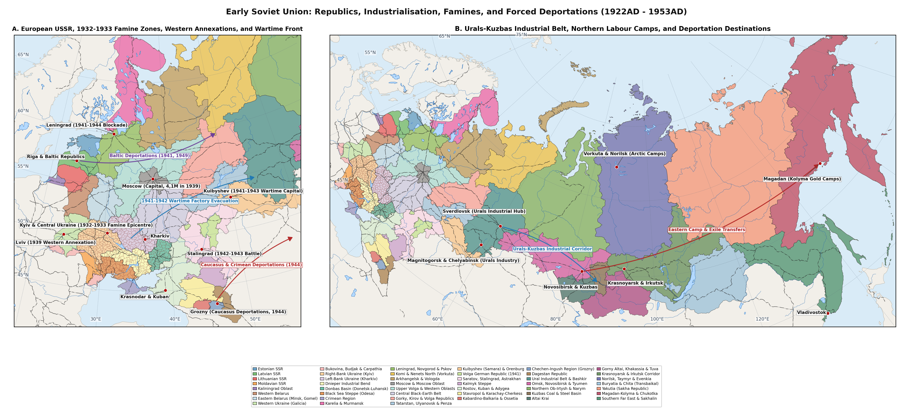

# Abstract

Between the First All-Union Census of December 1926 and the death of
Joseph Stalin in March 1953, the urban network of the European and Asian
Soviet Union was transformed by Five-Year-Plan industrialisation,
wartime devastation and the expansion of the Gulag. Across the 8.674
towns, republic capitals, industrial centres and forced-labour camp
settlements covered in this gazetteer, the combined catalogued
population rose from 53,34M in 1926 to 88,39M at the 1939 census and
106,69M across the 1953 benchmarks. Rapid industrial construction in the
1930s and factory evacuations during the Second World War multiplied the
size of Moscow, Gorky and the coal and steel cities of the Donbas, the
Urals, the Kuzbass and Western Siberia, while creating entirely new
polar mining and port towns at Vorkuta, Norilsk, Igarka and Magadan.

Over the same quarter-century, war, genocide and forced migration
hollowed out the historic cities of the western borderlands and the
occupied front zone. Between 1941 and 1945, the Holocaust annihilated
the Jewish urban communities of Vilnius, Kaunas, Riga, Minsk, Vitebsk,
Lviv, Kyiv and Odesa, siege and combat reduced Leningrad, Stalingrad,
Voronezh, Sevastopol and Narva to rubble and post-war population
transfers replaced the pre-war inhabitants of Kaliningrad, Vyborg,
Klaipeda and Yuzhno-Sakhalinsk.

# Methodology

This gazetteer traces the population of 8.674 towns, republic capitals,
Five-Year-Plan industrial boomtowns and Gulag camp centres across the 45
Stalin-era regions of Estonia (64 settlements), Latvia (97 settlements),
Lithuania (113 settlements), Moldova (62 settlements), Belarus (Regions
6-7, 306 settlements), Ukraine including Crimea (Regions 8-15, 2.296
settlements) and Russia including Kaliningrad Oblast and Karelia (Region
5 and Regions 16-45, 5.736 settlements) between 1926 and 1953.

Population figures for 1926 and 1939 come from the All-Union Censuses of
17 December 1926 and 17 January 1939, supplemented for the borderland
cities annexed between 1939 and 1945 (Tallinn, Tartu, Narva and Parnu in
Region 1; Riga, Liepaja, Daugavpils and Jelgava in Region 2; Vilnius,
Kaunas, Klaipeda and Siauliai in Region 3; Chisinau, Balti and Bender in
Region 4; Kaliningrad/Konigsberg, Sovetsk/Tilsit and
Chernyakhovsk/Insterburg in Region 5; Brest and Grodno in Region 6;
Lviv, Ternopil and Lutsk in Region 8; Chernivtsi, Izmail and Uzhhorod in
Region 9; Vyborg and Sortavala in Region 16; Kyzyl in Region 39; and
Yuzhno-Sakhalinsk/Toyohara in Region 45) by Estonian, Latvian,
Lithuanian, Polish, Romanian, Czechoslovak, Finnish, German, Tuvan and
Japanese censuses
[\[1\]](#ref-tsunkhu1929perepis1926)[\[2\]](#ref-polyakov1992perepis1939)[\[3\]](#ref-andreev1998demograficheskaya)[\[4\]](#ref-parming1972estonia)[\[5\]](#ref-zvidrins1992latvia)[\[6\]](#ref-balkelis2005vilnius)[\[7\]](#ref-kostyashov2009sekretnaya).
Estimates for 1933, 1945 and 1953 are drawn from urban registration
books, Evacuation Council and post-liberation municipal counts
(1944-1945), NKVD-MVD camp and special-settlement files and statistical
yearbooks
[\[8\]](#ref-polyakov1991perepis1937)[\[9\]](#ref-rudnytskyi2015holodomor)[\[10\]](#ref-zemskov2003spetsposelentsy)[\[11\]](#ref-khlevniuk2004history)[\[12\]](#ref-casu2014moldova).
Benchmarks before a settlement’s foundation (such as Kohtla-Jarve,
Sillamae, Vorkuta, Inta, Norilsk, Magadan, Susuman or Pevek in 1926) or
after its wartime destruction (Khatyn after March 1943) are marked with
a hyphen (`-`).

# Results

## Regions 1 - 5: Baltic SSRs, Moldavian SSR and Kaliningrad Oblast

Table gives the population of 379 settlements across Estonia (Region 1),
Latvia (Region 2), Lithuania (Region 3), Moldova (Region 4) and
Kaliningrad Oblast (Region 5)
[\[6\]](#ref-balkelis2005vilnius)[\[12\]](#ref-casu2014moldova)[\[13\]](#ref-mertelsmann2009estonia)[\[14\]](#ref-strods2002priboi)[\[15\]](#ref-kostyashov2022kaliningrad).

| Settlement | Other Names | Coords | 1926 | 1933 | 1939 | 1945 | 1953 |
|:---|:---|:---|:---|:---|:---|:---|:---|
| Abja-Paluoja (Reg. 1) | Abja-Paluoja | 58,13, 25,35 (1926-1953) | 649 | 912 | 1,1k | 1,2k | 1,5k |
| Aegviidu (Reg. 1) | Aegviidu | 59,29, 25,61 (1926-1953) | 589 | 599 | 675 | 778 | 939 |
| Ainazhi (Reg. 1) | Ainaži | 57,86, 24,36 (1926-1953) | 933 | 920 | 900 | 956 | 1k |
| Aizkraukle (Reg. 2) | Stučka; Ascheraden | 56,6, 25,26 (1926-1953) | 2,9k | 3k | 3,1k | 3,5k | 4,1k |
| Aizpute (Reg. 2) | Hasenpot; Газенпот | 56,72, 21,6 (1926-1953) | 3,4k | 3,4k | 3,3k | 3k | 3,8k |
| Akmene (Reg. 3) | Akmenė; Akmenè | 56,25, 22,75 (1926-1953) | 1,5k | 1,5k | 1,6k | 1,7k | 1,8k |
| Akniste (Reg. 2) | Aknīste | 56,16, 25,75 (1926-1953) | 324 | 438 | 566 | 733 | 1k |
| Aloja (Reg. 2) | Allendorf; Aloja | 57,77, 24,88 (1926-1953) | 387 | 501 | 615 | 748 | 973 |
| Alsunga (Reg. 2) | Alsunga | 56,98, 21,56 (1926-1953) | 815 | 836 | 854 | 966 | 1,1k |
| Aluksne (Reg. 2) | Alūksne | 57,42, 27,05 (1926-1953) | 3,5k | 4,1k | 4,4k | 4,9k | 5,7k |
| Alytus (Reg. 3) | Olita; Southern Lithuanian Regional Growth Pole | 54,4, 24,04 (1926-1953) | 6,7k | 7,5k | 8,3k | 9,2k | 10,5k |
| Ambla (Reg. 1) | Ambla | 59,19, 25,85 (1926-1953) | 503 | 520 | 564 | 617 | 695 |
| Anenii Noi (Reg. 4) | Anenii Noi | 46,88, 29,24 (1926-1953) | 1,5k | 1,8k | 2,1k | 2,6k | 3,3k |
| Antsla (Reg. 1) | Antsla | 57,83, 26,54 (1926-1953) | 1,1k | 1,5k | 1,5k | 1,7k | 2,1k |
| Anykshchiai (Reg. 3) | Anykščiai; Anyksciai | 55,53, 25,1 (1926-1953) | 3,6k | 4k | 4,3k | 4,6k | 5,1k |
| Ape (Reg. 2) | Hoppenhof; Ape | 57,54, 26,69 (1926-1953) | 976 | 932 | 900 | 1,1k | 1,3k |
| Arensburg (Reg. 1) | Kuressaare; Arensburg Oesel | 58,25, 22,49 (1926-1953) | 4,3k | 4,5k | 4,1k | 4,8k | 7,2k |
| Ariogala (Reg. 3) | Ariogala | 55,26, 23,48 (1926-1953) | 1,3k | 1,4k | 1,6k | 1,8k | 2,1k |
| Auce (Reg. 2) | Vecauce; Alt-Autz | 56,46, 22,9 (1926-1953) | 2,7k | 3,1k | 3,3k | 3,4k | 3,5k |
| Bagrationovsk (Reg. 5) | Багратионовск; Preu | 54,39, 20,64 (1926-1953) | 4k | 4,3k | 7,5k | 6,4k | 5,2k |
| Baldone (Reg. 2) | Baldohn; Baldon | 56,74, 24,4 (1926-1953) | 1,2k | 1,2k | 1,2k | 1,4k | 1,6k |
| Balozhi (Reg. 2) | Baloži | 56,88, 24,12 (1926-1953) | 960 | 985 | 1k | 1,1k | 1,3k |
| Baltiysk (Reg. 5) | Балтийск; Baltijsk | 54,65, 19,91 (1926-1953) | 7,4k | 7,6k | 11k | 12,6k | 15,1k |
| Baltoji Voke (Reg. 3) | Baltoji Vokė | 54,6, 25,19 (1926-1953) | 576 | 679 | 781 | 862 | 984 |
| Balvi (Reg. 2) | Bolowsk; Bolwa | 57,13, 27,27 (1926-1953) | 1,2k | 1,8k | 2,1k | 2,3k | 2,7k |
| Bauska (Reg. 2) | Bausk; Bauske | 56,41, 24,19 (1926-1953) | 5k | 4,9k | 4,8k | 5,4k | 6,2k |
| Beltsy (Reg. 4) | Balti; Beltsy Bessarabia | 47,76, 27,93 (1926-1953) | 30,1k | 30,6k | 32,5k | 22k | 56k |
| Bender (Reg. 4) | Bendery; Tighina | 46,83, 29,47 (1926-1953) | 31,2k | 31,4k | 32k | 15,5k | 35k |
| Bene (Reg. 2) | Bēne | 56,48, 23,07 (1926-1953) | 892 | 915 | 935 | 1,1k | 1,2k |
| Birshtonas (Reg. 3) | Birštonas | 54,61, 24,03 (1926-1953) | 306 | 417 | 544 | 709 | 1k |
| Biruinta (Reg. 4) | Biruința; Biruinţa | 47,81, 28,07 (1926-1953) | 1,1k | 1,1k | 1,2k | 1,3k | 1,4k |
| Birzai (Reg. 3) | Biržai; Birzhai | 56,2, 24,75 (1926-1953) | 5,5k | 6,1k | 6,6k | 7,1k | 8k |
| Bol’shoe Isakovo (Reg. 5) | Большое Исаково | 54,72, 20,6 (1926-1953) | 1,5k | 1,8k | 1,8k | 1,9k | 2k |
| Briceni (Reg. 4) | Brinceni; Briceni | 48,36, 27,08 (1926-1953) | 8,6k | 8,3k | 7,5k | 6,7k | 5,8k |
| Broceni (Reg. 2) | Brocēni; Brocéni | 56,68, 22,57 (1926-1953) | 1,1k | 1,1k | 1,1k | 1,3k | 1,5k |
| Bucovat (Reg. 4) | Bucovăț; Bucovăţ | 47,19, 28,46 (1926-1953) | 350 | 434 | 571 | 751 | 1,1k |
| Bugai (Reg. 3) | Skaudvilė; Skaudvile | 55,41, 22,61 (1926-1953) | 1,4k | 1,7k | 1,9k | 2,1k | 2,4k |
| Bugeac (Reg. 4) | Bugeac | 46,37, 28,66 (1926-1953) | 679 | 708 | 733 | 802 | 903 |
| Cahul (Reg. 4) | Kagul; Kagul (1946-47 Famine Core) | 45,9, 28,2 (1926-1953) | 11,1k | 11,4k | 12,1k | 9,5k | 15k |
| Cainari (Reg. 4) | Căinari | 46,68, 29,05 (1926-1953) | 1,8k | 2k | 2,2k | 2,3k | 2,6k |
| Calarasi (Reg. 4) | Călărași; Călăraşi | 47,26, 28,31 (1926-1953) | 8,8k | 8,5k | 7,7k | 7,1k | 6,3k |
| Cantemir (Reg. 4) | Cantemir | 46,28, 28,2 (1926-1953) | 1,1k | 1,1k | 1,1k | 1,2k | 1,4k |
| Causeni (Reg. 4) | Căușeni; Căuşeni | 46,64, 29,41 (1926-1953) | 6,7k | 7,3k | 8k | 8,8k | 9,9k |
| Ceadir-Lunga (Reg. 4) | Ceadîr-Lunga | 46,06, 28,83 (1926-1953) | 6,8k | 7,8k | 8,8k | 10k | 11,7k |
| Cesvaine (Reg. 2) | Sesswegen; Cesvaine | 56,97, 26,31 (1926-1953) | 858 | 880 | 899 | 1k | 1,2k |
| Chernyak-hovsk (Reg. 5) | Черняховск; Černjahovsk | 54,63, 21,82 (1926-1953) | 39,5k | 41,2k | 48,7k | 41,7k | 33,9k |
| Chernysh-evskoye (Reg. 3) | Чернышевское; Černyševskoje | 54,64, 22,73 (1926-1953) | 5,1k | 5k | 4,9k | 4,3k | 3,6k |
| Cimislia (Reg. 4) | Cimișlia; Cimişlia | 46,53, 28,76 (1926-1953) | 6,2k | 6,8k | 7,4k | 8k | 8,8k |
| Codru (Reg. 4) | Codru | 46,98, 28,82 (1926-1953) | 4,8k | 5k | 5,2k | 5,7k | 6,4k |
| Comrat (Reg. 4) | Komrat; Gagauz Steppe Centre | 46,29, 28,66 (1926-1953) | 11,7k | 12,5k | 12,8k | 13,1k | 13,5k |
| Cornesti (Reg. 4) | Cornești; Corneşti | 47,37, 28 (1926-1953) | 737 | 873 | 1,1k | 1,3k | 1,6k |
| Costesti (Reg. 4) | Costești; Costeşti | 47,86, 27,26 (1926-1953) | 1,3k | 1,3k | 1,4k | 1,5k | 1,7k |
| Cricova (Reg. 4) | Cricova | 47,14, 28,86 (1926-1953) | 580 | 1k | 2,7k | 3k | 3,4k |
| Criuleni (Reg. 4) | Criuleni | 47,21, 29,16 (1926-1953) | 2,6k | 2,8k | 3,1k | 3,4k | 3,8k |
| Cupcini (Reg. 4) | Cupcini | 48,11, 27,38 (1926-1953) | 1k | 1,2k | 1,5k | 2k | 2,7k |
| Dagda (Reg. 2) | Dagda | 56,1, 27,54 (1926-1953) | 1,1k | 1,1k | 1,3k | 1,6k | 2,1k |
| Daugai (Reg. 3) | Daugai | 54,37, 24,33 (1926-1953) | 1,2k | 1,2k | 1,2k | 1,2k | 1,3k |
| Dobele (Reg. 2) | Dóbele; Doblen | 56,62, 23,28 (1926-1953) | 1,7k | 2,3k | 2,4k | 3,2k | 4,7k |
| Dobrovol’sk (Reg. 5) | Добровольск; Pillkallen | 54,77, 22,51 (1926-1953) | 5,3k | 5,6k | 5,8k | 5,1k | 4,3k |
| Domnovo (Reg. 5) | Домново; Domnau | 54,43, 20,83 (1926-1953) | 2,4k | 2,7k | 3k | 2,6k | 2,2k |
| Donduseni (Reg. 4) | Dondușeni; Donduşeni | 48,24, 27,61 (1926-1953) | 883 | 1,1k | 1,6k | 2,3k | 3,6k |
| Donskoye (Reg. 5) | Донское; Donskoje | 54,94, 19,97 (1946-1953) | \- | \- | \- | \- | 1,5k |
| Dorpat (Reg. 1) | Tartu; Yuryev | 58,38, 26,73 (1926-1953) | 59k | 58,9k | 60,1k | 38k | 62k |
| Dotnuva (Reg. 3) | Dotnuva | 55,37, 23,88 (1926-1953) | 527 | 622 | 717 | 826 | 998 |
| Drochia (Reg. 4) | Drochia | 48,04, 27,81 (1926-1953) | 551 | 1,2k | 4,9k | 5,4k | 6,1k |
| Druskininkai (Reg. 3) | Druskieniki; Druskininkai | 54,02, 23,99 (1926-1953) | 1,5k | 2,2k | 2,8k | 3,4k | 4,6k |
| Druzhba (Reg. 5) | Дружба; Družba | 54,49, 21,19 (1926-1953) | 2,3k | 2,5k | 2,7k | 2,3k | 1,9k |
| Dubasari (Reg. 4) | Дубоссары; Dubăsari | 47,27, 29,17 (1926-1953) | 9,9k | 7,5k | 4,5k | 6,6k | 11k |
| Dukshtas (Reg. 3) | Dūkštas | 55,52, 26,32 (1926-1953) | 911 | 1,1k | 1,2k | 1,4k | 1,7k |
| Dundaga (Reg. 2) | Dundaga | 57,5, 22,35 (1926-1953) | 1,2k | 1,2k | 1,2k | 1,4k | 1,6k |
| Durbe (Reg. 2) | Durben; Durbe | 56,59, 21,37 (1926-1953) | 542 | 535 | 500 | 572 | 683 |
| Durlesti (Reg. 4) | Durlești; Durleşti | 47,02, 28,76 (1926-1953) | 3,9k | 4,5k | 5,3k | 6,1k | 7,4k |
| Dusetos (Reg. 3) | Dusetos; Дусяты | 55,75, 25,85 (1926-1953) | 1,2k | 1,3k | 1,4k | 1,5k | 1,7k |
| Dvinsk (Reg. 2) | Daugavpils; Dinaburg | 55,87, 26,54 (1926-1953) | 40,6k | 44,5k | 45,2k | 22k | 55k |
| Edinet (Reg. 4) | Edineț; Edineţ | 48,17, 27,3 (1926-1953) | 11k | 10,9k | 10,4k | 9,9k | 9,3k |
| Eishishkes (Reg. 3) | Eišiškės; Ejsk | 54,17, 25 (1926-1953) | 17,2k | 11,3k | 3,2k | 3k | 2,7k |
| Eleja (Reg. 2) | Eleja | 56,42, 23,68 (1926-1953) | 833 | 854 | 873 | 987 | 1,2k |
| Elektrenai (Reg. 3) | Elektrėnai; Elektrènai | 54,79, 24,66 (1926-1953) | 81 | 96 | 110 | 121 | 139 |
| Elva (Reg. 1) | Elwa; Elva | 58,22, 26,42 (1926-1953) | 1,4k | 1,7k | 1,8k | 2,2k | 3,5k |
| Ergli (Reg. 2) | Ērgļi | 56,9, 25,64 (1926-1953) | 1,3k | 1,3k | 1,3k | 1,5k | 1,8k |
| Ezherelis (Reg. 3) | Ežerėlis | 54,88, 23,6 (1926-1953) | 1,2k | 1,4k | 1,6k | 1,7k | 2k |
| Falesti (Reg. 4) | Fălești; Fâlesti | 47,58, 27,71 (1926-1953) | 6,3k | 6,4k | 6,8k | 7,1k | 7,6k |
| Floresti (Reg. 4) | Florești; Floreşti | 47,89, 28,29 (1926-1953) | 3,4k | 3,9k | 4k | 4,1k | 4,3k |
| Frunza (Reg. 4) | Frunză | 48,41, 27,59 (1926-1953) | 972 | 1k | 1k | 1,1k | 1,3k |
| Galiniai (Reg. 3) | Golina | 54,49, 25,29 (1926-1931) | 2,5k | \- | \- | \- | \- |
| Gargzhdai (Reg. 3) | Gargždai | 55,71, 21,39 (1926-1953) | 2,1k | 1,9k | 1,8k | 1,7k | 1,6k |
| Garliava (Reg. 3) | Godlewo; Garliava | 54,82, 23,87 (1926-1953) | 1k | 1,2k | 1,4k | 1,7k | 2,1k |
| Gelgaudishkis (Reg. 3) | Gelgaudiškis | 55,08, 22,98 (1926-1953) | 643 | 758 | 872 | 963 | 1,1k |
| Ghindesti (Reg. 4) | Ghindești | 47,85, 28,38 (1926-1953) | 1,3k | 1,4k | 1,4k | 1,5k | 1,7k |
| Glodeni (Reg. 4) | Glodyany; Glodeni | 47,77, 27,52 (1926-1953) | 2,5k | 3,1k | 3,5k | 4k | 4,7k |
| Goldingen (Reg. 2) | Kuldiga; Goldingen Courland | 56,97, 21,97 (1926-1953) | 7,2k | 7,1k | 6,1k | 7,2k | 8,9k |
| Gostini (Reg. 2) | Gostiņi | 56,23, 27,59 (1926-1935) | 932 | 979 | \- | \- | \- |
| Grigishkes (Reg. 3) | Grigiškės; Grigiskes | 54,68, 25,08 (1926-1953) | 1,4k | 1,6k | 1,8k | 2k | 2,3k |
| Griva (Reg. 2) | Grīva | 57,07, 27,51 (1926-1935) | 3k | 5,4k | \- | \- | \- |
| Grobina (Reg. 2) | Grobiņa; Grobin | 56,54, 21,17 (1926-1953) | 1,3k | 1,1k | 1,1k | 1,4k | 1,8k |
| Gulbene (Reg. 2) | Vecgulbene; Alt-Schwaneburg | 57,18, 26,75 (1926-1953) | 2,7k | 3,7k | 3,8k | 4,6k | 5,9k |
| Gur’jevsk (Reg. 5) | Гурьевск; Neuhausen | 54,77, 20,61 (1946-1953) | \- | \- | \- | \- | 1,7k |
| Gusev (Reg. 5) | Гусев; Gumbinnen | 54,59, 22,2 (1926-1953) | 19,1k | 20k | 24,5k | 20,8k | 16,7k |
| Gvardeysk (Reg. 5) | Гвардейск; Gvardejsk | 54,65, 21,07 (1926-1953) | 7,1k | 7,7k | 9,3k | 8,7k | 8k |
| Hapsal (Reg. 1) | Haapsalu; Gapsal | 58,94, 23,54 (1926-1953) | 4,4k | 4,6k | 4k | 4,5k | 6,5k |
| Hincesti (Reg. 4) | Hîncești; Hînceşti | 46,83, 28,59 (1926-1953) | 6,2k | 6,5k | 7k | 7,5k | 8,1k |
| Hryhoriopol (Reg. 4) | Григориополь; Grigoriopol | 47,15, 29,3 (1926-1953) | 8,6k | 8,3k | 7,3k | 7,7k | 8,3k |
| Ialoveni (Reg. 4) | Ialoveni | 46,94, 28,78 (1926-1953) | 3,5k | 3,8k | 4,2k | 4,7k | 5,3k |
| Iargara (Reg. 4) | Iargara | 46,43, 28,43 (1926-1953) | 568 | 1,1k | 3,7k | 4,1k | 4,6k |
| Iecava (Reg. 2) | Iecava | 56,6, 24,21 (1926-1953) | 677 | 702 | 817 | 1k | 1,3k |
| Ignalina (Reg. 3) | Ignalino; Ignalina | 55,34, 26,16 (1926-1953) | 672 | 885 | 1,1k | 1,4k | 1,9k |
| Ikshkile (Reg. 2) | Ikšķile | 56,83, 24,5 (1926-1953) | 966 | 991 | 1k | 1,1k | 1,3k |
| Ilukste (Reg. 2) | Ilūkste; Illuxt | 55,98, 26,3 (1926-1953) | 1k | 1,3k | 1,3k | 1,6k | 2,2k |
| Jakobstadt (Reg. 2) | Jekabpils; Yakobshtadt | 56,5, 25,88 (1926-1953) | 5,8k | 5,7k | 7,1k | 9,5k | 14k |
| Jarva-Jaani (Reg. 1) | Järva-Jaani | 59,04, 25,89 (1926-1953) | 815 | 828 | 917 | 1k | 1,2k |
| Jarvakandi (Reg. 1) | Järvakandi | 58,78, 24,83 (1926-1953) | 1,8k | 1,8k | 1,9k | 1,9k | 2k |
| Jaunjelgava (Reg. 2) | Friedric-hstadt; Yaunyelgava | 56,61, 25,08 (1926-1953) | 2,4k | 2,2k | 2,1k | 2,1k | 2,1k |
| Jieznas (Reg. 3) | Jieznas | 54,6, 24,18 (1926-1953) | 1k | 1,2k | 1,3k | 1,4k | 1,6k |
| Jogeva (Reg. 1) | Jõgeva; Laisholm | 58,75, 26,39 (1926-1953) | 982 | 1,1k | 1,1k | 1,3k | 1,9k |
| Johvi (Reg. 1) | Jõhvi; Jewe | 59,36, 27,42 (1926-1953) | 1,8k | 2k | 2k | 2,9k | 6,1k |
| Jonava (Reg. 3) | Janov; Janow | 55,08, 24,28 (1926-1953) | 4,9k | 6,3k | 5,6k | 4,9k | 4,2k |
| Jonishkelis (Reg. 3) | Joniškėlis | 56,02, 24,17 (1926-1953) | 636 | 857 | 1,1k | 1,4k | 2k |
| Jonishkis (Reg. 3) | Joniškis | 56,24, 23,62 (1926-1953) | 4,3k | 4,6k | 4,8k | 5,1k | 5,6k |
| Juodupe (Reg. 3) | Juodupė; Juodupè | 56,09, 25,61 (1926-1953) | 751 | 885 | 1k | 1,1k | 1,3k |
| Jurbarkas (Reg. 3) | Jurburg; Georgenburg | 55,08, 22,76 (1926-1953) | 4,4k | 4,4k | 4,4k | 4,4k | 4,4k |
| Kaishiadorys (Reg. 3) | Kaišiadorys | 54,87, 24,47 (1926-1953) | 1,6k | 1,9k | 2,1k | 2,3k | 2,7k |
| Kaliningrad (Reg. 5) | Калининград | 54,71, 20,51 (1926-1953) | 303,8k | 333,1k | 360,6k | 303,7k | 241,7k |
| Kallaste (Reg. 1) | Kallaste | 58,66, 27,16 (1926-1953) | 1,6k | 1,6k | 1,2k | 1,2k | 1,4k |
| Kalnciems (Reg. 2) | Kalnzeem; Kalnciems | 56,8, 23,62 (1926-1953) | 2,1k | 2,1k | 2,2k | 2,5k | 2,9k |
| Kalvarija (Reg. 3) | Kalwaria; Kalwarya | 54,42, 23,22 (1926-1953) | 4,5k | 4,6k | 4,6k | 4,6k | 4,7k |
| Kandava (Reg. 2) | Kandau; Kandava | 57,04, 22,77 (1926-1953) | 1,5k | 1,7k | 1,6k | 1,9k | 2,7k |
| Kardla (Reg. 1) | Kärdla; Kertel | 59, 22,75 (1926-1953) | 1,5k | 1,5k | 1,3k | 1,4k | 2k |
| Karksi-Nuia (Reg. 1) | Karksi-Nuia | 58,1, 25,56 (1926-1953) | 610 | 750 | 821 | 883 | 973 |
| Karsava (Reg. 2) | Kārsava | 56,78, 27,69 (1926-1953) | 1,9k | 1,9k | 1,9k | 2,2k | 2,7k |
| Karunava (Reg. 3) | Koronowo; Karūnava | 55,23, 23,92 (1926-1931) | 4,1k | \- | \- | \- | \- |
| Kavarskas (Reg. 3) | Kavarskas | 55,43, 24,93 (1926-1953) | 898 | 969 | 1k | 1,1k | 1,2k |
| Kazlu Ruda (Reg. 3) | Kazlų Rūda | 54,75, 23,49 (1926-1953) | 1,8k | 2,2k | 2,5k | 2,8k | 3,1k |
| Kedainiai (Reg. 3) | Kėdainiai; Keidany | 55,29, 23,97 (1926-1953) | 7,6k | 8,2k | 8,7k | 9,2k | 10k |
| Kegums (Reg. 2) | Ķegums; Keggum | 56,75, 24,72 (1926-1953) | 512 | 525 | 536 | 606 | 714 |
| Kehra (Reg. 1) | Kedder; Kekhra | 59,34, 25,32 (1926-1953) | 232 | 235 | 1,7k | 2k | 2,4k |
| Keila (Reg. 1) | Kegel; Keila | 59,3, 24,41 (1926-1953) | 845 | 953 | 1k | 1,3k | 2,1k |
| Kelme (Reg. 3) | Kelmė; Kelmè | 55,63, 22,93 (1926-1953) | 3k | 3,4k | 3,7k | 4,1k | 4,7k |
| Kemeri (Reg. 2) | Ķemeri | 57,41, 26,89 (1926-1935) | 760 | 1,1k | \- | \- | \- |
| Kilingi-Nomme (Reg. 1) | Kilingi-Nõmme; Quellenstein | 58,15, 24,96 (1926-1953) | 1,2k | 1,4k | 1,3k | 1,5k | 1,8k |
| Kishinev (Reg. 4) | Chisinau; Kishinyov | 47,01, 28,86 (1926-1953) | 115k | 114,9k | 112,5k | 56k | 168k |
| Kivioli (Reg. 1) | Kiviõli | 59,35, 26,97 (1926-1953) | 6,2k | 6,3k | 6,3k | 7,3k | 9k |
| Klaipeda (Reg. 3) | Memel; Klaipėda | 55,7, 21,14 (1926-1953) | 35,8k | 37,5k | 47,2k | 4,5k | 68k |
| Kohila (Reg. 1) | Haggers (); Kohila | 59,17, 24,76 (1926-1953) | 417 | 859 | 1,1k | 1,4k | 1,9k |
| Kohtla-Jarve (Reg. 1) | Kohtla Oil-Shale Basin; Kohtla-Järve | 59,4, 27,27 (1926-1953) | 2,8k | 4,1k | 6,2k | 8,5k | 32k |
| Kohtla-Nomme (Reg. 1) | Kohtla-Nõmme | 59,35, 27,18 (1926-1953) | 589 | 595 | 600 | 698 | 854 |
| Koknese (Reg. 2) | Kukenois; Kokenhusen | 56,65, 25,44 (1926-1953) | 628 | 644 | 658 | 744 | 877 |
| Kornevo (Reg. 5) | Корнево; Zinten | 54,44, 20,29 (1926-1953) | 3,8k | 4k | 5,8k | 5,2k | 4,5k |
| Koshevoye (Reg. 5) | Кошевое; Koševoje | 54,71, 20,75 (1946-1953) | \- | \- | \- | \- | 1k |
| Kovno (Reg. 3) | Kaunas; Kovna | 54,9, 23,9 (1926-1953) | 94,4k | 102k | 154,1k | 106k | 182k |
| Kraslava (Reg. 2) | Krāslava; Kreslavka | 55,9, 27,17 (1926-1953) | 4,4k | 4,3k | 4,3k | 4,6k | 5k |
| Krasnozn-amensk (Reg. 5) | Краснознаменск; Lasdehnen | 54,94, 22,49 (1926-1953) | 1,9k | 2,1k | 2,1k | 2,3k | 2,6k |
| Kretinga (Reg. 3) | Krottingen; Kretinga | 55,89, 21,24 (1926-1953) | 2,8k | 3,7k | 4,6k | 5,8k | 7,7k |
| Krylovo (Reg. 5) | Крылово; Nordenburg | 54,33, 21,55 (1926-1953) | 2,8k | 3k | 3,2k | 2,8k | 2,3k |
| Kudirkos Naumiestis (Reg. 3) | Vladislavovas; Kudirkos Naumiestis | 54,77, 22,86 (1926-1953) | 2,3k | 1,2k | 1,1k | 1,4k | 2k |
| Kulautuva (Reg. 3) | Kulautuva | 54,94, 23,64 (1926-1953) | 539 | 635 | 731 | 807 | 921 |
| Kunda (Reg. 1) | Kunda | 59,48, 26,53 (1926-1953) | 2,1k | 1,9k | 1,6k | 1,8k | 2,8k |
| Kupiskis (Reg. 3) | Kupiškis; Kupishkis | 55,84, 24,98 (1926-1953) | 4k | 7,4k | 6,5k | 5,7k | 4,7k |
| Kuprava (Reg. 2) | Kuprava | 57,24, 27,5 (1926-1953) | 763 | 782 | 799 | 904 | 1,1k |
| Kurshenai (Reg. 3) | Kuršėnai | 56, 22,94 (1926-1953) | 3,2k | 4k | 4,8k | 5,8k | 7,5k |
| Kutuzovo (Reg. 3) | Кутузово; Schirwindt | 54,78, 22,84 (1926-1953) | 1,1k | 1,1k | 1,1k | 737 | 438 |
| Kybartai (Reg. 3) | Kibarty; Kybartai | 54,64, 22,76 (1926-1953) | 6,3k | 6,3k | 6,3k | 6,3k | 6,3k |
| Ladushkin (Reg. 5) | Ладушкин; Laduškin | 54,57, 20,17 (1926-1953) | 437 | 762 | 1,3k | 1,4k | 1,5k |
| Lavassaare (Reg. 1) | Lavassaare | 58,51, 24,39 (1926-1953) | 383 | 387 | 390 | 454 | 555 |
| Lazdijai (Reg. 3) | Lodsjeje; Lozdzieje | 54,23, 23,51 (1926-1953) | 2,4k | 2,6k | 2,7k | 2,8k | 3k |
| Lejasciems (Reg. 2) | Lejasciems | 57,28, 26,58 (1926-1935) | 577 | 479 | \- | \- | \- |
| Lentvaris (Reg. 3) | Landwarów; Landwarowo | 54,64, 25,05 (1926-1953) | 1,7k | 2k | 2,4k | 2,8k | 3,6k |
| Leova (Reg. 4) | Leovo; Leova | 46,48, 28,25 (1926-1953) | 6,3k | 6,5k | 6,5k | 6,4k | 6,3k |
| Libau (Reg. 2) | Liepaja; Libava | 56,5, 21,01 (1926-1953) | 60,7k | 57,1k | 57,1k | 37k | 64k |
| Lielvarde (Reg. 2) | Lielvārde; Lennewaden | 56,72, 24,81 (1926-1953) | 677 | 709 | 857 | 1k | 1,3k |
| Ligatne (Reg. 2) | Līgatne; Ligat | 57,23, 25,04 (1926-1953) | 1,7k | 1,8k | 1,8k | 1,9k | 2k |
| Lihula (Reg. 1) | Leal; Lihula | 58,68, 23,85 (1926-1953) | 598 | 728 | 862 | 1k | 1,3k |
| Limbazhi (Reg. 2) | Limbaži; Limbazi | 57,51, 24,72 (1926-1953) | 3,1k | 2,9k | 2,8k | 3,3k | 4,1k |
| Linkuva (Reg. 3) | Linkowo; Linkuva | 56,09, 23,97 (1926-1953) | 1,9k | 1,9k | 2k | 2k | 2,1k |
| Lipcani (Reg. 4) | Lipcani | 48,26, 26,81 (1926-1953) | 8,4k | 8k | 6k | 5,8k | 6k |
| Livani (Reg. 2) | Līvāni; Lívání | 56,35, 26,18 (1926-1953) | 3,1k | 3,4k | 3,6k | 4k | 4,7k |
| Loksa (Reg. 1) | Zitter (); Loksa | 59,58, 25,72 (1926-1953) | 2k | 632 | 2k | 2,3k | 2,9k |
| Lubana (Reg. 2) | Lubāna; Luban | 56,9, 26,72 (1926-1953) | 1k | 1,1k | 1,1k | 1,2k | 1,5k |
| Ludza (Reg. 2) | Ljuzin; Ludse | 56,53, 27,72 (1926-1953) | 5,5k | 5,5k | 5,6k | 5,8k | 6k |
| Maardu (Reg. 1) | Maardu | 59,47, 24,98 (1926-1953) | 2,5k | 2,5k | 2,5k | 3k | 3,6k |
| Madona (Reg. 2) | Birži; Modohn | 56,85, 26,22 (1926-1953) | 1,5k | 2,3k | 2,4k | 3,1k | 4,4k |
| Maloye Isakovo (Reg. 5) | Малое Исаково | 54,73, 20,58 (1926-1953) | 1,5k | 1,8k | 1,8k | 1,8k | 1,8k |
| Malta (Reg. 2) | \- | 56,35, 27,16 (1926-1953) | 1,5k | 1,5k | 1,5k | 1,7k | 2k |
| Malta (Reg. 2) | \- | 56,57, 26,92 (1926-1953) | 1,5k | 1,5k | 1,5k | 1,7k | 2k |
| Mamonovo (Reg. 5) | Мамоново; Heiligenbeil | 54,46, 19,94 (1926-1953) | 5,3k | 6,4k | 10,6k | 8,7k | 6,7k |
| Marculesti (Reg. 4) | Mărculești; Mărculeşti | 47,87, 28,24 (1926-1953) | 2,4k | 2,5k | 2,1k | 1,9k | 1,5k |
| Mariampol (Reg. 3) | Marijampole; Mariampol Suwalki | 54,56, 23,35 (1926-1953) | 9,9k | 11,1k | 12,3k | 13,6k | 15,5k |
| Marjamaa (Reg. 1) | Märjamaa; Merjama | 58,9, 24,43 (1926-1953) | 293 | 622 | 841 | 1,1k | 1,4k |
| Mazeikiai (Reg. 3) | Mažeikiai; Mazheikiai | 56,32, 22,33 (1926-1953) | 4,5k | 5k | 5,5k | 6k | 6,8k |
| Mazsalaca (Reg. 2) | Salisburg; Mazsalatsa | 57,86, 25,05 (1926-1953) | 1,2k | 1,4k | 1,5k | 1,7k | 1,9k |
| Mitau (Reg. 2) | Jelgava; Mitava | 56,65, 23,72 (1926-1953) | 28,3k | 33,4k | 34,1k | 15,5k | 31k |
| Moisakula (Reg. 1) | Mõisaküla; Moiseküll | 58,09, 25,19 (1926-1953) | 2k | 2,2k | 2,2k | 2,2k | 2,2k |
| Moletai (Reg. 3) | Molėtai; Molètai | 55,22, 25,42 (1926-1953) | 1,8k | 1,8k | 1,8k | 1,9k | 1,9k |
| Mozyr (Reg. 5) | Мозырь | 54,44, 21,48 (1926-1953) | 10,1k | 13,2k | 16,7k | 15,8k | 14,7k |
| Mustla (Reg. 1) | Mustla | 58,13, 25,1 (1926-1953) | 756 | 917 | 832 | 835 | 932 |
| Mustvee (Reg. 1) | Tschorna; Tschernoje | 58,85, 26,94 (1926-1953) | 2,8k | 2,8k | 2,1k | 2k | 2,2k |
| Narva-Joesuu (Reg. 1) | Narva-Jõesuu; Hungerburg | 59,46, 28,04 (1926-1953) | 2,1k | 1,7k | 1,8k | 2,1k | 2,4k |
| Naujoji Akmene (Reg. 3) | Naujoji Akmenė; Naujoji Akmenè | 56,32, 22,9 (1926-1953) | 2,9k | 3,4k | 3,9k | 4,3k | 4,9k |
| Naujoji Vilnia (Reg. 3) | Nowa Wilejka; Naujoji Vilnia | 54,7, 25,42 (1926-1931) | 5,9k | \- | \- | \- | \- |
| Neman (Reg. 5) | Неман; Ragnit | 55,03, 22,03 (1926-1953) | 8k | 9,3k | 10,1k | 9,9k | 9,6k |
| Nemenchine (Reg. 3) | Nemenčinė | 54,85, 25,47 (1926-1953) | 538 | 717 | 917 | 1,2k | 1,6k |
| Nereta (Reg. 2) | Nereta | 56,2, 25,31 (1926-1953) | 822 | 843 | 861 | 974 | 1,1k |
| Nesterov (Reg. 5) | Нестеров; Stallup | 54,63, 22,57 (1926-1953) | 6,1k | 6,3k | 6,6k | 5,3k | 4k |
| Nida (Reg. 3) | Neringa; Nidden | 55,31, 21 (1926-1953) | 779 | 918 | 1,1k | 1,2k | 1,3k |
| Nisporeni (Reg. 4) | Nisporeny; Nisporeni | 47,08, 28,17 (1926-1953) | 5,8k | 6,3k | 6,9k | 7,6k | 8,6k |
| Obeliai (Reg. 3) | Obeliai | 55,97, 25,16 (1926-1953) | 1k | 1,2k | 1,3k | 1,5k | 1,7k |
| Ocnita (Reg. 4) | Ocnița; Ocniţa | 48,38, 27,44 (1926-1953) | 2,4k | 2,9k | 3,5k | 4,2k | 5,3k |
| Ogre (Reg. 2) | Oger; Oger-Galle | 56,82, 24,61 (1926-1953) | 905 | 1,5k | 1,7k | 2,9k | 6k |
| Olaine (Reg. 2) | Olai; Olaine | 56,8, 23,94 (1926-1953) | 4,8k | 5k | 5,1k | 5,7k | 6,8k |
| Orhei (Reg. 4) | Orgeyev; Orgjejev | 47,39, 28,83 (1926-1953) | 14,8k | 15,3k | 15,8k | 8,2k | 12k |
| Otepaa (Reg. 1) | Otepää; Odenpä | 58,06, 26,5 (1926-1953) | 1,9k | 2k | 1,9k | 1,9k | 2k |
| Ozjorsk (Reg. 5) | Озёрск; Darkehmen | 54,41, 22,01 (1945-1953) | \- | \- | \- | 1,3k | 2,4k |
| Ozolnieki (Reg. 2) | Ozolnieki | 56,69, 23,78 (1926-1953) | 1,5k | 1,5k | 1,5k | 1,7k | 2,1k |
| Pabrade (Reg. 3) | Pabradė; Podbrodzie | 54,98, 25,76 (1926-1953) | 2k | 2,7k | 3k | 3,4k | 4k |
| Pagegiai (Reg. 3) | Pagėgiai; Pagègiai | 55,14, 21,91 (1926-1953) | 1,4k | 1,7k | 2k | 2,4k | 2,9k |
| Pakruojis (Reg. 3) | Pokroje; Pakruojis | 55,98, 23,86 (1926-1953) | 1,1k | 1,3k | 1,5k | 1,8k | 2,1k |
| Palanga (Reg. 3) | Polangen; Palanga | 55,92, 21,07 (1926-1953) | 2,2k | 2,7k | 3,2k | 3,8k | 4,8k |
| Paldiski (Reg. 1) | Baltischport; Roggersvik | 59,36, 24,05 (1926-1953) | 981 | 866 | 215 | 259 | 1,1k |
| Pandelys (Reg. 3) | Pandėlys; Pandèlys | 56,03, 25,23 (1926-1953) | 876 | 949 | 1k | 1,1k | 1,2k |
| Panemune (Reg. 5) | Panemunė | 55,09, 21,91 (1926-1953) | 274 | 323 | 371 | 410 | 467 |
| Parnu-Jaagupi (Reg. 1) | Pärnu-Jaagupi; Parnu-Jaagupi | 58,61, 24,51 (1926-1953) | 271 | 275 | 745 | 867 | 1,1k |
| Pasvalys (Reg. 3) | Posvol; Poswol | 56,06, 24,4 (1926-1953) | 2,3k | 2,7k | 3k | 3,3k | 3,8k |
| Pavilosta (Reg. 2) | Pāvilosta; Pauls Hafen | 56,89, 21,19 (1926-1953) | 779 | 835 | 886 | 940 | 1k |
| Pernau (Reg. 1) | Parnu; Pernov | 58,39, 24,5 (1926-1953) | 21,5k | 20,7k | 21,8k | 18,5k | 31k |
| Piltene (Reg. 2) | Pilten; Пильтен | 57,22, 21,67 (1926-1953) | 891 | 757 | 700 | 723 | 754 |
| Pionerskiy (Reg. 5) | Пионерский; Pionerskij | 54,95, 20,23 (1926-1953) | 2,7k | 3,7k | 4,8k | 5,5k | 6,6k |
| Plavinas (Reg. 2) | Pļaviņas; Stockmannshof | 56,62, 25,73 (1926-1953) | 1,6k | 1,9k | 1,8k | 2,3k | 3,2k |
| Plunge (Reg. 3) | Plungė; Plungè | 55,91, 21,84 (1926-1953) | 4,5k | 5,2k | 5,8k | 6,6k | 7,7k |
| Podgorovka (Reg. 5) | Подгоровка | 54,6, 22,32 (1926-1953) | 4,1k | 5,4k | 6,8k | 6,4k | 6k |
| Podlipnoye (Reg. 5) | Подлипное | 54,84, 21,46 (1926-1953) | 5,5k | 7,3k | 9,2k | 8,7k | 8,1k |
| Polessk (Reg. 5) | Полесск; Labiau | 54,86, 21,1 (1926-1953) | 5k | 5,9k | 6,5k | 6,2k | 5,7k |
| Poltsamaa (Reg. 1) | Põltsamaa; Oberpahlen | 58,65, 25,97 (1926-1953) | 2,3k | 2,6k | 2,8k | 3k | 3,4k |
| Polva (Reg. 1) | Põlva; Pölwe | 58,06, 27,07 (1926-1953) | 311 | 399 | 533 | 722 | 1,1k |
| Ponevezh (Reg. 3) | Panevezys; Poniewiez | 55,73, 24,36 (1926-1953) | 19,7k | 21,2k | 26,7k | 18k | 32k |
| Pravdinsk (Reg. 5) | Правдинск; Friedland | 54,44, 21,02 (1926-1953) | 3,9k | 4,3k | 4,4k | 3,8k | 3,1k |
| Preili (Reg. 2) | Preiļi; Preli | 56,29, 26,72 (1926-1953) | 1,9k | 1,7k | 1,7k | 2k | 2,6k |
| Priekule (Reg. 2) | Prekule; Prekuln | 56,45, 21,59 (1926-1953) | 1,1k | 1,3k | 1,3k | 1,6k | 2,2k |
| Priekule (Reg. 3) | Priekulė | 55,55, 21,32 (1926-1953) | 1,1k | 1,2k | 1,4k | 1,5k | 1,7k |
| Prienai (Reg. 3) | Preny; Прены | 54,64, 23,95 (1926-1953) | 3,4k | 3,8k | 4,1k | 4,4k | 5k |
| Primor’je (Reg. 5) | Приморье; Gro | 54,94, 20,04 (1926-1953) | 405 | 705 | 844 | 1,1k | 1,5k |
| Primorsk (Reg. 5) | Приморск; Fischhausen | 54,74, 20,01 (1926-1953) | 3,2k | 3,6k | 3,9k | 3,2k | 2,5k |
| Pussi (Reg. 1) | Püssi | 59,36, 27,05 (1926-1953) | 2,1k | 626 | 577 | 644 | 746 |
| Radviliskis (Reg. 3) | Radviliškis; Radvilishkis | 55,82, 23,53 (1926-1953) | 5,9k | 6,9k | 7,9k | 9,1k | 11k |
| Ramygala (Reg. 3) | Ramygala | 55,51, 24,3 (1926-1953) | 1,3k | 1,4k | 1,5k | 1,6k | 1,8k |
| Rapina (Reg. 1) | Räpina; Rappin | 58,1, 27,46 (1926-1953) | 298 | 549 | 780 | 1,1k | 1,6k |
| Rapla (Reg. 1) | Rappel; Rapla | 59,01, 24,79 (1926-1953) | 449 | 900 | 1,2k | 1,6k | 2,3k |
| Raseiniai (Reg. 3) | Raseynyay; Rossieny | 55,38, 23,12 (1926-1953) | 5,3k | 5,5k | 5,7k | 5,8k | 6,1k |
| Reval (Reg. 1) | Tallinn; Revel | 59,44, 24,75 (1926-1953) | 127k | 137k | 159,6k | 134k | 245k |
| Rezhitsa (Reg. 2) | Rezekne; Rositten Latgale | 56,51, 27,33 (1926-1953) | 12,6k | 13,1k | 13,2k | 8k | 18k |
| Rezina (Reg. 4) | Reazina-Târg; Rezina | 47,75, 28,97 (1926-1953) | 4,5k | 4,3k | 3,8k | 3,3k | 2,8k |
| Ribnita (Reg. 4) | Rybnitsa; Moldavian Metallurgical Plant City | 47,77, 29 (1926-1953) | 9,4k | 6,7k | 11,5k | 12,7k | 14,5k |
| Rietavas (Reg. 3) | Retovo; Retowo | 55,73, 21,92 (1926-1953) | 1,8k | 2k | 2,2k | 2,4k | 2,6k |
| Riga (Reg. 2) | Riia; Livland Capital | 56,95, 24,11 (1926-1953) | 339k | 378k | 385k | 228k | 520k |
| Riscani (Reg. 4) | Rîșcani; Rîşcani | 47,95, 27,57 (1926-1953) | 3,4k | 3,5k | 3,5k | 3,6k | 3,7k |
| Roja (Reg. 2) | Roja | 57,5, 22,81 (1926-1953) | 1,4k | 1,4k | 1,4k | 1,6k | 1,9k |
| Rokishkis (Reg. 3) | Rokiškis; Rakishki | 55,96, 25,59 (1926-1953) | 4,4k | 4,8k | 5,5k | 5,5k | 5,5k |
| Rudishkes (Reg. 3) | Rūdiškės | 54,52, 24,83 (1926-1953) | 942 | 1k | 1,1k | 1,2k | 1,4k |
| Rujiena (Reg. 2) | Rūjiena; Rújiena | 57,9, 25,33 (1926-1953) | 4,8k | 4,4k | 4,2k | 4k | 3,7k |
| Rusne (Reg. 3) | Rusnė | 55,3, 21,37 (1926-1953) | 1,2k | 1,4k | 1,7k | 1,8k | 2,1k |
| Rybachiy (Reg. 5) | Рыбачий; Rybačij | 55,15, 20,85 (1926-1953) | 585 | 650 | 690 | 800 | 973 |
| Sabile (Reg. 2) | Zabeln; Sabile | 57,05, 22,57 (1926-1953) | 1,4k | 1,9k | 1,8k | 1,6k | 1,9k |
| Salacgriva (Reg. 2) | Salacgrīva | 57,75, 24,36 (1926-1953) | 902 | 916 | 1k | 1,2k | 1,7k |
| Salantai (Reg. 3) | Salanty; Salantai | 56,06, 21,57 (1926-1953) | 1,7k | 1,8k | 1,9k | 2k | 2,2k |
| Salaspils (Reg. 2) | Salisstadt; Salaspils | 56,86, 24,37 (1926-1953) | 1,1k | 1,5k | 2k | 2,7k | 3,9k |
| Saldus (Reg. 2) | Frauenburg; Saldus | 56,66, 22,49 (1926-1953) | 3,8k | 4,4k | 4,2k | 5,1k | 6,5k |
| Saue (Reg. 1) | Gross Sauss (); Saue | 59,32, 24,55 (1926-1953) | 2,5k | 2,6k | 2,7k | 2,7k | 2,8k |
| Saulkrasti (Reg. 2) | Neubad; Saulkrasti | 57,26, 24,41 (1926-1953) | 1,3k | 1,4k | 1,4k | 1,6k | 1,9k |
| Seda (Reg. 2) | Seda | 57,65, 25,75 (1926-1953) | 1,4k | 1,5k | 1,5k | 1,7k | 2k |
| Seda (Reg. 3) | Sjady; Seda | 56,17, 22,09 (1926-1953) | 1,9k | 1,9k | 2k | 2k | 2,1k |
| Seniava (Reg. 3) | Sieniawa | 54,6, 24,4 (1926-1931) | 1,4k | \- | \- | \- | \- |
| Shakiai (Reg. 3) | Šakiai; Шаки | 54,95, 23,05 (1926-1953) | 2,1k | 2,3k | 2,4k | 2,6k | 2,8k |
| Shalchininkai (Reg. 3) | Šalčininkai | 54,31, 25,39 (1926-1953) | 643 | 788 | 938 | 1,1k | 1,4k |
| Shavli (Reg. 3) | Siauliai; Szawle | 55,93, 23,31 (1926-1953) | 21,8k | 24,2k | 31,6k | 19k | 48k |
| Sheduva (Reg. 3) | Šeduva; Шадов | 55,75, 23,76 (1926-1953) | 3,2k | 3,2k | 3,2k | 3,2k | 3,2k |
| Shilale (Reg. 3) | Šilalė | 55,49, 22,19 (1926-1953) | 1,1k | 1,3k | 1,4k | 1,5k | 1,8k |
| Shirvintos (Reg. 3) | Širvintos | 55,04, 24,95 (1926-1953) | 1,9k | 1,8k | 1,8k | 1,7k | 1,7k |
| Shvenchi-oneliai (Reg. 3) | Švenčionėliai; Nowo-Święciany | 55,16, 26 (1926-1953) | 3,5k | 3,7k | 4k | 4,2k | 4,6k |
| Shvenchionys (Reg. 3) | Švenčionys; Свенцяны | 55,13, 26,16 (1926-1953) | 5k | 5,7k | 5,3k | 4,9k | 4,3k |
| Sigulda (Reg. 2) | Segewold; Sigulda | 57,15, 24,86 (1926-1953) | 1,4k | 1,5k | 1,6k | 2,2k | 3,5k |
| Sillamae (Reg. 1) | Combine No. 7 Uranium Town; Sillamäe | 59,4, 27,76 (1926-1953) | 900 | 1,4k | 2,4k | 1,2k | 6,5k |
| Silute (Reg. 3) | Šilutė; Shilute | 55,35, 21,48 (1926-1953) | 4,8k | 5,6k | 6,4k | 7,1k | 8,1k |
| Simnas (Reg. 3) | Simnas | 54,38, 23,65 (1926-1953) | 1,5k | 1,6k | 1,6k | 1,6k | 1,6k |
| Sindi (Reg. 1) | Zintenhof; Sindi | 58,4, 24,67 (1926-1953) | 1,7k | 1,8k | 1,8k | 1,9k | 2,5k |
| Singera (Reg. 4) | Sîngera; Sângera | 46,92, 28,97 (1926-1953) | 1,6k | 1,8k | 2,1k | 2,4k | 2,9k |
| Singerei (Reg. 4) | Sîngerei; Sângerei | 47,64, 28,14 (1926-1953) | 3,6k | 4,2k | 4,9k | 5,6k | 6,8k |
| Skriveri (Reg. 2) | Skrīveri | 56,65, 25,12 (1926-1953) | 1,4k | 1,4k | 1,5k | 1,7k | 2k |
| Skrunda (Reg. 2) | Schrunden; Skrunda | 56,68, 22,02 (1926-1953) | 2k | 2,1k | 2,1k | 2,4k | 2,8k |
| Skuodas (Reg. 3) | Schkudy; Szkudy | 56,27, 21,53 (1926-1953) | 3,6k | 3,5k | 3,4k | 3,3k | 3,2k |
| Slavsk (Reg. 5) | Славск; Heinrich-swalde | 55,04, 21,68 (1926-1953) | 1,4k | 1,7k | 2,1k | 2,5k | 3,2k |
| Slavskoye (Reg. 5) | Славское; Slavskoje | 54,5, 20,44 (1926-1953) | 1,9k | 2k | 2k | 1,7k | 1,3k |
| Sloka (Reg. 2) | Schlok; Sloka | 56,94, 23,62 (1926-1935) | 3,8k | 4,9k | \- | \- | \- |
| Smalininkai (Reg. 3) | Smalininkai | 55,08, 22,58 (1926-1953) | 461 | 453 | 558 | 687 | 907 |
| Smiltene (Reg. 2) | Smilten; Smiltene | 57,42, 25,9 (1926-1953) | 3,3k | 3,7k | 3,7k | 4k | 4,3k |
| Soldanesti (Reg. 4) | Șoldănești; Şoldăneşti | 47,82, 28,8 (1926-1953) | 1,3k | 1,6k | 1,8k | 2,2k | 2,7k |
| Sompa (Reg. 1) | Sompa | 59,36, 27,32 (1926-1953) | 3,1k | 3,1k | 3,1k | 3,6k | 4,4k |
| Soroca (Reg. 4) | Soroki; Сороки | 48,16, 28,28 (1926-1953) | 15k | 14,9k | 14,6k | 14,3k | 14k |
| Sovetsk (Reg. 5) | Tilsit; East Prussia 1945 Annexation | 55,08, 21,89 (1926-1953) | 50,8k | 57,3k | 59,1k | 11k | 27k |
| Staicele (Reg. 2) | Staicele | 57,84, 24,75 (1926-1953) | 809 | 830 | 848 | 959 | 1,1k |
| Stauceni (Reg. 4) | Stăuceni | 47,1, 28,87 (1926-1953) | 2,6k | 2,7k | 2,8k | 3,1k | 3,5k |
| Stefan Voda (Reg. 4) | Ștefan Vodă; Ştefan Vodă | 46,51, 29,66 (1926-1953) | 210 | 442 | 1,7k | 1,8k | 2,1k |
| Stende (Reg. 2) | Stenden; Stende | 57,14, 22,53 (1926-1953) | 686 | 712 | 842 | 1,1k | 1,5k |
| Straseni (Reg. 4) | Strășeni; Strâseni | 47,14, 28,61 (1926-1953) | 4,8k | 5,4k | 6,3k | 7,3k | 8,8k |
| Strenchi (Reg. 2) | Strenči; Strenci | 57,63, 25,69 (1926-1953) | 1,8k | 1,8k | 1,7k | 2k | 2,4k |
| Subachius (Reg. 3) | Subačius | 55,77, 24,74 (1926-1953) | 576 | 675 | 773 | 886 | 1,1k |
| Subate (Reg. 2) | Subbat; Subate | 56,01, 25,91 (1926-1953) | 1,7k | 1,6k | 1,5k | 1,3k | 1,2k |
| Suure-Jaani (Reg. 1) | Suure-Jaani | 58,54, 25,47 (1926-1953) | 987 | 1k | 973 | 1,1k | 1,4k |
| Svetlogorsk (Reg. 5) | Светлогорск; Rauschen | 54,94, 20,15 (1926-1953) | 1,5k | 2k | 2,5k | 3,4k | 5k |
| Svetlyy (Reg. 5) | Светлый; Svetlyj | 54,68, 20,13 (1946-1953) | \- | \- | \- | \- | 5,3k |
| Talsi (Reg. 2) | Talsen; Talsi | 57,25, 22,58 (1926-1953) | 4,1k | 4,1k | 4k | 4,5k | 5,4k |
| Tamsalu (Reg. 1) | Tamsal; Tamsalu | 59,16, 26,12 (1926-1953) | 491 | 499 | 628 | 826 | 1,2k |
| Tapa (Reg. 1) | Taps; Tapa | 59,26, 25,96 (1926-1953) | 3,1k | 3,7k | 3,5k | 4,2k | 6k |
| Taraclia (Reg. 4) | Tarakliya; Taraclia | 45,9, 28,67 (1926-1953) | 8k | 8,2k | 7,6k | 7,1k | 6,4k |
| Taurage (Reg. 3) | Tauragė; Tauragè | 55,25, 22,29 (1926-1953) | 5,8k | 6,8k | 7,8k | 8,9k | 10,6k |
| Telenesti (Reg. 4) | Telenești; Teleneşti | 47,5, 28,36 (1926-1953) | 5,2k | 5,4k | 5,5k | 5,6k | 5,7k |
| Telshi (Reg. 3) | Telsiai; Telsze Samogitia | 55,98, 22,25 (1926-1953) | 5k | 6,1k | 7,3k | 8,8k | 11,2k |
| Tiraspol (Reg. 4) | Tiraspol Dniester; Tiraspol Kherson Gub | 46,84, 29,64 (1926-1953) | 21,7k | 29,2k | 43,7k | 29k | 50k |
| Tootsi (Reg. 1) | Tootsi | 58,58, 24,79 (1926-1953) | 626 | 632 | 638 | 742 | 908 |
| Torva (Reg. 1) | Tõrva; Törwu | 58, 25,93 (1926-1953) | 2k | 2,5k | 2,3k | 2,2k | 2,4k |
| Trakai (Reg. 3) | Troki; Tracken | 54,64, 24,93 (1926-1953) | 2,3k | 2,7k | 2,8k | 2,8k | 3k |
| Troshkunai (Reg. 3) | Troškūnai | 55,59, 24,88 (1926-1953) | 917 | 1k | 1,1k | 1,2k | 1,4k |
| Tsekynivka (Reg. 4) | Цекиновка | 48,15, 28,32 (1926-1953) | 2,5k | 2,4k | 2,3k | 2,3k | 2,2k |
| Tukums (Reg. 2) | Tuckum; Tukkum | 56,97, 23,16 (1926-1953) | 7,3k | 7,9k | 7,8k | 8,6k | 9,8k |
| Turi (Reg. 1) | Türi; Turgel | 58,81, 25,43 (1926-1953) | 2,3k | 2,8k | 2,9k | 3,3k | 4,5k |
| Tvardita (Reg. 4) | Tvardița | 46,15, 28,96 (1926-1953) | 4,9k | 5,2k | 5,2k | 5,3k | 5,4k |
| Tyruliai (Reg. 3) | Tyruliai | 55,77, 23,34 (1926-1953) | 497 | 586 | 674 | 744 | 849 |
| Tytuvenai (Reg. 3) | Tytuvėnai | 55,6, 23,2 (1926-1953) | 1,2k | 1,4k | 1,5k | 1,7k | 2k |
| Ungheni (Reg. 4) | Ungeny; Ungeny Border Rail Junction | 47,21, 27,8 (1926-1953) | 3,2k | 4,1k | 5,4k | 7,2k | 10,5k |
| Utena (Reg. 3) | Uzjany; Utenai | 55,5, 25,6 (1926-1953) | 5,1k | 5,7k | 6,3k | 6,2k | 6,2k |
| Uzhventis (Reg. 3) | Užventis | 55,78, 22,65 (1926-1953) | 844 | 980 | 1,1k | 1,3k | 1,5k |
| Vabalninkas (Reg. 3) | Vabalninkas | 55,98, 24,75 (1926-1953) | 1,4k | 1,5k | 1,7k | 1,9k | 2,1k |
| Vadul lui Voda (Reg. 4) | Vadul lui Vodă | 47,09, 29,08 (1926-1953) | 1,2k | 1,4k | 1,6k | 1,9k | 2,4k |
| Vainode (Reg. 2) | Vaiņode | 56,42, 21,85 (1926-1953) | 769 | 1k | 1,3k | 1,6k | 2,2k |
| Valdemarpils (Reg. 2) | Valdemārpils; Sasmaka | 57,37, 22,59 (1926-1953) | 1,1k | 1,1k | 1,1k | 1,1k | 1,1k |
| Valga (Reg. 1) | \- | 57,78, 26,05 (1926-1953) | 3,8k | 9,5k | 6,4k | 9,8k | 11,7k |
| Valka (Reg. 2) | \- | 57,78, 26,01 (1926-1953) | 3,3k | 3,3k | 3,2k | 3,6k | 4,3k |
| Valmiera (Reg. 2) | Wolmar; Valmera | 57,54, 25,43 (1926-1953) | 8,2k | 8,4k | 8,3k | 9,2k | 10,5k |
| Vandra (Reg. 1) | Vändra; (Alt)-Fennern | 58,65, 25,04 (1926-1953) | 663 | 898 | 1,1k | 1,2k | 1,5k |
| Vangazhi (Reg. 2) | Vangaži | 57,09, 24,54 (1926-1953) | 1,4k | 1,5k | 1,5k | 1,7k | 2k |
| Varaklani (Reg. 2) | Varakļāni; Varakláni | 56,61, 26,75 (1926-1953) | 1,9k | 1,6k | 1,7k | 1,9k | 2,1k |
| Varena (Reg. 3) | Varėna; Varèna | 54,22, 24,58 (1926-1953) | 2,5k | 9,1k | 6,7k | 4,9k | 3,3k |
| Varniai (Reg. 3) | Varniai | 55,74, 22,37 (1926-1953) | 2k | 2k | 1,9k | 1,9k | 1,9k |
| Vasilkovo (Reg. 5) | Васильково | 54,89, 20,4 (1946-1953) | \- | \- | \- | \- | 2k |
| Vatra (Reg. 4) | Vatra | 47,07, 28,74 (1926-1953) | 80 | 81 | 1,1k | 1,2k | 1,4k |
| Veisiejai (Reg. 3) | Veisiejai | 54,1, 23,7 (1926-1953) | 1,3k | 1,4k | 1,4k | 1,4k | 1,5k |
| Venta (Reg. 3) | Venta | 56,19, 22,7 (1926-1953) | 911 | 1,1k | 1,2k | 1,4k | 1,6k |
| Viekshniai (Reg. 3) | Viekšniai; Vekshnya | 56,24, 22,52 (1926-1953) | 2k | 2k | 2,1k | 2,2k | 2,3k |
| Viesite (Reg. 2) | Viesīte; Viesíte | 56,35, 25,56 (1926-1953) | 1,2k | 1,3k | 1,4k | 1,6k | 1,8k |
| Vievis (Reg. 3) | Vievis | 54,77, 24,81 (1926-1953) | 423 | 604 | 821 | 1,1k | 1,7k |
| Viivikonna (Reg. 1) | Viivikonna | 59,34, 27,69 (1926-1953) | 1,1k | 1,1k | 1,1k | 1,3k | 1,5k |
| Vilaka (Reg. 2) | Viļaka; Marienhausen | 57,18, 27,67 (1926-1953) | 1k | 1,3k | 1,5k | 1,9k | 2,4k |
| Vilani (Reg. 2) | Viļāni | 56,55, 26,92 (1926-1953) | 1,4k | 1,3k | 1,4k | 1,7k | 2,3k |
| Viljandi (Reg. 1) | Fellin; Vilynadi | 58,36, 25,59 (1926-1953) | 10,1k | 11,6k | 11,3k | 12,5k | 16k |
| Vilkaviskis (Reg. 3) | Vilkaviškis; Vilkavishkis | 54,65, 23,03 (1926-1953) | 7k | 6,6k | 6,2k | 5,8k | 5,4k |
| Vilkija (Reg. 3) | Vilkiya; Vilkija | 55,05, 23,59 (1926-1953) | 1,8k | 1,8k | 1,9k | 1,9k | 1,9k |
| Vilkomir (Reg. 3) | Ukmerge; Wilkomierz | 55,25, 24,76 (1926-1953) | 11,2k | 11,9k | 12,5k | 13,2k | 14,1k |
| Vilna (Reg. 3) | Vilnius; Wilno | 54,69, 25,28 (1926-1953) | 178k | 198k | 209,4k | 110k | 200k |
| Virbalis (Reg. 3) | Вержболов; Virbalis | 54,63, 22,82 (1926-1953) | 3,7k | 3k | 2,5k | 2,1k | 1,7k |
| Visaginas (Reg. 3) | Snieckus (1975-1992); Ignalina NPP Atomgrad | 55,6, 26,43 (1926-1953) | 2,3k | 2,8k | 3,2k | 3,5k | 4k |
| Visniovca (Reg. 4) | Vișniovca; Vişniovca | 46,33, 28,45 (1926-1953) | 1,2k | 1,3k | 1,3k | 1,3k | 1,3k |
| Vohma (Reg. 1) | Võhma | 58,63, 25,55 (1926-1953) | 556 | 565 | 649 | 766 | 954 |
| Voopsu (Reg. 1) | Võõpsu | 58,08, 27,54 (1926-1953) | 481 | 455 | 429 | 405 | 374 |
| Voru (Reg. 1) | Võru; Werro | 57,83, 27,02 (1926-1953) | 5,2k | 5,3k | 5,4k | 6,5k | 9,2k |
| Vosu (Reg. 1) | Võsu | 59,57, 25,98 (1926-1953) | 310 | 388 | 422 | 448 | 486 |
| Vulcanesti (Reg. 4) | Vulcănești; Vulcăneşti | 45,68, 28,41 (1926-1953) | 6,2k | 6,9k | 7,7k | 8,6k | 10k |
| Vzmorye (Reg. 5) | Взморье; Vzmor’je | 54,7, 20,24 (1926-1953) | 1,5k | 1,8k | 2k | 2,3k | 2,7k |
| Walk (Reg. 1) | Valka; Valga | 57,78, 26,05 (1926-1953) | 14,5k | 11,2k | 9,4k | 9,9k | 12k |
| Weissenstein (Reg. 1) | Paide; Veysenshteyn | 58,89, 25,54 (1926-1953) | 3,2k | 3,3k | 2,9k | 3,3k | 4,6k |
| Wenden (Reg. 2) | Cesis; Venden | 57,31, 25,27 (1926-1953) | 7,8k | 8,3k | 8,5k | 9,8k | 12k |
| Wesenberg (Reg. 1) | Rakvere; Vezenberg | 59,35, 26,36 (1926-1953) | 8,1k | 9,8k | 8,9k | 9,8k | 13k |
| Windau (Reg. 2) | Ventspils; Vindava | 57,39, 21,56 (1926-1953) | 16,3k | 15,7k | 15,7k | 11,5k | 22k |
| Yantarnyy (Reg. 5) | Янтарный; Jantarnyj | 54,87, 19,94 (1926-1953) | 1,4k | 2,4k | 3,1k | 3,4k | 3,9k |
| Zarasai (Reg. 3) | Ezerenai Zarasai; Nowo Aleksandrowsk | 55,73, 26,25 (1926-1953) | 3,9k | 4k | 4,2k | 4,3k | 4,5k |
| Zelenogradsk (Reg. 5) | Зеленоградск; Cranz | 54,96, 20,48 (1926-1953) | 3,9k | 4,7k | 5,1k | 5,6k | 6,3k |
| Zhagare (Reg. 3) | Žagarė | 54,55, 25,34 (1926-1953) | 4,6k | 4,5k | 4,3k | 4,2k | 4k |
| Zhelezno-dorozhnyy (Reg. 5) | Железнодорожный; Železnodorožnyj | 54,36, 21,31 (1926-1953) | 4,1k | 4,7k | 5,1k | 4,5k | 3,8k |
| Zhiezhmariai (Reg. 3) | Žiežmariai | 54,81, 24,44 (1926-1953) | 2,1k | 2k | 1,9k | 1,8k | 1,7k |
| Zhiguri (Reg. 2) | Žīguri | 57,27, 27,66 (1926-1953) | 642 | 659 | 673 | 761 | 897 |
| Zilaiskalns (Reg. 2) | Zilaiskalns | 57,56, 25,21 (1926-1953) | 703 | 721 | 736 | 833 | 981 |
| Zilupe (Reg. 2) | Rosenhof; Rosenowskaja | 56,39, 28,12 (1926-1953) | 1,5k | 1,6k | 1,6k | 1,8k | 2,2k |
| Znamensk (Reg. 5) | Знаменск; Wehlau | 54,61, 21,23 (1926-1953) | 6,8k | 7,5k | 7,3k | 6,2k | 4,9k |

Town populations across Estonia, Latvia, Lithuania, Moldova and
Kaliningrad Oblast (Regions 1 to 5) at the 1926, 1933, 1939, 1945 and
1953 benchmarks, showing wartime losses in Riga, Vilnius and
Konigsberg/Kaliningrad and the post-war creation of Estonian oil-shale
and uranium towns.

## Regions 6 - 7: Western and Eastern Belarus

Table covers 306 settlements across Western Belarus (Region 6, led by
Brest, Grodno, Baranovichi, Molodechno, Pinsk and Lida) and Eastern
Belarus (Region 7, led by Minsk, Vitebsk, Gomel, Mogilev, Bobruisk,
Polotsk, Orsha, Borisov, Mozyr, Slutsk, Rechitsa and the razed village
of Khatyn)
[\[16\]](#ref-bylov2004belarus)[\[17\]](#ref-arad2009holocaust).

| Settlement | Other Names | Coords | 1926 | 1933 | 1939 | 1945 | 1953 |
|:---|:---|:---|:---|:---|:---|:---|:---|
| Agarodnya Gomelskaya (Reg. 7) | Агародня Гомельская; Aharodnia Homielskaja | 52,33, 31,55 (1926-1953) | 2,9k | 2,2k | 1,7k | 1,3k | 932 |
| Aktsyabrski (Reg. 7) | Акцябрскі; Akciabrski | 54,87, 29,34 (1926-1953) | 321 | 388 | 457 | 467 | 480 |
| Aktsyabrski (Reg. 7) | Акцябрскі; Akciabrski | 52,65, 28,88 (1926-1953) | 1,9k | 2,2k | 2,5k | 2,6k | 2,8k |
| Albertyn (Reg. 6) | Альбертын; Albiertyn | 53,08, 25,4 (1926-1953) | 756 | 1k | 1,3k | 1,6k | 2,3k |
| Antopal (Reg. 6) | Антопаль; Антополь | 52,2, 24,79 (1926-1953) | 4,9k | 9,8k | 7k | 5k | 3,2k |
| Ashmyany (Reg. 6) | Ашмяны; Ašmiany | 54,53, 26,08 (1926-1953) | 5,4k | 7,3k | 7,2k | 7,1k | 7k |
| Astrashytski Haradok (Reg. 7) | Астрашыцкі Гарадок; Astrašycki Haradok | 54,07, 27,7 (1926-1953) | 1,3k | 1,3k | 1,4k | 1,5k | 1,5k |
| Astraviec (Reg. 6) | Астравец; Островец | 54,61, 25,96 (1926-1953) | 459 | 737 | 1,1k | 1,7k | 2,9k |
| Asvieja (Reg. 7) | Асвея; Освея | 56,01, 28,11 (1926-1953) | 1,8k | 2k | 2,3k | 2,3k | 2,2k |
| Azarychy (Reg. 7) | Азарычы; Azaryčy | 52,46, 29,26 (1926-1953) | 1,7k | 2k | 2,3k | 2,6k | 3,1k |
| Azyory (Reg. 6) | Озеры | 53,72, 24,18 (1926-1953) | 3,3k | 3,9k | 4,5k | 4,7k | 5,1k |
| Babinovichi (Reg. 7) | Бабінавічы; Babinavičy | 54,83, 30,57 (1926-1953) | 1k | 967 | 912 | 860 | 796 |
| Bahushewsk (Reg. 7) | Багушэўск; Bahušeŭsk | 54,84, 30,21 (1926-1953) | 1,2k | 2k | 3,3k | 4,1k | 5,5k |
| Balshavik (Reg. 7) | Бальшавік; Balšavik | 52,56, 30,88 (1926-1953) | 1,5k | 1,8k | 2k | 2,1k | 2,3k |
| Baran (Reg. 7) | Барань; Barań | 54,48, 30,31 (1926-1953) | 882 | 1,2k | 1,6k | 2,4k | 4,3k |
| Baranovichi (Reg. 6) | Baranavichy; Baranowicze Junction | 53,13, 26,01 (1926-1953) | 21k | 24,5k | 27,4k | 26k | 46k |
| Belynichi (Reg. 7) | Бялынічы; Białyničy | 54, 29,71 (1926-1953) | 2,4k | 2,8k | 3,2k | 3,5k | 4k |
| Beshenkovichi (Reg. 7) | Бешанковічы; Biešankovičy | 55,04, 29,46 (1926-1953) | 2,7k | 3,4k | 4,3k | 4k | 3,6k |
| Bierazino (Reg. 7) | Беразіно | 53,84, 28,99 (1926-1953) | 3k | 3,9k | 4,8k | 4,8k | 4,8k |
| Bobr (Reg. 7) | Бобр | 54,34, 29,27 (1926-1953) | 2,5k | 2,5k | 2,6k | 2,7k | 2,7k |
| Bobruisk (Reg. 7) | Babruysk; Bobrujsk Fortress | 53,14, 29,22 (1926-1953) | 51,3k | 68k | 84,1k | 52k | 84k |
| Bocheykovo (Reg. 7) | Бочейково | 55,01, 29,15 (1926-1953) | 10,7k | 13k | 15,3k | 15,6k | 16,1k |
| Bolbasovo (Reg. 7) | Балбасава; Bałbasava | 54,42, 30,29 (1926-1953) | 1,8k | 2,1k | 2,5k | 2,6k | 2,6k |
| Borisov (Reg. 7) | Barysaw; Borisow | 54,22, 28,51 (1926-1953) | 25,8k | 32,5k | 33,4k | 23k | 48k |
| Borovukha Pervaya (Reg. 7) | Баравуха; Baravucha | 55,59, 28,59 (1926-1953) | 2,3k | 2,8k | 3,3k | 3,4k | 3,5k |
| Bragin (Reg. 7) | Брагін; Brahin | 51,79, 30,27 (1926-1953) | 4,9k | 4,8k | 4,7k | 4,3k | 3,9k |
| Braslav (Reg. 6) | Браслаў; Brasłaŭ | 55,64, 27,06 (1926-1953) | 1,8k | 2,2k | 2,5k | 2,9k | 3,6k |
| Brest-Litovsk (Reg. 6) | Brest; Brisk | 52,1, 23,73 (1926-1953) | 44,5k | 48,4k | 55,1k | 36k | 60k |
| Buda-Kashalyova (Reg. 7) | Буда-Кашалёва; Buda-Kašalova | 52,72, 30,57 (1926-1953) | 2,5k | 2,9k | 3,4k | 3,7k | 4,3k |
| Butory (Reg. 7) | Буторы | 54,52, 29,46 (1926-1953) | 4,6k | 5,6k | 6,5k | 6,7k | 6,9k |
| Byagoml (Reg. 6) | Бягомль; Biahoml | 54,73, 28,06 (1926-1953) | 1,4k | 1,7k | 2k | 2,8k | 4,4k |
| Byaroza (Reg. 6) | Бяроза; Biaroza | 52,53, 24,98 (1926-1953) | 3,9k | 4,5k | 4,7k | 5k | 5,3k |
| Byarozawka (Reg. 6) | Бярозаўка; Biarozaŭka | 53,72, 25,5 (1926-1953) | 1,3k | 1,6k | 2k | 2,4k | 3,1k |
| Byelitsk (Reg. 7) | Беліцк; Bielick | 52,94, 30,41 (1926-1953) | 640 | 753 | 865 | 906 | 964 |
| Bykhov (Reg. 7) | Быхаў; Bychaŭ | 53,52, 30,23 (1926-1953) | 7,9k | 9,5k | 11k | 11,6k | 12,5k |
| Byten (Reg. 6) | Бытень | 52,88, 25,5 (1926-1953) | 5,7k | 9,2k | 11,7k | 12,3k | 13,2k |
| Chachersk (Reg. 7) | Чачэрск; Čačersk | 52,92, 30,92 (1926-1953) | 3,7k | 4,4k | 5,1k | 4,3k | 3,4k |
| Chashniki (Reg. 7) | Чашнікі; Čašniki | 54,85, 29,17 (1926-1953) | 3k | 3,2k | 3,5k | 3,4k | 3,2k |
| Chausy (Reg. 7) | Чавусы; Čavusy | 53,81, 30,97 (1926-1953) | 5,4k | 6,3k | 7,2k | 6,9k | 6,6k |
| Chereya (Reg. 7) | Чарэя; Čareja | 54,61, 29,28 (1926-1953) | 3k | 2,6k | 2,2k | 2k | 1,7k |
| Cherikov (Reg. 7) | Чэрыкаў; Čerykaŭ | 53,57, 31,38 (1926-1953) | 4,7k | 5,5k | 6,4k | 5,9k | 5,3k |
| Cherven (Reg. 7) | Чэрвень; Červień | 53,71, 28,43 (1926-1953) | 4,9k | 5,7k | 6,4k | 6,9k | 7,6k |
| Damachava (Reg. 6) | Дамачава; Damačava | 51,74, 23,6 (1926-1953) | 1,7k | 2,1k | 2,5k | 2,9k | 3,6k |
| Davyd-Haradok (Reg. 6) | Давыд-Гарадок; Давид-Городок | 52,06, 27,22 (1926-1953) | 10,6k | 11,4k | 11,7k | 10,9k | 9,9k |
| Derechin (Reg. 6) | Деречинъ | 53,25, 24,92 (1926-1953) | 2,4k | 2,8k | 3,3k | 3,4k | 3,7k |
| Derevno (Reg. 7) | Деревно | 54,51, 27,59 (1926-1953) | 7,3k | 9,3k | 11,5k | 12,3k | 13,4k |
| Dobrush (Reg. 7) | Добруш; Dobruš | 52,41, 31,31 (1926-1953) | 6,1k | 9,5k | 13,8k | 13,9k | 14,1k |
| Dokshytsy (Reg. 6) | Докшыцы; Dokšycy | 54,89, 27,77 (1926-1953) | 3,1k | 3,1k | 2,9k | 2,7k | 2,4k |
| Doktorovichi (Reg. 7) | Докторовичи | 53,1, 27,21 (1926-1953) | 5,7k | 7,4k | 9,1k | 9,7k | 10,6k |
| Dolginovo (Reg. 6) | Долгинов | 55,74, 27,79 (1926-1953) | 3,1k | 3,8k | 4,5k | 4,5k | 4,7k |
| Drogichin (Reg. 6) | Драгічын; Drahičyn | 52,19, 25,16 (1926-1953) | 2,1k | 2,4k | 2,6k | 2,8k | 3,2k |
| Druja (Reg. 6) | Друя | 55,79, 27,45 (1926-1953) | 4,9k | 9,3k | 8,3k | 7,4k | 6,4k |
| Drybin (Reg. 7) | Дрыбін; Дрибин | 54,12, 31,09 (1926-1953) | 1,7k | 2,3k | 2,9k | 2,9k | 2,9k |
| Dubrowna (Reg. 7) | Дуброўна; Dubroŭna | 54,57, 30,69 (1926-1953) | 7,9k | 8,9k | 9,9k | 8k | 6,1k |
| Dyatlovo (Reg. 6) | Дзятлава; Dziatłava | 53,46, 25,41 (1926-1953) | 3,4k | 3,7k | 3,4k | 3,2k | 2,9k |
| Dzisna (Reg. 7) | Дзісна; Дисна | 55,57, 28,21 (1926-1953) | 4,6k | 4,6k | 4k | 3,4k | 2,8k |
| Dzyarzhynsk (Reg. 7) | Дзяржынск; Dziaržynsk | 53,68, 27,13 (1926-1953) | 5,5k | 7k | 8,7k | 8,4k | 8k |
| Elsk (Reg. 7) | Ельск; Jelsk | 51,81, 29,15 (1926-1953) | 1,7k | 2,7k | 3,9k | 4,4k | 5,3k |
| Fanipol (Reg. 7) | Фаніпаль; Fanipal | 53,75, 27,33 (1926-1953) | 2,4k | 2,9k | 3,4k | 3,7k | 4k |
| Filipovo (Reg. 7) | Филипово | 55,66, 28,22 (1926-1953) | 1,8k | 2,2k | 2,5k | 2,6k | 2,7k |
| Gantsevichi (Reg. 6) | Ганцевичи | 52,94, 26,21 (1926-1953) | 3,7k | 4,4k | 5,1k | 5,3k | 5,6k |
| Glusha (Reg. 7) | Глуша; Hłuša | 53,1, 28,82 (1926-1953) | 791 | 1,3k | 1,9k | 1,9k | 1,9k |
| Glusk (Reg. 7) | Глуск; Hłusk | 52,9, 28,68 (1926-1953) | 4,4k | 5,7k | 5,1k | 4,9k | 4,6k |
| Gogolev (Reg. 7) | Гоголев; Гоголевъ | 52,34, 29,66 (1926-1953) | 7,1k | 8,4k | 9,6k | 10,2k | 11,1k |
| Gomel (Reg. 7) | Homyel; Homel Mogilev Gub | 52,43, 30,98 (1926-1953) | 86,4k | 120,5k | 144,2k | 65k | 145k |
| Gorelki (Reg. 6) | Горелки | 52,3, 24,07 (1926-1953) | 3,7k | 4,5k | 5,2k | 5,5k | 5,8k |
| Gorki (Reg. 7) | Горки | 53,71, 31,43 (1926-1953) | 1,4k | 510 | 708 | 984 | 1,5k |
| Gorodeya (Reg. 6) | Гарадзея; Haradzieja | 53,31, 26,54 (1926-1953) | 1,3k | 1,5k | 1,7k | 2k | 2,5k |
| Gorodishche (Reg. 6) | Гарадзішча; Haradzišča | 53,32, 26,01 (1926-1953) | 1,1k | 1,4k | 1,6k | 1,6k | 1,7k |
| Gorodishche Bolshoe (Reg. 6) | Городище Большое | 52,95, 26,12 (1926-1953) | 3,7k | 4,4k | 5,1k | 5,4k | 5,7k |
| Gorodok (Reg. 7) | Гарадок; Haradok | 55,46, 29,98 (1926-1953) | 5,5k | 6,4k | 7,3k | 7,4k | 7,5k |
| Gorodok (Reg. 6) | Городок; Городокъ | 52,09, 24,23 (1926-1953) | 3,2k | 3,8k | 4,5k | 4,7k | 5k |
| Gorval (Reg. 7) | Горваль | 52,57, 30,19 (1926-1953) | 2,4k | 2,9k | 3,3k | 3,5k | 3,8k |
| Gory (Reg. 7) | Горы; Hory | 54,27, 31,2 (1926-1953) | 526 | 6,8k | 5,7k | 4,7k | 3,7k |
| Grodno (Reg. 6) | Hrodna; Gardinas | 53,67, 23,81 (1926-1953) | 42,5k | 49,6k | 57,2k | 35k | 60k |
| Hantsavichy (Reg. 6) | Ганцавічы; Hancavičy | 52,76, 26,43 (1926-1953) | 1,2k | 1,5k | 1,8k | 2,2k | 2,9k |
| Haradzyets (Reg. 7) | Гарадзец; Haradziec | 52,97, 30,35 (1926-1953) | 875 | 868 | 862 | 856 | 847 |
| Hlybokaye (Reg. 6) | Глыбокае; Hłybokaje | 55,14, 27,69 (1926-1953) | 5,8k | 7,5k | 7,5k | 7,4k | 7,4k |
| Horki (Reg. 7) | Горкі | 54,29, 30,99 (1926-1953) | 8,4k | 1k | 12,5k | 13,2k | 14,3k |
| Hradzyanka (Reg. 7) | Градзянка; Hradzianka | 53,55, 28,74 (1926-1953) | 907 | 1,1k | 1,2k | 1,3k | 1,3k |
| Hrozava (Reg. 7) | Грозава | 53,17, 27,33 (1926-1953) | 1k | 946 | 883 | 824 | 752 |
| Iliya (Reg. 6) | Илия | 54,42, 27,3 (1926-1953) | 2,6k | 3,3k | 4,1k | 4,4k | 4,8k |
| Indura (Reg. 6) | Індура | 53,46, 23,88 (1926-1953) | 2,5k | 2,6k | 2,5k | 2,4k | 2,2k |
| Ivanovo (Reg. 6) | Іванава; Ivanava | 52,15, 25,53 (1926-1953) | 3,2k | 3,3k | 3,4k | 3,6k | 3,7k |
| Ivatsevichi (Reg. 6) | Івацэвічы; Ivacevičy | 52,71, 25,34 (1926-1953) | 3,3k | 3,9k | 4,6k | 4,7k | 5k |
| Ivyanyets (Reg. 6) | Івянец; Ivianiec | 53,89, 26,74 (1926-1953) | 2,3k | 2,4k | 2,5k | 2,6k | 2,8k |
| Iwye (Reg. 6) | Іўе; Iŭje | 53,93, 25,78 (1926-1953) | 3k | 3,3k | 3,6k | 4k | 4,5k |
| Kalinkovichi (Reg. 7) | Калінкавічы; Kalinkavičy | 52,13, 29,33 (1926-1953) | 6,2k | 7,9k | 9,8k | 11,1k | 13,2k |
| Kamen (Reg. 7) | Камень; Kamień | 55,01, 28,88 (1926-1953) | 532 | 8,5k | 6,6k | 5,1k | 3,6k |
| Kamenets (Reg. 6) | Камянец; Kamianiec | 52,4, 23,81 (1926-1953) | 2,7k | 3,1k | 3,2k | 3,3k | 3,5k |
| Kapatkyevichy (Reg. 7) | Капаткевічы; Kapatkievičy | 52,32, 28,82 (1926-1953) | 2,6k | 2,5k | 2,4k | 2,2k | 2k |
| Kapitanovo (Reg. 7) | Свято-Дмитриевка | 55,2, 30,03 (1926-1953) | 3,5k | 4,2k | 5k | 5,1k | 5,2k |
| Kaptsevichy (Reg. 7) | Капцэвічы; Kapcevičy | 52,23, 28,32 (1926-1953) | 1,1k | 1,7k | 2,6k | 2,5k | 2,3k |
| Kapyl (Reg. 7) | Капыль; Копыль | 53,15, 27,09 (1926-1953) | 3,9k | 4,5k | 5,1k | 5,2k | 5,3k |
| Karpilovka (Reg. 7) | Карпиловка | 51,88, 30,12 (1926-1953) | 2,5k | 2,9k | 3,3k | 3,6k | 3,9k |
| Kastsyukowka (Reg. 7) | Касцюкоўка; Kasciukoŭka | 52,54, 30,92 (1926-1953) | 4,5k | 5,3k | 6,1k | 6,2k | 6,3k |
| Kazhan-Haradok (Reg. 6) | Кожанъ-Городокъ | 52,21, 27,01 (1926-1953) | 3,3k | 3,9k | 4,5k | 4,8k | 5,1k |
| Khalochcha (Reg. 7) | Холочье | 52,78, 30,76 (1926-1953) | 8,4k | 9,9k | 11,4k | 12,1k | 13,2k |
| Khatyn (Reg. 7) | Khatyn Logoisk | 54,33, 27,94 (1926-1939) | 140 | 155 | 156 | \- | \- |
| Kholopenichi (Reg. 7) | Халапенічы; Chałapieničy | 54,52, 28,96 (1926-1953) | 2k | 2,3k | 2,5k | 2,5k | 2,6k |
| Khomsk (Reg. 6) | Хомск; Хомскъ | 52,33, 25,23 (1926-1953) | 2,3k | 2,7k | 3,2k | 3,3k | 3,6k |
| Khoroshcha (Reg. 6) | Хороща | 52,81, 25,25 (1926-1953) | 2,5k | 3k | 3,4k | 3,6k | 3,9k |
| Khoroshevka (Reg. 7) | Хорошевка | 52,36, 31,6 (1926-1953) | 6,4k | 7,5k | 8,7k | 9,2k | 10,1k |
| Khotimsk (Reg. 7) | Хоцімск; Chocimsk | 53,41, 32,58 (1926-1953) | 2,9k | 3,1k | 3,2k | 3,6k | 4,2k |
| Khoyniki (Reg. 7) | Хойнікі; Chojniki | 51,91, 29,98 (1926-1953) | 4,9k | 4k | 3,4k | 4,8k | 7,3k |
| Kirovsk (Reg. 7) | Кіраўск; Kiraŭsk | 53,27, 29,47 (1926-1953) | 389 | 462 | 535 | 1,2k | 3,4k |
| Kletsk (Reg. 6) | Клецк; Kleck | 53,06, 26,64 (1926-1953) | 5,8k | 5,7k | 5,3k | 4,9k | 4,4k |
| Klichau (Reg. 7) | Клічаў; Kličaŭ | 53,49, 29,34 (1926-1953) | 1,7k | 2k | 2,3k | 2,6k | 3k |
| Klimovichi (Reg. 7) | Клімавічы; Klimavičy | 53,6, 31,96 (1926-1953) | 7,6k | 8,6k | 9,6k | 10,1k | 10,9k |
| Knyazishchevo (Reg. 7) | Князищево | 54,15, 31,51 (1926-1953) | 6,8k | 8,1k | 9,3k | 9,9k | 10,6k |
| Kobryn (Reg. 6) | Кобрын; Кобрин | 52,21, 24,36 (1926-1953) | 9,1k | 11,2k | 15,3k | 14,8k | 14,2k |
| Kokhanovo (Reg. 7) | Коханава; Kochanava | 54,46, 30 (1926-1953) | 1,2k | 1,3k | 1,4k | 1,5k | 1,6k |
| Kolyshki (Reg. 7) | Колышки | 55,17, 30,96 (1926-1953) | 2,2k | 2,6k | 3,1k | 3,2k | 3,3k |
| Komarin (Reg. 7) | Камарын; Kamaryn | 51,44, 30,57 (1926-1953) | 970 | 1,3k | 1,7k | 2,1k | 2,7k |
| Kopys (Reg. 7) | Копысь; Kopyś | 54,32, 30,29 (1926-1953) | 3,6k | 3,8k | 4,1k | 902 | 1,3k |
| Korelichi (Reg. 6) | Карэлічы; Kareličy | 53,56, 26,14 (1926-1953) | 985 | 1,3k | 1,7k | 2,2k | 3,1k |
| Korma (Reg. 7) | Карма; Karma | 53,13, 30,8 (1926-1953) | 1,7k | 2,1k | 2,4k | 2,6k | 2,8k |
| Korolevskaya Sloboda Vtoraya (Reg. 7) | Казимир | 52,93, 29,34 (1926-1953) | 4,3k | 5,1k | 5,8k | 6,2k | 6,8k |
| Kosava (Reg. 6) | Косава; Коссово | 52,76, 25,16 (1926-1953) | 2,8k | 3,2k | 3,1k | 2,9k | 2,7k |
| Kostyukovichi (Reg. 7) | Касцюковічы; Kasciukovičy | 53,35, 32,05 (1926-1953) | 3,2k | 4,6k | 6,1k | 6,6k | 7,4k |
| Kostyukovka (Reg. 7) | Костюковка | 53,25, 30,95 (1926-1939) | 4,5k | 5,3k | 6,1k | \- | \- |
| Kozlovshchina (Reg. 6) | Казлоўшчына; Kazłoŭščyna | 53,32, 25,28 (1926-1953) | 631 | 960 | 1,4k | 2k | 3,2k |
| Krasnapollye (Reg. 7) | Краснаполле; Krasnapolle | 53,34, 31,4 (1926-1953) | 2,5k | 3,1k | 3,6k | 4k | 4,6k |
| Krasnaselski (Reg. 6) | Краснасельскі; Krasnasielski | 53,26, 24,42 (1926-1953) | 2,7k | 3,2k | 3,8k | 3,9k | 4k |
| Kreva (Reg. 6) | Крево | 54,31, 26,29 (1926-1953) | 2,3k | 2,7k | 3,1k | 3,3k | 3,5k |
| Krucha (Reg. 7) | Круча; Kruča | 54,24, 29,55 (1926-1953) | 567 | 546 | 529 | 512 | 491 |
| Krugloye (Reg. 7) | Круглае; Kruhłaje | 54,25, 29,8 (1926-1953) | 1,5k | 1,4k | 1,2k | 1,5k | 1,8k |
| Krupki (Reg. 7) | Крупкі | 54,32, 29,14 (1926-1953) | 2,1k | 2,7k | 3,5k | 3,6k | 3,7k |
| Krychaw (Reg. 7) | Крычаў; Kryčaŭ | 53,72, 31,71 (1926-1953) | 6,4k | 10,5k | 16k | 16,8k | 18,1k |
| Kryvichy (Reg. 6) | Крывічы; Kryvičy | 54,71, 27,29 (1926-1953) | 782 | 1,1k | 1,4k | 1,9k | 2,7k |
| Kublichi (Reg. 7) | Кублічы; Kubličy | 55,16, 28,34 (1926-1953) | 928 | 839 | 769 | 705 | 628 |
| Kuraniec (Reg. 6) | Куренецъ | 54,56, 26,96 (1926-1953) | 5,2k | 6,7k | 8,3k | 8,9k | 9,6k |
| Lahishyn (Reg. 6) | Лагішын; Łahišyn | 52,34, 25,99 (1926-1953) | 2,3k | 2,8k | 3,4k | 4,1k | 5,3k |
| Lapichy (Reg. 7) | Лапічы; Lapičy | 53,44, 28,54 (1926-1953) | 821 | 876 | 927 | 980 | 1,1k |
| Lelchytsy (Reg. 7) | Лельчыцы; Lelčycy | 51,79, 28,33 (1926-1953) | 1,5k | 2k | 2,6k | 2,8k | 3,1k |
| Lepel (Reg. 7) | Лепель; Lepiel | 54,88, 28,7 (1926-1953) | 6,7k | 9,9k | 13,8k | 12,4k | 10,8k |
| Lesnichevka (Reg. 6) | Лесничевка | 55,75, 27,39 (1926-1953) | 4,6k | 5,6k | 6,6k | 6,7k | 6,9k |
| Lida (Reg. 6) | Lida Vilna Gub; Lyda | 53,89, 25,3 (1926-1953) | 17,2k | 19,4k | 23,5k | 17k | 24k |
| Liozno (Reg. 7) | Лёзна; Lozna | 55,02, 30,8 (1926-1953) | 2,6k | 3,3k | 4,1k | 4,2k | 4,3k |
| Lipen (Reg. 7) | Ліпень; Lipień | 53,41, 28,82 (1926-1953) | 648 | 658 | 668 | 677 | 690 |
| Logoysk (Reg. 7) | Лагойск; Łahojsk | 54,21, 27,85 (1926-1953) | 2,2k | 2,8k | 3,4k | 3,9k | 4,8k |
| Loyev (Reg. 7) | Лоеў; Łojeŭ | 51,94, 30,79 (1926-1953) | 4,2k | 4,4k | 4,5k | 4,4k | 4,2k |
| Luninyets (Reg. 6) | Лунінец; Łuniniec | 52,25, 26,8 (1926-1953) | 8,5k | 8,6k | 8,3k | 8,9k | 9,7k |
| Lyady (Reg. 7) | Ляды; Lady | 54,6, 31,17 (1926-1953) | 3,6k | 2,8k | 2,3k | 2k | 1,7k |
| Lyakhovichi (Reg. 6) | Ляхавічы; Lachavičy | 53,04, 26,26 (1926-1953) | 3,6k | 4,5k | 4,5k | 4,5k | 4,5k |
| Lyakhovtsy (Reg. 6) | Ляховцы | 51,8, 24,2 (1926-1953) | 5,4k | 6,4k | 7,4k | 7,8k | 8,4k |
| Lyntupy (Reg. 6) | Лынтупы; Łyntupy | 55,05, 26,31 (1926-1953) | 3,6k | 10k | 7,9k | 6,2k | 4,5k |
| Lyuban (Reg. 7) | Любань; Lubań | 52,8, 28 (1926-1953) | 2,2k | 2,6k | 3k | 3,2k | 3,5k |
| Lyubcha (Reg. 6) | Любча; Lubča | 53,75, 26,06 (1926-1953) | 1,1k | 1,5k | 1,9k | 2,5k | 3,4k |
| Machulishchy (Reg. 7) | Мачулішчы; Mačuliščy | 53,78, 27,59 (1926-1953) | 1,9k | 2,3k | 2,7k | 2,9k | 3,2k |
| Makovnya (Reg. 7) | Маковня | 53,99, 30,6 (1926-1953) | 14,1k | 16,6k | 19,2k | 20,3k | 21,8k |
| Malorita (Reg. 6) | Маларыта; Małaryta | 51,79, 24,07 (1926-1953) | 2k | 2,4k | 2,8k | 3,3k | 4k |
| Mar’Ina Gorka (Reg. 7) | Мар’іна Горка; Marjina Horka | 53,51, 28,15 (1926-1953) | 4,5k | 5,5k | 6,5k | 7,3k | 8,3k |
| Mikashevichy (Reg. 6) | Мікашэвічы; Mikaševičy | 52,22, 27,48 (1926-1953) | 1,2k | 1,5k | 1,8k | 2,2k | 2,8k |
| Milcha (Reg. 6) | Мильча | 54,68, 27,62 (1926-1953) | 98,1k | 125,6k | 155,4k | 165,6k | 180,2k |
| Minsk (Reg. 7) | Mensk; Miensk | 53,9, 27,56 (1926-1953) | 131,8k | 180,9k | 238,9k | 110k | 390k |
| Miory (Reg. 6) | Миоры | 55,62, 27,63 (1926-1953) | 10,1k | 10,7k | 10,5k | 10,3k | 10k |
| Mir (Reg. 6) | Мір; Мир | 53,45, 26,47 (1926-1953) | 7,4k | 12,9k | 9k | 6,3k | 3,9k |
| Mogilev (Reg. 7) | Mahilyow; Mogilev Stavka | 53,9, 30,33 (1926-1953) | 50,2k | 76k | 99,4k | 54k | 105k |
| Molodechno (Reg. 6) | Maladzyechna; Molodeczno | 54,31, 26,85 (1926-1953) | 5,2k | 6,1k | 7,5k | 11k | 20k |
| Mosty (Reg. 6) | Масты; Masty | 53,41, 24,54 (1926-1953) | 3,5k | 8k | 8k | 8k | 7,9k |
| Motol (Reg. 6) | Мотоль | 52,31, 25,61 (1926-1953) | 13,4k | 16,4k | 20,9k | 22k | 23,6k |
| Mozyr (Reg. 7) | Mazyr; Mozyr Pripyat | 52,05, 29,25 (1926-1953) | 14,3k | 16,2k | 17,5k | 13,5k | 21k |
| Mscislau (Reg. 7) | Мсціслаў; Mscisłaŭ | 54,02, 31,72 (1926-1953) | 8k | 9,3k | 10,5k | 9,7k | 8,7k |
| Myadzyel (Reg. 6) | Мядзель; Miadziel | 54,88, 26,94 (1926-1953) | 839 | 1,2k | 1,7k | 2,4k | 3,8k |
| Narach (Reg. 6) | Нарач; Narač | 54,91, 26,71 (1926-1953) | 641 | 781 | 925 | 986 | 1,1k |
| Narovlya (Reg. 7) | Нароўля; Naroŭla | 51,8, 29,5 (1926-1953) | 2,5k | 3,2k | 3,9k | 4,2k | 4,5k |
| Navaelnya (Reg. 6) | Наваельня; Navajelnia | 53,46, 25,58 (1926-1953) | 495 | 737 | 1k | 1,5k | 2,3k |
| Nesvizh (Reg. 6) | Нясвіж; Niasviž | 53,22, 26,68 (1926-1953) | 7k | 7,2k | 7,1k | 7k | 6,8k |
| Nosovichi (Reg. 7) | Носовичи | 52,28, 31,27 (1926-1953) | 3,1k | 3,6k | 4,2k | 4,4k | 4,8k |
| Novo-Nikolsk (Reg. 7) | Ново-Никольскъ | 52,88, 30,92 (1926-1953) | 2,5k | 3k | 3,5k | 3,7k | 3,9k |
| Novogrudok (Reg. 6) | Навагрудак; Navahrudak | 53,59, 25,82 (1926-1953) | 7,8k | 10,5k | 13,8k | 13,4k | 13k |
| Nowka (Reg. 7) | Ноўка; Noŭka | 55,13, 30,14 (1926-1953) | 920 | 1,2k | 1,6k | 1,6k | 1,7k |
| Obal (Reg. 7) | Обаль; Оболь | 55,69, 29,73 (1926-1953) | 1,7k | 2,1k | 2,4k | 2,5k | 2,6k |
| Orekhovsk (Reg. 7) | Арэхаўск; Arechaŭsk | 54,68, 30,49 (1926-1953) | 2,6k | 3,1k | 3,7k | 3,8k | 3,9k |
| Orsha (Reg. 7) | Vorsha; Орша | 54,51, 30,42 (1926-1953) | 22,1k | 31k | 37,5k | 24k | 52k |
| Oshmyany (Reg. 6) | Ошмяны | 54,42, 25,94 (1926-1953) | 8,7k | 9,1k | 9,4k | 9,8k | 10,3k |
| Osintorf (Reg. 7) | Асінторф; Asintorf | 54,71, 30,66 (1926-1953) | 2,9k | 3,5k | 4,1k | 4,1k | 4,2k |
| Osipovichi (Reg. 7) | Асіповічы; Asipovičy | 53,31, 28,63 (1926-1953) | 4k | 7,8k | 13,7k | 14,3k | 15,1k |
| Ostryna (Reg. 6) | Астрына; Astryna | 53,73, 24,53 (1926-1953) | 8,8k | 9,7k | 6,8k | 4,8k | 3k |
| Padbalotstsye (Reg. 6) | Подболотье | 53,24, 24,75 (1926-1953) | 3,2k | 3,8k | 4,4k | 4,6k | 5k |
| Padsvillye (Reg. 6) | Падсвілле; Padsville | 55,15, 27,96 (1926-1953) | 2,2k | 2,7k | 3,1k | 3,2k | 3,3k |
| Parychy (Reg. 7) | Парычы; Paryčy | 52,8, 29,42 (1926-1953) | 3,5k | 3,6k | 3,7k | 3,2k | 2,6k |
| Pastavy (Reg. 6) | Паставы; Поставы | 55,12, 26,83 (1926-1953) | 1,4k | 2,2k | 3,4k | 4,8k | 7,5k |
| Peregon (Reg. 7) | Перегонъ | 53,33, 30,73 (1926-1953) | 21,4k | 25,3k | 29,2k | 30,9k | 33,2k |
| Peski (Reg. 6) | Пески | 53,78, 25,4 (1926-1953) | 2,4k | 2,8k | 3,3k | 3,5k | 3,7k |
| Petrikov (Reg. 7) | Петрыкаў; Pietrykaŭ | 52,13, 28,5 (1926-1953) | 5,7k | 5,7k | 5,8k | 6,2k | 6,7k |
| Pinsk (Reg. 6) | Pinsk Polesia; Pinska | 52,11, 26,1 (1926-1953) | 28,5k | 31,9k | 36,4k | 21k | 34k |
| Plyeshch-anitsy (Reg. 7) | Плешчаніцы; Pleščanicy | 54,42, 27,83 (1926-1953) | 1,7k | 2,6k | 3,7k | 4k | 4,4k |
| Poddobryanka (Reg. 7) | Поддобрянка | 52,08, 31,18 (1926-1953) | 11,2k | 13,2k | 15,1k | 16,1k | 17,5k |
| Pogranichnyy (Reg. 6) | Пагранічны; Pahraničny | 53,12, 23,97 (1926-1953) | 678 | 807 | 936 | 962 | 997 |
| Polotsk (Reg. 7) | Polatsk; Polock | 55,49, 28,79 (1926-1953) | 21,5k | 25,8k | 29,6k | 16,5k | 38k |
| Porazava (Reg. 6) | Поразава; Порозово | 52,94, 24,37 (1926-1953) | 2k | 2,3k | 2,7k | 3,1k | 3,7k |
| Prawdzinski (Reg. 7) | Праўдзінскі; Praŭdzinski | 53,52, 27,83 (1926-1953) | 1,2k | 1,5k | 1,8k | 1,9k | 2,1k |
| Prokopovichi (Reg. 6) | Прокоповичи | 53,45, 23,92 (1926-1953) | 7,7k | 9,2k | 10,7k | 11,2k | 12k |
| Pruzhany (Reg. 6) | Пружаны; Pružany | 52,55, 24,45 (1926-1953) | 7,1k | 7,9k | 7,7k | 7,6k | 7,3k |
| Pukhavichy (Reg. 7) | Пухавічы; Puchavičy | 53,53, 28,25 (1926-1953) | 2,2k | 2,1k | 2,1k | 2,1k | 2k |
| Pukhovichi (Reg. 7) | Пуховичи | 55,45, 30,72 (1926-1953) | 2,2k | 2,6k | 3,1k | 3,1k | 3,2k |
| Putno (Reg. 6) | Путно | 53,52, 23,81 (1926-1953) | 18k | 21,4k | 24,9k | 26,2k | 28,1k |
| Pyershamayski (Reg. 6) | Першамайскі; Pieršamajski | 53,89, 25,41 (1926-1953) | 882 | 1k | 1,2k | 1,3k | 1,3k |
| Radashkovichy (Reg. 6) | Радашковічы; Radaškovičy | 54,16, 27,24 (1926-1953) | 2,5k | 2,6k | 2,6k | 2,7k | 2,7k |
| Radun (Reg. 6) | Радунь; Raduń | 54,05, 25 (1926-1953) | 13,3k | 13,5k | 10,2k | 7,6k | 5,2k |
| Rahachow (Reg. 7) | Рагачоў; Rahačoŭ | 53,09, 30,05 (1926-1953) | 11,2k | 13,2k | 15,2k | 13,4k | 11,5k |
| Rakaw (Reg. 6) | Ракаў; Rakaŭ | 53,97, 27,06 (1926-1953) | 3,4k | 3,5k | 3,4k | 3,3k | 3,2k |
| Rechen (Reg. 7) | Речень | 52,75, 27,85 (1926-1953) | 10,7k | 13,7k | 16,9k | 18k | 19,6k |
| Rechitsa (Reg. 7) | Rechytsa; Рэчыца | 52,37, 30,39 (1926-1953) | 16,5k | 22k | 29,8k | 19,5k | 26k |
| Rechytsa (Reg. 6) | Рэчыца; Rečyca | 51,86, 26,78 (1926-1953) | 1,5k | 1,8k | 2,1k | 2,2k | 2,3k |
| Ros (Reg. 6) | Рось; Roś | 53,28, 24,41 (1926-1953) | 2,8k | 8,9k | 8,1k | 7,3k | 6,3k |
| Rositsa (Reg. 7) | Росица | 55,92, 27,76 (1926-1953) | 14,6k | 17,7k | 20,8k | 21,2k | 21,9k |
| Rossony (Reg. 7) | Расоны; Rasony | 55,91, 28,81 (1926-1953) | 919 | 1,1k | 1,3k | 1,8k | 2,8k |
| Ruba (Reg. 7) | Руба | 55,3, 30,31 (1926-1953) | 2,4k | 2,9k | 3,4k | 3,5k | 3,6k |
| Rudnya (Reg. 7) | Рудня | 55,78, 29,13 (1926-1953) | 2,6k | 3,1k | 3,7k | 3,8k | 3,9k |
| Rudzyensk (Reg. 7) | Рудзенск; Rudziensk | 53,6, 27,86 (1926-1953) | 603 | 845 | 1,1k | 1,9k | 3,6k |
| Ruzhany (Reg. 6) | Ружаны; Ružany | 52,87, 24,89 (1926-1953) | 3,8k | 3,9k | 3,7k | 3,4k | 3,1k |
| Samakhva-lavichy (Reg. 7) | Самахвалавічы; Samachvałavičy | 53,74, 27,5 (1926-1953) | 594 | 671 | 746 | 828 | 953 |
| Sasnovy Bor (Reg. 7) | Сасновы Бор; Сосновый Бор | 52,52, 29,6 (1926-1953) | 1,2k | 1,4k | 1,6k | 1,7k | 1,8k |
| Senkov (Reg. 7) | Сеньковъ | 53,76, 29,58 (1926-1953) | 3k | 3,5k | 4,1k | 4,3k | 4,6k |
| Senno (Reg. 7) | Сянно; Sianno | 54,81, 29,7 (1926-1953) | 3,5k | 3,9k | 4,3k | 4,6k | 5k |
| Shamovo (Reg. 7) | Шамава; Šamava | 54,19, 31,36 (1926-1953) | 744 | 623 | 535 | 460 | 376 |
| Sharashova (Reg. 6) | Шарашова; Šarašova | 52,56, 24,22 (1926-1953) | 3,4k | 3,6k | 3,6k | 3,6k | 3,6k |
| Sharkovs-hchina (Reg. 6) | Шарковщина | 55,37, 27,47 (1926-1953) | 2,5k | 2,7k | 2,9k | 3,1k | 3,5k |
| Shatsk (Reg. 7) | Шацк; Šack | 53,43, 27,7 (1926-1953) | 1,8k | 1,6k | 1,5k | 1,4k | 1,3k |
| Shchuchyn (Reg. 6) | Шчучын; Ščučyn | 53,6, 24,75 (1926-1953) | 1,9k | 2,4k | 3,1k | 3,8k | 5,2k |
| Shirki (Reg. 7) | Ширки | 54,02, 31,39 (1926-1953) | 4,8k | 5,7k | 6,5k | 6,9k | 7,4k |
| Shklov (Reg. 7) | Шклоў; Škłoŭ | 54,21, 30,29 (1926-1953) | 8,3k | 8,2k | 8,1k | 8k | 7,9k |
| Shumilino (Reg. 7) | Шуміліна; Šumilina | 55,3, 29,61 (1926-1953) | 1k | 1,6k | 2,3k | 2,8k | 3,8k |
| Sirotino (Reg. 7) | Сиротино | 55,38, 29,62 (1926-1953) | 2,8k | 3,4k | 4k | 4,1k | 4,2k |
| Sivitsa (Reg. 6) | Сивица | 54,36, 26,51 (1926-1953) | 8,8k | 10,5k | 12,2k | 12,9k | 13,8k |
| Skidzel (Reg. 6) | Скідзель; Skidziel | 53,59, 24,25 (1926-1953) | 3,3k | 3,9k | 4,2k | 4,6k | 5,1k |
| Skitok (Reg. 7) | Скитокъ | 52,28, 30,92 (1926-1953) | 5,1k | 6k | 6,9k | 7,4k | 8k |
| Skuraty (Reg. 7) | Скураты | 54, 27,77 (1926-1953) | 9,1k | 11,6k | 14,4k | 15,3k | 16,7k |
| Slawharad (Reg. 7) | Слаўгарад; Słaŭharad | 53,44, 31 (1926-1953) | 4,4k | 4,6k | 4,7k | 5,2k | 5,9k |
| Slonim (Reg. 6) | Slonim Grodno; Slonim Pale | 53,09, 25,32 (1926-1953) | 15,2k | 17,9k | 26,7k | 23,5k | 19,9k |
| Slutsk (Reg. 7) | Sluck; Слуцк | 53,03, 27,56 (1926-1953) | 15,7k | 18,5k | 22k | 14k | 19k |
| Smalyavichy (Reg. 7) | Смалявічы; Smalavičy | 54,02, 28,09 (1926-1953) | 3,1k | 4,7k | 6,8k | 7,2k | 7,8k |
| Smargon (Reg. 6) | Смаргонь; Smarhoń | 54,48, 26,4 (1926-1953) | 1k | 4,2k | 4,7k | 5,1k | 5,9k |
| Smilavichy (Reg. 7) | Смілавічы; Smiłavičy | 53,75, 28,01 (1926-1953) | 3,2k | 3,4k | 3,6k | 3,8k | 4,1k |
| Smolyany (Reg. 7) | Смальяны; Smaljany | 54,6, 30,06 (1926-1953) | 1,8k | 1,8k | 1,7k | 1,7k | 1,7k |
| Sokal (Reg. 7) | Сокал; Sokał | 53,88, 27,9 (1926-1953) | 8,8k | 11,4k | 9,3k | 7,7k | 5,9k |
| Sopotskin (Reg. 6) | Сапоцкін; Sapockin | 53,83, 23,66 (1926-1953) | 3,2k | 3,4k | 3,6k | 3,8k | 4,1k |
| Sosny (Reg. 7) | Сосны | 53,83, 27,77 (1926-1953) | 757 | 858 | 956 | 1,1k | 1,2k |
| Starobin (Reg. 7) | Старобін | 52,73, 27,46 (1926-1953) | 2,6k | 3k | 3,4k | 3,9k | 4,7k |
| Staryye Dorogi (Reg. 7) | Старыя Дарогі; Staryja Darohi | 53,04, 28,27 (1926-1953) | 1,8k | 2,8k | 4,2k | 4,4k | 4,7k |
| Stolin (Reg. 6) | Столін; Столин | 51,89, 26,84 (1926-1953) | 5,5k | 6,3k | 6,2k | 6,1k | 5,9k |
| Stowbtsy (Reg. 6) | Стоўбцы; Stoŭbcy | 53,48, 26,74 (1926-1953) | 4,3k | 6,2k | 6,1k | 5,9k | 5,8k |
| Streshyn (Reg. 7) | Стрэшын; Strešyn | 52,73, 30,1 (1926-1953) | 2,7k | 2k | 1,6k | 2,1k | 3k |
| Surazh (Reg. 7) | Сураж; Suraž | 55,41, 30,72 (1926-1953) | 2,1k | 1,7k | 3k | 2,9k | 2,7k |
| Svetlogorsk (Reg. 7) | Svyetlahorsk; Shatilki | 52,63, 29,73 (1926-1953) | 3,7k | 4,3k | 5k | 5,2k | 5,5k |
| Svir (Reg. 6) | Свір | 54,85, 26,4 (1926-1953) | 1,6k | 1,9k | 2,3k | 2,6k | 3,2k |
| Svislach (Reg. 6) | Свіслач; Svisłač | 53,03, 24,1 (1926-1953) | 1,8k | 3,6k | 3,3k | 3k | 2,6k |
| Tarnova (Reg. 6) | Тарново | 53,79, 25,15 (1926-1953) | 4,2k | 5k | 5,8k | 6,1k | 6,5k |
| Tatarka (Reg. 7) | Татарка | 53,25, 28,82 (1926-1953) | 1,1k | 1,3k | 1,5k | 1,6k | 1,7k |
| Terekhovka (Reg. 7) | Церахоўка; Cierachoŭka | 52,22, 31,42 (1926-1953) | 2,3k | 2,7k | 3,1k | 3,6k | 4,5k |
| Timkovichi (Reg. 7) | Цімкавічы; Cimkavičy | 53,07, 26,99 (1926-1953) | 2,7k | 2,5k | 2,4k | 2,3k | 2,1k |
| Tolochin (Reg. 7) | Талачын; Tałačyn | 54,41, 29,69 (1926-1953) | 3,6k | 4,8k | 6,1k | 6,2k | 6,4k |
| Trudy (Reg. 7) | Труды | 55,64, 29,39 (1926-1953) | 1,5k | 1,2k | 952 | 780 | 599 |
| Tselevichi (Reg. 7) | Целевичи | 52,95, 27,37 (1926-1953) | 5,3k | 6,7k | 8,3k | 8,9k | 9,7k |
| Tsikhinichy (Reg. 7) | Ціхінічы; Cichiničy | 53,15, 29,86 (1926-1953) | 1k | 1k | 1,1k | 1,1k | 1,2k |
| Tsyelyakhany (Reg. 6) | Целяханы; Cielachany | 52,52, 25,84 (1926-1953) | 1,1k | 1,4k | 1,8k | 2,3k | 3,2k |
| Turau (Reg. 7) | Тураў; Turaŭ | 52,07, 27,74 (1926-1953) | 5,4k | 5,4k | 5,5k | 5,4k | 5,4k |
| Ulla (Reg. 7) | Ула; Uła | 55,22, 29,24 (1926-1953) | 2,2k | 2,4k | 2,5k | 2,2k | 1,9k |
| Urechcha (Reg. 7) | Урэчча; Urečča | 52,95, 27,89 (1926-1953) | 2,1k | 3,5k | 5,6k | 6k | 6,5k |
| Ushachi (Reg. 7) | Ушачы; Ušačy | 55,18, 28,62 (1926-1953) | 1,2k | 1,6k | 2k | 2,1k | 2,2k |
| Uvaravichy (Reg. 7) | Уваравічы; Uvaravičy | 52,6, 30,73 (1926-1953) | 2,7k | 3,3k | 3,9k | 3,9k | 3,8k |
| Uzda (Reg. 7) | Узда | 53,46, 27,21 (1926-1953) | 2,5k | 3k | 3,5k | 3,6k | 3,8k |
| Vasilishki (Reg. 6) | Василишки | 53,78, 24,85 (1926-1953) | 3,3k | 4k | 4,6k | 4,8k | 5,2k |
| Vasilyevichy (Reg. 7) | Васілевічы; Vasilevičy | 52,25, 29,83 (1926-1953) | 2,2k | 3,2k | 4,4k | 5,7k | 8k |
| Vaukavysk (Reg. 6) | Ваўкавыск; Vaŭkavysk | 53,16, 24,45 (1926-1953) | 12,9k | 15,3k | 16,7k | 17,2k | 17,8k |
| Velikoye Selo (Reg. 7) | Великое-Село | 54,94, 29,68 (1926-1953) | 4,9k | 5,9k | 7k | 7,1k | 7,3k |
| Verkhnedvinsk (Reg. 7) | Верхнядзвінск; Vierchni-adzvinsk | 55,78, 27,94 (1926-1953) | 2,5k | 2,6k | 2,7k | 3k | 3,3k |
| Verki (Reg. 6) | Верки | 55,49, 26,9 (1926-1953) | 3,5k | 4,3k | 5k | 5,1k | 5,3k |
| Vetka (Reg. 7) | Vietka Chernobyl Zone; Ветка | 52,56, 31,18 (1926-1953) | 5,9k | 6k | 6k | 5,5k | 5k |
| Vetka (Reg. 7) | Ветка; Vietka | 52,67, 30,63 (1926-1953) | 5,9k | 6k | 6k | 5,7k | 5,4k |
| Vidzy (Reg. 6) | Відзы; Видзы | 55,4, 26,63 (1926-1953) | 982 | 1,2k | 1,4k | 1,7k | 2,1k |
| Vileyka (Reg. 6) | Вілейка; Vilejka | 54,49, 26,91 (1926-1953) | 4,4k | 5,7k | 6,2k | 6,8k | 7,6k |
| Vitchin (Reg. 6) | Вичинъ | 52,26, 26,94 (1926-1953) | 32,5k | 38,7k | 44,9k | 47,3k | 50,7k |
| Vitebsk (Reg. 7) | Vitsebsk; Witebsk | 55,19, 30,2 (1926-1953) | 98,9k | 127k | 167,3k | 42k | 120k |
| Volozhin (Reg. 6) | Валожын; Vałožyn | 54,09, 26,53 (1926-1953) | 3,9k | 5,6k | 5,4k | 5,2k | 5k |
| Volyntsy (Reg. 7) | Валынцы; Vałyncy | 55,71, 28,19 (1926-1953) | 798 | 796 | 794 | 792 | 789 |
| Voronovo (Reg. 6) | Воранава; Voranava | 54,15, 25,31 (1926-1953) | 1,3k | 1,4k | 1,4k | 1,5k | 1,6k |
| Voropayevo (Reg. 6) | Варапаева; Varapajeva | 55,14, 27,21 (1926-1953) | 1,9k | 2,3k | 2,7k | 2,8k | 2,9k |
| Vostochnyy (Reg. 7) | Усходні; Uschodni | 54,24, 29,82 (1926-1953) | 5,4k | 6,4k | 7,4k | 7,8k | 8,4k |
| Vyalikaya Byerastavitsa (Reg. 6) | Вялікая Бераставіца; Vialikaja Bierastavica | 53,2, 24,02 (1926-1953) | 1,5k | 1,7k | 1,8k | 2k | 2,3k |
| Vyetryna (Reg. 7) | Ветрына; Vietryna | 55,41, 28,47 (1926-1953) | 448 | 542 | 639 | 1,2k | 2,5k |
| Vysochany (Reg. 7) | Высачаны; Vysačany | 54,98, 30,44 (1926-1953) | 880 | 1,3k | 1,9k | 1,6k | 1,4k |
| Vysokaye (Reg. 6) | Высокае; Vysokaje | 52,37, 23,37 (1926-1953) | 2,4k | 2,7k | 2,7k | 2,7k | 2,7k |
| Yakovlevichi (Reg. 7) | Якаўлевічы; Jakaŭlevičy | 54,33, 30,52 (1926-1953) | 354 | 428 | 504 | 489 | 470 |
| Yalizava (Reg. 7) | Елизово | 53,4, 29 (1926-1953) | 3,3k | 3,9k | 4,5k | 4,3k | 4,1k |
| Yampol (Reg. 7) | Ямполь | 52,25, 30,41 (1926-1926) | 6,3k | \- | \- | \- | \- |
| Yanov (Reg. 7) | Янов | 53,73, 31,35 (1926-1953) | 8,6k | 10,2k | 11,8k | 12,5k | 13,4k |
| Yanovichi (Reg. 7) | Янавічы; Janavičy | 55,29, 30,7 (1926-1953) | 2,2k | 2,1k | 2k | 1,7k | 1,3k |
| Yasen (Reg. 7) | Ясень; Jasień | 53,25, 28,93 (1926-1953) | 701 | 2,5k | 958 | 890 | 807 |
| Yezerishche (Reg. 7) | Езярышча; Jeziaryšča | 55,84, 29,99 (1926-1953) | 808 | 978 | 1,2k | 1,8k | 3,1k |
| Yukhovichi (Reg. 7) | Юхавічы; Juchavičy | 56,01, 28,65 (1926-1953) | 617 | 551 | 500 | 454 | 399 |
| Yuratsishki (Reg. 6) | Юрацішкі; Juraciški | 54,03, 25,93 (1926-1953) | 290 | 478 | 733 | 1,1k | 2k |
| Zarechcha (Reg. 7) | Зарэчча; Zarečča | 51,78, 30,37 (1926-1953) | 460 | 541 | 621 | 651 | 692 |
| Zaslawye (Reg. 7) | Заслаўе; Zasłaŭje | 54,01, 27,27 (1926-1953) | 1,6k | 2,2k | 2,7k | 3,4k | 4,7k |
| Zelva (Reg. 6) | Зэльва; Зельва | 53,15, 24,81 (1926-1953) | 2,1k | 2,2k | 2,2k | 2,3k | 2,3k |
| Zhabinka (Reg. 6) | Жабінка; Žabinka | 52,2, 24,01 (1926-1953) | 2,9k | 12,7k | 10,1k | 8k | 5,9k |
| Zhaludok (Reg. 6) | Жалудок; Žałudok | 53,6, 24,98 (1926-1953) | 1,6k | 1,6k | 1,7k | 1,7k | 1,7k |
| Zhlobin (Reg. 7) | Zhlobin Steel Mill; Жлобін | 52,89, 30,02 (1926-1953) | 11k | 14,9k | 19,3k | 17,8k | 16k |
| Zhodino (Reg. 7) | Zhodzina BelAZ Hub; Жодзіна | 54,1, 28,32 (1926-1953) | 3,8k | 4,6k | 5,5k | 5,8k | 6,2k |
| Zhuprany (Reg. 6) | Жупраны | 54,47, 26,09 (1926-1953) | 2,6k | 3,1k | 3,6k | 3,8k | 4,1k |
| Zhytkavichy (Reg. 7) | Жыткавічы; Žytkavičy | 52,22, 27,86 (1926-1953) | 3k | 3,6k | 4,3k | 5k | 5,9k |
| Zyalyony Bor (Reg. 7) | Зялёны Бор; Zialony Bor | 54,01, 28,48 (1926-1953) | 1,6k | 2k | 2,3k | 2,5k | 2,7k |
| Zyembin (Reg. 7) | Зембін; Ziembin | 54,36, 28,22 (1926-1953) | 1,6k | 1,5k | 1,4k | 1,3k | 1,2k |

Town populations across Western and Eastern Belarus (Regions 6 and 7)
from 1926 to 1953, capturing the destruction of Jewish urban communities
in Minsk, Vitebsk, Brest and Pinsk between 1941 and 1944 and post-war
industrial rebuilding.

## Regions 8 - 11: Western, Right-Bank and Left-Bank Ukraine

Table presents 1.331 settlements across Galicia and Volhynia (Region 8),
Northern Bukovina, Budjak and Transcarpathia (Region 9), Right-Bank
Ukraine (Region 10) and Left-Bank Ukraine (Region 11)
[\[9\]](#ref-rudnytskyi2015holodomor)[\[18\]](#ref-wolowyna2020holodomor)[\[19\]](#ref-polian2001against).

| Settlement | Other Names | Coords | 1926 | 1933 | 1939 | 1945 | 1953 |
|:---|:---|:---|:---|:---|:---|:---|:---|
| Ahronomichne (Reg. 10) | Агрономичне; Agronomichne | 49,19, 28,37 (1926-1953) | 3,1k | 3,1k | 3,1k | 3,1k | 3,1k |
| Akhtyrka (Reg. 11) | Okhtyrka; Akhtyrka Sloboda | 50,31, 34,9 (1926-1953) | 27k | 27,8k | 28,4k | 29,5k | 30,9k |
| Akkerman (Reg. 9) | Bilhorod-Dnistrovskyi; Cetatea Alba | 46,2, 30,34 (1926-1953) | 33,5k | 31k | 33,5k | 18,5k | 26k |
| Aleksandrovka (Reg. 11) | Александровка | 49,8, 35,75 (1926-1953) | 3,5k | 4,1k | 4,6k | 4,8k | 5,1k |
| Alekseyevka (Reg. 11) | Алексеевка | 49,75, 37,09 (1926-1953) | 7,5k | 8,6k | 9,7k | 10,2k | 10,8k |
| Ananyiv (Reg. 10) | Ананьїв; Anańjiv | 47,72, 29,96 (1926-1953) | 18,2k | 9,9k | 5,9k | 6,5k | 7,3k |
| Andriyivka (Reg. 11) | Андріївка; Andrijivka | 49,54, 36,63 (1926-1953) | 9,8k | 10,6k | 11,3k | 11,8k | 12,5k |
| Andrushivka (Reg. 10) | Андрушівка; Andrušivka | 50,02, 29,02 (1926-1953) | 4,2k | 5,3k | 6,4k | 7,1k | 8,1k |
| Andrushivka (Reg. 8) | Андрушовка | 50,23, 26,17 (1926-1953) | 5,8k | 6,1k | 6,4k | 6,8k | 7,3k |
| Antoniny (Reg. 10) | Антоніни; Антонини | 49,81, 26,87 (1926-1953) | 3,3k | 3,2k | 3,1k | 3,5k | 4,2k |
| Antonivka (Reg. 10) | Антоновка | 47,55, 29,62 (1926-1953) | 3,6k | 3,2k | 2,9k | 2,6k | 2,2k |
| Artsyz (Reg. 9) | Арциз; Arcyz | 45,99, 29,43 (1926-1953) | 3k | 2,9k | 2,7k | 4,2k | 7,4k |
| Atiusha (Reg. 11) | Атюша | 51,42, 32,99 (1926-1953) | 2,7k | 2,5k | 2,3k | 2,2k | 2k |
| Babanka (Reg. 10) | Бабанка; smt Babanka | 48,71, 30,44 (1926-1953) | 4,5k | 4,2k | 4k | 3,9k | 3,8k |
| Babayi (Reg. 11) | Бабаї; Babaji | 49,9, 36,19 (1926-1953) | 4,1k | 4,7k | 5,3k | 5,7k | 6,3k |
| Babchyntsi (Reg. 10) | Бабчинцы | 48,42, 28,16 (1926-1953) | 5k | 4,6k | 4,4k | 4,1k | 3,8k |
| Babyntsi (Reg. 10) | Бабинці; Babynci | 50,63, 30,02 (1926-1953) | 2,7k | 2,8k | 2,8k | 2,9k | 3k |
| Bahacheve (Reg. 10) | Багачеве (Ватутіне); Bahačeve (Vatutine) | 49,01, 31,05 (1926-1953) | 12k | 11,4k | 10,9k | 11,2k | 11,6k |
| Bahachka Persha (Reg. 11) | Богачка | 49,7, 33,61 (1926-1953) | 5,5k | 4,9k | 4,5k | 4,7k | 4,9k |
| Bahate (Reg. 9) | Багате; Bagate | 45,41, 28,94 (1926-1953) | 2,2k | 2,2k | 2,2k | 2,4k | 2,5k |
| Bahrynivtsi (Reg. 10) | Багриновцы | 49,3, 27,93 (1926-1953) | 3,2k | 3k | 2,9k | 2,7k | 2,5k |
| Bakhmach (Reg. 11) | Бахмач; Bachmač | 51,18, 32,83 (1926-1953) | 6,8k | 8,5k | 10,2k | 11k | 12,1k |
| Balakleia (Reg. 10) | Балаклея; Balakleya | 49,23, 31,72 (1926-1953) | 2,9k | 2,8k | 2,7k | 2,7k | 2,8k |
| Balakliia (Reg. 11) | Balakleya; Балаклія | 49,46, 36,85 (1926-1953) | 8,5k | 10,9k | 13,6k | 15,6k | 18,6k |
| Balanivka (Reg. 10) | Балановка | 48,4, 29,39 (1926-1953) | 4,5k | 4,3k | 4,2k | 4k | 3,9k |
| Balta (Reg. 10) | Balta Podolia; Balta Fair Town | 47,94, 29,62 (1926-1953) | 23k | 18,2k | 21,1k | 14,5k | 19,5k |
| Banyliv (Reg. 9) | Банилив; Baniliv | 48,37, 25,35 (1926-1953) | 1,7k | 1,9k | 2,1k | 2,3k | 2,5k |
| Banyliv-Pidhirnyi (Reg. 9) | Банилив-Пидгирний; Baniliv-Pidgirniy | 48,08, 25,48 (1926-1953) | 2k | 2,2k | 2,5k | 2,6k | 2,9k |
| Bar (Reg. 10) | Бар; Bar | 49,07, 27,67 (1926-1953) | 9,4k | 9,4k | 9,4k | 9,2k | 8,9k |
| Barakhty (Reg. 10) | Барахты | 50,11, 30,37 (1926-1953) | 2,6k | 2,4k | 2,3k | 2,1k | 1,9k |
| Baranivka (Reg. 10) | Баранівка; Баранивка | 50,3, 27,66 (1926-1953) | 5,4k | 5,9k | 6,3k | 6,3k | 6,2k |
| Barvinkove (Reg. 11) | Барвінкове; Барвинкове | 48,91, 37,02 (1926-1953) | 13,3k | 15k | 16,6k | 15,6k | 14,4k |
| Baryshivka (Reg. 10) | Баришівка; Baryšivka | 50,36, 31,32 (1926-1953) | 2,7k | 2,5k | 2,4k | 3,1k | 4,5k |
| Basarabeasca (Reg. 9) | Bessarabka; Basarabka | 46,33, 28,96 (1926-1953) | 4,1k | 5,2k | 6,4k | 7,8k | 10,2k |
| Batiovo (Reg. 9) | Батьово; Batjovo | 48,36, 22,4 (1926-1953) | 1,8k | 1,9k | 1,9k | 1,9k | 2k |
| Baturyn (Reg. 11) | Батурин; smt Baturyn | 51,34, 32,88 (1926-1953) | 4,5k | 4,5k | 4,4k | 4,1k | 3,8k |
| Bazaliivka (Reg. 11) | Базалеевка | 49,83, 36,99 (1926-1953) | 1,8k | 1,6k | 1,5k | 1,4k | 1,3k |
| Bazaliya (Reg. 10) | Базалія; Bazalija | 49,71, 26,47 (1926-1953) | 3,4k | 3,4k | 3,4k | 3,3k | 3,2k |
| Bazylivs-hchyna (Reg. 11) | Тагамлыкъ Мокрый | 49,48, 34,88 (1926-1953) | 3,4k | 3,1k | 2,8k | 2,5k | 2,2k |
| Bedevlya (Reg. 9) | Бедевля | 48,01, 23,66 (1926-1953) | 1,6k | 1,8k | 2k | 2,2k | 2,5k |
| Belz (Reg. 8) | Белз; Belz | 50,38, 24,01 (1926-1953) | 4,5k | 5,2k | 6,2k | 4,6k | 3k |
| Bendiuhivka (Reg. 10) | Бендюговка | 49,89, 30,65 (1926-1953) | 66,2k | 65,3k | 64,6k | 70,6k | 79,5k |
| Berdichev (Reg. 10) | Berdychiv; Berdyczow | 49,89, 28,6 (1926-1953) | 55,6k | 54k | 62k | 31k | 46k |
| Beregszasz (Reg. 9) | Berehove; Beregovo | 48,21, 22,64 (1926-1953) | 15,4k | 19,6k | 20,9k | 22,2k | 24,2k |
| Berehomet (Reg. 9) | Берегомет; smt Berehomet | 48,17, 25,33 (1926-1953) | 5,9k | 7,3k | 7,3k | 7,3k | 7,2k |
| Bereka (Reg. 11) | Берека | 49,47, 36,21 (1926-1953) | 4,1k | 3,6k | 3,2k | 2,9k | 2,5k |
| Berestechko (Reg. 8) | Берестечко; Berestečko | 50,36, 25,11 (1926-1953) | 6k | 6,4k | 6,8k | 4,8k | 3k |
| Berestovenka (Reg. 11) | Берестовенька | 49,49, 35,59 (1926-1953) | 2,7k | 2,4k | 2,3k | 2,1k | 1,9k |
| Berestyn (Reg. 11) | Берестин (Красноград); Berestyn (Krasnohrad) | 49,38, 35,44 (1926-1953) | 12,7k | 14,6k | 16,5k | 16,2k | 15,7k |
| Berezan (Reg. 10) | Березань; Berezań | 50,31, 31,47 (1926-1953) | 7,6k | 7,7k | 7,9k | 8,9k | 10,6k |
| Berezhany (Reg. 8) | Бережани; Berežany | 49,45, 24,94 (1926-1953) | 10,8k | 11,6k | 11,5k | 11,4k | 11,3k |
| Berezivka (Reg. 11) | Березівка; Березивка | 49,91, 36,07 (1926-1953) | 2,2k | 2,6k | 2,9k | 2,9k | 2,9k |
| Berezivka (Reg. 11) | Березовка | 50,07, 32,47 (1926-1953) | 2,4k | 2,1k | 1,9k | 1,7k | 1,4k |
| Berezivka (Reg. 11) | Танюшевка | 49,62, 37,48 (1926-1953) | 2,1k | 2,1k | 2,1k | 2,1k | 2k |
| Berezna (Reg. 11) | Березна; smt Berezna | 51,58, 31,79 (1926-1953) | 9,9k | 8,7k | 7,7k | 7,4k | 6,9k |
| Berezne (Reg. 8) | Березне; Berezne | 51, 26,75 (1926-1953) | 8,5k | 2,9k | 3,2k | 3,4k | 3,8k |
| Berkozivka (Reg. 10) | Беркозовка | 49,61, 31,24 (1926-1953) | 2,3k | 2k | 1,8k | 1,6k | 1,4k |
| Bershad (Reg. 10) | Бершадь; Beršaď | 48,36, 29,51 (1926-1953) | 11,8k | 8,1k | 5,8k | 5,1k | 4,4k |
| Bessarabske (Reg. 9) | Бессарабське (Тарутине); Bessarabśke (Tarutyne) | 46,19, 29,15 (1926-1953) | 5,7k | 5,5k | 4,8k | 4,3k | 3,7k |
| Bezliudivka (Reg. 11) | Безлюдівка; Bezljudivka | 49,87, 36,28 (1926-1953) | 5,7k | 7,2k | 8,8k | 8,3k | 7,8k |
| Bibrka (Reg. 8) | Бібрка; Бибрка | 49,64, 24,29 (1926-1953) | 4,9k | 5,4k | 5,5k | 4,6k | 3,7k |
| Bila (Reg. 8) | Била | 49,59, 25,58 (1926-1953) | 1,8k | 2,1k | 2,3k | 2,3k | 2,2k |
| Bila Krynytsia (Reg. 10) | Біла Криниця; Bila Krynycja | 50,64, 29,47 (1926-1953) | 1,3k | 1,7k | 2,2k | 1,9k | 1,7k |
| Bila Tserkva (Reg. 10) | Belaya Tserkov; Biala Cerkiew | 49,8, 30,12 (1926-1953) | 42,1k | 36,5k | 47,4k | 35k | 58k |
| Bili Oslavy (Reg. 8) | Били Ослави; Bili Oslavi | 48,48, 24,7 (1926-1953) | 3,1k | 3,5k | 3,9k | 3,7k | 3,4k |
| Biliaky (Reg. 11) | Беляки | 49,58, 33,43 (1926-1953) | 2,4k | 2,1k | 2k | 1,8k | 1,6k |
| Bilky (Reg. 9) | Билки; Bilki | 48,31, 23,13 (1926-1953) | 3,2k | 3,6k | 3,9k | 4,3k | 4,8k |
| Bilohirya (Reg. 10) | Білогір’я; Bilohir’ja | 50, 26,41 (1926-1953) | 1,6k | 1,4k | 1,3k | 1,1k | 982 |
| Bilohorodka (Reg. 10) | Билогородка; Bilogorodka | 50,39, 30,23 (1926-1953) | 3,8k | 3,9k | 4k | 4,5k | 5,2k |
| Bilolissya (Reg. 9) | Акмангитъ | 45,89, 29,7 (1926-1953) | 6,9k | 6,3k | 5,9k | 5,4k | 4,9k |
| Bilopillia (Reg. 11) | Білопілля; Bilopillja | 51,15, 34,31 (1926-1953) | 17,9k | 17,6k | 17,4k | 17,4k | 17,3k |
| Bilotserkivka (Reg. 11) | Белоцерковка | 49,67, 33,79 (1926-1953) | 2,6k | 2,3k | 2k | 1,8k | 1,6k |
| Bilotser-kivtsi (Reg. 11) | Белоцерковцы | 50,33, 32,73 (1926-1953) | 5,2k | 4,7k | 4,3k | 4,5k | 4,7k |
| Bilousivka (Reg. 11) | Белоусовка | 50,36, 32,89 (1926-1953) | 4,3k | 3,9k | 3,6k | 3,7k | 3,9k |
| Bilovod (Reg. 11) | Беловодъ | 50,67, 33,46 (1926-1953) | 3,9k | 3,4k | 3k | 2,7k | 2,3k |
| Bilozirya (Reg. 10) | Билозир’я; Bilozir’Ya | 49,3, 31,89 (1926-1953) | 6,4k | 6,1k | 5,8k | 6k | 6,2k |
| Bilshivtsi (Reg. 8) | Більшівці; Biľšivci | 49,18, 24,74 (1926-1953) | 2,8k | 3,6k | 3,3k | 3,1k | 2,8k |
| Bilsk (Reg. 11) | Глинск; Бельскъ | 50,09, 34,64 (1926-1953) | 5,7k | 5,4k | 4,7k | 4,2k | 3,5k |
| Bilychi (Reg. 10) | Біличі; Bilyči | 50,47, 30,35 (1926-1953) | 3k | 3,4k | 3,8k | 4,2k | 4,9k |
| Bilyi Kolodiaz (Reg. 11) | Білий Колодязь; Bilyj Kolodjaź | 50,2, 37,11 (1926-1953) | 4,2k | 4,8k | 5,4k | 5,7k | 6,1k |
| Bilyky (Reg. 11) | Білики; Билики | 49,25, 34,27 (1926-1953) | 6,8k | 6,4k | 6,2k | 6,4k | 6,6k |
| Birky (Reg. 11) | Бірки; Бирки | 49,72, 36,06 (1926-1953) | 2,2k | 2,5k | 2,8k | 2,7k | 2,6k |
| Birky (Reg. 11) | Борки | 50,12, 34,17 (1926-1953) | 14,7k | 14,8k | 12,2k | 10k | 7,7k |
| Blahodatne (Reg. 8) | Благодатне (Жовтневе); Blahodatne (Žovtneve) | 50,66, 24,25 (1926-1953) | 5,6k | 6,4k | 7,1k | 6,5k | 5,8k |
| Blyzniuky (Reg. 11) | Близнюки; Blyznjuky | 48,86, 36,55 (1926-1953) | 1,7k | 2k | 2,2k | 3,1k | 4,8k |
| Bobrovytsia (Reg. 11) | Бобровиця; Bobrovycja | 50,75, 31,38 (1926-1953) | 7k | 7,2k | 7,3k | 7,9k | 8,7k |
| Bobryk (Reg. 11) | Бобрик | 50,41, 34,24 (1926-1953) | 2,3k | 2,1k | 1,9k | 1,7k | 1,5k |
| Bochechky (Reg. 11) | Бочечки | 51,3, 33,41 (1926-1953) | 3,6k | 3,3k | 3,1k | 2,8k | 2,6k |
| Bohdan (Reg. 9) | Богдан | 48,04, 24,34 (1926-1953) | 3,8k | 4,2k | 4k | 3,8k | 3,6k |
| Bohodarove (Reg. 11) | Богодарово | 48,85, 36,96 (1926-1953) | 16,1k | 18,6k | 21k | 21,9k | 23,3k |
| Bohodukhiv (Reg. 11) | Богодухів; Bohoduchiv | 50,16, 35,52 (1926-1953) | 16k | 16k | 16k | 16,5k | 17,2k |
| Bohorodchany (Reg. 8) | Богородчани; Bohorodčany | 48,81, 24,54 (1926-1953) | 2,9k | 3,1k | 3,1k | 3k | 2,9k |
| Bohuslav (Reg. 10) | Богуслав; Boguslav | 49,55, 30,87 (1926-1953) | 12,1k | 10,2k | 8,7k | 8,9k | 9,2k |
| Boiany (Reg. 9) | Бояни; Boyani | 48,26, 26,13 (1926-1953) | 1,8k | 2k | 2,2k | 2,4k | 2,6k |
| Bolekhiv (Reg. 8) | Болехів; Bolechiv | 49,06, 23,86 (1926-1953) | 5,8k | 10,8k | 10,7k | 10k | 9,1k |
| Bolhrad (Reg. 9) | Болград; Bolgrad | 45,68, 28,62 (1926-1953) | 14k | 14k | 13,5k | 13,7k | 13,9k |
| Bondurivka (Reg. 10) | Бондуровка | 49,04, 29,05 (1926-1953) | 2,7k | 2,4k | 2,2k | 2k | 1,8k |
| Bondury (Reg. 11) | Бондури | 49,44, 34,35 (1926-1953) | 5,9k | 5,3k | 4,9k | 5,1k | 5,3k |
| Borivka (Reg. 10) | Боровка | 48,5, 28,26 (1926-1953) | 4,8k | 4,6k | 4,4k | 4,2k | 4k |
| Borodani (Reg. 10) | Бородани | 49,55, 30,75 (1926-1953) | 7,9k | 7,8k | 7,7k | 8,5k | 9,5k |
| Borodianka (Reg. 10) | Бородянка; Borodjanka | 50,64, 29,92 (1926-1953) | 2,9k | 3,6k | 4,2k | 4,2k | 4,2k |
| Boromlia (Reg. 11) | Боромля | 50,62, 34,97 (1926-1953) | 8,2k | 7,6k | 7,1k | 6,7k | 6,1k |
| Borova (Reg. 10) | Борова; smt Borova | 50,18, 30,1 (1926-1953) | 2k | 2,9k | 4,1k | 4,8k | 6,1k |
| Borova (Reg. 11) | Борова; smt Borova | 49,38, 37,62 (1926-1953) | 3,2k | 3,2k | 3,3k | 3,6k | 4,2k |
| Borovenka (Reg. 11) | Боровенька | 50,47, 34,41 (1926-1953) | 1,6k | 1,5k | 1,3k | 1,2k | 1,1k |
| Borshchiv (Reg. 8) | Борщів; Borščiv | 48,8, 26,03 (1926-1953) | 5,5k | 6k | 5,8k | 5,5k | 5,2k |
| Bortniki (Reg. 10) | Бортники | 50,15, 27,5 (1926-1953) | 6,9k | 7,6k | 7,2k | 7,5k | 7,9k |
| Bortnyky (Reg. 10) | Бертники | 50, 29,89 (1926-1953) | 5,1k | 5k | 4,9k | 5,4k | 6,1k |
| Borynia (Reg. 8) | Бориня; Borynja | 49,07, 23,01 (1926-1953) | 5,3k | 6,3k | 5,4k | 4,7k | 3,8k |
| Boryslav (Reg. 8) | Boryslaw; Tustanowice Oilfield | 49,29, 23,42 (1926-1953) | 19,6k | 42,7k | 46,1k | 40k | 33k |
| Boryspil (Reg. 10) | Бориспіль; Boryspiľ | 50,35, 30,95 (1926-1953) | 11,6k | 12,5k | 13,3k | 14,3k | 15,9k |
| Borzna (Reg. 11) | Борзна; Borzna | 51,25, 32,43 (1926-1953) | 10,9k | 10,7k | 10,5k | 10,4k | 10,2k |
| Bovkun (Reg. 10) | Болкунъ | 49,58, 30,63 (1926-1953) | 18,8k | 18,6k | 18,4k | 20,1k | 22,6k |
| Boyarka (Reg. 10) | Боярка; Bojarka | 50,32, 30,3 (1926-1953) | 4,4k | 6,3k | 8,6k | 11k | 15,3k |
| Branytsia (Reg. 11) | Браница | 50,83, 31,39 (1926-1953) | 2,7k | 2,5k | 2,3k | 2,1k | 1,9k |
| Bratslav (Reg. 10) | Брацлав; Braclav | 48,82, 28,94 (1926-1953) | 7,8k | 5,4k | 4k | 4k | 4k |
| Brayiliv (Reg. 10) | Браїлів; Brajiliv | 49,11, 28,16 (1926-1953) | 2,5k | 2,8k | 3,1k | 3,5k | 4k |
| Brodetske (Reg. 10) | Бродецьке; Brodećke | 49,76, 28,62 (1926-1953) | 4,4k | 4,2k | 4,1k | 3,9k | 3,7k |
| Brody (Reg. 8) | Броди; Brodi | 50,09, 25,15 (1926-1953) | 11,6k | 13,2k | 15,7k | 13,8k | 11,6k |
| Bronytska Huta (Reg. 10) | Броницька Гута; Bronyćka Huta | 50,93, 27,32 (1926-1953) | 1,1k | 1,3k | 1,4k | 1,6k | 1,8k |
| Broshniv-Osada (Reg. 8) | Брошнів-Осада; Brošniv-Osada | 49, 24,19 (1926-1953) | 4,2k | 4,7k | 5,2k | 4,9k | 4,6k |
| Brovary (Reg. 10) | Brovari; Бровари | 50,51, 30,79 (1926-1953) | 5,3k | 7k | 8,9k | 11k | 14,5k |
| Brovky Pershi (Reg. 10) | Бровки | 49,93, 29,2 (1926-1953) | 17,9k | 19,5k | 21k | 21,3k | 21,7k |
| Brusyliv (Reg. 10) | Брусилів; Брусилив | 50,28, 29,52 (1926-1953) | 5,1k | 5k | 4,9k | 4,7k | 4,4k |
| Bryhadyrivka (Reg. 11) | Бригадировка | 49,56, 37,08 (1926-1953) | 2,5k | 2,3k | 2,1k | 2k | 1,8k |
| Bryukhovychi (Reg. 8) | Брюховичі; Brjuchovyči | 49,9, 23,96 (1926-1953) | 4,2k | 4,7k | 5,2k | 5k | 4,8k |
| Bubnivska Slobidka (Reg. 10) | Бубновская Слободка | 49,7, 31,71 (1926-1953) | 3,1k | 2,9k | 2,7k | 2,6k | 2,4k |
| Bucha (Reg. 10) | Bucha Kyiv Oblast; Буча | 50,54, 30,21 (1926-1953) | 1,3k | 2k | 3k | 3,9k | 5,4k |
| Buchach (Reg. 8) | Бучач; Bučač | 49,06, 25,39 (1926-1953) | 8,8k | 9,5k | 7,5k | 7,4k | 7,2k |
| Buchmany (Reg. 10) | Бучмани; Bučmany | 51,07, 28,04 (1926-1953) | 586 | 658 | 726 | 738 | 755 |
| Budey (Reg. 10) | Будеи | 48,05, 29,28 (1926-1953) | 2,7k | 2,5k | 2,4k | 2,2k | 2,1k |
| Budy (Reg. 11) | Буди; smt Budy | 49,89, 36,02 (1926-1953) | 2,2k | 4,7k | 9,1k | 8,9k | 8,8k |
| Budzhak (Reg. 9) | Буджак (Бородіно); Budžak (Borodino) | 46,3, 29,24 (1926-1953) | 2,5k | 2,5k | 2,4k | 2,4k | 2,3k |
| Bugayevka (Reg. 11) | Бугаевка | 49,78, 37,15 (1926-1953) | 3,7k | 4,3k | 4,8k | 5k | 5,3k |
| Bukachivtsi (Reg. 8) | Букачівці; Bukačivci | 49,25, 24,5 (1926-1953) | 2,3k | 2,5k | 2,6k | 2,7k | 2,9k |
| Buky (Reg. 10) | Буки; smt Buky | 49,09, 30,41 (1926-1953) | 2,3k | 2,7k | 3,1k | 3,3k | 3,5k |
| Buniakivka (Reg. 11) | Буняковка | 49,4, 33,91 (1926-1953) | 10,1k | 9,1k | 8,3k | 8,6k | 9,1k |
| Burshtyn (Reg. 8) | Бурштин; Burštyn | 49,25, 24,63 (1926-1953) | 3,9k | 4,2k | 3,9k | 3,6k | 3,3k |
| Buryn (Reg. 11) | Буринь; Buryń | 51,2, 33,83 (1926-1953) | 1,3k | 3,4k | 7,7k | 8k | 8,3k |
| Bushtyno (Reg. 9) | Буштино; Buštyno | 48,05, 23,49 (1926-1953) | 2,5k | 2,9k | 3,2k | 3,6k | 4,1k |
| Busk (Reg. 8) | Буськ; Buśk | 49,97, 24,61 (1926-1953) | 6,6k | 6,9k | 6,4k | 6k | 5,5k |
| Buzhanka (Reg. 10) | Бужанка | 49,24, 30,74 (1926-1953) | 3,2k | 3k | 2,8k | 2,7k | 2,5k |
| Bykivka (Reg. 10) | Биківка; Бикивка | 50,29, 27,98 (1926-1953) | 1,1k | 1,5k | 1,9k | 2,1k | 2,4k |
| Byshiv (Reg. 10) | Бышев | 50,27, 29,88 (1926-1953) | 3,7k | 3,7k | 3,8k | 3,6k | 3,4k |
| Bytkiv (Reg. 8) | Битків; Биткив | 48,63, 24,47 (1926-1953) | 3,6k | 4k | 4,5k | 4,2k | 3,9k |
| Chabany (Reg. 10) | Чабани; Čabany | 50,34, 30,43 (1926-1953) | 1,3k | 1,3k | 1,3k | 1,5k | 1,7k |
| Chahor (Reg. 9) | Чагор; Chagor | 48,24, 25,99 (1926-1953) | 2k | 2,3k | 2,5k | 2,7k | 2,9k |
| Chechelnyk (Reg. 10) | Чечельник; Čečeľnyk | 48,22, 29,36 (1926-1953) | 6,5k | 3,4k | 2k | 2k | 1,9k |
| Chemer (Reg. 11) | Чемеръ | 51,1, 31,22 (1926-1953) | 4,5k | 4,1k | 3,7k | 3,4k | 3k |
| Chemerivtsi (Reg. 10) | Чемерівці; Čemerivci | 49,01, 26,34 (1926-1953) | 1,4k | 2,5k | 4,1k | 4,1k | 4,1k |
| Cherkaska Lozova (Reg. 11) | Черкаська Лозова | 50,11, 36,22 (1926-1953) | 2,7k | 3,2k | 3,6k | 3,7k | 4k |
| Cherkassy (Reg. 10) | Cherkasy; Czerkasy | 49,44, 32,06 (1926-1953) | 39,5k | 37k | 51,7k | 38k | 68k |
| Cherna (Reg. 9) | Черна | 48,14, 23,19 (1926-1953) | 2,9k | 3,3k | 3,7k | 3,5k | 3,4k |
| Chernatske (Reg. 11) | Чернацкое | 52,18, 33,93 (1926-1953) | 2,3k | 2k | 1,9k | 1,7k | 1,5k |
| Chernechchyna (Reg. 11) | Чернетчина | 49,12, 34,77 (1926-1953) | 4,9k | 4,3k | 3,9k | 3,5k | 3k |
| Chernelytsia (Reg. 8) | Чернелиця; Černelycja | 48,81, 25,43 (1926-1953) | 3,1k | 2,9k | 2,8k | 2,6k | 2,4k |
| Cherniakhiv (Reg. 10) | Черняхів; Černjachiv | 50,45, 28,67 (1926-1953) | 5,5k | 6,3k | 7,2k | 7k | 6,7k |
| Cherniakhiv (Reg. 10) | Черняховъ | 50,01, 30,78 (1926-1953) | 3,9k | 3,6k | 3,3k | 3k | 2,7k |
| Chernigov (Reg. 11) | Chernihiv; Czernihow | 51,5, 31,29 (1926-1953) | 35,2k | 42k | 68,6k | 36k | 72k |
| Cherniiv (Reg. 8) | Черниїв; Cherniyiv | 48,86, 24,72 (1926-1953) | 2,6k | 3k | 3,3k | 3,1k | 2,9k |
| Chernivtsi (Reg. 10) | Чернівці; Černivci | 48,54, 28,12 (1926-1953) | 2,5k | 4,7k | 7,8k | 6,5k | 5k |
| Chernobyl (Reg. 10) | Chornobyl (Evacuated May 1986); Чорнобиль | 51,28, 30,22 (1926-1953) | 8,1k | 8,3k | 8,5k | 8k | 7,5k |
| Chervone (Reg. 10) | Червоне; Červone | 49,96, 28,87 (1926-1953) | 3,3k | 3,7k | 4,1k | 4,2k | 4,3k |
| Chervone (Reg. 11) | Червоне; smt Červone | 52,27, 33,45 (1926-1953) | 1,7k | 1,7k | 1,8k | 1,8k | 1,9k |
| Chervonyi Yar (Reg. 9) | Китай | 45,58, 29,21 (1926-1953) | 25,9k | 28,5k | 31k | 33k | 36k |
| Chetvert-ynivka (Reg. 10) | Четвертиновка | 48,59, 29,29 (1926-1953) | 2,8k | 2,6k | 2,5k | 2,4k | 2,2k |
| Chop (Reg. 9) | Чоп; Čop | 48,43, 22,2 (1926-1953) | 3,4k | 3,5k | 3,4k | 3,8k | 4,4k |
| Chopovychi (Reg. 10) | Чоповичі; Čopovyči | 50,83, 28,95 (1926-1953) | 2,4k | 1,9k | 1,5k | 1,5k | 1,4k |
| Chornobay (Reg. 10) | Чорнобай; Čornobaj | 49,67, 32,32 (1926-1953) | 7k | 6,2k | 5,6k | 5,6k | 5,5k |
| Chornukhy (Reg. 11) | Чорнухи; Čornuchy | 50,27, 32,94 (1926-1953) | 3,3k | 3,1k | 3k | 2,8k | 2,5k |
| Chornyy Ostriv (Reg. 10) | Чорний Острів; Čornyj Ostriv | 49,51, 26,76 (1926-1953) | 3,7k | 3,9k | 4,1k | 3,8k | 3,5k |
| Chortkiv (Reg. 8) | Чортків; Čortkiv | 49,02, 25,8 (1926-1953) | 9,7k | 19,1k | 21,9k | 19,7k | 17k |
| Chudei (Reg. 9) | Чудей; Chudey | 48,05, 25,62 (1926-1953) | 2,6k | 2,9k | 3,2k | 3,5k | 3,8k |
| Chudniv (Reg. 10) | Чуднів; Čudniv | 50,05, 28,12 (1926-1953) | 7,9k | 6,4k | 5,4k | 5,6k | 5,8k |
| Chuhuiv (Reg. 11) | Chuguyev; Чугуїв | 49,84, 36,69 (1926-1953) | 14,4k | 16,3k | 18,1k | 19,3k | 21,2k |
| Chupakhivka (Reg. 11) | Чупахівка; Čupachivka | 50,38, 34,58 (1926-1953) | 4,7k | 4,8k | 5k | 5,2k | 5,4k |
| Chutivka (Reg. 11) | Чутовка | 49,7, 32,69 (1926-1953) | 2,9k | 2,6k | 2,4k | 2,2k | 2k |
| Chutove (Reg. 11) | Чутове; Čutove | 49,71, 35,16 (1926-1953) | 3,5k | 3,3k | 3,2k | 4,1k | 5,7k |
| Chyhyryn (Reg. 10) | Чигирин; Čyhyryn | 49,08, 32,66 (1926-1953) | 8k | 6,7k | 5,8k | 6,5k | 7,7k |
| Chynadiyovo (Reg. 9) | Чинадійово; Čynadijovo | 48,49, 22,83 (1926-1953) | 2,1k | 2,8k | 3,2k | 3,7k | 4,5k |
| Czernowitz (Reg. 9) | Chernivtsi; Cernauti | 48,29, 25,94 (1926-1953) | 102,8k | 112,4k | 118k | 88k | 132k |
| Dashava (Reg. 8) | Дашава; Dašava | 49,26, 24,02 (1926-1953) | 3,7k | 4,1k | 4,6k | 4,4k | 4,2k |
| Dashiv (Reg. 10) | Дашів; Dašiv | 49, 29,44 (1926-1953) | 2,9k | 2,8k | 2,8k | 3,5k | 4,7k |
| Davydiv (Reg. 8) | Давидив; Davidiv | 49,75, 24,14 (1926-1953) | 3,1k | 3,5k | 3,8k | 3,7k | 3,5k |
| Delyatyn (Reg. 8) | Делятин; Deljatyn | 48,52, 24,63 (1926-1953) | 7,2k | 8,7k | 8,3k | 8k | 7,6k |
| Delzhyler (Reg. 9) | Дельжилер; Delzhiler | 45,84, 29,49 (1926-1953) | 2,2k | 2,2k | 2,2k | 2,3k | 2,4k |
| Demydivka (Reg. 8) | Демидівка; Демидивка | 50,43, 25,34 (1926-1953) | 761 | 983 | 1,2k | 1,5k | 2k |
| Denhy (Reg. 10) | Деньги | 49,6, 32,16 (1926-1953) | 3k | 2,7k | 2,6k | 2,4k | 2,2k |
| Deptivka (Reg. 11) | Дептовка | 51,02, 33,12 (1926-1953) | 2,7k | 2,5k | 2,3k | 2,1k | 1,9k |
| Derazhnya (Reg. 10) | Деражня; Deražnja | 49,27, 27,43 (1926-1953) | 5,7k | 6,1k | 6,5k | 6,5k | 6,4k |
| Derenkovets (Reg. 10) | Деренковецъ | 49,44, 31,44 (1926-1953) | 3k | 2,9k | 2,7k | 2,6k | 2,4k |
| Derhachi (Reg. 11) | Дергачі; Derhači | 50,11, 36,12 (1926-1953) | 12k | 15,1k | 18,4k | 19,1k | 20,2k |
| Desna (Reg. 10) | Десна; smt Desna | 49,28, 28,54 (1926-1953) | 1,1k | 1,1k | 1,1k | 1,1k | 1,1k |
| Desna (Reg. 11) | Десна; smt Desna | 50,93, 30,77 (1926-1953) | 2,7k | 2,7k | 2,8k | 2,8k | 2,8k |
| Dibrova (Reg. 10) | Діброва; Диброва | 51,16, 27,98 (1926-1953) | 922 | 1k | 1,1k | 1,2k | 1,2k |
| Dihtiari (Reg. 11) | Дігтярі; Dihtjari | 50,58, 32,77 (1926-1953) | 1,9k | 1,9k | 2k | 2k | 2k |
| Dmitrovka (Reg. 11) | Дмитровка | 49,73, 35,18 (1926-1953) | 15,3k | 13,9k | 12,7k | 13,2k | 13,9k |
| Dmytrivka (Reg. 11) | Дмитрівка; Дмитривка | 50,94, 32,95 (1926-1953) | 4k | 4,1k | 4,1k | 4,3k | 4,6k |
| Dmytrivka (Reg. 10) | Дмитривка; Dmitrivka | 50,46, 30,17 (1926-1953) | 1,4k | 1,4k | 1,4k | 1,6k | 1,8k |
| Dmytrivka (Reg. 9) | Дмитривка; Dmitrivka | 45,97, 28,99 (1926-1953) | 2,6k | 2,6k | 2,6k | 2,8k | 2,9k |
| Dobrianka (Reg. 11) | Добрянка; Dobrjanka | 52,06, 31,18 (1926-1953) | 5k | 5,2k | 5,5k | 5,8k | 6,4k |
| Dobromyl (Reg. 8) | Добромиль; Dobromyľ | 49,57, 22,79 (1926-1953) | 4,4k | 5,5k | 5,4k | 5,3k | 5,1k |
| Dobrotvir (Reg. 8) | Добротвір; Добротвир | 50,21, 24,38 (1926-1953) | 2,7k | 2,4k | 2,2k | 2k | 1,7k |
| Dokuchayevske (Reg. 11) | Комунист; s-šče Komunist | 49,89, 36,45 (1926-1953) | 5,5k | 6,3k | 7,1k | 7,4k | 7,9k |
| Dolyna (Reg. 8) | Долина; Dolina | 48,97, 23,97 (1926-1953) | 9,2k | 9,4k | 8,6k | 7,9k | 7,1k |
| Dolynske (Reg. 10) | Валегоцулово | 47,53, 29,93 (1926-1953) | 10,1k | 10,3k | 10,5k | 9,5k | 8,4k |
| Dombrova (Reg. 8) | Домброва | 49,18, 24,45 (1926-1953) | 4,1k | 4,4k | 4,6k | 4,4k | 4,1k |
| Donets (Reg. 11) | Донець (Червоний Донець); Doneć (Červonyj Doneć) | 49,51, 36,57 (1926-1953) | 1,6k | 1,8k | 2k | 2,1k | 2,3k |
| Doslidnytske (Reg. 10) | Дослідницьке; Doslidnyćke | 49,92, 30,14 (1926-1953) | 718 | 731 | 743 | 832 | 968 |
| Dovbysh (Reg. 10) | Довбиш; Dovbyš | 50,37, 27,99 (1926-1953) | 3,5k | 3,9k | 4,3k | 4,7k | 5,3k |
| Dovhe (Reg. 9) | Довге; Dovge | 48,37, 23,28 (1926-1953) | 4k | 4,4k | 4,6k | 4,8k | 5,2k |
| Dovhenke (Reg. 11) | Долгенькое | 49,02, 37,32 (1926-1953) | 2,5k | 2,2k | 2k | 1,9k | 1,7k |
| Dovzhok (Reg. 10) | Довжок | 48,68, 26,54 (1926-1953) | 3k | 2,9k | 2,8k | 3k | 3,1k |
| Drabiv (Reg. 10) | Драбів; Драбив | 49,96, 32,15 (1926-1953) | 5,9k | 5,8k | 5,6k | 5,3k | 4,9k |
| Drahovo (Reg. 9) | Драгово; Dragovo | 48,24, 23,55 (1926-1953) | 1,7k | 1,9k | 2,1k | 2,3k | 2,6k |
| Drohobych (Reg. 8) | Drogobych; Drohobycz | 49,35, 23,51 (1926-1953) | 29,5k | 32,6k | 37,2k | 25k | 36k |
| Druzhba (Reg. 10) | Дружба; Družba | 51,19, 27,97 (1926-1953) | 414 | 465 | 513 | 522 | 534 |
| Druzhba (Reg. 8) | Дружба; Družba | 49,37, 25,64 (1926-1953) | 603 | 680 | 753 | 739 | 720 |
| Druzhba (Reg. 11) | Дружба; Družba | 50,8, 32,36 (1926-1953) | 348 | 355 | 361 | 364 | 369 |
| Druzhba (Reg. 11) | Дружба | 50,49, 35,34 (1926-1953) | 3,6k | 3,7k | 3,8k | 4k | 4,1k |
| Dubliany (Reg. 8) | Дубляни; Dubljany | 49,9, 24,09 (1926-1953) | 4,3k | 4,9k | 5,4k | 5,2k | 5k |
| Dubno (Reg. 8) | Дубно; Dubno | 50,41, 25,76 (1926-1953) | 13,5k | 13,9k | 20k | 19,6k | 19k |
| Dubove (Reg. 9) | Дубове; smt Dubove | 48,17, 23,89 (1926-1953) | 4,3k | 4,6k | 5k | 5,5k | 6,1k |
| Dubove (Reg. 8) | Дубовое) | 51,26, 24,68 (1926-1953) | 3,7k | 3,4k | 3,2k | 3k | 2,8k |
| Duboviazivka (Reg. 11) | Дубов’язівка; Dubov’jazivka | 51,14, 33,37 (1926-1953) | 709 | 733 | 755 | 1,5k | 3,7k |
| Dubovychi (Reg. 11) | Дубовичи | 51,63, 33,57 (1926-1953) | 2,3k | 2,1k | 2k | 1,8k | 1,7k |
| Dubrovytsya (Reg. 8) | Дубровиця; Dubrovycja | 51,57, 26,56 (1926-1953) | 2,8k | 3,1k | 3,6k | 4,2k | 5,2k |
| Dubyshche (Reg. 8) | Дубище; Dubyšče | 50,93, 25,32 (1926-1953) | 591 | 526 | 475 | 430 | 376 |
| Dunayivtsi (Reg. 10) | Дунаївці; Dunajivci | 48,89, 26,85 (1926-1953) | 8,6k | 7,4k | 6,6k | 7,1k | 7,9k |
| Dvorichchia (Reg. 8) | Дворіччя; Dvoriččja | 49,39, 25,53 (1926-1953) | 978 | 1,1k | 1,2k | 1,2k | 1,2k |
| Dvorichna (Reg. 11) | Дворічна; Dvorična | 49,85, 37,68 (1926-1953) | 2,2k | 2,5k | 2,9k | 2,8k | 2,8k |
| Dykanka (Reg. 11) | Диканька; Dykańka | 49,83, 34,52 (1926-1953) | 4,8k | 5k | 5,1k | 5,2k | 5,4k |
| Dymer (Reg. 10) | Димер; smt Dymer | 50,79, 30,3 (1926-1953) | 3,4k | 3,7k | 3,9k | 4,3k | 4,8k |
| Dzhulynka (Reg. 10) | Джулинка | 48,44, 29,75 (1926-1953) | 4,6k | 4,6k | 4,5k | 4,4k | 4,2k |
| Dziunkiv (Reg. 10) | Дзюньковъ | 49,46, 29,44 (1926-1953) | 2,9k | 2,7k | 2,5k | 2,3k | 2,1k |
| Eskhar (Reg. 11) | Есхар; Eschar | 49,8, 36,59 (1926-1953) | 1,8k | 2,1k | 2,4k | 3k | 4,2k |
| Esman (Reg. 11) | Есмань (Червоне); Esmań (Červone) | 51,77, 34,07 (1926-1953) | 4,2k | 4,3k | 4,5k | 3,9k | 3,2k |
| Fastiv (Reg. 10) | Фастів; Фастив | 50,08, 29,92 (1926-1953) | 14,2k | 17,4k | 20,7k | 23,2k | 27k |
| Fastivets (Reg. 10) | Фастовецъ | 50,06, 30,04 (1926-1953) | 2,7k | 2,4k | 2,2k | 2,1k | 1,9k |
| Fastivtsi (Reg. 11) | Фастовцы | 51,04, 32,58 (1926-1953) | 2,8k | 2,5k | 2,3k | 2,1k | 1,9k |
| Fedorivka (Reg. 11) | Федоровка | 48,99, 36,16 (1926-1953) | 11,8k | 13,6k | 15,4k | 16,1k | 17,1k |
| Furmanivka (Reg. 9) | Фурмановка | 45,64, 29,23 (1926-1953) | 67,9k | 74,7k | 81,1k | 86,5k | 94,3k |
| Gaysin (Reg. 10) | Гайсин; Hajsyn | 49,23, 29,07 (1926-1953) | 15,3k | 15,1k | 14,8k | 15,6k | 16,8k |
| Golubivka (Reg. 10) | Киселевка; Голубовка | 49,68, 29,16 (1926-1953) | 1,7k | 7,4k | 26,6k | 27k | 27,4k |
| Hadyach (Reg. 11) | Гадяч; Hadjač | 50,37, 34 (1926-1953) | 10,2k | 10,5k | 10,7k | 11k | 11,4k |
| Hai-Moshenka (Reg. 11) | Мошонка | 50,25, 34,83 (1926-1953) | 8,1k | 8,4k | 8,6k | 8,8k | 9k |
| Halych (Reg. 8) | Галич; Halyč | 49,12, 24,73 (1926-1953) | 3,9k | 4,4k | 4,3k | 4,2k | 4,1k |
| Halytsia (Reg. 11) | Галица | 50,76, 32,03 (1926-1953) | 3k | 2,8k | 2,7k | 2,5k | 2,3k |
| Handrabury (Reg. 10) | Гандрабуры | 47,72, 29,87 (1926-1953) | 4k | 3,8k | 3,6k | 3,5k | 3,3k |
| Hanychi (Reg. 9) | Ганичи; Ganichi | 48,13, 23,82 (1926-1953) | 2,1k | 2,4k | 2,7k | 2,9k | 3,3k |
| Hatne (Reg. 10) | Гатне; Gatne | 50,36, 30,41 (1926-1953) | 2k | 2,1k | 2,1k | 2,4k | 2,8k |
| Havrylivka (Reg. 11) | Гаврилівка | 49,41, 37,51 (1926-1953) | 2k | 2,3k | 2,6k | 2,5k | 2,3k |
| Hayvoron (Reg. 11) | Гайворон; Гайворонъ | 50,98, 32,92 (1926-1953) | 2,3k | 2,1k | 1,9k | 1,7k | 1,5k |
| Heivka (Reg. 11) | Геевка | 49,5, 36,49 (1926-1953) | 5,1k | 5,9k | 6,7k | 7k | 7,4k |
| Helmiaziv (Reg. 10) | Гельмязив; Gelmyaziv | 49,82, 31,84 (1926-1953) | 5,6k | 5,5k | 5,4k | 5,3k | 5,2k |
| Hermanivka (Reg. 10) | Германовка | 49,99, 30,56 (1926-1953) | 2,8k | 2,7k | 2,5k | 2,4k | 2,3k |
| Hertsa (Reg. 9) | Герца; Herca | 48,15, 26,26 (1926-1953) | 6,8k | 7k | 4,8k | 3,3k | 2k |
| Hirnyk (Reg. 8) | Гірник; Гирник | 50,33, 24,2 (1926-1953) | 3,5k | 4k | 4,4k | 4,3k | 4,1k |
| Hlevakha (Reg. 10) | Глеваха; Hlevacha | 50,27, 30,33 (1926-1953) | 3,7k | 4,2k | 4,7k | 5,3k | 6,2k |
| Hlobyne (Reg. 11) | Глобине; Globine | 49,38, 33,28 (1926-1953) | 8,2k | 7,3k | 6,6k | 8k | 10,3k |
| Hlukhiv (Reg. 11) | Glukhov; Глухів | 51,68, 33,92 (1926-1953) | 16k | 14,5k | 16,5k | 13,5k | 19,5k |
| Hlukhivtsi (Reg. 10) | Глухівці; Hluchivci | 49,77, 28,73 (1926-1953) | 3,8k | 3,8k | 3,8k | 3,8k | 3,8k |
| Hlushkivka (Reg. 11) | Глушковка | 49,59, 37,71 (1926-1953) | 3,4k | 3k | 2,7k | 2,4k | 2,1k |
| Hlyboka (Reg. 9) | Глибока; smt Hlyboka | 48,09, 25,93 (1926-1953) | 4,4k | 5,5k | 5,7k | 5,8k | 6k |
| Hlybokyi Potik (Reg. 9) | Глибокий Потик; Glibokiy Potik | 48,06, 23,9 (1926-1953) | 2,2k | 2,5k | 2,8k | 3k | 3,4k |
| Hlynsk (Reg. 11) | Глинськ; Hlynśk | 50,62, 33,32 (1926-1953) | 7,7k | 5,4k | 4,1k | 3,7k | 3,2k |
| Hlynyany (Reg. 8) | Глиняни; Hlynjany | 49,82, 24,51 (1926-1953) | 4,4k | 4,6k | 5k | 4,1k | 3,1k |
| Hnivan (Reg. 10) | Гнівань; Hnivań | 49,09, 28,34 (1926-1953) | 2k | 2,6k | 3,2k | 3,7k | 4,4k |
| Hnizdychiv (Reg. 8) | Гніздичів; Hnizdyčiv | 49,34, 24,11 (1926-1953) | 3,4k | 3,8k | 4,3k | 4,1k | 3,9k |
| Hoholeve (Reg. 11) | Гоголеве; smt Hoholeve | 49,92, 33,82 (1926-1953) | 2,2k | 2,1k | 2k | 2k | 2,1k |
| Hoholiv (Reg. 10) | Гоголив; Gogoliv | 50,52, 31,02 (1926-1953) | 1,5k | 1,6k | 1,6k | 1,8k | 2,1k |
| Holinka (Reg. 11) | Голенка | 51,04, 33,01 (1926-1953) | 3k | 2,7k | 2,4k | 2,2k | 2k |
| Holoby (Reg. 8) | Голоби; smt Holoby | 51,09, 25,01 (1926-1953) | 11,7k | 13,6k | 10,4k | 8k | 5,7k |
| Holovne (Reg. 8) | Головне; smt Holovne | 51,34, 24,08 (1926-1953) | 4,9k | 5,6k | 6,2k | 5,7k | 5k |
| Holovyne (Reg. 10) | Головине; smt Holovyne | 50,47, 28,83 (1926-1953) | 941 | 1k | 1,1k | 1,2k | 1,4k |
| Holyn (Reg. 8) | Голинь; Golin | 49,01, 24,25 (1926-1953) | 9,4k | 11,5k | 10,8k | 10,1k | 9,3k |
| Honcharivske (Reg. 11) | Гончарівське; Hončarivśke | 51,3, 30,92 (1926-1953) | 1,9k | 1,9k | 2k | 2k | 2k |
| Horenka (Reg. 10) | Горенка; Gorenka | 50,56, 30,33 (1926-1953) | 3,5k | 3,6k | 3,7k | 4,1k | 4,8k |
| Horenychi (Reg. 10) | Гореничи; Gorenichi | 50,41, 30,21 (1926-1953) | 1k | 1,1k | 1,2k | 1,4k | 1,5k |
| Hornostaypil (Reg. 10) | Горностайполь | 51,07, 30,25 (1926-1953) | 2,4k | 2,2k | 2k | 1,9k | 1,7k |
| Horodenka (Reg. 8) | Городенка; Gorodenka | 48,67, 25,5 (1926-1953) | 11k | 11,9k | 10,6k | 9,5k | 8,2k |
| Horodkivka (Reg. 10) | Городкивка; Gorodkivka | 48,38, 28,69 (1926-1953) | 3,5k | 3,5k | 3,5k | 3,5k | 3,5k |
| Horodnia (Reg. 11) | Городня; Horodnja | 51,89, 31,6 (1926-1953) | 5k | 6k | 7,1k | 7,6k | 8,3k |
| Horodnye (Reg. 9) | Городнє; Gorodnye | 45,89, 28,85 (1926-1953) | 4,4k | 4,4k | 4,4k | 4,4k | 4,4k |
| Horodnytsia (Reg. 10) | Городниця; Horodnycja | 50,81, 27,31 (1926-1953) | 2,7k | 3,8k | 5,1k | 5,2k | 5,3k |
| Horodok (Reg. 10) | Городок; Gorodok | 50,59, 29,46 (1926-1953) | 1,3k | 1,5k | 1,6k | 1,6k | 1,7k |
| Horodok (Reg. 8) | Городок; Gorodok | 49,78, 23,65 (1926-1953) | 11,6k | 12,6k | 12k | 11,3k | 10,6k |
| Horodok (Reg. 10) | Городок; Gorodok | 49,17, 26,56 (1926-1953) | 7,8k | 7,6k | 7,4k | 7,7k | 8,1k |
| Horodyshche (Reg. 10) | Городище; Horodyšče | 49,29, 31,44 (1926-1953) | 13,5k | 14k | 14,5k | 14,9k | 15,6k |
| Horodyshche (Reg. 8) | Городище; Gorodishche | 50,64, 26,37 (1926-1953) | 1,3k | 1,5k | 1,6k | 1,8k | 2k |
| Horodyshche (Reg. 11) | Городище | 51,63, 32,95 (1926-1953) | 2,7k | 2,4k | 2,3k | 2,1k | 1,9k |
| Horodyshche (Reg. 10) | Городище | 50,27, 31 (1926-1953) | 18,9k | 18,7k | 18,5k | 20,2k | 22,7k |
| Horokhiv (Reg. 8) | Горохів; Horochiv | 50,5, 24,76 (1926-1953) | 5,1k | 6,2k | 6,9k | 6k | 5,1k |
| Horokhovatka (Reg. 11) | Гороховатка | 49,34, 37,53 (1926-1953) | 2,2k | 1,9k | 1,7k | 1,6k | 1,4k |
| Horonda (Reg. 9) | Горонда; Goronda | 48,38, 22,57 (1926-1953) | 1,5k | 1,7k | 1,9k | 2,1k | 2,3k |
| Horoshyne (Reg. 11) | Горошинъ | 49,66, 32,75 (1926-1953) | 2k | 1,8k | 1,7k | 1,6k | 1,4k |
| Horyshkivka (Reg. 10) | Горышковка | 48,64, 28,62 (1926-1953) | 2k | 1,7k | 1,6k | 1,4k | 1,2k |
| Hoshcha (Reg. 8) | Гоща; Hošča | 50,6, 26,68 (1926-1953) | 1,5k | 1,6k | 1,8k | 2k | 2,2k |
| Hostomel (Reg. 10) | Gostomel; Гостомель | 50,57, 30,27 (1926-1953) | 2,2k | 3,3k | 4,7k | 5,1k | 5,6k |
| Hovtva (Reg. 11) | Голтва | 49,42, 33,87 (1926-1953) | 1,7k | 1,5k | 1,3k | 1,2k | 1k |
| Hrabove (Reg. 10) | Грабова | 48,02, 29,04 (1926-1953) | 3,2k | 3k | 2,8k | 2,6k | 2,3k |
| Hradysk (Reg. 8) | Градиск | 51,38, 25,34 (1926-1953) | 1,8k | 1,6k | 1,4k | 1,3k | 1,1k |
| Hradyzk (Reg. 11) | Градизьк; Hradyźk | 49,24, 33,14 (1926-1953) | 12k | 10,5k | 9,3k | 9,3k | 9,3k |
| Hranitne (Reg. 10) | Гранітне; Гранитне | 50,58, 28,55 (1926-1953) | 1,1k | 1,2k | 1,4k | 1,4k | 1,4k |
| Hraniv (Reg. 10) | Грановъ | 48,87, 29,56 (1926-1953) | 5,3k | 5k | 4,7k | 4,4k | 4k |
| Hrebinka (Reg. 11) | Гребінка; Гребинка | 50,12, 32,43 (1926-1953) | 1,1k | 2,3k | 4,2k | 5,6k | 8,1k |
| Hrebinky (Reg. 10) | Гребінки; Гребинки | 49,95, 30,18 (1926-1953) | 4,7k | 4,8k | 5k | 5,3k | 5,8k |
| Hremiach (Reg. 11) | Гремячъ; Гремяч | 52,34, 33,28 (1926-1953) | 3,6k | 3,6k | 3,7k | 3,3k | 2,8k |
| Hrun (Reg. 11) | Грунь | 50,24, 34,61 (1926-1953) | 5,2k | 5,2k | 5,2k | 4,8k | 4,3k |
| Hrushovo (Reg. 9) | Грушово; Grushovo | 48,01, 23,77 (1926-1953) | 2,4k | 2,7k | 3k | 3,2k | 3,6k |
| Hrymailiv (Reg. 8) | Гримайлів; Hrymajliv | 49,33, 26,01 (1926-1953) | 3,4k | 4,1k | 4k | 4k | 3,9k |
| Hryshkivtsi (Reg. 10) | Гришківці; Hryškivci | 49,93, 28,61 (1926-1953) | 1,8k | 2,8k | 4,2k | 4,3k | 4,4k |
| Hrytsiv (Reg. 10) | Гриців; Hryciv | 49,97, 27,22 (1926-1953) | 3,6k | 3,3k | 3k | 3,2k | 3,5k |
| Huiva (Reg. 10) | Гуйва; Hujva | 50,21, 28,66 (1926-1953) | 2,6k | 2,9k | 3,2k | 3,3k | 3,3k |
| Hupalivka (Reg. 11) | Гупаловка | 49,11, 34,74 (1926-1953) | 3,5k | 3,2k | 3k | 2,8k | 2,6k |
| Husiatyn (Reg. 10) | Гусятин; Husjatyn | 49,07, 26,2 (1926-1953) | 2,4k | 2,6k | 2,4k | 2,3k | 2,1k |
| Huszt (Reg. 9) | Khust; Maramaros Huszt | 48,18, 23,3 (1926-1953) | 14,2k | 18,1k | 18,7k | 19,4k | 20,2k |
| Huty (Reg. 11) | Гути; smt Huty | 50,13, 35,34 (1926-1953) | 2,4k | 2,8k | 3,2k | 4k | 5,3k |
| Hvardiiske (Reg. 10) | Фельштинъ | 49,34, 26,7 (1926-1953) | 2,1k | 2,1k | 2,1k | 2,1k | 2,1k |
| Hvizdets (Reg. 8) | Гвіздець; Hvizdeć | 48,58, 25,28 (1926-1953) | 1,9k | 1,8k | 1,6k | 1,6k | 1,4k |
| Ichnia (Reg. 11) | Ічня; Ičnja | 50,86, 32,39 (1926-1953) | 12k | 13,2k | 14,3k | 14k | 13,5k |
| Iliv (Reg. 8) | Иловъ | 49,53, 24,12 (1926-1953) | 4,6k | 4,9k | 5,2k | 4,7k | 4,2k |
| Illintsi (Reg. 10) | Іллінці; Illinci | 49,11, 29,21 (1926-1953) | 11,6k | 6,1k | 3,5k | 3k | 2,5k |
| Ilnytsia (Reg. 9) | Ільниця; Iľnycja | 48,36, 23,08 (1926-1953) | 4,7k | 5,1k | 5,4k | 5,6k | 6k |
| Irdyn (Reg. 10) | Ірдинь; Irdyń | 49,37, 31,69 (1926-1953) | 2k | 1,9k | 1,8k | 1,9k | 2k |
| Irpin (Reg. 10) | Irpen; Ірпінь | 50,52, 30,24 (1926-1953) | 2,5k | 4,2k | 6,5k | 8,8k | 13,3k |
| Irshansk (Reg. 10) | Іршанськ; Iršanśk | 50,75, 28,72 (1926-1953) | 2,4k | 2,7k | 3k | 3k | 3,1k |
| Irshava (Reg. 9) | Іршава; Iršava | 48,31, 23,04 (1926-1953) | 2,7k | 3,3k | 3,7k | 4k | 4,4k |
| Iskorost (Reg. 10) | Искорость | 50,91, 28,66 (1926-1953) | 3,6k | 3,9k | 4,2k | 4,3k | 4,3k |
| Ismail (Reg. 9) | Izmail; Tuchkov | 45,35, 28,83 (1926-1953) | 37k | 26,4k | 28k | 24k | 41k |
| Ispas (Reg. 9) | Испас | 48,3, 25,27 (1926-1953) | 1,9k | 2,2k | 2,4k | 2,6k | 2,8k |
| Ivanchukivka (Reg. 11) | Иванчуковка | 49,37, 37,19 (1926-1953) | 18,5k | 21,3k | 24,1k | 25,2k | 26,7k |
| Ivanhorod (Reg. 11) | Ивангород; Ивангородъ | 51,03, 32,46 (1926-1953) | 3,5k | 3,1k | 2,8k | 2,5k | 2,2k |
| Ivaniv (Reg. 10) | Иванив; Яновъ | 49,49, 28,34 (1926-1953) | 5,1k | 5k | 4,9k | 4,8k | 4,7k |
| Ivankiv (Reg. 10) | Іванків; Иванкив | 50,94, 29,9 (1926-1953) | 2,7k | 3,2k | 3,7k | 4k | 4,5k |
| Ivankivtsi (Reg. 9) | Иванковцы | 48,45, 25,67 (1926-1953) | 3,4k | 3,2k | 3k | 2,8k | 2,6k |
| Ivano-Frankove (Reg. 8) | Івано-Франкове; Ивано-Франкове | 49,92, 23,72 (1926-1953) | 2,2k | 2,6k | 2,6k | 2,7k | 2,8k |
| Ivanopil (Reg. 10) | Іванопіль; Ivanopiľ | 49,86, 28,22 (1926-1953) | 7,1k | 7,3k | 7,4k | 7,4k | 7,4k |
| Ivanychi (Reg. 8) | Іваничі; Ivanyči | 50,64, 24,36 (1926-1953) | 2,2k | 2,6k | 3k | 3,4k | 4,2k |
| Ivanytsia (Reg. 11) | Иваница | 50,79, 32,64 (1926-1953) | 4,3k | 4,3k | 4,3k | 3,9k | 3,4k |
| Ivashkivtsi (Reg. 10) | Ивашковцы | 48,8, 27,22 (1926-1953) | 2,7k | 2,5k | 2,3k | 2,2k | 2k |
| Iza (Reg. 9) | Иза | 48,22, 23,33 (1926-1953) | 2k | 2,3k | 2,5k | 2,7k | 3,1k |
| Iziaslav (Reg. 10) | Ізяслав; Izjaslav | 50,12, 26,82 (1926-1953) | 11,7k | 11,6k | 11,6k | 11,6k | 11,6k |
| Izyum (Reg. 11) | Izium; Izyum Donets | 49,21, 37,26 (1926-1953) | 12,5k | 21k | 34,9k | 21k | 34k |
| Kaharlyk (Reg. 10) | Кагарлик; Kagarlik | 49,86, 30,82 (1926-1953) | 8,1k | 8,6k | 9,1k | 9,1k | 9k |
| Kalius (Reg. 10) | Калюсъ | 48,63, 27,32 (1926-1953) | 3,1k | 3k | 2,9k | 3,1k | 3,2k |
| Kalna (Reg. 10) | Кувакъ Новый | 49,27, 27,54 (1926-1953) | 2,3k | 2k | 1,8k | 1,7k | 1,5k |
| Kalush (Reg. 8) | Kalush Galicia; Калуш | 49,01, 24,37 (1926-1953) | 9k | 12,5k | 13,8k | 13,5k | 13,1k |
| Kalynivka (Reg. 10) | Калинівка; Калинивка | 49,46, 28,52 (1926-1953) | 2,4k | 3,6k | 5k | 5,9k | 7,4k |
| Kalynivka (Reg. 10) | Калинівка; Kalynivka | 50,56, 30,82 (1926-1953) | 1,6k | 1,7k | 1,7k | 1,9k | 2,2k |
| Kalyny (Reg. 9) | Калини; Kalini | 48,14, 23,87 (1926-1953) | 2,3k | 2,6k | 2,9k | 3,2k | 3,6k |
| Kalyta (Reg. 10) | Калита; smt Kalyta | 50,75, 31,02 (1926-1953) | 12,7k | 11,2k | 10,1k | 9,1k | 8k |
| Kamenets-Podolsky (Reg. 10) | Kamianets-Podilskyi; Kamieniec Podolski | 48,68, 26,59 (1926-1953) | 32,1k | 29,5k | 35,1k | 21k | 34k |
| Kamiana Yaruha (Reg. 11) | Каменная Яруга | 49,89, 36,6 (1926-1953) | 2,3k | 2,3k | 2,2k | 2,2k | 2,2k |
| Kamianka (Reg. 11) | Камянка | 49,4, 36,41 (1926-1953) | 2,6k | 2,4k | 2,3k | 2,1k | 1,9k |
| Kamianka (Reg. 11) | Каменка | 49,12, 37,29 (1926-1953) | 1,6k | 1,5k | 1,4k | 1,3k | 1,3k |
| Kamin-Kashyrskyi (Reg. 8) | Камінь-Каширський; Kamiń-Kašyrśkyj | 51,63, 24,96 (1926-1953) | 1,5k | 2k | 2,5k | 3,2k | 4,3k |
| Kamyanka (Reg. 10) | Кам’янка; Kam’janka | 49,04, 32,1 (1926-1953) | 7,1k | 7,5k | 7,8k | 8,8k | 10,3k |
| Kamyanka (Reg. 9) | Кам’янка; Kam’Yanka | 48,03, 25,9 (1926-1953) | 2,9k | 3,3k | 3,7k | 3,9k | 4,3k |
| Kamyanka-Buzka (Reg. 8) | Кам’янка-Бузька; Kam’janka-Buźka | 50,11, 24,34 (1926-1953) | 7,2k | 7,9k | 7,9k | 7,9k | 7,9k |
| Kamyanyi Brid (Reg. 10) | Кам’яний Брід; Kam’janyj Brid | 50,42, 27,84 (1926-1953) | 2,1k | 1,6k | 2,3k | 2,7k | 3,2k |
| Kaniv (Reg. 10) | Канів; Канив | 49,75, 31,47 (1926-1953) | 8,1k | 8,1k | 8k | 7,8k | 7,6k |
| Kapitanivka (Reg. 10) | Капітанівка; Капитанивка | 48,92, 31,72 (1926-1953) | 3,3k | 3k | 2,7k | 2,9k | 3,3k |
| Karlivka (Reg. 11) | Карлівка; Карливка | 49,46, 35,13 (1926-1953) | 6,1k | 8,1k | 10,3k | 11,4k | 13,1k |
| Karpylivka (Reg. 8) | Карпиловка | 51,39, 25,03 (1926-1953) | 4,3k | 4k | 3,8k | 3,5k | 3,3k |
| Katerynopil (Reg. 10) | Калинопіль (Катеринопіль); Kalynopiľ (Katerynopiľ) | 48,95, 30,97 (1926-1953) | 7,6k | 7k | 6,5k | 6,2k | 5,8k |
| Katiuzhanka (Reg. 10) | Катюжанка; Katyuzhanka | 50,81, 30,14 (1926-1953) | 1,6k | 1,7k | 1,8k | 1,9k | 2k |
| Katlabuh (Reg. 9) | Катлабуг (Суворове); Katlabuh (Suvorove) | 45,58, 28,98 (1926-1953) | 4,3k | 4,4k | 4,7k | 5k | 5,5k |
| Kehychivka (Reg. 11) | Кегичівка; Kehyčivka | 49,29, 35,76 (1926-1953) | 868 | 1k | 1,1k | 1,8k | 3,6k |
| Kelmentsi (Reg. 9) | Кельменці; Keľmenci | 48,47, 26,83 (1926-1953) | 3,6k | 4,6k | 4,7k | 4,8k | 4,9k |
| Keretsky (Reg. 9) | Керецьки; Keretski | 48,48, 23,22 (1926-1953) | 1,6k | 1,8k | 2k | 2,2k | 2,5k |
| Kharkov (Reg. 11) | Kharkiv; Sloboda Capital | 49,99, 36,23 (1926-1953) | 417,3k | 654k | 832,9k | 455k | 810k |
| Khlystunivka (Reg. 10) | Хлыстуновка | 49,21, 31,45 (1926-1953) | 3,1k | 3k | 2,9k | 2,8k | 2,6k |
| Khmeliv (Reg. 11) | Хмелев; Хмелевъ | 50,89, 33,48 (1926-1953) | 3,2k | 2,9k | 2,7k | 2,5k | 2,3k |
| Khmelivka (Reg. 10) | Хмелевка | 49,31, 26,63 (1926-1953) | 7,8k | 7,5k | 7,3k | 7,6k | 8,1k |
| Khmilnyk (Reg. 10) | Хмільник; Chmiľnyk | 49,56, 27,96 (1926-1953) | 10,8k | 8,9k | 7,5k | 8,9k | 11,2k |
| Khodoriv (Reg. 8) | Ходорів; Chodoriv | 49,41, 24,31 (1926-1953) | 5,7k | 7,6k | 7,3k | 7,8k | 8,4k |
| Khodorkiv (Reg. 10) | Ходорковъ | 50,1, 29,31 (1926-1953) | 2,1k | 2k | 2k | 1,9k | 1,8k |
| Kholmy (Reg. 11) | Холми; Cholmy | 51,87, 32,6 (1926-1953) | 3,2k | 4k | 4,8k | 4,6k | 4,4k |
| Khomutets (Reg. 11) | Хомутец; Хомутецъ | 50,06, 33,72 (1926-1953) | 3,4k | 3,2k | 3,1k | 3k | 2,8k |
| Khomyntsi (Reg. 11) | Хоминцы | 50,64, 33,23 (1926-1953) | 5,1k | 5,3k | 5,4k | 5,5k | 5,7k |
| Khorol (Reg. 11) | Хорол; Chorol | 49,78, 33,27 (1926-1953) | 10,6k | 10,8k | 10,9k | 11,3k | 11,9k |
| Khorosheve (Reg. 11) | Хорошеве; Choroševe | 49,85, 36,23 (1926-1953) | 3k | 3,5k | 3,9k | 4,1k | 4,4k |
| Khoroshiv (Reg. 10) | Хорошів (Володарськ-Волинський); Chorošiv (Volodarśk-Volynśkyj) | 50,59, 28,44 (1926-1953) | 4k | 3,8k | 3,6k | 3,9k | 4,3k |
| Khorostkiv (Reg. 8) | Хоростків; Chorostkiv | 49,21, 25,92 (1926-1953) | 6,5k | 6,6k | 6,6k | 6,7k | 6,7k |
| Khoruzhivka (Reg. 11) | Хоружовка | 49,99, 32,67 (1926-1953) | 6,2k | 5,6k | 5,1k | 5,3k | 5,6k |
| Khotimlia (Reg. 11) | Хотомля | 50,02, 36,88 (1926-1953) | 2,9k | 2,7k | 2,5k | 2,4k | 2,1k |
| Khotin (Reg. 9) | Khotyn; Hotin | 48,51, 26,49 (1926-1953) | 16,6k | 15,1k | 14,5k | 13,1k | 11,4k |
| Khotin (Reg. 11) | Хотінь; Chotiń | 51,08, 34,77 (1926-1953) | 3,1k | 3,2k | 3,3k | 3,1k | 2,9k |
| Khotiv (Reg. 10) | Хотив | 50,33, 30,47 (1926-1953) | 3,1k | 3,2k | 3,2k | 3,6k | 4,2k |
| Khotsky (Reg. 10) | Хоцки | 49,91, 31,65 (1926-1953) | 3k | 2,8k | 2,6k | 2,5k | 2,3k |
| Khrestyteleve (Reg. 10) | Крестителево | 49,73, 32,52 (1926-1953) | 5k | 4,5k | 4k | 3,6k | 3,1k |
| Khrystynivka (Reg. 10) | Христинівка; Chrystynivka | 48,81, 29,97 (1926-1953) | 2,6k | 3,9k | 5,5k | 6,2k | 7,5k |
| Khudoliivka (Reg. 10) | Худолеевка | 49,23, 32,34 (1926-1953) | 2,3k | 2k | 1,9k | 1,7k | 1,5k |
| Khukhra (Reg. 11) | Хухра | 50,21, 34,82 (1926-1953) | 3,4k | 3,2k | 3k | 2,9k | 2,7k |
| Khutir-Mykhaylivskyi (Reg. 11) | Хутір-Михайлівський (Дружба); Chutir-Mychajlivśkyj (Družba) | 52,05, 33,95 (1926-1953) | 2,8k | 4k | 5,4k | 6,4k | 8,1k |
| Khutor Dergachi (Reg. 11) | Деркачи | 49,96, 35,48 (1926-1953) | 8,7k | 9,2k | 9,6k | 10k | 10,6k |
| Khyriv (Reg. 8) | Хирів; Chyriv | 49,53, 22,85 (1926-1953) | 3,2k | 3,8k | 3,6k | 3,5k | 3,2k |
| Khyttsi (Reg. 11) | Хитцы | 50,4, 34 (1926-1953) | 2,6k | 2,3k | 2,1k | 1,9k | 1,6k |
| Kiliya (Reg. 9) | Кілія; Kilija | 45,44, 29,26 (1926-1953) | 16,4k | 17k | 16,6k | 17,6k | 19,1k |
| Kitay Gorod (Reg. 10) | Китай-Город; Китай-Городъ | 48,49, 29,01 (1926-1953) | 4k | 4k | 4k | 4,1k | 4,1k |
| Kitsman (Reg. 9) | Кіцмань; Kicmań | 48,44, 25,76 (1926-1953) | 3,9k | 4,9k | 4,9k | 5,4k | 6,1k |
| Kivertsi (Reg. 8) | Ківерці; Kiverci | 50,84, 25,46 (1926-1953) | 935 | 1,1k | 1,3k | 2,4k | 5,2k |
| Kivsharivka (Reg. 11) | Ківшарівка; Kivšarivka | 49,63, 37,68 (1926-1953) | 9,1k | 10,4k | 11,8k | 12,3k | 13,1k |
| Kivshovata (Reg. 10) | Кошевата | 49,49, 30,62 (1926-1953) | 4,2k | 3,9k | 3,7k | 3,5k | 3,2k |
| Klavdiievo-Tarasove (Reg. 10) | Клавдієво-Тарасове; Klavdijevo-Tarasove | 50,58, 30,01 (1926-1953) | 730 | 1,3k | 2k | 2,4k | 3k |
| Kleban (Reg. 10) | Клебань | 48,66, 29,02 (1926-1953) | 3,2k | 3k | 2,9k | 2,8k | 2,6k |
| Klembivka (Reg. 10) | Клембовка | 48,39, 28,41 (1926-1953) | 4,4k | 4,2k | 4,1k | 4k | 3,9k |
| Klesiv (Reg. 8) | Клесів; Клесив | 51,31, 26,89 (1926-1953) | 2,7k | 3,1k | 3,4k | 3,7k | 4,1k |
| Klevan (Reg. 8) | Клевань; Klevań | 50,75, 26,01 (1926-1953) | 4,6k | 4,9k | 5,1k | 5,3k | 5,7k |
| Klishkivtsi (Reg. 9) | Клишкивци; Клишковцы | 48,42, 26,25 (1926-1953) | 7,1k | 7k | 6,8k | 6,7k | 6,6k |
| Klyshky (Reg. 11) | Клишки | 51,77, 33,3 (1926-1953) | 4,1k | 3,8k | 3,6k | 3,4k | 3,1k |
| Knyazhichi (Reg. 10) | Княжичи | 50,46, 30,78 (1926-1953) | 1,8k | 1,8k | 1,8k | 2k | 2,4k |
| Kobelyaky (Reg. 11) | Кобеляки; Kobeljaky | 49,15, 34,2 (1926-1953) | 11,7k | 10,4k | 9,4k | 9,4k | 9,5k |
| Kobyletska Polyana (Reg. 9) | Кобилецька Поляна; Kobylećka Poljana | 48,06, 24,07 (1926-1953) | 1,9k | 2,3k | 2,3k | 2,4k | 2,5k |
| Kobyzhcha (Reg. 11) | Кобыжча | 50,83, 31,5 (1926-1953) | 8,1k | 7,6k | 7,1k | 6,7k | 6,2k |
| Kochetok (Reg. 11) | Кочеток; Kočetok | 49,88, 36,74 (1926-1953) | 1,9k | 2,2k | 2,5k | 2,6k | 2,7k |
| Kodnia (Reg. 10) | Кодня | 50,08, 28,7 (1926-1953) | 1,9k | 1,2k | 1,2k | 1,3k | 1,4k |
| Kodra (Reg. 10) | Кодра; smt Kodra | 50,59, 29,56 (1926-1953) | 2k | 2,4k | 2,9k | 2,7k | 2,4k |
| Kodyma (Reg. 10) | Кодима; Kodima | 48,1, 29,13 (1926-1953) | 5,3k | 5,9k | 6,4k | 6,5k | 6,7k |
| Kolchyno (Reg. 9) | Кольчино; Koľčyno | 48,47, 22,76 (1926-1953) | 650 | 807 | 997 | 1,2k | 1,6k |
| Kolinkivtsy (Reg. 9) | Колинкивци; Kolinkivtsi | 48,41, 26,12 (1926-1953) | 2k | 2,3k | 2,5k | 2,7k | 2,9k |
| Kolky (Reg. 8) | Колки; smt Kolky | 51,1, 25,67 (1926-1953) | 7,1k | 20,4k | 12,7k | 8k | 4,2k |
| Kolochava (Reg. 9) | Колочава; Koločava | 48,43, 23,7 (1926-1953) | 3,2k | 3,6k | 3,7k | 3,9k | 4,1k |
| Kolomak (Reg. 11) | Коломак; smt Kolomak | 49,84, 35,3 (1926-1953) | 5,7k | 3,6k | 2,5k | 3,4k | 5,2k |
| Kolomyia (Reg. 8) | Kolomea; Kolomyja | 48,53, 25,04 (1926-1953) | 34,4k | 34,9k | 38,3k | 36,1k | 33,3k |
| Kolontayiv (Reg. 11) | Колонтаев; Колонтаевъ | 49,98, 34,96 (1926-1953) | 3,8k | 3,4k | 3,1k | 2,9k | 2,6k |
| Komariv (Reg. 9) | Комаров | 48,56, 26,99 (1926-1953) | 2,3k | 2,2k | 2,1k | 2,1k | 2k |
| Komariv (Reg. 8) | Комаровъ | 51,19, 24,26 (1926-1953) | 20,2k | 21,4k | 22,5k | 20,2k | 17,5k |
| Komarivka (Reg. 11) | Комарівка | 49,29, 37,48 (1926-1953) | 2,5k | 2,8k | 3,2k | 3,3k | 3,5k |
| Komarivka (Reg. 11) | Комаровка | 51,24, 32,14 (1926-1953) | 4,1k | 4,1k | 4,2k | 3,8k | 3,4k |
| Komarno (Reg. 8) | Комарно; Komarno | 49,63, 23,7 (1926-1953) | 5,3k | 5,6k | 5,6k | 4,7k | 3,8k |
| Komyshnya (Reg. 11) | Комишня; Komyšnja | 50,19, 33,68 (1926-1953) | 7,3k | 6,1k | 5,2k | 4,9k | 4,7k |
| Konotop (Reg. 11) | Konotop Rail Hub; Konotop Chernigov | 51,24, 33,2 (1926-1953) | 33,6k | 36k | 45,9k | 34k | 48k |
| Konotop (Reg. 11) | Конотоп | 51,74, 31,7 (1926-1953) | 21,7k | 22,1k | 22,5k | 22,5k | 22,6k |
| Konstanti-novka (Reg. 11) | Константиновка | 50,04, 37,65 (1939-1939) | \- | \- | 3,8k | \- | \- |
| Kopaihorod (Reg. 10) | Копайгород; Kopajhorod | 48,85, 27,8 (1926-1953) | 1,2k | 2k | 2,9k | 3,4k | 4,2k |
| Kopychyntsi (Reg. 8) | Копичинці; Kopyčynci | 49,1, 25,91 (1926-1953) | 8,2k | 7,9k | 6,2k | 4,9k | 3,6k |
| Korets (Reg. 8) | Корець; Koreć | 50,62, 27,16 (1926-1953) | 4,4k | 4k | 4,3k | 4,6k | 5k |
| Korneshty (Reg. 9) | Корнешты | 48,5, 26,18 (1926-1953) | 4,3k | 4,6k | 4,8k | 5,2k | 5,8k |
| Kornyn (Reg. 10) | Корнин; smt Kornyn | 50,1, 29,54 (1926-1953) | 3,3k | 3,7k | 4,1k | 4,3k | 4,5k |
| Korobchyne (Reg. 11) | Коробочкино | 49,78, 36,81 (1926-1953) | 2,8k | 2,8k | 2,8k | 2,8k | 2,7k |
| Korolevo (Reg. 9) | Королево; smt Korolevo | 48,16, 23,14 (1926-1953) | 4,1k | 4,7k | 4,9k | 5k | 5,3k |
| Korolivka (Reg. 10) | Каролевка | 49,99, 29,9 (1926-1953) | 1,7k | 1,6k | 1,6k | 1,5k | 1,4k |
| Korop (Reg. 11) | Короп; smt Korop | 51,57, 32,95 (1926-1953) | 6,5k | 6,3k | 6,2k | 5,8k | 5,3k |
| Koropets (Reg. 8) | Коропець; Koropeć | 48,93, 25,18 (1926-1953) | 2,8k | 3,2k | 3,6k | 3,5k | 3,4k |
| Korosten (Reg. 10) | Iskorosten; Коростень | 50,95, 28,65 (1926-1953) | 12k | 19,5k | 30,8k | 19k | 32k |
| Korostyshiv (Reg. 10) | Коростишів; Korostyšiv | 50,32, 29,06 (1926-1953) | 8,1k | 9,6k | 11,2k | 12,7k | 15k |
| Korotych (Reg. 11) | Коротич; Korotyč | 49,95, 36,04 (1926-1953) | 3,2k | 3,8k | 4,4k | 4,6k | 4,9k |
| Korovyntsi (Reg. 11) | Коровинцы | 50,81, 33,75 (1926-1953) | 3,1k | 3k | 2,9k | 2,8k | 2,7k |
| Korsun-Shevchen-kivskyi (Reg. 10) | Корсунь-Шевченківський; Korsuń-Ševčenkivśkyj | 49,42, 31,25 (1926-1953) | 4,8k | 6,9k | 9,4k | 10k | 10,8k |
| Koryukivka (Reg. 11) | Корюківка; Korjukivka | 51,77, 32,25 (1926-1953) | 6,6k | 8,2k | 9,7k | 9,7k | 9,7k |
| Kosiv (Reg. 8) | Косів; Косив | 48,32, 25,09 (1926-1953) | 4,9k | 5,6k | 5,7k | 5,8k | 5,9k |
| Kosivska Poliana (Reg. 9) | Косивська Поляна; Kosivska Polyana | 48, 24,11 (1926-1953) | 1,7k | 1,9k | 2,1k | 2,3k | 2,6k |
| Koskiv (Reg. 10) | Коськовъ | 49,98, 27,13 (1926-1953) | 17,5k | 16,9k | 16,4k | 17,1k | 18,1k |
| Kosmach (Reg. 8) | Космач | 48,33, 24,81 (1926-1953) | 4k | 4,5k | 5k | 4,7k | 4,4k |
| Kostopil (Reg. 8) | Костопіль; Kostopiľ | 50,88, 26,45 (1926-1953) | 4,6k | 6,7k | 7,2k | 8,3k | 10,2k |
| Kostryzhivka (Reg. 9) | Кострижівка; Kostryživka | 48,65, 25,71 (1926-1953) | 660 | 915 | 1,1k | 1,4k | 1,8k |
| Kostyant-ynivka (Reg. 11) | Костянтинівка; Kostjant-ynivka | 49,95, 35,11 (1926-1953) | 2,9k | 3,4k | 3,8k | 3,9k | 3,9k |
| Kotelva (Reg. 11) | Котельва; Koteľva | 50,07, 34,75 (1926-1953) | 20,3k | 16,3k | 13,6k | 13,1k | 12,4k |
| Kotsyubynske (Reg. 10) | Коцюбинське; Kocjubynśke | 50,49, 30,33 (1926-1953) | 3,8k | 3,9k | 3,9k | 4,4k | 5,1k |
| Kovalivka (Reg. 11) | Ковалевка | 49,61, 34,71 (1926-1953) | 3,5k | 3,3k | 3,3k | 3,2k | 3k |
| Kovel (Reg. 8) | Kowel; Kovel Junction | 51,21, 24,71 (1926-1953) | 24,5k | 27,7k | 32,9k | 17,5k | 23,5k |
| Koviahy (Reg. 11) | Ков’яги; Kov’jahy | 49,9, 35,56 (1926-1953) | 4,3k | 4,4k | 4,6k | 4,7k | 4,9k |
| Kozacha Lopan (Reg. 11) | Козача Лопань; Kozača Lopań | 50,33, 36,2 (1926-1953) | 5,7k | 7,4k | 9,2k | 9,2k | 9,3k |
| Kozelets (Reg. 11) | Козелець; Kozeleć | 50,91, 31,12 (1926-1953) | 3,5k | 4k | 4,5k | 4,8k | 5,4k |
| Kozelshchyna (Reg. 11) | Козельщина; Kozeľščyna | 49,22, 33,85 (1926-1953) | 2,6k | 3,3k | 3,9k | 3,9k | 4k |
| Kozhanka (Reg. 10) | Кожанка; Kožanka | 49,97, 29,76 (1926-1953) | 2,3k | 2,3k | 2,3k | 2,6k | 3,1k |
| Koziyivka (Reg. 11) | Козиевка | 50,15, 35,22 (1926-1953) | 3k | 2,9k | 2,8k | 2,7k | 2,6k |
| Kozliv (Reg. 8) | Козлів; Козлив | 49,55, 25,35 (1926-1953) | 3,7k | 3,3k | 2,9k | 2,7k | 2,3k |
| Kozova (Reg. 8) | Козова; smt Kozova | 49,43, 25,15 (1926-1953) | 5,5k | 6k | 5,6k | 5,3k | 4,9k |
| Kozyatyn (Reg. 10) | Козятин; Kozjatyn | 49,72, 28,84 (1926-1953) | 15k | 15,9k | 16,7k | 18,4k | 20,8k |
| Kozyn (Reg. 10) | Козин; smt Kozyn | 50,22, 30,65 (1926-1953) | 1,2k | 1,3k | 1,4k | 1,4k | 1,5k |
| Krakovets (Reg. 8) | Краковець; Krakoveć | 49,96, 23,16 (1926-1953) | 1,5k | 1,9k | 2,4k | 3k | 4,1k |
| Krasiatychi (Reg. 10) | Красятичі; Krasjatyči | 51,08, 29,64 (1926-1953) | 1,1k | 1,1k | 1k | 991 | 944 |
| Krasna (Reg. 8) | Красна | 48,57, 24,7 (1926-1953) | 531 | 548 | 618 | 697 | 818 |
| Krasne (Reg. 8) | Красне; smt Krasne | 49,91, 24,61 (1926-1953) | 11,3k | 12,4k | 9,6k | 7,4k | 5,3k |
| Krasne (Reg. 11) | Красное | 51,29, 31,27 (1926-1953) | 11,3k | 12,7k | 10,5k | 8,7k | 6,8k |
| Krasnohirka (Reg. 10) | Красногорка | 48,54, 28,91 (1926-1953) | 2k | 1,8k | 1,6k | 1,4k | 1,2k |
| Krasnokutsk (Reg. 11) | Краснокутськ; Krasnokutśk | 50,07, 35,16 (1926-1953) | 9,9k | 8,3k | 7,1k | 7,5k | 8,2k |
| Krasnopa-vlivka (Reg. 11) | Краснопавлівка; Краснопавливка | 49,14, 36,32 (1926-1953) | 5,7k | 6,5k | 7,4k | 7,7k | 8,2k |
| Krasnopillia (Reg. 11) | Краснопілля; Krasnopillja | 49,16, 34,84 (1926-1939) | 5,1k | 5,9k | 6,7k | \- | \- |
| Krasnopillya (Reg. 11) | Краснопілля; Krasnopillja | 50,77, 35,26 (1926-1953) | 8,2k | 5,3k | 3,7k | 5k | 7,5k |
| Krasnoyilsk (Reg. 9) | Красноїльськ; Krasnojiľśk | 48,02, 25,56 (1926-1953) | 2,6k | 3,4k | 3,8k | 4,2k | 4,8k |
| Krasnyi Koliadyn (Reg. 11) | Красный Колядинъ | 50,95, 33,04 (1926-1953) | 11,6k | 11,9k | 12,1k | 12,1k | 12,1k |
| Krasyliv (Reg. 10) | Красилів; Красилив | 49,65, 26,97 (1926-1953) | 6,4k | 6,8k | 7,3k | 8,1k | 9,4k |
| Krasylivka (Reg. 10) | Красиловка | 51,12, 29,86 (1926-1953) | 2,4k | 2,4k | 2,4k | 2,5k | 2,5k |
| Kremenchug (Reg. 11) | Kremenchuk; Kremenchug Kryukov | 49,07, 33,42 (1926-1953) | 58,8k | 59,5k | 89,7k | 42k | 72k |
| Kremenets (Reg. 8) | Krzemieniec; Kremenets Volhynia | 50,1, 25,73 (1926-1953) | 19,2k | 22,5k | 32,1k | 26,3k | 20,1k |
| Kremenets (Reg. 8) | Кременец | 50,92, 25,2 (1926-1953) | 20,6k | 21,8k | 23k | 20,6k | 17,8k |
| Krolevets (Reg. 11) | Кролевець; Kroleveć | 51,55, 33,38 (1926-1953) | 12,6k | 13,1k | 13,6k | 13,7k | 13,9k |
| Krupoderyntsi (Reg. 11) | Круподеренцы | 49,92, 32,5 (1926-1953) | 2,7k | 2,5k | 2,3k | 2,1k | 1,9k |
| Krutki (Reg. 11) | Крутьки | 50,32, 33,93 (1926-1953) | 14,8k | 13,3k | 12,2k | 12,7k | 13,3k |
| Krykhivtsi (Reg. 8) | Крихивци; Krikhivtsi | 48,9, 24,67 (1926-1953) | 5,1k | 5,8k | 6,4k | 6k | 5,6k |
| Krynychne (Reg. 9) | Криничне; Krinichne | 45,54, 28,67 (1926-1953) | 2,4k | 2,4k | 2,4k | 2,5k | 2,7k |
| Kryukiv (Reg. 11) | Крюков | 49,03, 33,44 (1926-1953) | 10,2k | 9,2k | 8,5k | 8,8k | 9,2k |
| Kryukivschina (Reg. 10) | Крюкивщина; Kryukivs-hchina | 50,37, 30,37 (1926-1953) | 2,3k | 2,3k | 2,4k | 2,7k | 3,1k |
| Kryzhopil (Reg. 10) | Крижопіль; Kryžopiľ | 48,38, 28,87 (1926-1953) | 3k | 3,4k | 3,8k | 4,1k | 4,5k |
| Kubey (Reg. 9) | Кубей | 45,79, 28,74 (1926-1953) | 4,4k | 4,4k | 4,5k | 4,6k | 4,7k |
| Kulchyny (Reg. 10) | Кульчины | 49,75, 26,91 (1926-1953) | 2,9k | 2,6k | 2,4k | 2,2k | 2k |
| Kulevcha (Reg. 9) | Кулевча | 46,03, 29,94 (1926-1953) | 2,8k | 2,8k | 2,9k | 2,9k | 3k |
| Kulykiv (Reg. 8) | Куликів; Куликив | 49,99, 24,04 (1926-1953) | 3,1k | 3,4k | 3,2k | 3,1k | 3k |
| Kulykivka (Reg. 11) | Куликівка; Куликивка | 51,37, 31,65 (1926-1953) | 3,4k | 3,4k | 3,5k | 3,6k | 3,8k |
| Kulynychi (Reg. 11) | Кулиничі; Kulynyči | 49,98, 36,38 (1926-1953) | 2,4k | 2,7k | 3,1k | 3,2k | 3,4k |
| Kunie (Reg. 11) | Кунье | 49,39, 37,25 (1926-1953) | 2,6k | 2,4k | 2,2k | 2k | 1,8k |
| Kupiansk (Reg. 11) | Kupyansk; Куп’янськ | 49,71, 37,62 (1926-1953) | 15,2k | 19,5k | 21k | 16k | 24k |
| Kupievakha (Reg. 11) | Купьеваха | 50,21, 35,26 (1926-1953) | 11k | 12,7k | 14,3k | 15k | 15,9k |
| Kupil (Reg. 10) | Купель | 49,61, 26,51 (1926-1953) | 2,6k | 2,3k | 2,1k | 1,9k | 1,7k |
| Kupyansk-Vuzlovyi (Reg. 11) | Куп’янськ-Вузловий; Kup’janśk-Vuzlovyj | 49,67, 37,64 (1926-1953) | 3,2k | 4,7k | 6,7k | 7,4k | 8,4k |
| Kupyn (Reg. 10) | Купинъ | 49,1, 26,58 (1926-1953) | 1,6k | 1,5k | 1,4k | 1,3k | 1,2k |
| Kurin (Reg. 11) | Курень | 51,15, 32,78 (1926-1953) | 5,3k | 5,1k | 4,8k | 4,6k | 4,4k |
| Kurinka (Reg. 11) | Куринька | 50,21, 32,74 (1926-1953) | 1,2k | 1,1k | 948 | 848 | 731 |
| Kurylivka (Reg. 11) | Куриловка | 49,66, 37,7 (1926-1953) | 4,9k | 4,6k | 4,5k | 4,3k | 4,1k |
| Kushnytsia (Reg. 9) | Кушниця; Kushnitsya | 48,45, 23,26 (1926-1953) | 1,8k | 2,1k | 2,3k | 2,5k | 2,8k |
| Kuty (Reg. 9) | Кути; smt Kuty | 48,26, 25,18 (1926-1953) | 5,4k | 5,2k | 4,7k | 4,2k | 3,7k |
| Kuzemyn (Reg. 11) | Куземинъ | 50,14, 34,65 (1926-1953) | 2,8k | 2,7k | 2,6k | 2,5k | 2,4k |
| Kuzmyn (Reg. 10) | Кузьминъ | 49,26, 26,52 (1926-1953) | 2,7k | 2,6k | 2,5k | 2,4k | 2,3k |
| Kvartsytne (Reg. 10) | Першотравневе; Peršotravneve | 51,39, 28,87 (1926-1953) | 1,7k | 1,9k | 2,1k | 2,1k | 2,2k |
| Kvasyliv (Reg. 8) | Квасилів; Квасилив | 50,56, 26,26 (1926-1953) | 1,7k | 1,9k | 2,2k | 2,3k | 2,6k |
| Kvitneve (Reg. 10) | Миролюбів (Жовтневе); Myroljubiv (Žovtneve) | 49,99, 29,52 (1926-1953) | 178 | 200 | 221 | 225 | 230 |
| Kydanivka (Reg. 10) | Кидановка | 49,45, 30,95 (1926-1953) | 8,2k | 8,1k | 8k | 8,8k | 9,9k |
| Kyiv (Reg. 10) | Kiev; Kijow | 50,45, 30,52 (1926-1953) | 513,6k | 608k | 846,7k | 472k | 880k |
| Kykyshivka (Reg. 10) | Кикишовка | 49,82, 28,56 (1926-1953) | 10,7k | 11,7k | 12,6k | 12,8k | 13k |
| Kyrnasivka (Reg. 10) | Кирнасівка; Кирнасивка | 48,59, 28,98 (1926-1953) | 4,7k | 4,8k | 4,9k | 5,1k | 5,3k |
| Kyrykivka (Reg. 11) | Кириківка; Кирикивка | 50,36, 35,11 (1926-1953) | 5,4k | 5,4k | 5,5k | 5,5k | 5,5k |
| Kyshenky (Reg. 11) | Кишенка | 48,89, 34,11 (1926-1953) | 5,1k | 4,6k | 4,2k | 4,4k | 4,6k |
| Ladan (Reg. 11) | Ладан; smt Ladan | 50,52, 32,58 (1926-1953) | 4,1k | 4,2k | 4,3k | 4,9k | 5,8k |
| Ladyzhyn (Reg. 10) | Ладижин; Ladyžyn | 48,68, 29,24 (1926-1953) | 2,2k | 3,6k | 5,5k | 5,4k | 5,2k |
| Ladyzhynka (Reg. 10) | Ладыжинка | 48,54, 30,24 (1926-1953) | 4,1k | 4,2k | 4,2k | 4k | 3,7k |
| Lageri (Reg. 11) | Лагері; Laheri | 49,47, 36,8 (1926-1953) | 3,4k | 3,7k | 4k | 4,2k | 4,4k |
| Lanchyn (Reg. 8) | Ланчин; Lančyn | 48,55, 24,75 (1926-1953) | 6,3k | 7,1k | 7,9k | 7,4k | 6,9k |
| Lanivtsi (Reg. 8) | Ланівці; Lanivci | 49,86, 26,09 (1926-1953) | 947 | 1,4k | 1,9k | 2,6k | 4k |
| Lanna (Reg. 11) | Ланна | 49,35, 35,26 (1926-1953) | 1,8k | 1,7k | 1,6k | 1,7k | 1,8k |
| Lazeshchyna (Reg. 9) | Лазещина; Lazeshchina | 48,27, 24,42 (1926-1953) | 1,7k | 1,9k | 2,1k | 2,3k | 2,5k |
| Lazy (Reg. 9) | Лази; Lazi | 48,06, 23,62 (1926-1953) | 336 | 419 | 487 | 567 | 695 |
| Lebedyn (Reg. 11) | Лебедин; Lebedin | 50,58, 34,48 (1926-1953) | 19,3k | 20k | 20,6k | 21,7k | 23,4k |
| Lebedyn (Reg. 10) | Лебединъ | 50,36, 31,16 (1926-1953) | 4,3k | 3,9k | 3,6k | 3,3k | 3k |
| Lekhnivka (Reg. 10) | Лехновка | 50,38, 31,54 (1926-1953) | 5,1k | 4,6k | 4,1k | 3,8k | 3,3k |
| Lemberg (Reg. 8) | Lviv; Lwow | 49,84, 24,03 (1926-1953) | 235,2k | 312,2k | 340k | 245k | 360k |
| Lenivka (Reg. 11) | Ленивка | 49,34, 36,01 (1926-1953) | 5,5k | 6,3k | 7,1k | 7,4k | 7,9k |
| Lenkivtsi (Reg. 9) | Ленківці; Lenkivci | 48,51, 26,76 (1926-1953) | 1,2k | 1,3k | 1,4k | 1,5k | 1,7k |
| Lesky (Reg. 10) | Леськи; Leski | 49,33, 32,22 (1926-1953) | 5,8k | 5,6k | 5,5k | 5,3k | 5,2k |
| Letychiv (Reg. 10) | Летичів; Letyčiv | 49,38, 27,62 (1926-1953) | 7,2k | 6,1k | 5,3k | 5,2k | 4,9k |
| Levkiv (Reg. 10) | Левковъ | 50,24, 28,85 (1926-1953) | 5k | 4,8k | 4,7k | 4,5k | 4,3k |
| Lipetskoye (Reg. 11) | Липецкое | 50,28, 36,34 (1926-1953) | 7,5k | 8,6k | 9,7k | 10,2k | 10,8k |
| Lisniaky (Reg. 8) | Лисняки | 51,35, 24,42 (1939-1939) | \- | \- | 7,2k | \- | \- |
| Lisnyaki (Reg. 10) | Лісняки; Lisnjaky | 50,27, 31,8 (1939-1939) | \- | \- | 7,2k | \- | \- |
| Lisovi Sorochyntsi (Reg. 11) | Сорочинцы | 50,69, 32,33 (1926-1953) | 7,2k | 7,3k | 7,4k | 7,4k | 7,5k |
| Lisovychi (Reg. 10) | Лисовичи | 49,52, 30,48 (1926-1953) | 2,9k | 2,7k | 2,5k | 2,4k | 2,2k |
| Lityn (Reg. 10) | Літин; Литин | 49,33, 28,09 (1926-1953) | 8,4k | 6,4k | 5,1k | 5k | 4,8k |
| Litynka (Reg. 10) | Литинка | 49,35, 27,93 (1926-1953) | 9,4k | 9,4k | 9,3k | 9,5k | 9,6k |
| Liubar (Reg. 10) | Любар; Ljubar | 49,92, 27,75 (1926-1953) | 11,8k | 5,3k | 2,6k | 2,1k | 1,6k |
| Liubartsi (Reg. 10) | Любарцы | 50,26, 31,17 (1926-1953) | 3,5k | 3,4k | 3,3k | 3,2k | 3k |
| Liubech (Reg. 11) | Любеч; Ljubeč | 51,7, 30,66 (1926-1953) | 3,5k | 3,6k | 3,7k | 3,7k | 3,8k |
| Liubeshiv (Reg. 8) | Любешів; Ljubešiv | 51,77, 25,51 (1926-1953) | 4,7k | 5,2k | 5,8k | 5,3k | 4,7k |
| Liubivka (Reg. 11) | Любовка | 50,02, 35,06 (1926-1953) | 1,7k | 1,6k | 1,5k | 1,4k | 1,3k |
| Liublynets (Reg. 8) | Люблинець; Ljublyneć | 51,18, 24,62 (1926-1953) | 1,3k | 1,5k | 1,7k | 1,5k | 1,4k |
| Liubotyn (Reg. 11) | Люботин; Ljubotyn | 49,95, 35,93 (1926-1953) | 7,7k | 14,9k | 26,3k | 27,8k | 29,9k |
| Liutenka (Reg. 11) | Лютенька | 50,21, 34,03 (1926-1953) | 5,9k | 5,6k | 5,3k | 5k | 4,6k |
| Lokachi (Reg. 8) | Локачі; Lokači | 50,74, 24,65 (1926-1953) | 1,9k | 2,1k | 2,2k | 2,4k | 2,6k |
| Lokhvytsya (Reg. 11) | Лохвиця; Lochvycja | 50,36, 33,27 (1926-1953) | 10,8k | 9,5k | 8,6k | 8,7k | 8,8k |
| Lomaky (Reg. 11) | Ломаки | 50,17, 33,29 (1926-1953) | 24,2k | 21,9k | 20k | 20,8k | 21,9k |
| Lopatyn (Reg. 8) | Лопатин; smt Lopatyn | 50,22, 24,85 (1926-1953) | 3,3k | 3,4k | 3,3k | 3,2k | 3k |
| Losynivka (Reg. 11) | Лосинівка; Лосинивка | 50,84, 31,92 (1926-1953) | 9,8k | 7,6k | 6,2k | 6,2k | 6,2k |
| Lozova (Reg. 11) | Lozovaya; Лозова | 48,89, 36,31 (1926-1953) | 13,2k | 17,4k | 22k | 23,8k | 26,5k |
| Lozove (Reg. 10) | Лозове; smt Lozove | 49,29, 27,3 (1926-1953) | 1k | 997 | 973 | 1k | 1,1k |
| Lozovenka (Reg. 11) | Лозовенька | 49,27, 36,64 (1926-1953) | 2,1k | 1,9k | 1,7k | 1,5k | 1,4k |
| Lubny (Reg. 11) | Lubny Poltava; Лубни | 50,02, 33 (1926-1953) | 21,3k | 19,5k | 27,2k | 19k | 27,5k |
| Luhyny (Reg. 10) | Лугини; smt Luhyny | 51,08, 28,4 (1926-1953) | 3,8k | 4,3k | 4,7k | 4k | 3,2k |
| Luka (Reg. 10) | Лука | 49,48, 30,67 (1926-1953) | 3,5k | 3,4k | 3,2k | 3,1k | 2,9k |
| Luka-Meleshkivska (Reg. 10) | Лука-Мелешкивська | 49,18, 28,49 (1926-1953) | 2,9k | 2,9k | 2,9k | 2,9k | 2,9k |
| Lukashevka (Reg. 10) | Лукашевка | 50,92, 29,67 (1926-1953) | 3,3k | 3,3k | 3,3k | 3,6k | 4k |
| Lukiv (Reg. 8) | Луків; Лукив | 51,23, 24,34 (1926-1953) | 3,4k | 3,2k | 3,1k | 3k | 2,9k |
| Lutava (Reg. 11) | Лутава | 50,96, 30,8 (1926-1953) | 10,8k | 11k | 11,2k | 11,2k | 11,3k |
| Lutsk (Reg. 8) | Luck; Lutsk Volhynia | 50,75, 25,33 (1926-1953) | 29,5k | 35,6k | 39k | 26k | 42k |
| Luzhany (Reg. 9) | Лужани; Lužany | 48,36, 25,78 (1926-1953) | 2,9k | 3,6k | 3,7k | 3,8k | 3,9k |
| Lyashchivka (Reg. 10) | Лящовка | 49,54, 32,68 (1926-1953) | 2,7k | 2,5k | 2,3k | 2,2k | 2k |
| Lykhachiv (Reg. 11) | Лихачевъ | 51,13, 31,51 (1926-1953) | 3,6k | 3,2k | 2,8k | 2,6k | 2,2k |
| Lyman (Reg. 11) | Лиман | 49,59, 36,47 (1926-1953) | 5,3k | 5,7k | 6,1k | 6,5k | 7,1k |
| Lymanivka (Reg. 11) | Лиманівка (Панютине); Lymanivka (Panjutyne) | 48,94, 36,28 (1926-1953) | 4,6k | 5,6k | 6,6k | 7,2k | 8,1k |
| Lynovytsia (Reg. 11) | Линовиця; Lynovycja | 50,47, 32,39 (1926-1953) | 3,6k | 3,7k | 3,8k | 3,8k | 3,8k |
| Lypcha (Reg. 9) | Липча; Lipcha | 48,26, 23,38 (1926-1953) | 1,5k | 1,6k | 1,8k | 2k | 2,2k |
| Lypianka (Reg. 11) | Липянка | 49,38, 35,01 (1926-1953) | 2,5k | 2,3k | 2,1k | 1,9k | 1,7k |
| Lypova Dolyna (Reg. 11) | Липова Долина; smt Lypova Dolyna | 50,56, 33,79 (1926-1953) | 3,8k | 3,6k | 3,4k | 3,5k | 3,6k |
| Lypovets (Reg. 10) | Липовец | 49,79, 30,89 (1926-1953) | 11,2k | 11k | 10,9k | 11,9k | 13,4k |
| Lyptsi (Reg. 11) | Липци; Liptsi | 50,21, 36,42 (1926-1953) | 5,2k | 4,9k | 4,6k | 4,5k | 4,5k |
| Lypyny (Reg. 8) | Липини; Lipini | 50,76, 25,41 (1926-1953) | 2,7k | 3k | 3,3k | 3,1k | 2,7k |
| Lysets (Reg. 8) | Лисець; Lyseć | 48,87, 24,61 (1926-1953) | 1,6k | 1,6k | 1,6k | 1,6k | 1,7k |
| Lysyanka (Reg. 10) | Лисянка; Lysjanka | 49,25, 30,83 (1926-1953) | 6,2k | 5,3k | 4,6k | 4,6k | 4,6k |
| Lytvynivka (Reg. 11) | Литвиновка | 49,84, 35,69 (1926-1953) | 4,5k | 5,2k | 5,9k | 6,2k | 6,5k |
| Lyuboml (Reg. 8) | Любомль; Ljubomľ | 51,23, 24,03 (1926-1953) | 3,7k | 4,9k | 8,1k | 7,3k | 6,3k |
| Machukhy (Reg. 11) | Мачехи | 49,52, 34,43 (1926-1953) | 4,8k | 4,7k | 4,6k | 4,5k | 4,4k |
| Maheriv (Reg. 8) | Магерів; Магерив | 50,11, 23,7 (1926-1953) | 2,4k | 2,4k | 2,3k | 2,3k | 2,2k |
| Maiachka (Reg. 11) | Маячка | 49,11, 34,52 (1926-1953) | 2,8k | 2,5k | 2,2k | 2k | 1,8k |
| Maidan (Reg. 9) | Майдан; Majdan | 48,6, 23,47 (1926-1953) | 2,6k | 8,3k | 6,7k | 5,4k | 4,1k |
| Makariv (Reg. 10) | Макарів; Макарив | 50,46, 29,81 (1926-1953) | 2,3k | 2,8k | 3,4k | 4k | 4,9k |
| Makhnivka (Reg. 10) | Махновка; Комсомольское | 49,72, 28,67 (1926-1953) | 4k | 4,7k | 5,4k | 5,1k | 4,8k |
| Makiv (Reg. 10) | Маков | 48,79, 26,68 (1926-1953) | 5,8k | 5,5k | 5,3k | 5k | 4,7k |
| Makoshyne (Reg. 11) | Макошине; Makošyne | 51,46, 32,35 (1926-1953) | 2,8k | 2,8k | 2,9k | 2,9k | 3k |
| Makyshyn (Reg. 11) | Макишинъ | 51,69, 31,62 (1926-1953) | 2,7k | 2,5k | 2,3k | 2,1k | 1,8k |
| Mala Danylivka (Reg. 11) | Мала Данилівка; Мала Даниливка | 50,06, 36,17 (1926-1953) | 4,9k | 5,6k | 6,3k | 6,6k | 7,1k |
| Mala Divytsia (Reg. 11) | Мала Дівиця; Mala Divycja | 50,69, 32,18 (1926-1953) | 3,9k | 4k | 4,1k | 3,9k | 3,7k |
| Malopolo-vetske (Reg. 10) | Мало-Половецкое | 49,92, 29,82 (1926-1953) | 3,7k | 3,3k | 3,1k | 2,8k | 2,5k |
| Malyn (Reg. 10) | Малин; Malin | 50,77, 29,24 (1926-1953) | 8,8k | 16,5k | 11,4k | 11,3k | 11,2k |
| Malynivka (Reg. 11) | Малинівка; Малинивка | 49,8, 36,72 (1926-1953) | 7,1k | 7,7k | 8,2k | 8k | 7,7k |
| Mamayvtsi (Reg. 9) | Мамаївци; Mamayivtsi | 48,35, 25,83 (1926-1953) | 2,5k | 2,8k | 3,1k | 3,3k | 3,6k |
| Manchenky (Reg. 11) | Манченки; Mančenky | 49,98, 35,86 (1926-1953) | 4,9k | 5,7k | 6,4k | 6,7k | 7,1k |
| Manevychi (Reg. 8) | Маневичі; Manevyči | 51,29, 25,53 (1926-1953) | 1,9k | 2,2k | 2,6k | 3k | 3,5k |
| Mankivka (Reg. 10) | Маньківка; Mańkivka | 48,96, 30,34 (1926-1953) | 6,6k | 5,5k | 4,7k | 4,7k | 4,7k |
| Manuilivka (Reg. 11) | Мануйлівка; Manujlivka | 49,74, 37,91 (1926-1953) | 809 | 931 | 1,1k | 1,1k | 1,2k |
| Manzheliia (Reg. 11) | Манжелея | 49,32, 33,64 (1926-1953) | 1,6k | 1,6k | 1,5k | 1,4k | 1,3k |
| Marianivka (Reg. 10) | Мар’янівка; Mar’janivka | 51,33, 29,08 (1926-1953) | 1,3k | 1,4k | 1,6k | 1,6k | 1,6k |
| Marshyntsi (Reg. 9) | Маршинци; Marshintsi | 48,21, 26,3 (1926-1953) | 2,1k | 2,4k | 2,7k | 2,9k | 3,1k |
| Martove (Reg. 11) | Мартовая | 49,94, 36,97 (1926-1953) | 3,3k | 3,1k | 3k | 2,9k | 2,7k |
| Martynivka (Reg. 11) | Халтурине; Chalturyne | 49,52, 35,29 (1926-1953) | 1,7k | 1,6k | 1,5k | 1,6k | 1,6k |
| Maryanivka (Reg. 8) | Мар’янівка; Mar’janivka | 50,45, 24,8 (1926-1953) | 2,7k | 3,1k | 3,4k | 3,1k | 2,8k |
| Mashivka (Reg. 11) | Машівка; Mašivka | 49,44, 34,87 (1926-1953) | 2,1k | 2k | 1,9k | 2k | 2,1k |
| Matviikha (Reg. 10) | Матвеиха | 49,48, 29,99 (1926-1953) | 2,1k | 1,8k | 1,6k | 1,4k | 1,2k |
| Medenychi (Reg. 8) | Меденичі; Medenyči | 49,43, 23,75 (1926-1953) | 2,8k | 3,1k | 3,4k | 3,3k | 3,2k |
| Medvyn (Reg. 10) | Медвинъ | 49,39, 30,78 (1926-1953) | 7,2k | 6,7k | 6,3k | 5,9k | 5,5k |
| Medzhybizh (Reg. 10) | Меджибіж; Medžybiž | 49,44, 27,41 (1926-1953) | 11,6k | 7k | 4,5k | 5,5k | 7,1k |
| Melnyky (Reg. 10) | Мельники | 49,55, 32,24 (1926-1953) | 2,9k | 2,7k | 2,6k | 2,4k | 2,2k |
| Melnytsia (Reg. 8) | Мельница | 51,15, 25,1 (1926-1953) | 1,8k | 1,6k | 1,5k | 1,4k | 1,2k |
| Melnytsya-Podilska (Reg. 8) | Мельниця-Подільська; Meľnycja-Podiľśka | 48,61, 26,17 (1926-1953) | 3,6k | 3,5k | 3,4k | 3,2k | 3,1k |
| Mena (Reg. 11) | Мена; Mena | 51,52, 32,21 (1926-1953) | 7,2k | 7,4k | 7,5k | 7,5k | 7,4k |
| Merefa (Reg. 11) | Мерефа; Merefa | 49,82, 36,06 (1926-1953) | 11,7k | 16,7k | 22,6k | 23,7k | 25,1k |
| Mezhyrichchia (Reg. 8) | Межиречье | 49,41, 24,16 (1926-1953) | 16k | 17k | 17,8k | 16,4k | 14,6k |
| Mezhyriv (Reg. 10) | Межировъ | 49,07, 28,01 (1926-1953) | 1,4k | 1,2k | 1,1k | 1k | 879 |
| Milova (Reg. 11) | Меловая | 49,45, 36,7 (1926-1953) | 3,9k | 3,5k | 3,2k | 3k | 2,6k |
| Mizhhirya (Reg. 9) | Міжгір’я; Mižhir’ja | 48,52, 23,5 (1926-1953) | 4,1k | 4,6k | 5k | 5,4k | 6k |
| Mizoch (Reg. 8) | Мізоч; Mizoč | 50,4, 26,14 (1926-1953) | 1,5k | 1,8k | 2,1k | 2,5k | 3,2k |
| Mlyniv (Reg. 8) | Млинів; Млинив | 50,51, 25,62 (1926-1953) | 1,4k | 1,7k | 2k | 2,2k | 2,7k |
| Mogilev-Podolsky (Reg. 10) | Mohyliv-Podilskyi; Mogilev on Dniester | 48,45, 27,8 (1926-1953) | 23k | 22,4k | 21,9k | 21,7k | 21,4k |
| Mohrytsia (Reg. 11) | Могрица | 51,03, 35,11 (1926-1953) | 2,5k | 2,3k | 2,2k | 2k | 1,8k |
| Mokiivka (Reg. 11) | Мокиевка | 50,24, 32,77 (1926-1953) | 5,6k | 5,1k | 4,6k | 4,8k | 5,1k |
| Mokra Kalyhirka (Reg. 10) | Мокра Калигірка | 48,84, 31,22 (1926-1953) | 2,4k | 2,5k | 2,6k | 2,6k | 2,5k |
| Mokvyn (Reg. 8) | Моквин | 50,96, 26,8 (1926-1953) | 2k | 2,3k | 2,5k | 2,7k | 3k |
| Molodiia (Reg. 9) | Молодия; Molodiya | 48,22, 26,02 (1926-1953) | 1,8k | 2k | 2,3k | 2,4k | 2,6k |
| Moloha (Reg. 9) | Молога | 46,22, 30,23 (1926-1953) | 4,2k | 4k | 3,8k | 3,6k | 3,4k |
| Monastyr-yshche (Reg. 10) | Монастирище; Monastyryšče | 48,99, 29,81 (1926-1953) | 7,2k | 3,5k | 1,9k | 2k | 2,2k |
| Monastyr-yshche (Reg. 11) | Монастырище | 50,81, 32,16 (1926-1953) | 2,8k | 2,5k | 2,3k | 2,1k | 1,9k |
| Monastyryska (Reg. 8) | Монастириська; Monastyryśka | 49,09, 25,17 (1926-1953) | 4,6k | 7k | 6,2k | 5,5k | 4,7k |
| Morozivka (Reg. 11) | Морозовка | 49,42, 37,03 (1926-1953) | 2,5k | 2,3k | 2,2k | 2k | 1,8k |
| Morshyn (Reg. 8) | Моршин; Moršyn | 49,16, 23,87 (1926-1953) | 3k | 3,4k | 3,8k | 3,6k | 3,5k |
| Moshny (Reg. 10) | Мошни; Moshni | 49,53, 31,74 (1926-1953) | 6,5k | 6,3k | 6,2k | 6k | 5,9k |
| Moshuriv (Reg. 10) | Мошуровъ | 48,89, 30,58 (1926-1953) | 3,9k | 3,6k | 3,4k | 3,1k | 2,9k |
| Mospanove (Reg. 11) | Мосьпаново | 49,64, 36,75 (1926-1953) | 2,6k | 2,4k | 2,2k | 2,1k | 1,9k |
| Mostyska (Reg. 8) | Мостиська; Mostyśka | 49,79, 23,15 (1926-1953) | 4,8k | 4,7k | 4,6k | 4,5k | 4,4k |
| Motyzhyn (Reg. 10) | Мотыжин’ | 50,39, 29,92 (1926-1953) | 2k | 1,9k | 1,8k | 1,7k | 1,6k |
| Mryn (Reg. 11) | Мринъ | 51,05, 31,55 (1926-1953) | 2,5k | 2,4k | 2,3k | 2,3k | 2,2k |
| Munkacs (Reg. 9) | Mukachevo; Mukacheve | 48,44, 22,72 (1926-1953) | 22,9k | 26,1k | 31,6k | 27k | 39k |
| Murafa (Reg. 11) | Мурафа | 50,05, 35,33 (1926-1953) | 4,2k | 4k | 3,9k | 3,7k | 3,6k |
| Muravlivka (Reg. 9) | Муравлевка | 45,56, 29,16 (1926-1953) | 4,5k | 4k | 3,7k | 3,4k | 3k |
| Murovane (Reg. 8) | Муроване | 49,52, 22,94 (1926-1953) | 3k | 3,4k | 3,8k | 3,6k | 3,5k |
| Murovani Kurylivtsi (Reg. 10) | Муровані Курилівці; Murovani Kurylivci | 48,72, 27,53 (1926-1953) | 1,2k | 2,3k | 4k | 4k | 3,9k |
| Murzyntsi (Reg. 10) | Мурзинцы | 49,17, 30,92 (1926-1953) | 4,7k | 4,4k | 4,1k | 4,3k | 4,4k |
| Mutyn (Reg. 11) | Мутин; Мутинъ | 51,42, 33,48 (1926-1953) | 2,6k | 2,4k | 2,3k | 2,1k | 1,9k |
| Mykhailivka (Reg. 10) | Михалполь | 49,24, 27,15 (1926-1953) | 1,5k | 1,4k | 1,3k | 1,2k | 1k |
| Mykhailivka-Rubezhivka (Reg. 10) | Михайливка-Рубеживка; Mikhaylivka-Rubezhivka | 50,52, 30,14 (1926-1953) | 2,2k | 2,3k | 2,3k | 2,6k | 3k |
| Mykhailo-Kotsiubynske (Reg. 11) | Михайло-Коцюбинське; Mychajlo-Kocjubynśke | 51,45, 31,08 (1926-1953) | 3,2k | 3,2k | 3,3k | 3,2k | 3k |
| Mykolaiv (Reg. 8) | Миколаїв; Mykolajiv | 50,34, 24,98 (1926-1953) | 3,4k | 3,6k | 3,7k | 4,5k | 5,7k |
| Mykolaiv (Reg. 10) | Николаевъ | 49,58, 26,84 (1926-1953) | 2,1k | 1,9k | 1,7k | 1,5k | 1,3k |
| Mykolaivka (Reg. 11) | Миколаївка (Жовтневе); Mykolajivka (Žovtneve) | 50,94, 34,37 (1926-1953) | 6,3k | 6,5k | 6,7k | 7k | 7,3k |
| Mykulychyn (Reg. 8) | Микуличин; Mikulichin | 48,41, 24,61 (1926-1953) | 4k | 4,5k | 5k | 4,7k | 4,4k |
| Mykulyntsi (Reg. 8) | Микулинці; Mykulynci | 49,39, 25,61 (1926-1953) | 3,2k | 3,2k | 3,3k | 3,4k | 3,6k |
| Mykytyntsi (Reg. 8) | Микитинци; Mikitintsi | 48,91, 24,75 (1926-1953) | 4,1k | 4,6k | 5,1k | 4,8k | 4,4k |
| Mynivka (Reg. 11) | Миновка | 49,5, 34,72 (1926-1953) | 13,2k | 11,9k | 10,9k | 11,4k | 11,9k |
| Mynkivtsi (Reg. 10) | Миньковцы | 48,85, 27,11 (1926-1953) | 3,4k | 3,5k | 3,5k | 3,2k | 2,7k |
| Myrhorod (Reg. 11) | Mirgorod; Миргород | 49,97, 33,61 (1926-1953) | 20,8k | 16,5k | 18,9k | 15k | 20k |
| Myrivka (Reg. 10) | Мировка | 49,93, 30,62 (1926-1953) | 2,7k | 2,5k | 2,3k | 2,2k | 2k |
| Myroliubiv (Reg. 10) | Миролюбив; Mirolyubiv | 51,25, 28,12 (1926-1953) | 359 | 403 | 445 | 453 | 463 |
| Myronivka (Reg. 10) | Миронівка; Миронивка | 49,66, 30,98 (1926-1953) | 5,1k | 5,6k | 6k | 6,9k | 8,3k |
| Myropil (Reg. 10) | Миропіль; Myropiľ | 50,11, 27,7 (1926-1953) | 4,3k | 4,4k | 4,4k | 4,4k | 4,4k |
| Myropillia (Reg. 11) | Миропілля; Myropillja | 51,02, 35,25 (1926-1953) | 12k | 5,7k | 3k | 3,1k | 3,2k |
| Mytchenky (Reg. 11) | Митченки | 51,29, 32,94 (1926-1953) | 2,9k | 2,6k | 2,4k | 2,2k | 2k |
| Nadvirna (Reg. 8) | Надвірна; Надвирна | 48,64, 24,57 (1926-1953) | 7,3k | 8,8k | 8,9k | 8,9k | 8,8k |
| Narkevychi (Reg. 10) | Наркевичі; Narkevyči | 49,52, 26,64 (1926-1953) | 1,4k | 1,4k | 1,4k | 1,4k | 1,5k |
| Narodychi (Reg. 10) | Народичі; Narodyči | 51,2, 29,08 (1926-1953) | 6,1k | 6,4k | 6,7k | 6,5k | 6,2k |
| Nastashka (Reg. 10) | Насташка | 49,64, 30,31 (1926-1953) | 3,5k | 3,3k | 3,1k | 2,9k | 2,6k |
| Nedryhailiv (Reg. 11) | Недригайлів; Nedryhajliv | 50,84, 33,88 (1926-1953) | 6,5k | 6k | 5,5k | 5,5k | 5,4k |
| Nekhvoroshch (Reg. 10) | Нехворощъ | 49,97, 28,97 (1926-1953) | 1,9k | 1,8k | 1,7k | 1,6k | 1,6k |
| Nekhvoroshcha (Reg. 11) | Нехвороща | 49,15, 34,72 (1926-1953) | 5,1k | 4,8k | 4,6k | 4,3k | 4k |
| Nemishayeve (Reg. 10) | Немішаєве; Nemišajeve | 50,56, 30,09 (1926-1953) | 2k | 2k | 2k | 2,3k | 2,6k |
| Nemyriv (Reg. 10) | Немирів; Немирив | 48,97, 28,84 (1926-1953) | 7,3k | 7,1k | 8,2k | 7,7k | 7,2k |
| Nemyriv (Reg. 8) | Немирів; Немирив | 50,1, 23,44 (1926-1953) | 2,7k | 2,9k | 2,7k | 2,5k | 2,2k |
| Nepolokivtsi (Reg. 9) | Неполоківці; Nepolokivci | 48,39, 25,64 (1926-1953) | 1,5k | 1,9k | 2k | 2k | 2,1k |
| Neresnytsia (Reg. 9) | Нересниця; Neresnitsya | 48,12, 23,77 (1926-1953) | 1,5k | 1,7k | 1,9k | 2,1k | 2,3k |
| Netishyn (Reg. 10) | Нетішин; Netišyn | 50,33, 26,65 (1926-1953) | 19,3k | 18,7k | 18,3k | 19k | 20,2k |
| Nezhin (Reg. 11) | Nizhyn; Niezyn | 51,05, 31,89 (1926-1953) | 38k | 34k | 39,3k | 31k | 41k |
| Nosivka (Reg. 11) | Носівка; Носивка | 50,94, 31,58 (1926-1953) | 13k | 13,9k | 14,7k | 15,1k | 15,6k |
| Nova Basan (Reg. 11) | Новая Басань | 50,57, 31,51 (1926-1953) | 7,3k | 7,4k | 7,6k | 6,9k | 6,1k |
| Nova Borova (Reg. 10) | Нова Борова; smt Nova Borova | 50,69, 28,63 (1926-1953) | 4,3k | 4,9k | 5,4k | 5,5k | 5,6k |
| Nova Haleshchyna (Reg. 11) | Нова Галещина; Nova Haleščyna | 49,17, 33,76 (1926-1953) | 1,9k | 1,8k | 1,7k | 1,8k | 1,8k |
| Nova Pryluka (Reg. 10) | Прилука Новая | 49,38, 28,7 (1926-1953) | 2,9k | 2,8k | 2,7k | 2,6k | 2,4k |
| Nova Ushytsya (Reg. 10) | Нова Ушиця; Nova Ušycja | 48,84, 27,27 (1926-1953) | 6,5k | 4,1k | 2,8k | 2,9k | 3k |
| Nova Vodolaha (Reg. 11) | Нова Водолага; smt Nova Vodolaha | 49,72, 35,86 (1926-1953) | 11,5k | 6,3k | 3,7k | 5,5k | 9,1k |
| Nove Davydkovo (Reg. 9) | Нове Давидково; Nove Davidkovo | 48,44, 22,62 (1926-1953) | 1,5k | 1,7k | 1,9k | 2,1k | 2,3k |
| Novhorod-Siverskyi (Reg. 11) | Новгород-Сіверський; Novhorod-Siverśkyj | 52,01, 33,26 (1926-1953) | 9,2k | 10,3k | 11,5k | 11,4k | 11,3k |
| Novi Basy (Reg. 11) | Нові Баси | 50,86, 34,88 (1926-1953) | 5,8k | 5,9k | 6,1k | 6,3k | 6,6k |
| Novi Bilokorovychi (Reg. 10) | Нові Білокоровичі; Novi Bilokorovyči | 51,12, 28,05 (1926-1953) | 5k | 5,6k | 6,2k | 6,3k | 6,5k |
| Novi Petrivtsi (Reg. 10) | Нови Петривци | 50,63, 30,44 (1926-1953) | 2,8k | 2,8k | 2,8k | 3,2k | 3,7k |
| Novi Sanzhary (Reg. 11) | Нові Санжари; Novi Sanžary | 49,33, 34,31 (1926-1953) | 4,2k | 4,5k | 4,7k | 4,7k | 4,7k |
| Novi Strilyscha (Reg. 8) | Нові Стрілища; Novi Strilyšča | 49,52, 24,4 (1926-1953) | 1,9k | 2k | 2,1k | 2,1k | 2,2k |
| Novi Troyany (Reg. 9) | Нови Трояни; Novi Troyani | 45,94, 28,86 (1926-1953) | 2,3k | 2,3k | 2,3k | 2,4k | 2,6k |
| Novo-Nikolayevka (Reg. 11) | Ново Николаевка | 49,54, 36,8 (1926-1953) | 3,9k | 4,5k | 5,1k | 5,3k | 5,7k |
| Novofastiv (Reg. 10) | Новофастовъ | 49,58, 29,45 (1926-1953) | 1,8k | 1,6k | 1,5k | 1,4k | 1,3k |
| Novohuivynske (Reg. 10) | Новогуйвинське; Novohujvynśke | 50,21, 28,69 (1926-1953) | 2k | 2,2k | 2,4k | 2,5k | 2,5k |
| Novolabun (Reg. 10) | Лабунь | 50,01, 27,35 (1926-1953) | 1,5k | 1,4k | 1,3k | 1,2k | 1,1k |
| Novoorzhytske (Reg. 11) | Новооржицьке; Novooržyćke | 50,03, 32,73 (1926-1953) | 1,5k | 1,4k | 1,3k | 1,4k | 1,4k |
| Novoozerianka (Reg. 10) | Новоозерянка; Novoozerjanka | 51,21, 28,01 (1926-1953) | 879 | 987 | 1,1k | 1,1k | 1,1k |
| Novopokrovka (Reg. 11) | Новопокровка; smt Novopokrovka | 49,84, 36,55 (1926-1953) | 3,5k | 4k | 4,6k | 4,5k | 4,4k |
| Novoselovka (Reg. 11) | Новоселовка | 49,82, 37,76 (1926-1953) | 3,4k | 3,9k | 4,5k | 4,7k | 4,9k |
| Novoselytsya (Reg. 9) | Новоселиця; Novoselycja | 48,22, 26,27 (1926-1953) | 6,4k | 6,1k | 4,5k | 4,8k | 5,4k |
| Novosilky (Reg. 10) | Новосилки; Novosilki | 50,31, 30,08 (1926-1953) | 2,5k | 2,5k | 2,6k | 2,9k | 3,3k |
| Novovolynsk (Reg. 8) | Нововолинськ; Novovolynśk | 50,73, 24,16 (1950-1953) | \- | \- | \- | \- | 11,9k |
| Novoyavorivs’k (Reg. 8) | Новояворівськ (Новояворівське); Novojavorivśk (Novojavorivśke) | 49,93, 23,57 (1926-1953) | 910 | 1k | 1,1k | 1,1k | 1k |
| Novyi Bykiv (Reg. 11) | Новий Биків; Novyj Bykiv | 50,6, 31,67 (1926-1953) | 2,7k | 2,7k | 2,8k | 2,8k | 2,8k |
| Novyi Kalyniv (Reg. 8) | Новий Калинів; Novyj Kalyniv | 49,56, 23,31 (1926-1953) | 2,2k | 2,5k | 2,8k | 2,7k | 2,6k |
| Novyi Rozdil (Reg. 8) | Новий Розділ; Novyj Rozdil | 49,47, 24,13 (1953-1953) | \- | \- | \- | \- | 962 |
| Novyi Yarychiv (Reg. 8) | Новий Яричів; Novyj Jaryčiv | 49,9, 24,3 (1926-1953) | 2,3k | 2,4k | 2,1k | 1,8k | 1,5k |
| Nyzhankovychi (Reg. 8) | Нижанковичі; Nyžankovyči | 49,68, 22,81 (1926-1953) | 1,9k | 2k | 2,1k | 2,2k | 2,3k |
| Nyzhni Vorota (Reg. 9) | Нижні Ворота; Nyžni Vorota | 48,77, 23,1 (1926-1953) | 1,9k | 2,1k | 2,2k | 2,2k | 2,4k |
| Nyzhnia Apsha (Reg. 9) | Нижня Апша; Nizhnya Apsha | 48, 23,83 (1926-1953) | 2,9k | 3,3k | 3,6k | 4k | 4,5k |
| Nyzhnya Syrovatka (Reg. 11) | Нижня Сироватка; Nizhnya Sirovatka | 50,77, 34,83 (1926-1953) | 2,8k | 2,9k | 3k | 3,1k | 3,3k |
| Nyzy (Reg. 11) | Низи; smt Nyzy | 50,78, 34,78 (1926-1953) | 3,5k | 3,7k | 3,8k | 3,9k | 4,1k |
| Obertyn (Reg. 8) | Обертин; smt Obertyn | 48,7, 25,17 (1926-1953) | 7,8k | 11,9k | 9,5k | 7,6k | 5,6k |
| Obodivka (Reg. 10) | Ободовка | 48,41, 29,25 (1926-1953) | 8,4k | 8,6k | 8,8k | 8,1k | 7,2k |
| Obolon (Reg. 11) | Оболонь | 49,6, 32,87 (1926-1953) | 4k | 3,9k | 3,8k | 3,6k | 3,3k |
| Obolonnia (Reg. 11) | Оболонье | 51,62, 32,93 (1926-1953) | 7,5k | 7,7k | 7,8k | 7,8k | 7,8k |
| Obroshyne (Reg. 8) | Оброшине; Obroshine | 49,78, 23,87 (1926-1953) | 2,8k | 3,2k | 3,6k | 3,4k | 3,3k |
| Obukhiv (Reg. 10) | Обухів; Obuchiv | 50,12, 30,63 (1926-1953) | 9,8k | 8,2k | 7,1k | 7,6k | 8,2k |
| Ocheretiane (Reg. 10) | Очеретна | 49,83, 30,98 (1926-1953) | 4,6k | 4,5k | 4,5k | 4,9k | 5,5k |
| Okhoche (Reg. 11) | Охочее | 49,56, 36,03 (1926-1953) | 3,7k | 3,4k | 3,2k | 3k | 2,7k |
| Okny (Reg. 10) | Окни (Красні Окни); Okny (Krasni Okny) | 47,54, 29,46 (1926-1953) | 3k | 3,8k | 4,6k | 5,3k | 6,5k |
| Oleksandrivka (Reg. 10) | Александровка | 49,69, 30,78 (1926-1953) | 2,3k | 2,1k | 1,9k | 1,7k | 1,5k |
| Oleksandrivka (Reg. 11) | Александровка | 52,19, 32,91 (1926-1953) | 2,3k | 2k | 1,8k | 1,7k | 1,5k |
| Olenivka (Reg. 11) | Оленовка | 51,25, 32,3 (1926-1953) | 2,9k | 2,6k | 2,4k | 2,2k | 2k |
| Oleshnyk (Reg. 9) | Олешник; Oleshnik | 48,17, 22,96 (1926-1953) | 1,8k | 2,1k | 2,3k | 2,5k | 2,8k |
| Olesko (Reg. 8) | Олесько; Oleśko | 49,96, 24,89 (1926-1953) | 3,7k | 3,7k | 3,4k | 3,1k | 2,7k |
| Olevsk (Reg. 10) | Олевськ; Olevśk | 51,22, 27,65 (1926-1953) | 5,1k | 5,9k | 6,8k | 7,1k | 7,6k |
| Olhopil (Reg. 10) | Ольгопіль; Oľhopiľ | 48,18, 29,49 (1926-1953) | 5,7k | 5,8k | 5,8k | 5,9k | 5,9k |
| Olshanka (Reg. 11) | Ольшанка | 49,65, 36,18 (1926-1953) | 12,7k | 14,6k | 16,5k | 17,3k | 18,3k |
| Olyka (Reg. 8) | Олика; smt Olyka | 50,72, 25,81 (1926-1953) | 5k | 5,6k | 5,2k | 4,8k | 4,2k |
| Olyshivka (Reg. 11) | Олишівка; Olyšivka | 51,22, 31,34 (1926-1953) | 4,9k | 5,1k | 5,3k | 4,9k | 4,4k |
| Omelnyk (Reg. 11) | Омельникъ | 49,21, 33,55 (1926-1953) | 2,2k | 2,1k | 2,1k | 2k | 2k |
| Opishnya (Reg. 11) | Опішня; Opišnja | 49,96, 34,61 (1926-1953) | 8,6k | 7,8k | 7,1k | 7,5k | 8k |
| Orativ (Reg. 10) | Оратів; Оратив | 49,19, 29,53 (1926-1953) | 2,4k | 2,4k | 2,4k | 2,4k | 2,5k |
| Orilka (Reg. 11) | Орілька; Oriľka | 48,97, 36,02 (1926-1953) | 2,8k | 3,2k | 3,6k | 3,8k | 4k |
| Orlivka (Reg. 11) | Орловка | 51,92, 32,81 (1926-1953) | 2,6k | 2,4k | 2,2k | 2k | 1,8k |
| Orlovets (Reg. 10) | Орловецъ | 49,23, 31,58 (1926-1953) | 5,3k | 4,8k | 4,5k | 4,2k | 3,8k |
| Orynyn (Reg. 10) | Орынинъ; Оринин | 48,76, 26,4 (1926-1953) | 5,9k | 5,9k | 6k | 5,6k | 5,1k |
| Orzhiv (Reg. 8) | Оржів; Orživ | 50,75, 26,12 (1926-1953) | 784 | 884 | 979 | 1,1k | 1,2k |
| Orzhytsya (Reg. 11) | Оржиця; Oržycja | 49,79, 32,7 (1926-1953) | 2,6k | 2,5k | 2,4k | 2,3k | 2,3k |
| Osii (Reg. 9) | Осий; Osiy | 48,36, 23,11 (1926-1953) | 1,4k | 1,6k | 1,7k | 1,9k | 2,1k |
| Osokorky (Reg. 10) | Осокорки | 50,38, 30,6 (1926-1953) | 3,3k | 3,7k | 4,1k | 4,4k | 4,8k |
| Ostapie (Reg. 11) | Остапье | 49,55, 33,76 (1926-1953) | 8,3k | 8,9k | 7,5k | 6,3k | 5k |
| Oster (Reg. 11) | Остер; Oster | 50,95, 30,88 (1926-1953) | 6,8k | 6,6k | 6,3k | 6,5k | 6,8k |
| Ostroh (Reg. 8) | Острог; Ostrog | 50,33, 26,52 (1926-1953) | 13k | 12,4k | 11,3k | 10,3k | 9,2k |
| Ostrovets (Reg. 8) | Островец | 48,64, 25,3 (1926-1953) | 11,4k | 12k | 12,7k | 12k | 11,1k |
| Ostrytsya (Reg. 9) | Остриця; Ostritsya | 48,26, 26,05 (1926-1953) | 1,8k | 2k | 2,2k | 2,3k | 2,5k |
| Otaci (Reg. 10) | Otaci; Атаки | 48,44, 27,79 (1926-1953) | 5,8k | 5,5k | 5,2k | 5k | 4,7k |
| Otyniia (Reg. 8) | Отинія; Otynija | 48,74, 24,86 (1926-1953) | 4,6k | 4,6k | 4,3k | 4k | 3,7k |
| Ovruch (Reg. 10) | Овруч; Ovruč | 51,33, 28,8 (1926-1953) | 6,4k | 8,9k | 11,7k | 11,7k | 11,6k |
| Ozaryntsi (Reg. 10) | Озаринцы | 48,54, 27,81 (1926-1953) | 3,2k | 3k | 2,9k | 2,7k | 2,6k |
| Ozerna (Reg. 8) | Озерна | 49,63, 25,33 (1926-1953) | 2k | 2,2k | 2,5k | 2,4k | 2,4k |
| Ozerne (Reg. 10) | Озерне; smt Ozerne | 50,18, 28,73 (1926-1953) | 3,2k | 3,6k | 3,9k | 4k | 4,1k |
| Ozerne (Reg. 9) | Озерне | 45,41, 28,67 (1926-1953) | 3k | 3k | 3k | 3,2k | 3,4k |
| Ozhenyn (Reg. 8) | Оженин; Ozhenin | 50,44, 26,49 (1926-1953) | 1,4k | 1,6k | 1,8k | 1,9k | 2,1k |
| Palanka (Reg. 10) | Паланка | 48,73, 30,1 (1926-1953) | 2,8k | 2,6k | 2,5k | 2,4k | 2,2k |
| Parafiivka (Reg. 11) | Парафіївка; Parafijivka | 50,88, 32,65 (1926-1953) | 5,2k | 5k | 4,9k | 4,8k | 4,6k |
| Parkhomivka (Reg. 11) | Пархомовка | 50,12, 35,01 (1926-1953) | 3,5k | 3,5k | 3,4k | 3,4k | 3,3k |
| Pasichna (Reg. 8) | Пасична | 48,57, 24,42 (1926-1953) | 3,3k | 3,7k | 4,1k | 3,8k | 3,6k |
| Pavlivka (Reg. 11) | Павловка | 49,78, 35,89 (1926-1953) | 2,5k | 2,4k | 2,2k | 2,1k | 1,9k |
| Pavoloch (Reg. 10) | Паволочь | 49,87, 29,46 (1926-1953) | 2,1k | 1,8k | 1,8k | 1,7k | 1,6k |
| Pechenihy (Reg. 11) | Печеніги; Pečenihy | 49,87, 36,94 (1926-1953) | 7,3k | 6,4k | 5,6k | 6,2k | 6,9k |
| Pecheniuhy (Reg. 11) | Печенюги | 52,05, 33 (1926-1953) | 6,7k | 6,9k | 7k | 7k | 7k |
| Pechenizhyn (Reg. 8) | Печеніжин; Pečenižyn | 48,52, 24,88 (1926-1953) | 6,4k | 6,7k | 6,1k | 5,7k | 5,1k |
| Perechyn (Reg. 9) | Перечин; Perečyn | 48,73, 22,48 (1926-1953) | 2,5k | 2,7k | 2,9k | 3,2k | 3,6k |
| Perehinske (Reg. 8) | Перегінське; Perehinśke | 48,81, 24,19 (1926-1953) | 9,8k | 11k | 12,2k | 11,5k | 10,7k |
| Pereiaslav (Reg. 10) | Переяслав (Переяслав-Хмельницький); Perejaslav (Perejaslav-Chmeľnyćkyj) | 50,07, 31,45 (1926-1953) | 15,5k | 11,1k | 8,3k | 9,8k | 12,2k |
| Perekip (Reg. 11) | Перекопъ | 49,88, 35,5 (1926-1953) | 1,9k | 1,7k | 1,6k | 1,5k | 1,3k |
| Perekopivka (Reg. 11) | Перекоповка | 49,63, 33,54 (1926-1953) | 5,2k | 4,7k | 4,3k | 4,4k | 4,7k |
| Peremyshliany (Reg. 8) | Перемишляни; Peremyšljany | 49,67, 24,56 (1926-1953) | 4,7k | 5,5k | 5,9k | 5,1k | 4,2k |
| Peresichna (Reg. 11) | Пересічне (Пересічна); Peresične (Peresična) | 50,02, 35,98 (1926-1953) | 5,9k | 7k | 8,2k | 8,6k | 9,2k |
| Peschanoye (Reg. 11) | Песчаное | 49,47, 33,98 (1926-1953) | 6,5k | 5,8k | 5,4k | 5,6k | 5,8k |
| Petrashivka (Reg. 10) | Петрашовка | 49,1, 27,19 (1926-1953) | 5,1k | 4,4k | 3,9k | 3,5k | 3k |
| Petrikovtsy (Reg. 10) | Петриковцы | 49,46, 26,48 (1926-1953) | 23,3k | 22,4k | 21,7k | 22,7k | 24k |
| Petrivka (Reg. 9) | Буялик (Петрівка); Bujalyk (Petrivka) | 46,31, 29,95 (1926-1953) | 3k | 3k | 3k | 3,1k | 3,3k |
| Petrivka (Reg. 11) | Петровка | 49,74, 34,98 (1926-1953) | 3,2k | 3k | 2,8k | 2,6k | 2,4k |
| Petrivske (Reg. 11) | Петровская; Петровское | 49,17, 36,9 (1926-1953) | 4,7k | 4,7k | 4,6k | 4,5k | 4,2k |
| Petropavlivka (Reg. 11) | Петропавловка | 49,72, 37,71 (1926-1953) | 3,8k | 3,6k | 3,4k | 3,3k | 3,1k |
| Petropav-livska Borshchahivka (Reg. 10) | Петропавливська Борщагивка; Petropav-livska Borshchagivka | 50,43, 30,33 (1926-1953) | 4k | 4,1k | 4,2k | 4,7k | 5,4k |
| Petrovskiy (Reg. 11) | Петровський; Petrovśkyj | 50,01, 35,73 (1939-1939) | \- | \- | 5,8k | \- | \- |
| Petrykiv (Reg. 8) | Петрикив; Petrikiv | 49,53, 25,58 (1926-1953) | 2,2k | 2,5k | 2,8k | 2,7k | 2,7k |
| Piatka (Reg. 10) | Пятка | 50,02, 28,37 (1926-1953) | 2k | 1,8k | 1,7k | 1,6k | 1,5k |
| Piatyhory (Reg. 10) | Пятигоры | 49,34, 29,93 (1926-1953) | 3,5k | 3,3k | 3,1k | 3k | 2,8k |
| Pidbuzh (Reg. 8) | Підбуж; Pidbuž | 49,33, 23,25 (1926-1953) | 4k | 4,6k | 5,1k | 4,9k | 4,7k |
| Pidhaytsi (Reg. 8) | Підгайці; Pidhajci | 49,27, 25,13 (1926-1953) | 5,3k | 5,5k | 4,8k | 4,2k | 3,5k |
| Pidhaytsi (Reg. 8) | Пидгайци; Pidgaytsi | 50,71, 25,4 (1926-1953) | 2,7k | 3,1k | 3,4k | 3,1k | 2,8k |
| Pidkamin (Reg. 8) | Підкамінь; Pidkamiń | 49,95, 25,32 (1926-1953) | 3k | 3k | 3k | 3k | 3k |
| Pidvolochysk (Reg. 8) | Підволочиськ; Pidvoločyśk | 49,53, 26,14 (1926-1953) | 3,8k | 3,9k | 3,7k | 3,6k | 3,4k |
| Pidvynohradiv (Reg. 9) | Пидвиноградив; Pidvinogradiv | 48,14, 22,97 (1926-1953) | 1,7k | 2k | 2,2k | 2,4k | 2,7k |
| Pishchana (Reg. 10) | Песчана | 48,8, 30,9 (1939-1939) | \- | \- | 5,9k | \- | \- |
| Pishchane (Reg. 11) | Пищане | 49,12, 33,4 (1926-1953) | 3,2k | 3,1k | 2,9k | 3k | 3,2k |
| Pishchanka (Reg. 10) | Піщанка; Piščanka | 48,21, 28,88 (1926-1953) | 3,4k | 4,8k | 6,5k | 6,2k | 5,9k |
| Pishchanka (Reg. 11) | Пищанка | 49,96, 37,98 (1926-1953) | 3,3k | 3,8k | 4,3k | 4,5k | 4,8k |
| Piskivka (Reg. 10) | Пісківка; Пискивка | 50,69, 29,62 (1926-1953) | 4,6k | 4,7k | 4,8k | 5,2k | 5,8k |
| Pisky (Reg. 11) | Пески | 50,37, 33,45 (1926-1953) | 3,3k | 3,2k | 3k | 2,9k | 2,8k |
| Pisky (Reg. 11) | Пески | 51,68, 32,15 (1926-1953) | 10,6k | 10,8k | 11k | 11k | 11k |
| Pisky-Radkivski (Reg. 11) | Пески Радьковские | 49,27, 37,61 (1926-1953) | 2,5k | 2,5k | 2,4k | 2,4k | 2,3k |
| Pisochyn (Reg. 11) | Пісочин; Pisočyn | 49,95, 36,1 (1926-1953) | 4,2k | 6,6k | 9,9k | 10,3k | 10,9k |
| Pistyn (Reg. 8) | Пистинь; Pistin | 48,36, 25,03 (1926-1953) | 9k | 11k | 10,2k | 9,5k | 8,6k |
| Plakhtiyivka (Reg. 9) | Плахтиївка | 46,09, 29,72 (1926-1953) | 2,9k | 2,9k | 2,9k | 3k | 3,2k |
| Plishyvets (Reg. 11) | Плешивецъ | 50,44, 34,2 (1926-1953) | 2,9k | 2,6k | 2,3k | 2,1k | 1,8k |
| Ploska (Reg. 10) | Плоска | 50,5, 27,02 (1926-1953) | 5,9k | 5,7k | 5,5k | 5,8k | 6,1k |
| Plyskiv (Reg. 10) | Плисковъ | 49,37, 29,28 (1926-1953) | 2,7k | 2,5k | 2,4k | 2,2k | 2k |
| Plysky (Reg. 11) | Плиски | 51,12, 32,43 (1926-1953) | 2,6k | 2,4k | 2,2k | 2,1k | 1,9k |
| Pniv (Reg. 8) | Пнив | 48,61, 24,53 (1926-1953) | 3,2k | 3,6k | 4k | 3,8k | 3,5k |
| Pochayiv (Reg. 8) | Почаїв; Počajiv | 50, 25,51 (1926-1953) | 2,7k | 3,3k | 4k | 4,3k | 4,7k |
| Podilsk (Reg. 10) | Подільськ (Котовськ); Podiľsk (Kotovśk) | 47,75, 29,53 (1926-1953) | 10k | 13,2k | 16,8k | 19,4k | 23,6k |
| Pohoriltsi (Reg. 11) | Погорельцы | 52,04, 32,51 (1926-1953) | 2k | 1,8k | 1,7k | 1,6k | 1,4k |
| Pohrebyshche (Reg. 10) | Погребище; Pohrebyšče | 49,49, 29,26 (1926-1953) | 9,6k | 9,6k | 9,5k | 9,3k | 9,1k |
| Pokotylivka (Reg. 11) | Покотилівка; Покотиливка | 49,91, 36,18 (1926-1953) | 1,6k | 2,9k | 5k | 5,8k | 7k |
| Pokrovske (Reg. 11) | Баба | 51,52, 32,34 (1926-1953) | 2,7k | 2,4k | 2,2k | 2,1k | 1,8k |
| Poliana (Reg. 9) | Поляна; Poljana | 48,62, 22,97 (1926-1953) | 1,1k | 1,4k | 1,5k | 1,7k | 2k |
| Polianka (Reg. 10) | Полянка; Poljanka | 50,26, 27,69 (1926-1953) | 1,3k | 1,4k | 1,6k | 1,6k | 1,6k |
| Poliske (Reg. 10) | Khabne (Resettled 1990-1993); Поліське | 51,24, 29,39 (1926-1953) | 3,2k | 3,6k | 4,1k | 4,6k | 5,4k |
| Polohy-Yanenky (Reg. 10) | Пологи Яненки | 49,96, 31,73 (1926-1953) | 2,6k | 2,3k | 2,1k | 1,9k | 1,6k |
| Polonne (Reg. 10) | Полонне; Polonne | 50,12, 27,51 (1926-1953) | 16,4k | 14,9k | 13,8k | 15,4k | 17,8k |
| Polova (Reg. 11) | Польова; Poljova | 50,09, 36,01 (1926-1953) | 2k | 2,3k | 2,6k | 2,4k | 2,1k |
| Poltava (Reg. 11) | Poltava Governorate; Pultawa | 49,59, 34,55 (1926-1953) | 92k | 85k | 128,5k | 76k | 125k |
| Pomokli (Reg. 10) | Помокли | 50,11, 31,68 (1926-1953) | 3k | 2,8k | 2,5k | 2,4k | 2,1k |
| Pomoriany (Reg. 8) | Поморяни; Pomorjany | 49,64, 24,94 (1926-1953) | 3,8k | 4,3k | 4,2k | 4,1k | 3,9k |
| Poninka (Reg. 10) | Понінка; Понинка | 50,18, 27,53 (1926-1953) | 2,1k | 2,9k | 3,8k | 4,8k | 6,6k |
| Ponornytsia (Reg. 11) | Понорниця; Ponornycja | 51,73, 32,85 (1926-1953) | 5k | 5k | 5k | 4,9k | 4,7k |
| Popilnia (Reg. 10) | Попільня; Popiľnja | 49,95, 29,45 (1926-1953) | 1,4k | 1,6k | 1,8k | 2k | 2,3k |
| Popivka (Reg. 11) | Поповка | 52,04, 32,86 (1926-1953) | 8k | 8,1k | 8,3k | 8,3k | 8,3k |
| Popivka (Reg. 11) | Поповка | 49,37, 35,54 (1926-1953) | 3,3k | 3,1k | 2,9k | 2,7k | 2,4k |
| Popivka (Reg. 11) | Поповка | 49,45, 35,18 (1926-1953) | 4,9k | 4,6k | 4,4k | 4,3k | 4k |
| Popivka (Reg. 11) | Поповка | 51,23, 33,11 (1926-1953) | 6,3k | 6,3k | 6,2k | 5,8k | 5,4k |
| Poroshkovo (Reg. 9) | Порошково | 48,67, 22,75 (1926-1953) | 1,5k | 1,7k | 1,9k | 2,1k | 2,3k |
| Portselianove (Reg. 10) | Порцелянове (Першотравенськ); Porceljanove (Peršotravenśk) | 50,2, 27,64 (1926-1953) | 2,9k | 3,2k | 3,6k | 3,9k | 4,2k |
| Potik (Reg. 10) | Потокъ | 49,77, 31,05 (1926-1953) | 7,2k | 7,1k | 6,2k | 5,3k | 4,4k |
| Pravoberezhna Sokilka (Reg. 11) | Соколка | 49,02, 34,14 (1926-1953) | 9,5k | 9,6k | 8,3k | 8,6k | 9,1k |
| Prokhory (Reg. 11) | Прохоры | 51,16, 32,19 (1926-1953) | 2,7k | 2,4k | 2,1k | 1,9k | 1,7k |
| Prolisne (Reg. 11) | Пролісне (Чкаловське); Prolisne (Čkalovśke) | 49,72, 36,93 (1926-1953) | 2,5k | 2,9k | 3,2k | 3,4k | 3,6k |
| Prorub (Reg. 11) | Прорубъ | 51,18, 34,32 (1926-1953) | 3,1k | 3,2k | 3,3k | 3,4k | 3,5k |
| Prosiane (Reg. 11) | Просяное | 49,71, 35,8 (1926-1953) | 2,8k | 2,6k | 2,4k | 2,3k | 2,1k |
| Proskurov (Reg. 10) | Khmelnytskyi; Ploskyriv | 49,42, 26,99 (1926-1953) | 32k | 31k | 37,5k | 26k | 51k |
| Prudianka (Reg. 11) | Прудянка; Prudjanka | 50,24, 36,17 (1926-1953) | 2,8k | 3,2k | 3,6k | 3,6k | 3,6k |
| Pryborzhavske (Reg. 9) | Приборжавське; Priborzhavske | 48,34, 23,23 (1926-1953) | 1,4k | 1,6k | 1,7k | 1,9k | 2,1k |
| Prykolotne (Reg. 11) | Приколотне; smt Prykolotne | 50,16, 37,35 (1926-1953) | 2,5k | 2,9k | 3,2k | 3,4k | 3,6k |
| Pryluky (Reg. 11) | Priluki; Прилуки | 50,59, 32,39 (1926-1953) | 28,6k | 26,5k | 36,9k | 28k | 38k |
| Pulyny (Reg. 10) | Пулини (Червоноармійськ); Pulyny (Červonoarmijśk) | 50,47, 28,27 (1926-1953) | 3,4k | 3,7k | 4k | 3,3k | 2,6k |
| Pushcha-Vodytsya (Reg. 10) | Пуща-Водиця; Pušča-Vodycja | 50,54, 30,36 (1926-1953) | 4,1k | 4,6k | 5,1k | 5,5k | 5,9k |
| Pustomyty (Reg. 8) | Пустомити; Pustomiti | 49,72, 23,91 (1926-1953) | 1,4k | 1,6k | 1,8k | 2,1k | 2,7k |
| Putyatintsy (Reg. 8) | Путинъ | 49,38, 24,65 (1926-1953) | 1,9k | 1,8k | 1,7k | 1,6k | 1,5k |
| Putyla (Reg. 9) | Путила; smt Putyla | 47,99, 25,09 (1926-1953) | 1,4k | 1,7k | 1,6k | 1,5k | 1,4k |
| Putyvl (Reg. 11) | Путивль; Putyvľ | 51,34, 33,87 (1926-1953) | 8k | 8,6k | 9,1k | 9,1k | 9k |
| Pyaski (Reg. 8) | Пяски | 49,68, 23,72 (1926-1953) | 4k | 4,2k | 4,4k | 4k | 3,6k |
| Pyryatyn (Reg. 11) | Пирятин; Pyrjatyn | 50,24, 32,52 (1926-1953) | 12,2k | 13k | 13,8k | 14,2k | 14,8k |
| Pyshchyky (Reg. 10) | Пищики | 49,82, 29,96 (1926-1953) | 3,6k | 3,3k | 3,1k | 2,9k | 2,6k |
| Radekhiv (Reg. 8) | Радехів; Radechiv | 50,28, 24,64 (1926-1953) | 4,9k | 5,4k | 5,4k | 5,2k | 5k |
| Radohoshch (Reg. 10) | Радогощ | 50,96, 28,32 (1926-1953) | 8,1k | 8,8k | 9,5k | 9,6k | 9,8k |
| Radomyshl (Reg. 10) | Радомишль; Radomyšľ | 50,5, 29,23 (1926-1953) | 12,9k | 12,2k | 11,7k | 11,6k | 11,5k |
| Radul (Reg. 11) | Радуль; Raduľ | 51,83, 30,72 (1926-1953) | 4,7k | 4,3k | 4k | 4,1k | 4,1k |
| Radyvyliv (Reg. 8) | Радивилів (Червоноармійськ); Radyvyliv (Červonoarmijśk) | 50,13, 25,25 (1926-1953) | 4,8k | 5,3k | 5k | 4,8k | 4,4k |
| Rafalivka (Reg. 8) | Рафалівка; Рафаливка | 51,31, 25,99 (1926-1953) | 1,5k | 1,7k | 1,9k | 2,1k | 2,4k |
| Raihorodok (Reg. 10) | Райгородокъ | 49,83, 28,38 (1926-1953) | 1,6k | 1,5k | 1,4k | 1,3k | 1,2k |
| Rakhiv (Reg. 9) | Рахів; Rachiv | 48,05, 24,2 (1926-1953) | 8k | 9,2k | 9,9k | 10,2k | 10,6k |
| Rakhny-Lisovi (Reg. 10) | Рахни-Лисови; Rakhni-Lisovi | 48,79, 28,48 (1926-1953) | 3,1k | 3,1k | 3,1k | 3,1k | 3,1k |
| Ralivka (Reg. 8) | Раливка | 49,5, 23,23 (1926-1953) | 2,2k | 2,5k | 2,7k | 2,6k | 2,5k |
| Rashivka (Reg. 11) | Рашевка | 50,23, 33,89 (1926-1953) | 3,8k | 3,5k | 3,3k | 3k | 2,8k |
| Ratne (Reg. 8) | Ратне; smt Ratne | 51,67, 24,53 (1926-1953) | 2,7k | 3,1k | 3,3k | 3,5k | 3,8k |
| Rava-Ruska (Reg. 8) | Рава-Руська; Rava-Ruśka | 50,23, 23,62 (1926-1953) | 10k | 10,7k | 9,5k | 8,5k | 7,3k |
| Remivka (Reg. 11) | Ремівка; Ремовка | 50,11, 33,34 (1926-1953) | 5,5k | 5,3k | 5k | 5,3k | 5,7k |
| Reni (Reg. 9) | Рені; Рени | 45,45, 28,28 (1926-1953) | 11,2k | 11,7k | 11,2k | 12,2k | 13,6k |
| Reshetylivka (Reg. 11) | Решетилівка; Rešetylivka | 49,56, 34,08 (1926-1953) | 7,8k | 7k | 6,4k | 6,9k | 7,6k |
| Riabushky (Reg. 11) | Рябушки | 50,55, 34,62 (1926-1953) | 1,8k | 1,7k | 1,6k | 1,4k | 1,3k |
| Riaske (Reg. 11) | Рясское | 49,18, 34,91 (1926-1953) | 3,5k | 3,2k | 2,9k | 2,7k | 2,4k |
| Ridkivtsi (Reg. 9) | Ридкивци | 48,34, 26,07 (1926-1953) | 1,7k | 1,9k | 2,1k | 2,2k | 2,4k |
| Ripky (Reg. 11) | Ріпки; Рипки | 51,8, 31,09 (1926-1953) | 5,9k | 5,6k | 4,2k | 4,5k | 4,9k |
| Rivne (Reg. 8) | Ровно | 51,24, 23,82 (1926-1953) | 28,6k | 30,3k | 31,9k | 28,6k | 24,7k |
| Rohan (Reg. 11) | Рогань; Rohań | 49,9, 36,48 (1926-1953) | 3,1k | 4,4k | 5,8k | 6,2k | 6,8k |
| Rohatyn (Reg. 8) | Рогатин; Rogatin | 49,41, 24,61 (1926-1953) | 6,6k | 7,6k | 7,7k | 6,4k | 4,9k |
| Rokosovo (Reg. 9) | Рокосово | 48,21, 23,18 (1926-1953) | 1,8k | 2k | 2,3k | 2,5k | 2,8k |
| Rokyni (Reg. 8) | Рокині; Рокини | 50,83, 25,27 (1926-1953) | 574 | 647 | 716 | 657 | 585 |
| Rokytne (Reg. 10) | Рокитне; smt Rokytne | 49,69, 30,47 (1926-1953) | 7,3k | 3k | 1,4k | 2k | 3,3k |
| Rokytne (Reg. 8) | Рокитне; smt Rokytne | 51,28, 27,22 (1926-1953) | 2,5k | 4k | 3,9k | 3,8k | 3,8k |
| Romaniv (Reg. 10) | Романів (Дзержинськ); Romaniv (Dzeržynśk) | 50,15, 27,93 (1926-1953) | 7,6k | 7,3k | 7,1k | 6,9k | 6,7k |
| Romaniv (Reg. 8) | Романовъ | 50,74, 25,6 (1926-1953) | 3,7k | 3,4k | 3,1k | 2,8k | 2,5k |
| Romankivtsi (Reg. 9) | Романкивци | 48,48, 27,21 (1926-1953) | 2k | 2,2k | 2,5k | 2,6k | 2,9k |
| Romny (Reg. 11) | Romny Fair; Romen | 50,75, 33,47 (1926-1953) | 25,8k | 22,5k | 26k | 21k | 31k |
| Romodan (Reg. 11) | Ромодан; smt Romodan | 49,99, 33,33 (1926-1953) | 1,2k | 2,1k | 3,5k | 4,4k | 5,9k |
| Ropcha (Reg. 9) | Ропча | 48,11, 25,77 (1926-1953) | 1,6k | 1,8k | 2k | 2,2k | 2,4k |
| Rosava (Reg. 10) | Рассава | 49,69, 30,95 (1926-1953) | 3,2k | 3k | 2,9k | 2,8k | 2,7k |
| Rososha (Reg. 10) | Россоше | 49,25, 29,19 (1926-1953) | 2,3k | 2,3k | 2,3k | 2,2k | 2,2k |
| Rotmistrivka (Reg. 10) | Ротмістрівка; Мястковка | 49,15, 31,71 (1926-1953) | 4,2k | 4,1k | 4,1k | 3,9k | 3,7k |
| Rovno (Reg. 8) | Rivne; Rowne | 50,62, 26,25 (1926-1953) | 37,2k | 40,6k | 43k | 28k | 45k |
| Rozdil (Reg. 8) | Розділ; Роздил | 49,46, 24,06 (1926-1953) | 4k | 4,3k | 4,1k | 3,9k | 3,7k |
| Rozhiv (Reg. 10) | Рожевъ | 50,38, 29,65 (1926-1953) | 1,4k | 1,3k | 1,2k | 1,1k | 962 |
| Rozhniativ (Reg. 8) | Рожнятів; Rožnjativ | 48,94, 24,16 (1926-1953) | 3,5k | 3,6k | 3,3k | 3,1k | 2,8k |
| Rozhniv (Reg. 8) | Рожнив | 48,37, 25,23 (1926-1953) | 3,7k | 4,1k | 4,6k | 4,3k | 4k |
| Rozhyshche (Reg. 8) | Рожище; Rožyšče | 50,92, 25,27 (1926-1953) | 3,8k | 4,6k | 4,9k | 5,2k | 5,6k |
| Rozsoshentsi (Reg. 11) | Розсошенци | 49,54, 34,51 (1926-1953) | 5,1k | 4,9k | 4,6k | 4,8k | 5k |
| Rubanovka (Reg. 11) | Рубановка | 49,87, 35,62 (1926-1953) | 12,8k | 14,7k | 16,6k | 17,4k | 18,5k |
| Ruchky (Reg. 11) | Ручки | 50,32, 33,75 (1926-1953) | 9,4k | 8,5k | 7,8k | 8,1k | 8,5k |
| Rudka (Reg. 11) | Рудка | 50,01, 32,53 (1926-1953) | 5k | 5,2k | 4,5k | 4,7k | 4,9k |
| Rudky (Reg. 8) | Рудки; Rudki | 49,65, 23,49 (1926-1953) | 3,5k | 3,6k | 3,3k | 3k | 2,7k |
| Rudne (Reg. 8) | Рудно (Рудне); Rudno (Rudne) | 49,83, 23,9 (1926-1953) | 5k | 5,1k | 4,7k | 4,3k | 3,8k |
| Rudnytsya (Reg. 10) | Рудниця; Rudnycja | 48,26, 28,93 (1926-1953) | 706 | 983 | 1,3k | 1,5k | 1,8k |
| Rukshyn (Reg. 9) | Рукшинъ | 48,49, 26,4 (1926-1953) | 4,4k | 4,2k | 4,1k | 4k | 3,9k |
| Ruska Lozova (Reg. 11) | Руська Лозова | 50,14, 36,29 (1926-1953) | 3,3k | 3,8k | 4,3k | 4,5k | 4,8k |
| Ruska Poliana (Reg. 10) | Руська Поляна; Ruśka Poljana | 49,42, 31,92 (1926-1953) | 7,1k | 6,7k | 6,3k | 6,4k | 6,5k |
| Ruske Pole (Reg. 9) | Руське Поле | 48,06, 23,54 (1926-1953) | 1,7k | 2k | 2,2k | 2,4k | 2,7k |
| Ruzhyn (Reg. 10) | Ружин; Ružyn | 49,72, 29,22 (1926-1953) | 4,6k | 4,4k | 4,3k | 3,9k | 3,5k |
| Ryzhanivka (Reg. 10) | Рыжановка | 49,1, 30,72 (1926-1953) | 2,7k | 2,5k | 2,3k | 2,1k | 1,9k |
| Rzhyshchiv (Reg. 10) | Ржищів; Ržyščiv | 49,97, 31,04 (1926-1953) | 8,5k | 7,7k | 7,1k | 7,1k | 7k |
| Sakhnivs-hchyna (Reg. 11) | Сахновщина | 49,45, 34,97 (1926-1953) | 3,2k | 2,7k | 2,4k | 2,1k | 1,7k |
| Sakhnovs-hchyna (Reg. 11) | Сахновщина; Sachnovščyna | 49,15, 35,87 (1926-1953) | 3,2k | 5k | 7,4k | 7,8k | 8,3k |
| Salnytsia (Reg. 10) | Сальниця; Saľnycja | 49,74, 28,02 (1926-1953) | 4,5k | 4,3k | 4,1k | 3,9k | 3,7k |
| Salohubivka (Reg. 11) | Салогубовка | 50,79, 33,33 (1926-1953) | 4,4k | 4,5k | 4,7k | 4,8k | 4,9k |
| Sambir (Reg. 8) | Самбір; Самбир | 49,52, 23,2 (1926-1953) | 20,6k | 22,2k | 23,2k | 23,3k | 23,5k |
| Samotoyivka (Reg. 11) | Самотоевка | 50,81, 35,15 (1926-1953) | 3,3k | 3k | 2,8k | 2,6k | 2,4k |
| Sarata (Reg. 9) | Сарата; smt Sarata | 46,02, 29,66 (1926-1953) | 2,7k | 2,8k | 3,2k | 3,6k | 4,2k |
| Sarny (Reg. 8) | Сарни; Sarni | 51,34, 26,61 (1926-1953) | 6,6k | 8,6k | 13,4k | 12,3k | 11,1k |
| Sataniv (Reg. 10) | Сатанів; Сатанив | 49,25, 26,25 (1926-1953) | 4,1k | 3,5k | 3,2k | 2,9k | 2,5k |
| Savyntsi (Reg. 11) | Савинці; Savynci | 49,4, 37,05 (1926-1953) | 6,3k | 5,6k | 5,1k | 5,6k | 6,2k |
| Sedniv (Reg. 11) | Седнів; Седнив | 51,64, 31,56 (1926-1953) | 2,9k | 2,8k | 2,7k | 2,6k | 2,5k |
| Semenivka (Reg. 11) | Семенівка; Семенивка | 49,6, 33,18 (1926-1953) | 6,4k | 6,1k | 5,8k | 6,5k | 7,6k |
| Semenivka (Reg. 11) | Семенівка; Семенивка | 52,18, 32,58 (1926-1953) | 16,4k | 10,7k | 7,5k | 8,2k | 9,3k |
| Semypolky (Reg. 10) | Семиполки | 50,73, 30,93 (1926-1953) | 3,1k | 3,1k | 3,1k | 3k | 3k |
| Sencha (Reg. 11) | Сенча | 50,25, 33,35 (1926-1953) | 3,2k | 3,1k | 3k | 3k | 2,9k |
| Senkevychivka (Reg. 8) | Сенкевичівка; Senkevyčivka | 50,53, 25,04 (1926-1953) | 3,7k | 4,2k | 4,6k | 4,2k | 3,8k |
| Serednie Vodiane (Reg. 9) | Середнє Водяне; Serednye Vodyane | 47,98, 23,91 (1926-1953) | 2,3k | 2,5k | 2,8k | 3,1k | 3,5k |
| Serednye (Reg. 9) | Середнє; Serednje | 48,54, 22,5 (1926-1953) | 2,2k | 2,3k | 2,4k | 2,6k | 2,7k |
| Seredyna-Buda (Reg. 11) | Середина-Буда; Seredina-Buda | 52,19, 34,04 (1926-1953) | 7,3k | 7,2k | 7,1k | 7,3k | 7,6k |
| Serhiyivka (Reg. 9) | Сергіївка; Serhijivka | 46,03, 30,37 (1926-1953) | 2,3k | 2,3k | 2,3k | 2,5k | 2,6k |
| Serpneve (Reg. 9) | Серпневе; smt Serpneve | 46,3, 29,02 (1926-1953) | 2,5k | 2,5k | 2,6k | 2,6k | 2,7k |
| Shabelnyky (Reg. 10) | Шабельники | 49,69, 31,77 (1926-1953) | 2,7k | 2,4k | 2,2k | 2k | 1,7k |
| Shabo (Reg. 9) | Шабо | 46,13, 30,39 (1926-1953) | 4,3k | 4,4k | 4,6k | 4,7k | 4,9k |
| Shalyhyne (Reg. 11) | Шалигине; Šalyhyne | 51,57, 34,13 (1926-1953) | 1,4k | 1,5k | 1,5k | 2,4k | 4,3k |
| Shamraivka (Reg. 10) | Шамраевка | 49,77, 29,83 (1926-1953) | 3,1k | 2,9k | 2,8k | 2,6k | 2,5k |
| Shapovalivka (Reg. 11) | Шаповаловка | 51,27, 32,57 (1926-1953) | 2,9k | 2,6k | 2,5k | 2,3k | 2,1k |
| Sharhorod (Reg. 10) | Шаргород; Šarhorod | 48,74, 28,08 (1926-1953) | 4,4k | 3,1k | 2,2k | 2,5k | 2,9k |
| Sharivka (Reg. 11) | Шарівка; Šarivka | 50,02, 35,45 (1926-1953) | 2,5k | 2,9k | 3,2k | 3,5k | 3,8k |
| Shatsk (Reg. 8) | Шацьк; Šaćk | 51,5, 23,94 (1926-1953) | 3,2k | 3,5k | 3,7k | 3,9k | 4,2k |
| Shchyrets (Reg. 8) | Щирець; Ščyreć | 49,65, 23,86 (1926-1953) | 1,1k | 1,3k | 1,6k | 1,9k | 2,5k |
| Shebelynka (Reg. 11) | Шебелинка | 49,45, 36,52 (1926-1953) | 6,5k | 7,5k | 8,5k | 8,9k | 9,4k |
| Sheludkivka (Reg. 11) | Шелудковка | 49,69, 36,54 (1926-1953) | 3,4k | 3,3k | 3,2k | 3,1k | 3k |
| Shenderovka (Reg. 10) | Шендеровка | 49,41, 28,92 (1926-1953) | 4k | 4k | 4k | 4k | 4,1k |
| Shepetivka (Reg. 10) | Shepetovka; Шепетівка | 50,19, 27,06 (1926-1953) | 14,7k | 18,2k | 24,8k | 17,5k | 27k |
| Sheptytskyi (Reg. 8) | Шептицький (Червоноград); Šeptyćkyj (Červonohrad) | 50,39, 24,24 (1926-1953) | 2,5k | 2,1k | 1,8k | 3,2k | 6,9k |
| Shestakove (Reg. 11) | Непокрытое | 50,08, 36,62 (1926-1953) | 2,4k | 2,1k | 1,9k | 1,7k | 1,5k |
| Shevchenkove (Reg. 11) | Шевченкове; Ševčenkove | 49,7, 37,18 (1926-1953) | 4,2k | 2,4k | 1,5k | 2,2k | 3,9k |
| Shevchenkove (Reg. 9) | Шевченкове | 45,55, 29,33 (1926-1953) | 2,9k | 2,9k | 2,9k | 3,1k | 3,3k |
| Shklo (Reg. 8) | Шкло; Šklo | 49,96, 23,54 (1926-1953) | 2,4k | 2,7k | 3k | 2,9k | 2,7k |
| Shostka (Reg. 11) | Shostka Powder Works; Шостка | 51,86, 33,48 (1926-1953) | 8,5k | 17,5k | 28,6k | 22k | 34k |
| Shpola (Reg. 10) | Шпола; Špola | 49,01, 31,39 (1926-1953) | 15,1k | 14,9k | 14,8k | 15,2k | 15,7k |
| Shpykiv (Reg. 10) | Шпиків; Špykiv | 48,78, 28,56 (1926-1953) | 1,8k | 3,1k | 5,1k | 5,1k | 5,2k |
| Shpykolosy (Reg. 8) | Шпиколосы | 50,44, 24,51 (1926-1953) | 2,8k | 2,6k | 2,4k | 2,2k | 1,9k |
| Shpytky (Reg. 10) | Шпитьки; Shpitki | 50,42, 30,13 (1926-1953) | 1,4k | 1,5k | 1,6k | 1,7k | 1,8k |
| Shramkivka (Reg. 10) | Шрамківка; Šramkivka | 50,14, 32,13 (1926-1953) | 5,2k | 4,9k | 4,7k | 4,8k | 5k |
| Shumsk (Reg. 8) | Шумськ; Šumśk | 50,12, 26,12 (1926-1953) | 2,3k | 2,2k | 2,2k | 2,1k | 2k |
| Shyriaieve (Reg. 11) | Ширяєве; Šyrjajeve | 51,31, 33,98 (1926-1953) | 2,6k | 2,7k | 2,8k | 3,4k | 4,4k |
| Shyshaky (Reg. 11) | Шишаки; Šyšaky | 49,88, 34,01 (1926-1953) | 4,1k | 4k | 4k | 3,9k | 3,7k |
| Sinne (Reg. 11) | Сенное | 50,21, 35,64 (1926-1953) | 2,8k | 2,5k | 2,2k | 2k | 1,7k |
| Skala-Podilska (Reg. 8) | Скала-Подільська; Skala-Podiľśka | 48,85, 26,2 (1926-1953) | 4,5k | 5k | 4,7k | 4,4k | 4k |
| Skalat (Reg. 8) | Скалат; Skalat | 49,43, 25,98 (1926-1953) | 6,4k | 6,7k | 5,8k | 5,1k | 4,3k |
| Skhidnytsia (Reg. 8) | Східниця; Schidnycja | 49,22, 23,35 (1926-1953) | 2,4k | 2,7k | 3k | 2,9k | 2,8k |
| Skole (Reg. 8) | Сколе; Skole | 49,04, 23,51 (1926-1953) | 6,7k | 7,6k | 7,6k | 6,7k | 5,6k |
| Skorokhodove (Reg. 11) | Скороходове (Артемівка); Skorochodove (Artemivka) | 49,77, 35,07 (1926-1953) | 3k | 2,8k | 2,7k | 3,4k | 4,5k |
| Skvyra (Reg. 10) | Сквира; Skvira | 49,73, 29,66 (1926-1953) | 13,9k | 12,3k | 11k | 11,5k | 12,2k |
| Slatyne (Reg. 11) | Слатине; smt Slatyne | 50,21, 36,15 (1926-1953) | 4,9k | 5,7k | 6,4k | 6,7k | 7,1k |
| Slavske (Reg. 8) | Славсько (Славське); Slavśko (Slavśke) | 48,85, 23,45 (1926-1953) | 2,1k | 2,4k | 2,6k | 2,5k | 2,4k |
| Slavuta (Reg. 10) | Славута; Slavuta | 50,3, 26,87 (1926-1953) | 10,5k | 12,8k | 15,1k | 16,5k | 18,5k |
| Slobidka (Reg. 10) | Слобідка; Слобидка | 47,88, 29,34 (1926-1953) | 9,8k | 7,1k | 2,6k | 2,9k | 3,4k |
| Sloboda (Reg. 10) | Червона Слобода; Chervona Sloboda | 49,37, 32,16 (1926-1953) | 7,3k | 6,9k | 6,6k | 6,8k | 7,1k |
| Slobozhanske (Reg. 11) | Слобожанське (Комсомольське); Slobožanśke (Komsomoľśke) | 49,59, 36,52 (1926-1953) | 7,3k | 8,4k | 9,5k | 10k | 10,6k |
| Slobozhanske (Reg. 11) | Чапаєве; smt Čapajeve | 49,37, 35,87 (1926-1953) | 1,9k | 2,2k | 2,5k | 2,6k | 2,8k |
| Smeloye (Reg. 11) | Смелое | 52,11, 33,96 (1939-1939) | \- | \- | 5,5k | \- | \- |
| Smila (Reg. 10) | Smela; Сміла | 49,22, 31,87 (1926-1953) | 23,3k | 28,5k | 33,9k | 36,8k | 41k |
| Smolianka (Reg. 11) | Смолянка | 51,25, 31,46 (1926-1953) | 2,7k | 2,5k | 2,3k | 2,1k | 1,9k |
| Smotrych (Reg. 10) | Смотрич; Smotryč | 48,95, 26,56 (1926-1953) | 2,8k | 4,1k | 5,8k | 5,4k | 5k |
| Smyha (Reg. 8) | Смига; smt Smyha | 50,24, 25,76 (1926-1953) | 1,2k | 1,3k | 1,5k | 1,6k | 1,8k |
| Sniatyn (Reg. 8) | Снятин; Snjatyn | 48,45, 25,56 (1926-1953) | 10,8k | 10,5k | 9,3k | 8,2k | 7k |
| Snitkiv (Reg. 10) | Снитковъ | 48,81, 27,64 (1926-1953) | 1,9k | 1,7k | 1,6k | 1,4k | 1,3k |
| Snovsk (Reg. 11) | Сновськ (Щорс); Snovśk (Ščors) | 51,82, 31,94 (1926-1953) | 6,8k | 7,7k | 8,6k | 8,8k | 9k |
| Sobolivka (Reg. 10) | Соболевка | 48,62, 29,49 (1926-1953) | 4,8k | 4,6k | 4,4k | 4,3k | 4,1k |
| Soborne (Reg. 9) | Соборне (Березине); Soborne (Berezyne) | 46,23, 29,2 (1926-1953) | 2,8k | 2,9k | 3,2k | 3,5k | 4k |
| Sobych (Reg. 11) | Собич; Собичъ | 51,86, 33,26 (1926-1953) | 2,8k | 2,6k | 2,4k | 2,3k | 2,1k |
| Sofiivska Borschahivka (Reg. 10) | Софиївська Борщагивка; Sofiyivska Borshchagivka | 50,41, 30,36 (1926-1953) | 4,3k | 4,4k | 4,5k | 5k | 5,8k |
| Sokal (Reg. 8) | Сокаль; Sokaľ | 50,47, 24,28 (1926-1953) | 11,1k | 11,9k | 11,3k | 10,7k | 9,9k |
| Sokilets (Reg. 10) | Соколецъ | 49,68, 28,88 (1926-1953) | 1,9k | 1,8k | 1,6k | 1,5k | 1,4k |
| Sokilnyky (Reg. 8) | Сокильники; Sokilniki | 49,78, 23,98 (1926-1953) | 3,9k | 4,4k | 4,9k | 4,7k | 4,5k |
| Sokolivka (Reg. 10) | Соколовка | 49,16, 26,86 (1926-1953) | 2,7k | 2,6k | 2,4k | 2,3k | 2,1k |
| Sokolove (Reg. 11) | Соколово | 49,71, 36,19 (1926-1953) | 2,4k | 2,3k | 2,2k | 2,1k | 2k |
| Sokyrnytsia (Reg. 9) | Сокирниця; Sokirnitsya | 48,12, 23,4 (1926-1953) | 2k | 2,2k | 2,5k | 2,7k | 3k |
| Sokyryany (Reg. 9) | Сокиряни; Sokyrjany | 48,45, 27,41 (1926-1953) | 10,2k | 8,3k | 5,3k | 5,9k | 6,9k |
| Sokyryntsi (Reg. 10) | Секиринцы | 48,95, 26,2 (1926-1953) | 4,6k | 4,8k | 5,1k | 5,4k | 5,8k |
| Solobkivtsi (Reg. 10) | Солобковцы | 49,09, 26,92 (1926-1953) | 4,3k | 4,5k | 4,8k | 4,4k | 3,9k |
| Solonka (Reg. 8) | Солонка | 49,76, 24,01 (1926-1953) | 2,3k | 2,6k | 2,9k | 2,8k | 2,7k |
| Solonytsivka (Reg. 11) | Солоницівка; Solonycivka | 50, 36,03 (1926-1953) | 2k | 2,3k | 2,5k | 3,3k | 4,5k |
| Solotvyn (Reg. 8) | Солотвин; smt Solotvyn | 48,71, 24,42 (1926-1953) | 2,3k | 2,5k | 2,7k | 2,9k | 3,2k |
| Solotvyno (Reg. 9) | Солотвино; smt Solotvyno | 47,95, 23,87 (1926-1953) | 7k | 7,4k | 7,3k | 7,2k | 7k |
| Soniachne (Reg. 11) | Сонячне; Sonjačne | 50,19, 35,05 (1926-1953) | 789 | 816 | 840 | 869 | 908 |
| Sosnivka (Reg. 8) | Соснівка; Соснивка | 50,29, 24,25 (1926-1953) | 2,2k | 2,4k | 2,7k | 2,6k | 2,5k |
| Sosnivka (Reg. 11) | Сосновка | 51,78, 32,11 (1926-1953) | 4,1k | 4,1k | 4,2k | 4,2k | 4,2k |
| Sosnove (Reg. 8) | Соснове; smt Sosnove | 50,82, 27 (1926-1953) | 2,8k | 3,2k | 3,5k | 3,8k | 4,3k |
| Sosnytsia (Reg. 11) | Сосниця; Sosnycja | 51,52, 32,5 (1926-1953) | 6,9k | 5,6k | 4,6k | 4,5k | 4,4k |
| Sribne (Reg. 11) | Срібне; Срибне | 50,66, 32,92 (1926-1953) | 1,7k | 1,7k | 1,8k | 2k | 2,3k |
| Stanislau (Reg. 8) | Ivano-Frankivsk; Stanislawow | 48,92, 24,71 (1926-1953) | 51,3k | 60k | 65k | 43k | 55k |
| Stanislavchyk (Reg. 10) | Станиславчикъ; Станиславчик | 48,97, 28,11 (1926-1953) | 5,2k | 5,2k | 5,2k | 4,9k | 4,5k |
| Stara Sil (Reg. 8) | Стара Сіль; Stara Siľ | 49,49, 22,97 (1926-1953) | 1,2k | 1,2k | 1,5k | 1,8k | 2,3k |
| Stara Synyava (Reg. 10) | Стара Синява; Stara Synjava | 49,6, 27,61 (1926-1953) | 1,7k | 2,9k | 4,5k | 4,6k | 4,6k |
| Stara Ushytsya (Reg. 10) | Стара Ушиця; Stara Ušycja | 48,59, 27,07 (1926-1953) | 1,3k | 2,5k | 4,3k | 3,9k | 3,4k |
| Stara Vyzhivka (Reg. 8) | Стара Вижівка; Stara Vyživka | 51,44, 24,44 (1926-1953) | 3,3k | 3,7k | 4,1k | 3,8k | 3,4k |
| Stari Kuty (Reg. 8) | Стари Кути; Stari Kuti | 48,28, 25,16 (1926-1953) | 3,5k | 3,9k | 4,3k | 4,1k | 3,8k |
| Starokos-tyantyniv (Reg. 10) | Старокостянтинів; Starokos-tjantyniv | 49,76, 27,21 (1926-1953) | 16,8k | 19,3k | 21,8k | 21,2k | 20,4k |
| Starokozache (Reg. 9) | Старокозаче | 46,34, 29,99 (1926-1953) | 3,1k | 3,1k | 3,1k | 3,2k | 3,5k |
| Starosillia (Reg. 10) | Котельня | 50,1, 28,95 (1926-1953) | 3,4k | 2,8k | 2,4k | 2,1k | 1,7k |
| Starovirivka (Reg. 11) | Староверовка | 49,55, 35,75 (1926-1953) | 6,2k | 5,9k | 5,5k | 5,3k | 4,9k |
| Staryi Chortoryisk (Reg. 8) | Чарторийскъ | 51,23, 25,88 (1926-1953) | 2,5k | 2,4k | 2,3k | 2,3k | 2,2k |
| Staryi Lysets (Reg. 8) | Старий Лисець; Stariy Lisets | 48,88, 24,58 (1926-1953) | 2,5k | 2,8k | 3,1k | 3k | 2,7k |
| Staryi Saltiv (Reg. 11) | Старий Салтів; Staryj Saltiv | 50,07, 36,79 (1926-1953) | 2,6k | 2,9k | 3,3k | 3,2k | 3,2k |
| Staryi Sambir (Reg. 8) | Старий Самбір; Staryj Sambir | 49,44, 23 (1926-1953) | 4,6k | 5k | 5,3k | 4,7k | 4,1k |
| Staryy (Reg. 11) | Городъ Старый | 50,4, 37,48 (1926-1953) | 4,8k | 4,4k | 4,1k | 4,2k | 4,5k |
| Staryy Merchyk (Reg. 11) | Старий Мерчик; Staryj Merčyk | 49,98, 35,76 (1926-1953) | 4k | 4,6k | 5,2k | 5k | 4,7k |
| Stavyshche (Reg. 10) | Ставище; Stavyšče | 49,39, 30,19 (1926-1953) | 5k | 5,1k | 5,2k | 5k | 4,8k |
| Stebliv (Reg. 10) | Стеблів; Стеблив | 49,4, 31,1 (1926-1953) | 6,1k | 5,9k | 5,9k | 5,8k | 5,6k |
| Stebnyk (Reg. 8) | Стебник; Stebnik | 49,3, 23,55 (1926-1953) | 14,1k | 10,6k | 2,3k | 2,8k | 3,5k |
| Stepan (Reg. 8) | Степань; Stepań | 51,13, 26,31 (1926-1953) | 18k | 17,8k | 12,5k | 8,8k | 5,5k |
| Stepanivka (Reg. 11) | Степанівка; Степанивка | 50,95, 34,61 (1926-1953) | 3,2k | 3,3k | 3,4k | 3,5k | 3,6k |
| Stepantsi (Reg. 10) | Степанцы | 49,7, 31,3 (1926-1953) | 5,1k | 4,7k | 4,3k | 4k | 3,6k |
| Stetsivka (Reg. 10) | Стецовка | 49,03, 32,77 (1926-1953) | 3,6k | 3,3k | 3,2k | 3k | 2,8k |
| Stetskivka (Reg. 11) | Стецькивка | 51,01, 34,79 (1926-1953) | 2,8k | 2,9k | 3k | 3,1k | 3,2k |
| Stetskivka (Reg. 11) | Стецковка | 49,92, 37,53 (1926-1953) | 5,8k | 6,7k | 7,6k | 7,9k | 8,4k |
| Stolne (Reg. 11) | Стольное | 51,52, 31,92 (1926-1953) | 3,1k | 2,9k | 2,7k | 2,5k | 2,4k |
| Storozhynets (Reg. 9) | Сторожинець; Storožyneć | 48,16, 25,72 (1926-1953) | 7k | 8,7k | 8,6k | 8,6k | 8,5k |
| Strutyn (Reg. 8) | Фольварки | 49,79, 24,94 (1926-1953) | 3,6k | 3,2k | 2,9k | 2,6k | 2,2k |
| Stryi (Reg. 8) | Stryj; Стрий | 49,26, 23,85 (1926-1953) | 28,8k | 31,1k | 33,6k | 34,4k | 35,4k |
| Stryzhavka (Reg. 10) | Стрижавка; Stryžavka | 49,31, 28,47 (1926-1953) | 508 | 703 | 930 | 1,2k | 1,8k |
| Subotiv (Reg. 10) | Субботовъ | 49,09, 32,55 (1926-1953) | 3,3k | 2,9k | 2,6k | 2,3k | 2k |
| Sudova Vyshnia (Reg. 8) | Судова Вишня; Sudova Vyšnja | 49,79, 23,37 (1926-1953) | 4,5k | 4,8k | 4,7k | 4,7k | 4,7k |
| Sudylkiv (Reg. 10) | Судилкив; Sudilkiv | 50,17, 27,13 (1926-1953) | 5,3k | 5,3k | 5,3k | 5,2k | 5,2k |
| Sumy (Reg. 11) | Sumy Sugar Hub; Sumy Sloboda | 50,91, 34,8 (1926-1953) | 44,2k | 46,5k | 64k | 48k | 82k |
| Suprotyvna Balka (Reg. 11) | Супротивная Балка | 49,4, 34,09 (1926-1953) | 10,1k | 9,1k | 8,4k | 8,7k | 9,1k |
| Suprunivka (Reg. 11) | Супрунивка | 49,58, 34,44 (1926-1953) | 3,1k | 2,9k | 2,8k | 2,9k | 3k |
| Sutysky (Reg. 10) | Сутиски; smt Sutysky | 49,04, 28,42 (1926-1953) | 5,5k | 5,4k | 5,4k | 5,4k | 5,5k |
| Svalyava (Reg. 9) | Свалява; Svaljava | 48,55, 22,99 (1926-1953) | 5,2k | 6,1k | 6,8k | 7,5k | 8,5k |
| Svarkove (Reg. 11) | Сварковъ | 51,62, 34,03 (1926-1953) | 3,6k | 3,2k | 2,8k | 2,5k | 2,2k |
| Svarychiv (Reg. 8) | Сваричив; Svarichiv | 48,96, 24,19 (1926-1953) | 3,3k | 3,7k | 4,1k | 3,8k | 3,6k |
| Svesa (Reg. 11) | Свеса; smt Svesa | 51,95, 33,93 (1926-1953) | 1,3k | 2,3k | 3,8k | 4,3k | 5k |
| Svitlohirske (Reg. 11) | Переволочна | 48,89, 34,07 (1926-1953) | 2,2k | 2,2k | 2,2k | 2,2k | 2,2k |
| Svyatope-trivske (Reg. 10) | Святопетривське | 50,38, 30,32 (1926-1953) | 1,3k | 1,3k | 1,4k | 1,5k | 1,8k |
| Svystunivka (Reg. 11) | Свистуновка | 49,26, 34,75 (1926-1953) | 3,6k | 3,3k | 3k | 3,1k | 3,3k |
| Synevyr (Reg. 9) | Синевир; Sinevir | 48,49, 23,62 (1926-1953) | 1,8k | 2k | 2,2k | 2,4k | 2,7k |
| Syniavka (Reg. 11) | Синявка | 51,61, 32,01 (1926-1953) | 2,2k | 2k | 1,9k | 1,8k | 1,6k |
| Sytkivtsi (Reg. 10) | Ситківці; Sytkivci | 48,91, 29,2 (1926-1953) | 4k | 4k | 4k | 4,1k | 4,3k |
| Talalaivka (Reg. 11) | Талалаївка; Talalajivka | 50,84, 33,14 (1926-1953) | 3,5k | 3,4k | 3,3k | 3,2k | 3,1k |
| Talianky (Reg. 10) | Тальянки | 48,81, 30,55 (1926-1953) | 2,8k | 2,6k | 2,4k | 2,3k | 2,1k |
| Talne (Reg. 10) | Тальне; Taľne | 48,89, 30,7 (1926-1953) | 10,7k | 11,3k | 11,9k | 12,2k | 12,6k |
| Taranivka (Reg. 11) | Таранивка; Тарановка | 49,63, 36,15 (1926-1953) | 5,4k | 5,3k | 5,2k | 5,1k | 5k |
| Tarashcha (Reg. 10) | Тараща; Tarašča | 49,56, 30,5 (1926-1953) | 10,7k | 9,6k | 8,8k | 9k | 9,4k |
| Tarasivka (Reg. 10) | Тарасивка; Тарасовка | 50,34, 30,32 (1926-1953) | 4,4k | 4,6k | 4,8k | 5k | 5,3k |
| Tarasivka (Reg. 11) | Тарасовка | 50,25, 34,35 (1926-1953) | 3,1k | 2,8k | 2,6k | 2,4k | 2,2k |
| Tarasivtsi (Reg. 9) | Тарасивци | 48,21, 26,36 (1926-1953) | 2,1k | 2,4k | 2,7k | 2,8k | 3,1k |
| Tarasovka (Reg. 11) | Тарасовка | 50, 35,62 (1926-1953) | 5,4k | 6,3k | 7,1k | 7,4k | 7,9k |
| Tarnopol (Reg. 8) | Ternopil; Tarnopol Galicia | 49,55, 25,59 (1926-1953) | 34,6k | 35,7k | 38,5k | 24k | 40k |
| Tarnoruda (Reg. 10) | Тарноруда | 49,41, 26,23 (1926-1953) | 1,5k | 1,3k | 1,3k | 1,2k | 1,1k |
| Tashlyk (Reg. 10) | Ташлыкъ | 49,07, 31,73 (1926-1953) | 3,7k | 3,5k | 3,3k | 3,1k | 2,9k |
| Tatarbunary (Reg. 9) | Tatar-Bunar; 1924 Uprising | 45,84, 29,61 (1926-1953) | 11,9k | 7,7k | 7,7k | 7,7k | 7,8k |
| Teofipol (Reg. 10) | Теофіполь; Teofipoľ | 49,84, 26,42 (1926-1953) | 3,7k | 3,5k | 3,4k | 3,6k | 3,8k |
| Teolyn (Reg. 10) | Теолинъ | 49,02, 29,95 (1926-1953) | 8k | 7,5k | 7,1k | 7,3k | 7,5k |
| Teplyk (Reg. 10) | Теплик; smt Teplyk | 48,67, 29,74 (1926-1953) | 7k | 6k | 5,2k | 4,9k | 4,6k |
| Tereblia (Reg. 9) | Теребля; Tereblya | 48,11, 23,6 (1926-1953) | 1,5k | 1,7k | 1,9k | 2k | 2,3k |
| Terebovlia (Reg. 8) | Теребовля; Terebovlja | 49,3, 25,69 (1926-1953) | 7,4k | 7,6k | 7,3k | 7k | 6,6k |
| Teresva (Reg. 9) | Тересва; smt Teresva | 48, 23,7 (1926-1953) | 2,3k | 2,9k | 3,4k | 4k | 5k |
| Terlytsia (Reg. 10) | Терлица | 48,93, 29,68 (1926-1953) | 1,5k | 1,4k | 1,3k | 1,2k | 1,1k |
| Ternivka (Reg. 10) | Терновка | 49,13, 31,84 (1926-1953) | 3,5k | 3,2k | 2,9k | 2,7k | 2,4k |
| Ternova (Reg. 11) | Терновая | 50,19, 36,67 (1926-1953) | 2,7k | 2,7k | 2,7k | 2,7k | 2,6k |
| Ternovka (Reg. 11) | Терновка | 49,35, 37,39 (1926-1953) | 4,1k | 4,7k | 5,4k | 5,6k | 5,9k |
| Ternovo (Reg. 9) | Терново | 48,08, 23,74 (1926-1953) | 1,7k | 2k | 2,2k | 2,4k | 2,7k |
| Terny (Reg. 11) | Терни; smt Terny | 50,99, 33,97 (1926-1953) | 7k | 7,3k | 7,5k | 7,7k | 8k |
| Terny (Reg. 11) | Терны | 49,89, 38,03 (1926-1953) | 10k | 11,6k | 13,1k | 13,7k | 14,5k |
| Tetiiv (Reg. 10) | Тетіїв; Tetijiv | 49,37, 29,67 (1926-1953) | 3,1k | 3,1k | 3k | 4k | 5,7k |
| Tlumach (Reg. 8) | Тлумач; Tlumač | 48,87, 25 (1926-1953) | 6,3k | 5,7k | 3,3k | 3,6k | 4k |
| Tomashhorod (Reg. 8) | Томашгород; Tomašhorod | 51,37, 27,07 (1926-1953) | 918 | 1,1k | 1,2k | 1,4k | 1,7k |
| Tomashpil (Reg. 10) | Томашпіль; Tomašpiľ | 48,54, 28,51 (1926-1953) | 6k | 4,1k | 3k | 2,7k | 2,4k |
| Topoli (Reg. 11) | Тополи | 50,02, 37,92 (1926-1953) | 2,2k | 2k | 1,8k | 1,6k | 1,5k |
| Toporivtsi (Reg. 9) | Топоривци | 48,39, 26,09 (1926-1953) | 1,8k | 2k | 2,2k | 2,4k | 2,6k |
| Torchyn (Reg. 8) | Торчин; Torčyn | 50,77, 25 (1926-1953) | 3,6k | 4,1k | 4,7k | 5,3k | 6,2k |
| Torhovytsia (Reg. 8) | Торговица | 50,56, 25,4 (1926-1953) | 2,1k | 1,8k | 1,6k | 1,4k | 1,2k |
| Tovste (Reg. 8) | Товсте; smt Tovste | 48,85, 25,73 (1926-1953) | 2,7k | 2,9k | 3k | 3,1k | 3,3k |
| Trebukhiv (Reg. 10) | Требухив | 50,48, 30,9 (1926-1953) | 2,2k | 2,2k | 2,3k | 2,5k | 2,9k |
| Troianiv (Reg. 10) | Трояновъ; Троянов | 50,11, 28,53 (1926-1953) | 2,7k | 1,2k | 5,1k | 4,8k | 4,4k |
| Trostianets (Reg. 11) | Trostyanets Sumy; Тростянець | 50,48, 34,97 (1926-1953) | 8,7k | 10,4k | 12,1k | 13,6k | 16k |
| Trostianets (Reg. 8) | Тростянец; Тростянецъ | 49,55, 24,01 (1926-1953) | 2,8k | 2,5k | 2,2k | 2k | 1,7k |
| Trostyanets (Reg. 10) | Тростянець; Trostjaneć | 48,51, 29,23 (1926-1953) | 1,6k | 3,1k | 5,4k | 5,6k | 6k |
| Trubiivka (Reg. 10) | Трубиевка | 49,8, 29,38 (1926-1953) | 7,8k | 8,5k | 9,2k | 9,3k | 9,4k |
| Truskavets (Reg. 8) | Трускавець; Truskaveć | 49,28, 23,5 (1926-1953) | 2,2k | 2,7k | 3,4k | 4,5k | 6,4k |
| Trybukhivtsi (Reg. 8) | Трибухивци; Tribukhivtsi | 49,05, 25,45 (1926-1953) | 2,1k | 2,4k | 2,7k | 2,6k | 2,6k |
| Trypillia (Reg. 10) | Триполье | 50,12, 30,78 (1926-1953) | 4,5k | 4,3k | 4,1k | 3,9k | 3,7k |
| Tsuman (Reg. 8) | Цумань; Cumań | 50,83, 25,88 (1926-1953) | 2k | 2,5k | 3k | 3,5k | 4,5k |
| Tsvitkove (Reg. 10) | Цвіткове; Cvitkove | 49,15, 31,53 (1926-1953) | 1,2k | 1,2k | 1,1k | 1,1k | 1,2k |
| Tsybuliv (Reg. 10) | Цибулів; Cybuliv | 49,07, 29,84 (1926-1953) | 5,2k | 5k | 4,7k | 4,9k | 5k |
| Tsyrkuny (Reg. 11) | Циркуни; Tsirkuni | 50,08, 36,39 (1926-1953) | 4,2k | 4,3k | 4,4k | 4,5k | 4,6k |
| Tuchyn (Reg. 8) | Тучинъ | 50,7, 26,57 (1926-1953) | 3,3k | 3,2k | 3,1k | 3,1k | 3k |
| Tulchyn (Reg. 10) | Тульчин; Tuľčyn | 48,67, 28,87 (1926-1953) | 17,4k | 13,5k | 13,5k | 13,2k | 12,8k |
| Tupychiv (Reg. 11) | Тупичев | 51,77, 31,43 (1926-1953) | 3,6k | 3,6k | 3,7k | 3,4k | 3,1k |
| Turbiv (Reg. 10) | Турбів; Турбив | 49,34, 28,72 (1926-1953) | 4,6k | 4,6k | 4,6k | 5k | 5,5k |
| Turiisk (Reg. 8) | Турійськ; Turijśk | 51,09, 24,53 (1926-1953) | 1,6k | 1,7k | 1,8k | 2k | 2,2k |
| Turka (Reg. 8) | Турка; Turka | 49,15, 23,03 (1926-1953) | 10,1k | 9,7k | 8,6k | 7,6k | 6,4k |
| Tuzly (Reg. 9) | Тузли | 45,87, 30,1 (1926-1953) | 2,7k | 3,1k | 2,9k | 2,8k | 2,6k |
| Tyachiv (Reg. 9) | Тячів; Tjačiv | 48,01, 23,57 (1926-1953) | 6,5k | 8k | 9,3k | 9,4k | 9,6k |
| Tynne (Reg. 8) | Тинне; Tinne | 50,6, 26,18 (1926-1953) | 1,5k | 1,7k | 1,9k | 2,1k | 2,3k |
| Tysmenytsia (Reg. 8) | Тисмениця; Tysmenycja | 48,9, 24,85 (1926-1953) | 7,2k | 7,3k | 7,3k | 6,9k | 6,4k |
| Tysovets (Reg. 9) | Тисовець; Tisovets | 48,17, 25,9 (1926-1953) | 1,7k | 2k | 2,2k | 2,3k | 2,5k |
| Tyvriv (Reg. 10) | Тиврів; Тиврив | 49,01, 28,5 (1926-1953) | 1,1k | 2k | 3,3k | 3,1k | 2,9k |
| Udy (Reg. 11) | Уды | 50,39, 36,06 (1926-1953) | 3,3k | 3k | 2,8k | 2,6k | 2,3k |
| Uhniv (Reg. 8) | Угнів; Угнив | 50,37, 23,75 (1926-1953) | 3,6k | 3,4k | 2,9k | 2,4k | 1,9k |
| Uhornyky (Reg. 8) | Угорники; Ugorniki | 48,92, 24,76 (1926-1953) | 4k | 4,5k | 5k | 4,7k | 4,4k |
| Uhroidy (Reg. 11) | Угроїди; Uhrojidy | 50,86, 35,28 (1926-1953) | 4,3k | 4,5k | 4,6k | 4,8k | 5k |
| Ukrayinka (Reg. 10) | Українка; Ukrajinka | 50,14, 30,75 (1926-1953) | 5,6k | 6,2k | 6,7k | 7,3k | 8,1k |
| Ulaniv (Reg. 10) | Уланов; Улановъ | 49,7, 28,13 (1926-1953) | 2,8k | 2,8k | 2,8k | 2,7k | 2,7k |
| Ulianivka (Reg. 11) | Улянівка; Uljanivka | 50,97, 34,3 (1926-1953) | 5,1k | 4,8k | 4,5k | 4,6k | 4,7k |
| Ulyanovka (Reg. 11) | Ульяновка | 49,59, 37,27 (1926-1953) | 6,1k | 7k | 7,9k | 8,3k | 8,8k |
| Ulychne (Reg. 8) | Уличне; Ulichne | 49,23, 23,65 (1926-1953) | 2,3k | 2,5k | 2,8k | 2,7k | 2,6k |
| Uman (Reg. 10) | Human; Uman Kyiv Gub | 48,75, 30,22 (1926-1953) | 44,8k | 36k | 40,5k | 26k | 38k |
| Ungvar (Reg. 9) | Uzhhorod; Uzhgorod | 48,62, 22,29 (1926-1953) | 24,1k | 26,7k | 35,2k | 29k | 40k |
| Ushomyr (Reg. 10) | Ушомир | 50,86, 28,47 (1926-1953) | 2,5k | 1,6k | 1,5k | 1,5k | 1,4k |
| Ust-Chorna (Reg. 9) | Усть-Чорна; Usť-Čorna | 48,32, 23,93 (1926-1953) | 1k | 1,5k | 2,1k | 2,9k | 4,7k |
| Ustyluh (Reg. 8) | Устилуг; Ustilug | 50,86, 24,15 (1926-1953) | 4,2k | 4,7k | 4,5k | 4,3k | 4k |
| Utkivka (Reg. 11) | Утківка; Уткивка | 49,79, 36,02 (1926-1953) | 2,9k | 3,3k | 3,7k | 3,9k | 4,1k |
| Utkonosivka (Reg. 9) | Утконосивка | 45,5, 28,96 (1926-1953) | 2,4k | 2,4k | 2,4k | 2,6k | 2,7k |
| Uzyn (Reg. 10) | Узин; Uzin | 49,82, 30,42 (1926-1953) | 6k | 6,2k | 6,4k | 7,7k | 10,1k |
| Vakulenchuk (Reg. 10) | Вакуленчук; Vakulenčuk | 49,94, 28,3 (1926-1953) | 1,5k | 1,6k | 1,8k | 1,8k | 1,9k |
| Valky (Reg. 11) | Валки; Valki | 49,84, 35,61 (1926-1953) | 8,5k | 7,9k | 7,5k | 7,3k | 7,1k |
| Vapnyarka (Reg. 10) | Вапнярка; Vapnjarka | 48,53, 28,75 (1926-1953) | 1,4k | 2,4k | 3,6k | 4,4k | 5,6k |
| Varva (Reg. 11) | Варва; smt Varva | 50,5, 32,72 (1926-1953) | 3,5k | 3,4k | 3,4k | 3,4k | 3,4k |
| Varvarivka (Reg. 11) | Варварівка; Варваровка | 49,54, 35,2 (1926-1953) | 2,3k | 3,7k | 5,7k | 6,7k | 8,2k |
| Vashkivtsi (Reg. 9) | Вашківці; Vaškivci | 48,38, 25,52 (1926-1953) | 5,1k | 6,4k | 6,5k | 6,4k | 6,3k |
| Vasiutyntsi (Reg. 10) | Васютинцы | 49,45, 32,46 (1926-1953) | 3,3k | 3,1k | 2,9k | 2,7k | 2,5k |
| Vasylenkove (Reg. 11) | Василенково | 49,77, 37,04 (1926-1953) | 2,3k | 2,1k | 1,9k | 1,8k | 1,6k |
| Vasylivka (Reg. 9) | Василивка; Vasilivka | 45,64, 28,83 (1926-1953) | 2,2k | 2,2k | 2,2k | 2,3k | 2,5k |
| Vasylivka (Reg. 11) | Васильевка | 50,24, 37,31 (1926-1953) | 1,4k | 1,3k | 1,2k | 1,1k | 948 |
| Vasylkiv (Reg. 10) | Васильків; Vasyľkiv | 50,18, 30,31 (1926-1953) | 21,3k | 6,4k | 15,2k | 16,6k | 18,7k |
| Vasyshcheve (Reg. 11) | Васищеве; Vasyščeve | 49,83, 36,33 (1926-1953) | 2,9k | 3,3k | 3,8k | 3,8k | 3,7k |
| Vchoraishe (Reg. 10) | Вчерайше | 49,86, 29,14 (1926-1953) | 1,2k | 1,5k | 3,8k | 3,5k | 3k |
| Vedmedivka (Reg. 10) | Медведовка | 49,88, 31,17 (1926-1953) | 1,3k | 1,2k | 1k | 925 | 793 |
| Velikiy Zhvanchik (Reg. 10) | Жванчикъ | 48,77, 26,98 (1926-1953) | 2,4k | 2,2k | 2,1k | 2,1k | 1,9k |
| Veliun (Reg. 8) | Велюнь; Велюн | 51,66, 26,66 (1926-1953) | 9,1k | 9,7k | 10,2k | 10,8k | 11,6k |
| Velyatyno (Reg. 9) | Велятино; Velyatino | 48,11, 23,32 (1926-1953) | 1,7k | 2k | 2,2k | 2,4k | 2,7k |
| Velyka Bahachka (Reg. 11) | Велика Багачка; Velyka Bahačka | 49,8, 33,72 (1926-1953) | 3,8k | 3,6k | 3,4k | 3,7k | 4k |
| Velyka Berezovytsya (Reg. 8) | Велика Березовиця; Velyka Berezovycja | 49,5, 25,61 (1926-1953) | 2,7k | 3k | 3,4k | 3,3k | 3,2k |
| Velyka Danylivka (Reg. 11) | Велика Данилівка | 50,04, 36,33 (1926-1953) | 6,5k | 7,4k | 8,4k | 8,9k | 9,6k |
| Velyka Dobron (Reg. 9) | Велика Добронь; Velika Dobron | 48,42, 22,39 (1926-1953) | 2,4k | 2,7k | 3k | 3,3k | 3,7k |
| Velyka Dymerka (Reg. 10) | Велика Димерка; smt Velyka Dymerka | 50,59, 30,9 (1926-1953) | 7,8k | 7,7k | 7,6k | 8k | 8,5k |
| Velyka Kokhnivka (Reg. 11) | Велика Кохнівка; Velyka Kochnivka | 49,12, 33,48 (1926-1953) | 5,7k | 5,4k | 5,2k | 5,5k | 5,9k |
| Velyka Pysarivka (Reg. 11) | Велика Писарівка; Велика Писаривка | 50,42, 35,48 (1926-1953) | 8,4k | 7,7k | 7,1k | 6,8k | 6,5k |
| Velyki Birky (Reg. 8) | Великі Бірки; Велики Бирки | 49,52, 25,75 (1926-1953) | 1,9k | 2,1k | 2,4k | 2,3k | 2,3k |
| Velyki Hai (Reg. 8) | Велики Гаї; Veliki Gayi | 49,52, 25,65 (1926-1953) | 2,3k | 2,6k | 2,9k | 2,9k | 2,8k |
| Velyki Komiaty (Reg. 9) | Велики Ком’яти; Veliki Kom’Yati | 48,24, 22,98 (1926-1953) | 2,7k | 3k | 3,4k | 3,7k | 4,1k |
| Velyki Korovyntsi (Reg. 10) | Великі Коровинці; Velyki Korovynci | 49,98, 28,3 (1926-1953) | 2,3k | 2,9k | 3,5k | 4,3k | 5,7k |
| Velyki Luchky (Reg. 9) | Велики Лучки; Veliki Luchki | 48,42, 22,57 (1926-1953) | 3,4k | 3,9k | 4,3k | 4,7k | 5,3k |
| Velyki Mosty (Reg. 8) | Великі Мости; Велики Мости | 50,24, 24,14 (1926-1953) | 4,1k | 4,3k | 4,2k | 4,1k | 3,9k |
| Velykyi Burluk (Reg. 11) | Великий Бурлук; Velykyj Burluk | 50,06, 37,38 (1926-1953) | 6,9k | 4,7k | 3,4k | 3,7k | 4,1k |
| Velykyi Hlybochok (Reg. 8) | Великий Глибочок; Velykyj Hlybočok | 49,62, 25,53 (1926-1953) | 1,8k | 2k | 2,3k | 2,2k | 2,2k |
| Velykyi Liubin (Reg. 8) | Великий Любінь; Velykyj Ljubiń | 49,72, 23,73 (1926-1953) | 3,5k | 3,9k | 4,3k | 4,2k | 4k |
| Velykyi Rakovets (Reg. 9) | Великий Раковець; Velikiy Rakovets | 48,27, 23,15 (1926-1953) | 1,8k | 2k | 2,2k | 2,4k | 2,7k |
| Velykyy Bereznyy (Reg. 9) | Великий Березний; Velykyj Bereznyj | 48,89, 22,46 (1926-1953) | 2,9k | 3k | 3k | 3,1k | 3,1k |
| Velykyy Bychkiv (Reg. 9) | Великий Бичків; Velykyj Byčkiv | 47,97, 24,01 (1926-1953) | 6,2k | 6,7k | 6,7k | 6,7k | 6,7k |
| Velykyy Kuchuriv (Reg. 9) | Великий Кучурив; Velikiy Kuchuriv | 48,19, 25,9 (1926-1953) | 3k | 3,4k | 3,7k | 4k | 4,3k |
| Vendychany (Reg. 10) | Вендичани; Vendyčany | 48,62, 27,79 (1926-1953) | 3,4k | 3,4k | 3,4k | 3,4k | 3,4k |
| Vepryk (Reg. 11) | Веприк; Веприкъ | 50,37, 34,18 (1926-1953) | 4,8k | 4,5k | 4,2k | 4k | 3,7k |
| Vepryk (Reg. 11) | Веприкъ | 50,68, 31,62 (1926-1953) | 18,3k | 18,6k | 19k | 19k | 19k |
| Verbovets (Reg. 10) | Вербовець; Verboveć | 48,72, 27,43 (1926-1953) | 184 | 216 | 247 | 283 | 339 |
| Verkhivka (Reg. 10) | Верховка | 48,9, 27,65 (1926-1953) | 2,3k | 2,2k | 2,1k | 2k | 1,8k |
| Verkhni Petrivtsi (Reg. 9) | Верхни Петривци | 48,07, 25,7 (1926-1953) | 1,9k | 2,1k | 2,3k | 2,5k | 2,7k |
| Verkhnie (Reg. 8) | Верхнє; Verchnje | 49,05, 22,95 (1926-1953) | 11,2k | 20,4k | 34,2k | 35,9k | 38,3k |
| Verkhnie Synevydne (Reg. 8) | Верхнє Синьовидне; Verchnje Synjovydne | 49,1, 23,59 (1926-1953) | 4,1k | 4,6k | 5,1k | 4,9k | 4,7k |
| Verkhnya Syrovatka (Reg. 11) | Верхня Сироватка; Verkhnya Sirovatka | 50,83, 34,96 (1926-1953) | 2,9k | 3k | 3,1k | 3,2k | 3,3k |
| Verkhnyachka (Reg. 10) | Верхнячка; Verchnjačka | 48,83, 30,04 (1926-1953) | 5,3k | 5k | 4,8k | 4,9k | 5,1k |
| Verkhnye Vodyane (Reg. 9) | Верхнє Водяне | 48, 23,96 (1926-1953) | 2,1k | 2,3k | 2,6k | 2,8k | 3,2k |
| Verkhovyna (Reg. 8) | Верховина; Verchovyna | 48,16, 24,83 (1926-1953) | 5,6k | 6,3k | 7k | 6,6k | 6,2k |
| Vertiyivka (Reg. 11) | Вертіївка; Vertijivka | 51,17, 31,86 (1926-1953) | 8,4k | 7,7k | 7,2k | 6,9k | 6,5k |
| Vesele (Reg. 11) | Злодеевка | 49,09, 36,25 (1926-1953) | 4,3k | 3,9k | 3,6k | 3,3k | 3k |
| Veselynivka (Reg. 10) | Скопцы | 50,24, 31,27 (1926-1953) | 3k | 2,7k | 2,6k | 2,4k | 2,2k |
| Veselyy Kut (Reg. 9) | Парижъ | 46,05, 29,29 (1926-1953) | 2,9k | 2,8k | 2,7k | 2,5k | 2,4k |
| Viitivka (Reg. 10) | Войтовка | 48,42, 29,54 (1926-1953) | 3,8k | 3,8k | 3,8k | 3,7k | 3,7k |
| Vilcha (Reg. 10) | Вільча; Viľča | 51,36, 29,43 (1926-1953) | 1,6k | 1,6k | 1,6k | 1,8k | 2,1k |
| Vilcha (Reg. 11) | Вільча; Viľča | 50,25, 36,94 (1926-1953) | 1,2k | 1,3k | 1,5k | 1,6k | 1,7k |
| Vilkhivka (Reg. 11) | Вільхівка; Viľchivka | 49,99, 36,51 (1926-1953) | 5,1k | 5,9k | 6,6k | 6,9k | 7,2k |
| Vilkhovets (Reg. 10) | Ольховецъ | 49,55, 31,01 (1926-1953) | 8k | 7,9k | 7,8k | 8,5k | 9,6k |
| Vilkhovets (Reg. 10) | Ольховецъ | 49,04, 30,89 (1926-1953) | 2,3k | 2,3k | 2,3k | 2,3k | 2,3k |
| Vilkhuvatka (Reg. 11) | Ольховатка | 48,95, 34,19 (1926-1953) | 3,2k | 2,8k | 2,5k | 2,2k | 1,9k |
| Vilkhuvatka (Reg. 11) | Ольховатка | 50,19, 37,52 (1926-1953) | 2,3k | 2,1k | 2k | 1,9k | 1,8k |
| Vilshana (Reg. 10) | Вільшана; Viľšana | 49,22, 31,22 (1926-1953) | 6,7k | 6,3k | 6k | 5,8k | 5,6k |
| Vilshana (Reg. 11) | Ольшана | 49,8, 37,76 (1926-1953) | 3,4k | 3,1k | 2,9k | 2,7k | 2,5k |
| Vilshana (Reg. 11) | Ольшана | 50,82, 34,02 (1926-1953) | 6k | 6k | 6k | 5,4k | 4,7k |
| Vilshany (Reg. 11) | Вільшани; Viľšany | 50,05, 35,88 (1926-1953) | 12,9k | 13k | 13k | 12,3k | 11,4k |
| Vinkivtsi (Reg. 10) | Віньківці; Vińkivci | 49,03, 27,23 (1926-1953) | 2k | 3k | 4,4k | 5,2k | 6,4k |
| Vinnitsa (Reg. 10) | Vinnytsia; Winnica | 49,23, 28,47 (1926-1953) | 58k | 68k | 93k | 58k | 102k |
| Vinnytski Khutory (Reg. 10) | Винницьки Хутори; Vinnitski Khutori | 49,21, 28,55 (1926-1953) | 5,4k | 5,4k | 5,4k | 5,4k | 5,4k |
| Vinozh (Reg. 10) | Виножъ | 48,69, 27,7 (1926-1953) | 7,8k | 7,8k | 7,7k | 7,8k | 8k |
| Viytivtsi (Reg. 10) | Війтівці; Vijtivci | 49,49, 26,44 (1926-1953) | 889 | 864 | 843 | 879 | 930 |
| Vladychen (Reg. 9) | Импуцита | 45,56, 28,61 (1926-1953) | 118,2k | 130,1k | 141,2k | 150,6k | 164,1k |
| Vlasivka (Reg. 11) | Власовка | 50,17, 34,32 (1926-1953) | 1,7k | 1,6k | 1,4k | 1,3k | 1,2k |
| Vlasivka (Reg. 11) | Петрушовка | 50,84, 32,65 (1926-1953) | 17,7k | 18,1k | 18,4k | 18,4k | 18,5k |
| Voinyliv (Reg. 8) | Войнилів; Vojnyliv | 49,13, 24,49 (1926-1953) | 3k | 2,8k | 2,6k | 2,4k | 2,2k |
| Volnoe (Reg. 11) | Вольное | 50,16, 37,31 (1926-1953) | 5,1k | 5,9k | 6,6k | 6,9k | 7,4k |
| Volochysk (Reg. 10) | Волочиськ; Voločyśk | 49,54, 26,21 (1926-1953) | 7,3k | 4,9k | 3,5k | 4,5k | 6,3k |
| Volodarka (Reg. 10) | Володарка; smt Volodarka | 49,53, 29,91 (1926-1953) | 3,1k | 3,2k | 3,3k | 3,5k | 3,7k |
| Volodymyr-Volynskyi (Reg. 8) | Володимир (Володимир-Волинський); Volodymyr (Volodymyr-Volynśkyj) | 50,85, 24,32 (1926-1953) | 16,5k | 24,2k | 26,8k | 24,9k | 22,5k |
| Volodymyrets (Reg. 8) | Володимирець; Volodymyreć | 51,42, 26,14 (1926-1953) | 3k | 3k | 3k | 3,1k | 3,1k |
| Volokhiv Yar (Reg. 11) | Волохов Яр | 49,6, 36,98 (1926-1953) | 3k | 2,8k | 2,6k | 2,5k | 2,3k |
| Volovets (Reg. 9) | Воловець; Voloveć | 48,71, 23,19 (1926-1953) | 1,9k | 2,2k | 2,5k | 2,8k | 3,2k |
| Vorokhta (Reg. 8) | Ворохта; Vorochta | 48,29, 24,56 (1926-1953) | 5k | 5,6k | 6,2k | 5,9k | 5,4k |
| Voronizh (Reg. 11) | Вороніж; Voroniž | 51,78, 33,46 (1926-1953) | 6,8k | 7,6k | 8,4k | 8,5k | 8,7k |
| Voronkiv (Reg. 10) | Воронькив; Вороньков | 50,22, 30,9 (1926-1953) | 5,2k | 5,1k | 5k | 4,9k | 4,8k |
| Voronky (Reg. 11) | Вороньки | 50,21, 33,03 (1926-1953) | 2,9k | 2,6k | 2,4k | 2,2k | 2k |
| Voronovytsya (Reg. 10) | Вороновиця; Voronovycja | 49,11, 28,69 (1926-1953) | 1,7k | 2,6k | 3,7k | 4,4k | 5,4k |
| Voroshylivka (Reg. 10) | Ворошиловка | 49,04, 28,33 (1926-1953) | 2,4k | 2,3k | 2,1k | 2k | 1,9k |
| Vorozhba (Reg. 11) | Ворожба; Vorožba | 51,17, 34,23 (1926-1953) | 1,4k | 3,6k | 7,9k | 8,7k | 9,8k |
| Vorzel (Reg. 10) | Ворзель; Vorzeľ | 50,54, 30,15 (1926-1953) | 1,2k | 2,1k | 3,4k | 4,1k | 5,4k |
| Vovchansk (Reg. 11) | Volchansk; Вовчанськ | 50,29, 36,95 (1926-1953) | 20,8k | 20,6k | 20,4k | 20,5k | 20,5k |
| Vovchynets (Reg. 8) | Вовчинець; Vovchinets | 48,95, 24,75 (1926-1953) | 3,3k | 3,7k | 4,1k | 3,9k | 3,6k |
| Vovkovyntsi (Reg. 10) | Вовковинці; Vovkovynci | 49,21, 27,66 (1926-1953) | 4,3k | 4,4k | 4,5k | 4,6k | 4,9k |
| Vvedenka (Reg. 11) | Введенка; smt Vvedenka | 49,82, 36,5 (1926-1953) | 3,8k | 4,4k | 5k | 5,9k | 7,3k |
| Vyhoda (Reg. 8) | Вигода; smt Vyhoda | 48,93, 23,91 (1926-1953) | 2,5k | 2,8k | 3,1k | 3k | 2,7k |
| Vylkove (Reg. 9) | Вилкове; Vilkove | 45,4, 29,59 (1926-1953) | 6,6k | 7,5k | 7,8k | 8,1k | 8,5k |
| Vylok (Reg. 9) | Вилок; smt Vylok | 48,11, 22,84 (1926-1953) | 3,2k | 3,4k | 3,4k | 3,4k | 3,4k |
| Vynnyky (Reg. 8) | Винники; Vinniki | 49,82, 24,14 (1926-1953) | 3,5k | 4,6k | 5,1k | 5,6k | 6,5k |
| Vynohradiv (Reg. 9) | Виноградів; Виноградив | 48,14, 23,04 (1926-1953) | 10,1k | 11,3k | 12,3k | 13,3k | 14,7k |
| Vypasne (Reg. 9) | Випасне; Vipasne | 46,19, 30,26 (1926-1953) | 5,7k | 5,8k | 5,9k | 6k | 6,1k |
| Vyshhorod (Reg. 10) | Вишгород; Vyšhorod | 50,58, 30,49 (1926-1953) | 5,8k | 5,9k | 6k | 6,7k | 7,8k |
| Vyshkovo (Reg. 9) | Вишково; Vyškovo | 48,05, 23,42 (1926-1953) | 5,5k | 6,3k | 6,8k | 7,2k | 7,9k |
| Vyshneve (Reg. 10) | Вишневе; Vyšneve | 50,39, 30,37 (1926-1953) | 5,5k | 5,6k | 5,7k | 6,3k | 7,4k |
| Vyshneve (Reg. 11) | Покровск; Покровскъ | 49,08, 35,44 (1926-1953) | 7,1k | 8,1k | 9,2k | 9,6k | 10,2k |
| Vyshnivets (Reg. 8) | Вишнівець; Vyšniveć | 49,9, 25,74 (1926-1953) | 1,3k | 1,5k | 1,7k | 1,6k | 1,6k |
| Vysokopillia (Reg. 11) | окополье | 49,92, 35,42 (1926-1953) | 3k | 2,9k | 2,7k | 2,6k | 2,5k |
| Vysokyi (Reg. 11) | Високий; Vysokyj | 49,89, 36,12 (1926-1953) | 1,6k | 3,1k | 5,5k | 6,4k | 7,7k |
| Vytkiv (Reg. 8) | Витковъ | 50,63, 26,72 (1926-1953) | 1,8k | 1,6k | 1,4k | 1,3k | 1,1k |
| Vyzhnytsya (Reg. 9) | Вижниця; Vyžnycja | 48,24, 25,18 (1926-1953) | 3k | 3,8k | 3,8k | 3,8k | 3,8k |
| Yablunets (Reg. 10) | Яблунець; Jabluneć | 50,81, 28,07 (1926-1953) | 1,1k | 1,3k | 1,4k | 1,4k | 1,4k |
| Yabluniv (Reg. 8) | Яблунів; Jabluniv | 48,4, 24,94 (1926-1953) | 1,9k | 2k | 2,2k | 2,3k | 2,6k |
| Yablunivka (Reg. 11) | Яблоновка | 50,28, 33,25 (1926-1953) | 5,3k | 4,8k | 4,4k | 4,5k | 4,8k |
| Yablunivka (Reg. 11) | Яблуновка | 50,46, 32,18 (1926-1953) | 4,2k | 4,3k | 4,4k | 3,9k | 3,5k |
| Yahotyn (Reg. 10) | Яготин; Jahotyn | 50,28, 31,76 (1926-1953) | 6,2k | 5,4k | 4,8k | 6,6k | 10,1k |
| Yaltushkiv (Reg. 10) | Ялтушковъ | 48,99, 27,51 (1926-1953) | 2,9k | 2,7k | 2,6k | 2,5k | 2,4k |
| Yampil (Reg. 10) | Ямпіль; Jampiľ | 48,24, 28,28 (1926-1953) | 6,3k | 6,8k | 7,2k | 6,8k | 6,3k |
| Yampil (Reg. 11) | Ямпіль; Jampiľ | 51,95, 33,79 (1926-1953) | 4,7k | 4,9k | 5k | 5k | 4,9k |
| Yampil (Reg. 10) | Ямпіль; Jampiľ | 49,96, 26,24 (1926-1953) | 2,8k | 3k | 3,3k | 3,4k | 3,6k |
| Yaremche (Reg. 8) | Яремче (Яремча); Jaremče (Jaremča) | 48,45, 24,55 (1926-1953) | 3,7k | 4,2k | 4,6k | 4,6k | 4,5k |
| Yaresky (Reg. 11) | Яреськи | 49,84, 33,91 (1926-1953) | 2,3k | 2,4k | 2,4k | 2,5k | 2,5k |
| Yarmolyntsi (Reg. 10) | Ярмолинці; Jarmolynci | 49,19, 26,83 (1926-1953) | 1,3k | 1,7k | 2,1k | 3k | 4,8k |
| Yaroshi (Reg. 11) | Яроши | 49,32, 33,18 (1926-1953) | 10,6k | 9,6k | 8,8k | 9,1k | 9,6k |
| Yaroslavka (Reg. 11) | Ярославка | 50,67, 31,29 (1926-1953) | 2,5k | 2,3k | 2,2k | 2k | 1,8k |
| Yaruha (Reg. 10) | Яруга | 48,33, 28,05 (1926-1953) | 1,7k | 1,6k | 1,5k | 1,4k | 1,2k |
| Yaryshiv (Reg. 10) | Ярышевъ | 48,51, 27,63 (1926-1953) | 2,8k | 2,7k | 2,5k | 2,4k | 2,2k |
| Yasinya (Reg. 9) | Ясіня; Jasinja | 48,27, 24,36 (1926-1953) | 10,1k | 10,1k | 9,3k | 8,5k | 7,5k |
| Yavoriv (Reg. 8) | Яворів; Javoriv | 49,94, 23,38 (1926-1953) | 9,8k | 10,5k | 9,7k | 9k | 8,1k |
| Yemilchyne (Reg. 10) | Ємільчине; Jemiľčyne | 50,87, 27,8 (1926-1953) | 3,6k | 4,4k | 5,2k | 5,4k | 5,8k |
| Yerky (Reg. 10) | Єрки; Jerky | 48,99, 31 (1926-1953) | 4,6k | 4,3k | 4,1k | 4,3k | 4,4k |
| Yezupil (Reg. 8) | Єзупіль; Jezupiľ | 49,04, 24,78 (1926-1953) | 3,1k | 3,1k | 3,2k | 3,2k | 3,3k |
| Yizhivtsi (Reg. 9) | Їживци | 48,03, 25,65 (1926-1953) | 2,6k | 3k | 3,3k | 3,5k | 3,8k |
| Yunakivka (Reg. 11) | Юнаковка | 51,12, 35,04 (1926-1953) | 5k | 4,7k | 4,3k | 4,1k | 3,7k |
| Yurkivka (Reg. 10) | Юрківка; Jurkivka | 49,01, 31,09 (1926-1953) | 3,2k | 3,1k | 2,9k | 3k | 3,1k |
| Yurkivka (Reg. 10) | Юрковка | 49,32, 30,1 (1926-1953) | 2,1k | 1,8k | 1,6k | 1,5k | 1,3k |
| Zabolotiv (Reg. 8) | Заболотів; Заболотив | 48,47, 25,29 (1926-1953) | 4,8k | 6,4k | 5,8k | 5,4k | 4,8k |
| Zabolottya (Reg. 8) | Заболоття; Zabolottja | 51,63, 24,25 (1926-1953) | 6,4k | 7,2k | 7,9k | 7,3k | 6,5k |
| Zachepylivka (Reg. 11) | Зачепилівка; Začepylivka | 49,2, 35,24 (1926-1953) | 2,7k | 3,1k | 3,5k | 3,6k | 3,6k |
| Zachepylivka (Reg. 11) | Зачепиловка | 49,31, 34,34 (1926-1953) | 2,7k | 2,4k | 2,2k | 2k | 1,8k |
| Zahvizdia (Reg. 8) | Загвиздя; Zagvizdya | 48,92, 24,66 (1926-1953) | 2,5k | 2,8k | 3,1k | 2,9k | 2,7k |
| Zaizd (Reg. 11) | Заездъ | 50,86, 33,29 (1926-1953) | 5,5k | 5,7k | 5,9k | 6k | 6,1k |
| Zakupne (Reg. 10) | Закупне; smt Zakupne | 49,12, 26,33 (1926-1953) | 1,4k | 1,4k | 1,3k | 1,4k | 1,5k |
| Zalishchyky (Reg. 9) | Заліщики; Zališčyky | 48,64, 25,73 (1926-1953) | 4,1k | 4,1k | 4,1k | 4,6k | 5,5k |
| Zaliznychne (Reg. 10) | Залізничне; Zaliznyčne | 49,75, 28,79 (1926-1953) | 1,1k | 1,1k | 1,1k | 1,1k | 1,1k |
| Zaliztsi (Reg. 8) | Залізці; Zalizci | 49,8, 25,38 (1926-1953) | 5,3k | 5,2k | 3,4k | 2,3k | 1,3k |
| Zamhlai (Reg. 11) | Замглай; Zamhlaj | 51,82, 31,16 (1926-1953) | 1,5k | 1,5k | 1,5k | 1,5k | 1,6k |
| Zamikhiv (Reg. 10) | Замеховъ | 48,86, 27,37 (1926-1953) | 1,5k | 1,4k | 1,3k | 1,2k | 1,1k |
| Zamostia (Reg. 9) | Замостя; Zamostja | 48,35, 25,42 (1926-1953) | 3,7k | 4,1k | 4,6k | 4,3k | 4k |
| Zapytiv (Reg. 8) | Запитів; Запитив | 49,92, 24,21 (1926-1953) | 1,5k | 1,7k | 1,9k | 1,8k | 1,7k |
| Zarichchia (Reg. 8) | Зариччя; Zarichchya | 48,52, 24,65 (1926-1953) | 2,8k | 3,1k | 3,4k | 3,3k | 3k |
| Zarichchia (Reg. 9) | Зариччя; Zarichchya | 48,28, 22,99 (1926-1953) | 1,5k | 1,7k | 1,9k | 2,1k | 2,4k |
| Zarichne (Reg. 8) | Зарічне; Zarične | 51,81, 26,13 (1926-1953) | 2,7k | 3,1k | 3,4k | 3,7k | 4,1k |
| Zastavna (Reg. 9) | Заставна; Zastavna | 48,52, 25,84 (1926-1953) | 4,1k | 5,5k | 6,3k | 6,1k | 5,8k |
| Zatoka (Reg. 9) | Затока; smt Zatoka | 46,07, 30,46 (1926-1953) | 1,4k | 1,4k | 1,4k | 1,5k | 1,6k |
| Zavodske (Reg. 11) | Заводське (Червонозаводське); Zavodśke (Červonozavodśke) | 50,4, 33,4 (1926-1953) | 4,1k | 3,9k | 3,7k | 4,5k | 5,8k |
| Zavodske (Reg. 8) | Заводське; Zavodśke | 49, 25,85 (1926-1953) | 1,5k | 1,7k | 1,9k | 1,9k | 1,8k |
| Zbarazh (Reg. 8) | Збараж; Zbaraž | 49,66, 25,78 (1926-1953) | 8k | 7,6k | 7,3k | 7,1k | 6,7k |
| Zboriv (Reg. 8) | Зборів; Зборив | 49,66, 25,14 (1926-1953) | 4,4k | 5k | 4,5k | 4k | 3,5k |
| Zdolbuniv (Reg. 8) | Здолбунів; Здолбунив | 50,52, 26,25 (1926-1953) | 8,8k | 10,4k | 11k | 12,1k | 13,6k |
| Zdovbytsia (Reg. 8) | Здовбиця; Zdovbitsya | 50,5, 26,25 (1926-1953) | 1,5k | 1,7k | 1,9k | 2,1k | 2,3k |
| Zelenki (Reg. 10) | Зеленки | 49,75, 30,93 (1926-1953) | 3,8k | 3,5k | 3,3k | 3,1k | 2,9k |
| Zhabokrich (Reg. 10) | Жабокричъ | 48,77, 28,7 (1926-1953) | 6,4k | 5,8k | 5,3k | 4,8k | 4,3k |
| Zhadove (Reg. 11) | Жадов; Жадовъ | 52,05, 32,69 (1926-1953) | 3,5k | 3,3k | 3,1k | 2,9k | 2,6k |
| Zhashkiv (Reg. 10) | Жашків; Žaškiv | 49,25, 30,1 (1926-1953) | 4,1k | 5k | 6k | 7,3k | 9,3k |
| Zhdeniyevo (Reg. 9) | Жденієво; Ždenijevo | 48,77, 22,97 (1926-1953) | 793 | 875 | 921 | 970 | 1k |
| Zhitomir (Reg. 10) | Zhytomyr; Zytomierz | 50,25, 28,66 (1926-1953) | 76,7k | 79k | 95,1k | 53k | 92k |
| Zhmerynka (Reg. 10) | Жмеринка; Žmerynka | 49,04, 28,11 (1926-1953) | 22,2k | 24,2k | 26k | 27k | 28,3k |
| Zhornyshche (Reg. 8) | Жорнище | 50,71, 25,75 (1926-1953) | 2,6k | 2,4k | 2,2k | 2,1k | 1,9k |
| Zhovkva (Reg. 8) | Жовква (Нестеров); Žovkva (Nesterov) | 50,06, 23,97 (1926-1953) | 9k | 10,2k | 10,3k | 9,5k | 8,4k |
| Zhovtneve (Reg. 11) | Жовтневе; Žovtneve | 49,88, 34,52 (1926-1953) | 2,2k | 2,1k | 2k | 2,1k | 2,1k |
| Zhukivka (Reg. 11) | Жуковка | 51,33, 31,68 (1926-1953) | 2,5k | 2,3k | 2,1k | 2k | 1,8k |
| Zhuravka (Reg. 11) | Журавка | 50,48, 32,59 (1926-1953) | 3,3k | 3,2k | 3,1k | 3k | 2,9k |
| Zhuravno (Reg. 8) | Журавно; Žuravno | 49,26, 24,28 (1926-1953) | 2,8k | 3,9k | 3,9k | 3,9k | 3,8k |
| Zhurivka (Reg. 10) | Згурівка; Згуривка | 50,5, 31,78 (1926-1953) | 5,5k | 5k | 4,7k | 5,3k | 6,4k |
| Zhvanets (Reg. 10) | Жванецъ; Жванец | 48,55, 26,49 (1926-1953) | 3,4k | 3,2k | 3k | 2,8k | 2,6k |
| Zhydachiv (Reg. 8) | Жидачів; Žydačiv | 49,38, 24,14 (1926-1953) | 4,2k | 4,6k | 4,7k | 5,6k | 7,1k |
| Zhykhar (Reg. 11) | Жихар; Žychar | 49,92, 36,23 (1939-1953) | \- | \- | 7,1k | 7,7k | 8,7k |
| Ziatkivtsi (Reg. 10) | Зятковцы | 48,73, 29,48 (1926-1953) | 2,2k | 2k | 1,9k | 1,8k | 1,7k |
| Zidky (Reg. 11) | Зідьки; Ziďky | 49,7, 36,4 (1926-1953) | 3k | 3,6k | 4,2k | 4k | 3,9k |
| Zinkiv (Reg. 11) | Зіньків; Zińkiv | 50,21, 34,36 (1926-1953) | 10,9k | 9,7k | 8,7k | 8,6k | 8,5k |
| Zinkiv (Reg. 10) | Зиньковъ | 49,09, 27,08 (1926-1953) | 2,1k | 2k | 2k | 1,9k | 1,8k |
| Zlatopil (Reg. 11) | Pervomaiskyi Kharkiv; Златопіль (Первомайський) | 49,39, 36,22 (1926-1953) | 6,3k | 4,9k | 4k | 4,9k | 6,2k |
| Zmiyiv (Reg. 11) | Зміїв; Zmijiv | 49,7, 36,36 (1926-1953) | 6k | 6,5k | 7k | 8,1k | 9,8k |
| Znob Novhorodske (Reg. 11) | Зноб-Новгородське; Znob-Novhorodśke | 52,26, 33,6 (1926-1953) | 2,7k | 2,8k | 2,8k | 2,5k | 2,2k |
| Zolochiv (Reg. 8) | Золочів; Zoločiv | 49,81, 24,9 (1926-1953) | 12k | 14,6k | 20,9k | 17k | 12,9k |
| Zolochiv (Reg. 11) | Золочів; Zoločiv | 50,27, 35,98 (1926-1953) | 9k | 10,6k | 12,1k | 12,3k | 12,7k |
| Zolotarovo (Reg. 9) | Золотарьово | 48,18, 23,5 (1926-1953) | 1,6k | 1,8k | 2k | 2,2k | 2,5k |
| Zolotnyky (Reg. 8) | Золотники | 49,29, 25,38 (1926-1953) | 1,8k | 2k | 2,2k | 2,1k | 2,1k |
| Zolotonosha (Reg. 10) | Золотоноша; Zolotonoša | 49,67, 32,04 (1926-1953) | 15,5k | 17k | 18,4k | 20k | 22,5k |
| Zolotyi Potik (Reg. 8) | Золотий Потік; Zolotyj Potik | 48,91, 25,34 (1926-1953) | 3,1k | 2,9k | 2,8k | 2,7k | 2,5k |
| Zoria (Reg. 8) | Зоря; Zorya | 50,73, 26,03 (1926-1953) | 1,8k | 2,1k | 2,3k | 2,5k | 2,8k |
| Zorya (Reg. 9) | Зоря | 45,99, 29,69 (1926-1953) | 3k | 3k | 3k | 3,1k | 3,3k |
| Zoziv (Reg. 10) | Зозовъ | 49,32, 29,01 (1926-1953) | 3k | 2,8k | 2,7k | 2,6k | 2,4k |
| Zubivka (Reg. 11) | Зубовка | 50,02, 33,7 (1926-1953) | 3k | 2,7k | 2,5k | 2,3k | 2k |
| Zuivtsi (Reg. 11) | Зуевцы | 50,18, 33,75 (1926-1953) | 3,2k | 2,9k | 2,7k | 2,5k | 2,2k |
| Zvenyhorodka (Reg. 10) | Звенигородка; Zvenigorodka | 49,08, 30,96 (1926-1953) | 18k | 15,7k | 13,9k | 14,8k | 16,1k |
| Zviahel (Reg. 10) | Novohrad-Volynskyi; Звягель (Новоград-Волинський) | 50,59, 27,62 (1926-1953) | 14,9k | 19,1k | 23,7k | 24,8k | 26,4k |

Town populations across Western, Right-Bank and Left-Bank Ukraine
(Regions 8 to 11) from 1926 to 1953, reflecting the 1933 famine in
Kharkiv and Poltava, the wartime depopulation of Kyiv and Lviv and the
Polish-Ukrainian population exchanges.

## Regions 12 - 15: Dnieper Bend, Donbas, Black Sea Steppe and Crimea

Table covers 965 settlements across the Dnieper Industrial Bend (Region
12), the Donbas Coal-Metallurgical Basin (Region 13), the Ukrainian
Black Sea Steppe (Region 14) and Crimea (Region 15)
[\[2\]](#ref-polyakov1992perepis1939)[\[20\]](#ref-senyavsky2019urbanisation)[\[21\]](#ref-bugai1995deportatsiya).

| Settlement | Other Names | Coords | 1926 | 1933 | 1939 | 1945 | 1953 |
|:---|:---|:---|:---|:---|:---|:---|:---|
| Adzhamka (Reg. 12) | Аджамка | 48,54, 32,54 (1926-1953) | 6,9k | 6,4k | 5,9k | 5,7k | 5,5k |
| Aeroflotskyi (Reg. 15) | Аерофлотський; Aeroflotśkyj | 45,02, 34 (1926-1953) | 363 | 527 | 725 | 808 | 933 |
| Ahrarne (Reg. 15) | Аграрне; smt Ahrarne | 45,02, 34,06 (1926-1953) | 642 | 931 | 1,3k | 1,4k | 1,6k |
| Akimovka (Reg. 15) | Акимовка | 45,52, 34,82 (1926-1953) | 7,5k | 11,5k | 16,5k | 19,4k | 24,1k |
| Albat (Reg. 15) | Куйбишеве; Kujbyševe | 44,63, 33,87 (1926-1953) | 1k | 1,1k | 1,3k | 1,4k | 1,6k |
| Alchevsk (Reg. 13) | Voroshilovsk; Kommunarsk (1961-1992) | 48,47, 38,8 (1926-1953) | 16k | 31k | 54,5k | 63,6k | 78k |
| Aleksandrovka (Reg. 14) | Александровка | 47,22, 33,73 (1926-1953) | 4,2k | 4k | 3,8k | 3,9k | 4,1k |
| Aleksandrovka (Reg. 12) | Александровка | 48,93, 35,53 (1926-1953) | 5,5k | 5,4k | 5,3k | 5,7k | 6,3k |
| Aleksandrovka (Reg. 15) | Александровка | 45,58, 34,1 (1926-1953) | 47,7k | 72,8k | 104,6k | 123k | 152,7k |
| Aleksandrovsk (Reg. 12) | Zaporizhzhia; Alexandrovsk | 47,84, 35,14 (1926-1953) | 55,7k | 192k | 289,2k | 185k | 360k |
| Alekseyevka (Reg. 13) | Алексеевка | 49,34, 37,94 (1926-1953) | 5,2k | 7,9k | 11,4k | 12,8k | 14,8k |
| Alekseyevka (Reg. 14) | Алексеевка | 46,62, 33,98 (1926-1953) | 14,1k | 13,3k | 12,7k | 13,2k | 13,9k |
| Alekseyevo-Orlovka (Reg. 13) | Алексеево-Орловка | 48,07, 38,42 (1939-1939) | \- | \- | 10,4k | \- | \- |
| Alferovo (Reg. 12) | Алферово | 48,38, 33,97 (1926-1953) | 7,4k | 7,3k | 7,2k | 7,8k | 8,5k |
| Almazna (Reg. 13) | Алмазна; Almazna | 48,52, 38,58 (1926-1953) | 3k | 5,4k | 8,9k | 9,4k | 10,1k |
| Almazovka (Reg. 13) | Казабелло-Алмазнянка | 48,06, 39,32 (1939-1939) | \- | \- | 7,5k | \- | \- |
| Alupka (Reg. 15) | Алупка | 44,42, 34,04 (1926-1953) | 3k | 5k | 7,8k | 8,1k | 8,6k |
| Alushta (Reg. 15) | Алушта; Alušta | 44,68, 34,41 (1926-1953) | 4,8k | 6,9k | 9,6k | 10,6k | 12k |
| Amvrosiyivka (Reg. 13) | Амвросіївка; Amvrosijivka | 47,79, 38,48 (1926-1953) | 2,8k | 7k | 15k | 16,4k | 18,4k |
| Andriivka (Reg. 14) | Андреевка | 46,26, 32,93 (1926-1953) | 18,3k | 17,3k | 16,4k | 17,1k | 18k |
| Andriyivka (Reg. 13) | Андріївка; Andrijivka | 48,62, 37,29 (1926-1953) | 1k | 1,8k | 2,8k | 3,5k | 4,7k |
| Andriyivka (Reg. 12) | Андріївка; Andrijivka | 47,09, 36,59 (1926-1953) | 5,8k | 5,2k | 4,7k | 5,4k | 6,4k |
| Andriyivka (Reg. 13) | Карань | 47,46, 37,66 (1926-1953) | 3,6k | 3,6k | 3,6k | 3,6k | 3,6k |
| Annovka (Reg. 12) | Анновка | 48,77, 35,12 (1926-1953) | 2,6k | 2,6k | 2,5k | 2,7k | 3k |
| Antonivka (Reg. 14) | Антонівка; Антонивка | 46,68, 32,73 (1926-1953) | 7,6k | 7,7k | 7,7k | 8k | 8,5k |
| Antratsyt (Reg. 13) | Антрацит; Antracyt | 48,12, 39,09 (1926-1953) | 1,3k | 4,6k | 13,3k | 16k | 20,4k |
| Apostolove (Reg. 12) | Апостолове; Apostolove | 47,66, 33,72 (1926-1953) | 7,6k | 8,8k | 10k | 10,7k | 11,6k |
| Arbuzynka (Reg. 14) | Арбузинка; smt Arbuzynka | 47,91, 31,32 (1926-1953) | 7,1k | 6,9k | 6,7k | 6,9k | 7k |
| Arkhanhelske (Reg. 14) | Архангельське; Archanheľśke | 47,43, 33,41 (1926-1953) | 3,2k | 3,1k | 3k | 2,9k | 2,8k |
| Armyansk (Reg. 15) | Армянськ; Armjanśk | 46,11, 33,69 (1926-1953) | 2,7k | 3,3k | 4k | 4,6k | 5,6k |
| Askaniya-Nova (Reg. 14) | Асканія-Нова; Askanija-Nova | 46,45, 33,87 (1926-1953) | 2,9k | 2,9k | 3k | 3,2k | 3,5k |
| Auly (Reg. 12) | Аули; smt Auly | 48,55, 34,46 (1926-1953) | 4,9k | 5,2k | 5,5k | 5,7k | 5,9k |
| Avanhard (Reg. 14) | Авангард; smt Avanhard | 46,47, 30,62 (1926-1953) | 958 | 958 | 958 | 1k | 1,1k |
| Avdiivka (Reg. 13) | Avdeyevka; Авдіївка | 48,14, 37,75 (1926-1953) | 5,1k | 9,8k | 17,3k | 17,6k | 17,9k |
| Avdotyine (Reg. 13) | Авдотьїне; Avdoťjine | 47,92, 37,85 (1926-1953) | 1,6k | 2,6k | 4,1k | 4,5k | 5k |
| Aviatorske (Reg. 12) | Авіаторське; Aviatorśke | 48,37, 35,08 (1926-1953) | 1,2k | 1,4k | 1,6k | 1,7k | 1,9k |
| Aydar (Reg. 13) | Айдар (Новопсков); Ajdar (Novopskov) | 49,53, 39,12 (1926-1953) | 3k | 3,1k | 3,2k | 3,5k | 3,9k |
| Azovske (Reg. 15) | Азовське; Azovśke | 45,59, 34,57 (1926-1953) | 773 | 1,1k | 1,5k | 1,9k | 2,5k |
| Azovske (Reg. 14) | Юзкуй | 46,26, 34,86 (1926-1953) | 4,1k | 3,9k | 3,8k | 3,7k | 3,5k |
| Babaikivka (Reg. 12) | Бабайковка | 49,02, 34,53 (1926-1953) | 4,2k | 3,8k | 3,5k | 3,2k | 2,9k |
| Babyne (Reg. 14) | Бабина | 47,41, 34,05 (1926-1953) | 4,9k | 4,6k | 4,4k | 4,6k | 4,8k |
| Baherove (Reg. 15) | Багерове; smt Baherove | 45,37, 36,3 (1926-1953) | 1,8k | 2,6k | 3,6k | 4k | 4,6k |
| Baidivka (Reg. 13) | Байдовка | 49,18, 38,92 (1926-1953) | 1,8k | 1,7k | 1,6k | 1,6k | 1,5k |
| Bairachky (Reg. 13) | Байрачки; Bajračky | 48,39, 38,6 (1926-1953) | 374 | 724 | 1,3k | 1,4k | 1,7k |
| Bairak (Reg. 13) | Калінінськ; Kalininśk | 48,36, 38,13 (1926-1953) | 2,8k | 7,9k | 19,3k | 21k | 23,4k |
| Bakhchisarai (Reg. 15) | Bagchasaray; Бахчисарай | 44,75, 33,86 (1926-1953) | 9,5k | 10,2k | 10,9k | 5,2k | 9,2k |
| Bakhmut (Reg. 13) | Artemovsk; Bakhmut Salt-Coal | 48,6, 38 (1926-1953) | 37,8k | 46,4k | 55,4k | 56,9k | 59k |
| Balabyne (Reg. 12) | Балабине; smt Balabyne | 47,74, 35,21 (1926-1953) | 3,1k | 3,6k | 4k | 4,2k | 4,5k |
| Balaklava (Reg. 15) | Балаклава | 44,51, 33,6 (1926-1953) | 2,3k | 3,6k | 5,1k | 6k | 7,4k |
| Balky (Reg. 12) | Балки; Balki | 47,39, 34,93 (1926-1953) | 5,4k | 5,3k | 5,2k | 5,2k | 5,1k |
| Baraboi (Reg. 14) | Барабой | 46,29, 30,51 (1926-1953) | 11,7k | 10,3k | 9,3k | 8,3k | 7,2k |
| Baranykivka (Reg. 13) | Бараниковка | 49,23, 38,3 (1926-1953) | 2,9k | 2,8k | 2,7k | 2,6k | 2,5k |
| Basan (Reg. 12) | Басань | 47,39, 36,17 (1926-1953) | 3,8k | 3,5k | 3,2k | 3k | 2,7k |
| Bashtanka (Reg. 14) | Баштанка; Baštanka | 47,41, 32,43 (1926-1953) | 6,6k | 6,7k | 6,7k | 6,2k | 5,5k |
| Belitskoye (Reg. 12) | Белицкое | 47,67, 35,72 (1926-1953) | 5,5k | 5,8k | 6,1k | 6,6k | 7,3k |
| Belyayevka (Reg. 14) | Беляевка | 46,62, 34,35 (1926-1953) | 6,6k | 6,2k | 5,9k | 6,2k | 6,5k |
| Berdyansk (Reg. 12) | Berdiansk; Berdyansk Azov Port | 46,76, 36,8 (1926-1953) | 26,4k | 38k | 51,7k | 38k | 55k |
| Berehove (Reg. 15) | Берегове; smt Berehove | 45,1, 35,44 (1926-1953) | 231 | 335 | 461 | 514 | 593 |
| Berestove (Reg. 12) | Берестовое | 47,14, 36,8 (1926-1953) | 8,2k | 7,4k | 6,8k | 6,3k | 5,6k |
| Berestovskyi (Reg. 13) | Червоногвардійський; Červonohvardijśkyj | 48,04, 37,88 (1926-1953) | 2,6k | 4,5k | 7,1k | 7,7k | 8,6k |
| Berezanka (Reg. 14) | Березанка; smt Berezanka | 46,85, 31,39 (1926-1953) | 1,3k | 1,2k | 1,2k | 1,2k | 1,3k |
| Berezivka (Reg. 14) | Березівка; Березивка | 47,2, 30,91 (1926-1953) | 7,6k | 8,1k | 8,6k | 9,2k | 10k |
| Bereznehuvate (Reg. 14) | Березнегувате; smt Bereznehuvate | 47,31, 32,85 (1926-1953) | 7,8k | 7k | 6,4k | 6,6k | 6,9k |
| Beryslav (Reg. 14) | Berislav; Kizi-Kermen | 46,84, 33,43 (1926-1953) | 7,5k | 8,3k | 9,1k | 9,5k | 10,1k |
| Bila Krynytsya (Reg. 14) | Біла Криниця; Bila Krynycja | 47,35, 33,2 (1926-1953) | 1,7k | 1,7k | 1,7k | 1,8k | 1,8k |
| Bile (Reg. 13) | Біле; Биле | 48,5, 39,05 (1926-1953) | 5,3k | 4,7k | 4,2k | 5,4k | 7,6k |
| Bilenke (Reg. 13) | Біленьке; Bileńke | 48,77, 37,63 (1926-1953) | 1,4k | 2,3k | 3,7k | 4,9k | 7,1k |
| Bilenke (Reg. 12) | Биленьке | 47,63, 35,04 (1926-1953) | 2,6k | 3k | 3,4k | 3,6k | 4k |
| Bilmak (Reg. 12) | Куйбишеве; smt Kujbyševe | 47,36, 36,65 (1926-1953) | 4,1k | 4,8k | 5,4k | 5,7k | 6,2k |
| Bilmanka (Reg. 12) | Бельманка | 47,24, 36,67 (1926-1953) | 2,1k | 1,8k | 1,6k | 1,4k | 1,2k |
| Bilohirsk (Reg. 15) | Білогірськ; Bilohirśk | 45,06, 34,6 (1926-1953) | 7,6k | 9,2k | 10,8k | 10,2k | 9,5k |
| Bilohorivka (Reg. 13) | Білогорівка; Билогоривка | 48,93, 38,25 (1926-1953) | 608 | 1,2k | 2,1k | 2,3k | 2,7k |
| Bilokurakyne (Reg. 13) | Білокуракине; Билокуракине | 49,53, 38,73 (1926-1953) | 3,6k | 3,2k | 2,8k | 3,4k | 4,5k |
| Bilolutsk (Reg. 13) | Білолуцьк; Bilolućk | 49,7, 39,02 (1926-1953) | 5,8k | 5k | 4,3k | 4,5k | 4,7k |
| Bilorich-enskyi (Reg. 13) | Білоріченський; Biloričenśkyj | 48,45, 39,1 (1926-1953) | 1,4k | 2,8k | 4,9k | 5,5k | 6,4k |
| Bilotserkivka (Reg. 12) | Белоцерковка | 47,24, 36,82 (1926-1953) | 3,5k | 3,2k | 3k | 2,8k | 2,5k |
| Bilovods’k (Reg. 13) | Біловодськ; Bilovodśk | 49,21, 39,59 (1926-1953) | 13,7k | 9,6k | 7k | 7,7k | 8,7k |
| Bilozerka (Reg. 14) | Білозерка; Билозерка | 46,63, 32,44 (1926-1953) | 3,3k | 3,1k | 3,1k | 3,5k | 4,1k |
| Bilozerske (Reg. 13) | Білозерське; Bilozerśke | 48,53, 37,06 (1926-1953) | 2,1k | 3,6k | 5,7k | 6,2k | 6,9k |
| Bilyayivka (Reg. 14) | Біляївка; Biljajivka | 46,48, 30,21 (1926-1953) | 6,9k | 7,6k | 8,3k | 8,4k | 8,6k |
| Bilytske (Reg. 13) | Білицьке; Bilyćke | 48,41, 37,18 (1926-1953) | 2,3k | 3,9k | 6,1k | 6,6k | 7,3k |
| Blahodatne (Reg. 13) | Войкове; Vojkove | 47,97, 38,21 (1926-1953) | 3,6k | 6,2k | 9,7k | 11,7k | 15,1k |
| Blahodatne (Reg. 13) | Благодатне; Благодатне (Желанне) | 47,88, 38,48 (1926-1953) | 980 | 1,7k | 2,6k | 2,5k | 2,3k |
| Blahodatne (Reg. 13) | Желанне; smt Želanne | 48,21, 37,44 (1926-1953) | 477 | 810 | 1,3k | 1,4k | 1,5k |
| Blahovis-hchenka (Reg. 12) | Благовещенка | 47,46, 34,83 (1926-1953) | 3,9k | 3,8k | 3,7k | 3,5k | 3,4k |
| Blahovis-hchenske (Reg. 12) | Благовіщенське (Ульяновка); Blahoviščenśke (Uľjanovka) | 48,33, 30,24 (1926-1953) | 912 | 1,9k | 3,5k | 4,7k | 6,9k |
| Blakytne (Reg. 14) | Блакитная | 47,41, 33,44 (1926-1953) | 4,2k | 4k | 3,8k | 3,9k | 4,2k |
| Bobrynets (Reg. 12) | Бобринець; Bobryneć | 48,06, 32,17 (1926-1953) | 11,1k | 10k | 9,1k | 10,1k | 11,7k |
| Bogdanovskiy (Reg. 12) | Богдановка | 47,68, 34,12 (1926-1953) | 7,2k | 7,1k | 7k | 7,5k | 8,3k |
| Bohdanivka (Reg. 12) | Богданивка; Bogdanivka | 48,5, 36,12 (1926-1953) | 2,1k | 2,4k | 2,7k | 2,9k | 3,3k |
| Bohoiavlenka (Reg. 13) | Доброволье | 47,86, 37,21 (1926-1953) | 2,9k | 2,7k | 2,6k | 2,5k | 2,3k |
| Bohuslav (Reg. 12) | Богуслав; Богуславъ | 48,47, 36,02 (1926-1953) | 3,9k | 3,8k | 3,8k | 3,7k | 3,6k |
| Bohynivka (Reg. 12) | Брагинивка; smt Brahynivka | 48,49, 36,35 (1926-1953) | 342 | 396 | 450 | 488 | 545 |
| Bokove-Platove (Reg. 13) | Боково-Платово | 48,12, 39,02 (1939-1939) | \- | \- | 5,1k | \- | \- |
| Bokovo-Khrustalne (Reg. 13) | Боково-Хрустальне (Вахрушеве); Bokovo-Chrustaľne (Vachruševe) | 48,15, 38,78 (1926-1953) | 1,5k | 2,9k | 5,1k | 6,5k | 9k |
| Boltyshka (Reg. 12) | Болтышка | 48,23, 34,18 (1926-1953) | 39,3k | 38,6k | 38,1k | 41k | 45,1k |
| Borivske (Reg. 13) | Борівське; Borivśke | 48,87, 38,57 (1926-1953) | 5,1k | 5,7k | 6,1k | 6,5k | 7,1k |
| Borodaivka (Reg. 12) | Бородаевка | 48,75, 34,12 (1926-1953) | 3,2k | 2,9k | 2,6k | 2,4k | 2,1k |
| Borysivka (Reg. 12) | Борисовка | 46,94, 35,62 (1926-1953) | 3,7k | 3,3k | 3k | 2,7k | 2,4k |
| Boykivske (Reg. 13) | Бойківське (Тельманове); Bojkivśke (Teľmanove) | 47,41, 38,02 (1926-1953) | 575 | 976 | 1,5k | 1,7k | 2k |
| Bozhedarivka (Reg. 12) | Божедарівка (Щорськ); Božedarivka (Ščorśk) | 48,36, 34,11 (1926-1953) | 2k | 2,3k | 2,7k | 3,3k | 4,4k |
| Bratske (Reg. 14) | Братське; Bratśke | 47,87, 31,58 (1926-1953) | 2,9k | 2,9k | 2,9k | 3,6k | 4,7k |
| Brazhyne (Reg. 13) | Бражине; Bražyne | 48, 38,84 (1926-1953) | 269 | 456 | 718 | 779 | 868 |
| Brusivka (Reg. 13) | Брусовка | 48,91, 37,78 (1926-1953) | 2,9k | 4,5k | 6,4k | 7k | 7,8k |
| Bryanka (Reg. 13) | Брянка; Brjanka | 48,51, 38,67 (1926-1953) | 9,5k | 19,8k | 37k | 42k | 49,8k |
| Brylivka (Reg. 14) | Брилівка; Бриливка | 46,42, 33,14 (1926-1953) | 2,2k | 2,3k | 2,3k | 2,4k | 2,5k |
| Buhayivka (Reg. 13) | Бугаївка; Buhajivka | 48,42, 38,86 (1926-1953) | 2k | 3,8k | 6,7k | 7,5k | 8,8k |
| Bulavynske (Reg. 13) | Булавинське; Bulavynśke | 48,26, 38,33 (1926-1953) | 2,5k | 4,3k | 6,7k | 7,3k | 8,1k |
| Bulganak (Reg. 15) | Булганакъ | 44,94, 33,79 (1926-1953) | 31k | 47,3k | 67,9k | 79,9k | 99,2k |
| Bunchuzhne (Reg. 12) | Григорьевка | 48,1, 36,11 (1926-1953) | 3,7k | 4,3k | 4,9k | 4,3k | 3,6k |
| Bunhe (Reg. 13) | Бунге (Юнокомунарівськ); Bunhe (Junokomunarivśk) | 48,22, 38,28 (1926-1953) | 5,2k | 7,6k | 10,7k | 12,4k | 15,2k |
| Buran (Reg. 13) | Буран (Енгельсове); Buran (Enheľsove) | 48,3, 39,62 (1926-1953) | 1k | 2k | 3,5k | 3,6k | 3,8k |
| Bylbasivka (Reg. 13) | Билбасівка; Билбасивка | 48,84, 37,5 (1926-1953) | 5,2k | 5,9k | 6,5k | 7,1k | 7,9k |
| Chapli (Reg. 12) | Чаплі; Čapli | 48,42, 35,16 (1926-1953) | 2,8k | 2,9k | 3k | 3,1k | 3,2k |
| Chaplyne (Reg. 12) | Чаплине; Čaplyne | 48,13, 36,23 (1926-1953) | 2k | 3,5k | 5,7k | 6,5k | 7,7k |
| Chaplynka (Reg. 14) | Чаплинка; Čaplynka | 46,36, 33,54 (1926-1953) | 5,4k | 5,1k | 4,9k | 4,8k | 4,6k |
| Chaplynka (Reg. 12) | Чаплинка | 48,73, 34,78 (1926-1953) | 6,8k | 6,1k | 5,7k | 5,2k | 4,7k |
| Chasiv Yar (Reg. 13) | Chasov Yar; Часів Яр | 48,59, 37,84 (1926-1953) | 1,1k | 5,7k | 24,2k | 23,9k | 23,6k |
| Chaykino (Reg. 15) | Чайкино | 45,81, 34,6 (1926-1953) | 2,8k | 4,2k | 6,1k | 7,1k | 8,9k |
| Chekhovo (Reg. 15) | Чехове; Čechove | 45,55, 33,41 (1926-1953) | 1,5k | 2,1k | 2,9k | 3,2k | 3,7k |
| Cherevkivka (Reg. 13) | Черевківка; Čerevkivka | 48,83, 37,64 (1939-1953) | \- | \- | 2,9k | 4,7k | 9,2k |
| Cherkaske (Reg. 12) | Черкаське; Čerkaśke | 48,71, 35,38 (1926-1953) | 565 | 655 | 744 | 807 | 900 |
| Cherkaske (Reg. 13) | Черкаське; Čerkaśke | 48,83, 37,39 (1926-1953) | 3,3k | 5,6k | 8,8k | 7,9k | 6,8k |
| Chermalyk (Reg. 13) | Чермалыкъ | 47,31, 37,81 (1926-1953) | 3,1k | 3k | 2,8k | 2,7k | 2,5k |
| Chernihivka (Reg. 12) | Чернігівка; Černihivka | 47,19, 36,22 (1926-1953) | 6,7k | 6,1k | 5,6k | 6,1k | 6,9k |
| Chertkovo (Reg. 13) | Чертково; Čertkovo | 49,38, 40,15 (1926-1953) | 2,3k | 4k | 6,5k | 7,2k | 8,2k |
| Chervono-hryhorivka (Reg. 12) | Червоногригорівка; Červonohr-yhorivka | 47,62, 34,54 (1926-1953) | 5,7k | 6k | 6,3k | 6,4k | 6,6k |
| Chervonoye (Reg. 15) | Червонное | 45,12, 33,69 (1926-1953) | 4,7k | 7,2k | 10,4k | 12,2k | 15,1k |
| Chornobaivka (Reg. 14) | Чорнобаївка; Chornobayivka | 46,7, 32,55 (1926-1953) | 5,5k | 5,5k | 5,5k | 5,8k | 6,1k |
| Chornomorsk (Reg. 14) | Чорноморськ (Іллічівськ); Čornomorśk (Illičivśk) | 46,3, 30,66 (1926-1953) | 3,7k | 3,7k | 3,7k | 3,9k | 4,1k |
| Chornomorske (Reg. 14) | Чорноморське; Čornomorśke | 46,58, 30,93 (1926-1953) | 2,3k | 2,3k | 2,3k | 2,4k | 2,6k |
| Chornomorske (Reg. 15) | Чорноморське; Čornomorśke | 45,51, 32,7 (1926-1953) | 1,3k | 1,8k | 2,5k | 2,5k | 2,5k |
| Chornukhyne (Reg. 13) | Чорнушине (Чорнухине); Čornušyne (Čornuchyne) | 48,32, 38,52 (1926-1953) | 5,2k | 5,3k | 5,3k | 6,9k | 9,9k |
| Chortomlyk (Reg. 12) | Чортомлик; Čortomlyk | 47,62, 34,14 (1926-1953) | 383 | 444 | 504 | 547 | 610 |
| Chulakivka (Reg. 14) | Чулаковка | 46,36, 32,35 (1926-1953) | 5,1k | 4,9k | 4,7k | 4,5k | 4,3k |
| Chystyakove (Reg. 13) | Чистякове (Торез); Čystjakove (Torez) | 48,04, 38,6 (1926-1953) | 2,1k | 11,6k | 49,5k | 59,5k | 76,1k |
| Dachne (Reg. 14) | Дачне | 46,58, 30,55 (1926-1953) | 4,8k | 4,8k | 4,8k | 5,1k | 5,4k |
| Debaltseve (Reg. 13) | Дебальцеве; Debaľceve | 48,34, 38,4 (1926-1953) | 13,1k | 22k | 34,2k | 34,1k | 34k |
| Demuryne (Reg. 12) | Демурине; smt Demuryne | 48,18, 36,48 (1926-1953) | 2,5k | 2,9k | 3,3k | 3,6k | 4k |
| Devladove (Reg. 12) | Девладове | 48,1, 33,75 (1926-1953) | 725 | 841 | 955 | 1k | 1,2k |
| Diakove (Reg. 13) | Дьяково | 47,94, 39,14 (1926-1953) | 4,5k | 4,2k | 4k | 3,8k | 3,6k |
| Diyivka (Reg. 12) | Диевка | 48,47, 34,88 (1926-1953) | 6,8k | 6,7k | 6,6k | 7,1k | 7,8k |
| Dmitriyevka (Reg. 13) | Дмитриевка | 48,75, 37,87 (1926-1953) | 7,6k | 11,6k | 16,7k | 18,1k | 20,2k |
| Dmitriyevka (Reg. 15) | Дмитриевка | 45,7, 34,36 (1926-1953) | 8,2k | 12,5k | 17,9k | 21,1k | 26,2k |
| Dmytrivka (Reg. 14) | Дмитровка | 47,26, 34,17 (1926-1953) | 4,5k | 4k | 3,6k | 3,2k | 2,8k |
| Dneprovka (Reg. 12) | Днепровка | 47,38, 35,57 (1926-1953) | 8,4k | 8,9k | 9,4k | 10,2k | 11,3k |
| Dniprodzer-zhynsk (Reg. 12) | Kamianske; Кам’янське (Дніпродзержинськ) | 48,52, 34,62 (1926-1953) | 34,1k | 75,2k | 148k | 155k | 165k |
| Dniprove (Reg. 12) | Ямбургъ | 48,34, 35,15 (1926-1953) | 5,8k | 5,7k | 5,6k | 6k | 6,6k |
| Dniprovske (Reg. 12) | Дніпровське; Dniprovśke | 48,59, 34,41 (1926-1953) | 721 | 836 | 949 | 1k | 1,1k |
| Dnipryany (Reg. 14) | Дніпряни; Dniprjany | 46,75, 33,27 (1926-1953) | 4,5k | 4,6k | 4,6k | 4,8k | 5k |
| Dobrianka (Reg. 14) | Добрянка | 47,46, 33,62 (1926-1953) | 4,3k | 4,1k | 3,9k | 4k | 4,2k |
| Dobropillya (Reg. 13) | Добропілля; Dobropillja | 48,47, 37,09 (1926-1953) | 570 | 2k | 5,9k | 9k | 15,6k |
| Dobroslav (Reg. 14) | Доброслав (Комінтернівське); Dobroslav (Kominternivśke) | 46,82, 30,95 (1926-1953) | 1,7k | 1,7k | 1,7k | 1,8k | 1,9k |
| Dobrovel-ychkivka (Reg. 12) | Добровеличківка; Dobrovelyčkivka | 48,39, 31,18 (1926-1953) | 4k | 3,8k | 3,6k | 3,8k | 4,2k |
| Dokuchayevsk (Reg. 13) | Докучаєвськ; Dokučajevśk | 47,75, 37,68 (1926-1953) | 3,4k | 5,8k | 9,2k | 11k | 14k |
| Dolynska (Reg. 12) | Долинська; Dolynśka | 48,12, 32,78 (1926-1953) | 4,2k | 6,7k | 10k | 11,1k | 12,8k |
| Domanivka (Reg. 14) | Доманівка; Доманивка | 47,63, 30,99 (1926-1953) | 2k | 2,1k | 2,2k | 2,8k | 4k |
| Domotkan (Reg. 12) | Домотканъ | 48,7, 34,25 (1926-1953) | 4,2k | 4,2k | 4,1k | 4,4k | 4,9k |
| Donetskyi (Reg. 13) | Донецький; Donećkyj | 48,7, 38,68 (1926-1953) | 627 | 1,2k | 2,1k | 3,1k | 5k |
| Donske (Reg. 13) | Донське; Donśke | 47,51, 37,54 (1926-1953) | 733 | 1,2k | 2k | 2,1k | 2,4k |
| Doroshivka (Reg. 14) | Арнаутовка | 47,48, 31,46 (1926-1953) | 3,1k | 3k | 2,8k | 2,7k | 2,6k |
| Dovzhansk (Reg. 13) | Довжанськ (Свердловськ); Dovžanśk (Sverdlovśk) | 48,08, 39,65 (1926-1953) | 3,1k | 11,8k | 37,1k | 43,3k | 53,2k |
| Drobysheve (Reg. 13) | Дробышево | 49,04, 37,73 (1926-1953) | 2,3k | 3,8k | 6k | 6,6k | 7,3k |
| Druzhkivka (Reg. 13) | Druzhkovka; Дружківка | 48,62, 37,53 (1926-1953) | 5,7k | 14,4k | 31,8k | 34,8k | 39,4k |
| Druzhne (Reg. 13) | Дружне; Družne | 48,2, 38,28 (1926-1953) | 291 | 494 | 777 | 843 | 939 |
| Dubivskyi (Reg. 13) | Дубівський; Dubivśkyj | 48,06, 39,12 (1926-1953) | 851 | 1,6k | 2,9k | 3,2k | 3,8k |
| Dubove (Reg. 13) | Дубове (Комсомольський); Dubove (Komsomoľśkyj) | 48,13, 39,67 (1926-1953) | 631 | 1,1k | 1,6k | 2,6k | 4,6k |
| Dubrovka (Reg. 12) | Больше-Михайловка | 48, 33,4 (1926-1953) | 6,6k | 6,5k | 6,4k | 6,9k | 7,6k |
| Dykivka (Reg. 12) | Диковка | 48,78, 32,85 (1926-1953) | 3,9k | 3,5k | 3,3k | 3k | 2,7k |
| Dzhankoy (Reg. 15) | Джанкой; Džankoj | 45,71, 34,39 (1926-1953) | 8,3k | 13,2k | 19,6k | 21,9k | 25,4k |
| Ekaterinoslav (Reg. 12) | Dnipro; Dnipropet-rovsk | 48,46, 35,05 (1926-1953) | 232,9k | 378k | 500,7k | 310k | 570k |
| Elisavetgrad (Reg. 12) | Kropyvnytskyi; Zinovievsk | 48,51, 32,26 (1926-1953) | 66,5k | 83k | 100,4k | 104,4k | 110k |
| Fashchivka (Reg. 13) | Фащівка; Faščivka | 48,27, 38,62 (1926-1953) | 5,1k | 5,4k | 5,6k | 5,9k | 6,3k |
| Fedorivka (Reg. 13) | Федорівка; Федоривка | 48,32, 38,85 (1926-1953) | 137 | 265 | 467 | 522 | 605 |
| Fedorivka (Reg. 12) | Федоровка | 46,99, 35,27 (1926-1953) | 3,5k | 3,3k | 3,2k | 3k | 2,9k |
| Fedorivka (Reg. 13) | Федоровка | 47,95, 36,76 (1926-1953) | 1,7k | 1,5k | 1,4k | 1,3k | 1,2k |
| Fedorovka (Reg. 14) | Федоровка | 47,18, 33,37 (1926-1953) | 5,7k | 5,4k | 5,1k | 5,3k | 5,6k |
| Feodosiya (Reg. 15) | Theodosia; Kefe | 45,03, 35,38 (1926-1953) | 28,7k | 36,5k | 45k | 45,4k | 45,9k |
| Fontanka (Reg. 14) | Фонтанка | 46,57, 30,86 (1926-1953) | 4,3k | 4,3k | 4,3k | 4,5k | 4,8k |
| Foros (Reg. 15) | Форос; smt Foros | 44,39, 33,79 (1926-1953) | 324 | 470 | 647 | 721 | 832 |
| Frunzenskyi (Reg. 12) | Фрунзенский | 48,54, 34,96 (1939-1939) | \- | \- | 10,1k | \- | \- |
| Golubovka (Reg. 13) | Голубовка | 48,54, 39,14 (1926-1953) | 5,3k | 8,1k | 11,7k | 13,1k | 15,2k |
| Goluboy Zaliv (Reg. 15) | Голуба Затока; Holuba Zatoka | 44,41, 33,99 (1926-1953) | 622 | 621 | 620 | 619 | 618 |
| Gornostayevka (Reg. 15) | Горностаевка | 45,28, 36,19 (1926-1953) | 4,5k | 4,1k | 3,8k | 4,5k | 5,6k |
| Grigorevka (Reg. 15) | Григорьевка | 45,42, 34,12 (1926-1953) | 8k | 12,3k | 17,6k | 20,7k | 25,7k |
| Grodovka (Reg. 13) | Гродовка | 48,42, 37,48 (1926-1953) | 6,2k | 9,4k | 13,6k | 14,8k | 16,4k |
| Grushevka (Reg. 12) | Грушевка | 47,07, 34,53 (1926-1953) | 5,1k | 4,8k | 4,6k | 4,8k | 5k |
| Gurovka (Reg. 14) | Гуровка | 47,24, 33,66 (1926-1953) | 6,4k | 6k | 5,7k | 5,9k | 6,3k |
| Hannivka (Reg. 13) | Ганнівка; Ганнивка | 48,48, 38,55 (1926-1953) | 176 | 340 | 599 | 669 | 775 |
| Haspra (Reg. 15) | Гаспра; smt Haspra | 44,44, 34,11 (1926-1953) | 696 | 1,3k | 2,1k | 3k | 4,6k |
| Havrylivka (Reg. 12) | Гавриловка | 47,07, 34,71 (1926-1953) | 4,2k | 3,8k | 3,4k | 3,1k | 2,7k |
| Hayvoron (Reg. 12) | Гайворон; Hajvoron | 48,34, 29,87 (1926-1953) | 1,3k | 3,7k | 9,3k | 10,3k | 11,8k |
| Henichesk (Reg. 14) | Genichesk Azov; Генічеськ | 46,18, 34,8 (1926-1953) | 9,9k | 12,9k | 16k | 15,5k | 14,9k |
| Heorhiivka (Reg. 13) | Георгіївка; Heorhijivka | 48,42, 39,25 (1926-1953) | 1,7k | 3,2k | 5,6k | 6,1k | 6,8k |
| Hirne (Reg. 13) | Гірне; Гирне | 48,06, 38,2 (1926-1953) | 618 | 1k | 1,7k | 1,8k | 2k |
| Hirne (Reg. 13) | Гірне; Гирне | 48,28, 39,6 (1926-1953) | 1,4k | 2,7k | 4,8k | 4k | 3,1k |
| Hirnyk (Reg. 13) | Гірник; Гирник | 48,06, 37,37 (1926-1953) | 4,1k | 6,9k | 10,8k | 11,8k | 13,1k |
| Hirnyk (Reg. 13) | Гірник; Гирник | 48,07, 39,19 (1926-1953) | 288 | 557 | 981 | 1,1k | 1,3k |
| Hirnytske (Reg. 12) | Гірницьке; Hirnyćke | 47,72, 34,15 (1926-1953) | 598 | 694 | 788 | 855 | 953 |
| Hirsivka (Reg. 12) | Гирсовка | 46,64, 35,39 (1926-1953) | 4,2k | 3,8k | 3,5k | 3,2k | 2,8k |
| Hirske (Reg. 13) | Гірське; Hirśke | 48,74, 38,5 (1926-1953) | 3,6k | 6,9k | 12,2k | 13,7k | 16k |
| Hlybokyi (Reg. 13) | Глибокий; Hlybokyj | 48,48, 38,59 (1926-1953) | 153 | 296 | 522 | 583 | 676 |
| Hola Prystan (Reg. 14) | Гола Пристань; Hola Prystań | 46,53, 32,52 (1926-1953) | 5,7k | 6,7k | 7,6k | 8,5k | 9,7k |
| Holmivskyi (Reg. 13) | Гольмівський; Hoľmivśkyj | 48,4, 38,08 (1926-1953) | 1,4k | 2,5k | 3,9k | 4,9k | 6,7k |
| Holovanivsk (Reg. 12) | Голованівськ; Holovanivśk | 48,39, 30,46 (1926-1953) | 4k | 5,3k | 6,6k | 6,6k | 6,6k |
| Holovkivka (Reg. 12) | Головковка | 48,58, 33,07 (1926-1953) | 3,9k | 3,7k | 3,5k | 3,3k | 3,1k |
| Holubivka (Reg. 13) | Голубівка (Кіровськ); Holubivka (Kirovśk) | 48,64, 38,64 (1926-1953) | 8,3k | 15,6k | 26,6k | 29,4k | 33,6k |
| Holubivka (Reg. 13) | Кировськ; smt Kirovśk | 48,7, 37,13 (1926-1953) | 1k | 1,7k | 2,7k | 2,9k | 3,3k |
| Horbachevo-Mykhailivka (Reg. 13) | Горбачево-Михайлівка; Horbačevo-Mychajlivka | 47,85, 38,01 (1926-1953) | 716 | 1,2k | 1,9k | 2,1k | 2,3k |
| Horlivka (Reg. 13) | Gorlovka; Горлівка | 48,31, 38,03 (1926-1953) | 23,1k | 102k | 181,4k | 122k | 250k |
| Hornostayivka (Reg. 14) | Горностаївка; Hornostajivka | 47,01, 33,73 (1926-1953) | 3,8k | 3,8k | 3,8k | 4k | 4,2k |
| Horodyshche (Reg. 13) | Городище; Horodyšče | 48,32, 38,64 (1926-1953) | 5k | 5,2k | 5,3k | 5,5k | 5,7k |
| Hostre (Reg. 13) | Гостре; smt Hostre | 47,99, 37,4 (1926-1953) | 373 | 633 | 996 | 1,1k | 1,2k |
| Hradenytsi (Reg. 14) | Граденици; Gradenitsi | 46,6, 30 (1926-1953) | 5,5k | 5,4k | 5,3k | 5,2k | 5,1k |
| Hrafs’ke (Reg. 13) | Графське (Комсомольський); Hrafśke (Komsomoľśkyj) | 47,67, 37,41 (1926-1953) | 186 | 316 | 498 | 540 | 602 |
| Hranitne (Reg. 13) | Гранітне | 47,32, 37,55 (1926-1953) | 1k | 1,8k | 2,8k | 3k | 3,2k |
| Hresivskyi (Reg. 15) | Гресівський; Hresivśkyj | 45,01, 34,03 (1926-1953) | 1,1k | 1,6k | 2,3k | 2,5k | 2,9k |
| Hrodivka (Reg. 13) | Гродівка; Гродивка | 48,26, 37,38 (1926-1953) | 1,1k | 1,9k | 3k | 3,7k | 4,9k |
| Hruzko-Lomivka (Reg. 13) | Грузько-Ломівка; Hruźko-Lomivka | 47,9, 38,11 (1926-1953) | 550 | 934 | 1,5k | 1,6k | 1,8k |
| Hruzko-Zorianske (Reg. 13) | Грузько-Зорянське; Hruźko-Zorjanśke | 47,94, 38,09 (1926-1953) | 1,8k | 3k | 4,7k | 3,8k | 2,8k |
| Hryshyne (Reg. 12) | Красноармейск | 47,11, 35,84 (1939-1939) | \- | \- | 5,8k | \- | \- |
| Hubynykha (Reg. 12) | Губиниха; Hubynycha | 48,81, 35,26 (1926-1953) | 7k | 6,9k | 6,8k | 6,7k | 6,5k |
| Huliaipole (Reg. 12) | Gulyaypole; Makhno HQ | 47,66, 36,26 (1926-1953) | 12k | 14,2k | 16,4k | 16,7k | 17k |
| Hurzuf (Reg. 15) | Гурзуф; smt Hurzuf | 44,55, 34,29 (1926-1953) | 2,8k | 4,3k | 6,1k | 6,1k | 6k |
| Huselske (Reg. 13) | Гусельське; Huseľśke | 47,99, 38,12 (1926-1953) | 187 | 318 | 500 | 542 | 605 |
| Huziyivka (Reg. 13) | Ново-Астрахань; Новая Астрахань | 49,13, 38,61 (1926-1953) | 4,1k | 3,9k | 3,7k | 3,4k | 3,1k |
| Hvardiyske (Reg. 15) | Гвардійське; Hvardijśke | 45,12, 34,02 (1926-1953) | 4k | 5,8k | 8k | 8,9k | 10,2k |
| Ichki (Reg. 15) | Совєтський; Sovjetśkyj | 45,34, 34,92 (1926-1953) | 899 | 1,5k | 2,4k | 3k | 4,1k |
| Ihren (Reg. 12) | Ігрень; Ihreń | 48,47, 35,2 (1926-1953) | 1,1k | 2k | 3,3k | 5,5k | 10,9k |
| Illinka (Reg. 13) | Іллінка; Иллинка | 48,27, 38,42 (1926-1953) | 334 | 567 | 892 | 968 | 1,1k |
| Ilovaysk (Reg. 13) | Іловайськ; Ilovajśk | 47,92, 38,2 (1926-1953) | 6,2k | 10k | 15,2k | 17k | 19,7k |
| Ilychyovo (Reg. 15) | Рождественское | 45,28, 35,74 (1926-1953) | 8,3k | 12,7k | 18,3k | 21,5k | 26,6k |
| Inhulets (Reg. 12) | Інгулець; Inhuleć | 47,73, 33,25 (1926-1953) | 1,1k | 1,2k | 1,4k | 2,7k | 6,4k |
| Inhulets (Reg. 14) | Ингулецъ | 46,79, 32,83 (1926-1953) | 4,5k | 4,2k | 4k | 3,8k | 3,5k |
| Inhuletske (Reg. 12) | Інгулецьке (Балахівка); Inhulećke (Balachivka) | 48,46, 33,18 (1926-1953) | 1,2k | 1,1k | 1k | 1,1k | 1,2k |
| Inkerman (Reg. 15) | Інкерман | 44,61, 33,61 (1926-1953) | 6,2k | 7k | 7,7k | 8,2k | 8,9k |
| Inzivka (Reg. 12) | Инзовка | 46,75, 36,08 (1926-1953) | 2,9k | 2,7k | 2,5k | 2,4k | 2,2k |
| Irmino (Reg. 13) | Ірміно (Теплогірськ); Irmino (Teplohirśk) | 48,6, 38,59 (1926-1953) | 5,3k | 9,4k | 15,3k | 17k | 19,4k |
| Islyam-Terek (Reg. 15) | Кіровське; Kirovśke | 45,23, 35,2 (1926-1953) | 948 | 1,4k | 1,9k | 2,6k | 4k |
| Ivanivka (Reg. 13) | Іванівка; Иванивка | 48,24, 38,94 (1926-1953) | 6,9k | 7k | 7,1k | 6,8k | 6,4k |
| Ivanivka (Reg. 14) | Іванівка; Иванивка | 46,97, 30,47 (1926-1953) | 2,3k | 2k | 1,8k | 1,8k | 1,8k |
| Ivanivka (Reg. 14) | Іванівка; Иванивка | 46,71, 34,55 (1926-1953) | 5,2k | 4,9k | 4,6k | 4,8k | 5k |
| Ivanivka (Reg. 12) | Ивановка | 47,48, 34,76 (1926-1953) | 3,6k | 4,1k | 4,6k | 4,4k | 4k |
| Ivanivske (Reg. 13) | Іванівське (Лотикове); Ivanivśke (Lotykove) | 48,53, 38,92 (1926-1953) | 1,6k | 2,8k | 4,5k | 5,1k | 6k |
| Ivanovka (Reg. 15) | Ивановка | 45,07, 33,66 (1926-1953) | 8,6k | 13,1k | 18,8k | 22,1k | 27,4k |
| Iverske (Reg. 13) | Иверское | 48,64, 36,96 (1926-1953) | 5,7k | 4,9k | 4,4k | 3,9k | 3,3k |
| Izvaryne (Reg. 13) | Ізварине; Изварине | 48,29, 39,9 (1926-1953) | 1,8k | 2,8k | 4,2k | 4,5k | 5k |
| Kacha (Reg. 15) | Кача; Kača | 44,78, 33,54 (1926-1953) | 2,3k | 2,6k | 2,8k | 2,7k | 2,6k |
| Kachkarivka (Reg. 14) | Качкаровка | 47,1, 33,75 (1926-1953) | 3,6k | 3,4k | 3,2k | 3,1k | 2,9k |
| Kadievka (Reg. 13) | Stakhanov; Sergo | 48,57, 38,64 (1926-1953) | 18,3k | 68k | 134,9k | 88k | 158k |
| Kairy (Reg. 14) | Каиры | 46,95, 33,71 (1926-1953) | 5,4k | 5,1k | 4,9k | 4,8k | 4,5k |
| Kakhovka (Reg. 14) | Каховка; Kachovka | 46,82, 33,48 (1926-1953) | 7,5k | 9,9k | 12,6k | 14,2k | 16,6k |
| Kal’mius’ke (Reg. 13) | Кальміуське (Комсомольське); Kaľmiuśke (Komsomoľśke) | 47,66, 38,08 (1926-1953) | 2,1k | 3,5k | 5,5k | 7,5k | 11,3k |
| Kalanchak (Reg. 14) | Каланчак; Kalančak | 46,25, 33,29 (1926-1953) | 7,9k | 6,5k | 5,5k | 5,6k | 5,7k |
| Kalynivka (Reg. 14) | Калиновка | 46,16, 32,55 (1926-1953) | 2,4k | 2,1k | 1,9k | 1,7k | 1,5k |
| Kalynivka (Reg. 14) | Калиновка | 47,05, 32,18 (1926-1953) | 3,3k | 3,3k | 3,3k | 3,3k | 3,3k |
| Kalynivske (Reg. 14) | Калинівське (Калінінське); Kalynivśke (Kalininśke) | 47,12, 32,98 (1926-1953) | 3,1k | 3,1k | 3,1k | 2,9k | 2,7k |
| Kalynivske (Reg. 12) | Калиновское | 47,86, 36,46 (1926-1953) | 4,2k | 4,2k | 4,1k | 4,4k | 4,9k |
| Kalynove (Reg. 13) | Калинове; smt Kalynove | 48,57, 38,52 (1926-1953) | 1,5k | 2,9k | 5,1k | 5,1k | 5,1k |
| Kamianka (Reg. 12) | Кам’янка (Куйбишеве, Більмак); Kam’janka (Kujbyševe, Biľmak) | 47,23, 36,02 (1926-1953) | 5,7k | 5,5k | 5,4k | 5,8k | 6,5k |
| Kamianka (Reg. 13) | Каменка | 49,64, 39,36 (1926-1953) | 6k | 5,4k | 4,9k | 4,4k | 3,8k |
| Kamianka (Reg. 14) | Знаменка Малая; Камянка | 47,54, 33,16 (1926-1953) | 10,4k | 9,8k | 9,4k | 9,7k | 10,3k |
| Kamyane (Reg. 12) | Кам’яне; Kam’jane | 47,88, 35,4 (1926-1953) | 536 | 617 | 696 | 748 | 822 |
| Kamyane (Reg. 13) | Кам’яне; Kam’jane | 48,17, 39,17 (1926-1953) | 671 | 1,3k | 2,3k | 2,8k | 3,8k |
| Kamyanets (Reg. 12) | Кам’янець (Новгородка); Kam’janeć (Novhorodka) | 48,36, 32,65 (1926-1953) | 9,6k | 5,8k | 3,8k | 4,2k | 4,9k |
| Kamyanka-Dniprovska (Reg. 12) | Кам’янка-Дніпровська; Kam’janka-Dniprovśka | 47,5, 34,41 (1926-1953) | 9,5k | 10,2k | 10,9k | 11,7k | 12,9k |
| Kanizh (Reg. 12) | Каниж | 48,72, 31,93 (1926-1953) | 3,1k | 2,8k | 2,6k | 2,3k | 2,1k |
| Karnaukhivka (Reg. 12) | Карнаухівка; Karnauchivka | 48,48, 34,74 (1926-1953) | 5,1k | 5,9k | 6,7k | 7k | 7,3k |
| Kartushyne (Reg. 13) | Картушине (Пролетарський); Kartušyne (Proletarśkyj) | 48,13, 39,26 (1926-1953) | 600 | 1,2k | 2k | 2,3k | 2,7k |
| Karyerne (Reg. 14) | Кар’єрне; Kar’jerne | 47,34, 33,21 (1926-1953) | 737 | 742 | 746 | 776 | 818 |
| Katerynivka (Reg. 13) | Катеринівка (Ювілейне); Katerynivka (Juvilejne) | 48,56, 39,18 (1926-1953) | 903 | 1,7k | 3,1k | 3,4k | 4k |
| Katsiveli (Reg. 15) | Кацівелі; Kaciveli | 44,4, 33,97 (1926-1953) | 160 | 232 | 319 | 356 | 411 |
| Kayhador (Reg. 15) | Орджонікідзе; Ordžonikidze | 44,96, 35,36 (1926-1953) | 516 | 749 | 1k | 1,1k | 1,3k |
| Kazanka (Reg. 14) | Казанка; smt Kazanka | 47,83, 32,83 (1926-1953) | 11,7k | 9,8k | 8,5k | 8,2k | 7,7k |
| Keramik (Reg. 13) | Керамік; Керамик | 48,25, 37,68 (1926-1953) | 245 | 416 | 654 | 709 | 791 |
| Kerch (Reg. 15) | Kerch-Yenikale; Panticapaeum | 45,36, 36,47 (1926-1953) | 34,6k | 68k | 104,4k | 38k | 80k |
| Khanzhonkove (Reg. 13) | Ханженково | 48,09, 38,08 (1926-1953) | 2,1k | 3,3k | 4,7k | 5,1k | 5,7k |
| Khartsyzk (Reg. 13) | Харцизьк; Charcyźk | 48,04, 38,14 (1926-1953) | 5,1k | 8,7k | 13,6k | 17,9k | 25,6k |
| Kherson (Reg. 14) | Kherson Port; Kherson Governorate | 46,64, 32,62 (1926-1953) | 58,8k | 72k | 97k | 68k | 130k |
| Khlibodarske (Reg. 14) | Хлібодарське; Chlibodarśke | 46,48, 30,59 (1926-1953) | 1,6k | 1,6k | 1,6k | 1,7k | 1,8k |
| Khmelove (Reg. 12) | Хмелевое | 48,57, 31,4 (1926-1953) | 4,8k | 4,3k | 4k | 3,8k | 3,5k |
| Kholodna Balka (Reg. 13) | Холодна Балка; Cholodna Balka | 47,99, 38,04 (1939-1953) | \- | \- | 6,2k | 8,5k | 13k |
| Kholodne (Reg. 13) | Холодне (Свердлове); Cholodne (Sverdlove) | 48,03, 38,06 (1926-1953) | 485 | 824 | 1,3k | 1,4k | 1,6k |
| Khorly (Reg. 14) | Хорли; Chorly | 46,08, 33,3 (1926-1953) | 1,4k | 1,3k | 1,3k | 1,2k | 1,2k |
| Khrestivka (Reg. 13) | Хрестівка (Кіровське); Chrestivka (Kirovśke) | 48,15, 38,36 (1926-1953) | 4,7k | 7,9k | 12,4k | 13,5k | 15k |
| Khrustalne (Reg. 13) | Хрустальне; Chrustaľne | 48,15, 38,85 (1926-1953) | 2,4k | 4,6k | 8,1k | 6,7k | 5,1k |
| Khrustalnyi (Reg. 13) | Хрустальний (Красний Луч); Chrustaľnyj (Krasnyj Luč) | 48,14, 38,92 (1926-1953) | 7k | 20,3k | 50,6k | 60,9k | 77,9k |
| Khrystof-orivka (Reg. 12) | Христофорівка; Chrystof-orivka | 47,98, 33,09 (1926-1953) | 2,5k | 2,9k | 3,3k | 3,6k | 4k |
| Kindrativskyi (Reg. 13) | Кіндратівський; Kindrativśkyj | 48,3, 38,05 (1926-1953) | 3k | 5,2k | 8,1k | 9,7k | 12,4k |
| Kinski Rozdory (Reg. 12) | Конские Раздоры | 47,41, 36,42 (1926-1953) | 5,9k | 5,5k | 5,2k | 4,9k | 4,6k |
| Kirove (Reg. 13) | Кирове; smt Kirove | 48,09, 38,03 (1926-1953) | 3,3k | 5,7k | 8,9k | 9,7k | 10,8k |
| Klenovyi (Reg. 13) | Кленовий; Klenovyj | 48,12, 39,46 (1926-1953) | 1,2k | 2,3k | 4,1k | 4,6k | 5,3k |
| Kniahynivka (Reg. 13) | Княгинівка; Knjahynivka | 48,12, 38,85 (1926-1953) | 431 | 834 | 1,5k | 1,6k | 1,9k |
| Kocherezhky (Reg. 12) | Кочережки | 48,67, 35,69 (1926-1953) | 3,4k | 3,1k | 3k | 2,8k | 2,6k |
| Koktebel (Reg. 15) | Коктебель; Koktebeľ | 44,96, 35,25 (1926-1953) | 83 | 139 | 219 | 342 | 623 |
| Koliadivka (Reg. 13) | Колядовка | 49,08, 39,19 (1926-1953) | 2,3k | 2,1k | 2k | 1,8k | 1,7k |
| Kolosnykove (Reg. 13) | Колосникове; smt Kolosnykove | 48,05, 38,06 (1926-1953) | 256 | 435 | 685 | 743 | 828 |
| Komisarivka (Reg. 13) | Комисаривка; smt Komisarivka | 48,47, 39,5 (1926-1953) | 5,7k | 5,4k | 5,1k | 4,8k | 4,4k |
| Kompaniyivka (Reg. 12) | Компаніївка; Kompanijivka | 48,25, 32,2 (1926-1953) | 1,6k | 1,4k | 1,3k | 1,8k | 2,6k |
| Komsomolske (Reg. 15) | Комсомольське; Komsomoľśke | 45,78, 34,39 (1926-1953) | 392 | 569 | 783 | 872 | 1k |
| Komsomolskyi (Reg. 13) | Комсомольськ; Komsomoľśk | 48,34, 37,97 (1939-1939) | \- | \- | 29,1k | \- | \- |
| Komysh-Zorya (Reg. 12) | Комиш-Зоря; Komyš-Zorja | 47,33, 36,7 (1926-1953) | 1,1k | 1,3k | 1,4k | 1,8k | 2,4k |
| Komyshany (Reg. 14) | Комишани; Komyšany | 46,64, 32,5 (1926-1953) | 4k | 4,1k | 4,1k | 4,3k | 4,5k |
| Komyshivka (Reg. 13) | Комишівка; Komyšivka | 48,18, 37,47 (1926-1953) | 180 | 306 | 481 | 522 | 582 |
| Komyshova Bukhta (Reg. 15) | Комишова Бухта; Komyšova Buchta | 44,58, 33,44 (1926-1953) | 5,9k | 6,6k | 7,3k | 7,8k | 8,4k |
| Komyshuvakha (Reg. 13) | Комишуваха; Komyšuvacha | 48,64, 37,45 (1926-1953) | 174 | 295 | 464 | 503 | 561 |
| Komyshuvakha (Reg. 12) | Комишуваха; Komyšuvacha | 47,71, 35,52 (1926-1953) | 4,7k | 4,8k | 5k | 5,1k | 5,4k |
| Komyshuvakha (Reg. 13) | Комишуваха; Komyšuvacha | 48,45, 39,03 (1926-1953) | 457 | 885 | 1,6k | 2,1k | 3k |
| Kondryuche (Reg. 13) | Кундрюче (Калінінський); Kundrjuče (Kalininśkyj) | 48,02, 39,59 (1926-1953) | 1,3k | 2,5k | 4,4k | 4,9k | 5,7k |
| Konstanti-novka (Reg. 12) | Константиновка; Камянка | 46,52, 34,84 (1926-1953) | 3,1k | 2,8k | 2,5k | 2,2k | 1,9k |
| Konstanti-novka (Reg. 15) | Константиновка | 44,86, 34,12 (1926-1953) | 7,8k | 11,9k | 17,1k | 20,1k | 24,9k |
| Konstant-ynivka (Reg. 13) | Konstanti-novka; Костянтинівка | 48,53, 37,71 (1926-1953) | 25,3k | 62k | 95,8k | 58k | 82k |
| Kontarne (Reg. 13) | Контарне; smt Kontarne | 48,09, 38,51 (1926-1953) | 1,2k | 2,1k | 3,3k | 3,5k | 3,9k |
| Kontseba (Reg. 14) | Концеба | 48,12, 29,98 (1926-1953) | 3,1k | 3k | 2,9k | 2,8k | 2,6k |
| Kopani (Reg. 13) | Копані (Войковський); Kopani (Vojkovśkyj) | 47,76, 38,34 (1926-1953) | 1,7k | 1,8k | 2k | 2,3k | 2,9k |
| Kopani (Reg. 14) | Варваровка | 47,75, 32,99 (1926-1953) | 6k | 5,9k | 5,7k | 6k | 6,4k |
| Koreyiz (Reg. 15) | Кореїз; Korejiz | 44,43, 34,08 (1926-1953) | 852 | 1,2k | 1,7k | 2,2k | 3,1k |
| Korobchyne (Reg. 12) | Коробчино | 48,77, 31,49 (1926-1953) | 3k | 2,7k | 2,4k | 2,2k | 2k |
| Korsun (Reg. 13) | Корсунь; Korsuń | 48,2, 38,08 (1926-1953) | 4,8k | 5,3k | 5,8k | 6k | 6,2k |
| Kosivka (Reg. 12) | Косовка | 48,81, 33,03 (1926-1953) | 2,9k | 2,7k | 2,6k | 2,4k | 2,2k |
| Kostiant-ynopil (Reg. 13) | Константинополь | 48, 37,04 (1926-1953) | 35k | 53,6k | 77,1k | 83,6k | 93,2k |
| Kostyant-ynivka (Reg. 14) | Костянтинівка; Kostjant-ynivka | 47,83, 31,15 (1926-1953) | 6,7k | 7,2k | 7,7k | 8,3k | 9,1k |
| Kostyant-ynivka (Reg. 12) | Костянтинивка; Kostyant-inivka | 46,82, 35,42 (1926-1953) | 5,2k | 6k | 6,7k | 7,2k | 8k |
| Kotovka (Reg. 12) | Котовка | 49,13, 34,94 (1926-1953) | 4,4k | 4,4k | 4,4k | 4,2k | 3,9k |
| Kozachi Laheri (Reg. 14) | Козачи Лагери; Kozachi Lageri | 46,71, 32,98 (1926-1953) | 3,9k | 3,9k | 3,9k | 3,8k | 3,8k |
| Kozatske (Reg. 14) | Козацьке; Kozaćke | 46,79, 33,35 (1926-1953) | 2,6k | 2,6k | 2,6k | 2,7k | 2,9k |
| Kramatorsk (Reg. 13) | Kramatorskaya; Краматорськ | 48,74, 37,58 (1926-1953) | 12,3k | 58k | 94,1k | 62k | 100k |
| Krasna Hora (Reg. 13) | Красна Гора; smt Krasna Hora | 48,66, 38,02 (1926-1953) | 225 | 382 | 601 | 652 | 726 |
| Krasniy Oktyabr (Reg. 13) | Красний Октябр; Krasnyj Oktjabr | 48,25, 38,2 (1926-1953) | 662 | 2,9k | 10,2k | 10,5k | 10,9k |
| Krasnogv-ardeyskoye (Reg. 15) | Красногвардійське; Krasnohvardijśke | 45,18, 34,95 (1926-1953) | 1,4k | 2,1k | 2,9k | 3,2k | 3,8k |
| Krasnohorivka (Reg. 13) | Krasnogorovka; Красногорівка | 48,01, 37,51 (1926-1953) | 5,1k | 8,6k | 13,6k | 14,7k | 16,2k |
| Krasnoka-myanka (Reg. 15) | Краснокам’янка; Krasnokam’janka | 44,92, 35,08 (1926-1953) | 293 | 425 | 584 | 651 | 751 |
| Krasnopole (Reg. 12) | Краснополье | 47,92, 36,58 (1939-1939) | \- | \- | 6,7k | \- | \- |
| Krasnori-chenske (Reg. 13) | Красноріченське; Krasnoričenśke | 49,22, 38,21 (1926-1953) | 1,6k | 3,2k | 5,6k | 6,2k | 7,3k |
| Krasnosilka (Reg. 14) | Красносилка; Красноселка | 46,62, 30,77 (1926-1953) | 4k | 4,1k | 4,1k | 4,2k | 4,3k |
| Krasnotorka (Reg. 13) | Красноторка; smt Krasnotorka | 48,69, 37,53 (1926-1953) | 2,1k | 3,5k | 5,5k | 6k | 6,8k |
| Krasnyi Kut (Reg. 13) | Красний Кут; Krasnyj Kut | 48,2, 38,8 (1926-1953) | 1,6k | 3,2k | 5,6k | 6,1k | 6,8k |
| Krasnyi Yar (Reg. 13) | Красний Яр; Krasnyj Jar | 48,3, 39,48 (1926-1953) | 1,2k | 2,4k | 4,2k | 4,7k | 5,5k |
| Krasnyy Profintern (Reg. 13) | Красний Профінтерн; Krasnyj Profintern | 48,27, 38,18 (1926-1953) | 4,1k | 6,5k | 9,7k | 10,3k | 11,2k |
| Kremenivka (Reg. 13) | Чердаклы | 47,33, 37,48 (1926-1953) | 4,6k | 4,1k | 3,8k | 3,4k | 3k |
| Kreminna (Reg. 13) | Кремінна; Креминна | 49,05, 38,22 (1926-1953) | 8,9k | 11,7k | 14,8k | 17,5k | 21,9k |
| Krinichki (Reg. 12) | Кринички; Krynyčky | 48,53, 36,2 (1926-1953) | 8,5k | 7,8k | 7,3k | 6,9k | 6,4k |
| Kripenskyi (Reg. 13) | Кріпенський; Kripenśkyj | 48,08, 39,06 (1926-1953) | 1,8k | 3,5k | 6,2k | 7,7k | 10,2k |
| Krivoy Rog (Reg. 12) | Kryvyi Rih; Krivbass Iron | 47,91, 33,39 (1926-1953) | 31,3k | 118k | 189k | 125k | 310k |
| Krizhanivka (Reg. 14) | Крижанивка | 47,24, 30,44 (1926-1953) | 2,2k | 2,2k | 2,2k | 2,3k | 2,4k |
| Krymske (Reg. 13) | Крымское | 48,75, 38,79 (1926-1953) | 3k | 2,8k | 2,7k | 2,6k | 2,4k |
| Krynychanske (Reg. 13) | Криничанське (Червоногвардійське); Krynyčanśke (Červonohvardijśke) | 48,59, 38,75 (1926-1953) | 682 | 1,3k | 2,3k | 2,6k | 3k |
| Krynychna (Reg. 13) | Кринична; Krynyčna | 48,13, 38,03 (1926-1953) | 2,9k | 2,8k | 2,6k | 3,1k | 3,7k |
| Krynychne (Reg. 13) | Криничне (Бірюкове); Krynyčne (Birjukove) | 47,96, 39,74 (1926-1953) | 5,8k | 5,7k | 5,6k | 5,6k | 5,5k |
| Krynychuvate (Reg. 12) | Криничеватое | 47,91, 34,32 (1926-1953) | 7,3k | 7,2k | 7,1k | 7,6k | 8,4k |
| Kryve Ozero (Reg. 14) | Криве Озеро; smt Kryve Ozero | 47,95, 30,35 (1926-1953) | 4,2k | 6,3k | 9,1k | 9,2k | 9,5k |
| Kryvorizhzhya (Reg. 13) | Криворіжжя; Kryvorižžja | 48,55, 38,84 (1926-1953) | 4,8k | 10k | 18,8k | 17,4k | 15,6k |
| Kryvyi Rih (Reg. 14) | Кривой Рог; Кривой Рогъ | 46,43, 34,25 (1926-1953) | 17,4k | 16,4k | 15,6k | 16,2k | 17,1k |
| Kukolivka (Reg. 12) | Куколовка | 48,64, 33,29 (1926-1953) | 2,4k | 2,2k | 2k | 1,9k | 1,7k |
| Kulebivka (Reg. 12) | Кулебівка; Кулебовка | 48,63, 35,19 (1926-1939) | 5,2k | 6,5k | 8k | \- | \- |
| Kulykivske (Reg. 13) | Куликівське (Московське); Kulykivśke (Moskovśke) | 48,11, 38,54 (1926-1953) | 479 | 814 | 1,3k | 1,4k | 1,5k |
| Kurakhivka (Reg. 13) | Курахівка; Kurachivka | 48,03, 37,37 (1926-1953) | 2,7k | 4,6k | 7,3k | 8,9k | 11,7k |
| Kurakhove (Reg. 13) | Kurakhovo; Курахове | 47,99, 37,28 (1926-1953) | 6,1k | 5,7k | 5,3k | 6,6k | 8,7k |
| Kurdyumivka (Reg. 13) | Курдюмівка; Kurdjumivka | 48,47, 37,96 (1926-1953) | 415 | 705 | 1,1k | 1,2k | 1,3k |
| Kuriachivka (Reg. 13) | Курячевка | 49,65, 38,69 (1926-1953) | 2,2k | 2k | 1,8k | 1,7k | 1,5k |
| Kurisove (Reg. 14) | Курисове | 46,97, 30,96 (1926-1953) | 2,5k | 2,5k | 2,5k | 2,6k | 2,8k |
| Kurortnoye (Reg. 15) | Курортне; Kurortne | 45, 34,36 (1926-1953) | 254 | 369 | 507 | 565 | 652 |
| Kurpaty (Reg. 15) | Курпати; smt Kurpaty | 44,44, 34,13 (1926-1953) | 268 | 388 | 534 | 595 | 687 |
| Kurylivka (Reg. 12) | Курилівка; Куриливка | 48,58, 34,61 (1926-1953) | 2,2k | 2,6k | 2,9k | 2,9k | 2,8k |
| Kushuhum (Reg. 12) | Кушугум; Kušuhum | 47,71, 35,22 (1926-1953) | 3,5k | 4,1k | 4,6k | 5k | 5,6k |
| Kuzemivka (Reg. 13) | Куземовка | 49,52, 37,98 (1926-1953) | 1,8k | 1,6k | 1,5k | 1,4k | 1,2k |
| Kypuche (Reg. 13) | Кипуче (Артемівськ); Kypuče (Artemivśk) | 48,44, 38,73 (1926-1953) | 3,2k | 5,6k | 9,2k | 10,8k | 13,4k |
| Kyrylivka (Reg. 12) | Кирилівка; Кириливка | 46,37, 35,37 (1926-1953) | 775 | 892 | 1k | 1,1k | 1,2k |
| Kyselivka (Reg. 14) | Киселевка | 46,76, 32,41 (1926-1953) | 4,3k | 4,1k | 3,9k | 3,8k | 3,6k |
| Kytayhorod (Reg. 12) | Китайгородъ | 48,9, 34,45 (1926-1953) | 2,4k | 2,4k | 2,3k | 2,3k | 2,3k |
| Laryne (Reg. 13) | Ларине; smt Laryne | 47,89, 37,93 (1926-1953) | 865 | 1,5k | 2,3k | 2,4k | 2,6k |
| Lashinovka (Reg. 13) | Лашиновка | 48,92, 39,4 (1926-1953) | 21,6k | 32,9k | 47,4k | 53,1k | 61,8k |
| Lazurne (Reg. 14) | Лазурне; smt Lazurne | 46,08, 32,53 (1926-1953) | 2k | 2k | 2k | 2,1k | 2,2k |
| Lelekivka (Reg. 12) | Лелеківка; Лелековка | 48,24, 33,24 (1926-1953) | 3,5k | 3,4k | 3,4k | 4,1k | 5,1k |
| Lisne (Reg. 13) | Лісне; Лисне | 47,17, 37,3 (1926-1953) | 116 | 197 | 309 | 335 | 373 |
| Lisove (Reg. 12) | Лісове; Лисове | 48,84, 32,33 (1926-1953) | 874 | 786 | 718 | 774 | 855 |
| Livadiya (Reg. 15) | Лівадія; Livadija | 44,47, 34,14 (1926-1953) | 1,4k | 2k | 2,7k | 3,1k | 3,5k |
| Lomuvatka (Reg. 13) | Ломуватка; smt Lomuvatka | 48,45, 38,57 (1926-1953) | 294 | 569 | 1k | 1,1k | 1,3k |
| Loshkarivka (Reg. 12) | Лошкарівка; Loškarivka | 47,94, 34,16 (1926-1953) | 276 | 320 | 364 | 395 | 440 |
| Lozivskyi (Reg. 13) | Лозівський; Lozivśkyj | 48,56, 38,88 (1926-1953) | 1,2k | 2,3k | 4k | 4,5k | 5,2k |
| Lozno-Oleksandrivka (Reg. 13) | Лозно-Олександрівка; Лозно-Олександривка | 49,84, 38,74 (1926-1953) | 422 | 816 | 1,4k | 1,6k | 1,9k |
| Lozovaya (Reg. 13) | Лозовая | 49,26, 40,04 (1926-1953) | 6k | 9,1k | 13,1k | 14,7k | 17,1k |
| Lozovaya Pavlovka (Reg. 13) | Лозовая Павловка | 48,48, 38,7 (1926-1926) | 6,4k | \- | \- | \- | \- |
| Lozuvatka (Reg. 12) | Лозуватка; Лозоватка | 48,06, 33,28 (1926-1953) | 7,2k | 7,2k | 7,1k | 7,1k | 7k |
| Lugansk (Reg. 13) | Luhansk; Lugansky Zavod | 48,57, 39,31 (1926-1953) | 71,8k | 138k | 214,6k | 148k | 238k |
| Luhanske (Reg. 13) | Луганське; Luhanśke | 48,44, 38,26 (1926-1953) | 6,6k | 5,7k | 5,1k | 5k | 5k |
| Lutuhyne (Reg. 13) | Лутугине; Lutugine | 48,4, 39,21 (1926-1953) | 1,2k | 2,4k | 4,2k | 5,6k | 8,4k |
| Luzhki (Reg. 15) | Лужки | 45,54, 34,85 (1926-1953) | 4,9k | 7,5k | 10,8k | 12,7k | 15,7k |
| Lykhivka (Reg. 12) | Лихівка; Lychivka | 48,68, 33,93 (1926-1953) | 6,2k | 6,2k | 6,2k | 6,2k | 6,2k |
| Lyman (Reg. 13) | Krasnyi Lyman; Лиман (Красний Лиман) | 48,99, 37,8 (1926-1953) | 4,8k | 11,8k | 25,2k | 26,3k | 27,7k |
| Lymanchuk (Reg. 13) | Лиманчук; Lymančuk | 48,02, 38,82 (1926-1953) | 397 | 674 | 1,1k | 1,2k | 1,3k |
| Lymanka (Reg. 14) | Лиманка; Limanka | 46,39, 30,68 (1926-1953) | 5k | 5k | 5k | 5,3k | 5,6k |
| Lymanske (Reg. 14) | Лиманське; Lymanśke | 46,68, 29,97 (1926-1953) | 4,5k | 4,5k | 4,5k | 4,7k | 5k |
| Lypnyazhka (Reg. 12) | Липняжка | 48,45, 31,08 (1926-1953) | 4,9k | 4,8k | 4,6k | 4,5k | 4,3k |
| Lysa Hora (Reg. 14) | Лысая Гора | 48,17, 31,11 (1926-1953) | 5,7k | 5,5k | 5,3k | 5,1k | 4,9k |
| Lysychansk (Reg. 13) | Lisichansk; Лисичанськ | 48,9, 38,43 (1926-1953) | 6,6k | 13,9k | 26,2k | 29,2k | 33,9k |
| Lyubashivka (Reg. 14) | Любашівка; Ljubašivka | 47,83, 30,25 (1926-1953) | 3,4k | 3,4k | 3,4k | 4,5k | 6,6k |
| Lyubymivka (Reg. 13) | Любимівка (Дзержинський); Ljubymivka (Dzeržynśkyj) | 48,05, 39,44 (1926-1953) | 1,9k | 4k | 7,5k | 9,6k | 13,4k |
| Lyubymivka (Reg. 14) | Любимівка; Ljubymivka | 46,81, 33,57 (1926-1953) | 4,6k | 4,7k | 4,8k | 4,8k | 4,9k |
| Mahdalynivka (Reg. 12) | Магдалинівка; Магдалинивка | 48,91, 34,91 (1926-1953) | 1,5k | 1,8k | 2k | 2,6k | 3,6k |
| Maiak (Reg. 13) | Маяк; Majak | 47,97, 38,03 (1926-1953) | 427 | 725 | 1,1k | 1,2k | 1,4k |
| Makiivka (Reg. 13) | Makeyevka; Dmitrievsk | 48,05, 37,97 (1926-1953) | 79,4k | 165k | 241,9k | 170k | 310k |
| Makiyivka (Reg. 13) | Макіївка; Makijivka | 48,05, 37,93 (1926-1953) | 3,2k | 5,4k | 8,5k | 8,9k | 9,5k |
| Mala Bilozerka (Reg. 12) | Мала Билозерка | 47,24, 34,93 (1926-1953) | 2,3k | 2,6k | 3k | 3,2k | 3,5k |
| Mala Vyska (Reg. 12) | Мала Виска; Mala Viska | 48,65, 31,63 (1926-1953) | 5,9k | 7k | 8,1k | 9k | 10,3k |
| Maloianysol (Reg. 13) | Мало-Янисоль | 47,38, 37,33 (1926-1953) | 4k | 3,8k | 3,7k | 3,5k | 3,3k |
| Malokate-rynivka (Reg. 12) | Малокатеринівка; Малокатеринивка | 47,66, 35,26 (1926-1953) | 2,3k | 2,7k | 3k | 3k | 2,9k |
| Malomyko-layivka (Reg. 13) | Маломиколаївка; Malomyko-lajivka | 48,31, 39,03 (1926-1953) | 552 | 1,1k | 1,9k | 2,1k | 2,4k |
| Maloriaz-antseve (Reg. 13) | Малорязанцеве; Malorjaz-anceve | 48,88, 38,38 (1926-1953) | 567 | 1,1k | 1,9k | 2k | 2,2k |
| Malotaranivka (Reg. 13) | Малотаранівка; Малотаранивка | 48,66, 37,51 (1926-1953) | 1,3k | 2,1k | 3,3k | 3,6k | 4k |
| Malynivka (Reg. 12) | Туркеновка | 47,68, 36,48 (1926-1953) | 3,4k | 3k | 2,7k | 2,4k | 2,1k |
| Manhush (Reg. 13) | Мангуш; Manhuš | 47,06, 37,31 (1926-1953) | 5,7k | 5,1k | 4,7k | 5k | 5,3k |
| Mar’yinka (Reg. 13) | Мар’їнка; Mar’jinka | 47,95, 37,51 (1926-1953) | 2,3k | 4k | 6,2k | 6,7k | 7,3k |
| Marhanets (Reg. 12) | Marganets; Марганець | 47,64, 34,6 (1926-1953) | 15,7k | 18,2k | 20,7k | 24,1k | 29,6k |
| Marianovka (Reg. 14) | Марьяновка | 46,6, 34,42 (1926-1953) | 8,6k | 8,1k | 7,7k | 8k | 8,4k |
| Mariia (Reg. 13) | Марія (Леніна); Marija (Lenina) | 48,43, 39,15 (1926-1953) | 425 | 823 | 1,4k | 1,6k | 1,9k |
| Mariupol (Reg. 13) | Mariupol Azov Port; Mariupol Metallurgical | 47,1, 37,54 (1926-1953) | 63,9k | 152k | 221,5k | 140k | 240k |
| Markivka (Reg. 13) | Марківка; Маркивка | 49,53, 39,57 (1926-1953) | 6,3k | 6k | 5,7k | 5,4k | 5,1k |
| Martonosha (Reg. 12) | Мартоноша | 48,76, 31,79 (1926-1953) | 3,3k | 3k | 2,8k | 2,6k | 2,4k |
| Maryevka (Reg. 15) | Марьевка | 45,11, 36,24 (1926-1953) | 10k | 15,3k | 22k | 25,9k | 32,1k |
| Maryivka (Reg. 12) | Мар’ївка; Mar’jivka | 47,61, 34,62 (1926-1953) | 345 | 400 | 454 | 493 | 549 |
| Marynivka (Reg. 13) | Мариновка | 48,18, 37,35 (1926-1953) | 18,5k | 28,3k | 40,7k | 44,1k | 49,2k |
| Masandra (Reg. 15) | Масандра; smt Masandra | 44,52, 34,18 (1926-1953) | 470 | 682 | 938 | 1,3k | 1,9k |
| Matviivka (Reg. 12) | Матвіївка; Matvijivka | 47,91, 35,3 (1926-1953) | 3k | 3,5k | 3,9k | 4,2k | 4,6k |
| Mayaky (Reg. 14) | Маяки; Majaky | 46,41, 30,27 (1926-1953) | 3,3k | 3,5k | 3,7k | 3,8k | 4,1k |
| Melioratyvne (Reg. 12) | Меліоративне; Мелиоративне | 48,62, 35,4 (1926-1953) | 2,2k | 2,5k | 2,9k | 3,1k | 3,5k |
| Melitopol (Reg. 12) | Novoalek-sandrovka; Melitopol Tavria | 46,85, 35,37 (1926-1953) | 25,3k | 48k | 75,7k | 54k | 82k |
| Metolkine (Reg. 13) | Метьолчине (Метьолкіне); Metjolčyne (Metjolkine) | 48,93, 38,56 (1926-1953) | 183 | 354 | 623 | 696 | 807 |
| Mezhova (Reg. 12) | Межова; Mežova | 48,25, 36,73 (1926-1953) | 3,7k | 4,3k | 4,9k | 5,7k | 7k |
| Mezhove (Reg. 13) | Межове; Mežove | 47,97, 38,07 (1926-1953) | 690 | 1,2k | 1,8k | 2k | 2,2k |
| Mezhyrich (Reg. 12) | Межеричь | 48,56, 35,77 (1926-1953) | 5,9k | 5,7k | 5,5k | 5,3k | 5k |
| Mikhaylovka (Reg. 14) | Елисаветградовка; Михайловка | 46,88, 33,58 (1926-1953) | 10,8k | 10,2k | 9,7k | 10,1k | 10,7k |
| Mikhaylovka (Reg. 15) | Михайловка | 45,53, 34,64 (1926-1953) | 32,6k | 49,8k | 71,6k | 84,2k | 104,5k |
| Mikhaylovka (Reg. 12) | Михайловка | 48,88, 35,35 (1926-1953) | 5,1k | 5,1k | 5k | 5,4k | 5,9k |
| Milove (Reg. 13) | Мілове; Милове | 49,38, 40,14 (1926-1953) | 1,4k | 2,7k | 4,8k | 4,7k | 4,7k |
| Mishkovo-Pohorilove (Reg. 14) | Мишково-Погорилове; Mishkovo-Pogorilove | 46,99, 32,11 (1926-1953) | 3k | 2,9k | 2,8k | 3k | 3,4k |
| Miusynsk (Reg. 13) | Міусинськ; Miusynśk | 48,08, 38,9 (1926-1953) | 1,3k | 2,5k | 4,4k | 4,3k | 4,2k |
| Mohyliv (Reg. 12) | Могилев; Могилевъ | 48,87, 34,49 (1926-1953) | 6,3k | 6k | 5,8k | 5,5k | 5,2k |
| Moldovanka (Reg. 14) | Первомайск | 46,65, 30,34 (1926-1953) | 33k | 33k | 33k | 35,2k | 38,3k |
| Molochansk (Reg. 12) | Молочанськ; Moločanśk | 47,2, 35,6 (1926-1953) | 8,8k | 10,2k | 11,5k | 11,3k | 11k |
| Molodizhne (Reg. 12) | Молодіжне; Molodižne | 48,18, 32,66 (1926-1953) | 1,9k | 1,7k | 1,5k | 1,7k | 1,8k |
| Monakhove (Reg. 13) | Монахове; Monachove | 48,15, 38,11 (1926-1953) | 156 | 265 | 416 | 451 | 503 |
| Moshoryne (Reg. 12) | Мошорино | 48,62, 32,72 (1926-1953) | 3,7k | 3,4k | 3,2k | 3k | 2,8k |
| Mospyne (Reg. 13) | Моспине; Mospine | 47,89, 38,06 (1926-1953) | 5,6k | 9,5k | 15k | 15,8k | 17k |
| Mushketove (Reg. 13) | Мушкетово | 47,97, 37,87 (1926-1953) | 2,3k | 3,6k | 5,2k | 5,6k | 6,2k |
| Mykhailivka (Reg. 12) | Михайлівка; Mychajlivka | 47,95, 35,26 (1926-1953) | 17,5k | 17k | 16,5k | 15,7k | 14,7k |
| Mykhailivka (Reg. 13) | Михайлівка; Mychajlivka | 48,5, 38,9 (1926-1953) | 1,1k | 2,1k | 3,7k | 4,4k | 5,6k |
| Mykilske (Reg. 13) | Микільське (Володарське, Нікольське); Mykiľśke (Volodarśke, Nikoľśke) | 48,92, 37,45 (1926-1953) | 1,3k | 2,3k | 3,6k | 3,9k | 4,4k |
| Mykolaivka (Reg. 12) | Миколаївка; Mykolajivka | 48,36, 34,69 (1926-1953) | 1,8k | 2,1k | 2,4k | 2,4k | 2,4k |
| Mykolaivka (Reg. 13) | Миколаївка; Mykolajivka | 47,65, 37,68 (1926-1953) | 2k | 3,4k | 5,3k | 5,8k | 6,5k |
| Mykolaivka (Reg. 13) | Миколаївка; Mykolajivka | 48,59, 39,52 (1926-1953) | 618 | 1,2k | 2,1k | 1,9k | 1,6k |
| Mykolaivka (Reg. 13) | Миколаївка; smt Mykolajivka | 48,86, 37,77 (1926-1953) | 4,8k | 8,2k | 12,9k | 14k | 15,6k |
| Mykolayivka (Reg. 14) | Миколаївка; Mykolajivka | 47,54, 30,76 (1926-1953) | 1,6k | 1,6k | 1,6k | 1,6k | 1,8k |
| Mykytivka (Reg. 13) | Микитівка | 48,37, 38,04 (1926-1953) | 5,1k | 8,8k | 14k | 15,2k | 17k |
| Myrna Dolyna (Reg. 13) | Мирна Долина; smt Myrna Dolyna | 48,81, 38,48 (1926-1953) | 202 | 391 | 689 | 770 | 892 |
| Myrne (Reg. 12) | Мирне | 47,7, 33,01 (1926-1953) | 549 | 637 | 723 | 784 | 875 |
| Myrne (Reg. 13) | Мирне; smt Myrne | 47,43, 37,73 (1926-1953) | 389 | 661 | 1k | 1,1k | 1,3k |
| Myrne (Reg. 12) | Мирне; smt Myrne | 46,95, 35,44 (1926-1953) | 823 | 948 | 1,1k | 1,1k | 1,3k |
| Myrne (Reg. 13) | Мирне; smt Myrne | 48,29, 39,65 (1926-1953) | 601 | 1,2k | 2k | 1,8k | 1,5k |
| Myrne (Reg. 14) | Мирне; smt Myrne | 46,25, 33,47 (1926-1953) | 1,3k | 1,3k | 1,3k | 1,4k | 1,4k |
| Myrnohrad (Reg. 13) | Dymytrov; Dimitrov | 48,3, 37,27 (1926-1953) | 5,5k | 7,5k | 9,6k | 11,1k | 13,3k |
| Myrnyi (Reg. 15) | Мирний; Myrnyj | 45,31, 33,04 (1926-1953) | 863 | 1,3k | 1,7k | 1,9k | 2,2k |
| Myronivskyi (Reg. 13) | Миронівський; Myronivśkyj | 48,46, 38,27 (1926-1953) | 1,5k | 2,5k | 4k | 4,3k | 4,8k |
| Myrove (Reg. 12) | Мирове | 47,77, 34,73 (1926-1953) | 392 | 455 | 516 | 560 | 624 |
| Naddnipr-yanske (Reg. 14) | Наддніпрянське; Naddniprjanśke | 46,74, 32,71 (1926-1953) | 672 | 676 | 680 | 707 | 746 |
| Nadiyivka (Reg. 12) | Жданове; Ždanove | 48,23, 34,75 (1926-1953) | 383 | 444 | 504 | 547 | 610 |
| Naholno-Tarasivka (Reg. 13) | Нагольно-Тарасівка; Nahoľno-Tarasivka | 48, 39,48 (1926-1953) | 936 | 1,8k | 3,2k | 3,3k | 3,4k |
| Nauchnyi (Reg. 15) | Научний; Naučnyj | 44,73, 34,01 (1926-1953) | 184 | 267 | 368 | 410 | 474 |
| Nebelivka (Reg. 12) | Небелевка | 48,63, 30,58 (1926-1953) | 4,9k | 4,6k | 4,4k | 4,5k | 4,6k |
| Nelhivka (Reg. 12) | Нельговка | 47,05, 36,25 (1926-1953) | 9,3k | 9,8k | 10,4k | 11,2k | 12,4k |
| Nelipivka (Reg. 13) | Неліпівка; Нелипивка | 48,35, 37,84 (1926-1953) | 572 | 971 | 1,5k | 1,7k | 1,8k |
| Nerubaika (Reg. 12) | Нерубайка | 48,66, 30,69 (1926-1953) | 2,9k | 2,7k | 2,5k | 2,3k | 2,1k |
| Nerubayske (Reg. 14) | Нерубайське | 46,54, 30,63 (1926-1953) | 4,8k | 4,8k | 4,8k | 5,1k | 5,4k |
| Nikita (Reg. 15) | Нікіта; Никита | 44,51, 34,24 (1926-1953) | 710 | 845 | 980 | 1,1k | 1,3k |
| Nikolaev (Reg. 14) | Mykolaiv; Black Sea Shipyard | 46,98, 31,99 (1926-1953) | 104,9k | 132k | 168,7k | 115k | 195k |
| Nikolayevka (Reg. 15) | Миколаївка; Mykolajivka | 44,96, 33,61 (1926-1953) | 5,3k | 4,7k | 4,3k | 3,9k | 3,4k |
| Nikolayevka (Reg. 14) | Ново-Воронцовка | 46,55, 34,72 (1926-1953) | 6k | 5,7k | 5,4k | 5,6k | 5,9k |
| Nikolayevka (Reg. 13) | Ново-Николаевское; Николаевка | 48,78, 37,22 (1926-1953) | 3,8k | 5,8k | 8,4k | 9,1k | 10,1k |
| Nikopol (Reg. 12) | Nikopol Manganese; Нікополь | 47,57, 34,4 (1926-1953) | 14,2k | 36k | 57,9k | 42k | 70k |
| Nizhnegorskiy (Reg. 15) | Нижньогірський; Nyžnjohirśkyj | 45,45, 34,74 (1926-1953) | 1,6k | 2,3k | 3,2k | 3,4k | 3,9k |
| Nova Dolyna (Reg. 14) | Нова Долина; Nova Dolina | 46,4, 30,58 (1926-1953) | 2,3k | 2,3k | 2,3k | 2,4k | 2,5k |
| Nova Kakhovka (Reg. 14) | Kakhovka Hydroelectric Boomtown; Нова Каховка | 46,75, 33,36 (1952-1953) | \- | \- | \- | \- | 14k |
| Nova Mayachka (Reg. 14) | Нова Маячка; Nova Majačka | 46,6, 33,22 (1926-1953) | 12,6k | 11,1k | 9,9k | 9,9k | 10k |
| Nova Odesa (Reg. 14) | Нова Одеса; Nova Odesa | 47,31, 31,77 (1926-1953) | 6,4k | 6,1k | 5,9k | 6,1k | 6,3k |
| Nova Praha (Reg. 12) | Нова Прага; smt Nova Praha | 48,57, 32,9 (1926-1953) | 13,1k | 11k | 9,5k | 9,8k | 10,3k |
| Nova Zburivka (Reg. 14) | Нова Збур’ївка; Nova Zbur’Yivka | 46,45, 32,45 (1926-1953) | 4,3k | 4,3k | 4,4k | 4,5k | 4,8k |
| Nove (Reg. 12) | Нове; smt Nove | 48,53, 32,12 (1926-1953) | 2,5k | 2,2k | 2k | 2,2k | 2,4k |
| Nove Zhittya (Reg. 15) | Нове Життя; Nove Žyttja | 45,66, 34,5 (1926-1953) | 710 | 1k | 1,4k | 1,6k | 1,8k |
| Novi Bilyari (Reg. 14) | Нові Білярі; Novi Biljari | 46,64, 31,01 (1926-1953) | 3,1k | 3,1k | 3,1k | 3,3k | 3,5k |
| Novo-Aleksandrovka (Reg. 12) | Ново-Александровка | 48,02, 35,11 (1926-1953) | 4,7k | 5k | 5,3k | 5,7k | 6,4k |
| Novo-Nikolayevka (Reg. 14) | Ново-Николаевка | 46,92, 33,2 (1926-1953) | 5k | 4,7k | 4,5k | 4,7k | 4,9k |
| Novo-Odessa (Reg. 14) | Ново-Одесса | 47,32, 34,2 (1926-1953) | 6,4k | 6k | 5,7k | 6k | 6,3k |
| Novo-Pavlovka (Reg. 13) | Ново-Павловка; Ново Павловка | 48,58, 37,04 (1926-1953) | 4,5k | 6,9k | 9,9k | 10,7k | 12k |
| Novo-Pavlovka (Reg. 14) | Ново-Павловка | 46,5, 33,51 (1926-1953) | 4,6k | 4,3k | 4,1k | 4,3k | 4,5k |
| Novo-Troitskoye (Reg. 13) | Ново-Троицкое | 48,42, 38,43 (1926-1953) | 4,4k | 6,8k | 9,7k | 10,5k | 11,8k |
| Novo-Ukrainka (Reg. 12) | Ново-Украинка | 47,95, 33,37 (1939-1939) | \- | \- | 15,6k | \- | \- |
| Novoaidar (Reg. 13) | Новоайдар; Novoajdar | 48,96, 39 (1926-1953) | 5,2k | 4,9k | 4,6k | 4,7k | 4,9k |
| Novoamvr-osiivske (Reg. 13) | Новоамвросіївське; Novoamvr-osijivśke | 47,83, 38,5 (1926-1953) | 806 | 1,4k | 2,2k | 2,3k | 2,6k |
| Novoarkh-anhelsk (Reg. 12) | Новоархангельськ; Novoarchanheľśk | 48,66, 30,81 (1926-1953) | 7,1k | 6,1k | 5,4k | 6,1k | 7,3k |
| Novoazovs’k (Reg. 13) | Новоазовськ; Novoazovśk | 47,11, 38,09 (1926-1953) | 2,2k | 3,7k | 5,8k | 6,5k | 7,7k |
| Novodarivka (Reg. 13) | Новодар’ївка; Novodar’jivka | 48,08, 39,48 (1926-1953) | 825 | 1,6k | 2,8k | 3,7k | 5,4k |
| Novodonetske (Reg. 13) | Новодонецьке; Novodonećke | 48,64, 36,98 (1926-1953) | 1,9k | 3,3k | 5,1k | 5,6k | 6,2k |
| Novodruzhesk (Reg. 13) | Новодружеськ; Novodružeśk | 48,96, 38,35 (1926-1953) | 1,4k | 2,7k | 4,7k | 6,2k | 8,8k |
| Novoekon-omichne (Reg. 13) | Новоекономічне; Novoekonomične | 48,33, 37,33 (1926-1953) | 5,5k | 10,2k | 17,3k | 21,5k | 28,9k |
| Novofedorovka (Reg. 15) | Новофедорівка; Novofedorivka | 45,09, 33,57 (1926-1953) | 1,3k | 2k | 2,7k | 3k | 3,5k |
| Novohrodivka (Reg. 13) | Новогродівка; Новогродивка | 48,2, 37,34 (1926-1953) | 1,8k | 2,8k | 4k | 5,9k | 9,8k |
| Novohryh-orivka (Reg. 13) | Новогригорівка; Новогригоривка | 48,37, 38,42 (1926-1953) | 163 | 277 | 437 | 474 | 528 |
| Novoluhanske (Reg. 13) | Новолуганське; s-šče Novoluhanśke | 48,43, 38,18 (1926-1953) | 1,3k | 2,2k | 3,5k | 3,7k | 4,2k |
| Novomarivka (Reg. 13) | Новомар’ївка; Novomar’jivka | 48,15, 38,15 (1926-1953) | 156 | 265 | 416 | 451 | 503 |
| Novomyko-laivka (Reg. 13) | Новомиколаївка; Novomyko-lajivka | 48,19, 36,93 (1926-1953) | 108 | 183 | 288 | 312 | 348 |
| Novomyko-layivka (Reg. 12) | Новомиколаївка; Novomyko-lajivka | 48,56, 34,38 (1926-1953) | 2,1k | 2,4k | 2,8k | 3k | 3,3k |
| Novomyko-layivka (Reg. 12) | Новомиколаївка; Novomyko-lajivka | 47,97, 35,9 (1926-1953) | 3,4k | 3,9k | 4,4k | 4,4k | 4,5k |
| Novomyrhorod (Reg. 12) | Новомиргород; Novomirgorod | 48,79, 31,65 (1926-1953) | 8,7k | 4,3k | 2,4k | 3,4k | 5,6k |
| Novoolek-sandrivka (Reg. 13) | Новоолександрівка; Новоолександривка | 48,26, 39,64 (1926-1953) | 1,2k | 2,3k | 4k | 3,9k | 3,6k |
| Novoolek-sandrivka (Reg. 12) | Новоолександривка | 48,35, 34,99 (1926-1953) | 2,3k | 2,6k | 3k | 3,3k | 3,6k |
| Novoolek-siyivka (Reg. 14) | Новоолексіївка; Novoolek-sijivka | 46,23, 34,65 (1926-1953) | 3,4k | 3,4k | 3,4k | 4,1k | 5,2k |
| Novoozerne (Reg. 15) | Новоозерне; smt Novoozerne | 45,38, 33,12 (1926-1953) | 866 | 1,3k | 1,7k | 1,9k | 2,2k |
| Novopavlivka (Reg. 13) | Новопавлівка | 48,41, 39,07 (1926-1953) | 6,1k | 6,2k | 6,3k | 6,4k | 6,4k |
| Novopokrovka (Reg. 12) | Новопокровка; smt Novopokrovka | 48,06, 34,61 (1926-1953) | 1,5k | 1,7k | 1,9k | 2,1k | 2,4k |
| Novopokrovka (Reg. 14) | Ново-Покровка | 47,44, 30,8 (1926-1953) | 4,6k | 4,6k | 4,6k | 4,9k | 5,3k |
| Novoselivka (Reg. 13) | Новоселівка; Новоселивка | 49,07, 37,7 (1926-1953) | 1,3k | 2,1k | 3,4k | 3,2k | 2,9k |
| Novoselo-vskoye (Reg. 15) | Новоселівське; Novoselivśke | 45,44, 33,6 (1926-1953) | 544 | 789 | 1,1k | 1,3k | 1,7k |
| Novosvitlivka (Reg. 13) | Новосвітлівка; Новосвитливка | 48,49, 39,51 (1926-1953) | 576 | 1,1k | 2k | 1,9k | 1,9k |
| Novotosh-kivske (Reg. 13) | Новотошківське; Novotoškivśke | 48,72, 38,63 (1926-1953) | 710 | 1,4k | 2,4k | 2,7k | 3,1k |
| Novotroyitske (Reg. 13) | Новотроїцьке; Novotrojićke | 48,58, 37,22 (1926-1953) | 2,6k | 4,4k | 6,9k | 7,5k | 8,4k |
| Novotroyitske (Reg. 14) | Новотроїцьке; Novotrojićke | 46,35, 34,33 (1926-1953) | 4,9k | 5k | 5k | 5,5k | 6,4k |
| Novoukrainka (Reg. 14) | Павловск; Павловскъ | 46,16, 33,16 (1926-1953) | 18,6k | 17,6k | 16,7k | 17,4k | 18,4k |
| Novoukrayinka (Reg. 12) | Новоукраїнка; Novoukrajinka | 48,32, 31,52 (1926-1953) | 16,4k | 16k | 15,6k | 16k | 16,5k |
| Novovasylivka (Reg. 12) | Нововасилівка; Нововасиливка | 46,83, 35,76 (1926-1953) | 3k | 3,4k | 3,9k | 4,2k | 4,6k |
| Novoviazivske (Reg. 12) | Вязовка | 48,76, 35,82 (1926-1953) | 4,1k | 3,8k | 3,5k | 3,3k | 3k |
| Novovoro-ntsovka (Reg. 12) | Нововоронцовка; Novovoro-ncovka | 47,5, 33,92 (1926-1953) | 4k | 3,8k | 3,7k | 3,9k | 4,4k |
| Novyi Buh (Reg. 14) | Новий Буг; Novyj Buh | 47,69, 32,51 (1926-1953) | 14,2k | 12,9k | 11,9k | 12,8k | 14,2k |
| Novyi Donbas (Reg. 13) | Новий Донбас; Novyj Donbas | 48,45, 37,18 (1926-1953) | 4,7k | 8k | 12,6k | 13,6k | 15k |
| Novyi Starodub (Reg. 12) | Новий Стародуб; Noviy Starodub | 48,51, 33,17 (1926-1953) | 3,2k | 2,8k | 2,6k | 2,8k | 3,1k |
| Novyi Svit (Reg. 13) | Новий Світ; Novyj Svit | 47,81, 38,02 (1926-1953) | 2,1k | 3,6k | 5,7k | 6,1k | 6,8k |
| Novyi Svit (Reg. 15) | Новий Світ; Novyj Svit | 44,83, 34,91 (1926-1953) | 183 | 265 | 365 | 407 | 470 |
| Novyy Donbass (Reg. 13) | Новый Донбасс | 48,07, 38,78 (1939-1939) | \- | \- | 12,6k | \- | \- |
| Nykyforove (Reg. 13) | Никифорове; smt Nykyforove | 48,01, 38,85 (1926-1953) | 183 | 310 | 488 | 529 | 590 |
| Nyu-York (Reg. 13) | Нью-Йорк (Новгородське); Ńju-Jork (Novhorodśke) | 48,33, 37,84 (1926-1953) | 3,1k | 5,3k | 8,3k | 8,1k | 7,8k |
| Nyzhni Sirohozy (Reg. 14) | Нижні Сірогози; Nyžni Sirohozy | 46,85, 34,37 (1926-1953) | 8,2k | 7,4k | 6,8k | 6,4k | 5,9k |
| Nyzhnia Duvanka (Reg. 13) | Нижня Дуванка; Nyžnja Duvanka | 49,59, 38,17 (1926-1953) | 1,2k | 2,3k | 4,1k | 4k | 4k |
| Nyzhnya Krynka (Reg. 13) | Нижня Кринка; Nyžnja Krynka | 48,11, 38,16 (1926-1953) | 1,8k | 3,1k | 4,8k | 6,3k | 9k |
| Nyzhnye (Reg. 13) | Нижнє; Nyžnje | 48,78, 38,62 (1926-1953) | 5,1k | 5,9k | 6,7k | 6,5k | 6,2k |
| Nyzhnyi Naholchyk (Reg. 13) | Нижній Нагольчик; Nyžnij Nahoľčyk | 48,02, 39,07 (1926-1953) | 752 | 1,5k | 2,6k | 2,2k | 1,8k |
| Obukhivka (Reg. 12) | Обухівка (Кіровське); Obuchivka (Kirovśke) | 48,55, 34,85 (1926-1953) | 5,3k | 6,4k | 7,5k | 7,6k | 7,8k |
| Ochakiv (Reg. 14) | Очаків; Očakiv | 46,61, 31,55 (1926-1953) | 5,2k | 6,2k | 7,2k | 7,6k | 8,1k |
| Ocheretyne (Reg. 13) | Очеретине; Očeretyne | 48,24, 37,62 (1926-1953) | 1,5k | 2,5k | 4k | 4,3k | 4,8k |
| Odessa (Reg. 14) | Odesa; Khadzhibey | 46,48, 30,72 (1926-1953) | 420,9k | 475k | 601,7k | 380k | 580k |
| Oktyabr’skoye (Reg. 15) | Октябрське; Oktjabrśke | 45,36, 36,37 (1926-1953) | 1k | 1,5k | 2,1k | 3,1k | 5,1k |
| Oktyabrskiy (Reg. 12) | Октябрьский | 47,67, 33,62 (1939-1939) | \- | \- | 13,3k | \- | \- |
| Oleksandrivka (Reg. 13) | Олександрівка; Олександривка | 48,71, 36,91 (1926-1953) | 591 | 1k | 1,6k | 1,6k | 1,7k |
| Oleksandrivka (Reg. 12) | Олександрівка; Олександривка | 48,97, 32,24 (1926-1953) | 5,1k | 5,4k | 5,6k | 6,7k | 8,4k |
| Oleksandrivka (Reg. 14) | Олександрівка; Олександривка | 47,69, 31,28 (1926-1953) | 4k | 3,9k | 3,8k | 4,1k | 4,6k |
| Oleksandrivka (Reg. 14) | Олександрівка; Олександривка | 46,33, 30,64 (1926-1953) | 4,3k | 4,3k | 4,3k | 4,5k | 4,8k |
| Oleksandrivsk (Reg. 13) | Олександрівськ; Oleksandrivśk | 48,59, 39,19 (1926-1953) | 927 | 1,8k | 3,2k | 4,6k | 7,6k |
| Oleksand-rivske (Reg. 13) | Олександрівське; Oleksandrivśke | 47,21, 38,11 (1926-1953) | 804 | 1,4k | 2,1k | 2,3k | 2,6k |
| Oleksandriya (Reg. 12) | Олександрія; Oleksandrija | 48,67, 33,12 (1926-1953) | 18,7k | 19,3k | 19,8k | 23,5k | 29,6k |
| Oleksand-riyske (Reg. 12) | Олександрійське (Димитрове); Oleksandrijśke (Dymytrove) | 48,6, 32,99 (1926-1953) | 8k | 7,2k | 6,5k | 7,1k | 7,8k |
| Oleksandro-Hryhorivka (Reg. 12) | Олександро-Григорівка | 48,77, 33,82 (1926-1953) | 5,2k | 6k | 6,8k | 6,6k | 6,4k |
| Oleksandrynka (Reg. 13) | Олександринка; Александринка | 47,78, 37,69 (1939-1953) | \- | \- | 4,2k | 4k | 3,8k |
| Oleksiyevo-Druzhkivka (Reg. 13) | Олексієво-Дружківка; Oleksijevo-Družkivka | 48,58, 37,61 (1926-1953) | 2,5k | 4,2k | 6,6k | 6,7k | 6,7k |
| Olenivka (Reg. 13) | Оленівка; Оленивка | 47,83, 37,66 (1926-1953) | 1,7k | 3k | 4,6k | 5,2k | 5,9k |
| Olenivka (Reg. 13) | Оленівка | 48,41, 38,57 (1926-1953) | 1,4k | 2,6k | 4,6k | 3,4k | 2,2k |
| Oleshky (Reg. 14) | Tsiurupynsk; Олешки (Цюрупинськ) | 46,62, 32,72 (1926-1953) | 5k | 7,7k | 11,4k | 11,5k | 11,6k |
| Olhynka (Reg. 13) | Ольгинка; Oľhynka | 47,7, 37,51 (1926-1953) | 1,7k | 2,9k | 4,6k | 4,9k | 5,2k |
| Olkhovatka (Reg. 13) | Ольховатка; Oľchovatka | 48,25, 38,41 (1926-1953) | 2,5k | 2,4k | 2,4k | 3,3k | 5,1k |
| Olkhovskiy Zavod (Reg. 13) | Ольховский завод | 48,41, 39,14 (1926-1926) | 3,2k | \- | \- | \- | \- |
| Olshanske (Reg. 14) | Ольшанське; Oľšanśke | 47,17, 31,76 (1926-1953) | 1,5k | 1,5k | 1,4k | 1,5k | 1,7k |
| Onufriyivka (Reg. 12) | Онуфріївка; Onufrijivka | 48,9, 33,45 (1926-1953) | 4,3k | 3,8k | 3,5k | 3,5k | 3,4k |
| Orikhiv (Reg. 12) | Orekhov; Оріхів | 47,57, 35,78 (1926-1953) | 7,4k | 8,5k | 9,6k | 10,5k | 11,8k |
| Orlivshchyna (Reg. 12) | Орливщина; Orlivshchina | 48,64, 35,33 (1926-1953) | 3,8k | 3,8k | 3,8k | 3,9k | 3,9k |
| Osoviny (Reg. 15) | Осовины | 45,43, 36,59 (1926-1953) | 8k | 12,2k | 17,6k | 20,7k | 25,7k |
| Otamanivka (Reg. 13) | Отаманівка (Молодогвардійськ); Otamanivka (Molodohvardijśk) | 48,35, 39,65 (1926-1953) | 4,5k | 8,8k | 15,5k | 17,3k | 20k |
| Otradnoye (Reg. 15) | Відрадне; Vidradne | 44,86, 33,73 (1926-1953) | 297 | 431 | 592 | 660 | 762 |
| Ovidiopol (Reg. 14) | Овідіополь; Ovidiopoľ | 46,25, 30,44 (1926-1953) | 5,4k | 5k | 4,7k | 4,8k | 5k |
| P’yatypill’ya (Reg. 13) | П’ятипілля (Пролетарське); P’jatypillja (Proletarśke) | 48,02, 38,1 (1926-1953) | 1,8k | 3,1k | 4,9k | 5,3k | 5,9k |
| Pantayivka (Reg. 12) | Пантаївка; Pantajivka | 48,68, 32,9 (1926-1953) | 3,7k | 3,3k | 3k | 3,3k | 3,6k |
| Panteley-monivka (Reg. 13) | Пантелеймонівка; Pantelej-monivka | 48,2, 37,97 (1926-1953) | 1,5k | 2,6k | 4k | 4,8k | 6,1k |
| Parkovoye (Reg. 15) | Паркове; Parkove | 44,4, 33,91 (1926-1953) | 144 | 209 | 288 | 321 | 371 |
| Partenit (Reg. 15) | Партеніт; Партенит | 44,58, 34,34 (1926-1953) | 1k | 1,5k | 2k | 2,3k | 2,6k |
| Partyzany (Reg. 14) | Партизани; smt Partyzany | 46,89, 34,69 (1926-1953) | 2,3k | 2,3k | 2,3k | 2,4k | 2,6k |
| Pavlivka (Reg. 13) | Павлівка; Павливка | 49,61, 38,7 (1926-1953) | 532 | 1k | 1,8k | 2k | 2,3k |
| Pavlohrad (Reg. 12) | Pavlograd Western Donbas; Павлоград | 48,53, 35,87 (1926-1953) | 18,8k | 25,7k | 33,7k | 35,5k | 38k |
| Pavlysh (Reg. 12) | Павлиш; Pavlyš | 48,92, 33,36 (1926-1953) | 5,5k | 4,9k | 4,5k | 4,6k | 4,9k |
| Pelahiivka (Reg. 13) | Пелагіївка; Pelahijivka | 48,11, 38,61 (1926-1953) | 2k | 3,3k | 5,3k | 7k | 10,4k |
| Perekop (Reg. 15) | Перекоп | 46,16, 33,69 (1926-1953) | 9,5k | 14,4k | 20,7k | 24,4k | 30,3k |
| Peremoha (Reg. 12) | Лоцманская Каменка; Лоцмано-Каменка | 48,4, 35,09 (1926-1953) | 4,9k | 5,3k | 5,6k | 6k | 6,6k |
| Pereshchepyne (Reg. 12) | Перещепине; Pereščepyne | 49,03, 35,37 (1926-1953) | 9,2k | 7,4k | 6,2k | 6,7k | 7,3k |
| Perevalsk (Reg. 13) | Перевальськ; Perevaľśk | 48,44, 38,83 (1926-1953) | 3,4k | 9,1k | 21,1k | 24k | 28,5k |
| Pershopo-krovka (Reg. 14) | Покровка | 47,01, 34,49 (1926-1953) | 3,1k | 2,8k | 2,5k | 2,3k | 2,1k |
| Pervomaisk (Reg. 14) | Olviopol-Bohopil; Первомайськ | 48,04, 30,85 (1926-1953) | 31,8k | 27,5k | 33k | 24k | 37k |
| Pervomayka (Reg. 13) | Первомайка; Pervomajka | 48,29, 39,78 (1926-1953) | 777 | 1,9k | 3,9k | 4,7k | 6k |
| Pervomayske (Reg. 13) | Первомайське; Pervomajśke | 47,99, 38,79 (1926-1953) | 397 | 674 | 1,1k | 1,2k | 1,3k |
| Pervomayske (Reg. 14) | Заводське (Первомайське); Zavodśke (Pervomajśke) | 47,04, 32,44 (1926-1953) | 2,4k | 2,3k | 2,2k | 2,4k | 2,7k |
| Pervomayskoye (Reg. 15) | Первомайське; Pervomajśke | 45,06, 35,16 (1926-1953) | 440 | 638 | 878 | 1,3k | 2k |
| Pervomayskyi (Reg. 13) | Первомайський; Pervomajśkyj | 47,97, 38,79 (1926-1953) | 2,1k | 3,6k | 5,6k | 5,5k | 5,3k |
| Peschanoye (Reg. 15) | Песчаное | 44,84, 33,61 (1926-1953) | 6,7k | 10,2k | 14,7k | 17,3k | 21,5k |
| Petrivka (Reg. 13) | Петрівка; Петривка | 48,57, 37,2 (1926-1953) | 430 | 730 | 1,1k | 1,2k | 1,4k |
| Petrivka (Reg. 13) | Петропавлівка (Петрівка); Petropavlivka (Petrivka) | 49,87, 38,8 (1926-1953) | 1,2k | 2,2k | 3,9k | 4,4k | 5,1k |
| Petrivka (Reg. 14) | Петровка | 46,24, 32,85 (1926-1953) | 5,7k | 5,2k | 4,8k | 4,5k | 4k |
| Petrodolynske (Reg. 14) | Петродолинське; Petrodolinske | 46,43, 30,4 (1926-1953) | 2,6k | 2,6k | 2,6k | 2,8k | 3k |
| Petropavlivka (Reg. 12) | Петропавлівка; Петропавливка | 48,46, 36,43 (1926-1953) | 9,9k | 8,2k | 7k | 7,2k | 7,4k |
| Petropavlivka (Reg. 13) | Петропавливка | 48,81, 39,27 (1926-1953) | 1,3k | 2,5k | 4,4k | 4,9k | 5,7k |
| Petropavlovka (Reg. 15) | Петропавловка | 44,9, 34,15 (1926-1953) | 13,5k | 20,7k | 29,7k | 34,9k | 43,3k |
| Petrove (Reg. 12) | Петрове; smt Petrove | 48,34, 33,27 (1926-1953) | 8k | 6,5k | 5,5k | 5,2k | 4,8k |
| Petrovka (Reg. 15) | Петровка | 45,5, 34,29 (1926-1953) | 3,3k | 3,1k | 2,9k | 3,4k | 4,2k |
| Petrovo-Krasnosillya (Reg. 13) | Петрово-Красносілля (Петровське); Petrovo-Krasnosillja (Petrovśke) | 48,3, 38,88 (1926-1953) | 1,5k | 4,2k | 9,9k | 10,4k | 11,1k |
| Petrykivka (Reg. 12) | Петриківка; Петрикивка | 48,73, 34,62 (1926-1953) | 26k | 20k | 16k | 12,9k | 9,6k |
| Pidhorodna (Reg. 14) | Підгородна; Пидгородна | 48,11, 30,89 (1926-1953) | 1,8k | 1,8k | 1,7k | 1,9k | 2,1k |
| Pidhorodnye (Reg. 12) | Підгороднє (Підгородне); Pidhorodnje (Pidhorodne) | 48,57, 35,1 (1926-1953) | 8,5k | 10,5k | 12,5k | 12,8k | 13k |
| Pidlisne (Reg. 12) | Федварь | 48,78, 32,25 (1926-1953) | 3,7k | 3,3k | 2,9k | 2,6k | 2,3k |
| Pidvysoke (Reg. 12) | Подвысокое | 48,58, 30,68 (1926-1953) | 5k | 4,5k | 4,1k | 3,8k | 3,5k |
| Pischchanyy Brid (Reg. 14) | Шпейеръ | 47,21, 31,41 (1926-1953) | 3k | 2,7k | 2,4k | 2,1k | 1,8k |
| Pishchanka (Reg. 12) | Пищанка; Песчанка | 48,61, 35,33 (1926-1953) | 3,6k | 3,6k | 3,6k | 3,6k | 3,6k |
| Pishchanyi Brid (Reg. 12) | Песчаный Брод | 48,28, 31,31 (1926-1953) | 6k | 5,4k | 4,9k | 4,6k | 4,2k |
| Pivnichne (Reg. 13) | Північне (Кірове); Pivnične (Kirove) | 48,4, 37,91 (1926-1953) | 4,7k | 8k | 12,6k | 13,8k | 15,7k |
| Pletenyi Tashlyk (Reg. 12) | Плетеный Ташлык; Плетеный Ташлыкъ | 48,48, 31,67 (1926-1953) | 4,2k | 3,8k | 3,5k | 3,2k | 2,9k |
| Pobuzke (Reg. 14) | Побузьке; Pobuźke | 48,16, 30,59 (1926-1953) | 3,2k | 2,9k | 2,7k | 2,9k | 3,2k |
| Pobyeda (Reg. 13) | Побєда; Pobjeda | 47,98, 38,81 (1926-1953) | 213 | 362 | 569 | 617 | 688 |
| Pokotylove (Reg. 12) | Покотилова | 48,47, 30,69 (1926-1953) | 1,9k | 1,7k | 1,6k | 1,5k | 1,3k |
| Pokrov (Reg. 12) | Покров (Орджонікідзе); Pokrov (Ordžonikidze) | 47,65, 34,11 (1926-1953) | 3k | 3,5k | 4k | 6,2k | 11,2k |
| Pokrovka (Reg. 13) | Покровка; smt Pokrovka | 47,91, 38,33 (1926-1953) | 635 | 629 | 624 | 619 | 613 |
| Pokrovsk (Reg. 13) | Krasnoarmiisk; Покровськ (Красноармійськ) | 48,28, 37,18 (1926-1953) | 11,4k | 19k | 29,6k | 34,2k | 41,5k |
| Pokrovske (Reg. 12) | Покровське; Pokrovśke | 47,55, 34,15 (1926-1953) | 8,2k | 7,3k | 6,6k | 7,4k | 8,7k |
| Poliana (Reg. 15) | Маркуръ | 44,55, 33,9 (1926-1953) | 7,9k | 12k | 17,2k | 20,3k | 25,2k |
| Polohy (Reg. 12) | Пологи; Pologi | 47,48, 36,25 (1926-1953) | 7,6k | 10,1k | 12,9k | 13,9k | 15,3k |
| Pomichna (Reg. 12) | Помічна; Pomična | 48,24, 31,41 (1926-1953) | 6,3k | 5,7k | 5,2k | 6,6k | 9,2k |
| Popasna (Reg. 13) | Popasnaya; Попасна | 48,63, 38,38 (1926-1953) | 7,7k | 15k | 26,4k | 27,7k | 29,5k |
| Popivka (Reg. 15) | Поповка | 46,04, 34,5 (1926-1953) | 9,3k | 8,8k | 8,4k | 8,7k | 9,2k |
| Popova Balka (Reg. 13) | Попова Балка (Кутейникове); Popova Balka (Kutejnykove) | 47,81, 38,29 (1926-1953) | 1,2k | 2,2k | 3,5k | 4k | 4,7k |
| Poshtove (Reg. 15) | Поштове; Poštove | 44,84, 33,96 (1926-1953) | 600 | 870 | 1,2k | 1,3k | 1,5k |
| Preobrazhenka (Reg. 12) | Преображенка | 47,58, 35,8 (1926-1953) | 3,5k | 3,4k | 3,4k | 3,4k | 3,3k |
| Prishib (Reg. 12) | Пришиб; Pryšyb | 47,22, 35,58 (1926-1953) | 1,5k | 1,9k | 2,4k | 3k | 4,1k |
| Proletarsk (Reg. 13) | Пролетарськ; Proletarśk | 48,93, 38,38 (1939-1953) | \- | \- | 24,8k | 25,2k | 25,7k |
| Prosyana (Reg. 12) | Просяна; Prosjana | 48,11, 36,37 (1926-1953) | 2,5k | 2,9k | 3,3k | 3,8k | 4,7k |
| Pryazovske (Reg. 12) | Приазовське; Pryazovśke | 46,73, 35,64 (1926-1953) | 3,5k | 4,1k | 4,6k | 4,7k | 4,9k |
| Prybuzhzhya (Reg. 14) | Ахмечетка | 47,67, 31,23 (1926-1953) | 3,6k | 3,4k | 3,2k | 3,1k | 2,9k |
| Prychorn-omorske (Reg. 14) | Першотравневе; Pershotr-avneve | 46,74, 30,91 (1926-1953) | 2,5k | 2,5k | 2,5k | 2,6k | 2,8k |
| Prydniprovsk (Reg. 12) | Придніпровськ; Prydniprovśk | 48,41, 35,13 (1926-1953) | 5,3k | 6,1k | 6,9k | 7,5k | 8,4k |
| Prykordonne (Reg. 13) | Прикордонне (Краснодарський); Prykordonne (Krasnodarśkyj) | 48,3, 39,97 (1926-1953) | 184 | 356 | 628 | 702 | 814 |
| Prylymanske (Reg. 14) | Прилиманське; Prilimanske | 46,42, 30,61 (1926-1953) | 3,7k | 3,7k | 3,7k | 3,9k | 4,1k |
| Prymorsk (Reg. 12) | Приморськ; Prymorśk | 46,73, 36,35 (1926-1953) | 4,5k | 6,2k | 8,2k | 8,6k | 9,2k |
| Prymorskyi (Reg. 15) | Приморський; Prymorśkyj | 45,11, 35,48 (1926-1953) | 991 | 1,4k | 2k | 2,2k | 2,5k |
| Pryvillia (Reg. 13) | Привілля; Pryvillja | 49,01, 38,3 (1926-1953) | 1,2k | 2,4k | 4,2k | 5,3k | 7,2k |
| Pryvilne (Reg. 14) | Привольное | 46,56, 33,37 (1926-1953) | 3,4k | 2,9k | 2,5k | 2,2k | 1,8k |
| Pryvilne (Reg. 14) | Привольное | 47,49, 32,3 (1926-1953) | 5k | 4,8k | 4,7k | 4,5k | 4,1k |
| Pryyutivka (Reg. 12) | Приютівка; Pryjutivka | 48,73, 33,07 (1926-1953) | 3,3k | 2,9k | 2,7k | 2,9k | 3,2k |
| Pushkarivka (Reg. 12) | Пушкаровка | 48,65, 34,3 (1926-1953) | 4,2k | 4,1k | 4k | 3,8k | 3,7k |
| Pyatikhatka (Reg. 15) | Пятихатка | 45,32, 34,26 (1926-1953) | 6,4k | 9,3k | 12,8k | 15k | 18,7k |
| Pyatykhatky (Reg. 12) | П’ятихатки; P’jatychatky | 48,41, 33,71 (1926-1953) | 5,8k | 8,8k | 12,8k | 14,9k | 18,3k |
| Pysmenne (Reg. 12) | Письменне; Pyśmenne | 48,2, 35,8 (1926-1953) | 2,3k | 2,7k | 3k | 3,3k | 3,7k |
| Radensk (Reg. 14) | Раденськ | 46,55, 32,93 (1926-1953) | 3k | 3,1k | 3,1k | 3,2k | 3,2k |
| Radisne (Reg. 14) | Радісне; Радисне | 47, 30,34 (1926-1953) | 1,4k | 1,4k | 1,4k | 1,4k | 1,5k |
| Radushne (Reg. 12) | Радушне; Radušne | 47,82, 33,51 (1926-1953) | 1,2k | 1,3k | 1,5k | 1,7k | 1,8k |
| Raihorodok (Reg. 13) | Райгородок; Rajhorodok | 48,9, 37,72 (1926-1953) | 1,7k | 2,9k | 4,6k | 4,9k | 5,3k |
| Raukhivka (Reg. 14) | Раухівка; Rauchivka | 47,17, 30,82 (1926-1953) | 1,5k | 1,5k | 1,5k | 1,6k | 1,7k |
| Rayske (Reg. 13) | Райське; Rajśke | 48,57, 37,46 (1926-1953) | 710 | 1,2k | 1,9k | 1,8k | 1,8k |
| Rivne (Reg. 12) | Ривне | 48,24, 31,76 (1926-1953) | 3,6k | 3,2k | 3k | 3,2k | 3,5k |
| Rivne (Reg. 14) | Ровное | 46,36, 34,76 (1926-1953) | 17,5k | 16,6k | 15,8k | 16,4k | 17,3k |
| Rodakove (Reg. 13) | Родакове; smt Rodakove | 48,56, 39,03 (1926-1953) | 1,5k | 2,9k | 5,2k | 6,2k | 7,7k |
| Rodnykivka (Reg. 12) | Сентово | 48,75, 32,08 (1926-1953) | 2,5k | 2,2k | 2k | 1,8k | 1,6k |
| Rodynske (Reg. 13) | Родинське; Rodynśke | 48,35, 37,21 (1926-1953) | 3,4k | 5,7k | 9k | 9,8k | 10,9k |
| Rovenky (Reg. 13) | Ровеньки; Roveńky | 48,08, 39,38 (1926-1953) | 9,7k | 14,7k | 20,9k | 23,8k | 28,2k |
| Rozdilna (Reg. 14) | Роздільна; Rozdiľna | 46,85, 30,07 (1926-1953) | 2,4k | 3,9k | 5,9k | 6,8k | 8,3k |
| Rozdolne (Reg. 15) | Роздольне; Rozdoľne | 45,77, 33,49 (1926-1953) | 533 | 773 | 1,1k | 1,3k | 1,6k |
| Rozdory (Reg. 12) | Роздори; smt Rozdory | 48,33, 35,71 (1926-1953) | 2,6k | 3k | 3,4k | 3,7k | 4,1k |
| Rozivka (Reg. 12) | Розівка; Розивка | 47,4, 37,07 (1926-1953) | 2,1k | 2,4k | 2,7k | 3,3k | 4,4k |
| Rozkishne (Reg. 13) | Розкишне | 48,49, 39,28 (1926-1953) | 1,5k | 3k | 5,3k | 5,9k | 6,8k |
| Rozsypne (Reg. 13) | Розсипне; smt Rozsypne | 48,15, 38,58 (1926-1953) | 1,7k | 2,9k | 4,6k | 5k | 5,5k |
| Rubanivka (Reg. 14) | Рубановка | 47, 34,17 (1926-1953) | 8,4k | 7,8k | 7,2k | 6,8k | 6,2k |
| Rubizhne (Reg. 13) | Rubezhnoye; Рубіжне | 49,01, 38,37 (1926-1953) | 1,4k | 6,1k | 22k | 25,3k | 30,5k |
| Rudnychne (Reg. 13) | Рудничне; Rudnyčne | 47,88, 38,04 (1939-1953) | \- | \- | 4,4k | 4,8k | 5,4k |
| Rumiantseve (Reg. 13) | Рум’янцеве; Rum’janceve | 48,34, 38,07 (1939-1939) | \- | \- | 9,7k | \- | \- |
| Rykove (Reg. 14) | Рикове (Партизани); Rykove (Partyzany) | 46,33, 34,75 (1926-1953) | 3,1k | 3,1k | 3,1k | 3,2k | 3,4k |
| Sabivka (Reg. 13) | Сабівка | 48,58, 39,14 (1926-1953) | 733 | 1,4k | 2,5k | 2,8k | 3,2k |
| Sad (Reg. 12) | Сад; smt Sad | 48,43, 35,25 (1926-1953) | 345 | 400 | 455 | 494 | 550 |
| Sadovo-Khrustal-nenskyi (Reg. 13) | Садово-Хрустальненський; Sadovo-Chrustaľnenśkyj | 48,15, 38,73 (1926-1953) | 324 | 627 | 1,1k | 1,2k | 1,4k |
| Sakharna Holovka (Reg. 15) | \- | 44,58, 33,64 (1926-1953) | 2,3k | 2,5k | 2,8k | 3k | 3,2k |
| Saksahan (Reg. 12) | Саксагань | 48,34, 33,84 (1926-1953) | 6,5k | 5,9k | 5,5k | 5,1k | 4,6k |
| Saky (Reg. 15) | Саки | 45,13, 33,6 (1926-1953) | 2,5k | 4,6k | 7,8k | 10k | 14,1k |
| Salkove (Reg. 12) | Салькове; Saľkove | 48,26, 29,98 (1926-1953) | 1,8k | 1,6k | 1,5k | 1,6k | 1,8k |
| Samar (Reg. 12) | Самар (Новомосковськ); Samar (Novomoskovśk) | 48,63, 35,26 (1926-1953) | 15,2k | 21,6k | 29,3k | 33,2k | 39,1k |
| Sanatornoye (Reg. 15) | Санаторне; Sanatorne | 44,4, 33,81 (1926-1953) | 174 | 252 | 347 | 387 | 447 |
| Sartana (Reg. 13) | Сартана; smt Sartana | 47,18, 37,69 (1926-1953) | 5,1k | 5,7k | 6,2k | 6,7k | 7,3k |
| Savran (Reg. 14) | Саврань; Savrań | 48,13, 30,08 (1926-1953) | 8,2k | 6,4k | 5,2k | 6,1k | 7,5k |
| Seleznivka (Reg. 13) | Селезнівка; Селезнивка | 48,39, 38,79 (1926-1953) | 873 | 1,7k | 3k | 3,3k | 3,9k |
| Selydove (Reg. 13) | Selidovo; Селидове | 48,15, 37,3 (1926-1953) | 6,1k | 6,3k | 6,5k | 8k | 10,5k |
| Semenivka (Reg. 14) | Семеновка | 46,61, 33,6 (1926-1953) | 2,8k | 2,7k | 2,5k | 2,4k | 2,2k |
| Semenivka (Reg. 12) | Семеновское | 46,9, 35,41 (1926-1953) | 3,3k | 3,2k | 3,1k | 3,1k | 3k |
| Semenivka (Reg. 13) | Семеновка | 48,67, 37,65 (1926-1953) | 1,9k | 1,6k | 1,5k | 1,3k | 1,1k |
| Sentyanivka (Reg. 13) | Сентянівка (Фрунзе); Sentjanivka (Frunze) | 48,67, 38,75 (1926-1953) | 680 | 1,3k | 2,3k | 3k | 4,2k |
| Serdyte (Reg. 13) | Сердите; smt Serdyte | 48,04, 38,39 (1926-1953) | 930 | 1,6k | 2,5k | 3,2k | 4,4k |
| Serebrianka (Reg. 13) | Серебрянка | 48,92, 38,14 (1926-1953) | 2,7k | 2,5k | 2,3k | 2,1k | 1,9k |
| Serhiyivka (Reg. 13) | Сергеевка | 48,67, 37,37 (1926-1953) | 4k | 3,7k | 3,5k | 3,3k | 3k |
| Seryy Khutor (Reg. 12) | Серые Хутора | 47,06, 34,98 (1926-1953) | 5,9k | 6,3k | 6,6k | 7,1k | 7,9k |
| Sevastopol (Reg. 15) | Sebastopol; Akhtiar Naval Base | 44,62, 33,53 (1926-1953) | 74,6k | 86k | 109,1k | 35k | 115k |
| Severodonetsk (Reg. 13) | Sieviero-donetsk Azot Chemical City; Сіверськодонецьк (Сєвєродонецьк) | 48,95, 38,49 (1934-1953) | \- | \- | 5,2k | 8,9k | 18k |
| Shabelkivka (Reg. 13) | Шабельківка; Šabeľkivka | 48,75, 37,49 (1926-1953) | 1,2k | 2k | 3,2k | 3,9k | 5,2k |
| Shakhtarsk (Reg. 13) | Shakhtyorsk; Шахтарськ | 48,05, 38,47 (1926-1953) | 3,6k | 6,1k | 9,5k | 14,4k | 25k |
| Shakhtne (Reg. 13) | Шахтне; Šachtne | 47,98, 38,28 (1926-1953) | 489 | 831 | 1,3k | 1,4k | 1,6k |
| Shaposhnikova (Reg. 13) | Шапошникова | 47,75, 38,4 (1926-1953) | 3,2k | 4,9k | 7k | 7,6k | 8,5k |
| Shchastya (Reg. 13) | Щастя; Ščastja | 48,74, 39,23 (1926-1953) | 1,7k | 3,4k | 5,9k | 6,6k | 7,7k |
| Shchebetovka (Reg. 15) | Щебетовка; Ščebetovka | 44,94, 35,16 (1926-1953) | 654 | 948 | 1,3k | 1,5k | 1,7k |
| Shcherbynivka (Reg. 13) | Щербинівка; Ščerbynivka | 48,39, 37,79 (1926-1953) | 2,6k | 4,5k | 7,1k | 6,9k | 6,7k |
| Shcholkine (Reg. 15) | Щолкіне; Ščolkine | 45,43, 35,82 (1926-1953) | 2,7k | 3,9k | 5,3k | 5,9k | 6,8k |
| Shchotove (Reg. 13) | Щотове; Ščotove | 48,18, 39,11 (1926-1953) | 1,2k | 2,8k | 5,8k | 6,8k | 8,3k |
| Shestakovka (Reg. 12) | Шостаківка; Šostakivka | 48,52, 31,98 (1926-1953) | 429 | 386 | 352 | 379 | 419 |
| Shevchenko (Reg. 13) | Шевченко; Ševčenko | 48,22, 37,14 (1926-1953) | 1,6k | 2,6k | 4k | 4,4k | 5k |
| Shirokaya (Reg. 12) | Широкая | 47,03, 37,07 (1926-1953) | 6,4k | 6,8k | 7,2k | 7,7k | 8,6k |
| Shirokoye (Reg. 15) | Широкое | 45,2, 34,05 (1926-1953) | 13,8k | 21,1k | 30,3k | 35,7k | 44,3k |
| Sholokhove (Reg. 12) | Шолохово | 47,69, 33,99 (1926-1953) | 4,5k | 4,3k | 4,2k | 4,1k | 3,9k |
| Shterivka (Reg. 13) | Штерівка; Šterivka | 48,31, 38,94 (1926-1953) | 674 | 1,3k | 2,3k | 2,4k | 2,7k |
| Shulhivka (Reg. 12) | Шульговка | 48,75, 34,39 (1926-1953) | 2,8k | 2,6k | 2,5k | 2,3k | 2,1k |
| Shulhynka (Reg. 13) | Шульгинка | 49,14, 38,92 (1926-1953) | 3,9k | 3,7k | 3,5k | 3,4k | 3,1k |
| Shyroka Balka (Reg. 14) | Широка Балка; Šyroka Balka | 46,54, 30,35 (1926-1953) | 2k | 2k | 2k | 1,8k | 1,6k |
| Shyroke (Reg. 12) | Широке; Šyroke | 47,69, 33,26 (1926-1953) | 9,6k | 9,3k | 9k | 8,9k | 8,7k |
| Shyroke (Reg. 13) | Широке; Šyroke | 47,96, 38,23 (1926-1953) | 719 | 1,2k | 1,9k | 2,1k | 2,3k |
| Siedove (Reg. 13) | Сєдове; Sjedove | 47,08, 38,15 (1926-1953) | 1,1k | 1,8k | 2,9k | 3,1k | 3,4k |
| Sievernyi (Reg. 13) | Сєверний; Sjevernyj | 48,35, 39,92 (1926-1953) | 770 | 1,5k | 2,6k | 2,9k | 3,4k |
| Sievero-Hundorivskyi (Reg. 13) | Сєверо-Гундорівський; Sjevero-Hundorivśkyj | 48,37, 39,88 (1926-1953) | 622 | 1,2k | 2,1k | 2,4k | 2,7k |
| Sil (Reg. 13) | Сіль; Siľ | 48,72, 38,03 (1926-1953) | 375 | 637 | 1k | 1,1k | 1,2k |
| Simeychyne (Reg. 13) | Сімейчине (Сімейкине); Simejčyne (Simejkyne) | 48,33, 39,53 (1926-1953) | 621 | 1,2k | 2,1k | 2,5k | 3,2k |
| Simeyiz (Reg. 15) | Сімеїз; Simejiz | 44,41, 34,01 (1926-1953) | 592 | 1,8k | 4,5k | 4,5k | 4,6k |
| Simferopol (Reg. 15) | Aqmescit; Taurida Capital | 44,95, 34,1 (1926-1953) | 88,3k | 105k | 142,6k | 102k | 160k |
| Siversk (Reg. 13) | Сіверськ; Siverśk | 48,86, 38,1 (1926-1953) | 2k | 3,5k | 5,5k | 6,9k | 9,5k |
| Skadovsk (Reg. 14) | Skadovsk Black Sea; Скадовськ | 46,12, 32,91 (1926-1953) | 3,9k | 5,2k | 6,6k | 7,2k | 8,1k |
| Slavhorod (Reg. 12) | Славгород; smt Slavhorod | 48,1, 35,52 (1926-1953) | 2k | 2,6k | 3,1k | 3,6k | 4,3k |
| Slavne (Reg. 14) | Березовка | 46,9, 34,13 (1926-1953) | 7,2k | 6,8k | 6,4k | 6,7k | 7k |
| Slavyano-serbsk (Reg. 13) | Славяносербск | 48,55, 38,91 (1926-1953) | 4,3k | 6,6k | 9,5k | 10,7k | 12,4k |
| Slavyansk (Reg. 13) | Sloviansk; Tor Salt Works | 48,85, 37,61 (1926-1953) | 28,8k | 46k | 75,5k | 52k | 78k |
| Slobozhanske (Reg. 12) | Слобожанське (Ювілейне); Slobožanśke (Juvilejne) | 48,53, 35,07 (1926-1953) | 4,9k | 5,6k | 6,4k | 7k | 7,8k |
| Slov’Yanoserbsk (Reg. 13) | Слов’яносербськ; Slov’janoserbśk | 48,7, 38,98 (1926-1953) | 2,7k | 2,5k | 2,4k | 2,7k | 3,1k |
| Slovyanka (Reg. 12) | Славянка | 48,4, 36,72 (1926-1953) | 4,3k | 4k | 3,8k | 3,6k | 3,3k |
| Smoline (Reg. 12) | Смоліне; Смолине | 48,6, 31,31 (1926-1953) | 4,1k | 3,7k | 3,4k | 3,6k | 4k |
| smt Volodarśke (Reg. 13) | Володарське; Никольське | 47,21, 37,32 (1926-1953) | 2,7k | 4,7k | 7,3k | 8k | 8,9k |
| Snezhnoye (Reg. 15) | Снежное | 45,53, 32,84 (1926-1953) | 8,1k | 11,7k | 16,2k | 19k | 23,6k |
| Snihurivka (Reg. 14) | Снігурівка; Снигуривка | 47,08, 32,82 (1926-1953) | 5,3k | 5,2k | 5,1k | 6,8k | 10,1k |
| Snizhne (Reg. 13) | Сніжне; Snižne | 48,02, 38,76 (1926-1953) | 2,6k | 7k | 16,2k | 18,6k | 22,3k |
| Sofiivskyi (Reg. 13) | Софіївський; Sofijivśkyj | 48,22, 38,87 (1926-1953) | 1,7k | 3,3k | 5,8k | 6,3k | 7,1k |
| Sofiyivka (Reg. 12) | Софіївка; Sofijivka | 48,05, 33,87 (1926-1953) | 10,3k | 10,1k | 9,9k | 9,2k | 8,3k |
| Sofiyivka (Reg. 13) | Софіївка; Sofijivka | 48,26, 38,16 (1926-1953) | 320 | 544 | 856 | 929 | 1k |
| Sokolohirsk (Reg. 13) | Сокологірськ (Первомайськ); Sokolohirśk (Pervomajśk) | 48,63, 38,52 (1926-1953) | 10k | 18,1k | 30,1k | 33,7k | 39,1k |
| Soledar (Reg. 13) | Karlo-Libknekhtivsk; Соледар | 48,7, 38,07 (1926-1953) | 1,5k | 3,3k | 6,6k | 6,8k | 7k |
| Solone (Reg. 12) | Солоне; smt Solone | 48,21, 34,88 (1926-1953) | 2,3k | 2,6k | 3k | 3k | 2,9k |
| Sontsivka (Reg. 13) | Солнцевка | 48,05, 37,19 (1926-1953) | 2,4k | 2,2k | 2k | 1,8k | 1,6k |
| Sorokyne (Reg. 13) | Сорокине (Краснодон); Sorokyne (Krasnodon) | 48,29, 39,73 (1926-1953) | 4,9k | 11,1k | 22,3k | 26,1k | 32,4k |
| Sovetskoye (Reg. 15) | Совєтське; Sovjetśke | 45,57, 34,5 (1926-1953) | 194 | 282 | 388 | 432 | 499 |
| Spaske (Reg. 12) | Спасское | 48,66, 35,05 (1926-1953) | 3,5k | 3,4k | 3,4k | 3,3k | 3,3k |
| Stanislav (Reg. 14) | Станислав | 46,57, 32,15 (1926-1953) | 4,4k | 4,4k | 4,4k | 4,4k | 4,5k |
| Stanytsya-Luhanska (Reg. 13) | Станиця Луганська (Станично-Луганське); Stanycja Luhanśka (Stanyčno-Luhanśke) | 48,66, 39,48 (1926-1953) | 11,5k | 10k | 8,9k | 9,7k | 10,9k |
| Stara Maiachka (Reg. 14) | Маячка Старая | 46,51, 33,18 (1926-1953) | 2,6k | 2,3k | 2,1k | 1,9k | 1,7k |
| Starobesheve (Reg. 13) | Старобешеве; Starobeševe | 47,75, 38,03 (1926-1953) | 5,3k | 4,8k | 4,4k | 4,8k | 5,3k |
| Starobilsk (Reg. 13) | Старобільськ; Starobiľśk | 49,28, 38,91 (1926-1953) | 14k | 14,2k | 14,4k | 15,8k | 17,8k |
| Staromlynivka (Reg. 13) | Старый Керменчик | 47,7, 36,83 (1926-1953) | 1,6k | 2,6k | 4,1k | 4k | 3,8k |
| Staromyk-hailivka (Reg. 13) | Старомихайлівка; Staromyc-hajlivka | 47,99, 37,59 (1926-1953) | 1,7k | 2,9k | 4,5k | 5k | 5,8k |
| Staryi Krym (Reg. 13) | Старий Крим; Staryj Krym | 47,16, 37,49 (1926-1953) | 1,7k | 2,9k | 4,5k | 4,5k | 4,4k |
| Staryi Krym (Reg. 15) | Старий Крим; Staryj Krym | 45,03, 35,09 (1926-1953) | 4,7k | 5k | 5,1k | 5,7k | 6,6k |
| Stepanivka (Reg. 14) | Степанивка | 46,7, 32,58 (1926-1953) | 2,8k | 2,9k | 2,9k | 3k | 3,2k |
| Stepnohirsk (Reg. 12) | Степногірськ; Stepnohirśk | 47,59, 35,36 (1926-1953) | 685 | 789 | 890 | 956 | 1,1k |
| Stizhkivske (Reg. 13) | Стіжківське; Stižkivśke | 48,12, 38,47 (1926-1953) | 2k | 3,5k | 5,5k | 5,9k | 6,6k |
| Storozhevoe (Reg. 15) | Сторожевое | 45,18, 33,91 (1926-1953) | 7,6k | 11,6k | 16,6k | 19,5k | 24,3k |
| Stroitel (Reg. 13) | Строїтель; Strojiteľ | 47,72, 38,22 (1926-1953) | 153 | 260 | 410 | 445 | 496 |
| Styla (Reg. 13) | Стыла | 47,7, 37,85 (1926-1953) | 3k | 2,9k | 2,8k | 2,7k | 2,6k |
| Subottsi (Reg. 12) | Субботец | 48,65, 32,52 (1926-1953) | 3,4k | 3,3k | 3,2k | 3,1k | 3k |
| Sudak (Reg. 15) | Судак | 44,85, 34,97 (1926-1953) | 1,9k | 2,5k | 3,2k | 3,4k | 3,5k |
| Sukhachivka (Reg. 12) | Сухачівка; Suchačivka | 48,48, 34,85 (1939-1939) | \- | \- | 4k | \- | \- |
| Sukhodilsk (Reg. 13) | Суходільськ; Suchodiľśk | 48,35, 39,73 (1926-1953) | 2,6k | 5,1k | 9k | 10,1k | 11,7k |
| Surske (Reg. 12) | Сурское | 48,31, 34,6 (1926-1953) | 3,9k | 3,9k | 3,8k | 4,1k | 4,5k |
| Sursko-Lytovske (Reg. 12) | Сурсько-Литовське; Sursko-Litovske | 48,34, 34,94 (1926-1953) | 2,2k | 2,5k | 2,9k | 3,1k | 3,5k |
| Svatove (Reg. 13) | Svatovo Luhansk; Сватове | 49,41, 38,16 (1926-1953) | 16,7k | 18,8k | 20,8k | 21k | 21,3k |
| Sviatohorivka (Reg. 13) | Святогорівка; Svjatohorivka | 48,49, 37,04 (1926-1953) | 711 | 1,2k | 1,9k | 2,1k | 2,3k |
| Sviatova-sylivka (Reg. 12) | Єлізарове; Jelizarove | 48,18, 34,56 (1926-1953) | 506 | 587 | 666 | 723 | 806 |
| Svyatohirsk (Reg. 13) | Святогірськ (Слов’яногірськ); Svjatohirśk (Slov’janohirśk) | 49,04, 37,57 (1926-1953) | 2,1k | 3,5k | 5,5k | 5,2k | 4,8k |
| Syeverne (Reg. 13) | Сєверне; Sjeverne | 48,1, 38,68 (1926-1953) | 2,5k | 4,2k | 6,7k | 8,3k | 11k |
| Synelnykove (Reg. 12) | Синельникове; Syneľnykove | 48,32, 35,53 (1926-1953) | 12,6k | 17,4k | 23k | 24,4k | 26,4k |
| Syrotyne (Reg. 13) | Сиротине; smt Syrotyne | 48,92, 38,51 (1926-1953) | 790 | 1,5k | 2,7k | 2,4k | 2k |
| Syvaske (Reg. 14) | Сиваське; Syvaśke | 46,39, 34,55 (1926-1953) | 5,8k | 5,9k | 5,9k | 5,5k | 5,1k |
| Talakivka (Reg. 13) | Талаківка; Талакивка | 47,18, 37,72 (1926-1953) | 823 | 1,4k | 2,2k | 2,4k | 2,7k |
| Talove (Reg. 13) | Талове; smt Talove | 48,31, 39,67 (1926-1953) | 909 | 1,8k | 3,1k | 4,1k | 5,9k |
| Taromske (Reg. 12) | Таромське; Taromśke | 48,44, 34,79 (1926-1953) | 6,3k | 7,3k | 8,3k | 9k | 10,1k |
| Tavriysk (Reg. 14) | Таврійськ; Tavrijśk | 46,75, 33,42 (1926-1953) | 6,1k | 6,2k | 6,2k | 6,5k | 6,8k |
| Tavryiske (Reg. 12) | Жеребец; Жеребецъ | 47,65, 35,7 (1926-1953) | 6,2k | 5,8k | 5,5k | 5,2k | 4,9k |
| Tayirove (Reg. 14) | Таїрове; Tajirove | 46,36, 30,65 (1926-1953) | 995 | 995 | 995 | 1k | 1,1k |
| Temriuk (Reg. 13) | Темрюк; Темрюкъ | 47,27, 36,98 (1926-1953) | 4,7k | 4,3k | 4,1k | 3,8k | 3,5k |
| Teple (Reg. 13) | Тепле | 48,31, 39,56 (1926-1953) | 1,5k | 2,8k | 5k | 5,6k | 6,4k |
| Teplinskoye (Reg. 13) | Теплинское | 48,14, 39,48 (1926-1953) | 6,7k | 10,2k | 14,7k | 16,5k | 19,2k |
| Teplychne (Reg. 13) | Тепличне; Teplyčne | 48,58, 39,23 (1926-1953) | 673 | 1,3k | 2,3k | 2,6k | 3k |
| Ternivka (Reg. 12) | Тернівка; Тернивка | 48,53, 36,07 (1926-1953) | 8k | 8,8k | 9,6k | 10,5k | 11,8k |
| Ternivka (Reg. 14) | Тернівка | 47,2, 33,01 (1926-1953) | 5,4k | 5,3k | 5,1k | 5,5k | 6,1k |
| Ternove (Reg. 14) | Терновое | 47,92, 32,89 (1926-1953) | 5,2k | 5,1k | 5k | 5,2k | 5,6k |
| Ternuvate (Reg. 12) | Тернувате; smt Ternuvate | 47,83, 36,13 (1926-1953) | 1,8k | 2,1k | 2,4k | 2,6k | 2,8k |
| Terny (Reg. 12) | Терни | 48,15, 33,56 (1926-1953) | 2,2k | 2,5k | 2,9k | 4,5k | 8,4k |
| Terpinnia (Reg. 12) | Терпиння; Terpinnya | 46,98, 35,42 (1926-1953) | 2,1k | 2,4k | 2,7k | 2,9k | 3,2k |
| Tokarivka (Reg. 14) | Токарівка (Кудрявцівка); Tokarivka (Kudrjavcivka) | 47,31, 31,02 (1926-1953) | 1,7k | 1,6k | 1,6k | 1,7k | 1,9k |
| Tokivske (Reg. 12) | Токівське; Tokivśke | 47,66, 33,97 (1926-1953) | 453 | 526 | 597 | 648 | 722 |
| Tokmak (Reg. 12) | Tokmak Zaporizhzhia; Токмак | 47,25, 35,71 (1926-1953) | 9,3k | 17,4k | 29,7k | 29,3k | 28,9k |
| Tomakivka (Reg. 12) | Томаківка; Томакивка | 47,81, 34,74 (1926-1953) | 11,8k | 7,5k | 5k | 5,4k | 6k |
| Toretsk (Reg. 13) | Dzerzhynsk; Торецьк (Дзержинськ) | 48,39, 37,85 (1926-1953) | 12,9k | 20,9k | 31,8k | 35,2k | 40,4k |
| Torske (Reg. 13) | Торская | 49,02, 37,96 (1926-1953) | 3k | 2,8k | 2,6k | 2,5k | 2,3k |
| Toshkivka (Reg. 13) | Тошківка; Toškivka | 48,78, 38,56 (1926-1953) | 1k | 2k | 3,6k | 4,4k | 5,7k |
| Troitske (Reg. 13) | Троїцьке; Trojićke | 49,91, 38,28 (1926-1953) | 4,4k | 4k | 3,7k | 4,2k | 4,8k |
| Troitsko-Khartsyzk (Reg. 13) | Троїцько-Харцизьк; Trojićko-Charcyźk | 47,97, 38,27 (1926-1953) | 1,2k | 2k | 3,1k | 3,4k | 3,8k |
| Troyitske (Reg. 14) | Троїцьке | 46,54, 30,02 (1926-1953) | 2,9k | 2,9k | 2,9k | 3,1k | 3,3k |
| Trudove (Reg. 12) | Ленінський; Leninśkyj | 47,92, 33,72 (1939-1939) | \- | \- | 8,9k | \- | \- |
| Tsarychanka (Reg. 12) | Царичанка; Caryčanka | 48,94, 34,49 (1926-1953) | 5,8k | 5,3k | 4,9k | 5,1k | 5,4k |
| Tsebrykove (Reg. 14) | Цебрикове; Cebrykove | 47,15, 30,11 (1926-1953) | 3k | 3k | 3k | 2,9k | 2,7k |
| Tsentralno-Bokovskoy (Reg. 13) | Центрально-Боковской | 48,13, 39,07 (1939-1939) | \- | \- | 7,7k | \- | \- |
| Tsentralnyi (Reg. 13) | Центральний; Centraľnyj | 48,35, 38,57 (1926-1953) | 277 | 536 | 943 | 1,1k | 1,2k |
| Tsukuryne (Reg. 13) | Цукурине; Cukuryne | 48,08, 37,31 (1926-1953) | 748 | 1,3k | 2k | 2,2k | 2,4k |
| Tsvitkove (Reg. 14) | Жовтневе; Žovtneve | 47,63, 31,18 (1926-1953) | 7,2k | 8,5k | 9,8k | 11,3k | 13,7k |
| Tsvitne (Reg. 12) | Цветна | 48,96, 32,5 (1926-1953) | 2,7k | 2,4k | 2,2k | 2,1k | 1,8k |
| Tsybuleve (Reg. 12) | Цыбулево | 48,81, 32,49 (1926-1953) | 4,4k | 4k | 3,7k | 3,5k | 3,1k |
| Tymoshivka (Reg. 12) | Тимошевка | 47,18, 35,11 (1926-1953) | 5,9k | 5,5k | 5,2k | 4,9k | 4,6k |
| Tyshkivka (Reg. 13) | Тишковъ | 49,47, 39,49 (1926-1953) | 5k | 7,6k | 10,9k | 12,3k | 14,3k |
| Tyshkivka (Reg. 12) | Тишковка | 48,5, 30,94 (1926-1953) | 7,5k | 6,7k | 6,1k | 5,7k | 5,2k |
| Tytarenkove (Reg. 13) | Титаренкове (Челюскінець); Tytarenkove (Čeljuskineć) | 48,43, 39,2 (1926-1953) | 368 | 712 | 1,3k | 1,4k | 1,6k |
| Udachne (Reg. 13) | Удачне; Udačne | 48,24, 36,99 (1926-1953) | 499 | 847 | 1,3k | 1,4k | 1,6k |
| Ukrayinsk (Reg. 13) | Українськ; Ukrajinśk | 48,1, 37,37 (1952-1953) | \- | \- | \- | \- | 2,1k |
| Uralo-Kavkaz (Reg. 13) | Урало-Кавказ; smt Uralo-Kavkaz | 48,32, 39,8 (1926-1953) | 538 | 1,2k | 2,3k | 3,1k | 4,6k |
| Usatove (Reg. 14) | Усатове | 46,53, 30,65 (1926-1953) | 4,5k | 4,5k | 4,5k | 4,8k | 5,1k |
| Uspenka (Reg. 13) | Успенка; smt Uspenka | 48,39, 39,16 (1926-1953) | 2,5k | 4,7k | 8,3k | 8,8k | 9,6k |
| Uspenskoye (Reg. 12) | Успенское | 47,08, 36,08 (1926-1953) | 5,4k | 5,8k | 6,1k | 6,6k | 7,3k |
| Ustynivka (Reg. 12) | Устинівка; Устинивка | 47,96, 32,54 (1926-1953) | 6k | 5k | 4,3k | 4,3k | 4,3k |
| Valyanivske (Reg. 13) | Вальянівське (Ленінське); Vaľjanivśke (Leninśke) | 48,07, 39,55 (1926-1953) | 2,3k | 4,5k | 7,8k | 10k | 13,8k |
| Varvarivka (Reg. 12) | Варварівка | 48,91, 35,48 (1926-1953) | 853 | 990 | 1,1k | 1,2k | 1,4k |
| Vasylivka (Reg. 12) | Василівка; Василивка | 47,44, 35,28 (1926-1953) | 5k | 5,3k | 5,6k | 6,9k | 9k |
| Vasylkivka (Reg. 12) | Васильківка; Vasyľkivka | 48,21, 36,02 (1926-1953) | 10,9k | 10,7k | 10,6k | 11,5k | 13k |
| Vedmezhe (Reg. 13) | Ведмеже (Володарськ); Vedmeže (Volodarśk) | 48,12, 39,59 (1926-1953) | 1,1k | 2,8k | 6,2k | 6,2k | 6,1k |
| Velyka Bilozerka (Reg. 12) | Велика Билозерка; Velika Bilozerka | 47,28, 34,68 (1926-1953) | 3,4k | 4k | 4,5k | 4,8k | 5,3k |
| Velyka Lepetykha (Reg. 14) | Велика Лепетиха; Velyka Lepetycha | 47,17, 33,93 (1926-1953) | 11,9k | 10,3k | 9,1k | 9k | 9k |
| Velyka Mykhaylivka (Reg. 14) | Велика Михайлівка; Velyka Mychajlivka | 47,08, 29,85 (1926-1953) | 1,3k | 1,3k | 1,3k | 1,3k | 1,4k |
| Velyka Novosilka (Reg. 13) | Велика Новосілка; Велика Новосилка | 47,84, 36,84 (1926-1953) | 1,8k | 3,1k | 4,8k | 4,9k | 5k |
| Velyka Oleksandrivka (Reg. 14) | Велика Олександрівка; Велика Олександривка | 47,32, 33,29 (1926-1953) | 6,2k | 6,2k | 6,3k | 6,7k | 7,2k |
| Velyka Vyska (Reg. 12) | Большая Виска | 48,56, 31,85 (1926-1953) | 6,2k | 5,6k | 5,1k | 4,7k | 4,3k |
| Velyka Znamianka (Reg. 12) | Велика Знам’янка; Velika Znam’Yanka | 47,45, 34,35 (1926-1953) | 3,9k | 4,5k | 5k | 5,4k | 6k |
| Velyke Orikhove (Reg. 13) | Велике Оріхове; Velyke Orichove | 48,09, 38,13 (1926-1953) | 213 | 362 | 570 | 618 | 689 |
| Velyki Kopani (Reg. 14) | Велики Копани; Veliki Kopani | 46,49, 32,97 (1926-1953) | 3,4k | 3,4k | 3,4k | 3,6k | 3,8k |
| Velykodo-lynske (Reg. 14) | Великодолинське; Velykodolynśke | 46,35, 30,58 (1926-1953) | 3,3k | 3,3k | 3,3k | 3,5k | 3,7k |
| Velykoka-mianka (Reg. 13) | Великокам’янка; Velykokam’janka | 48,14, 39,44 (1926-1953) | 357 | 691 | 1,2k | 1,4k | 1,6k |
| Velykyi Dalnyk (Reg. 14) | Великий Дальник; Velikiy Dalnik | 46,47, 30,56 (1926-1953) | 4,3k | 4,3k | 4,3k | 4,6k | 4,9k |
| Velykyi Loh (Reg. 13) | Великий Лог; Velykyj Loh | 48,26, 39,55 (1926-1953) | 726 | 1,4k | 2,5k | 2,8k | 3,3k |
| Verbky (Reg. 12) | Вербки | 48,59, 35,9 (1926-1953) | 4,6k | 4,4k | 4,3k | 4,2k | 4,1k |
| Verbove (Reg. 12) | Вербовое | 47,43, 35,99 (1926-1953) | 2,6k | 2,5k | 2,3k | 2,2k | 2k |
| Verhulivka (Reg. 13) | Вергулівка; Вергуливка | 48,4, 38,49 (1926-1953) | 225 | 435 | 765 | 855 | 991 |
| Verkhivtseve (Reg. 12) | Верхівцеве; Verchivceve | 48,48, 34,24 (1926-1953) | 6,9k | 8k | 9,1k | 10,8k | 13,5k |
| Verkhneye (Reg. 13) | Верхнее | 48,88, 38,47 (1926-1953) | 6,4k | 9,7k | 14k | 15,7k | 18,2k |
| Verkhnii Naholchyk (Reg. 13) | Верхній Нагольчик; Verchnij Nahoľčyk | 48,09, 39,09 (1926-1953) | 744 | 1,4k | 2,5k | 2,6k | 2,7k |
| Verkhniy Rohachyk (Reg. 12) | Верхній Рогачик; Verchnij Rohačyk | 47,25, 34,34 (1926-1953) | 12,7k | 9,4k | 7,2k | 7,2k | 7,3k |
| Verkhnod-niprovsk (Reg. 12) | Верхньодніпровськ; Verchnjo-dniprovśk | 48,66, 34,33 (1926-1953) | 5,9k | 6,9k | 7,9k | 8,2k | 8,7k |
| Verkhnot-oretske (Reg. 13) | Верхньоторецьке; Verchnjotorećke | 48,22, 37,87 (1926-1953) | 2,1k | 3,6k | 5,7k | 5,4k | 5k |
| Vershyno-Kamianka (Reg. 12) | Вершино-Каменка; Вёршино-Каменка | 48,43, 32,73 (1926-1953) | 3,9k | 3,5k | 3,2k | 2,9k | 2,6k |
| Vesele (Reg. 12) | Веселе; smt Vesele | 47,01, 34,92 (1926-1953) | 7,5k | 6,7k | 6,2k | 6,5k | 7,1k |
| Vesele (Reg. 15) | Кутлакъ | 44,86, 34,88 (1926-1953) | 8,6k | 13,1k | 18,8k | 22,1k | 27,5k |
| Veseli Terny (Reg. 12) | Веселі Терни | 48,09, 33,51 (1939-1953) | \- | \- | 9k | 9,3k | 9,7k |
| Veseli Terny (Reg. 12) | Веселые Терны | 48,1, 33,56 (1926-1953) | 6,8k | 7,9k | 9k | 9,6k | 10,6k |
| Veselynove (Reg. 14) | Веселинове; smt Veselynove | 47,36, 31,23 (1926-1953) | 2k | 2k | 1,9k | 2,3k | 2,9k |
| Vil’khivchyk (Reg. 13) | Вільхівчик; Viľchivčyk | 47,85, 38,81 (1926-1953) | 3,5k | 6k | 9,4k | 9,4k | 9,4k |
| Vilkhivka (Reg. 13) | Вільхівка; Viľchivka | 48,11, 38,31 (1926-1953) | 374 | 635 | 1k | 1,1k | 1,2k |
| Vilne (Reg. 15) | Вільне; Viľne | 45,57, 34,3 (1926-1953) | 701 | 1k | 1,4k | 1,6k | 1,8k |
| Vilni Khutory (Reg. 12) | Вольные Хутора | 48,53, 34,05 (1926-1953) | 2,3k | 2k | 1,8k | 1,6k | 1,3k |
| Vilnyansk (Reg. 12) | Вільнянськ; Viľnjanśk | 47,95, 35,44 (1926-1953) | 4,5k | 5,2k | 5,8k | 6,4k | 7,4k |
| Vilshanka (Reg. 12) | Вільшанка; Viľšanka | 48,23, 30,87 (1926-1953) | 5,7k | 3,3k | 2k | 1,8k | 1,5k |
| Virivka (Reg. 13) | Вірівка | 48,48, 36,98 (1926-1953) | 994 | 1,7k | 2,7k | 2,7k | 2,7k |
| Vladimirovka (Reg. 14) | Владимировка | 47,38, 33,77 (1926-1953) | 4,4k | 4,2k | 4k | 4,1k | 4,3k |
| Vlasivka (Reg. 12) | Власівка; Власивка | 49,12, 33,28 (1926-1953) | 3,2k | 2,9k | 2,6k | 2,8k | 3,1k |
| Vodiane (Reg. 12) | Водяне; Vodyane | 47,49, 34,5 (1926-1953) | 6,6k | 6,5k | 6,4k | 6,2k | 6,1k |
| Vodyanske (Reg. 13) | Водянське; Vodjanśke | 48,41, 37,11 (1926-1953) | 638 | 1,1k | 1,7k | 1,8k | 2,1k |
| Volna (Reg. 14) | Вольна | 47,58, 32,97 (1926-1953) | 15,6k | 15,2k | 14,9k | 15,6k | 16,6k |
| Volnovakha (Reg. 13) | Volnovakha Rail Hub; Волноваха | 47,6, 37,5 (1926-1953) | 3k | 7,2k | 15,3k | 16,6k | 18,6k |
| Volodymyrivka (Reg. 13) | Володимирівка; Володимиривка | 47,73, 37,39 (1926-1953) | 1,4k | 2,4k | 3,7k | 4,1k | 4,7k |
| Volodymyrivka (Reg. 14) | Владимировка | 47,52, 32,93 (1926-1953) | 4,5k | 4,3k | 4,3k | 4k | 3,7k |
| Voloske (Reg. 12) | Волосское | 48,31, 35,14 (1926-1953) | 3,6k | 3,4k | 3,2k | 3k | 2,7k |
| Voronove (Reg. 13) | Воронове; smt Voronove | 48,9, 38,57 (1926-1953) | 229 | 443 | 780 | 871 | 1k |
| Voskhod (Reg. 15) | Восход; Voschod | 45,51, 34,39 (1926-1953) | 212 | 308 | 423 | 471 | 544 |
| Voskresenka (Reg. 12) | Воскресенка | 47,47, 36,36 (1926-1953) | 4,7k | 4,5k | 4,4k | 4,2k | 4,1k |
| Voskresenske (Reg. 14) | Воскресенське; Voskresenśke | 47,01, 32,15 (1926-1953) | 2,6k | 2,5k | 2,5k | 2,7k | 3k |
| Vovchoiarivka (Reg. 13) | Вовчоярівка; Vovčojarivka | 48,84, 38,36 (1926-1953) | 1k | 2k | 3,5k | 3,1k | 2,8k |
| Voykovo (Reg. 15) | Войково | 45,38, 36,44 (1926-1953) | 4,9k | 7k | 9,7k | 11,4k | 14,1k |
| Voznesenivka (Reg. 13) | Вознесенівка (Червонопартизанськ); Voznesenivka (Červonopa-rtyzanśk) | 48,08, 39,79 (1926-1953) | 4,2k | 8,1k | 14,3k | 16k | 18,5k |
| Voznesenka (Reg. 12) | Вознесенка | 46,87, 35,46 (1926-1953) | 4,6k | 4,6k | 4,6k | 4,6k | 4,5k |
| Voznesensk (Reg. 14) | Вознесенськ; Voznesenśk | 47,56, 31,34 (1926-1953) | 21,6k | 22,6k | 23,5k | 25,5k | 28,6k |
| Vradiyivka (Reg. 14) | Врадіївка; Vradijivka | 47,86, 30,59 (1926-1953) | 8k | 7,4k | 7k | 7,6k | 8,4k |
| Vrubivka (Reg. 13) | Врубівка; Врубивка | 48,76, 38,38 (1926-1953) | 240 | 464 | 816 | 912 | 1,1k |
| Vsesviatske (Reg. 12) | Боброве | 48,74, 35,52 (1926-1953) | 2,9k | 2,6k | 2,3k | 2,1k | 1,8k |
| Vuhlehirsk (Reg. 13) | Вуглегірськ; Vuhlehirśk | 48,31, 38,27 (1926-1953) | 1,1k | 1,9k | 2,9k | 4,6k | 8,5k |
| Vuhliar (Reg. 13) | Вугляр; Vuhljar | 48,02, 38,06 (1926-1953) | 266 | 452 | 711 | 771 | 859 |
| Vyhoda (Reg. 14) | Вигода; Vigoda | 46,62, 30,4 (1926-1953) | 2,3k | 2,3k | 2,3k | 2,4k | 2,5k |
| Vynohradne (Reg. 15) | Виноградне; smt Vynohradne | 45,29, 35,84 (1926-1953) | 369 | 535 | 736 | 820 | 947 |
| Vynohradove (Reg. 14) | Виноградове; Vinogradove | 46,37, 32,94 (1926-1953) | 2,7k | 2,8k | 2,8k | 2,9k | 3k |
| Vyshneve (Reg. 12) | Вишневе; Vyšneve | 48,44, 33,91 (1926-1953) | 1,5k | 1,7k | 1,9k | 2,1k | 2,3k |
| Vyshneve (Reg. 13) | Вишневе; Vyšneve | 47,67, 38,27 (1926-1953) | 133 | 226 | 355 | 385 | 429 |
| Vysoke (Reg. 13) | Високе; smt Vysoke | 47,95, 38,06 (1926-1953) | 473 | 803 | 1,3k | 1,4k | 1,5k |
| Vysokopillya (Reg. 14) | Високопілля; Vysokopillja | 47,49, 33,53 (1926-1953) | 4,6k | 4,7k | 4,7k | 4,9k | 5,1k |
| Vysunsk (Reg. 14) | Висунск; Висунскъ | 47,26, 32,82 (1926-1953) | 4,8k | 4,4k | 4,2k | 3,9k | 3,6k |
| Yakymivka (Reg. 12) | Якимівка; Jakymivka | 46,7, 35,16 (1926-1953) | 5,6k | 5,9k | 6,2k | 6,8k | 7,7k |
| Yalta (Reg. 15) | All-Union Crimean Health Resort; Ялта | 44,5, 34,17 (1926-1953) | 28,8k | 30,8k | 32,7k | 34,5k | 37k |
| Yalta (Reg. 13) | Ялта; Jalta | 46,96, 37,27 (1926-1953) | 6k | 5,8k | 5,5k | 5,4k | 5,3k |
| Yampil (Reg. 13) | Ямпіль; Jampiľ | 48,94, 37,96 (1926-1953) | 2,8k | 3,4k | 4k | 3,8k | 3,6k |
| Yanovka (Reg. 14) | Яновка | 47,78, 30,29 (1926-1953) | 2,3k | 2,4k | 2,5k | 2,6k | 2,7k |
| Yany Kapu (Reg. 15) | Красноперекопськ; Krasnoperekopśk | 45,96, 33,79 (1926-1953) | 939 | 1,4k | 1,9k | 2,4k | 3,3k |
| Yarova (Reg. 13) | Ярова; Jarova | 49,06, 37,63 (1926-1953) | 995 | 1,7k | 2,7k | 2,7k | 2,9k |
| Yasenivskyi (Reg. 13) | Ясенівський; Jasenivśkyj | 48,16, 39,22 (1926-1953) | 926 | 1,9k | 3,5k | 4,9k | 7,9k |
| Yashchykove (Reg. 13) | Ящикове; Jaščykove | 48,4, 38,74 (1926-1953) | 1,5k | 3k | 5,2k | 6k | 7,3k |
| Yasky (Reg. 14) | Яськи; Yaski | 46,51, 30,08 (1926-1953) | 2,3k | 2,3k | 2,3k | 2,4k | 2,6k |
| Yasna Polyana (Reg. 13) | Ясна Поляна; Jasna Poljana | 48,74, 37,53 (1926-1953) | 824 | 1,4k | 2,2k | 2,4k | 2,7k |
| Yasnohirka (Reg. 13) | Ясногірка; Jasnohirka | 48,77, 37,55 (1926-1953) | 2k | 3,5k | 5,4k | 6,4k | 8k |
| Yasynivka (Reg. 13) | Ясинівка; Jasynivka | 48,13, 37,94 (1926-1953) | 3k | 5k | 8k | 8,3k | 8,8k |
| Yasynuvata (Reg. 13) | Ясинувата; Jasynuvata | 48,13, 37,86 (1926-1953) | 2,9k | 7,4k | 16,4k | 20k | 26k |
| Yavornytske (Reg. 12) | Яворницьке (Іларіонове); Javornyćke (Ilarionove) | 48,4, 35,28 (1926-1953) | 3k | 3,4k | 3,9k | 4,8k | 6,4k |
| Yedy-Kuyu (Reg. 15) | Леніне; Lenine | 45,3, 35,78 (1926-1953) | 839 | 1,2k | 1,7k | 2k | 2,6k |
| Yelanets (Reg. 14) | Єланець; Jelaneć | 47,7, 31,85 (1926-1953) | 3,8k | 3,6k | 3,4k | 3,4k | 3,3k |
| Yelyzave-thradka (Reg. 12) | Гайдамацьке (Єлизаветградка); Hajdamaćke (Jelyzave-thradka) | 48,8, 32,4 (1926-1953) | 5,5k | 4,3k | 3,6k | 3,6k | 3,6k |
| Yelyzavetivka (Reg. 12) | Елизаветовка | 48,62, 34,65 (1926-1953) | 3,2k | 3,1k | 3,1k | 3k | 2,9k |
| Yenakiieve (Reg. 13) | Ordzhonikidze Donbas; Rykovo | 48,23, 38,21 (1926-1953) | 24,3k | 55k | 88,6k | 58k | 86k |
| Yesaulivka (Reg. 13) | Осавулівка (Єсаулівка); Osavulivka (Jesaulivka) | 48,05, 39,02 (1926-1953) | 579 | 1,1k | 2k | 2k | 2k |
| Yevpatoria (Reg. 15) | Evpatoria Resort; Євпаторія | 45,19, 33,37 (1926-1953) | 23,6k | 34,2k | 47k | 47,4k | 48k |
| Yevsuh (Reg. 13) | Евсуг | 49,21, 39,31 (1926-1953) | 4,4k | 4,2k | 4k | 3,7k | 3,3k |
| Yurivka (Reg. 13) | Юріївка (Юр’ївка); Jurijivka (Jur’jivka) | 48,5, 38,98 (1926-1953) | 1,1k | 2,2k | 3,8k | 4,3k | 5,2k |
| Yuryivka (Reg. 12) | Юріївка (Юр’ївка); Jurijivka (Jur’jivka) | 48,74, 36,02 (1926-1953) | 1,8k | 2,1k | 2,4k | 2,7k | 3,1k |
| Yuzhna Lomuvatka (Reg. 13) | Южна Ломуватка; Južna Lomuvatka | 48,44, 38,53 (1926-1953) | 1k | 2k | 3,5k | 3,9k | 4,5k |
| Yuzovka (Reg. 13) | Donetsk; Hughesovka | 48,02, 37,8 (1926-1953) | 105,9k | 285k | 466,3k | 295k | 620k |
| Zaitseve (Reg. 13) | Зайцеве; Zajceve | 48,39, 38,03 (1926-1953) | 2,6k | 4,5k | 7k | 7,1k | 7,1k |
| Zaitseve (Reg. 12) | Зайцево | 48,43, 35,67 (1926-1953) | 3,7k | 3,3k | 3,1k | 2,8k | 2,5k |
| Zakharivka (Reg. 14) | Захарівка (Фрунзівка); Zacharivka (Frunzivka) | 47,33, 29,75 (1926-1953) | 3,7k | 3,8k | 3,8k | 3,7k | 3,6k |
| Zalesnoye (Reg. 15) | Залісне; Zalisne | 44,62, 33,79 (1926-1953) | 1,4k | 2k | 2,8k | 3,1k | 3,6k |
| Zalizne (Reg. 13) | Залізне (Артемове); Zalizne (Artemove) | 48,37, 37,89 (1926-1953) | 4,4k | 7,3k | 11,2k | 11,2k | 11,2k |
| Zaliznens’kyi Rudnyk (Reg. 13) | Артемовский рудник | 48,38, 37,92 (1926-1926) | 4,4k | \- | \- | \- | \- |
| Zaliznychne (Reg. 12) | Залізничне; Zaliznyčne | 48,43, 36,49 (1926-1953) | 2,3k | 2,6k | 3k | 3,2k | 3,6k |
| Zaliznychne (Reg. 12) | Залізничне; Zaliznyčne | 47,65, 36,17 (1926-1953) | 808 | 930 | 1k | 1,1k | 1,2k |
| Zaozerne (Reg. 15) | Заозерне; smt Zaozerne | 45,16, 33,28 (1926-1953) | 831 | 1,2k | 1,7k | 1,8k | 2,1k |
| Zaporizhzhya (Reg. 13) | Запоріжжя; Zaporižžja | 48,27, 38,72 (1926-1953) | 417 | 807 | 1,4k | 1,6k | 1,8k |
| Zarichne (Reg. 12) | Зарічне (Гвардійське); Zarične (Hvardijśke) | 48,73, 35,31 (1926-1953) | 594 | 689 | 782 | 848 | 946 |
| Zarichne (Reg. 13) | Зарічне (Кіровськ); Zarične (Kirovśk) | 49,02, 37,93 (1926-1953) | 2,3k | 3,9k | 6,2k | 5,7k | 5k |
| Zatyshshya (Reg. 14) | Затишшя; Zatyššja | 47,33, 29,88 (1926-1953) | 2,6k | 2,6k | 2,6k | 2,7k | 2,9k |
| Zavallya (Reg. 12) | Завалля; Zavallja | 48,22, 30,02 (1926-1953) | 4,4k | 4k | 3,6k | 3,9k | 4,3k |
| Zaytsevo (Reg. 15) | Зайцево | 45,54, 32,88 (1926-1953) | 3,5k | 5,1k | 7k | 8,3k | 10,2k |
| Zelene (Reg. 12) | Зелене; smt Zelene | 47,72, 33,23 (1926-1953) | 7,2k | 7,2k | 7,2k | 3,9k | 1,7k |
| Zelene (Reg. 12) | Зеленое | 47,93, 34,26 (1926-1953) | 3,1k | 2,8k | 2,6k | 2,4k | 2,1k |
| Zelenivka (Reg. 14) | Зеленівка; Зеленивка | 46,72, 32,66 (1926-1953) | 2,4k | 2,4k | 2,4k | 2,5k | 2,6k |
| Zelenodolsk (Reg. 12) | Зеленодольськ; Zelenodoľśk | 47,55, 33,66 (1926-1953) | 5,1k | 5,9k | 6,7k | 7,3k | 8,2k |
| Zelenohirske (Reg. 14) | Зеленогірське; Zelenohirśke | 47,88, 30,1 (1926-1953) | 1,4k | 1,4k | 1,4k | 1,5k | 1,6k |
| Zemlianky (Reg. 13) | Землянки; Zemljanky | 48,13, 37,91 (1926-1953) | 2,7k | 2,9k | 3k | 3,1k | 3,3k |
| Zhdanivka (Reg. 13) | Жданівка; Ždanivka | 48,15, 38,26 (1926-1953) | 3,6k | 6,1k | 9,5k | 10,3k | 11,5k |
| Zheleznoye (Reg. 13) | Железное | 48,32, 37,85 (1926-1953) | 4,7k | 4,7k | 4,7k | 5,1k | 5,7k |
| Zhovte (Reg. 12) | Жовте; Žovte | 48,5, 33,54 (1926-1953) | 2,6k | 2,1k | 1,8k | 1,5k | 1,2k |
| Zhovti Vody (Reg. 12) | Жовті Води; Žovti Vody | 48,35, 33,5 (1926-1953) | 5k | 5,7k | 6,5k | 10,6k | 20k |
| Zhovtnevyi (Reg. 13) | Жовтневий; Žovtnevyj | 48,28, 38,1 (1939-1939) | \- | \- | 13,3k | \- | \- |
| Zhuravlyovka (Reg. 15) | Журавлівка; Žuravlivka | 45,18, 34 (1926-1953) | 1,9k | 2,8k | 3,9k | 4,3k | 5k |
| Zlatopil (Reg. 12) | Златопіль; Zlatopiľ | 48,82, 31,65 (1926-1953) | 6,3k | 4,9k | 4k | 4,1k | 4,2k |
| Zlynka (Reg. 12) | Злинка; Zlinka | 48,48, 31,54 (1926-1953) | 3,2k | 2,8k | 2,6k | 2,8k | 3,1k |
| Znamenivka (Reg. 12) | Знаменивка | 48,63, 35,46 (1926-1953) | 2k | 2,3k | 2,6k | 2,9k | 3,2k |
| Znamenka (Reg. 12) | Знаменовка | 48,74, 35,41 (1926-1953) | 6,4k | 6,3k | 6,2k | 6,7k | 7,4k |
| Znamianka (Reg. 14) | Знаменка | 46,71, 32,39 (1926-1953) | 5k | 4,7k | 4,5k | 4,7k | 4,9k |
| Znamyanka (Reg. 12) | Знам’янка; Znam’janka | 48,72, 32,66 (1926-1953) | 2,2k | 2k | 1,8k | 1,9k | 2,1k |
| Znamyanka (Reg. 14) | Знам’янка; Znam’Yanka | 47,02, 30,29 (1926-1953) | 2,2k | 2,2k | 2,2k | 2,3k | 2,5k |
| Znamyanka Druha (Reg. 12) | Знам’янка Друга; Znam’janka Druha | 48,71, 32,6 (1926-1953) | 6,4k | 6,3k | 6,1k | 6,2k | 6,3k |
| Zolota Dolyna (Reg. 12) | Кайзерталь | 46,74, 35,1 (1926-1953) | 8,8k | 9,4k | 9,9k | 10,7k | 11,8k |
| Zolote (Reg. 13) | Золоте; Zolote | 48,7, 38,52 (1926-1953) | 3k | 6,6k | 13,1k | 16,4k | 22,1k |
| Zolotoy Kolodez (Reg. 13) | Золотой Колодезь | 48,53, 37,24 (1926-1953) | 4,1k | 3,6k | 3,2k | 2,8k | 2,4k |
| Zorykivka (Reg. 13) | Зориковка | 49,4, 39,84 (1926-1953) | 1,7k | 1,6k | 1,5k | 1,4k | 1,3k |
| Zorynsk (Reg. 13) | Зоринськ; Zorynśk | 48,41, 38,62 (1926-1953) | 1,4k | 2,6k | 4,6k | 6,2k | 9,1k |
| Zuhres (Reg. 13) | Зугрес; Zugres | 48,01, 38,27 (1926-1953) | 4,2k | 7,2k | 11,4k | 11,9k | 12,8k |
| Zuya (Reg. 15) | Зуя; Zuja | 45,05, 34,32 (1926-1953) | 1,7k | 1,9k | 2,1k | 2,8k | 4,2k |
| Zuyivka (Reg. 13) | Зуївка; Zujivka | 48,06, 38,25 (1926-1953) | 2,1k | 3,5k | 5,5k | 6k | 6,8k |
| Zymohirya (Reg. 13) | Зимогір’я; Zymohir’ja | 48,59, 38,94 (1926-1953) | 1,5k | 3k | 5,2k | 7k | 10,4k |

Town populations across the Dnieper Bend, Donbas, Black Sea Steppe and
Crimea (Regions 12 to 15) from 1926 to 1953, contrasting rapid
Five-Year-Plan growth in Zaporizhzhia, Kryvyi Rih and Stalino with
wartime ruin and the 1944 Crimean Tatar deportation.

## Regions 16 - 22: Karelia, Leningrad, Komi, Moscow and Central Russia

Table lists 1.954 settlements across Karelia and Murmansk (Region 16),
Leningrad, Novgorod and Pskov (Region 17), the Komi ASSR and Nenets
Okrug (Region 18), Arkhangelsk and Vologda (Region 19), Moscow (Region
20), the Upper Volga and Western Front (Region 21) and the Central
Black-Earth Belt (Region 22)
[\[22\]](#ref-baron2007karelia)[\[23\]](#ref-lomagin2002neizvestnaya)[\[24\]](#ref-applebaum2003gulag).

| Settlement | Other Names | Coords | 1926 | 1933 | 1939 | 1945 | 1953 |
|:---|:---|:---|:---|:---|:---|:---|:---|
| Abbakumovo (Reg. 21) | Аббакумово | 55,92, 39,69 (1926-1953) | 1,3k | 1,8k | 2,4k | 2,6k | 2,9k |
| Abez’ (Reg. 18) | Абезь | 66,53, 61,78 (1926-1953) | 713 | 962 | 1,2k | 1,6k | 2,3k |
| Abramtsevo (Reg. 20) | Абрамцево; Abramcevo | 55,83, 37,84 (1926-1953) | 80 | 85 | 90 | 98 | 111 |
| Afrikanda (Reg. 16) | Африканда | 67,44, 32,78 (1926-1953) | 1,2k | 1,6k | 2,1k | 2,4k | 3k |
| Agalatovo (Reg. 17) | Агалатово | 60,22, 30,27 (1926-1953) | 903 | 1k | 1,2k | 1,3k | 1,6k |
| Ageyevka (Reg. 22) | Агеевка | 52,78, 35,8 (1926-1953) | 2,4k | 2,5k | 2,6k | 2,7k | 2,9k |
| Ageyevo (Reg. 22) | Агеево; Agejevo | 54,16, 36,47 (1926-1953) | 6,5k | 8,2k | 10,1k | 10,3k | 10,6k |
| Akhtyrka (Reg. 22) | Ахтырка | 52,54, 41,64 (1926-1953) | 29,2k | 29,8k | 30,3k | 31,2k | 32,4k |
| Alabino (Reg. 20) | Алабино | 55,53, 37,01 (1926-1953) | 140 | 238 | 374 | 418 | 484 |
| Alabushevo (Reg. 20) | Алабушево; Alabuševo | 56,02, 37,15 (1926-1953) | 658 | 1,1k | 1,6k | 2,5k | 4,3k |
| Alachkovo (Reg. 20) | Алачково | 55,21, 37,56 (1926-1953) | 1,9k | 3,1k | 4,9k | 5,5k | 6,4k |
| Alakurtti (Reg. 16) | Алакуртти | 66,97, 30,35 (1926-1953) | 2,7k | 3,6k | 4,7k | 5,4k | 6,6k |
| Aleksandro-Nevskiy (Reg. 22) | Александро-Невский; Aleksandro-Nevskij | 53,48, 40,21 (1926-1953) | 981 | 2k | 3,7k | 3,8k | 3,9k |
| Aleksandrov (Reg. 21) | Александров; Александровская слобода | 56,4, 38,71 (1926-1953) | 12,7k | 17,7k | 27,7k | 30,2k | 33,8k |
| Aleksandrovka (Reg. 22) | Александровка | 51,6, 39,32 (1926-1953) | 3,5k | 3,2k | 3k | 2,8k | 2,6k |
| Aleksand-rovskaya (Reg. 17) | Александровская; Aleksand-rovskaja | 59,73, 30,33 (1926-1953) | 1,6k | 2,1k | 2,5k | 3,1k | 4,1k |
| Alekseyevka (Reg. 22) | Алексеевка | 51,68, 40,23 (1926-1953) | 14,5k | 14,9k | 15,3k | 16,6k | 18,7k |
| Alekseyevskiy (Reg. 21) | Алексеевский; Aleksejevskij | 53,18, 33,03 (1926-1926) | 2,7k | \- | \- | \- | \- |
| Aleksin (Reg. 22) | Алексин | 54,5, 37,07 (1926-1953) | 3,9k | 4k | 6,5k | 11,7k | 25,7k |
| Aleshnya (Reg. 17) | Алешня | 57,64, 30,06 (1926-1953) | 5,9k | 7,5k | 9,3k | 9,4k | 9,6k |
| Alexeyevka (Reg. 22) | Алексеевка; Aleksejevka | 50,63, 38,69 (1926-1953) | 11,7k | 10,7k | 9,9k | 12,3k | 16,3k |
| Alferovka (Reg. 22) | Алферовка | 51,2, 41,67 (1926-1953) | 2,4k | 2,2k | 2k | 1,9k | 1,7k |
| Algasovo (Reg. 22) | Алгасово | 53,68, 41,66 (1926-1953) | 6,6k | 6k | 5,6k | 5,1k | 4,6k |
| Altukhovo (Reg. 21) | Алтухово; Altuhovo | 52,68, 34,37 (1926-1953) | 1,3k | 1,7k | 2,1k | 2,2k | 2,3k |
| Ambarnyy (Reg. 16) | Амбарный; Ambarnyj | 65,9, 33,71 (1926-1953) | 570 | 937 | 1,4k | 1,6k | 1,8k |
| Amderma (Reg. 18) | Амдерма | 69,76, 61,67 (1926-1953) | 1,5k | 2,1k | 2,7k | 2,9k | 3,3k |
| Andreapol’ (Reg. 21) | Андреаполь | 56,65, 32,26 (1926-1953) | 1,1k | 2,2k | 3,8k | 4,9k | 6,6k |
| Andreyevka (Reg. 20) | Андреевка; Andrejevka | 55,98, 37,13 (1926-1953) | 648 | 1,1k | 1,7k | 2k | 2,5k |
| Andreyevo (Reg. 21) | Андреево; Andrejevo | 55,95, 41,15 (1926-1953) | 2,2k | 3k | 3,9k | 4,2k | 4,6k |
| Aniskino (Reg. 20) | Анискино | 55,91, 38,1 (1926-1953) | 982 | 931 | 889 | 849 | 798 |
| Anna (Reg. 22) | Анна | 51,49, 40,42 (1926-1953) | 4,4k | 5,9k | 7,7k | 8,7k | 10,4k |
| Annino (Reg. 17) | Аннино | 59,77, 30,06 (1926-1953) | 975 | 1,6k | 2,4k | 2,5k | 2,7k |
| Annovka (Reg. 22) | Анновка | 50,77, 37,45 (1926-1953) | 1,6k | 1,5k | 1,4k | 1,4k | 1,3k |
| Anopino (Reg. 21) | Анопино | 55,7, 40,67 (1926-1953) | 984 | 1,1k | 1,3k | 1,5k | 1,7k |
| Antropovo (Reg. 21) | Антропово | 58,4, 43,01 (1926-1953) | 1k | 1,3k | 1,6k | 1,8k | 2,2k |
| Antsiferovo (Reg. 17) | Анциферово; Anciferovo | 58,97, 34,01 (1926-1953) | 706 | 993 | 1,3k | 1,4k | 1,5k |
| Apatity (Reg. 16) | Khibiny Apatite-Nepheline Mining Hub; Апатиты | 67,56, 33,4 (1926-1953) | 1,5k | 2,7k | 4,4k | 7,2k | 14k |
| Aprelevka (Reg. 20) | Апрелевка | 55,55, 37,08 (1926-1953) | 2,2k | 3,7k | 5,7k | 7,6k | 11,2k |
| Ardon’ (Reg. 21) | Ардонь | 52,74, 32,31 (1926-1953) | 984 | 1,1k | 1,2k | 1,4k | 1,6k |
| Aristovo (Reg. 20) | Аристово | 55,18, 39,89 (1926-1953) | 4,7k | 5,4k | 6k | 6,5k | 7,1k |
| Arkhangelsk (Reg. 19) | Archangel; Pomorye Port | 64,54, 40,52 (1926-1953) | 76,8k | 195k | 281,1k | 218k | 235k |
| Arkhangelskoe (Reg. 20) | Архангельское | 55,85, 35,33 (1926-1953) | 684 | 1,2k | 1,8k | 2k | 2,4k |
| Arkhangelskoe (Reg. 22) | Архангельское | 51,84, 41,02 (1926-1953) | 10,5k | 10,8k | 11k | 11,3k | 11,7k |
| Arkhipovka (Reg. 21) | Архиповка; Arhipovka | 56,66, 41,25 (1926-1953) | 1,1k | 1,5k | 2k | 2,1k | 2,2k |
| Arsen’jevo (Reg. 22) | Арсеньево | 53,74, 36,67 (1926-1953) | 867 | 1,1k | 1,3k | 1,3k | 1,4k |
| Artemovskiy (Reg. 22) | Артёмовский; Artjomovskij | 49,62, 40,21 (1939-1939) | \- | \- | 29,2k | \- | \- |
| Ashukino (Reg. 20) | Ашукино; Ašukino | 56,17, 37,95 (1926-1953) | 2,5k | 4,3k | 6,8k | 7,6k | 8,8k |
| Avdotino (Reg. 21) | Авдотьино | 56,31, 39,82 (1926-1953) | 2,3k | 3,2k | 4,1k | 4,5k | 4,9k |
| Avsyunino (Reg. 20) | Авсюнино | 55,57, 39,12 (1926-1953) | 1,2k | 1,4k | 1,6k | 1,8k | 2,1k |
| Babayevo (Reg. 19) | Бабаево; Babajevo | 59,39, 35,94 (1926-1953) | 3,2k | 4,2k | 8,3k | 9,3k | 10,8k |
| Babynino (Reg. 21) | Бабынино | 54,39, 35,74 (1926-1953) | 1,6k | 2,1k | 2,8k | 2,9k | 3k |
| Baksheyevo (Reg. 20) | Бакшеево; Bakšejevo | 55,71, 39,88 (1926-1953) | 1,4k | 2,4k | 3,8k | 4,1k | 4,5k |
| Balabanovo (Reg. 21) | Балабаново | 55,18, 36,66 (1926-1953) | 1,5k | 2k | 2,6k | 2,8k | 3,1k |
| Balakirevo (Reg. 21) | Балакирево | 56,51, 38,84 (1926-1953) | 1,6k | 2,2k | 2,9k | 3,1k | 3,4k |
| Balandino (Reg. 21) | Баландино | 55,89, 42,37 (1926-1953) | 9,7k | 13,3k | 17,5k | 18,8k | 20,8k |
| Balashikha (Reg. 20) | Balashikha-Zhelezno-dorozhny; Балашиха | 55,81, 37,96 (1926-1953) | 7,7k | 11,6k | 28,8k | 35,4k | 46,8k |
| Banishchi (Reg. 22) | Банищи | 51,7, 35,07 (1926-1953) | 2,7k | 2,5k | 2,3k | 2,1k | 1,9k |
| Barsuki (Reg. 22) | Барсуки | 54,27, 37,49 (1926-1953) | 1,4k | 1,7k | 2k | 2,3k | 2,7k |
| Barvikha (Reg. 20) | Барвиха | 55,74, 37,28 (1926-1953) | 801 | 1,4k | 2,1k | 2,4k | 2,8k |
| Barybino (Reg. 20) | Барыбино | 55,27, 37,89 (1926-1953) | 1,4k | 2,5k | 3,9k | 4,3k | 5k |
| Baturino (Reg. 21) | Батурино | 59,25, 42,54 (1926-1953) | 4,9k | 6,3k | 7,8k | 8,2k | 8,9k |
| Bavleny (Reg. 21) | Бавлены | 56,39, 39,57 (1926-1953) | 1,3k | 1,8k | 2,4k | 2,5k | 2,8k |
| Baza (Reg. 18) | Югыдъяг; Jugyd’jag | 61,63, 54,94 (1926-1953) | 2,3k | 2,3k | 2,2k | 2,2k | 2,1k |
| Begichevskiy (Reg. 22) | Бегичевский; Begičevskij | 53,8, 38,25 (1926-1953) | 5,5k | 6,9k | 8,5k | 8,7k | 8,9k |
| Bekhteyevka (Reg. 22) | Бехтеевка | 50,81, 37,22 (1926-1953) | 4,4k | 4,9k | 5,4k | 5,2k | 4,8k |
| Belaja Berjozka (Reg. 21) | Белая Берёзка; Белая Березка | 52,38, 33,48 (1926-1953) | 2,9k | 3,6k | 4,5k | 4,7k | 4,9k |
| Belaya (Reg. 22) | Белая | 51,06, 35,71 (1926-1953) | 4,4k | 4,3k | 4,3k | 4,1k | 3,9k |
| Belaya Rechka (Reg. 21) | Белая Речка; Belaja Rečka | 56,28, 39,41 (1926-1953) | 922 | 1,3k | 1,6k | 1,8k | 1,9k |
| Belenkoe (Reg. 22) | Беленькое | 50,58, 35,92 (1926-1953) | 5,3k | 4,4k | 3,7k | 3,4k | 3k |
| Belgorod (Reg. 22) | Belgorod Kursk Gub; Belgorod Chalk | 50,6, 36,59 (1926-1953) | 31k | 30k | 34,4k | 24k | 52k |
| Belichi (Reg. 19) | Беличи | 63,39, 41,59 (1939-1939) | \- | \- | 3,8k | \- | \- |
| Beljov (Reg. 22) | Белёв; Белев | 53,81, 36,13 (1926-1953) | 13,6k | 14,7k | 17,6k | 17,5k | 17,3k |
| Belka (Reg. 17) | Белка | 58,32, 32,22 (1926-1953) | 6,7k | 9,6k | 13,1k | 13,8k | 14,8k |
| Belogore (Reg. 22) | Белогорье | 50,49, 40,01 (1926-1953) | 5,3k | 4,9k | 4,6k | 4,3k | 4k |
| Belomorsk (Reg. 16) | Soroka; White Sea-Baltic Canal Terminus | 64,52, 34,77 (1926-1953) | 3,4k | 10,8k | 12,2k | 11,5k | 14,1k |
| Beloomut (Reg. 20) | Белоомут | 54,94, 39,34 (1926-1953) | 2,5k | 4,3k | 6,7k | 7,5k | 8,7k |
| Beloostrov (Reg. 17) | Белоостров | 60,15, 30 (1926-1953) | 725 | 1,2k | 1,9k | 1,9k | 1,9k |
| Beloozyorskiy (Reg. 20) | Белоозёрский; Beloozjorskij | 55,46, 38,44 (1926-1953) | 783 | 1,3k | 2,1k | 2,3k | 2,7k |
| Belopole (Reg. 22) | Белополье | 54,35, 37,58 (1926-1953) | 17,9k | 22,7k | 27,8k | 28,4k | 29,2k |
| Belousovo (Reg. 21) | Белоусово | 55,09, 36,67 (1926-1953) | 2,5k | 3,3k | 4,3k | 4,6k | 4,9k |
| Belozersk (Reg. 19) | Белозерск | 60,03, 37,81 (1926-1953) | 7k | 7,9k | 10,3k | 10,3k | 10,4k |
| Beluš’ja Guba (Reg. 19) | Белушья Губа | 71,54, 52,33 (1926-1953) | 1,3k | 1,9k | 2,6k | 2,7k | 3k |
| Belyy (Reg. 21) | Белый; Belyj | 55,84, 32,94 (1926-1953) | 6,9k | 6,3k | 8,3k | 6,7k | 5,1k |
| Belyy Gorodok (Reg. 21) | Белый Городок; Belyj Gorodok | 56,97, 37,51 (1926-1953) | 1,2k | 1,7k | 2,4k | 2,5k | 2,7k |
| Belyy Kolodez (Reg. 22) | Белый Колодезь | 49,99, 40,23 (1926-1953) | 7,9k | 8,1k | 8,3k | 9,1k | 10,2k |
| Belyye Berega (Reg. 21) | Белые Берега; Belyje Berega | 53,21, 34,66 (1926-1953) | 3,1k | 4k | 4,9k | 5,7k | 6,8k |
| Belyye Stolby (Reg. 20) | Белые Столбы; Belyje Stolby | 55,33, 37,85 (1926-1953) | 1,6k | 2,8k | 4,3k | 4,9k | 5,6k |
| Bereg (Reg. 16) | Берегъ | 63,13, 33,17 (1926-1953) | 5,6k | 8,5k | 12,3k | 13,5k | 15,5k |
| Berendeyevo (Reg. 21) | Берендеево; Berendejevo | 56,6, 39,02 (1926-1953) | 2,6k | 3,6k | 4,9k | 5,2k | 5,5k |
| Berezayka (Reg. 21) | Березайка; Berezajka | 57,99, 33,9 (1926-1953) | 1,3k | 2k | 3k | 3,2k | 3,4k |
| Berezino (Reg. 21) | Березино | 57,31, 34,59 (1926-1953) | 3k | 3,9k | 4,8k | 3,9k | 2,9k |
| Bereznik (Reg. 19) | Березник | 62,86, 42,7 (1926-1953) | 2,1k | 3k | 4,1k | 4,3k | 4,6k |
| Bereznyagi (Reg. 22) | Березняги | 51,65, 40,05 (1926-1953) | 2,8k | 2,6k | 2,4k | 2,2k | 2k |
| Berezovka (Reg. 22) | Березовка | 53,4, 41,51 (1926-1953) | 3k | 2,6k | 2,3k | 2k | 1,7k |
| Berjozovka (Reg. 18) | Берёзовка | 65,01, 56,58 (1926-1953) | 910 | 1,2k | 1,6k | 2,1k | 3k |
| Bezhanitsy (Reg. 17) | Бежаницы; Bežanicy | 56,98, 29,88 (1926-1953) | 994 | 1,2k | 1,4k | 1,4k | 1,3k |
| Bezhetsk (Reg. 21) | Бежецк; Bežeck | 57,78, 36,7 (1926-1953) | 12,8k | 14,3k | 17,5k | 20k | 23,7k |
| Birjuljovo (Reg. 20) | Бирюлёво | 55,59, 37,68 (1926-1953) | 2k | 5,3k | 12k | 14,2k | 18k |
| Biruch (Reg. 22) | Бирюч; Birjuč | 50,65, 38,4 (1926-1953) | 8k | 4,3k | 2,5k | 2,5k | 2,4k |
| Biryuch (Reg. 22) | Бирюч | 51,34, 40,71 (1926-1953) | 15,4k | 15,8k | 16,2k | 17,7k | 19,9k |
| Blagodatnoye (Reg. 22) | Благодатное | 51,6, 35,28 (1926-1953) | 2,3k | 2k | 1,8k | 1,6k | 1,4k |
| Blagoyevo (Reg. 18) | Благоево; Blagojevo | 63,42, 47,96 (1926-1953) | 1,5k | 2k | 2,6k | 3,4k | 4,9k |
| Blizhnyaya Igumenka (Reg. 22) | Ближняя Игуменка | 50,62, 36,71 (1926-1953) | 3,6k | 3k | 2,5k | 2,6k | 2,7k |
| Bobrov (Reg. 22) | Бобров; Бобровская слобода | 51,1, 40,03 (1926-1953) | 17,4k | 10,6k | 7k | 7,1k | 7,4k |
| Bobrova (Reg. 21) | Боброва | 57,73, 34,78 (1926-1953) | 3,4k | 5k | 7k | 7,4k | 7,9k |
| Bobrovitsa (Reg. 21) | Бобровицы | 54,27, 35,02 (1926-1953) | 6,1k | 8,1k | 10,3k | 10,9k | 11,8k |
| Bobrovo (Reg. 20) | Боброво | 55,53, 37,62 (1926-1953) | 80 | 85 | 90 | 93 | 97 |
| Bogana (Reg. 22) | Богана | 51,48, 42,19 (1926-1953) | 3,4k | 3,1k | 2,8k | 2,6k | 2,3k |
| Bogatyy (Reg. 22) | Богатое; Bogatoje | 50,65, 37,89 (1926-1953) | 551 | 556 | 560 | 564 | 569 |
| Bogolyubovo (Reg. 21) | Боголюбово; Bogoljubovo | 56,19, 40,52 (1926-1953) | 1,5k | 1,7k | 1,8k | 2k | 2,3k |
| Bogoroditsk (Reg. 22) | Богородицк; Bogorodick | 53,77, 38,12 (1926-1953) | 6,4k | 7,1k | 13,2k | 15,9k | 20,3k |
| Bogorodsk (Reg. 20) | Noginsk; Bogorodsk Klyazma | 55,85, 38,44 (1926-1953) | 38,5k | 57,5k | 81k | 84,8k | 90,2k |
| Bogorodskoye (Reg. 20) | Богородское; Bogorodskoje | 56,55, 37,88 (1926-1953) | 14,9k | 14,1k | 13,4k | 12,8k | 11,9k |
| Boguchar (Reg. 22) | Богучар; Bogučar | 49,93, 40,55 (1926-1953) | 8k | 7k | 4,3k | 4k | 3,7k |
| Bokino (Reg. 22) | Бокино | 52,64, 41,46 (1926-1953) | 1,9k | 2k | 2,1k | 2,3k | 2,5k |
| Boksitogorsk (Reg. 17) | Бокситогорск; Бокситы | 59,48, 33,85 (1926-1953) | 1,4k | 2,9k | 9,2k | 11,7k | 16,1k |
| Bol’šaja Ižora (Reg. 17) | Большая Ижора | 59,94, 29,57 (1926-1953) | 324 | 525 | 795 | 945 | 2,1k |
| Bol’šaja Višera (Reg. 17) | Большая Вишера | 58,91, 32,09 (1926-1953) | 1,7k | 2,8k | 4,4k | 3,8k | 3,1k |
| Bol’šije Dvory (Reg. 20) | Большие Дворы | 55,82, 38,65 (1926-1953) | 1,5k | 1,9k | 2,4k | 2,8k | 3,5k |
| Bol’šoje Polpino (Reg. 21) | Большое Полпино | 53,24, 34,5 (1926-1953) | 5,5k | 7k | 8,6k | 8,2k | 7,7k |
| Bol’šoje Selo (Reg. 21) | Большое Село | 57,72, 38,93 (1926-1953) | 759 | 1,1k | 1,5k | 1,5k | 1,7k |
| Bolkhov (Reg. 22) | Болхов; Bolhov | 53,44, 36,01 (1926-1953) | 17,5k | 14,9k | 12,7k | 12,3k | 11,7k |
| Bologoye (Reg. 21) | Бологое; Bologoje | 57,89, 34,05 (1926-1953) | 10,9k | 11,7k | 17,3k | 20,5k | 25,6k |
| Bolokhovo (Reg. 22) | Болохово; Bolohovo | 54,08, 37,83 (1926-1953) | 8,2k | 10,4k | 12,7k | 11,2k | 9,4k |
| Bolshie Kolpany (Reg. 17) | Большие Колпаны | 59,52, 30,07 (1926-1953) | 1,2k | 2k | 3k | 3,2k | 3,4k |
| Bolshoe Bunkovo (Reg. 20) | Большое Буньково | 55,85, 38,6 (1926-1953) | 1,6k | 1,8k | 1,9k | 2k | 2,1k |
| Bondareva (Reg. 21) | Бондарева | 56,13, 32,46 (1926-1953) | 3,9k | 5,8k | 8,1k | 8,6k | 9,2k |
| Bondari (Reg. 22) | Бондари | 52,95, 42,06 (1926-1953) | 2,1k | 2,3k | 2,5k | 2,6k | 2,8k |
| Borets (Reg. 22) | Борецъ | 54,45, 41,8 (1926-1953) | 2,5k | 2,2k | 2k | 1,8k | 1,6k |
| Borinskoye (Reg. 22) | Боринское | 52,46, 39,37 (1926-1953) | 3,8k | 3,6k | 3,4k | 3,6k | 3,9k |
| Borisoglebsk (Reg. 22) | Борисоглебск | 51,37, 42,1 (1926-1953) | 39,8k | 46,4k | 52,9k | 53,3k | 53,9k |
| Borisogl-ebskiy (Reg. 21) | Борисоглебский; Borisogl-ebskij | 57,26, 39,15 (1926-1953) | 1,6k | 2,3k | 3,1k | 3,2k | 3,5k |
| Borisogl-ebskoye (Reg. 19) | Борисоглебское | 59,47, 39,16 (1926-1953) | 15,8k | 20,6k | 25,9k | 27,7k | 30,3k |
| Borisovka (Reg. 22) | Борисовка | 50,6, 36,02 (1926-1953) | 20,7k | 13,2k | 9k | 9,4k | 9,9k |
| Borodinskiy (Reg. 22) | Бородинский; Borodinskij | 54, 37,82 (1926-1953) | 4,9k | 6,2k | 7,5k | 7,7k | 7,9k |
| Borovichi (Reg. 17) | Боровичи; Boroviči | 58,39, 33,92 (1926-1953) | 18,8k | 26,3k | 37,1k | 39,1k | 41,9k |
| Borovno (Reg. 17) | Боровно | 56,04, 30,45 (1926-1953) | 5,6k | 7,1k | 8,8k | 8,9k | 9k |
| Borovoy (Reg. 16) | Боровой; Borovoj | 64,61, 32,25 (1926-1953) | 572 | 940 | 1,4k | 1,6k | 1,8k |
| Borovoy (Reg. 18) | Боровой; Borovoj | 63,23, 52,89 (1926-1953) | 604 | 814 | 1,1k | 1,4k | 2k |
| Borovsk (Reg. 21) | Боровск | 55,2, 36,49 (1926-1953) | 5,8k | 8,8k | 10,3k | 10,4k | 10,7k |
| Borovskaya (Reg. 16) | Боровская | 66,28, 30,86 (1926-1953) | 4,8k | 7,4k | 10,6k | 11,7k | 13,4k |
| Boyevo (Reg. 22) | Боево | 51,4, 39,33 (1926-1953) | 4k | 3,8k | 3,6k | 3,4k | 3,2k |
| Bratki (Reg. 22) | Братки | 51,59, 41,49 (1926-1953) | 2,9k | 2,7k | 2,6k | 2,5k | 2,3k |
| Brekhovo (Reg. 20) | Брёхово | 55,93, 37,19 (1926-1953) | 1,1k | 1,9k | 3k | 3,3k | 3,9k |
| Breytovo (Reg. 21) | Брейтово; Brejtovo | 58,3, 37,86 (1926-1953) | 1,4k | 1,6k | 1,7k | 1,7k | 1,6k |
| Bronnitsy (Reg. 20) | Бронницы; Bronnicy | 55,42, 38,26 (1926-1953) | 3,8k | 4,9k | 6,1k | 7,1k | 8,7k |
| Brusyanka (Reg. 22) | Брусянский; Brusjanskij | 53,98, 38,04 (1926-1953) | 5,5k | 6,9k | 8,5k | 8,7k | 8,9k |
| Bryansk (Reg. 21) | Bryansk Works; Bezhitsa-Bryansk | 53,24, 34,36 (1926-1953) | 86k | 125k | 174,2k | 98k | 170k |
| Budogošč’ (Reg. 17) | Будогощь | 59,28, 32,47 (1926-1953) | 570 | 1,5k | 2,1k | 2,4k | 3,7k |
| Budovo (Reg. 21) | Будово | 57,25, 34,91 (1926-1953) | 14,7k | 21,8k | 30,6k | 32,3k | 34,7k |
| Bugayevka (Reg. 21) | Бугаевка | 52,56, 33,37 (1939-1939) | \- | \- | 6,7k | \- | \- |
| Bugry (Reg. 17) | Бугры | 60,07, 30,39 (1926-1953) | 1,4k | 2,2k | 3,4k | 3,6k | 3,8k |
| Burmakino (Reg. 21) | Бурмакино | 57,42, 40,24 (1926-1953) | 1,5k | 1,9k | 2,4k | 3k | 3,9k |
| Burnak (Reg. 22) | Бурнакъ | 51,89, 41,5 (1926-1953) | 3,8k | 3,7k | 3,6k | 3,4k | 3,3k |
| Butovo (Reg. 20) | Бутово | 55,54, 37,59 (1926-1953) | 2,3k | 3,9k | 6,2k | 6,9k | 8k |
| Buturlinovka (Reg. 22) | Бутурлиновка | 50,83, 40,6 (1926-1953) | 27,5k | 20,7k | 11,4k | 11,9k | 12,7k |
| Buy (Reg. 21) | Буй; Buj | 58,48, 41,54 (1926-1953) | 9,9k | 14,6k | 20,4k | 22,2k | 24,9k |
| Buylovo (Reg. 17) | Буйловка | 58,24, 33,01 (1926-1953) | 10,6k | 15,3k | 20,9k | 22k | 23,6k |
| Bykova (Reg. 21) | Быкова | 56,48, 31,18 (1926-1953) | 3,4k | 5k | 7k | 7,4k | 7,9k |
| Bykovo (Reg. 20) | Быково | 55,64, 38,08 (1926-1953) | 1,7k | 3,9k | 7,9k | 9,4k | 11,8k |
| Bytoš’ (Reg. 21) | Бытошь | 53,82, 34,09 (1926-1953) | 3,8k | 5k | 6,3k | 6,6k | 7k |
| Central’nyj (Reg. 22) | Центральный | 53,68, 39,63 (1926-1953) | 2,9k | 3,3k | 3,7k | 3,9k | 4,3k |
| Chagoda (Reg. 19) | Чагода; Čagoda | 59,16, 35,33 (1926-1953) | 4,9k | 6,4k | 8k | 8,8k | 9,9k |
| Chalna (Reg. 16) | Чална; Čalna | 61,88, 34,06 (1926-1953) | 2,1k | 3,5k | 5,4k | 6k | 6,8k |
| Chaplygin (Reg. 22) | Чаплыгин; Čaplygin | 53,23, 39,96 (1926-1953) | 9,6k | 7,3k | 6,1k | 7,2k | 9k |
| Charykova (Reg. 22) | Златоустовка | 53,68, 41,11 (1926-1953) | 11,8k | 13,5k | 15,1k | 16,2k | 17,7k |
| Chastsy (Reg. 20) | Часцы | 55,62, 36,86 (1926-1953) | 284 | 481 | 757 | 845 | 980 |
| Chebsara (Reg. 19) | Чёбсара; Čjobsara | 59,2, 38,84 (1926-1953) | 676 | 1,6k | 3,3k | 3,5k | 3,9k |
| Chekalin (Reg. 22) | Чекалин; Čekalin | 54,1, 36,24 (1926-1953) | 1,8k | 1,7k | 2,4k | 2,3k | 2,3k |
| Chekhov (Reg. 20) | Чехов; Čehov | 55,15, 37,46 (1926-1953) | 1,3k | 2,2k | 3,5k | 5,3k | 9,2k |
| Cheremisinovo (Reg. 22) | Черемисиново; Čeremisinovo | 51,89, 37,26 (1926-1953) | 890 | 949 | 1k | 1,2k | 1,5k |
| Cheremushskiy (Reg. 19) | Черёмушский; Čerjomušskij | 61,27, 47,26 (1926-1953) | 2,1k | 3k | 4k | 4,3k | 4,6k |
| Cherepovets (Reg. 19) | Cherepovets Mariinsk Canal; Cherepovets Novgorod | 59,13, 37,9 (1926-1953) | 21,8k | 27k | 32,4k | 44,5k | 68k |
| Cherkizovo (Reg. 20) | Черкизово; Čerkizovo | 55,98, 37,79 (1926-1953) | 1,9k | 3,2k | 5,1k | 5,5k | 6,1k |
| Chernava (Reg. 22) | Чернава | 53,81, 40,18 (1926-1953) | 2,9k | 2,7k | 2,5k | 2,3k | 2,1k |
| Chernaya (Reg. 20) | Чёрная | 56,13, 37,52 (1926-1953) | 892 | 1,5k | 2,4k | 2,7k | 3,1k |
| Chernaya Rechka (Reg. 22) | Черная Речка | 53,86, 40,74 (1926-1953) | 2k | 1,8k | 1,5k | 1,3k | 1,1k |
| Chernogolovka (Reg. 20) | Черноголовка; Černogolovka | 56, 38,36 (1926-1953) | 2,6k | 4,4k | 6,9k | 7,7k | 8,9k |
| Chernousovo (Reg. 22) | Черноусово | 53,39, 36,9 (1926-1953) | 5,4k | 6,9k | 8,4k | 8,6k | 8,8k |
| Chernukhino (Reg. 19) | Чернухино | 60,03, 40,09 (1939-1939) | \- | \- | 5,3k | \- | \- |
| Chernyanka (Reg. 22) | Чернянка; Černjanka | 50,94, 37,82 (1926-1953) | 7,7k | 8,3k | 8,1k | 8,3k | 8,6k |
| Chernyanka (Reg. 22) | Чернянка | 51,91, 37,33 (1926-1953) | 5,6k | 6k | 6,3k | 6,9k | 7,8k |
| Cherusti (Reg. 20) | Черусти; Čerusti | 55,55, 40,01 (1926-1953) | 2,5k | 4,2k | 6,6k | 7k | 7,5k |
| Chesmenka (Reg. 22) | Чесменка | 51,29, 40,17 (1926-1953) | 2,8k | 2,6k | 2,4k | 2,3k | 2,1k |
| Chkalovskiy (Reg. 16) | Чкаловский; Čkalovskij | 66,3, 33,4 (1926-1953) | 142 | 234 | 358 | 395 | 451 |
| Chornoye (Reg. 20) | Черное | 55,75, 38,07 (1926-1953) | 1,1k | 1,9k | 2,9k | 3,3k | 3,8k |
| Chuchkovo (Reg. 22) | Чучково; Čučkovo | 54,27, 41,45 (1926-1953) | 3,3k | 3,5k | 3,7k | 3,6k | 3,4k |
| Chudovo (Reg. 17) | Чудово; Čudovo | 59,12, 31,68 (1926-1953) | 5,3k | 8,3k | 12,3k | 12k | 11,7k |
| Chukhloma (Reg. 21) | Чухлома; Čuhloma | 58,75, 42,69 (1926-1953) | 2,3k | 2,5k | 3,6k | 3,8k | 4,1k |
| Chulok (Reg. 22) | Чулокъ | 50,94, 40,65 (1926-1953) | 2,9k | 2,5k | 2,2k | 2k | 1,7k |
| Chupa (Reg. 16) | Чупа; Čupa | 66,27, 33,05 (1926-1953) | 1,2k | 1,9k | 2,9k | 3,2k | 3,7k |
| Churilovo (Reg. 22) | Чурилова | 51,96, 36,57 (1926-1953) | 7,9k | 8,4k | 8,8k | 9,7k | 11k |
| Churovichi (Reg. 21) | Чуровичи; Čuroviči | 52,17, 31,99 (1926-1953) | 4,1k | 3,7k | 3,4k | 3,2k | 2,8k |
| Churyukovo (Reg. 22) | Чурюково | 53,39, 40,68 (1926-1953) | 9,6k | 9,8k | 10k | 10,2k | 10,6k |
| Danilov (Reg. 21) | Данилов | 58,19, 40,17 (1926-1953) | 8k | 11,4k | 15,5k | 15,9k | 16,5k |
| Danilovo (Reg. 20) | Данилово | 55,67, 38,77 (1926-1953) | 6,9k | 10,5k | 15,2k | 16,9k | 19,4k |
| Dankov (Reg. 22) | Данков | 53,25, 39,14 (1926-1953) | 9,3k | 4,9k | 2,9k | 4,5k | 8,1k |
| Dankovo (Reg. 22) | Данково | 51,3, 39,53 (1926-1953) | 94,8k | 97,6k | 100k | 109,1k | 122,4k |
| Davydovka (Reg. 22) | Давыдовка | 51,16, 39,43 (1926-1953) | 5,5k | 6k | 6,4k | 6,2k | 5,8k |
| Davydovo (Reg. 20) | Давыдово | 55,61, 38,86 (1926-1953) | 2k | 3,4k | 5,4k | 6k | 7k |
| Dedenevo (Reg. 20) | Деденево | 56,24, 37,52 (1926-1953) | 1,4k | 2,4k | 3,8k | 4,3k | 4,9k |
| Dedilovo (Reg. 22) | Дедилово | 53,98, 37,93 (1926-1953) | 5k | 4,9k | 4,9k | 4,3k | 3,7k |
| Dedinovo (Reg. 20) | Дединово | 55,06, 39,13 (1926-1953) | 3k | 2,9k | 2,8k | 2,7k | 2,6k |
| Dedovichi (Reg. 17) | Дедовичи; Dedoviči | 57,55, 29,95 (1926-1953) | 1,9k | 2,2k | 2,6k | 2,6k | 2,6k |
| Dedovka (Reg. 22) | Дедовка | 49,89, 40,94 (1926-1953) | 1,4k | 1,2k | 1,1k | 1k | 880 |
| Dedovsk (Reg. 20) | Дедовск; Дедовский | 55,87, 37,12 (1926-1953) | 4,3k | 8k | 13,5k | 15,1k | 17,5k |
| Dedyukhino (Reg. 22) | Дедюхино; Dedjuhino | 54,53, 39,57 (1926-1926) | 3,6k | \- | \- | \- | \- |
| Degtyanoye (Reg. 22) | Дегтяное | 54,44, 40,66 (1926-1953) | 2,3k | 2,1k | 1,9k | 1,7k | 1,5k |
| Demidov (Reg. 21) | Демидов; Поречье | 55,27, 31,52 (1926-1953) | 6,4k | 5,9k | 7,9k | 7,6k | 7,2k |
| Demikhovo (Reg. 20) | Демихово | 55,8, 38,88 (1926-1953) | 1k | 1,8k | 2,8k | 3,1k | 3,6k |
| Demyansk (Reg. 17) | Демянск; Demjansk | 57,64, 32,47 (1926-1953) | 2,5k | 2,9k | 3,4k | 3,5k | 3,6k |
| Deniskovichi (Reg. 21) | Денисковичи | 52,31, 31,71 (1926-1953) | 3,6k | 3,1k | 2,7k | 2,3k | 2k |
| Derevyanka (Reg. 16) | Деревянка; Derevjanka | 61,57, 34,45 (1926-1953) | 1,3k | 2,1k | 3,2k | 3,5k | 4k |
| Derezovka (Reg. 22) | Дерезовка | 50,08, 40,31 (1926-1953) | 2,7k | 2,5k | 2,3k | 2,1k | 1,9k |
| Derkunskiy (Reg. 22) | Деркунский | 50,35, 38,65 (1926-1953) | 7,9k | 7,2k | 6,7k | 6,9k | 7,3k |
| Detchino (Reg. 21) | Детчино | 54,81, 36,31 (1926-1953) | 1,1k | 1,5k | 1,9k | 2,1k | 2,4k |
| Devitsa (Reg. 22) | Девица; Салтыково | 51,64, 38,96 (1926-1953) | 2,5k | 2,7k | 2,8k | 2,9k | 3,1k |
| Djat’kovo (Reg. 21) | Дятьково; Дятково | 53,6, 34,34 (1926-1953) | 7,2k | 11,6k | 17,3k | 18k | 18,8k |
| Dmitriyev (Reg. 22) | Дмитриев-Льговский; Dmitrijev-L’govskij | 52,13, 35,08 (1926-1953) | 4,7k | 6,1k | 7,5k | 7,8k | 8,1k |
| Dmitriyevka (Reg. 22) | Дмитриевка; Dmitrijevka | 52,88, 40,79 (1926-1953) | 955 | 1,1k | 1,2k | 1,4k | 1,8k |
| Dmitriyevka (Reg. 22) | Дмитриевка | 51,51, 38,93 (1926-1953) | 2,1k | 1,8k | 1,6k | 1,4k | 1,2k |
| Dmitrov (Reg. 20) | Дмитров | 56,34, 37,52 (1926-1953) | 6,4k | 9,1k | 25k | 27,6k | 31,3k |
| Dmitrovsk (Reg. 22) | Дмитровск; Дмитровка | 52,51, 35,15 (1926-1953) | 5k | 4,9k | 5,4k | 5,5k | 5,5k |
| Dmitrovskoye (Reg. 20) | Дмитровское | 55,75, 37,12 (1926-1953) | 2,7k | 2,4k | 2,1k | 1,9k | 1,6k |
| Dmitryashevka (Reg. 22) | Дмитряшевка | 52,15, 39,08 (1926-1953) | 3,3k | 3,1k | 2,9k | 2,8k | 2,6k |
| Dno (Reg. 17) | Дно | 57,83, 29,97 (1926-1953) | 6,1k | 9,8k | 14,7k | 14,2k | 13,6k |
| Dobrinka (Reg. 22) | Добринка | 52,17, 40,47 (1926-1953) | 1,6k | 2,1k | 2,7k | 2,8k | 2,9k |
| Dobroye (Reg. 22) | Доброе | 52,86, 39,81 (1926-1953) | 6,2k | 6,3k | 6,5k | 6,4k | 6,3k |
| Dobrun (Reg. 21) | Добрунь | 53,19, 34,24 (1926-1953) | 1,7k | 2,1k | 2,6k | 2,7k | 2,9k |
| Dobryatino (Reg. 21) | Добрятино; Dobrjatino | 55,51, 41,32 (1926-1953) | 971 | 1,3k | 1,7k | 1,9k | 2k |
| Dolgoprudnyy (Reg. 20) | Долгопрудный; Dolgoprudnyj | 55,95, 37,5 (1926-1953) | 3k | 5,1k | 8k | 12,3k | 21,6k |
| Dolgorukovo (Reg. 22) | Долгоруково | 52,32, 38,35 (1926-1953) | 2,7k | 2,5k | 2,4k | 2,7k | 3,2k |
| Dolgoye (Reg. 22) | Долгое; Dolgoje | 52,06, 37,52 (1926-1953) | 977 | 999 | 1k | 1,1k | 1,1k |
| Dolmatovskiy (Reg. 21) | Долматовский; Dolmatovskij | 57,5, 42,33 (1926-1953) | 769 | 1,1k | 1,4k | 1,4k | 1,5k |
| Domodedovo (Reg. 20) | Domodedovo Moscow Oblast; Домодедово | 55,44, 37,77 (1926-1953) | 3,9k | 6k | 8,7k | 12,3k | 19,6k |
| Donskoy (Reg. 22) | Донской; Donskoj | 53,97, 38,33 (1926-1953) | 3,7k | 7,1k | 13,4k | 17,1k | 23,7k |
| Donskoye (Reg. 22) | Донское | 52,77, 41,48 (1926-1953) | 2,3k | 2,5k | 2,8k | 2,9k | 3k |
| Dorogobuzh (Reg. 21) | Дорогобуж; Dorogobuž | 54,92, 33,3 (1926-1953) | 7,8k | 7,8k | 8,5k | 7,6k | 6,5k |
| Dorokhovo (Reg. 20) | Дорохово; Dorohovo | 55,55, 36,37 (1926-1953) | 2,1k | 3,6k | 5,7k | 5,6k | 5,6k |
| Doschatoye (Reg. 21) | Досчатое; Dosčatoje | 55,39, 42,1 (1926-1953) | 2,2k | 3,6k | 5,6k | 5,9k | 6,3k |
| Dragunskaya (Reg. 22) | Драгунская | 52,69, 35,75 (1926-1953) | 2,2k | 2,2k | 2,2k | 2,3k | 2,4k |
| Drezna (Reg. 20) | Дрезна | 55,74, 38,85 (1926-1953) | 7,9k | 8,6k | 11,3k | 11,4k | 11,5k |
| Drozhzhino (Reg. 20) | Дрожжино; Drožžino | 55,52, 37,59 (1926-1953) | 5,5k | 9,3k | 14,7k | 16,4k | 19k |
| Druzhba (Reg. 20) | Дружба | 55,89, 37,74 (1926-1953) | 775 | 1,3k | 2,1k | 2,3k | 2,7k |
| Druzhnaya Gorka (Reg. 17) | Дружная Горка; Družnaja Gorka | 59,28, 30,13 (1926-1953) | 1k | 2k | 2,7k | 670 | 1,6k |
| Dubenka (Reg. 21) | Дубенка | 57,26, 33,26 (1926-1953) | 6,5k | 9,6k | 13,5k | 14,2k | 15,3k |
| Dubinovka (Reg. 21) | Ново-Красная | 52,92, 32,5 (1926-1953) | 4,1k | 5,2k | 6,4k | 6,7k | 7,1k |
| Dubki (Reg. 20) | Дубки | 55,67, 37,21 (1926-1953) | 106 | 180 | 283 | 316 | 366 |
| Dubovka (Reg. 22) | Дубовка | 53,95, 38,06 (1926-1953) | 8,9k | 11,2k | 13,7k | 14k | 14,5k |
| Dubovka (Reg. 22) | Макарово | 51,45, 41,44 (1926-1953) | 10,4k | 10,7k | 10,9k | 11,9k | 13,4k |
| Dubovo (Reg. 16) | Дубово | 61,77, 37,73 (1926-1953) | 3,5k | 5,3k | 7,6k | 8,4k | 9,6k |
| Dubovoye (Reg. 22) | Дубовое | 50,54, 36,59 (1926-1953) | 3,9k | 3,1k | 2,7k | 2,8k | 2,9k |
| Dubovoye (Reg. 22) | Дубовое | 54,01, 39,7 (1926-1953) | 5,1k | 5,9k | 6,6k | 7k | 7,7k |
| Dubovoye (Reg. 22) | Дубовое | 53,98, 38,4 (1926-1953) | 11,4k | 14,4k | 17,7k | 18k | 18,6k |
| Dubrovka (Reg. 21) | Дубровка | 53,69, 33,51 (1926-1953) | 1,5k | 2,6k | 4,2k | 4,3k | 4,4k |
| Dubrovka (Reg. 17) | Дубровка | 59,84, 30,93 (1926-1953) | 2,1k | 4,7k | 9,5k | 8,2k | 6,7k |
| Dubrovy (Reg. 17) | Дубровы | 56,98, 29,2 (1926-1953) | 8,1k | 10,3k | 12,6k | 12,8k | 13k |
| Dubrovy (Reg. 17) | Дубровы; Новодашково | 59,33, 31,45 (1926-1953) | 7k | 10,8k | 15,5k | 16,6k | 18,3k |
| Dudorovskiy (Reg. 21) | Дудоровский; Dudorovskij | 53,66, 35,37 (1926-1953) | 1,3k | 2k | 2,9k | 2,8k | 2,7k |
| Dugna (Reg. 21) | Дугна | 54,41, 36,85 (1926-1953) | 1,4k | 1,6k | 1,7k | 1,7k | 1,6k |
| Dukhovshchina (Reg. 21) | Духовщина; Duhovščina | 55,19, 32,41 (1926-1953) | 2,9k | 3k | 3,9k | 3,7k | 3,5k |
| Dulyapino (Reg. 21) | Дуляпино; Duljapino | 57,26, 40,81 (1926-1953) | 784 | 1,1k | 1,4k | 1,7k | 2,2k |
| Duminichi (Reg. 21) | Думиничи; Duminiči | 53,93, 35,11 (1926-1953) | 1,5k | 2,5k | 4,6k | 5,1k | 6k |
| Dunilovo (Reg. 21) | Дунилово | 57,75, 38,93 (1926-1953) | 734 | 1k | 1,4k | 1,5k | 1,6k |
| Dvinskoy (Reg. 19) | Двинской; Dvinskoj | 62,15, 45,12 (1926-1953) | 1,1k | 1,5k | 2k | 2,2k | 2,3k |
| Dyachenkova (Reg. 22) | Дьяченкова | 49,91, 40,6 (1926-1953) | 3,6k | 3,5k | 3,4k | 3,3k | 3,2k |
| Dyadkovo (Reg. 22) | Дядьково | 54,61, 39,83 (1926-1953) | 10,3k | 8,8k | 7,7k | 6,8k | 5,7k |
| Dyakonovo (Reg. 22) | Дьяконово | 51,62, 35,9 (1926-1953) | 928 | 1,1k | 1,2k | 1,3k | 1,6k |
| Dyakovka (Reg. 22) | Дьяковка | 51,52, 35,13 (1926-1953) | 5,1k | 5,4k | 5,7k | 6,3k | 7,1k |
| Dzerzhinskiy (Reg. 20) | Дзержинский; Dzeržinskij | 55,63, 37,84 (1926-1953) | 2,9k | 4,9k | 7,6k | 9,4k | 12,5k |
| Elan-Koleno (Reg. 22) | Елань-Колено | 51,15, 41,23 (1926-1953) | 6,6k | 6,4k | 6,2k | 6k | 5,8k |
| Elektrogorsk (Reg. 20) | Электрогорск; Êlektrogorsk | 55,88, 38,79 (1926-1953) | 4,3k | 9,8k | 12,4k | 12,1k | 11,7k |
| Elektrougli (Reg. 20) | Электроугли; Êlektrougli | 55,72, 38,21 (1926-1953) | 3,2k | 5,4k | 8,5k | 9,9k | 12,1k |
| Elisenvaara (Reg. 16) | Элисенваара; Êlisenvaara | 61,41, 29,76 (1926-1953) | 898 | 1,5k | 2,3k | 2,5k | 2,8k |
| Energetik (Reg. 21) | Энергетик; Ênergetik | 56,1, 40,2 (1926-1953) | 2,6k | 3,5k | 4,5k | 4,9k | 5,4k |
| Ezhva (Reg. 18) | Эжва; Ežva | 61,81, 50,73 (1926-1953) | 1k | 1,4k | 1,8k | 2,4k | 3,4k |
| Fatezh (Reg. 22) | Фатеж; Fatež | 52,09, 35,86 (1926-1953) | 4,5k | 4,3k | 3,4k | 3,4k | 3,3k |
| Fedotovo (Reg. 19) | Федотово | 60,1, 42,8 (1926-1953) | 2,2k | 2,8k | 3,5k | 3,8k | 4,1k |
| Fedurnovo (Reg. 20) | Федурново | 55,75, 38,05 (1926-1953) | 343 | 582 | 916 | 1k | 1,2k |
| Ferzikovo (Reg. 21) | Ферзиково | 54,52, 36,76 (1926-1953) | 1,7k | 2,3k | 3k | 3,2k | 3,5k |
| Firovo (Reg. 21) | Фирово | 57,48, 33,7 (1926-1953) | 768 | 1,1k | 1,6k | 1,9k | 2,6k |
| Firsanovka (Reg. 20) | Фирсановка | 55,95, 37,24 (1926-1953) | 1,7k | 2,8k | 4,4k | 4,9k | 5,7k |
| Fjodorovskoje (Reg. 17) | Фёдоровское; Федоровское | 59,66, 30,53 (1926-1953) | 4,4k | 4,3k | 4,2k | 4k | 3,9k |
| Fokino (Reg. 21) | Фокино; Цементный | 53,45, 34,41 (1926-1953) | 2,2k | 3,9k | 6,4k | 7,5k | 9,4k |
| Fornosovo (Reg. 17) | Форносово | 59,57, 30,55 (1926-1953) | 884 | 1,4k | 2,2k | 2,3k | 2,4k |
| Fortnite Battle Pass (Reg. 16) | Порт-Владимир; Port-Vladimir | 69,42, 33,11 (1926-1953) | 610 | 822 | 1,1k | 1,2k | 1,5k |
| Fosforitnyy (Reg. 20) | Фосфоритный; Fosforitnyj | 55,33, 38,9 (1926-1953) | 706 | 1,2k | 1,9k | 2,2k | 2,8k |
| Frolovo (Reg. 21) | Фролова | 53,57, 35,08 (1926-1953) | 1,3k | 1,1k | 948 | 830 | 696 |
| Fryanovo (Reg. 20) | Фряново; Frjanovo | 56,13, 38,45 (1926-1953) | 2,6k | 3,5k | 4,6k | 5,1k | 5,8k |
| Fryazino (Reg. 20) | Фрязино; Frjazino | 55,96, 38,05 (1926-1953) | 600 | 2,1k | 5,9k | 8,4k | 13,4k |
| Furmanov (Reg. 21) | Фурманов; Середа | 57,25, 41,11 (1926-1953) | 21k | 28,2k | 36,1k | 36,7k | 37,6k |
| Gadzhiyevo (Reg. 16) | Гаджиево; Gadžijevo | 69,26, 33,34 (1926-1953) | 4,9k | 6,7k | 8,6k | 9,9k | 12k |
| Gagarin (Reg. 21) | Гагарин; Гжатск | 55,55, 35 (1926-1953) | 8,7k | 7,4k | 12,1k | 11,4k | 10,5k |
| Galich (Reg. 21) | Галич; Galič | 58,38, 42,35 (1926-1953) | 8,9k | 10,2k | 13,7k | 14,4k | 15,3k |
| Galitsy (Reg. 21) | Галицы; Galicy | 56,18, 42,85 (1926-1953) | 931 | 1,3k | 1,7k | 1,8k | 2k |
| Galiyevka (Reg. 22) | Галиевка | 49,98, 40,63 (1926-1953) | 2,7k | 2,3k | 2,1k | 1,9k | 1,6k |
| Garbolovo (Reg. 16) | Гарболово | 60,34, 30,5 (1926-1953) | 1,1k | 1,8k | 2,8k | 2,9k | 3,1k |
| Gatchina (Reg. 17) | Gatchina Palace; Trotsk | 59,57, 30,13 (1926-1953) | 18,6k | 27,4k | 38,2k | 3,3k | 32k |
| Gavrilov Posad (Reg. 21) | Гаврилов Посад | 56,56, 40,12 (1926-1953) | 2,2k | 3,4k | 6,1k | 6,3k | 6,5k |
| Gavrilov-Yam (Reg. 21) | Гаврилов-Ям; Gavrilov-Jam | 57,3, 39,85 (1926-1953) | 9,7k | 13,7k | 18,6k | 19,4k | 20,4k |
| Gavrilovskoye (Reg. 22) | Гавриловское | 54,43, 40,38 (1926-1953) | 2,6k | 2,4k | 2,3k | 2,1k | 1,9k |
| Gdov (Reg. 17) | Гдов | 58,74, 27,82 (1926-1953) | 3,8k | 4,1k | 4,6k | 4,3k | 3,9k |
| Gerasimovka (Reg. 22) | Герасимовка | 52,83, 36,23 (1926-1953) | 5k | 5,2k | 5,4k | 5,7k | 6k |
| Girvas (Reg. 16) | Гирвас | 62,48, 33,68 (1926-1953) | 614 | 1k | 1,5k | 1,7k | 1,9k |
| Glazunovka (Reg. 22) | Глазуновка | 52,5, 36,32 (1926-1953) | 790 | 825 | 857 | 1,2k | 1,9k |
| Glebovskiy (Reg. 22) | Глебовский | 52,5, 36,22 (1926-1953) | 3,1k | 3,2k | 3,4k | 3,5k | 3,7k |
| Glebovskoe (Reg. 21) | Глебовское | 56,65, 38,7 (1926-1953) | 2,7k | 2,5k | 2,3k | 2,1k | 1,8k |
| Glinishchevo (Reg. 21) | Глинищево | 53,3, 34,07 (1926-1953) | 1,7k | 2,1k | 2,6k | 2,7k | 2,9k |
| Glinki (Reg. 22) | Глинки | 52,99, 35,2 (1926-1953) | 6,2k | 6,5k | 6,7k | 7,1k | 7,5k |
| Glinnoye (Reg. 21) | Глинное | 55,85, 34,37 (1926-1953) | 5,9k | 7,2k | 8,5k | 8,3k | 7,9k |
| Glukhovo (Reg. 20) | Глухово | 56,24, 37,19 (1926-1953) | 5,4k | 4,9k | 4,5k | 4,1k | 3,7k |
| Glushkovo (Reg. 22) | Глушково; Gluškovo | 51,34, 34,64 (1926-1953) | 7,6k | 7,3k | 7,1k | 6,6k | 5,9k |
| Gnezdovo (Reg. 21) | Гнёздово; Gnjozdovo | 54,78, 31,85 (1926-1953) | 3,1k | 3,7k | 4,4k | 4,3k | 4,1k |
| Gniloye (Reg. 22) | Гнилая | 50,81, 39,07 (1926-1953) | 1,7k | 1,6k | 1,5k | 1,4k | 1,4k |
| Gnilusha (Reg. 22) | Гнилуша | 51,9, 40,51 (1926-1953) | 9,6k | 9,9k | 10,1k | 11,1k | 12,4k |
| Golitsyno (Reg. 20) | Голицыно; Golicyno | 55,61, 36,98 (1926-1953) | 1,5k | 3,7k | 7,9k | 8,8k | 10,3k |
| Golovchino (Reg. 22) | Головчино | 50,53, 35,81 (1926-1953) | 3,6k | 3,4k | 3,3k | 3,1k | 2,9k |
| Golovino (Reg. 21) | Головино | 55,96, 40,43 (1926-1953) | 1,3k | 1,8k | 2,3k | 2,5k | 2,7k |
| Golovinskiy (Reg. 20) | Краснооктябрьский; Krasnooktjabr’skij | 55,85, 37,5 (1926-1953) | 3,3k | 6,2k | 10,8k | 13,2k | 17,2k |
| Golynki (Reg. 21) | Голынки | 54,87, 31,39 (1926-1953) | 2,3k | 2,8k | 3,3k | 3,2k | 3,1k |
| Goncharovka (Reg. 22) | Гончаровка | 50,52, 39,47 (1926-1953) | 2,7k | 2,5k | 2,3k | 2,1k | 1,8k |
| Gorbunki (Reg. 17) | Горбунки | 59,81, 29,98 (1926-1953) | 2,2k | 3,6k | 5,5k | 5,8k | 6,2k |
| Gorchukha (Reg. 21) | Горчуха; Gorčuha | 57,7, 43,72 (1926-1953) | 1,3k | 1,7k | 2,1k | 2,2k | 2,4k |
| Gorelki (Reg. 22) | Горелки | 54,26, 37,61 (1926-1953) | 1,4k | 1,9k | 2,3k | 2,8k | 3,7k |
| Gorelovo (Reg. 17) | Горелово | 59,77, 30,13 (1926-1953) | 3k | 5k | 7,8k | 7,9k | 8,1k |
| Goreloye (Reg. 22) | Горелое | 52,94, 41,5 (1926-1953) | 4,5k | 4,5k | 4,4k | 4,4k | 4,3k |
| Gorki-10 (Reg. 20) | Горки-10 | 55,7, 37,02 (1926-1953) | 1,2k | 2k | 3,2k | 3,5k | 4,1k |
| Gorki-Leninskiye (Reg. 20) | Горки Ленинские; Gorki Leninskije | 55,51, 37,78 (1926-1953) | 300 | 509 | 801 | 895 | 1k |
| Gorlovo (Reg. 22) | Горлово | 53,83, 39,04 (1926-1953) | 3k | 2,7k | 2,4k | 2,2k | 2k |
| Gornyak (Reg. 22) | Горняк; Gornjak | 53,6, 39,49 (1926-1953) | 1,6k | 1,8k | 2,1k | 2,2k | 2,4k |
| Gornyatskiy (Reg. 18) | Горняцкий; Gornjackij | 67,52, 64,09 (1926-1953) | 6,7k | 9k | 11,6k | 15,2k | 21,8k |
| Gornyy (Reg. 16) | Горный; Gornyj | 69,4, 30,87 (1926-1953) | 851 | 1,1k | 1,5k | 1,7k | 2,1k |
| Gorodishche-Yushkovo (Reg. 20) | Городищи; Gorodišči | 55,19, 38,54 (1926-1953) | 757 | 1,2k | 1,7k | 1,9k | 2,1k |
| Gorodishchi (Reg. 20) | Городищи; Gorodišči | 55,87, 39,08 (1926-1953) | 2,9k | 3,4k | 3,9k | 4,3k | 4,9k |
| Gorodno (Reg. 17) | Городно | 57,53, 29,58 (1926-1953) | 3,2k | 4k | 4,9k | 5k | 5,1k |
| Gorokhovets (Reg. 21) | Гороховец; Gorohovec | 56,2, 42,69 (1926-1953) | 4k | 4,8k | 5,8k | 6,8k | 8,4k |
| Gorokhovka (Reg. 22) | Гороховка | 51,82, 40,47 (1926-1953) | 4,9k | 4,4k | 4k | 3,7k | 3,2k |
| Gorshechnoye (Reg. 22) | Горшечное; Goršečnoje | 51,52, 38,04 (1926-1953) | 3,6k | 3,6k | 3,6k | 3,6k | 3,6k |
| Gostilitsy (Reg. 17) | Гостилицы | 59,75, 29,62 (1926-1953) | 1k | 1,7k | 2,6k | 2,7k | 2,9k |
| Govorovo (Reg. 17) | Говорово | 58,23, 31,95 (1926-1953) | 4,2k | 6,1k | 8,4k | 8,8k | 9,5k |
| Grachevka (Reg. 22) | Краснореченс.кое | 51,27, 40,87 (1926-1953) | 4,8k | 4,9k | 5k | 5,5k | 6,2k |
| Granitsa (Reg. 21) | Граница | 57,63, 34,9 (1926-1953) | 6,8k | 10k | 14k | 14,8k | 15,9k |
| Granki (Reg. 21) | Гранки | 54,85, 31,44 (1926-1953) | 1,2k | 1,5k | 1,7k | 1,7k | 1,6k |
| Grayvoron (Reg. 22) | Грайворон; Grajvoron | 50,48, 35,68 (1926-1953) | 8,9k | 6,6k | 4,6k | 4,7k | 5k |
| Gribanovskiy (Reg. 22) | Грибановский; Gribanovskij | 51,45, 41,96 (1926-1953) | 10,4k | 11,2k | 11,9k | 13k | 14,6k |
| Grigorovo (Reg. 17) | Григорово | 58,55, 31,21 (1926-1953) | 1,2k | 1,7k | 2,3k | 2,5k | 2,6k |
| Grinev (Reg. 22) | Гриневъ | 50,65, 37,68 (1926-1953) | 1,2k | 1,1k | 935 | 831 | 710 |
| Gritsovskiy (Reg. 22) | Грицовский; Gricovskij | 54,14, 38,16 (1926-1953) | 1,7k | 2,2k | 2,6k | 2,7k | 2,8k |
| Gruzino (Reg. 17) | Грузино | 59,15, 31,89 (1926-1953) | 2,7k | 3,5k | 4,4k | 3,8k | 3,1k |
| Gruzskoye (Reg. 22) | Грузское | 50,51, 35,98 (1926-1953) | 2,9k | 2,7k | 2,5k | 2,3k | 2,1k |
| Gryazi (Reg. 22) | Грязи; Grjazi | 52,5, 39,94 (1926-1953) | 9,3k | 16,1k | 25,9k | 28,2k | 31,6k |
| Gryaznoye (Reg. 22) | Грязное | 54,04, 39,12 (1926-1953) | 742 | 772 | 798 | 825 | 863 |
| Gryazovets (Reg. 19) | Грязовец; Grjazovec | 58,88, 40,25 (1926-1953) | 5,2k | 6,3k | 8,1k | 8,4k | 8,9k |
| Gubari (Reg. 22) | Губари | 51,51, 42,55 (1926-1953) | 2,7k | 2,5k | 2,3k | 2,2k | 2k |
| Gubino (Reg. 20) | Губино | 56,4, 36,8 (1926-1953) | 3,4k | 3,3k | 3,2k | 3,2k | 3,1k |
| Gubkin (Reg. 22) | Губкин | 51,28, 37,54 (1926-1953) | 27,3k | 22,3k | 18,8k | 19,5k | 20,5k |
| Gubovka (Reg. 22) | Губовка | 51,74, 38,2 (1926-1953) | 5k | 5,4k | 5,7k | 6,2k | 7k |
| Gulyayevo (Reg. 19) | Гуляево | 64,52, 40,57 (1926-1953) | 5,2k | 7,3k | 9,9k | 10,5k | 11,4k |
| Gus’-Hrustal’nyj (Reg. 21) | Гусь-Хрустальный | 55,61, 40,65 (1926-1953) | 17,9k | 27,7k | 40,2k | 44k | 49,5k |
| Gus’-Železnyj (Reg. 22) | Гусь-Железный | 55,06, 41,17 (1926-1953) | 2,4k | 3k | 3,6k | 3,5k | 3,3k |
| Gusevskiy (Reg. 21) | Гусевский; Gusevskij | 55,66, 40,56 (1926-1953) | 2,4k | 3,3k | 4,3k | 4,6k | 5,1k |
| Gusino (Reg. 21) | Гусино | 54,73, 31,37 (1926-1953) | 705 | 813 | 918 | 1k | 1,2k |
| Gvazda (Reg. 22) | Гвазда | 50,74, 40,45 (1926-1953) | 4,4k | 4,3k | 4,1k | 4k | 3,8k |
| Gvozdevka Russkaya (Reg. 22) | Гвоздевка Русская | 51,81, 39,07 (1926-1953) | 2,4k | 2,2k | 2k | 1,9k | 1,7k |
| Gvozdovka (Reg. 21) | Гвоздовка | 54,32, 32,61 (1926-1953) | 5,9k | 7,1k | 8,4k | 8,2k | 7,9k |
| Hohol’skij (Reg. 22) | Хохольский; Хохолъ | 51,57, 38,77 (1926-1953) | 8,6k | 8,2k | 7,8k | 7,5k | 7k |
| Horošjovskij Serebrjanyj Bor (Reg. 20) | Хорошёвский Серебряный Бор | 55,78, 37,44 (1926-1926) | 1,5k | \- | \- | \- | \- |
| Idel’ (Reg. 16) | Идель | 64,13, 34,24 (1926-1953) | 924 | 1,5k | 2,3k | 2,6k | 2,9k |
| Idritsa (Reg. 17) | Идрица; Idrica | 56,33, 28,89 (1926-1953) | 3k | 3,6k | 4,2k | 4,3k | 4,3k |
| Iksha (Reg. 20) | Икша; Ikša | 56,17, 37,5 (1926-1953) | 1,6k | 2,7k | 4,2k | 4,7k | 5,4k |
| Il’ino (Reg. 21) | Ильино | 58,2, 34,85 (1926-1953) | 776 | 1,2k | 1,7k | 1,7k | 1,6k |
| Il’inskij (Reg. 16) | Ильинский | 61,01, 32,67 (1926-1953) | 973 | 1,6k | 2,4k | 2,7k | 3,1k |
| Il’inskij (Reg. 20) | Ильинский | 55,62, 38,12 (1926-1953) | 2,5k | 4,2k | 6,6k | 8k | 10,3k |
| Il’inskoje-Hovanskoje (Reg. 21) | Ильинское-Хованское | 56,97, 39,77 (1926-1953) | 1,7k | 1,8k | 1,9k | 2k | 2,1k |
| Ileza (Reg. 19) | Илеза | 61,05, 43,9 (1926-1953) | 1,3k | 1,8k | 2,5k | 2,6k | 2,9k |
| Ilinka (Reg. 22) | Ильинка | 51,26, 40,85 (1926-1953) | 1,6k | 1,5k | 1,4k | 1,3k | 1,2k |
| Ilinskoe (Reg. 20) | Ильинское | 55,25, 37,96 (1926-1953) | 1,1k | 1,8k | 2,9k | 3,2k | 3,7k |
| Ilinskoe (Reg. 21) | Ильинское | 54,98, 36,17 (1926-1953) | 54,8k | 72,7k | 92,7k | 98,4k | 106,7k |
| Ilintsy (Reg. 19) | Ильинцы | 61,39, 36,75 (1926-1926) | 11,6k | \- | \- | \- | \- |
| Ilovay-Dmitriye-vskoye (Reg. 22) | Иловай-Дмитриевское | 53,2, 40,35 (1926-1953) | 3,6k | 3,4k | 3,2k | 3k | 2,7k |
| Ilyushkino (Reg. 19) | Илюшкино | 58,7, 40,98 (1926-1953) | 7,6k | 9,9k | 12,4k | 13,3k | 14,6k |
| Imeni Vorovskogo (Reg. 21) | им. Воровского; im. Vorovskogo | 55,72, 41,12 (1926-1953) | 1,2k | 1,6k | 2,1k | 2,1k | 2,2k |
| Imeni Zhelyabova (Reg. 19) | им. Желябова; im. Željabova | 58,95, 36,6 (1926-1953) | 1k | 1,3k | 1,7k | 1,8k | 1,9k |
| Impilakhti (Reg. 16) | Импилахти; Impilahti | 61,67, 31,16 (1926-1953) | 560 | 920 | 1,4k | 1,6k | 1,8k |
| Inokovka (Reg. 22) | Иноковка | 52,55, 42,57 (1926-1953) | 11,1k | 11,4k | 11,6k | 11,9k | 12,3k |
| Inta (Reg. 18) | Intalag & Minlag Arctic Coal Camp (Komi ASSR); Инта | 66,03, 60,17 (1940-1953) | \- | \- | \- | 12k | 38k |
| Inzhavino (Reg. 22) | Инжавино; Inžavino | 52,32, 42,49 (1926-1953) | 3,4k | 3,8k | 4,2k | 4,4k | 4,6k |
| Irajol’ (Reg. 18) | Ираёль | 64,41, 55,2 (1926-1953) | 843 | 1,1k | 1,5k | 1,9k | 2,7k |
| Isakogorka (Reg. 19) | Исакогорка | 64,45, 40,65 (1926-1926) | 2,4k | \- | \- | \- | \- |
| Ishnya (Reg. 21) | Ишня; Išnja | 57,19, 39,36 (1926-1953) | 1,6k | 2,3k | 3,1k | 3,2k | 3,4k |
| Iskateley (Reg. 18) | Искателей; Iskatelej | 67,68, 53,15 (1926-1953) | 2,9k | 4k | 5,1k | 5,6k | 6,3k |
| Istobnoye (Reg. 22) | Истобное | 51,26, 38,66 (1926-1953) | 6,9k | 6k | 5,4k | 4,8k | 4,1k |
| Ivan’kovo (Reg. 20) | Иваньково | 56,63, 37,97 (1926-1939) | 3,7k | 6,3k | 9,9k | \- | \- |
| Ivan’kovskij (Reg. 21) | Иваньковский | 56,68, 40,11 (1926-1953) | 674 | 922 | 1,2k | 1,3k | 1,3k |
| Ivangorod (Reg. 17) | Ивангород | 59,37, 28,22 (1926-1953) | 4,9k | 8k | 12,1k | 12,8k | 13,7k |
| Ivanino (Reg. 22) | Иванино | 51,64, 35,58 (1926-1953) | 1,7k | 1,8k | 1,9k | 2k | 2,2k |
| Ivanishchi (Reg. 21) | Иванищи; Ivanišči | 55,77, 40,43 (1926-1953) | 1,1k | 1,2k | 1,3k | 1,4k | 1,6k |
| Ivanovka (Reg. 22) | Ивановка | 51,2, 38,85 (1926-1953) | 1,3k | 1,2k | 1,1k | 991 | 879 |
| Ivanovo-Voznesensk (Reg. 21) | Ivanovo; Russian Manchester | 57, 40,97 (1926-1953) | 111,5k | 195k | 285,1k | 265k | 305k |
| Ivanovskoye (Reg. 17) | Ивановское; Ivanovskoje | 59,7, 29 (1926-1953) | 2,4k | 3,9k | 5,9k | 6,2k | 6,7k |
| Ivanovskoye (Reg. 22) | Ивановское | 51,61, 34,95 (1926-1953) | 4,2k | 4k | 3,8k | 3,6k | 3,4k |
| Ivanteyevka (Reg. 20) | Ивантеевка; Ivantejevka | 55,97, 37,92 (1926-1953) | 4,1k | 10,2k | 22,2k | 24,5k | 28k |
| Ivnitsa (Reg. 22) | Ивница | 51,42, 35,3 (1926-1953) | 3k | 3,1k | 3,3k | 3,6k | 4,1k |
| Ivnya (Reg. 22) | Ивня; Ivnja | 51,06, 36,15 (1926-1953) | 2k | 2,8k | 2,5k | 2,4k | 2,2k |
| Ivot (Reg. 21) | Ивот | 53,67, 34,19 (1926-1953) | 3,7k | 4,2k | 4,7k | 5,2k | 5,8k |
| Izbishche (Reg. 22) | Избище | 51,72, 38,59 (1926-1953) | 6,2k | 6,4k | 6,6k | 7,2k | 8k |
| Izdeškovo (Reg. 21) | Издешково | 55,14, 33,62 (1926-1953) | 707 | 1,5k | 2,9k | 3,1k | 3,3k |
| Izjaju (Reg. 18) | Изъяю | 65,11, 56,99 (1926-1953) | 750 | 1k | 1,3k | 1,7k | 2,4k |
| Izmalkovo (Reg. 22) | Измалково | 52,69, 37,97 (1926-1953) | 2,4k | 2,5k | 2,7k | 2,8k | 2,9k |
| Izmaylovo (Reg. 20) | Измайлово; Izmajlovo | 55,56, 37,64 (1926-1953) | 2,6k | 2,5k | 2,4k | 2,3k | 2,2k |
| Izoplit (Reg. 21) | Изоплит | 56,63, 36,22 (1926-1953) | 2,4k | 3,5k | 4,9k | 5,2k | 5,6k |
| Janino-1 (Reg. 17) | Янино-1 | 59,95, 30,56 (1926-1953) | 1,3k | 2k | 3,1k | 3,2k | 3,5k |
| Jegor’jevsk (Reg. 20) | Егорьевск | 55,38, 39,04 (1926-1953) | 30,1k | 42,2k | 56,3k | 57,2k | 58,4k |
| Jel’nja (Reg. 21) | Ельня | 54,58, 33,18 (1926-1953) | 4,5k | 4,9k | 7,1k | 7,1k | 7k |
| Jelan’-Kolenovskij (Reg. 22) | Елань-Коленовский | 51,16, 41,15 (1926-1953) | 3,7k | 3,9k | 4,2k | 4,9k | 6k |
| Jelat’ma (Reg. 22) | Елатьма | 54,97, 41,75 (1926-1953) | 4,2k | 4,8k | 5,4k | 5,5k | 5,6k |
| Jepifan’ (Reg. 22) | Епифань | 53,83, 38,55 (1926-1953) | 2,6k | 3,2k | 4k | 3,8k | 3,6k |
| Jermiš’ (Reg. 22) | Ермишь | 54,77, 42,27 (1926-1953) | 2,3k | 2,8k | 3,3k | 3,2k | 3,1k |
| Jur’jev-Pol’skij (Reg. 21) | Юрьев-Польский | 56,5, 39,68 (1926-1953) | 8,1k | 11,4k | 15,2k | 15,6k | 16,3k |
| Jur’jevec (Reg. 21) | Юрьевец | 56,1, 40,27 (1926-1953) | 1,5k | 2k | 2,7k | 2,9k | 3,2k |
| Jur’jevec (Reg. 21) | Юрьевец | 57,31, 43,1 (1926-1953) | 9,3k | 11,8k | 15,5k | 16,7k | 18,4k |
| Kabitsyno (Reg. 21) | Кабицыно | 55,14, 36,63 (1926-1953) | 1,7k | 2,2k | 2,9k | 3,1k | 3,3k |
| Kadnikov (Reg. 19) | Кадников | 59,5, 40,34 (1926-1953) | 2,3k | 2,3k | 3,2k | 3,2k | 3,2k |
| Kadom (Reg. 22) | Кадом | 54,56, 42,47 (1926-1953) | 8,4k | 6,8k | 5,7k | 6,5k | 7,7k |
| Kaduy (Reg. 19) | Кадуй; Kaduj | 59,2, 37,15 (1926-1953) | 1,6k | 2k | 2,5k | 2,8k | 3,1k |
| Kadyy (Reg. 21) | Кадый; Kadyj | 57,79, 43,19 (1926-1953) | 1,5k | 1,9k | 2,2k | 2,3k | 2,4k |
| Kadzherom (Reg. 18) | Каджером; Kadžerom | 64,69, 55,92 (1926-1953) | 1,3k | 1,7k | 2,2k | 2,9k | 4,2k |
| Kalach (Reg. 22) | Калач; Kalač | 50,42, 41,02 (1926-1953) | 15,8k | 17,2k | 18,6k | 18,1k | 17,4k |
| Kalashnikovo (Reg. 21) | Калашниково; Kalašnikovo | 57,28, 35,23 (1926-1953) | 1,8k | 3k | 4,5k | 4,8k | 5,2k |
| Kalevala (Reg. 16) | Калевала | 65,2, 31,19 (1926-1953) | 1,3k | 2,2k | 3,4k | 3,5k | 3,8k |
| Kalikino (Reg. 22) | Каликино | 52,03, 41,09 (1926-1953) | 9,2k | 9,4k | 9,6k | 9,9k | 10,2k |
| Kalinin (Reg. 22) | Тверь | 52,84, 40,98 (1926-1953) | 81,5k | 83,3k | 84,8k | 87,2k | 90,5k |
| Kaloshino (Reg. 20) | Калошино; Kalošino | 56,67, 38,07 (1926-1939) | 6,2k | 10,6k | 16,6k | \- | \- |
| Kaluga (Reg. 21) | Kaluga Oka; Kaluga Governorate | 54,53, 36,28 (1926-1953) | 51,6k | 68k | 89,5k | 75k | 110k |
| Kalyazin (Reg. 21) | Калязин; Kaljazin | 57,24, 37,83 (1926-1953) | 5k | 7,6k | 10,3k | 10,5k | 10,8k |
| Kamenetskiy (Reg. 22) | Каменецкий; Kameneckij | 54,01, 38,22 (1926-1953) | 4,2k | 5,3k | 6,5k | 6,6k | 6,8k |
| Kamenka (Reg. 19) | Каменка | 65,88, 44,13 (1926-1953) | 2,7k | 3,9k | 5,2k | 5,5k | 5,8k |
| Kamenka (Reg. 22) | Каменка | 50,71, 39,42 (1926-1953) | 4k | 4,7k | 5,3k | 5,8k | 6,5k |
| Kamenka (Reg. 21) | Каменка | 57,39, 41,79 (1926-1953) | 1,8k | 2,4k | 3,1k | 3,3k | 3,5k |
| Kamenka (Reg. 16) | Каменка | 60,45, 29,08 (1926-1953) | 2,4k | 3,9k | 5,8k | 6,1k | 6,6k |
| Kamennogorsk (Reg. 16) | Каменногорск; Antrea | 60,95, 29,13 (1926-1953) | 1k | 1,7k | 2,5k | 2,7k | 2,9k |
| Kameshkovo (Reg. 21) | Камешково; Kameškovo | 56,35, 41 (1926-1953) | 4k | 6,3k | 9,3k | 10k | 11k |
| Kaminskiy (Reg. 21) | Каминский; Kaminskij | 57,15, 41,47 (1926-1953) | 904 | 1,1k | 1,3k | 1,5k | 1,8k |
| Kandalaksha (Reg. 16) | Кандалакша; Kandalakša | 67,15, 32,41 (1926-1953) | 4,2k | 10,3k | 22,2k | 26,1k | 32,5k |
| Kandaurovka (Reg. 22) | Кондауровка | 53,81, 39,81 (1926-1953) | 4,6k | 5,3k | 5,9k | 6,3k | 6,9k |
| Kanino (Reg. 22) | Канино | 53,94, 40,49 (1926-1953) | 2,2k | 1,9k | 1,7k | 1,5k | 1,2k |
| Kantemirovka (Reg. 22) | Кантемировка | 49,7, 39,86 (1926-1953) | 11,3k | 10,3k | 9,5k | 9,1k | 8,7k |
| Kapotnya (Reg. 20) | Капотня; Kapotnja | 55,64, 37,79 (1926-1953) | 1,8k | 3,4k | 5,9k | 7k | 8,9k |
| Karabanovo (Reg. 21) | Карабаново | 56,31, 38,7 (1926-1953) | 11,2k | 13,6k | 16,1k | 16,7k | 17,5k |
| Karachev (Reg. 21) | Карачев; Karačev | 53,12, 34,98 (1926-1953) | 13,1k | 14,9k | 17,9k | 15,6k | 12,9k |
| Karavayevo (Reg. 21) | Караваево; Karavajevo | 57,74, 41,07 (1926-1953) | 2,9k | 3,7k | 4,6k | 4,9k | 5,3k |
| Karayashnik (Reg. 22) | Караяшникъ | 50,42, 39,21 (1926-1953) | 11,1k | 11,4k | 11,7k | 12,7k | 14,3k |
| Kardymovo (Reg. 21) | Кардымово | 54,89, 32,43 (1926-1953) | 1,4k | 1,8k | 2,1k | 2k | 1,9k |
| Kargopol’ (Reg. 19) | Каргополь | 61,5, 38,95 (1926-1953) | 3,4k | 4,4k | 6,3k | 7k | 7,9k |
| Karpogory (Reg. 19) | Карпогоры | 64, 44,45 (1926-1953) | 2,4k | 3,4k | 4,5k | 4,8k | 5,2k |
| Kashin (Reg. 21) | Кашин; Kašin | 57,36, 37,61 (1926-1953) | 7,8k | 10,4k | 12,4k | 13,4k | 14,9k |
| Kashira (Reg. 20) | Кашира; Kašira | 54,85, 38,18 (1926-1953) | 7,5k | 11,8k | 17,4k | 18,7k | 20,6k |
| Kashirskoye (Reg. 22) | Каширское | 51,41, 39,59 (1926-1953) | 2,9k | 3k | 3,1k | 3,2k | 3,4k |
| Kasimov (Reg. 22) | Касимов | 54,94, 41,4 (1926-1953) | 13k | 17,7k | 22,2k | 23,8k | 26k |
| Kastornoye (Reg. 22) | Касторное; Kastornoje | 51,83, 38,13 (1926-1953) | 2,7k | 3k | 3,4k | 3,4k | 3,4k |
| Kazachka (Reg. 22) | Казачка; Kazačka | 53,36, 38,07 (1926-1953) | 709 | 898 | 1,1k | 1,1k | 1,2k |
| Kazaki (Reg. 22) | Казаки | 52,62, 38,26 (1926-1953) | 5k | 4,8k | 4,6k | 4,5k | 4,3k |
| Kazanovka (Reg. 22) | Казановка | 53,76, 38,57 (1926-1953) | 3,7k | 4,7k | 5,7k | 5,2k | 4,6k |
| Kazatskaya (Reg. 22) | Казацкая | 51,22, 36,25 (1926-1953) | 5,7k | 6,8k | 7,8k | 8,6k | 9,7k |
| Kazatskoye (Reg. 22) | Казацкое | 50,74, 36,24 (1926-1953) | 4,2k | 3,8k | 3,5k | 3,2k | 2,9k |
| Kazhym (Reg. 18) | Кажым; Kažym | 60,33, 51,54 (1926-1953) | 982 | 1,3k | 1,7k | 2,1k | 2,9k |
| Kazilovka (Reg. 21) | Казиловка | 52,66, 33,34 (1926-1953) | 4,3k | 5,4k | 6,6k | 6,9k | 7,3k |
| Kazinka (Reg. 22) | Казинка | 52,54, 39,82 (1926-1953) | 5,4k | 5,5k | 5,6k | 5,7k | 5,8k |
| Kazinka (Reg. 22) | Казинка | 51,92, 38,62 (1926-1953) | 5,2k | 5,4k | 5,5k | 6k | 6,7k |
| Kazinka (Reg. 22) | Казинка | 53,9, 39,4 (1926-1953) | 2,4k | 2,1k | 1,9k | 1,8k | 1,5k |
| Kazinki (Reg. 22) | Казинки | 53,6, 38,63 (1926-1953) | 2,3k | 2,9k | 3,6k | 3,7k | 3,8k |
| Kaznacheyevka (Reg. 22) | Казначеевка | 53,63, 39,48 (1926-1953) | 3,1k | 3,5k | 3,9k | 4,2k | 4,6k |
| Kaznache-yevskiy (Reg. 22) | Казначеевский; Kaznačejevskij | 54,03, 37,56 (1926-1953) | 1,7k | 2,2k | 2,7k | 2,8k | 2,8k |
| Kem’ (Reg. 16) | Кемь | 64,96, 34,59 (1926-1953) | 6,6k | 10,9k | 16,6k | 17,1k | 17,7k |
| Keret’ (Reg. 16) | Кереть | 66,2, 32,9 (1926-1953) | 1k | 1k | 1,1k | 1,1k | 1,1k |
| Kerva (Reg. 20) | Керва | 55,61, 39,58 (1926-1953) | 1,9k | 3,2k | 5k | 5,4k | 6k |
| Kesova Gora (Reg. 21) | Кесова Гора | 57,58, 37,3 (1926-1953) | 2,3k | 2,8k | 3,2k | 2,8k | 2,4k |
| Kesten’ga (Reg. 16) | Кестеньга | 65,89, 31,83 (1926-1953) | 565 | 928 | 1,4k | 1,7k | 2,3k |
| Khanino (Reg. 22) | Ханино; Hanino | 54,21, 36,62 (1926-1953) | 1,2k | 1,5k | 1,8k | 2k | 2,2k |
| Khanovey (Reg. 18) | Хановей; Hanovej | 67,33, 64,4 (1926-1953) | 735 | 991 | 1,3k | 1,7k | 2,4k |
| Kharitonovo (Reg. 19) | Харитоново; Haritonovo | 61,4, 47,5 (1926-1953) | 1,8k | 2,6k | 3,5k | 3,7k | 4k |
| Kharlu (Reg. 16) | Харлу; Harlu | 61,81, 30,94 (1926-1953) | 1,2k | 1,9k | 2,9k | 3,2k | 3,7k |
| Kharovsk (Reg. 19) | Харовск; Harovsk | 59,96, 40,19 (1926-1953) | 4,5k | 5,9k | 7,4k | 8,4k | 9,9k |
| Khelyulya (Reg. 16) | Хелюля; Heljulja | 61,74, 30,69 (1926-1953) | 1,5k | 2,5k | 3,8k | 4,2k | 4,8k |
| Khetolambina (Reg. 16) | Хетоламбина; Hetolambina | 66,36, 33,28 (1926-1953) | 543 | 892 | 1,4k | 1,5k | 1,7k |
| Khimki (Reg. 20) | Khimki Moscow Ring; Химки | 55,9, 37,43 (1926-1953) | 2,9k | 8,8k | 23,1k | 28,7k | 38,4k |
| Khislavichi (Reg. 21) | Хиславичи; Hislaviči | 54,19, 32,16 (1926-1953) | 3,6k | 4,3k | 5,1k | 4,7k | 4,1k |
| Khlevnoye (Reg. 22) | Хлевное | 52,19, 39,09 (1926-1953) | 4,4k | 4,4k | 4,4k | 4,6k | 4,8k |
| Khmelevoye (Reg. 19) | Хмелевое | 61,25, 40,83 (1926-1953) | 7,5k | 10,7k | 14,5k | 15,4k | 16,6k |
| Khokhlovo (Reg. 19) | Хохлово; Hohlovo | 59,15, 37,4 (1926-1953) | 1,2k | 1,5k | 1,9k | 2k | 2,2k |
| Kholm (Reg. 17) | Холм; Holm | 57,15, 31,18 (1926-1953) | 5,5k | 4,6k | 6,1k | 4,9k | 3,7k |
| Kholm (Reg. 17) | Холм | 55,88, 31,13 (1926-1953) | 8,1k | 10,4k | 12,7k | 12,9k | 13,2k |
| Kholm-Zhirkovskiy (Reg. 21) | Холм-Жирковский; Holm-Žirkovskij | 55,51, 33,49 (1926-1953) | 1k | 1,2k | 1,4k | 1,4k | 1,4k |
| Kholmech (Reg. 21) | Холмечъ | 52,54, 34,32 (1926-1953) | 2,6k | 3,3k | 4,1k | 4,2k | 4,5k |
| Kholmogory (Reg. 19) | Холмогоры; Holmogory | 64,23, 41,65 (1926-1953) | 1k | 1,7k | 2,8k | 3,1k | 3,6k |
| Kholuy (Reg. 21) | Холуй; Holuj | 56,58, 41,87 (1926-1953) | 1,4k | 1,4k | 1,5k | 1,6k | 1,7k |
| Khomutovka (Reg. 22) | Хомутовка; Homutovka | 51,92, 34,56 (1926-1953) | 1,7k | 2k | 2,2k | 2,3k | 2,5k |
| Khomutovo (Reg. 22) | Хомутово; Homutovo | 52,85, 37,44 (1926-1953) | 532 | 556 | 577 | 724 | 981 |
| Khorlovo (Reg. 20) | Хорлово; Horlovo | 55,33, 38,81 (1926-1953) | 1,6k | 2,3k | 3,1k | 3,4k | 3,9k |
| Khot’kovo (Reg. 20) | Хотьково; Hot’kovo | 56,26, 38 (1926-1953) | 2,7k | 4,6k | 7,3k | 8,9k | 11,7k |
| Khotenskoye (Reg. 21) | Хотенское | 56,23, 40,31 (1926-1953) | 8,8k | 12k | 15,8k | 17k | 18,7k |
| Khotkova (Reg. 21) | Хотькова | 53,76, 35,23 (1926-1953) | 1,3k | 1,1k | 997 | 892 | 770 |
| Khotmyzhsk (Reg. 22) | Хотмыжск; Hotmyžsk | 50,59, 35,86 (1926-1953) | 3,3k | 3k | 2,7k | 2,4k | 2,1k |
| Khotynets (Reg. 22) | Хотынец; Hotynec | 53,13, 35,4 (1926-1953) | 1,8k | 1,9k | 1,9k | 2k | 2,2k |
| Khovrino (Reg. 20) | Ховрино; Hovrino | 55,93, 37,65 (1926-1926) | 1,4k | \- | \- | \- | \- |
| Khrenovoye (Reg. 22) | Хреновое | 51,12, 40,29 (1926-1953) | 6,3k | 6,2k | 6,2k | 6,1k | 6k |
| Khvastovichi (Reg. 21) | Хвастовичи | 53,47, 35,09 (1926-1953) | 945 | 1,1k | 1,2k | 1,4k | 1,7k |
| Khvoynaya (Reg. 17) | Хвойная; Hvojnaja | 58,9, 34,51 (1926-1953) | 2,7k | 3,8k | 5,1k | 5,6k | 6,5k |
| Kichmengskiy Gorodok (Reg. 19) | Кичменгский Городок | 59,98, 45,79 (1926-1953) | 3k | 3,9k | 5k | 5,3k | 5,7k |
| Kievskiy (Reg. 20) | Киевский; Kijevskij | 55,43, 36,87 (1926-1953) | 1,4k | 2,3k | 3,6k | 4k | 4,7k |
| Kikerino (Reg. 17) | Кикерино | 59,46, 29,63 (1926-1953) | 661 | 1,4k | 1,6k | 1,1k | 1,9k |
| Kil’dinstroj (Reg. 16) | Кильдинстрой | 68,8, 33,1 (1926-1953) | 1,6k | 2,1k | 2,7k | 3,1k | 3,7k |
| Kimovsk (Reg. 22) | Кимовск; Михайловка | 53,97, 38,54 (1926-1953) | 15,5k | 18,9k | 22,4k | 26,5k | 33,3k |
| Kimry (Reg. 21) | Кимры | 56,87, 37,36 (1926-1953) | 18,5k | 26,2k | 35,2k | 36,9k | 39,3k |
| Kineshma (Reg. 21) | Кинешма; Kinešma | 57,44, 42,13 (1926-1953) | 22,6k | 43,2k | 75,2k | 78,6k | 83,4k |
| Kingisepp (Reg. 17) | Кингисепп | 59,38, 28,61 (1926-1953) | 5k | 7,1k | 7,9k | 2,8k | 5,2k |
| Kingiseppskiy (Reg. 17) | Кингисеппский | 59,4, 28,56 (1926-1953) | 612 | 993 | 1,5k | 1,6k | 1,7k |
| Kireyevsk (Reg. 22) | Киреевск; Kirejevsk | 53,93, 37,92 (1926-1953) | 4,7k | 5,9k | 7,2k | 9,5k | 13,6k |
| Kirillov (Reg. 19) | Кириллов | 59,86, 38,38 (1926-1953) | 4,3k | 3,9k | 5,3k | 5,5k | 5,8k |
| Kirishi (Reg. 17) | Кириши; Kiriši | 59,47, 32,04 (1926-1953) | 2,2k | 3,6k | 5,5k | 2,8k | 1,2k |
| Kirov (Reg. 21) | Киров; Песочня | 54,07, 34,3 (1926-1953) | 7,7k | 11,1k | 15,3k | 15,7k | 16,2k |
| Kirovsk (Reg. 17) | Кировск | 59,88, 31 (1929-1953) | \- | 4,5k | 8,4k | 9,1k | 10,2k |
| Kirovsk (Reg. 16) | Кировск; Хибиногорск | 67,61, 33,67 (1929-1953) | \- | 13k | 22,5k | 26,6k | 33,1k |
| Kirovskiy (Reg. 22) | Кировский; Kirovskij | 51,42, 36,67 (1926-1953) | 2,4k | 2,6k | 2,7k | 2,9k | 3,1k |
| Kirsanov (Reg. 22) | Кирсанов | 52,65, 42,73 (1926-1953) | 26k | 20,2k | 12,8k | 13,6k | 14,7k |
| Kirzhach (Reg. 21) | Киржач; Kiržač | 56,15, 38,86 (1926-1953) | 5k | 7,1k | 11,6k | 13,3k | 15,9k |
| Kiselevo (Reg. 21) | Киселево | 56,99, 34,14 (1926-1953) | 5,8k | 8,6k | 12k | 12,7k | 13,6k |
| Kizema (Reg. 19) | Кизема | 61,11, 44,83 (1926-1953) | 4,8k | 6,9k | 9,3k | 9,8k | 10,6k |
| Klepovka (Reg. 22) | Клеповка | 50,71, 40,45 (1926-1953) | 4,1k | 3,9k | 3,8k | 3,8k | 3,6k |
| Kletnya (Reg. 21) | Клетня; Kletnja | 53,39, 33,22 (1926-1953) | 2k | 3,8k | 6,5k | 7,3k | 8,5k |
| Klimov (Reg. 22) | Климов | 50,47, 35,94 (1926-1953) | 5,1k | 4,6k | 4,3k | 4,4k | 4,7k |
| Klimovo (Reg. 21) | Климово; Климов | 52,38, 32,2 (1926-1953) | 5,1k | 5,4k | 5,7k | 6,1k | 6,6k |
| Klimovo (Reg. 21) | Климово | 56,9, 37,85 (1926-1953) | 8,1k | 12,5k | 17,9k | 19,9k | 23k |
| Klimovsk (Reg. 20) | Климовск | 55,36, 37,53 (1926-1939) | 4,1k | 6,9k | 10,9k | \- | \- |
| Klin (Reg. 20) | Клин | 56,33, 36,73 (1926-1953) | 8,7k | 15,8k | 27,7k | 33,7k | 43,8k |
| Klintsy (Reg. 21) | Western Bryansk Chernobyl Zone; Клинцы | 52,75, 32,24 (1926-1953) | 22,3k | 29,9k | 40,5k | 39,4k | 38k |
| Kljaz’ma (Reg. 20) | Клязьма | 55,98, 37,85 (1926-1953) | 1,6k | 4,2k | 9,8k | 10,7k | 12,1k |
| Klyuchi (Reg. 22) | Ключи | 51,27, 38,57 (1926-1953) | 4,6k | 4,7k | 4,8k | 5,3k | 5,9k |
| Knjaž’ji Gory (Reg. 21) | Княжьи Горы | 56,08, 35,23 (1926-1953) | 889 | 908 | 925 | 943 | 966 |
| Knyaginino (Reg. 22) | Княгинино | 53,83, 37,04 (1926-1953) | 8,5k | 10,8k | 13,2k | 13,4k | 13,8k |
| Knyazevka (Reg. 22) | Князевка; Knjazevka | 52,09, 42,77 (1926-1926) | 1,9k | \- | \- | \- | \- |
| Knyazhaya Guba (Reg. 16) | Княжая Губа; Knjazaja Guba | 66,87, 32,39 (1926-1953) | 752 | 661 | 592 | 530 | 458 |
| Kobrinskoye (Reg. 17) | Кобринское; Kobrinskoje | 59,42, 30,12 (1926-1953) | 1,1k | 1,7k | 2,6k | 2,7k | 2,9k |
| Kobylki (Reg. 22) | Кобылки | 51,33, 34,68 (1926-1953) | 2,8k | 2,6k | 2,4k | 2,3k | 2,1k |
| Kochetovka (Reg. 22) | Кочетовка; Kočetovka | 53,04, 40,53 (1926-1953) | 4,1k | 4,4k | 4,7k | 5,7k | 7,5k |
| Kodino (Reg. 19) | Кодино | 63,72, 39,64 (1926-1953) | 1,8k | 2,6k | 3,5k | 3,7k | 4k |
| Kokhma (Reg. 21) | Кохма; Kohma | 56,93, 41,09 (1926-1953) | 11,6k | 15,1k | 19k | 19,4k | 19,9k |
| Kokino (Reg. 21) | Кокино | 52,5, 34,78 (1926-1953) | 1,9k | 2,1k | 2,2k | 2,4k | 2,6k |
| Kokorevka (Reg. 21) | Кокоревка | 52,59, 34,28 (1926-1953) | 2,1k | 2,7k | 3,3k | 3,5k | 3,7k |
| Kokoshkino (Reg. 20) | Кокошкино; Kokoškino | 55,6, 37,17 (1926-1953) | 1,5k | 2,9k | 5,1k | 6,1k | 7,7k |
| Kol’čugino (Reg. 21) | Кольчугино | 56,3, 39,38 (1926-1953) | 11,6k | 19,2k | 29,6k | 31,9k | 35,2k |
| Kola (Reg. 16) | Кола | 68,88, 33,02 (1926-1953) | 614 | 2,5k | 8,4k | 9,4k | 10,9k |
| Kolobovka (Reg. 22) | Колобовка | 53,74, 40,45 (1926-1953) | 7,8k | 8,9k | 10k | 10,7k | 11,7k |
| Kolobovo (Reg. 21) | Колобово | 56,7, 41,34 (1926-1953) | 1,7k | 2,4k | 3,1k | 3,3k | 3,5k |
| Kolodezi (Reg. 22) | Колодези | 54,13, 41,47 (1926-1953) | 2,8k | 3,2k | 3,6k | 3,9k | 4,2k |
| Kolodeznyy (Reg. 22) | Колодезный | 51,33, 39,18 (1926-1953) | 3,2k | 3,4k | 3,7k | 4k | 4,5k |
| Kolodnya (Reg. 21) | Колодня; Kolodnja | 54,81, 32,19 (1926-1953) | 655 | 3,2k | 12,5k | 12,6k | 12,7k |
| Kologriv (Reg. 21) | Кологрив | 58,83, 44,32 (1926-1953) | 3,1k | 3,3k | 4k | 4,1k | 4,4k |
| Kolomenskoe (Reg. 20) | Коломенское | 56,22, 37,41 (1926-1953) | 30k | 45,9k | 66,1k | 73,5k | 84,6k |
| Kolomna (Reg. 20) | Kolomna Locomotive Works; Kolomna Oka | 55,08, 38,78 (1926-1953) | 30,7k | 58k | 75,1k | 74k | 96k |
| Kolosovo (Reg. 22) | Бергдорфъ | 54,55, 37,07 (1926-1953) | 7,5k | 9,5k | 11,6k | 11,8k | 12,2k |
| Kolpino (Reg. 17) | Колпино | 59,75, 30,59 (1926-1953) | 17,3k | 31,9k | 37,6k | 36,8k | 35,6k |
| Kolpna (Reg. 22) | Колпна; Колпны | 52,22, 37,03 (1926-1953) | 1k | 1,1k | 1,1k | 1,2k | 1,3k |
| Koltushi (Reg. 17) | Колтуши; Koltuši | 59,93, 30,64 (1926-1953) | 80 | 94 | 109 | 115 | 123 |
| Kolybelka (Reg. 22) | Колыбелка | 50,84, 39,82 (1926-1953) | 2k | 1,9k | 1,9k | 1,8k | 1,7k |
| Kolyubakino (Reg. 20) | Колюбакино; Koljubakino | 55,67, 36,53 (1926-1953) | 789 | 1,3k | 2,1k | 2,2k | 2,4k |
| Komarichi (Reg. 21) | Комаричи; Komariči | 52,42, 34,8 (1926-1953) | 1,5k | 2,1k | 2,8k | 3,4k | 4,4k |
| Komarovo (Reg. 17) | Комарово | 60,19, 29,81 (1926-1953) | 498 | 826 | 1,3k | 1,3k | 1,3k |
| Komarovo (Reg. 17) | Комарово | 58,88, 34,9 (1926-1953) | 472 | 664 | 889 | 937 | 1k |
| Komarovo (Reg. 17) | Коморово | 58,33, 32,72 (1926-1953) | 12,7k | 18,4k | 25,2k | 26,5k | 28,4k |
| Kommunar (Reg. 17) | Коммунар | 59,62, 30,39 (1926-1953) | 1,8k | 2,9k | 4,5k | 4,7k | 5k |
| Kommunarka (Reg. 20) | Коммунарка | 55,57, 37,49 (1926-1953) | 465 | 888 | 1,5k | 1,8k | 2,3k |
| Komsomol’sk (Reg. 21) | Комсомольск | 57,03, 40,38 (1926-1953) | 8,8k | 12k | 15,7k | 14,2k | 12,3k |
| Komsomol’skij (Reg. 18) | Комсомольский | 67,55, 63,78 (1926-1953) | 4,4k | 5,9k | 7,7k | 10k | 14,4k |
| Komsomolskiy (Reg. 22) | Комсомольский | 50,99, 36,61 (1926-1953) | 1,2k | 1k | 844 | 877 | 922 |
| Komsomolskiy (Reg. 22) | Комсомольский | 53,9, 38,26 (1926-1953) | 2k | 2,5k | 3,1k | 3,1k | 3,2k |
| Kon-Kolodez (Reg. 22) | Конь-Колодезь | 52,14, 39,16 (1926-1953) | 2,6k | 2,5k | 2,5k | 2,5k | 2,4k |
| Konakovo (Reg. 21) | Конаково; Кузнецово | 56,7, 36,77 (1926-1953) | 3,8k | 6,3k | 11,9k | 12,5k | 13,2k |
| Kondopoga (Reg. 16) | Кондопога | 62,2, 34,27 (1926-1953) | 2,6k | 3,8k | 13,4k | 14,1k | 15,2k |
| Kondrovo (Reg. 21) | Кондрово | 54,81, 35,93 (1926-1953) | 3,1k | 5,8k | 9,7k | 10,6k | 11,9k |
| Konobeyevo (Reg. 20) | Конобеево | 55,41, 38,66 (1926-1953) | 1,1k | 1,2k | 1,3k | 1,4k | 1,6k |
| Konosha (Reg. 19) | Коноша; Konoša | 60,97, 40,26 (1926-1953) | 6,2k | 8,8k | 12k | 12,5k | 13,2k |
| Konstantinovo (Reg. 20) | Константиновский; Konstant-inovskij | 55,43, 37,71 (1926-1939) | 1,4k | 1,6k | 1,7k | \- | \- |
| Konstant-inovskiy (Reg. 21) | Константиновский; Konstant-inovskij | 57,83, 39,59 (1926-1953) | 1,8k | 3,2k | 5,3k | 5,6k | 6,2k |
| Konyšjovka (Reg. 22) | Конышёвка; Конышевка | 51,84, 35,29 (1926-1953) | 958 | 1k | 1,1k | 1,2k | 1,5k |
| Koptevo (Reg. 21) | Коптево | 57,08, 40,38 (1926-1953) | 466 | 638 | 834 | 873 | 928 |
| Korablino (Reg. 22) | Кораблино | 53,93, 40,02 (1926-1953) | 1k | 1,5k | 2,1k | 2,8k | 4k |
| Korenevo (Reg. 22) | Коренево | 51,41, 34,9 (1926-1953) | 1,2k | 1,5k | 1,9k | 2,4k | 3,1k |
| Korenevo (Reg. 20) | Коренево | 55,67, 38,01 (1926-1953) | 1,2k | 1,4k | 1,6k | 1,8k | 2,2k |
| Korocha (Reg. 22) | Короча; Koroča | 50,81, 37,2 (1926-1953) | 14,1k | 8,4k | 5,4k | 4,9k | 4,3k |
| Korolev (Reg. 20) | Kaliningrad (Moscow Obl.); RKK Energiya Space Naukograd | 55,92, 37,83 (1926-1953) | 2,5k | 5k | 28,1k | 37,5k | 55k |
| Korotoyak (Reg. 22) | Коротояк; Korotojak | 50,99, 39,18 (1926-1953) | 6,1k | 3,2k | 1,9k | 1,7k | 1,4k |
| Korotysh (Reg. 22) | Коротышъ | 52,37, 37,46 (1926-1953) | 3k | 2,8k | 2,7k | 2,6k | 2,4k |
| Korovina (Reg. 19) | Коровина | 62,14, 38,55 (1926-1953) | 15,4k | 21,9k | 29,6k | 31,4k | 33,9k |
| Korshevo (Reg. 22) | Коршево | 51,18, 40,11 (1926-1953) | 5,1k | 4,7k | 4,4k | 4,1k | 3,8k |
| Kortkeros (Reg. 18) | Корткерос | 61,81, 51,58 (1926-1953) | 1,9k | 2,6k | 3,3k | 4,4k | 6,2k |
| Koryazhma (Reg. 19) | Коряжма; Korjažma | 61,31, 47,15 (1926-1953) | 4,8k | 6,8k | 9,2k | 9,8k | 10,6k |
| Kos’ju (Reg. 18) | Косью | 65,67, 59,18 (1926-1953) | 616 | 831 | 1,1k | 1,4k | 2k |
| Kosaya Gora (Reg. 22) | Косая Гора; Kosaja Gora | 54,12, 37,54 (1926-1953) | 2,3k | 5,5k | 11,4k | 13,1k | 15,8k |
| Koshkovo (Reg. 17) | Буялык Большой | 59,78, 33,92 (1926-1953) | 7,5k | 11,4k | 16,5k | 17,7k | 19,5k |
| Kosino (Reg. 20) | Косино | 55,72, 37,86 (1926-1953) | 1,6k | 3k | 5,2k | 6,4k | 8,5k |
| Kosmynino (Reg. 21) | Космынино | 57,58, 40,76 (1926-1953) | 2,4k | 3k | 3,8k | 3,8k | 3,8k |
| Kostenki (Reg. 22) | Костенки | 51,4, 39,04 (1926-1953) | 4,4k | 4k | 3,7k | 3,4k | 3k |
| Kosterevo (Reg. 21) | Костерёво; Kosterjovo | 55,93, 39,61 (1926-1953) | 3,5k | 4,8k | 6,3k | 6,6k | 7,1k |
| Kostino (Reg. 20) | Костино | 56,03, 37,92 (1926-1939) | 6,2k | 10,3k | 15,9k | \- | \- |
| Kostino-Otdelets (Reg. 22) | Костино-Отделецъ | 51,54, 41,45 (1926-1953) | 5k | 4,5k | 4,1k | 3,8k | 3,4k |
| Kostroma (Reg. 21) | Kostroma Textile; Kostroma Governorate | 57,77, 40,93 (1926-1953) | 73,7k | 98k | 121,2k | 125k | 150k |
| Kotel’niki (Reg. 20) | Котельники | 55,65, 37,86 (1926-1953) | 700 | 2,3k | 6,6k | 8,2k | 11,1k |
| Kotlas (Reg. 19) | Kulak Exile & Sevzheldorlag Transit Hub; Котлас | 61,26, 46,65 (1926-1953) | 4,1k | 14,5k | 17,3k | 24k | 34,5k |
| Kotova (Reg. 22) | Котова | 52,99, 35,73 (1926-1953) | 3,4k | 3,5k | 3,7k | 3,8k | 4,1k |
| Kotovsk (Reg. 22) | Котовск; Ударный | 52,59, 41,5 (1926-1953) | 2,2k | 4,4k | 17k | 19,2k | 22,6k |
| Kovda (Reg. 16) | Ковда | 66,69, 32,87 (1926-1953) | 2,5k | 1,8k | 1,3k | 927 | 606 |
| Kovdor (Reg. 16) | Ковдор | 67,57, 30,48 (1953-1953) | \- | \- | \- | \- | 1,9k |
| Koverino (Reg. 16) | Коверино | 61, 29,76 (1926-1953) | 7,6k | 11,6k | 16,7k | 17,9k | 19,7k |
| Kovrov (Reg. 21) | Ковров | 56,36, 41,32 (1926-1953) | 26,6k | 43,8k | 67,1k | 75,3k | 87,8k |
| Kozel’sk (Reg. 21) | Козельск | 54,04, 35,77 (1926-1953) | 5,7k | 6,3k | 8,2k | 9,2k | 10,8k |
| Kozhva (Reg. 18) | Кожва; Kožva | 65,11, 57,05 (1926-1953) | 1,3k | 1,8k | 2,3k | 3,1k | 4,4k |
| Kozhym (Reg. 18) | Кожым; Kožym | 65,73, 59,52 (1926-1953) | 1k | 1,4k | 1,8k | 2,3k | 3,3k |
| Kozlov (Reg. 22) | Michurinsk; Kozlov Rail Hub | 52,9, 40,49 (1926-1953) | 54,2k | 63k | 71,5k | 74,1k | 77,8k |
| Kozlovka (Reg. 22) | Козловка | 50,86, 40,45 (1926-1953) | 8,7k | 8k | 7,4k | 6,9k | 6,2k |
| Kozlovka (Reg. 22) | Козловка | 52,16, 42,67 (1926-1953) | 11,4k | 11,6k | 11,9k | 12,2k | 12,6k |
| Kozlovo (Reg. 21) | Козлово; Нечаянное | 56,51, 36,27 (1926-1953) | 936 | 714 | 567 | 958 | 1,9k |
| Kozyrevka (Reg. 22) | Козыревка | 52,9, 35,13 (1926-1953) | 4,9k | 5,1k | 5,3k | 5,5k | 5,9k |
| Krainka (Reg. 22) | Краинка | 54,12, 36,35 (1926-1953) | 385 | 487 | 596 | 534 | 460 |
| Krapivna (Reg. 22) | Крапивна | 53,94, 37,16 (1926-1953) | 6,1k | 3,8k | 2,6k | 2,4k | 2,2k |
| Krasavino (Reg. 19) | Красавино | 60,96, 46,48 (1926-1953) | 3k | 5,4k | 9,1k | 9,7k | 10,5k |
| Kraskovo (Reg. 20) | Красково | 55,66, 37,98 (1926-1953) | 2,6k | 4,4k | 6,9k | 7,8k | 9k |
| Krasnaya (Reg. 21) | Красная | 53,48, 33,61 (1926-1953) | 1,5k | 1,3k | 1,1k | 1k | 850 |
| Krasnaya Gora (Reg. 21) | Красная Гора; Krasnaja Gora | 53, 31,6 (1926-1953) | 1,7k | 2,2k | 2,7k | 2,5k | 2,4k |
| Krasnaya Gorbatka (Reg. 21) | Красная Горбатка; Krasnaja Gorbatka | 55,88, 41,76 (1926-1953) | 1,2k | 1,6k | 2,1k | 2,9k | 4,6k |
| Krasnaya Polyana (Reg. 20) | Красная Поляна; Krasnaja Poljana | 56,02, 37,42 (1926-1953) | 4,4k | 5,1k | 5,8k | 5,9k | 6,2k |
| Krasnaya Slobodka (Reg. 22) | Красная Слободка | 53,35, 37,42 (1926-1953) | 3,5k | 4,4k | 5,3k | 5,5k | 5,6k |
| Krasnaya Yaruga (Reg. 22) | Красная Яруга; Krasnaja Jaruga | 50,8, 35,66 (1926-1953) | 512 | 1,9k | 6k | 6,6k | 7,6k |
| Krasnenkaya (Reg. 22) | Красненькая | 52,76, 41,45 (1926-1953) | 2,4k | 2,6k | 2,9k | 3k | 3,1k |
| Krasno-Oktyabrskoye (Reg. 22) | Красно-Октябрьское | 51,08, 36,27 (1939-1939) | \- | \- | 10,2k | \- | \- |
| Krasnoarmeysk (Reg. 20) | Красноармейск; Krasnoarmejsk | 56,1, 38,13 (1926-1953) | 4,4k | 6k | 8,9k | 11,1k | 14,7k |
| Krasnoborsk (Reg. 19) | Красноборск | 61,56, 45,93 (1926-1953) | 989 | 1,4k | 1,9k | 2,1k | 2,5k |
| Krasnofa-rfornyy (Reg. 17) | Краснофарфорный; Krasnofa-rfornyj | 59,14, 31,85 (1926-1953) | 2,4k | 3,1k | 3,8k | 3,2k | 2,7k |
| Krasnogorodsk (Reg. 17) | Красногородск; Красный | 56,83, 28,3 (1926-1953) | 984 | 1,3k | 1,7k | 2k | 2,5k |
| Krasnogorsk (Reg. 20) | Krasnogorsk Moscow Oblast; Красногорск | 55,83, 37,33 (1926-1926) | 1,7k | \- | \- | \- | \- |
| Krasnolesnyy (Reg. 22) | Краснолесный; Krasnolesnyj | 51,88, 39,58 (1926-1953) | 5,9k | 6,3k | 6,8k | 7,5k | 8,6k |
| Krasnomayskiy (Reg. 21) | Красномайский; Krasnomajskij | 57,62, 34,41 (1926-1953) | 1,3k | 2,9k | 5,7k | 5,8k | 6k |
| Krasnosele (Reg. 21) | Красноселье | 57,88, 34,58 (1926-1953) | 6,9k | 10,2k | 14,3k | 15,1k | 16,2k |
| Krasnoselovka (Reg. 22) | Красноселовка | 50,18, 40,86 (1926-1953) | 3,3k | 3,1k | 3k | 2,8k | 2,6k |
| Krasnoye (Reg. 22) | Красное | 52,86, 38,78 (1926-1953) | 2,6k | 2,4k | 2,3k | 2,5k | 2,6k |
| Krasnoye Ekho (Reg. 21) | Красное Эхо; Krasnoje Êho | 55,79, 40,71 (1926-1953) | 1,1k | 1,3k | 1,5k | 1,7k | 2k |
| Krasnoye Znamya (Reg. 21) | Красное Знамя | 57,43, 35,21 (1926-1953) | 2,4k | 2,1k | 1,9k | 1,7k | 1,5k |
| Krasnoye-na-Volge (Reg. 21) | Красное-на-Волге; Krasnoje-na-Volge | 57,51, 41,24 (1926-1953) | 4,5k | 4,8k | 5,2k | 5,4k | 5,6k |
| Krasnoza-tonskiy (Reg. 18) | Краснозатонский; Krasnoza-tonskij | 61,68, 50,98 (1926-1953) | 1,3k | 1,8k | 2,3k | 3k | 4,3k |
| Krasnozavodsk (Reg. 20) | Краснозаводск | 56,45, 38,22 (1926-1953) | 5k | 8,5k | 13,4k | 15k | 17,4k |
| Krasnozn-amensk (Reg. 20) | Краснознаменск | 55,6, 37,05 (1926-1953) | 5,3k | 9k | 14,2k | 15,8k | 18,3k |
| Krasnyj Bogatyr’ (Reg. 21) | Красный Богатырь | 56,01, 41,13 (1926-1953) | 545 | 707 | 883 | 1,1k | 1,5k |
| Krasnyj Oktjabr’ (Reg. 21) | Красный Октябрь | 56,12, 38,88 (1926-1953) | 860 | 1,2k | 1,7k | 2,2k | 3,3k |
| Krasnyj Stroitel’ (Reg. 20) | Красный Строитель | 55,59, 37,65 (1926-1953) | 2,2k | 4,3k | 7,4k | 8,8k | 11,1k |
| Krasnyy (Reg. 21) | Красный; Krasnyj | 54,57, 31,43 (1926-1953) | 2,8k | 3k | 3,1k | 2,9k | 2,7k |
| Krasnyy (Reg. 22) | Красная | 51,86, 40,92 (1926-1953) | 1,6k | 1,4k | 1,3k | 1,2k | 1k |
| Krasnyy Bor (Reg. 17) | Красный Бор; Krasnyj Bor | 59,68, 30,67 (1926-1953) | 3,6k | 6,9k | 12,1k | 10,5k | 8,7k |
| Krasnyy Bor (Reg. 21) | Красный Бор | 58,11, 40,86 (1926-1953) | 3k | 4,3k | 5,8k | 6,1k | 6,5k |
| Krasnyy Kholm (Reg. 21) | Красный Холм; Krasnyj Holm | 58,06, 37,12 (1926-1953) | 4,7k | 5,7k | 6,8k | 6,8k | 6,9k |
| Krasnyy Kholm (Reg. 22) | Красный Холм | 53,1, 42,14 (1926-1953) | 4,8k | 4,9k | 5k | 5,1k | 5,3k |
| Krasnyy Kurgan (Reg. 22) | Курган | 51,73, 41,83 (1926-1953) | 33,1k | 33,9k | 34,5k | 35,5k | 36,8k |
| Krasnyy Luch (Reg. 17) | Красный Луч; Krasnyj Luč | 57,07, 30,09 (1926-1953) | 2,6k | 3,1k | 3,6k | 3,7k | 3,7k |
| Krasnyy Mayak (Reg. 21) | Красный Маяк; Krasnyj Majak | 56,05, 41,37 (1926-1953) | 684 | 751 | 814 | 883 | 983 |
| Krasnyy Profintern (Reg. 21) | Красный Профинтерн; Krasnyj Profintern | 57,74, 40,44 (1926-1953) | 1,7k | 2,5k | 3,4k | 3,3k | 3,1k |
| Krasnyye Kholmy (Reg. 22) | Красные Холмы | 51,62, 39,92 (1926-1953) | 7,6k | 7,9k | 8,1k | 8,8k | 9,8k |
| Krasnyye Tkachi (Reg. 21) | Красные Ткачи; Krasnyje Tkači | 57,49, 39,76 (1926-1953) | 1,4k | 2,6k | 4,4k | 4,5k | 4,6k |
| Kratovo (Reg. 20) | Кратово | 55,6, 38,18 (1926-1953) | 3,8k | 6,4k | 10,1k | 11k | 12,2k |
| Krechevitsy (Reg. 17) | Кречевицы; Krečevicy | 58,62, 31,4 (1926-1953) | 986 | 1,4k | 1,9k | 2k | 2,1k |
| Kremenki (Reg. 21) | Кремёнки; Kremjonki | 54,89, 37,12 (1926-1953) | 4,8k | 6,4k | 8,3k | 8,8k | 9,6k |
| Kresttsy (Reg. 17) | Крестцы; Krestcy | 58,25, 32,52 (1926-1953) | 3,2k | 4,2k | 5,2k | 3,8k | 6k |
| Krinichnoye (Reg. 22) | Криничная | 50,01, 39,84 (1926-1953) | 1,6k | 1,5k | 1,4k | 1,3k | 1,2k |
| Krinitsa (Reg. 22) | Криница | 50,89, 39,24 (1926-1953) | 1,5k | 1,3k | 1,2k | 1,1k | 993 |
| Krivopolyane (Reg. 22) | Кривополянье | 53,23, 39,93 (1926-1953) | 7,8k | 7,9k | 8k | 7,6k | 7,2k |
| Krivoy Porog (Reg. 16) | Кривой Порог; Krivoj Porog | 65,04, 33,67 (1926-1953) | 377 | 620 | 949 | 1k | 1,2k |
| Krivtsovo (Reg. 22) | Кривцово | 53,48, 36,27 (1926-1953) | 5,7k | 5,9k | 6,2k | 6,5k | 6,9k |
| Krokhino (Reg. 19) | Крохино | 60,05, 38,06 (1926-1953) | 7,1k | 9,2k | 11,6k | 12,4k | 13,6k |
| Kromy (Reg. 22) | Кромы | 52,69, 35,77 (1926-1953) | 5,1k | 3,2k | 2,2k | 2,4k | 2,8k |
| Kronstadt (Reg. 17) | Kronshtadt; Baltic Fleet Base | 59,99, 29,77 (1926-1953) | 31,2k | 34,7k | 38,1k | 38,7k | 39,6k |
| Kryukov (Reg. 21) | Крюков | 52,58, 32,61 (1926-1953) | 5,2k | 6,6k | 8,1k | 8,5k | 9k |
| Kryukovo (Reg. 21) | Крюково; Krjukovo | 57,12, 34,94 (1926-1953) | 957 | 2,3k | 4,7k | 6,1k | 8,6k |
| Kryukovo (Reg. 20) | Крюково | 55,87, 36,99 (1926-1953) | 957 | 1,1k | 1,1k | 1,3k | 1,4k |
| Kshenskiy (Reg. 22) | Кшенский; Kšenskij | 51,84, 37,71 (1926-1953) | 898 | 1,2k | 1,7k | 2,2k | 3,2k |
| Kubinka (Reg. 20) | Кубинка | 55,58, 36,7 (1926-1953) | 1,5k | 2,6k | 4,1k | 4,5k | 5,3k |
| Kubrinsk (Reg. 20) | Кубринск | 56,73, 38,35 (1926-1953) | 1,1k | 1,5k | 2,1k | 2,2k | 2,3k |
| Kuchino (Reg. 20) | Кучино; Kučino | 55,43, 37,66 (1926-1953) | 1,4k | 3,3k | 6,8k | 8,9k | 12,9k |
| Kudinovo (Reg. 20) | Кудиново | 55,76, 38,21 (1926-1953) | 4,7k | 4,6k | 4,4k | 4,3k | 4,2k |
| Kudrovo (Reg. 17) | Кудрово | 59,9, 30,51 (1926-1953) | 80 | 89 | 98 | 103 | 111 |
| Kukisvumchorr (Reg. 16) | Кукисвумчорр; Kukisvumčorr | 67,66, 33,72 (1926-1939) | 5,1k | 6,9k | 8,9k | \- | \- |
| Kuleshovka (Reg. 22) | Кулешовка | 51,93, 39,18 (1926-1953) | 5,6k | 5,8k | 5,9k | 6,5k | 7,2k |
| Kulikovo (Reg. 20) | Куликово | 56,45, 37,29 (1926-1953) | 1,3k | 1,3k | 1,3k | 1,3k | 1,3k |
| Kulikovo (Reg. 19) | Куликово | 61,71, 46,68 (1926-1953) | 3,2k | 2,8k | 2,6k | 2,3k | 2k |
| Kulotino (Reg. 17) | Кулотино | 58,45, 33,38 (1926-1953) | 3k | 4,8k | 7,1k | 6,8k | 6,4k |
| Kuloy (Reg. 19) | Кулой; Kuloj | 61,03, 42,49 (1926-1953) | 4,4k | 6,3k | 8,5k | 9k | 9,7k |
| Kun’ja (Reg. 17) | Кунья | 56,29, 30,98 (1926-1953) | 442 | 528 | 615 | 915 | 1,6k |
| Kupanskoye (Reg. 21) | Купанское; Kupanskoje | 56,82, 38,67 (1926-1953) | 933 | 1,3k | 1,8k | 1,9k | 2k |
| Kupavna (Reg. 20) | Купавна | 55,75, 38,13 (1926-1953) | 4,1k | 4,2k | 4,2k | 4,3k | 4,4k |
| Kupyanka (Reg. 22) | Купянка | 49,9, 40,55 (1926-1953) | 1,8k | 1,7k | 1,7k | 1,6k | 1,5k |
| Kurkino (Reg. 22) | Куркино | 53,43, 38,66 (1926-1953) | 2,1k | 2,7k | 3,3k | 2,8k | 2,4k |
| Kurlovo (Reg. 21) | Курлово; Курловский | 55,43, 40,49 (1926-1953) | 2,2k | 3,6k | 5,6k | 6,4k | 7,5k |
| Kurovskoy (Reg. 21) | Куровской; Kurovskoj | 54,53, 36,02 (1926-1953) | 1,3k | 1,8k | 2,3k | 2,5k | 2,7k |
| Kurovskoye (Reg. 20) | Куровское; Kurovskoje | 55,58, 38,92 (1926-1953) | 3,4k | 6,5k | 11,4k | 12,7k | 14,7k |
| Kursk (Reg. 22) | Kursk Governorate; Kursk Fair | 51,74, 36,19 (1926-1953) | 98,8k | 105k | 120k | 88k | 165k |
| Kuvshinovo (Reg. 21) | Кувшиново; Kuvšinovo | 57,03, 34,18 (1926-1953) | 4,1k | 5,8k | 7,9k | 9,3k | 11,5k |
| Kuz’molovskij (Reg. 17) | Кузьмоловский | 60,11, 30,49 (1926-1953) | 2,2k | 3,5k | 5,3k | 5,6k | 6k |
| Kuzhenkino (Reg. 21) | Куженкино; Kuženkino | 57,76, 33,95 (1926-1953) | 1,5k | 2,2k | 3,1k | 3,2k | 3,5k |
| Kuzino (Reg. 19) | Кузино | 59,78, 38,31 (1926-1953) | 844 | 1,1k | 1,4k | 1,5k | 1,6k |
| Kuznechikha (Reg. 21) | Кузнечиха | 58,4, 39,82 (1926-1953) | 1,5k | 2,2k | 2,9k | 3k | 3,2k |
| Kuznechnoye (Reg. 16) | Кузнечное; Kuznečnoje | 61,12, 29,88 (1926-1953) | 1,1k | 1,7k | 2,6k | 2,7k | 2,9k |
| L’gov (Reg. 22) | Льгов | 51,69, 35,28 (1926-1953) | 7,3k | 7,5k | 7,7k | 10,5k | 15,7k |
| L’vovskij (Reg. 20) | Львовский | 55,32, 37,52 (1926-1953) | 2,2k | 3,7k | 5,8k | 6,5k | 7,5k |
| Ladva-Vetka (Reg. 16) | Ладва; Ladva | 61,36, 34,45 (1926-1953) | 1,2k | 2k | 3k | 3,3k | 3,8k |
| Lahdenpoh’ja (Reg. 16) | Лахденпохья; Сиеклахти | 61,52, 30,2 (1926-1953) | 2,2k | 3,7k | 5,6k | 6,2k | 7,1k |
| Lakhtinskiy (Reg. 17) | Лахтинский; Lahtinskij | 60, 30,15 (1926-1953) | 1,2k | 4k | 11,2k | 11k | 10,7k |
| Lakinsk (Reg. 21) | Лакинск; Лакинский | 56,02, 39,95 (1926-1953) | 2,3k | 4,3k | 7,2k | 7,9k | 9k |
| Lashma (Reg. 22) | Лашма; Lašma | 54,93, 41,14 (1926-1953) | 1,7k | 2k | 2,4k | 2,5k | 2,6k |
| Latnaya (Reg. 22) | Латная; Latnaja | 51,65, 38,9 (1926-1953) | 3,6k | 3,9k | 4,2k | 4,6k | 5,1k |
| Lebedjan’ (Reg. 22) | Лебедянь | 53,02, 39,14 (1926-1953) | 12,1k | 8,7k | 4,2k | 5,2k | 7k |
| Lebjaž’je (Reg. 17) | Лебяжье | 59,96, 29,41 (1926-1953) | 1,3k | 2,1k | 3,2k | 3,3k | 3,6k |
| Lebyazhe (Reg. 22) | Лебяжье | 53,49, 37,87 (1926-1953) | 5,3k | 6,7k | 8,2k | 8,4k | 8,6k |
| Ledmozero (Reg. 16) | Ледмозеро | 64,25, 32,03 (1926-1953) | 799 | 1,3k | 2k | 2,2k | 2,5k |
| Leninskiy (Reg. 22) | Ленинский; Leninskij | 54,29, 37,46 (1926-1953) | 5,1k | 6,4k | 7,8k | 6,6k | 5,2k |
| Leshukonskoye (Reg. 19) | Лешуконское | 64,9, 45,76 (1926-1953) | 2,6k | 3,6k | 4,9k | 5,2k | 5,6k |
| Leskolovo (Reg. 17) | Лесколово | 60,26, 30,45 (1926-1953) | 1,2k | 1,9k | 2,9k | 3,1k | 3,3k |
| Lesnaya Polyana (Reg. 21) | Лесная Поляна; Lesnaja Poljana | 57,69, 39,89 (1926-1953) | 1,4k | 1,9k | 2,6k | 2,7k | 2,9k |
| Lesnoy (Reg. 20) | Лесной; Lesnoj | 56,07, 37,92 (1947-1953) | \- | \- | \- | \- | 2,5k |
| Lesnoy (Reg. 22) | Лесной; Lesnoj | 54,21, 40,47 (1947-1953) | \- | \- | \- | \- | 3,2k |
| Lesnoy Gorodok (Reg. 20) | Лесной Городок; Lesnoj Gorodok | 55,64, 37,21 (1926-1953) | 754 | 1,3k | 2k | 2,2k | 2,6k |
| Lesnyye Polyany (Reg. 20) | Лесные Поляны | 55,97, 37,87 (1926-1953) | 706 | 1,2k | 1,9k | 2,1k | 2,4k |
| Lesogorskiy (Reg. 16) | Лесогорский; Lesogorskij | 61,05, 28,93 (1926-1953) | 1,8k | 3k | 4,5k | 4,7k | 5,1k |
| Lesozavodskiy (Reg. 16) | Лесозаводский; Lesozavodskij | 66,73, 32,84 (1926-1953) | 619 | 834 | 1,1k | 1,2k | 1,5k |
| Letnerec-henskiy (Reg. 16) | Летнереченский; Letnerečenskij | 64,28, 34,38 (1926-1953) | 1,3k | 2,1k | 3,2k | 3,5k | 4k |
| Lev Tolstoy (Reg. 22) | Лев Толстой; Lev Tolstoj | 53,21, 39,45 (1926-1953) | 2,2k | 3,2k | 6k | 6,4k | 7,2k |
| Levashovo (Reg. 17) | Левашово; Levašovo | 60,1, 30,21 (1926-1953) | 1k | 1,7k | 2,5k | 3,8k | 6,6k |
| Levaya Rossosh (Reg. 22) | Левая Россошь | 51,33, 39,41 (1926-1953) | 3,3k | 3k | 2,8k | 2,6k | 2,3k |
| Levshino (Reg. 21) | Левшино | 54,81, 35,56 (1926-1953) | 3,1k | 4,1k | 5,2k | 5,5k | 6k |
| Lezhnevo (Reg. 21) | Лежнево; Ležnevo | 56,78, 40,89 (1926-1953) | 4,1k | 5,8k | 7,9k | 8,5k | 9,4k |
| Lianozovo (Reg. 20) | Лианозово | 55,9, 37,59 (1926-1939) | 919 | 2,7k | 6,6k | \- | \- |
| Lihoslavl’ (Reg. 21) | Лихославль | 57,13, 35,46 (1926-1953) | 3k | 3,9k | 7,7k | 8,2k | 8,9k |
| Likino-Dulevo (Reg. 20) | Ликино-Дулёво; Likino-Duljovo | 55,71, 38,95 (1926-1926) | 5,6k | \- | \- | \- | \- |
| Limenda (Reg. 19) | Лименда | 61,27, 46,69 (1926-1939) | 4,8k | 6,9k | 9,3k | \- | \- |
| Lipetsk (Reg. 22) | Lipetsk Ironworks; Lipetsk Spa | 52,6, 39,57 (1926-1953) | 21,4k | 42k | 66,6k | 75k | 115k |
| Lipki (Reg. 22) | Липки | 54,33, 37,52 (1926-1953) | 3,1k | 4,6k | 6,4k | 9k | 14k |
| Lipovets (Reg. 21) | Липовец | 57,14, 33,5 (1926-1953) | 8,6k | 12,8k | 17,9k | 18,9k | 20,3k |
| Lishnyagi (Reg. 20) | Лишняги | 54,42, 38,52 (1926-1953) | 3,3k | 5k | 7,2k | 8k | 9,2k |
| Lisiy Nos (Reg. 17) | Лисий Нос; Lisij Nos | 60,02, 30,02 (1926-1953) | 846 | 2,4k | 5,7k | 7,3k | 10,2k |
| Liski (Reg. 22) | Лиски; Новая | 50,98, 39,5 (1926-1953) | 7k | 14,1k | 25,5k | 28,7k | 33,5k |
| Liski (Reg. 22) | Лыски | 50,94, 39,49 (1926-1953) | 2,9k | 2,9k | 2,9k | 2,8k | 2,8k |
| Livenka (Reg. 22) | Ливенка | 50,45, 38,3 (1926-1953) | 4,7k | 4,7k | 4,6k | 4,6k | 4,5k |
| Livenka (Reg. 22) | Ливенка; Троицкая | 51,95, 38,6 (1926-1953) | 2,8k | 2,6k | 2,5k | 2,3k | 2,1k |
| Livenskaya (Reg. 22) | Ливенская | 52,46, 38,83 (1926-1953) | 21,4k | 19,6k | 18,1k | 20,4k | 23,9k |
| Livny (Reg. 22) | Ливны | 52,42, 37,6 (1926-1953) | 19,9k | 16,5k | 12k | 14,7k | 19,4k |
| Lizinovka (Reg. 22) | Лизиновка | 50,12, 39,46 (1926-1953) | 4,3k | 3,8k | 3,5k | 3,1k | 2,7k |
| Ljuban’ (Reg. 17) | Любань | 59,35, 31,22 (1926-1953) | 4,3k | 6,3k | 8,7k | 8,2k | 7,6k |
| LMS (Reg. 20) | ЛМС | 55,31, 37,19 (1926-1953) | 533 | 1k | 1,8k | 2,1k | 2,7k |
| Lobnya (Reg. 20) | Лобня; Lobnja | 56,03, 37,47 (1926-1953) | 3,2k | 5,4k | 8,5k | 9,5k | 11k |
| Lodeynoye Pole (Reg. 17) | Лодейное Поле; Lodejnoje Pole | 60,73, 33,56 (1926-1953) | 7,3k | 11,4k | 16,7k | 16,9k | 17,2k |
| Log (Reg. 22) | Логъ | 51,58, 38,37 (1926-1953) | 7k | 7,2k | 7,4k | 8k | 9k |
| Loknya (Reg. 17) | Локня; Loknja | 56,83, 30,14 (1926-1953) | 1,6k | 1,9k | 2,2k | 2,5k | 3k |
| Lokot’ (Reg. 21) | Локоть | 52,57, 34,58 (1926-1953) | 3,9k | 4,9k | 6k | 6,4k | 7k |
| Lomintsevskiy (Reg. 22) | Ломинцевский; Lomincevskij | 53,99, 37,66 (1926-1953) | 3,7k | 4,6k | 5,7k | 5,8k | 6k |
| Lomonosov (Reg. 17) | Ломоносов; Ораниенбаум | 59,91, 29,77 (1926-1953) | 8,3k | 13,6k | 20,6k | 22,5k | 25,2k |
| Lopandino (Reg. 21) | Лопандино | 52,47, 34,82 (1926-1953) | 1,3k | 1,7k | 2,1k | 2,2k | 2,3k |
| Lopatino (Reg. 20) | Лопатино | 55,53, 37,65 (1926-1953) | 80 | 85 | 90 | 93 | 97 |
| Lopatinskiy (Reg. 20) | Лопатинский; Lopatinskij | 55,34, 38,72 (1926-1953) | 1,5k | 2,5k | 4k | 4,5k | 5,2k |
| Losevo (Reg. 22) | Лосево | 50,68, 40,05 (1926-1953) | 1,6k | 1,8k | 1,9k | 2,1k | 2,3k |
| Losino-Petrovskiy (Reg. 20) | Лосино-Петровский; Losino-Petrovskij | 55,87, 38,19 (1926-1953) | 2,6k | 4,9k | 8,5k | 10,4k | 13,6k |
| Lositsy (Reg. 17) | Лосицы | 58,55, 28,73 (1926-1953) | 4,6k | 5,9k | 7,2k | 7,3k | 7,5k |
| Lotoshino (Reg. 20) | Лотошино; Lotošino | 56,23, 35,64 (1926-1953) | 1,3k | 2,2k | 3,4k | 3,4k | 3,5k |
| Loukhi (Reg. 16) | Лоухи; Louhi | 66,08, 33,05 (1926-1953) | 825 | 1,4k | 2,1k | 2,9k | 4,4k |
| Loyga (Reg. 19) | Лойга; Lojga | 61,08, 44,61 (1926-1953) | 1,2k | 1,7k | 2,3k | 2,4k | 2,6k |
| Luga (Reg. 17) | Luga Ingria; Luga St Petersburg | 58,74, 29,85 (1926-1953) | 14,7k | 20,8k | 28k | 27,2k | 26,3k |
| Lugovaya (Reg. 20) | Луговая; Lugovaja | 56,05, 37,48 (1926-1953) | 647 | 1,1k | 1,7k | 1,9k | 2,2k |
| Lugovoye (Reg. 22) | Загребайловка; Расковка | 49,91, 40,33 (1926-1953) | 1,7k | 1,6k | 1,5k | 1,4k | 1,3k |
| Lukh (Reg. 21) | Лух; Luh | 57,01, 42,26 (1926-1953) | 2,1k | 2,4k | 2,8k | 2,8k | 2,7k |
| Lukhovitsy (Reg. 20) | Луховицы; Luhovicy | 54,94, 39,02 (1926-1953) | 696 | 1,2k | 1,9k | 3,3k | 7,1k |
| Luknovo (Reg. 21) | Лукново | 56,18, 42,04 (1926-1953) | 611 | 959 | 1,4k | 2,1k | 3,5k |
| Lukovetskiy (Reg. 19) | Луковецкий; Lukoveckij | 64,3, 41,92 (1926-1953) | 1,3k | 1,8k | 2,4k | 2,6k | 2,8k |
| Lunevo (Reg. 20) | Лунёво | 55,38, 38,88 (1926-1953) | 775 | 1,3k | 2,1k | 2,3k | 2,7k |
| Luzhno (Reg. 17) | Лужно | 57,81, 32,55 (1926-1953) | 18,7k | 27k | 37k | 38,9k | 41,7k |
| Lyaskelya (Reg. 16) | Ляскеля; Ljaskelja | 61,76, 31,01 (1926-1953) | 1,3k | 2,2k | 3,4k | 3,7k | 4,3k |
| Lychkovo (Reg. 17) | Лычково; Lyčkovo | 57,92, 32,4 (1926-1953) | 1,4k | 2k | 2,7k | 2,8k | 3k |
| Lychno (Reg. 17) | Лычно | 58,3, 28,71 (1926-1953) | 6,7k | 8,5k | 10,5k | 10,6k | 10,8k |
| Lytkarino (Reg. 20) | Лыткарино | 55,58, 37,91 (1926-1953) | 800 | 1,8k | 6,4k | 9,6k | 16,7k |
| Lyubertsy (Reg. 20) | Lyubertsy Moscow Ring; Люберцы | 55,68, 37,9 (1926-1953) | 6,3k | 18,5k | 46,5k | 57,3k | 75,7k |
| Lyubim (Reg. 21) | Любим; Ljubim | 58,36, 40,69 (1926-1953) | 3,7k | 5,3k | 7,1k | 7,3k | 7,5k |
| Lyubitskoye (Reg. 22) | Любитское | 51,53, 36,41 (1926-1953) | 4,1k | 4,4k | 4,6k | 5,1k | 5,7k |
| Lyubokhna (Reg. 21) | Любохна; Ljubohna | 53,5, 34,39 (1926-1953) | 2,1k | 2,7k | 3,3k | 3,5k | 3,7k |
| Lyubuchany (Reg. 20) | Любучаны | 55,25, 37,55 (1926-1953) | 675 | 1,1k | 1,8k | 2k | 2,3k |
| Lyubytino (Reg. 17) | Любытино; Ljubytino | 58,81, 33,39 (1926-1953) | 381 | 536 | 718 | 905 | 1,2k |
| Lyudinovo (Reg. 21) | Людиново; Ljudinovo | 53,87, 34,45 (1926-1953) | 9,9k | 13,6k | 17,6k | 19,9k | 23,4k |
| Magnitnyy (Reg. 22) | Магнитный; Magnitnyj | 52,43, 35,55 (1926-1953) | 1k | 1,1k | 1,2k | 1,2k | 1,3k |
| Makar’jev (Reg. 21) | Макарьев | 57,89, 43,81 (1926-1953) | 6,5k | 6,7k | 8,5k | 8,9k | 9,6k |
| Makashevka (Reg. 22) | Макашевка | 51,49, 42,62 (1926-1953) | 3,3k | 3k | 2,8k | 2,6k | 2,4k |
| Makhrovka (Reg. 22) | Махровка | 51,54, 42,4 (1926-1953) | 2,9k | 2,5k | 2,2k | 2k | 1,7k |
| Maklaki (Reg. 21) | Маклаки | 54,03, 34,87 (1926-1953) | 6,2k | 8,3k | 10,5k | 11,2k | 12,1k |
| Maksatikha (Reg. 21) | Максатиха; Maksatiha | 57,8, 35,88 (1926-1953) | 1,8k | 3k | 4,7k | 5,3k | 6,1k |
| Malakhovka (Reg. 20) | Малаховка; Malahovka | 55,65, 38,02 (1926-1953) | 4,6k | 9,2k | 16,4k | 19,2k | 23,8k |
| Malaya Vereyka (Reg. 22) | Верейка; Verejka | 51,97, 38,71 (1926-1953) | 1,1k | 1,1k | 1,2k | 1,2k | 1,2k |
| Malaya Vishera (Reg. 17) | Малая Вишера; Malaja Višera | 58,85, 32,22 (1926-1953) | 9,4k | 12,9k | 17,6k | 7,6k | 11,7k |
| Malenga (Reg. 16) | Маленга | 63,84, 36,44 (1926-1953) | 912 | 1,5k | 2,3k | 2,5k | 2,9k |
| Malino (Reg. 20) | Малино | 55,11, 38,17 (1926-1953) | 1,5k | 1,5k | 1,5k | 1,7k | 1,9k |
| Malinovo (Reg. 22) | Малиново | 53,21, 37,3 (1926-1953) | 9,9k | 10,3k | 10,7k | 11,2k | 11,9k |
| Maloarhangel’sk (Reg. 22) | Малоархангельск | 52,4, 36,5 (1926-1953) | 6,2k | 5,8k | 3,5k | 3,2k | 2,8k |
| Maloshuyka (Reg. 19) | Малошуйка; Malošujka | 63,71, 37,45 (1926-1953) | 3,4k | 4,9k | 6,6k | 7k | 7,6k |
| Maloyaro-slavets (Reg. 21) | Малоярославец; Malojaro-slavec | 55,01, 36,47 (1926-1953) | 5,5k | 7,5k | 11,7k | 13,3k | 15,8k |
| Maloye Verevo (Reg. 17) | Малое Верево | 59,61, 30,17 (1926-1953) | 1,2k | 2k | 3k | 3,1k | 3,3k |
| Malye Vyazemy (Reg. 20) | Малые Вязёмы | 55,63, 37,01 (1926-1953) | 199 | 338 | 532 | 594 | 689 |
| Mamonovka (Reg. 22) | Мамоновка | 50,4, 40,5 (1926-1953) | 1,8k | 1,7k | 1,5k | 1,4k | 1,3k |
| Mamontovka (Reg. 20) | Мамонтовка | 55,98, 37,82 (1926-1953) | 575 | 2,6k | 9,5k | 9,9k | 10,5k |
| Manino (Reg. 22) | Манина | 50,5, 41,38 (1926-1953) | 5,1k | 4,8k | 4,6k | 4,4k | 4,1k |
| Mankovka Malaya (Reg. 19) | Маньковка Малая | 63,07, 42,07 (1926-1953) | 5,5k | 7,9k | 10,6k | 11,3k | 12,2k |
| Manturovo (Reg. 21) | Мантурово | 58,33, 44,76 (1926-1953) | 2,1k | 3,8k | 5,9k | 8k | 12k |
| Marfino (Reg. 20) | Марфино | 56,07, 37,56 (1926-1953) | 704 | 1,2k | 1,9k | 2,1k | 2,4k |
| Marinki (Reg. 21) | Маринки | 55,09, 37,03 (1926-1953) | 1,6k | 2,2k | 2,8k | 3k | 3,3k |
| Marinskoe (Reg. 17) | Марьинское | 58,27, 34,05 (1926-1953) | 11,1k | 16k | 21,9k | 23,1k | 24,8k |
| Marki (Reg. 22) | Марки | 50,78, 39,68 (1926-1953) | 2,4k | 2,3k | 2,1k | 2k | 1,8k |
| Markovo (Reg. 21) | Марково | 57,02, 40,49 (1926-1953) | 2,1k | 2,9k | 3,8k | 4k | 4,3k |
| Marusino (Reg. 20) | Марусино | 55,7, 37,98 (1926-1953) | 282 | 478 | 752 | 840 | 973 |
| Masel’gskaja (Reg. 16) | Масельгская | 63,15, 34,31 (1926-1953) | 727 | 2,1k | 5,4k | 3,3k | 1,7k |
| Maslova Pristan’ (Reg. 22) | Маслова Пристань | 50,46, 36,74 (1926-1953) | 2,7k | 1,9k | 2k | 2,2k | 2,5k |
| Maslovka (Reg. 22) | Масловка | 51,55, 39,24 (1926-1953) | 1,1k | 1,3k | 1,6k | 1,8k | 2,2k |
| Maslovka (Reg. 22) | Масловка | 52,7, 35,52 (1926-1953) | 2,8k | 2,9k | 3k | 3,2k | 3,4k |
| Matrosovo (Reg. 16) | Матросово; Хацутой | 60,64, 28,73 (1926-1953) | 984 | 1,6k | 2,4k | 2,5k | 2,7k |
| Matyskiy (Reg. 22) | Матырский; Matyrskij | 52,55, 39,8 (1926-1953) | 5,1k | 5,3k | 5,5k | 5,7k | 5,9k |
| Mayskiy (Reg. 22) | Майский; Majskij | 50,52, 36,47 (1926-1953) | 3,4k | 2,8k | 2,4k | 2,5k | 2,6k |
| Mayskiy (Reg. 22) | Майский; Majskij | 53,96, 38,21 (1926-1953) | 2k | 2,6k | 3,1k | 3,2k | 3,3k |
| Mazurka (Reg. 22) | Мазурка | 51,28, 42,58 (1926-1953) | 3,4k | 3k | 2,7k | 2,5k | 2,2k |
| Medvedevo (Reg. 21) | Медведево | 57,29, 34,08 (1926-1953) | 1,7k | 1,4k | 1,3k | 1,1k | 944 |
| Medvenka (Reg. 22) | Медвенка | 51,42, 36,11 (1926-1953) | 2,2k | 2,2k | 2,1k | 2,1k | 2k |
| Medvezhe (Reg. 21) | Медвежье | 57,02, 34,41 (1926-1953) | 5,2k | 7,7k | 10,8k | 11,4k | 12,3k |
| Medvezhi Ozera (Reg. 20) | Медвежьи Озёра | 55,87, 37,99 (1926-1953) | 441 | 747 | 1,2k | 1,3k | 1,5k |
| Medvezhye-gorsk (Reg. 16) | Medvezhya Gora; Belbaltlag BBK HQ (Karelia) | 62,92, 34,46 (1926-1953) | 2,1k | 14,5k | 13,4k | 9,5k | 14,8k |
| Medyn (Reg. 21) | Медынь; Medyn’ | 54,97, 35,86 (1926-1953) | 5,4k | 5,6k | 5,8k | 6k | 6,1k |
| Melekhovo (Reg. 21) | Мелехово; Melehovo | 56,28, 41,29 (1926-1953) | 1,9k | 2,6k | 3,4k | 3,7k | 4,1k |
| Melenki (Reg. 21) | Меленки | 55,34, 41,63 (1926-1953) | 10,8k | 12,7k | 15,6k | 16,2k | 16,9k |
| Meliorativnyy (Reg. 16) | Мелиоративный; Meliorativnyj | 61,86, 34,25 (1926-1953) | 691 | 1,1k | 1,7k | 1,9k | 2,2k |
| Melovatka (Reg. 22) | Меловатка | 51,84, 38,66 (1926-1953) | 2,3k | 2k | 1,8k | 1,6k | 1,3k |
| Melovoye (Reg. 22) | Меловое | 53,03, 35,43 (1939-1939) | \- | \- | 4,8k | \- | \- |
| Mendeleyevo (Reg. 20) | Менделеево; Mendelejevo | 56,03, 37,22 (1926-1953) | 1,1k | 1,9k | 2,9k | 3,3k | 3,8k |
| Mendeley-evskiy (Reg. 22) | Менделеевский; Mendelej-evskij | 54,14, 37,59 (1926-1953) | 3,3k | 4,2k | 5,1k | 5,2k | 5,4k |
| Menyusha (Reg. 17) | Менюша | 58,38, 30,7 (1926-1953) | 8,7k | 12,6k | 17,2k | 18,1k | 19,4k |
| Meshcherino (Reg. 20) | Мещерино | 55,2, 38,36 (1926-1953) | 804 | 1,4k | 2,1k | 2,4k | 2,8k |
| Meshchovsk (Reg. 21) | Мещовск; Meščovsk | 54,32, 35,28 (1926-1953) | 2,7k | 2,9k | 3,6k | 4k | 4,5k |
| Metallostroy (Reg. 17) | Металлострой; Metallostroj | 59,8, 30,55 (1926-1953) | 5,2k | 8,6k | 13,3k | 13,5k | 13,8k |
| Mezen’ (Reg. 19) | Мезень | 65,84, 44,25 (1926-1953) | 3k | 3,4k | 3,9k | 3,9k | 4k |
| Mezhdure-chensk (Reg. 18) | Междуреченск; Meždurečensk | 63,25, 48,55 (1926-1953) | 905 | 1,2k | 1,6k | 2,1k | 2,9k |
| Mezinovskiy (Reg. 21) | Мезиновский; Mezinovskij | 55,5, 40,36 (1926-1953) | 2,7k | 3,7k | 4,8k | 5,2k | 5,7k |
| Meščjorskij (Reg. 20) | Мещёрский | 55,67, 37,41 (1926-1953) | 835 | 1,6k | 2,8k | 3,3k | 4,2k |
| Mga (Reg. 17) | Мга | 59,75, 31,07 (1926-1953) | 553 | 1,8k | 4,7k | 5,4k | 6,5k |
| Mglin (Reg. 21) | Мглин | 53,06, 32,85 (1926-1953) | 6,5k | 6,6k | 7,3k | 6,9k | 6,4k |
| Michurinskiy (Reg. 21) | Мичуринский | 53,28, 34,23 (1926-1953) | 1,1k | 1,4k | 1,7k | 1,7k | 1,8k |
| Mihel’sonovskij (Reg. 20) | Михельсоновский | 55,7, 37,9 (1926-1926) | 3,2k | \- | \- | \- | \- |
| Mihnevo (Reg. 20) | Михнево | 55,13, 37,95 (1926-1953) | 875 | 1,5k | 2,3k | 3k | 4k |
| Mikhalkino (Reg. 17) | Михалкино | 57,07, 29,61 (1926-1953) | 22,2k | 28,3k | 34,7k | 35,2k | 35,9k |
| Mikhaylov (Reg. 22) | Михайлов; Mihajlov | 54,23, 39,03 (1926-1953) | 11,6k | 10,9k | 6,5k | 6,9k | 7,3k |
| Mikhaylovka (Reg. 22) | Михайловка | 52,05, 39,27 (1926-1953) | 2,2k | 2k | 1,9k | 1,8k | 1,7k |
| Mikhaylovka (Reg. 22) | Михайловка | 52,23, 35,38 (1926-1953) | 3,5k | 3,6k | 3,6k | 3,5k | 3,3k |
| Mikulino (Reg. 21) | Микулино | 55,03, 31,11 (1926-1953) | 1,3k | 1,1k | 897 | 754 | 598 |
| Mikun’ (Reg. 18) | Микунь | 62,35, 50,08 (1926-1953) | 2,7k | 3,6k | 4,6k | 6,1k | 8,7k |
| Mileyevo (Reg. 21) | Милеево | 54,02, 33,82 (1926-1953) | 1,2k | 1k | 903 | 793 | 667 |
| Miloslavskoye (Reg. 22) | Милославское; Miloslavskoje | 53,58, 39,45 (1926-1953) | 637 | 715 | 790 | 949 | 1,2k |
| Miropole (Reg. 21) | Мирополье | 55,39, 32,94 (1926-1953) | 13,4k | 16,3k | 19,3k | 18,7k | 17,9k |
| Misaylovo (Reg. 20) | Мисайлово | 55,56, 37,82 (1926-1953) | 5,1k | 8,7k | 13,7k | 15,3k | 17,7k |
| Misheronskiy (Reg. 20) | Мишеронский; Mišeronskij | 55,72, 39,74 (1926-1953) | 1,4k | 2,4k | 3,9k | 4,3k | 5,1k |
| Mit’kovka (Reg. 21) | Митьковка | 52,43, 32,16 (1926-1953) | 2k | 1,8k | 1,6k | 1,4k | 1,3k |
| Mitrofanovka (Reg. 22) | Митрофановка | 49,97, 39,69 (1926-1953) | 3,1k | 3,3k | 3,5k | 3,9k | 4,3k |
| Mogilki (Reg. 21) | Могилки | 57,33, 35,88 (1926-1953) | 4,8k | 7k | 9,9k | 10,4k | 11,2k |
| Molochnoye (Reg. 19) | Молочное; Moločnoje | 59,29, 39,68 (1926-1953) | 2,2k | 2,9k | 3,6k | 3,8k | 4,1k |
| Molochnyy (Reg. 16) | Молочный; Moločnyj | 68,85, 33,02 (1926-1953) | 1,7k | 2,3k | 3k | 3,5k | 4,2k |
| Molodezhnoye (Reg. 17) | Молодежное; Molodežnoje | 60,2, 29,52 (1926-1953) | 687 | 1,1k | 1,8k | 1,8k | 1,8k |
| Molodjožnyj (Reg. 20) | Молодёжный | 55,33, 36,79 (1926-1953) | 492 | 835 | 1,3k | 1,5k | 1,7k |
| Molodjožnyj (Reg. 16) | Молодёжный | 67,6, 33,38 (1926-1953) | 2,1k | 2,9k | 3,7k | 4,3k | 5,2k |
| Mologa (Reg. 21) | Молога | 58,52, 41,58 (1926-1939) | 4,6k | 4,6k | 4,6k | \- | \- |
| Molokovo (Reg. 21) | Молоково | 58,17, 36,77 (1926-1953) | 1,3k | 1,5k | 1,7k | 1,7k | 1,7k |
| Molokovo (Reg. 20) | Молоково | 55,56, 37,86 (1926-1953) | 2,3k | 4k | 6,2k | 7k | 8,1k |
| Monastyr-shchina (Reg. 21) | Монастырщина; Monastyrščina | 54,35, 31,84 (1926-1953) | 2,2k | 2,5k | 2,8k | 2,6k | 2,3k |
| Monayenki (Reg. 22) | Монаенки | 53,05, 38,7 (1926-1953) | 4k | 3,6k | 3,4k | 3,8k | 4,5k |
| Monchegorsk (Reg. 16) | Severonikel Kola Gulag Combine; Мончегорск | 67,94, 32,9 (1935-1953) | \- | \- | 28,4k | 24k | 41k |
| Monino (Reg. 20) | Монино | 55,84, 38,19 (1926-1953) | 2,8k | 4,7k | 7,5k | 8,3k | 9,7k |
| Mordovo (Reg. 22) | Мордово | 52,09, 40,77 (1926-1953) | 9,4k | 8,1k | 7,2k | 7k | 6,8k |
| Morozovka (Reg. 22) | Морозовка | 51,93, 40,72 (1926-1953) | 2,1k | 2k | 1,9k | 1,9k | 1,8k |
| Morozovskaya (Reg. 18) | Морозовская | 61,17, 50,3 (1926-1953) | 12,4k | 16,3k | 20,6k | 22,4k | 25,2k |
| Morshansk (Reg. 22) | Morshansk Tsna Port; Morshansk Tambov | 53,44, 41,81 (1926-1953) | 27,8k | 31,6k | 35,2k | 36,8k | 39,1k |
| Mosal’sk (Reg. 21) | Мосальск | 54,49, 34,98 (1926-1953) | 2,3k | 2,3k | 2,9k | 3,2k | 3,6k |
| Moscow (Reg. 20) | Moskva; Second Imperial Capital | 55,76, 37,62 (1926-1953) | 2,03M | 3,66M | 4,14M | 3,65M | 5,35M |
| Moskovskiy (Reg. 20) | Московский; Moskovskij | 55,6, 37,36 (1926-1953) | 1,3k | 2,5k | 4,3k | 5,1k | 6,4k |
| Mosta (Reg. 21) | Моста | 56,53, 42,16 (1926-1953) | 660 | 903 | 1,2k | 1,2k | 1,3k |
| Mostki (Reg. 17) | Мостки | 58,88, 31,48 (1926-1953) | 5,1k | 5,1k | 5,1k | 5,3k | 5,7k |
| Motovilikha (Reg. 17) | Мотовилиха; Motoviliha | 56,15, 29,59 (1926-1926) | 33,1k | \- | \- | \- | \- |
| Mozdok (Reg. 22) | Моздок | 51,96, 41,94 (1926-1953) | 13,8k | 14,1k | 14,3k | 14,7k | 15,3k |
| Mozhaysk (Reg. 20) | Можайск; Možajsk | 55,5, 36,03 (1926-1953) | 5,5k | 9,2k | 11,8k | 12,8k | 14,4k |
| Mstera (Reg. 21) | Мстёра; Mstjora | 56,38, 41,92 (1926-1953) | 4k | 4,6k | 5,2k | 5,6k | 6,1k |
| Mtsensk (Reg. 22) | Мценск; Mcensk | 53,28, 36,58 (1926-1953) | 10,1k | 10,1k | 11,5k | 12,3k | 13,4k |
| Muchkapskiy (Reg. 22) | Мучкапский; Mučkapskij | 51,85, 42,48 (1926-1953) | 10,4k | 10k | 10,8k | 10,2k | 9,3k |
| Mud’juga (Reg. 19) | Мудьюга | 63,78, 39,24 (1926-1953) | 1,7k | 2,5k | 3,4k | 3,6k | 3,8k |
| Mugreyevskiy (Reg. 21) | Мугреевский; Mugrejevskij | 56,6, 42,35 (1926-1953) | 3,4k | 4,6k | 6,1k | 6,4k | 6,8k |
| Mukhanovo (Reg. 20) | Муханово; Muhanovo | 56,51, 38,32 (1926-1953) | 662 | 797 | 935 | 1,1k | 1,4k |
| Mul’da (Reg. 18) | Мульда | 67,5, 63,85 (1926-1953) | 733 | 989 | 1,3k | 1,7k | 2,4k |
| Muravlevo (Reg. 22) | Муравлево | 52,94, 35,47 (1926-1953) | 62k | 64,7k | 67,2k | 70,5k | 75,1k |
| Murino (Reg. 17) | Murino Vsevolozhsky; Мурино | 60,05, 30,45 (1926-1953) | 968 | 1,2k | 1,4k | 1,6k | 2k |
| Murmashi (Reg. 16) | Мурмаши; Murmaši | 68,82, 32,81 (1926-1953) | 1,2k | 1,6k | 2k | 3,1k | 5,7k |
| Murmino (Reg. 22) | Мурмино | 54,6, 40,05 (1926-1953) | 2k | 2,2k | 2,5k | 2,8k | 3,3k |
| Murom (Reg. 21) | Муром; Муромъ | 55,57, 42,02 (1926-1953) | 22,6k | 30,8k | 40,1k | 47,7k | 60,1k |
| Muyezerskiy (Reg. 16) | Муезерский; Mujezerskij | 63,96, 31,99 (1926-1953) | 812 | 1,3k | 2k | 2,3k | 2,6k |
| Muzhiche (Reg. 22) | Мужичье | 50,75, 41,07 (1926-1953) | 1,7k | 1,6k | 1,5k | 1,5k | 1,4k |
| Myatlevo (Reg. 21) | Мятлево; Mjatlevo | 54,9, 35,68 (1926-1953) | 1,3k | 1,7k | 2,2k | 2,3k | 2,5k |
| Myshega (Reg. 22) | Мышега; Myšega | 54,51, 37,02 (1926-1939) | 1,7k | 2,1k | 2,6k | \- | \- |
| Myshkin (Reg. 21) | Мышкин; Myškin | 57,79, 38,45 (1926-1953) | 2,5k | 3,3k | 4,1k | 4,1k | 4k |
| Mytishchi (Reg. 20) | Mytishchi Moscow Ring; Мытищи | 55,91, 37,73 (1926-1953) | 10,6k | 26,9k | 60,1k | 69,7k | 85k |
| Nadvoitsy (Reg. 16) | Надвоицы; Nadvoicy | 63,89, 34,26 (1926-1953) | 3k | 4,9k | 7,5k | 8,3k | 9,5k |
| Nagatino (Reg. 20) | Нагатино | 55,68, 37,68 (1926-1953) | 4,1k | 7,7k | 13,5k | 14,2k | 15,2k |
| Nagishi (Reg. 22) | Нагиши | 53,84, 38,92 (1926-1953) | 2k | 1,7k | 1,5k | 1,4k | 1,1k |
| Najstenjarvi (Reg. 16) | Найстенъярви | 62,28, 32,68 (1926-1953) | 1,4k | 2,2k | 3,4k | 3,8k | 4,3k |
| Nakhabino (Reg. 20) | Нахабино; Nahabino | 55,85, 37,18 (1926-1953) | 3,9k | 5,2k | 6,7k | 8,1k | 10,4k |
| Naro-Fominsk (Reg. 20) | Наро-Фоминск; Нара | 55,39, 36,73 (1926-1953) | 15,9k | 21,1k | 31,6k | 32,7k | 34,2k |
| Narva (Reg. 17) | Kreenholm; Rugodiv | 59,38, 28,18 (1926-1953) | 26,9k | 23,5k | 23,8k | 6,6k | 18,5k |
| Naryan-Mar (Reg. 18) | Beloshchelye; Nenets National Okrug Capital | 67,64, 53 (1926-1953) | 4,7k | 8,2k | 13,7k | 11,8k | 12,9k |
| Naryshkino (Reg. 22) | Нарышкино; Naryškino | 52,97, 35,73 (1926-1953) | 1,3k | 2,2k | 3,5k | 3,5k | 3,6k |
| Navlya (Reg. 21) | Навля; Navlja | 52,83, 34,5 (1926-1953) | 3,3k | 4,2k | 5,2k | 5,7k | 6,4k |
| Navoloki (Reg. 21) | Наволоки | 57,47, 41,96 (1926-1953) | 6,6k | 8,7k | 12,3k | 12,7k | 13,4k |
| Naziya (Reg. 17) | Назия; Nazija | 59,9, 31,34 (1926-1953) | 4,4k | 7,2k | 10,9k | 10,4k | 9,7k |
| Nebolchi (Reg. 17) | Неболчи; Nebolči | 59,12, 33,35 (1926-1953) | 1k | 1,5k | 2k | 2,3k | 2,7k |
| Nekrasovka (Reg. 20) | Некрасовка | 55,7, 37,94 (1926-1953) | 755 | 1,4k | 2,5k | 3k | 3,8k |
| Nekrasovskiy (Reg. 20) | Некрасовский; Nekrasovskij | 56,09, 37,5 (1926-1953) | 2k | 3,4k | 5,3k | 6k | 6,9k |
| Nekrasovskoye (Reg. 21) | Некрасовское; Nekrasovskoje | 57,68, 40,37 (1926-1953) | 1,2k | 1,5k | 1,9k | 2,2k | 2,6k |
| Nelidovo (Reg. 21) | Нелидово | 56,23, 32,77 (1926-1953) | 1,4k | 2,5k | 4,1k | 7,2k | 15,1k |
| Nemchinovka (Reg. 20) | Немчиновка; Nemčinovka | 55,72, 37,36 (1926-1953) | 2,1k | 2k | 1,9k | 1,8k | 1,7k |
| Nemchinovo (Reg. 20) | Немчиново | 55,68, 37,36 (1926-1953) | 2,1k | 1,8k | 1,6k | 1,4k | 1,1k |
| Nerekhta (Reg. 21) | Нерехта; Nerehta | 57,46, 40,57 (1926-1953) | 7,4k | 10,3k | 16,3k | 17,9k | 20,3k |
| Nerl’ (Reg. 21) | Нерль | 56,66, 40,39 (1926-1953) | 1,1k | 2k | 3,3k | 3,6k | 4k |
| Nevel’ (Reg. 17) | Невель | 56,02, 29,93 (1926-1953) | 12,9k | 12,9k | 15,6k | 15,3k | 14,9k |
| Nevskaya (Reg. 17) | Невская | 58,33, 32,32 (1926-1953) | 12,9k | 18,6k | 25,5k | 26,9k | 28,8k |
| Neya (Reg. 21) | Нея; Neja | 58,3, 43,87 (1926-1953) | 1,7k | 5,4k | 8,9k | 10,1k | 11,9k |
| Nigino (Reg. 19) | Нигино | 59,65, 45,28 (1926-1953) | 2,1k | 1,8k | 1,6k | 1,4k | 1,2k |
| Nikel (Reg. 16) | Никель; Nikel’ | 69,41, 30,22 (1935-1953) | \- | \- | 10,1k | 11,6k | 14,1k |
| Nikitino (Reg. 22) | Никитовка | 52,73, 40,08 (1926-1939) | 5,1k | 8,8k | 14k | \- | \- |
| Nikitovka (Reg. 22) | Никитовка | 51,52, 42,44 (1926-1953) | 7,5k | 7,8k | 7,9k | 8,7k | 9,7k |
| Nikitskoye (Reg. 22) | Никитское | 53,54, 38,16 (1926-1953) | 6,5k | 8,2k | 10k | 10,2k | 10,5k |
| Nikol’sk (Reg. 19) | Никольск | 59,54, 45,46 (1926-1953) | 3,1k | 3,6k | 5,1k | 5,2k | 5,4k |
| Nikol’skij (Reg. 17) | Никольский | 60,92, 34,06 (1926-1953) | 804 | 1,3k | 2k | 2,1k | 2,2k |
| Nikol’skij (Reg. 20) | Никольский | 55,68, 37,48 (1926-1953) | 4k | 7,6k | 13,2k | 11,6k | 9,7k |
| Nikol’sko-Arhangel’skij (Reg. 20) | Никольско-Архангельский | 55,74, 37,97 (1926-1953) | 2,3k | 5,3k | 10,5k | 12,3k | 15,1k |
| Nikol’skoje (Reg. 17) | Никольское | 59,7, 30,78 (1926-1953) | 1,9k | 2,4k | 3k | 3,8k | 5,1k |
| Nikolaevka (Reg. 22) | Николаевка | 50,07, 39,37 (1926-1953) | 1,8k | 1,6k | 1,5k | 1,4k | 1,2k |
| Nikolayevka (Reg. 22) | Николаевка | 51,73, 41,23 (1926-1953) | 1,8k | 1,8k | 1,7k | 1,7k | 1,6k |
| Nikolayevka (Reg. 22) | Орликъ | 52,1, 36,46 (1926-1953) | 3,8k | 4,1k | 4,3k | 4,7k | 5,3k |
| Nikologory (Reg. 21) | Никологоры | 56,14, 41,99 (1926-1953) | 1,6k | 3k | 5,2k | 5,9k | 6,8k |
| Nikolskaya (Reg. 19) | Никольская | 64,38, 40,86 (1926-1953) | 6,6k | 9,4k | 12,7k | 13,5k | 14,6k |
| Nikolskoe (Reg. 22) | Никольское | 50,89, 38,08 (1926-1953) | 1,6k | 1,3k | 1,1k | 1,2k | 1,2k |
| Nikolskoe (Reg. 21) | Никольское | 58,01, 44,05 (1926-1953) | 1k | 1,2k | 1,3k | 1,5k | 1,8k |
| Nikolskoe (Reg. 22) | Никольское | 51,86, 39,74 (1926-1953) | 1,1k | 1,2k | 1,4k | 1,6k | 1,9k |
| Nivskiy (Reg. 16) | Нивский; Nivskij | 67,3, 32,48 (1926-1953) | 4,2k | 5,6k | 7,3k | 6k | 4,6k |
| Nizhnedevitsk (Reg. 22) | Нижнедевицк; Nižnedevick | 51,54, 38,36 (1926-1953) | 2,3k | 2,3k | 2,4k | 2,7k | 3,1k |
| Nizhneye (Reg. 21) | Нижнее | 57,18, 35,1 (1939-1939) | \- | \- | 6,7k | \- | \- |
| Nizhniy Byk (Reg. 22) | Бычекъ | 50,7, 41,17 (1926-1953) | 5,5k | 5,7k | 5,8k | 6,3k | 7,1k |
| Nizhniy Kislyay (Reg. 22) | Нижний Кисляй; Nižnij Kisljaj | 50,85, 40,17 (1926-1953) | 3,7k | 4,3k | 4,9k | 5,5k | 6,6k |
| Nizhniy Odes (Reg. 18) | Нижний Одес; Nižnij Odes | 63,64, 54,86 (1926-1953) | 2,1k | 2,8k | 3,7k | 4,8k | 6,8k |
| Nizhnyaya Omra (Reg. 18) | Нижняя Омра; Nižnjaja Omra | 62,75, 55,83 (1926-1953) | 1,2k | 1,7k | 2,2k | 2,8k | 4,1k |
| Norskoye (Reg. 21) | Красный Перевал; Krasnyj Pereval | 57,74, 39,74 (1926-1939) | 1,7k | 4,3k | 9,5k | \- | \- |
| Novaya (Reg. 21) | Новая | 55,17, 35,97 (1926-1953) | 5,7k | 7,5k | 9,6k | 10,2k | 11,1k |
| Novaya Chigla (Reg. 22) | Новая-Чигла | 51,22, 40,48 (1926-1953) | 8k | 7,3k | 6,8k | 6,3k | 5,7k |
| Novaya Ladoga (Reg. 17) | Новая Ладога; Novaja Ladoga | 60,1, 32,3 (1926-1953) | 3,9k | 4,7k | 5,3k | 3,1k | 5,3k |
| Novaya Lyada (Reg. 22) | Новая Ляда; Novaja Ljada | 52,71, 41,64 (1926-1953) | 2,4k | 2,7k | 2,9k | 3k | 3,2k |
| Novaya Slobodka (Reg. 22) | Новая Слободка; Novaja Slobodka | 53,99, 36,2 (1926-1953) | 1,8k | 3,3k | 5,7k | 5,8k | 6k |
| Novaya Tavolzhanka (Reg. 22) | Новая Таволжанка; Novaja Tavolžanka | 50,35, 36,83 (1926-1953) | 934 | 1,1k | 1,2k | 1,4k | 1,7k |
| Novaya Usman (Reg. 22) | Новая Усмань | 51,64, 39,41 (1926-1953) | 10k | 10,1k | 10,2k | 10,3k | 10,5k |
| Novgorod (Reg. 17) | Veliky Novgorod; Novgorod Governorate | 58,52, 31,28 (1926-1953) | 32,8k | 36k | 39,8k | 16k | 48k |
| Novgorodka (Reg. 21) | Новгородка | 57,35, 35,3 (1926-1953) | 11,1k | 16,5k | 23,1k | 24,4k | 26,2k |
| Novki (Reg. 21) | Новки | 56,36, 41,09 (1926-1953) | 1,1k | 1,5k | 1,9k | 2,1k | 2,3k |
| Novo-Aleksandrovka (Reg. 17) | Ново-Александровка | 59,17, 31,33 (1939-1939) | \- | \- | 4k | \- | \- |
| Novo-Arkhangelsk (Reg. 20) | Ново-Архангельск | 55,45, 36,4 (1926-1953) | 5,6k | 5,5k | 5,4k | 6k | 6,9k |
| Novo-Mikhaylo-vskoye (Reg. 20) | Ново-Михайловское | 55,45, 36,28 (1926-1953) | 6,3k | 9,7k | 13,9k | 15,5k | 17,9k |
| Novo-Talitsy (Reg. 21) | Ново-Талицы | 57, 40,86 (1926-1953) | 5,3k | 7,2k | 9,4k | 9,9k | 10,5k |
| Novobrat-tsevskiy (Reg. 20) | Новобратцевский; Novobrat-cevskij | 55,85, 37,36 (1926-1953) | 513 | 979 | 1,7k | 1,9k | 2,2k |
| Novodugino (Reg. 21) | Новодугино | 55,63, 34,3 (1926-1953) | 1,2k | 1,4k | 1,7k | 2k | 2,5k |
| Novodvinsk (Reg. 19) | Новодвинск; Первомайский | 64,42, 40,82 (1926-1953) | 2,9k | 4,2k | 5,6k | 7,7k | 11,9k |
| Novogireyevo (Reg. 20) | Новогиреево; Novogirejevo | 55,75, 37,82 (1926-1926) | 3,3k | \- | \- | \- | \- |
| Novogurovskiy (Reg. 22) | Новогуровский; Novogurovskij | 54,47, 37,34 (1926-1953) | 1,9k | 2,4k | 3k | 3k | 3,1k |
| Novohopjorsk (Reg. 22) | Новохопёрск | 51,1, 41,63 (1926-1953) | 7,4k | 7,3k | 8,5k | 8,6k | 8,8k |
| Novoivan-ovskoye (Reg. 20) | Новоивановское; Novoivan-ovskoje | 55,7, 37,37 (1926-1953) | 135 | 229 | 360 | 402 | 466 |
| Novokashirsk (Reg. 20) | Новокаширск; Novokaširsk | 54,85, 38,25 (1926-1926) | 2,3k | \- | \- | \- | \- |
| Novokast-ornoye (Reg. 22) | Новокасторное; Novokast-ornoje | 51,78, 38,12 (1926-1953) | 1,3k | 1,4k | 1,5k | 1,5k | 1,7k |
| Novokuz’minki (Reg. 20) | Новокузьминки | 55,72, 37,78 (1926-1939) | 2,3k | 4,4k | 7,7k | \- | \- |
| Novol’vovsk (Reg. 22) | Новольвовск | 53,92, 38,79 (1926-1953) | 3,5k | 4,5k | 5,5k | 5,6k | 5,8k |
| Novomarkovka (Reg. 22) | Марковка | 49,71, 39,73 (1926-1953) | 3,1k | 2,9k | 2,8k | 2,6k | 2,4k |
| Novomich-urinsk (Reg. 22) | Новомичуринск; Novomičurinsk | 54,04, 39,75 (1926-1953) | 8,3k | 9,5k | 10,6k | 11,4k | 12,5k |
| Novomoskovsk (Reg. 22) | Новомосковск; Бобрики | 54,01, 38,29 (1926-1953) | 1,5k | 12,3k | 76,2k | 84,6k | 97,2k |
| Novoniko-layevka (Reg. 22) | Ново-Николаевка | 54,32, 38,86 (1939-1939) | \- | \- | 4,4k | \- | \- |
| Novopetr-ovskoye (Reg. 20) | Новопетровское | 55,99, 36,47 (1926-1953) | 632 | 1,1k | 1,7k | 1,9k | 2,2k |
| Novopistsovo (Reg. 21) | Новописцово; Novopiscovo | 57,32, 41,85 (1926-1953) | 1,4k | 1,9k | 2,4k | 2,8k | 3,3k |
| Novopodr-ezkovo (Reg. 20) | Новоподрезково | 55,94, 37,34 (1926-1953) | 1,5k | 2,6k | 4,1k | 4,6k | 5,3k |
| Novopokrovka (Reg. 22) | Новопокровка | 52,13, 40,88 (1926-1953) | 756 | 964 | 1,2k | 1,5k | 1,9k |
| Novoryazhsk (Reg. 22) | Новоряжск; Novorjažsk | 53,71, 40,11 (1926-1953) | 4k | 4,5k | 5,1k | 5,7k | 6,6k |
| Novorzhev (Reg. 17) | Новоржев; Novoržev | 57,03, 29,33 (1926-1953) | 3,1k | 2,3k | 3,6k | 3,4k | 3k |
| Novosadovyy (Reg. 22) | Новосадовый | 50,65, 36,66 (1926-1953) | 5,8k | 4,7k | 4k | 4,2k | 4,4k |
| Novoselje (Reg. 17) | Новоселье | 59,81, 30,07 (1926-1953) | 691 | 1,1k | 1,7k | 1,8k | 1,9k |
| Novoselki (Reg. 22) | Новоселки | 55,18, 39,93 (1926-1953) | 2,9k | 2,6k | 2,4k | 2,2k | 1,9k |
| Novosil’ (Reg. 22) | Новосиль | 52,97, 37,04 (1926-1953) | 2,7k | 2,9k | 3,3k | 3k | 2,7k |
| Novosinkovo (Reg. 20) | Новосиньково | 56,38, 37,33 (1926-1953) | 1,2k | 2,1k | 3,3k | 3,6k | 4,2k |
| Novosokol’niki (Reg. 17) | Новосокольники | 56,35, 30,16 (1926-1953) | 2,3k | 2,7k | 3k | 3,3k | 3,9k |
| Novotul’skij (Reg. 22) | Новотульский | 54,17, 37,67 (1926-1953) | 8,4k | 10,6k | 13k | 17,6k | 26,4k |
| Novougol’nyj (Reg. 22) | Новоугольный | 53,99, 38,29 (1926-1953) | 6,6k | 8,3k | 10,2k | 9,3k | 8,2k |
| Novovyazniki (Reg. 21) | Нововязники; Novovjazniki | 56,2, 42,17 (1926-1953) | 4,6k | 6,3k | 8,1k | 8,6k | 9,3k |
| Novoye Devyatkino (Reg. 17) | Новое Девяткино | 60,06, 30,48 (1926-1953) | 2,6k | 4,2k | 6,4k | 6,7k | 7,2k |
| Novoye Leushino (Reg. 21) | Новое Леушино; Novoje Leušino | 56,81, 40,51 (1926-1953) | 2,3k | 3,2k | 4,2k | 4,4k | 4,6k |
| Novoye Mesto (Reg. 21) | Новое Место; Novoje Mesto | 52,54, 31,81 (1926-1953) | 1,7k | 1,5k | 1,3k | 1,2k | 1k |
| Novozavi-dovskiy (Reg. 21) | Новозавидовский; Novozavi-dovskij | 56,55, 36,43 (1926-1953) | 1,6k | 3,4k | 6,4k | 6,7k | 7,1k |
| Novozybkov (Reg. 21) | Bryansk Chernobyl Strict-Control Zone; Новозыбков | 52,53, 31,93 (1926-1953) | 21,5k | 19,7k | 24,5k | 23,8k | 23k |
| Novy Oskol (Reg. 22) | Новый Оскол; Novyj Oskol | 50,76, 37,86 (1926-1953) | 8,9k | 6,8k | 5,4k | 7k | 9,9k |
| Novyy Izborsk (Reg. 17) | Новый Изборск; Novyj Izborsk | 57,77, 27,97 (1926-1953) | 667 | 796 | 927 | 940 | 958 |
| Novyy Nekouz (Reg. 21) | Новый Некоуз; Novyj Nekouz | 57,9, 38,07 (1926-1953) | 369 | 524 | 708 | 767 | 854 |
| Novyy Svet (Reg. 17) | Новый Свет | 59,56, 30,2 (1926-1953) | 1,6k | 2,6k | 4k | 4,2k | 4,5k |
| Novyye Gorki (Reg. 21) | Новые Горки; Novyje Gorki | 56,73, 41,06 (1926-1953) | 1,8k | 2,5k | 3,3k | 3,4k | 3,6k |
| Nyandoma (Reg. 19) | Няндома; Njandoma | 61,67, 40,21 (1926-1953) | 4,4k | 8,7k | 14,9k | 16,7k | 19,4k |
| Nyuksenitsa (Reg. 19) | Нюксеница | 60,41, 44,23 (1926-1953) | 2k | 2,6k | 3,2k | 3,4k | 3,7k |
| Nyuvchim (Reg. 18) | Нювчим; Njuvčim | 61,4, 50,74 (1926-1953) | 715 | 949 | 1,2k | 1,4k | 1,8k |
| Objatschewo (Reg. 18) | Объячево | 60,34, 49,61 (1926-1953) | 2,4k | 3,2k | 4,2k | 5,5k | 7,8k |
| Obninsk (Reg. 21) | First Nuclear Power Naukograd; Обнинск | 55,1, 36,61 (1946-1953) | \- | \- | \- | \- | 10k |
| Obojan’ (Reg. 22) | Обоянь | 51,21, 36,28 (1926-1953) | 12,2k | 11k | 7,8k | 8,9k | 10,5k |
| Obolensk (Reg. 20) | Оболенск | 54,98, 37,22 (1926-1953) | 1k | 1,8k | 2,8k | 3,1k | 3,6k |
| Obozerskij (Reg. 19) | Обозерский | 63,45, 40,3 (1926-1953) | 3,1k | 4,4k | 5,9k | 6,3k | 6,8k |
| Obraztsovo (Reg. 22) | Образцово | 53,1, 35,4 (1926-1953) | 1,5k | 1,5k | 1,6k | 1,7k | 1,8k |
| Obukhovo (Reg. 20) | Обухово; Obuhovo | 55,83, 38,27 (1926-1953) | 3,9k | 5k | 6,2k | 6,7k | 7,6k |
| Ochakovo-Matveyevskoye (Reg. 20) | Очаково; Očakovo | 55,68, 37,45 (1926-1953) | 3,4k | 6,5k | 11,3k | 13,5k | 17k |
| Odintsovo (Reg. 20) | Odintsovo Moscow Ring; Одинцово | 55,68, 37,26 (1926-1953) | 2,1k | 5,5k | 12,5k | 14,5k | 17,6k |
| Odoyev (Reg. 22) | Одоев; Odojev | 53,94, 36,69 (1926-1953) | 3,6k | 3,8k | 3,9k | 4,1k | 4,3k |
| Ogarjovka (Reg. 22) | Огарёвка | 54,06, 38,05 (1926-1953) | 4,6k | 5,8k | 7,1k | 6,4k | 5,6k |
| Oksovskiy (Reg. 19) | Оксовский; Oksovskij | 62,61, 39,9 (1926-1953) | 1,9k | 2,6k | 3,6k | 3,8k | 4,1k |
| Oktjabr’ (Reg. 21) | Октябрь | 57,83, 37,5 (1926-1953) | 1,4k | 2k | 2,7k | 2,8k | 3k |
| Oktjabr’skij (Reg. 18) | Октябрьский | 67,57, 64,13 (1926-1953) | 2,5k | 3,3k | 4,3k | 5,6k | 8k |
| Oktjabr’skij (Reg. 19) | Октябрьский; Oktjabr’skij | 61,09, 43,17 (1926-1953) | 2k | 2,8k | 3,8k | 3,9k | 3,9k |
| Oktjabr’skij (Reg. 22) | Октябрьский; Микояновка | 50,45, 36,36 (1926-1953) | 6,1k | 5k | 4,2k | 4,6k | 5,2k |
| Oktjabr’skij (Reg. 21) | Октябрьский; Лосево | 56,22, 42,04 (1926-1953) | 612 | 835 | 1,1k | 1,4k | 2k |
| Oktjabr’skij (Reg. 21) | Октябрьский | 57,13, 40,33 (1926-1953) | 1,8k | 2,5k | 3,3k | 3,4k | 3,7k |
| Oktjabr’skij (Reg. 21) | Октябрьский; Брантовка | 58,32, 44,32 (1926-1953) | 1,8k | 2,3k | 2,8k | 3,5k | 4,5k |
| Oktjabr’skij (Reg. 20) | Октябрьский | 55,61, 37,98 (1926-1953) | 3,8k | 5k | 6,3k | 6,7k | 7,3k |
| Oktjabr’skij (Reg. 22) | Октябрьский; Oktjabr’skij | 54,23, 38,89 (1926-1953) | 1,9k | 2,2k | 2,5k | 3,2k | 4,4k |
| Oktjabr’skij (Reg. 22) | Октябрьский; Комсомольский | 53,2, 38,45 (1926-1953) | 2,2k | 2,7k | 3,3k | 3,4k | 3,5k |
| Okulovka (Reg. 17) | Окуловка | 58,41, 33,29 (1926-1953) | 2,9k | 4,1k | 5,5k | 6,1k | 7k |
| Ol’gino (Reg. 17) | Ольгино | 60,01, 30,12 (1926-1926) | 1,1k | \- | \- | \- | \- |
| Ol’hovatka (Reg. 22) | Ольховатка | 50,28, 39,29 (1926-1953) | 2,9k | 2,3k | 1,8k | 2,3k | 3,3k |
| Olenegorsk (Reg. 16) | Оленегорск; Оленья | 68,14, 33,25 (1949-1953) | \- | \- | \- | \- | 6,4k |
| Olenino (Reg. 21) | Оленино | 56,21, 33,49 (1926-1953) | 1,1k | 2k | 3,4k | 3,6k | 3,9k |
| Olkhovets (Reg. 17) | Ольховецъ | 55,97, 29,51 (1926-1953) | 5,3k | 6,7k | 8,2k | 8,3k | 8,5k |
| Olonets (Reg. 16) | Олонец; Olonec | 60,98, 32,97 (1926-1953) | 1,8k | 2,2k | 2,7k | 3,2k | 4,1k |
| Olshanka (Reg. 21) | Ольшанка | 55,61, 33,44 (1926-1953) | 7,3k | 8,9k | 10,5k | 10,2k | 9,8k |
| Olym (Reg. 22) | Олымский; Olymskij | 51,68, 38,18 (1926-1953) | 3,7k | 4k | 4,2k | 4,5k | 4,8k |
| Onega (Reg. 19) | Онега; Устье | 63,91, 38,1 (1926-1953) | 5,3k | 9,5k | 15,8k | 17,3k | 19,5k |
| Opalikha (Reg. 20) | Опалиха; Opaliha | 55,83, 37,25 (1926-1953) | 2k | 3,4k | 5,4k | 6k | 7k |
| Opechenskiy Posad (Reg. 17) | Опеченский Посад; Opecenskij Posad | 58,28, 34,12 (1926-1953) | 666 | 705 | 741 | 778 | 830 |
| Opochka (Reg. 17) | Опочка; Opočka | 56,71, 28,66 (1926-1953) | 7,1k | 6,5k | 11,2k | 11,3k | 11,5k |
| Orekhovo (Reg. 21) | Орехово | 55,8, 41,03 (1926-1953) | 9,7k | 13,3k | 17,4k | 18,8k | 20,7k |
| Orekhovo-Zuevo (Reg. 20) | Morozov Mills; Nikolskoe-Orekhovo | 55,81, 38,96 (1926-1953) | 62,8k | 80,4k | 99,3k | 101,9k | 105,5k |
| Orekhovo-Zuyevo (Reg. 20) | Никольское | 55,81, 38,99 (1926-1953) | 3,9k | 3,3k | 2,9k | 2,6k | 2,2k |
| Orgtrud (Reg. 21) | Оргтруд | 56,18, 40,61 (1926-1953) | 2,5k | 3,2k | 4k | 4,3k | 4,7k |
| Orlova (Reg. 19) | Орлова | 59,55, 42,43 (1926-1953) | 12,5k | 16,3k | 20,4k | 21,9k | 24k |
| Orlovka (Reg. 22) | Орловка | 51,03, 40,53 (1926-1953) | 4,1k | 3,6k | 3,3k | 3k | 2,6k |
| Orlovo (Reg. 22) | Орлово | 51,76, 39,59 (1926-1953) | 5,4k | 5,3k | 5,2k | 5,1k | 4,9k |
| Orsha (Reg. 21) | Орша; Orša | 56,91, 36,23 (1926-1953) | 954 | 1,4k | 1,9k | 2,1k | 2,2k |
| Oryol (Reg. 22) | Orel; Oryol Governorate | 52,97, 36,08 (1926-1953) | 77,9k | 88k | 110,6k | 65k | 125k |
| Ostashkov (Reg. 21) | Осташков; Ostaškov | 57,15, 33,11 (1926-1953) | 12,9k | 14,9k | 19k | 19,2k | 19,4k |
| Oster (Reg. 21) | Остёр; Ostjor | 54,02, 32,8 (1926-1953) | 1,6k | 2k | 2,3k | 2,3k | 2,2k |
| Ostraya Luka (Reg. 17) | Острая Лука | 57,6, 30,07 (1926-1953) | 4,9k | 6,2k | 7,6k | 7,7k | 7,9k |
| Ostrogozhsk (Reg. 22) | Острогожск; Ostrogožsk | 50,87, 39,08 (1926-1953) | 23k | 17k | 11,7k | 15,3k | 21,8k |
| Ostrov (Reg. 17) | Остров | 57,34, 28,35 (1926-1953) | 8,1k | 7,3k | 12,8k | 14,1k | 16k |
| Ostrov (Reg. 20) | Островъ | 55,59, 37,84 (1926-1953) | 14,7k | 22,5k | 32,3k | 35,9k | 41,4k |
| Ostrovki (Reg. 22) | Островки | 52,94, 38,03 (1926-1953) | 4,4k | 4,1k | 3,8k | 4,2k | 5k |
| Ostrovnoy (Reg. 16) | Островной; Ostrovnoj | 68,05, 39,51 (1926-1953) | 363 | 489 | 632 | 1k | 2k |
| Ostrovskoye (Reg. 21) | Островское; Ostrovskoje | 57,81, 42,24 (1926-1953) | 4,1k | 4,1k | 4,1k | 4k | 4k |
| Ostrovtsy (Reg. 20) | Островцы | 55,59, 38,01 (1926-1953) | 1,1k | 1,2k | 1,3k | 1,5k | 1,7k |
| Ostryanka (Reg. 22) | Острянка | 51,29, 38,42 (1926-1953) | 2k | 1,7k | 1,5k | 1,3k | 1,1k |
| Otradnoye (Reg. 17) | Отрадное; Otradnoje | 59,78, 30,82 (1926-1953) | 2,2k | 3,6k | 5,4k | 5,7k | 6,1k |
| Otradnoye (Reg. 20) | Отрадное | 55,88, 37,31 (1926-1953) | 1,8k | 3k | 4,8k | 5,3k | 6,2k |
| Otradnoye (Reg. 22) | Отрадное | 51,66, 39,33 (1926-1953) | 1,8k | 1,9k | 2k | 2,2k | 2,5k |
| Otrozhka (Reg. 22) | Отрожка; Otrozžka | 51,74, 39,27 (1926-1939) | 1,6k | 2,8k | 16,6k | \- | \- |
| Ozerki (Reg. 22) | Озерки | 52,98, 42,47 (1926-1953) | 3,4k | 3k | 2,8k | 2,5k | 2,2k |
| Ozerniy (Reg. 17) | Озёрный; Ozjornyj | 57,87, 33,66 (1926-1953) | 4,1k | 5,9k | 8,3k | 8,7k | 9,4k |
| Ozjornyj (Reg. 21) | Озёрный | 57,16, 40,98 (1926-1953) | 537 | 735 | 961 | 1k | 1,1k |
| Ozjornyj (Reg. 21) | Озёрный; Озерный | 55,58, 32,41 (1926-1953) | 3,2k | 3,9k | 4,6k | 4,4k | 4,3k |
| Ozjorskoje (Reg. 16) | Озёрское; Чибисанский пост | 60,87, 29,48 (1926-1953) | 1,2k | 1,9k | 2,8k | 3k | 3,2k |
| Ozjory (Reg. 20) | Озёры; Озерки | 54,86, 38,55 (1926-1953) | 14,1k | 19,7k | 22,6k | 23,3k | 24,1k |
| Ožerel’je (Reg. 20) | Ожерелье | 54,79, 38,27 (1926-1939) | 2,1k | 3,5k | 5,5k | \- | \- |
| Pakino (Reg. 21) | Пакино | 56,36, 41,24 (1926-1953) | 891 | 1,2k | 1,6k | 1,7k | 1,9k |
| Pal’co (Reg. 21) | Пальцо | 53,29, 34,92 (1926-1953) | 1,3k | 1,6k | 2k | 2,1k | 2,2k |
| Palekh (Reg. 21) | Палех; Paleh | 56,8, 41,86 (1926-1953) | 1,5k | 2k | 2,6k | 2,8k | 3,1k |
| Palkino (Reg. 17) | Палкино | 57,54, 28,01 (1926-1953) | 368 | 440 | 512 | 611 | 775 |
| Panfilovo (Reg. 21) | Панфилово | 56,69, 41,19 (1926-1953) | 646 | 884 | 1,2k | 1,2k | 1,3k |
| Panino (Reg. 22) | Панино | 51,65, 40,13 (1926-1953) | 3,9k | 4,3k | 4,5k | 4,7k | 4,9k |
| Pankovka (Reg. 17) | Панковка | 58,5, 31,2 (1926-1953) | 1,5k | 2,1k | 2,8k | 2,9k | 3,1k |
| Parevka (Reg. 22) | Паревка | 52,43, 42,58 (1926-1953) | 3k | 2,6k | 2,3k | 2k | 1,7k |
| Parfen’jevo (Reg. 21) | Парфеньево | 58,48, 43,41 (1926-1953) | 1,3k | 1,7k | 2,1k | 2,2k | 2,3k |
| Parfino (Reg. 17) | Парфино; Жересло | 57,97, 31,65 (1926-1953) | 1,2k | 2,3k | 4k | 4,8k | 6k |
| Pargolovo (Reg. 17) | Парголово | 60,08, 30,28 (1926-1953) | 4,2k | 9,4k | 18,7k | 6,9k | 13,7k |
| Parma (Reg. 18) | Парма | 66, 57,7 (1926-1953) | 3,5k | 4,8k | 6,2k | 8,1k | 11,6k |
| Partizan (Reg. 22) | Партизан | 53,95, 38,1 (1926-1953) | 5,5k | 7k | 8,5k | 8,7k | 9k |
| Pavelets (Reg. 22) | Павелец; Pavelec | 53,79, 39,25 (1926-1953) | 1,9k | 2,2k | 2,5k | 3,2k | 4,5k |
| Pavlodar (Reg. 22) | Павлодар | 53,03, 41,61 (1926-1953) | 17,9k | 18,3k | 18,6k | 19,1k | 19,8k |
| Pavlovo (Reg. 17) | Павлово | 59,81, 30,9 (1926-1953) | 1,1k | 1,8k | 2,7k | 2,9k | 3,1k |
| Pavlovsk (Reg. 22) | Павловск; Осеред | 50,45, 40,12 (1926-1953) | 6,3k | 8,6k | 11,1k | 11,4k | 11,7k |
| Pavlovsk (Reg. 17) | Павловск | 59,68, 30,43 (1926-1953) | 6,7k | 15,2k | 30,8k | 25,6k | 20k |
| Pavlovskaya Sloboda (Reg. 20) | Павловская Слобода; Pavlovskaja Sloboda | 55,82, 37,08 (1926-1953) | 2,8k | 3k | 3,2k | 3,4k | 3,6k |
| Pavlovskiy Posad (Reg. 20) | Павловский Посад; Pavlovskij Posad | 55,78, 38,65 (1926-1953) | 20,9k | 30,7k | 42,8k | 46,2k | 51k |
| Pay (Reg. 16) | Пай; Paj | 61,21, 34,43 (1926-1953) | 1,2k | 2k | 3,1k | 3,4k | 3,9k |
| Pechenga (Reg. 16) | Печенга; Pečenga | 69,53, 31,17 (1926-1953) | 1,2k | 1,7k | 2,1k | 2,5k | 3k |
| Pechersk (Reg. 21) | Печерск | 54,85, 32,03 (1926-1953) | 2k | 2,4k | 2,8k | 2,7k | 2,6k |
| Pechora (Reg. 18) | Sevzheldorlag Rail Hub (Komi ASSR); Печора | 65,14, 57,22 (1940-1953) | \- | \- | \- | 14,5k | 22k |
| Pechory (Reg. 17) | Печоры; Pečory | 57,82, 27,61 (1926-1953) | 3,1k | 4,1k | 5k | 2,5k | 4,5k |
| Peno (Reg. 21) | Пено | 56,93, 32,74 (1926-1953) | 1,3k | 2,2k | 3,4k | 4,1k | 5,2k |
| Pereborovo (Reg. 21) | Переборово | 56,38, 40,56 (1926-1953) | 15,8k | 21,6k | 28,3k | 30,4k | 33,6k |
| Perelazy (Reg. 21) | Перелазы | 53,04, 31,47 (1926-1953) | 3k | 2,8k | 2,5k | 2,3k | 2,1k |
| Pereljošinskij (Reg. 22) | Перелёшинский | 51,72, 40,2 (1926-1953) | 2,6k | 2,7k | 2,9k | 3,2k | 3,6k |
| Peremyšl’ (Reg. 21) | Перемышль | 54,26, 36,16 (1926-1953) | 1,4k | 1,8k | 2,3k | 2,3k | 2,4k |
| Pererva (Reg. 17) | Перерва | 57,48, 33 (1926-1926) | 3,8k | \- | \- | \- | \- |
| Pereslavl’-Zalesskij (Reg. 21) | Переславль-Залесский | 56,74, 38,86 (1926-1953) | 13,4k | 16,6k | 19,9k | 20,8k | 22,1k |
| Peresvet (Reg. 20) | Пересвет | 56,42, 38,18 (1926-1953) | 2,8k | 4,7k | 7,4k | 8,3k | 9,6k |
| Peresypkino Pervoye (Reg. 22) | Пересыпкино | 52,91, 42,91 (1926-1953) | 5,5k | 5k | 4,6k | 4,2k | 3,7k |
| Perevalnaya (Reg. 22) | Перевальная | 50,54, 39,51 (1926-1953) | 1,7k | 1,5k | 1,3k | 1,2k | 1k |
| Perlevka (Reg. 22) | Перлевка | 51,85, 38,86 (1926-1953) | 5,7k | 4,9k | 4,3k | 3,8k | 3,2k |
| Perlovka (Reg. 20) | Перловка | 55,9, 37,75 (1926-1926) | 3,5k | \- | \- | \- | \- |
| Pershino (Reg. 22) | Першино | 51,5, 38,37 (1926-1953) | 2,7k | 2,5k | 2,3k | 2,2k | 2k |
| Pervoavg-ustovskiy (Reg. 22) | Первоавгустовский; Pervoavg-ustovskij | 52,23, 35,06 (1926-1953) | 1,3k | 1,6k | 1,8k | 2,1k | 2,6k |
| Pervomayskiy (Reg. 20) | Первомайский; Pervomajskij | 55,07, 38,66 (1926-1953) | 3,7k | 6,3k | 9,9k | 11,2k | 13,2k |
| Pervomayskiy (Reg. 22) | Первомайский; Pervomajskij | 53,25, 40,29 (1926-1953) | 4,5k | 5,1k | 5,5k | 5,7k | 6k |
| Pervomayskiy (Reg. 22) | Первомайский; Pervomajskij | 54,1, 37,11 (1926-1953) | 8,7k | 11k | 13,4k | 13,7k | 14,1k |
| Pervomayskoye (Reg. 16) | Первомайское | 60,36, 29,74 (1926-1953) | 1,3k | 2,1k | 3,2k | 3,4k | 3,6k |
| Pervoye Maya (Reg. 22) | Первое Мая | 50,89, 39,59 (1926-1953) | 2,6k | 2,8k | 3k | 3,3k | 3,7k |
| Pes’ (Reg. 17) | Песь | 58,92, 34,33 (1926-1953) | 1k | 1,4k | 1,9k | 2k | 2,1k |
| Peski (Reg. 20) | Пески; Лахва | 55,22, 38,76 (1926-1953) | 3,3k | 3,5k | 3,7k | 4,2k | 4,9k |
| Peski (Reg. 22) | Пески | 51,82, 39,57 (1926-1953) | 9,3k | 9,1k | 8,9k | 8,8k | 8,6k |
| Pesochenskiy (Reg. 21) | Песоченский; Pesočenskij | 54,17, 36,11 (1926-1953) | 1,2k | 1,3k | 1,4k | 1,7k | 2,3k |
| Pesochnoye (Reg. 21) | Песочное; Pesočnoje | 58,01, 39,18 (1926-1953) | 2,2k | 3,2k | 4,4k | 4,6k | 4,9k |
| Pesochnyy (Reg. 17) | Песочный; Pesočnyj | 60,12, 30,16 (1926-1953) | 2,6k | 4,3k | 6,6k | 8,7k | 12,5k |
| Pestovo (Reg. 17) | Пестово | 58,59, 35,8 (1926-1953) | 1,6k | 3,9k | 7,9k | 9,4k | 11,9k |
| Pestyaki (Reg. 21) | Пестяки; Pestjaki | 56,71, 42,67 (1926-1953) | 2k | 2,4k | 2,8k | 3,2k | 3,9k |
| Peterhof (Reg. 17) | Петергоф; Petergof (Peterhof) | 59,88, 29,9 (1926-1953) | 11,5k | 23,8k | 44,3k | 35,7k | 26,9k |
| Petro-Slavyanka (Reg. 17) | Петро-Славянка; Petro-Slavjanka | 59,8, 30,51 (1926-1953) | 1,3k | 1,7k | 2,1k | 2,7k | 3,5k |
| Petropavlovka (Reg. 22) | Петропавловка | 50,1, 40,88 (1926-1953) | 4,4k | 4,5k | 4,6k | 4,6k | 4,8k |
| Petrovsk (Reg. 21) | Петровское; Petrovskoje | 57,01, 39,27 (1926-1953) | 1,9k | 2,8k | 3,7k | 4,1k | 4,6k |
| Petrovskiy (Reg. 21) | Петровский; Petrovskij | 56,64, 40,32 (1926-1953) | 1,8k | 2,5k | 3,2k | 3,6k | 4,2k |
| Petrovskiy (Reg. 22) | Петровский; Petrovskij | 54,5, 36,98 (1926-1939) | 2k | 2,6k | 3,1k | \- | \- |
| Petrozavodsk (Reg. 16) | Olonets Capital; Petrovskaya Sloboda | 61,78, 34,35 (1926-1953) | 27,1k | 48k | 69,7k | 52k | 118k |
| Petushki (Reg. 21) | Петушки; Petuški | 55,93, 39,46 (1926-1953) | 1,2k | 2,8k | 5,9k | 7,2k | 9,4k |
| Pezmeg (Reg. 18) | Пезмогъ | 61,82, 51,72 (1926-1953) | 2k | 1,7k | 1,5k | 1,3k | 1,1k |
| Pikaljovo (Reg. 17) | Пикалёво; Пикалево | 59,52, 34,17 (1926-1953) | 5,8k | 9,4k | 14,2k | 15k | 16k |
| Pindushi (Reg. 16) | Пиндуши; Pinduši | 62,92, 34,58 (1926-1953) | 1,4k | 2,3k | 3,5k | 3,8k | 4,4k |
| Pinega (Reg. 19) | Пинега | 64,7, 43,39 (1926-1953) | 1,4k | 1,7k | 2k | 2,2k | 2,6k |
| Pirogovskiy (Reg. 20) | Пироговский; Pirogovskij | 55,98, 37,73 (1926-1953) | 2,1k | 2,8k | 3,5k | 3,6k | 3,8k |
| Pistsovo (Reg. 21) | Писцово; Piscovo | 57,18, 40,53 (1926-1953) | 3,6k | 4,3k | 5k | 5,1k | 5,2k |
| Pitelino (Reg. 22) | Пителино | 54,58, 41,81 (1926-1953) | 1,6k | 1,8k | 2k | 1,8k | 1,6k |
| Pitkyaranta (Reg. 16) | Питкяранта; Pitkjaranta | 61,57, 31,48 (1926-1953) | 1,8k | 2,9k | 4,5k | 4,9k | 5,6k |
| Pjal’ma (Reg. 16) | Пяльма | 62,4, 35,89 (1926-1953) | 1k | 1,7k | 2,6k | 2,9k | 3,3k |
| Pjažijeva Sel’ga (Reg. 16) | Пяжиева Сельга | 61,48, 34,5 (1926-1953) | 860 | 1,4k | 2,2k | 2,4k | 2,7k |
| Plavna (Reg. 21) | Плавна | 52,45, 32,43 (1926-1953) | 36,8k | 46,8k | 57,4k | 60k | 63,6k |
| Plavsk (Reg. 22) | Плавск | 53,71, 37,29 (1926-1953) | 1,3k | 3,9k | 10k | 10,7k | 11,6k |
| Plekhanovo (Reg. 22) | Плеханово; Plehanovo | 54,25, 37,55 (1926-1953) | 2,8k | 3,5k | 4,3k | 4,4k | 4,4k |
| Plesetsk (Reg. 19) | Плесецк; Pleseck | 62,71, 40,29 (1926-1953) | 1,5k | 4,6k | 11,8k | 12,2k | 12,8k |
| Plotovka (Reg. 22) | Плотовка | 50,32, 37,76 (1926-1953) | 3,5k | 3,2k | 3k | 3,1k | 3,3k |
| Plyos (Reg. 21) | Плёс; Pljos | 57,46, 41,52 (1926-1953) | 2k | 2,4k | 3,6k | 3,7k | 3,9k |
| Plyussa (Reg. 17) | Плюсса; Pljussa | 58,43, 29,37 (1926-1953) | 1,4k | 1,7k | 2k | 2k | 2k |
| Pobedinka (Reg. 22) | Побединка | 53,71, 39,56 (1926-1953) | 1,1k | 1,1k | 1,2k | 1,7k | 2,9k |
| Pochep (Reg. 21) | Почеп; Počep | 52,93, 33,45 (1926-1953) | 13,3k | 12,7k | 15,6k | 15,6k | 15,7k |
| Pochinok (Reg. 21) | Починок; Počinok | 54,41, 32,44 (1926-1953) | 1,4k | 1,6k | 3,2k | 4,1k | 5,9k |
| Podbuzhe (Reg. 21) | Подбужье | 53,5, 34,93 (1926-1953) | 2,3k | 2k | 1,8k | 1,6k | 1,3k |
| Podgorenskiy (Reg. 22) | Подгоренский; Podgorenskij | 50,41, 39,64 (1926-1953) | 2,7k | 2,9k | 3,1k | 3,4k | 3,8k |
| Podgorishche (Reg. 17) | Подгорище | 58,68, 28,29 (1926-1953) | 7,4k | 9,5k | 11,6k | 11,8k | 12k |
| Podgornaya (Reg. 22) | Подгорная | 50,47, 41,19 (1926-1953) | 9,4k | 9,7k | 9,9k | 10,8k | 12,1k |
| Podgornoye (Reg. 22) | Подгорное | 51,74, 39,15 (1926-1953) | 6,4k | 6,5k | 6,6k | 6,7k | 6,8k |
| Podgornoye (Reg. 22) | Подгорное | 53,26, 40,74 (1926-1953) | 3,3k | 3k | 2,7k | 2,5k | 2,2k |
| Podkolodnovka (Reg. 22) | Подколодновка | 50, 40,66 (1926-1953) | 27,1k | 27,9k | 28,6k | 31,1k | 34,9k |
| Podlesnyy (Reg. 22) | Подлесный; Podlesnyj | 53,94, 38,27 (1926-1953) | 4,6k | 5,8k | 7,1k | 7,3k | 7,5k |
| Podmoshe (Reg. 20) | Подмошье | 56,38, 37,4 (1926-1953) | 6,1k | 9,3k | 13,3k | 14,8k | 17,1k |
| Podolsk (Reg. 20) | Podolsk Moscow; Подольск | 55,43, 37,55 (1926-1953) | 19,8k | 48k | 72,4k | 75k | 100k |
| Podozjorskij (Reg. 21) | Подозёрский | 57,22, 40,34 (1926-1953) | 993 | 1,4k | 1,8k | 1,9k | 2k |
| Podporož’je (Reg. 17) | Подпорожье | 60,91, 34,16 (1926-1953) | 5,4k | 8,8k | 13,3k | 17,4k | 17,5k |
| Podsobnogo Khozyaystva Voskresenskoe (Reg. 20) | подсобного хозяйства Воскресенское; Подсобного Хозяйства “Воскресенское” | 55,53, 37,45 (1926-1953) | 547 | 1k | 1,8k | 2,2k | 2,7k |
| Podyuga (Reg. 19) | Подюга; Podjuga | 61,09, 40,86 (1926-1953) | 4,1k | 5,8k | 7,9k | 8,4k | 9k |
| Pogar (Reg. 21) | Погар | 52,55, 33,26 (1926-1953) | 5k | 5,3k | 5,5k | 5,7k | 6,1k |
| Pogorelovka (Reg. 22) | Погореловка | 51,65, 35,47 (1926-1953) | 9,5k | 10,1k | 10,7k | 11,7k | 13,2k |
| Pogoreloye Gorodishche (Reg. 21) | Погорелое Городище | 56,14, 34,94 (1926-1953) | 2,3k | 2,2k | 2,2k | 2,1k | 2k |
| Pogost (Reg. 21) | Погостъ | 58,16, 43,75 (1926-1953) | 5k | 6,4k | 8k | 8,5k | 9,2k |
| Pogrebishche (Reg. 17) | Погребище | 58,53, 29,1 (1926-1953) | 5k | 6,3k | 7,8k | 7,9k | 8k |
| Pokrov (Reg. 21) | Покров | 55,92, 39,17 (1926-1953) | 3,2k | 2,8k | 5,1k | 5,5k | 6,3k |
| Pokrovka (Reg. 20) | Покровка | 56,23, 36,82 (1926-1953) | 102 | 173 | 272 | 304 | 352 |
| Pokrovka (Reg. 22) | Покровка | 51,3, 42,56 (1926-1953) | 5,6k | 5,1k | 4,7k | 4,4k | 3,9k |
| Pokrovo-Prigorodnoye (Reg. 22) | Покрово-Пригородное | 52,68, 41,42 (1926-1953) | 2,6k | 2,9k | 3,2k | 3,3k | 3,5k |
| Pokrovskaya (Reg. 19) | Покровская | 62,27, 45,03 (1926-1953) | 31,8k | 45,2k | 61,1k | 64,8k | 70k |
| Pokrovskoye (Reg. 22) | Покровское; Pokrovskoje | 52,61, 36,87 (1926-1953) | 1,5k | 1,3k | 1,2k | 1,1k | 1k |
| Poldnevitsa (Reg. 21) | Полдневица; Poldnevica | 58,61, 46,61 (1926-1953) | 2,6k | 3,3k | 4,1k | 4,4k | 4,7k |
| Polkovoye (Reg. 22) | Полковая | 52,82, 41,42 (1926-1953) | 2,9k | 3k | 3,1k | 3,1k | 3,3k |
| Polotnyany Zavod (Reg. 21) | Полотняный Завод; Polotnjanyj Zavod | 54,72, 35,97 (1926-1953) | 4,1k | 4,6k | 5,7k | 6,2k | 6,9k |
| Poltavka (Reg. 22) | Полтавская | 49,88, 40,55 (1926-1953) | 1,7k | 1,6k | 1,5k | 1,3k | 1,2k |
| Polyany (Reg. 22) | Поляны | 54,72, 39,83 (1926-1953) | 4,5k | 4,6k | 4,8k | 4,9k | 5,1k |
| Polyarnyy (Reg. 16) | Полярный; Poljarnyj | 69,2, 33,44 (1926-1953) | 408 | 826 | 1,5k | 2,8k | 6,2k |
| Ponazyrevo (Reg. 21) | Поназырево | 58,36, 46,32 (1926-1953) | 3,2k | 4,1k | 5,1k | 5,4k | 5,8k |
| Pontonnyy (Reg. 17) | Понтонный; Pontonnyj | 59,79, 30,62 (1926-1953) | 4,7k | 7,9k | 12,1k | 12,9k | 13,9k |
| Ponurovka (Reg. 21) | Понуровка | 52,36, 32,84 (1926-1953) | 1,8k | 1,6k | 1,5k | 1,4k | 1,2k |
| Ponyri (Reg. 22) | Поныри | 52,32, 36,3 (1926-1953) | 1,7k | 2,2k | 2,7k | 3k | 3,5k |
| Poplevinskiy (Reg. 22) | Поплевинский; Poplevinskij | 53,68, 39,54 (1926-1953) | 4,6k | 5,2k | 5,8k | 6,2k | 6,8k |
| Popova Sloboda (Reg. 22) | Попова-Слобода | 53,58, 38,88 (1926-1953) | 5,7k | 7,3k | 8,9k | 9,1k | 9,4k |
| Popovka (Reg. 22) | Поповка | 51,54, 41,73 (1926-1953) | 5,2k | 4,9k | 4,6k | 4,3k | 4k |
| Poreč’je-Rybnoje (Reg. 21) | Поречье-Рыбное | 57,1, 39,38 (1926-1953) | 1,3k | 1,8k | 2,4k | 2,5k | 2,7k |
| Porkhov (Reg. 17) | Порхов; Porhov | 57,77, 29,56 (1926-1953) | 9,1k | 7,9k | 12,7k | 10,9k | 8,9k |
| Porosozero (Reg. 16) | Поросозеро | 62,72, 32,73 (1926-1953) | 1,8k | 2,9k | 4,4k | 4,9k | 5,6k |
| Povarovo (Reg. 20) | Поварово | 56,07, 37,05 (1926-1953) | 1,6k | 2,7k | 4,2k | 4,7k | 5,5k |
| Povenets (Reg. 16) | Повенец; Povenec | 62,85, 34,83 (1926-1953) | 2,1k | 3,3k | 4,9k | 4,6k | 4,3k |
| Povorino (Reg. 22) | Поворино | 51,2, 42,25 (1926-1953) | 1,2k | 4k | 10,8k | 12,9k | 16,2k |
| Pozdnyakovo (Reg. 21) | Поздняково | 56,19, 41,82 (1926-1953) | 5,8k | 7,9k | 10,3k | 11,1k | 12,3k |
| Pošehon’je (Reg. 21) | Пошехонье; Пертома | 58,5, 39,14 (1926-1953) | 4,3k | 5,5k | 6,9k | 7,1k | 7,5k |
| Pravdinskiy (Reg. 20) | Правдинский; Pravdinskij | 56,06, 37,86 (1926-1953) | 2,3k | 3,9k | 6,1k | 7,4k | 9,4k |
| Prechistoye (Reg. 21) | Пречистое; Prečistoje | 58,42, 40,33 (1926-1953) | 616 | 875 | 1,2k | 1,3k | 1,4k |
| Preobraz-henskoye (Reg. 17) | Преображенское | 58,88, 28,43 (1926-1953) | 11,6k | 17,7k | 25,4k | 27,3k | 30,1k |
| Pridonskoy (Reg. 22) | Придонской; Pridonskoj | 51,68, 39,07 (1926-1953) | 3,3k | 3,6k | 3,8k | 4,1k | 4,6k |
| Prigorodnyy (Reg. 22) | Пригородный | 50,36, 41,01 (1926-1953) | 2,2k | 2,3k | 2,5k | 2,7k | 3k |
| Priladozhskiy (Reg. 17) | Приладожский; Priladožskij | 59,87, 31,32 (1926-1953) | 1,5k | 2,4k | 3,6k | 3,8k | 4,1k |
| Priluki (Reg. 19) | Прилуки | 63,23, 39,13 (1926-1953) | 34,9k | 49,6k | 67k | 71k | 76,8k |
| Primorsk (Reg. 16) | Приморск | 60,37, 28,61 (1926-1953) | 921 | 2,3k | 2,3k | 2,7k | 3,3k |
| Priozersk (Reg. 16) | Приозерск; Корела | 61,04, 30,14 (1926-1953) | 2,7k | 2k | 1k | 500 | 3,3k |
| Prirechnyy (Reg. 16) | Приречный; Prirečnyj | 69,01, 30,29 (1926-1953) | 464 | 626 | 809 | 935 | 1,1k |
| Pristen’ (Reg. 22) | Пристень | 51,24, 36,7 (1926-1953) | 2,2k | 2,3k | 2,5k | 2,9k | 3,6k |
| Priupskiy (Reg. 22) | Приупский; Priupskij | 53,91, 37,74 (1926-1953) | 2,7k | 3,4k | 4,2k | 4,3k | 4,4k |
| Privalnoe (Reg. 22) | Привальное | 54,5, 38,32 (1926-1953) | 6k | 7,6k | 9,3k | 9,5k | 9,8k |
| Privodino (Reg. 19) | Приводино | 61,08, 46,5 (1926-1953) | 1,5k | 2,1k | 2,9k | 3,1k | 3,3k |
| Privole (Reg. 21) | Приволье | 57,6, 39,87 (1939-1939) | \- | \- | 4,2k | \- | \- |
| Privolzhsk (Reg. 21) | Приволжск; Privolžsk | 57,38, 41,29 (1926-1953) | 6,5k | 8,4k | 14,7k | 15,8k | 17,4k |
| Progoreloye (Reg. 22) | Роговатое | 49,95, 40,88 (1926-1953) | 8k | 8,2k | 8,4k | 9,2k | 10,3k |
| Prokhorovka (Reg. 22) | Прохоровка; Prohorovka | 51,04, 36,73 (1926-1953) | 1,6k | 2k | 2,4k | 2,9k | 3,7k |
| Proletariy (Reg. 17) | Пролетарий; Proletarij | 58,43, 31,7 (1926-1953) | 1,8k | 2,9k | 4,4k | 4,8k | 5,4k |
| Proletarskiy (Reg. 22) | Пролетарский; Proletarskij | 50,79, 35,77 (1926-1953) | 580 | 1,2k | 2,4k | 2,7k | 3,3k |
| Proletarskiy (Reg. 20) | Пролетарский; Proletarskij | 55,02, 37,39 (1926-1953) | 1,8k | 2,4k | 3k | 3k | 3,1k |
| Promyshlennyy (Reg. 18) | Промышленный; Promyšlennyj | 67,58, 63,92 (1926-1953) | 4,8k | 6,5k | 8,3k | 10,9k | 15,6k |
| Pronsk (Reg. 22) | Пронск | 54,11, 39,6 (1926-1953) | 1,5k | 1,7k | 2k | 2,3k | 2,9k |
| Protva (Reg. 21) | Протва | 55,02, 36,7 (1926-1953) | 1,5k | 2k | 2,6k | 2,7k | 2,9k |
| Pryamitsyno (Reg. 22) | Прямицыно; Prjamicyno | 51,66, 35,94 (1926-1953) | 1,5k | 1,6k | 1,7k | 1,8k | 1,9k |
| Pryazha (Reg. 16) | Пряжа; Prjaža | 61,7, 33,63 (1926-1953) | 755 | 1,2k | 1,9k | 2,1k | 2,3k |
| Prževal’skoje (Reg. 21) | Пржевальское | 55,51, 31,85 (1926-1953) | 1,7k | 2k | 2,4k | 2,3k | 2,2k |
| Pskov (Reg. 17) | Pleskov; Pskov Governorate | 57,82, 28,33 (1926-1953) | 43,9k | 52k | 59,9k | 24k | 66k |
| Ptichnoye (Reg. 20) | Птичное | 55,52, 37,22 (1926-1953) | 191 | 365 | 635 | 756 | 953 |
| Puchezh (Reg. 21) | Пучеж; Pučež | 56,98, 43,17 (1926-1953) | 5,5k | 6,1k | 7,3k | 7,8k | 8,6k |
| Puchki (Reg. 20) | Пучки | 56,03, 37,43 (1926-1926) | 4,4k | \- | \- | \- | \- |
| Pudost (Reg. 17) | Пудость | 59,62, 30,05 (1926-1953) | 733 | 1,2k | 1,8k | 1,9k | 2k |
| Pudozh (Reg. 16) | Пудож; Pudož | 61,8, 36,53 (1926-1953) | 2,2k | 3,2k | 4,4k | 5,1k | 6,1k |
| Puksoozero (Reg. 19) | Пуксоозеро | 62,59, 40,61 (1926-1953) | 2,8k | 4k | 5,4k | 5,7k | 6,2k |
| Pulkovo (Reg. 17) | Пулково | 59,97, 29,19 (1926-1953) | 5,6k | 8,6k | 12,4k | 13,3k | 14,7k |
| Pushkarnoye (Reg. 22) | Пушкарная | 51,49, 34,82 (1926-1953) | 1,8k | 1,6k | 1,5k | 1,3k | 1,1k |
| Pushkino (Reg. 20) | Пушкино; Puškino | 55,99, 37,83 (1926-1953) | 3,7k | 9,4k | 21,1k | 23,4k | 27k |
| Pushkinskiye Gory (Reg. 17) | Пушкинские Горы; Puškinskije Gory | 57,02, 28,92 (1926-1953) | 1,2k | 1,4k | 1,7k | 1,9k | 2,2k |
| Pustoshka (Reg. 17) | Пустошка; Pustoška | 56,34, 29,37 (1926-1953) | 1,6k | 1,8k | 2,6k | 2,8k | 3,1k |
| Putevka (Reg. 21) | Путевка | 53,26, 34,3 (1926-1953) | 1,5k | 1,9k | 2,3k | 2,4k | 2,5k |
| Puteyets (Reg. 18) | Путеец; Putejec | 65,17, 57,09 (1926-1953) | 567 | 765 | 988 | 1,3k | 1,8k |
| Putilkovo (Reg. 20) | Путилково | 55,86, 37,39 (1926-1953) | 5,1k | 8,7k | 13,7k | 15,3k | 17,7k |
| Putilovo (Reg. 16) | Путилово | 62,29, 37 (1926-1953) | 4,4k | 6,8k | 9,8k | 10,8k | 12,3k |
| Putyatino (Reg. 22) | Путятино | 54,16, 41,12 (1926-1953) | 3,8k | 3,8k | 3,9k | 3,8k | 3,7k |
| Pyaozerskiy (Reg. 16) | Пяозерский; Pjaozerskij | 65,77, 31,09 (1926-1953) | 780 | 1,3k | 2k | 2,2k | 2,5k |
| Pyatnitskoye (Reg. 22) | Пятницкое; Pjatnickoje | 50,42, 37,83 (1926-1953) | 4,1k | 3,3k | 2,8k | 2,9k | 3,1k |
| Pyatovskiy (Reg. 21) | Пятовский; Pjatovskij | 54,69, 36,06 (1926-1953) | 1,3k | 1,7k | 2,2k | 2,3k | 2,5k |
| Pykhovka (Reg. 22) | Пыховка | 51,02, 41,5 (1926-1953) | 3,3k | 2,9k | 2,6k | 2,4k | 2,1k |
| Pytalovo (Reg. 17) | Пыталово | 57,07, 27,92 (1926-1953) | 2,4k | 2,9k | 3,4k | 3,4k | 3,5k |
| Rabocheo-strovsk (Reg. 16) | Рабочеостровск; Rabočeostrovsk | 64,99, 34,78 (1926-1953) | 1,6k | 2,7k | 4,1k | 4k | 3,7k |
| Radchenko (Reg. 21) | Радченко; Radčenko | 56,68, 36,37 (1926-1953) | 858 | 1,3k | 1,7k | 1,8k | 2k |
| Radin (Reg. 21) | Радин | 52,38, 33,12 (1926-1953) | 6,7k | 8,5k | 10,5k | 10,9k | 11,6k |
| Raditsa-Krylovka (Reg. 21) | Радица-Крыловка; Radica-Krylovka | 53,32, 34,36 (1926-1953) | 2,5k | 2,8k | 3k | 3,3k | 3,6k |
| Radovitskiy (Reg. 22) | Радовицкий; Radovickij | 55,13, 39,8 (1926-1953) | 901 | 1,5k | 2,4k | 2,7k | 3,1k |
| Rah’ja (Reg. 17) | Рахья | 60,09, 30,84 (1926-1953) | 969 | 1,6k | 2,4k | 2,5k | 2,7k |
| Rakitnoye (Reg. 22) | Ракитное; Rakitnoje | 50,84, 35,85 (1926-1953) | 8,8k | 7,2k | 6,1k | 6,3k | 6,7k |
| Ramasukha (Reg. 21) | Рамасуха; Ramasuha | 52,74, 33,54 (1926-1953) | 733 | 931 | 1,1k | 1,2k | 1,3k |
| Ramenskoye (Reg. 20) | Раменское; Ramenskoje | 55,56, 38,24 (1926-1953) | 13,7k | 20,3k | 28,4k | 32,9k | 40,1k |
| Rameshki (Reg. 21) | Рамешки; Rameški | 57,34, 36,04 (1926-1953) | 608 | 892 | 1,2k | 1,3k | 1,4k |
| Ramon’ (Reg. 22) | Рамонь | 51,91, 39,34 (1926-1953) | 831 | 1,9k | 3,7k | 4,7k | 6,4k |
| Rasskazovo (Reg. 22) | Рассказово | 52,66, 41,89 (1926-1953) | 25,2k | 27,6k | 30,8k | 31,7k | 32,9k |
| Rassvet (Reg. 22) | Рассвет | 54,17, 37,43 (1926-1953) | 2,6k | 3,4k | 4,1k | 4,2k | 4,3k |
| Rastunovo (Reg. 20) | Растуново | 55,27, 37,83 (1926-1953) | 766 | 1,3k | 2k | 2,3k | 2,6k |
| Ravenskaya (Reg. 20) | Равенская | 55,49, 39,15 (1926-1953) | 10,5k | 16k | 23k | 25,6k | 29,5k |
| Razumnoye (Reg. 22) | Разумное; Razumnoje | 50,53, 36,68 (1926-1953) | 6k | 4,9k | 4,2k | 4,3k | 4,5k |
| Razvilka (Reg. 20) | Развилка | 55,59, 37,74 (1926-1953) | 1,7k | 2,8k | 4,4k | 4,9k | 5,7k |
| Rechitsy (Reg. 20) | Речицы | 55,6, 38,47 (1926-1953) | 1,6k | 1,8k | 1,9k | 2k | 2,1k |
| Rechki (Reg. 17) | Речки | 58,01, 30,94 (1926-1953) | 16k | 23k | 31,5k | 33,2k | 35,6k |
| Redkino (Reg. 21) | Редкино | 56,65, 36,3 (1926-1953) | 941 | 1,4k | 1,9k | 3k | 5,4k |
| Remmash (Reg. 20) | Реммаш | 56,45, 38,09 (1926-1953) | 1,4k | 2,4k | 3,9k | 4,3k | 5k |
| Repets (Reg. 22) | Репецъ | 51,5, 37,46 (1926-1953) | 2,3k | 2k | 1,8k | 1,6k | 1,3k |
| Repevka (Reg. 22) | Репьёвка | 51,08, 38,64 (1926-1953) | 4,7k | 4,8k | 4,9k | 5k | 5,1k |
| Repino (Reg. 17) | Репино | 60,17, 29,87 (1926-1953) | 2,4k | 4k | 6,2k | 6,3k | 6,4k |
| Repnoye (Reg. 22) | Репное | 51,89, 39,08 (1926-1953) | 4,2k | 4k | 3,8k | 3,6k | 3,4k |
| Reshetnikovo (Reg. 20) | Решетниково; Rešetnikovo | 56,45, 36,57 (1926-1953) | 1,2k | 2k | 3,1k | 3,4k | 4k |
| Reutov (Reg. 20) | Реутов; Реутово | 55,76, 37,86 (1926-1953) | 6,5k | 9,8k | 14,8k | 17,1k | 20,9k |
| Revda (Reg. 16) | Ревда | 67,94, 34,56 (1926-1953) | 1,6k | 2,2k | 2,9k | 3,3k | 4k |
| Revyakino (Reg. 22) | Ревякино; Revjakino | 54,37, 37,66 (1926-1953) | 1,9k | 2,4k | 2,9k | 3k | 3,1k |
| Rochegda (Reg. 19) | Рочегда; Ročegda | 62,67, 43,41 (1926-1953) | 1,7k | 2,4k | 3,2k | 3,4k | 3,7k |
| Rodina (Reg. 17) | Родина | 57,83, 28,26 (1926-1953) | 1,1k | 1,4k | 1,6k | 1,6k | 1,6k |
| Rodniki (Reg. 21) | Родники | 57,11, 41,74 (1926-1953) | 15,5k | 20,9k | 27k | 27,7k | 28,6k |
| Rodniki (Reg. 20) | Родники | 55,65, 38,07 (1926-1953) | 714 | 1,2k | 1,9k | 2,1k | 2,5k |
| Rodniki (Reg. 21) | Родники | 58,28, 43,88 (1926-1953) | 5,2k | 5,4k | 8,9k | 9,4k | 10,2k |
| Rogachevka (Reg. 22) | Рогачевка | 51,52, 39,54 (1926-1953) | 3,3k | 3,2k | 3k | 2,9k | 2,7k |
| Rognedino (Reg. 21) | Рогнедино | 53,8, 33,56 (1926-1953) | 537 | 682 | 837 | 916 | 1k |
| Romanov-on-Murman (Reg. 16) | Murmansk; Murman Terminus | 68,97, 33,07 (1926-1953) | 8,8k | 62k | 118,9k | 92k | 180k |
| Romanovka (Reg. 17) | Романовка | 60,04, 30,71 (1926-1953) | 1,7k | 2,7k | 4,1k | 4,3k | 4,6k |
| Romanovskiy (Reg. 22) | Романовский | 52,2, 41,82 (1926-1953) | 39,4k | 40,2k | 41k | 42,1k | 43,7k |
| Roshchino (Reg. 17) | Рощино; Roščino | 60,25, 29,61 (1926-1953) | 1,9k | 3,1k | 4,7k | 5k | 5,3k |
| Roslavl’ (Reg. 21) | Рославль | 53,95, 32,86 (1926-1953) | 26k | 31,2k | 41,5k | 40,2k | 38,6k |
| Roslyakovo (Reg. 16) | Росляково; Rosljakovo | 69,04, 33,2 (1926-1953) | 1,5k | 2k | 2,5k | 2,9k | 3,6k |
| Rossoshi (Reg. 22) | Россоши | 51,12, 38,51 (1926-1953) | 5,6k | 4,8k | 4,2k | 3,6k | 3k |
| Rossoš’ (Reg. 22) | Россошь | 50,2, 39,57 (1926-1953) | 16,3k | 16,7k | 17,2k | 20,3k | 25,5k |
| Rostov Veliky (Reg. 21) | Ростов Великий; Rostov Velikij | 57,19, 39,41 (1926-1953) | 20,9k | 25,3k | 29,8k | 29,6k | 29,4k |
| Roven’ki (Reg. 22) | Ровеньки | 49,92, 38,91 (1926-1953) | 10,1k | 8,2k | 6,9k | 6,3k | 5,5k |
| Rovnaya (Reg. 21) | Ровная | 56,52, 33,36 (1926-1953) | 9,2k | 13,7k | 19,2k | 20,2k | 21,7k |
| Rozhdestvenno (Reg. 20) | Рождественно | 56,12, 37,62 (1926-1953) | 8,3k | 12,7k | 18,3k | 20,4k | 23,5k |
| Rozhdestveno (Reg. 20) | Рождествено | 55,85, 37,05 (1926-1953) | 882 | 990 | 1,1k | 1,2k | 1,4k |
| Rozhdest-venskaya Khava (Reg. 22) | Рождественская Хава | 51,66, 39,7 (1926-1953) | 6,1k | 5,6k | 5,2k | 4,9k | 4,5k |
| Rozhdest-venskoye (Reg. 22) | Рождественское | 51,24, 42,18 (1926-1953) | 6,3k | 5,8k | 5,4k | 5,1k | 4,6k |
| Rozhdest-venskoye (Reg. 22) | Рождественское | 51,44, 36,24 (1926-1953) | 2,2k | 1,9k | 1,7k | 1,5k | 1,3k |
| Rošal’ (Reg. 20) | Рошаль; Крестов | 55,67, 39,87 (1926-1953) | 5,4k | 10,5k | 18,6k | 19,5k | 20,8k |
| Rublevka (Reg. 22) | Рублевка | 52,28, 38,77 (1926-1953) | 6,9k | 6,3k | 5,9k | 6,6k | 7,8k |
| Rubljovo (Reg. 20) | Рублёво | 55,79, 37,35 (1926-1953) | 1,3k | 1,9k | 2,6k | 3,7k | 5,9k |
| Rudnev (Reg. 22) | Руднев | 53,94, 38,41 (1926-1953) | 2,8k | 3,6k | 4,4k | 4,5k | 4,6k |
| Rudnya (Reg. 21) | Рудня; Rudnja | 54,95, 31,09 (1926-1953) | 3,6k | 3,7k | 7,3k | 7,6k | 7,9k |
| Rudnya (Reg. 22) | Рудня | 50,56, 40,95 (1926-1953) | 3,2k | 2,9k | 2,8k | 2,6k | 2,4k |
| Rudovka (Reg. 22) | Рудовка | 53,1, 42,4 (1926-1953) | 2,8k | 2,6k | 2,5k | 2,3k | 2,2k |
| Rumyantsevo (Reg. 20) | Румянцево | 55,97, 36,53 (1926-1953) | 3,6k | 6,1k | 9,7k | 8,2k | 6,6k |
| Rusanova (Reg. 18) | Русановская | 69,6, 63,53 (1926-1953) | 8k | 10,5k | 13,3k | 14,5k | 16,2k |
| Rusanovka (Reg. 22) | Русановка | 54,46, 41,72 (1926-1953) | 4,5k | 5,1k | 5,8k | 6,2k | 6,7k |
| Rusanovo (Reg. 18) | Русаново | 62,93, 56,17 (1926-1953) | 2,3k | 2k | 1,7k | 1,5k | 1,3k |
| Russko-Vysotskoye (Reg. 17) | Русско-Высоцкое | 59,7, 29,94 (1926-1953) | 1,4k | 2,2k | 3,4k | 3,6k | 3,8k |
| Ruza (Reg. 20) | Руза | 55,7, 36,19 (1926-1953) | 2,8k | 3,8k | 4,6k | 5k | 5,5k |
| Ryabovo (Reg. 17) | Рябово; Rjabovo | 59,4, 31,13 (1926-1953) | 1,6k | 2,5k | 3,8k | 4k | 4,3k |
| Ryazan (Reg. 22) | Pereyaslavl-Ryazansky; Ryazan Governorate | 54,63, 39,69 (1926-1953) | 50,9k | 71,4k | 95,4k | 119k | 160k |
| Ryazanovskiy (Reg. 20) | Рязановский; Rjazanovskij | 55,55, 39,43 (1926-1953) | 1,3k | 2,2k | 3,4k | 3,8k | 4,4k |
| Ryazhsk (Reg. 22) | Ряжск; Rjažsk | 53,71, 40,08 (1926-1953) | 16,2k | 9,1k | 5,5k | 6k | 6,8k |
| Rybatskoye (Reg. 19) | Рыбацкое; Rybackoje | 60,66, 38,78 (1926-1953) | 8k | 10,6k | 13,3k | 14,2k | 15,4k |
| Rybinsk (Reg. 21) | Rybinsk Grain Port; Rybinsk Yaroslavl | 58,05, 38,86 (1926-1953) | 55,5k | 92k | 139k | 136k | 160k |
| Rybnoye (Reg. 22) | Рыбное; Rybnoje | 54,73, 39,51 (1926-1953) | 2k | 2,5k | 3k | 4,4k | 7,1k |
| Rykan (Reg. 22) | Рыкань | 51,62, 39,57 (1926-1953) | 2,7k | 2,5k | 2,3k | 2,1k | 1,8k |
| Ryl’sk (Reg. 22) | Рыльск | 51,57, 34,68 (1926-1953) | 11k | 10,6k | 12,4k | 12,5k | 12,6k |
| Rzhaksa (Reg. 22) | Ржакса; Ržaksa | 52,14, 42,03 (1926-1953) | 3,4k | 3,4k | 3,5k | 3,3k | 3k |
| Rzhanitsa (Reg. 21) | Ржаница; Ržanica | 53,43, 33,92 (1926-1953) | 1,7k | 2,2k | 2,7k | 2,8k | 3k |
| Rzhavki (Reg. 20) | Ржавки; Ržavki | 56,02, 37,23 (1926-1953) | 780 | 1,3k | 2,1k | 2,3k | 2,7k |
| Rzhev (Reg. 21) | Ржев; Ržev | 56,26, 34,33 (1926-1953) | 32,8k | 38,4k | 54,1k | 52,5k | 50,4k |
| Saburovo (Reg. 20) | Сабурово | 55,64, 37,67 (1926-1953) | 1,3k | 2,5k | 4,4k | 6k | 9,2k |
| Saburovo (Reg. 20) | Сабурово | 56, 38,05 (1926-1953) | 1,5k | 2,5k | 3,9k | 4,4k | 5,1k |
| Sadovoye (Reg. 22) | Садовое | 51,53, 40,5 (1926-1953) | 3,9k | 4k | 4,1k | 4,2k | 4,3k |
| Safonovo (Reg. 16) | Сафоново | 69,06, 33,3 (1926-1953) | 1,7k | 2,2k | 2,9k | 3,4k | 4,1k |
| Safonovo (Reg. 21) | Сафоново | 55,11, 33,24 (1926-1953) | 2,5k | 3k | 3,6k | 6,9k | 16,5k |
| Saguny (Reg. 22) | Сагуны | 50,6, 39,73 (1926-1953) | 2,6k | 2,5k | 2,3k | 2,2k | 2,1k |
| Saint Petersburg (Reg. 17) | Petrograd; Sankt-Peterburg | 59,93, 30,34 (1926-1953) | 1,61M | 2,78M | 3,19M | 1,22M | 2,95M |
| Sakharovo (Reg. 21) | Сахарово; Saharovo | 56,9, 36,05 (1926-1953) | 1,4k | 2,1k | 2,9k | 3k | 3,3k |
| Salmi (Reg. 16) | Салми | 61,37, 31,85 (1926-1953) | 1,3k | 2,2k | 3,3k | 3,7k | 4,2k |
| Saltykovka (Reg. 20) | Салтыковка | 55,77, 37,94 (1926-1953) | 836 | 4,2k | 17,1k | 17,8k | 18,8k |
| Samoded (Reg. 19) | Самодед | 63,61, 40,51 (1926-1953) | 2k | 2,9k | 3,9k | 4,1k | 4,3k |
| Sandovo (Reg. 21) | Сандово | 58,46, 36,42 (1926-1953) | 575 | 844 | 1,2k | 1,4k | 1,6k |
| Sanskoye (Reg. 22) | Санское | 54,38, 40,77 (1926-1953) | 2,6k | 2,3k | 2k | 1,8k | 1,5k |
| Sapernyj (Reg. 17) | Саперный | 59,78, 30,66 (1926-1953) | 741 | 1,2k | 1,9k | 1,9k | 2k |
| Sapkovo (Reg. 22) | Сапково | 54,57, 39,17 (1926-1953) | 9,3k | 10,7k | 12k | 12,8k | 14k |
| Sapozhok (Reg. 22) | Сапожок; Sapožok | 53,94, 40,68 (1926-1953) | 9k | 5,2k | 3,3k | 3,6k | 4k |
| Sapronovo (Reg. 20) | Сапроново | 55,22, 38,43 (1926-1953) | 3,2k | 5,4k | 8,5k | 9,5k | 11k |
| Sarayi (Reg. 22) | Сараи; Sarai | 53,73, 41 (1926-1953) | 5,7k | 6,1k | 6,5k | 6,1k | 5,5k |
| Sasovo (Reg. 22) | Сасово | 54,35, 41,92 (1926-1953) | 8,3k | 11,7k | 17,1k | 18,1k | 19,6k |
| Savino (Reg. 21) | Савино | 56,59, 41,21 (1926-1953) | 1,3k | 2,1k | 3,3k | 4,1k | 5,3k |
| Savinskiy (Reg. 19) | Савинский; Savinskij | 62,93, 40,14 (1926-1953) | 3,9k | 5,6k | 7,5k | 8k | 8,6k |
| Savvinskaya Sloboda (Reg. 20) | Саввино; Savvino | 55,72, 36,8 (1926-1953) | 1,1k | 1,8k | 2,8k | 3k | 3,3k |
| Sayda-Guba (Reg. 16) | Сайда-Губа; Sajda-Guba | 69,24, 33,23 (1939-1953) | \- | \- | 7,7k | 4,1k | 1,7k |
| Sayukino (Reg. 22) | Саюкино | 52,79, 41,97 (1926-1953) | 3,7k | 3,5k | 3,2k | 3k | 2,7k |
| Sazonovo (Reg. 19) | Сазоново; Белые | 59,09, 35,23 (1926-1953) | 928 | 1,3k | 1,6k | 2,1k | 3,1k |
| Sebezh (Reg. 17) | Себеж; Sebež | 56,29, 28,48 (1926-1953) | 5,8k | 4,8k | 6k | 6,4k | 6,9k |
| Sedkyrkeshch (Reg. 18) | Седкыркещ; Sedkyrkešč | 61,72, 50,95 (1926-1953) | 679 | 916 | 1,2k | 1,5k | 2,2k |
| Segezha (Reg. 16) | Сегежа; Segeža | 63,75, 34,32 (1926-1953) | 1,9k | 3,2k | 4,8k | 7,4k | 12,9k |
| Sel’co (Reg. 21) | Сельцо | 53,37, 34,1 (1926-1953) | 5,4k | 6,9k | 8,5k | 9,4k | 10,9k |
| Selezni (Reg. 22) | Селезни | 52,8, 41,24 (1926-1953) | 3k | 2,9k | 2,8k | 2,7k | 2,6k |
| Selishche (Reg. 21) | Селище; Selišče | 56,89, 33,27 (1926-1953) | 1,2k | 1,4k | 1,7k | 2k | 2,5k |
| Selizharovo (Reg. 21) | Селижарово; Seližarovo | 56,85, 33,45 (1926-1953) | 2,1k | 3k | 4,1k | 4,2k | 4,4k |
| Selyatino (Reg. 20) | Селятино; Seljatino | 55,52, 36,98 (1926-1953) | 2,5k | 4,2k | 6,6k | 7,4k | 8,5k |
| Semeyka (Reg. 22) | Семейки | 50,33, 39,96 (1926-1953) | 1,3k | 1,2k | 1k | 933 | 811 |
| Semibratovo (Reg. 21) | Семибратово | 57,3, 39,54 (1926-1953) | 1,3k | 1,8k | 2,5k | 2,6k | 2,8k |
| Semidesy-atnoye (Reg. 22) | Семидесятское | 51,34, 38,73 (1926-1953) | 4,3k | 3,8k | 3,5k | 3,2k | 2,8k |
| Semiluki (Reg. 22) | Семилуки | 51,73, 39,05 (1926-1953) | 6,4k | 6,9k | 7,3k | 9,7k | 13,9k |
| Semkhoz (Reg. 20) | Семхоз; Semhoz | 56,28, 38,07 (1926-1953) | 538 | 912 | 1,4k | 1,6k | 1,9k |
| Sennaya (Reg. 21) | Сенная | 54,86, 33,71 (1926-1953) | 7,9k | 9,5k | 11,3k | 10,9k | 10,5k |
| Serebryanyye Prudy (Reg. 20) | Серебряные Пруды; Serebrjanyje Prudy | 54,47, 38,73 (1926-1953) | 5k | 5,2k | 5,3k | 4,4k | 3,3k |
| Sereda (Reg. 20) | Середа | 55,9, 35,5 (1926-1953) | 42,7k | 65,2k | 93,9k | 104,4k | 120,2k |
| Seredeyskiy (Reg. 21) | Середейский; Seredejskij | 54,05, 35,23 (1926-1953) | 1,5k | 2k | 2,6k | 2,8k | 3k |
| Sergiyev Posad (Reg. 20) | Сергиев Посад; Sergijev Posad | 56,31, 38,14 (1926-1953) | 21,5k | 27,8k | 44,6k | 52,2k | 64,5k |
| Sergiyevo (Reg. 21) | Сергиево; Sergijevo | 54,75, 35,52 (1926-1953) | 4k | 7,8k | 13,8k | 12,1k | 10,1k |
| Sergiyevskoye (Reg. 22) | Сергиевское | 54,11, 37,75 (1926-1953) | 4,8k | 6,1k | 7,5k | 7,6k | 7,9k |
| Serovo (Reg. 17) | Серово | 60,2, 29,55 (1926-1953) | 120 | 199 | 308 | 313 | 320 |
| Serpeysk (Reg. 21) | Серпейск; Serpejsk | 54,34, 34,99 (1926-1953) | 1k | 1k | 975 | 950 | 918 |
| Serpukhov (Reg. 20) | Serpukhov Textile; Serpukhov Oka | 54,92, 37,41 (1926-1953) | 55,9k | 74k | 90,8k | 84k | 101k |
| Sertolovo (Reg. 17) | Сертолово | 60,14, 30,2 (1926-1953) | 2,8k | 4,6k | 6,9k | 7,3k | 7,8k |
| Seshcha (Reg. 21) | Сеща | 53,74, 33,34 (1926-1953) | 2k | 2,6k | 3,2k | 3,3k | 3,5k |
| Sestroretsk (Reg. 17) | Сестрорецк; Sestroreck | 60,1, 29,96 (1926-1953) | 11k | 18,3k | 28,2k | 2,4k | 9,2k |
| Setun’ (Reg. 20) | Сетунь | 55,72, 37,42 (1926-1926) | 1k | \- | \- | \- | \- |
| Severnyy (Reg. 18) | Северный; Severnyj | 67,6, 64,11 (1926-1953) | 3,6k | 4,8k | 6,2k | 8,1k | 11,6k |
| Severnyy (Reg. 22) | Северный; Severnyj | 50,68, 36,56 (1926-1953) | 2,9k | 2,4k | 2k | 2,1k | 2,2k |
| Severnyy (Reg. 20) | Северный; Severnyj | 56,73, 37,65 (1926-1953) | 639 | 1,1k | 1,7k | 1,9k | 2,2k |
| Severnyy (Reg. 20) | Северный; Severnyj | 55,94, 37,55 (1926-1953) | 794 | 1,5k | 2,6k | 3,1k | 4k |
| Severodvinsk (Reg. 19) | Sudostroy; Molotovsk (1938-57); Jagrinlag Shipyard | 64,56, 39,83 (1926-1953) | 11,1k | 15,8k | 21,3k | 35k | 60k |
| Severomorsk (Reg. 16) | Североморск; Ваенга | 69,07, 33,41 (1926-1953) | 10k | 13,5k | 17,4k | 20,1k | 24,3k |
| Severoonezhsk (Reg. 19) | Североонежск; Severoonežsk | 62,59, 39,84 (1926-1953) | 2,6k | 3,7k | 5k | 5,3k | 5,8k |
| Sevsk (Reg. 21) | Севск | 52,15, 34,49 (1926-1953) | 8,6k | 6,7k | 6,9k | 6,7k | 6,4k |
| Seym (Reg. 22) | Сейм; Sejm | 51,36, 37,04 (1926-1953) | 1,5k | 1,6k | 1,7k | 1,8k | 2k |
| Shablykino (Reg. 22) | Шаблыкино; Šablykino | 52,86, 35,2 (1926-1953) | 1,1k | 1,1k | 1,2k | 1,2k | 1,2k |
| Shakhovskaya (Reg. 20) | Шаховская; Šahovskaja | 56,03, 35,51 (1926-1953) | 1,2k | 2,1k | 3,3k | 3,4k | 3,6k |
| Shalakusha (Reg. 19) | Шалакуша; Šalakuša | 62,22, 40,25 (1926-1953) | 3,6k | 5,1k | 6,9k | 7,3k | 7,9k |
| Shapkino (Reg. 22) | Шапкино | 51,71, 42,39 (1926-1953) | 5,1k | 4,7k | 4,3k | 3,9k | 3,5k |
| Sharapovo (Reg. 20) | Шарапово; Šarapovo | 56,25, 38,25 (1926-1953) | 840 | 835 | 830 | 826 | 820 |
| Shatalovo (Reg. 21) | Шаталово | 54,33, 32,45 (1926-1953) | 2,2k | 2,7k | 3,2k | 3,1k | 3k |
| Shatsk (Reg. 22) | Шацк; Šack | 54,02, 41,72 (1926-1953) | 15,1k | 8,3k | 5k | 5,2k | 5,5k |
| Shatura (Reg. 20) | Шатура; Šatura | 55,57, 39,53 (1926-1953) | 2,3k | 6,8k | 15,1k | 16,4k | 18,2k |
| Shaturtorf (Reg. 20) | Шатурторф; Šaturtorf | 55,57, 39,42 (1926-1953) | 2,6k | 4,8k | 8,2k | 7,5k | 6,8k |
| Shcheglovo (Reg. 17) | Щеглово | 60,03, 30,75 (1926-1953) | 911 | 1,5k | 2,2k | 2,4k | 2,5k |
| Shcherba-chevka (Reg. 22) | Щербачевка | 51,4, 35,48 (1926-1953) | 6,5k | 7k | 7,3k | 8,1k | 9,1k |
| Shcherbinka (Reg. 20) | Щербинка; Ščerbinka | 55,5, 37,56 (1926-1953) | 961 | 1,8k | 3,2k | 5,4k | 10,8k |
| Shchigry (Reg. 22) | Щигры; Ščigry | 51,88, 36,91 (1926-1953) | 7k | 7,7k | 7,6k | 8,6k | 10,1k |
| Shchuche (Reg. 22) | Щучье | 51,76, 40,49 (1926-1953) | 2,8k | 2,7k | 2,6k | 2,5k | 2,3k |
| Shchurovo (Reg. 20) | Щурово; Ščurovo | 55,05, 38,83 (1926-1939) | 4,3k | 7,3k | 11,5k | \- | \- |
| Shchyolkovo (Reg. 20) | Щёлково; Ščjolkovo | 55,92, 37,97 (1926-1953) | 12,3k | 18,9k | 27,2k | 34,8k | 48,5k |
| Shebekino (Reg. 22) | Shebekino Belgorod; Шебекино | 50,41, 36,89 (1926-1953) | 13,6k | 11,2k | 9,4k | 10,4k | 12k |
| Shebekino (Reg. 22) | Шебекино; Šebekino | 50,41, 36,93 (1926-1953) | 1,4k | 3,9k | 9,4k | 10,6k | 12,4k |
| Shekshema (Reg. 21) | Шекшема; Šekšema | 58,34, 45,18 (1926-1953) | 2,1k | 2,6k | 3,3k | 3,5k | 3,7k |
| Sheksna (Reg. 19) | Шексна; Šeksna | 59,21, 38,51 (1926-1953) | 4,1k | 5,3k | 6,7k | 7,1k | 7,7k |
| Shemetovo (Reg. 20) | Шеметово | 56,53, 38,08 (1926-1953) | 826 | 1,4k | 2,2k | 2,5k | 2,9k |
| Shenkursk (Reg. 19) | Шенкурск; Šenkursk | 62,11, 42,9 (1926-1953) | 2,5k | 3,9k | 4,9k | 5k | 5,3k |
| Shestakovo (Reg. 22) | Шестаково | 50,79, 40,06 (1926-1953) | 5,3k | 4,9k | 4,6k | 4,3k | 4k |
| Shesternya (Reg. 17) | Шестерня | 58,8, 34,9 (1926-1953) | 8,3k | 12k | 16,4k | 17,2k | 18,5k |
| Shevchenkovo (Reg. 22) | Голая | 49,85, 39,78 (1926-1953) | 1,6k | 1,4k | 1,3k | 1,2k | 1k |
| Shilovo (Reg. 22) | Шилово; Šilovo | 54,32, 40,88 (1926-1953) | 1,5k | 1,7k | 1,9k | 2,1k | 2,4k |
| Shimsk (Reg. 17) | Шимск; Šimsk | 58,21, 30,72 (1926-1953) | 865 | 883 | 899 | 1,1k | 1,3k |
| Shipitsyno (Reg. 19) | Шипицыно; Šipicyno | 61,28, 46,52 (1926-1953) | 2,4k | 3,4k | 4,7k | 4,9k | 5,3k |
| Shipy (Reg. 22) | Шипы | 51,13, 36,41 (1926-1953) | 6,8k | 7,3k | 7,7k | 8,4k | 9,5k |
| Shiryayevo (Reg. 22) | Ширяева | 50,33, 40,95 (1926-1953) | 5,3k | 5k | 4,7k | 4,4k | 4k |
| Shishkin Les (Reg. 20) | Шишкин Лес | 55,41, 37,19 (1926-1953) | 411 | 785 | 1,4k | 1,6k | 2k |
| Shmarovka (Reg. 22) | Шмаровка | 52,03, 40,64 (1926-1953) | 7,4k | 7,5k | 7,7k | 7,9k | 8,2k |
| Shonguy (Reg. 16) | Шонгуй; Šonguj | 68,74, 33,16 (1926-1953) | 670 | 904 | 1,2k | 1,3k | 1,6k |
| Shudayag (Reg. 18) | Шудаяг; Šudajag | 63,53, 53,61 (1926-1953) | 1,4k | 1,9k | 2,4k | 3,1k | 4,5k |
| Shuklino (Reg. 22) | Шуклино | 51,96, 35,66 (1926-1953) | 2,1k | 2,2k | 2,4k | 2,6k | 2,9k |
| Shumyachi (Reg. 21) | Шумячи; Šumjači | 53,86, 32,43 (1926-1953) | 3,3k | 3,4k | 3,5k | 3,2k | 2,9k |
| Shushary (Reg. 17) | Шушары; Šušary | 59,81, 30,38 (1926-1953) | 1,4k | 2,3k | 3,6k | 3,7k | 3,7k |
| Shuvalovo (Reg. 17) | Шувалово-Озерки; Šuvalovo-Ozerki | 60,05, 30,3 (1926-1926) | 4,8k | \- | \- | \- | \- |
| Shuvoye (Reg. 20) | Шувое; Šuvoje | 55,47, 39,08 (1926-1953) | 2,2k | 2,6k | 3k | 3,5k | 4,3k |
| Shuya (Reg. 16) | Шуя; Šuja | 61,95, 34,23 (1926-1953) | 943 | 1,5k | 2,4k | 2,6k | 3k |
| Shuya (Reg. 21) | Шуя; Šuja | 56,85, 41,39 (1926-1953) | 36,4k | 47,8k | 57,9k | 59,8k | 62,5k |
| Shvartsevskiy (Reg. 22) | Шварцевский; Švarcevskij | 54,09, 37,99 (1926-1953) | 2,2k | 2,8k | 3,4k | 2,6k | 1,9k |
| Sindor (Reg. 18) | Синдор | 62,86, 51,89 (1926-1953) | 747 | 1k | 1,3k | 1,7k | 2,4k |
| Siniye Lipyagi (Reg. 22) | Синие Липяги | 51,38, 38,47 (1926-1953) | 5,4k | 5k | 4,6k | 4,3k | 3,9k |
| Sinyavino (Reg. 17) | Синявино; Sinjavino | 59,91, 31,07 (1926-1953) | 3,7k | 5,8k | 8,4k | 5,3k | 2,9k |
| Sinyavka (Reg. 22) | Сенявка | 52,55, 38,93 (1926-1953) | 4,1k | 3,5k | 3,1k | 2,7k | 2,3k |
| Siverskiy (Reg. 17) | Сиверский; Siverskij | 59,35, 30,08 (1926-1953) | 3,5k | 3,6k | 9,1k | 3k | 6,7k |
| Sivomask-inskiy (Reg. 18) | Сивомаскинский; Sivomask-inskij | 66,67, 62,58 (1926-1953) | 829 | 1,1k | 1,4k | 1,9k | 2,7k |
| Sjas’stroj (Reg. 17) | Сясьстрой | 60,14, 32,57 (1926-1953) | 573 | 2,3k | 7,4k | 7,3k | 7,2k |
| Skhodnya (Reg. 20) | Сходня; Shodnja | 55,95, 37,3 (1926-1953) | 2,2k | 4,4k | 7,8k | 9,7k | 12,8k |
| Sknyatinovo (Reg. 21) | Скнятиново | 57,08, 39,34 (1926-1953) | 6,9k | 9,8k | 13,2k | 13,8k | 14,6k |
| Skopin (Reg. 22) | Скопин | 53,82, 39,55 (1926-1953) | 10,1k | 12,1k | 13,2k | 14,5k | 16,4k |
| Skorodnoye (Reg. 22) | Скородное | 51,36, 35,62 (1926-1953) | 2,3k | 2k | 1,8k | 1,7k | 1,4k |
| Skorodnoye (Reg. 22) | Скородное | 53,49, 37,28 (1926-1953) | 7,5k | 9,5k | 11,6k | 11,9k | 12,2k |
| Skoropus-kovskiy (Reg. 20) | Скоропусковский; Skoropus-kovskij | 56,37, 38,17 (1926-1953) | 1,1k | 1,8k | 2,9k | 3,2k | 3,7k |
| Skuratovskiy (Reg. 22) | Скуратовский; Skuratovskij | 54,1, 37,6 (1926-1953) | 12,2k | 15,4k | 18,9k | 19,3k | 19,9k |
| Slantsy (Reg. 17) | Сланцы; Slancy | 59,12, 28,09 (1926-1953) | 2,7k | 5,5k | 7,6k | 12,1k | 22,3k |
| Slavniy (Reg. 22) | Славный; Slavnyj | 53,55, 36,47 (1926-1953) | 1,2k | 1,6k | 1,9k | 1,9k | 2k |
| Sloboda (Reg. 22) | Слобода | 51,14, 40,3 (1926-1953) | 3,7k | 3,9k | 4,2k | 4,6k | 5,1k |
| Sloboda (Reg. 19) | Слободское | 60,37, 36,38 (1926-1953) | 5,5k | 4,8k | 4,3k | 3,8k | 3,2k |
| Smagleyevka (Reg. 22) | Смаглеевка | 49,8, 39,89 (1926-1953) | 2k | 1,9k | 1,8k | 1,7k | 1,6k |
| Smerdomskiy (Reg. 19) | Смердомский; Smerdomskij | 59,18, 35,06 (1926-1953) | 979 | 955 | 936 | 916 | 891 |
| Smolensk (Reg. 21) | Smolensk Dnieper; Smolensk Governorate | 54,78, 32,05 (1926-1953) | 78,5k | 108k | 156,7k | 68k | 120k |
| Smolevichi (Reg. 21) | Смолевичи | 52,83, 32,21 (1926-1953) | 3,1k | 4,7k | 6,8k | 5,5k | 4,1k |
| Smolyachkovo (Reg. 17) | Смолячково; Smoljačkovo | 60,18, 29,48 (1926-1953) | 272 | 451 | 695 | 707 | 723 |
| Smorodino (Reg. 22) | Смородино | 51,9, 34,65 (1926-1953) | 6,1k | 6,5k | 6,9k | 7,5k | 8,5k |
| Snagost (Reg. 22) | Снагость | 51,32, 34,89 (1926-1953) | 2,5k | 2,2k | 2k | 1,8k | 1,6k |
| Snegiri (Reg. 20) | Снегири | 55,89, 37,02 (1926-1953) | 1,4k | 2,3k | 3,6k | 4,1k | 4,7k |
| Snezhnogorsk (Reg. 16) | Снежногорск; Snežnogorsk | 69,19, 33,25 (1926-1953) | 3k | 4,1k | 5,3k | 6,1k | 7,4k |
| Snovitsy (Reg. 21) | Сновицы | 56,17, 40,37 (1926-1953) | 884 | 929 | 970 | 1k | 1,1k |
| Sobinka (Reg. 21) | Собинка | 55,99, 40,02 (1926-1953) | 12,9k | 16,4k | 18,2k | 18,8k | 19,8k |
| Soboleva (Reg. 17) | Соболева | 59,72, 30,33 (1926-1953) | 5,4k | 8,3k | 12k | 12,9k | 14,2k |
| Sofino (Reg. 20) | Софьино | 55,51, 38,18 (1926-1953) | 1,4k | 1,5k | 1,5k | 1,6k | 1,6k |
| Sofiyevskiy (Reg. 21) | Софиевский | 54,34, 34,86 (1939-1939) | \- | \- | 5,8k | \- | \- |
| Sofiyskoye (Reg. 20) | Софийское | 56,26, 35,54 (1926-1953) | 6,4k | 9,8k | 14,1k | 15,7k | 18,1k |
| Sofrino (Reg. 20) | Софрино | 56,15, 37,93 (1926-1953) | 1,7k | 3k | 4,7k | 5,2k | 6k |
| Sokol (Reg. 19) | Сокол | 59,46, 40,12 (1926-1953) | 5,9k | 13,9k | 29k | 32,4k | 37,4k |
| Sokol’skoje (Reg. 21) | Сокольское | 57,14, 43,16 (1926-1953) | 2,5k | 3,4k | 4,3k | 4,6k | 4,9k |
| Sokolki (Reg. 21) | Санчелеево Верхнее | 52,99, 32,03 (1926-1953) | 2,1k | 1,8k | 1,6k | 1,4k | 1,2k |
| Sokolovo (Reg. 21) | Соколово | 56,41, 38,92 (1926-1953) | 15,1k | 20,7k | 27,1k | 29,2k | 32,2k |
| Sokovoye (Reg. 22) | Соковое | 51,28, 37,79 (1926-1953) | 15,9k | 14,6k | 13,5k | 14k | 14,7k |
| Sol’cy (Reg. 17) | Сольцы | 58,12, 30,32 (1926-1953) | 4,3k | 4,4k | 9k | 9k | 9k |
| Sol’vyčegodsk (Reg. 19) | Сольвычегодск | 61,33, 46,92 (1926-1953) | 2,1k | 2,5k | 3k | 3,2k | 3,4k |
| Solginskiy (Reg. 19) | Солгинский; Solginskij | 61,05, 41,34 (1926-1953) | 1,5k | 2,1k | 2,8k | 3k | 3,2k |
| Soligalich (Reg. 21) | Солигалич; Soligalič | 59,08, 42,29 (1926-1953) | 3,5k | 3,8k | 5,4k | 5,5k | 5,7k |
| Solnechn-ogorsk (Reg. 20) | Солнечногорск; Solnečnogorsk | 56,18, 36,97 (1926-1953) | 1,1k | 4,2k | 13,5k | 16,1k | 20,3k |
| Solnechnoye (Reg. 17) | Солнечное; Solnečnoje | 60,16, 29,95 (1926-1953) | 1,1k | 1,9k | 2,9k | 3k | 3k |
| Solnechnyy (Reg. 21) | Солнечный; Solnečnyj | 57,67, 34,46 (1926-1953) | 799 | 1,2k | 1,6k | 1,7k | 1,8k |
| Solntsevo (Reg. 22) | Солнцево; Solncevo | 51,42, 36,76 (1926-1953) | 1k | 1,1k | 1,2k | 1,6k | 2,2k |
| Solntsevo (Reg. 20) | Солнцево; Solncevo | 55,64, 37,38 (1926-1953) | 2,3k | 4,4k | 7,7k | 9,1k | 11,5k |
| Solombala (Reg. 19) | Соломбала | 64,58, 40,53 (1926-1953) | 13,3k | 18,8k | 25,4k | 27k | 29,2k |
| Solomennoye (Reg. 16) | Соломенное; Solomennoje | 61,84, 34,37 (1926-1953) | 2k | 3,2k | 5k | 5,5k | 6,2k |
| Solotcha (Reg. 22) | Солотча; Solotča | 54,79, 39,83 (1926-1953) | 2,2k | 2,3k | 2,4k | 2,6k | 2,7k |
| Somovo (Reg. 22) | Сомово | 51,74, 39,37 (1926-1953) | 3,5k | 3,8k | 4k | 4,8k | 6k |
| Sonkovo (Reg. 21) | Сонково | 57,78, 37,16 (1926-1953) | 811 | 1,7k | 3,1k | 3,6k | 4,3k |
| Sortavala (Reg. 16) | Serdobol; Sordavala | 61,7, 30,69 (1926-1953) | 4,2k | 4,5k | 4,7k | 6,5k | 15,2k |
| Sortirov-ochnaya (Reg. 22) | Сортировочная; Sortirovočnaja | 54,16, 36,49 (1926-1953) | 594 | 752 | 920 | 940 | 967 |
| Sos (Reg. 21) | Сосъ | 54,61, 33,55 (1926-1953) | 8,4k | 10,2k | 12,1k | 11,7k | 11,2k |
| Sosenskiy (Reg. 21) | Сосенский; Sosenskij | 54,06, 35,96 (1926-1953) | 3,3k | 4,5k | 5,8k | 6,1k | 6,6k |
| Soshki (Reg. 22) | Сошки | 52,36, 39,66 (1926-1953) | 3,3k | 3,1k | 2,9k | 2,7k | 2,5k |
| Sosnogorsk (Reg. 18) | Сосногорск; Ижма | 63,6, 53,89 (1939-1953) | \- | \- | 6,5k | 8,4k | 12,1k |
| Sosnovets (Reg. 16) | Сосновец; Sosnovec | 64,43, 34,47 (1926-1953) | 948 | 1,6k | 2,4k | 2,6k | 3k |
| Sosnovitsy (Reg. 21) | Сосновицы | 57,22, 35,47 (1926-1953) | 6,8k | 10k | 14k | 14,8k | 15,9k |
| Sosnovka (Reg. 22) | Сосновка | 53,23, 41,37 (1926-1953) | 7,6k | 7,7k | 7,8k | 7,6k | 7,3k |
| Sosnovo (Reg. 16) | Сосново | 60,55, 30,21 (1926-1953) | 1,7k | 2,8k | 4,3k | 4,5k | 4,8k |
| Sotnitsyno (Reg. 22) | Сотницыно; Sotnicyno | 54,27, 41,8 (1926-1953) | 1,8k | 2k | 2,3k | 2,5k | 2,7k |
| Sotsgorodok (Reg. 22) | Соцгородок; Socgorodok | 50,17, 38,12 (1926-1953) | 10,2k | 9k | 7,3k | 5,8k | 4,4k |
| Sovetsk (Reg. 22) | Советск | 53,94, 37,63 (1926-1953) | 6,1k | 7,7k | 9,4k | 9,6k | 9,9k |
| Sovetskiy (Reg. 18) | Советский; Sovetskij | 67,48, 64,42 (1926-1953) | 1,7k | 2,3k | 3k | 3,9k | 5,6k |
| Sovetskiy (Reg. 16) | Советский; Sovetskij | 60,54, 28,68 (1926-1953) | 1,2k | 2k | 3k | 3,2k | 3,4k |
| Spas-Demensk (Reg. 21) | Спас-Деменск | 54,41, 34,02 (1926-1953) | 1,7k | 1,7k | 4,2k | 4,8k | 5,6k |
| Spas-Klepiki (Reg. 22) | Спас-Клепики | 55,14, 40,18 (1926-1953) | 2,4k | 2,4k | 3,7k | 4k | 4,5k |
| Spassk-Ryazanskiy (Reg. 22) | Спасск-Рязанский; Spassk-Rjazanskij | 54,41, 40,38 (1926-1953) | 6,3k | 6,8k | 7,3k | 7,3k | 7,2k |
| Spirovo (Reg. 21) | Спирово | 57,42, 34,98 (1926-1953) | 1,6k | 3k | 5,2k | 5,6k | 6k |
| Sredniy Ikorets (Reg. 22) | Средний Икорец | 51,07, 39,76 (1926-1953) | 4,3k | 4,2k | 4,1k | 4k | 3,9k |
| Stanishino (Reg. 21) | Станишино | 56,67, 35,19 (1926-1953) | 12,1k | 17,9k | 25k | 26,4k | 28,4k |
| Stanovaya (Reg. 22) | Становая | 53,13, 36,89 (1926-1953) | 9,6k | 10,1k | 10,4k | 11k | 11,7k |
| Stanovoye (Reg. 22) | Становое | 52,76, 38,34 (1926-1953) | 2k | 1,9k | 1,9k | 2k | 2,3k |
| Star’ (Reg. 21) | Старь | 53,62, 34,15 (1926-1953) | 3k | 3,7k | 4,4k | 4,5k | 4,5k |
| Staraya Kupavna (Reg. 20) | Старая Купавна; Staraja Kupavna | 55,81, 38,18 (1926-1953) | 4,1k | 6,1k | 14,7k | 15,6k | 16,9k |
| Staraya Ladoga (Reg. 17) | Старая Ладога; Staraja Ladga | 60, 32,29 (1926-1953) | 717 | 794 | 867 | 947 | 1,1k |
| Staraya Russa (Reg. 17) | Russa; Staraya Russa Spa | 57,98, 31,37 (1926-1953) | 22,5k | 26,8k | 37,3k | 4,2k | 21k |
| Staraya Toropa (Reg. 21) | Старая Торопа; Staraja Toropa | 56,28, 31,67 (1926-1953) | 1k | 1,5k | 2,1k | 2,2k | 2,3k |
| Staraya Vichuga (Reg. 21) | Старая Вичуга; Staraja Vičuga | 57,27, 41,88 (1926-1953) | 2,2k | 3k | 4k | 4,5k | 5,2k |
| Starbeyevo (Reg. 20) | Старбеево; Starbejevo | 55,92, 37,48 (1926-1953) | 130 | 221 | 347 | 387 | 449 |
| Staritsa (Reg. 21) | Старица; Starica | 56,51, 34,93 (1926-1953) | 3,9k | 3,1k | 4,5k | 4,6k | 4,8k |
| Staritsa (Reg. 22) | Старица | 52,61, 42,81 (1926-1953) | 5k | 5,1k | 5,2k | 5,4k | 5,6k |
| Starodub (Reg. 21) | Стародуб | 52,59, 32,76 (1926-1953) | 12,5k | 9,5k | 12,6k | 12,3k | 11,9k |
| Staroklenskoe (Reg. 22) | Старокленское | 53,21, 40,17 (1926-1953) | 2,8k | 2,5k | 2,3k | 2,1k | 1,8k |
| Staropochepe (Reg. 21) | Старопочепье | 52,99, 33,28 (1926-1953) | 4,9k | 6,2k | 7,6k | 8k | 8,4k |
| Staroye Selo (Reg. 17) | Старое Село | 57,91, 30,12 (1926-1953) | 5,7k | 7,3k | 9k | 9,1k | 9,3k |
| Staroyurevo (Reg. 22) | Староюрьево | 53,32, 40,7 (1926-1953) | 3,5k | 3,9k | 4,3k | 4,5k | 4,7k |
| Starozhilovo (Reg. 22) | Старожилово; Starožilovo | 54,23, 39,91 (1926-1953) | 1,8k | 2,1k | 2,4k | 2k | 1,6k |
| Stary Oskol (Reg. 22) | OEMK Electrom-etallurgical Boomtown; Старый Оскол | 51,3, 37,84 (1926-1953) | 20,2k | 14,5k | 10,9k | 14,8k | 22k |
| Staryy Gorodok (Reg. 21) | Старый Городок | 52,17, 32,15 (1926-1953) | 2,5k | 3,2k | 4k | 4,1k | 4,4k |
| Stavrovo (Reg. 21) | Ставрово | 56,13, 40,01 (1926-1953) | 1,8k | 2k | 2,3k | 2,5k | 2,9k |
| Steklyannaya Raditsa (Reg. 21) | Стеклянная Радица; Stekljannaja Radica | 53,37, 34,49 (1926-1953) | 1,3k | 1,3k | 1,3k | 1,3k | 1,3k |
| Stepantsevo (Reg. 21) | Стёпанцево; Stjopancevo | 56,13, 41,7 (1926-1953) | 1,1k | 1,5k | 1,9k | 2k | 2,3k |
| Stezhki (Reg. 22) | Стежки | 53,11, 41,22 (1926-1953) | 3,1k | 2,9k | 2,6k | 2,4k | 2,2k |
| Stodolishche (Reg. 21) | Стодолище; Stodolišče | 54,19, 32,65 (1926-1953) | 535 | 1,2k | 2,2k | 2,4k | 2,5k |
| Stolbovaya (Reg. 20) | Столбовая; Stolbovaja | 55,25, 37,49 (1926-1953) | 902 | 1,5k | 2,4k | 2,7k | 3,1k |
| Strel’na (Reg. 17) | Стрельна | 59,85, 30,04 (1926-1953) | 4,9k | 9,4k | 16,5k | 16,6k | 16,7k |
| Streletskoye (Reg. 22) | Стрелецкое | 50,74, 36,32 (1926-1953) | 4,2k | 3,4k | 2,9k | 3k | 3,2k |
| Strelitsa (Reg. 22) | Стрелица; Strelica | 51,61, 38,91 (1926-1953) | 3,1k | 3,4k | 3,6k | 3,9k | 4,4k |
| Stroitel (Reg. 22) | Строитель; Stroitel’ | 50,79, 36,48 (1926-1953) | 4k | 3,2k | 2,7k | 2,8k | 3k |
| Stroitel (Reg. 22) | Строитель | 52,65, 41,44 (1926-1953) | 9k | 10,1k | 11k | 11,4k | 12k |
| Stromyn (Reg. 20) | Стромынь | 56,04, 38,48 (1926-1953) | 1,1k | 1,3k | 1,5k | 1,7k | 2k |
| Strugi-Krasnyye (Reg. 17) | Струги Красные; Strugi Krasnyje | 58,27, 29,11 (1926-1953) | 1,8k | 3,1k | 5,1k | 5k | 4,8k |
| Strunino (Reg. 21) | Струнино | 56,37, 38,58 (1926-1953) | 8,9k | 11,7k | 15,1k | 16,1k | 17,7k |
| Strykovo (Reg. 22) | Стрыково | 53,3, 35,49 (1926-1953) | 2,9k | 3k | 3,1k | 3,3k | 3,5k |
| Stupino (Reg. 20) | Ступино; Электровоз | 54,9, 38,07 (1926-1953) | 7,1k | 12,1k | 19k | 24,6k | 34,9k |
| Suchkino (Reg. 22) | Сучкино | 51,85, 34,42 (1926-1953) | 6,4k | 6,8k | 7,2k | 7,9k | 8,9k |
| Suda (Reg. 19) | Суда | 59,15, 37,56 (1926-1953) | 2,7k | 3,6k | 4,5k | 4,8k | 5,2k |
| Sudislavl’ (Reg. 21) | Судиславль | 57,88, 41,71 (1926-1953) | 988 | 1,6k | 2,4k | 2,7k | 3k |
| Sudogda (Reg. 21) | Судогда | 55,95, 40,87 (1926-1953) | 4,5k | 5,4k | 6,2k | 6,6k | 7,1k |
| Sudzha (Reg. 22) | Sudzha Kursk; Суджа | 51,19, 35,27 (1926-1953) | 3k | 3,1k | 3,2k | 3,3k | 3,5k |
| Suhodol’skij (Reg. 22) | Суходольский | 53,72, 38,27 (1926-1953) | 2,5k | 3,2k | 3,9k | 4k | 4,1k |
| Sukhaya Berezovka (Reg. 22) | Сухая Березовка | 51,18, 40 (1926-1953) | 3,2k | 3k | 2,8k | 2,6k | 2,3k |
| Sukhinichi (Reg. 21) | Сухиничи; Suhiniči | 54,1, 35,34 (1926-1953) | 7,4k | 7,9k | 10,8k | 11,4k | 12,1k |
| Sukhoverkovo (Reg. 21) | Суховерково; Suhoverkovo | 56,63, 35,56 (1926-1953) | 677 | 993 | 1,4k | 1,5k | 1,6k |
| Sukkozero (Reg. 16) | Суккозеро | 63,17, 32,34 (1926-1953) | 841 | 1,4k | 2,1k | 2,3k | 2,7k |
| Sukmanovka (Reg. 22) | Сукмановка | 51,79, 41,57 (1926-1953) | 3,9k | 3,4k | 3,1k | 2,8k | 2,4k |
| Sukreml’ (Reg. 21) | Сукремль | 53,82, 34,4 (1926-1953) | 2,3k | 2,8k | 3,3k | 3,5k | 3,8k |
| Sulskiy (Reg. 19) | Сульский | 64,8, 48,42 (1926-1953) | 39,5k | 56,1k | 75,7k | 80,3k | 86,8k |
| Sumskiy Posad (Reg. 16) | Сумский Посад; Sumskij Posad | 64,26, 35,42 (1926-1953) | 1,1k | 1,1k | 1,1k | 1,1k | 1,1k |
| Suoyarvi (Reg. 16) | Суоярви; Suojarvi | 62,09, 32,37 (1926-1953) | 1,9k | 3,1k | 4,8k | 5,3k | 6,1k |
| Suponevo (Reg. 21) | Супонево | 53,21, 34,31 (1926-1953) | 3,5k | 3,9k | 4,4k | 4,8k | 5,5k |
| Surazh (Reg. 21) | Сураж; Suraž | 53,02, 32,39 (1926-1953) | 5,8k | 6,6k | 9k | 8,9k | 8,7k |
| Susanino (Reg. 21) | Сусанино; Молвитино | 58,15, 41,59 (1926-1953) | 2,3k | 2,6k | 2,9k | 2,8k | 2,8k |
| Suvorov (Reg. 22) | Суворов; Суворовский | 54,12, 36,5 (1926-1953) | 8,5k | 10,7k | 13,1k | 13,4k | 13,8k |
| Suzdal’ (Reg. 21) | Суздаль | 56,42, 40,45 (1926-1953) | 6,9k | 6,7k | 6,6k | 7,2k | 8,2k |
| Suzemka (Reg. 21) | Суземка | 52,32, 34,08 (1926-1953) | 2k | 2,7k | 3,5k | 4k | 4,8k |
| Sven’ (Reg. 21) | Свень | 53,18, 34,55 (1926-1953) | 1,9k | 2,4k | 2,9k | 3,1k | 3,2k |
| Sverdlovskiy (Reg. 20) | Свердловский; Sverdlovskij | 55,91, 38,15 (1926-1953) | 1,9k | 2,6k | 3,5k | 4k | 4,6k |
| Svetogorsk (Reg. 16) | Светогорск; Enso | 61,11, 28,86 (1926-1953) | 3,6k | 5,8k | 8,8k | 9,3k | 9,9k |
| Svir’stroy (Reg. 17) | Свирьстрой; Svir’stroj | 60,8, 33,72 (1926-1953) | 3,1k | 5,1k | 7,7k | 813 | 1,4k |
| Sviritsa (Reg. 17) | Свирица; Svirica | 60,48, 32,89 (1926-1953) | 1,1k | 1,8k | 2,7k | 2,9k | 3,1k |
| Svyatsk (Reg. 21) | Святск; Svjatsk | 52,67, 31,56 (1926-1953) | 3,3k | 1,6k | 822 | 434 | 185 |
| Syntul (Reg. 22) | Сынтул | 55, 41,3 (1926-1953) | 2,2k | 2,3k | 2,4k | 2,4k | 2,4k |
| Synya (Reg. 18) | Сыня; Synja | 65,37, 58,04 (1926-1953) | 467 | 629 | 813 | 1,1k | 1,5k |
| Syrova (Reg. 21) | Сырова | 55,83, 31,81 (1926-1953) | 6,3k | 9,4k | 13,2k | 13,9k | 14,9k |
| Syrskoye (Reg. 22) | Сырский; Syrskij | 52,57, 39,53 (1926-1953) | 7,5k | 7,2k | 6,9k | 7,7k | 9,1k |
| Syčjovka (Reg. 21) | Сычёвка; Сычевка | 55,83, 34,28 (1926-1953) | 7,6k | 7k | 8,4k | 7,9k | 7,2k |
| Syčjovo (Reg. 20) | Сычёво | 55,06, 38,71 (1926-1953) | 619 | 1k | 1,7k | 1,8k | 2,1k |
| Taezhniy (Reg. 19) | Таежный | 64,04, 44,03 (1926-1953) | 1,3k | 1,8k | 2,5k | 2,6k | 2,9k |
| Taldom (Reg. 20) | Талдом | 56,73, 37,53 (1926-1953) | 6k | 7,8k | 9,9k | 10k | 10,2k |
| Talitsy (Reg. 21) | Талицы; Talicy | 56,53, 42,33 (1926-1953) | 3,7k | 5,1k | 6,6k | 6,9k | 7,4k |
| Talovaya (Reg. 22) | Таловая; Talovaja | 51,12, 40,73 (1926-1953) | 7,4k | 8k | 8,5k | 9,3k | 10,4k |
| Taly (Reg. 22) | Талы | 49,86, 40,08 (1926-1953) | 4,6k | 4,2k | 3,9k | 3,6k | 3,2k |
| Tambov (Reg. 22) | Tambov Governorate; Tambov Tsna | 52,72, 41,45 (1926-1953) | 76,3k | 89k | 106,2k | 115k | 145k |
| Tantsyrey (Reg. 22) | Танцырей | 51,33, 42,37 (1926-1953) | 6,3k | 5,4k | 4,8k | 4,2k | 3,6k |
| Tarnogskiy Gorodok (Reg. 19) | Тарногский Городок | 60,5, 43,58 (1926-1953) | 2,5k | 3,2k | 4,1k | 4,3k | 4,7k |
| Tarusa (Reg. 21) | Таруса | 54,72, 37,17 (1926-1953) | 1,9k | 2,2k | 4k | 4,4k | 4,9k |
| Tatarsk (Reg. 21) | Татарск | 54,25, 31,56 (1926-1953) | 1,1k | 999 | 914 | 835 | 741 |
| Tavrovo (Reg. 22) | Таврово | 50,51, 36,58 (1926-1953) | 1,7k | 1,4k | 1,2k | 1,2k | 1,3k |
| Taytsy (Reg. 17) | Тайцы; Tajcy | 59,66, 30,11 (1926-1953) | 704 | 1,1k | 1,7k | 2,5k | 4,3k |
| Tekstil’ščik (Reg. 20) | Текстильщик | 55,94, 37,84 (1926-1953) | 771 | 1,3k | 2,1k | 2,3k | 2,6k |
| Tel’mana (Reg. 17) | Тельмана | 59,73, 30,63 (1926-1953) | 1,7k | 2,8k | 4,2k | 4,4k | 4,7k |
| Telepino (Reg. 21) | Телепино | 58,53, 39,25 (1926-1953) | 4,1k | 5,8k | 7,8k | 8,1k | 8,6k |
| Tempy (Reg. 20) | Темпы | 56,63, 37,3 (1926-1953) | 482 | 818 | 1,3k | 1,4k | 1,7k |
| Terbuny (Reg. 22) | Тербуны | 52,15, 38,28 (1926-1953) | 1,6k | 1,5k | 1,5k | 1,7k | 2k |
| Terekhovo (Reg. 22) | Терехово | 50,97, 40,78 (1926-1953) | 2,1k | 1,8k | 1,6k | 1,4k | 1,2k |
| Teriberka (Reg. 16) | Териберка | 69,16, 35,15 (1926-1953) | 1,6k | 2,2k | 2,8k | 3,3k | 4,1k |
| Ternovka (Reg. 22) | Терновка | 51,68, 41,6 (1926-1953) | 4k | 4k | 4,1k | 4,2k | 4,2k |
| Tesovskiy (Reg. 17) | Тёсовский; Tjosovskij | 58,83, 30,83 (1926-1953) | 1,4k | 1,9k | 2,6k | 2,7k | 2,9k |
| Tetkino (Reg. 22) | Теткино | 51,28, 34,29 (1926-1953) | 6,9k | 7,4k | 7,8k | 7,7k | 7,5k |
| Teykovo (Reg. 21) | Тейково; Tejkovo | 56,86, 40,54 (1926-1953) | 17,5k | 22,2k | 30,3k | 29,7k | 28,9k |
| Tikhmenevo (Reg. 21) | Тихменево; Tihmenevo | 57,99, 38,61 (1926-1953) | 1k | 1,5k | 2k | 2,1k | 2,2k |
| Tikhvin (Reg. 17) | Тихвин; Tihvin | 59,64, 33,53 (1926-1953) | 10,3k | 13,4k | 16,2k | 11,6k | 15,1k |
| Tim (Reg. 22) | Тим | 51,63, 37,13 (1926-1953) | 2k | 2,1k | 2,2k | 2,2k | 2,2k |
| Tishkovka (Reg. 21) | Тишковка | 54,31, 31,37 (1926-1953) | 8,8k | 10,6k | 12,6k | 12,2k | 11,7k |
| Tjoploje (Reg. 22) | Тёплое; Теплое | 53,62, 37,59 (1926-1953) | 1,5k | 1,8k | 2,2k | 2,2k | 2,1k |
| Tjosovo-Netyl’skij (Reg. 17) | Тёсово-Нетыльский | 58,95, 31,07 (1926-1953) | 3,6k | 5k | 6,7k | 7,1k | 7,6k |
| Tokaryovka (Reg. 22) | Токарёвка; Tokarjovka | 52, 41,15 (1926-1953) | 1,5k | 2,7k | 4,5k | 5k | 5,8k |
| Toksovo (Reg. 17) | Токсово | 60,15, 30,52 (1926-1953) | 2,4k | 3,9k | 5,8k | 6,2k | 6,6k |
| Tolmachevo (Reg. 17) | Толмачёво; Tolmačjovo | 58,86, 29,91 (1926-1953) | 904 | 1,4k | 1,8k | 2,2k | 2,8k |
| Tolmachi (Reg. 21) | Толмачи | 57,43, 35,69 (1926-1953) | 17,6k | 26k | 36,4k | 38,5k | 41,3k |
| Tolstoye (Reg. 22) | Толстое | 52,6, 36,67 (1926-1953) | 3,6k | 3,8k | 4k | 4,1k | 4,4k |
| Tomarovka (Reg. 22) | Томаровка | 50,68, 36,23 (1926-1953) | 7,6k | 6,9k | 6,4k | 6k | 5,4k |
| Tomilino (Reg. 20) | Томилино | 55,66, 37,95 (1926-1953) | 1,9k | 5,5k | 13,5k | 14,3k | 15,5k |
| Tonshalovo (Reg. 19) | Тоншалово; Tonšalovo | 59,19, 37,95 (1926-1953) | 1,8k | 2,4k | 3k | 3,2k | 3,5k |
| Torkovichi (Reg. 17) | Торковичи; Torkoviči | 58,86, 30,34 (1926-1953) | 1,1k | 2,2k | 3,7k | 3,4k | 3,1k |
| Toropets (Reg. 21) | Торопец; Toropec | 56,5, 31,64 (1926-1953) | 10,7k | 10,6k | 12,9k | 13,6k | 14,4k |
| Torzhok (Reg. 21) | Торжок; Toržok | 57,04, 34,96 (1926-1953) | 14,4k | 19,5k | 29,3k | 30,9k | 33,1k |
| Tosno (Reg. 17) | Тосно; Тосна | 59,54, 30,88 (1926-1953) | 4,9k | 7,3k | 10,2k | 4,8k | 9,2k |
| Tot’ma (Reg. 19) | Тотьма | 59,97, 42,76 (1926-1953) | 5,5k | 6,2k | 6,9k | 7,2k | 7,6k |
| Tovarkovo (Reg. 21) | Товарково | 54,68, 35,94 (1926-1953) | 1,9k | 2,6k | 3,3k | 3,5k | 3,8k |
| Tovarkovskiy (Reg. 22) | Товарковский; Tovarkovskij | 53,68, 38,21 (1926-1953) | 11k | 13,9k | 17k | 15,7k | 14,1k |
| Trakt (Reg. 18) | Тракт | 62,7, 51,29 (1926-1953) | 988 | 1,3k | 1,7k | 2,3k | 3,2k |
| Trekhovitsy (Reg. 21) | Треховицы | 55,65, 41,95 (1926-1953) | 11,7k | 16k | 20,9k | 22,5k | 24,9k |
| Tretyaki (Reg. 22) | Третьяки | 51,35, 42,48 (1926-1953) | 4,3k | 3,8k | 3,5k | 3,2k | 2,8k |
| Troitsk (Reg. 20) | Троицк; Troick | 55,48, 37,31 (1926-1953) | 615 | 1,2k | 2k | 2,7k | 3,9k |
| Troitskiy (Reg. 22) | Троицкий; Troickij | 51,36, 37,53 (1926-1953) | 5,1k | 4,1k | 3,5k | 3,6k | 3,8k |
| Troitsko-Pechorsk (Reg. 18) | Троицко-Печорск; Troicko-Pečorsk | 62,72, 56,17 (1926-1953) | 813 | 1,1k | 1,4k | 1,9k | 2,7k |
| Troitskoye (Reg. 21) | Троицкое; Troickoje | 55,19, 35,92 (1926-1926) | 2,3k | \- | \- | \- | \- |
| Troitskoye (Reg. 20) | Троицкое | 56,3, 36,48 (1926-1953) | 868 | 1,5k | 2,3k | 2,6k | 3k |
| Troitskoye (Reg. 22) | Троицкое | 51,97, 38,41 (1926-1953) | 5,7k | 5k | 4,5k | 4k | 3,4k |
| Trubchevsk (Reg. 21) | Трубчевск; Trubčevsk | 52,58, 33,77 (1926-1953) | 11,1k | 11,1k | 8,3k | 8,7k | 9,2k |
| Trud (Reg. 21) | Труд | 57,61, 33,96 (1926-1953) | 480 | 704 | 978 | 1k | 1,1k |
| Tsaritsyno (Reg. 20) | Ленино; Lenino | 55,63, 37,65 (1926-1953) | 5k | 9,5k | 16,5k | 17,3k | 18,3k |
| Tsarskoe Selo (Reg. 17) | Pushkin; Detskoe Selo | 59,72, 30,4 (1926-1953) | 24,5k | 38,3k | 56,1k | 52,7k | 48,5k |
| Tsementn-ozavodskiy (Reg. 18) | Цементнозаводский; Cementno-zavodskij | 67,63, 64,09 (1926-1953) | 359 | 484 | 626 | 819 | 1,2k |
| Tsentralnyy (Reg. 22) | Центральный | 53,76, 36,42 (1926-1953) | 2,9k | 3,7k | 4,5k | 4,6k | 4,8k |
| Tuchkovo (Reg. 20) | Тучково; Tučkovo | 55,6, 36,47 (1926-1953) | 1,1k | 1,9k | 3,1k | 3,9k | 5,4k |
| Tugolesskiy Bor (Reg. 20) | Туголесский Бор; Tugolesskij Bor | 55,55, 39,82 (1926-1953) | 939 | 1,6k | 2,5k | 2,8k | 3,2k |
| Tugolukovo (Reg. 22) | Туголуково | 51,94, 41,66 (1926-1953) | 3,2k | 2,9k | 2,7k | 2,5k | 2,2k |
| Tula (Reg. 22) | Tula Imperial Arsenal; Tula Governorate | 54,2, 37,62 (1926-1953) | 155k | 212k | 272,4k | 235k | 295k |
| Tulinovka (Reg. 22) | Тулиновка | 52,81, 41,57 (1926-1953) | 1,6k | 1,6k | 1,7k | 1,7k | 1,7k |
| Tuma (Reg. 22) | Тума | 55,15, 40,55 (1926-1953) | 3,3k | 3,8k | 4,2k | 4,9k | 6k |
| Tumannyy (Reg. 16) | Туманный; Tumannyj | 68,88, 35,69 (1926-1953) | 930 | 1,3k | 1,6k | 1,9k | 2,3k |
| Turya (Reg. 18) | Турья | 62,82, 50,64 (1926-1953) | 5,8k | 7,7k | 9,7k | 10,6k | 11,8k |
| Tutayev (Reg. 21) | Тутаев; Tutajev | 57,87, 39,53 (1926-1953) | 11,8k | 15k | 18,5k | 18,1k | 17,6k |
| Tver (Reg. 21) | Kalinin; Tver Governorate | 56,86, 35,92 (1926-1953) | 108,4k | 152k | 216,1k | 158k | 238k |
| Tverdilovo (Reg. 21) | Твердилово | 57,04, 38,23 (1926-1953) | 70,1k | 103,8k | 145,4k | 153,5k | 164,9k |
| Tverdokh-lebovka (Reg. 22) | Твердохлебова | 49,94, 40,35 (1926-1953) | 2,1k | 1,9k | 1,7k | 1,6k | 1,4k |
| Tyarlevo (Reg. 17) | Тярлево; Tjarlevo | 59,71, 30,45 (1926-1953) | 2,3k | 3,8k | 5,8k | 6,4k | 7,4k |
| Udel’naja (Reg. 20) | Удельная | 55,64, 38,05 (1926-1953) | 3,5k | 5,5k | 8,1k | 9k | 10,5k |
| Udimskiy (Reg. 19) | Удимский; Udimskij | 61,14, 45,91 (1926-1953) | 2,8k | 4k | 5,3k | 5,7k | 6,1k |
| Udomlya (Reg. 21) | Удомля; Udomlja | 57,88, 35,01 (1926-1953) | 910 | 1,3k | 1,9k | 2,1k | 2,6k |
| Uglich (Reg. 21) | Углич; Uglič | 57,52, 38,32 (1926-1953) | 8k | 10,1k | 12,3k | 15,9k | 22,4k |
| Uglovka (Reg. 17) | Угловка | 58,24, 33,51 (1926-1953) | 794 | 2,2k | 5,1k | 5,1k | 5,1k |
| Uglyanets (Reg. 22) | Углянец | 51,82, 39,6 (1926-1953) | 2k | 2,1k | 2,3k | 2,5k | 2,8k |
| Ugra (Reg. 21) | Угра | 54,78, 34,33 (1926-1953) | 2,2k | 2,7k | 3,1k | 3k | 2,9k |
| Ukholovo (Reg. 22) | Ухолово; Uholovo | 53,79, 40,49 (1926-1953) | 3,3k | 3,7k | 4,1k | 4,3k | 4,6k |
| Ukhta (Reg. 18) | Chibyu; Ukhtpechlag | 63,57, 53,68 (1929-1953) | \- | 5,8k | 14,8k | 21k | 28k |
| Ukhtoma (Reg. 19) | Ухтома | 60,17, 38,04 (1926-1953) | 6k | 7,8k | 9,8k | 10,5k | 11,5k |
| Ul’janovka (Reg. 17) | Ульяновка; Саблино | 59,64, 30,76 (1926-1953) | 3,7k | 6,9k | 11,6k | 12,9k | 14,8k |
| Ulanovskiy (Reg. 22) | Улановский; Ulanovskij | 54,06, 37,85 (1926-1953) | 1,3k | 1,7k | 2,1k | 2,1k | 2,2k |
| Ulyanino (Reg. 17) | Ульянино | 60,11, 33,26 (1926-1953) | 17,9k | 27,3k | 39,3k | 42,3k | 46,5k |
| Umba (Reg. 16) | Умба; Лесной | 66,69, 34,34 (1947-1953) | \- | \- | \- | \- | 5,3k |
| Umjot (Reg. 22) | Умёт; Умет | 52,56, 42,97 (1926-1953) | 770 | 858 | 941 | 822 | 686 |
| Undol (Reg. 21) | Ундол | 56,02, 39,99 (1926-1926) | 2,3k | \- | \- | \- | \- |
| Unecha (Reg. 21) | Унеча; Uneča | 52,84, 32,69 (1926-1953) | 4,6k | 5,6k | 14k | 14,7k | 15,7k |
| Unskiy (Reg. 19) | Унский | 64,84, 38,37 (1926-1953) | 3,1k | 4,4k | 6k | 6,3k | 6,9k |
| Unzha (Reg. 21) | Унжа; Unža | 58,02, 44,01 (1926-1953) | 1,2k | 1,1k | 1k | 920 | 823 |
| Urazovo (Reg. 22) | Уразово; Уразова | 50,08, 38,04 (1926-1953) | 12,7k | 10,3k | 8,5k | 8,1k | 7,5k |
| Urdoma (Reg. 19) | Урдома | 61,75, 48,54 (1926-1953) | 1,7k | 2,5k | 3,4k | 3,6k | 3,8k |
| Uritskiy (Reg. 21) | Урицкий; Urickij | 53,28, 34,51 (1926-1939) | 3,6k | 6,3k | 10,1k | \- | \- |
| Uršel’skij (Reg. 21) | Уршельский; Уршель | 55,68, 40,22 (1926-1953) | 3,2k | 5,2k | 7,8k | 8,3k | 9,1k |
| Ushcherpe (Reg. 21) | Ущерпье | 52,71, 31,89 (1926-1953) | 3,6k | 3,2k | 2,9k | 2,6k | 2,3k |
| Ushkovo (Reg. 17) | Ушково; Uškovo | 60,2, 29,63 (1926-1953) | 1,3k | 2,2k | 3,4k | 3,5k | 3,6k |
| Usman’ (Reg. 22) | Усмань | 52,04, 39,73 (1926-1953) | 13,5k | 13k | 11,4k | 11,5k | 11,7k |
| Usogorsk (Reg. 18) | Усогорск | 63,41, 48,69 (1926-1953) | 2,8k | 3,7k | 4,8k | 6,3k | 9k |
| Uspenskoye (Reg. 22) | Успенское | 52,7, 36,81 (1926-1953) | 2,5k | 2,4k | 2,4k | 2,3k | 2,2k |
| Ust’-Ižora (Reg. 17) | Усть-Ижора | 59,81, 30,58 (1926-1953) | 8,7k | 11,2k | 14k | 3,5k | 9,4k |
| Ust’-Šonoša (Reg. 19) | Усть-Шоноша | 61,15, 41,34 (1926-1953) | 1,4k | 2k | 2,7k | 2,8k | 3,1k |
| Ust’je (Reg. 19) | Устье | 59,63, 39,74 (1926-1953) | 2,2k | 3k | 3,9k | 3,7k | 3,5k |
| Ust-Kulom (Reg. 18) | Усть-Кулом | 61,69, 53,69 (1926-1953) | 2,2k | 2,9k | 3,8k | 3,9k | 4,1k |
| Ust-Sysolsk (Reg. 18) | Syktyvkar; Komi Ust-Sysolsk | 61,67, 50,84 (1926-1953) | 5,1k | 14,5k | 25,3k | 32k | 50k |
| Ust-Tsilma (Reg. 18) | Усть-Цильма; Ust’-Cil’ma | 65,44, 52,15 (1926-1953) | 3,3k | 3,8k | 4,2k | 4,3k | 4,4k |
| Ustyuzhna (Reg. 19) | Устюжна; Ustjužna | 58,84, 36,43 (1926-1953) | 5,2k | 5,7k | 7,2k | 7,6k | 8,3k |
| Usvyaty (Reg. 17) | Усвяты; Usvjaty | 55,74, 30,75 (1926-1953) | 2,5k | 2,5k | 2,5k | 2,5k | 2,4k |
| Utekhovo Vtoroye (Reg. 21) | Утехово | 54,1, 33,04 (1926-1953) | 21,6k | 26,2k | 30,9k | 30k | 28,8k |
| Utkina (Reg. 21) | Уткина | 57,09, 32,42 (1926-1953) | 5,8k | 8,5k | 11,9k | 12,6k | 13,6k |
| Utochka (Reg. 22) | Уточка | 51,77, 40,81 (1926-1953) | 1,7k | 1,6k | 1,6k | 1,5k | 1,4k |
| Uvarovka (Reg. 20) | Уваровка | 55,53, 35,61 (1926-1953) | 889 | 1,6k | 2,7k | 2,9k | 3,2k |
| Uvarovo (Reg. 22) | Уварово | 51,98, 42,26 (1926-1953) | 11,6k | 11,2k | 10,8k | 9,4k | 7,8k |
| Uyemskiy (Reg. 19) | Уемский; Ujemskij | 64,47, 40,85 (1926-1953) | 1,7k | 2,4k | 3,2k | 3,4k | 3,7k |
| Uzlovaya (Reg. 22) | Узловая; Uzlovaja | 53,98, 38,16 (1926-1953) | 3,5k | 7,8k | 17,9k | 25k | 38,8k |
| Vagonoremont (Reg. 20) | Вагоноремонт | 55,9, 37,55 (1926-1953) | 2,1k | 3,9k | 6,8k | 9k | 13k |
| Vakhrameyevo (Reg. 21) | Вахрамеево | 58,7, 38,52 (1926-1953) | 7,2k | 10,2k | 13,8k | 14,3k | 15,1k |
| Valaam (Reg. 16) | Валаам | 61,39, 30,95 (1926-1953) | 1,2k | 1,2k | 1,2k | 1,3k | 1,3k |
| Valday (Reg. 17) | Валдай; Valdaj | 57,98, 33,25 (1926-1953) | 5,8k | 7,4k | 8,3k | 9k | 9,9k |
| Valuyki (Reg. 22) | Валуйки; Valujki | 50,2, 38,12 (1926-1953) | 10,2k | 11,4k | 18,7k | 18,5k | 18,3k |
| Varegovo (Reg. 21) | Варегово | 57,78, 39,28 (1926-1953) | 1,6k | 2,3k | 3,1k | 3,8k | 4,9k |
| Varvarovka (Reg. 22) | Варваровка | 50,47, 39,36 (1926-1953) | 2,3k | 2k | 1,8k | 1,6k | 1,4k |
| Vasil’jevskij Moh (Reg. 21) | Васильевский Мох | 57,01, 35,92 (1926-1953) | 1,6k | 2,3k | 3,3k | 3,7k | 4,4k |
| Vasilevka (Reg. 22) | Васильевка | 54,11, 38,29 (1926-1953) | 5,9k | 7,4k | 9,1k | 9,3k | 9,6k |
| Vasilevskaya (Reg. 19) | Васильевская | 60,22, 41,31 (1926-1953) | 6,1k | 8k | 10k | 10,8k | 11,8k |
| Vatutinki (Reg. 20) | Ватутинки | 55,5, 37,33 (1926-1953) | 944 | 1,8k | 3,1k | 3,7k | 4,7k |
| Vaulovo (Reg. 20) | Ваулово | 55,15, 37,3 (1926-1953) | 793 | 1,3k | 2,1k | 2,4k | 2,7k |
| Vazhiny (Reg. 17) | Важины; Važiny | 60,96, 34,02 (1926-1953) | 1,2k | 2k | 3,1k | 3,2k | 3,5k |
| Vel’gija (Reg. 17) | Вельгия | 58,38, 33,98 (1926-1953) | 1,9k | 2,7k | 3,6k | 4k | 4,7k |
| Vel’sk (Reg. 19) | Вельск | 61,07, 42,1 (1926-1953) | 3,5k | 4,1k | 6,7k | 8,9k | 12,8k |
| Velikie Luki (Reg. 17) | Velikiye Luki; Luki on Lovat | 56,34, 30,55 (1926-1953) | 20,8k | 27,5k | 34,9k | 40k | 48k |
| Velikodv-orskiy (Reg. 21) | Великодворский; Velikodv-orskij | 55,25, 40,67 (1926-1953) | 2,4k | 2,8k | 3,1k | 3,2k | 3,3k |
| Velikooktjabr’skij (Reg. 21) | Великооктябрьский | 57,43, 33,82 (1926-1953) | 1,2k | 1,7k | 2,4k | 2,5k | 2,7k |
| Velikoye (Reg. 21) | Великое; Velikoje | 57,35, 39,77 (1926-1953) | 4,6k | 4,9k | 5,1k | 4,6k | 4,1k |
| Velikoye Selo (Reg. 17) | Великое Село | 57,02, 28,8 (1926-1953) | 96,3k | 122,5k | 150,6k | 152,7k | 155,5k |
| Veliky Ustyug (Reg. 19) | Ustyug Veliky; Sukhona Port | 60,76, 46,3 (1926-1953) | 19,2k | 25,3k | 32,1k | 33,5k | 35,5k |
| Velizh (Reg. 21) | Велиж; Veliž | 55,6, 31,2 (1926-1953) | 10,5k | 10,3k | 11,4k | 10,2k | 8,9k |
| Venjov (Reg. 22) | Венёв; Венев | 54,35, 38,26 (1926-1953) | 5,9k | 5,5k | 5,6k | 5,8k | 6k |
| Venyukovskiy (Reg. 20) | Венюковский; Venjukovskij | 55,16, 37,42 (1926-1953) | 1,3k | 2,2k | 3,4k | 3,8k | 4,4k |
| Verbilki (Reg. 20) | Вербилки | 56,53, 37,6 (1926-1953) | 2,6k | 4,4k | 6,9k | 7,1k | 7,4k |
| Verbovskiy (Reg. 21) | Вербовский; Verbovskij | 55,53, 41,97 (1926-1953) | 2,1k | 2,8k | 3,7k | 4k | 4,4k |
| Vereb’je (Reg. 17) | Веребье | 58,68, 32,7 (1926-1953) | 993 | 927 | 873 | 823 | 760 |
| Veretija (Reg. 17) | Веретия | 59,86, 32,47 (1926-1926) | 1,5k | \- | \- | \- | \- |
| Verevkina (Reg. 21) | Веревкина | 57,82, 41,67 (1926-1953) | 4k | 5,2k | 6,5k | 6,8k | 7,4k |
| Vereya (Reg. 20) | Верея; Vereja | 55,34, 36,17 (1926-1953) | 3,4k | 4,1k | 4,9k | 5,3k | 5,9k |
| Verhov’je (Reg. 22) | Верховье | 52,81, 37,24 (1926-1953) | 2,4k | 2,5k | 2,6k | 2,9k | 3,3k |
| Verhovaž’je (Reg. 19) | Верховажье | 60,75, 42,05 (1926-1953) | 918 | 1,2k | 1,6k | 1,8k | 2,1k |
| Verkhned-neprovskiy (Reg. 21) | Верхнеднепровский; Verhnedn-eprovskij | 54,98, 33,35 (1926-1953) | 2k | 2,4k | 2,8k | 2,7k | 2,6k |
| Verkhnet-ulomskiy (Reg. 16) | Верхнетуломский; Verhnetu-lomskij | 68,61, 31,8 (1926-1953) | 565 | 762 | 985 | 1,1k | 1,4k |
| Verkhneye (Reg. 21) | Верхнее | 58,51, 36,9 (1939-1939) | \- | \- | 34,2k | \- | \- |
| Verkhneye Gutorovo (Reg. 22) | Вышне-Гуторово | 51,6, 36,57 (1926-1953) | 2,3k | 2k | 1,8k | 1,6k | 1,4k |
| Verkhneye Turovo (Reg. 22) | Турово | 51,61, 38,58 (1926-1953) | 7,1k | 6,2k | 5,5k | 4,9k | 4,2k |
| Verkhniy Landekh (Reg. 21) | Верхний Ландех; Verhnij Landeh | 56,84, 42,6 (1926-1953) | 712 | 828 | 942 | 1,1k | 1,3k |
| Verkhniy Mamon (Reg. 22) | Верхний Мамон | 50,16, 40,39 (1926-1953) | 8,3k | 8,3k | 8,3k | 8,3k | 8,3k |
| Verkhnyaya Inta (Reg. 18) | Верхняя Инта; Verhnjaja Inta | 65,98, 60,31 (1926-1953) | 1,6k | 2,1k | 2,7k | 3,6k | 5,1k |
| Verkhnyaya Khava (Reg. 22) | Верхняя Хава | 51,84, 39,94 (1926-1953) | 5,6k | 5,8k | 6k | 6,2k | 6,4k |
| Verkhnyaya Maksakovka (Reg. 18) | Верхняя Максаковка; Verhnjaja Maksakovka | 61,64, 50,97 (1926-1953) | 1,7k | 2,2k | 2,9k | 3,8k | 5,4k |
| Verkhnyaya Tishanka (Reg. 22) | Верхо-Тишанка | 51,32, 40,53 (1926-1953) | 6,2k | 5,9k | 5,6k | 5,4k | 5,1k |
| Verkhounzha (Reg. 21) | Верхоунжа; Verhounža | 55,45, 41,52 (1926-1953) | 994 | 871 | 778 | 695 | 597 |
| Verzilovo (Reg. 20) | Верзилово | 55,02, 38,09 (1926-1953) | 1,1k | 1,9k | 3k | 3,4k | 3,9k |
| Ves’jegonsk (Reg. 21) | Весьегонск | 58,67, 37,26 (1926-1953) | 4k | 4,9k | 5,9k | 6,1k | 6,5k |
| Vesenniy (Reg. 22) | Весенний | 53,97, 38,49 (1926-1953) | 533 | 674 | 825 | 843 | 869 |
| Veshnyaki (Reg. 20) | Вешняки; Vešnjaki | 55,72, 37,82 (1926-1939) | 3,4k | 6,1k | 10,1k | \- | \- |
| Veski (Reg. 21) | Вески | 57,07, 35,46 (1926-1953) | 2,5k | 2,2k | 2k | 1,8k | 1,6k |
| Vetka (Reg. 17) | Ветка | 58,75, 35,26 (1926-1953) | 1,7k | 2,4k | 3,3k | 3,5k | 3,7k |
| Vetluzhskiy (Reg. 21) | Ветлужский; Vetlužskij | 58,39, 45,47 (1926-1953) | 2,6k | 3,4k | 4,2k | 5,6k | 8,1k |
| Veydelevka (Reg. 22) | Вейделевка; Vejdelevka | 50,15, 38,45 (1926-1953) | 3,8k | 3,8k | 3,8k | 3,6k | 3,3k |
| Vichuga (Reg. 21) | Вичуга; Vičuga | 57,21, 41,93 (1926-1953) | 24,7k | 34,9k | 46,9k | 48,3k | 50,2k |
| Vidnoye (Reg. 20) | Видное; Vidnoje | 55,55, 37,71 (1926-1953) | 3,7k | 6,2k | 9,8k | 11k | 12,7k |
| Viipuri (Reg. 16) | Vyborg; Viborg | 60,71, 28,75 (1926-1953) | 51,5k | 71,5k | 74,4k | 22k | 44k |
| Villozi (Reg. 17) | Виллози | 59,7, 30,1 (1926-1953) | 897 | 1,5k | 2,2k | 2,3k | 2,5k |
| Virandozero (Reg. 16) | Вирандозеро | 64,02, 36,01 (1926-1953) | 927 | 1,5k | 2,3k | 2,6k | 2,9k |
| Viry (Reg. 17) | Виры | 56,65, 28,4 (1926-1953) | 6,8k | 8,7k | 10,7k | 10,8k | 11k |
| Vishenki (Reg. 21) | Вишенки | 56,46, 40,29 (1926-1953) | 38,7k | 53k | 69,3k | 74,6k | 82,3k |
| Vishnyak-ovskiye Dachi (Reg. 20) | Вишняковские Дачи; Višnjakovskije Dači | 55,76, 38,13 (1926-1953) | 345 | 585 | 921 | 1k | 1,2k |
| Vizinga (Reg. 18) | Визинга | 61,07, 50,08 (1926-1953) | 2,9k | 4k | 5,1k | 6,7k | 9,6k |
| Vjaz’ma (Reg. 21) | Вязьма | 55,21, 34,3 (1926-1953) | 20,8k | 25,6k | 33,8k | 33,2k | 32,4k |
| Vladimir (Reg. 21) | Vladimir Klyazma; Vladimir Governorate | 56,13, 40,41 (1926-1953) | 39,7k | 51k | 66,8k | 76k | 125k |
| Vladychino (Reg. 20) | Владычино | 56,09, 35,88 (1926-1953) | 13,8k | 21,1k | 30,3k | 33,7k | 38,8k |
| Vlasikha (Reg. 20) | Власиха; Vlasiha | 55,68, 37,2 (1926-1953) | 5k | 8,5k | 13,3k | 14,9k | 17,2k |
| Vnukovichi (Reg. 21) | Родонежское | 53,83, 32,9 (1926-1953) | 18,8k | 22,9k | 27k | 26,2k | 25,1k |
| Vnukovo (Reg. 20) | Внуково | 55,61, 37,3 (1926-1953) | 1,6k | 3,1k | 5,5k | 6,5k | 8,2k |
| Vodnyy (Reg. 18) | Водный; Vodnyj | 63,5, 53,41 (1926-1953) | 812 | 1,1k | 1,4k | 1,8k | 2,6k |
| Vokhma (Reg. 21) | Вохма; Vohma | 58,93, 46,76 (1926-1953) | 1,8k | 2,3k | 2,8k | 3k | 3,2k |
| Vokhtoga (Reg. 19) | Вохтога; Vohtoga | 58,81, 41,06 (1926-1953) | 2,1k | 2,7k | 3,4k | 3,7k | 4k |
| Vol’ginskij (Reg. 21) | Вольгинский | 55,95, 39,24 (1926-1953) | 1,9k | 2,6k | 3,4k | 3,6k | 4k |
| Volga (Reg. 21) | Волга | 57,95, 38,39 (1926-1953) | 2,8k | 3,9k | 5,3k | 5,4k | 5,5k |
| Volgorechensk (Reg. 21) | Волгореченск; Volgorečensk | 57,44, 41,16 (1926-1953) | 3,8k | 4,9k | 6k | 6,4k | 6,9k |
| Volkhons-hchino (Reg. 22) | Волхонщино | 53,75, 37,27 (1926-1953) | 2,9k | 3,6k | 4,4k | 4,5k | 4,7k |
| Volkhov (Reg. 17) | Volkhovstroy Hydro-Aluminium; Волхов | 59,93, 32,34 (1926-1953) | 3,7k | 16,5k | 29,4k | 19,5k | 33k |
| Volkhovskiy (Reg. 17) | Волховский; Volhovskij | 58,58, 31,32 (1926-1953) | 1,4k | 1,9k | 2,6k | 2,7k | 2,9k |
| Volodarskogo (Reg. 20) | Володарского | 55,5, 37,94 (1926-1953) | 656 | 1,1k | 1,8k | 2k | 2,3k |
| Volodarskoye (Reg. 21) | Володарское | 54,42, 36,84 (1939-1939) | \- | \- | 3,6k | \- | \- |
| Vologda (Reg. 19) | Vologda Governorate; Vologda Rail Junction | 59,22, 39,89 (1926-1953) | 58k | 74k | 95,2k | 98k | 115k |
| Volokolamsk (Reg. 20) | Волоколамск | 56,03, 35,97 (1926-1953) | 4,4k | 5k | 5,4k | 6,2k | 7,5k |
| Volokonovka (Reg. 22) | Волоконовка | 50,49, 37,86 (1926-1953) | 6,8k | 6,9k | 7k | 7,3k | 7,7k |
| Volokonovka (Reg. 22) | Волоконовка | 49,84, 39,39 (1926-1953) | 3,7k | 3,2k | 2,8k | 2,5k | 2,1k |
| Voloshka (Reg. 19) | Волошка; Vološka | 61,33, 40,09 (1926-1953) | 2,3k | 3,2k | 4,4k | 4,6k | 5k |
| Volosovo (Reg. 17) | Волосово | 59,45, 29,49 (1926-1953) | 937 | 1,9k | 3,6k | 2,2k | 3,8k |
| Volotovo (Reg. 22) | Волотово | 52,97, 39,09 (1926-1953) | 2,6k | 2,3k | 2,1k | 1,8k | 1,6k |
| Volovo (Reg. 22) | Волово | 53,56, 38 (1926-1953) | 3,1k | 2,9k | 2,8k | 2,9k | 3k |
| Volovo (Reg. 22) | Волово | 52,03, 37,88 (1926-1953) | 4,4k | 4,2k | 4k | 4,1k | 4,1k |
| Volya (Reg. 22) | Воля | 51,77, 39,54 (1926-1953) | 4,3k | 4,6k | 4,9k | 5,4k | 6k |
| Vorga (Reg. 21) | Ворга | 53,76, 32,75 (1926-1953) | 1,1k | 1,3k | 1,6k | 1,6k | 2,1k |
| Vorgashor (Reg. 18) | Воргашор; Vorgašor | 67,58, 63,79 (1926-1953) | 3,5k | 4,8k | 6,1k | 8k | 11,5k |
| Vorkuta (Reg. 18) | Vorkutlag; Rudnik Vorkuta | 67,5, 64,05 (1936-1953) | \- | \- | 18,2k | 38k | 45k |
| Vorobyovka (Reg. 22) | Воробьёвка | 50,65, 40,95 (1926-1953) | 6k | 5,9k | 5,7k | 5,6k | 5,4k |
| Voronezh (Reg. 22) | Voronezh Don; Voronezh Governorate | 51,67, 39,18 (1926-1953) | 121,6k | 212k | 326,9k | 175k | 380k |
| Voronok (Reg. 21) | Воронок | 52,36, 32,67 (1926-1953) | 3,7k | 3,4k | 3,1k | 2,9k | 2,6k |
| Vorontsovka (Reg. 22) | Воронцовка | 50,61, 40,35 (1926-1953) | 7,7k | 7,4k | 7,2k | 7k | 6,7k |
| Vorotynsk (Reg. 21) | Воротынск | 54,43, 36,05 (1926-1953) | 969 | 820 | 711 | 616 | 509 |
| Voskhod (Reg. 20) | Восход; Voshod | 55,97, 36,46 (1926-1953) | 338 | 573 | 902 | 1k | 1,2k |
| Voskresenka (Reg. 22) | Воскресенка | 54,23, 39,46 (1926-1953) | 3,9k | 4,4k | 4,9k | 5,3k | 5,8k |
| Voskresensk (Reg. 20) | Воскресенск; Истра | 55,31, 38,69 (1926-1953) | 4,3k | 9,1k | 17,2k | 22,9k | 33,6k |
| Vostochnyy (Reg. 20) | Восточный; Vostočnyj | 55,82, 37,87 (1926-1953) | 1,1k | 2,1k | 3,7k | 4,4k | 5,5k |
| Vostryakovo (Reg. 20) | Востряково; Vostrjakovo | 55,4, 37,81 (1926-1953) | 2,9k | 4,9k | 7,8k | 8,7k | 10k |
| Voyskovitsy (Reg. 17) | Войсковицы | 59,53, 29,94 (1926-1953) | 1,1k | 1,9k | 2,8k | 3k | 3,2k |
| Voyvozh (Reg. 18) | Войвож; Vojvož | 62,89, 54,96 (1926-1953) | 2,5k | 3,3k | 4,3k | 5,6k | 8k |
| Vozdvizh-enskoye (Reg. 19) | Воздвиженское | 58,8, 39,91 (1926-1953) | 5,8k | 7,6k | 9,6k | 10,3k | 11,2k |
| Vozhega (Reg. 19) | Вожега; Vožega | 60,47, 40,22 (1926-1953) | 830 | 2,2k | 4,9k | 5,6k | 6,6k |
| Voznesen’je (Reg. 17) | Вознесенье | 61,01, 35,48 (1926-1953) | 2,9k | 4,6k | 7k | 891 | 1,9k |
| Vožajol’ (Reg. 18) | Вожаёль | 62,84, 51,33 (1926-1953) | 1k | 1,4k | 1,8k | 2,3k | 3,3k |
| Vsevolozhsk (Reg. 17) | Всеволожск; Vsevoložsk | 60,02, 30,67 (1926-1953) | 1,3k | 4,3k | 11,8k | 15,3k | 21,5k |
| Vyartsilya (Reg. 16) | Вяртсиля; Vjartsilja | 62,18, 30,69 (1926-1953) | 1,1k | 1,8k | 2,7k | 3k | 3,4k |
| Vyatskoye (Reg. 21) | Вятское | 57,87, 40,26 (1926-1953) | 52,2k | 73,8k | 99,4k | 103,6k | 109,5k |
| Vyazhishchi (Reg. 17) | Вяжищи | 58,62, 31,17 (1926-1953) | 47,4k | 68,4k | 93,6k | 98,6k | 105,7k |
| Vyazma-Bryanskaya (Reg. 21) | Вязьма-Брянская | 55,16, 34,37 (1926-1953) | 2,4k | 2,9k | 3,5k | 3,3k | 3,2k |
| Vyazniki (Reg. 21) | Вязники; Vjazniki | 56,24, 42,15 (1926-1953) | 17,1k | 24,5k | 33,5k | 35,2k | 37,5k |
| Vyazovenka (Reg. 22) | Вязовенка | 53,78, 39,32 (1926-1953) | 2,7k | 3k | 3,4k | 3,6k | 4k |
| Vychegodskiy (Reg. 19) | Вычегодский; Vyčegodskij | 61,25, 46,9 (1926-1953) | 4,3k | 6,1k | 8,2k | 8,7k | 9,4k |
| Vygonichi (Reg. 21) | Выгоничи; Vygoniči | 53,1, 34,07 (1926-1953) | 993 | 1,3k | 1,5k | 1,6k | 1,7k |
| Vylgort (Reg. 18) | Выльгорт | 61,62, 50,76 (1926-1953) | 4,2k | 5,7k | 7,3k | 9,6k | 13,7k |
| Vyndin Ostrov (Reg. 17) | Вындинъ Островъ | 59,81, 32,35 (1926-1953) | 22k | 33,6k | 48,3k | 51,9k | 57,2k |
| Vypolzovo (Reg. 17) | Выползово | 57,88, 33,7 (1926-1953) | 1,8k | 2,6k | 3,6k | 3,8k | 4,1k |
| Vypolzovo (Reg. 21) | Выползово | 54,59, 35,61 (1926-1953) | 1,9k | 2,5k | 3,3k | 3,5k | 3,7k |
| Vyritsa (Reg. 17) | Вырица; Vyrica | 59,41, 30,35 (1926-1953) | 2,9k | 4,7k | 11,5k | 5,1k | 8,9k |
| Vysha (Reg. 22) | Выша; Vyša | 53,85, 42,38 (1926-1953) | 2,1k | 2,4k | 2,6k | 2,9k | 3,3k |
| Vyshkov (Reg. 21) | Вышков; Vyškov | 52,48, 31,69 (1926-1953) | 2,7k | 3,4k | 4,2k | 4,4k | 4,6k |
| Vysokiy (Reg. 16) | Высокий; Vysokij | 68,14, 33,42 (1926-1953) | 2k | 2,7k | 3,5k | 4k | 4,9k |
| Vysokovo (Reg. 21) | оково | 57,32, 36 (1926-1953) | 22,7k | 33,6k | 47,1k | 49,7k | 53,5k |
| Vysokovsk (Reg. 20) | Высоковск; Высоковский | 56,32, 36,55 (1926-1953) | 8,1k | 9,6k | 11,5k | 11,4k | 11,2k |
| Vysokoye (Reg. 22) | Высокое; Vysokoje | 54,62, 38,33 (1926-1939) | 6,1k | 7,7k | 9,5k | \- | \- |
| Vysotsk (Reg. 16) | Высоцк; Vysock | 60,63, 28,57 (1926-1953) | 461 | 747 | 1,1k | 1,2k | 1,3k |
| Vytegra (Reg. 19) | Вытегра | 61,01, 36,45 (1926-1953) | 5,1k | 6,2k | 7,4k | 8,4k | 10k |
| Vyšnij Voločjok (Reg. 21) | Вышний Волочёк; Вышний Волочек | 57,59, 34,57 (1926-1953) | 32k | 42,9k | 63,6k | 64,4k | 65,5k |
| Yablochnoye (Reg. 22) | Яблочное; Jabločnoje | 51,3, 39,01 (1926-1953) | 3,8k | 3,9k | 4k | 4,1k | 4,2k |
| Yablonovets (Reg. 22) | Яблоновецъ | 52,47, 40,45 (1926-1953) | 2,8k | 2,5k | 2,2k | 2k | 1,7k |
| Yakhroma (Reg. 20) | Яхрома; Jahroma | 56,3, 37,46 (1926-1953) | 8,3k | 11,4k | 14,9k | 15,3k | 15,8k |
| Yakovlevo (Reg. 22) | Яковлево; Jakovlevo | 50,85, 36,45 (1926-1953) | 5,2k | 4,3k | 3,6k | 3,7k | 3,9k |
| Yakovlevskoye (Reg. 20) | Яковлевское | 55,44, 37,95 (1926-1953) | 6,5k | 6,3k | 6,1k | 5,9k | 5,6k |
| Yakshanga (Reg. 21) | Якшанга; Jakšanga | 58,36, 45,92 (1926-1953) | 2k | 2,6k | 3,2k | 4,2k | 5,9k |
| Yamnoye (Reg. 22) | Ямное | 51,79, 39,14 (1926-1953) | 1,1k | 1,2k | 1,2k | 1,3k | 1,3k |
| Yamnoye (Reg. 21) | Ямное | 54,13, 33,79 (1926-1953) | 4,4k | 5,9k | 7,5k | 8k | 8,7k |
| Yamnyy (Reg. 22) | Ямный | 52,35, 34,96 (1926-1953) | 3,5k | 3,8k | 4k | 4,4k | 4,9k |
| Yarega (Reg. 18) | Ярега; Jarega | 63,44, 53,58 (1926-1953) | 2k | 2,7k | 3,4k | 4,5k | 6,4k |
| Yarensk (Reg. 19) | Яренск; Jarensk | 62,17, 49,1 (1926-1953) | 949 | 1,5k | 2,2k | 2,3k | 2,5k |
| Yaroslavets (Reg. 21) | Ярославецъ | 57,15, 36,97 (1926-1953) | 5,8k | 8,6k | 12,1k | 12,8k | 13,7k |
| Yaroslavka (Reg. 22) | Ярославка | 52,91, 40,87 (1926-1953) | 2,9k | 2,6k | 2,4k | 2,3k | 2,1k |
| Yaroslavl (Reg. 21) | Yaroslavl Volga; Yaroslavl Governorate | 57,63, 39,88 (1926-1953) | 114,3k | 215k | 298,1k | 285k | 360k |
| Yartsevo (Reg. 21) | Ярцево; Jarcevo | 55,79, 41,56 (1926-1953) | 1,6k | 2,2k | 2,9k | 3,1k | 3,4k |
| Yartsevo (Reg. 21) | Ярцево; Jarcevo | 55,06, 32,7 (1926-1953) | 18,7k | 26,9k | 36,7k | 5k | 12,7k |
| Yasenki (Reg. 22) | Ясенки | 51,5, 38,67 (1926-1953) | 4,3k | 4k | 3,7k | 3,5k | 3,2k |
| Yasinovo (Reg. 22) | Ясиново | 50,8, 39,4 (1926-1953) | 5,1k | 5,2k | 5,4k | 5,8k | 6,6k |
| Yasnogorsk (Reg. 22) | Ясногорск; Jasnogorsk | 54,48, 37,7 (1926-1953) | 3,1k | 3,9k | 4,7k | 6,4k | 9,4k |
| Yefimovskiy (Reg. 17) | Ефимовский; Jefimovskij | 59,5, 34,67 (1926-1953) | 778 | 1,3k | 1,9k | 2,5k | 3,5k |
| Yefremov (Reg. 22) | Ефремов; Jefremov | 53,14, 38,12 (1926-1953) | 10k | 17k | 26,7k | 27,3k | 28,1k |
| Yekimovichi (Reg. 21) | Екимовичи; Jekimoviči | 54,11, 33,3 (1926-1953) | 1,1k | 1,3k | 1,5k | 1,5k | 1,4k |
| Yelenskiy (Reg. 21) | Еленский; Jelenskij | 53,48, 35,37 (1926-1953) | 753 | 1k | 1,4k | 1,8k | 2,6k |
| Yelets (Reg. 22) | Elets; Yelets Grain Hub | 52,62, 38,5 (1926-1953) | 43,2k | 47,2k | 50,9k | 57,8k | 68,6k |
| Yeletskiy (Reg. 18) | Елецкий; Jeleckij | 67,05, 64,21 (1926-1953) | 753 | 1k | 1,3k | 1,7k | 2,5k |
| Yelionka (Reg. 21) | Елионка | 52,43, 32,6 (1926-1953) | 2,1k | 1,9k | 1,7k | 1,6k | 1,4k |
| Yemetsk (Reg. 19) | Емецк; Jemeck | 63,47, 41,78 (1926-1953) | 708 | 907 | 1,1k | 1,1k | 1,2k |
| Yemtsa (Reg. 19) | Емца; Jemca | 63,07, 40,33 (1926-1953) | 708 | 1,2k | 1,9k | 3k | 5,6k |
| Yemva (Reg. 18) | Емва; Jemva | 62,59, 50,86 (1926-1953) | 3,2k | 4,3k | 5,6k | 7,3k | 10,5k |
| Yeremeye-vskaya (Reg. 19) | Еремеевская | 60,62, 36,78 (1926-1953) | 18,7k | 24,5k | 30,7k | 32,9k | 36k |
| Yerlino (Reg. 22) | Ерлино | 53,91, 39,73 (1926-1953) | 3,9k | 4,4k | 5k | 5,3k | 5,8k |
| Yermolino (Reg. 21) | Ермолино; Jermolino | 55,19, 36,6 (1926-1953) | 1,8k | 3,6k | 5,8k | 5,8k | 5,7k |
| Yershovo (Reg. 20) | Ершово | 55,77, 36,86 (1926-1953) | 5,1k | 4,8k | 4,5k | 4,3k | 3,9k |
| Yertsevo (Reg. 19) | Ерцево; Jercevo | 60,8, 40,09 (1926-1953) | 2,3k | 3,2k | 4,4k | 4,7k | 5k |
| Yesipovo (Reg. 19) | Есипово | 60,02, 38,02 (1926-1953) | 16,3k | 21,3k | 26,8k | 28,7k | 31,4k |
| Yukhnov (Reg. 21) | Юхнов; Juhnov | 54,74, 35,23 (1926-1953) | 2k | 2,4k | 3,8k | 3,9k | 4k |
| Yuma (Reg. 16) | Юма; Juma | 65,08, 33,26 (1926-1953) | 282 | 464 | 710 | 784 | 895 |
| Yurasovka (Reg. 22) | Юрасовка | 50,49, 39,19 (1926-1953) | 1,6k | 1,5k | 1,4k | 1,3k | 1,2k |
| Yurovskiy (Reg. 21) | Юровский; Jurovskij | 58,33, 44,78 (1926-1939) | 2,1k | 3,1k | 2,5k | \- | \- |
| Yushkovo (Reg. 20) | Калининец; Kalininec | 55,56, 36,97 (1926-1953) | 1,9k | 3,3k | 5,2k | 5,8k | 6,7k |
| Yuzha (Reg. 21) | Южа; Juža | 56,58, 42,01 (1926-1953) | 12,9k | 17k | 21,6k | 22k | 22,6k |
| Zabore (Reg. 19) | Заборье | 62,74, 42,85 (1926-1953) | 5,5k | 7,8k | 10,5k | 11,2k | 12,1k |
| Zaborovo (Reg. 22) | Заборово | 53,54, 40,52 (1926-1953) | 25k | 28,6k | 32k | 34,3k | 37,5k |
| Zabrody (Reg. 22) | Заброды | 50,4, 41,03 (1926-1953) | 4,9k | 5,2k | 5,6k | 6,1k | 6,8k |
| Zadon’je (Reg. 22) | Задонье | 54,01, 38,4 (1926-1953) | 8,2k | 10,4k | 12,8k | 10,3k | 7,7k |
| Zadonsk (Reg. 22) | Задонск; Тешевка | 52,39, 38,93 (1926-1953) | 7,6k | 7k | 6,9k | 7,2k | 7,7k |
| Zalegošč’ (Reg. 22) | Залегощь | 52,9, 36,89 (1926-1953) | 794 | 830 | 862 | 877 | 898 |
| Zamlyne (Reg. 21) | Замлыне | 52,52, 32,22 (1926-1953) | 13,8k | 17,6k | 21,6k | 22,5k | 23,9k |
| Zamoste (Reg. 22) | Замостье | 51,18, 35,3 (1926-1953) | 2,5k | 2,4k | 2,4k | 2,4k | 2,4k |
| Zamoste (Reg. 17) | Замостье | 59,35, 29,93 (1939-1939) | \- | \- | 4,6k | \- | \- |
| Zaokskiy (Reg. 22) | Заокский; Zaokskij | 54,73, 37,4 (1926-1953) | 376 | 476 | 583 | 921 | 1,7k |
| Zaozjorsk (Reg. 16) | Заозёрск; Заозерный | 69,4, 32,45 (1926-1953) | 5,1k | 6,9k | 8,9k | 10,3k | 12,5k |
| Zapadnaya Dvina (Reg. 21) | Западная Двина; Zapadnaja Dvina | 56,26, 32,07 (1926-1953) | 2k | 3,1k | 7,5k | 7,9k | 8,5k |
| Zapljus’je (Reg. 17) | Заплюсье | 58,44, 29,73 (1926-1953) | 1,3k | 1,6k | 1,9k | 1,9k | 1,9k |
| Zapolyarnyy (Reg. 18) | Заполярный; Zapoljarnyj | 67,5, 63,73 (1926-1953) | 2,1k | 2,8k | 3,6k | 4,7k | 6,7k |
| Zapolyarnyy (Reg. 16) | Заполярный; Zapoljarnyj | 69,43, 30,81 (1926-1953) | 1,3k | 1,8k | 2,3k | 2,7k | 3,3k |
| Zaprudnya (Reg. 20) | Запрудня; Zaprudnja | 56,57, 37,43 (1926-1953) | 2,1k | 3,6k | 5,7k | 6,6k | 8,1k |
| Zaraysk (Reg. 20) | Зарайск; Zarajsk | 54,76, 38,88 (1926-1953) | 11,8k | 15k | 17,2k | 18,2k | 19,6k |
| Zarechensk (Reg. 16) | Зареченск; Zarečensk | 66,68, 31,43 (1926-1953) | 1,9k | 2,6k | 3,3k | 3,8k | 4,7k |
| Zarechnyy (Reg. 21) | Заречный; Zarečnyj | 57,47, 42,28 (1926-1953) | 1,1k | 1,5k | 2k | 2,1k | 2,2k |
| Zarechnyy (Reg. 22) | Заречный; Zarečnyj | 53,73, 39,59 (1926-1953) | 1,6k | 1,7k | 1,2k | 1,5k | 2,2k |
| Zareč’je (Reg. 20) | Заречье | 55,69, 37,39 (1926-1953) | 968 | 1,6k | 2,6k | 2,9k | 3,3k |
| Zarubino (Reg. 17) | Зарубино | 58,74, 33,48 (1926-1953) | 1,4k | 1,9k | 2,6k | 2,7k | 2,9k |
| Zasetskoye (Reg. 22) | Старохоперская | 54, 38,19 (1926-1953) | 3,5k | 4,4k | 5,4k | 5,5k | 5,6k |
| Zasheyek (Reg. 16) | Зашеек; Zašejek | 67,4, 32,55 (1926-1953) | 2,6k | 3,5k | 4,6k | 4,5k | 4,3k |
| Zasosna (Reg. 22) | Засосна | 50,63, 38,4 (1926-1953) | 3,1k | 2,6k | 2,2k | 2,2k | 2,4k |
| Zatvornoye (Reg. 22) | Затворное | 53,76, 39,07 (1926-1953) | 5,2k | 5,9k | 6,7k | 7,1k | 7,8k |
| Zavety Il’iča (Reg. 20) | Заветы Ильича | 56,04, 37,85 (1926-1953) | 2,4k | 4,1k | 6,5k | 7,2k | 8,4k |
| Zavolzhsk (Reg. 21) | Заволжск; Zavolžsk | 57,48, 42,14 (1926-1953) | 6,8k | 9,3k | 12,1k | 13k | 14,4k |
| Zavorone-zhskoye (Reg. 22) | Заворонежское | 52,88, 40,55 (1926-1953) | 3k | 3,3k | 3,6k | 3,8k | 3,9k |
| Zayache (Reg. 22) | Заячье | 50,77, 36,98 (1926-1953) | 2,5k | 2,2k | 2k | 1,8k | 1,6k |
| Zaymishche (Reg. 21) | Займище; Zajmišče | 52,73, 32,23 (1926-1953) | 1,9k | 2,4k | 3k | 3,1k | 3,3k |
| Zaytsevka (Reg. 22) | Зайцевка | 49,69, 39,97 (1926-1953) | 1,7k | 1,5k | 1,4k | 1,3k | 1,2k |
| Zaytsevo (Reg. 22) | Зайцево | 53,65, 36,05 (1926-1953) | 2,4k | 2,2k | 1,9k | 1,8k | 1,5k |
| Zeblyaki (Reg. 21) | Зебляки; Zebljaki | 58,42, 45,65 (1926-1953) | 2,5k | 3,3k | 4,1k | 4,3k | 4,6k |
| Zelenoborskiy (Reg. 16) | Зеленоборский; Zelenoborskij | 66,84, 32,36 (1926-1953) | 3,2k | 4,3k | 5,6k | 6,4k | 7,8k |
| Zelenogorsk (Reg. 17) | Зеленогорск; Terijoki | 60,2, 29,7 (1926-1953) | 2,6k | 4,3k | 6,7k | 8,1k | 10,4k |
| Zelenogr-adskiy (Reg. 20) | Зеленоградский; Zelenogr-adskij | 56,1, 37,92 (1926-1953) | 472 | 800 | 1,3k | 1,4k | 1,6k |
| Zelenyy (Reg. 20) | Зеленый | 55,81, 38,11 (1926-1953) | 495 | 839 | 1,3k | 1,5k | 1,7k |
| Zemlyansk (Reg. 22) | Землянск; Zemljansk | 51,9, 38,73 (1926-1953) | 3,6k | 2k | 1,2k | 1,2k | 1,2k |
| Zemyatchino (Reg. 22) | Земетчино | 52,91, 41,85 (1926-1953) | 4,4k | 4,5k | 4,6k | 4,8k | 4,9k |
| Zgudovo (Reg. 21) | Згудово | 58,15, 34,21 (1926-1953) | 5k | 7,3k | 10,3k | 10,9k | 11,7k |
| Zharki (Reg. 21) | Жарки | 57,93, 41,4 (1926-1953) | 4,4k | 5,7k | 7,1k | 7,5k | 8,1k |
| Zharkovskiy (Reg. 21) | Жарковский; Žarkovskij | 55,85, 32,27 (1926-1953) | 3,1k | 4,5k | 6,3k | 6,6k | 7,1k |
| Zhavoronki (Reg. 20) | Жаворонки; Žavoronki | 55,65, 37,1 (1926-1953) | 1,7k | 2,8k | 4,4k | 5k | 5,8k |
| Zhdankovskiy (Reg. 22) | Жданковский; Ždankovskij | 53,75, 38,18 (1926-1953) | 5,1k | 6,4k | 7,9k | 8,1k | 8,3k |
| Zhelezno-dorozhnyy (Reg. 20) | Железнодорожный; Železnodorožnyj | 55,74, 38,02 (1926-1939) | 982 | 2,9k | 7,4k | \- | \- |
| Zheleznogorsk (Reg. 22) | Железногорск; Železnogorsk | 52,34, 35,36 (1950-1953) | \- | \- | \- | \- | 942 |
| Zherdevka (Reg. 22) | Жердевка; Žerdevka | 51,85, 41,45 (1926-1953) | 11,1k | 12,3k | 13,5k | 14k | 14,7k |
| Zheremino (Reg. 22) | Жеремино | 54,03, 36,32 (1926-1953) | 7,9k | 10k | 12,2k | 12,5k | 12,8k |
| Zheshart (Reg. 18) | Жешарт; Žešart | 62,07, 49,57 (1926-1953) | 2,6k | 3,5k | 4,5k | 5,9k | 8,4k |
| Zhigaylovka (Reg. 22) | Жигайловка | 50,72, 37,38 (1926-1953) | 2,2k | 1,9k | 1,7k | 1,6k | 1,4k |
| Zhilina (Reg. 22) | Жилина | 53, 36,07 (1926-1953) | 1k | 1,1k | 1,1k | 1,2k | 1,3k |
| Zhizdra (Reg. 21) | Жиздра; Žizdra | 53,75, 34,74 (1926-1953) | 9,4k | 9,5k | 8,1k | 7,1k | 5,9k |
| Zhukov (Reg. 21) | Жуков; Žukov | 55,02, 36,74 (1926-1953) | 1,2k | 1,6k | 2k | 2,1k | 2,2k |
| Zhukovka (Reg. 21) | Жуковка; Žukovka | 53,53, 33,73 (1926-1953) | 2,7k | 5,4k | 10,1k | 10,4k | 10,8k |
| Zhukovsky (Reg. 20) | TsAGI Aviation Naukograd; Жуковский | 55,6, 38,12 (1935-1953) | \- | \- | 10,8k | 17,2k | 32k |
| Zhuravka (Reg. 22) | Журавка | 50,05, 40,59 (1926-1953) | 3,5k | 3,1k | 2,8k | 2,5k | 2,2k |
| Zlynka (Reg. 21) | Злынка | 52,43, 31,74 (1926-1953) | 6,4k | 7,1k | 8,8k | 7,8k | 6,7k |
| Zmijovka (Reg. 22) | Змиёвка | 52,67, 36,38 (1926-1953) | 1,4k | 1,6k | 1,9k | 2,2k | 2,7k |
| Znamenka (Reg. 22) | Знаменка | 52,9, 35,98 (1926-1953) | 9,1k | 6,2k | 4,4k | 3,2k | 2k |
| Znamenka (Reg. 22) | Знаменка | 52,42, 41,43 (1926-1953) | 1,6k | 1,8k | 2k | 2,2k | 2,5k |
| Znamya Oktyabrya (Reg. 20) | Знамя Октября | 55,48, 37,54 (1926-1953) | 638 | 1,2k | 2,1k | 2,5k | 3,2k |
| Zneber (Reg. 21) | Знеберь; Zneber’ | 53,58, 34,21 (1926-1953) | 576 | 732 | 898 | 938 | 995 |
| Zolotkovo (Reg. 21) | Золотково | 55,53, 41,11 (1926-1953) | 1,4k | 1,7k | 2k | 2,5k | 3,1k |
| Zolotukhino (Reg. 22) | Золотухино; Zolotuhino | 52,09, 36,38 (1926-1953) | 2,1k | 2,3k | 2,4k | 2,6k | 3k |
| Zubovo (Reg. 20) | Зубово | 56,38, 36,93 (1926-1953) | 930 | 953 | 973 | 994 | 1k |
| Zubtsov (Reg. 21) | Зубцов; Zubcov | 56,18, 34,59 (1926-1953) | 3,7k | 4,9k | 4,7k | 4,7k | 4,6k |
| Zuyevo (Reg. 20) | Зуево | 56,39, 37,1 (1926-1953) | 14,1k | 21,6k | 31,1k | 34,6k | 39,8k |
| Zvannoye (Reg. 22) | Званное | 51,38, 34,55 (1926-1953) | 3,5k | 3,3k | 3,2k | 3,1k | 2,9k |
| Zvenigorod (Reg. 20) | Звенигород | 55,73, 36,86 (1926-1953) | 3,1k | 4,2k | 6,3k | 7k | 8k |
| Zverevo (Reg. 22) | Зверево | 54,4, 39,78 (1926-1953) | 5,5k | 6,2k | 7k | 7,5k | 8,2k |
| Zvjozdnyj Gorodok (Reg. 20) | Звёздный Городок; Звездный городок | 55,88, 38,11 (1926-1953) | 1,2k | 2k | 3,2k | 3,6k | 4,1k |
| Zybino (Reg. 22) | Николаевское | 53, 36,47 (1926-1953) | 2,1k | 2,2k | 2,2k | 2,4k | 2,5k |
| Êlektrostal’ (Reg. 20) | Электросталь; Затишье | 55,79, 38,46 (1926-1953) | 16k | 27,1k | 42,6k | 54,5k | 75,7k |
| Êrtil’ (Reg. 22) | Эртиль | 51,84, 40,8 (1926-1953) | 5,5k | 6,3k | 7,1k | 7,9k | 9,1k |
| Čerepet’ (Reg. 22) | Черепеть | 54,12, 36,38 (1926-1953) | 1,4k | 1,8k | 2,2k | 2,3k | 2,5k |
| Čerjomuški (Reg. 20) | Черёмушки | 55,66, 37,56 (1926-1939) | 2,7k | 5,1k | 8,9k | \- | \- |
| Čern’ (Reg. 22) | Чернь | 53,45, 36,91 (1926-1953) | 3,5k | 3,2k | 3k | 2,6k | 2,1k |
| Černjovo (Reg. 17) | Чернёво | 58,65, 28,24 (1926-1953) | 1,3k | 1,6k | 1,8k | 1,6k | 1,4k |
| Čjornyj Porog (Reg. 16) | Чёрный Порог | 64, 33,67 (1926-1953) | 396 | 650 | 995 | 1,1k | 1,3k |
| Šahtjorskij (Reg. 22) | Шахтёрский; Шахтерский | 53,77, 38,17 (1926-1953) | 3,2k | 4k | 4,9k | 5,1k | 5,2k |
| Šal’skij (Reg. 16) | Шальский | 61,8, 36,02 (1926-1953) | 870 | 1,4k | 2,2k | 2,4k | 2,8k |
| Šar’ja (Reg. 21) | Шарья | 58,37, 45,52 (1926-1953) | 4,2k | 8,2k | 14,3k | 16,4k | 19,5k |
| Šeremet’jevskij (Reg. 20) | Шереметьевский | 55,98, 37,49 (1926-1953) | 2,5k | 4,2k | 6,6k | 7,3k | 8,5k |
| Šlissel’burg (Reg. 17) | Шлиссельбург; Šlissel’burg (Schlüsselburg) | 59,95, 31,04 (1926-1953) | 6,4k | 8,8k | 9,7k | 2,4k | 4,5k |
| Ščel’jajur (Reg. 18) | Щельяюр | 65,33, 53,43 (1926-1953) | 1,4k | 1,9k | 2,4k | 3,1k | 4,5k |
| Ščjokino (Reg. 22) | Щёкино; Щекино | 54,01, 37,51 (1926-1953) | 7,3k | 9,3k | 11,3k | 17,2k | 30k |
| Žiljovo (Reg. 20) | Жилёво | 55,01, 38,01 (1926-1953) | 874 | 1,5k | 2,3k | 2,6k | 3k |

Town populations across Karelia, Leningrad, Komi, Moscow and Central
Russia (Regions 16 to 22) from 1926 to 1953, showing the 1941-1944 siege
collapse of Leningrad and Novgorod alongside the rapid rise of Moscow
and the Arctic coal camps of Vorkuta and Inta.

## Regions 23 - 34: Volga-Ural Republics, North Caucasus and the Urals

Table covers 2.465 settlements across the Volga-Vyatka and Middle Volga
republics (Regions 23-25), the liquidated Volga German and Kalmyk ASSRs
(Regions 26 and 28), the Lower Volga and North Caucasus (Regions 27 and
29-33) and the Ural industrial region and Bashkir ASSR (Region 34)
[\[21\]](#ref-bugai1995deportatsiya)[\[25\]](#ref-german2000nemtsy)[\[26\]](#ref-tsutsiev2014atlas)[\[27\]](#ref-kotkin1995magnetic).

| Settlement | Other Names | Coords | 1926 | 1933 | 1939 | 1945 | 1953 |
|:---|:---|:---|:---|:---|:---|:---|:---|
| Abadzekhskaya (Reg. 29) | Абадзехская | 44,39, 40,22 (1926-1953) | 1,1k | 1,5k | 2k | 2,2k | 2,4k |
| Abaimovo (Reg. 23) | Абаимово | 55,35, 45,28 (1926-1953) | 4,9k | 6,6k | 8,5k | 9,4k | 10,7k |
| Abdulino (Reg. 25) | Абдулино | 53,69, 53,66 (1926-1953) | 13,7k | 18,7k | 24,3k | 25,9k | 28,1k |
| Abinsk (Reg. 29) | Абинск; Абинская | 44,87, 38,16 (1926-1953) | 13,6k | 14k | 14,4k | 14,5k | 14,6k |
| Abrau-Dyurso (Reg. 29) | Абрау-Дюрсо; Abrau-Djurso | 44,7, 37,6 (1926-1953) | 1,1k | 1,4k | 1,7k | 2,1k | 2,8k |
| Achikulak (Reg. 30) | Ачикулак | 44,55, 44,84 (1926-1953) | 2k | 3,3k | 5k | 5,2k | 5,4k |
| Achisu (Reg. 33) | Ачису | 42,65, 47,68 (1926-1953) | 1,5k | 1,6k | 1,7k | 1,7k | 1,7k |
| Achit (Reg. 34) | Ачит; Ačit | 56,8, 57,9 (1926-1953) | 3,6k | 3,6k | 3,6k | 3,8k | 4,1k |
| Achkhoy-Martan (Reg. 32) | Ачхой-Мартан; Ačhoj-Martan | 43,19, 45,28 (1926-1953) | 5,1k | 5,7k | 6,3k | 6,9k | 7,7k |
| Achuyevo (Reg. 29) | Ачуево; Ačujevo | 45,71, 37,77 (1926-1953) | 741 | 851 | 959 | 1,1k | 1,2k |
| Adamov (Reg. 29) | Адамовъ | 48,63, 41,34 (1926-1953) | 7,8k | 11,8k | 16,8k | 18,8k | 21,8k |
| Adamovka (Reg. 25) | Адамовка | 51,52, 59,94 (1926-1953) | 2,3k | 2,1k | 2k | 2,6k | 3,7k |
| Adil-Yangiyurt (Reg. 33) | Адиль-Янгиюрт | 43,56, 46,58 (1926-1953) | 1k | 1,3k | 1,5k | 1,6k | 1,8k |
| Adler (Reg. 29) | Адлер | 43,43, 39,92 (1926-1953) | 2,2k | 4,7k | 8,9k | 11,3k | 15,5k |
| Adyge-Khabl (Reg. 30) | Адыге-Хабль | 44,33, 41,94 (1926-1953) | 1,2k | 1,6k | 2k | 2,3k | 2,6k |
| Adygeysk (Reg. 29) | Адыгейск; Adygejsk | 44,89, 39,19 (1926-1953) | 3,7k | 5k | 6,4k | 7k | 7,9k |
| Afanas’jevo (Reg. 23) | Афанасьево | 58,87, 53,26 (1926-1953) | 487 | 751 | 1,1k | 1,3k | 1,6k |
| Afipsip (Reg. 29) | Афипсипъ | 45, 38,78 (1926-1953) | 3,1k | 3k | 2,9k | 2,8k | 2,6k |
| Afipskiy (Reg. 29) | Афипский; Afipskij | 44,9, 38,84 (1926-1953) | 5,5k | 6,3k | 7,1k | 7,8k | 9k |
| Afonino (Reg. 23) | Афонино | 56,26, 44,1 (1926-1953) | 1,2k | 1,7k | 2,2k | 2,4k | 2,7k |
| Agachaul (Reg. 33) | Агачаул | 42,92, 47,46 (1926-1953) | 537 | 562 | 584 | 635 | 711 |
| Agapovka (Reg. 34) | Агаповка | 53,3, 59,13 (1926-1953) | 2,4k | 3,6k | 4,9k | 5,7k | 6,9k |
| Agidel’ (Reg. 24) | Агидель | 55,91, 53,93 (1926-1953) | 5,8k | 7,8k | 10k | 11k | 12,3k |
| Agronom (Reg. 29) | Агроном | 45,14, 39,19 (1926-1953) | 1,4k | 1,6k | 1,8k | 1,9k | 2,2k |
| Agryz (Reg. 24) | Агрыз | 56,52, 52,99 (1926-1953) | 7,3k | 6,9k | 15,4k | 16,7k | 18,7k |
| Ahmat-Jurt (Reg. 32) | Ахмат-Юрт | 43,22, 46,26 (1926-1953) | 2,9k | 3k | 3,2k | 3,5k | 3,9k |
| Ajat’ (Reg. 34) | Аять | 57,03, 60,23 (1926-1953) | 1k | 1,5k | 2,1k | 2,5k | 3k |
| Akbasheva (Reg. 34) | Акбашева | 55,29, 60,85 (1926-1953) | 2,7k | 2,5k | 2,3k | 2,2k | 2k |
| Akberdino (Reg. 34) | Акбердино | 54,59, 56,18 (1926-1953) | 1,8k | 2,4k | 3k | 3,3k | 3,7k |
| Akbulak (Reg. 25) | Акбулак | 51, 55,62 (1926-1953) | 6,7k | 8,6k | 10,7k | 11,8k | 13,4k |
| Akhtarskiy (Reg. 29) | Ахтарский | 46,01, 38,35 (1926-1953) | 1,6k | 1,8k | 2k | 2,2k | 2,5k |
| Akhtubinsk (Reg. 27) | Ахтубинск; Ahtubinsk | 48,28, 46,17 (1926-1953) | 6,8k | 11,4k | 17,7k | 19k | 20,8k |
| Akhty (Reg. 33) | Ахты | 41,46, 47,73 (1926-1953) | 3,9k | 4,5k | 5,2k | 5,7k | 6,4k |
| Akhtyrskiy (Reg. 29) | Ахтырский; Ahtyrskij | 44,85, 38,3 (1926-1953) | 4k | 4,6k | 5,2k | 7,3k | 11,3k |
| Aki-Yurt (Reg. 32) | Аки-Юрт | 43,53, 44,85 (1926-1953) | 1,6k | 2,2k | 2,8k | 3,1k | 3,5k |
| Akkermanovka (Reg. 25) | Аккермановка | 51,19, 58,21 (1926-1953) | 1,6k | 2,1k | 2,6k | 2,6k | 2,7k |
| Aknada (Reg. 33) | Акнада | 42,4, 46,17 (1926-1953) | 754 | 804 | 849 | 957 | 1,1k |
| Aksakovo (Reg. 34) | Аксаково | 54,03, 54,15 (1926-1953) | 643 | 1,1k | 1,8k | 2,3k | 3,3k |
| Aksay (Reg. 29) | Аксай; Aksaj | 47,26, 39,87 (1926-1953) | 9k | 9,4k | 9,8k | 11,2k | 13,5k |
| Aksay (Reg. 33) | Аксай | 43,37, 46,44 (1926-1953) | 4,1k | 3,7k | 3,5k | 3,8k | 4,2k |
| Aksjonovo (Reg. 34) | Аксёново | 53,92, 54,6 (1926-1953) | 1,3k | 1,8k | 2,3k | 2,2k | 2,1k |
| Aksubayevo (Reg. 24) | Аксубаево; Aksubajevo | 54,85, 50,8 (1926-1953) | 3,2k | 3,7k | 4,2k | 4,1k | 4k |
| Aktanysh (Reg. 24) | Актаныш; Aktanyš | 55,72, 54,07 (1926-1953) | 2k | 2,2k | 2,5k | 2,5k | 2,5k |
| Aktyubinskiy (Reg. 24) | Актюбинский; Aktjubinskij | 54,81, 52,81 (1926-1953) | 2,1k | 3k | 3,9k | 4,2k | 4,7k |
| Akusha (Reg. 33) | Акуша | 42,28, 47,34 (1926-1953) | 2,5k | 2,8k | 3,2k | 3,3k | 3,4k |
| Akyar (Reg. 34) | Акъяр | 51,86, 58,22 (1926-1953) | 1,3k | 1,7k | 2,2k | 2,5k | 2,7k |
| Al’burikent (Reg. 33) | Альбурикент | 42,97, 47,47 (1926-1953) | 1,4k | 1,4k | 1,5k | 1,7k | 2k |
| Alabuga (Reg. 28) | Алабуга | 45,35, 47,02 (1926-1953) | 12,9k | 17k | 21,4k | 23,4k | 26,2k |
| Alagir (Reg. 31) | Алагир | 43,04, 44,22 (1926-1953) | 4,2k | 7,6k | 12,6k | 13,4k | 14,4k |
| Alapayevsk (Reg. 34) | Алапаевск; Alapajevsk | 57,85, 61,69 (1926-1953) | 12,1k | 23k | 25k | 30,3k | 39k |
| Alatyr’ (Reg. 23) | Алатырь | 54,84, 46,58 (1926-1953) | 22,4k | 24,3k | 29,8k | 32,6k | 36,7k |
| Aleksandriya (Reg. 30) | Александрия | 45,09, 43,25 (1926-1953) | 6,9k | 6,6k | 6,3k | 6,1k | 5,7k |
| Aleksand-riyskaya (Reg. 30) | Александрийская | 44,23, 43,35 (1926-1953) | 7,3k | 7k | 6,8k | 7k | 7,4k |
| Aleksandrov (Reg. 27) | Александров | 51,98, 49,52 (1926-1953) | 15,8k | 16k | 16,1k | 16,6k | 17,3k |
| Aleksandrov Gay (Reg. 27) | Александров Гай; Aleksandrov Gaj | 50,14, 48,57 (1926-1953) | 8k | 6,5k | 5,5k | 5,2k | 5k |
| Aleksandrovka (Reg. 25) | Александровка | 52,68, 54,41 (1926-1953) | 1,6k | 1,7k | 1,9k | 2k | 2,2k |
| Aleksandrovsk (Reg. 34) | Александровск | 59,16, 57,57 (1926-1953) | 3,3k | 5,2k | 7,6k | 10k | 14,4k |
| Aleksandrovsk-Grushevsky (Reg. 29) | Shakhty; Grushevsky Anthracite | 47,71, 40,21 (1926-1953) | 41,2k | 98k | 155,1k | 115k | 175k |
| Aleksand-rovskiy (Reg. 23) | Александровский | 56,98, 47,11 (1926-1953) | 4,5k | 6,8k | 9,8k | 11,3k | 13,7k |
| Aleksand-rovskiy (Reg. 34) | Александровский | 54,13, 59,32 (1926-1953) | 1,5k | 1,3k | 1,1k | 989 | 838 |
| Aleksand-rovskoye (Reg. 30) | Александровское; Aleksand-rovskoje | 44,71, 43 (1926-1953) | 13,3k | 12,7k | 12,2k | 12,6k | 13,2k |
| Aleksandrowka (Reg. 29) | Александровка | 46,8, 39 (1926-1953) | 6,4k | 6,3k | 6,1k | 6k | 5,8k |
| Alekseyevka (Reg. 25) | Алексеевка; Aleksejevka | 52,58, 51,27 (1926-1953) | 8,8k | 5,7k | 4k | 4,6k | 5,7k |
| Alekseyevka (Reg. 27) | Алексеевка; Aleksejevka | 52,31, 48,03 (1926-1953) | 10,2k | 6,6k | 4,6k | 5,1k | 6k |
| Alekseyevka (Reg. 34) | Алексеевка | 54,85, 55,23 (1926-1953) | 903 | 1k | 1,2k | 1,3k | 1,5k |
| Alekseye-vskaya (Reg. 27) | Алексеевская; Alekseje-vskaja | 50,29, 42,18 (1926-1953) | 2,7k | 2,8k | 2,9k | 2,9k | 2,9k |
| Alekseyevskiy (Reg. 25) | Алексеевский | 52,75, 54,73 (1926-1953) | 23,8k | 30,5k | 37,8k | 41,6k | 47,3k |
| Alekseye-vskoye (Reg. 24) | Алексеевское; Alekseje-vskoje | 55,31, 50,12 (1926-1953) | 4,9k | 5,3k | 5,7k | 5,7k | 5,6k |
| Ali-Berdukovskiy (Reg. 30) | Али-Бердуковский | 43,99, 41,74 (1926-1953) | 1,6k | 2,2k | 2,8k | 3,2k | 3,7k |
| Ali-Yurt (Reg. 32) | Али-Юрт | 43,14, 44,85 (1926-1953) | 2,8k | 3k | 3,3k | 3,5k | 3,9k |
| Alkhan-Churtskiy (Reg. 32) | Алхан-Чурт | 43,37, 45,72 (1926-1953) | 2,5k | 2,6k | 2,8k | 3k | 3,4k |
| Alkhan-Kala (Reg. 32) | Алхан-Кала | 43,26, 45,54 (1926-1953) | 3,3k | 3,5k | 3,7k | 4k | 4,5k |
| Alkhan-Yurt (Reg. 32) | Алхан-Юрт | 43,23, 45,57 (1926-1953) | 3,6k | 3,9k | 4,2k | 4,5k | 5k |
| Alkhast (Reg. 32) | Алхасты | 43,18, 44,99 (1926-1953) | 1,3k | 1,8k | 2,3k | 2,6k | 2,9k |
| Alkhazurovo (Reg. 32) | Алхазурово | 43,06, 45,65 (1926-1953) | 1,8k | 1,9k | 2k | 2,2k | 2,4k |
| Allaguvat (Reg. 34) | Аллагуватъ | 53,47, 55,92 (1926-1953) | 7,1k | 9,6k | 12,3k | 13,4k | 15k |
| Alleroy (Reg. 32) | Аллерой | 43,22, 46,28 (1926-1953) | 2,9k | 3,3k | 3,6k | 4k | 4,5k |
| Almaznyy (Reg. 29) | Алмазный; Almaznyj | 48,04, 40,05 (1926-1953) | 2,1k | 3,1k | 4,5k | 4,9k | 5,7k |
| Almetyevsk (Reg. 24) | Romashkino Super-Giant Oil Capital (Tatar ASSR); Альметьевск | 54,9, 52,32 (1926-1953) | 1,7k | 2,3k | 3,1k | 6,6k | 18k |
| Almukhametova (Reg. 34) | Альмухаметова | 53,02, 58,69 (1926-1953) | 1,2k | 879 | 669 | 667 | 665 |
| Alnashi (Reg. 23) | Алнаши | 56,19, 52,48 (1926-1953) | 1,4k | 1,6k | 1,8k | 2,1k | 2,4k |
| Alnyash (Reg. 34) | Альняшъ | 56,73, 54,74 (1926-1953) | 3,2k | 2,9k | 2,6k | 2,4k | 2,1k |
| Alpatovo (Reg. 30) | Алпатово | 43,7, 45,24 (1926-1953) | 1,7k | 1,8k | 1,9k | 2,1k | 2,3k |
| Altud (Reg. 31) | Алтуд | 43,72, 43,87 (1926-1953) | 672 | 906 | 1,2k | 1,4k | 1,8k |
| Altynay (Reg. 34) | Алтынай; Altynaj | 57,07, 61,99 (1926-1953) | 1,3k | 2k | 2,7k | 3,2k | 3,8k |
| Amzya (Reg. 34) | Амзя; Amzja | 56,23, 54,38 (1926-1953) | 1,9k | 2,6k | 3,4k | 3,7k | 4,1k |
| Anapa (Reg. 29) | Анапа | 44,89, 37,32 (1926-1953) | 13,4k | 15,4k | 17,3k | 18k | 18,9k |
| Anapskaya (Reg. 29) | Анапская | 44,9, 37,39 (1926-1953) | 5k | 5,7k | 6,4k | 7,1k | 8,1k |
| Anastasi-yevskaya (Reg. 29) | Анастасиевская | 45,22, 37,89 (1926-1953) | 6,4k | 7,3k | 8,3k | 8,5k | 8,8k |
| Anayevo (Reg. 23) | Анаево | 54,24, 42,57 (1926-1953) | 9,6k | 10,9k | 12,1k | 13,2k | 14,9k |
| Andi (Reg. 33) | Анди | 42,78, 46,26 (1926-1953) | 2,3k | 2,5k | 2,8k | 2,9k | 3,1k |
| Andreyev (Reg. 29) | Андреев; Андреевъ | 49,02, 41,35 (1926-1953) | 6,5k | 9,9k | 14,2k | 15,9k | 18,4k |
| Andzhiyevskiy (Reg. 30) | Анджиевский; Andžijevskij | 44,24, 43,09 (1926-1953) | 1,1k | 1,6k | 2,3k | 2,3k | 2,3k |
| Ankudinovka (Reg. 23) | Анкудиновка | 56,24, 44,05 (1926-1953) | 2k | 2,7k | 3,5k | 3,8k | 4,4k |
| Ansalta (Reg. 33) | Ансалта | 42,69, 46,12 (1926-1953) | 1k | 1,1k | 1,2k | 1,3k | 1,6k |
| Antipovka (Reg. 27) | Антиповка | 52,3, 45,48 (1926-1953) | 6,4k | 6,5k | 6,6k | 6,8k | 7k |
| Antonovo (Reg. 23) | Антоново | 55,87, 45,81 (1926-1953) | 2,1k | 1,8k | 1,6k | 1,4k | 1,1k |
| Anyutino (Reg. 23) | Анютино | 54,84, 45,88 (1926-1953) | 22,8k | 25,7k | 28,5k | 31,2k | 35,2k |
| Anzorey (Reg. 31) | Анзорей | 43,36, 43,94 (1926-1953) | 859 | 1,2k | 1,5k | 1,8k | 2,3k |
| Apalikha (Reg. 27) | Апалиха | 52,31, 47,72 (1926-1953) | 2,4k | 2,1k | 1,9k | 1,7k | 1,5k |
| Apastovo (Reg. 24) | Апастово | 55,2, 48,51 (1926-1953) | 2k | 2,1k | 2,1k | 2,1k | 2k |
| Apsheronsk (Reg. 29) | Апшеронск; Apšeronsk | 44,46, 39,73 (1926-1953) | 17,4k | 20k | 22,5k | 24,5k | 27,4k |
| Ar’ja (Reg. 23) | Арья | 57,49, 45,97 (1926-1953) | 1,5k | 2k | 2,6k | 2,9k | 3,3k |
| Aramil (Reg. 34) | Арамиль; Aramil’ | 56,7, 60,84 (1926-1953) | 5,1k | 6,2k | 7,4k | 8,5k | 10,1k |
| Arbatskiy (Reg. 34) | Арбатский; Arbatskij | 58,47, 59,63 (1926-1953) | 656 | 969 | 1,4k | 1,6k | 1,9k |
| Arbazh (Reg. 23) | Арбаж; Arbaž | 57,68, 48,31 (1926-1953) | 703 | 1,1k | 1,6k | 1,8k | 2k |
| Arbuzovka (Reg. 24) | Арбузовка | 54,55, 48,24 (1926-1953) | 2,2k | 1,9k | 1,7k | 1,6k | 1,3k |
| Ardatov (Reg. 23) | Ардатов | 54,84, 46,24 (1926-1953) | 5,9k | 6,2k | 7,4k | 8,1k | 9,1k |
| Ardatov (Reg. 23) | Ардатов | 55,24, 43,1 (1926-1953) | 3,2k | 4,2k | 5,3k | 5,6k | 6k |
| Ardon (Reg. 31) | Ардон | 43,18, 44,29 (1926-1953) | 984 | 2,1k | 4,1k | 4,8k | 5,9k |
| Argayash (Reg. 34) | Аргаяш; Argajaš | 55,49, 60,87 (1926-1953) | 1,4k | 2,7k | 4,9k | 5,5k | 6,5k |
| Argudan (Reg. 31) | Аргудан | 43,42, 43,91 (1926-1953) | 992 | 1,3k | 1,7k | 2,1k | 2,6k |
| Argun (Reg. 32) | Аргун | 43,29, 45,87 (1926-1953) | 6,5k | 6,9k | 7,2k | 7,9k | 8,8k |
| Arkadak (Reg. 27) | Аркадак | 51,94, 43,5 (1926-1953) | 6,3k | 8,4k | 10,8k | 11,9k | 13,5k |
| Arkhange-lskaya (Reg. 29) | Архангельская | 45,68, 40,28 (1926-1953) | 6,9k | 8k | 9k | 9k | 9k |
| Arkhange-lskaya (Reg. 24) | Архангельская | 55,16, 51,26 (1926-1953) | 1,8k | 1,6k | 1,5k | 1,4k | 1,2k |
| Arkhangelskoe (Reg. 34) | Архангельское | 54,41, 56,78 (1926-1953) | 2,1k | 3,4k | 5,3k | 5,3k | 5,4k |
| Arkhangelskoe (Reg. 30) | Архангельское | 44,61, 44,09 (1926-1953) | 10,2k | 7,8k | 6,2k | 6,1k | 6k |
| Arkhipo-Osipovka (Reg. 29) | Архипо-Осиповка; Arhipo-Osipovka | 44,37, 38,53 (1926-1953) | 2,4k | 2,8k | 3,1k | 3,4k | 3,9k |
| Arkhonskaya (Reg. 31) | Архонская | 43,11, 44,51 (1926-1953) | 4,1k | 5,4k | 6,8k | 6,9k | 7k |
| Arkhyz (Reg. 30) | Архыз; Arhyz | 43,57, 41,28 (1926-1953) | 341 | 460 | 594 | 665 | 772 |
| Arkul’ (Reg. 23) | Аркуль | 57,28, 50,04 (1926-1953) | 946 | 2k | 3,7k | 4,2k | 5k |
| Armavir (Reg. 29) | Armavirskiy Aul; Armavir Kuban Rail | 44,99, 41,12 (1926-1953) | 74,5k | 72k | 83,7k | 72k | 98k |
| Arsk (Reg. 24) | Арск | 56,09, 49,88 (1926-1953) | 2,6k | 3,8k | 5,2k | 5,8k | 6,7k |
| Artel’nyj (Reg. 34) | Артельный | 58,84, 59,56 (1926-1953) | 840 | 1,2k | 1,7k | 1,1k | 643 |
| Artemevka (Reg. 25) | Артемьевка | 53,72, 53,51 (1926-1953) | 2,5k | 2,2k | 2k | 1,8k | 1,6k |
| Arti (Reg. 34) | Арти | 56,42, 58,54 (1926-1953) | 8,7k | 9,3k | 9,8k | 10,7k | 12k |
| Artjomovskij (Reg. 34) | Артёмовский; Егоршино | 57,35, 61,87 (1926-1953) | 3,7k | 8,6k | 17,9k | 21,8k | 28,5k |
| Arzamas (Reg. 23) | Арзамас | 55,4, 43,84 (1926-1953) | 19,2k | 22,5k | 25,8k | 29,7k | 36k |
| Arzgir (Reg. 30) | Арзгир | 45,37, 44,22 (1926-1953) | 22,1k | 15,2k | 11,1k | 11,4k | 11,9k |
| Asbest (Reg. 34) | Асбест; Куделька | 57,01, 61,46 (1926-1953) | 7,6k | 15,6k | 28,9k | 36k | 48,2k |
| Asbestovskiy (Reg. 34) | Асбестовский; Asbestovskij | 57,76, 61,4 (1926-1953) | 708 | 1k | 1,5k | 1,7k | 2k |
| Asekeyevo (Reg. 25) | Асекеево | 53,58, 52,82 (1926-1953) | 2k | 2,5k | 3,1k | 3,5k | 4,1k |
| Asha (Reg. 34) | Аша; Aša | 55, 57,25 (1926-1953) | 7,7k | 8,8k | 23,6k | 26,9k | 32k |
| Askarovo (Reg. 34) | Аскарово | 53,33, 58,52 (1926-1953) | 2,4k | 3,2k | 4,1k | 4,5k | 5k |
| Askarovo (Reg. 25) | Аскарова | 51,56, 57,16 (1926-1953) | 7,8k | 10k | 12,4k | 13,6k | 15,5k |
| Askino (Reg. 34) | Аскино | 56,09, 56,58 (1926-1953) | 1,8k | 2,6k | 3,2k | 3,5k | 3,8k |
| Assinovskaya (Reg. 32) | Ассиновская | 43,24, 45,18 (1926-1953) | 5,4k | 5,7k | 6k | 6,3k | 6,8k |
| Astrakhan (Reg. 27) | Hajitarkhan; Caspian Fishery Port | 46,35, 48,04 (1926-1953) | 184,3k | 225k | 253,6k | 248k | 265k |
| Atemar (Reg. 23) | Атемар; Атемаръ | 54,18, 45,41 (1926-1953) | 4,8k | 4,7k | 4,7k | 4,6k | 4,5k |
| Atig (Reg. 34) | Атиг | 56,69, 59,42 (1926-1953) | 3,4k | 3,5k | 3,6k | 3,8k | 4k |
| Atkarsk (Reg. 27) | Аткарск | 51,88, 45,01 (1926-1953) | 19,3k | 16,1k | 19k | 21,3k | 24,8k |
| Atmis (Reg. 24) | Атмис | 53,48, 43,92 (1926-1953) | 2,2k | 2k | 1,8k | 1,7k | 1,5k |
| Atyashevo (Reg. 23) | Атяшево; Atjaševo | 54,59, 46,12 (1926-1953) | 1,5k | 1,3k | 1,2k | 1,3k | 1,5k |
| Atyurevo (Reg. 23) | Атюрьево | 54,32, 43,34 (1926-1953) | 1,7k | 1,9k | 2,1k | 2,3k | 2,6k |
| Aushiger (Reg. 31) | Аушигер | 43,39, 43,74 (1926-1953) | 596 | 804 | 1k | 1,2k | 1,6k |
| Avdon (Reg. 34) | Авдон | 54,67, 55,72 (1926-1953) | 1,7k | 2,2k | 2,9k | 3,2k | 3,5k |
| Averyanovka (Reg. 33) | Аверьяновка | 43,85, 46,75 (1926-1953) | 538 | 573 | 605 | 682 | 801 |
| Avramovka (Reg. 29) | Стародуб Новый; Стародубъ Новый | 48,81, 42,46 (1926-1953) | 6,4k | 9,7k | 13,9k | 15,5k | 18k |
| Avtury (Reg. 32) | Автуры | 43,16, 46 (1926-1953) | 6k | 6,3k | 6,7k | 7,3k | 8,1k |
| Ayatskoye (Reg. 34) | Аятское | 57,41, 60,69 (1926-1953) | 2,7k | 2,4k | 2,2k | 2k | 1,8k |
| Aydyrlinskiy (Reg. 25) | Айдырлинский; Ajdyrlinskij | 52,05, 59,77 (1926-1953) | 257 | 391 | 560 | 802 | 1,3k |
| Ayutinskiy (Reg. 29) | Аютинский; Ajutinskij | 47,78, 40,15 (1926-1953) | 3,5k | 5,2k | 7,5k | 8,3k | 9,5k |
| Azeyevo (Reg. 24) | Азеево | 55,2, 51,1 (1926-1953) | 6,6k | 9,2k | 12,1k | 12,7k | 13,5k |
| Aznakayevo (Reg. 24) | Азнакаево; Aznakajevo | 54,86, 53,08 (1926-1953) | 1,5k | 2,1k | 2,7k | 4,2k | 7,6k |
| Azov (Reg. 29) | Азов | 47,11, 39,41 (1926-1953) | 17,5k | 21k | 25k | 28,8k | 34,7k |
| Azovskaya (Reg. 29) | Азовская | 44,79, 38,63 (1926-1953) | 1,4k | 1,6k | 1,8k | 2k | 2,3k |
| Azrapino (Reg. 23) | Азрапино | 54,7, 44,56 (1926-1953) | 2,3k | 2k | 1,9k | 1,7k | 1,5k |
| Babayurt (Reg. 33) | Бабаюрт | 43,6, 46,78 (1926-1953) | 2,6k | 2,7k | 2,9k | 3,3k | 3,8k |
| Babino (Reg. 23) | Бабино | 56,21, 43,6 (1926-1953) | 2,3k | 3k | 3,9k | 4,3k | 5k |
| Bachi-Yurt (Reg. 32) | Бачи-Юрт | 43,22, 46,19 (1926-1953) | 4,6k | 5,2k | 5,7k | 6,2k | 7k |
| Bagayevskaya (Reg. 29) | Багаевская; Bagajevskaja | 47,32, 40,38 (1926-1953) | 3k | 4,5k | 6,5k | 7,2k | 8,2k |
| Bakal (Reg. 34) | Бакал | 54,94, 58,81 (1926-1953) | 3,4k | 4,7k | 6,3k | 10k | 18,5k |
| Bakaly (Reg. 34) | Бакалы | 55,18, 53,8 (1926-1953) | 2,4k | 2,4k | 2,7k | 3k | 3,6k |
| Baksan (Reg. 31) | Баксан | 43,68, 43,54 (1926-1953) | 4,1k | 3,9k | 3,8k | 3,7k | 3,6k |
| Baksanenok (Reg. 31) | Баксаненок | 43,69, 43,65 (1926-1953) | 849 | 1,1k | 1,5k | 1,8k | 2,3k |
| Balabanovka (Reg. 29) | Балабановка | 49,04, 40,71 (1926-1953) | 6,7k | 10,2k | 14,6k | 16,4k | 19k |
| Balakhon-ovskoye (Reg. 30) | Балахоновское | 44,78, 41,78 (1926-1953) | 1,7k | 1,6k | 1,6k | 1,7k | 1,9k |
| Balakovo (Reg. 27) | Saratov Hydro & Balakovo NPP Boomtown; Балаково | 52,03, 47,8 (1926-1953) | 19,1k | 20,7k | 23,2k | 24,3k | 26k |
| Balasheyka (Reg. 24) | Балашейка; Balašejka | 53,28, 48,09 (1926-1953) | 800 | 1,1k | 1,3k | 1,6k | 2,1k |
| Balashov (Reg. 27) | Балашов; Balašov | 51,55, 43,17 (1926-1953) | 26,9k | 33,4k | 47,7k | 52,2k | 58,8k |
| Balezino (Reg. 23) | Балезино | 57,98, 53,01 (1926-1953) | 2,2k | 3,3k | 4,5k | 6,1k | 8,9k |
| Balkany (Reg. 34) | Балканы | 53,44, 59,61 (1926-1953) | 798 | 2,2k | 5,2k | 5k | 4,6k |
| Baltasi (Reg. 24) | Балтаси | 56,35, 50,21 (1926-1953) | 1,3k | 1,7k | 2,3k | 2,3k | 2,2k |
| Bammatyurt (Reg. 33) | Бамматюрт | 43,35, 46,61 (1926-1953) | 781 | 841 | 896 | 779 | 966 |
| Bamut (Reg. 32) | Бамут | 43,16, 45,2 (1926-1953) | 1,7k | 1,8k | 1,9k | 2k | 2,3k |
| Baraba (Reg. 34) | Бараба | 56,75, 61,77 (1926-1953) | 5,4k | 4,8k | 4,2k | 3,8k | 3,2k |
| Baranchinskiy (Reg. 34) | Баранчинский; Barančinskij | 58,16, 59,7 (1926-1953) | 5,1k | 6,3k | 7,5k | 8,9k | 11,3k |
| Baranov (Reg. 27) | Баранов | 49,02, 45,38 (1926-1953) | 2,5k | 2,8k | 3k | 3,1k | 3,3k |
| Barda (Reg. 34) | Барда | 56,93, 55,59 (1926-1953) | 3k | 3,3k | 3,6k | 3,9k | 4,4k |
| Barsuki (Reg. 32) | Барсуки | 43,26, 44,81 (1926-1953) | 3,8k | 5,1k | 6,6k | 7,2k | 8,2k |
| Barsukovskaya (Reg. 30) | Барсуковская | 44,76, 41,82 (1926-1953) | 3,9k | 4,1k | 4,2k | 4,3k | 4,4k |
| Barysh (Reg. 24) | Барыш; Baryš | 53,65, 47,13 (1926-1953) | 3,3k | 4,6k | 6,1k | 8,4k | 13k |
| Bas’janovskij (Reg. 34) | Басьяновский | 58,47, 60,73 (1926-1953) | 1,7k | 2,5k | 3,6k | 4,2k | 5,3k |
| Bashmakovo (Reg. 24) | Башмаково; Bašmakovo | 53,21, 43,03 (1926-1953) | 2,8k | 2,9k | 3,9k | 5,3k | 8,2k |
| Bataysk (Reg. 29) | Батайск; Batajsk | 47,14, 39,76 (1926-1953) | 22,9k | 34,7k | 49,6k | 53,8k | 60k |
| Batyrevo (Reg. 23) | Батырево | 55,07, 47,61 (1926-1953) | 1,3k | 1,6k | 2k | 2,3k | 2,9k |
| Bavly (Reg. 24) | Бавлы | 54,4, 53,25 (1926-1953) | 1,6k | 2,1k | 2,8k | 4,5k | 8,4k |
| Bavtugay (Reg. 33) | Бавтугай; Bavtugaj | 43,17, 46,83 (1926-1953) | 1,3k | 1,4k | 1,4k | 1,6k | 1,9k |
| Baykalovo (Reg. 34) | Байкалово; Bajkalovo | 57,4, 63,77 (1926-1953) | 1,5k | 2,3k | 3,2k | 3,5k | 4k |
| Baymak (Reg. 34) | Баймак; Bajmak | 52,59, 58,31 (1926-1953) | 3,3k | 8,3k | 13,9k | 13,1k | 12,1k |
| Bayryaka (Reg. 24) | Байряки | 54,72, 53,4 (1926-1953) | 3k | 2,8k | 2,7k | 2,5k | 2,4k |
| Bazarnyy Karabulak (Reg. 27) | Базарный Карабулак; Bazarnyj Karabulak | 52,27, 46,42 (1926-1953) | 10,8k | 8,7k | 7,3k | 7,5k | 7,8k |
| Bazarnyy Syzgan (Reg. 24) | Базарный Сызган; Bazarnyj Syzgan | 53,75, 46,76 (1926-1953) | 3,6k | 5k | 6,6k | 7k | 7,6k |
| Bazarnyye Mataki (Reg. 24) | Базарные Матаки | 54,91, 49,93 (1926-1953) | 1,3k | 1,8k | 2,4k | 2,6k | 2,9k |
| Bazhovo (Reg. 34) | Бажово; Bažovo | 55,06, 61,6 (1926-1953) | 3,5k | 5,1k | 7,1k | 8,2k | 9,9k |
| Bekovo (Reg. 24) | Беково | 52,47, 43,71 (1926-1953) | 3,6k | 3,1k | 4k | 4,4k | 5k |
| Belaya Glina (Reg. 29) | Белая Глина | 46,08, 40,87 (1926-1953) | 20k | 23k | 25,9k | 25k | 23,8k |
| Belaya Kalitva (Reg. 29) | Белая Калитва; Belaja Kalitva | 48,18, 40,78 (1926-1953) | 3,7k | 5,7k | 8,2k | 11,2k | 17,2k |
| Belaya Kholunitsa (Reg. 23) | Белая Холуница; Belaja Holunica | 58,84, 50,84 (1926-1953) | 3k | 5,5k | 6,8k | 7,7k | 9,2k |
| Belaya Rechka (Reg. 31) | Белая Речка; Belaja Rečka | 43,44, 43,53 (1926-1953) | 635 | 857 | 1,1k | 1,3k | 1,7k |
| Belebey (Reg. 34) | Белебей; Belebej | 54,11, 54,12 (1926-1953) | 11,3k | 12k | 15,5k | 18,2k | 22,4k |
| Belgatoy (Reg. 32) | Белгатой | 43,19, 45,83 (1926-1953) | 1,2k | 1,3k | 1,4k | 1,5k | 1,7k |
| Belidzhi (Reg. 33) | Белиджи; Belidži | 41,89, 48,41 (1926-1953) | 3,5k | 3,7k | 3,9k | 4,4k | 5,1k |
| Belinskiy (Reg. 24) | Белинский; Belinskij | 52,96, 43,42 (1926-1953) | 5,9k | 5,3k | 6k | 6k | 6k |
| Belogornoye (Reg. 27) | Самодуровка | 52,4, 47,58 (1926-1953) | 2,8k | 2,5k | 2,2k | 2k | 1,7k |
| Belorechensk (Reg. 29) | Белореченск; Belorečensk | 44,77, 39,87 (1926-1953) | 15k | 17,4k | 19,8k | 23,7k | 30k |
| Belorechensk (Reg. 23) | Белореченск; Belorečensk | 58,77, 52,29 (1926-1953) | 1,2k | 1,9k | 2,7k | 3,1k | 3,8k |
| Belorechka (Reg. 34) | Белоречка; Belorečka | 57,33, 60,03 (1926-1953) | 1k | 1,5k | 2,1k | 2,2k | 2,5k |
| Beloretsk (Reg. 34) | Белорецк; Beloreck | 53,96, 58,4 (1926-1953) | 19,9k | 29,2k | 40,6k | 45,5k | 52,9k |
| Beloyarovka (Reg. 29) | Белояровка | 48,45, 41,81 (1926-1953) | 3k | 4,6k | 6,6k | 7,3k | 8,5k |
| Beloyarskiy (Reg. 34) | Белоярский; Belojarskij | 56,76, 61,42 (1926-1953) | 684 | 1k | 1,4k | 2,5k | 5,5k |
| Beloye (Reg. 29) | Белое | 45,05, 39,65 (1926-1953) | 4,5k | 4,4k | 4,2k | 4,1k | 3,9k |
| Belozere (Reg. 24) | Белозерье | 54,33, 47,19 (1926-1953) | 3k | 2,8k | 2,6k | 2,4k | 2,1k |
| Belozernyy (Reg. 29) | Белозерный | 45,07, 38,73 (1926-1953) | 1,5k | 1,8k | 2k | 2,2k | 2,5k |
| Belyayevka (Reg. 25) | Беляевка | 51,4, 56,41 (1926-1953) | 1,9k | 2,5k | 3,1k | 3,4k | 3,9k |
| Benokovo (Reg. 29) | Беноково | 44,42, 40,68 (1926-1953) | 9,7k | 8,3k | 7,3k | 6,4k | 5,4k |
| Benoy-Yurt (Reg. 30) | Бено-Юрт | 43,69, 45,05 (1926-1953) | 2,4k | 2,6k | 2,8k | 3k | 3,3k |
| Berdakel (Reg. 32) | Бердыкель | 43,26, 45,82 (1926-1953) | 2,7k | 2,9k | 3k | 3,3k | 3,7k |
| Berdyaush (Reg. 34) | Бердяуш; Berdjauš | 55,16, 59,15 (1926-1953) | 1,9k | 4,1k | 8,1k | 8,9k | 10,2k |
| Bereslavka (Reg. 27) | Береславка | 48,63, 44,04 (1926-1953) | 2,3k | 2,6k | 2,8k | 2,9k | 3,1k |
| Berezanskaya (Reg. 29) | Березанская | 45,71, 39,59 (1926-1953) | 2,3k | 2,7k | 3k | 3,3k | 3,8k |
| Berezniki (Reg. 34) | Usolye-Berezniki; Березники | 59,41, 56,82 (1926-1953) | 16,1k | 45k | 64,6k | 78k | 90k |
| Bereznyaki (Reg. 27) | Березники | 51,74, 46,7 (1926-1953) | 2,1k | 1,8k | 1,6k | 1,4k | 1,2k |
| Berezovka (Reg. 23) | Березовка | 56,44, 44,75 (1926-1953) | 1k | 1,1k | 1,1k | 1,2k | 1,2k |
| Berezovka (Reg. 34) | Березовка | 57,6, 57,32 (1926-1953) | 1,2k | 1,4k | 1,7k | 1,9k | 2,3k |
| Berezovskoe (Reg. 30) | Березовское | 44,2, 44,65 (1926-1953) | 5,5k | 5,3k | 5,1k | 5,5k | 6k |
| Berezovyy (Reg. 29) | Березовый | 45,15, 38,99 (1926-1953) | 2,3k | 2,6k | 3k | 3,3k | 3,7k |
| Berjoza (Reg. 25) | Берёза; Береза | 53,52, 50,14 (1926-1953) | 1,4k | 1,9k | 2,4k | 2,9k | 3,8k |
| Berkat-Yurt (Reg. 32) | Беркат-Юрт | 43,32, 45,82 (1926-1953) | 655 | 696 | 734 | 799 | 893 |
| Beryozovsky (Reg. 34) | Берёзовский; Berjozovskij | 56,91, 60,8 (1926-1953) | 8k | 12,4k | 25,6k | 27k | 29k |
| Beshpagir (Reg. 30) | Бешпагир | 45,02, 42,38 (1926-1953) | 7,4k | 7k | 6,7k | 6,4k | 6k |
| Beslan (Reg. 31) | Беслан; Prigorodny District | 43,18, 44,53 (1926-1953) | 1,6k | 3,7k | 7,6k | 10,1k | 14,6k |
| Besskorbnaya (Reg. 29) | Бесскорбная | 44,64, 41,31 (1926-1953) | 2,1k | 2,4k | 2,7k | 3k | 3,4k |
| Bessonovka (Reg. 24) | Бессоновка | 53,31, 45,04 (1926-1953) | 11,3k | 10,2k | 8,7k | 8,8k | 9k |
| Bestuzhevka (Reg. 24) | Бестужевка | 53,72, 47,74 (1926-1953) | 2,9k | 4,1k | 5,4k | 5,7k | 6,3k |
| Bezenchuk (Reg. 25) | Безенчук; Bezenčuk | 52,98, 49,43 (1926-1953) | 2,5k | 3,2k | 4,1k | 5,4k | 7,9k |
| Bezopasnoye (Reg. 30) | Безопасное | 45,65, 41,94 (1926-1953) | 12,7k | 8,9k | 6,5k | 6,6k | 6,6k |
| Bezvodnoye (Reg. 23) | Безводное; Bezvodnoje | 56,83, 44,7 (1926-1953) | 4,2k | 3,7k | 3,3k | 3k | 2,6k |
| Bilimbay (Reg. 34) | Билимбай; Bilimbaj | 56,97, 59,81 (1926-1953) | 4,4k | 5,5k | 6,6k | 7,4k | 8,5k |
| Bilty (Reg. 32) | Бильты | 43,07, 46,36 (1926-1953) | 3,8k | 3,3k | 3k | 2,7k | 2,3k |
| Birsk (Reg. 34) | Бирск | 55,42, 55,54 (1926-1953) | 12k | 15,8k | 18,8k | 20,1k | 22,7k |
| Biser (Reg. 34) | Бисер | 58,51, 58,88 (1926-1953) | 1k | 2,3k | 4,6k | 4k | 3,3k |
| Bisert’ (Reg. 34) | Бисерть; Бисертский завод | 56,86, 59,05 (1926-1953) | 8,1k | 7,6k | 7,1k | 8,3k | 10k |
| Bizhbulyak (Reg. 34) | Бижбуляк | 53,7, 54,26 (1926-1953) | 2,3k | 2,7k | 2,7k | 2,9k | 3,1k |
| Blagodarnyy (Reg. 30) | Благодарный; Blagodarnyj | 45,1, 43,44 (1926-1953) | 12,2k | 14,2k | 16,1k | 15,7k | 15,2k |
| Blagodatnoye (Reg. 30) | Благодатное | 45,4, 42,59 (1926-1953) | 4,1k | 3,2k | 2,6k | 2,8k | 3k |
| Blagovesh-chensk (Reg. 34) | Благовещенск; Blagoveščensk | 55,04, 55,98 (1926-1953) | 6,9k | 8,8k | 11,7k | 12k | 12,5k |
| Blagovesh-chenskiy (Reg. 34) | Благовещенский | 53,15, 56,15 (1926-1953) | 10,5k | 14,2k | 18,3k | 19,9k | 22,2k |
| Blizhne-Pesochnoye (Reg. 23) | Ближне-Песочное; Bližne-Pesočnoje | 55,35, 42,1 (1926-1953) | 3,3k | 3,6k | 3,8k | 4,1k | 4,4k |
| Bobrovka (Reg. 25) | Бобровка | 53,15, 50,65 (1926-1953) | 3,1k | 2,9k | 2,7k | 2,6k | 2,3k |
| Bobrovskiy (Reg. 34) | Бобровский; Bobrovskij | 56,67, 60,98 (1926-1953) | 1,8k | 2,6k | 3,7k | 4,2k | 5,1k |
| Bogatoye (Reg. 25) | Богатое | 53,06, 51,33 (1926-1953) | 1,3k | 1,5k | 1,7k | 2k | 2,3k |
| Bogatyr’ (Reg. 25) | Богатырь | 53,43, 49,96 (1926-1953) | 960 | 1,3k | 1,6k | 2k | 2,5k |
| Bogatyrevka (Reg. 33) | Богатыревка | 43,12, 47,37 (1926-1953) | 909 | 708 | 571 | 646 | 761 |
| Bogatyye Saby (Reg. 24) | Богатые Сабы; Bogatyje Saby | 56,01, 50,45 (1926-1953) | 1,7k | 2,4k | 3,1k | 3,1k | 3k |
| Bogdanovich (Reg. 34) | Богданович; Bogdanovič | 56,78, 62,05 (1926-1953) | 579 | 2,4k | 8,1k | 10,5k | 14,8k |
| Bogdashkino (Reg. 24) | Богдашкино | 54,61, 47,67 (1926-1953) | 2,7k | 2,5k | 2,3k | 2,1k | 1,9k |
| Bogodukhovka (Reg. 25) | Богодуховка | 54,03, 50,73 (1926-1953) | 5,8k | 7,6k | 9,6k | 11,7k | 15,1k |
| Bogorodsk (Reg. 23) | Богородск | 56,1, 43,51 (1926-1953) | 14,9k | 17,2k | 21,4k | 23,7k | 27,1k |
| Bogorodskiy (Reg. 27) | Богородский | 52,3, 48,95 (1926-1953) | 11k | 11,1k | 11,2k | 11,6k | 12,1k |
| Bogorodskoye (Reg. 23) | Богородское; Bogorodskoje | 57,83, 50,75 (1926-1953) | 1,4k | 1,5k | 1,7k | 1,8k | 2k |
| Bogorodskoye (Reg. 23) | Богородское | 57,36, 45,01 (1926-1953) | 12,2k | 16,4k | 21,1k | 23,4k | 26,7k |
| Bogorodskoye (Reg. 25) | Богородское | 53,63, 51,17 (1926-1953) | 13,3k | 17,5k | 22,1k | 26,8k | 34,7k |
| Bogorodskoye (Reg. 25) | Богородск | 52,73, 55,05 (1926-1953) | 12,9k | 16,6k | 20,5k | 22,6k | 25,7k |
| Bogoslovka (Reg. 24) | Богословка | 53,21, 44,8 (1926-1953) | 2,5k | 2,5k | 2,5k | 2,8k | 3,1k |
| Bogoyavlensk (Reg. 34) | Богоявленск; Богоявленскъ | 58,38, 55,26 (1926-1953) | 8,1k | 12k | 16,8k | 19,2k | 23k |
| Bokovskaya (Reg. 29) | Боковская | 49,23, 41,83 (1926-1953) | 5,7k | 8,6k | 12,3k | 11,3k | 10,1k |
| Bol’šaja Jelhovka (Reg. 23) | Большая Елховка | 54,28, 45,32 (1926-1953) | 1,4k | 1,5k | 1,7k | 1,9k | 2,1k |
| Bol’šaja Martynovka (Reg. 29) | Большая Мартыновка | 47,27, 41,67 (1926-1953) | 871 | 1,3k | 1,9k | 2,1k | 2,4k |
| Bol’šoj Istok (Reg. 34) | Большой Исток | 56,72, 60,78 (1926-1953) | 1,6k | 2,4k | 3,3k | 3,9k | 4,7k |
| Bol’šoje Kozino (Reg. 23) | Большое Козино | 56,4, 43,71 (1926-1953) | 4k | 5,3k | 6,8k | 7,3k | 8k |
| Bol’šoje Muraškino (Reg. 23) | Большое Мурашкино | 55,78, 44,78 (1926-1953) | 5,3k | 5,3k | 5,3k | 5,2k | 5k |
| Bol’šoje Pikino (Reg. 23) | Большое Пикино | 56,35, 44,19 (1926-1953) | 568 | 764 | 984 | 1,1k | 1,2k |
| Bolgar (Reg. 24) | Болгар; Спасск | 54,97, 49,03 (1926-1953) | 3,6k | 3,7k | 6,2k | 6,4k | 6,8k |
| Bolkhuny (Reg. 27) | Болхунское | 47,99, 46,42 (1926-1953) | 6,7k | 6,1k | 5,6k | 5,1k | 4,6k |
| Bolshaya Aleksandrovka (Reg. 23) | Большая Александровка | 55,85, 45,83 (1939-1939) | \- | \- | 6,3k | \- | \- |
| Bolshaya Chernigovka (Reg. 25) | Большая Черниговка | 52,09, 50,87 (1926-1953) | 1,6k | 2,2k | 2,7k | 3,3k | 4,3k |
| Bolshaya Glushitsa (Reg. 25) | Большая Глушица | 52,39, 50,47 (1926-1953) | 2,6k | 3,5k | 4,4k | 5,3k | 6,9k |
| Bolshaya Orlovka (Reg. 29) | Большая Орловка | 47,33, 41,27 (1926-1953) | 1k | 1,5k | 2,2k | 2,4k | 2,8k |
| Bolshaya Sosnova (Reg. 34) | Большая Соснова | 57,67, 54,6 (1926-1953) | 1,8k | 2,8k | 4,2k | 4,8k | 5,7k |
| Bolsheus-tikinskoe (Reg. 34) | Большеустьикинское | 55,94, 58,26 (1926-1953) | 1,5k | 2k | 2,6k | 2,8k | 3,2k |
| Bolshevik (Reg. 27) | Большевик | 50,64, 43,75 (1926-1953) | 2,5k | 2,8k | 3,1k | 3,2k | 3,4k |
| Bolshie Berezniki (Reg. 23) | Большие Березники | 54,17, 45,97 (1926-1953) | 4,1k | 4,2k | 4,4k | 4,6k | 4,8k |
| Bolshie Saly (Reg. 29) | Большие Салы | 47,39, 39,69 (1926-1953) | 768 | 1,2k | 1,7k | 1,8k | 2,1k |
| Bolshinskaya (Reg. 29) | Большинская | 48,65, 41,08 (1926-1953) | 3,4k | 3,2k | 3k | 2,9k | 2,7k |
| Bolshoe Boldino (Reg. 23) | Большое Болдино | 55,01, 45,31 (1926-1953) | 1,9k | 2,5k | 3,3k | 3,6k | 4,1k |
| Bolshoe Nagatkino (Reg. 24) | Большое Нагаткино | 54,52, 47,97 (1926-1953) | 2k | 2,7k | 3,6k | 3,8k | 4,2k |
| Bolshoy Log (Reg. 29) | Большой Лог | 47,3, 39,92 (1926-1953) | 1,1k | 1,7k | 2,5k | 2,6k | 2,7k |
| Bolshoy Tsaryn (Reg. 28) | Большой Царын | 47,85, 45,43 (1926-1953) | 1,2k | 1,6k | 2,1k | 2,2k | 2,3k |
| Bor (Reg. 23) | Бор | 56,36, 44,07 (1926-1953) | 8,1k | 14,9k | 25,1k | 29,5k | 36,5k |
| Borgusta-nskaya (Reg. 30) | Боргустанская | 44,05, 42,53 (1926-1953) | 8,5k | 7,9k | 7,5k | 7,1k | 6,6k |
| Borisov (Reg. 29) | Борисов | 48,31, 41,93 (1926-1953) | 34,1k | 41,5k | 49,1k | 54,9k | 63,6k |
| Borisovka (Reg. 29) | Борисовка | 44,76, 37,7 (1926-1953) | 820 | 942 | 1,1k | 1,2k | 1,3k |
| Borisovka (Reg. 24) | Борисовка | 54,32, 49,38 (1926-1953) | 21,1k | 29,2k | 38,6k | 41,2k | 45k |
| Borodayevka (Reg. 26) | Боаро | 51,68, 46,87 (1926-1953) | 2,8k | 2,5k | 2,3k | 2,1k | 1,9k |
| Borovitsa (Reg. 23) | Боровица | 56,7, 44,12 (1926-1953) | 11,1k | 15k | 19,3k | 21,3k | 24,4k |
| Borovoy (Reg. 23) | Боровой; Borovoj | 59,96, 51,69 (1926-1953) | 852 | 1,3k | 1,9k | 2,2k | 2,7k |
| Borovsk (Reg. 34) | Боровск | 59,7, 56,69 (1926-1939) | 1,9k | 3k | 4,3k | \- | \- |
| Borskoye (Reg. 25) | Борское | 53,03, 51,7 (1926-1953) | 7,5k | 7,7k | 7,8k | 7,9k | 8,1k |
| Borzoy (Reg. 32) | Борзой | 42,84, 45,63 (1926-1953) | 1,4k | 1,5k | 1,5k | 1,7k | 1,9k |
| Botashyurt (Reg. 33) | Баташюрт | 43,31, 46,51 (1926-1953) | 701 | 747 | 789 | 890 | 1k |
| Botayurt (Reg. 33) | Батаюрт | 43,32, 46,68 (1926-1953) | 1,4k | 1,5k | 1,5k | 1,7k | 1,9k |
| Botlikh (Reg. 33) | Ботлих | 42,67, 46,22 (1926-1953) | 1,3k | 1,6k | 1,9k | 2,3k | 2,8k |
| Bredy (Reg. 34) | Бреды | 52,42, 60,34 (1926-1953) | 4,3k | 6,3k | 8,8k | 10,1k | 12,3k |
| Brinkovskaya (Reg. 29) | Бриньковская | 46,03, 38,59 (1926-1953) | 1,7k | 2k | 2,2k | 2,5k | 2,8k |
| Bryanskiy (Reg. 25) | Брянский | 52,07, 52,18 (1939-1939) | \- | \- | 37k | \- | \- |
| Bryukhov-etskaya (Reg. 29) | Брюховецкая | 45,8, 39 (1926-1953) | 31,6k | 36,3k | 40,9k | 38,5k | 35,6k |
| Budennovka (Reg. 24) | Буденновка | 52,62, 45,64 (1939-1939) | \- | \- | 5,8k | \- | \- |
| Budyonnovsk (Reg. 30) | Будённовск; Budjonnovsk | 44,78, 44,17 (1926-1953) | 15,8k | 19,4k | 23,1k | 24,5k | 26,4k |
| Bugulma (Reg. 24) | Бугульма; Bugul’ma | 54,54, 52,8 (1926-1953) | 14,3k | 17,9k | 24,9k | 32,6k | 46,6k |
| Buguruslan (Reg. 25) | Бугуруслан | 53,66, 52,44 (1926-1953) | 17,6k | 19,3k | 20,9k | 25,8k | 34,3k |
| Buinsk (Reg. 24) | Буинск | 54,97, 48,29 (1926-1953) | 4,7k | 4k | 5,9k | 6,7k | 7,9k |
| Buinsk (Reg. 23) | Буинск | 55,2, 47,06 (1926-1953) | 3,1k | 2,9k | 2,7k | 3,2k | 4k |
| Bukharino (Reg. 34) | Бухарино | 55,29, 61,13 (1926-1926) | 5,2k | \- | \- | \- | \- |
| Bulanash (Reg. 34) | Буланаш; Bulanaš | 57,28, 62 (1926-1953) | 4,1k | 6,1k | 8,5k | 9,8k | 11,9k |
| Bulanovka (Reg. 34) | Булановка | 54,07, 54,43 (1926-1953) | 8,5k | 11,4k | 14,8k | 16k | 17,9k |
| Bulgakovo (Reg. 34) | Булгаково | 54,5, 55,88 (1926-1953) | 937 | 1,3k | 1,6k | 1,8k | 2k |
| Burayevo (Reg. 34) | Бураево | 55,84, 55,41 (1926-1953) | 1,6k | 2,5k | 4k | 4,3k | 4,8k |
| Buribay (Reg. 34) | Бурибай; Buribaj | 51,96, 58,16 (1926-1953) | 2,2k | 3k | 3,9k | 4,1k | 4,4k |
| Buron (Reg. 31) | Бурон | 42,79, 44 (1926-1953) | 829 | 1,1k | 1,4k | 1,5k | 1,6k |
| Burtunay (Reg. 33) | Буртунай | 42,99, 46,63 (1926-1953) | 2,2k | 2k | 1,8k | 2k | 2,2k |
| Buturlino (Reg. 23) | Бутурлино | 55,57, 44,9 (1926-1953) | 1,1k | 1,5k | 2k | 2,1k | 2,2k |
| Buturlino (Reg. 24) | Я гановка | 53,9, 45,07 (1926-1953) | 5,1k | 5k | 4,9k | 5,4k | 6,2k |
| Butyrskiy (Reg. 24) | Бутырский | 53,03, 47,92 (1926-1953) | 18,1k | 25k | 33k | 35,3k | 38,6k |
| Buzayevo (Reg. 23) | Бузаево | 54,33, 46,16 (1926-1953) | 6,4k | 7,2k | 8k | 8,8k | 9,9k |
| Buzdyak (Reg. 34) | Буздяк | 54,57, 54,53 (1926-1953) | 1k | 884 | 2,4k | 2,7k | 3,2k |
| Buzuluk (Reg. 25) | Бузулук | 52,78, 52,26 (1926-1953) | 24,6k | 31,9k | 42,4k | 45,8k | 50,8k |
| Bykovo (Reg. 26) | Быково | 49,77, 45,39 (1926-1953) | 7,5k | 6,7k | 6,1k | 5,7k | 5,2k |
| Bylym (Reg. 31) | Былым; Угольный | 43,46, 43,04 (1926-1953) | 958 | 1,3k | 1,7k | 2k | 2,5k |
| Bym (Reg. 34) | Бымовский | 57,43, 56,33 (1926-1953) | 1,9k | 1,7k | 1,6k | 1,4k | 1,2k |
| Bystrogorskiy (Reg. 29) | Быстрогорский; Bystrogorskij | 48,21, 41,14 (1926-1953) | 869 | 1,3k | 1,9k | 2,1k | 2,4k |
| Central’nyj (Reg. 23) | Центральный | 56,3, 42,79 (1926-1953) | 603 | 810 | 1k | 1,2k | 1,3k |
| Central’nyj-Kospašskij (Reg. 34) | Центральный-Коспашский | 59,04, 57,77 (1926-1953) | 6,4k | 9,9k | 14,6k | 16,7k | 20k |
| Chaadayevka (Reg. 24) | Чаадаевка; Čaadajevka | 53,14, 45,91 (1926-1953) | 1,4k | 2,6k | 4,2k | 5,4k | 7,6k |
| Chaltyr (Reg. 29) | Чалтырь | 47,28, 39,48 (1926-1953) | 6,9k | 7,4k | 7,9k | 8,4k | 9,1k |
| Chamlykskaya (Reg. 29) | Чамлыкская | 44,72, 40,88 (1926-1953) | 1,3k | 1,5k | 1,7k | 1,9k | 2,2k |
| Chamzinka (Reg. 23) | Чамзинка; Čamzinka | 54,41, 45,79 (1926-1953) | 2,1k | 2,4k | 2,6k | 2,4k | 2,1k |
| Chapayevsk (Reg. 25) | Ivashchenkovo; Trotsky (1927-29); Munitions Hub | 52,98, 49,71 (1926-1953) | 13,5k | 36k | 58k | 72k | 80k |
| Chapayevskoye (Reg. 30) | Чапаевское | 44,29, 42,07 (1926-1953) | 1,5k | 2k | 2,5k | 2,8k | 3,3k |
| Chardym (Reg. 27) | Чардымъ | 51,79, 46,33 (1926-1953) | 2,7k | 2,4k | 2,1k | 1,9k | 1,7k |
| Chastyye (Reg. 34) | Частые | 57,29, 54,97 (1926-1953) | 2,1k | 3,3k | 4,8k | 5,5k | 6,6k |
| Chaykovskiy (Reg. 34) | Чайковский; Čajkovskij | 56,76, 54,11 (1926-1953) | 3,5k | 5,5k | 8,1k | 9,3k | 11,1k |
| Chebenki (Reg. 25) | Чебеньки | 51,94, 55,7 (1926-1953) | 1,3k | 1,7k | 2,1k | 2,3k | 2,7k |
| Cheboksary (Reg. 23) | Shupashkar; Chuvash Capital | 56,14, 47,25 (1926-1953) | 8,8k | 18,5k | 31k | 46k | 75k |
| Chechen-Aul (Reg. 32) | Чечен-Аул | 43,2, 45,79 (1926-1953) | 3k | 3,2k | 3,4k | 3,7k | 4k |
| Chegem (Reg. 31) | Чегем; Čegem | 43,57, 43,59 (1926-1953) | 1,6k | 2,1k | 2,7k | 3,3k | 4,2k |
| Chegem Vtoroy (Reg. 31) | Чегем Второй | 43,6, 43,6 (1926-1953) | 1,3k | 1,8k | 2,3k | 2,8k | 3,5k |
| Chekalino (Reg. 25) | Чекалино | 53,87, 50,92 (1926-1953) | 2,1k | 1,9k | 1,7k | 1,5k | 1,3k |
| Chekmagush (Reg. 34) | Чекмагуш | 55,14, 54,64 (1926-1953) | 2,2k | 3,5k | 4k | 4,4k | 5k |
| Chelbasskaya (Reg. 29) | Челбасская | 45,98, 39,37 (1926-1953) | 6k | 6,9k | 7,7k | 7,7k | 7,6k |
| Chelmode-yevskiy Maydan (Reg. 23) | Челмодеевский Майданъ | 53,89, 44,22 (1926-1953) | 12,4k | 14k | 15,5k | 17k | 19,1k |
| Chelno-Vershiny (Reg. 25) | Челно-Вершины | 54,41, 51,09 (1926-1953) | 1,6k | 2,1k | 2,6k | 3,2k | 4,1k |
| Chelyabinsk (Reg. 34) | Chelyaba; Trans-Siberian Migration Depot | 55,16, 61,44 (1926-1953) | 59,3k | 210k | 273,1k | 450k | 590k |
| Chemodanovka (Reg. 24) | Чемодановка | 53,23, 45,25 (1926-1953) | 3,1k | 3k | 3,1k | 3,3k | 3,5k |
| Chepetskiy (Reg. 23) | Чепецкий; Čepeckij | 58,5, 51,2 (1926-1953) | 1,5k | 2,3k | 3,4k | 3,9k | 4,7k |
| Cherdakly (Reg. 24) | Чердаклы; Čerdakly | 54,35, 48,85 (1926-1953) | 4,7k | 5,2k | 5,6k | 6k | 6,5k |
| Cheremshan (Reg. 24) | Черемшан | 54,66, 51,51 (1926-1953) | 1,4k | 1,9k | 2,5k | 2,8k | 3,1k |
| Cheremshanka (Reg. 34) | Черемшанка; Čeremšanka | 56,12, 60,27 (1926-1953) | 1,8k | 2k | 2,3k | 2,5k | 2,9k |
| Cherkasskoye (Reg. 27) | Черкасское; Čerkasskoje | 52,43, 47,21 (1926-1953) | 3,8k | 3,9k | 3,9k | 3,9k | 3,8k |
| Cherkessk (Reg. 30) | Batalpashinsk; Yezhovo-Cherkessk (1937-39); Cherkess AO Capital | 44,23, 42,06 (1926-1953) | 19,3k | 22,5k | 28,6k | 26k | 34k |
| Chermen (Reg. 31) | Чермен | 43,15, 44,71 (1926-1953) | 6,3k | 6,9k | 7,4k | 7,5k | 7,6k |
| Chermoz (Reg. 34) | Чёрмоз; Čjormoz | 58,78, 56,16 (1926-1953) | 8,3k | 10k | 11,8k | 11,7k | 11,7k |
| Chernoe Ozero (Reg. 23) | Черное Озеро | 56,36, 47,41 (1926-1953) | 2,3k | 1,8k | 1,5k | 1,2k | 973 |
| Chernogay (Reg. 24) | Черногай | 53,04, 42,98 (1926-1953) | 7k | 6,9k | 6,8k | 7,5k | 8,5k |
| Chernois-tochinsk (Reg. 34) | Черноисточинск; Černoistočinsk | 57,74, 59,87 (1926-1953) | 7,5k | 7,7k | 7,9k | 7,7k | 7,4k |
| Chernole-sskoye (Reg. 30) | Чернолесское | 44,72, 43,71 (1926-1953) | 10,6k | 7,8k | 6k | 5,9k | 5,8k |
| Chernomorskiy (Reg. 29) | Черноморский; Černomorskij | 44,85, 38,49 (1926-1953) | 5,6k | 6,4k | 7,2k | 8k | 9,1k |
| Chernore-chenskiy (Reg. 34) | Чернореченский; Černorečenskij | 60,72, 52,04 (1926-1926) | 1,6k | \- | \- | \- | \- |
| Chernovka (Reg. 25) | Черновка | 53,71, 50,77 (1926-1953) | 3,2k | 3k | 2,8k | 2,6k | 2,4k |
| Chernovskiy (Reg. 27) | Черновский | 48,3, 42,89 (1926-1953) | 4,1k | 4,6k | 5k | 5,1k | 5,4k |
| Chernushka (Reg. 34) | Чернушка; Černuška | 56,51, 56,08 (1926-1953) | 2,6k | 4k | 5,9k | 7,3k | 9,7k |
| Cherny Yar (Reg. 27) | Chyorny Yar; Cherny Yar Volga | 48,06, 46,11 (1926-1953) | 3,4k | 3,5k | 3,6k | 3,8k | 3,9k |
| Chernyayevka (Reg. 24) | Черняевка | 53,74, 45,68 (1926-1953) | 7,7k | 7,6k | 7,5k | 8,2k | 9,3k |
| Chernysh-kovskiy (Reg. 27) | Чернышковский; Černyškovskij | 48,42, 42,23 (1926-1953) | 2,8k | 3,1k | 3,4k | 3,3k | 3,2k |
| Chervlennaya (Reg. 30) | Червленная | 43,5, 45,88 (1926-1953) | 6,6k | 7k | 7,4k | 7,4k | 7,5k |
| Chervlenoe (Reg. 27) | Червленое | 48,44, 44,38 (1926-1953) | 2,7k | 2,7k | 2,7k | 2,7k | 2,7k |
| Chesma (Reg. 34) | Чесма | 53,81, 60,65 (1926-1953) | 1,9k | 2,8k | 3,8k | 4,4k | 5,3k |
| Chesnokovka (Reg. 34) | Чесноковка | 54,61, 55,95 (1926-1953) | 735 | 990 | 1,3k | 1,4k | 1,6k |
| Chikola (Reg. 31) | Чикола | 43,2, 43,92 (1926-1953) | 12,4k | 16,3k | 20,7k | 18,7k | 16,3k |
| Chinar (Reg. 33) | Чинар | 42,11, 48,14 (1926-1953) | 865 | 922 | 973 | 1,1k | 1,3k |
| Chiri-Yurt (Reg. 32) | Чири-Юрт; Čiri-Jurt | 43,09, 45,74 (1926-1953) | 1,5k | 1,6k | 1,6k | 1,8k | 2k |
| Chirkey (Reg. 33) | Чиркей | 42,96, 46,98 (1926-1953) | 1,5k | 1,6k | 1,7k | 1,9k | 2,2k |
| Chishmy (Reg. 34) | Чишмы; Čišmy | 54,59, 55,38 (1926-1953) | 714 | 919 | 2,7k | 3,7k | 5,5k |
| Chistoye (Reg. 23) | Чистое; Čistoje | 56,54, 43 (1926-1953) | 1,9k | 2,6k | 3,3k | 3,7k | 4,2k |
| Chkalovsk (Reg. 23) | Чкаловск; Čkalovsk | 56,76, 43,25 (1926-1953) | 3,9k | 5,5k | 7,4k | 8,5k | 10,1k |
| Chkalovskoye (Reg. 23) | Шыгырдан | 55,05, 47,56 (1926-1953) | 1,1k | 1,4k | 1,8k | 2,1k | 2,6k |
| Chontaul (Reg. 33) | Чонтаул | 43,3, 46,86 (1926-1953) | 1,5k | 1,6k | 1,7k | 1,9k | 2,3k |
| Chufarovo (Reg. 24) | Чуфарово; Čufarovo | 54,1, 47,34 (1926-1953) | 2,1k | 2,2k | 2,4k | 2,5k | 2,8k |
| Chur (Reg. 23) | Чур; Čur | 57,12, 52,97 (1926-1953) | 292 | 428 | 593 | 1,3k | 2,2k |
| Churtan (Reg. 34) | Чуртан; Čurtan | 60,18, 53,88 (1926-1926) | 1,2k | \- | \- | \- | \- |
| Chusovoy (Reg. 34) | Чусовой; Čusovoj | 58,29, 57,81 (1926-1953) | 17,9k | 28,8k | 43,3k | 47,9k | 54,8k |
| Chuvashskiy Suskan (Reg. 25) | Сусканъ Чувашский | 53,88, 49,22 (1926-1953) | 1,9k | 1,7k | 1,5k | 1,3k | 1,1k |
| Cil’na (Reg. 24) | Цильна | 54,6, 48,14 (1926-1953) | 1,2k | 1,7k | 2,2k | 2,3k | 2,6k |
| Civil’sk (Reg. 23) | Цивильск | 55,87, 47,48 (1926-1953) | 2,7k | 3,4k | 5,1k | 5,3k | 5,6k |
| Dachnoye (Reg. 31) | Дачное | 42,96, 44,66 (1926-1953) | 1,7k | 2,2k | 2,8k | 3k | 3,3k |
| Dagestanskiye Ogni (Reg. 33) | Дагестанские Огни; Dagestanskije Ogni | 42,12, 48,19 (1926-1953) | 1k | 1,9k | 4,3k | 4,9k | 5,9k |
| Dagomys (Reg. 29) | Дагомыс | 43,67, 39,67 (1926-1953) | 4k | 4,6k | 5,1k | 5,7k | 6,5k |
| Dal’neje Konstantinovo (Reg. 23) | Дальнее Константиново | 55,81, 44,09 (1926-1953) | 1,1k | 1,5k | 1,9k | 1,9k | 2k |
| Dalakovo (Reg. 31) | Долаково | 43,24, 44,59 (1926-1953) | 2,1k | 2,5k | 2,8k | 3,1k | 3,6k |
| Danilovka (Reg. 27) | Даниловка | 50,36, 44,11 (1926-1953) | 3,4k | 3,7k | 4k | 3,7k | 3,3k |
| Darovskoy (Reg. 23) | Даровской; Darovskoj | 58,77, 47,96 (1926-1953) | 769 | 1,2k | 1,7k | 2k | 2,5k |
| Davlekanovo (Reg. 34) | Давлеканово | 54,22, 55,03 (1926-1953) | 8,2k | 10,3k | 14,2k | 15,1k | 16,2k |
| Debesy (Reg. 23) | Дебесы | 57,65, 53,81 (1926-1953) | 1,3k | 1,9k | 2,6k | 3,1k | 4k |
| Degtyarsk (Reg. 34) | Дегтярск; Degtjarsk | 56,7, 60,09 (1926-1953) | 9,3k | 13,8k | 19,3k | 21,4k | 24,7k |
| Dem’janovo (Reg. 23) | Демьяново | 60,35, 47,08 (1926-1953) | 1,2k | 1,8k | 2,6k | 3k | 3,6k |
| Demino (Reg. 30) | Дёмино | 44,98, 42,03 (1926-1953) | 1,7k | 1,7k | 1,6k | 1,8k | 1,9k |
| Derbent (Reg. 33) | Bab al-Abwab; Derbent Caspian Gate | 42,06, 48,29 (1926-1953) | 23,1k | 29k | 34,1k | 32k | 40k |
| Dergachi (Reg. 27) | Дергачи; Dergači | 51,23, 48,77 (1926-1953) | 7,9k | 7,1k | 6,4k | 6,5k | 6,7k |
| Dergachi (Reg. 25) | Дергачи | 52,9, 50,04 (1926-1953) | 9,4k | 12,3k | 15,6k | 18,9k | 24,4k |
| Dergunovka (Reg. 25) | Дергуновка | 52,49, 50,33 (1926-1953) | 2,9k | 2,6k | 2,3k | 2k | 1,7k |
| Deyskoye (Reg. 31) | Дейское | 43,48, 44,16 (1926-1953) | 570 | 769 | 993 | 1,2k | 1,5k |
| Digora (Reg. 31) | Дигора | 43,16, 44,16 (1926-1953) | 9,1k | 9,4k | 9,7k | 9,3k | 8,7k |
| Dimitrovgrad (Reg. 24) | Димитровград; Мелекесс | 54,21, 49,62 (1926-1953) | 17,6k | 24,5k | 32,5k | 37,1k | 44,4k |
| Dinskaya (Reg. 29) | Динская | 45,22, 39,23 (1926-1953) | 12,3k | 14,2k | 15,9k | 17,6k | 20,2k |
| Div’ja (Reg. 34) | Дивья | 58,53, 56,28 (1926-1953) | 1,1k | 1,7k | 2,5k | 2,9k | 3,4k |
| Diveyevo (Reg. 23) | Дивеево | 55,04, 43,25 (1926-1953) | 2,5k | 3,4k | 4,3k | 4,8k | 5,5k |
| Divnomorskoye (Reg. 29) | Дивноморское | 44,5, 38,13 (1926-1953) | 2,1k | 2,4k | 2,7k | 3k | 3,4k |
| Divnoye (Reg. 30) | Дивное | 45,91, 43,35 (1926-1953) | 7,1k | 7,7k | 8,2k | 8,7k | 9,4k |
| Djoma (Reg. 34) | Дёма | 54,7, 55,82 (1926-1939) | 4,5k | 6,1k | 7,9k | \- | \- |
| Dmitriyevka (Reg. 34) | Дмитриевка | 54,75, 55,33 (1926-1953) | 1k | 1,2k | 1,3k | 1,4k | 1,6k |
| Dmitriyevka (Reg. 27) | Дмитриевка | 49,69, 44,31 (1926-1953) | 6,3k | 7k | 7,6k | 7,9k | 8,2k |
| Dmitriyevka (Reg. 25) | Дмитриевка | 53,89, 52,44 (1926-1953) | 2,5k | 2,1k | 1,8k | 1,6k | 1,3k |
| Dmitriye-vskoye (Reg. 30) | Дмитриевская; Городъ Старый | 45,81, 41,9 (1926-1953) | 3,4k | 3,4k | 3,4k | 3,4k | 3,4k |
| Dobryanka (Reg. 34) | Добрянка; Dobrjanka | 58,46, 56,41 (1926-1953) | 6,8k | 8k | 10,2k | 11,6k | 13,7k |
| Dolgiy (Reg. 29) | Долгий | 45,69, 37,92 (1926-1953) | 28,4k | 32,9k | 37,4k | 41,4k | 47,3k |
| Dolgoder-evenskoye (Reg. 34) | Долгодеревенское | 55,35, 61,34 (1926-1953) | 2,3k | 3,3k | 4,6k | 5,3k | 6,4k |
| Dolgorukovo (Reg. 24) | Долгоруково | 53,92, 44,93 (1926-1953) | 1,2k | 952 | 760 | 753 | 745 |
| Dolzhanskaya (Reg. 29) | Должанская | 46,63, 37,8 (1926-1953) | 5,6k | 6,5k | 7,3k | 7,3k | 7,3k |
| Dombarovskiy (Reg. 25) | Домбаровский; Dombarovskij | 50,76, 59,54 (1926-1953) | 1,3k | 1,7k | 2,1k | 3,4k | 6,4k |
| Dombay (Reg. 30) | Домбай; Dombaj | 43,29, 41,63 (1926-1953) | 230 | 310 | 401 | 449 | 522 |
| Dondukovskaya (Reg. 29) | Дондуковская | 44,88, 40,36 (1926-1953) | 1,9k | 2,5k | 3,2k | 3,5k | 4k |
| Donetsk (Reg. 29) | Донецк; Doneck | 48,34, 39,95 (1926-1953) | 13,9k | 21,1k | 30,2k | 33,5k | 38,3k |
| Donguz (Reg. 27) | Донгузъ | 52,49, 46,81 (1926-1953) | 2,9k | 2,7k | 2,5k | 2,4k | 2,2k |
| Donskoy (Reg. 29) | Донской; Donskoj | 47,41, 40,26 (1926-1953) | 2,7k | 4,1k | 5,8k | 6,4k | 7,4k |
| Donskoye (Reg. 30) | Донское | 45,45, 41,97 (1926-1953) | 11,3k | 11,6k | 11,8k | 12,1k | 12,5k |
| Dorgeli (Reg. 33) | Доргели; Дургели | 42,67, 47,29 (1926-1953) | 3,2k | 2,9k | 2,8k | 2,9k | 3,1k |
| Druzhba (Reg. 33) | Дружба; Družba | 42,24, 48 (1926-1953) | 3,1k | 3,3k | 3,5k | 3,9k | 4,6k |
| Druzhba (Reg. 23) | Дружба | 55,42, 42,18 (1926-1953) | 1,7k | 2,2k | 2,9k | 3,2k | 3,7k |
| Druzhinino (Reg. 34) | Дружинино; Družinino | 56,79, 59,51 (1926-1953) | 1,5k | 2,2k | 3,1k | 3,5k | 4,2k |
| Duba-Yurt (Reg. 32) | Дуба-Юрт | 43,04, 45,73 (1926-1953) | 2,7k | 2,9k | 3,1k | 3,3k | 3,5k |
| Dubenskiy (Reg. 25) | Дубенский; Dubenskij | 51,45, 56,63 (1926-1953) | 670 | 859 | 1,1k | 1,2k | 1,4k |
| Dubki (Reg. 33) | Дубки | 43,02, 46,84 (1926-1953) | 2,8k | 3k | 3,1k | 3,5k | 4,1k |
| Dubki (Reg. 27) | Дубки | 51,66, 46,06 (1926-1953) | 2,4k | 2,6k | 2,9k | 2,9k | 3,1k |
| Dubovaya Roshcha (Reg. 30) | Дубовая Роща | 44,71, 42,85 (1926-1953) | 1,6k | 1,6k | 1,6k | 1,7k | 1,8k |
| Dubovka (Reg. 27) | Дубовка | 49,06, 44,83 (1926-1953) | 11,4k | 10,2k | 10,6k | 11k | 11,4k |
| Dubovka (Reg. 27) | Дубовка | 51,37, 43,06 (1926-1953) | 22,7k | 22,9k | 23,1k | 23,8k | 24,8k |
| Dubovskiy (Reg. 23) | Дубовский; Dubovskij | 56,34, 46,79 (1926-1953) | 1,8k | 2,9k | 4,3k | 5,1k | 6,3k |
| Dubovskoye (Reg. 29) | Дубовское | 47,41, 42,77 (1926-1953) | 1,9k | 2,9k | 4,1k | 4,5k | 5,2k |
| Dubrovka (Reg. 23) | Дубровка | 59,23, 51,16 (1926-1953) | 1,7k | 1,9k | 2,1k | 2,2k | 2,5k |
| Dugulubgey (Reg. 31) | Дугулубгей | 43,66, 43,54 (1926-1953) | 2,5k | 3,4k | 4,4k | 5,3k | 6,7k |
| Dukhovni-tskoye (Reg. 27) | Духовницкое; Duhovnickoje | 52,48, 48,21 (1926-1953) | 1,7k | 1,8k | 2k | 2,2k | 2,6k |
| Dvubratskiy (Reg. 29) | Двубратский | 45,24, 39,8 (1926-1953) | 3,7k | 4,2k | 4,7k | 5,2k | 6k |
| Dvurechensk (Reg. 34) | Двуреченск; Dvurečensk | 56,6, 61,1 (1926-1953) | 990 | 1,5k | 2k | 2,4k | 2,9k |
| Dyadkovskaya (Reg. 29) | Дядьковская | 45,55, 39,19 (1926-1953) | 1,6k | 1,8k | 2,1k | 2,3k | 2,6k |
| Dyakov (Reg. 29) | Дьяковъ | 44,66, 40,15 (1926-1953) | 7,7k | 10,2k | 12,8k | 14k | 15,7k |
| Dylym (Reg. 33) | Дылым | 43,07, 46,63 (1926-1953) | 1,2k | 1,5k | 1,8k | 2,1k | 2,5k |
| Dyshne-Vedeno (Reg. 32) | Дышне-Ведено | 42,96, 46,12 (1926-1953) | 1,1k | 1,1k | 1,2k | 1,3k | 1,5k |
| Dyurtyuli (Reg. 34) | Дюртюли; Djurtjuli | 55,49, 54,86 (1926-1953) | 816 | 871 | 4,5k | 4,5k | 4,7k |
| Dzerzhinsk (Reg. 23) | Rastyapino; Дзержинск | 56,24, 43,46 (1926-1926) | 8,9k | \- | \- | \- | \- |
| Dzhalka (Reg. 32) | Джалка | 43,32, 45,99 (1926-1953) | 2k | 2,2k | 2,3k | 2,5k | 2,8k |
| Dzhidzhikhabl (Reg. 29) | Джиджихабль | 44,95, 39,41 (1926-1953) | 18,7k | 24,6k | 31k | 33,8k | 37,9k |
| Dzhiginka (Reg. 29) | Джигинка | 45,13, 37,34 (1926-1953) | 1,4k | 1,6k | 1,7k | 1,9k | 2,1k |
| Dzhubga (Reg. 29) | Джубга; Džubga | 44,32, 38,71 (1926-1953) | 717 | 905 | 937 | 1,4k | 1,8k |
| Džalil’ (Reg. 24) | Джалиль | 55,02, 52,74 (1926-1953) | 1,4k | 1,9k | 2,5k | 2,7k | 3k |
| Edissiya (Reg. 30) | Эдиссия | 44,05, 44,54 (1926-1953) | 4,1k | 4,2k | 4,3k | 4,4k | 4,6k |
| Ekaterinburg (Reg. 34) | Yekaterinburg; Sverdlovsk | 56,84, 60,61 (1926-1953) | 140,3k | 401k | 423,3k | 580k | 680k |
| Ekaterinodar (Reg. 29) | Krasnodar; Kuban Cossack Capital | 45,04, 38,98 (1926-1953) | 162,5k | 178k | 203,8k | 172k | 260k |
| Ekazhevo (Reg. 32) | Экажево | 43,21, 44,82 (1926-1953) | 8,5k | 11,5k | 14,8k | 16,2k | 18,3k |
| Elan (Reg. 27) | Елань | 52,21, 44,18 (1926-1953) | 17,4k | 17,6k | 17,8k | 18,3k | 19,1k |
| Elin-Yurt (Reg. 30) | Гвардейское | 43,67, 44,96 (1926-1953) | 2,3k | 2,5k | 2,6k | 2,8k | 3,2k |
| Elista (Reg. 28) | Kalmyk Steppe; Kalmyk AO | 46,31, 44,26 (1926-1953) | 6,1k | 11,5k | 17,1k | 6,5k | 12k |
| Elkhotovo (Reg. 31) | Эльхотово | 43,34, 44,2 (1926-1953) | 4,3k | 5,7k | 7,2k | 7,6k | 8,1k |
| Elniki (Reg. 23) | Ельники | 54,62, 43,88 (1926-1953) | 4,1k | 4,2k | 4,3k | 4,4k | 4,6k |
| Endirey (Reg. 33) | Эндирей | 43,16, 46,65 (1926-1953) | 2,6k | 2,3k | 2,1k | 2,3k | 2,7k |
| Enem (Reg. 29) | Энем; Ênem | 44,93, 38,91 (1926-1953) | 2,9k | 3,3k | 3,7k | 4,2k | 4,9k |
| Energetik (Reg. 25) | Энергетик; Ênergetik | 51,74, 58,79 (1926-1953) | 2,5k | 3,2k | 4k | 4,5k | 5,2k |
| Engel-Yurt (Reg. 32) | Энгель-Юрт | 43,33, 46,36 (1926-1953) | 2,3k | 2,5k | 2,6k | 2,8k | 3,1k |
| Erken-Shakhar (Reg. 30) | Эркен-Шахар; Êrken-Šahar | 44,38, 41,96 (1926-1953) | 1,3k | 1,8k | 2,3k | 2,6k | 3k |
| Erpeli (Reg. 33) | Эрпели | 42,81, 46,98 (1926-1953) | 2,4k | 2,3k | 2,2k | 2,3k | 2,5k |
| Fakel (Reg. 23) | Факел; Сергиевский | 57,63, 53,03 (1926-1953) | 960 | 1,4k | 2k | 2,8k | 4,5k |
| Falyonki (Reg. 23) | Фаленки; Falenki | 58,36, 51,59 (1926-1953) | 1,6k | 2,4k | 3,5k | 4,1k | 5k |
| Fastovetskaya (Reg. 29) | Фастовецкая | 45,92, 40,16 (1926-1953) | 5,5k | 6,3k | 7,1k | 7,2k | 7,4k |
| Fedorovka (Reg. 34) | Федоровка | 53,18, 55,19 (1926-1953) | 1,1k | 1,6k | 3k | 3,1k | 3,2k |
| Fershampenuaz (Reg. 34) | Фершампенуаз | 53,52, 59,82 (1926-1953) | 1,4k | 2,1k | 2,9k | 3,4k | 4,1k |
| Fjodorovka (Reg. 25) | Фёдоровка; Федоровка | 53,47, 49,63 (1926-1953) | 2,2k | 3,2k | 4,5k | 6,3k | 9,8k |
| Fjodorovka (Reg. 34) | Фёдоровка; Федоровка | 55,31, 61,59 (1926-1953) | 959 | 1,4k | 1,9k | 2,2k | 2,7k |
| Fortshtadt (Reg. 29) | Ирена | 45,03, 41,14 (1926-1953) | 7,1k | 8,3k | 9,4k | 10,4k | 11,9k |
| Frolishchi (Reg. 23) | Фролищи; Frolišči | 56,42, 42,65 (1926-1953) | 1,2k | 1,7k | 2,1k | 2,4k | 2,7k |
| Frolov (Reg. 28) | Нинское | 48,03, 44,65 (1926-1953) | 6k | 7,9k | 10k | 10,9k | 12,2k |
| Frolovo (Reg. 27) | Фролово; Фроловский | 49,77, 43,65 (1926-1953) | 9,8k | 13,4k | 17,4k | 19,7k | 23,3k |
| Froly (Reg. 34) | Фролы | 57,92, 56,27 (1926-1953) | 544 | 851 | 1,2k | 1,4k | 1,7k |
| Gabishevo (Reg. 24) | Габишево | 55,61, 49,14 (1926-1953) | 616 | 852 | 1,1k | 1,2k | 1,4k |
| Gagino (Reg. 23) | Гагино | 55,23, 45,02 (1926-1953) | 1,8k | 2k | 2,1k | 2,2k | 2,4k |
| Galashki (Reg. 32) | Галашки | 43,12, 44,99 (1926-1953) | 1,8k | 2k | 2,2k | 2,4k | 2,8k |
| Gamiyakh (Reg. 33) | Гамиях | 43,21, 46,49 (1926-1953) | 418 | 445 | 470 | 530 | 622 |
| Gamovo (Reg. 34) | Гамово | 57,87, 56,11 (1926-1953) | 1,8k | 2,9k | 4,2k | 4,9k | 5,8k |
| Gari (Reg. 34) | Гари | 59,43, 62,35 (1926-1953) | 1,2k | 1,4k | 1,6k | 1,9k | 2,5k |
| Gatlukay (Reg. 29) | Гатлукай | 44,89, 39,24 (1926-1953) | 5,1k | 4,5k | 4,1k | 3,7k | 3,2k |
| Gaverdovskiy (Reg. 29) | Гавердовский | 44,61, 40,03 (1926-1953) | 818 | 1,1k | 1,4k | 1,6k | 1,8k |
| Gavrilovka (Reg. 23) | Гавриловка | 56,23, 43,72 (1926-1953) | 609 | 818 | 1,1k | 1,2k | 1,3k |
| Gavrilovka (Reg. 24) | Горюшка | 53,56, 48,35 (1926-1953) | 2,1k | 1,8k | 1,6k | 1,4k | 1,2k |
| Gay (Reg. 25) | Гай; Gaj | 51,47, 58,45 (1926-1953) | 842 | 1,1k | 1,3k | 1,5k | 1,7k |
| Gayduk (Reg. 29) | Гайдук; Gajduk | 44,78, 37,7 (1926-1953) | 654 | 1,6k | 3,3k | 3,5k | 3,8k |
| Gayny (Reg. 34) | Гайны; Gajny | 60,3, 54,32 (1926-1953) | 1,6k | 1,8k | 2k | 2,2k | 2,6k |
| Gayvoron (Reg. 27) | Гайворон | 51,8, 44,65 (1939-1939) | \- | \- | 9,3k | \- | \- |
| Gedzhukh (Reg. 33) | Геджух | 42,13, 48,06 (1926-1953) | 1,3k | 1,3k | 1,4k | 1,6k | 1,9k |
| Gekhi (Reg. 32) | Гехи | 43,16, 45,47 (1926-1953) | 4,5k | 4,8k | 5,1k | 5,4k | 5,9k |
| Geldagan (Reg. 32) | Гелдаган | 43,21, 46,04 (1926-1953) | 3,9k | 4,1k | 4,3k | 4,7k | 5,3k |
| Gelendzhik (Reg. 29) | Геленджик; Gelendžik | 44,58, 38,07 (1926-1953) | 4,5k | 7,2k | 10,7k | 11,6k | 13k |
| Georgievsk (Reg. 30) | Georgievsk Fortress; Caucasus Line | 44,15, 43,46 (1926-1953) | 22,6k | 27,1k | 31,6k | 32,6k | 34k |
| Georgiyevka (Reg. 25) | Зимовенька; Георгиевка | 53,27, 51 (1926-1953) | 4,2k | 4,9k | 5,6k | 5,4k | 5,1k |
| Georgiye-vskaya (Reg. 30) | Георгиевская | 44,11, 43,49 (1926-1953) | 3,2k | 3,3k | 3,5k | 3,6k | 3,9k |
| Gerga (Reg. 33) | Герга | 42,35, 47,96 (1926-1953) | 1k | 1,1k | 1,3k | 1,4k | 1,6k |
| Gergebil (Reg. 33) | Гергебиль | 42,5, 47,07 (1926-1953) | 1,5k | 1,8k | 2,1k | 2,3k | 2,5k |
| Germenchik (Reg. 31) | Герменчик | 43,59, 43,77 (1926-1953) | 497 | 670 | 866 | 1k | 1,3k |
| Germenchuk (Reg. 32) | Герменчук | 43,19, 45,92 (1926-1953) | 3,6k | 4k | 4,3k | 4,6k | 5,1k |
| Gerzel-Aul (Reg. 32) | Герзель-Аул | 43,25, 46,4 (1926-1953) | 1,1k | 1,2k | 1,3k | 1,4k | 1,6k |
| Giaginskaya (Reg. 29) | Гиагинская | 44,86, 40,07 (1926-1953) | 4,3k | 5,8k | 7,4k | 8,1k | 9,2k |
| Gidrotorf (Reg. 23) | Гидроторф | 56,48, 43,54 (1926-1953) | 2,8k | 5k | 8,2k | 7,6k | 6,9k |
| Gigant (Reg. 29) | Гигант | 46,51, 41,34 (1926-1953) | 3,8k | 5,7k | 8,2k | 9,3k | 11k |
| Gikalovskiy (Reg. 32) | Гикало | 43,23, 45,73 (1926-1953) | 1,7k | 1,8k | 1,9k | 2k | 2,3k |
| Gimry (Reg. 33) | Гимры | 42,76, 46,84 (1926-1953) | 1,2k | 1,3k | 1,5k | 1,6k | 1,8k |
| Girey (Reg. 29) | Гирей; Girej | 45,4, 40,66 (1926-1953) | 2,8k | 3,2k | 3,6k | 4k | 4,6k |
| Gizel (Reg. 31) | Гизель | 43,04, 44,57 (1926-1953) | 4,1k | 4,3k | 4,5k | 4,7k | 5k |
| Glazov (Reg. 23) | Глазов | 58,14, 52,66 (1926-1953) | 6,6k | 10,1k | 16,5k | 24,1k | 40,2k |
| Glotovka (Reg. 24) | Глотовка | 53,95, 46,7 (1926-1953) | 1,4k | 2k | 2,6k | 3,3k | 4,5k |
| Glubokaya (Reg. 34) | Глубокая; Glubokaja | 58,77, 59,82 (1926-1953) | 1,5k | 2,2k | 3k | 2,9k | 2,8k |
| Glubokiy (Reg. 29) | Глубокий; Glubokij | 48,53, 40,33 (1926-1953) | 7,3k | 10,6k | 14,6k | 14,9k | 15,2k |
| Glukhov (Reg. 27) | Глухов | 49,07, 45,38 (1926-1953) | 15,7k | 17,4k | 18,9k | 19,6k | 20,5k |
| Gochob (Reg. 33) | Гочобъ | 42,24, 46,66 (1926-1953) | 18,2k | 19,1k | 19,9k | 25k | 33,9k |
| Gofitskoye (Reg. 30) | Гофицкое | 45,08, 43,05 (1926-1953) | 5k | 5k | 5k | 5k | 5,1k |
| Golovins-hchino (Reg. 24) | Головинщина | 53,31, 44 (1926-1953) | 2,1k | 1,9k | 1,8k | 1,7k | 1,5k |
| Golubitskaya (Reg. 29) | Голубицкая | 45,33, 37,27 (1926-1953) | 1,5k | 1,7k | 1,9k | 2,1k | 2,4k |
| Gondyrvay (Reg. 23) | Гондырвай | 57,27, 54,11 (1926-1953) | 50,9k | 74,6k | 103,4k | 131,1k | 179,7k |
| Gor’kovskij (Reg. 27) | Горьковский | 48,68, 44,33 (1926-1953) | 3,4k | 3,8k | 4,1k | 4,3k | 4,5k |
| Goragorskiy (Reg. 32) | Горагорский; Goragorskij | 43,5, 45,09 (1926-1953) | 2,4k | 2,6k | 2,7k | 3,3k | 4,3k |
| Gorbatov (Reg. 23) | Горбатов | 56,13, 43,06 (1926-1953) | 3,3k | 3k | 3,1k | 3,3k | 3,4k |
| Gorbatovka (Reg. 23) | Горбатовка | 56,26, 43,75 (1926-1953) | 4,9k | 4,8k | 4,6k | 4,5k | 4,4k |
| Gorbunovka (Reg. 23) | Горбуновка | 54,51, 45,83 (1926-1953) | 4,8k | 5,4k | 6k | 6,5k | 7,4k |
| Gordeyevka (Reg. 23) | Гордеевка | 57,31, 44,34 (1926-1953) | 8,6k | 11,5k | 14,9k | 16,4k | 18,8k |
| Gorki (Reg. 25) | Горки | 54, 50,93 (1926-1953) | 5,3k | 7k | 8,9k | 10,7k | 13,9k |
| Gornoural’skij (Reg. 34) | Горноуральский | 58,06, 59,9 (1926-1953) | 858 | 1,3k | 1,8k | 2k | 2,5k |
| Gornozavodsk (Reg. 34) | Горнозаводск; Новопашийский | 58,37, 58,33 (1926-1953) | 2,8k | 4,4k | 6,4k | 7,3k | 8,8k |
| Gornyak (Reg. 34) | Горняк; Gornjak | 55,18, 61,71 (1926-1953) | 7,7k | 11,2k | 15,5k | 15,7k | 15,9k |
| Gornyatskiy (Reg. 29) | Горняцкий; Gornjackij | 48,3, 40,92 (1926-1953) | 4,4k | 6,6k | 9,5k | 10,5k | 12k |
| Gornyy (Reg. 27) | Горный; Gornyj | 51,76, 48,54 (1926-1953) | 1,2k | 1,4k | 1,5k | 1,5k | 1,6k |
| Gornyy (Reg. 29) | Горный; Gornyj | 47,82, 40,2 (1926-1953) | 1,2k | 1,8k | 2,6k | 2,9k | 3,3k |
| Gornyy Shchit (Reg. 34) | Горный Щит | 56,69, 60,52 (1926-1953) | 2,4k | 2,5k | 2,7k | 2,8k | 3k |
| Gorodets (Reg. 23) | Городец; Gorodec | 56,65, 43,47 (1926-1953) | 11,3k | 13,1k | 16,1k | 18,8k | 23,1k |
| Gorodets (Reg. 24) | Городец | 54,43, 47,22 (1926-1953) | 6,1k | 8,4k | 11,1k | 11,9k | 13k |
| Gorodishche (Reg. 27) | Городище; Gorodišče | 48,8, 44,47 (1926-1953) | 2,9k | 3,1k | 3,3k | 4,1k | 5,4k |
| Gorodishche (Reg. 24) | Городище; Gorodišče | 53,28, 45,7 (1926-1953) | 4,9k | 5,1k | 6,3k | 6k | 5,6k |
| Gorodishche (Reg. 24) | Городище | 55,3, 51,16 (1926-1953) | 4,2k | 3,6k | 3,2k | 2,8k | 2,4k |
| Gorodok (Reg. 24) | Городок | 55,29, 49,92 (1926-1953) | 7,4k | 10,2k | 13,4k | 14,1k | 15k |
| Gorodovikovsk (Reg. 28) | Городовиковск; Башанта | 46,09, 41,93 (1926-1953) | 2,3k | 3,1k | 4k | 4,2k | 4,4k |
| Gorskoye (Reg. 27) | Горское | 49,02, 45,02 (1939-1939) | \- | \- | 12,2k | \- | \- |
| Goryache-vodskiy (Reg. 30) | Горячеводский; Gorjačevodskij | 44,02, 43,09 (1926-1953) | 7,4k | 10,5k | 14,1k | 16k | 19k |
| Goryachiy Klyuch (Reg. 29) | Горячий Ключ; Gorjačij Ključ | 44,63, 39,14 (1926-1953) | 2,2k | 2,7k | 3,3k | 4,6k | 7,1k |
| Gostagay-evskaya (Reg. 29) | Гостагаевская | 45,02, 37,51 (1926-1953) | 5k | 5,7k | 6,4k | 6,6k | 6,9k |
| Goy-Chu (Reg. 32) | Гой-Чу | 43,06, 45,61 (1926-1953) | 1,7k | 1,8k | 1,9k | 2k | 2,3k |
| Goyty (Reg. 32) | Гойты | 43,16, 45,62 (1926-1953) | 5,5k | 5,7k | 5,9k | 6,4k | 7k |
| Grabovets (Reg. 31) | Грабовец; Грабовецъ | 43,68, 43,73 (1926-1953) | 4,2k | 5,5k | 7k | 7,6k | 8,5k |
| Grabovo (Reg. 24) | Грабово | 53,39, 45,06 (1926-1953) | 1,1k | 882 | 1,1k | 1,3k | 1,6k |
| Grachevka (Reg. 25) | Грачёвка | 52,92, 52,87 (1926-1953) | 2,4k | 3,1k | 3,9k | 4,3k | 5k |
| Grachevka (Reg. 30) | Грачёвка | 45,21, 42,41 (1926-1953) | 2,4k | 2,4k | 2,4k | 2,5k | 2,8k |
| Grebenskaya (Reg. 30) | Гребенская | 43,53, 46,37 (1926-1953) | 2,5k | 2,7k | 2,9k | 3k | 3,2k |
| Gremyachevo (Reg. 23) | Гремячево; Gremjačevo | 55,39, 43,03 (1926-1953) | 2,3k | 2,5k | 2,6k | 2,7k | 2,9k |
| Gremyachinsk (Reg. 34) | Гремячинск; Gremjačinsk | 58,56, 57,85 (1926-1953) | 10,5k | 16,5k | 24,2k | 27,7k | 33,2k |
| Griboyedovo (Reg. 23) | Грибоедово | 54,12, 45,32 (1926-1953) | 7,4k | 8,3k | 9,2k | 10,1k | 11,4k |
| Grigorop-olisskaya (Reg. 29) | Григорополисская | 45,3, 41,06 (1926-1953) | 6,8k | 7k | 7,2k | 7,4k | 7,6k |
| Grivenskaya (Reg. 29) | Гривенская | 45,65, 38,18 (1926-1953) | 5,2k | 5,9k | 6,7k | 6,5k | 6,3k |
| Grozny (Reg. 32) | Krepost Groznaya; Grozny Oilfields | 43,32, 45,7 (1926-1953) | 97,1k | 152k | 172,4k | 138k | 205k |
| Grushevskaya (Reg. 29) | Грушевская | 47,44, 39,95 (1926-1953) | 955 | 1,4k | 2,1k | 2,3k | 2,6k |
| Grushevskoye (Reg. 30) | Грушевское | 44,94, 43,04 (1926-1953) | 5,2k | 4,9k | 4,7k | 4,5k | 4,2k |
| Gubakha (Reg. 34) | Губаха; Gubaha | 58,84, 57,55 (1926-1953) | 6,8k | 10,1k | 14,1k | 24,8k | 53k |
| Gubden (Reg. 33) | Губден | 42,57, 47,57 (1926-1953) | 6,1k | 5,7k | 5,3k | 5,5k | 5,7k |
| Gudermes (Reg. 32) | Chechen-Ingush ASSR Rail Junction (Feb 1944 Deportation); Гудермес | 43,35, 46,1 (1926-1953) | 3,1k | 6,8k | 10,7k | 7,5k | 14k |
| Gukovo (Reg. 29) | Гуково | 48,05, 39,93 (1926-1953) | 4,1k | 6,2k | 8,8k | 15,1k | 31k |
| Gul’keviči (Reg. 29) | Гулькевичи | 45,35, 40,69 (1926-1953) | 6,2k | 7,3k | 8,2k | 10,8k | 15,5k |
| Gulyayevka (Reg. 27) | Гуляевка | 49,79, 43,49 (1926-1953) | 1,8k | 1,6k | 1,5k | 1,4k | 1,2k |
| Gumrak (Reg. 27) | Гумрак | 48,78, 44,38 (1926-1953) | 1,5k | 1,7k | 1,8k | 1,9k | 2k |
| Gundorovskiy (Reg. 29) | Гундоровский; Gundorovskij | 46,78, 41,9 (1926-1953) | 1,6k | 2,4k | 3,4k | 3,8k | 4,3k |
| Gurbuki (Reg. 33) | Гурбуки | 42,61, 47,6 (1926-1953) | 850 | 906 | 957 | 1,1k | 1,3k |
| Gurjevka (Reg. 24) | Гурьевка | 53,63, 47,13 (1926-1939) | 1,9k | 3,7k | 6,4k | \- | \- |
| Guselka (Reg. 26) | Гуселка | 50,46, 45,16 (1926-1953) | 2,5k | 2,2k | 2k | 1,7k | 1,5k |
| Hasan’ja (Reg. 31) | Хасанья | 43,43, 43,58 (1926-1953) | 1,3k | 1,7k | 2,2k | 2,6k | 3,3k |
| Ibresi (Reg. 23) | Ибреси | 55,3, 47,04 (1926-1953) | 817 | 1,7k | 3,3k | 4,1k | 5,5k |
| Ichalki (Reg. 23) | Ичалки | 55,44, 44,5 (1926-1953) | 2,8k | 2,5k | 2,3k | 2,1k | 1,9k |
| Iglino (Reg. 34) | Иглино | 54,83, 56,41 (1926-1953) | 2,8k | 3,9k | 4,9k | 5,3k | 5,9k |
| Ignatovka (Reg. 24) | Игнатовка | 53,95, 47,65 (1926-1953) | 1,1k | 1,4k | 1,8k | 2,3k | 3,2k |
| Igra (Reg. 23) | Игра | 57,55, 53,05 (1926-1953) | 492 | 721 | 1k | 2k | 4,9k |
| Iki Burul (Reg. 28) | Ики-Бурул | 45,82, 44,65 (1926-1953) | 903 | 1,2k | 1,6k | 1,6k | 1,7k |
| Ikon-Khalk (Reg. 30) | Икон-Халк | 44,31, 41,91 (1926-1953) | 1,2k | 1,6k | 2,1k | 2,3k | 2,5k |
| Ikryanoye (Reg. 27) | Икряное | 46,09, 47,73 (1926-1953) | 4,5k | 5,4k | 6,2k | 6,7k | 7,4k |
| Il’inka (Reg. 27) | Ильинка | 46,24, 47,9 (1926-1953) | 1,9k | 2,3k | 2,7k | 2,9k | 3,2k |
| Il’inskij (Reg. 34) | Ильинский; Ильинское | 58,57, 55,7 (1926-1953) | 2,1k | 2,7k | 3,3k | 3,7k | 4,3k |
| Il’skij (Reg. 29) | Ильский | 44,84, 38,57 (1926-1953) | 9,5k | 8,5k | 7,8k | 9,9k | 13,5k |
| Ilaskhan-Yurt (Reg. 32) | Илсхан-Юрт; Иласхан-Юрт | 43,28, 46,1 (1926-1953) | 1,5k | 1,6k | 1,6k | 1,8k | 2k |
| Ilek (Reg. 25) | Илек | 51,53, 53,38 (1926-1953) | 5,4k | 6,4k | 7,4k | 7,5k | 7,7k |
| Ilinka (Reg. 29) | Ильинка | 48,54, 41,09 (1926-1953) | 1,9k | 1,8k | 1,8k | 1,7k | 1,6k |
| Ilinskaya (Reg. 29) | Ильинская | 45,72, 40,72 (1926-1953) | 5,1k | 5,9k | 6,6k | 6,4k | 6,2k |
| Illarionovo (Reg. 23) | Илларионово | 55,05, 45,15 (1926-1953) | 17,7k | 23,7k | 30,6k | 33,8k | 38,7k |
| Ilmen (Reg. 27) | Ильмень | 51,88, 43,46 (1926-1953) | 4,8k | 4,9k | 4,9k | 5,1k | 5,3k |
| Ilmino (Reg. 24) | Ильмино | 53,79, 45,66 (1926-1953) | 2,7k | 2,5k | 2,3k | 2,1k | 1,9k |
| Ilovlya (Reg. 27) | Иловля; Ilovlja | 49,3, 43,98 (1926-1953) | 2,4k | 2,7k | 2,9k | 2,8k | 2,6k |
| Ilyinogorsk (Reg. 23) | Ильиногорск; Il’inogorsk | 56,23, 42,95 (1926-1953) | 2,3k | 3,1k | 4k | 4,5k | 5,1k |
| Imeni Kirova (Reg. 30) | им. Кирова | 45,5, 42,25 (1926-1953) | 12,9k | 12,7k | 12,6k | 10,4k | 8k |
| Imeni Stepana Razina (Reg. 23) | им. Степана Разина; im. Stepana Razina | 54,89, 44,3 (1926-1953) | 899 | 1,4k | 1,9k | 2,7k | 4,4k |
| Inarki (Reg. 31) | Инарки | 43,47, 44,54 (1926-1953) | 2,6k | 3,5k | 4,6k | 5k | 5,6k |
| Inderka (Reg. 24) | Индерка | 53,25, 46,26 (1926-1953) | 3,6k | 4k | 3,7k | 3,7k | 3,8k |
| Industrialnyy (Reg. 29) | Индустриальный | 45,1, 39,11 (1926-1953) | 1,4k | 1,6k | 1,8k | 2k | 2,3k |
| Ingener-Pyatina (Reg. 23) | Ингенеръ-Пятина | 54,39, 44,84 (1926-1953) | 6,4k | 7,2k | 8k | 8,8k | 9,9k |
| Inozemtsevo (Reg. 30) | Иноземцево; Inozemcevo | 44,09, 43,09 (1926-1953) | 1,9k | 2,8k | 3,9k | 5,5k | 8,6k |
| Insar (Reg. 23) | Инсар | 53,87, 44,37 (1926-1953) | 4,6k | 5,1k | 5,6k | 5,7k | 5,8k |
| Inza (Reg. 24) | Инза | 53,85, 46,35 (1926-1953) | 2,3k | 6,1k | 14,2k | 15,4k | 17,2k |
| Inzer (Reg. 34) | Инзер | 54,22, 57,56 (1926-1953) | 1,7k | 1,8k | 1,9k | 2k | 2,2k |
| Ipatovo (Reg. 30) | Ипатово; Чемрек | 45,72, 42,91 (1926-1953) | 9,9k | 11,2k | 12,4k | 12,8k | 13,3k |
| Irbit (Reg. 34) | Ирбит | 57,67, 63,07 (1926-1953) | 11,7k | 17,5k | 25,8k | 30,6k | 38,3k |
| Iriklinskiy (Reg. 25) | Ириклинский; Iriklinskij | 51,67, 58,64 (1926-1953) | 1,8k | 2,3k | 2,9k | 3,2k | 3,7k |
| Is (Reg. 34) | Ис | 58,79, 59,72 (1926-1953) | 4,9k | 7,2k | 10k | 10,3k | 10,6k |
| Isakly (Reg. 25) | Исаклы | 54,13, 51,54 (1926-1953) | 1,1k | 1,5k | 1,9k | 2,3k | 3k |
| Iset’ (Reg. 34) | Исеть | 56,98, 60,37 (1926-1953) | 1,8k | 2,6k | 3,6k | 4,2k | 5,1k |
| Ishcherskaya (Reg. 30) | Ищерская | 43,71, 45,13 (1926-1953) | 4,3k | 4,4k | 4,4k | 4,5k | 4,5k |
| Isheyevka (Reg. 24) | Ишеевка; Išejevka | 54,43, 48,27 (1926-1953) | 1,1k | 2,4k | 4,6k | 4,9k | 5,4k |
| Ishimbay (Reg. 34) | Ишимбай; Išimbaj | 53,45, 56,04 (1926-1953) | 29,1k | 47,2k | 21,8k | 41k | 44,1k |
| Ishkhoy-Yurt (Reg. 32) | Ишхой-Юрт | 43,21, 46,39 (1926-1953) | 991 | 1,1k | 1,1k | 1,2k | 1,4k |
| Islamey (Reg. 31) | Исламей | 43,68, 43,45 (1926-1953) | 1,3k | 1,8k | 2,3k | 2,7k | 3,5k |
| Ispravnaya (Reg. 29) | Исправная | 44,07, 41,61 (1926-1953) | 7,2k | 6,9k | 6,7k | 6,4k | 6,1k |
| Issa (Reg. 24) | Исса | 53,87, 44,86 (1926-1953) | 4,7k | 4,5k | 3,9k | 3,5k | 3,1k |
| Istok (Reg. 34) | Исток | 56,79, 60,78 (1926-1953) | 2,1k | 3,2k | 4,4k | 5,1k | 6,2k |
| Isyangulovo (Reg. 34) | Исянгулово | 52,19, 56,59 (1926-1953) | 2,5k | 3,4k | 4,3k | 4,7k | 5,3k |
| Ivaka (Reg. 34) | Ивака | 59,29, 57,52 (1926-1953) | 523 | 818 | 1,2k | 724 | 370 |
| Ivankova (Reg. 34) | Иванькова | 58,74, 54,8 (1926-1953) | 6k | 8,8k | 12,3k | 14,1k | 16,8k |
| Ivanovka (Reg. 25) | Ивановка | 53,55, 53,23 (1926-1953) | 3,5k | 5,1k | 7,1k | 7,4k | 7,8k |
| Ivanovka (Reg. 25) | Ивановка | 53,88, 50,6 (1926-1953) | 5,6k | 7,4k | 9,3k | 11,3k | 14,7k |
| Ivanovka (Reg. 24) | Ивановка | 52,46, 44,56 (1926-1953) | 2,8k | 2,6k | 2,4k | 2,3k | 2,1k |
| Ivanovka Malaya (Reg. 27) | Ивановка Малая | 51,9, 43,06 (1926-1953) | 6,4k | 6,5k | 6,5k | 6,7k | 7k |
| Ivanovskaya (Reg. 29) | Ивановская | 45,28, 38,46 (1926-1953) | 1,4k | 1,7k | 2k | 2,3k | 2,8k |
| Ivanovskoye (Reg. 30) | Ивановское | 44,58, 41,88 (1926-1953) | 1,1k | 1,3k | 1,5k | 1,8k | 2,1k |
| Ivanovskoye Pervoye (Reg. 23) | Ивановское | 55,9, 44,88 (1926-1953) | 2,3k | 2k | 1,8k | 1,6k | 1,4k |
| Ivanteyevka (Reg. 27) | Ивантеевка; Ivantejevka | 52,27, 49,11 (1926-1953) | 3,9k | 3,7k | 3,6k | 3,4k | 3,1k |
| Ivdel’ (Reg. 34) | Ивдель | 60,69, 60,42 (1926-1953) | 2k | 2,9k | 4k | 6,7k | 13,2k |
| Izberbash (Reg. 33) | Избербаш; Izberbaš | 42,57, 47,88 (1926-1953) | 4,6k | 4,9k | 5,2k | 6,6k | 8,9k |
| Izhevsky Zavod (Reg. 23) | Izhevsk; Izhevsk Rifle Arsenal | 56,85, 53,21 (1926-1953) | 63,2k | 128k | 175,7k | 218k | 240k |
| Izmaylovo (Reg. 24) | Измайлово; Izmajlovo | 53,72, 47,25 (1926-1953) | 2,7k | 3,8k | 5k | 4,9k | 4,7k |
| Izobil’nyj (Reg. 30) | Изобильный; Изобильное | 45,37, 41,71 (1926-1953) | 1,8k | 3,6k | 6,7k | 7,8k | 9,5k |
| Izobilnyy (Reg. 29) | Изобильный | 46,21, 39,18 (1926-1953) | 59,5k | 69,1k | 78,5k | 86,8k | 99,2k |
| Izumrud (Reg. 34) | Изумруд | 57,08, 61,4 (1926-1953) | 2,4k | 3,5k | 4,9k | 6,5k | 9,4k |
| Jaškul’ (Reg. 28) | Яшкуль | 46,17, 45,34 (1926-1953) | 1,7k | 2k | 2,4k | 2,5k | 2,6k |
| Jelan’ (Reg. 27) | Елань | 50,95, 43,74 (1926-1953) | 13,3k | 12,3k | 11,5k | 12,2k | 13,1k |
| Jerzovka (Reg. 27) | Ерзовка | 48,94, 44,65 (1926-1953) | 2,2k | 2,4k | 2,6k | 2,7k | 2,9k |
| Jetkul’ (Reg. 34) | Еткуль | 54,82, 61,58 (1926-1953) | 1,4k | 2k | 2,7k | 3,2k | 3,8k |
| Jolkino (Reg. 34) | Ёлкино; Елкино | 58,69, 59,83 (1926-1953) | 388 | 573 | 801 | 926 | 1,1k |
| Jur’ja (Reg. 23) | Юрья | 59,04, 49,28 (1926-1953) | 963 | 1,5k | 2,2k | 2,8k | 4k |
| Jurjuzan’ (Reg. 34) | Юрюзань | 54,86, 58,42 (1926-1953) | 6,5k | 8,3k | 10,8k | 12,4k | 15k |
| Južnoural’sk (Reg. 34) | Южноуральск; Южноуральский | 54,45, 61,26 (1926-1953) | 6,8k | 10k | 13,8k | 16k | 19,4k |
| Kabakovo (Reg. 34) | Кабаково | 54,54, 56,15 (1926-1953) | 1,4k | 1,5k | 1,6k | 1,7k | 1,8k |
| Kabardinka (Reg. 29) | Кабардинка | 44,65, 37,94 (1926-1953) | 2k | 2,1k | 2,3k | 2,4k | 2,5k |
| Kadgaron (Reg. 31) | Кадгарон; Кадгаронъ | 43,13, 44,33 (1926-1953) | 3,6k | 3,5k | 3,5k | 3,4k | 3,4k |
| Kadi-Yurt (Reg. 32) | Кади-Юрт | 43,32, 46,31 (1926-1953) | 1,1k | 1,2k | 1,3k | 1,3k | 1,5k |
| Kadoshkino (Reg. 23) | Кадошкино; Kadoškino | 54,03, 44,42 (1926-1953) | 662 | 747 | 828 | 991 | 1,3k |
| Kafyr-Kumukh (Reg. 33) | Кафыр-Кумух | 42,84, 47,15 (1926-1953) | 1,2k | 1,1k | 1k | 1,2k | 1,4k |
| Kagalnik (Reg. 29) | Кагальник | 47,08, 39,32 (1926-1953) | 11,6k | 11,2k | 10,9k | 10,6k | 10,1k |
| Kagalnitskaya (Reg. 29) | Кагальницкая | 46,88, 40,15 (1926-1953) | 1,6k | 2,5k | 3,5k | 3,9k | 4,4k |
| Kakashura (Reg. 33) | Кака-Шура | 42,65, 47,39 (1926-1953) | 3,1k | 3,1k | 3,1k | 3,3k | 3,5k |
| Kakhun (Reg. 31) | Кахун | 43,54, 43,88 (1926-1953) | 901 | 1,2k | 1,6k | 1,9k | 2,4k |
| Kal’ja (Reg. 34) | Калья | 60,24, 59,99 (1926-1953) | 3,8k | 5,6k | 7,8k | 9k | 10,9k |
| Kalach (Reg. 27) | Калач | 51,85, 48,57 (1926-1953) | 9,3k | 9,4k | 9,5k | 9,8k | 10,2k |
| Kalach-na-Donu (Reg. 27) | Калач-на-Дону; Kalač-na-Donu | 48,69, 43,53 (1926-1953) | 3,5k | 5,1k | 7k | 9,1k | 12,9k |
| Kalinin (Reg. 29) | Калинин | 47,25, 39,51 (1926-1953) | 809 | 1,2k | 1,8k | 1,9k | 2,2k |
| Kalininaul (Reg. 33) | Калининаул | 43,07, 46,57 (1926-1953) | 1,2k | 1,4k | 1,6k | 1,7k | 2k |
| Kalinino (Reg. 29) | Калинино | 45,97, 39,22 (1926-1953) | 7,1k | 8,2k | 9,2k | 10,2k | 11,6k |
| Kalininsk (Reg. 27) | Калининск; Баланда | 51,5, 44,48 (1926-1953) | 10,1k | 14,3k | 19,3k | 17,3k | 14,8k |
| Kalininskaya (Reg. 29) | Калининская | 45,48, 38,66 (1926-1953) | 22,2k | 25,5k | 28,7k | 26,7k | 24,2k |
| Kalino (Reg. 34) | Калино | 58,25, 57,61 (1926-1953) | 1,9k | 2,9k | 4,3k | 4,9k | 5,9k |
| Kalinovo (Reg. 34) | Калиново | 57,13, 60,15 (1926-1953) | 2,6k | 3,7k | 5,1k | 5,9k | 7,3k |
| Kalinovskaya (Reg. 32) | Калиновская | 43,57, 45,52 (1926-1953) | 5,4k | 5,6k | 5,8k | 6k | 6,3k |
| Kalinovskoye (Reg. 30) | Калиновское | 44,86, 42,96 (1926-1953) | 8k | 6,7k | 5,7k | 5,5k | 5,3k |
| Kalmytskiy (Reg. 27) | Приволжский; Privolžskij | 46,02, 47,72 (1926-1953) | 3,9k | 4,6k | 5,3k | 7k | 10k |
| Kalnibol-otskaya (Reg. 29) | Калниболотская | 46,01, 40,46 (1926-1953) | 4,8k | 5,5k | 6,2k | 6,2k | 6,2k |
| Kaltasy (Reg. 34) | Калтасы | 55,97, 54,8 (1926-1953) | 1,5k | 2k | 2,6k | 2,8k | 3,2k |
| Kaluga (Reg. 26) | Калуга | 51,37, 47,17 (1926-1953) | 57k | 57,6k | 58,1k | 59,9k | 62,3k |
| Kama (Reg. 23) | Кама; Бутыш | 56,31, 54,09 (1926-1953) | 1,5k | 2,2k | 3,1k | 3,7k | 4,7k |
| Kambarka (Reg. 23) | Камбарка | 56,27, 54,21 (1926-1953) | 6,2k | 7,8k | 9,4k | 10,5k | 12,1k |
| Kambiley-evskoye (Reg. 31) | Камбилеевское | 43,08, 44,75 (1926-1953) | 2,8k | 3,7k | 4,7k | 5k | 5,5k |
| Kambulat (Reg. 30) | Камбулат | 45,38, 43,07 (1926-1953) | 4,8k | 4,5k | 4,3k | 4,1k | 3,8k |
| Kamenka (Reg. 24) | Каменка | 53,18, 44,05 (1926-1953) | 5,2k | 6,7k | 8,3k | 11,6k | 18k |
| Kamennom-ostskiy (Reg. 29) | Каменномостский; Kamennom-ostskij | 44,29, 40,19 (1926-1953) | 4k | 5,4k | 6,9k | 7,6k | 8,6k |
| Kamennom-ostskoye (Reg. 31) | Каменномостское | 43,74, 43,05 (1926-1953) | 760 | 1k | 1,3k | 1,6k | 2k |
| Kamennyy Brod (Reg. 25) | Каменный Бродъ | 52,89, 49,97 (1926-1953) | 2,4k | 2,1k | 2k | 1,8k | 1,6k |
| Kamennyy Yar (Reg. 27) | Каменный-Яръ | 48,45, 45,57 (1926-1953) | 2,9k | 2,7k | 2,5k | 2,3k | 2,1k |
| Kamenolomni (Reg. 29) | Каменоломни | 47,67, 40,2 (1926-1953) | 4,4k | 6,6k | 9,5k | 11k | 13,3k |
| Kamensk-Ural’skij (Reg. 34) | Каменск-Уральский; Каменский завод | 56,41, 61,93 (1926-1953) | 5,4k | 13,5k | 50,9k | 69,1k | 103,9k |
| Kamenskaya (Reg. 29) | Kamensk-Shakhtinsky; Kamenskaya Stanitsa | 48,32, 40,26 (1926-1953) | 17,1k | 28k | 42,7k | 46,7k | 52,6k |
| Kamenskiy (Reg. 26) | Каменский; Kamenskij | 50,89, 45,49 (1947-1953) | \- | \- | \- | \- | 1,3k |
| Kamenskiy (Reg. 34) | Каменский | 59,25, 61,22 (1926-1953) | 7,5k | 10,9k | 14,9k | 17k | 20,4k |
| Kamskiye Polyany (Reg. 24) | Камские Поляны; Kamskije Poljany | 55,43, 51,42 (1926-1953) | 3,4k | 4,7k | 6,3k | 6,8k | 7,6k |
| Kamskoje Ust’je (Reg. 24) | Камское Устье | 55,2, 49,26 (1926-1953) | 3,4k | 3,8k | 4,2k | 4,4k | 4,7k |
| Kamyshev-atskaya (Reg. 29) | Камышеватская | 46,41, 37,96 (1926-1953) | 5,5k | 6,3k | 7,1k | 6,9k | 6,6k |
| Kamyshin (Reg. 26) | Dmitrievsk; Kamyshin Saratov | 50,1, 45,42 (1926-1953) | 18,5k | 21,3k | 24k | 31k | 43,7k |
| Kamyshin (Reg. 25) | Камышин | 51,95, 51,22 (1926-1953) | 43,6k | 55,9k | 69,1k | 76,1k | 86,5k |
| Kamyshinka (Reg. 27) | Камышинка | 52,18, 44,95 (1926-1953) | 20,6k | 20,8k | 21k | 21,6k | 22,5k |
| Kamyshla (Reg. 25) | Камышла | 54,12, 52,14 (1926-1953) | 3k | 3,1k | 3,2k | 3,4k | 3,5k |
| Kamyshlov (Reg. 34) | Камышлов; Kamyšlov | 56,85, 62,71 (1926-1953) | 9,9k | 11,8k | 17,5k | 20,6k | 25,6k |
| Kamyzyak (Reg. 27) | Камызяк; Kamyzjak | 46,11, 48,08 (1926-1953) | 3,8k | 4k | 4,2k | 4,1k | 4k |
| Kanadey (Reg. 24) | Канадей; Kanadej | 53,17, 47,53 (1926-1953) | 3,9k | 4,5k | 4,2k | 4k | 3,7k |
| Kananikol’skoje (Reg. 34) | Кананикольское | 52,78, 57,48 (1926-1953) | 1,1k | 1,5k | 1,9k | 2,1k | 2,3k |
| Kanash (Reg. 23) | Канаш; Kanaš | 55,51, 47,49 (1926-1953) | 2,3k | 5,2k | 18,8k | 22,3k | 28,2k |
| Kandry (Reg. 34) | Кандры | 54,57, 54,12 (1926-1953) | 1,1k | 1,5k | 3,1k | 4,1k | 6,2k |
| Kanelovskaya (Reg. 29) | Канеловская | 46,59, 39,19 (1926-1953) | 4,7k | 5,5k | 6,1k | 5,9k | 5,7k |
| Kanevskaya (Reg. 29) | Каневская | 46,1, 38,98 (1926-1953) | 16,2k | 18,6k | 20,9k | 23,1k | 26,4k |
| Kangly (Reg. 30) | Канглы | 44,25, 43,03 (1926-1953) | 3,9k | 3,9k | 3,8k | 3,8k | 3,7k |
| Kantyshevo (Reg. 31) | Кантышево | 43,23, 44,63 (1926-1953) | 5,8k | 7,8k | 10,1k | 11k | 12,4k |
| Kapustin Yar (Reg. 27) | Капустин Яр; Kapustin Jar | 48,4, 45,71 (1926-1953) | 13k | 9,6k | 7,4k | 9k | 11,7k |
| Karabash (Reg. 24) | Карабаш; Karabaš | 54,69, 52,58 (1926-1953) | 3k | 4,2k | 5,5k | 6k | 6,7k |
| Karabash (Reg. 34) | Карабаш; Karabaš | 55,49, 60,21 (1926-1953) | 3,2k | 12,2k | 38,3k | 33,7k | 28,4k |
| Karabuda-khkent (Reg. 33) | Карабудахкент | 42,71, 47,56 (1926-1953) | 2,4k | 2,6k | 2,8k | 3,1k | 3,6k |
| Karabulak (Reg. 32) | Карабулак | 43,31, 44,9 (1926-1953) | 2,9k | 3,9k | 5,1k | 5,6k | 6,3k |
| Karachaevsk (Reg. 30) | Mikoyan-Shakhar; Klukhori (1944-55; Karachay AO Capital) | 43,77, 41,91 (1926-1953) | 1,4k | 2,9k | 5,9k | 2,4k | 5,2k |
| Karagach (Reg. 30) | Карагач | 43,81, 43,77 (1926-1953) | 706 | 952 | 1,2k | 1,5k | 1,9k |
| Karagay (Reg. 34) | Карагай | 58,27, 54,93 (1926-1953) | 1,1k | 1,3k | 1,5k | 1,7k | 2,1k |
| Karaidel (Reg. 34) | Караидель | 55,84, 56,9 (1926-1953) | 1k | 1,5k | 1,8k | 2k | 2,3k |
| Karaidel’skij (Reg. 34) | Караидельский | 55,82, 57,11 (1926-1953) | 584 | 786 | 1k | 1,1k | 1,2k |
| Karakulino (Reg. 23) | Каракулино | 56,01, 53,71 (1926-1953) | 2,9k | 3,1k | 3,2k | 3,4k | 3,6k |
| Karamakhi (Reg. 33) | Карамахи | 42,62, 47,26 (1926-1953) | 723 | 771 | 814 | 918 | 1,1k |
| Karamysh (Reg. 26) | Карамышъ | 51,03, 45,54 (1926-1953) | 1,8k | 1,5k | 1,3k | 1,1k | 937 |
| Karan (Reg. 34) | Карань | 55,13, 54,37 (1926-1953) | 118,5k | 159,6k | 206k | 223,9k | 250,1k |
| Karaseva (Reg. 23) | Карасева | 56,1, 53,6 (1926-1953) | 6,5k | 9,5k | 13,2k | 16,8k | 23k |
| Karata (Reg. 33) | Карата | 42,59, 46,34 (1926-1953) | 10,2k | 10,9k | 11,5k | 10,5k | 9,4k |
| Kardonikskaya (Reg. 30) | Кардоникская | 43,87, 41,71 (1926-1953) | 8,2k | 8,1k | 8,1k | 8,1k | 8k |
| Kargala (Reg. 25) | Каргала | 51,89, 54,87 (1926-1953) | 6,5k | 6,4k | 6,3k | 6,3k | 6,2k |
| Kargalinskaya (Reg. 30) | Каргалинская | 43,74, 46,48 (1926-1953) | 2,2k | 2,4k | 2,6k | 2,7k | 3k |
| Kargalinskiy (Reg. 25) | Каргалинский | 51,95, 54,73 (1926-1953) | 8,1k | 10,3k | 12,8k | 14,1k | 16k |
| Karintorf (Reg. 23) | Каринторф | 58,55, 50,19 (1926-1953) | 1,5k | 2,3k | 3,4k | 3,9k | 4,7k |
| Karmaskaly (Reg. 34) | Кармаскалы | 54,37, 56,17 (1926-1953) | 3,7k | 3,6k | 3,5k | 3,8k | 4,2k |
| Karpinsk (Reg. 34) | Карпинск; Богословский | 59,77, 60,01 (1926-1953) | 4,7k | 7k | 20,2k | 26,4k | 37,8k |
| Karpuninskiy (Reg. 34) | Карпунинский; Karpuninskij | 58,72, 61,8 (1926-1953) | 2,3k | 3,4k | 4,7k | 5,5k | 6,6k |
| Karpushikha (Reg. 34) | Карпушиха; Karpušiha | 57,5, 59,9 (1926-1953) | 2,3k | 3,4k | 4,8k | 4,8k | 4,9k |
| Karsun (Reg. 24) | Карсун | 54,2, 46,98 (1926-1953) | 5,3k | 5,6k | 6k | 6,4k | 7k |
| Kartaly (Reg. 34) | Карталы | 53,06, 60,64 (1926-1953) | 6,8k | 9,9k | 13,7k | 18k | 25,8k |
| Kashary (Reg. 29) | Кашары | 49,04, 41 (1926-1953) | 1,5k | 2,3k | 3,2k | 3,6k | 4,1k |
| Kashinka (Reg. 24) | Кашинка | 54,63, 48,14 (1926-1953) | 5,6k | 7,8k | 10,3k | 11k | 12k |
| Kashkhatau (Reg. 31) | Кашхатау; Kašhatau | 43,32, 43,61 (1926-1953) | 646 | 871 | 1,1k | 1,3k | 1,7k |
| Kashpir (Reg. 25) | Кашпировка; Kašpirovka | 53,04, 48,41 (1926-1939) | 3,2k | 4,3k | 5,4k | \- | \- |
| Kasli (Reg. 34) | Касли; Каслинский завод | 55,89, 60,75 (1926-1953) | 17,9k | 18,4k | 21,3k | 21,4k | 21,7k |
| Kaspiysk (Reg. 33) | Dvigatelstroy; Dagestan Naval-Industrial Satellite | 42,88, 47,64 (1926-1953) | 16,8k | 17,9k | 18,9k | 19,8k | 21k |
| Kasumkent (Reg. 33) | Касумкент | 41,68, 48,15 (1926-1953) | 2,3k | 2,4k | 2,5k | 2,9k | 3,4k |
| Katav-Ivanovsk (Reg. 34) | Катав-Ивановск; Катавъ-Ивановский | 54,75, 58,2 (1926-1953) | 9k | 10,9k | 14,3k | 15,9k | 18,4k |
| Katunki (Reg. 23) | Катунки | 56,83, 43,22 (1926-1953) | 1,6k | 1,5k | 1,4k | 1,5k | 1,5k |
| Katyr-Yurt (Reg. 32) | Катар-Юрт; Катыр-Юрт | 43,17, 45,37 (1926-1953) | 3,8k | 4,2k | 4,5k | 4,8k | 5,2k |
| Kavkazskaya (Reg. 29) | Кавказская | 45,44, 40,67 (1926-1953) | 6,8k | 6,5k | 6,2k | 6,6k | 7,1k |
| Kayakent (Reg. 33) | Каякент | 42,39, 47,9 (1926-1953) | 2,2k | 2,3k | 2,5k | 2,8k | 3,3k |
| Kayasula (Reg. 30) | Каясула | 44,33, 45 (1926-1953) | 2,1k | 2,1k | 2,1k | 2,3k | 2,5k |
| Kazachi Lageri (Reg. 29) | Казачьи Лагери | 47,55, 40,11 (1926-1953) | 1,2k | 1,8k | 2,6k | 2,8k | 3,2k |
| Kazan (Reg. 24) | Qazan; Kazan University Hub | 55,79, 49,12 (1926-1953) | 179k | 268k | 398k | 465k | 540k |
| Kazanka (Reg. 25) | Казанка | 53,36, 52,58 (1926-1953) | 2,3k | 2k | 1,8k | 1,6k | 1,4k |
| Kazanskaya (Reg. 29) | Казанская | 45,41, 40,44 (1926-1953) | 5,1k | 5,8k | 6,6k | 6,9k | 7,3k |
| Kazanskaya (Reg. 29) | Казанская | 49,79, 41,15 (1926-1953) | 1,2k | 1,8k | 2,5k | 2,8k | 3,2k |
| Kazantsevo (Reg. 34) | Казанцево | 55,27, 61,35 (1926-1953) | 961 | 1,1k | 1,2k | 1,3k | 1,5k |
| Kazgulak (Reg. 30) | Казгулак | 45,5, 43,23 (1926-1953) | 3,9k | 3,8k | 3,6k | 3,5k | 3,3k |
| Kazminskoe (Reg. 30) | Казьминское | 44,59, 41,67 (1926-1953) | 10,1k | 9,6k | 9,2k | 8,8k | 8,4k |
| Kedrovka (Reg. 34) | Кедровка | 58,18, 59,37 (1926-1953) | 905 | 1,3k | 1,9k | 2,2k | 2,6k |
| Kedrovoye (Reg. 34) | Кедровое; Kedrovoje | 57,16, 60,57 (1926-1953) | 1,4k | 2k | 2,8k | 3,2k | 3,9k |
| Kemlya (Reg. 23) | Кемля; Kemlja | 54,69, 45,26 (1926-1953) | 3,1k | 3k | 2,9k | 3k | 3,2k |
| Kenzhe (Reg. 31) | Кенже; Kenže | 43,5, 43,55 (1926-1953) | 1,4k | 1,9k | 2,5k | 3k | 3,8k |
| Kepinskiy (Reg. 27) | Кепинская | 49,84, 43,06 (1926-1953) | 17,5k | 19,3k | 21,1k | 21,8k | 22,8k |
| Kerchevskiy (Reg. 34) | Керчевский; Kerčevskij | 59,95, 56,3 (1926-1953) | 1,1k | 1,8k | 2,6k | 3k | 3,6k |
| Kerzhenets (Reg. 23) | Керженец; Kerženec | 56,47, 44,42 (1926-1953) | 737 | 990 | 1,3k | 1,4k | 1,6k |
| Ketchenery (Reg. 28) | Кетченеры; Ketčenery | 47,31, 44,52 (1926-1953) | 520 | 701 | 906 | 1,2k | 1,7k |
| Kevdo-Melsitovo (Reg. 24) | Кевдо-Мельситово | 53,16, 43,89 (1926-1953) | 4,3k | 3,8k | 3,4k | 3,2k | 2,9k |
| Kez (Reg. 23) | Кез | 57,9, 53,71 (1926-1953) | 1,4k | 1,6k | 1,8k | 2,2k | 3,6k |
| Khabez (Reg. 30) | Хабез | 44,04, 41,77 (1926-1953) | 1,5k | 2k | 2,6k | 2,8k | 3,1k |
| Khadyzhensk (Reg. 29) | Хадыженск; Hadyžensk | 44,43, 39,54 (1926-1953) | 6,5k | 7,5k | 8,5k | 11k | 15,5k |
| Khadzhalmakhi (Reg. 33) | Хаджалмахи | 42,42, 47,18 (1926-1953) | 1,7k | 2k | 2,2k | 2,4k | 2,7k |
| Khalilovo (Reg. 25) | Халилово; Halilovo | 51,4, 58,12 (1926-1953) | 2,6k | 3,3k | 4,1k | 4,1k | 4,1k |
| Khalimbekaul (Reg. 33) | Халимбекаул | 42,85, 47,14 (1926-1953) | 1k | 1,1k | 1,1k | 1,3k | 1,5k |
| Khalturiny (Reg. 23) | Халтурин | 58,54, 48,79 (1926-1926) | 4,7k | \- | \- | \- | \- |
| Khamamatyurt (Reg. 30) | Хамаматюрт | 43,61, 46,5 (1926-1953) | 1,7k | 1,7k | 1,8k | 2k | 2,2k |
| Khanenevka (Reg. 27) | Ханеневка | 51,57, 45,32 (1926-1953) | 17k | 17,1k | 17,3k | 17,8k | 18,6k |
| Khankala (Reg. 32) | Ханкала | 43,3, 45,76 (1926-1953) | 2,6k | 2,7k | 2,9k | 3,1k | 3,5k |
| Khanskaya (Reg. 29) | Ханская | 44,68, 39,96 (1926-1953) | 3,2k | 4,3k | 5,5k | 6,1k | 6,8k |
| Kharabali (Reg. 27) | Харабали; Harabali | 47,41, 47,25 (1926-1953) | 5,3k | 6,7k | 8,3k | 8,7k | 9,2k |
| Khasavyurt (Reg. 33) | Aukhovsky Chechen Deportation & Novolaksky Resettlement Hub; Хасавюрт | 43,25, 46,59 (1926-1953) | 6,9k | 12,5k | 23,4k | 17,5k | 26k |
| Khatukay (Reg. 29) | Хатукай | 45,19, 39,66 (1926-1953) | 1,3k | 1,7k | 2,2k | 2,4k | 2,7k |
| Khazar (Reg. 33) | Хазар | 42, 48,33 (1926-1953) | 692 | 738 | 779 | 879 | 1k |
| Khersonka (Reg. 25) | Херсонка | 51,43, 57,67 (1926-1953) | 18,1k | 23,1k | 28,6k | 31,5k | 35,8k |
| Khimmash (Reg. 34) | Нижнеисетский; Nižneisetskij | 56,76, 60,7 (1926-1953) | 3,9k | 5,6k | 7,7k | 8,8k | 10,5k |
| Khmelevka (Reg. 25) | Хмелевка | 54, 52,37 (1926-1953) | 5k | 6,5k | 8,2k | 10k | 12,9k |
| Khmelinka (Reg. 27) | Хмелинка | 52,14, 42,89 (1926-1953) | 6,1k | 6,2k | 6,2k | 6,4k | 6,7k |
| Khokhryaki (Reg. 23) | Хохряки | 56,92, 53,32 (1926-1953) | 780 | 1,1k | 1,6k | 1,9k | 2,4k |
| Kholmskiy (Reg. 29) | Холмская; Holmskaja | 44,85, 38,38 (1926-1953) | 10,1k | 9,8k | 9,6k | 11k | 13,1k |
| Kholst (Reg. 31) | Холст; Holst | 42,83, 44,15 (1926-1953) | 227 | 299 | 379 | 406 | 445 |
| Khosta (Reg. 29) | Хоста; Hosta | 43,51, 39,87 (1926-1939) | 749 | 2,5k | 7,1k | \- | \- |
| Khristoforovo (Reg. 23) | Христофорово; Hristoforovo | 60,9, 47,25 (1926-1953) | 957 | 1,5k | 2,1k | 2,5k | 3k |
| Khrushchevka (Reg. 27) | Хрущевка | 51,2, 43,99 (1926-1953) | 72,6k | 73,4k | 74,1k | 76,3k | 79,5k |
| Khryashchevka (Reg. 24) | Хрящевка | 53,81, 49,09 (1926-1953) | 3,2k | 3,2k | 3,2k | 3,2k | 3,2k |
| Khryug (Reg. 33) | Хрюкъ | 41,49, 47,6 (1926-1953) | 1,1k | 1,2k | 1,2k | 1,3k | 1,4k |
| Khudyaki (Reg. 23) | Худяки | 57,62, 48,16 (1926-1953) | 5,8k | 8,8k | 12,7k | 14,6k | 17,6k |
| Khunzakh (Reg. 33) | Avar Nutsalate; Khunzakh Fortress | 42,55, 46,7 (1926-1953) | 3,6k | 2,7k | 2,1k | 2,3k | 2,4k |
| Khutorok (Reg. 29) | Хуторок; Hutorok | 46,12, 39,5 (1939-1953) | \- | \- | 8,6k | 10,3k | 12,9k |
| Khvalynsk (Reg. 27) | Хвалынск; Hvalynsk | 52,49, 48,11 (1926-1953) | 13k | 12,7k | 15,6k | 16k | 16,6k |
| Khvatovka (Reg. 27) | Хватовка; Hvatovka | 52,35, 46,56 (1926-1953) | 2,4k | 2,7k | 2,9k | 3k | 3,1k |
| Khvorostyanka (Reg. 25) | Хворостянка | 52,61, 48,96 (1926-1953) | 6,3k | 6,2k | 6k | 5,9k | 5,8k |
| Kiknur (Reg. 23) | Кикнур | 57,3, 47,2 (1926-1953) | 768 | 1,2k | 1,7k | 2k | 2,6k |
| Kikuni (Reg. 33) | Кикуни | 42,51, 47,03 (1926-1953) | 1k | 1,2k | 1,4k | 1,5k | 1,6k |
| Kil’mez’ (Reg. 23) | Кильмезь | 57,01, 51,34 (1926-1953) | 1,1k | 1,6k | 2,2k | 2,7k | 3,4k |
| Kil’mez’ (Reg. 23) | Кильмезь | 56,94, 51,06 (1926-1953) | 1,4k | 2,2k | 3,2k | 3,4k | 3,8k |
| Kilemary (Reg. 23) | Килемары | 56,78, 46,86 (1926-1953) | 224 | 356 | 530 | 623 | 773 |
| Kinel’ (Reg. 25) | Кинель | 53,23, 50,63 (1926-1953) | 5,2k | 8,2k | 17k | 20,7k | 26,7k |
| Kinel-Cherkassy (Reg. 25) | Кинель-Черкассы | 53,47, 51,49 (1926-1953) | 1,7k | 2,2k | 2,8k | 3,4k | 4,4k |
| Kirgiz-Miyaki (Reg. 34) | Киргиз-Мияки | 53,63, 54,8 (1926-1953) | 1,5k | 2,4k | 2,7k | 3k | 3,4k |
| Kirillovo (Reg. 23) | Кирилово | 56,05, 53,7 (1926-1953) | 5k | 7,3k | 10,1k | 12,8k | 17,6k |
| Kirovgrad (Reg. 34) | Кировград; Калата | 57,43, 60,06 (1926-1953) | 3,7k | 10,9k | 27,7k | 26,1k | 24,1k |
| Kirovo-Chepetsk (Reg. 23) | Кирово-Чепецк; Kirovo-Čepeck | 58,55, 50,03 (1926-1953) | 8k | 12,3k | 17,9k | 20,6k | 24,9k |
| Kirovskaya (Reg. 29) | Кировская | 46,97, 40,04 (1926-1953) | 1,4k | 2,1k | 3k | 3,4k | 3,8k |
| Kirovskiy (Reg. 27) | Кировский; Kirovskij | 45,85, 48,12 (1926-1953) | 1,6k | 1,9k | 2,2k | 2,4k | 2,7k |
| Kirovskoye (Reg. 26) | Чаусы | 50,81, 46,7 (1926-1953) | 1,7k | 1,7k | 1,6k | 1,5k | 1,4k |
| Kirpilskaya (Reg. 29) | Кирпильская | 45,37, 39,7 (1926-1953) | 4,5k | 5,1k | 5,8k | 5,8k | 5,7k |
| Kirpilskiy (Reg. 29) | Кирпильский | 45,54, 38,9 (1926-1953) | 10k | 11,7k | 13,2k | 14,6k | 16,8k |
| Kirs (Reg. 23) | Кирс | 59,34, 52,24 (1926-1953) | 3,9k | 5,2k | 6,6k | 7,6k | 9,3k |
| Kirya (Reg. 23) | Киря; Kirja | 55,08, 46,86 (1926-1953) | 1,8k | 2,3k | 2,8k | 3,8k | 5,7k |
| Kiryabinskoye (Reg. 34) | Кирябинское | 54,55, 59,26 (1926-1953) | 2,2k | 1,9k | 1,7k | 1,6k | 1,4k |
| Kiselevka (Reg. 23) | Киселевка | 53,9, 42,7 (1926-1953) | 11,2k | 12,6k | 14k | 15,3k | 17,3k |
| Kisha (Reg. 23) | Киша | 55,08, 46,03 (1926-1953) | 4,8k | 6,5k | 8,4k | 9,2k | 10,6k |
| Kishpek (Reg. 31) | Кишпек | 43,66, 43,64 (1926-1953) | 521 | 702 | 907 | 1,1k | 1,4k |
| Kisla (Reg. 25) | Кислянское | 53,65, 52,85 (1926-1953) | 26,7k | 34,3k | 42,4k | 46,7k | 53,1k |
| Kislovodsk (Reg. 30) | Narzan Spa; Кисловодск | 43,91, 42,72 (1926-1953) | 31,6k | 41k | 51,3k | 58,2k | 68,8k |
| Kislovodskaya (Reg. 30) | Кисловодская | 43,93, 42,73 (1926-1953) | 6,3k | 6k | 5,8k | 6,2k | 6,9k |
| Kislyako-vskaya (Reg. 29) | Кисляковская | 46,44, 39,67 (1926-1953) | 10,8k | 12,4k | 14k | 12,8k | 11,3k |
| Kista (Reg. 28) | Кистинское | 47,41, 44,56 (1926-1953) | 6,7k | 8,8k | 11,1k | 12,1k | 13,5k |
| Kitayevskoye (Reg. 30) | Китаевское | 44,79, 43,32 (1926-1953) | 4,2k | 4k | 3,9k | 3,8k | 3,6k |
| Kivat (Reg. 24) | Кивать | 54,44, 47,04 (1926-1953) | 3k | 2,8k | 2,6k | 2,5k | 2,3k |
| Kiyevskoye (Reg. 29) | Киевское | 45,04, 37,89 (1926-1953) | 1,7k | 1,9k | 2,2k | 2,4k | 2,8k |
| Kizel (Reg. 34) | Кизел | 59,05, 57,65 (1926-1953) | 14k | 24,4k | 39,4k | 44,8k | 53,3k |
| Kizhevatovo (Reg. 24) | Селикса | 53,21, 45,29 (1926-1953) | 3,8k | 3,7k | 3,6k | 3,5k | 3,4k |
| Kizilskoe (Reg. 34) | Кизильское | 52,72, 58,9 (1926-1953) | 2,1k | 3,1k | 4,2k | 4,9k | 6k |
| Kizilyurt (Reg. 33) | Кизилюрт; Kiziljurt | 43,2, 46,87 (1926-1953) | 1,2k | 830 | 605 | 1,1k | 2,2k |
| Kizlyar (Reg. 33) | Кизляр; Kizljar | 43,85, 46,71 (1926-1953) | 9,5k | 16,7k | 24k | 24,5k | 25,1k |
| Kizlyar (Reg. 31) | Кизляр | 43,7, 44,59 (1926-1953) | 3,1k | 4,1k | 5,2k | 5,6k | 6,1k |
| Kizner (Reg. 23) | Кизнер | 56,27, 51,51 (1926-1953) | 1,6k | 2k | 2,4k | 3,3k | 5,3k |
| Kleny (Reg. 27) | Клёны; Kljony | 52,09, 47,47 (1926-1953) | 1,3k | 1,5k | 1,6k | 1,6k | 1,7k |
| Kletskaya (Reg. 27) | Клетская; Kletskaja | 49,31, 43,06 (1926-1953) | 3,1k | 3,5k | 3,8k | 3,7k | 3,5k |
| Klimkovka (Reg. 23) | Климковка | 58,89, 51,24 (1926-1953) | 1,5k | 1,5k | 1,5k | 1,5k | 1,5k |
| Klimovka (Reg. 29) | Климовка | 49,34, 41,54 (1926-1953) | 1,1k | 914 | 800 | 700 | 587 |
| Klin (Reg. 25) | Клин | 54,22, 51,5 (1926-1953) | 4,9k | 6,4k | 8,1k | 9,9k | 12,8k |
| Klintsy (Reg. 25) | Клинцы | 53,09, 52,8 (1926-1953) | 39,4k | 50,6k | 62,6k | 68,9k | 78,3k |
| Klyuchevo (Reg. 23) | Ключево | 55,55, 45,43 (1926-1953) | 4,9k | 6,5k | 8,4k | 9,3k | 10,6k |
| Klyuchevsk (Reg. 34) | Ключевск; Ključevsk | 57,12, 60,94 (1926-1953) | 3,7k | 5,4k | 7,6k | 5,5k | 3,5k |
| Klyuchishchi (Reg. 23) | Ключищи | 55,85, 43,56 (1926-1953) | 2,1k | 1,9k | 1,7k | 1,5k | 1,3k |
| Klyuchishchi (Reg. 24) | Ключищи | 54,14, 48,24 (1926-1953) | 4,5k | 4,5k | 4,4k | 4,3k | 4,2k |
| Knyaginino (Reg. 23) | Княгинино; Knjaginino | 55,82, 45,03 (1926-1953) | 1,3k | 1,3k | 1,4k | 1,4k | 1,5k |
| Kochelayevo (Reg. 23) | Кочелаево | 54,02, 44,05 (1926-1953) | 3,4k | 3,2k | 3k | 2,8k | 2,6k |
| Kochkurovo (Reg. 23) | Кочкурово | 54,76, 44,99 (1926-1953) | 3,3k | 3,1k | 2,9k | 2,7k | 2,4k |
| Kochubey (Reg. 33) | Кочубей; Kočubej | 44,39, 46,58 (1926-1953) | 1,8k | 2,2k | 2,6k | 3k | 3,7k |
| Kochubey-evskoye (Reg. 30) | Кочубеевское | 44,64, 41,85 (1926-1953) | 10,8k | 10,7k | 10,6k | 11,3k | 12,4k |
| Kochugury (Reg. 23) | Девица Верхняя | 54,25, 45,38 (1926-1953) | 8,9k | 10,1k | 11,2k | 12,2k | 13,8k |
| Kokrek (Reg. 33) | Кокрек | 43,24, 46,73 (1926-1953) | 775 | 826 | 872 | 983 | 1,2k |
| Koksovyy (Reg. 29) | Коксовый; Koksovyj | 48,2, 40,64 (1926-1953) | 5,4k | 8,2k | 11,7k | 12,1k | 12,8k |
| Kolodezi (Reg. 29) | Колодези | 49,16, 40,44 (1926-1953) | 2,2k | 2,1k | 2k | 1,9k | 1,8k |
| Koltsovo (Reg. 34) | Кольцово; Kol’covo | 56,76, 60,82 (1926-1953) | 4k | 5,9k | 8,3k | 9,6k | 11,6k |
| Koltuban-ovskiy (Reg. 25) | Колтубановский; Koltuban-ovskij | 52,94, 52,03 (1926-1953) | 2,5k | 3,2k | 4k | 4,4k | 5,1k |
| Kolyshley (Reg. 24) | Колышлей; Kolyšlej | 52,7, 44,54 (1926-1953) | 1,1k | 1,5k | 2k | 2,8k | 4,1k |
| Komarikh-inskiy (Reg. 34) | Комарихинский; Komarihinskij | 58,1, 57,12 (1926-1953) | 769 | 1,2k | 1,8k | 2k | 2,4k |
| Komarovskiy (Reg. 25) | Комаровский; Komarovskij | 52,87, 52,42 (1926-1953) | 3,1k | 4k | 5k | 5,5k | 6,4k |
| Komsomol’skij (Reg. 33) | Комсомольский | 43,98, 46,7 (1926-1953) | 824 | 878 | 927 | 1k | 1,2k |
| Komsomol’skij (Reg. 28) | Комсомольский | 45,33, 46,04 (1926-1953) | 1,1k | 1,5k | 1,9k | 2k | 2,2k |
| Komsomol’skij (Reg. 23) | Комсомольский | 54,45, 45,83 (1926-1953) | 3k | 3,4k | 3,8k | 4,2k | 4,7k |
| Komsomol’skoye (Reg. 23) | Комсомольское | 55,26, 47,55 (1926-1953) | 1,1k | 1,4k | 1,7k | 2k | 2,5k |
| Komsomolskoe (Reg. 32) | Комсомольское | 43,39, 46,16 (1926-1953) | 2,3k | 2,5k | 2,6k | 2,8k | 3,2k |
| Komsomolskoe (Reg. 33) | Комсомольское | 43,19, 46,9 (1926-1953) | 1,6k | 1,7k | 1,8k | 2k | 2,4k |
| Kondratovo (Reg. 34) | Кондратово | 57,98, 56,11 (1926-1953) | 2,4k | 3,7k | 5,4k | 6,2k | 7,5k |
| Konokovo (Reg. 29) | Коноково | 44,86, 41,33 (1926-1953) | 2,7k | 3,1k | 3,5k | 3,8k | 4,4k |
| Konovalovka (Reg. 25) | Коноваловка | 53,1, 51,55 (1926-1953) | 2,9k | 2,6k | 2,4k | 2,2k | 2k |
| Konstant-inovsk (Reg. 29) | Константиновск; Константиновская | 47,58, 41,09 (1926-1953) | 7,4k | 8,3k | 9,1k | 9,5k | 10,2k |
| Konstant-inovskaya (Reg. 29) | Константиновская | 44,84, 40,73 (1926-1953) | 1,5k | 1,7k | 1,9k | 2,1k | 2,4k |
| Konstant-inovskaya (Reg. 30) | Константиновская | 44,05, 43,16 (1926-1953) | 1,3k | 1,6k | 1,8k | 2k | 2,4k |
| Konstant-inovskoye (Reg. 30) | Константиновское | 45,3, 42,64 (1926-1953) | 9,8k | 9,4k | 9k | 8,6k | 8,1k |
| Kopeysk (Reg. 34) | Копейск; Kopejsk | 55,12, 61,62 (1926-1953) | 8,8k | 21,1k | 44,6k | 65,5k | 109,4k |
| Kopovka (Reg. 24) | Коповка | 53,57, 43,15 (1926-1953) | 2k | 1,7k | 1,5k | 1,3k | 1,1k |
| Kordon (Reg. 34) | Кордон | 59,95, 55,04 (1926-1953) | 906 | 1,4k | 2,1k | 2,4k | 2,9k |
| Korenovsk (Reg. 29) | Кореновск; Кореновская | 45,47, 39,45 (1926-1953) | 15,6k | 14,3k | 13,3k | 14,6k | 16,6k |
| Korkino (Reg. 34) | Коркино | 54,89, 61,39 (1926-1953) | 5,7k | 8,3k | 11,5k | 21k | 46,7k |
| Korkmaskala (Reg. 33) | Коркмаскала | 43,02, 47,29 (1926-1953) | 15,3k | 16,3k | 17,2k | 15,6k | 13,6k |
| Korzhevka (Reg. 24) | Коржевка | 54,18, 46,37 (1926-1953) | 12,2k | 16,9k | 22,3k | 23,9k | 26,1k |
| Kos’ja (Reg. 34) | Косья | 58,8, 59,35 (1926-1953) | 1,5k | 3,6k | 7,5k | 6,4k | 5,3k |
| Koshary (Reg. 27) | Верхне - Ольховая | 48,37, 44,29 (1926-1953) | 2,3k | 2,5k | 2,7k | 2,8k | 2,9k |
| Koshekhabl (Reg. 29) | Кошехабль | 44,9, 40,5 (1926-1953) | 2,1k | 2,8k | 3,6k | 3,9k | 4,4k |
| Koshkeldy (Reg. 32) | Кошкельды | 43,25, 46,35 (1926-1953) | 2k | 2,1k | 2,3k | 2,5k | 2,8k |
| Koshki (Reg. 25) | Кошки | 54,21, 50,47 (1926-1953) | 4,3k | 4,5k | 4,8k | 5k | 5,4k |
| Kosino (Reg. 23) | Косино | 58,41, 51,28 (1926-1953) | 740 | 1,3k | 2k | 2,5k | 3,3k |
| Kostek (Reg. 33) | Костек | 43,34, 46,85 (1926-1953) | 2,5k | 2,1k | 1,8k | 2k | 2,2k |
| Kostroma (Reg. 25) | Кострома | 52,03, 53,52 (1926-1953) | 82,9k | 106,3k | 131,6k | 144,8k | 164,6k |
| Kotel’nikovo (Reg. 27) | Котельниково | 47,63, 43,14 (1926-1953) | 8,1k | 9,2k | 15,5k | 16,1k | 16,9k |
| Kotel’nič (Reg. 23) | Котельнич | 58,3, 48,34 (1926-1953) | 7,6k | 12,3k | 18,5k | 20,8k | 24,5k |
| Kotovo (Reg. 26) | Котово | 50,32, 44,81 (1926-1953) | 2,4k | 2,7k | 2,9k | 3,8k | 5,5k |
| Kovernino (Reg. 23) | Ковернино | 57,13, 43,81 (1926-1953) | 1,6k | 2,1k | 2,8k | 3k | 3,4k |
| Kovylkino (Reg. 23) | Ковылкино | 54,04, 43,92 (1926-1953) | 4,1k | 4,6k | 5,1k | 6,3k | 8,4k |
| Koyelga (Reg. 34) | Коелга | 54,65, 60,9 (1926-1953) | 1,3k | 1,9k | 2,7k | 3,1k | 3,7k |
| Koysug (Reg. 29) | Койсугъ | 47,12, 39,69 (1926-1953) | 7,4k | 6,8k | 6,3k | 5,8k | 5,3k |
| Koz’modem’jansk (Reg. 23) | Козьмодемьянск | 56,33, 46,56 (1926-1953) | 7,7k | 8,8k | 10,7k | 11,2k | 12k |
| Kozet (Reg. 29) | Козетъ | 44,99, 39 (1926-1953) | 4,2k | 3,9k | 3,6k | 3,3k | 3k |
| Kozlovka (Reg. 23) | Козловка | 55,84, 48,25 (1926-1953) | 3k | 4,2k | 5,7k | 6,6k | 8,1k |
| Kozlovka (Reg. 27) | Козловка | 52,65, 46,63 (1926-1953) | 2,6k | 2,3k | 2,1k | 1,9k | 1,6k |
| Kraishevo (Reg. 27) | Краишевка | 50,84, 43,93 (1926-1953) | 3,5k | 3,2k | 3k | 2,8k | 2,5k |
| Krasnaya Gorka (Reg. 23) | Красная Горка; Krasnaja Gorka | 55,39, 46,11 (1926-1953) | 2,3k | 3,1k | 4k | 4,4k | 5k |
| Krasnaya Gorka (Reg. 34) | Красная Горка | 55,19, 56,67 (1926-1953) | 1,8k | 2,9k | 3,2k | 3,3k | 3,4k |
| Krasnaya Polyana (Reg. 29) | Красная Поляна; Krasnaja Poljana | 43,68, 40,2 (1926-1953) | 1,2k | 1,6k | 2k | 2,6k | 3,5k |
| Krasnaya Polyana (Reg. 23) | Красная Поляна; Krasnaja Poljana | 56,24, 51,14 (1926-1953) | 2,5k | 3,8k | 5,6k | 6,4k | 7,8k |
| Krasnaya Polyana (Reg. 30) | Красная Поляна | 45,82, 42,08 (1926-1953) | 15,7k | 15k | 14,5k | 15,6k | 17,2k |
| Krasno-armeysk-Volga (Reg. 26) | Balzer (Volga German ASSR Canton, Aug 1941 Deportation) | 51,02, 45,7 (1926-1953) | 12,1k | 9,8k | 15,7k | 8,2k | 12,5k |
| Krasnoar-meyskoye (Reg. 23) | Красноармейское | 55,77, 47,17 (1926-1953) | 976 | 1,2k | 1,5k | 1,8k | 2,2k |
| Krasnoar-meyskoye (Reg. 33) | Красноармейское | 43,02, 47,41 (1926-1953) | 26,3k | 28k | 29,6k | 23,8k | 17,7k |
| Krasnoar-meyskoye (Reg. 25) | Красноармейское | 52,72, 50,03 (1926-1953) | 1,4k | 1,9k | 2,4k | 2,9k | 3,7k |
| Krasnogorskiy (Reg. 23) | Красногорский; Krasnogorskij | 56,15, 48,33 (1926-1953) | 1,5k | 2,4k | 3,6k | 4,6k | 6,3k |
| Krasnogorskiy (Reg. 34) | Красногорский; Krasnogorskij | 54,6, 61,23 (1926-1953) | 4k | 5,8k | 8,1k | 9,3k | 11,3k |
| Krasnogo-rskoye (Reg. 23) | Красногорское | 57,7, 52,5 (1926-1953) | 992 | 1,5k | 2k | 2,4k | 3,1k |
| Krasnogv-ardeyskiy (Reg. 34) | Красногвардейский; Krasnogv-ardejskij | 57,38, 62,32 (1926-1953) | 2,6k | 3,9k | 5,5k | 6k | 6,7k |
| Krasnogv-ardeyskoye (Reg. 29) | Красногвардейское | 45,13, 39,57 (1926-1953) | 2,6k | 3,4k | 4,4k | 4,9k | 5,5k |
| Krasnogv-ardeyskoye (Reg. 30) | Красногвардейское | 45,84, 41,52 (1926-1953) | 11,8k | 10,8k | 10,1k | 10,5k | 11,2k |
| Krasnokamenka (Reg. 34) | Краснокаменский | 54,6, 60,22 (1926-1953) | 5,6k | 8,1k | 11,3k | 12,9k | 15,4k |
| Krasnokamsk (Reg. 34) | Краснокамск | 58,08, 55,76 (1926-1953) | 13k | 20,3k | 29,7k | 35,7k | 45,6k |
| Krasnokholm (Reg. 25) | Краснохолм | 51,6, 54,16 (1926-1953) | 2,3k | 2,9k | 3,6k | 4k | 4,7k |
| Krasnokh-olmskiy (Reg. 34) | Краснохолмский; Krasnoho-lmskij | 55,99, 55,05 (1926-1953) | 1,7k | 2,4k | 3k | 3,3k | 3,7k |
| Krasnoku-mskoye (Reg. 30) | Краснокумское | 44,18, 43,5 (1926-1953) | 5,2k | 5,1k | 5,1k | 5,4k | 5,9k |
| Krasnooktjabr’skij (Reg. 23) | Краснооктябрьский | 56,68, 47,66 (1926-1953) | 792 | 1,3k | 1,9k | 2,2k | 2,7k |
| Krasnooktjabr’skij (Reg. 27) | Краснооктябрьский | 48,87, 44,76 (1926-1953) | 2,5k | 2,8k | 3k | 3,2k | 3,3k |
| Krasnook-tyabrskiy (Reg. 29) | Краснооктябрьский | 44,58, 40,08 (1926-1953) | 1,5k | 2,1k | 2,7k | 2,9k | 3,3k |
| Krasnosa-marskoye (Reg. 25) | Моча | 53,06, 50,81 (1926-1953) | 2,9k | 2,7k | 2,6k | 2,4k | 2,3k |
| Krasnosel’skij (Reg. 29) | Красносельский | 45,39, 40,61 (1926-1953) | 2,9k | 3,3k | 3,8k | 4,2k | 4,8k |
| Krasnoselskoe (Reg. 29) | Красносельское | 45,29, 39,16 (1926-1953) | 1k | 1,2k | 1,3k | 1,5k | 1,7k |
| Krasnosl-obodsk (Reg. 23) | Краснослободск | 54,43, 43,79 (1926-1953) | 7,2k | 5,6k | 6k | 6,2k | 6,3k |
| Krasnosl-obodsk (Reg. 27) | Краснослободск | 48,71, 44,58 (1926-1953) | 7,2k | 10,9k | 15,6k | 16,5k | 17,9k |
| Krasnoturinsk (Reg. 34) | Краснотурьинск; Krasnotur’insk | 59,77, 60,21 (1926-1953) | 5,6k | 6,5k | 9,6k | 16,8k | 35,7k |
| Krasnoufimsk (Reg. 34) | Красноуфимск | 56,61, 57,77 (1926-1953) | 11,7k | 16,6k | 22,9k | 26,5k | 32,2k |
| Krasnoural’sk (Reg. 34) | Красноуральск | 58,36, 60,04 (1926-1953) | 8,4k | 20,8k | 35,8k | 36,8k | 38,2k |
| Krasnousol’skij (Reg. 34) | Красноусольский; Красноусольский завод | 53,89, 56,47 (1926-1953) | 6,1k | 5,4k | 11k | 11,3k | 11,8k |
| Krasnovi-shersk (Reg. 34) | Красновишерск; Krasnovišersk | 60,41, 57,08 (1926-1953) | 6,6k | 10,2k | 15k | 15,1k | 15,2k |
| Krasnoya-rskaya (Reg. 29) | Красноярская | 47,65, 42,04 (1926-1953) | 919 | 1,4k | 2k | 2,2k | 2,5k |
| Krasnoyarskiy (Reg. 25) | Красноярский; Krasnojarskij | 51,97, 59,9 (1926-1953) | 3,5k | 3,9k | 4,3k | 4,8k | 5,5k |
| Krasnoye (Reg. 29) | Красное; Krasnoje | 46,74, 39,57 (1926-1953) | 1,9k | 2k | 2,1k | 2,2k | 2,4k |
| Krasnoye (Reg. 23) | Красное | 59,2, 47,88 (1926-1953) | 4,5k | 3,7k | 3,2k | 2,7k | 2,2k |
| Krasnoye (Reg. 34) | Краснослободское | 58,89, 56,62 (1926-1953) | 7,9k | 11,7k | 16,3k | 18,6k | 22,3k |
| Krasny Yar (Reg. 27) | Krasny Yar Delta; Buzan Fortress | 46,53, 48,35 (1926-1953) | 9,1k | 6,7k | 5,1k | 4,9k | 4,7k |
| Krasnye Baki (Reg. 23) | Красные Баки; Krasnyje Baki | 57,13, 45,16 (1926-1953) | 3,1k | 3,5k | 3,8k | 4,5k | 5,6k |
| Krasnyj Oktjabr’ (Reg. 27) | Красный Октябрь | 51,54, 45,7 (1926-1953) | 3,6k | 3,9k | 4,2k | 4,3k | 4,5k |
| Krasnyj Tekstil’ščik (Reg. 27) | Красный Текстильщик | 51,36, 45,83 (1926-1953) | 2,5k | 3,6k | 4,9k | 5k | 5,1k |
| Krasnyy (Reg. 29) | Красный; Krasnyj | 47,39, 39,88 (1926-1953) | 1,9k | 1,9k | 1,9k | 1,9k | 1,8k |
| Krasnyy (Reg. 27) | Красный | 51,45, 43,56 (1926-1953) | 7,3k | 7,4k | 7,5k | 7,7k | 8k |
| Krasnyy Gulyay (Reg. 24) | Красный Гуляй; Krasnyj Guljaj | 54,03, 48,33 (1926-1953) | 1,4k | 1,9k | 2,6k | 2,7k | 3k |
| Krasnyy Khimik (Reg. 23) | Красный Химик; Krasnyj Himik | 58,62, 49,71 (1926-1926) | 1,3k | \- | \- | \- | \- |
| Krasnyy Klyuch (Reg. 34) | Красный Ключ; Krasnyj Ključ | 55,39, 56,65 (1926-1953) | 1,7k | 4k | 8,3k | 8k | 7,5k |
| Krasnyy Kommunar (Reg. 25) | Красный Коммунар; Krasnyj Kommunar | 51,96, 55,37 (1926-1953) | 1,2k | 1,5k | 1,9k | 2,1k | 2,4k |
| Krasnyy Kurgan (Reg. 30) | Красный Курган | 43,94, 42,61 (1926-1953) | 1k | 1,4k | 1,8k | 2k | 2,3k |
| Krasnyy Kut (Reg. 26) | Красный Кут; Krasnyj Kut | 50,95, 46,97 (1926-1953) | 7,9k | 10,2k | 12,7k | 13,3k | 14,1k |
| Krasnyy Pakhar (Reg. 30) | Красный Пахарь | 44,2, 43,1 (1926-1953) | 1k | 1k | 1k | 1,1k | 1,2k |
| Krasnyy Sad (Reg. 29) | Красный Сад | 47,1, 39,73 (1926-1953) | 502 | 762 | 1,1k | 1,2k | 1,4k |
| Krasnyy Steklovar (Reg. 23) | Красный Стекловар; Krasnyj Steklovar | 56,22, 48,79 (1926-1953) | 639 | 855 | 1,8k | 2,1k | 2,5k |
| Krasnyy Sulin (Reg. 29) | Красный Сулин; Krasnyj Sulin | 47,89, 40,07 (1926-1953) | 14,3k | 27,9k | 33,9k | 35,6k | 38k |
| Krasnyy Yar (Reg. 27) | Красный Яр; Krasnyj Jar | 50,7, 44,73 (1926-1953) | 7,3k | 6,7k | 6,2k | 6,7k | 7,6k |
| Krasnyy Yar (Reg. 25) | Красный Яр | 53,5, 50,39 (1926-1953) | 3,1k | 3,4k | 3,7k | 3,9k | 4,3k |
| Krasnyy Yar (Reg. 26) | Красный Яръ | 51,63, 46,42 (1926-1953) | 5,1k | 4,9k | 4,6k | 4,5k | 4,2k |
| Krasnyye Barrikady (Reg. 27) | Красные Баррикады; Krasnyje Barrikady | 46,2, 47,85 (1926-1953) | 2k | 2,4k | 2,7k | 2,9k | 3,3k |
| Krasyuko-vskaya (Reg. 29) | Красюковская | 47,52, 40,08 (1926-1953) | 1k | 1,5k | 2,2k | 2,4k | 2,8k |
| Kriushi (Reg. 24) | Криуши | 54,1, 48,53 (1926-1953) | 3,9k | 3,8k | 3,8k | 3,7k | 3,6k |
| Krivorozhe (Reg. 29) | Криворожье | 48,85, 40,77 (1926-1953) | 2k | 2k | 1,9k | 1,9k | 1,8k |
| Krivoye Ozero (Reg. 24) | Кривое Озеро | 54,53, 50,55 (1926-1953) | 4,2k | 6,3k | 9,1k | 9,5k | 10,2k |
| Krivyanskaya (Reg. 29) | Кривянская | 47,4, 40,17 (1926-1953) | 2,4k | 3,7k | 5,2k | 5,8k | 6,6k |
| Kropačevo (Reg. 34) | Кропачево | 55,01, 57,99 (1926-1953) | 1,6k | 2,9k | 4,6k | 5,9k | 8,1k |
| Kropotkin (Reg. 29) | Кропоткин; Романовский | 45,44, 40,57 (1926-1953) | 31k | 36,3k | 41,5k | 44,9k | 49,9k |
| Krotovka (Reg. 25) | Кротовка | 53,29, 51,17 (1926-1953) | 1,9k | 2,1k | 2,2k | 2,4k | 2,7k |
| Kruglole-sskoye (Reg. 30) | Круглолесское | 44,66, 42,81 (1926-1953) | 7,8k | 7,2k | 6,7k | 6,2k | 5,7k |
| Krugloye (Reg. 29) | Круглое | 47,01, 39,24 (1926-1953) | 4k | 3,8k | 3,7k | 3,5k | 3,3k |
| Krylov (Reg. 29) | Крылов; Крыловъ | 48,14, 41,53 (1926-1953) | 1,7k | 1,6k | 1,5k | 1,4k | 1,3k |
| Krylovskaya (Reg. 29) | Крыловская | 46,32, 39,97 (1926-1953) | 23,4k | 26,9k | 30,3k | 28,2k | 25,7k |
| Krym (Reg. 29) | Крым | 47,3, 39,52 (1926-1953) | 1,1k | 1,6k | 2,3k | 2,5k | 2,9k |
| Krymsk (Reg. 29) | Крымск; Крымская | 44,93, 37,99 (1926-1953) | 14,5k | 16,8k | 19,1k | 22,5k | 27,9k |
| Kstovo (Reg. 23) | Кстово | 56,15, 44,2 (1926-1953) | 1,2k | 1,6k | 2k | 4,4k | 12,4k |
| Kuba (Reg. 30) | Куба | 43,86, 43,46 (1926-1953) | 1,9k | 1,9k | 1,9k | 2k | 2,2k |
| Kubachi (Reg. 33) | Кубачи; Kubači | 42,09, 47,6 (1926-1953) | 1,7k | 1,9k | 2k | 2k | 1,9k |
| Kuchmazukino (Reg. 31) | Кучмазукино | 43,69, 43,55 (1926-1953) | 3,8k | 3,8k | 3,8k | 4,1k | 4,6k |
| Kudeyevskiy (Reg. 34) | Кудеевский; Kudejevskij | 54,88, 56,76 (1926-1953) | 1,3k | 1,8k | 2,3k | 2,5k | 2,8k |
| Kudymkar (Reg. 34) | Кудымкар | 59,02, 54,65 (1926-1953) | 6,1k | 9,5k | 13,9k | 15,9k | 19,1k |
| Kugesi (Reg. 23) | Кугеси | 56,03, 47,29 (1926-1953) | 745 | 948 | 1,2k | 1,3k | 1,4k |
| Kugeyevo (Reg. 23) | Кугеево | 55,86, 47,92 (1926-1953) | 2,7k | 2,3k | 2k | 1,8k | 1,5k |
| Kugulta (Reg. 30) | Кугульта | 45,36, 42,39 (1926-1953) | 10,2k | 9,1k | 8,3k | 8k | 7,6k |
| Kukmor (Reg. 24) | Кукмор | 56,19, 50,89 (1926-1953) | 2,3k | 4,2k | 6,8k | 7k | 7,3k |
| Kukushtan (Reg. 34) | Кукуштан; Kukuštan | 57,65, 56,5 (1926-1953) | 2,4k | 3,7k | 5,4k | 6,2k | 7,5k |
| Kulary (Reg. 32) | Кулары | 43,24, 45,5 (1926-1953) | 1,5k | 1,6k | 1,7k | 1,8k | 2,1k |
| Kulebaki (Reg. 23) | Кулебаки | 55,41, 42,53 (1926-1953) | 15,1k | 23k | 32,8k | 36k | 40,8k |
| Kuleshovka (Reg. 29) | Кулешовка | 47,08, 39,56 (1926-1953) | 3,5k | 5,3k | 7,5k | 8,3k | 9,5k |
| Kultayevo (Reg. 34) | Култаево | 57,89, 55,94 (1926-1953) | 1,8k | 2,8k | 4,1k | 4,7k | 5,7k |
| Kumak (Reg. 25) | Кумак | 51,53, 56 (1926-1953) | 2,5k | 3,2k | 4k | 4,3k | 4,7k |
| Kumeny (Reg. 23) | Кумены | 58,11, 49,91 (1926-1953) | 305 | 470 | 681 | 880 | 1,2k |
| Kumertau (Reg. 34) | Кумертау | 52,76, 55,79 (1926-1953) | 13,3k | 17,9k | 23,2k | 25,3k | 28,4k |
| Kumylzhe-nskaya (Reg. 27) | Кумылженская; Kumylženskaja | 49,88, 42,59 (1926-1953) | 1,8k | 1,8k | 1,9k | 2k | 2k |
| Kumysh (Reg. 30) | Кумыш | 43,88, 41,89 (1926-1953) | 1,4k | 1,8k | 2,4k | 2,7k | 3,1k |
| Kunashak (Reg. 34) | Кунашак | 55,7, 61,55 (1926-1953) | 4,4k | 4,4k | 4,5k | 4,6k | 4,8k |
| Kungur (Reg. 34) | Кунгур | 57,41, 56,97 (1926-1953) | 20,6k | 27,9k | 36,3k | 43,2k | 54,5k |
| Kuperbash (Reg. 24) | Купербашъ | 56,11, 49,94 (1926-1953) | 2,3k | 2k | 1,7k | 1,5k | 1,3k |
| Kurakh (Reg. 33) | Курахъ | 41,58, 47,78 (1926-1953) | 2k | 2,3k | 2,6k | 2,6k | 2,7k |
| Kurchaloy (Reg. 32) | Курчалой; Kurčaloj | 43,2, 46,09 (1926-1953) | 3,3k | 3,5k | 3,6k | 4,3k | 5,4k |
| Kurchanskaya (Reg. 29) | Курчанская | 45,22, 37,57 (1926-1953) | 2,3k | 2,6k | 2,9k | 3,2k | 3,7k |
| Kurdzhinovo (Reg. 29) | Курджиново; Kurdžinovo | 43,99, 40,96 (1926-1953) | 1,6k | 2,1k | 2,7k | 3k | 3,5k |
| Kurganinsk (Reg. 29) | Курганинск; Курганная | 44,88, 40,59 (1926-1953) | 13,7k | 12,9k | 12,2k | 15k | 19,7k |
| Kuri (Reg. 34) | Курьи | 56,92, 62,12 (1926-1953) | 1,6k | 2,3k | 3,2k | 3,7k | 4,5k |
| Kurkent (Reg. 33) | Куркент | 41,71, 48,12 (1926-1953) | 1,1k | 1,2k | 1,2k | 1,3k | 1,5k |
| Kurmanayevka (Reg. 25) | Курманаевка | 52,51, 52,07 (1926-1953) | 1,7k | 2,2k | 2,7k | 3k | 3,5k |
| Kurmysh (Reg. 23) | Курмыш; Kurmyš | 55,83, 46,07 (1926-1953) | 2,2k | 2,1k | 2,1k | 2k | 1,9k |
| Kurmyshi (Reg. 23) | Курмыш | 55,99, 47,06 (1926-1953) | 2k | 1,8k | 1,7k | 1,5k | 1,4k |
| Kursavka (Reg. 30) | Курсавка | 44,46, 42,5 (1926-1953) | 30,5k | 30,1k | 29,8k | 27k | 23,8k |
| Kurskaya (Reg. 30) | Курская | 44,04, 44,45 (1926-1953) | 19,7k | 19,5k | 19,2k | 18,4k | 17,3k |
| Kurumoch (Reg. 25) | Курумоч | 53,49, 50,04 (1926-1953) | 3,3k | 3,5k | 3,7k | 3,9k | 4,2k |
| Kurush (Reg. 33) | Куруш | 41,28, 47,83 (1926-1953) | 3,7k | 2,5k | 1,8k | 2k | 2,4k |
| Kus’je-Aleksand-rovskij (Reg. 34) | Кусье-Александровский | 58,28, 58,38 (1926-1953) | 1,9k | 2,6k | 3,4k | 4,4k | 6,3k |
| Kusa (Reg. 34) | Куса | 55,35, 59,44 (1926-1953) | 10,7k | 13,4k | 13,8k | 15,8k | 19k |
| Kushchyo-vskaya (Reg. 29) | Кущевская | 46,56, 39,63 (1926-1953) | 33,2k | 38,2k | 43k | 40,5k | 37,3k |
| Kushnarenkovo (Reg. 34) | Кушнаренково | 55,1, 55,35 (1926-1953) | 2,9k | 4,1k | 5,9k | 6,3k | 6,8k |
| Kushva (Reg. 34) | Кушва; Kušva | 58,29, 59,75 (1926-1953) | 14,3k | 15,5k | 24,9k | 29,9k | 38,3k |
| Kusinskiy Zavod (Reg. 34) | Кусинский Заводъ; Кусинский завод | 55,35, 59,4 (1926-1953) | 10,7k | 15,7k | 21,7k | 24,9k | 29,8k |
| Kutais (Reg. 29) | Кутаис | 44,52, 39,3 (1926-1953) | 3,1k | 3,6k | 4,1k | 4,5k | 5,1k |
| Kuteynikovo (Reg. 29) | Кутейниково | 47,55, 39,77 (1926-1953) | 1,6k | 2,5k | 3,5k | 3,2k | 2,8k |
| Kuteynik-ovskaya (Reg. 29) | Кутейниковская | 47,24, 42,13 (1926-1953) | 2,1k | 2,4k | 2,8k | 2,6k | 2,3k |
| Kuvandyk (Reg. 25) | Кувандык; Покровка | 51,48, 57,36 (1926-1953) | 3,6k | 6,6k | 11,2k | 13,6k | 17,6k |
| Kuybyshevo (Reg. 29) | Куйбышево | 47,81, 38,91 (1926-1953) | 1,4k | 2,1k | 3k | 3,3k | 3,8k |
| Kuybyshevskiy Zaton (Reg. 24) | Куйбышевский Затон; Kujbyševskij Zaton | 55,16, 49,17 (1926-1953) | 2,5k | 3,5k | 4,7k | 4,6k | 4,5k |
| Kuyeda (Reg. 34) | Куеда; Kujeda | 56,43, 55,59 (1926-1953) | 1,2k | 1,9k | 2,8k | 3,4k | 4,4k |
| Kuyuki (Reg. 24) | Куюки | 55,72, 49,36 (1926-1953) | 2k | 2,3k | 2,6k | 3k | 3,6k |
| Kuzhener (Reg. 23) | Куженер; Kužener | 56,81, 48,92 (1926-1953) | 164 | 261 | 388 | 587 | 1k |
| Kuzino (Reg. 34) | Кузино | 57,02, 59,44 (1926-1953) | 1,1k | 2,4k | 4,7k | 5,7k | 7,5k |
| Kuznetsk (Reg. 24) | Кузнецк; Kuzneck | 53,12, 46,6 (1926-1953) | 29,7k | 32,7k | 37,8k | 42,8k | 50,3k |
| Kuzovatovo (Reg. 24) | Кузоватово | 53,55, 47,69 (1926-1953) | 4k | 4,2k | 4,4k | 4,6k | 4,8k |
| Kvarkeno (Reg. 25) | Кваркено | 52,08, 59,73 (1926-1953) | 1,6k | 2k | 2,5k | 2,8k | 3,2k |
| Kyn (Reg. 34) | Кын | 57,87, 58,64 (1926-1953) | 216 | 410 | 709 | 1,2k | 2,6k |
| Kyshtym (Reg. 34) | Кыштым; Kyštym | 55,72, 60,55 (1926-1953) | 16k | 27k | 27,8k | 29,6k | 32,2k |
| Kytlym (Reg. 34) | Кытлым | 59,5, 59,2 (1926-1953) | 1,8k | 3,2k | 5,5k | 4,1k | 2,8k |
| Kyzburun Pervyy (Reg. 31) | Кызбурун Первый | 43,65, 43,4 (1926-1953) | 3,2k | 4,3k | 5,5k | 5,5k | 5,5k |
| Labinsk (Reg. 29) | Лабинск; Лабинская | 44,64, 40,74 (1926-1953) | 28,8k | 29,5k | 30k | 33,2k | 37,9k |
| Ladovskaya Balka (Reg. 30) | Ладовская Балка | 45,63, 41,4 (1926-1953) | 12,6k | 11,6k | 10,8k | 10k | 9,1k |
| Ladozhskaya (Reg. 29) | Ладожская | 45,31, 39,94 (1926-1953) | 6,8k | 7,9k | 8,9k | 9,3k | 9,9k |
| Lagan (Reg. 28) | Kaspiysky (1944-91); Kalmyk ASSR Caspian Fishery Port; Лагань | 45,39, 47,36 (1926-1953) | 3,8k | 5,2k | 8,4k | 3,5k | 7,8k |
| Laishevo (Reg. 24) | Лаишево; Laiševo | 55,41, 49,55 (1926-1953) | 3,8k | 3,9k | 4k | 4,5k | 5,4k |
| Lakedemonovka (Reg. 29) | Лакедемоновка | 47,2, 38,54 (1926-1953) | 2,7k | 2,6k | 2,4k | 2,3k | 2,2k |
| Lal’sk (Reg. 23) | Лальск | 60,74, 47,59 (1926-1953) | 1,8k | 2,9k | 4,5k | 5k | 5,8k |
| Lazarevskoye (Reg. 29) | Лазаревское; Lazarevskoje | 43,91, 39,33 (1926-1953) | 2,6k | 3k | 3,4k | 4,5k | 6,7k |
| Lazurnyy (Reg. 29) | Лазурный | 45,15, 39,09 (1926-1953) | 886 | 1k | 1,1k | 1,3k | 1,4k |
| Lebjaž’je (Reg. 23) | Лебяжье | 57,41, 49,53 (1926-1953) | 642 | 990 | 1,4k | 1,6k | 1,8k |
| Lechinkay (Reg. 31) | Лечинкай | 43,56, 43,43 (1926-1953) | 521 | 703 | 908 | 1,1k | 1,4k |
| Lenina (Reg. 29) | Ленина | 46,07, 39,78 (1926-1953) | 1,9k | 2,2k | 2,4k | 2,7k | 3,1k |
| Lenina (Reg. 25) | Ленина | 51,87, 55,06 (1926-1953) | 2k | 2,6k | 3,2k | 3,6k | 4,2k |
| Leninaul (Reg. 33) | Ленинаул | 43,09, 46,57 (1926-1953) | 1,4k | 1,5k | 1,6k | 1,8k | 2,1k |
| Leningra-dskaya (Reg. 29) | Ленинградская; Уманская | 46,32, 39,39 (1926-1953) | 18,2k | 16,1k | 14,5k | 15,9k | 18k |
| Leninkent (Reg. 33) | Ленинкент | 42,97, 47,35 (1926-1953) | 1,1k | 1,2k | 1,3k | 1,4k | 1,7k |
| Leninogorsk (Reg. 24) | Лениногорск | 54,6, 52,45 (1926-1953) | 16k | 22,2k | 29,3k | 31,8k | 35,5k |
| Leninsk (Reg. 27) | Ленинск; Пришиб | 48,7, 45,2 (1926-1953) | 14,8k | 11k | 8,5k | 9,3k | 10,4k |
| Leninsk (Reg. 34) | Ленинск | 54,9, 59,87 (1926-1953) | 1,3k | 1,9k | 2,7k | 3,1k | 3,7k |
| Leninskaya Sloboda (Reg. 23) | Ленинская Слобода; Leninskaja Sloboda | 56,08, 44,47 (1926-1953) | 689 | 926 | 1,2k | 1,1k | 1k |
| Leninskoye (Reg. 23) | Ленинское; Leninskoje | 58,32, 47,09 (1926-1953) | 1,1k | 1,7k | 2,5k | 3,1k | 4k |
| Lenva (Reg. 34) | Лёнва; Ljonva | 58,49, 55,49 (1926-1926) | 3,8k | \- | \- | \- | \- |
| Lermontov (Reg. 30) | Лермонтов; Лермонтовский | 44,11, 42,98 (1926-1953) | 8,9k | 8,8k | 8,7k | 9,3k | 10,2k |
| Lesnoy (Reg. 23) | Лесной; Lesnoj | 59,78, 52,13 (1947-1953) | \- | \- | \- | \- | 4,1k |
| Lesnoy (Reg. 34) | Лесной | 58,64, 59,79 (1947-1953) | \- | \- | \- | \- | 47,5k |
| Lesnoye (Reg. 27) | Свинуха | 51,58, 42,76 (1926-1953) | 2,8k | 2,5k | 2,3k | 2k | 1,8k |
| Lesnyye Polyany (Reg. 23) | Лесные Поляны; Lesnyje Poljany | 59, 52,42 (1926-1953) | 753 | 1,2k | 1,7k | 1,9k | 2,3k |
| Lesogorsk (Reg. 23) | Лесогорск | 55,1, 43,94 (1926-1953) | 469 | 630 | 811 | 897 | 1k |
| Letki (Reg. 23) | Летки | 54,31, 44,57 (1926-1953) | 1,9k | 1,6k | 1,4k | 1,3k | 1,1k |
| Letnyaya Stavka (Reg. 30) | Летняя Ставка | 45,43, 43,44 (1926-1953) | 8,5k | 3,8k | 1,9k | 2,1k | 2,4k |
| Letyagino (Reg. 34) | Бабинова | 54,4, 61,13 (1926-1953) | 6,5k | 9,5k | 13,1k | 15k | 18k |
| Levashi (Reg. 33) | Леваши | 42,43, 47,32 (1926-1953) | 1,6k | 2k | 2,4k | 2,7k | 3,1k |
| Levikha (Reg. 34) | Лёвиха; Ljoviha | 57,58, 59,9 (1926-1953) | 4,4k | 6,5k | 9k | 9,1k | 9,2k |
| Levintsy (Reg. 23) | Лёвинцы; Ljovincy | 58,45, 50,96 (1926-1953) | 610 | 940 | 1,4k | 1,6k | 1,9k |
| Levokumka (Reg. 30) | Левокумка | 44,23, 43,15 (1926-1953) | 2,1k | 2,1k | 2,1k | 2,2k | 2,5k |
| Levokumskoye (Reg. 30) | Левокумское | 44,82, 44,66 (1926-1953) | 5,6k | 5,7k | 5,8k | 6,2k | 6,7k |
| Levshino (Reg. 34) | Лёвшино; Ljovšino | 58,13, 56,39 (1926-1939) | 1,7k | 7,2k | 24,7k | \- | \- |
| Likhovskoy (Reg. 29) | Лиховской; Lihovskoj | 48,15, 40,18 (1926-1953) | 1,3k | 4,2k | 11,4k | 12,7k | 14,6k |
| Liman (Reg. 27) | Лиман | 45,78, 47,22 (1926-1953) | 1,6k | 1,9k | 2,2k | 2,5k | 2,9k |
| Linda (Reg. 23) | Линда | 56,62, 44,1 (1926-1953) | 2,1k | 2,9k | 3,7k | 4,1k | 4,7k |
| Lineynoye (Reg. 27) | Линейное | 46,25, 47,41 (1926-1953) | 3,8k | 3,4k | 3,2k | 2,9k | 2,6k |
| Linjovo (Reg. 26) | Линёво; Гуссенбах | 50,89, 44,83 (1926-1953) | 5,9k | 6,6k | 7,1k | 6,9k | 6,6k |
| Lipovka (Reg. 25) | Липовка | 54,12, 51,03 (1926-1953) | 6,1k | 8k | 10,1k | 12,2k | 15,8k |
| Lipovka (Reg. 27) | Липовка | 52,16, 45,76 (1926-1953) | 3k | 2,8k | 2,6k | 2,5k | 2,2k |
| Lobanovo (Reg. 34) | Лобаново | 57,86, 56,3 (1926-1953) | 1,5k | 2,4k | 3,5k | 4k | 4,8k |
| Lobva (Reg. 34) | Лобва | 59,19, 60,52 (1926-1953) | 2,8k | 4,8k | 7,5k | 8,6k | 10,2k |
| Log (Reg. 27) | Лог | 49,48, 43,86 (1926-1953) | 3,1k | 3,5k | 3,8k | 3,6k | 3,5k |
| Lokomotivnyy (Reg. 34) | Локомотивный; Lokomotivnyj | 53,04, 60,62 (1926-1953) | 3,5k | 5,1k | 7k | 8,1k | 9,9k |
| Lomovka (Reg. 34) | Ломовка | 53,92, 58,37 (1926-1953) | 4,3k | 4k | 3,8k | 4k | 4,3k |
| Lomovtsev (Reg. 29) | Ломовцевъ | 47,83, 41,75 (1926-1953) | 7,6k | 11,6k | 16,6k | 18,5k | 21,5k |
| Lopatino (Reg. 24) | Лопатино | 52,62, 45,81 (1926-1953) | 3k | 2,7k | 2,4k | 2,6k | 2,8k |
| Losinyy (Reg. 34) | Лосиный; Losinyj | 57,14, 61,07 (1926-1953) | 1,8k | 2,6k | 3,7k | 4,2k | 5,1k |
| Lubyany (Reg. 24) | Лубяны; Lubjany | 56,04, 51,4 (1926-1953) | 1k | 1,4k | 1,9k | 2,7k | 4,3k |
| Luchiny (Reg. 23) | Лучины | 59,63, 50,52 (1926-1953) | 3,6k | 5,6k | 8k | 9,2k | 11,2k |
| Luganskoye (Reg. 26) | Луганское | 51,17, 45,66 (1926-1953) | 4,3k | 4,7k | 5,1k | 4,6k | 4k |
| Lugovskoy (Reg. 34) | Луговской; Lugovskoj | 56,96, 64,53 (1926-1953) | 1k | 1,5k | 2,1k | 2,4k | 2,9k |
| Lukhovka (Reg. 23) | Луховка; Luhovka | 54,15, 45,26 (1926-1953) | 2,1k | 2,4k | 2,7k | 2,9k | 3,3k |
| Lukino (Reg. 23) | Лукино | 56,44, 43,63 (1926-1953) | 1,4k | 1,9k | 2,4k | 2,7k | 3,1k |
| Lukovskaya (Reg. 31) | Луковская | 43,73, 44,63 (1926-1953) | 1,9k | 2,5k | 3,2k | 3,4k | 3,8k |
| Lukoyanov (Reg. 23) | Лукоянов; Lukojanov | 55,03, 44,48 (1926-1953) | 6,5k | 5,9k | 5,5k | 5,9k | 6,5k |
| Lun’jevka (Reg. 34) | Луньевка | 59,15, 57,69 (1926-1953) | 1,3k | 1,5k | 1,7k | 2k | 2,4k |
| Lunino (Reg. 24) | Лунино | 53,59, 45,23 (1926-1953) | 2,5k | 4,5k | 7,3k | 7,4k | 7,5k |
| Luza (Reg. 23) | Луза | 60,63, 47,26 (1926-1953) | 3k | 4,6k | 6,7k | 8,2k | 10,8k |
| Lvovskoe (Reg. 29) | Львовское | 45,01, 38,6 (1926-1953) | 1,7k | 2k | 2,2k | 2,4k | 2,8k |
| Lyambir (Reg. 23) | Лямбирь | 54,28, 45,12 (1926-1953) | 3k | 3,4k | 3,7k | 4,1k | 4,6k |
| Lyamino (Reg. 34) | Лямино; Ljamino | 58,28, 57,73 (1926-1953) | 1,5k | 2,4k | 3,5k | 4k | 4,8k |
| Lyangasovo (Reg. 23) | Лянгасово; Ljangasovo | 58,52, 49,45 (1926-1953) | 1,8k | 2,8k | 4k | 4,6k | 5,6k |
| Lys’va (Reg. 34) | Лысьва | 58,11, 57,81 (1926-1953) | 27,3k | 38,4k | 51,4k | 57,1k | 65,7k |
| Lyskovo (Reg. 23) | Лысково | 56,03, 45,04 (1926-1953) | 8,6k | 9,9k | 11,2k | 12,5k | 14,5k |
| Lysogorka (Reg. 29) | Лысогорка | 48,95, 40,94 (1926-1953) | 2k | 2k | 1,9k | 1,9k | 1,8k |
| Lysogorskaya (Reg. 30) | Лысогорская | 44,11, 43,28 (1926-1953) | 6,5k | 6,8k | 7k | 7,3k | 7,6k |
| Lysyye Gory (Reg. 27) | Лысые Горы; Lysyje Gory | 51,55, 44,84 (1926-1953) | 1,1k | 1,2k | 1,3k | 1,3k | 1,4k |
| Lyublinskiy (Reg. 29) | Люблинский; Ljublinskij | 48,58, 41,28 (1926-1953) | 1,3k | 2k | 2,9k | 4,3k | 7,1k |
| Machekha (Reg. 27) | Мачиха | 50,81, 43,31 (1926-1953) | 3,1k | 3,1k | 3k | 3k | 2,9k |
| Madzhalis (Reg. 33) | Маджалис | 42,12, 47,83 (1926-1953) | 1k | 1,4k | 1,8k | 2k | 2,3k |
| Magaramkent (Reg. 33) | Магарамкент | 41,62, 48,35 (1926-1953) | 1,2k | 1,3k | 1,4k | 1,6k | 1,9k |
| Magnitka (Reg. 34) | Магнитка | 55,35, 59,7 (1926-1953) | 2,5k | 3,7k | 5,1k | 7,2k | 11,5k |
| Magnitogorsk (Reg. 34) | Magnitnaya; Magnitostroy | 53,41, 58,98 (1929-1953) | \- | 115k | 145,9k | 205k | 270k |
| Mahnjovo (Reg. 34) | Махнёво | 58,45, 61,7 (1926-1953) | 538 | 675 | 819 | 1k | 1,4k |
| Makar’yevo (Reg. 23) | Макарьево; Makar’jevo | 56,08, 45,06 (1926-1953) | 1,2k | 1,6k | 2k | 2,5k | 3,4k |
| Makhach-Kala (Reg. 30) | Махач-Кала | 45,72, 42,29 (1926-1926) | 32k | \- | \- | \- | \- |
| Makhalino (Reg. 24) | Махалино | 53,09, 46,22 (1926-1953) | 2,7k | 2,5k | 2,2k | 2,4k | 2,7k |
| Makhkety (Reg. 32) | Махкеты | 42,97, 45,91 (1926-1953) | 1,6k | 1,7k | 1,7k | 1,8k | 1,9k |
| Maksimovka (Reg. 25) | Максимовка | 52,98, 51,14 (1926-1953) | 2,8k | 2,6k | 2,4k | 2,2k | 2k |
| Malaya Laya (Reg. 34) | Лая; Laja | 58,12, 59,88 (1926-1953) | 3,6k | 3,4k | 3,2k | 3k | 2,8k |
| Malaya Purga (Reg. 23) | Малая Пурга | 56,56, 53 (1926-1953) | 1,5k | 2,2k | 3k | 3,7k | 4,7k |
| Malaya Serdoba (Reg. 24) | Малая Сердоба | 52,47, 44,95 (1926-1953) | 9,5k | 7,1k | 6,5k | 6,4k | 6,2k |
| Malgobek (Reg. 31) | Малгобек | 43,51, 44,59 (1926-1953) | 7,1k | 9,6k | 12,4k | 12,9k | 13,5k |
| Malka (Reg. 31) | Малка; Ашабово | 43,8, 43,32 (1926-1953) | 4,6k | 4,8k | 4,9k | 5,1k | 5,3k |
| Malmyzh (Reg. 23) | Малмыж; Malmyž | 56,52, 50,68 (1926-1953) | 5,7k | 4,9k | 6,5k | 7,2k | 8,2k |
| Maloucha-linskiy (Reg. 34) | Учалы; Učaly | 54,32, 59,45 (1926-1953) | 1,5k | 2k | 2,5k | 2,7k | 3k |
| Maloyaz (Reg. 34) | Малояз | 55,18, 58,16 (1926-1953) | 885 | 937 | 1,3k | 1,5k | 1,8k |
| Maloye Kozino (Reg. 23) | Малое Козино; Maloje Kozino | 56,44, 43,67 (1926-1953) | 2,4k | 3,2k | 4,1k | 4,7k | 5,5k |
| Malysheva (Reg. 34) | Малышева; Malyševa | 57,12, 61,4 (1926-1953) | 2,2k | 2,6k | 3,1k | 3,7k | 4,7k |
| Malyye Derbety (Reg. 28) | Малые Дербеты | 47,96, 44,68 (1926-1953) | 1,4k | 1,9k | 2,5k | 2,6k | 2,7k |
| Mamadysh (Reg. 24) | Мамадыш; Mamadyš | 55,7, 51,4 (1926-1953) | 3,9k | 3,1k | 7,7k | 8,1k | 8,6k |
| Mamedkala (Reg. 33) | Мамедкала | 42,17, 48,12 (1926-1953) | 2k | 2,1k | 2,2k | 2,5k | 2,9k |
| Maminskoye (Reg. 34) | Маминское | 56,44, 61,4 (1926-1953) | 2,4k | 2,2k | 2,1k | 2k | 1,9k |
| Manas (Reg. 33) | Манас; Манаскент | 42,73, 47,68 (1926-1953) | 966 | 1k | 1,1k | 1,2k | 1,4k |
| Mankovo-Kalitvenskoe (Reg. 29) | Маньково-Калитвенское | 49,4, 40,28 (1926-1953) | 994 | 1,5k | 2,2k | 2,4k | 2,7k |
| Marfino (Reg. 27) | Марфино | 46,41, 48,71 (1926-1953) | 3,8k | 3,7k | 3,7k | 3,6k | 3,6k |
| Mari-Turek (Reg. 23) | Мари-Турек | 56,79, 49,62 (1926-1953) | 479 | 761 | 1,1k | 1,3k | 1,7k |
| Mariinsk (Reg. 34) | Мариинск | 56,62, 59,87 (1926-1953) | 1,3k | 1,2k | 1,1k | 1,1k | 981 |
| Mariinskaya (Reg. 29) | Мариинская | 47,6, 41,7 (1926-1953) | 3,3k | 2,9k | 2,5k | 2,2k | 1,8k |
| Mariinskiy Posad (Reg. 23) | Мариинский Посад; Mariinskij Posad | 56,11, 47,72 (1926-1953) | 4,6k | 5,5k | 7,2k | 7,6k | 8,3k |
| Mariinskoye (Reg. 34) | Мариинский | 52,33, 61 (1926-1953) | 2,4k | 2,6k | 2,8k | 3k | 3,4k |
| Marino (Reg. 25) | Марьино | 53,28, 51,58 (1926-1953) | 3,1k | 2,9k | 2,8k | 2,7k | 2,6k |
| Marinskaya (Reg. 30) | Марьинская | 43,88, 43,49 (1926-1953) | 5,5k | 5,8k | 6k | 6,2k | 6,6k |
| Mariyets (Reg. 24) | Мариец; Marijec | 56,51, 49,84 (1926-1953) | 864 | 1,4k | 2k | 2,5k | 3,3k |
| Markovo (Reg. 34) | Марковский; Markovskij | 56,64, 54,1 (1926-1953) | 1,8k | 2,9k | 4,2k | 4,9k | 5,8k |
| Marks (Reg. 26) | Baronsk; Marxstadt (Volga German ASSR Canton, 1941 Deport.) | 51,71, 46,75 (1926-1953) | 12,5k | 10,2k | 16,1k | 7,5k | 11,8k |
| Maromitsa (Reg. 23) | Маромица; Maromica | 59,87, 48,01 (1926-1953) | 510 | 786 | 1,1k | 1,3k | 1,6k |
| Marsyaty (Reg. 34) | Марсяты; Marsjaty | 60,04, 60,48 (1926-1953) | 786 | 1,2k | 1,6k | 1,9k | 2,3k |
| Martan-Chu (Reg. 32) | Мартан-Чу | 43,06, 45,56 (1926-1953) | 1,7k | 1,9k | 2k | 2,1k | 2,4k |
| Martynovka (Reg. 29) | Мартыновка | 48,66, 40,62 (1926-1953) | 2k | 1,7k | 1,5k | 1,4k | 1,2k |
| Martyush (Reg. 34) | Мартюш; Martjuš | 56,4, 61,88 (1926-1953) | 1,5k | 2,3k | 3,2k | 3,7k | 4,5k |
| Maryanskaya (Reg. 29) | Марьянская | 45,1, 38,64 (1926-1953) | 7,3k | 8,4k | 9,4k | 9,5k | 9,6k |
| Masalovka (Reg. 29) | Заводской; Zavodskoj | 48,4, 40,26 (1926-1953) | 1k | 1,5k | 2,2k | 2,4k | 2,7k |
| Maslovo (Reg. 34) | Маслово | 60,11, 60,48 (1926-1953) | 864 | 1,3k | 1,8k | 2,1k | 2,5k |
| Maslyanka (Reg. 34) | Маслянка | 57,7, 60,93 (1926-1953) | 18,5k | 26,8k | 36,8k | 42,1k | 50,2k |
| Matveyev Kurgan (Reg. 29) | Матвеев Курган; Matvejev Kurgan | 47,57, 38,87 (1926-1953) | 5k | 5,4k | 5,8k | 6,1k | 6,4k |
| Matveyevka (Reg. 25) | Матвеевка | 53,1, 49,65 (1926-1953) | 5,6k | 7,4k | 9,3k | 11,3k | 14,6k |
| Matyshevo (Reg. 27) | Матышево | 50,82, 44,2 (1926-1953) | 4,3k | 3,9k | 3,6k | 3,4k | 3k |
| Mayachnyy (Reg. 34) | Маячный; Majačnyj | 52,68, 55,69 (1926-1953) | 2,2k | 2,9k | 3,8k | 4,1k | 4,6k |
| Maykop (Reg. 29) | Maikop; Meotida Foothills | 44,61, 40,1 (1926-1953) | 53k | 57k | 67,3k | 58k | 70k |
| Maykopskoye (Reg. 29) | Майкопское | 45,39, 40,77 (1926-1953) | 1,5k | 1,7k | 1,9k | 2,1k | 2,4k |
| Maykor (Reg. 34) | Майкор; Majkor | 59, 55,88 (1926-1953) | 3,9k | 4,3k | 4,7k | 5,1k | 5,7k |
| Mayna (Reg. 24) | Майна; Majna | 54,12, 47,62 (1926-1953) | 1,7k | 2,4k | 3,2k | 3,7k | 4,4k |
| Mayrtup (Reg. 32) | Майртуп | 43,2, 46,13 (1926-1953) | 3,5k | 3,7k | 3,9k | 4,3k | 4,8k |
| Mayskiy (Reg. 31) | Майский; Majskij | 43,64, 44,04 (1926-1953) | 1,2k | 2,9k | 5,9k | 7,4k | 9,9k |
| Mayskiy (Reg. 34) | Майский; Majskij | 58,1, 55,58 (1926-1953) | 890 | 1,4k | 2k | 2,3k | 2,8k |
| Mayskiy (Reg. 29) | Майский; Majskij | 47,7, 40,1 (1926-1953) | 1,3k | 2k | 2,9k | 3,2k | 3,7k |
| Mayskoye (Reg. 25) | Майское | 52,27, 50,03 (1926-1953) | 1,3k | 1,8k | 2,2k | 2,7k | 3,5k |
| Mechetinskaya (Reg. 29) | Мечетинская | 46,77, 40,46 (1926-1953) | 1,5k | 2,3k | 3,3k | 3,7k | 4,2k |
| Mednogorsk (Reg. 25) | Медногорск | 51,41, 57,59 (1926-1953) | 12,4k | 15,9k | 19,6k | 23,7k | 30,5k |
| Mednogorskiy (Reg. 30) | Медногорский; Mednogorskij | 43,92, 41,18 (1926-1953) | 1,5k | 2k | 2,6k | 2,9k | 3,3k |
| Medvedevo (Reg. 23) | Медведево | 56,63, 47,8 (1926-1953) | 1,7k | 1,5k | 1,4k | 1,3k | 1,2k |
| Medveditskiy (Reg. 27) | Медведицкий; Medvedickij | 50,79, 44,71 (1926-1953) | 1,2k | 1,3k | 1,4k | 1,5k | 1,6k |
| Medvedka (Reg. 34) | Медведка | 58,74, 59,1 (1926-1953) | 572 | 894 | 1,3k | 1,5k | 1,8k |
| Medvedok (Reg. 23) | Медведок | 57,39, 50,04 (1926-1953) | 787 | 1,1k | 1,4k | 1,8k | 2,6k |
| Medvedovskaya (Reg. 29) | Медведовская | 45,45, 39,02 (1926-1953) | 10,7k | 12,3k | 13,8k | 14,1k | 14,4k |
| Mefodiyevka (Reg. 29) | Мефодиевский , пслк | 44,75, 37,78 (1926-1953) | 10,2k | 11,8k | 13,4k | 14,8k | 16,9k |
| Mekegi (Reg. 33) | Мекеге | 42,4, 47,46 (1926-1953) | 2,5k | 2,6k | 2,6k | 2,6k | 2,6k |
| Mekenskaya (Reg. 30) | Мекенская | 43,66, 45,38 (1926-1953) | 2,5k | 2,5k | 2,5k | 2,6k | 2,6k |
| Melchu Khe (Reg. 32) | Мелчхи | 43,31, 46,19 (1926-1953) | 1,3k | 1,4k | 1,5k | 1,6k | 1,8k |
| Melekes (Reg. 24) | Мелекес; Мелекесъ | 55,59, 52,18 (1926-1953) | 20,7k | 28,6k | 37,8k | 39,7k | 42,3k |
| Melentjevskij (Reg. 34) | Мелентьевский | 54,9, 59,93 (1926-1939) | 2k | 3k | 4,1k | \- | \- |
| Meleuz (Reg. 34) | Мелеуз | 52,96, 55,93 (1926-1953) | 5,2k | 2,3k | 9,1k | 11,1k | 14,5k |
| Melovoy (Reg. 24) | Меловой; Melovoj | 54,12, 48,33 (1926-1953) | 291 | 402 | 530 | 566 | 619 |
| Mendeleyevsk (Reg. 24) | Менделеевск; Mendelejevsk | 55,9, 52,31 (1926-1953) | 5,2k | 6,4k | 8,5k | 9,2k | 10,3k |
| Menzelinsk (Reg. 24) | Мензелинск | 55,73, 53,1 (1926-1953) | 7,5k | 8,2k | 10,9k | 11,2k | 11,5k |
| Merkulovskiy (Reg. 29) | Меркуловъ | 49,61, 41,54 (1926-1953) | 4,3k | 3,9k | 3,6k | 3,3k | 2,9k |
| Mesker-Yurt (Reg. 32) | Мескер-Юрт | 43,25, 45,91 (1926-1953) | 3,6k | 3,8k | 4,1k | 4,4k | 4,9k |
| Meskety (Reg. 32) | Мескеты | 43,16, 46,36 (1926-1953) | 1,1k | 1,2k | 1,3k | 1,4k | 1,6k |
| Mesyagutovo (Reg. 34) | Месягутово; Mesjagutovo | 55,53, 58,25 (1926-1953) | 4,2k | 3,9k | 3,8k | 3,6k | 3,3k |
| Mezhdure-chensk (Reg. 25) | Междуреченск; Meždurečensk | 53,27, 49,11 (1926-1953) | 1,2k | 1,6k | 2,1k | 2,5k | 3,3k |
| Mezhevoy (Reg. 34) | Межевой; Meževoj | 55,17, 58,78 (1926-1953) | 1,9k | 2,8k | 3,9k | 4,5k | 5,5k |
| Mezhgyul (Reg. 33) | Межгюль | 41,81, 48,01 (1926-1953) | 512 | 518 | 524 | 563 | 619 |
| Mežgor’je (Reg. 34) | Межгорье | 54,24, 57,96 (1926-1953) | 6,4k | 8,6k | 11,1k | 12,1k | 13,6k |
| Mežozernyj (Reg. 34) | Межозерный | 54,15, 59,37 (1926-1953) | 1,5k | 2,2k | 3k | 3,5k | 4,3k |
| Miass (Reg. 34) | Миасс | 55,05, 60,11 (1926-1953) | 19,4k | 21,9k | 28,5k | 41,4k | 68,2k |
| Miasskoye (Reg. 34) | Миасское | 55,28, 61,89 (1926-1953) | 3,1k | 4,5k | 6,3k | 7,3k | 8,8k |
| Miatli (Reg. 33) | Миатли | 43,08, 46,83 (1926-1953) | 820 | 874 | 923 | 1k | 1,2k |
| Migulinskaya (Reg. 29) | Мигулинская | 49,69, 41,26 (1926-1953) | 38,8k | 58,9k | 84,2k | 94,1k | 109,1k |
| Mikhaylovka (Reg. 27) | Михайловка; Mihajlovka | 50,06, 43,23 (1926-1953) | 12,9k | 15,3k | 17,7k | 21,7k | 28,5k |
| Mikhaylovka (Reg. 34) | Михайловка | 54,8, 55,89 (1926-1953) | 1,7k | 1,9k | 2k | 2,1k | 2,4k |
| Mikhaylovka (Reg. 24) | Михайловка | 53,85, 45,33 (1926-1953) | 878 | 648 | 500 | 485 | 465 |
| Mikhaylovka (Reg. 25) | Подъемъ | 54,07, 51,15 (1926-1953) | 4,7k | 6,1k | 7,8k | 9,4k | 12,2k |
| Mikhaylovsk (Reg. 30) | Михайловск; Mihajlovsk | 45,13, 42,03 (1926-1953) | 10,5k | 9,4k | 8,6k | 9,6k | 11k |
| Mikhaylovsk (Reg. 34) | Михайловск; Mihajlovsk | 56,44, 59,12 (1926-1953) | 5,8k | 5,8k | 5,8k | 7k | 8,9k |
| Mikhaylo-vskaya (Reg. 29) | Михайловская | 44,99, 40,6 (1926-1953) | 9,5k | 9,2k | 9k | 8,9k | 8,8k |
| Mikhaylovskiy (Reg. 29) | Михайлов; Mihajlov | 47,67, 40,96 (1926-1953) | 1k | 1,2k | 1,3k | 1,5k | 1,8k |
| Mikhaylovskiy Zavod (Reg. 34) | Михайловский завод | 56,4, 59,26 (1926-1953) | 5,8k | 4,7k | 3,9k | 3,3k | 2,6k |
| Mikhaylo-vskoye (Reg. 31) | Михайловское | 43,1, 44,63 (1926-1953) | 3,8k | 5k | 6,4k | 6,8k | 7,5k |
| Millerovo (Reg. 29) | Миллерово | 48,93, 40,4 (1926-1953) | 12,8k | 18k | 24k | 25,7k | 28,1k |
| Milovka (Reg. 34) | Миловка | 54,78, 55,83 (1926-1953) | 836 | 1,1k | 1,5k | 1,6k | 1,8k |
| Min’jar (Reg. 34) | Миньяр | 55,07, 57,56 (1926-1953) | 5,7k | 7,2k | 9,8k | 11,3k | 13,5k |
| Mindyak (Reg. 34) | Миндяк; Mindjak | 54,02, 58,79 (1926-1953) | 2,2k | 2,9k | 3,8k | 4,3k | 5,1k |
| Mineralnye Vody (Reg. 30) | Минеральные Воды; Mineral’nyje Vody | 44,21, 43,14 (1926-1953) | 17,6k | 24k | 31,3k | 33,7k | 37,2k |
| Mingrelskaya (Reg. 29) | Мингрельская | 45,01, 38,34 (1926-1953) | 7,1k | 8,1k | 9,1k | 8,7k | 8,1k |
| Mishkino (Reg. 34) | Мишкино | 55,53, 55,96 (1926-1953) | 1,7k | 2,7k | 2,2k | 2,4k | 2,7k |
| Mityakinskaya (Reg. 29) | Митякинская | 48,61, 39,78 (1926-1953) | 10,5k | 9k | 7,9k | 6,9k | 5,8k |
| Mizur (Reg. 31) | Мизур | 42,85, 44,05 (1926-1953) | 2,1k | 2,8k | 3,5k | 3,7k | 4,1k |
| Mochalishche (Reg. 23) | Мочалище; Močališče | 56,33, 48,35 (1926-1953) | 949 | 1,5k | 2,2k | 2,6k | 3,3k |
| Mokrous (Reg. 26) | Мокроус | 51,24, 47,51 (1926-1953) | 2,1k | 2,2k | 2,4k | 2,4k | 2,4k |
| Moksha (Reg. 25) | Мокша | 52,67, 50,4 (1926-1953) | 2,5k | 2,2k | 2k | 1,8k | 1,6k |
| Mokshan (Reg. 24) | Мокшан; Mokšan | 53,44, 44,61 (1926-1953) | 9,9k | 8,6k | 7k | 6,8k | 6,5k |
| Monetnyy (Reg. 34) | Монетный; Monetnyj | 57,05, 60,88 (1926-1953) | 4,3k | 6,3k | 8,8k | 9,1k | 9,6k |
| Morets (Reg. 25) | Морецъ | 52,43, 50,32 (1926-1953) | 6,1k | 8k | 10,1k | 12,2k | 15,8k |
| Morki (Reg. 23) | Морки | 56,43, 49 (1926-1953) | 766 | 1,2k | 1,8k | 2,2k | 2,9k |
| Morozovsk (Reg. 29) | Морозовск | 48,35, 41,83 (1926-1953) | 12,4k | 16,8k | 21,7k | 23,1k | 25,2k |
| Morsha (Reg. 25) | Морша | 52,4, 50,75 (1926-1953) | 2,6k | 2,3k | 2k | 1,8k | 1,6k |
| Moskovskoye (Reg. 30) | Московское | 45,28, 41,91 (1926-1953) | 8,2k | 7k | 6,1k | 6k | 5,9k |
| Mostovskoy (Reg. 29) | Мостовской; Mostovskoj | 44,41, 40,79 (1926-1953) | 4,5k | 4,7k | 4,9k | 5,5k | 6,4k |
| Mozdok (Reg. 30) | Mozdok Terek Line; Mezdeug | 43,75, 44,66 (1926-1953) | 14k | 16,6k | 19,1k | 20,8k | 23,4k |
| Mozhga (Reg. 23) | Можга; Možga | 56,45, 52,22 (1926-1953) | 2,5k | 8,1k | 22,2k | 24,3k | 27,4k |
| Mrakovo (Reg. 34) | Мраково | 52,72, 56,62 (1926-1953) | 4,1k | 4,2k | 4,9k | 5,2k | 5,5k |
| Mramorskoye (Reg. 34) | Мраморское; Mramorskoje | 56,55, 60,41 (1926-1953) | 907 | 898 | 890 | 882 | 872 |
| Mukhtolovo (Reg. 23) | Мухтолово; Muhtolovo | 55,47, 43,2 (1926-1953) | 3,3k | 4,4k | 5,7k | 6,3k | 7,2k |
| Mulino (Reg. 23) | Мулино | 56,29, 42,92 (1926-1953) | 4,5k | 6k | 7,8k | 8,6k | 9,9k |
| Mullovka (Reg. 24) | Мулловка | 54,2, 49,4 (1926-1953) | 3,3k | 4,4k | 5,7k | 6,5k | 7,8k |
| Mumra (Reg. 27) | Мумра | 45,77, 47,65 (1926-1953) | 3k | 3,5k | 4,1k | 5k | 6,5k |
| Murashi (Reg. 23) | Мураши; Muraši | 59,4, 48,96 (1926-1953) | 1,7k | 3,5k | 7,5k | 9,1k | 11,8k |
| Mursalimkino (Reg. 34) | Мурсалимкино | 55,04, 58,56 (1926-1953) | 844 | 1,1k | 1,5k | 1,6k | 1,8k |
| Murygino (Reg. 23) | Мурыгино | 58,74, 49,46 (1926-1953) | 1,2k | 1,9k | 2,8k | 3,2k | 3,9k |
| Muslyumovo (Reg. 24) | Муслюмово; Musljumovo | 55,31, 53,19 (1926-1953) | 1,6k | 2,2k | 2,9k | 3k | 3,1k |
| Mutsalaul (Reg. 33) | Муцалаул | 43,28, 46,73 (1926-1953) | 1,2k | 1,2k | 1,3k | 1,5k | 1,7k |
| Myskhako (Reg. 29) | Мысхако | 44,66, 37,76 (1926-1953) | 2k | 2,4k | 2,6k | 2,9k | 3,3k |
| Myurego (Reg. 33) | Мюрего | 42,41, 47,69 (1926-1953) | 2,4k | 2,3k | 2,3k | 2,5k | 2,7k |
| Naberezhnye Chelny (Reg. 24) | Brezhnev (1982-1988); KAMAZ Truck Boomtown | 55,74, 52,4 (1926-1953) | 3,9k | 6,2k | 9,3k | 11,1k | 14k |
| Nachalovo (Reg. 27) | Началово | 46,34, 48,2 (1926-1953) | 2,2k | 2,6k | 3k | 3,3k | 3,6k |
| Nadezhda (Reg. 30) | Надежда | 44,1, 44,6 (1926-1953) | 3,2k | 3,2k | 3,1k | 3,3k | 3,7k |
| Nadterechnoje (Reg. 30) | Надтеречное | 43,62, 45,34 (1926-1953) | 3,3k | 3,5k | 3,7k | 3,9k | 4,3k |
| Nagayevo (Reg. 34) | Нагаево | 54,62, 56,11 (1926-1953) | 3,3k | 4,4k | 5,7k | 6,2k | 7k |
| Nagornskiy (Reg. 34) | Нагорнский; Nagornskij | 58,77, 57,55 (1926-1953) | 961 | 1,5k | 2,2k | 2,5k | 3k |
| Nagorsk (Reg. 23) | Нагорск | 59,32, 50,81 (1926-1953) | 732 | 1,1k | 1,6k | 1,7k | 1,9k |
| Nalchik (Reg. 31) | Kabarda; Kabardino-Balkar AO | 43,49, 43,61 (1926-1953) | 12,9k | 26k | 48k | 44k | 68k |
| Narimanov (Reg. 27) | Нариманов; Нижневолжское | 46,69, 47,85 (1926-1953) | 1,6k | 1,9k | 2,2k | 2,4k | 2,7k |
| Narovchat (Reg. 24) | Наровчат; Narovčat | 53,88, 43,69 (1926-1953) | 5,6k | 2k | 5,1k | 4,2k | 3,3k |
| Nartan (Reg. 31) | Нартан | 43,51, 43,7 (1926-1953) | 1,5k | 2,1k | 2,7k | 3,2k | 4,1k |
| Nartkala (Reg. 31) | Нарткала; Докшукино | 43,55, 43,85 (1926-1953) | 3,7k | 4,5k | 5,4k | 7k | 10k |
| Natal’insk (Reg. 34) | Натальинск | 56,47, 57,87 (1926-1953) | 415 | 613 | 857 | 991 | 1,2k |
| Natukhay-evskaya (Reg. 29) | Натухаевская | 44,91, 37,57 (1926-1953) | 2,3k | 2,6k | 3k | 3,3k | 3,7k |
| Naurskaya (Reg. 30) | Наурская; Naurskaja | 43,65, 45,31 (1926-1953) | 4,6k | 4,8k | 5k | 5,3k | 5,6k |
| Navashino (Reg. 23) | Навашино; Navašino | 55,54, 42,19 (1926-1953) | 1,2k | 2,4k | 4,5k | 6,1k | 9,2k |
| Nazarevka (Reg. 24) | Назарьевка | 53,61, 44,98 (1926-1953) | 6,8k | 6,7k | 6,6k | 7,3k | 8,3k |
| Nazran (Reg. 32) | Kosta-Khetagurovo (1944-57; Ingush Centre Ceded to N. Ossetia); Назрань | 43,23, 44,77 (1926-1953) | 2,1k | 3,4k | 4,8k | 2,2k | 3,2k |
| Nechayevka (Reg. 33) | Нечаевка | 43,27, 46,92 (1926-1953) | 1,3k | 1,4k | 1,4k | 1,6k | 1,9k |
| Nechayevka (Reg. 24) | Нечаевка | 53,78, 45,72 (1926-1953) | 1,2k | 1,2k | 1,1k | 1,2k | 1,3k |
| Neforosh-chanka (Reg. 34) | Нефороща | 53,97, 55,45 (1926-1953) | 15,8k | 21,2k | 27,4k | 29,8k | 33,3k |
| Neftegorsk (Reg. 29) | Нефтегорск | 44,37, 39,71 (1926-1953) | 2,9k | 5,8k | 10,5k | 10k | 9,3k |
| Neftegorsk (Reg. 25) | Нефтегорск | 52,8, 51,17 (1926-1953) | 3,3k | 4,3k | 5,5k | 6,6k | 8,6k |
| Neftekamsk (Reg. 34) | Нефтекамск | 56,09, 54,26 (1926-1953) | 1,3k | 1,7k | 2,2k | 2,4k | 2,7k |
| Neftekumsk (Reg. 30) | Нефтекумск | 44,76, 44,99 (1926-1953) | 8,9k | 8,8k | 8,7k | 9,3k | 10,1k |
| Nekhayevskaya (Reg. 27) | Нехаевская; Nehajevskaja | 50,41, 41,75 (1926-1953) | 2,2k | 2,4k | 2,6k | 2,7k | 2,7k |
| Neklyudovo (Reg. 23) | Неклюдово; Nekljudovo | 56,41, 43,98 (1926-1953) | 3,8k | 4,3k | 4,7k | 5,2k | 6k |
| Nekrasovo (Reg. 26) | Норка | 51,16, 45,31 (1926-1953) | 4k | 3,6k | 3,2k | 2,9k | 2,5k |
| Nekrasovskaya (Reg. 29) | Некрасовская | 45,14, 39,75 (1926-1953) | 1,7k | 2k | 2,2k | 2,5k | 2,8k |
| Nema (Reg. 23) | Нема | 57,51, 50,5 (1926-1953) | 2k | 1,8k | 1,5k | 1,7k | 1,8k |
| Nesterovskaya (Reg. 32) | Нестеровская | 43,24, 45,05 (1926-1953) | 6,4k | 8,6k | 11,1k | 12,2k | 13,7k |
| Nev’jansk (Reg. 34) | Невьянск | 57,49, 60,21 (1926-1953) | 13,3k | 17,4k | 28,2k | 29k | 30k |
| Neverkino (Reg. 24) | Неверкино | 52,79, 46,74 (1926-1953) | 2,2k | 2,4k | 2,5k | 2,7k | 3k |
| Nevezhkino (Reg. 24) | Невежкино | 53,11, 43,33 (1926-1953) | 3,6k | 3,3k | 3k | 2,7k | 2,4k |
| Nevinnomyssk (Reg. 30) | Невинномысск | 44,63, 41,94 (1926-1953) | 16,3k | 19,5k | 22,8k | 26,9k | 33,7k |
| Neyvo-Rudyanka (Reg. 34) | Нейво-Рудянка; Nejvo-Rudjanka | 57,34, 60,13 (1926-1953) | 2,6k | 4,1k | 6k | 6,2k | 6,4k |
| Neyvo-Shaytanskiy (Reg. 34) | Нейво-Шайтанский; Nejvo-Šajtanskij | 57,73, 61,25 (1926-1953) | 4,1k | 5,1k | 6,2k | 6,6k | 7,3k |
| Nezhinka (Reg. 25) | Нежинка | 51,77, 55,37 (1926-1953) | 1,9k | 2,5k | 3k | 3,4k | 3,9k |
| Nezlobnaya (Reg. 30) | Незлобная | 44,12, 43,4 (1926-1953) | 5,2k | 6,4k | 7,7k | 8,4k | 9,4k |
| Nikitino (Reg. 23) | Никитино | 57,05, 44,63 (1926-1953) | 2,4k | 2,2k | 2k | 1,8k | 1,6k |
| Nikol’sk (Reg. 24) | Никольск | 53,72, 46,07 (1926-1953) | 4,2k | 5,6k | 10,1k | 11,8k | 14,4k |
| Nikol’skoje (Reg. 27) | Никольское | 47,76, 46,41 (1926-1953) | 4,9k | 4,9k | 5k | 5k | 5k |
| Nikol’skoje-na-Čeremšane (Reg. 24) | Никольское-на-Черемшане | 54,05, 49,23 (1926-1953) | 1,9k | 2,7k | 3,5k | 3,5k | 3,6k |
| Nikolayev (Reg. 29) | Николаев; Николаевъ | 48,02, 41,74 (1926-1953) | 127,6k | 193,6k | 276,9k | 309,3k | 358,7k |
| Nikolayevka (Reg. 23) | Николаевка; Nikolajevka | 54,15, 45,14 (1926-1953) | 1,9k | 2,1k | 2,3k | 2,5k | 2,9k |
| Nikolayevka (Reg. 24) | Николаевка; Nikolajevka | 53,13, 47,21 (1926-1953) | 900 | 1k | 1,4k | 1,9k | 2,9k |
| Nikolayevka (Reg. 29) | Николаевка | 47,62, 40,48 (1926-1953) | 2,7k | 2,9k | 3k | 3,2k | 3,4k |
| Nikolayevka (Reg. 27) | Николаевская | 47,29, 47,03 (1926-1953) | 28,7k | 36,7k | 45,2k | 49k | 54,4k |
| Nikolayevsk (Reg. 26) | Николаевск; Nikolajevsk | 50,03, 45,46 (1926-1953) | 19,2k | 15,2k | 12,5k | 12k | 11,4k |
| Nikolo-Berjozovka (Reg. 34) | Николо-Берёзовка; Николо-Березовка | 56,12, 54,16 (1926-1953) | 1,1k | 1,6k | 2,8k | 3,5k | 4,8k |
| Nikolo-Pavlovskoye (Reg. 34) | Николо-Павловское; Nikolo-Pavlovskoje | 57,78, 60,06 (1926-1953) | 4,6k | 4,7k | 4,7k | 4,7k | 4,7k |
| Nikolskaya (Reg. 29) | Никольская | 48,96, 40,67 (1926-1953) | 1,6k | 1,5k | 1,4k | 1,3k | 1,2k |
| Nikolskoe (Reg. 25) | Никольское | 53,04, 49,46 (1926-1953) | 2,5k | 2,2k | 1,9k | 1,7k | 1,5k |
| Niny (Reg. 30) | Нины | 44,49, 43,95 (1926-1953) | 6,7k | 6,2k | 5,7k | 5,6k | 5,5k |
| Nizhneba-kanskiy (Reg. 29) | Нижнебаканская; Nižnebakanskaja | 44,86, 37,87 (1926-1953) | 3,5k | 4k | 4,5k | 5k | 5,7k |
| Nizhneivkino (Reg. 23) | Нижнеивкино; Nižneivkino | 58,19, 49,52 (1926-1953) | 659 | 1k | 1,5k | 1,7k | 2,1k |
| Nizhnetr-oitskiy (Reg. 34) | Нижнетроицкий; Nižnetroickij | 54,34, 53,68 (1926-1953) | 2,3k | 3k | 3,8k | 3,9k | 4,2k |
| Nizhneye Kazanishche (Reg. 33) | Нижнее Казанище | 42,76, 47,16 (1926-1953) | 4,9k | 4,7k | 4,5k | 4,9k | 5,5k |
| Nizhnij-Nojbera (Reg. 32) | Нижний Нойбера | 43,27, 46,28 (1926-1953) | 2,2k | 2,4k | 2,5k | 2,7k | 3k |
| Nizhniy Baskunchak (Reg. 27) | Нижний Баскунчак; Nižnij Baskunčak | 48,22, 46,83 (1926-1953) | 3,2k | 3,8k | 4,5k | 4,6k | 4,7k |
| Nizhniy Chir (Reg. 27) | Нижний Чир; Nižnij Čir | 48,36, 43,09 (1926-1953) | 7,3k | 8,1k | 8,8k | 7,5k | 6,1k |
| Nizhniy Dzhengutay (Reg. 33) | Нижний Дженгутай | 42,7, 47,24 (1926-1953) | 4,6k | 3,9k | 3,5k | 3,7k | 4,1k |
| Nizhniy Lomov (Reg. 24) | Нижний Ломов; Nižnij Lomov | 53,53, 43,68 (1926-1953) | 9,8k | 8,9k | 8,1k | 9,5k | 11,8k |
| Nizhniy Ufaley (Reg. 34) | Нижний Уфалей; Nižnij Ufalej | 55,92, 59,98 (1926-1953) | 4,9k | 5,1k | 5,2k | 5,7k | 6,4k |
| Nizhniye Achaluki (Reg. 32) | Нижние Ачалуки | 43,4, 44,76 (1926-1953) | 1,7k | 2,4k | 3k | 3,3k | 3,8k |
| Nizhniye Sergi (Reg. 34) | Нижние Серги; Nižnije Sergi | 56,66, 59,3 (1926-1953) | 11,2k | 11,5k | 13k | 13,3k | 13,8k |
| Nizhniye Vyazovyye (Reg. 24) | Нижние Вязовые; Nižnije Vjazovyje | 55,8, 48,52 (1926-1953) | 3,5k | 4,8k | 6,4k | 6,9k | 7,8k |
| Nizhny Novgorod (Reg. 23) | Makaryev Fair; Nizhegor-odskaya Yarmarka | 56,3, 43,94 (1926-1953) | 113,5k | 459k | 643,7k | 710k | 830k |
| Nizhny Tagil (Reg. 34) | Nizhneta-gilsky Zavod; Demidov Ironworks | 57,92, 59,97 (1926-1953) | 38,8k | 122k | 159,9k | 225k | 295k |
| Nizhnyaya Maktama (Reg. 24) | Нижняя Мактама; Nižnjaja Maktama | 54,86, 52,43 (1926-1953) | 2,4k | 3,3k | 4,3k | 4,7k | 5,2k |
| Nizhnyaya Salda (Reg. 34) | Нижняя Салда; Nižnjaja Salda | 58,08, 60,72 (1926-1953) | 15,2k | 16,6k | 19,4k | 20k | 20,8k |
| Nizhnyaya Shilovka (Reg. 29) | Нижняя Шиловка | 43,45, 40,02 (1926-1953) | 2k | 2,3k | 2,5k | 2,8k | 3,2k |
| Nizhnyaya Tura (Reg. 34) | Нижняя Тура; Nižnjaja Tura | 58,62, 59,85 (1926-1953) | 5,4k | 4,9k | 5,4k | 8k | 13,8k |
| Nižnjaja Berjozovka (Reg. 23) | Нижняя Берёзовка | 58,72, 47,34 (1926-1926) | 4,8k | \- | \- | \- | \- |
| Nogamerzin-Yurt (Reg. 31) | Братское | 43,65, 44,89 (1926-1953) | 1,6k | 1,7k | 1,8k | 2k | 2,2k |
| Nogir (Reg. 31) | Ногир | 43,08, 44,64 (1926-1953) | 3,1k | 4,1k | 5,1k | 5,5k | 6,1k |
| Nolinsk (Reg. 23) | Нолинск | 57,56, 49,93 (1926-1953) | 5,5k | 6,6k | 8,5k | 9k | 9,7k |
| Novaya Adygeya (Reg. 29) | Новая Адыгея | 45,03, 38,94 (1926-1953) | 3,7k | 5k | 6,4k | 7k | 7,9k |
| Novaya Balakhna (Reg. 23) | Балахна; Balahna | 56,49, 43,6 (1926-1953) | 8k | 15k | 25,6k | 26,8k | 28,5k |
| Novaya Dzheguta (Reg. 30) | Новая Джегута | 44,01, 42,04 (1926-1953) | 1,2k | 1,6k | 2,1k | 2,3k | 2,7k |
| Novaya Lyalya (Reg. 34) | Новая Ляля; Novaja Ljalja | 59,05, 60,59 (1926-1953) | 7k | 11,5k | 14,9k | 15,7k | 16,8k |
| Novaya Maka (Reg. 33) | Новая Мака | 41,77, 48,36 (1926-1953) | 842 | 898 | 948 | 1,1k | 1,3k |
| Novaya Mayna (Reg. 24) | Новая Майна; Novaja Majna | 54,15, 49,75 (1926-1953) | 3,3k | 3,4k | 3,6k | 3,7k | 3,9k |
| Novinki (Reg. 23) | Новинки | 56,75, 43,05 (1926-1953) | 3,7k | 5k | 6,4k | 7,1k | 8,1k |
| Novo-Pavlovka (Reg. 23) | Ново-Павловка | 56,15, 43,85 (1939-1939) | \- | \- | 6,3k | \- | \- |
| Novo-Pokrovskoye (Reg. 27) | Ново-Покровское | 46,3, 47,98 (1926-1953) | 7k | 8,9k | 11k | 11,9k | 13,2k |
| Novoalek-sandrovsk (Reg. 30) | Новоалександровск; Новоалександровское | 45,5, 41,23 (1926-1953) | 10,7k | 10,6k | 10,5k | 12k | 14,4k |
| Novoanninskiy (Reg. 27) | Новоаннинский; Novoanninskij | 50,53, 42,67 (1926-1953) | 5,6k | 9,6k | 15,2k | 16,2k | 17,6k |
| Novoasbest (Reg. 34) | Новоасбест | 57,74, 60,29 (1926-1953) | 912 | 1,3k | 1,9k | 2,1k | 2,4k |
| Novobataysk (Reg. 29) | Новобатайск | 46,9, 39,78 (1926-1953) | 1,2k | 1,8k | 2,6k | 2,9k | 3,3k |
| Novobelokatay (Reg. 34) | Новобелокатай | 55,71, 58,96 (1926-1953) | 1,2k | 1,7k | 2,1k | 2,3k | 2,7k |
| Novobess-ergenovka (Reg. 29) | Новобессергеневка | 47,19, 38,85 (1926-1953) | 814 | 1,2k | 1,8k | 2k | 2,2k |
| Novocheb-oksarsk (Reg. 23) | Cheboksary Hydro-Chemical Satellite; Новочебоксарск | 56,11, 47,48 (1926-1953) | 305 | 388 | 476 | 556 | 685 |
| Novocher-emshansk (Reg. 24) | Новочеремшанск; Novočeremšansk | 54,36, 50,17 (1926-1953) | 3,5k | 4,8k | 6,4k | 6,8k | 7,5k |
| Novocherkassk (Reg. 29) | Don Host Capital; Novocherkassk Stanitsa | 47,42, 40,09 (1926-1953) | 62,3k | 68k | 81,3k | 68k | 82k |
| Novodere-vyankovskaya (Reg. 29) | Новодеревянковская | 46,32, 38,75 (1926-1953) | 5,2k | 6k | 6,8k | 6,8k | 6,7k |
| Novodeviche (Reg. 23) | Новодевичье | 54,57, 43,97 (1926-1953) | 1,6k | 1,4k | 1,2k | 1k | 869 |
| Novodmit-riyevskaya (Reg. 29) | Новодмитриевская | 44,83, 38,88 (1926-1953) | 1,9k | 2,1k | 2,4k | 2,7k | 3k |
| Novodzhe-reliyevskaya (Reg. 29) | Новоджерелиевская | 45,77, 38,67 (1926-1953) | 4,1k | 4,7k | 5,3k | 5,3k | 5,3k |
| Novogagatli (Reg. 33) | Новогагатли | 43,46, 46,48 (1926-1953) | 856 | 912 | 963 | 1,1k | 1,3k |
| Novogeor-giyevskiy (Reg. 27) | Новогеоргиевск | 45,87, 47,46 (1926-1953) | 5,1k | 6,5k | 8k | 8,7k | 9,6k |
| Novogornyy (Reg. 34) | Новогорный; Novogornyj | 55,63, 60,79 (1926-1953) | 1,9k | 2,8k | 3,8k | 4,4k | 5,4k |
| Novoil’inskij (Reg. 34) | Новоильинский | 57,89, 55,48 (1926-1953) | 3,2k | 5,1k | 7,4k | 8,5k | 10,2k |
| Novokash-pirskiy (Reg. 25) | Новокашпирский; Novokašpirskij | 53,02, 48,44 (1926-1953) | 2,3k | 3k | 3,8k | 4,6k | 6k |
| Novokayakent (Reg. 33) | Новокаякент | 42,39, 47,99 (1926-1953) | 1,1k | 1,2k | 1,2k | 1,4k | 1,7k |
| Novokors-unskaya (Reg. 29) | Новокорсунская | 45,64, 39,15 (1926-1953) | 1,8k | 2,1k | 2,4k | 2,6k | 3k |
| Novokubansk (Reg. 29) | Новокубанск; Новокубанское | 45,11, 41,04 (1926-1953) | 12,3k | 9,9k | 8,3k | 8,4k | 8,5k |
| Novokuli (Reg. 33) | Ярыксу-Аух; Ярыксу-Аухъ | 43,17, 46,52 (1926-1953) | 2,7k | 2,3k | 2,1k | 2k | 2k |
| Novokuyb-yshevsk (Reg. 25) | Новокуйбышевск; Novokujbyševsk | 53,1, 49,94 (1946-1953) | \- | \- | \- | \- | 38,7k |
| Novolakskoye (Reg. 33) | Новолакское | 43,12, 46,48 (1926-1953) | 1,4k | 1,6k | 1,7k | 1,5k | 1,7k |
| Novoleus-hkovskaya (Reg. 29) | Новолеушковская | 46, 39,99 (1926-1953) | 7,1k | 7,4k | 7,6k | 7,6k | 7,4k |
| Novomalo-rossiyskaya (Reg. 29) | Новомалороссийская | 45,63, 39,89 (1926-1953) | 4,3k | 4,9k | 5,5k | 5,6k | 5,6k |
| Novomikh-aylovskiy (Reg. 34) | Новомихайловский; Novomiha-jlovskij | 53,9, 54,13 (1926-1953) | 1,6k | 2,1k | 2,7k | 3k | 3,3k |
| Novomikh-aylovskiy (Reg. 29) | Новомихайловский; Novomiha-jlovskij | 44,26, 38,86 (1926-1953) | 2,8k | 3,2k | 3,6k | 4k | 4,5k |
| Novomikh-aylovskoye (Reg. 29) | Новомихайловское | 46,55, 39,85 (1926-1953) | 4,2k | 4k | 3,7k | 3,5k | 3,3k |
| Novominskaya (Reg. 29) | Новоминская | 46,32, 38,96 (1926-1953) | 6,9k | 7,9k | 8,9k | 9,2k | 9,5k |
| Novomysh-astovskaya (Reg. 29) | Новомышастовская | 45,2, 38,58 (1926-1953) | 5k | 5,8k | 6,5k | 6,8k | 7,1k |
| Novoniko-layevskiy (Reg. 26) | Новониколаевский; Novoniko-lajevskij | 50,97, 42,36 (1926-1953) | 4,4k | 4,9k | 5,3k | 6,1k | 7,3k |
| Novoorsk (Reg. 25) | Новоорск | 51,38, 58,99 (1926-1953) | 2,4k | 3,1k | 3,8k | 4,2k | 4,7k |
| Novopavlovsk (Reg. 30) | Новопавловск; Новопавловская | 43,96, 43,63 (1926-1953) | 5,1k | 5,8k | 6,4k | 6,8k | 7,4k |
| Novopokr-ovskaya (Reg. 29) | Новопокровская | 45,96, 40,7 (1926-1953) | 8k | 9,2k | 10,4k | 11k | 11,9k |
| Novorepnoye (Reg. 27) | Новорепное | 51,07, 48,42 (1926-1953) | 3,6k | 3,2k | 2,9k | 2,7k | 2,4k |
| Novorossiysk (Reg. 29) | Sudzhuk-Kale; Black Sea Governorate Seat | 44,72, 37,77 (1926-1953) | 67,9k | 82k | 95,2k | 46k | 80k |
| Novorozh-destvenskaya (Reg. 29) | Новорождественская | 45,86, 39,95 (1926-1953) | 5,5k | 6,3k | 7,1k | 7,1k | 7k |
| Novorudnyy (Reg. 25) | Новорудный; Novorudnyj | 51,5, 58,19 (1926-1953) | 722 | 925 | 1,1k | 1,3k | 1,5k |
| Novoseli-tskoye (Reg. 30) | Новоселицкое | 44,75, 43,44 (1926-1953) | 7,8k | 7,3k | 7k | 7,1k | 7,3k |
| Novosemeykino (Reg. 25) | Новосемейкино; Novosemejkino | 53,37, 50,35 (1926-1953) | 2,6k | 3,4k | 4,3k | 5,3k | 6,8k |
| Novoserg-iyevka (Reg. 25) | Новосергиевка; Novoserg-ijevka | 52,09, 53,65 (1926-1953) | 2,4k | 3,1k | 3,8k | 5,1k | 7,4k |
| Novoshakh-tinsk (Reg. 29) | Новошахтинск; Novošahtinsk | 47,76, 39,93 (1926-1953) | 6,7k | 19,4k | 48k | 60,5k | 82,2k |
| Novoshch-erbinovskaya (Reg. 29) | Новощербиновская | 46,48, 38,65 (1926-1953) | 5,4k | 6,2k | 7k | 7k | 6,9k |
| Novoshes-hminsk (Reg. 24) | Новошешминск | 55,07, 51,24 (1926-1953) | 1,1k | 1,6k | 2,1k | 2,2k | 2,5k |
| Novosine-glazovskiy (Reg. 34) | Новосинеглазовский; Novosine-glazovskij | 55,04, 61,38 (1926-1953) | 2,6k | 3,8k | 5,2k | 6k | 7,3k |
| Novosmol-inskiy (Reg. 23) | Новосмолинский | 56,28, 43,05 (1926-1953) | 2k | 2,7k | 3,5k | 3,8k | 4,4k |
| Novospasskoye (Reg. 24) | Новоспасское; Novospasskoje | 53,15, 47,75 (1926-1953) | 2,1k | 2,9k | 3,8k | 4k | 4,4k |
| Novoterskoye (Reg. 30) | Новотерское | 43,6, 45,59 (1926-1953) | 862 | 917 | 966 | 1,1k | 1,2k |
| Novotita-rovskaya (Reg. 29) | Новотитаровская | 45,24, 38,98 (1926-1953) | 6,8k | 7,8k | 8,8k | 9,6k | 10,8k |
| Novotroitsk (Reg. 25) | Новотроицк; Novotroick | 51,2, 58,31 (1926-1953) | 23,9k | 30,6k | 37,9k | 42,2k | 48,8k |
| Novotroi-tskaya (Reg. 30) | Новотроицкая | 45,33, 41,53 (1926-1953) | 3k | 3k | 2,9k | 3,1k | 3,4k |
| Novotroitskiy (Reg. 34) | Новотроицкий; Novotroickij | 54,97, 61,08 (1926-1939) | 3,6k | 5,1k | 7k | \- | \- |
| Novotulka (Reg. 25) | Новотулка | 52,66, 48,75 (1926-1953) | 2,7k | 2,5k | 2,3k | 2,1k | 1,9k |
| Novoukra-inskiy (Reg. 29) | Новоукраинский | 44,89, 38,05 (1926-1953) | 1,3k | 1,5k | 1,6k | 1,8k | 2,1k |
| Novoukra-inskoye (Reg. 29) | Новоукраинское | 45,38, 40,53 (1926-1953) | 2,1k | 2,4k | 2,7k | 3k | 3,5k |
| Novoul’janovsk (Reg. 24) | Новоульяновск | 54,15, 48,39 (1926-1953) | 4,5k | 6,3k | 8,3k | 8,8k | 9,7k |
| Novouralsk (Reg. 34) | Sverdlovsk-44 Closed Uranium ZATO; Новоуральск | 57,24, 60,08 (1941-1953) | \- | \- | \- | 20,9k | 42k |
| Novoutkinsk (Reg. 34) | Новоуткинск | 56,99, 59,56 (1926-1953) | 2,1k | 3,1k | 4,4k | 5,5k | 7,4k |
| Novouzensk (Reg. 27) | Новоузенск | 50,46, 48,14 (1926-1953) | 13,9k | 12,8k | 12,8k | 12,8k | 12,8k |
| Novoveli-chkovskaya (Reg. 29) | Нововеличковская | 45,28, 38,84 (1926-1953) | 6,3k | 7,2k | 8,1k | 8,2k | 8,3k |
| Novovil’venskij (Reg. 34) | Нововильвенский | 58,72, 58,72 (1926-1953) | 496 | 776 | 1,1k | 1,3k | 1,6k |
| Novovyatsk (Reg. 23) | Нововятск; Novovjatsk | 58,5, 49,72 (1926-1939) | 1,5k | 2,4k | 3,4k | \- | \- |
| Novoye Shigaleyevo (Reg. 24) | Новое Шигалеево | 55,81, 49,46 (1926-1953) | 1,9k | 2,6k | 3,5k | 3,8k | 4,2k |
| Novozave-dennoye (Reg. 30) | Новозаведенное | 44,26, 43,64 (1926-1953) | 6k | 5,9k | 5,8k | 5,8k | 5,7k |
| Novyj-Engeroy (Reg. 32) | Новый Энгеной | 43,31, 46,02 (1926-1953) | 723 | 769 | 810 | 881 | 986 |
| Novyy Chirkey (Reg. 33) | Новый Чиркей | 43,16, 47,06 (1926-1953) | 1,4k | 1,5k | 1,6k | 1,8k | 2,1k |
| Novyy Karachay (Reg. 30) | Новый Карачай; Novyj Karačaj | 43,82, 41,9 (1926-1953) | 1,8k | 2,5k | 3,2k | 3,6k | 4,2k |
| Novyy Khushet (Reg. 33) | Новый Хушет | 42,9, 47,56 (1926-1953) | 1,5k | 1,6k | 1,6k | 1,9k | 2,2k |
| Novyy Kostek (Reg. 33) | Новый Костек | 43,34, 46,82 (1926-1953) | 741 | 790 | 834 | 941 | 1,1k |
| Novyy Redant (Reg. 32) | Новый Редант | 43,47, 44,81 (1926-1953) | 1,7k | 2,2k | 2,9k | 3,2k | 3,6k |
| Novyy Rogachik (Reg. 27) | Новый Рогачик; Novyj Rogačik | 48,68, 44,06 (1926-1953) | 3k | 3,4k | 3,7k | 3,8k | 4k |
| Novyy Sulak (Reg. 33) | Новый Сулак; Novyj Sulak | 43,21, 46,82 (1926-1953) | 1k | 1,1k | 1,1k | 1,3k | 1,5k |
| Novyy Toryal (Reg. 23) | Новый Торъял; Novyj Tor’jal | 57, 48,73 (1926-1953) | 569 | 905 | 1,3k | 1,7k | 2,4k |
| Novyye Atagi (Reg. 32) | Новые-Атаги | 43,14, 45,77 (1926-1953) | 2,8k | 3k | 3,2k | 3,5k | 3,9k |
| Novyye Burasy (Reg. 27) | Новые Бурасы; Novyje Burasy | 52,13, 46,08 (1926-1953) | 6,6k | 5,1k | 4,2k | 4,1k | 4k |
| Novyye Klyuchi (Reg. 25) | Новоключевка | 53,31, 51,88 (1926-1953) | 2,1k | 1,8k | 1,6k | 1,4k | 1,2k |
| Novyye Lapsary (Reg. 23) | Новые Лапсары; Novyje Lapsary | 56,07, 47,21 (1926-1953) | 1,3k | 1,7k | 2,1k | 2,4k | 3k |
| Novyye Lyady (Reg. 34) | Новые Ляды; Novyje Ljady | 58,06, 56,61 (1926-1953) | 1,2k | 1,9k | 2,8k | 3,2k | 3,9k |
| Novyye Vikri (Reg. 33) | Новые Викри | 42,3, 47,99 (1926-1953) | 563 | 600 | 634 | 715 | 839 |
| Nozhay-Yurt (Reg. 32) | Ножай-Юрт | 43,09, 46,38 (1926-1953) | 1,6k | 1,8k | 1,8k | 2k | 2,2k |
| Nozhovka (Reg. 34) | Ножовка | 57,09, 54,74 (1926-1953) | 3,3k | 3,1k | 3k | 2,9k | 2,8k |
| Nuradilovo (Reg. 33) | Нурадилово | 43,28, 46,46 (1926-1953) | 625 | 666 | 703 | 793 | 930 |
| Nurlat (Reg. 24) | Нурлат | 54,43, 50,81 (1926-1953) | 2,5k | 3,4k | 4,5k | 6,1k | 9,3k |
| Nyazepetrovsk (Reg. 34) | Нязепетровск; Njazepetrovsk | 56,04, 59,6 (1926-1953) | 10k | 11,5k | 13k | 15,3k | 19,1k |
| Nyrob (Reg. 34) | Ныроб | 60,73, 56,72 (1926-1953) | 896 | 1,3k | 1,8k | 2,2k | 3,1k |
| Nytva (Reg. 34) | Нытва | 57,94, 55,34 (1926-1953) | 5,2k | 5,5k | 8,8k | 11,1k | 15,2k |
| Obilnoe (Reg. 30) | Обильное | 44,24, 43,56 (1926-1953) | 7,7k | 6,9k | 6,2k | 6,2k | 6,3k |
| Oblivskaya (Reg. 27) | Обливская | 48,54, 42,5 (1926-1953) | 2,3k | 3,4k | 4,9k | 5,4k | 6,2k |
| Obsharovka (Reg. 25) | Обшаровка | 53,12, 48,85 (1926-1953) | 4,6k | 4,7k | 4,8k | 4,9k | 5k |
| Okhansk (Reg. 34) | Оханск; Ohansk | 57,71, 55,39 (1926-1953) | 1,9k | 4,4k | 7,1k | 7,3k | 7,7k |
| Oktjabr’sk (Reg. 25) | Октябрьск; Батраки | 53,17, 48,7 (1926-1939) | 6,1k | 8,1k | 10,3k | \- | \- |
| Oktjabr’skij (Reg. 34) | Октябрьский | 56,52, 57,2 (1926-1953) | 259 | 563 | 1,1k | 2,1k | 5,2k |
| Oktjabr’skij (Reg. 27) | Октябрьский | 47,97, 43,65 (1926-1953) | 3,9k | 4,3k | 4,7k | 4,9k | 5,2k |
| Oktjabr’skij (Reg. 23) | Октябрьский | 59,44, 48,91 (1926-1953) | 812 | 1,3k | 1,8k | 2,1k | 2,5k |
| Oktjabr’skij (Reg. 23) | Октябрьский | 56,28, 44,19 (1926-1953) | 2,1k | 2,8k | 3,6k | 4,2k | 5,1k |
| Oktjabr’skij (Reg. 29) | Октябрьский; Буденновский | 47,4, 39,83 (1926-1953) | 2,4k | 3,7k | 5,3k | 8,7k | 16,8k |
| Oktjabr’skij (Reg. 34) | Октябрьский | 56,69, 58,95 (1926-1953) | 860 | 1,3k | 1,8k | 2k | 2,5k |
| Oktjabr’skij (Reg. 24) | Октябрьский | 54,34, 48,71 (1926-1953) | 2,2k | 3k | 4k | 4,2k | 4,6k |
| Oktjabr’skij (Reg. 34) | Октябрьский | 54,88, 59,78 (1926-1953) | 2,4k | 3,5k | 4,9k | 5,7k | 6,9k |
| Oktjabr’skoje (Reg. 25) | Октябрьское; Исаево- | 52,35, 55,5 (1926-1953) | 5,9k | 6,1k | 6,3k | 5,7k | 5k |
| Oktyabrskaya (Reg. 29) | Октябрьская | 46,28, 39,82 (1926-1953) | 4,1k | 4,8k | 5,4k | 5,9k | 6,8k |
| Oktyabrskiy (Reg. 23) | Октябрьский | 58,09, 52,87 (1926-1953) | 636 | 932 | 1,3k | 1,6k | 2k |
| Oktyabrskoe (Reg. 32) | Октябрьское | 43,31, 45,57 (1926-1953) | 838 | 891 | 939 | 1k | 1,1k |
| Oktyabrskoe (Reg. 34) | Октябрьское | 54,41, 62,73 (1926-1953) | 2,4k | 3,6k | 4,9k | 5,7k | 6,9k |
| Oktyabrskoe (Reg. 31) | Октябрьское | 43,06, 44,74 (1926-1953) | 3,9k | 5,2k | 6,5k | 7k | 7,7k |
| Oktyabrsky (Reg. 34) | Октябрьский; Oktjabr’skij | 54,48, 53,47 (1926-1953) | 27,9k | 37,5k | 48,5k | 52,8k | 59,3k |
| Ol’hovka (Reg. 27) | Ольховка | 49,86, 44,56 (1926-1953) | 3,3k | 3,7k | 4k | 3,9k | 3,7k |
| Oleynikov (Reg. 27) | Олейниковъ | 49,88, 45,6 (1926-1953) | 4,7k | 5,2k | 5,7k | 5,9k | 6,2k |
| Olginskaya (Reg. 29) | Ольгинская | 45,95, 38,55 (1926-1953) | 1,6k | 1,8k | 2k | 2,3k | 2,6k |
| Olginskaya (Reg. 29) | Ольгинская | 47,19, 39,95 (1926-1953) | 1,2k | 1,9k | 2,7k | 3k | 3,4k |
| Olkhovchik (Reg. 29) | Ольховчик | 47,81, 38,86 (1939-1939) | \- | \- | 9,4k | \- | \- |
| Olkhovyy Rog (Reg. 29) | Ольховый Рог | 49,01, 40,69 (1926-1953) | 6,1k | 5,2k | 4,5k | 3,9k | 3,2k |
| Omutninsk (Reg. 23) | Омутнинск | 58,67, 52,19 (1926-1953) | 6,4k | 9,1k | 17,4k | 19,3k | 22,3k |
| Oparino (Reg. 23) | Опарино | 59,85, 48,29 (1926-1953) | 872 | 1,9k | 3,7k | 4,4k | 5,5k |
| Oranzherei (Reg. 27) | Оранжереи; Oranžerei | 45,85, 47,57 (1926-1953) | 3,5k | 4,1k | 4,8k | 5,4k | 6,3k |
| Orda (Reg. 34) | Орда | 57,19, 56,9 (1926-1953) | 1,8k | 2k | 2,2k | 2,4k | 2,7k |
| Ordzhoni-kidzevskiy (Reg. 30) | Орджоникидзевский; Ordžonikidzevskij | 43,84, 41,9 (1926-1953) | 909 | 1,2k | 1,6k | 2,1k | 3k |
| Orekhovka (Reg. 29) | Орехова | 48,97, 40,52 (1926-1953) | 4,2k | 6,3k | 9k | 10,1k | 11,7k |
| Orekhovka (Reg. 25) | Ореховка | 52,56, 50,89 (1926-1953) | 2,2k | 1,9k | 1,7k | 1,5k | 1,3k |
| Orel (Reg. 24) | Орел | 55,57, 49,07 (1926-1953) | 71,9k | 99,4k | 131,2k | 137,6k | 146,7k |
| Orel-Izumrud (Reg. 29) | Орел-Изумруд | 43,46, 39,92 (1926-1953) | 1,6k | 1,9k | 2,1k | 2,4k | 2,7k |
| Orenburg (Reg. 25) | Orenburg Steppe Gateway; Chkalov | 51,77, 55,1 (1926-1953) | 123,3k | 144k | 171,7k | 205k | 225k |
| Orichi (Reg. 23) | Оричи; Oriči | 58,4, 49,06 (1926-1953) | 637 | 982 | 1,4k | 1,7k | 2,2k |
| Orjol (Reg. 34) | Орёл | 59,34, 56,59 (1926-1953) | 1,3k | 1,6k | 1,9k | 2,2k | 2,7k |
| Orlov (Reg. 23) | Орлов | 58,54, 48,89 (1926-1953) | 4,7k | 5,2k | 7,3k | 7,8k | 8,6k |
| Orlov (Reg. 27) | Орлов | 51,91, 46,08 (1926-1953) | 5,1k | 5,2k | 5,2k | 5,4k | 5,6k |
| Orlovka (Reg. 27) | Орловка | 48,85, 44,53 (1926-1953) | 2,7k | 2,5k | 2,4k | 2,2k | 2,1k |
| Orlovskiy (Reg. 29) | Орловский; Orlovskij | 46,87, 42,05 (1926-1953) | 3,1k | 4,8k | 6,9k | 7,1k | 7,4k |
| Orlovskiy (Reg. 25) | Орловский | 51,18, 56,23 (1926-1953) | 24,5k | 31,5k | 38,9k | 42,8k | 48,7k |
| Orshanka (Reg. 23) | Оршанка; Oršanka | 56,92, 47,9 (1926-1953) | 600 | 954 | 1,4k | 1,6k | 2k |
| Orsk (Reg. 25) | Orenburg Fortress; Орск | 51,23, 58,48 (1926-1953) | 13,6k | 26,2k | 66,3k | 88,9k | 131,5k |
| Orsk (Reg. 25) | Yuzhuralnikel & Evacuated Refinery Hub (Chkalov Oblast); Орск | 51,2, 58,56 (1926-1953) | 13,6k | 26k | 66,3k | 115k | 150k |
| Osa (Reg. 34) | Оса | 57,28, 55,46 (1926-1953) | 5,9k | 6,9k | 9,2k | 10,1k | 11,5k |
| Osinki (Reg. 25) | Осинки | 52,84, 49,51 (1926-1953) | 1,4k | 1,8k | 2,3k | 2,8k | 3,6k |
| Osinovo (Reg. 24) | Осиново | 55,88, 48,88 (1926-1953) | 1,9k | 2,7k | 3,5k | 3,8k | 4,3k |
| Osypnoy Bugor (Reg. 27) | Осыпной Бугор | 46,29, 48,05 (1926-1953) | 1,3k | 1,6k | 1,8k | 2k | 2,2k |
| Otkaznoye (Reg. 30) | Отказное | 44,33, 43,86 (1926-1953) | 5,3k | 5,2k | 5,1k | 4,9k | 4,8k |
| Otradnaya (Reg. 29) | Отрадная | 44,39, 41,52 (1926-1953) | 12,6k | 11,1k | 9,9k | 10,7k | 11,9k |
| Otradnyy (Reg. 25) | Отрадный; Otradnyj | 53,38, 51,35 (1926-1953) | 8,7k | 11,5k | 14,6k | 17,8k | 23k |
| Ous (Reg. 34) | Оус | 60,91, 61,52 (1926-1953) | 710 | 1k | 1,5k | 1,7k | 2,1k |
| Overyata (Reg. 34) | Оверята; Overjata | 58,08, 55,87 (1926-1953) | 1,4k | 2,2k | 3,2k | 3,6k | 4,3k |
| Ovoshchnoy (Reg. 29) | Овощной | 47,1, 39,64 (1926-1953) | 521 | 791 | 1,1k | 1,3k | 1,4k |
| Oykino (Reg. 25) | Ойкино | 54,42, 51,83 (1926-1953) | 4,8k | 6,3k | 7,9k | 9,6k | 12,5k |
| Oyskhara (Reg. 32) | Ойсхара; Ojshara | 43,26, 46,25 (1926-1953) | 2,5k | 2,6k | 2,8k | 3k | 3,4k |
| Ozernyy (Reg. 25) | Озерный | 52,98, 54,82 (1926-1953) | 120,5k | 154,5k | 191,2k | 210,5k | 239,3k |
| Ozersk (Reg. 34) | Chelyabinsk-40 / Chelyabinsk-65 Mayak ZATO; Озёрск | 55,76, 60,7 (1945-1953) | \- | \- | \- | 13,3k | 38k |
| Ozinki (Reg. 27) | Озинки | 51,2, 49,73 (1926-1953) | 3,2k | 3,5k | 3,8k | 4,9k | 6,9k |
| Ozjornyj (Reg. 34) | Озёрный | 57,3, 61,21 (1926-1953) | 449 | 663 | 926 | 1,1k | 1,3k |
| Očjor (Reg. 34) | Очёр; Очер | 57,88, 54,72 (1926-1953) | 4,8k | 6,2k | 7,7k | 9,2k | 11,7k |
| Pachelma (Reg. 24) | Пачелма; Pačelma | 53,24, 43,35 (1926-1953) | 2,1k | 3,7k | 5,8k | 7k | 9k |
| Palatovka (Reg. 27) | Палатовка | 52,04, 45,08 (1926-1953) | 6,7k | 6,7k | 6,8k | 7k | 7,3k |
| Palimovka (Reg. 25) | Палимовка | 52,84, 52,2 (1926-1953) | 3,4k | 3,2k | 3k | 2,9k | 2,7k |
| Pallasovka (Reg. 26) | Палласовка | 50,05, 46,89 (1926-1953) | 5,6k | 6,2k | 6,7k | 7,6k | 9,1k |
| Pamjat’ Parižskoj Kommuny (Reg. 23) | Память Парижской Коммуны | 56,1, 44,5 (1926-1953) | 3,6k | 4,8k | 6,2k | 6,2k | 6,4k |
| Panshino (Reg. 24) | Паньшино | 52,92, 48,45 (1926-1953) | 4,5k | 6,2k | 8,2k | 8,8k | 9,6k |
| Paran’ga (Reg. 23) | Параньга | 56,7, 49,4 (1926-1953) | 1,4k | 2,3k | 3,4k | 3,5k | 3,7k |
| Parapino (Reg. 23) | Парапино | 53,99, 43,9 (1926-1953) | 1,6k | 1,6k | 1,6k | 1,5k | 1,5k |
| Paraul (Reg. 33) | Параул | 42,74, 47,36 (1926-1953) | 2,1k | 1,8k | 1,6k | 1,8k | 2k |
| Parkany (Reg. 34) | Парканы | 57,8, 57,87 (1926-1953) | 4,1k | 6,1k | 8,5k | 9,7k | 11,6k |
| Parkovyy (Reg. 29) | Парковый | 45,83, 40,15 (1926-1953) | 1,6k | 1,9k | 2,1k | 2,3k | 2,6k |
| Pashiya (Reg. 34) | Пашия; Pašija | 58,43, 58,26 (1926-1953) | 3,5k | 5,7k | 11,2k | 11k | 10,8k |
| Pashkovskiy (Reg. 29) | Пашковский; Paškovskij | 45,02, 39,1 (1926-1953) | 18k | 19,3k | 20,4k | 23,5k | 28,4k |
| Patrushi (Reg. 34) | Патруши | 56,69, 60,8 (1926-1953) | 4,2k | 4k | 3,9k | 3,8k | 3,6k |
| Pavda (Reg. 34) | Павда | 59,25, 59,52 (1926-1953) | 1,7k | 1,9k | 2,1k | 2,2k | 2,5k |
| Pavlodolskaya (Reg. 30) | Павлодольская | 43,72, 44,48 (1926-1953) | 2,1k | 2,8k | 3,5k | 3,8k | 4,2k |
| Pavlovka (Reg. 34) | Павловка | 55,42, 56,55 (1926-1953) | 1k | 1,4k | 1,8k | 2,8k | 5,2k |
| Pavlovka (Reg. 24) | Павловка | 52,69, 47,14 (1926-1953) | 2,3k | 3,1k | 4,1k | 3,9k | 3,7k |
| Pavlovka (Reg. 30) | Павловка | 44,66, 42,3 (1926-1953) | 8,4k | 8,1k | 7,8k | 8,4k | 9,2k |
| Pavlovo (Reg. 23) | Павлово | 55,97, 43,09 (1926-1953) | 16,3k | 23,1k | 32,4k | 36,4k | 42,6k |
| Pavlovskaya (Reg. 29) | Павловская | 46,14, 39,79 (1926-1953) | 3,9k | 4,7k | 5,6k | 6,5k | 8,1k |
| Pavlovskiy (Reg. 34) | Павловский; Pavlovskij | 57,84, 54,84 (1926-1953) | 2,6k | 3,2k | 3,7k | 4,4k | 5,5k |
| Pavlovskiy (Reg. 25) | Павловский | 52,67, 51,98 (1926-1953) | 10k | 12,9k | 15,9k | 17,5k | 19,9k |
| Pazelki (Reg. 24) | Пазелки | 53,35, 45,39 (1926-1953) | 2,6k | 2,3k | 2,1k | 2k | 1,8k |
| Pechineno (Reg. 25) | Печенино | 53,06, 51,22 (1926-1953) | 3,5k | 3k | 2,7k | 2,3k | 2k |
| Pelagiada (Reg. 30) | Пелагиада | 45,21, 42,02 (1926-1953) | 6,6k | 6,6k | 6,6k | 6,6k | 6,6k |
| Peles (Reg. 34) | Пелес | 60,63, 51,99 (1926-1953) | 1,7k | 2,7k | 3,9k | 4,5k | 5,4k |
| Pelym (Reg. 34) | Пелым | 61,02, 61,99 (1926-1953) | 1,4k | 2k | 2,8k | 3,3k | 4k |
| Penza (Reg. 24) | Penza Sura; Penza Governorate | 53,2, 45 (1926-1953) | 91,9k | 120k | 159,8k | 195k | 215k |
| Peredovaya (Reg. 29) | Передовая | 44,12, 41,48 (1926-1953) | 6,9k | 6,3k | 5,9k | 5,7k | 5,4k |
| Perelyub (Reg. 27) | Перелюб; Перелюбъ | 51,86, 50,35 (1926-1953) | 2,7k | 2,6k | 2,4k | 2,6k | 2,9k |
| Perevolotskiy (Reg. 25) | Переволоцкий; Perevolockij | 51,88, 54,19 (1926-1953) | 1,8k | 2,1k | 2,5k | 3,1k | 4,3k |
| Perevoz (Reg. 23) | Перевоз | 55,6, 44,55 (1926-1953) | 1,3k | 1,5k | 1,7k | 1,9k | 2,2k |
| Pereyasl-ovskaya (Reg. 29) | Переясловская | 45,84, 39,02 (1926-1953) | 3k | 3,5k | 3,9k | 4,4k | 5k |
| Perm (Reg. 34) | Perm Kama; Motovilikha Cannon Works | 58,01, 56,25 (1926-1953) | 119,8k | 215k | 306,3k | 405k | 520k |
| Persianovka (Reg. 29) | Персиановский | 47,53, 39,42 (1926-1953) | 3,7k | 5,6k | 8,1k | 8,9k | 10,2k |
| Pervomaysk (Reg. 23) | Первомайск; Pervomajsk | 54,87, 43,8 (1926-1953) | 3,5k | 5,2k | 7,4k | 8,9k | 11,4k |
| Pervomayskaya (Reg. 32) | Первомайская | 43,4, 45,52 (1926-1953) | 1,6k | 1,7k | 1,8k | 2k | 2,2k |
| Pervomayskiy (Reg. 34) | Первомайский; Pervomajskij | 55,65, 57,62 (1926-1953) | 814 | 1,1k | 1,4k | 1,5k | 1,7k |
| Pervomayskiy (Reg. 23) | Первомайский; Pervomajskij | 59,06, 49,29 (1926-1953) | 1,1k | 1,8k | 2,5k | 2,8k | 3,2k |
| Pervomayskiy (Reg. 23) | Первомайский; Pervomajskij | 56,61, 43,36 (1926-1953) | 876 | 1,2k | 1,5k | 1,7k | 1,9k |
| Pervomayskiy (Reg. 25) | Первомайский; Pervomajskij | 51,9, 51,65 (1926-1953) | 3,4k | 4,3k | 5,3k | 6k | 6,9k |
| Pervomayskiy (Reg. 25) | Первомайский; Pervomajskij | 53,35, 51,59 (1926-1953) | 739 | 977 | 1,2k | 1,5k | 1,9k |
| Pervomayskiy (Reg. 34) | Первомайский; Pervomajskij | 54,87, 61,17 (1926-1953) | 2,7k | 3,9k | 5,4k | 6,2k | 7,5k |
| Pervomayskiy (Reg. 30) | Первомайский | 45,48, 42,53 (1926-1953) | 1,3k | 1,3k | 1,2k | 1,3k | 1,5k |
| Pervomayskiy (Reg. 23) | Первомайский | 57,07, 54,13 (1926-1953) | 540 | 791 | 1,1k | 1,3k | 1,7k |
| Pervomayskoye (Reg. 33) | Первомайское | 43,92, 46,71 (1926-1953) | 1,7k | 1,8k | 1,9k | 2,1k | 2,5k |
| Pervomayskoye (Reg. 30) | Первомайское | 43,94, 42,48 (1926-1953) | 1,7k | 2,3k | 3k | 3,3k | 3,9k |
| Pervomayskoye (Reg. 26) | Линево - Озеро | 50,93, 46,76 (1926-1953) | 3,1k | 2,8k | 2,6k | 2,4k | 2,1k |
| Pervouralsk (Reg. 34) | Первоуральск; Pervoural’sk | 56,91, 59,94 (1926-1953) | 9,2k | 16,4k | 44,2k | 54,8k | 73k |
| Pervoye Maya (Reg. 23) | Первое Мая; Pervoje Maja | 56,42, 43,65 (1926-1953) | 849 | 1,1k | 1,5k | 1,6k | 1,9k |
| Peschanka (Reg. 27) | Песчанка | 48,68, 44,59 (1926-1953) | 2,5k | 2,2k | 2k | 1,7k | 1,5k |
| Peschanka (Reg. 27) | Песчанка | 52,28, 43,96 (1926-1953) | 3,2k | 2,8k | 2,6k | 2,3k | 2k |
| Peschano-kopskoye (Reg. 29) | Песчанокопское | 46,19, 41,08 (1926-1953) | 7,9k | 8,1k | 8,4k | 8,6k | 9k |
| Peschanyy Brod (Reg. 29) | Песчаный Брод; Песчаный Бродъ | 46,87, 40,02 (1926-1953) | 8,1k | 12,3k | 17,7k | 19,7k | 22,9k |
| Peshkovo (Reg. 29) | Пешково | 47,02, 39,39 (1926-1953) | 3,9k | 3,9k | 3,9k | 3,9k | 3,8k |
| Peskovka (Reg. 23) | Песковка | 59,04, 52,36 (1926-1953) | 3,4k | 4,1k | 4,7k | 5,9k | 7,9k |
| Pestravka (Reg. 25) | Пестравка | 52,4, 49,96 (1926-1953) | 6,4k | 6,4k | 6,5k | 6,5k | 6,5k |
| Pestretsy (Reg. 24) | Пестрецы | 55,75, 49,65 (1926-1953) | 3,9k | 4,1k | 4,3k | 4,6k | 4,9k |
| Petrakovskoye (Reg. 33) | Петраковское | 43,25, 46,63 (1926-1953) | 394 | 420 | 443 | 500 | 586 |
| Petropavlovsk (Reg. 34) | Петропавловск | 57,65, 54,29 (1926-1953) | 40,1k | 59,3k | 82,8k | 94,7k | 113,3k |
| Petropav-lovskaya (Reg. 32) | Петропавловская | 43,38, 45,83 (1926-1953) | 1,2k | 1,3k | 1,3k | 1,5k | 1,6k |
| Petropav-lovskaya (Reg. 29) | Петропавловская | 45,08, 40,45 (1926-1953) | 1,4k | 1,6k | 1,9k | 2,1k | 2,5k |
| Petrov Val (Reg. 26) | Петров Вал | 50,14, 45,21 (1926-1953) | 6,3k | 7k | 7,6k | 7,9k | 8,4k |
| Petrova Dubrava (Reg. 25) | Петра Дубрава; Petra Dubrava | 53,3, 50,37 (1926-1953) | 1,7k | 2,2k | 2,8k | 3,4k | 4,4k |
| Petrovsk (Reg. 27) | Петровск | 52,31, 45,39 (1926-1953) | 19,2k | 17,6k | 18,6k | 20,3k | 22,9k |
| Petrovsk-Port (Reg. 33) | Makhachkala; Petrovskoe Caspian | 42,98, 47,5 (1926-1953) | 32k | 62k | 86,8k | 82k | 100k |
| Petrovskaya (Reg. 29) | Петровская | 45,43, 37,95 (1926-1953) | 10,2k | 10,5k | 10,7k | 10,9k | 11,2k |
| Petrovskiy (Reg. 25) | Петровский | 52,9, 48,92 (1926-1953) | 18k | 23,6k | 29,8k | 36,2k | 46,8k |
| Pil’na (Reg. 23) | Пильна | 55,55, 45,92 (1926-1953) | 2,7k | 3,6k | 4,6k | 4,4k | 4,1k |
| Pilnya (Reg. 23) | Пильня | 54,52, 43 (1926-1953) | 2,7k | 3,1k | 3,4k | 3,8k | 4,2k |
| Pinerovka (Reg. 27) | Пинеровка | 51,56, 43,07 (1926-1953) | 5,4k | 5,3k | 5,3k | 5,2k | 5,1k |
| Pinyug (Reg. 23) | Пинюг; Pinjug | 60,25, 47,78 (1926-1953) | 2,3k | 3,5k | 5k | 5,8k | 7k |
| Pionerskiy (Reg. 34) | Пионерский; Pionerskij | 57,11, 63,75 (1926-1953) | 1,2k | 1,7k | 2,4k | 2,8k | 3,4k |
| Piskaly (Reg. 25) | Пискалы | 53,63, 49,82 (1926-1953) | 2,5k | 2,4k | 2,4k | 2,3k | 2,2k |
| Piterka (Reg. 27) | Питерка | 50,68, 47,44 (1926-1953) | 4,6k | 4,5k | 4,4k | 4k | 3,6k |
| Pizhanka (Reg. 23) | Пижанка; Pižanka | 57,46, 48,54 (1926-1953) | 522 | 805 | 1,2k | 1,4k | 1,7k |
| Pizhma (Reg. 23) | Пижма; Pižma | 57,86, 47,12 (1926-1953) | 4,1k | 5,5k | 7k | 7,8k | 8,9k |
| Plast (Reg. 34) | Пласт | 54,37, 60,81 (1926-1953) | 2,8k | 8,9k | 24,1k | 24,6k | 25,4k |
| Plastuno-vskaya (Reg. 29) | Пластуновская | 45,29, 39,27 (1926-1953) | 6k | 6,9k | 7,7k | 7,9k | 8,1k |
| Platniro-vskaya (Reg. 29) | Платнировская | 45,4, 39,38 (1926-1953) | 4,2k | 4,8k | 5,4k | 6k | 6,8k |
| Ples (Reg. 26) | Плес | 51,29, 47,78 (1926-1953) | 1,3k | 1,2k | 1k | 936 | 814 |
| Pleshanovo (Reg. 25) | Плешаново; Plešanovo | 52,85, 53,49 (1926-1953) | 435 | 558 | 691 | 771 | 892 |
| Pobedinskoye (Reg. 32) | Побединское | 43,4, 45,43 (1926-1953) | 1,4k | 1,5k | 1,6k | 1,7k | 1,9k |
| Pochinki (Reg. 23) | Починки; Počinki | 54,7, 44,86 (1926-1953) | 10,8k | 10,2k | 9,7k | 8,9k | 8k |
| Podchinnyy (Reg. 26) | Подчинный; Podčinnyj | 50,88, 45,22 (1926-1953) | 1,8k | 2k | 2,2k | 1,7k | 1,3k |
| Podgorinskiy (Reg. 27) | Подгорный | 50,66, 41,82 (1926-1953) | 3,8k | 4,2k | 4,6k | 4,7k | 5k |
| Podgornaya (Reg. 30) | Подгорная | 44,2, 43,43 (1926-1953) | 4,5k | 4,6k | 4,6k | 4,7k | 4,8k |
| Podgornoye (Reg. 27) | Дурникино | 51,67, 42,81 (1926-1953) | 4,7k | 4,1k | 3,7k | 3,4k | 2,9k |
| Podgorodnyaya Pokrovka (Reg. 25) | Подгородняя Покровка | 51,83, 54,99 (1926-1953) | 1,2k | 1,5k | 1,9k | 2,1k | 2,4k |
| Podlesnoye (Reg. 27) | Подлесное; Podlesnoje | 51,82, 47,01 (1926-1953) | 2k | 2,2k | 2,4k | 2,6k | 2,8k |
| Podolsk (Reg. 25) | Подольск | 52,82, 53,58 (1926-1953) | 20,9k | 26,7k | 33,1k | 36,4k | 41,4k |
| Podosinovets (Reg. 23) | Подосиновец; Podosinovec | 60,28, 47,07 (1926-1953) | 681 | 1k | 1,5k | 1,8k | 2,1k |
| Podstepki (Reg. 25) | Подстепки | 53,52, 49,14 (1926-1953) | 639 | 1,1k | 1,2k | 1,4k | 1,5k |
| Poim (Reg. 24) | Поим | 53,03, 43,19 (1926-1953) | 9,8k | 7,9k | 6,7k | 6,2k | 5,6k |
| Pokhvistnevo (Reg. 25) | Похвистнево; Pohvistnevo | 53,65, 52,13 (1926-1953) | 1,3k | 3,1k | 6,6k | 9,6k | 15,8k |
| Pokoynoye (Reg. 30) | Покойное | 44,81, 44,25 (1926-1953) | 7k | 6,4k | 5,9k | 6,2k | 6,5k |
| Pokrovka (Reg. 24) | Покровка | 53,83, 46,01 (1926-1953) | 3,6k | 3,1k | 2,8k | 2,5k | 2,1k |
| Pokrovka (Reg. 25) | Покровка | 53,28, 50,85 (1926-1953) | 2,5k | 2,3k | 2,1k | 1,9k | 1,7k |
| Pokrovsk-Ural’skij (Reg. 34) | Покровск-Уральский; Покровск | 60,14, 59,82 (1926-1953) | 5,9k | 5,9k | 5,9k | 5,9k | 6k |
| Pokrovskoye (Reg. 33) | Покровское | 43,29, 46,67 (1926-1953) | 709 | 756 | 798 | 900 | 1,1k |
| Pokrovskoye (Reg. 29) | Покровское | 47,41, 38,9 (1926-1953) | 6,4k | 6,8k | 7,2k | 7,6k | 8,2k |
| Pokrovskoye (Reg. 34) | Покровское | 56,47, 61,61 (1926-1953) | 1,7k | 1,8k | 1,9k | 2k | 2,2k |
| Polazna (Reg. 34) | Полазна | 58,29, 56,42 (1926-1953) | 1,5k | 2,1k | 2,8k | 3,6k | 5,3k |
| Poletayevo (Reg. 34) | Полетаево; Poletajevo | 55,03, 61,11 (1926-1953) | 2,1k | 2,4k | 2,7k | 3,1k | 3,6k |
| Polevskoy (Reg. 34) | Полевской; Polevskoj | 56,44, 60,19 (1926-1953) | 7,6k | 10,8k | 17,2k | 23,3k | 34,8k |
| Politotd-elskiy (Reg. 29) | Политотдельский | 46,5, 40,2 (1939-1939) | \- | \- | 6,4k | \- | \- |
| Polovinka (Reg. 34) | Углеуральск; Ugleural’sk | 57,9, 55,27 (1926-1939) | 2k | 7,1k | 20,8k | \- | \- |
| Polovinkina (Reg. 34) | Половинкина | 55,83, 59,73 (1926-1953) | 2,3k | 3,4k | 4,7k | 5,4k | 6,5k |
| Poltavskaya (Reg. 29) | Stanitsa Krasnoarmey-skaya; Полтавская | 45,37, 38,22 (1926-1953) | 28,2k | 12,5k | 18,4k | 16,5k | 21k |
| Polunochnoye (Reg. 34) | Полуночное; Polunočnoje | 60,87, 60,42 (1926-1953) | 2,3k | 3,4k | 4,7k | 5,4k | 6,6k |
| Ponomarevka (Reg. 25) | Пономарёвка; Пономаревка | 53,32, 54,12 (1926-1953) | 5,2k | 5,2k | 5,2k | 5,2k | 5,3k |
| Poputnaya (Reg. 29) | Попутная | 44,51, 41,44 (1926-1953) | 2,2k | 2,6k | 2,9k | 3,2k | 3,7k |
| Poretskoye (Reg. 23) | Порецкое | 55,2, 46,33 (1926-1953) | 5,4k | 5,5k | 5,5k | 5,6k | 5,7k |
| Pot’ma (Reg. 23) | Потьма | 54,12, 42,91 (1926-1953) | 2,6k | 2,8k | 3k | 3,3k | 3,6k |
| Potanino (Reg. 34) | Потанино | 55,18, 61,62 (1926-1953) | 2k | 2,9k | 4k | 4,7k | 5,7k |
| Potapov (Reg. 27) | Потаповъ | 49,94, 42,37 (1926-1953) | 4,2k | 4,6k | 5,1k | 5,2k | 5,5k |
| Potma (Reg. 24) | Потьма | 53,51, 44,09 (1926-1953) | 2,6k | 2,4k | 2k | 2,2k | 2,5k |
| Povodimovo (Reg. 23) | Поводимово | 54,46, 46,31 (1926-1953) | 3,2k | 3,2k | 3,1k | 3,1k | 3k |
| Povolzhskiy (Reg. 25) | Поволжский; Povolžskij | 53,59, 49,76 (1926-1953) | 1,9k | 2,5k | 3,2k | 3,9k | 5,1k |
| Pozhva (Reg. 34) | Пожва; Požva | 59,09, 56,09 (1926-1953) | 3k | 3,6k | 4,3k | 5,2k | 6,5k |
| Praskoveya (Reg. 30) | Прасковея; Praskoveja | 44,74, 44,2 (1926-1953) | 15,4k | 13,5k | 12,1k | 10,7k | 9k |
| Pravdinsk (Reg. 23) | Правдинск | 56,52, 43,56 (1926-1953) | 7,6k | 10,2k | 13,1k | 15k | 17,9k |
| Pravokub-anskiy (Reg. 30) | Правокубанский; Pravokub-anskij | 43,91, 41,88 (1926-1953) | 967 | 1,3k | 1,7k | 1,9k | 2,2k |
| Pravokumskoye (Reg. 30) | Правокумское | 44,77, 44,65 (1926-1953) | 7,1k | 7,4k | 7,7k | 7,4k | 7k |
| Pregradnaya (Reg. 30) | Преградная | 43,95, 41,19 (1926-1953) | 2,1k | 2,8k | 3,7k | 4,1k | 4,8k |
| Preobraz-henskaya (Reg. 27) | Преображенская; Preobraženskaja | 50,74, 43,05 (1926-1953) | 2,6k | 2,6k | 2,6k | 2,5k | 2,4k |
| Pribel’skij (Reg. 34) | Прибельский | 54,38, 56,45 (1926-1953) | 2,1k | 2,9k | 3,7k | 4k | 4,5k |
| Pribrezhnyy (Reg. 25) | Прибрежный; Pribrežnyj | 53,49, 49,86 (1926-1953) | 3,1k | 4,1k | 5,2k | 6,3k | 8,2k |
| Pridorozhnyy (Reg. 25) | Придорожный | 53,09, 50,16 (1926-1953) | 7,1k | 9,4k | 11,9k | 14,5k | 18,7k |
| Pridorozhnyy (Reg. 29) | Придорожный | 46,45, 38,79 (1926-1953) | 12,1k | 14k | 15,9k | 17,6k | 20,1k |
| Prigorodnoye (Reg. 32) | Пригородное | 43,26, 45,76 (1926-1953) | 1,6k | 1,7k | 1,8k | 1,9k | 2,2k |
| Prigorodnoye (Reg. 24) | Пригородное | 52,44, 44,21 (1926-1953) | 7,5k | 5,8k | 3,2k | 3,4k | 3,7k |
| Prigorodnyy (Reg. 25) | Пригородный | 51,77, 55,27 (1926-1953) | 1,2k | 1,6k | 1,9k | 2,1k | 2,5k |
| Primalki-nskoye (Reg. 31) | Прималкинское | 43,75, 44,01 (1926-1953) | 587 | 791 | 1k | 1,2k | 1,6k |
| Primorsk (Reg. 27) | Приморск | 49,27, 45,03 (1926-1953) | 2,4k | 2,7k | 2,9k | 3,1k | 3,2k |
| Primorsko-Akhtarsk (Reg. 29) | Приморско-Ахтарск; Primorsko-Ahtarsk | 46,05, 38,18 (1926-1953) | 11,3k | 15,1k | 19,5k | 20,2k | 21,2k |
| Prishib (Reg. 27) | Пришибъ | 47,68, 46,47 (1926-1953) | 7,2k | 6,1k | 5,3k | 4,7k | 3,9k |
| Privokzal’nyj (Reg. 29) | Привокзальный | 45,76, 38,77 (1926-1953) | 2,5k | 2,8k | 3,2k | 3,5k | 4k |
| Privokzal’nyj (Reg. 34) | Привокзальный | 58,88, 60,73 (1926-1953) | 2,7k | 4k | 5,6k | 6,5k | 7,9k |
| Privolnaya (Reg. 29) | Привольная | 46,14, 38,69 (1926-1953) | 2,3k | 2,7k | 3k | 3,3k | 3,8k |
| Privolnoe (Reg. 30) | Привольное | 45,92, 41,31 (1926-1953) | 5,4k | 5,2k | 5k | 4,8k | 4,6k |
| Privolzhe (Reg. 25) | Приволжье | 52,86, 48,6 (1926-1953) | 1,9k | 2,5k | 3,2k | 3,9k | 5,1k |
| Privolzhskiy (Reg. 23) | Приволжский; Privolžskij | 55,96, 48,42 (1926-1953) | 511 | 812 | 1,2k | 1,4k | 1,8k |
| Privolzhskiy (Reg. 27) | Приволжский; Privolžskij | 51,41, 46,05 (1926-1953) | 3,6k | 4k | 4,3k | 6,3k | 10,4k |
| Priyutnoye (Reg. 28) | Приютное | 46,1, 43,51 (1926-1953) | 2,1k | 2,9k | 3,7k | 3,9k | 4,1k |
| Priyutovo (Reg. 34) | Приютово; Prijutovo | 53,9, 53,93 (1926-1953) | 8,7k | 11,8k | 15,2k | 16,6k | 18,6k |
| Prochnoo-kopskaya (Reg. 29) | Прочноокопская | 45,07, 41,12 (1926-1953) | 8,1k | 7,7k | 7,4k | 7,1k | 6,7k |
| Prokhladny (Reg. 31) | Прохладный; Prokhladnaya | 43,76, 44,03 (1926-1953) | 3,3k | 9,9k | 25,4k | 26,4k | 27,7k |
| Proletarsk (Reg. 29) | Пролетарск; Великокняжеская | 46,7, 41,72 (1926-1953) | 10,5k | 10,9k | 11,3k | 11,1k | 10,9k |
| Promysla (Reg. 34) | Промысла | 58,56, 59,15 (1926-1953) | 757 | 990 | 1,2k | 1,6k | 2,1k |
| Promyslovoye (Reg. 27) | Промысловка | 45,72, 47,17 (1926-1953) | 3,1k | 2,9k | 2,7k | 2,6k | 2,4k |
| Provolochnoye (Reg. 23) | Проволочное; Provoločnoje | 55,23, 42,18 (1926-1953) | 1,2k | 1,7k | 2,1k | 2,4k | 2,7k |
| Psebay (Reg. 29) | Псебай; Psebaj | 44,12, 40,81 (1926-1953) | 4k | 4,6k | 5,2k | 7k | 10,5k |
| Psedakh (Reg. 31) | Пседах | 43,47, 44,57 (1926-1953) | 1,8k | 2k | 2,2k | 2,5k | 2,8k |
| Pshekhskaya (Reg. 29) | Пшехская | 44,7, 39,8 (1926-1953) | 1,8k | 2k | 2,3k | 2,5k | 2,9k |
| Psygansu (Reg. 31) | Псыгансу | 43,41, 43,79 (1926-1953) | 828 | 1,1k | 1,4k | 1,7k | 2,2k |
| Psyzh (Reg. 30) | Псыж | 44,23, 42,02 (1926-1953) | 2,2k | 2,9k | 3,8k | 4,2k | 4,9k |
| Ptiche (Reg. 30) | Птичье | 45,53, 41,72 (1926-1953) | 6,6k | 6,4k | 6,2k | 6k | 5,8k |
| Pudem (Reg. 23) | Пудем | 58,3, 52,17 (1926-1953) | 1,3k | 1,9k | 2,7k | 3k | 3,4k |
| Pugačjov (Reg. 27) | Пугачёв; Николаевск | 52,02, 48,8 (1926-1953) | 17,4k | 19,8k | 24,5k | 26,7k | 30k |
| Pugačjovo (Reg. 23) | Пугачёво | 56,61, 53,07 (1926-1953) | 952 | 1,4k | 1,9k | 2,3k | 3k |
| Pushkino (Reg. 26) | Пушкино; Puškino | 51,24, 46,97 (1926-1953) | 2,5k | 2,7k | 2,8k | 3k | 3,2k |
| Putilova (Reg. 34) | Путилова | 58,98, 64,2 (1926-1953) | 2,8k | 4k | 5,5k | 6,3k | 7,5k |
| Pyatigorsk (Reg. 30) | Konstant-inogorsk; Caucasian Mineral Waters | 44,05, 43,06 (1926-1953) | 53,9k | 56k | 62,9k | 54k | 62k |
| Pyatigorskiy (Reg. 30) | Пятигорский | 43,97, 43,26 (1926-1953) | 1,9k | 1,9k | 1,9k | 2k | 2,2k |
| Pyatiizb-yanskiy (Reg. 27) | Пятиизбянская | 48,59, 43,46 (1926-1953) | 14,2k | 15,7k | 17,1k | 17,7k | 18,6k |
| Pychas (Reg. 23) | Пычас; Pyčas | 56,5, 52,44 (1926-1953) | 1,3k | 1,5k | 1,7k | 2k | 2,4k |
| Pyra (Reg. 23) | Пыра | 56,3, 43,35 (1926-1953) | 2k | 2,7k | 3,5k | 3,8k | 4,4k |
| Pyshma (Reg. 34) | Пышма; Pyšma | 56,95, 63,25 (1926-1953) | 1,6k | 1,6k | 1,6k | 2,4k | 4,3k |
| Radishchevo (Reg. 24) | Радищево; Radiščevo | 52,85, 47,86 (1926-1953) | 1,6k | 2,2k | 3k | 2,8k | 2,7k |
| Raguli (Reg. 30) | Рагули | 45,64, 43,72 (1926-1953) | 6k | 5,6k | 5,2k | 4,9k | 4,5k |
| Rakhinka (Reg. 27) | Рахинка | 49,02, 44,92 (1926-1953) | 3,7k | 3,5k | 3,4k | 3,3k | 3,1k |
| Rakityanka (Reg. 25) | Ракитянка; Rakitjanka | 51,47, 57,65 (1926-1953) | 4,5k | 5,7k | 7,1k | 7k | 6,9k |
| Rakov (Reg. 29) | Ново-Батайское | 46, 38,91 (1926-1953) | 15,6k | 18,2k | 20,6k | 22,8k | 26,1k |
| Ramzay (Reg. 24) | Рамзай | 53,3, 44,74 (1926-1953) | 3,5k | 3,4k | 2,3k | 2,3k | 2,2k |
| Raspopinskaya (Reg. 27) | Распопинская | 49,4, 42,87 (1926-1953) | 6k | 5,3k | 4,7k | 4,2k | 3,6k |
| Rassheva-tskaya (Reg. 30) | Расшеватская | 45,57, 41,03 (1926-1953) | 8,5k | 7,5k | 6,8k | 6,6k | 6,5k |
| Rassvet (Reg. 29) | Рассвет | 46,83, 40,75 (1926-1953) | 1,1k | 1,7k | 2,4k | 2,7k | 3,1k |
| Ratchino (Reg. 25) | Ратчино | 53,07, 54,45 (1926-1953) | 2,6k | 2,3k | 2,2k | 2k | 1,8k |
| Rayevskaya (Reg. 29) | Раевская | 44,84, 37,56 (1926-1953) | 3k | 3,5k | 3,9k | 4,3k | 5k |
| Rayevskiy (Reg. 34) | Раевский; Rajevskij | 54,06, 54,93 (1926-1953) | 6,1k | 8,3k | 10k | 10,8k | 11,9k |
| Razdolnoe (Reg. 29) | Раздольное | 46,71, 39,67 (1926-1953) | 718 | 825 | 929 | 1k | 1,2k |
| Razvilnoe (Reg. 29) | Развильное | 46,24, 41,3 (1926-1953) | 3,8k | 3,9k | 4,1k | 4,2k | 4,4k |
| Rechnoy (Reg. 25) | Речной; Rečnoj | 51,22, 59,76 (1926-1953) | 431 | 553 | 684 | 763 | 882 |
| Reftinskiy (Reg. 34) | Рефтинский; Reftinskij | 57,09, 61,68 (1926-1953) | 2,5k | 3,8k | 5,2k | 6,1k | 7,4k |
| Remontnoye (Reg. 29) | Ремонтное | 46,56, 43,65 (1926-1953) | 5,4k | 5,6k | 5,7k | 5,8k | 6k |
| Repnoye (Reg. 27) | Репное | 51,59, 43,19 (1926-1953) | 3,6k | 3,5k | 3,5k | 3,5k | 3,4k |
| Reshetikha (Reg. 23) | Решетиха; Rešetiha | 56,22, 43,29 (1926-1953) | 1,8k | 3,9k | 7,4k | 7,4k | 7,4k |
| Revda (Reg. 34) | Ревда | 56,8, 59,94 (1926-1953) | 9,8k | 14,7k | 32,2k | 37,8k | 46,8k |
| Revdinskiy (Reg. 34) | Ревдинский | 56,46, 59,53 (1926-1953) | 9k | 13,1k | 17,9k | 20,5k | 24,4k |
| Rezh (Reg. 34) | Реж; Rež | 57,37, 61,4 (1926-1953) | 5,1k | 7,2k | 9,7k | 12,3k | 16,8k |
| Rizovatovo (Reg. 23) | Ризоватово | 54,78, 44,64 (1926-1953) | 2,4k | 2,2k | 2k | 1,8k | 1,6k |
| Rodionovo-Nesvetayskaya (Reg. 29) | Родионово-Несветайская | 47,61, 39,71 (1926-1953) | 1,5k | 2,2k | 3,2k | 3,5k | 4k |
| Rodniki (Reg. 29) | Родники | 44,74, 39,91 (1926-1953) | 942 | 1,1k | 1,2k | 1,3k | 1,5k |
| Rodniki (Reg. 24) | Родники | 55,14, 50,25 (1926-1953) | 5,5k | 7,6k | 10k | 10,5k | 11,2k |
| Rodnikovskaya (Reg. 29) | Родниковская | 44,76, 40,67 (1926-1953) | 4,6k | 5,3k | 6k | 6,2k | 6,5k |
| Rogovskaya (Reg. 29) | Роговская | 45,73, 38,74 (1926-1953) | 6,4k | 7,3k | 8,2k | 8,2k | 8,3k |
| Romanovka (Reg. 27) | Романовка | 51,74, 42,75 (1926-1953) | 6,3k | 6,4k | 6,5k | 6,8k | 7,3k |
| Romanovskaya (Reg. 29) | Романовская | 47,54, 42,02 (1926-1953) | 1,6k | 2,5k | 3,5k | 3,9k | 4,5k |
| Romodanovo (Reg. 23) | Ромоданово | 54,42, 45,34 (1926-1953) | 2,3k | 2,6k | 2,9k | 3,8k | 5,4k |
| Roschinskiy (Reg. 25) | Рощинский; Roščinskij | 53,05, 50,5 (1926-1953) | 3,3k | 4,4k | 5,6k | 6,8k | 8,8k |
| Roshchino (Reg. 34) | Рощино | 55,31, 61,26 (1926-1953) | 1,7k | 2,5k | 3,4k | 4k | 4,8k |
| Roshni-Chu (Reg. 32) | Рошни-Чу | 43,09, 45,45 (1926-1953) | 1,4k | 1,5k | 1,5k | 1,7k | 1,9k |
| Rossiyskiy (Reg. 29) | Российский | 45,12, 39,04 (1926-1953) | 2,5k | 2,8k | 3,2k | 3,5k | 4,1k |
| Rostov-on-Don (Reg. 29) | Rostov & Nakhichevan; Don Grain Port | 47,24, 39,7 (1926-1953) | 308,1k | 456k | 510,2k | 350k | 515k |
| Rostov-on-Don (Reg. 29) | Ростов | 47,22, 39,71 (1926-1953) | 23,4k | 35,6k | 50,8k | 56,8k | 65,9k |
| Rovnoye (Reg. 26) | Ровное; Rovnoje | 50,78, 46,05 (1926-1953) | 6,2k | 6,8k | 7,4k | 6,3k | 5,2k |
| Roza (Reg. 34) | Роза | 54,92, 61,46 (1926-1953) | 4,7k | 6,9k | 9,6k | 11k | 13,4k |
| Rozhdestveno (Reg. 25) | Рождествено | 53,24, 50,06 (1926-1953) | 2,8k | 2,9k | 3,1k | 3,2k | 3,4k |
| Rtishchevo (Reg. 27) | Ртищево; Rtiščevo | 52,26, 43,79 (1926-1953) | 11,4k | 17,3k | 24,8k | 26,9k | 30,1k |
| Rubashkin (Reg. 29) | Мариновский | 49,41, 42,05 (1926-1953) | 3,9k | 4,3k | 4,7k | 4,8k | 5,1k |
| Rudnichnyy (Reg. 34) | Рудничный; Rudničnyj | 59,01, 57,63 (1926-1953) | 1,5k | 2k | 2,4k | 3,1k | 4,1k |
| Rudnichnyy (Reg. 23) | Рудничный; Rudničnyj | 59,62, 52,47 (1926-1953) | 2k | 3,1k | 4,5k | 4,8k | 5,3k |
| Rudnichnyy (Reg. 34) | Рудничный; Rudničnyj | 59,7, 60,29 (1926-1953) | 760 | 2,8k | 8,5k | 8k | 7,4k |
| Rudnya (Reg. 27) | Рудня; Rudnja | 50,81, 44,56 (1926-1953) | 5,2k | 5,7k | 6,2k | 6,7k | 7,4k |
| Rudnya (Reg. 27) | Рудня | 51,77, 44,62 (1926-1953) | 8,9k | 9k | 9,1k | 9,4k | 9,8k |
| Ruem (Reg. 23) | Руэм | 56,63, 47,76 (1926-1953) | 509 | 809 | 1,2k | 1,4k | 1,8k |
| Russkaya Lashma (Reg. 23) | Лашма Русская | 54,02, 43,85 (1926-1953) | 13,3k | 15k | 16,7k | 18,3k | 20,6k |
| Russkiy Aktash (Reg. 24) | Русский Акташ; Russkij Aktaš | 55,04, 52,12 (1926-1953) | 4,3k | 4,6k | 4,8k | 5,1k | 5,5k |
| Russkiy Kameshkir (Reg. 24) | Русский Камешкир | 52,86, 46,09 (1926-1953) | 5,9k | 5,8k | 5,3k | 5,3k | 5,3k |
| Russkoye (Reg. 30) | Русское | 43,84, 44,62 (1926-1953) | 1,7k | 1,7k | 1,7k | 1,8k | 2k |
| Rutul (Reg. 33) | Рутул | 41,53, 47,42 (1926-1953) | 1,8k | 2,1k | 2,4k | 2,5k | 2,7k |
| Ruzayevka (Reg. 23) | Рузаевка; Ruzajevka | 54,06, 44,95 (1926-1953) | 6,8k | 11,2k | 17,1k | 19,2k | 22,3k |
| Ruzayevka (Reg. 27) | Рузаевка | 52,33, 45,48 (1926-1953) | 9,5k | 9,7k | 9,7k | 10k | 10,5k |
| Ryazanskaya (Reg. 29) | Рязанская | 44,96, 39,59 (1926-1953) | 3,4k | 3,9k | 4,4k | 4,5k | 4,6k |
| Rybnaya Sloboda (Reg. 24) | Рыбная Слобода; Rybnaja Sloboda | 55,46, 50,14 (1926-1953) | 2k | 2,2k | 2,5k | 2,5k | 2,6k |
| Rybushka (Reg. 27) | Рыбушка | 51,27, 45,44 (1926-1953) | 2,9k | 2,7k | 2,5k | 2,4k | 2,2k |
| Ryzdvyanyy (Reg. 30) | Рыздвяный; Ryzdvjanyj | 45,27, 41,84 (1926-1953) | 2k | 2k | 1,9k | 2,1k | 2,3k |
| Sabayevo (Reg. 23) | Сабаево | 53,99, 45,72 (1926-1953) | 2,7k | 2,5k | 2,3k | 2,2k | 2k |
| Sadki (Reg. 27) | Садки | 49,18, 44,42 (1926-1953) | 5,8k | 6,4k | 7k | 7,2k | 7,6k |
| Sadon (Reg. 31) | Садон | 42,85, 44,01 (1926-1953) | 2,5k | 3,2k | 4,1k | 4k | 3,8k |
| Sadovoye (Reg. 28) | Садовое | 47,77, 44,51 (1926-1953) | 3,5k | 3,4k | 3,3k | 3,5k | 3,8k |
| Sagopshi (Reg. 31) | Сагопши | 43,49, 44,59 (1926-1953) | 3,9k | 5,3k | 6,9k | 7,5k | 8,5k |
| Sak-Elginskiy (Reg. 34) | Сак-Элгинский; Sak-Êlginskij | 55,45, 60,22 (1926-1953) | 1,7k | 2,5k | 3,4k | 3,9k | 4,7k |
| Sakmara (Reg. 25) | Сакмара | 51,98, 55,33 (1926-1953) | 1,7k | 2,2k | 2,7k | 3,1k | 3,5k |
| Sal’sk (Reg. 29) | Сальск; Торговый | 46,47, 41,54 (1926-1953) | 6,9k | 8,5k | 11,4k | 16,1k | 25,5k |
| Salavat (Reg. 34) | Bashkir Petrochemical Monocity (Founded 1948); Салават | 53,36, 55,92 (1926-1953) | 12,1k | 16,2k | 21k | 23,7k | 28k |
| Salazgor (Reg. 23) | Салазгорь | 54,12, 43,15 (1926-1953) | 3,8k | 3,4k | 3,2k | 2,9k | 2,6k |
| Salomatino (Reg. 27) | Саламатино | 50,02, 44,84 (1926-1953) | 2,9k | 2,7k | 2,6k | 2,5k | 2,3k |
| Samara (Reg. 25) | Kuybyshev; Samara Wheat Hub | 53,2, 50,15 (1926-1953) | 175,6k | 258k | 390,5k | 530k | 690k |
| Samarskoye (Reg. 29) | Самарское | 46,94, 39,68 (1926-1953) | 4,3k | 4,7k | 5,1k | 5,4k | 6k |
| Samashki (Reg. 32) | Самашки | 43,29, 45,3 (1926-1953) | 3,5k | 3,7k | 3,9k | 4,3k | 4,8k |
| Samaykino (Reg. 24) | Самайкино; Samajkino | 53,28, 47,82 (1926-1953) | 896 | 834 | 785 | 739 | 681 |
| Sambek (Reg. 29) | Самбек | 47,74, 39,82 (1926-1953) | 3,2k | 3,3k | 3,3k | 3,3k | 3,4k |
| Samoylovka (Reg. 27) | Самойловка; Samojlovka | 51,19, 43,71 (1926-1953) | 10,9k | 9,4k | 8,2k | 7,9k | 7,6k |
| Sanchursk (Reg. 23) | Санчурск; Sančursk | 56,94, 47,25 (1926-1953) | 2k | 2,8k | 3,6k | 3,9k | 4,5k |
| Sandata (Reg. 29) | Сандата | 46,27, 41,76 (1926-1953) | 5,7k | 5,5k | 5,4k | 5,2k | 5k |
| Saraktash (Reg. 25) | Саракташ; Saraktaš | 51,79, 56,36 (1926-1953) | 3,9k | 5k | 6,2k | 7,5k | 9,9k |
| Sarana (Reg. 34) | Сарана | 56,48, 57,73 (1926-1953) | 2,5k | 3,6k | 5,1k | 5,4k | 6k |
| Saransk (Reg. 23) | Saransk Penza Gub; Mordovian Hub | 54,18, 45,17 (1926-1953) | 15,4k | 26k | 40,9k | 52k | 68k |
| Sarany (Reg. 34) | Сараны | 58,55, 58,76 (1926-1953) | 693 | 1,1k | 1,6k | 1,8k | 2,2k |
| Sarapul (Reg. 23) | Sarapul Kama Port; Sarapul Vyatka Gub | 56,48, 53,8 (1926-1953) | 25,2k | 33,3k | 42,2k | 48,9k | 59,4k |
| Sarapulka (Reg. 34) | Сарапулка | 56,87, 61,06 (1926-1953) | 1,5k | 1,7k | 1,9k | 2,1k | 2,4k |
| Saratov (Reg. 27) | Saratov Grain Capital; Saratov Governorate | 51,53, 46,03 (1926-1953) | 219,5k | 327k | 375,9k | 410k | 500k |
| Saratovskaya (Reg. 29) | Саратовская | 44,71, 39,22 (1926-1953) | 2,2k | 2,5k | 2,8k | 3,1k | 3,6k |
| Sarepta (Reg. 27) | Сарепта | 48,52, 44,53 (1926-1926) | 1,8k | \- | \- | \- | \- |
| Sarmakovo (Reg. 31) | Сармаково | 43,75, 43,2 (1926-1953) | 1,2k | 1,6k | 2k | 2,4k | 3,1k |
| Sarmanovo (Reg. 24) | Сарманово | 55,25, 52,59 (1926-1953) | 1,6k | 2,2k | 2,9k | 3,1k | 3,5k |
| Sarov (Reg. 23) | Arzamas-16 Nuclear Weapons ZATO; Саров | 54,94, 43,32 (1926-1953) | 1,6k | 2,2k | 2,8k | 7,7k | 30k |
| Sars (Reg. 34) | Сарс | 56,55, 57,14 (1926-1953) | 591 | 1,3k | 2,5k | 3k | 3,8k |
| Sasykoli (Reg. 27) | Сасыколи | 47,55, 47 (1926-1953) | 3,8k | 3,9k | 4k | 4,1k | 4,2k |
| Satis (Reg. 23) | Сатис | 54,92, 43,23 (1926-1953) | 1,7k | 2,3k | 2,9k | 3,2k | 3,7k |
| Satka (Reg. 34) | Сатка | 55,04, 59,05 (1926-1953) | 12,7k | 19,2k | 28,4k | 32,2k | 38,1k |
| Sebrovo (Reg. 27) | Себрово | 50,1, 43,3 (1926-1953) | 2,5k | 2,7k | 2,9k | 3,1k | 3,4k |
| Sechenovo (Reg. 23) | Сеченово | 55,22, 45,89 (1926-1953) | 2k | 2,7k | 3,5k | 3,9k | 4,4k |
| Selty (Reg. 23) | Селты | 57,31, 52,13 (1926-1953) | 1,1k | 1,3k | 1,4k | 1,6k | 1,9k |
| Semender (Reg. 33) | Семендер | 42,99, 47,4 (1926-1953) | 1,5k | 1,6k | 1,7k | 1,9k | 2,2k |
| Semenovka (Reg. 23) | Семеновка | 56,65, 47,98 (1926-1953) | 993 | 1,6k | 2,3k | 2,8k | 3,4k |
| Semenovka (Reg. 25) | Семеновка | 53, 49,88 (1926-1953) | 2,7k | 2,4k | 2,2k | 2k | 1,7k |
| Semenovskoe (Reg. 23) | Семеновское | 55,11, 46,2 (1926-1953) | 59,5k | 84,2k | 113,4k | 132,5k | 163,1k |
| Semibalki (Reg. 29) | Семибалки | 47,01, 39,05 (1926-1953) | 5k | 4,6k | 4,2k | 3,9k | 3,5k |
| Semikarakorsk (Reg. 29) | Семикаракорск | 47,52, 40,81 (1926-1953) | 2,7k | 4,1k | 5,9k | 7k | 8,9k |
| Semiletka (Reg. 34) | Семилетка | 55,36, 54,62 (1926-1953) | 1,9k | 2,5k | 3,3k | 3,6k | 4k |
| Semjonov (Reg. 23) | Семёнов; Семенов | 56,79, 44,5 (1926-1953) | 6,1k | 8,4k | 12k | 14k | 17,1k |
| Sengiley (Reg. 24) | Сенгилей; Sengilej | 53,96, 48,8 (1926-1953) | 6,4k | 8,3k | 10,3k | 10,4k | 10,6k |
| Sennoy (Reg. 27) | Сенной; Sennoj | 52,15, 46,96 (1926-1953) | 3k | 3,3k | 3,6k | 3,7k | 3,8k |
| Sennoy (Reg. 29) | Сенной | 45,3, 37 (1926-1953) | 2,1k | 2,3k | 2,4k | 2,5k | 2,7k |
| Serafimovich (Reg. 27) | Серафимович; Serafimovič | 49,58, 42,73 (1926-1953) | 6k | 7,1k | 8,3k | 8,4k | 8,7k |
| Serafimovskiy (Reg. 34) | Серафимовский; Serafimovskij | 54,42, 53,8 (1926-1953) | 3,5k | 4,8k | 6,1k | 6,7k | 7,5k |
| Serdobsk (Reg. 24) | Сердобск | 52,46, 44,22 (1926-1953) | 18,6k | 10,8k | 12,8k | 15,9k | 21,1k |
| Serebryanka (Reg. 34) | Серебрянка; Serebrjanka | 59,57, 59,37 (1926-1953) | 2,7k | 2,4k | 2,3k | 2,1k | 1,9k |
| Sergach (Reg. 23) | Сергач; Sergač | 55,53, 45,46 (1926-1953) | 2,3k | 3,3k | 5,3k | 6,1k | 7,2k |
| Sergiyevka (Reg. 27) | Бакуръ Большой; Камешкиръ Русский | 45,97, 47,62 (1926-1953) | 6,7k | 8,5k | 10,5k | 11,4k | 12,6k |
| Sergiyevsk (Reg. 25) | Сергиевск; Sergijevsk | 53,94, 51,17 (1926-1953) | 3,6k | 4,4k | 5,1k | 5,4k | 5,7k |
| Sergiyevskoye (Reg. 30) | Сергиевское | 44,95, 42,7 (1926-1953) | 4,2k | 4,1k | 3,9k | 3,8k | 3,6k |
| Sergokala (Reg. 33) | Сергокала | 42,45, 47,66 (1926-1953) | 16,7k | 17,8k | 18,8k | 17,3k | 15,4k |
| Sernovodsk (Reg. 32) | Серноводское; Sernovodskoje | 43,31, 45,16 (1926-1953) | 3,2k | 3,4k | 3,6k | 3,9k | 4,4k |
| Sernovodsk (Reg. 25) | Серноводск | 53,92, 51,26 (1926-1953) | 3,9k | 5,1k | 6,5k | 7,9k | 10,2k |
| Sernur (Reg. 23) | Сернур | 56,94, 49,15 (1926-1953) | 930 | 1,1k | 1,4k | 1,8k | 2,6k |
| Serov (Reg. 34) | Серов; Надеждинск | 59,6, 60,59 (1926-1953) | 33,3k | 50k | 64,9k | 73,4k | 86,5k |
| Serp i Molot (Reg. 24) | Серп и Молот | 52,71, 46,25 (1926-1953) | 687 | 679 | 672 | 738 | 837 |
| Serzhen-Yurt (Reg. 32) | Сержень-Юрт | 43,12, 45,99 (1926-1953) | 1,3k | 1,5k | 1,7k | 1,8k | 2,1k |
| Severka (Reg. 34) | Северка | 56,87, 60,3 (1926-1953) | 1,1k | 1,6k | 2,2k | 2,6k | 3,1k |
| Severnoye (Reg. 25) | Северное | 54,09, 52,54 (1926-1953) | 1,8k | 2,3k | 2,8k | 3,1k | 3,6k |
| Severnoye (Reg. 30) | Северное | 44,83, 42,86 (1926-1953) | 4,7k | 4,6k | 4,5k | 4,4k | 4,3k |
| Severnyy (Reg. 34) | Северный; Severnyj | 60,98, 60,39 (1926-1953) | 4,7k | 4,1k | 3,6k | 3,2k | 2,7k |
| Severnyy (Reg. 34) | Северный; Severnyj | 55,85, 60,48 (1926-1953) | 1,4k | 2,1k | 2,9k | 2,6k | 2,2k |
| Severnyy Kommunar (Reg. 34) | Северный Коммунар; Severnyj Kommunar | 58,38, 54,02 (1926-1953) | 1,2k | 1,9k | 2,8k | 3,2k | 3,9k |
| Severnyy-Kospashskiy (Reg. 34) | Северный-Коспашский; Severnyj-Kospašskij | 59,09, 57,8 (1926-1953) | 2,9k | 4,6k | 6,7k | 7,6k | 9,2k |
| Severoural’sk (Reg. 34) | Североуральск; Петропавловский | 60,15, 59,95 (1926-1953) | 2,7k | 4,3k | 6,4k | 9,8k | 17,1k |
| Severskaya (Reg. 29) | Северская | 44,85, 38,68 (1926-1953) | 40,6k | 46,7k | 52,5k | 48,5k | 43,5k |
| Severskiy (Reg. 34) | Северский; Severskij | 56,5, 60,22 (1926-1939) | 3,1k | 5,1k | 7,7k | \- | \- |
| Shaami-Yurt (Reg. 32) | Шаами-Юрт | 43,23, 45,39 (1926-1953) | 1k | 1,1k | 1,2k | 1,3k | 1,4k |
| Shabrovskiy (Reg. 34) | Шабровский; Šabrovskij | 56,64, 60,58 (1926-1953) | 1k | 1,5k | 2,1k | 2,4k | 2,9k |
| Shafranovo (Reg. 34) | Шафраново; Šafranovo | 53,97, 54,77 (1926-1953) | 1,6k | 2,1k | 2,8k | 3,1k | 3,6k |
| Shakhta (Reg. 34) | Шахта; Šahta | 59,09, 57,66 (1926-1953) | 3,6k | 5,6k | 8,2k | 9,4k | 11,3k |
| Shakhtnyy (Reg. 34) | Шахтный; Šahtnyj | 58,98, 57,57 (1926-1953) | 2,9k | 4,5k | 6,6k | 7,6k | 9,1k |
| Shaksha (Reg. 34) | Шакша; Šakša | 54,78, 56,22 (1926-1953) | 3,4k | 4,6k | 5,9k | 6,4k | 7,2k |
| Shalazhi (Reg. 32) | Шалажи | 43,09, 45,36 (1926-1953) | 1,7k | 1,9k | 2,1k | 2,3k | 2,6k |
| Shali (Reg. 32) | Shali Chechnya; Шали | 43,15, 45,9 (1926-1953) | 11,7k | 11,1k | 10,6k | 11k | 11,5k |
| Shalushka (Reg. 31) | Шалушка | 43,53, 43,57 (1926-1953) | 1,4k | 1,9k | 2,4k | 2,9k | 3,7k |
| Shalya (Reg. 34) | Шаля; Šalja | 57,25, 58,73 (1926-1953) | 1,6k | 2,4k | 3,3k | 4,5k | 6,9k |
| Shamary (Reg. 34) | Шамары; Šamary | 57,34, 58,22 (1926-1953) | 1,7k | 2,5k | 3,5k | 4k | 4,9k |
| Shamkhal (Reg. 33) | Шамхал; Šamhal | 43,06, 47,34 (1926-1953) | 1,2k | 1,3k | 1,3k | 1,5k | 1,8k |
| Shamkhal-Termen (Reg. 33) | Шамхал-Термен | 43,03, 47,31 (1926-1953) | 1,1k | 1,1k | 1,2k | 1,4k | 1,6k |
| Sharan (Reg. 34) | Шаран | 54,82, 53,99 (1926-1953) | 1,8k | 2,4k | 3,1k | 3,3k | 3,5k |
| Sharanga (Reg. 23) | Шаранга; Šaranga | 57,18, 46,54 (1926-1953) | 1,4k | 1,9k | 2,5k | 2,8k | 3,2k |
| Sharkan (Reg. 23) | Шаркан | 57,3, 53,87 (1926-1953) | 1,5k | 1,7k | 2k | 2,2k | 2,6k |
| Sharlyk (Reg. 25) | Шарлык | 52,93, 54,74 (1926-1953) | 3k | 3,9k | 4,8k | 5,4k | 6,2k |
| Shatki (Reg. 23) | Шатки; Šatki | 55,19, 44,12 (1926-1953) | 2,7k | 3k | 3,4k | 3,8k | 4,3k |
| Shaygino (Reg. 23) | Шайгино; Šajgino | 57,77, 46,86 (1926-1953) | 2,1k | 2,8k | 3,6k | 3,9k | 4,5k |
| Shaytanka (Reg. 34) | Шайтанка | 59,45, 60,02 (1926-1953) | 11,4k | 16,5k | 22,6k | 25,8k | 30,8k |
| Shchigry (Reg. 27) | Щигры | 52,29, 49,36 (1926-1953) | 6,5k | 6,6k | 6,6k | 6,8k | 7,1k |
| Shelkovskaya (Reg. 30) | Шелковская | 43,51, 46,34 (1926-1953) | 3,1k | 3,3k | 3,5k | 3,8k | 4,2k |
| Shemordan (Reg. 24) | Шемордан; Šemordan | 56,19, 50,4 (1926-1953) | 2,1k | 3k | 3,9k | 4,2k | 4,7k |
| Shemysheyka (Reg. 24) | Шемышейка; Šemyšejka | 52,89, 45,39 (1926-1953) | 3,5k | 3,1k | 2,7k | 2,7k | 2,6k |
| Shendzhiy (Reg. 29) | Шенджий | 44,88, 39,07 (1926-1953) | 5,5k | 5k | 4,7k | 4,3k | 3,9k |
| Shigony (Reg. 25) | Шигоны | 53,39, 48,67 (1926-1953) | 1,4k | 1,8k | 2,3k | 2,8k | 3,6k |
| Shikhany (Reg. 27) | Шиханы; Šihany | 52,12, 47,2 (1926-1953) | 4,8k | 5,3k | 5,7k | 5,8k | 5,9k |
| Shilovka (Reg. 24) | Шиловка | 54,05, 48,65 (1926-1953) | 2,8k | 2,6k | 2,4k | 2,2k | 2k |
| Shimorskoye (Reg. 23) | Шиморское; Šimorskoje | 55,33, 42,03 (1926-1953) | 3,9k | 4,8k | 5,6k | 6,6k | 8,2k |
| Shiringushi (Reg. 23) | Ширингуши; Širinguši | 53,85, 42,77 (1926-1953) | 1,4k | 1,9k | 2,5k | 2,9k | 3,7k |
| Shirochanka (Reg. 29) | Широчанка | 46,66, 38,34 (1926-1953) | 2,1k | 2,4k | 2,7k | 3k | 3,4k |
| Shirokaya Rechka (Reg. 34) | Широкая Речка; Širokaja Rečka | 56,8, 60,49 (1926-1953) | 1,4k | 2,1k | 3k | 3,5k | 4,2k |
| Shirokovskiy (Reg. 34) | Широковский; Širokovskij | 58,84, 57,78 (1926-1953) | 1,3k | 2k | 3k | 3,4k | 4,1k |
| Shishkeyevo (Reg. 23) | Шишкеево; Šiškejevo | 54,19, 44,76 (1926-1953) | 3,9k | 3,4k | 2,9k | 2,6k | 2,2k |
| Shkurinskaya (Reg. 29) | Шкуринская | 46,59, 39,36 (1926-1953) | 1,8k | 2k | 2,3k | 2,6k | 2,9k |
| Sholokhovskiy (Reg. 29) | Шолоховский; Šolohovskij | 48,28, 41,05 (1926-1953) | 2,7k | 4,1k | 5,8k | 6,4k | 7,4k |
| Shovgenovskiy (Reg. 29) | Хакуринохабль | 45,02, 40,23 (1926-1953) | 1,1k | 1,5k | 1,9k | 2,1k | 2,3k |
| Shturbino (Reg. 29) | Штурбино | 45,06, 39,91 (1926-1953) | 2,1k | 1,8k | 1,6k | 1,5k | 1,3k |
| Shugurovo (Reg. 24) | Шугурово; Šugurovo | 54,51, 52,13 (1926-1953) | 1,4k | 1,9k | 2,6k | 2,5k | 2,4k |
| Shugurovo (Reg. 24) | Шугурово | 53,41, 46,48 (1926-1953) | 2,1k | 1,9k | 1,7k | 1,5k | 1,3k |
| Shukty (Reg. 33) | Шукти | 42,22, 47,3 (1926-1953) | 653 | 662 | 669 | 685 | 708 |
| Shumerlya (Reg. 23) | Шумерля; Šumerlja | 55,5, 46,41 (1926-1953) | 5,9k | 9,8k | 15,2k | 18,7k | 24,6k |
| Shumeyka (Reg. 27) | Шумейковка | 51,56, 46,25 (1926-1953) | 3,1k | 2,9k | 2,7k | 2,5k | 2,3k |
| Shumikhinskiy (Reg. 34) | Шумихинский; Šumihinskij | 58,74, 57,69 (1926-1953) | 2,7k | 4,3k | 6,3k | 7,2k | 8,6k |
| Shurala (Reg. 34) | Шурала; Šurala | 57,44, 60,18 (1926-1953) | 2,4k | 2,1k | 1,9k | 1,7k | 1,4k |
| Shuvary (Reg. 23) | Шувары | 54,19, 44,46 (1926-1953) | 2,1k | 1,8k | 1,6k | 1,4k | 1,2k |
| Sibay (Reg. 34) | Сибай; Sibaj | 52,72, 58,67 (1926-1953) | 1,4k | 1,9k | 2,4k | 5,1k | 13,7k |
| Sigayevo (Reg. 23) | Сигаево | 56,42, 53,78 (1926-1953) | 1,3k | 1,9k | 2,6k | 3,1k | 4k |
| Silikatnyy (Reg. 24) | Силикатный; Silikatnyj | 53,99, 48,33 (1926-1953) | 1,7k | 2,3k | 3k | 3,2k | 3,5k |
| Sim (Reg. 34) | Сим | 54,99, 57,7 (1926-1953) | 4k | 6,9k | 7,9k | 9,3k | 11,7k |
| Simbirsk (Reg. 24) | Ulyanovsk; Sinbirsk | 54,31, 48,4 (1926-1953) | 72,3k | 82k | 102,1k | 145k | 165k |
| Simonikha (Reg. 23) | Симониха; Simoniha | 56,5, 53,83 (1926-1953) | 899 | 1,3k | 1,8k | 2,2k | 2,8k |
| Simonovskiy (Reg. 25) | Симоновский | 53,2, 48,62 (1926-1953) | 24,4k | 32,1k | 40,5k | 49,1k | 63,6k |
| Simskiy (Reg. 34) | Симский | 54,49, 56,45 (1926-1953) | 9,5k | 12,7k | 16,4k | 17,9k | 20k |
| Sinegorskiy (Reg. 29) | Синегорский; Sinegorskij | 48,01, 40,84 (1926-1953) | 3,4k | 4,7k | 6,2k | 7,7k | 10,5k |
| Sinegorskiy (Reg. 34) | Синегорский; Sinegorskij | 57,89, 59,52 (1926-1953) | 517 | 763 | 1,1k | 1,2k | 1,5k |
| Sinelnikovo (Reg. 27) | Синельниково | 51,94, 44,74 (1926-1926) | 12,6k | \- | \- | \- | \- |
| Sinyavskiy (Reg. 29) | Синявский | 47,57, 39,48 (1926-1953) | 4,9k | 7,5k | 10,7k | 11,9k | 13,8k |
| Sinyavskoye (Reg. 29) | Синявское | 47,28, 39,28 (1926-1953) | 878 | 1,3k | 1,9k | 2,1k | 2,4k |
| Sirius (Reg. 29) | Сириус | 43,41, 39,96 (1926-1953) | 4,7k | 5,4k | 6,1k | 6,8k | 7,7k |
| Sitniki (Reg. 23) | Ситники | 56,46, 44,07 (1926-1953) | 2,2k | 2,9k | 3,7k | 4,1k | 4,7k |
| Siukh (Reg. 33) | Сиух | 42,6, 46,54 (1926-1953) | 661 | 722 | 779 | 891 | 1,1k |
| Siva (Reg. 34) | Сива | 58,38, 54,37 (1926-1953) | 2k | 3,1k | 4,6k | 5,3k | 6,3k |
| Sizov (Reg. 27) | Сизовъ | 48,14, 42,29 (1926-1953) | 2,2k | 2k | 1,8k | 1,6k | 1,4k |
| Skal’nyj (Reg. 34) | Скальный | 58,36, 57,97 (1926-1953) | 3,1k | 4,9k | 7,2k | 8,2k | 9,9k |
| Skolkovo (Reg. 25) | Тихвинское | 53,32, 50,74 (1926-1953) | 3,7k | 3,2k | 2,8k | 2,5k | 2,1k |
| Skurishe-nskaya (Reg. 27) | Скуришенская | 49,84, 42,93 (1926-1953) | 3,1k | 2,7k | 2,5k | 2,2k | 1,9k |
| Slak (Reg. 34) | Слакъ | 53,95, 54,72 (1926-1953) | 2,7k | 2,5k | 2,3k | 2,2k | 2k |
| Slavyansk-na-Kubani (Reg. 29) | Славянск-на-Кубани; Slavjansk-na-Kubani | 45,25, 38,12 (1926-1953) | 18,9k | 22,7k | 26,5k | 29,8k | 34,7k |
| Sloboda Yekateri-ninskaya (Reg. 24) | Екатерининская | 55,01, 51,07 (1926-1953) | 1,6k | 1,4k | 1,3k | 1,2k | 1,1k |
| Slobodskoy (Reg. 23) | Слободской; Slobodskoj | 58,73, 50,17 (1926-1953) | 10,9k | 14,3k | 22,8k | 25k | 28,2k |
| Slonovka (Reg. 25) | Слоновка | 52,8, 55,32 (1926-1953) | 2,2k | 1,9k | 1,6k | 1,4k | 1,2k |
| Smolenskaya (Reg. 29) | Смоленская | 44,79, 38,8 (1926-1953) | 2,9k | 3,3k | 3,8k | 4,1k | 4,7k |
| Smolino (Reg. 23) | Смолино | 56,28, 43,09 (1926-1953) | 764 | 836 | 903 | 975 | 1,1k |
| Smychka (Reg. 24) | Смычка; Smyčka | 53, 45,37 (1926-1953) | 1,1k | 1,9k | 2,9k | 2,9k | 2,9k |
| Smyshlyayevka (Reg. 25) | Смышляевка; Smyšljaevka | 53,24, 50,39 (1926-1953) | 4,6k | 5,2k | 5,9k | 6,5k | 7,6k |
| Smyshlyayevka (Reg. 24) | Смышляевка | 53,76, 47,73 (1926-1953) | 2,4k | 2,1k | 1,9k | 1,8k | 1,5k |
| Sochi (Reg. 29) | Fort Aleksandiya; Dakhovsky Posad | 43,59, 39,72 (1926-1953) | 10,4k | 24,2k | 49,8k | 65,7k | 95k |
| Sokolov (Reg. 27) | Соколов | 48,27, 42,3 (1926-1953) | 7,7k | 8,5k | 9,3k | 9,6k | 10,1k |
| Sokolova (Reg. 34) | Соколова | 57,92, 62,6 (1926-1953) | 7k | 10,1k | 13,8k | 15,8k | 18,9k |
| Sokolovo-Kundryuc-henskiy (Reg. 29) | Соколово-Кундрюченский; Sokolovo-Kundrjučenskij | 47,84, 39,95 (1926-1953) | 3,6k | 5,5k | 7,9k | 8,7k | 10k |
| Sokolovyy (Reg. 27) | Соколовый; Sokolovyj | 51,57, 45,83 (1926-1953) | 3,7k | 4,1k | 4,4k | 4,5k | 4,7k |
| Sokrutovka (Reg. 27) | Сокрутовка | 47,9, 46,54 (1926-1953) | 3k | 2,7k | 2,5k | 2,2k | 2k |
| Sol’-Ileck (Reg. 25) | Соль-Илецк; Илецк | 51,16, 54,99 (1926-1953) | 11,1k | 12k | 15k | 16,8k | 19,4k |
| Soldato-Aleksand-rovskoye (Reg. 30) | Солдато-Александровское | 44,27, 43,75 (1926-1953) | 8,6k | 9,2k | 9,8k | 9,9k | 10k |
| Soldatskaya (Reg. 30) | Солдатская | 43,82, 43,82 (1926-1953) | 3,7k | 3,7k | 3,8k | 3,9k | 3,9k |
| Solenoe-Zaymishche (Reg. 27) | Соленое-Займище; Соленое Займище | 47,92, 46,14 (1926-1953) | 2,8k | 2,8k | 2,7k | 2,7k | 2,6k |
| Solikamsk (Reg. 34) | Sol Kamskaya; Usollag | 59,64, 56,77 (1926-1953) | 7,3k | 24k | 38,4k | 48k | 68k |
| Solnechnaya Polyana (Reg. 25) | Солнечная Поляна; Solnečnaja Poljana | 53,44, 49,91 (1926-1953) | 422 | 558 | 709 | 860 | 1,1k |
| Solnechnoye (Reg. 33) | Солнечное | 43,28, 46,51 (1926-1953) | 746 | 795 | 839 | 946 | 1,1k |
| Solnečnodol’sk (Reg. 30) | Солнечнодольск | 45,32, 41,54 (1926-1953) | 6,2k | 6,1k | 6,1k | 6,5k | 7,1k |
| Solntsedar (Reg. 29) | Солнцедар; Solncedar | 44,57, 38,03 (1926-1953) | 1,5k | 1,7k | 1,9k | 2k | 2,2k |
| Solonetskiy (Reg. 29) | Солонецкий | 48,54, 42,28 (1926-1953) | 165,7k | 251,4k | 359,5k | 401,7k | 465,7k |
| Solyanka (Reg. 27) | Солянка | 46,39, 48,02 (1926-1953) | 6,8k | 6,4k | 6k | 5,6k | 5,2k |
| Sormovo (Reg. 23) | Сормово | 56,36, 43,84 (1926-1926) | 40,1k | \- | \- | \- | \- |
| Sorochinsk (Reg. 25) | Сорочинск; Soročinsk | 52,43, 53,15 (1926-1953) | 11,3k | 14,4k | 17,9k | 18,3k | 18,9k |
| Sos’va (Reg. 34) | Сосьва; Сосьвинский завод | 59,18, 61,86 (1926-1953) | 2,3k | 3,6k | 5,3k | 7,2k | 10,6k |
| Sosnovka (Reg. 23) | Сосновка | 56,19, 47,22 (1926-1953) | 2,8k | 3,1k | 3,4k | 3,7k | 4,1k |
| Sosnovka (Reg. 23) | Сосновка | 56,25, 51,28 (1926-1953) | 2,9k | 4,3k | 6k | 7,7k | 10,9k |
| Sosnovoborsk (Reg. 24) | Сосновоборск; Литвино | 53,29, 46,25 (1926-1953) | 2,5k | 3,3k | 4,1k | 4,5k | 5,2k |
| Sosnovskoye (Reg. 23) | Сосновское; Sosnovskoje | 55,81, 43,17 (1926-1953) | 3,3k | 4k | 4,7k | 5,1k | 5,7k |
| Sotnikovo (Reg. 23) | Сотниково | 56,03, 47,78 (1926-1953) | 2,6k | 2,3k | 2k | 1,8k | 1,5k |
| Sotnikovskoye (Reg. 30) | Сотниковское | 45, 43,78 (1926-1953) | 8,8k | 8,5k | 8,2k | 7,9k | 7,4k |
| Sovetsk (Reg. 23) | Советск; Кукарка | 57,59, 48,96 (1926-1953) | 4,8k | 7,4k | 10,8k | 11,8k | 13,4k |
| Sovetskaya (Reg. 29) | Советская | 44,78, 41,17 (1926-1953) | 6,5k | 7,5k | 8,4k | 8,6k | 8,8k |
| Sovetskaya (Reg. 30) | Советская | 44,03, 44,05 (1926-1953) | 5,1k | 5,3k | 5,5k | 5,7k | 5,9k |
| Sovetskaya (Reg. 29) | Чернышевская | 49,01, 42,12 (1926-1953) | 3,5k | 2,4k | 1,8k | 1,8k | 1,9k |
| Sovetskiy (Reg. 23) | Советский; Sovetskij | 56,76, 48,48 (1926-1953) | 515 | 819 | 1,2k | 1,4k | 1,8k |
| Sovetskoye (Reg. 26) | Советское; Sovetskoje | 51,44, 46,74 (1926-1953) | 4,5k | 5k | 5,4k | 4,7k | 3,8k |
| Sovetskoye (Reg. 33) | Советское | 41,73, 48,33 (1926-1953) | 778 | 829 | 876 | 988 | 1,2k |
| Sovkhoznyy (Reg. 29) | Совхозный | 45,29, 38,11 (1926-1953) | 1,4k | 1,6k | 1,8k | 2k | 2,3k |
| Sovkhoznyy (Reg. 34) | Совхозный | 56,56, 61,43 (1926-1953) | 1,3k | 2k | 2,8k | 3,2k | 3,9k |
| Sozimskiy (Reg. 23) | Созимский; Sozimskij | 59,74, 52,25 (1926-1953) | 1,1k | 1,6k | 2,4k | 2,8k | 3,3k |
| Spassk (Reg. 23) | Спасск; Беднодемьяновск | 53,93, 43,18 (1926-1953) | 6,9k | 6k | 6,7k | 6,5k | 6,3k |
| Spasskaya (Reg. 23) | Спасская | 58,08, 49,9 (1926-1953) | 5,9k | 9k | 12,9k | 14,9k | 18k |
| Spasskoye (Reg. 23) | Спасское | 55,86, 45,7 (1926-1953) | 3k | 3,1k | 3,2k | 3,3k | 3,4k |
| Spasskoye (Reg. 30) | Спасское | 45,07, 43,69 (1926-1953) | 4,1k | 4k | 3,8k | 3,7k | 3,5k |
| Spiridonovka (Reg. 25) | Спиридоновка | 53,09, 50,65 (1926-1953) | 2,2k | 2,4k | 2,5k | 2,6k | 2,8k |
| Splavnukha (Reg. 26) | Сплавнуха | 51,07, 45,38 (1926-1953) | 3,1k | 2,7k | 2,5k | 2,2k | 1,9k |
| Spokoynaya (Reg. 29) | Спокойная | 44,25, 41,4 (1926-1953) | 9k | 7,1k | 5,8k | 5,8k | 5,7k |
| Sredneuralsk (Reg. 34) | Среднеуральск; Sredneural’sk | 56,99, 60,47 (1926-1953) | 4,3k | 6,3k | 8,8k | 9,9k | 11,6k |
| Sredniye Achaluki (Reg. 32) | Средние Ачалуки | 43,37, 44,73 (1926-1953) | 1,5k | 1,7k | 1,8k | 2k | 2,3k |
| Srednyaya Akhtuba (Reg. 27) | Средняя Ахтуба; Srednjaja Ahtuba | 48,71, 44,87 (1926-1953) | 7,6k | 6,7k | 6k | 6,8k | 8,1k |
| Srednyaya Elyuzan (Reg. 24) | Средняя Елюзань | 53,02, 45,95 (1926-1953) | 4,1k | 4,7k | 4k | 4,3k | 4,8k |
| Stalskoe (Reg. 33) | Стальское | 43,19, 46,97 (1926-1953) | 1,2k | 1,3k | 1,4k | 1,5k | 1,8k |
| Staraya Kulatka (Reg. 24) | Старая Кулатка; Staraja Kulatka | 52,73, 47,62 (1926-1953) | 1,9k | 2,6k | 3,5k | 3,7k | 4,1k |
| Staraya Lyalya (Reg. 34) | Старая Ляля; Staraja Ljalja | 59,07, 59,87 (1926-1953) | 708 | 660 | 622 | 586 | 541 |
| Staraya Matsesta (Reg. 29) | Мацеста; Macesta | 43,57, 39,8 (1926-1939) | 5,2k | 6k | 6,7k | \- | \- |
| Staraya Mayna (Reg. 24) | Старая Майна; Staraja Majna | 54,61, 48,92 (1926-1953) | 3,7k | 4,2k | 4,9k | 4,9k | 4,9k |
| Staraya Poltavka (Reg. 26) | Старая Полтавка; Staraja Poltavka | 50,48, 46,48 (1926-1953) | 1,5k | 1,6k | 1,8k | 1,8k | 1,9k |
| Staraya Stanitsa (Reg. 29) | Старая Станица | 45,01, 41,15 (1926-1953) | 2,5k | 2,9k | 3,3k | 3,6k | 4,2k |
| Staraya Stanitsa (Reg. 29) | Старая Станица | 48,35, 40,29 (1926-1953) | 1,5k | 1,7k | 2k | 2,2k | 2,7k |
| Staraya Sunzha (Reg. 32) | Старая Сунжа | 43,34, 45,74 (1926-1953) | 2,6k | 2,7k | 2,9k | 3,1k | 3,5k |
| Staritsa (Reg. 27) | Старицкое | 48,22, 45,95 (1926-1953) | 5,8k | 5,4k | 5k | 4,6k | 4,2k |
| Starobal-tachevo (Reg. 34) | Старобалтачево | 56, 55,92 (1926-1953) | 2,1k | 3,5k | 2,2k | 2,4k | 2,7k |
| Staroche-rkasskaya (Reg. 29) | Старочеркасская | 47,24, 40,04 (1926-1953) | 4,4k | 4,1k | 3,8k | 3,6k | 3,3k |
| Staroder-evyankovskaya (Reg. 29) | Стародеревянковская | 46,13, 38,97 (1926-1953) | 4k | 4,6k | 5,2k | 5,6k | 6,3k |
| Starodubskoye (Reg. 30) | Стародубское | 44,56, 44,02 (1926-1953) | 2,4k | 2,5k | 2,6k | 2,7k | 2,9k |
| Starokam-yshinsk (Reg. 34) | Старокамышинск; Starokamyšinsk | 55,04, 61,59 (1926-1953) | 4,2k | 6,2k | 8,5k | 9,9k | 12k |
| Starokor-sunskaya (Reg. 29) | Старокорсунская | 45,06, 39,32 (1926-1953) | 6,4k | 7,3k | 8,2k | 8,4k | 8,7k |
| Starokuc-herganovka (Reg. 27) | Старокучергановка | 46,32, 47,96 (1926-1953) | 2,6k | 3,1k | 3,6k | 3,8k | 4,3k |
| Staroleu-shkovskaya (Reg. 29) | Старолеушковская | 45,99, 39,76 (1926-1953) | 4,4k | 5,1k | 5,7k | 5,7k | 5,7k |
| Staromarevka (Reg. 30) | Старомарьевка | 45,09, 42,24 (1926-1953) | 6k | 4,6k | 3,7k | 3,9k | 4,1k |
| Starominskaya (Reg. 29) | Староминская | 46,53, 39,05 (1926-1953) | 15k | 17,2k | 19,4k | 20,2k | 21,4k |
| Staromys-hastovskaya (Reg. 29) | Старомышастовская | 45,34, 39,08 (1926-1953) | 5,9k | 6,8k | 7,7k | 7,9k | 8,2k |
| Staroniz-hestebliyevskaya (Reg. 29) | Старонижестеблиевская | 45,38, 38,44 (1926-1953) | 7,4k | 8,5k | 9,6k | 9,7k | 9,8k |
| Staropys-hminsk (Reg. 34) | Старопышминск; Staropyšminsk | 56,94, 60,9 (1926-1953) | 1,1k | 1,6k | 2,3k | 2,6k | 3,2k |
| Staroshc-herbinovskaya (Reg. 29) | Старощербиновская | 46,63, 38,66 (1926-1953) | 8,4k | 9,6k | 10,9k | 11,4k | 12,2k |
| Starosub-khangulovo (Reg. 34) | Старосубхангулово | 53,1, 57,43 (1926-1953) | 4,3k | 6,9k | 8,9k | 8,3k | 7,6k |
| Starotim-oshkino (Reg. 24) | Старотимошкино; Starotimoškino | 53,72, 47,53 (1926-1953) | 767 | 1,1k | 1,5k | 2,1k | 3,3k |
| Starotit-arovskaya (Reg. 29) | Старотитаровская | 45,22, 37,15 (1926-1953) | 8,1k | 9,3k | 10,5k | 10,7k | 10,9k |
| Staroutkinsk (Reg. 34) | Староуткинск | 57,23, 59,33 (1926-1953) | 4,5k | 5,3k | 6k | 6,3k | 6,7k |
| Starovel-ichkovskaya (Reg. 29) | Старовеличковская | 45,43, 38,73 (1926-1953) | 7,1k | 8,2k | 9,2k | 9,5k | 9,9k |
| Staroye Shaygovo (Reg. 23) | Старое Шайгово | 54,31, 44,47 (1926-1953) | 1,8k | 2,1k | 2,3k | 2,5k | 2,8k |
| Staryy Biser (Reg. 34) | Старый Бисер; Staryj Biser | 58,41, 58,88 (1926-1953) | 1,5k | 2k | 2,5k | 3,1k | 4,3k |
| Staryy Cherek (Reg. 31) | Старый Черек | 43,47, 43,86 (1926-1953) | 806 | 1,1k | 1,4k | 1,7k | 2,1k |
| Staryye Atagi (Reg. 32) | Старые-Атаги; Воздвиженская | 43,12, 45,74 (1926-1953) | 5k | 5k | 5k | 5,3k | 5,8k |
| Stavropol (Reg. 30) | Stavropol-Kavkazsky; Stavropol Governorate | 45,04, 41,97 (1926-1953) | 58,7k | 64k | 85,1k | 75k | 115k |
| Stepanova (Reg. 34) | Ильтабакова | 58,99, 54,69 (1926-1953) | 2,2k | 1,9k | 1,7k | 1,5k | 1,3k |
| Stepnoye (Reg. 26) | Степное; Stepnoje | 51,38, 46,85 (1926-1953) | 1,4k | 1,7k | 2k | 2,4k | 3k |
| Stepnoye (Reg. 30) | Степное | 44,27, 44,58 (1926-1953) | 6k | 6k | 6k | 6k | 6k |
| Sterch-Kerch (Reg. 32) | Стерч-Керч; Sterč-Kerč | 42,99, 46,35 (1926-1953) | 303 | 322 | 340 | 333 | 323 |
| Sterlibashevo (Reg. 34) | Стерлибашево | 53,44, 55,26 (1926-1953) | 2,3k | 2k | 3,8k | 3,9k | 4,2k |
| Sterlitamak (Reg. 34) | Sterlitamak Salt Wharf; Sterlitamak Ufa Gub | 53,62, 55,95 (1926-1953) | 25,2k | 31k | 38,8k | 58k | 85k |
| Stolbishchi (Reg. 24) | Столбище | 55,65, 49,22 (1926-1953) | 1,7k | 1,8k | 2k | 2,1k | 2,2k |
| Storozhevaya (Reg. 30) | Сторожевая | 43,88, 41,45 (1926-1953) | 3,7k | 5k | 6,4k | 6,5k | 6,7k |
| Strelka (Reg. 29) | Стрелка | 45,21, 37,29 (1926-1953) | 1,9k | 2,2k | 2,5k | 2,8k | 3,2k |
| Strizhi (Reg. 23) | Стрижи; Striži | 58,47, 49,26 (1926-1953) | 2k | 3,1k | 4,4k | 5,1k | 6,2k |
| Studenets (Reg. 23) | Студенецъ | 55,13, 46,35 (1926-1953) | 4,8k | 6,7k | 9,1k | 10,6k | 13,1k |
| Subkhankulovo (Reg. 34) | Субханкулово; Subhankulovo | 54,56, 53,81 (1926-1953) | 852 | 1,1k | 1,5k | 1,8k | 2,2k |
| Sudache (Reg. 27) | Судачье | 45,83, 47,42 (1926-1953) | 5,2k | 6,7k | 8,3k | 8,9k | 9,9k |
| Sukhobez-vodnoye (Reg. 23) | Сухобезводное; Suhobezv-odnoje | 57,05, 44,89 (1926-1953) | 3,6k | 4,8k | 6,2k | 6,8k | 7,8k |
| Sukhodol (Reg. 25) | Суходол; Suhodol | 53,9, 51,21 (1926-1953) | 2,4k | 2,8k | 3,2k | 3,8k | 4,6k |
| Sukhoy Log (Reg. 34) | Сухой Лог; Suhoj Log | 56,91, 62,03 (1926-1953) | 5,4k | 8k | 11,1k | 13,9k | 18,9k |
| Suksun (Reg. 34) | Суксун | 57,15, 57,4 (1926-1953) | 3,8k | 4,9k | 6,1k | 6,6k | 7,2k |
| Sulak (Reg. 33) | Сулак; Сулакъ | 43,27, 47,51 (1926-1953) | 2,3k | 2k | 1,7k | 2,2k | 3,1k |
| Suleya (Reg. 34) | Сулея; Suleja | 55,13, 58,88 (1926-1953) | 3,7k | 5,3k | 7,4k | 8,5k | 10,4k |
| Suna (Reg. 23) | Суна | 57,83, 50,06 (1926-1953) | 920 | 1,4k | 2,1k | 1,5k | 1k |
| Sunzha (Reg. 32) | Сунжа; Sunža | 43,32, 45,05 (1926-1953) | 5,6k | 6,2k | 6,9k | 7,6k | 8,7k |
| Sunzha (Reg. 32) | Сунжа | 43,06, 44,82 (1926-1953) | 3,8k | 4,2k | 4,6k | 5k | 5,6k |
| Supsekh (Reg. 29) | Супсех | 44,86, 37,37 (1926-1953) | 2,3k | 2,6k | 3k | 3,3k | 3,7k |
| Sura (Reg. 24) | Сура | 53,89, 45,74 (1926-1953) | 2k | 2,1k | 2k | 2,3k | 2,8k |
| Surgut (Reg. 25) | Сургут | 53,92, 51,2 (1926-1953) | 1,2k | 1,6k | 2k | 2,4k | 3,1k |
| Surikovo (Reg. 25) | Суриково | 52,63, 52,04 (1926-1953) | 888 | 1,1k | 1,4k | 1,6k | 1,8k |
| Surkhakhi (Reg. 32) | Сурхахи | 43,19, 44,9 (1926-1953) | 3,8k | 4,3k | 4,8k | 5,3k | 6,2k |
| Surovikino (Reg. 27) | Суровикино | 48,61, 42,86 (1926-1953) | 4,1k | 4,5k | 4,9k | 6k | 7,9k |
| Sursk (Reg. 24) | Сурск; Никольский | 53,08, 45,68 (1926-1953) | 3,6k | 5,2k | 7,2k | 8,3k | 10,1k |
| Surskoye (Reg. 24) | Сурское; Surskoje | 54,48, 46,72 (1926-1953) | 5,7k | 5,8k | 6k | 6,4k | 7k |
| Suslonger (Reg. 23) | Суслонгер | 56,32, 48,25 (1926-1953) | 1,2k | 1,8k | 2,7k | 3,2k | 4k |
| Suvorovskaya (Reg. 30) | Суворовская | 44,19, 42,66 (1926-1953) | 10,3k | 9k | 8,1k | 8,6k | 9,5k |
| Svecha (Reg. 23) | Свеча; Sveča | 58,28, 47,51 (1926-1953) | 692 | 1,1k | 1,5k | 2,1k | 3,2k |
| Svetlograd (Reg. 30) | Светлоград; Петровское | 45,33, 42,86 (1926-1953) | 14,7k | 16,4k | 18k | 19,7k | 22,2k |
| Svetlopo-lyansk (Reg. 23) | Светлополянск; Svetlopo-ljansk | 59,42, 52,36 (1926-1953) | 879 | 1,4k | 2k | 2,3k | 2,7k |
| Svetlyy (Reg. 25) | Светлый; Svetlyj | 50,82, 60,85 (1926-1953) | 6,5k | 8,3k | 10,3k | 11,5k | 13,3k |
| Svetlyy (Reg. 27) | Светлый; Svetlyj | 51,67, 45,63 (1926-1953) | 7,4k | 8,1k | 8,7k | 9k | 9,3k |
| Svetlyy Yar (Reg. 27) | Светлый Яр; Svetlyj Jar | 48,47, 44,79 (1926-1953) | 2,8k | 3,1k | 3,3k | 3,5k | 3,7k |
| Sviyazhsk (Reg. 24) | Свияжск; Svijažsk | 55,77, 48,66 (1926-1953) | 2,6k | 2,1k | 1,8k | 1,5k | 1,2k |
| Svobodnyy (Reg. 27) | Свободный; Svobodnyj | 52,33, 46,37 (1926-1953) | 1,6k | 1,7k | 1,8k | 1,9k | 2k |
| Svobodnyy (Reg. 34) | Свободный; Svobodnyj | 58,04, 60,4 (1926-1953) | 3,6k | 5,3k | 7,4k | 8,5k | 10,3k |
| Svobody (Reg. 30) | Свободы | 44,03, 43,05 (1926-1953) | 4,6k | 6,1k | 7,6k | 8,4k | 9,5k |
| Syava (Reg. 23) | Сява; Sjava | 58,01, 46,32 (1926-1953) | 3,3k | 4,4k | 5,7k | 7,2k | 9,9k |
| Sylva (Reg. 34) | Сылва | 58,03, 56,77 (1926-1953) | 1k | 1,6k | 2,3k | 2,6k | 3,2k |
| Syreyka (Reg. 25) | Сырейка | 53,35, 50,52 (1926-1953) | 2,8k | 2,5k | 2,3k | 2,1k | 1,9k |
| Syrostan (Reg. 34) | Сыростан | 55,06, 59,9 (1926-1953) | 2,9k | 2,6k | 2,4k | 2,2k | 1,9k |
| Sysert’ (Reg. 34) | Сысерть | 56,5, 60,82 (1926-1953) | 7,2k | 8,3k | 11,5k | 13,5k | 16,7k |
| Syumsi (Reg. 23) | Сюмси | 57,11, 51,61 (1926-1953) | 1,7k | 1,9k | 2,1k | 2,3k | 2,6k |
| Syzran (Reg. 25) | Syzran Rail Bridge; Syzran Simbirsk Gub | 53,16, 48,47 (1926-1953) | 50,3k | 63,7k | 77,9k | 94,6k | 122,3k |
| Taganrog (Reg. 29) | Taganrog Azov Port; Troitsk on Tagan-Rog | 47,24, 38,9 (1926-1953) | 86,4k | 142k | 188,8k | 128k | 175k |
| Tajožnyj (Reg. 34) | Таёжный | 61,16, 62,68 (1926-1953) | 1,2k | 1,6k | 2k | 2,2k | 2,5k |
| Takhtamukay (Reg. 29) | Тахтамукай | 44,92, 38,99 (1926-1953) | 1,4k | 1,9k | 2,5k | 2,7k | 3,1k |
| Talalikhino (Reg. 27) | Талалихино; Talalihino | 52,11, 47,65 (1926-1953) | 589 | 645 | 698 | 719 | 749 |
| Talitsa (Reg. 34) | Талица; Talica | 57,01, 63,73 (1926-1953) | 4,6k | 7,6k | 11,6k | 13k | 15,3k |
| Talovka (Reg. 33) | Таловское | 44,25, 46,61 (1926-1953) | 2,3k | 2,2k | 2,1k | 2k | 1,9k |
| Talovyy (Reg. 29) | Таловый; Talovyj | 47,81, 40,11 (1926-1953) | 2,1k | 2,5k | 2,8k | 3,3k | 3,9k |
| Tamala (Reg. 24) | Тамала | 52,54, 43,25 (1926-1953) | 1,8k | 2,4k | 4,2k | 4,3k | 4,5k |
| Taman (Reg. 29) | Тамань | 45,21, 36,72 (1926-1953) | 6,5k | 7,2k | 8k | 8,1k | 8,3k |
| Tarasovskiy (Reg. 29) | Тарасовский; Tarasovskij | 48,73, 40,36 (1926-1953) | 2,1k | 3,2k | 4,6k | 5,1k | 5,8k |
| Tarki (Reg. 33) | Тарки | 42,94, 47,5 (1926-1953) | 2k | 2,1k | 2,3k | 2,7k | 3,2k |
| Tarskoye (Reg. 32) | Тарское | 42,97, 44,78 (1926-1953) | 3,2k | 3,3k | 3,4k | 3,5k | 3,6k |
| Tarumovka (Reg. 33) | Тарумовка | 44,08, 46,54 (1926-1953) | 1,5k | 1,7k | 1,8k | 2k | 2,3k |
| Tashkent (Reg. 34) | ТАШКЕНТ | 56,31, 55,41 (1926-1953) | 303,4k | 408,6k | 527,3k | 573k | 640,2k |
| Tashla (Reg. 25) | Ташла | 51,77, 52,74 (1926-1953) | 2,5k | 3,2k | 4k | 4,4k | 5,1k |
| Tatarka (Reg. 30) | Татарка | 44,96, 41,95 (1926-1953) | 5,8k | 5,8k | 5,8k | 5,8k | 5,9k |
| Tatarskaya Kargala (Reg. 25) | Татарская Каргала | 51,95, 55,17 (1926-1953) | 1,3k | 1,7k | 2,1k | 2,3k | 2,7k |
| Tatishchevo (Reg. 27) | Татищево; Tatiščevo | 51,67, 45,59 (1926-1953) | 1,9k | 2,1k | 2,2k | 3,1k | 4,7k |
| Tatsinskaya (Reg. 29) | Тацинская; Tacinskaja | 48,19, 41,28 (1926-1953) | 2,4k | 3,7k | 5,2k | 6,2k | 7,8k |
| Tavatuy (Reg. 34) | Таватуй; Tavatuj | 57,15, 60,21 (1926-1953) | 819 | 806 | 795 | 784 | 769 |
| Tavda (Reg. 34) | Тавда | 58,04, 65,27 (1926-1953) | 4,2k | 11k | 25,2k | 30,6k | 39,5k |
| Tavolozhka (Reg. 34) | Таволожка | 58,04, 63,99 (1926-1953) | 4,4k | 6,4k | 8,8k | 10,1k | 12k |
| Tayginka (Reg. 34) | Тайгинка; Tajginka | 55,62, 60,51 (1926-1953) | 542 | 792 | 1,1k | 1,3k | 1,5k |
| Tbilisskaya (Reg. 29) | Тбилисская | 45,36, 40,2 (1926-1953) | 13,3k | 15,3k | 17,2k | 17,8k | 18,5k |
| Temir-Khan-Shura (Reg. 33) | Buynaksk; Dagestan Oblast Capital | 42,82, 47,12 (1926-1953) | 10,9k | 16k | 22,1k | 24,9k | 29,2k |
| Temiraul (Reg. 33) | Темираул; Темиръ-Аулъ | 43,25, 46,83 (1926-1953) | 1,1k | 1,1k | 1,2k | 1,3k | 1,5k |
| Temirgoy-evskaya (Reg. 29) | Темиргоевская | 45,11, 40,28 (1926-1953) | 6,1k | 7k | 7,9k | 7,9k | 8k |
| Temizhbe-kskaya (Reg. 29) | Темижбекская | 45,45, 40,84 (1926-1953) | 2,2k | 2,5k | 2,8k | 3,1k | 3,6k |
| Temnikov (Reg. 23) | Темников | 54,63, 43,22 (1926-1953) | 4,5k | 4,3k | 5,5k | 5,7k | 5,9k |
| Temryuk (Reg. 29) | Темрюк; Temrjuk | 45,27, 37,4 (1926-1953) | 15,9k | 17,4k | 23,2k | 22,9k | 22,5k |
| Tengushevo (Reg. 23) | Теньгушево | 54,77, 42,72 (1926-1953) | 1,4k | 1,6k | 1,8k | 2k | 2,2k |
| Tenishevo (Reg. 24) | Тенишево; Teniševo | 55,25, 49,21 (1926-1953) | 1,2k | 1,1k | 1,1k | 1,1k | 1k |
| Terek (Reg. 31) | Терек | 43,48, 44,14 (1926-1953) | 2,6k | 3,5k | 4,5k | 5k | 5,9k |
| Terekli-Mekteb (Reg. 33) | Терекли-Мектеб | 44,17, 45,87 (1926-1953) | 14,5k | 13,6k | 12,9k | 12,2k | 11,4k |
| Teren’ga (Reg. 24) | Тереньга | 53,72, 48,37 (1926-1953) | 2,5k | 3k | 3,5k | 3,4k | 3,2k |
| Tereze (Reg. 30) | Терезе | 43,94, 42,44 (1926-1953) | 2k | 2,7k | 3,5k | 3,9k | 4,6k |
| Ternevskaya (Reg. 29) | Терновская | 45,85, 40,41 (1926-1953) | 4,4k | 5,1k | 5,7k | 5,8k | 5,9k |
| Ternovka (Reg. 30) | Ново-Георгиевское | 44,79, 43,01 (1926-1953) | 14,4k | 13,8k | 13,3k | 14,3k | 15,8k |
| Ternovka (Reg. 27) | Терновка | 51,33, 42,93 (1926-1953) | 3k | 2,7k | 2,5k | 2,4k | 2,2k |
| Tersa (Reg. 27) | Терса | 52,09, 47,54 (1926-1953) | 4,4k | 4,2k | 4,1k | 3,9k | 3,7k |
| Tetyushi (Reg. 24) | Тетюши; Tetjuši | 54,94, 48,83 (1926-1953) | 4,8k | 5,7k | 8,6k | 8,4k | 8,1k |
| Tikhoretsk (Reg. 29) | Тихорецк; Tihoreck | 45,85, 40,12 (1926-1953) | 19,1k | 27,2k | 36,7k | 40,2k | 45,4k |
| Tikhoretskiy (Reg. 29) | Тихорецкий | 45,82, 40,24 (1926-1953) | 34,7k | 40,3k | 45,7k | 50,6k | 57,8k |
| Timashyovsk (Reg. 29) | Тимашевск; Timaševsk | 45,62, 38,95 (1926-1953) | 12,1k | 13,9k | 15,6k | 16,6k | 17,9k |
| Timaševo (Reg. 25) | Тимашево | 53,35, 51,17 (1926-1953) | 5,2k | 6,3k | 7,5k | 8,3k | 9,5k |
| Timiryaz-evskiy (Reg. 34) | Тимирязевское; Timirjaz-evskoje | 54,93, 60,76 (1926-1953) | 3,2k | 4,7k | 6,4k | 7,4k | 9k |
| Timofeyevka (Reg. 25) | Тимофеевка | 53,56, 49,4 (1926-1953) | 721 | 800 | 874 | 954 | 1,1k |
| Tirlyanskiy (Reg. 34) | Тирлянский; Tirljanskij | 54,21, 58,58 (1926-1953) | 8,6k | 9,8k | 10,9k | 11,8k | 13k |
| Tjoplaja Gora (Reg. 34) | Тёплая Гора; Теплая Гора | 58,52, 59,07 (1926-1953) | 1,5k | 2,8k | 5k | 5,7k | 6,8k |
| Tjoša (Reg. 23) | Тёша | 55,52, 42,82 (1926-1953) | 1,3k | 1,7k | 2,3k | 2,5k | 2,8k |
| Tjul’gan (Reg. 25) | Тюльган | 52,34, 56,16 (1926-1953) | 1,2k | 1,5k | 1,8k | 2k | 2,4k |
| Tjul’kino (Reg. 34) | Тюлькино | 59,84, 56,53 (1926-1953) | 647 | 1k | 1,5k | 1,7k | 2k |
| Tljustenhabl’ (Reg. 29) | Тлюстенхабль | 44,98, 39,1 (1926-1953) | 1,6k | 2,1k | 2,8k | 3k | 3,4k |
| Tolbazy (Reg. 34) | Толбазы | 54,01, 55,89 (1926-1953) | 1,7k | 1,8k | 2,8k | 3,2k | 3,8k |
| Tolstoy-Yurt (Reg. 32) | Толстой-Юрт | 43,44, 45,78 (1926-1953) | 2,5k | 2,7k | 2,8k | 3,1k | 3,4k |
| Tolyatti (Reg. 25) | Stavropol-on-Volga (until 1964); AvtoVAZ Boomtown | 53,51, 49,42 (1926-1953) | 6,5k | 7,9k | 9,3k | 15k | 28k |
| Tonkino (Reg. 23) | Тонкино | 57,37, 46,46 (1926-1953) | 106 | 143 | 184 | 376 | 976 |
| Tonshayevo (Reg. 23) | Тоншаево; Tonšajevo | 57,74, 47,01 (1926-1953) | 1k | 1,4k | 1,8k | 1,8k | 1,8k |
| Torbeyevo (Reg. 23) | Торбеево; Torbejevo | 54,08, 43,25 (1926-1953) | 1,9k | 2,7k | 3,8k | 4k | 4,4k |
| Torfyanoy (Reg. 23) | Торфяной; Torfjanoj | 58,49, 49,2 (1926-1953) | 707 | 1,1k | 1,6k | 1,8k | 2,2k |
| Totskoye (Reg. 25) | Тоцкое | 52,53, 52,75 (1926-1953) | 6,4k | 6,4k | 6,5k | 6,6k | 6,7k |
| Totskoye Vtoroye (Reg. 25) | Тоцкое Второе | 52,54, 52,83 (1926-1953) | 6,6k | 8,4k | 10,4k | 11,6k | 13,4k |
| Trekhgornyy (Reg. 34) | Трехгорный | 54,82, 58,45 (1926-1953) | 11,1k | 16,2k | 22,4k | 25,9k | 31,5k |
| Trekhizbenka (Reg. 27) | Трехизбенка | 46,15, 48,36 (1926-1953) | 5,7k | 7,3k | 8,9k | 9,7k | 10,8k |
| Tretiy Severnyy (Reg. 34) | Третий Северный; Tretij Severnyj | 60,21, 59,96 (1926-1953) | 800 | 1,2k | 1,7k | 1,9k | 2,3k |
| Tri Protoka (Reg. 27) | Три Протока | 46,33, 48,12 (1926-1953) | 909 | 1,1k | 1,3k | 1,4k | 1,5k |
| Troitsk (Reg. 34) | Troitsk Caravan Mart; Troitsk Orenburg | 54,1, 61,57 (1926-1953) | 30,4k | 38,3k | 46,7k | 54,1k | 65,9k |
| Troitsk (Reg. 23) | Троицк; Troick | 54,09, 43,82 (1926-1953) | 7,1k | 6,3k | 5,7k | 5,1k | 4,4k |
| Troitsk (Reg. 25) | Троицк | 50,7, 54,62 (1926-1953) | 39,9k | 51,1k | 63,2k | 69,6k | 79,1k |
| Troitskaya (Reg. 32) | Троицкая | 43,31, 44,98 (1926-1953) | 5,6k | 6,3k | 7k | 7,8k | 9k |
| Troitskaya (Reg. 29) | Троицкая | 45,13, 38,13 (1926-1953) | 4,2k | 4,8k | 5,4k | 5,5k | 5,6k |
| Troitskiy (Reg. 34) | Троицкий; Troickij | 57,06, 63,75 (1926-1953) | 2k | 3,4k | 5,3k | 6,4k | 8,2k |
| Troitskoye (Reg. 28) | Троицкое | 46,41, 44,26 (1926-1953) | 6,7k | 9,1k | 11,8k | 11,6k | 11,4k |
| Troitskoye (Reg. 30) | Троицкое | 43,76, 44,68 (1926-1953) | 1,5k | 1,9k | 2,4k | 2,6k | 2,9k |
| Trostyanka (Reg. 27) | Тростянка | 51,52, 43,08 (1926-1953) | 3,5k | 3,3k | 3,2k | 3k | 2,9k |
| Trudfront (Reg. 27) | Трудфронт | 45,93, 47,67 (1926-1953) | 2,2k | 2,6k | 3k | 3,4k | 4k |
| Trudobel-ikovskiy (Reg. 29) | Трудобеликовский | 45,27, 38,15 (1926-1953) | 3,2k | 3,7k | 4,2k | 4,6k | 5,3k |
| Trudovoy (Reg. 34) | Трудовой; Trudovoj | 55,99, 61,75 (1926-1953) | 1,1k | 1k | 920 | 847 | 757 |
| Trunovskoye (Reg. 30) | Труновское | 45,49, 42,14 (1926-1953) | 16,2k | 11,7k | 8,9k | 8,6k | 8,3k |
| Tsagan Aman (Reg. 28) | Цаган Аман; Cagan Aman | 47,56, 46,72 (1926-1953) | 5k | 6,8k | 8,8k | 7,7k | 6,6k |
| Tsarev (Reg. 27) | Tsarev Akhtuba; Sarai-Berke | 48,66, 45,37 (1926-1953) | 7,7k | 6,7k | 6k | 5,3k | 4,5k |
| Tsaritsyn (Reg. 27) | Volgograd; Stalingrad | 48,71, 44,51 (1926-1953) | 148,4k | 388k | 445,3k | 215k | 490k |
| Tselina (Reg. 29) | Целина; Celina | 46,53, 41,03 (1926-1953) | 2,5k | 3,9k | 5,5k | 6,1k | 7k |
| Tsementnyy (Reg. 34) | Цементный; Cementnyj | 57,47, 60,15 (1926-1953) | 1,5k | 2,2k | 3,1k | 3,3k | 3,5k |
| Tsemzavod (Reg. 24) | Цемзавод; Cemzavod | 54, 48,73 (1926-1953) | 480 | 663 | 875 | 935 | 1k |
| Tsentoroy (Reg. 32) | Центорой; Цонторой | 43,01, 46,22 (1926-1953) | 6,2k | 6,1k | 6,1k | 6k | 6k |
| Tsibanobalka (Reg. 29) | Цибанобалка | 44,98, 37,34 (1926-1953) | 1,6k | 1,9k | 2,1k | 2,3k | 2,7k |
| Tsimlyansk (Reg. 29) | Цимлянск; Cimljansk | 47,65, 42,09 (1926-1953) | 2k | 3,1k | 4,4k | 5,6k | 7,8k |
| Tsotsin-Yurt (Reg. 32) | Цоци-Юрт; Цоцин-Юрт | 43,24, 46 (1926-1953) | 5,2k | 5,5k | 5,8k | 6,3k | 7,1k |
| Tsvetkovka (Reg. 33) | Цветковка | 43,94, 46,83 (1926-1953) | 465 | 495 | 523 | 590 | 692 |
| Tuapse (Reg. 29) | Туапсе; Вельяминовский посад | 44,1, 39,08 (1926-1953) | 12k | 19,6k | 29,8k | 31,7k | 34,4k |
| Tubinskiy (Reg. 34) | Тубинский; Tubinskij | 52,89, 58,22 (1926-1953) | 2,1k | 4k | 7k | 6,1k | 5k |
| Tugulym (Reg. 34) | Тугулым | 57,06, 64,65 (1926-1953) | 1,5k | 2,1k | 3k | 3,1k | 3,2k |
| Tukan (Reg. 34) | Тукан | 53,84, 57,46 (1926-1953) | 2,4k | 3,2k | 4,1k | 5k | 6,6k |
| Tukita (Reg. 33) | Тукита | 42,57, 46,37 (1926-1953) | 657 | 737 | 814 | 799 | 781 |
| Tul’skij (Reg. 29) | Тульский | 44,52, 40,18 (1926-1953) | 2k | 2,7k | 3,5k | 3,8k | 4,3k |
| Tumak (Reg. 27) | Тумак | 46,23, 48,51 (1926-1953) | 1,6k | 1,9k | 2,2k | 2,4k | 2,6k |
| Tumbotino (Reg. 23) | Тумботино | 56, 43,02 (1926-1953) | 3,2k | 4k | 5k | 6,1k | 7,8k |
| Turgenevo (Reg. 23) | Тургенево | 54,85, 46,33 (1926-1953) | 1,6k | 2k | 2,4k | 2,9k | 3,8k |
| Turgoyak (Reg. 34) | Тургояк; Turgojak | 55,15, 60,12 (1926-1953) | 2,4k | 3,5k | 4,8k | 5,5k | 6,7k |
| Turinsk (Reg. 34) | Туринск | 58,05, 63,7 (1926-1953) | 4,5k | 6,5k | 10,4k | 12,5k | 15,8k |
| Turinskaya Sloboda (Reg. 34) | Туринская Слобода | 57,62, 64,38 (1926-1953) | 2,3k | 3,3k | 4,7k | 5,4k | 6,6k |
| Turki (Reg. 27) | Турки | 51,99, 43,27 (1926-1953) | 7,7k | 7,7k | 7,7k | 7,5k | 7,1k |
| Tushna (Reg. 24) | Тушна | 54,03, 48,52 (1926-1953) | 2,8k | 2,6k | 2,4k | 2,3k | 2,1k |
| Tuymazy (Reg. 34) | Туймазы; Tujmazy | 54,61, 53,71 (1926-1953) | 3,8k | 5,4k | 9,2k | 12,2k | 17,7k |
| Tuzha (Reg. 23) | Тужа; Tuža | 57,61, 47,94 (1926-1953) | 332 | 512 | 741 | 926 | 1,2k |
| Tyrnyauz (Reg. 31) | Girkhodzhan; Balkar Tungsten-Molybdenum Combine (1944 Deport.) | 43,38, 42,92 (1926-1953) | 2k | 2,7k | 3,5k | 4,2k | 10,5k |
| Tyube (Reg. 33) | Тюбе; Tjube | 43,05, 47,31 (1926-1953) | 823 | 877 | 926 | 1k | 1,2k |
| Tyush (Reg. 34) | Тюшъ | 56,8, 58,35 (1926-1953) | 14,3k | 20,7k | 28,5k | 32,5k | 38,9k |
| Uchaly (Reg. 34) | алы | 54,36, 59,44 (1926-1953) | 12,4k | 16,8k | 21,6k | 23,6k | 26,5k |
| Uchkeken (Reg. 30) | кекен | 43,95, 42,52 (1926-1953) | 4,8k | 6,5k | 8,4k | 9,4k | 10,9k |
| Uchkent (Reg. 33) | кент | 43,11, 47,08 (1926-1953) | 627 | 668 | 705 | 795 | 933 |
| Udarnoye (Reg. 29) | Ударное; Udarnoje | 45,06, 37,86 (1926-1953) | 3,2k | 3,7k | 4,2k | 4,6k | 5,3k |
| Udarnyy (Reg. 30) | Ударный; Udarnyj | 44,35, 42,51 (1926-1953) | 443 | 597 | 771 | 863 | 1k |
| Udobnaya (Reg. 29) | Удобная | 44,19, 41,55 (1926-1953) | 9,2k | 7,7k | 6,7k | 6,6k | 6,4k |
| Ufa (Reg. 34) | Ufa Governorate; Bashkiria Seat | 54,74, 55,97 (1926-1953) | 98,5k | 168k | 250k | 345k | 450k |
| Ufimskiy (Reg. 34) | Уфимский; Ufimskij | 56,71, 58,05 (1926-1953) | 994 | 1,5k | 2,1k | 2,4k | 2,9k |
| Uglegorskiy (Reg. 29) | Углегорский; Uglegorskij | 48,24, 41,25 (1926-1953) | 950 | 1,4k | 2,1k | 2,3k | 2,6k |
| Uglerodovskiy (Reg. 29) | Углеродовский; Uglerodovskij | 48,15, 40,06 (1926-1953) | 1,8k | 2,7k | 3,8k | 4,2k | 4,8k |
| Ugleural’skij (Reg. 34) | Углеуральский | 58,94, 57,59 (1926-1953) | 6,1k | 9,6k | 14k | 16,1k | 19,3k |
| Uinskoye (Reg. 34) | Уинское | 56,88, 56,58 (1926-1953) | 2,4k | 2,6k | 2,7k | 2,8k | 3k |
| Ulan Khol (Reg. 28) | Улан Хол; Ulan Hol | 45,32, 47,06 (1926-1953) | 608 | 820 | 1,1k | 1,3k | 1,6k |
| Ulluaya (Reg. 33) | Уллуая | 42,37, 47,37 (1926-1953) | 1,1k | 1,2k | 1,2k | 1,4k | 1,6k |
| Ullubiyaul (Reg. 33) | Уллубийаул | 42,6, 47,72 (1926-1953) | 1,2k | 1,1k | 975 | 1,1k | 1,3k |
| Ulu-Telyak (Reg. 34) | Улу-Теляк; Ulu-Teljak | 54,92, 56,98 (1926-1953) | 1,2k | 1,6k | 2,1k | 2,3k | 2,6k |
| Ulukulevo (Reg. 34) | Улукулево | 54,44, 56,32 (1926-1953) | 1,5k | 2k | 2,6k | 2,9k | 3,2k |
| Umet (Reg. 23) | Умёт; Umjot | 54,12, 42,7 (1926-1953) | 2,6k | 2,9k | 3,2k | 3,5k | 3,9k |
| Undory (Reg. 24) | Ундоры | 54,61, 48,39 (1926-1953) | 2,3k | 2,4k | 2,5k | 2,6k | 2,7k |
| Uni (Reg. 23) | Уни | 57,76, 51,49 (1926-1953) | 1,2k | 1,8k | 2,6k | 2,9k | 3,2k |
| Untsukul (Reg. 33) | Унцукуль | 42,71, 46,79 (1926-1953) | 2,3k | 2,5k | 2,6k | 2,8k | 3,1k |
| Urakovo (Reg. 23) | Ураково | 57,92, 52,7 (1926-1953) | 6,1k | 9k | 12,5k | 15,8k | 21,7k |
| Ural’skij (Reg. 34) | Уральский | 57,93, 55,55 (1926-1953) | 2,4k | 3,8k | 5,6k | 6,4k | 7,6k |
| Ural’skij (Reg. 34) | Уральский | 56,68, 61,08 (1926-1953) | 855 | 1,3k | 1,8k | 2k | 2,5k |
| Uralets (Reg. 34) | Уралец; Uralec | 57,66, 59,65 (1926-1953) | 2,1k | 3,1k | 4,4k | 3,9k | 3,4k |
| Uren’ (Reg. 23) | Урень | 57,46, 45,79 (1926-1953) | 2,9k | 3,9k | 5k | 6,3k | 8,6k |
| Urkarakh (Reg. 33) | Уркарах | 42,16, 47,63 (1926-1953) | 2,4k | 2,7k | 3k | 3,2k | 3,4k |
| Urma (Reg. 33) | Урма | 42,54, 47,29 (1926-1953) | 1,4k | 1,4k | 1,4k | 1,5k | 1,7k |
| Urman (Reg. 34) | Урман | 54,88, 56,87 (1926-1953) | 2k | 2,6k | 3,4k | 3,7k | 4,2k |
| Urmary (Reg. 23) | Урмары | 55,68, 47,94 (1926-1953) | 692 | 880 | 1,1k | 1,4k | 1,9k |
| Urozhaynoye (Reg. 30) | Урожайное | 44,79, 44,92 (1926-1953) | 6,6k | 6,3k | 6,1k | 5,8k | 5,6k |
| Urukh (Reg. 31) | Урух | 43,29, 44,03 (1926-1953) | 525 | 708 | 914 | 1,1k | 1,4k |
| Urup (Reg. 30) | Уруп | 43,85, 41,14 (1926-1953) | 875 | 1,2k | 1,5k | 1,7k | 2k |
| Urus-Martan (Reg. 32) | Urus-Martan Chechnya; Урус-Мартан | 43,13, 45,54 (1926-1953) | 13k | 13,2k | 13,4k | 12,9k | 12,2k |
| Urussu (Reg. 24) | Уруссу | 54,6, 53,46 (1926-1953) | 4,8k | 6,7k | 8,8k | 9,5k | 10,7k |
| Urvan (Reg. 31) | Урвань | 43,49, 43,76 (1926-1953) | 659 | 889 | 1,1k | 1,4k | 1,8k |
| Uryupinsk (Reg. 27) | Урюпинск; Urjupinsk | 50,81, 42,01 (1926-1953) | 14,4k | 18,3k | 21,7k | 24,3k | 28,2k |
| Urzhum (Reg. 23) | Уржум; Uržum | 57,11, 50 (1926-1953) | 5,7k | 6,8k | 8,8k | 9,3k | 10,2k |
| Us’va (Reg. 34) | Усьва | 58,68, 57,64 (1926-1953) | 1,9k | 3,3k | 5,1k | 5,1k | 5k |
| Usady (Reg. 24) | Усады | 55,99, 49,31 (1926-1953) | 1,2k | 1,4k | 1,6k | 1,8k | 2k |
| Ushakovka (Reg. 27) | Ушаковка | 48,43, 45,12 (1926-1953) | 2,9k | 2,7k | 2,6k | 2,5k | 2,4k |
| Ushinka (Reg. 24) | Ушинка | 53,47, 42,81 (1926-1953) | 4,2k | 3,9k | 3,6k | 3,4k | 3,1k |
| Usisha (Reg. 33) | Усиша | 42,25, 47,39 (1926-1953) | 2,6k | 2,8k | 3k | 3,1k | 3,2k |
| Usol’je (Reg. 34) | Усолье | 59,42, 56,68 (1926-1953) | 9k | 9,5k | 10k | 10,5k | 11,2k |
| Usole (Reg. 24) | Усолье | 53,39, 49,06 (1926-1953) | 5,2k | 5,1k | 5,1k | 5,1k | 5k |
| Uspenskoye (Reg. 29) | Успенская; Успенское | 44,83, 41,39 (1926-1953) | 4,2k | 3,9k | 3,8k | 3,8k | 3,9k |
| Ust’-Doneckij (Reg. 29) | Усть-Донецкий | 47,64, 40,87 (1926-1953) | 1,3k | 2k | 2,9k | 3,2k | 3,6k |
| Ust’-Džeguta (Reg. 30) | Усть-Джегута | 44,08, 41,98 (1926-1953) | 3,7k | 5k | 6,4k | 7,6k | 9,6k |
| Ust’-Katav (Reg. 34) | Усть-Катав; Усть- | 54,94, 58,18 (1926-1953) | 6k | 8,3k | 13k | 15,5k | 19,5k |
| Ust’-Kinel’skij (Reg. 25) | Усть-Кинельский | 53,27, 50,58 (1926-1953) | 1,9k | 2,5k | 3,2k | 3,9k | 5k |
| Ust’-Labinsk (Reg. 29) | Усть-Лабинск; Усть- | 45,21, 39,69 (1926-1953) | 19,9k | 19,1k | 18,4k | 21,4k | 26k |
| Ust-Atmis (Reg. 24) | Усть-Атмисъ | 53,06, 44,15 (1926-1953) | 6,1k | 6k | 5,9k | 6,5k | 7,4k |
| Ust-Kachka (Reg. 34) | Усть-Качка | 58, 55,67 (1926-1953) | 1,7k | 2,6k | 3,9k | 4,4k | 5,3k |
| Ust-Kishert (Reg. 34) | Усть-Кишерть | 57,37, 57,25 (1926-1953) | 1,7k | 1,9k | 2,1k | 2,2k | 2,5k |
| Ust-Uza (Reg. 24) | Усть-Уза | 52,97, 45,3 (1926-1953) | 3,5k | 3,3k | 3,2k | 2,9k | 2,7k |
| Ust-Zalikha (Reg. 26) | Усть-Залиха | 50,97, 45,55 (1926-1953) | 2,7k | 2,5k | 2,3k | 2,2k | 2k |
| Utevka (Reg. 25) | Утевка | 52,9, 50,95 (1926-1953) | 5,3k | 5,2k | 5,1k | 5,1k | 5k |
| Utsmiyurt (Reg. 33) | Уцмиюрт | 43,53, 46,47 (1926-1953) | 642 | 684 | 722 | 814 | 956 |
| Uva (Reg. 23) | Ува | 56,99, 52,19 (1926-1953) | 2,3k | 3,4k | 4,7k | 6,2k | 8,8k |
| Uvarovo (Reg. 24) | Уварово | 53,75, 44,77 (1926-1953) | 1,8k | 1,5k | 1,3k | 1,1k | 947 |
| Uvek Beregovoy (Reg. 27) | Увек Береговой; Uvek Beregovoj | 51,43, 45,97 (1926-1926) | 2,4k | \- | \- | \- | \- |
| Uvel’skij (Reg. 34) | Увельский | 54,44, 61,36 (1926-1953) | 3,5k | 5k | 7k | 8,1k | 9,8k |
| Uyskoye (Reg. 34) | Уйское | 54,38, 60 (1926-1953) | 2,5k | 3,7k | 5,1k | 5,8k | 7,1k |
| Uzyan (Reg. 34) | Узянъ | 53,7, 57,85 (1926-1953) | 4,2k | 3,8k | 3,5k | 3,2k | 2,9k |
| Vacha (Reg. 23) | Вача; Vača | 55,8, 42,77 (1926-1953) | 1,7k | 2,7k | 3,9k | 4,6k | 5,7k |
| Vad (Reg. 23) | Вад | 55,53, 44,21 (1926-1953) | 2,3k | 2,6k | 2,8k | 3,1k | 3,4k |
| Vadinsk (Reg. 24) | Вадинск; Керенск | 53,69, 43,06 (1926-1953) | 10k | 9,9k | 8,2k | 7,3k | 6,3k |
| Vakhrushevo (Reg. 34) | Вахрушево; Vahruševo | 55,23, 61,72 (1926-1953) | 1,3k | 2k | 2,7k | 3,1k | 3,8k |
| Vakhrushi (Reg. 23) | Вахруши; Vahruši | 58,68, 50,03 (1926-1953) | 1,9k | 3k | 4,3k | 5,1k | 6,4k |
| Vakhtan (Reg. 23) | Вахтан; Vahtan | 57,97, 46,69 (1926-1953) | 3,2k | 4,3k | 5,6k | 7k | 9,6k |
| Valamaz (Reg. 23) | Валамаз | 57,54, 52,1 (1926-1953) | 1,2k | 1,6k | 2,1k | 2,2k | 2,2k |
| Valerianovsk (Reg. 34) | Валериановск | 58,76, 59,56 (1926-1953) | 652 | 963 | 1,3k | 1,6k | 2,1k |
| Valerik (Reg. 32) | Валерик | 43,18, 45,41 (1926-1953) | 2,7k | 2,9k | 3k | 3,3k | 3,5k |
| Vareniko-vskaya (Reg. 29) | Варениковская | 45,12, 37,64 (1926-1953) | 8k | 8,4k | 8,7k | 9,1k | 9,7k |
| Varna (Reg. 34) | Варна | 53,38, 60,97 (1926-1953) | 3,2k | 4,7k | 6,5k | 7,5k | 9,2k |
| Varnavino (Reg. 23) | Варнавино | 57,4, 45,09 (1926-1953) | 1,6k | 1,9k | 2,3k | 2,5k | 2,7k |
| Vasil’jevo (Reg. 24) | Васильево | 55,83, 48,72 (1926-1953) | 5,1k | 7,4k | 10,2k | 11,3k | 13,1k |
| Vasil’sursk (Reg. 23) | Васильсурск; Васильгород | 56,13, 46,02 (1926-1953) | 3,4k | 3,9k | 4,5k | 4,9k | 5,4k |
| Vasilevka (Reg. 23) | Васильевка | 55,25, 45,69 (1926-1953) | 8,8k | 11,8k | 15,2k | 16,8k | 19,2k |
| Vasilevka (Reg. 25) | Васильевка | 53,72, 52,48 (1926-1953) | 2,3k | 2k | 1,9k | 1,7k | 1,5k |
| Vasyurinskaya (Reg. 29) | Васюринская | 45,12, 39,42 (1926-1953) | 7k | 8k | 9k | 9,3k | 9,7k |
| Vavozh (Reg. 23) | Вавож | 56,78, 51,93 (1926-1953) | 1,2k | 1,8k | 2,5k | 3k | 3,8k |
| Vechkusy (Reg. 23) | Вечкусы | 54,69, 45,61 (1926-1953) | 2,2k | 1,9k | 1,6k | 1,4k | 1,2k |
| Vedeno (Reg. 32) | Ведено | 42,97, 46,1 (1926-1953) | 1k | 1,1k | 1,2k | 1,2k | 1,3k |
| Velet’ma (Reg. 23) | Велетьма | 55,33, 42,42 (1926-1953) | 2,4k | 2,4k | 2,4k | 2,4k | 2,3k |
| Velichay-evskoye (Reg. 30) | Величаевское | 44,95, 45,13 (1926-1953) | 3,6k | 3,8k | 3,9k | 4,1k | 4,3k |
| Velikent (Reg. 33) | Великент | 42,19, 48,06 (1926-1953) | 1,3k | 1,3k | 1,4k | 1,5k | 1,7k |
| Velikove-chnoye (Reg. 29) | Великовечное | 44,93, 39,75 (1926-1953) | 2,1k | 2,4k | 2,7k | 2,9k | 3,4k |
| Ventsy (Reg. 29) | Венцы | 45,38, 40,84 (1926-1953) | 1,5k | 1,7k | 1,9k | 2,1k | 2,4k |
| Vereshchagino (Reg. 34) | Верещагино; Vereščagino | 58,08, 54,66 (1926-1953) | 3,7k | 7,2k | 12,4k | 14,9k | 19k |
| Verhneural’sk (Reg. 34) | Верхнеуральск | 53,88, 59,22 (1926-1953) | 10k | 10,2k | 11,2k | 11,3k | 11,5k |
| Verhnjaja Kur’ja (Reg. 34) | Верхняя Курья | 58,05, 56,29 (1926-1926) | 1,9k | \- | \- | \- | \- |
| Verhnjaja Sysert’ (Reg. 34) | Верхняя Сысерть | 56,44, 60,76 (1926-1953) | 648 | 957 | 1,3k | 1,5k | 1,9k |
| Verhotur’je (Reg. 34) | Верхотурье | 58,86, 60,81 (1926-1953) | 4,7k | 5,9k | 7,2k | 8,1k | 9,6k |
| Verhošižem’je (Reg. 23) | Верхошижемье | 58,01, 49,11 (1926-1953) | 820 | 1,3k | 1,8k | 2,1k | 2,4k |
| Verkh-Neyvinskiy (Reg. 34) | Верх-Нейвинский; Verh-Nejvinskij | 57,27, 60,14 (1926-1953) | 4,1k | 5,1k | 6,2k | 6,7k | 7,6k |
| Verkhne-Turinskiy (Reg. 34) | Верхне-Туринский | 58,38, 59,79 (1926-1953) | 9,9k | 14,3k | 19,7k | 22,5k | 26,8k |
| Verkhnea-rshinskiy (Reg. 34) | Верхнеаршинский; Verhnearšinskij | 54,36, 58,53 (1926-1953) | 391 | 527 | 680 | 742 | 833 |
| Verkhneb-akanskiy (Reg. 29) | Верхнебаканский; Verhneba-kanskij | 44,85, 37,66 (1926-1953) | 3,2k | 5k | 7,5k | 7k | 6,5k |
| Verkhnec-husovskiye Gorodki (Reg. 34) | Верхнечусовские Городки; Verhnečusovskije Gorodki | 58,17, 57,11 (1926-1953) | 1,4k | 2,2k | 3,3k | 3,9k | 4,9k |
| Verkhner-usskoye (Reg. 30) | Верхнерусское | 45,13, 41,95 (1926-1953) | 1,7k | 1,6k | 1,6k | 1,7k | 1,9k |
| Verkhnet-emernitzkiy (Reg. 29) | Верхнетемерницкий | 47,31, 39,74 (1926-1953) | 1,5k | 2,3k | 3,2k | 3,6k | 4,1k |
| Verkhney-arkeyevo (Reg. 34) | Верхнеяркеево | 55,45, 54,31 (1926-1953) | 3,1k | 4,2k | 5,4k | 5,9k | 6,7k |
| Verkhneye Dubrovo (Reg. 34) | Верхнее Дуброво; Verhneje Dubrovo | 56,76, 61,05 (1926-1953) | 1,2k | 1,8k | 2,5k | 2,9k | 3,5k |
| Verkhneye Kazanishche (Reg. 33) | Верхнее Казанище | 42,74, 47,14 (1926-1953) | 2,5k | 2,4k | 2,4k | 2,6k | 2,9k |
| Verkhnij Nojber (Reg. 32) | Верхний-Нойбер | 43,25, 46,29 (1926-1953) | 1,8k | 1,9k | 2k | 2,1k | 2,4k |
| Verkhniy Avzyan (Reg. 34) | Верхний Авзян; Verhnij Avzjan | 53,53, 57,54 (1926-1953) | 2,6k | 3,5k | 4,5k | 4,9k | 5,5k |
| Verkhniy Baksan (Reg. 31) | Верхний Баксан; Verhnij Baksan | 43,31, 42,75 (1926-1953) | 129 | 174 | 225 | 269 | 342 |
| Verkhniy Baskunchak (Reg. 27) | Верхний Баскунчак; Verhnij Baskunčak | 48,23, 46,72 (1926-1953) | 3,4k | 4,5k | 5,9k | 6,3k | 7k |
| Verkhniy Fiagdon (Reg. 31) | Верхний Фиагдон; Verhnij Fiagdon | 42,83, 44,31 (1926-1953) | 1k | 1,3k | 1,7k | 1,8k | 2k |
| Verkhniy Lomov (Reg. 24) | Верхний Ломов; Verhnij Lomov | 53,47, 43,55 (1926-1953) | 7,7k | 7,2k | 6,5k | 6,1k | 5,7k |
| Verkhniy Naur (Reg. 32) | Верхний Наур | 43,61, 45,25 (1926-1953) | 1,6k | 1,7k | 1,8k | 2k | 2,2k |
| Verkhniy Tagil (Reg. 34) | Верхний Тагил; Verhnij Tagil | 57,37, 59,95 (1926-1953) | 5,9k | 5,5k | 5,9k | 7,8k | 11,5k |
| Verkhniy Ufaley (Reg. 34) | Верхний Уфалей; Verhnij Ufalej | 56,05, 60,23 (1926-1953) | 12,7k | 16k | 25,6k | 28,6k | 33,1k |
| Verkhniy Uslon (Reg. 24) | Верхний Услон | 55,77, 48,98 (1926-1953) | 2,1k | 2,2k | 2,4k | 2,5k | 2,7k |
| Verkhniy Zgid (Reg. 31) | Верхний Згид; Verhnij Zgid | 42,87, 43,96 (1926-1953) | 1,5k | 1,9k | 2,4k | 2,6k | 2,9k |
| Verkhniye Achaluki (Reg. 32) | Верхние Ачалуки | 43,35, 44,7 (1926-1953) | 2,9k | 3,2k | 3,4k | 3,8k | 4,2k |
| Verkhniye Kigi (Reg. 34) | Верхние Киги | 55,41, 58,6 (1926-1953) | 1,5k | 2,4k | 4,2k | 4,4k | 4,7k |
| Verkhniye Sergi (Reg. 34) | Верхние Серги; Verhnije Sergi | 56,65, 59,56 (1926-1953) | 5,8k | 6,1k | 6,3k | 7k | 8k |
| Verkhniye Tatyshly (Reg. 34) | Верхние Татышлы | 56,29, 55,86 (1926-1953) | 2,1k | 2,9k | 3,7k | 4k | 4,5k |
| Verkhnyaya Balkariya (Reg. 31) | Верхняя Балкария | 43,13, 43,46 (1926-1953) | 490 | 661 | 854 | 1k | 1,3k |
| Verkhnyaya Pyshma (Reg. 34) | Верхняя Пышма; Verhnjaja Pyšma | 56,97, 60,58 (1926-1953) | 6,3k | 9,3k | 13k | 16,7k | 23,5k |
| Verkhnyaya Salda (Reg. 34) | Верхняя Салда; Verhnjaja Salda | 58,05, 60,55 (1926-1953) | 7,4k | 10k | 14,8k | 19,5k | 28,2k |
| Verkhnyaya Sinyachikha (Reg. 34) | Верхняя Синячиха; Verhnjaja Sinjačiha | 57,98, 61,67 (1926-1953) | 2,3k | 2,8k | 3,3k | 4,4k | 6,5k |
| Verkhnyaya Teberda (Reg. 30) | Теберда; Teberda | 43,54, 41,78 (1926-1953) | 866 | 1,8k | 3,2k | 3,5k | 4k |
| Verkhnyaya Tura (Reg. 34) | Верхняя Тура; Verhnjaja Tura | 58,36, 59,81 (1926-1953) | 7,4k | 11,2k | 17,9k | 17,8k | 17,6k |
| Verkhozim (Reg. 24) | Верхозим; Verhozim | 52,71, 45,42 (1926-1953) | 1,1k | 1,9k | 2,8k | 2,8k | 2,8k |
| Veselaya (Reg. 24) | Веселая | 53,52, 42,19 (1926-1953) | 3,5k | 3,5k | 3,4k | 3,8k | 4,3k |
| Veselo-Voznesenka (Reg. 29) | Весело-Вознесенская | 47,15, 38,34 (1926-1953) | 3k | 2,9k | 2,8k | 2,7k | 2,6k |
| Veseloe (Reg. 29) | Веселое | 43,41, 40 (1926-1953) | 1,5k | 1,7k | 1,9k | 2,1k | 2,4k |
| Veselovka (Reg. 34) | Веселовка | 59,69, 60 (1926-1953) | 804 | 1,2k | 1,7k | 1,9k | 2,3k |
| Veselovka (Reg. 24) | Лесная Слобода | 53,17, 44,94 (1926-1953) | 11,8k | 11,7k | 11,5k | 12,7k | 14,4k |
| Veshenskaya (Reg. 29) | Вешенская | 49,63, 41,73 (1926-1953) | 9,2k | 13,9k | 19,9k | 18,6k | 16,8k |
| Veshkayma (Reg. 24) | Вешкайма; Veškajma | 54,05, 47,12 (1926-1953) | 2,6k | 3,5k | 4,7k | 4k | 3,2k |
| Vesjolyj (Reg. 29) | Весёлый; Веселый | 47,09, 40,74 (1926-1953) | 2,6k | 3,1k | 3,6k | 4,2k | 5,1k |
| Vetka (Reg. 27) | Ветка | 51,81, 48,16 (1926-1953) | 8,2k | 8,3k | 8,4k | 8,6k | 9k |
| Vetluga (Reg. 23) | Ветлуга | 57,86, 45,78 (1926-1953) | 6,1k | 6,4k | 8,1k | 8,6k | 9,4k |
| Vetluzhskiy (Reg. 23) | Ветлужский; Vetlužskij | 57,17, 45,12 (1926-1953) | 1,4k | 1,8k | 2,4k | 3,4k | 5,5k |
| Vetlyanka (Reg. 25) | Ветлянка; Vetljanka | 53,47, 50,33 (1926-1953) | 391 | 517 | 657 | 797 | 1k |
| Vilya (Reg. 23) | Виля; Vilja | 55,25, 42,21 (1926-1953) | 2,8k | 3,5k | 4,2k | 5,1k | 6,5k |
| Vinogradnyy (Reg. 29) | Виноградный | 45,06, 37,32 (1926-1953) | 1,2k | 1,3k | 1,5k | 1,7k | 1,9k |
| Vinsady (Reg. 30) | Винсады | 44,08, 42,97 (1926-1953) | 3,4k | 3,4k | 3,3k | 3,6k | 3,9k |
| Visim (Reg. 34) | Висим | 57,65, 59,5 (1926-1953) | 6,8k | 7,1k | 7,4k | 6,5k | 5,5k |
| Visimo-Utkinsk (Reg. 34) | Висимо-Уткинск; Висимо-Уткинский | 57,68, 59,36 (1926-1953) | 3,1k | 3,1k | 3,1k | 3,2k | 3,2k |
| Vityazevo (Reg. 29) | Витязево; Vitjazevo | 45, 37,28 (1926-1953) | 2,1k | 2,4k | 2,7k | 3k | 3,5k |
| Vizimjary (Reg. 23) | Визимъяры | 56,44, 46,94 (1926-1953) | 339 | 539 | 801 | 942 | 1,2k |
| Višnevogorsk (Reg. 34) | Вишневогорск | 55,99, 60,66 (1926-1953) | 2,8k | 4,1k | 5,6k | 6,5k | 7,9k |
| Vladikavkaz (Reg. 31) | Terek Oblast Capital; Dzaudzhikau | 43,02, 44,68 (1926-1953) | 78,3k | 102k | 130,8k | 118k | 152k |
| Vladimirskaya (Reg. 29) | Владимирская | 44,55, 40,79 (1926-1953) | 6,1k | 7k | 7,8k | 7,8k | 7,7k |
| Vodstroy (Reg. 27) | Водстрой; Vodstroj | 48,84, 44,56 (1926-1953) | 2,1k | 2,3k | 2,6k | 2,7k | 2,8k |
| Volchansk (Reg. 34) | Волчанск; Volčansk | 59,94, 60,08 (1926-1953) | 12,6k | 14,6k | 16,5k | 18,7k | 22,1k |
| Volchya (Reg. 24) | Волчья | 54,93, 51,27 (1926-1953) | 2k | 1,7k | 1,5k | 1,4k | 1,2k |
| Volgo-Kaspiyskiy (Reg. 27) | Волго-Каспийский; Volgo-Kaspijskij | 46,2, 47,92 (1926-1953) | 1,4k | 1,7k | 2k | 2,1k | 2,3k |
| Volgodonsk (Reg. 29) | Volga-Don Canal & Atommash Boomtown; Волгодонск | 47,51, 42,15 (1950-1953) | \- | \- | \- | \- | 9k |
| Volodarsk (Reg. 23) | Володарск; Володары | 56,23, 43,18 (1926-1953) | 1,9k | 5,4k | 12,9k | 13k | 13,1k |
| Volodarskiy (Reg. 27) | Володарский; Volodarskij | 46,4, 48,54 (1926-1953) | 3,7k | 3,3k | 3k | 3,5k | 4,2k |
| Volsk (Reg. 27) | Volgsk; Volsk Cement | 52,04, 47,38 (1926-1953) | 35,3k | 45,3k | 56,1k | 58,2k | 61,1k |
| Volzhsk (Reg. 23) | Волжск; Volžsk | 55,87, 48,36 (1926-1953) | 8,2k | 13,1k | 19,5k | 22,9k | 28,4k |
| Volzhskiy (Reg. 25) | Волжский; Volžskij | 53,43, 50,12 (1951-1953) | \- | \- | \- | \- | 4k |
| Volzhsky (Reg. 27) | Volgograd Hydroelectric Boomtown (Founded 1954); Волжский | 48,79, 44,78 (1951-1953) | \- | \- | \- | \- | 15k |
| Voronezhskaya (Reg. 29) | Воронежская | 45,21, 39,57 (1926-1953) | 2,9k | 3,3k | 3,7k | 4,1k | 4,7k |
| Voronezhskiy (Reg. 25) | Воронеж | 51,4, 58,02 (1926-1953) | 158,7k | 203,5k | 251,8k | 277,2k | 315,1k |
| Vorontsovka (Reg. 34) | Воронцовка; Voroncovka | 59,66, 60,24 (1926-1953) | 957 | 1,4k | 2k | 2,3k | 2,8k |
| Vorotynets (Reg. 23) | Воротынец; Vorotynec | 56,06, 45,87 (1926-1953) | 3,4k | 3,7k | 4k | 3,8k | 3,6k |
| Vorsma (Reg. 23) | Ворсма | 55,99, 43,27 (1926-1953) | 5,4k | 7k | 9,4k | 9,8k | 10,4k |
| Voskhod (Reg. 29) | Восход; Voshod | 47,41, 41,85 (1926-1953) | 486 | 738 | 1,1k | 1,2k | 1,3k |
| Voskrese-nskoye (Reg. 34) | Воскресенское; Voskrese-nskoje | 53,12, 56,15 (1926-1953) | 2,7k | 3,8k | 4,5k | 4,1k | 3,7k |
| Voskrese-nskoye (Reg. 23) | Воскресенское; Voskrese-nskoje | 56,84, 45,43 (1926-1953) | 2,2k | 2,5k | 2,9k | 3,3k | 4k |
| Voskrese-nskoye (Reg. 27) | Воскресенское | 51,82, 46,94 (1926-1953) | 5k | 4,7k | 4,4k | 4,3k | 4,1k |
| Vostochnoye (Reg. 27) | Восточное; Vostočnoje | 46,12, 47,67 (1926-1953) | 2,8k | 3,3k | 3,9k | 4,2k | 4,6k |
| Vostochnyy (Reg. 23) | Восточный; Vostočnyj | 58,79, 52,25 (1926-1953) | 802 | 1,2k | 1,8k | 2,1k | 2,5k |
| Vostochnyy (Reg. 34) | Восточный; Vostočnyj | 58,8, 61,81 (1926-1953) | 2,2k | 3,3k | 4,6k | 5,3k | 6,5k |
| Votkinsk (Reg. 23) | Воткинск | 57,05, 53,99 (1926-1953) | 19,2k | 30,5k | 38,6k | 44k | 52,4k |
| Vozdvizh-enskoye (Reg. 30) | Воздвиженское | 45,83, 43,66 (1926-1953) | 3,6k | 3,5k | 3,4k | 3,2k | 3,1k |
| Voznesenskaya (Reg. 31) | Вознесенская | 43,54, 44,75 (1926-1953) | 2,3k | 3,1k | 4k | 4,4k | 5k |
| Voznesenskaya (Reg. 29) | Вознесенская | 44,55, 41,03 (1926-1953) | 7,5k | 8,4k | 9,3k | 9k | 8,7k |
| Voznesenskoye (Reg. 23) | Вознесенское; Voznesenskoje | 54,89, 42,76 (1926-1953) | 2,9k | 2,7k | 2,6k | 2,7k | 2,7k |
| Vozrozhdeniye (Reg. 27) | Возрождение; Vozroždenije | 52,69, 48,2 (1926-1953) | 1,8k | 1,9k | 2,1k | 2,1k | 2,2k |
| Vsekhsvy-atskoye (Reg. 23) | Всехсвятское | 59,06, 50,86 (1926-1953) | 2,4k | 2k | 1,8k | 1,6k | 1,3k |
| Vsevolodo-Vil’va (Reg. 34) | Всеволодо-Вильва | 59,22, 57,44 (1926-1953) | 1,5k | 2,8k | 4,7k | 5,5k | 6,7k |
| Vurnary (Reg. 23) | Вурнары | 55,49, 46,96 (1926-1953) | 2,8k | 3,6k | 4,4k | 5,2k | 6,3k |
| Vyatka (Reg. 23) | Kirov; Khlynov | 58,6, 49,67 (1926-1953) | 62,1k | 96k | 143,6k | 185k | 215k |
| Vyatskiye Polyany (Reg. 23) | Вятские Поляны; Vjatskije Poljany | 56,23, 51,06 (1926-1953) | 4,2k | 6,7k | 10,6k | 13,9k | 19,7k |
| Vyazniki (Reg. 25) | Вязники | 53,36, 51,67 (1926-1953) | 13,3k | 17,5k | 22,1k | 26,8k | 34,7k |
| Vyazovaya (Reg. 34) | Вязовая; Vjazovaja | 54,91, 58,36 (1926-1953) | 977 | 1,6k | 2,3k | 3k | 4,4k |
| Vyazovka (Reg. 25) | инцовка | 54,33, 51,68 (1926-1953) | 4,7k | 6,1k | 7,7k | 9,4k | 12,2k |
| Vyazovka (Reg. 27) | Вязовка | 52,16, 46,72 (1926-1953) | 3,9k | 3,7k | 3,6k | 3,5k | 3,3k |
| Vyazovka (Reg. 24) | Вязовка | 54,07, 47,23 (1926-1953) | 2,1k | 1,9k | 1,7k | 1,5k | 1,3k |
| Vyksa (Reg. 23) | Выкса | 55,32, 42,17 (1926-1953) | 10,9k | 17,7k | 26,5k | 30,1k | 35,5k |
| Vyselki (Reg. 29) | елки | 45,58, 39,66 (1926-1953) | 896 | 1,2k | 1,5k | 1,9k | 2,6k |
| Vysheste-bliyevskaya (Reg. 29) | Вышестеблиевская | 45,2, 37,02 (1926-1953) | 1,5k | 1,8k | 2k | 2,2k | 2,5k |
| Vysokaya Gora (Reg. 24) | окая Гора | 55,91, 49,31 (1926-1953) | 2k | 2,7k | 3,6k | 3,9k | 4,4k |
| Vysokoye (Reg. 26) | Гололобовка | 51, 45,47 (1926-1953) | 3k | 2,7k | 2,4k | 2,2k | 1,9k |
| Vysotskoye (Reg. 30) | оцкое | 45,02, 42,91 (1926-1953) | 5,6k | 5,3k | 5,1k | 4,8k | 4,5k |
| Vyyezdnoye (Reg. 23) | Выездное; Vyjezdnoje | 55,38, 43,79 (1926-1953) | 4k | 4,2k | 4,4k | 4,6k | 4,8k |
| Yablonevyy Ovrag (Reg. 24) | Яблоневый Овраг; Jablonevyj Ovrag | 53,4, 49,41 (1926-1953) | 1,3k | 1,8k | 2,2k | 2,7k | 3,5k |
| Yablonovskiy (Reg. 29) | Яблоновский; Jablonovskij | 44,99, 38,94 (1926-1953) | 5,7k | 7,6k | 9,9k | 10,8k | 12,2k |
| Yadrin (Reg. 23) | Ядрин; Jadrin | 55,94, 46,21 (1926-1953) | 3,5k | 3,6k | 5,4k | 5,7k | 6k |
| Yagodnoye (Reg. 24) | Ягодное | 53,61, 49,04 (1926-1953) | 1k | 1,1k | 1,2k | 1,3k | 1,4k |
| Yagul (Reg. 23) | Ягул | 58,24, 52,67 (1926-1953) | 573 | 840 | 1,2k | 1,4k | 1,8k |
| Yakshur-Bodya (Reg. 23) | Якшур-Бодья | 57,18, 53,16 (1926-1953) | 1,5k | 2,2k | 3,1k | 3,7k | 4,7k |
| Yalga (Reg. 23) | Ялга; Jalga | 54,13, 45,13 (1926-1953) | 1,3k | 1,4k | 1,6k | 1,7k | 2k |
| Yalkhoy-Mokhk (Reg. 32) | Ялхой-Мохк | 43,11, 46,19 (1926-1953) | 1,3k | 1,4k | 1,5k | 1,6k | 1,8k |
| Yanaul (Reg. 34) | Янаул; Janaul | 56,27, 54,93 (1926-1953) | 3,3k | 4,3k | 11,9k | 12,9k | 14,5k |
| Yangi-Yurt (Reg. 30) | Аднмъ-Юртъ | 43,75, 46,03 (1926-1953) | 10,5k | 13,7k | 17,4k | 18,9k | 21,2k |
| Yanguzhinskiy Maydan (Reg. 23) | Янгуженский Майданъ | 53,82, 44,01 (1926-1953) | 4,7k | 5,3k | 5,9k | 6,4k | 7,2k |
| Yar (Reg. 23) | Яр; Jar | 58,25, 52,11 (1926-1953) | 1,3k | 1,9k | 2,7k | 3,2k | 4,1k |
| Yaransk (Reg. 23) | Яранск; Jaransk | 57,3, 47,87 (1926-1953) | 6,1k | 6,8k | 9,3k | 10k | 11k |
| Yaroslavka (Reg. 34) | Ярославка | 55,86, 57,97 (1926-1953) | 3,4k | 3,3k | 3,2k | 3,1k | 3k |
| Yaroslavskaya (Reg. 29) | Ярославская | 44,61, 40,46 (1926-1953) | 3,6k | 4,1k | 4,6k | 4,7k | 4,8k |
| Yasenskaya (Reg. 29) | Ясенская | 46,36, 38,27 (1926-1953) | 1,7k | 2k | 2,2k | 2,5k | 2,8k |
| Yashalta (Reg. 28) | Яшалта; Jašalta | 46,34, 42,27 (1926-1953) | 1,9k | 2,6k | 3,2k | 3,1k | 2,9k |
| Yasnaya Polyana (Reg. 30) | Ясная Поляна | 44,02, 42,75 (1926-1953) | 1,9k | 1,9k | 1,9k | 2k | 2,2k |
| Yasnyy (Reg. 25) | Ясный; Jasnyj | 51,04, 59,87 (1926-1953) | 6,2k | 7,9k | 9,8k | 11k | 12,7k |
| Yavas (Reg. 23) | Явас; Javas | 54,42, 42,85 (1926-1953) | 5,1k | 5,8k | 6,4k | 7k | 7,9k |
| Yayva (Reg. 34) | Яйва; Jajva | 59,33, 57,26 (1926-1953) | 3,7k | 5,8k | 8,4k | 9,7k | 11,6k |
| Yazykovo (Reg. 24) | Языково; Jazykovo | 54,29, 47,39 (1926-1953) | 1,4k | 2,8k | 5,3k | 6k | 7k |
| Yazykovo (Reg. 34) | Языково | 54,69, 55,01 (1926-1953) | 1,9k | 2k | 2,2k | 2,4k | 2,7k |
| Yefremovo-Stepanovka (Reg. 29) | Ефремово-Степановка | 48,71, 40,84 (1926-1953) | 3,8k | 3,4k | 3k | 2,8k | 2,4k |
| Yegorlykskaya (Reg. 29) | Егорлыкская | 46,57, 40,66 (1926-1953) | 9,8k | 10,4k | 10,9k | 11,4k | 12,2k |
| Yekaterinburg (Reg. 34) | Лесной; Lesnoj | 56,86, 60,62 (1947-1953) | \- | \- | \- | \- | 47,5k |
| Yekaterinovka (Reg. 27) | Екатериновка; Jekaterinovka | 52,05, 44,35 (1926-1953) | 3,7k | 4k | 4,4k | 4,7k | 5,3k |
| Yekaterinovka (Reg. 24) | Екатериновка; Jekaterinovka | 53,96, 48,02 (1926-1953) | 1,2k | 1,1k | 1,1k | 1,1k | 997 |
| Yekaterinovka (Reg. 27) | Екатериновка | 49,2, 44,87 (1926-1953) | 8,4k | 9,3k | 10,1k | 10,4k | 10,9k |
| Yekaterinovka (Reg. 25) | Екатериновка | 54,07, 51,22 (1926-1953) | 3,4k | 3,2k | 3,1k | 2,9k | 2,8k |
| Yelabuga (Reg. 24) | Елабуга; Jelabuga | 55,76, 52,04 (1926-1953) | 11,2k | 13,1k | 15k | 16,8k | 19,6k |
| Yelanskiy (Reg. 34) | Еланский | 56,84, 62,5 (1926-1953) | 3,3k | 4,8k | 6,7k | 7,8k | 9,4k |
| Yelaur (Reg. 24) | Елауръ | 53,84, 48,8 (1926-1953) | 3k | 2,7k | 2,5k | 2,4k | 2,1k |
| Yelizave-tinskaya (Reg. 29) | Елизаветинская | 45,05, 38,79 (1926-1953) | 7,5k | 8,6k | 9,7k | 10,4k | 11,3k |
| Yelovatka (Reg. 27) | Еловатка | 51,12, 43,66 (1926-1953) | 2k | 1,9k | 1,7k | 1,6k | 1,4k |
| Yelovo (Reg. 34) | Елово | 57,05, 54,92 (1926-1953) | 1,2k | 1,4k | 1,6k | 1,8k | 2,1k |
| Yelshanka (Reg. 25) | Елшанка | 53,83, 50,85 (1926-1953) | 2,5k | 2,2k | 1,9k | 1,7k | 1,4k |
| Yelshanka (Reg. 27) | Елшанка | 51,81, 46,4 (1926-1953) | 3,8k | 3,6k | 3,5k | 3,3k | 3,1k |
| Yemanzhelinsk (Reg. 34) | Еманжелинск; Jemanželinsk | 54,75, 61,32 (1926-1953) | 5,5k | 8k | 11,1k | 15,4k | 24,1k |
| Yenotayevka (Reg. 27) | Енотаевка; Jenotajevka | 47,24, 47,03 (1926-1953) | 3,8k | 3,8k | 3,8k | 4,1k | 4,4k |
| Yepifanovka (Reg. 25) | Епифановка | 53,6, 48,41 (1926-1953) | 3,4k | 4,5k | 5,7k | 6,9k | 8,9k |
| Yeremeyevka (Reg. 34) | Еремеевка | 57,01, 58,03 (1926-1953) | 11,4k | 16,6k | 22,8k | 26k | 31k |
| Yermakovskaya (Reg. 29) | Ермаковская | 48,04, 41,26 (1926-1953) | 16,4k | 24,8k | 35,5k | 39,7k | 46k |
| Yermekeyevo (Reg. 34) | Ермекеево | 54,07, 53,67 (1926-1953) | 2,1k | 2,1k | 2,4k | 2,5k | 2,7k |
| Yermolayevo (Reg. 34) | Ермолаево; Jermolajevo | 52,7, 55,82 (1926-1953) | 1,1k | 1,6k | 5,4k | 5,8k | 6,3k |
| Yershov (Reg. 27) | Ершов; Jeršov | 51,36, 48,27 (1926-1953) | 5,1k | 9k | 14,4k | 15,9k | 18,1k |
| Yertarskiy (Reg. 34) | Ертарский; Jertarskij | 56,79, 64,3 (1926-1953) | 2,2k | 2,6k | 3k | 3,4k | 4,2k |
| Yessentuki (Reg. 30) | Ессентуки; Jessentuki | 44,05, 42,86 (1926-1953) | 23,1k | 19,2k | 16,4k | 22,6k | 34,8k |
| Yessentu-kskaya (Reg. 30) | Ессентукская | 44,03, 42,87 (1926-1953) | 12,5k | 13k | 13,5k | 13,9k | 14,6k |
| Yevlashevo (Reg. 24) | Евлашево; Jevlaševo | 53,11, 46,83 (1926-1953) | 2,5k | 2,8k | 3,5k | 4,9k | 7,6k |
| Yevstrat-ovskiy (Reg. 27) | Евстратовский; Jevstrat-ovskij | 49,19, 42,88 (1926-1939) | 2k | 5k | 10,6k | \- | \- |
| Yeysk (Reg. 29) | Eisk; Yeysk Azov Grain Port | 46,71, 38,27 (1926-1953) | 38,1k | 42,6k | 46,9k | 49,3k | 52,7k |
| Yeyskoye Ukrepleniye (Reg. 29) | Ейское Укрепление | 46,71, 38,61 (1926-1953) | 3,5k | 3,3k | 3k | 3k | 2,9k |
| Yezhovo (Reg. 23) | Ежово | 58,71, 52,33 (1926-1953) | 14,5k | 22,2k | 31,9k | 36,8k | 44,5k |
| Yoshkar-Ola (Reg. 23) | Tsarevok-okshaysk; Krasnoko-kshaysk | 56,63, 47,9 (1926-1953) | 4,4k | 14k | 27,2k | 42k | 65k |
| Yubileynyy (Reg. 34) | Юбилейный; Jubilejnyj | 58,78, 57,78 (1926-1953) | 1,2k | 1,9k | 2,7k | 3,1k | 3,8k |
| Yudino (Reg. 24) | Юдино; Judino | 55,82, 48,88 (1926-1953) | 1,4k | 4,3k | 8,4k | 11k | 15,6k |
| Yug (Reg. 34) | Юг; Jug | 57,73, 56,17 (1926-1953) | 7,4k | 7,3k | 7,2k | 7,1k | 7k |
| Yuganets (Reg. 23) | Юганец; Juganec | 56,25, 43,23 (1926-1953) | 1,7k | 2,2k | 2,9k | 3,2k | 3,6k |
| Yugo-Kamskiy (Reg. 34) | Юго-Камский; Jugo-Kamskij | 57,7, 55,59 (1926-1953) | 3,8k | 4,8k | 6k | 6,9k | 8,2k |
| Yukamenskoye (Reg. 23) | Юкаменское | 57,89, 52,24 (1926-1953) | 942 | 1,4k | 1,9k | 2,3k | 3k |
| Yulovo (Reg. 24) | Юлово | 53,62, 44,6 (1926-1953) | 1,6k | 1,2k | 1k | 977 | 921 |
| Yumaguzino (Reg. 34) | Юмагузино; Jumaguzino | 52,9, 56,39 (1926-1953) | 1k | 1,5k | 2,1k | 2,1k | 2,2k |
| Yurino (Reg. 23) | Юрино; Jurino | 56,29, 46,3 (1926-1953) | 4,3k | 5,2k | 6,2k | 6,2k | 6,3k |
| Yurla (Reg. 34) | Юрла | 59,32, 54,32 (1926-1953) | 959 | 1,1k | 1,2k | 1,4k | 1,6k |
| Yurovka (Reg. 29) | Юровка | 45,11, 37,42 (1926-1953) | 1,3k | 1,4k | 1,6k | 1,8k | 2k |
| Yushala (Reg. 34) | Юшала; Jušala | 57,08, 64,26 (1926-1953) | 1,8k | 2,7k | 3,7k | 4,3k | 5,2k |
| Yusupovka (Reg. 27) | Юсуповка | 52,2, 44,26 (1926-1953) | 215,9k | 218,2k | 220,3k | 227k | 236,3k |
| Yusva (Reg. 34) | Юсьва | 58,97, 54,96 (1926-1953) | 1,1k | 1,3k | 1,4k | 1,6k | 1,9k |
| Yutsa (Reg. 30) | Юца | 43,96, 43,01 (1926-1953) | 3,3k | 3,3k | 3,2k | 3,5k | 3,8k |
| Yuzhno-Sukhokumsk (Reg. 33) | Южно-Сухокумск; Južno-Suhokumsk | 44,66, 45,65 (1926-1953) | 3,1k | 3,3k | 3,4k | 3,9k | 4,5k |
| Yuzhnyy (Reg. 27) | Южный; Južnyj | 48,42, 44,49 (1926-1953) | 912 | 1k | 1,1k | 1,1k | 1,2k |
| Yuzhnyy (Reg. 23) | Южный; Južnyj | 57,61, 47,44 (1926-1953) | 1,4k | 1,9k | 2,5k | 2,8k | 3,2k |
| Yuzhnyy (Reg. 29) | Южный; Južnyj | 47,34, 41,86 (1926-1953) | 800 | 1,2k | 1,7k | 1,9k | 2,2k |
| Yuzhnyy (Reg. 34) | Южный; Južnyj | 53,12, 59,45 (1926-1953) | 1,1k | 1,6k | 2,3k | 2,6k | 3,2k |
| Yuzhnyy (Reg. 29) | Южный | 45, 40,47 (1926-1953) | 1,6k | 1,8k | 2,1k | 2,3k | 2,6k |
| Yuzhnyy Ural (Reg. 25) | Южный Урал | 51,73, 55,04 (1926-1953) | 450 | 577 | 714 | 797 | 922 |
| Yuzhnyy-Kospashskiy (Reg. 34) | Южный-Коспашский; Južnyj-Kospašskij | 58,97, 57,76 (1926-1953) | 3,8k | 5,9k | 8,7k | 10k | 12k |
| Zagorskiy (Reg. 30) | Загорский; Zagorskij | 44,25, 43,13 (1926-1953) | 1,3k | 1,3k | 1,2k | 1,3k | 1,5k |
| Zainsk (Reg. 24) | Заинск; Новый | 55,28, 52 (1926-1953) | 2,9k | 3k | 3,2k | 4,3k | 6,5k |
| Zakamsk (Reg. 34) | Закамск | 57,99, 55,91 (1926-1939) | 11,4k | 17,9k | 26,2k | \- | \- |
| Zakan-Yurt (Reg. 32) | Закан-Юрт | 43,26, 45,42 (1926-1953) | 1,6k | 1,7k | 1,8k | 2k | 2,2k |
| Zakharova (Reg. 34) | Захарова | 59,25, 54,64 (1926-1953) | 14,4k | 21,3k | 29,7k | 34k | 40,7k |
| Zalesyanka (Reg. 27) | Залесянка | 51,21, 43,68 (1926-1953) | 1,9k | 1,8k | 1,6k | 1,5k | 1,4k |
| Zalukokoazhe (Reg. 30) | Залукокоаже; Zalukokoaže | 43,9, 43,21 (1926-1953) | 807 | 1,1k | 1,4k | 1,7k | 2,1k |
| Zandak (Reg. 32) | Зандак | 43,06, 46,46 (1926-1953) | 1,8k | 2k | 2,1k | 2,2k | 2,3k |
| Zapadnyy (Reg. 29) | Западный; Zapadnyj | 46,46, 39,19 (1926-1953) | 1k | 1,1k | 1,2k | 1,3k | 1,5k |
| Zapadnyy (Reg. 34) | Западный | 55,11, 61,28 (1926-1953) | 2,6k | 3,7k | 5,2k | 6k | 7,3k |
| Zaplavnoye (Reg. 27) | Заплавное | 48,7, 45,02 (1926-1953) | 6,9k | 6,5k | 6,2k | 5,9k | 5,5k |
| Zaplavnoye (Reg. 25) | Заплавное | 52,98, 51,7 (1926-1953) | 2,5k | 2,2k | 2k | 1,9k | 1,7k |
| Zarechnyy (Reg. 34) | Заречный; Zarečnyj | 56,81, 61,33 (1926-1953) | 250 | 369 | 515 | 595 | 722 |
| Zarechnyy (Reg. 24) | Заречный; Zarečnyj | 53,2, 45,19 (1926-1953) | 4,7k | 4,7k | 4,7k | 5,2k | 5,9k |
| Zarya (Reg. 23) | Заря; Zarja | 60,01, 48,03 (1926-1953) | 293 | 451 | 654 | 754 | 912 |
| Zasechnoye (Reg. 24) | Засечное | 53,11, 45,08 (1926-1953) | 899 | 1,1k | 1,4k | 1,7k | 2,3k |
| Zaterechnyy (Reg. 30) | Затеречный; Zaterečnyj | 44,79, 45,21 (1926-1953) | 3,1k | 3k | 3k | 3,2k | 3,5k |
| Zaural’skij (Reg. 34) | Зауральский | 54,79, 61,24 (1926-1953) | 1,4k | 2k | 2,8k | 3,2k | 3,9k |
| Zavetnoye (Reg. 29) | Заветное | 47,12, 43,89 (1926-1953) | 1,6k | 2,4k | 3,4k | 3,8k | 4,4k |
| Zavetnyy (Reg. 29) | Заветный | 44,93, 41,14 (1926-1953) | 1,6k | 1,8k | 2,1k | 2,3k | 2,6k |
| Zavod Mikhaylovskiy (Reg. 34) | Завод Михайловский; Zavod Mihajlovskij | 56,52, 54,28 (1926-1953) | 651 | 592 | 546 | 503 | 451 |
| Zavodous-penskoye (Reg. 34) | Заводоуспенское; Zavodous-penskoje | 56,86, 65,02 (1926-1953) | 1,4k | 2,1k | 2,9k | 3,4k | 4,1k |
| Zavodskoy (Reg. 31) | Заводской; Zavodskoj | 42,98, 44,69 (1926-1953) | 3k | 4k | 5k | 5,4k | 5,9k |
| Zavolž’je (Reg. 23) | Заволжье | 56,64, 43,39 (1926-1953) | 8,3k | 11,1k | 14,3k | 15,8k | 18,1k |
| Zavyalovo (Reg. 23) | Завьялово | 56,79, 53,38 (1926-1953) | 2,3k | 2,6k | 2,8k | 3,1k | 3,5k |
| Zaykovo (Reg. 34) | Зайково; Zajkovo | 57,56, 62,76 (1926-1953) | 308 | 455 | 636 | 735 | 892 |
| Zaytsev Khutor (Reg. 34) | Зайцевъ Хуторъ | 56,92, 56,65 (1926-1953) | 5,5k | 8,2k | 11,4k | 13,1k | 15,7k |
| Zayukovo (Reg. 31) | Заюково | 43,62, 43,33 (1926-1953) | 3,7k | 5k | 6,4k | 6,7k | 7,1k |
| Zelenchu-kskaya (Reg. 30) | Зеленчукская | 43,85, 41,59 (1926-1953) | 8,7k | 9,5k | 10,2k | 10,9k | 11,9k |
| Zelenodolsk (Reg. 24) | Зеленодольск; Zelenodol’sk | 55,84, 48,52 (1926-1953) | 3k | 10,4k | 30,2k | 37,2k | 49,1k |
| Zelenokumsk (Reg. 30) | Зеленокумск; Советское | 44,41, 43,88 (1926-1953) | 20,8k | 20,7k | 20,6k | 21,1k | 21,7k |
| Zeljonaja Rošča (Reg. 24) | Зелёная Роща | 54,49, 52,05 (1926-1953) | 543 | 751 | 991 | 1,1k | 1,2k |
| Zelyony Gorod (Reg. 23) | Зелёный Город; Zeljonyj Gorod | 56,18, 44,07 (1926-1953) | 1,8k | 2,5k | 3,2k | 3,5k | 4k |
| Zemetchino (Reg. 24) | Земетчино; Zemetčino | 53,5, 42,62 (1926-1953) | 5,3k | 7,2k | 9,3k | 10k | 10,9k |
| Zernograd (Reg. 29) | Зерноград; Зерновой | 46,85, 40,31 (1926-1953) | 4k | 6,1k | 8,8k | 10,4k | 13,1k |
| Zhadovka (Reg. 24) | Жадовка; Žadovka | 53,57, 46,95 (1926-1953) | 3,1k | 3,2k | 3,3k | 3,4k | 3,5k |
| Zhdanovskiy (Reg. 23) | Ждановский | 56,21, 44,11 (1926-1953) | 2,1k | 2,8k | 3,7k | 4k | 4,6k |
| Zhelezno-dorozhnyy (Reg. 34) | Железнодорожный; Železnodorožnyj | 55,1, 61,55 (1926-1953) | 1,6k | 1,9k | 2,1k | 2,4k | 2,8k |
| Zheleznovodsk (Reg. 30) | Железноводск; Železnovodsk | 44,14, 43 (1926-1953) | 2,1k | 4,1k | 7,4k | 8,6k | 10,3k |
| Zhelnino (Reg. 23) | Желнино; Želnino | 56,2, 43,37 (1926-1953) | 1,4k | 1,5k | 1,6k | 1,7k | 1,8k |
| Zhirnov (Reg. 29) | Жирнов; Žirnov | 48,17, 41,13 (1926-1953) | 2,5k | 3,3k | 4,1k | 5,2k | 7,1k |
| Zhirnovsk (Reg. 26) | Жирновск; Žirnovsk | 50,98, 44,78 (1926-1953) | 7,2k | 7,9k | 8,7k | 9k | 9,5k |
| Zhukovo (Reg. 34) | Жуково | 54,65, 55,78 (1926-1953) | 825 | 865 | 900 | 937 | 989 |
| Zhuravskoye (Reg. 30) | Журавское | 44,84, 43,3 (1926-1953) | 4,4k | 4,3k | 4,1k | 4k | 3,8k |
| Zigaza (Reg. 34) | Зигаза | 53,84, 57,33 (1926-1953) | 1,5k | 2k | 2,6k | 2,4k | 2,1k |
| Zilair (Reg. 34) | Зилаир | 52,23, 57,44 (1926-1953) | 5,6k | 4,5k | 6,6k | 5,9k | 5,2k |
| Zilga (Reg. 31) | Зильги | 43,23, 44,52 (1926-1953) | 10,8k | 14,2k | 17,9k | 19,5k | 21,9k |
| Zimovniki (Reg. 29) | Зимовники | 47,15, 42,47 (1926-1953) | 4,3k | 6,6k | 9,4k | 8,1k | 6,6k |
| Zirgan (Reg. 34) | Зирган | 53,22, 55,92 (1926-1953) | 4,7k | 4,5k | 4,4k | 4,3k | 4,2k |
| Zjuzel’skij (Reg. 34) | Зюзельский | 56,49, 60,13 (1926-1953) | 650 | 960 | 1,3k | 1,7k | 2,3k |
| Zlatogorova (Reg. 34) | Златогорова | 56,57, 61,36 (1926-1953) | 9,3k | 13,5k | 18,6k | 21,2k | 25,3k |
| Zlatoust (Reg. 34) | Zlatoustovsky Zavod; Zlatoust Steel | 55,17, 59,65 (1926-1953) | 48,3k | 78k | 99,4k | 125k | 145k |
| Zmeyskaya (Reg. 31) | Змейская | 43,34, 44,16 (1926-1953) | 4,1k | 5,5k | 6,9k | 6,9k | 6,8k |
| Znamensk (Reg. 27) | Знаменск; Капустин | 48,58, 45,73 (1926-1953) | 14,6k | 17,3k | 20,1k | 21,7k | 24k |
| Znamenskiy (Reg. 29) | Знаменский | 45,62, 40,52 (1926-1953) | 1,1k | 1,2k | 1,4k | 1,5k | 1,7k |
| Znamenskoye (Reg. 30) | Знаменское | 43,68, 45,13 (1926-1953) | 3,1k | 3,3k | 3,5k | 3,8k | 4,3k |
| Zobovo (Reg. 25) | Зобово | 53,2, 54,67 (1926-1953) | 10,6k | 13,6k | 16,9k | 18,6k | 21,1k |
| Zol’noje (Reg. 25) | Зольное | 53,44, 49,8 (1926-1953) | 2,5k | 3,3k | 4,2k | 5,2k | 6,7k |
| Zolotaryovka (Reg. 24) | Золотарёвка; Zolotarjovka | 53,08, 45,32 (1926-1953) | 1,3k | 1,6k | 2,6k | 3k | 3,6k |
| Zolotovka (Reg. 27) | Золотурнъ | 51,89, 47,15 (1926-1953) | 2,8k | 3,4k | 3,5k | 3,6k | 3,7k |
| Zolotoye (Reg. 26) | Золотое | 50,83, 45,9 (1926-1953) | 5,6k | 4,9k | 4,4k | 4k | 3,6k |
| Zolskaya (Reg. 30) | Зольская | 43,91, 43,3 (1926-1953) | 6,5k | 6,2k | 5,9k | 6,1k | 6,4k |
| Zubova Polyana (Reg. 23) | Зубова Поляна; Zubova Poljana | 54,08, 42,84 (1926-1953) | 3,1k | 3,5k | 3,9k | 5k | 6,8k |
| Zubovo (Reg. 34) | Зубово | 54,62, 55,9 (1926-1953) | 2,9k | 3,9k | 5,1k | 5,5k | 6,2k |
| Zubovo (Reg. 24) | Зубово | 53,72, 43,38 (1926-1953) | 4,3k | 4,3k | 4,2k | 4,7k | 5,3k |
| Zuyevka (Reg. 23) | Зуевка; Zujevka | 58,4, 51,13 (1926-1953) | 3,6k | 7,4k | 12,4k | 14,3k | 17,3k |
| Zuyevo (Reg. 24) | Зуево | 55,88, 53,22 (1926-1953) | 2,4k | 2,2k | 2k | 1,9k | 1,7k |
| Zuyevo (Reg. 29) | Орехово | 44,8, 41,19 (1926-1953) | 17k | 19,7k | 22,4k | 24,7k | 28,3k |
| Zvenigovo (Reg. 23) | Звенигово | 55,97, 48,02 (1926-1953) | 2,2k | 3,5k | 5,2k | 5,7k | 6,5k |
| Zvereva (Reg. 34) | Зверева | 59,47, 62,62 (1926-1953) | 4,9k | 7k | 9,6k | 11k | 13,2k |
| Zverevo (Reg. 29) | Зверево | 48,03, 40,12 (1926-1953) | 2,4k | 3,4k | 7,5k | 8,4k | 9,7k |
| Zvjozdnyj (Reg. 34) | Звёздный | 57,73, 56,31 (1926-1953) | 694 | 1,1k | 1,6k | 1,8k | 2,2k |
| Zykovo (Reg. 23) | Зыково | 54,07, 45,09 (1926-1953) | 920 | 1,1k | 1,1k | 1,1k | 1,1k |
| Zyryanovskiy (Reg. 34) | Зыряновский; Zyrjanovskij | 57,73, 61,7 (1926-1953) | 767 | 1,1k | 1,6k | 1,8k | 2,2k |
| Zyukayka (Reg. 34) | Зюкайка; Zjukajka | 58,2, 54,71 (1926-1953) | 1,2k | 1,8k | 2,6k | 3k | 3,6k |
| Zyuzino (Reg. 23) | Зюзино | 57,47, 54,02 (1926-1953) | 2,4k | 2,1k | 1,9k | 1,7k | 1,5k |
| Êl’brus (Reg. 31) | Эльбрус | 43,26, 42,64 (1926-1953) | 735 | 991 | 1,3k | 1,5k | 2k |
| Êl’brusskij (Reg. 30) | Эльбрусский | 43,56, 42,13 (1926-1953) | 568 | 766 | 990 | 1,1k | 1,3k |
| Êl’ton (Reg. 26) | Эльтон | 49,13, 46,85 (1926-1953) | 1,1k | 1,6k | 2,1k | 2,7k | 4k |
| Čebarkul’ (Reg. 34) | Чебаркуль | 54,98, 60,37 (1926-1953) | 1,8k | 2,7k | 3,7k | 7k | 16,4k |
| Čerdyn’ (Reg. 34) | Чердынь | 60,4, 56,48 (1926-1953) | 3,9k | 5k | 8,1k | 7,9k | 7,7k |
| Čerjomuhovo (Reg. 34) | Черёмухово | 60,35, 59,99 (1926-1953) | 2k | 3k | 4,2k | 4,8k | 5,8k |
| Černaja Holunica (Reg. 23) | Черная Холуница | 58,85, 51,72 (1926-1953) | 1,3k | 2,1k | 3,1k | 3,6k | 4,3k |
| Černoreč’je (Reg. 32) | Черноречье | 43,27, 45,65 (1926-1953) | 6,5k | 6,9k | 7,3k | 7,9k | 8,9k |
| Čistopol’ (Reg. 24) | Чистополь | 55,37, 50,64 (1926-1953) | 17,5k | 18,5k | 32k | 37k | 44,9k |
| Šahun’ja (Reg. 23) | Шахунья | 57,68, 46,61 (1926-1953) | 10,2k | 10,2k | 10,2k | 12,7k | 17,1k |
| Šamil’kala (Reg. 33) | Шамилькала; Светогорск | 42,69, 46,87 (1926-1953) | 825 | 879 | 928 | 1k | 1,2k |
| Šil’da (Reg. 25) | Шильда | 51,81, 59,77 (1926-1953) | 1,3k | 1,7k | 2,1k | 2,3k | 2,7k |
| Šingak-Kul’ (Reg. 34) | Шингак-Куль | 54,39, 55,21 (1926-1953) | 792 | 882 | 968 | 1,1k | 1,2k |
| Ščuč’je Ozero (Reg. 34) | Щучье Озеро | 56,47, 56,65 (1926-1953) | 1,4k | 2,1k | 3,1k | 3,6k | 4,3k |
| Žiguljovsk (Reg. 24) | Жигулёвск; Жигулевск | 53,4, 49,51 (1926-1953) | 14,4k | 19,1k | 24,2k | 29,4k | 38k |

Town populations across the Volga-Ural republics, Lower Volga, North
Caucasus and the Urals (Regions 23 to 34) from 1926 to 1953, contrasting
the wartime depopulation of Stalingrad, Engels, Elista and Grozny with
booming evacuation and steel cities in the Urals.

## Regions 35 - 45: Siberia, the Arctic Gulag and the Far East

Table presents 1.274 towns and camp settlements across Western Siberia
and the Kuzbass (Regions 35-38), the Altai-Sayan republics (Region 39),
Eastern Siberia and the Yenisei-Taymyr polar zone (Regions 40-41),
Buryatia, Chita and Yakutia (Regions 42-43), the Dalstroy Kolyma-Magadan
complex (Region 44) and the Southern Far East (Region 45)
[\[24\]](#ref-applebaum2003gulag)[\[28\]](#ref-werth2007cannibal)[\[29\]](#ref-shalak2005eastsiberia)[\[30\]](#ref-antonov2018churapcha).

| Settlement | Other Names | Coords | 1926 | 1933 | 1939 | 1945 | 1953 |
|:---|:---|:---|:---|:---|:---|:---|:---|
| Abagur (Reg. 37) | Абагур | 53,73, 87,25 (1926-1953) | 1,2k | 2,5k | 4,9k | 5,2k | 5,8k |
| Aban (Reg. 40) | Абан | 56,68, 96,07 (1926-1953) | 1,1k | 3,8k | 5,7k | 5,9k | 6,2k |
| Abatskoye (Reg. 35) | Абатское; Abatskoje | 56,29, 70,45 (1926-1953) | 1,1k | 1,7k | 2,4k | 2,7k | 3,1k |
| Abaza (Reg. 39) | Абаза | 52,65, 90,09 (1926-1953) | 2,3k | 3,3k | 4,4k | 5,9k | 8,7k |
| Achinsk (Reg. 40) | Achinsky Ostrog; Chulym Crossing | 56,27, 90,5 (1926-1953) | 17,9k | 24,7k | 32,5k | 37k | 44,1k |
| Adimi (Reg. 45) | Адими | 47,32, 138,94 (1926-1953) | 275 | 403 | 559 | 613 | 693 |
| Adygalakh (Reg. 44) | Адыгалах; Adygalah | 62,92, 146,39 (1926-1953) | 394 | 531 | 686 | 932 | 1,4k |
| Aginskoye (Reg. 42) | Агинское; Aginskoje | 51,11, 114,54 (1926-1953) | 1,3k | 2,6k | 4,6k | 5k | 5,6k |
| Aginskoye (Reg. 40) | Агинское | 55,26, 94,91 (1926-1953) | 1,9k | 2,1k | 2,3k | 2,6k | 2,9k |
| Agirish (Reg. 36) | Агириш; Agiriš | 61,92, 63,02 (1926-1953) | 595 | 802 | 1k | 1,1k | 1,3k |
| Ak-Dovurak (Reg. 39) | Ak-Dovurak Tuva; Ак-Довурак | 51,18, 90,6 (1926-1953) | 3,8k | 5,1k | 6,5k | 7,2k | 8,1k |
| Aksarka (Reg. 36) | Аксарка | 66,56, 67,8 (1926-1953) | 3,7k | 5k | 6,4k | 5,9k | 5,2k |
| Aksenovo-Zilovskoje (Reg. 42) | Аксеново-Зиловское | 53,07, 117,51 (1926-1953) | 2k | 5,3k | 11,9k | 10,5k | 8,8k |
| Aksha (Reg. 42) | Акша; Akša | 50,28, 113,29 (1926-1953) | 2,1k | 2,4k | 2,6k | 2,7k | 2,9k |
| Aktash (Reg. 39) | Акташ; Aktaš | 50,31, 87,6 (1926-1953) | 947 | 1,3k | 1,6k | 1,8k | 2k |
| Akutikha (Reg. 38) | Акутиха; Akutiha | 52,43, 84,47 (1926-1953) | 1,5k | 3,9k | 8,6k | 6,7k | 4,8k |
| Aldan (Reg. 43) | Nezametny (until 1939); Yakut ASSR Goldfields Centre | 58,61, 125,39 (1926-1953) | 2,2k | 11,5k | 14k | 11,8k | 12,4k |
| Aleksandrovka (Reg. 40) | Александровка | 54,79, 100,71 (1926-1953) | 17k | 26k | 37,4k | 41,1k | 46,7k |
| Aleksandrovka (Reg. 45) | Александровка | 53,6, 126,96 (1926-1926) | 7,9k | \- | \- | \- | \- |
| Aleksand-rovskiy (Reg. 43) | Александровск-Сахалинский; Aleksandrovsk-Sahalinskij | 62,23, 117,72 (1926-1953) | 2,7k | 9k | 24,9k | 24,1k | 23k |
| Aleksand-rovskiy Zavod (Reg. 42) | Александровский завод | 50,93, 117,94 (1926-1953) | 3,3k | 3,2k | 3,2k | 3,1k | 3k |
| Aleksand-rovskoye (Reg. 36) | Александровское | 60,43, 77,86 (1926-1953) | 1,5k | 2,1k | 2,7k | 3k | 3,4k |
| Aleksand-rovsky Post (Reg. 45) | Aleksandrovsk-Sakhalinsky; Sakhalin Katorga Seat | 50,9, 142,16 (1926-1953) | 2,7k | 8,2k | 8,5k | 8,9k | 9,3k |
| Alekseye-vskaya (Reg. 40) | Алексеевск; Aleksejevsk | 57,85, 108,4 (1926-1953) | 431 | 779 | 1,3k | 1,7k | 2,6k |
| Aleysk (Reg. 38) | Алейск; Alejsk | 52,5, 82,77 (1926-1953) | 3,4k | 8,9k | 20,3k | 22,6k | 26,1k |
| Aliskerovo (Reg. 44) | Алискерово | 67,78, 167,52 (1926-1953) | 389 | 524 | 677 | 741 | 836 |
| Allah-Jun’ (Reg. 43) | Аллах-Юнь | 61,14, 138,05 (1926-1953) | 885 | 1,6k | 2,6k | 2,3k | 1,9k |
| Almaznyy (Reg. 43) | Алмазный; Almaznyj | 62,45, 114,33 (1926-1953) | 693 | 1,2k | 2,1k | 2,1k | 2,3k |
| Almenevo (Reg. 35) | Альменево | 54,94, 63,58 (1926-1953) | 1,9k | 2k | 2,2k | 2,3k | 2,6k |
| Altayskoye (Reg. 38) | Алтайское; Altajskoje | 51,95, 85,34 (1926-1953) | 7,6k | 8,4k | 9,2k | 9,9k | 10,8k |
| Altynovka (Reg. 45) | Алтыновка | 44,4, 132,53 (1926-1953) | 2,7k | 2,3k | 2k | 1,8k | 1,5k |
| Alzamay (Reg. 40) | Алзамай; Alzamaj | 55,56, 98,66 (1926-1953) | 3,1k | 5,6k | 9,3k | 10,3k | 11,8k |
| Amazar (Reg. 42) | Амазар | 53,86, 120,87 (1926-1953) | 746 | 1,7k | 3,3k | 3,7k | 4,1k |
| Amga (Reg. 43) | Амга | 60,9, 131,98 (1926-1953) | 1,6k | 2,9k | 4,8k | 5k | 5,3k |
| Amurzet (Reg. 45) | Амурзет | 47,69, 131,1 (1926-1953) | 2,2k | 5,3k | 7,2k | 7k | 6,7k |
| Anadyr (Reg. 44) | Chukotka Autonomous Okrug Capital; Анадырь | 64,73, 177,52 (1926-1953) | 1,9k | 2,6k | 3,3k | 4k | 5k |
| Andra (Reg. 36) | Андра | 62,51, 65,89 (1926-1953) | 447 | 602 | 778 | 851 | 960 |
| Andreyevsk (Reg. 40) | Андреевск; Andrejevsk | 58,13, 114,32 (1926-1953) | 2,2k | 4k | 6,6k | 6,3k | 5,9k |
| Andrusovka (Reg. 45) | Андрусовка | 43,07, 131,3 (1926-1953) | 5,5k | 8,5k | 12,2k | 13,3k | 14,9k |
| Angarsk (Reg. 40) | Angara Petrochemical & Uranium Enrichment Hub; Ангарск | 52,54, 103,89 (1948-1953) | \- | \- | \- | \- | 72k |
| Aniva (Reg. 45) | Анива; Лютога | 46,72, 142,53 (1926-1953) | 2,5k | 2,8k | 3,2k | 3,8k | 4,7k |
| Antipino (Reg. 35) | Антипино | 57,11, 65,76 (1926-1953) | 851 | 1,3k | 1,9k | 2,2k | 2,6k |
| Anuchino (Reg. 45) | Анучино | 43,96, 133,06 (1926-1953) | 1,3k | 1,9k | 2,7k | 2,8k | 3k |
| Anzhero-Sudzhensk (Reg. 37) | Anzherka; Анжеро-Судженск | 56,08, 86,03 (1926-1926) | 30,2k | \- | \- | \- | \- |
| Aprel’sk (Reg. 40) | Апрельск | 58,18, 114,54 (1926-1953) | 2,7k | 4,9k | 8,1k | 6,2k | 4,4k |
| Arbagar (Reg. 42) | Арбагар | 51,94, 116,28 (1926-1953) | 1,1k | 2,2k | 3,9k | 4k | 4,2k |
| Arkagala (Reg. 44) | Аркагала | 63,15, 146,94 (1926-1953) | 903 | 1,2k | 1,6k | 2,1k | 3,2k |
| Arkhara (Reg. 45) | Архара; Arhara | 49,42, 130,08 (1926-1953) | 2,1k | 3,7k | 5,9k | 6,6k | 7,8k |
| Arman’ (Reg. 44) | Армань | 59,67, 150,13 (1926-1953) | 590 | 796 | 1k | 1,4k | 2,1k |
| Armizonskoye (Reg. 35) | Армизонское | 55,95, 67,68 (1926-1953) | 1,4k | 1,5k | 1,7k | 1,9k | 2,1k |
| Aromashevo (Reg. 35) | Аромашево | 56,87, 68,65 (1926-1953) | 922 | 1,4k | 2k | 2,3k | 2,8k |
| Arsen’jev (Reg. 45) | Арсеньев; Семёновка | 44,16, 133,27 (1926-1953) | 16,4k | 13,1k | 10,7k | 14,1k | 20,1k |
| Artemovsk (Reg. 39) | Артёмовск; Artjomovsk | 54,35, 93,44 (1926-1953) | 1,3k | 2,7k | 23,5k | 19,7k | 15,6k |
| Artjom (Reg. 45) | Артём; Артем | 43,36, 132,19 (1926-1953) | 4k | 10,5k | 34,9k | 40,1k | 48,3k |
| Artjomovskij (Reg. 45) | Артёмовский; Артемовский | 43,37, 132,32 (1926-1953) | 2,5k | 3,7k | 5,1k | 5,6k | 6,4k |
| Artjomovskij (Reg. 40) | Артёмовский; Артемовский | 58,21, 114,64 (1926-1953) | 3,2k | 5,7k | 9,5k | 9,6k | 9,6k |
| Artyk (Reg. 43) | Артык | 64,18, 145,13 (1926-1953) | 856 | 1,5k | 2,5k | 2,6k | 2,8k |
| Artyshta (Reg. 37) | Артышта; Artyšta | 54,12, 86,29 (1926-1953) | 825 | 1,8k | 3,5k | 3,7k | 4,1k |
| Asino (Reg. 35) | Асино; Ксеньевка | 54,72, 71,64 (1926-1953) | 3k | 4,5k | 6,2k | 9,3k | 16,3k |
| Asino (Reg. 35) | Асино | 57, 86,16 (1926-1953) | 9,3k | 12,5k | 16,2k | 18,6k | 22,3k |
| Askiz (Reg. 39) | Аскиз | 53,13, 90,53 (1926-1953) | 1,6k | 2,2k | 2,8k | 3,5k | 4,5k |
| Atagay (Reg. 40) | Атагай; Atagaj | 55,1, 99,39 (1926-1953) | 1,1k | 2k | 3,3k | 3,7k | 4,2k |
| Atamanovka (Reg. 42) | Атамановка | 51,93, 113,64 (1926-1953) | 1,2k | 2,2k | 4k | 4,1k | 4,3k |
| Atka (Reg. 44) | Атка | 60,83, 151,79 (1926-1953) | 626 | 844 | 1,1k | 1,5k | 2,2k |
| Atlasovo (Reg. 44) | Атласово | 55,61, 159,64 (1926-1953) | 504 | 680 | 878 | 961 | 1,1k |
| Avangard (Reg. 45) | Авангард | 42,89, 132,72 (1926-1953) | 887 | 1,3k | 1,8k | 2k | 2,2k |
| Aykhal (Reg. 43) | Айхал; Ajhal | 65,93, 111,48 (1926-1953) | 1,3k | 2,3k | 3,8k | 4k | 4,2k |
| Azovo (Reg. 35) | Азово | 54,7, 73,02 (1926-1953) | 1,1k | 1,6k | 2,2k | 2,5k | 3,1k |
| Babstovo (Reg. 45) | Бабстово | 48,12, 132,48 (1926-1953) | 1,7k | 3,2k | 5,3k | 5,5k | 5,7k |
| Babushkin (Reg. 42) | Бабушкин; Babuškin | 51,71, 105,86 (1926-1953) | 2,6k | 3,6k | 7k | 7,4k | 7,9k |
| Bachatskiy (Reg. 37) | Бачатский; Bačatskij | 54,29, 86,13 (1926-1953) | 1k | 1,5k | 2,1k | 2,9k | 4,4k |
| Bada (Reg. 42) | Бада | 51,39, 109,86 (1926-1953) | 2,1k | 4k | 7k | 7,3k | 7,6k |
| Bagan (Reg. 35) | Баган | 54,1, 77,67 (1926-1953) | 1,8k | 2,5k | 3,5k | 3,9k | 4,5k |
| Bagdarin (Reg. 42) | Багдарин | 54,44, 113,59 (1926-1953) | 1,1k | 1,2k | 1,4k | 1,5k | 1,7k |
| Bajkal’sk (Reg. 40) | Байкальск | 51,52, 104,14 (1926-1953) | 3,1k | 5,5k | 9,2k | 10,2k | 11,6k |
| Bakchar (Reg. 36) | Бакчар | 57,02, 82,07 (1926-1953) | 2,2k | 3k | 3,8k | 4,1k | 4,4k |
| Baklashi (Reg. 40) | Баклаши | 52,23, 104,04 (1926-1953) | 619 | 1,1k | 1,9k | 2,1k | 2,3k |
| Balagansk (Reg. 40) | Балаганск; Balagansk | 54,01, 103,05 (1926-1953) | 1,2k | 2k | 3,1k | 3,1k | 3,1k |
| Balakhchin (Reg. 39) | Балахчин; Balahčin | 54,85, 89,35 (1939-1953) | \- | \- | 8,2k | 6,1k | 4k |
| Balakhninskiy (Reg. 40) | Балахнинский; Balahninskij | 58,01, 114,28 (1926-1953) | 339 | 613 | 1k | 1,1k | 1,3k |
| Balakhta (Reg. 39) | Балахта; Balahta | 55,38, 91,62 (1926-1953) | 2k | 3,1k | 4,4k | 4,3k | 4,3k |
| Baley (Reg. 42) | Балей; Balej | 51,58, 116,63 (1926-1953) | 9,1k | 17,7k | 31,2k | 30,5k | 29,5k |
| Balyaga (Reg. 42) | Баляга; Baljaga | 51,15, 108,91 (1926-1953) | 1,1k | 2,1k | 3,8k | 3,9k | 4,1k |
| Balyksa (Reg. 39) | Балыкса | 53,41, 89,13 (1926-1953) | 5,5k | 7,4k | 9,5k | 7,8k | 6k |
| Barabash (Reg. 45) | Барабаш | 43,2, 131,49 (1926-1953) | 832 | 954 | 1,1k | 1,2k | 1,4k |
| Barabinsk (Reg. 35) | Барабинск | 55,35, 78,36 (1926-1953) | 9,8k | 17,5k | 30k | 32,9k | 37,2k |
| Baranikha (Reg. 44) | Бараниха; Baraniha | 68,5, 168,27 (1926-1953) | 623 | 840 | 1,1k | 1,2k | 1,3k |
| Barguzin (Reg. 42) | Баргузин | 53,62, 109,63 (1926-1953) | 2,3k | 2,6k | 2,9k | 3,2k | 3,6k |
| Barnaul (Reg. 38) | Altai Cabinet Capital; Barnaulsky Zavod | 53,35, 83,78 (1926-1953) | 73,9k | 109k | 148,2k | 215k | 245k |
| Barnaulskoe (Reg. 39) | Барнаульское | 53,8, 91,87 (1926-1953) | 4,8k | 7,4k | 10,6k | 11,4k | 12,6k |
| Barsovo (Reg. 36) | Барсово | 61,25, 73,19 (1926-1953) | 2,3k | 3,1k | 4k | 4,3k | 4,9k |
| Baryshevo (Reg. 35) | Барышево | 54,96, 83,18 (1926-1953) | 1,5k | 2,2k | 3k | 3,4k | 3,9k |
| Barzas (Reg. 37) | Барзас | 55,73, 86,32 (1926-1953) | 1,5k | 3,3k | 6,4k | 6,1k | 5,8k |
| Batagay (Reg. 43) | Батагай; Batagaj | 67,66, 134,64 (1926-1953) | 1,7k | 3,1k | 5,1k | 5,3k | 5,6k |
| Bayangol (Reg. 42) | Баянгол; Bajangol | 50,7, 103,47 (1926-1953) | 2,2k | 2,5k | 2,8k | 3k | 3,3k |
| Bayevo (Reg. 38) | Баево | 53,27, 80,78 (1926-1953) | 2,7k | 3,1k | 3,5k | 3,6k | 3,8k |
| Baykal (Reg. 42) | Байкал; Bajkal | 51,87, 104,8 (1926-1953) | 299 | 541 | 898 | 993 | 1,1k |
| Baykit (Reg. 41) | Байкит | 61,68, 96,38 (1926-1953) | 524 | 795 | 1,1k | 1,3k | 1,5k |
| Belaya Gora (Reg. 43) | Белая Гора; Belaja Gora | 68,54, 146,19 (1926-1953) | 466 | 836 | 1,4k | 1,4k | 1,5k |
| Belichan (Reg. 44) | Беличан; Beličan | 62,89, 148,14 (1926-1953) | 284 | 383 | 495 | 672 | 1k |
| Belmesevo (Reg. 38) | Бельмесёво | 53,2, 83,71 (1926-1953) | 426 | 484 | 540 | 592 | 669 |
| Belogorodka (Reg. 37) | Белогородка | 56,29, 87,16 (1926-1953) | 3k | 2,6k | 2,4k | 2,1k | 1,8k |
| Belogorsk (Reg. 45) | Белогорск; Александровское | 50,91, 128,51 (1926-1953) | 7,9k | 17,2k | 33,7k | 37,7k | 43,7k |
| Belogorsk (Reg. 37) | Белогорск | 55,02, 88,49 (1926-1953) | 747 | 1,6k | 3,1k | 3,4k | 3,7k |
| Belokurikha (Reg. 38) | Белокуриха; Belokuriha | 52, 85 (1926-1953) | 2,9k | 3,2k | 3,6k | 4k | 4,5k |
| Belorech-enskiy (Reg. 40) | Белореченский; Belorečenskij | 52,81, 103,52 (1926-1953) | 1,9k | 3,5k | 5,7k | 6,3k | 7,2k |
| Belotsarsk (Reg. 39) | Kyzyl; Uriankhai 1914 Protectorate | 51,72, 94,44 (1926-1953) | 3,5k | 7,5k | 10k | 16,5k | 28k |
| Belovo (Reg. 37) | Белово | 54,42, 86,3 (1926-1953) | 10,3k | 22,3k | 43,3k | 56,8k | 81,5k |
| Beloyarsk (Reg. 38) | Белоярск; Belojarsk | 53,45, 83,9 (1926-1953) | 4k | 4,5k | 5k | 5,5k | 6,3k |
| Beloyarskiy (Reg. 36) | Белоярский; Belojarskij | 63,71, 66,67 (1926-1953) | 2,7k | 3,6k | 4,7k | 5,1k | 5,8k |
| Belozerskoye (Reg. 35) | Белозерское | 55,82, 65,59 (1926-1953) | 985 | 1,4k | 1,9k | 2k | 2,3k |
| Belyy Yar (Reg. 35) | Белый Яр; Belyj Jar | 57,59, 72,39 (1926-1953) | 795 | 1,2k | 1,6k | 1,9k | 2,2k |
| Belyy Yar (Reg. 36) | Белый Яр; Belyj Jar | 61,26, 73,24 (1926-1953) | 2,2k | 2,9k | 3,8k | 4,1k | 4,6k |
| Belyy Yar (Reg. 39) | Белый Яр | 53,59, 91,38 (1926-1953) | 1,5k | 1,8k | 2,1k | 2,4k | 2,9k |
| Belyy Yar (Reg. 36) | Белый Яр | 58,44, 85,05 (1926-1953) | 2,7k | 3,7k | 4,7k | 5,4k | 6,5k |
| Berdigestyakh (Reg. 43) | Бердигестях | 62,1, 126,7 (1926-1953) | 1,6k | 2,8k | 4,7k | 4,9k | 5,1k |
| Berdsk (Reg. 35) | Бердск; Бердский острог | 54,75, 83,1 (1926-1953) | 5,2k | 7,1k | 11k | 14,7k | 21,7k |
| Berdyuzhe (Reg. 35) | Бердюжье | 55,8, 68,32 (1926-1953) | 863 | 1,3k | 1,9k | 2,2k | 2,7k |
| Beregovoy (Reg. 35) | Береговой; Beregovoj | 55,17, 73,22 (1926-1953) | 1,6k | 2,4k | 3,3k | 3,8k | 4,6k |
| Berezkina (Reg. 44) | Березкина | 66,38, 159,42 (1926-1953) | 5,7k | 7,5k | 9,5k | 10,4k | 11,6k |
| Berezov (Reg. 36) | Beryozovo; Sugmut-Vosh Exile Ostrog | 63,94, 65,04 (1926-1953) | 1,4k | 2,2k | 3,3k | 4,1k | 5,5k |
| Berezovka (Reg. 38) | Берёзовка | 52,35, 85,83 (1926-1953) | 2k | 2,2k | 2,5k | 2,7k | 3,1k |
| Berezovye Luki (Reg. 35) | Березовые Луки | 53,63, 78,02 (1926-1953) | 5,3k | 7,8k | 11,1k | 12,4k | 14,5k |
| Berezovyy (Reg. 45) | Березовый | 51,67, 135,68 (1926-1953) | 1,7k | 2,7k | 3,9k | 4,7k | 5,8k |
| Berikul’skij (Reg. 37) | Берикульский | 55,53, 88,14 (1926-1953) | 3,2k | 6,9k | 13,3k | 10,7k | 8,1k |
| Beringovskiy (Reg. 44) | Беринговский; Beringovskij | 63,06, 179,35 (1926-1953) | 1,2k | 1,6k | 2,1k | 2,3k | 2,5k |
| Berjozovka (Reg. 40) | Берёзовка; Березовка | 56,04, 93,13 (1926-1953) | 7,6k | 2,5k | 993 | 1,4k | 2,2k |
| Berjozovka (Reg. 45) | Берёзовка | 53,47, 126,96 (1926-1953) | 878 | 1,9k | 3,8k | 3,9k | 4,2k |
| Berjozovskij (Reg. 37) | Берёзовский; Березовский | 55,67, 86,27 (1926-1953) | 1,6k | 3,5k | 6,8k | 7,4k | 8,1k |
| Berkakit (Reg. 43) | Беркакит | 56,58, 124,77 (1926-1953) | 1,1k | 2k | 3,2k | 3,4k | 3,6k |
| Bestyakh (Reg. 43) | Бестях; Bestjah | 61,37, 128,88 (1926-1953) | 402 | 721 | 1,2k | 1,2k | 1,3k |
| Beya (Reg. 39) | Бея | 53,05, 90,92 (1926-1953) | 2,7k | 3,6k | 4,6k | 4,7k | 4,8k |
| Bezymyannyy (Reg. 43) | Безымянный; Bezymjannyj | 58,74, 126,39 (1926-1953) | 96 | 172 | 285 | 297 | 313 |
| Bichura (Reg. 42) | Бичура | 50,59, 107,6 (1926-1953) | 6,8k | 6,6k | 6,4k | 6,3k | 6,1k |
| Bikin (Reg. 45) | Бикин | 46,81, 134,25 (1926-1953) | 11k | 26k | 15,1k | 16,2k | 17,7k |
| Bira (Reg. 45) | Бира | 49, 132,46 (1926-1953) | 2,1k | 3,6k | 6,4k | 7,1k | 8,2k |
| Birakan (Reg. 45) | Биракан | 48,99, 131,72 (1926-1953) | 1,6k | 2,7k | 4,4k | 4,3k | 4,3k |
| Birikčul’ (Reg. 39) | Бирикчуль | 53,33, 89,88 (1926-1953) | 6k | 8,1k | 10,5k | 10,9k | 11,5k |
| Birobidzhan (Reg. 45) | Tikhonkaya (until 1931); Jewish Autonomous Oblast Capital (1934) | 48,79, 132,92 (1926-1953) | 825 | 7,5k | 29,6k | 31k | 36k |
| Biryusinsk (Reg. 40) | Бирюсинск; Birjusinsk | 55,96, 97,82 (1926-1953) | 1,8k | 3,2k | 5,4k | 7,1k | 10,1k |
| Biskamzha (Reg. 39) | Бискамжа; Biskamža | 53,45, 89,53 (1926-1953) | 1,6k | 2,1k | 2,7k | 2,8k | 3k |
| Biysk (Reg. 38) | Bikatunskaya Krepost; Chuysky Trakt Terminus | 52,54, 85,21 (1926-1953) | 45,5k | 64k | 80,3k | 105k | 122k |
| Blagoves-hchenka (Reg. 38) | Благовещенка; Blagoveščenka | 52,83, 79,88 (1926-1953) | 1,8k | 2,3k | 2,8k | 3,9k | 6,2k |
| Blagovesh-chensk (Reg. 45) | Ust-Zeysky Post; Amur Oblast Capital | 50,29, 127,53 (1926-1953) | 61,2k | 59k | 58,8k | 68k | 82k |
| Bodaibo (Reg. 40) | Bodaybo; Lena Goldfields 1912 | 57,85, 114,19 (1926-1953) | 5,5k | 5,5k | 20,7k | 19,9k | 18,9k |
| Bogandinskiy (Reg. 35) | Богандинский; Bogandinskij | 56,89, 65,89 (1926-1953) | 1k | 1,6k | 2,2k | 2,6k | 3,1k |
| Bogashevo (Reg. 35) | Богашёво; Bogašjovo | 56,37, 85,14 (1926-1953) | 1,2k | 1,6k | 2,1k | 2,4k | 2,9k |
| Bogorodskoye (Reg. 45) | Богородское | 52,37, 140,44 (1926-1953) | 694 | 1,1k | 1,6k | 1,8k | 2k |
| Bogotol (Reg. 40) | Боготол | 56,2, 89,53 (1926-1953) | 8,3k | 15,5k | 25,9k | 27,3k | 29,3k |
| Bograd (Reg. 39) | Боград | 54,23, 90,85 (1926-1953) | 1,3k | 1,8k | 2,3k | 2,4k | 2,7k |
| Boguchany (Reg. 41) | Богучаны | 58,38, 97,45 (1926-1953) | 3,6k | 5,4k | 7,7k | 8,4k | 9,3k |
| Bokhan (Reg. 42) | Бохан; Bohan | 53,15, 103,77 (1926-1953) | 853 | 1,5k | 2,6k | 2,8k | 3,2k |
| Bol’šaja Irba (Reg. 39) | Большая Ирба | 54,08, 92,93 (1926-1953) | 1k | 1,5k | 2,2k | 2,4k | 2,6k |
| Bol’šaja Murta (Reg. 40) | Большая Мурта | 56,9, 93,15 (1926-1953) | 1,5k | 2,3k | 3,3k | 4k | 5,1k |
| Bol’šaja Rečka (Reg. 42) | Большая Речка | 51,95, 104,73 (1926-1953) | 872 | 1,6k | 2,6k | 2,9k | 3,3k |
| Bol’šegrivskoje (Reg. 35) | Большегривское | 53,91, 74,91 (1926-1953) | 841 | 1,2k | 1,7k | 2k | 2,4k |
| Bol’šereč’je (Reg. 35) | Большеречье | 56,1, 74,63 (1926-1953) | 2k | 2,9k | 4,1k | 4,6k | 5,4k |
| Bol’ševik (Reg. 44) | Большевик | 62,69, 147,58 (1926-1953) | 490 | 661 | 854 | 1,2k | 1,7k |
| Bol’šoj Kamen’ (Reg. 45) | Большой Камень | 43,11, 132,35 (1926-1953) | 2,8k | 4,1k | 5,7k | 6,3k | 7,1k |
| Bol’šoj Lug (Reg. 40) | Большой Луг | 54,6, 105,6 (1926-1953) | 1,7k | 3,1k | 5,2k | 5,7k | 6,6k |
| Bol’šoj Nimnyr (Reg. 43) | Большой Нимныр | 58,04, 125,48 (1926-1953) | 94 | 168 | 277 | 288 | 304 |
| Bolon’ (Reg. 45) | Болонь | 49,9, 136,14 (1926-1953) | 698 | 1,1k | 1,6k | 1,9k | 2,4k |
| Bolotnoye (Reg. 35) | Болотное; Bolotnoje | 55,67, 84,39 (1926-1953) | 6,9k | 9,7k | 19k | 21,1k | 24,1k |
| Bolshie Uki (Reg. 35) | Большие Уки | 56,95, 72,63 (1926-1953) | 1,6k | 1,9k | 2,2k | 2,4k | 2,6k |
| Bolshoe Sorokino (Reg. 35) | Большое Сорокино | 56,64, 69,82 (1926-1953) | 903 | 1,4k | 2k | 2,3k | 2,8k |
| Borisovskoye (Reg. 35) | Борисовское; Borisovskoje | 54,62, 72,59 (1926-1953) | 1,7k | 2,5k | 3,4k | 3,1k | 2,8k |
| Borodino (Reg. 40) | Бородино | 55,91, 94,91 (1926-1953) | 3,5k | 5,3k | 7,6k | 8,2k | 9,2k |
| Borogontsy (Reg. 43) | Борогонцы | 62,67, 131,17 (1926-1953) | 1,4k | 2,5k | 4,1k | 4,3k | 4,6k |
| Borovikha (Reg. 38) | Боровиха; Boroviha | 53,51, 83,84 (1926-1953) | 4,2k | 4,8k | 5,4k | 5,9k | 6,7k |
| Borovlyanka (Reg. 38) | Боровлянка; Borovljanka | 53,87, 85,47 (1926-1953) | 6,5k | 7,4k | 8,2k | 7,8k | 7,2k |
| Borovoy (Reg. 37) | Боровой; Borovoj | 55,43, 86,08 (1926-1953) | 1,6k | 3,6k | 6,9k | 7,4k | 8,2k |
| Borovskiy (Reg. 35) | Боровский; Borovskij | 57,04, 65,72 (1926-1953) | 708 | 1,1k | 1,6k | 1,8k | 2,2k |
| Borzya (Reg. 42) | Borzya 36th Motor Rifle Brigade; Борзя | 50,38, 116,52 (1926-1953) | 3k | 5,9k | 10,3k | 13,3k | 18,5k |
| Boshnyakovo (Reg. 45) | Бошняково; Bošnjakovo | 49,65, 142,18 (1926-1953) | 468 | 721 | 1,1k | 1,8k | 3,4k |
| Bratsk (Reg. 40) | Bratsk Hydroelectric & Aluminium Boomtown; Братск | 56,15, 101,63 (1926-1953) | 1k | 1,8k | 3,1k | 5,5k | 12k |
| Brindakit (Reg. 43) | Бриндакит | 60,07, 137,69 (1926-1953) | 525 | 942 | 1,6k | 1,6k | 1,7k |
| Bukachacha (Reg. 42) | Букачача; Bukačača | 52,98, 116,9 (1926-1953) | 1,8k | 3,5k | 6,1k | 7,7k | 10,5k |
| Bukuka (Reg. 42) | Букука | 51,18, 116,63 (1926-1953) | 1,2k | 2,2k | 3,9k | 4k | 4,1k |
| Bureya (Reg. 45) | Бурея; Bureja | 49,81, 129,81 (1926-1953) | 1,5k | 3,2k | 6,1k | 6,7k | 7,6k |
| Burkand’ja (Reg. 44) | Буркандья | 63,38, 147,55 (1926-1953) | 497 | 670 | 866 | 1,2k | 1,8k |
| Burkhala (Reg. 44) | Бурхала; Burhala | 62,65, 149,11 (1926-1953) | 578 | 779 | 1k | 1,4k | 2,1k |
| Burla (Reg. 38) | Бурла | 53,34, 78,33 (1926-1953) | 2,4k | 2,7k | 3k | 3,3k | 3,7k |
| Bursol’ (Reg. 38) | Бурсоль | 53,17, 78,44 (1926-1953) | 107 | 165 | 238 | 344 | 563 |
| Buyukly (Reg. 45) | Буюклы; Bujukly | 49,54, 142,87 (1926-1953) | 763 | 1,2k | 1,6k | 2,2k | 3,2k |
| Bykov (Reg. 45) | Быков; Найбути | 47,32, 142,57 (1926-1953) | 2,7k | 3,6k | 4,6k | 5,6k | 7,2k |
| Bykovskiy (Reg. 43) | Быковский; Bykovskij | 72, 129,11 (1926-1953) | 241 | 433 | 714 | 743 | 784 |
| Bystryy Istok (Reg. 38) | Быстрый Исток; Bystryj Istok | 52,37, 84,39 (1926-1953) | 5,6k | 6,9k | 8,3k | 7,9k | 7,3k |
| Central’nyj (Reg. 37) | Центральный | 55,24, 85,34 (1926-1953) | 2,8k | 6k | 11,6k | 9,6k | 7,4k |
| Chadan (Reg. 39) | Чадан; Čadan | 51,29, 91,57 (1926-1953) | 2k | 2,7k | 3,5k | 3,8k | 4,3k |
| Chagda (Reg. 43) | Чагда; Čagda | 58,75, 130,61 (1926-1953) | 338 | 606 | 1k | 1k | 1,1k |
| Chany (Reg. 35) | Чаны; Čany | 55,31, 76,76 (1926-1953) | 3,2k | 4,5k | 6,1k | 6,9k | 8,1k |
| Chapayevo (Reg. 39) | Чапаево | 53,66, 91,34 (1926-1953) | 4,4k | 5,9k | 7,6k | 7,9k | 8,4k |
| Chaunino (Reg. 35) | Чаунина | 57,15, 73,08 (1926-1953) | 23,6k | 35k | 49k | 56,5k | 68,4k |
| Chegdomyn (Reg. 45) | Чегдомын; Čegdomyn | 51,13, 133 (1926-1953) | 2,2k | 3,5k | 5,2k | 6,2k | 7,7k |
| Chekanovskiy (Reg. 40) | Чекановский; Čekanovskij | 56,16, 101,46 (1926-1953) | 2,9k | 5,2k | 8,7k | 9,6k | 10,9k |
| Chekhov (Reg. 45) | Чехов | 47,45, 141,99 (1926-1953) | 2,5k | 3,3k | 4,3k | 5,2k | 6,7k |
| Chemal (Reg. 39) | Чемал; Čemal | 51,42, 85,99 (1926-1953) | 5,3k | 4,9k | 4,5k | 4,1k | 3,7k |
| Cheremkhovo (Reg. 40) | Irkutsk Coal Basin & Special-Settlement Hub; Черемхово | 53,16, 103,07 (1926-1953) | 14,5k | 38k | 55,8k | 88k | 115k |
| Cheremnoye (Reg. 38) | Черёмное; Čerjomnoje | 53,17, 83,21 (1926-1953) | 3,3k | 3,4k | 3,5k | 3,5k | 3,6k |
| Cheremshany (Reg. 45) | Черемшаны; Čeremšany | 44,71, 135,81 (1926-1953) | 366 | 536 | 744 | 816 | 922 |
| Cherepanovo (Reg. 35) | Черепаново; Čerepanovo | 54,22, 83,38 (1926-1953) | 8,8k | 11,2k | 17,1k | 18,3k | 19,9k |
| Cherlak (Reg. 35) | Черлак; Čerlak | 54,15, 74,81 (1926-1953) | 2,9k | 4,8k | 7,6k | 8,6k | 10,2k |
| Chernavskoye (Reg. 35) | Чернавское | 54,99, 65,11 (1926-1953) | 2,9k | 2,5k | 2,3k | 2k | 1,7k |
| Chernaya (Reg. 35) | Черная | 56,34, 66,33 (1926-1953) | 35,6k | 46,8k | 59,1k | 69,2k | 85,4k |
| Chernigovka (Reg. 45) | Черниговка | 44,34, 132,57 (1926-1953) | 4,1k | 7k | 11,1k | 11,4k | 11,7k |
| Chernogorsk (Reg. 39) | Chernogorskie Kopi; Khakass Coal & Kulak/German Spetsposelok | 53,82, 91,28 (1926-1953) | 1,4k | 12,2k | 17,4k | 26,5k | 42k |
| Chernolu-chinskiy (Reg. 35) | Чернолучинский; Černolučinskij | 55,28, 73,03 (1926-1953) | 812 | 1,2k | 1,6k | 1,9k | 2,3k |
| Chernyshevsk (Reg. 42) | Чернышевск; Černyševsk | 52,52, 117,02 (1926-1953) | 2,8k | 5,5k | 9,7k | 10,2k | 10,9k |
| Chernysh-evskiy (Reg. 43) | Чернышевский; Černyševskij | 63,02, 112,47 (1926-1953) | 2,2k | 4k | 6,6k | 6,9k | 7,3k |
| Cherskiy (Reg. 43) | Черский; Čerskij | 68,75, 161,33 (1926-1953) | 2,3k | 4k | 6,7k | 7k | 7,3k |
| Chervishevo (Reg. 35) | Червишево | 56,95, 65,43 (1926-1953) | 515 | 787 | 1,1k | 1,3k | 1,6k |
| Chigiri (Reg. 45) | Чигири | 50,34, 127,51 (1926-1953) | 4,8k | 10,5k | 20,7k | 21,6k | 22,8k |
| Chik (Reg. 35) | Чик; Čik | 54,99, 82,43 (1926-1953) | 1,3k | 1,8k | 2,5k | 2,8k | 3,2k |
| Chikoy (Reg. 42) | Чикой; Čikoj | 50,27, 106,92 (1926-1953) | 945 | 1,1k | 1,2k | 1,1k | 979 |
| Chistogorskiy (Reg. 37) | Чистогорский; Čistogorskij | 53,98, 87,38 (1926-1953) | 538 | 1,2k | 2,3k | 2,4k | 2,7k |
| Chita (Reg. 42) | Transbaikal Capital; Chita Rail Hub | 52,05, 113,47 (1926-1953) | 61,5k | 85k | 121,1k | 135k | 150k |
| Chokurdakh (Reg. 43) | Чокурдах; Čokurdah | 70,62, 147,9 (1926-1953) | 330 | 592 | 977 | 1k | 1,1k |
| Chugunash (Reg. 37) | Чугунаш; Čugunaš | 52,87, 87,78 (1926-1953) | 761 | 1,6k | 3,2k | 3,4k | 3,8k |
| Chuguyevka (Reg. 45) | Чугуевка | 44,16, 133,87 (1926-1953) | 4,3k | 6,3k | 8,8k | 9,7k | 10,9k |
| Chulym (Reg. 35) | Чулым; Čulym | 55,09, 80,97 (1926-1953) | 6,3k | 9k | 12,3k | 13,8k | 16,1k |
| Chunskiy (Reg. 40) | Чунский; Čunskij | 56,09, 99,64 (1926-1953) | 1,3k | 2,3k | 3,8k | 4,2k | 4,8k |
| Churapcha (Reg. 43) | Yakut ASSR Ulus Centre (Aug 1942 Arctic Deportation Tragedy); Чурапча | 62, 132,43 (1926-1953) | 1,2k | 1,6k | 2,1k | 1,4k | 2,4k |
| Dalmatovo (Reg. 35) | Далматово | 56,26, 62,93 (1926-1953) | 5,5k | 6,6k | 7,7k | 8,6k | 9,9k |
| Dalnegorsk (Reg. 45) | Дальнегорск; Dal’negorsk | 44,56, 135,62 (1926-1953) | 5,9k | 8,6k | 11,9k | 13,2k | 15,2k |
| Dalnerechensk (Reg. 45) | Дальнереченск; Dal’nerečensk | 45,93, 133,74 (1926-1953) | 4,9k | 11k | 13,8k | 16,6k | 21,2k |
| Darasun (Reg. 42) | Дарасун | 51,66, 113,97 (1926-1953) | 5,2k | 10,2k | 18k | 14,6k | 11,1k |
| Davenda (Reg. 42) | Давенда | 53,55, 119,32 (1926-1953) | 1,3k | 2,6k | 4,6k | 4,8k | 5k |
| Debin (Reg. 44) | Дебин | 62,34, 150,76 (1926-1953) | 985 | 1,3k | 1,7k | 2,3k | 3,5k |
| Deputatsky (Reg. 43) | Депутатский; Deputatskij | 69,31, 139,98 (1926-1953) | 538 | 966 | 1,6k | 1,7k | 1,8k |
| Dikson (Reg. 41) | Диксон | 73,51, 80,53 (1926-1953) | 1,2k | 1,9k | 2,6k | 2,9k | 3,2k |
| Divnogorsk (Reg. 40) | Krasnoyarsk Hydroelectric Dam Builders’ City; Дивногорск | 55,96, 92,36 (1926-1953) | 2,5k | 3,7k | 5,3k | 5,8k | 6,5k |
| Dolinsk (Reg. 45) | Долинск; Галкино- | 47,33, 142,8 (1926-1953) | 6,3k | 9,9k | 11,8k | 12,6k | 13,8k |
| Domna (Reg. 42) | Домна | 51,89, 113,15 (1926-1953) | 2,6k | 5,1k | 9k | 9,3k | 9,7k |
| Dormidontovka (Reg. 45) | Дормидонтовка | 47,77, 134,91 (1926-1953) | 626 | 890 | 1,2k | 1,6k | 2,4k |
| Dorogino (Reg. 35) | Дорогино | 54,36, 83,32 (1926-1953) | 933 | 1,3k | 1,8k | 2k | 2,4k |
| Dovolnoe (Reg. 35) | Довольное | 54,49, 79,67 (1926-1953) | 2,2k | 3,2k | 4,3k | 4,8k | 5,7k |
| Drovyanaya (Reg. 42) | Дровяная; Drovjanaja | 51,58, 113,04 (1926-1953) | 1,8k | 1,9k | 2k | 2,4k | 2,9k |
| Druzhino (Reg. 35) | Дружино | 55,02, 73,13 (1926-1953) | 499 | 729 | 1k | 1,2k | 1,4k |
| Dubinino (Reg. 40) | Дубинино | 55,62, 89,09 (1926-1953) | 3,4k | 5,2k | 7,4k | 8k | 8,9k |
| Dudareva (Reg. 35) | Дударева | 57,11, 65,46 (1926-1953) | 826 | 1,3k | 1,8k | 2,1k | 2,5k |
| Dudinka (Reg. 41) | Taymyr (Dolgan-Nenets) Okrug Capital & Norillag River Port; Дудинка | 69,41, 86,18 (1926-1953) | 300 | 1,8k | 4,3k | 9,5k | 14k |
| Due (Reg. 45) | Дуэ; Duê | 50,82, 142,11 (1926-1953) | 1,1k | 1,4k | 1,8k | 2,2k | 2,8k |
| Dukat (Reg. 44) | Дукат | 62,57, 155,35 (1926-1953) | 1,1k | 1,4k | 1,8k | 2,5k | 3,7k |
| Duldurga (Reg. 42) | Дульдурга | 50,67, 113,59 (1926-1953) | 2,4k | 4,7k | 8,4k | 8,6k | 9k |
| Dunay (Reg. 45) | Дунай; Dunaj | 42,88, 132,34 (1926-1953) | 2,2k | 3,2k | 4,5k | 4,9k | 5,5k |
| Dzerzhinsk (Reg. 40) | Дзержинск | 52,28, 104,39 (1926-1953) | 406 | 733 | 1,2k | 1,3k | 1,5k |
| Dzerzhinskoye (Reg. 40) | Дзержинское; Dzeržinskoje | 56,83, 95,23 (1926-1953) | 1,5k | 2,3k | 3,2k | 3,1k | 3k |
| Dzhebariki-Khaya (Reg. 43) | Джебарики-Хая; Džebariki-Haja | 62,21, 135,85 (1926-1953) | 776 | 1,4k | 2,3k | 2,4k | 2,5k |
| Dzhida (Reg. 42) | Джида; Džida | 50,68, 106,18 (1926-1953) | 3k | 3,4k | 3,8k | 4,1k | 4,4k |
| Egvekinot (Reg. 44) | Эгвекинот; Êgvekinot | 66,32, -179,12 (1926-1953) | 1,3k | 1,7k | 2,2k | 2,4k | 2,8k |
| Ekhabi (Reg. 45) | Эхаби; Êhabi | 53,51, 142,97 (1926-1953) | 1,4k | 1,8k | 2,4k | 2,8k | 3,7k |
| Ekimchan (Reg. 45) | Экимчан; Êkimčan | 53,07, 132,94 (1926-1953) | 241 | 529 | 1k | 1,1k | 1,1k |
| Elitnyy (Reg. 35) | Элитный | 54,91, 82,95 (1926-1953) | 1,9k | 2,7k | 3,7k | 4,1k | 4,8k |
| Erkhirik (Reg. 42) | Эрхирик | 51,89, 107,82 (1926-1953) | 967 | 1,1k | 1,2k | 1,3k | 1,4k |
| Ese-Khayya (Reg. 43) | Эсэ-Хайя; Êsê-Hajja | 67,54, 134,67 (1926-1953) | 941 | 1,7k | 2,8k | 2,9k | 3,1k |
| Evensk (Reg. 44) | Эвенск; Êvensk | 61,92, 159,23 (1926-1953) | 1k | 1,4k | 1,8k | 1,7k | 1,5k |
| Fedorovskiy (Reg. 36) | Фёдоровский; Fjodorovskij | 61,61, 73,71 (1926-1953) | 1,8k | 2,4k | 3,2k | 3,5k | 3,9k |
| Fevral’sk (Reg. 45) | Февральск | 52,46, 130,88 (1926-1953) | 1,9k | 4,2k | 8,2k | 8,5k | 9k |
| Filimonovo (Reg. 40) | Филимоново | 56,2, 95,46 (1926-1953) | 1,4k | 2,2k | 3,1k | 3,3k | 3,7k |
| Fokino (Reg. 45) | Фокино; Тихоокеанский | 42,97, 132,41 (1926-1953) | 3,1k | 4,5k | 6,3k | 6,9k | 7,8k |
| Galenki (Reg. 45) | Галёнки | 44,04, 131,76 (1926-1953) | 1,7k | 2,5k | 3,5k | 3,8k | 4,3k |
| Galimyy (Reg. 44) | Галимый; Galimyj | 62,35, 155,96 (1926-1953) | 327 | 441 | 570 | 774 | 1,2k |
| Gastello (Reg. 45) | Гастелло; Найро | 49,1, 142,94 (1926-1953) | 1,3k | 1,6k | 2k | 2,4k | 3k |
| Gizhiga (Reg. 44) | Гижигинск; Gižiginsk | 61,95, 160,38 (1926-1953) | 473 | 483 | 491 | 500 | 511 |
| Glyadyanskoye (Reg. 35) | Глядянское | 54,91, 65,09 (1926-1953) | 1,6k | 1,8k | 1,9k | 2,1k | 2,3k |
| Gmiryanka (Reg. 40) | Гмирянка | 56,01, 94,88 (1926-1953) | 1,9k | 1,6k | 1,4k | 1,2k | 997 |
| Goluboye (Reg. 45) | Голубое | 51,79, 127,97 (1926-1953) | 2,1k | 4,6k | 9k | 9,4k | 9,9k |
| Golyshmanovo (Reg. 35) | Голышманово; Golyšmanovo | 56,4, 68,38 (1926-1953) | 1,7k | 3,4k | 6,1k | 7,1k | 8,7k |
| Goncharnaya (Reg. 38) | Гончарная | 53,92, 83,05 (1926-1953) | 3,5k | 3,9k | 4,4k | 4,7k | 5,1k |
| Gor’kovskoje (Reg. 35) | Горьковское | 55,37, 74,37 (1926-1953) | 1,1k | 1,9k | 3,1k | 3,4k | 3,7k |
| Gorin (Reg. 45) | Горин | 51,2, 136,66 (1926-1953) | 1,1k | 1,7k | 2,6k | 3,1k | 3,8k |
| Gorno-Chuyskiy (Reg. 40) | Горно-Чуйский; Gorno-Čujskij | 57,64, 111,72 (1926-1953) | 948 | 1,7k | 2,8k | 3,1k | 3,6k |
| Gornopra-vdinsk (Reg. 36) | Горноправдинск | 60,05, 69,9 (1926-1953) | 823 | 1,1k | 1,4k | 1,6k | 1,8k |
| Gornorec-henskiy (Reg. 45) | Горнореченский; Gornorečenskij | 44,26, 135,11 (1926-1953) | 1,1k | 1,6k | 2,3k | 2,5k | 2,8k |
| Gornozavodsk (Reg. 45) | Горнозаводск | 46,56, 141,84 (1926-1953) | 3k | 5,6k | 6,6k | 6,6k | 6,5k |
| Gornyak (Reg. 38) | Горняк; Gornjak | 51, 81,47 (1926-1953) | 8k | 9,1k | 10,2k | 11,2k | 12,6k |
| Gornyi (Reg. 42) | Горный; Gornyj | 51,55, 113,04 (1926-1953) | 3,7k | 7,2k | 12,8k | 13,2k | 13,8k |
| Gornyy (Reg. 45) | Горный; Gornyj | 44,84, 133,96 (1926-1953) | 446 | 654 | 907 | 995 | 1,1k |
| Gornyy (Reg. 35) | Горный; Gornyj | 55,12, 83,91 (1926-1953) | 1,4k | 2k | 2,7k | 3k | 3,6k |
| Gornyy Zerentuy (Reg. 42) | Горный Зерентуй; Gornyj Zerentuj | 51,22, 119,52 (1926-1953) | 807 | 1,6k | 2,8k | 2,9k | 3k |
| Gornyye Klyuchi (Reg. 45) | Горные Ключи; Gornyje Ključi | 45,24, 133,5 (1926-1953) | 1,3k | 2k | 2,7k | 3k | 3,4k |
| Goryachegorsk (Reg. 40) | Горячегорск; Gorjačegorsk | 55,4, 88,92 (1926-1953) | 1,4k | 2,1k | 3,1k | 3,3k | 3,7k |
| Gramoteino (Reg. 37) | Грамотеино | 54,54, 86,38 (1926-1953) | 1,6k | 3,5k | 6,7k | 7,3k | 8k |
| Granovshchina (Reg. 40) | Грановщина | 52,47, 104,28 (1926-1953) | 2,2k | 4k | 6,7k | 7,4k | 8,5k |
| Gur’jevsk (Reg. 37) | Гурьевск | 54,28, 85,95 (1926-1953) | 4,2k | 10,5k | 22,9k | 25k | 28k |
| Gurskoye (Reg. 45) | Гурское; Gurskoje | 50,31, 138,09 (1926-1953) | 715 | 1,1k | 1,7k | 2k | 2,5k |
| Gurulba (Reg. 42) | Гурульба | 51,83, 107,41 (1926-1953) | 1k | 1,2k | 1,3k | 1,4k | 1,5k |
| Gusinoozyorsk (Reg. 42) | Гусиноозёрск; Gusinoozjorsk | 51,28, 106,5 (1926-1953) | 25k | 23k | 21,5k | 17,9k | 14k |
| Gusinoye Ozero (Reg. 42) | Гусиное Озеро; Gusinoje Ozero | 51,11, 106,26 (1926-1953) | 3,4k | 3,9k | 4,3k | 4,6k | 5k |
| Hrustal’nyj (Reg. 45) | Хрустальный | 44,35, 135,1 (1926-1953) | 1,9k | 2,8k | 3,9k | 4,3k | 4,8k |
| Idrinskoye (Reg. 39) | Идринское | 54,37, 92,14 (1926-1953) | 1,9k | 2,8k | 4,1k | 4,2k | 4,4k |
| Igarka (Reg. 41) | Yenisei Permafrost Timber Export Port & Kulak/Baltic Exile Hub; Игарка | 67,47, 86,58 (1929-1953) | \- | 14,3k | 23,6k | 19,5k | 17,5k |
| Igrim (Reg. 36) | Игрим | 63,19, 64,42 (1926-1953) | 1,5k | 2,1k | 2,7k | 2,9k | 3,3k |
| Ikovka (Reg. 35) | Иковка | 55,61, 64,94 (1926-1953) | 1,9k | 2,5k | 3,1k | 3,4k | 4k |
| Il’inka (Reg. 42) | Ильинка | 52,12, 107,27 (1926-1953) | 2,7k | 3,1k | 3,5k | 3,7k | 4k |
| Il’ka (Reg. 42) | Илька | 51,72, 108,52 (1926-1953) | 1,9k | 2,2k | 2,4k | 2,6k | 2,8k |
| Il’pyrskoje (Reg. 44) | Ильпырское | 59,96, 164,19 (1926-1953) | 721 | 973 | 1,3k | 1,4k | 1,6k |
| Ilanskiy (Reg. 40) | Иланский; Ilanskij | 56,24, 96,07 (1926-1953) | 6,9k | 9,8k | 25,3k | 25,8k | 26,4k |
| Ilinskiy (Reg. 45) | Ильинский | 47,99, 142,2 (1926-1953) | 1,6k | 2,3k | 2,5k | 2,2k | 2k |
| Inkur (Reg. 42) | Инкур | 50,32, 103,34 (1926-1953) | 688 | 786 | 882 | 939 | 1k |
| Innokent’jevka (Reg. 45) | Иннокентьевка | 49,68, 136,9 (1926-1953) | 494 | 783 | 1,2k | 1,4k | 1,7k |
| Innokent’jevskij (Reg. 45) | Иннокентьевский | 48,6, 140,17 (1926-1953) | 552 | 875 | 1,3k | 1,3k | 1,2k |
| Inskoy (Reg. 37) | Инской; Inskoj | 54,43, 86,44 (1926-1953) | 2,1k | 4,6k | 8,8k | 9,5k | 10,5k |
| Irbeyskoye (Reg. 40) | Ирбейское | 55,65, 95,46 (1926-1953) | 2,6k | 2,8k | 3k | 3,1k | 3,3k |
| Irkutsk (Reg. 40) | East Siberian Capital; Angara-Irkut | 52,29, 104,31 (1926-1953) | 108,1k | 168k | 250,2k | 285k | 315k |
| Irsha (Reg. 40) | Ирша; Irša | 55,93, 94,8 (1926-1953) | 1,4k | 2,2k | 3,1k | 3,7k | 4,8k |
| Irtyshskiy (Reg. 36) | Иртышский; Irtyšskij | 58,33, 68,13 (1926-1953) | 1,2k | 1,8k | 2,5k | 2,7k | 3k |
| Isetskoye (Reg. 35) | Исетское | 56,48, 65,32 (1926-1953) | 1,4k | 1,7k | 1,9k | 2,1k | 2,5k |
| Ishim (Reg. 35) | Korkina Sloboda; Ishim Fair | 56,11, 69,49 (1926-1953) | 14,1k | 21,5k | 31k | 35,3k | 42k |
| Isil’kul’ (Reg. 35) | Исилькуль | 54,91, 71,27 (1926-1953) | 6,3k | 9,6k | 13,6k | 16,4k | 21,1k |
| Iskitim (Reg. 35) | Искитим | 54,64, 83,3 (1926-1953) | 7,5k | 10,7k | 14,6k | 18,8k | 26,5k |
| Itaka (Reg. 42) | Итака | 53,89, 118,71 (1926-1953) | 225 | 437 | 772 | 655 | 527 |
| Itatka (Reg. 35) | Итатка | 56,83, 85,6 (1926-1953) | 1,5k | 2k | 2,6k | 3k | 3,6k |
| Itatskiy (Reg. 37) | Итатский; Itatskij | 56,07, 89,04 (1926-1953) | 1,1k | 2,4k | 4,6k | 5k | 5,5k |
| Ivanovka (Reg. 45) | Ивановка | 50,36, 128 (1926-1953) | 2,7k | 2,7k | 2,6k | 2,9k | 3,2k |
| Ivolginsk (Reg. 42) | Иволгинск | 51,75, 107,28 (1926-1953) | 1,4k | 1,6k | 1,8k | 1,9k | 2,1k |
| Izhmorskiy (Reg. 37) | Ижморский; Ižmorskij | 56,19, 86,64 (1926-1953) | 966 | 2,1k | 4,1k | 4,4k | 4,8k |
| Izluchinsk (Reg. 36) | Излучинск; Izlučinsk | 60,98, 76,92 (1926-1953) | 1,6k | 2,2k | 2,8k | 3k | 3,4k |
| Izvestkovyy (Reg. 45) | Известковый; Izvestkovyj | 48,98, 131,56 (1926-1953) | 2k | 3,6k | 6,1k | 6,3k | 6,5k |
| Jangel’ (Reg. 40) | Янгель | 57,08, 103,65 (1926-1953) | 269 | 486 | 806 | 891 | 1k |
| Jantal’ (Reg. 40) | Янталь | 56,85, 105,25 (1926-1953) | 656 | 1,2k | 2k | 2,2k | 2,5k |
| Jemel’janovo (Reg. 40) | Емельяново | 56,17, 92,67 (1926-1953) | 699 | 1,1k | 1,5k | 2k | 3k |
| Jugorjonok (Reg. 43) | Югорёнок; Югоренок | 59,76, 137,69 (1926-1953) | 337 | 605 | 998 | 1k | 1,1k |
| Kaa-Khem (Reg. 39) | Каа-Хем; Kaa-Hem | 51,69, 94,57 (1926-1953) | 1,6k | 2,1k | 2,8k | 3k | 3,4k |
| Kabaktan (Reg. 43) | Кабактан | 56,68, 122,42 (1926-1939) | 717 | 1,3k | 2,1k | \- | \- |
| Kabane (Reg. 35) | Кабанье | 56,15, 71,49 (1926-1953) | 3,4k | 3k | 2,7k | 2,4k | 2,1k |
| Kabansk (Reg. 42) | Кабанск | 52,05, 106,65 (1926-1953) | 2,2k | 2,8k | 3,3k | 3,5k | 3,8k |
| Kachug (Reg. 40) | Качуг; Kačug | 53,96, 105,89 (1926-1953) | 1,8k | 4,7k | 10,9k | 10,2k | 9,4k |
| Kadaya (Reg. 42) | Кадая; Kadaja | 50,93, 119,3 (1926-1953) | 684 | 1,3k | 2,3k | 2,4k | 2,5k |
| Kadykchan (Reg. 44) | Kadykchan Kolyma Coal Ghost Town; Кадыкчан | 63,09, 147,06 (1926-1953) | 873 | 1,2k | 1,5k | 2,1k | 3,1k |
| Kalachinsk (Reg. 35) | Калачинск; Kalačinsk | 55,05, 74,58 (1926-1953) | 4,2k | 6,5k | 9,3k | 11,5k | 15,3k |
| Kalanguy (Reg. 42) | Калангуй; Kalanguj | 51,01, 116,52 (1926-1953) | 1,5k | 2,9k | 5,1k | 5,2k | 5,5k |
| Kalinino (Reg. 39) | Калинино | 53,74, 91,39 (1926-1953) | 1,7k | 2,3k | 3k | 3,1k | 3,3k |
| Kaltan (Reg. 37) | Калтан | 53,53, 87,28 (1926-1953) | 5k | 10,7k | 20,9k | 22,4k | 24,7k |
| Kalugino (Reg. 35) | Калугина | 56,05, 71,87 (1926-1953) | 71,4k | 105,9k | 148,4k | 171,2k | 207,2k |
| Kamen’-na-Obi (Reg. 38) | Камень-на-Оби; Камень | 53,79, 81,33 (1926-1953) | 23k | 24k | 25k | 26,4k | 28,5k |
| Kamen-Rybolov (Reg. 45) | Камень-Рыболов | 44,74, 132,04 (1926-1953) | 3,7k | 5,5k | 7,6k | 8,3k | 9,4k |
| Kamenka (Reg. 45) | Каменка; Макарово | 44,46, 136,01 (1926-1953) | 648 | 950 | 1,3k | 1,4k | 1,6k |
| Kamenka (Reg. 35) | Каменка | 55,15, 79,67 (1926-1953) | 563 | 805 | 1,1k | 1,2k | 1,4k |
| Kamensk (Reg. 42) | Каменск | 51,98, 106,58 (1926-1953) | 5,7k | 6,5k | 7,3k | 7,7k | 8,4k |
| Kangalassy (Reg. 43) | Кангалассы | 62,35, 129,96 (1926-1953) | 361 | 647 | 1,1k | 1,1k | 1,2k |
| Kankunskiy (Reg. 43) | Канкунский; Kankunskij | 57,62, 126,03 (1926-1953) | 761 | 1,4k | 2,3k | 2,3k | 2,5k |
| Kansk (Reg. 40) | Kansky Ostrog; Kansk Trans-Siberian | 56,2, 95,72 (1926-1953) | 19,2k | 29,1k | 41,6k | 51,1k | 67,3k |
| Karagayla (Reg. 37) | Карагайлинский; Karagajl-inskij | 54,17, 86,55 (1926-1953) | 1,2k | 2,6k | 5k | 5,4k | 6k |
| Karamken (Reg. 44) | Карамкен | 60,21, 151,09 (1926-1953) | 1,1k | 1,4k | 1,8k | 2,5k | 3,8k |
| Karasuk (Reg. 35) | Карасук | 53,74, 78,04 (1926-1953) | 3,7k | 5,3k | 7,3k | 9,8k | 14,7k |
| Karatuzskoye (Reg. 39) | Каратузское | 53,6, 92,87 (1926-1953) | 2,1k | 3,2k | 4,6k | 4,8k | 5,2k |
| Kargapol’je (Reg. 35) | Каргаполье | 55,95, 64,43 (1926-1953) | 2,2k | 2,6k | 3,1k | 3k | 3k |
| Kargasok (Reg. 36) | Каргасок | 59,06, 80,86 (1926-1953) | 2,2k | 3k | 3,9k | 4,6k | 5,6k |
| Kargat (Reg. 35) | Каргат | 55,19, 80,28 (1926-1953) | 6,6k | 8,7k | 11,1k | 11,6k | 12,2k |
| Karluk (Reg. 40) | Карлук | 53,43, 105,99 (1926-1953) | 488 | 881 | 1,5k | 1,6k | 1,9k |
| Karymskoye (Reg. 42) | Карымское; Karymskoje | 51,63, 114,34 (1926-1953) | 2,7k | 5,3k | 9,3k | 9,6k | 10,1k |
| Kasivobara (Reg. 45) | Северо-Курильск; Severo-Kuril’sk | 50,67, 156,12 (1926-1953) | 2,4k | 3,2k | 4,2k | 5k | 6,4k |
| Kaskara (Reg. 35) | Каскара | 57,18, 65,94 (1926-1953) | 1k | 1,6k | 2,3k | 2,6k | 3,2k |
| Katangli (Reg. 45) | Катангли | 51,71, 143,23 (1926-1953) | 812 | 1,1k | 1,4k | 1,7k | 2,2k |
| Kataysk (Reg. 35) | Катайск; Katajsk | 56,29, 62,58 (1926-1953) | 2k | 2,4k | 2,7k | 4,2k | 7,6k |
| Kavalerovo (Reg. 45) | Кавалерово | 44,27, 135,05 (1926-1953) | 4,3k | 6,3k | 8,7k | 9,6k | 10,8k |
| Kayyerkan (Reg. 41) | Кайеркан; Kajerkan | 69,38, 87,74 (1926-1953) | 1,8k | 2,8k | 3,9k | 4,3k | 4,8k |
| Kaz (Reg. 37) | Каз | 53,11, 87,58 (1926-1953) | 787 | 1,7k | 3,3k | 3,6k | 3,9k |
| Kazachinskoye (Reg. 40) | Казачинское | 57,7, 93,28 (1926-1953) | 1,1k | 1,7k | 2,5k | 2,6k | 2,8k |
| Kazanovo (Reg. 42) | Казаново | 51,77, 115,86 (1926-1953) | 908 | 1,8k | 3,1k | 3,2k | 3,4k |
| Kazanskoye (Reg. 35) | Казанское; Kazanskoje | 55,65, 69,23 (1926-1953) | 1,8k | 1,9k | 2k | 2,4k | 3k |
| Kedrovka (Reg. 37) | Кедровка | 55,52, 86,1 (1926-1953) | 1,2k | 2,6k | 5,1k | 5,5k | 6,1k |
| Kedrovyy (Reg. 40) | Кедровый; Kedrovyj | 56,24, 92,33 (1926-1953) | 1,6k | 2,5k | 3,5k | 3,8k | 4,3k |
| Kedrovyy (Reg. 35) | Кедровый; Kedrovyj | 57,37, 74,65 (1926-1953) | 393 | 574 | 793 | 915 | 1,1k |
| Kedrovyy (Reg. 36) | Кедровый | 57,56, 79,57 (1926-1953) | 1k | 1,4k | 1,8k | 2k | 2,4k |
| Kemerovo (Reg. 37) | Shcheglovsk; Кемерово | 55,35, 86,09 (1926-1953) | 21,7k | 98k | 133k | 188k | 240k |
| Ketovo (Reg. 35) | Кетово | 55,35, 65,33 (1926-1953) | 2,5k | 3,3k | 4,1k | 4,6k | 5,3k |
| Khabarovsk (Reg. 45) | Khabarovka; Priamurye Seat | 48,48, 135,08 (1926-1953) | 52k | 115k | 207,2k | 238k | 270k |
| Khabary (Reg. 38) | Хабары | 53,63, 79,54 (1926-1953) | 2k | 2,3k | 2,6k | 2,8k | 3,1k |
| Khandyga (Reg. 43) | Хандыга; Handyga | 62,65, 135,57 (1926-1953) | 1,2k | 2,1k | 3,5k | 3,7k | 3,9k |
| Khani (Reg. 43) | Хани; Hani | 57,04, 121 (1926-1953) | 424 | 761 | 1,3k | 1,3k | 1,4k |
| Khanty-Mansiysk (Reg. 36) | Ostyako-Vogulsk (1931-40); Ostyak-Vogul National Okrug Capital | 61, 69 (1926-1953) | 3,1k | 5,4k | 7,5k | 13,5k | 19k |
| Khanymey (Reg. 36) | Ханымей | 63,72, 75,96 (1926-1953) | 589 | 794 | 1k | 1,1k | 1,3k |
| Khapcheranga (Reg. 42) | Хапчеранга; Hapčeranga | 49,7, 112,39 (1926-1953) | 2,5k | 4,9k | 8,6k | 8,1k | 7,5k |
| Kharp (Reg. 36) | Харп; Harp | 66,8, 65,81 (1926-1953) | 599 | 807 | 1k | 1,1k | 1,3k |
| Khasan (Reg. 45) | Хасан; Hasan | 42,42, 130,65 (1926-1953) | 325 | 476 | 661 | 725 | 819 |
| Khatassy (Reg. 43) | Хатассы | 61,91, 129,63 (1926-1953) | 974 | 1,7k | 2,9k | 3k | 3,2k |
| Khilok (Reg. 42) | Хилок; Hilok | 51,36, 110,46 (1926-1953) | 5k | 8,9k | 14,8k | 15,1k | 15,5k |
| Khingansk (Reg. 45) | Хинганск; Hingansk | 49,13, 131,2 (1926-1953) | 1,3k | 2,3k | 3,9k | 4k | 4,2k |
| Kholbon (Reg. 42) | Холбон; Holbon | 51,9, 116,25 (1926-1953) | 2,2k | 4,2k | 7,5k | 6,5k | 5,5k |
| Kholmsk (Reg. 45) | Холмск; Holmsk | 47,05, 142,05 (1926-1953) | 12,7k | 17,3k | 20,6k | 23,4k | 27,8k |
| Kholodnyy (Reg. 44) | Холодный; Holodnyj | 62,71, 147,91 (1926-1953) | 319 | 430 | 555 | 754 | 1,1k |
| Kholtoson (Reg. 42) | Холтосон; Holtoson | 50,3, 103,31 (1926-1953) | 2,1k | 2,4k | 2,7k | 2,8k | 3,1k |
| Khomutovo (Reg. 40) | Хомутово | 52,47, 104,4 (1926-1953) | 1,4k | 2,4k | 4,1k | 4,5k | 5,1k |
| Khor (Reg. 45) | Хор; Hor | 47,88, 134,96 (1926-1953) | 2,7k | 4,3k | 6,3k | 7,5k | 9,3k |
| Khorinsk (Reg. 42) | Хоринск; Horinsk | 52,16, 109,78 (1926-1953) | 2,6k | 2,9k | 3,3k | 3,3k | 3,4k |
| Khorol (Reg. 45) | Хороль | 44,43, 132,08 (1926-1953) | 2,9k | 4,2k | 5,9k | 6,3k | 6,8k |
| Khovu-Aksy (Reg. 39) | Хову-Аксы; Hovu-Aksy | 51,13, 93,71 (1926-1953) | 1,2k | 1,7k | 2,1k | 2,3k | 2,6k |
| Khrebtovaya (Reg. 40) | Хребтовая; Hrebtovaja | 56,7, 104,25 (1926-1953) | 629 | 1,1k | 1,9k | 2,1k | 2,4k |
| Khudonogovo (Reg. 40) | Жерлыкъ | 56,16, 93,23 (1926-1953) | 2,2k | 1,9k | 1,8k | 1,6k | 1,4k |
| Khurba (Reg. 45) | Хурба | 50,41, 136,88 (1926-1953) | 1,6k | 2,6k | 3,9k | 4,6k | 5,7k |
| Khuzhir (Reg. 40) | Хужир; Hužir | 53,19, 107,34 (1926-1953) | 703 | 1,3k | 2,1k | 2,3k | 2,7k |
| Kichera (Reg. 42) | Кичера; Kičera | 55,94, 110,1 (1926-1953) | 1,5k | 1,7k | 1,9k | 2k | 2,2k |
| Kirensk (Reg. 40) | Ust-Kirensky Ostrog; Upper Lena Portage | 57,79, 108,1 (1926-1953) | 4,7k | 8,1k | 12,8k | 13,3k | 13,9k |
| Kirovskiy (Reg. 45) | Кировский; Kirovskij | 45,09, 133,5 (1926-1953) | 2,5k | 4,5k | 7,5k | 7,1k | 6,5k |
| Kiselevsk (Reg. 37) | Kiselevsk Kuzbass Coal; Киселёвск | 53,99, 86,64 (1926-1953) | 10,4k | 22,6k | 43,9k | 60,9k | 94,2k |
| Kislovka (Reg. 35) | Кисловка | 56,42, 84,87 (1926-1953) | 870 | 1,2k | 1,5k | 1,7k | 2,1k |
| Kitoy (Reg. 40) | Китой; Kitoj | 52,6, 103,9 (1926-1953) | 1,4k | 2,4k | 4,1k | 4,5k | 5,1k |
| Kivdinskiy (Reg. 45) | Кивдинский; Kivdinskij | 49,83, 129,64 (1926-1953) | 1,2k | 2,6k | 5k | 4,4k | 3,8k |
| Kizhinga (Reg. 42) | Кижинга | 51,85, 109,91 (1926-1953) | 4,1k | 4,7k | 5,3k | 5,6k | 6,1k |
| Klichka (Reg. 42) | Кличка; Klička | 50,44, 118 (1926-1953) | 1,9k | 3,7k | 6,5k | 6,7k | 7k |
| Klyuchevskiy (Reg. 42) | Ключевский; Ključevskij | 53,53, 119,46 (1926-1953) | 997 | 1,9k | 3,4k | 3,5k | 3,7k |
| Klyuchi (Reg. 44) | Ключи; Ključi | 56,32, 160,85 (1926-1953) | 5,8k | 6k | 6,2k | 6,4k | 6,7k |
| Klyuchi (Reg. 38) | Ключи | 52,25, 79,17 (1926-1953) | 3,8k | 4,3k | 4,8k | 5,1k | 5,6k |
| Klyuchi (Reg. 35) | Ключи | 55,15, 73,21 (1926-1953) | 809 | 1,2k | 1,6k | 1,9k | 2,3k |
| Klyukvennyy (Reg. 35) | Клюквенный | 55,58, 71,93 (1926-1926) | 3,8k | \- | \- | \- | \- |
| Knevichi (Reg. 45) | Кневичи | 43,4, 132,19 (1926-1953) | 1,5k | 2,2k | 3k | 3,3k | 3,8k |
| Knyaze-Volkonskoye (Reg. 45) | Князе-Волконское | 48,47, 135,45 (1926-1953) | 2,7k | 4,2k | 6,2k | 7,4k | 9,2k |
| Koboldo (Reg. 45) | Коболдо | 52,96, 132,73 (1926-1953) | 233 | 510 | 998 | 1k | 1,1k |
| Kochki (Reg. 35) | Кочки | 54,33, 80,49 (1926-1953) | 1,3k | 1,8k | 2,4k | 2,7k | 3,2k |
| Kochura (Reg. 37) | Кочура; Kočura | 52,75, 87,87 (1926-1953) | 200 | 433 | 841 | 905 | 998 |
| Kokuy (Reg. 42) | Кокуй; Kokuj | 52,21, 117,55 (1926-1953) | 1,8k | 3,5k | 6,3k | 7,2k | 8,7k |
| Kol’covo (Reg. 35) | Кольцово | 54,94, 83,19 (1926-1953) | 2,3k | 3,3k | 4,5k | 5k | 5,9k |
| Kolendo (Reg. 45) | Колендо | 53,78, 142,78 (1926-1953) | 726 | 979 | 1,3k | 1,5k | 2k |
| Kolmakovo (Reg. 37) | Колмакова | 55,69, 85,49 (1926-1953) | 4,6k | 7k | 10,1k | 10,7k | 11,4k |
| Kolosovka (Reg. 35) | Колосовка | 56,47, 73,62 (1926-1953) | 1,2k | 1,9k | 2,1k | 2,4k | 2,7k |
| Kolpashevo (Reg. 36) | Narym Okrug Capital (Ob-Irtysh Kulak Special Settlements); Колпашево | 58,31, 82,91 (1926-1953) | 1,4k | 11,5k | 15k | 18,2k | 21,5k |
| Kolyvan’ (Reg. 38) | Колывань | 51,31, 82,57 (1926-1953) | 4,9k | 5,5k | 6,2k | 6,3k | 6,5k |
| Kolyvan’ (Reg. 35) | Колывань; Чаусский острог | 55,31, 82,74 (1926-1953) | 8,1k | 7,5k | 7,1k | 7k | 6,9k |
| Kommunar (Reg. 39) | Коммунар | 54,35, 89,28 (1926-1953) | 4,6k | 6,2k | 7,9k | 7,6k | 7,2k |
| Kommunis-ticheskiy (Reg. 36) | Коммунистический; Kommunističeskij | 61,68, 64,48 (1926-1953) | 681 | 918 | 1,2k | 1,3k | 1,5k |
| Komsomol’sk (Reg. 37) | Комсомольск | 55,65, 88,18 (1926-1953) | 941 | 2k | 4k | 4,3k | 4,7k |
| Komsomol’skij (Reg. 44) | Комсомольский | 69,13, 172,74 (1926-1953) | 200 | 269 | 348 | 381 | 429 |
| Komsomolsk-on-Amur (Reg. 45) | Komsomolsk-na-Amure; Permskoye | 50,55, 137,01 (1932-1953) | \- | 15k | 70,8k | 115k | 155k |
| Kondinskoye (Reg. 36) | Кондинское; Kondinskoje | 59,65, 67,41 (1926-1953) | 1,4k | 1,9k | 2,5k | 2,7k | 3k |
| Kondratevskiy (Reg. 38) | Кондратьевский | 52,71, 82,86 (1939-1939) | \- | \- | 8,1k | \- | \- |
| Konduyak (Reg. 41) | Аяхта; Ajahta | 59,23, 94,08 (1926-1939) | 868 | 1,3k | 1,9k | \- | \- |
| Konstanti-novka (Reg. 45) | Константиновка | 49,62, 127,99 (1926-1953) | 7,8k | 7,6k | 7,5k | 7,3k | 7,1k |
| Kop’jovo (Reg. 39) | Копьёво | 54,99, 89,82 (1926-1953) | 2,5k | 3,4k | 4,4k | 4,6k | 4,9k |
| Korchin (Reg. 39) | Корчин | 54,05, 90,33 (1926-1953) | 6,5k | 8,5k | 10,8k | 13,1k | 17k |
| Korf (Reg. 44) | Корф | 60,37, 166,02 (1926-1953) | 910 | 1,2k | 1,6k | 1,7k | 2k |
| Korfovskiy (Reg. 45) | Корфовский; Korfovskij | 48,22, 135,07 (1926-1953) | 1k | 1,6k | 2,4k | 2,8k | 3,5k |
| Kormilovka (Reg. 35) | Кормиловка | 55, 74,1 (1926-1953) | 1,6k | 2,3k | 3,1k | 3,6k | 4,4k |
| Kornilovo (Reg. 35) | Корнилово | 56,5, 85,17 (1926-1953) | 536 | 723 | 934 | 1,1k | 1,3k |
| Korotchaevo (Reg. 36) | Коротчаево; Korotčajevo | 65,91, 78,21 (1926-1953) | 1k | 1,4k | 1,8k | 1,9k | 2,2k |
| Korsakov (Reg. 45) | Корсаков; Муравьёвский пост | 46,63, 142,78 (1926-1953) | 6,8k | 9,5k | 12,7k | 16,9k | 24,7k |
| Kosh-Agach (Reg. 39) | Кош-Агач | 49,99, 88,68 (1926-1953) | 5,9k | 2,7k | 1,4k | 1,6k | 1,9k |
| Koshurnikovo (Reg. 39) | Кошурниково; Košurnikovo | 54,17, 93,3 (1926-1953) | 1,4k | 2,2k | 3,1k | 3,4k | 3,8k |
| Kosikha (Reg. 38) | Косиха | 53,36, 84,58 (1926-1953) | 3,2k | 3,6k | 4k | 4,1k | 4,3k |
| Kozhevnikovo (Reg. 35) | Кожевниково | 56,26, 83,97 (1926-1953) | 2,6k | 3,5k | 4,6k | 5,3k | 6,3k |
| Kozul’ka (Reg. 40) | Козулька | 56,16, 91,39 (1926-1953) | 1,7k | 2,5k | 3,6k | 3,8k | 4,1k |
| Kozyrevsk (Reg. 44) | Козыревск | 56,05, 159,87 (1926-1953) | 1,8k | 2,4k | 3,1k | 3,4k | 3,9k |
| Kočenjovo (Reg. 35) | Коченёво; Коченево | 55,01, 82,21 (1926-1953) | 2,6k | 3,7k | 5k | 6k | 7,8k |
| Krapivinskiy (Reg. 37) | Крапивинский; Krapivinskij | 55, 86,8 (1926-1953) | 722 | 1,6k | 3k | 3,6k | 4,5k |
| Kraskino (Reg. 45) | Краскино; Новокиевское | 42,71, 130,78 (1926-1953) | 1,6k | 2,1k | 2,7k | 3,6k | 5,1k |
| Krasnaya Rechka (Reg. 45) | Красная Речка; Krasnaja Rečka | 48,37, 135,04 (1926-1939) | 3,5k | 5,5k | 8,2k | \- | \- |
| Krasnobr-odskiy (Reg. 37) | Краснобродский; Krasnobr-odskij | 54,16, 86,45 (1926-1953) | 2,2k | 4,7k | 9,1k | 9,8k | 10,8k |
| Krasnogorsk (Reg. 45) | Красногорск | 48,41, 142,09 (1926-1953) | 1,7k | 2,8k | 3,2k | 3,3k | 3,3k |
| Krasnogorskiy (Reg. 37) | Красногорский; Krasnogorskij | 54,55, 86,28 (1926-1953) | 1,5k | 3,2k | 6,2k | 6,6k | 7,3k |
| Krasnogo-rskoye (Reg. 38) | Красногорское | 52,3, 86,2 (1926-1953) | 3,5k | 3,6k | 3,8k | 3,9k | 4,1k |
| Krasnokamensk (Reg. 42) | Краснокаменск; Priargunsky Uranium Combine | 50,1, 118,04 (1926-1953) | 3,8k | 7,4k | 13,1k | 13,5k | 14,1k |
| Krasnokamensk (Reg. 39) | Краснокаменск | 54,33, 93,26 (1926-1953) | 1,2k | 1,8k | 2,5k | 2,8k | 3,1k |
| Krasnoobsk (Reg. 35) | Краснообск | 54,92, 82,99 (1926-1953) | 2,4k | 3,4k | 4,6k | 5,2k | 6,1k |
| Krasnore-chenskiy (Reg. 45) | Краснореченский; Krasnorečenskij | 44,63, 135,35 (1926-1953) | 2,1k | 3k | 4,2k | 4,6k | 5,2k |
| Krasnoselkup (Reg. 36) | Красноселькуп | 65,7, 82,45 (1926-1953) | 512 | 690 | 892 | 976 | 1,1k |
| Krasnosh-chekovo (Reg. 38) | Краснощёково | 51,67, 82,73 (1926-1953) | 3,7k | 3,5k | 3,3k | 3,4k | 3,7k |
| Krasnoturansk (Reg. 39) | Краснотуранск | 54,32, 91,57 (1926-1953) | 2,1k | 3,1k | 4,5k | 4,6k | 4,8k |
| Krasnoyarka (Reg. 35) | Красноярка | 55,33, 73,12 (1926-1953) | 817 | 1,2k | 1,7k | 1,9k | 2,3k |
| Krasnoyarsk (Reg. 40) | Krasny Yar on Yenisei; Yeniseysk Capital | 56,02, 92,89 (1926-1953) | 72,3k | 128k | 190k | 265k | 335k |
| Krasnozj-orskoje (Reg. 35) | Краснозёрское; Краснозерское | 53,99, 79,24 (1926-1953) | 1,7k | 2,5k | 3,4k | 3,8k | 4,4k |
| Krasnyj Oktjabr’ (Reg. 35) | Красный Октябрь | 55,66, 64,81 (1926-1953) | 3,2k | 4,2k | 5,2k | 5,8k | 6,7k |
| Krasnyy Chikoy (Reg. 42) | Красный Чикой | 50,36, 108,76 (1926-1953) | 2,7k | 5,3k | 9,3k | 9,6k | 10,1k |
| Krasnyy Yar (Reg. 35) | Красный Яр; Krasnyj Jar | 55,24, 72,93 (1926-1953) | 1,6k | 1,9k | 2,1k | 2,3k | 2,7k |
| Krivodanovka (Reg. 35) | Криводановка | 55,09, 82,66 (1926-1953) | 2,8k | 3,9k | 5,4k | 6k | 7,1k |
| Krivosheino (Reg. 36) | Кривошеино | 57,34, 83,92 (1926-1953) | 2k | 2,7k | 3,5k | 4k | 4,8k |
| Kropotkin (Reg. 40) | Кропоткин | 58,51, 115,32 (1926-1953) | 671 | 1,2k | 2k | 1,8k | 1,6k |
| Krutaya Gorka (Reg. 35) | Крутая Горка; Krutaja Gorka | 55,36, 73,22 (1926-1953) | 1,3k | 1,9k | 2,6k | 3k | 3,7k |
| Krutikha (Reg. 38) | Крутиха | 53,96, 81,21 (1926-1953) | 2,2k | 2,5k | 2,8k | 3k | 3,4k |
| Krutinka (Reg. 35) | Крутинка | 56,01, 71,51 (1926-1953) | 2,8k | 3,5k | 4,4k | 4,7k | 5,3k |
| Ksen’jevka (Reg. 42) | Ксеньевка | 53,56, 118,73 (1926-1953) | 1,5k | 3,6k | 7,5k | 7,4k | 7,3k |
| Kuda (Reg. 40) | Куда | 52,44, 104,41 (1926-1953) | 476 | 860 | 1,4k | 1,6k | 1,8k |
| Kul’dur (Reg. 45) | Кульдур | 49,2, 131,64 (1926-1953) | 764 | 1,4k | 2,3k | 2,3k | 2,4k |
| Kulli (Reg. 42) | Кулли | 54,25, 121,42 (1926-1953) | 4,4k | 6,7k | 9,7k | 10k | 10,4k |
| Kultuk (Reg. 40) | Култук | 51,72, 103,7 (1926-1953) | 2,8k | 3,4k | 4,1k | 4,7k | 5,6k |
| Kulunda (Reg. 38) | Кулунда | 52,56, 78,94 (1926-1953) | 3k | 3,4k | 3,8k | 5,6k | 9,5k |
| Kuminskiy (Reg. 36) | Куминский; Kuminskij | 58,67, 66,57 (1926-1953) | 1,2k | 1,6k | 2,1k | 2,3k | 2,6k |
| Kunerma (Reg. 40) | Кунерма | 55,77, 108,42 (1926-1953) | 304 | 549 | 912 | 1k | 1,2k |
| Kupino (Reg. 35) | Купино | 54,37, 77,31 (1926-1953) | 6,3k | 9,1k | 12,3k | 14,9k | 19,2k |
| Kuragino (Reg. 39) | Курагино | 53,89, 92,68 (1926-1953) | 4,2k | 6,3k | 9,1k | 9,1k | 9,1k |
| Kurgan (Reg. 35) | Tsaryovo Gorodishche; Kurgan Butter Hub | 55,45, 65,33 (1926-1953) | 28k | 39k | 53,2k | 76k | 105k |
| Kurganovka (Reg. 37) | Кургановка | 55,58, 86,2 (1926-1953) | 2,5k | 5,5k | 10,6k | 11,4k | 12,6k |
| Kurganskaya (Reg. 35) | Курганская | 55,02, 72,65 (1926-1953) | 13k | 19,2k | 27k | 31,1k | 37,6k |
| Kuril’sk (Reg. 45) | Курильск; Сяна | 45,23, 147,88 (1926-1953) | 472 | 637 | 823 | 992 | 1,3k |
| Kurleya (Reg. 42) | Курлея; Kurleja | 52,19, 119,12 (1926-1953) | 881 | 1,7k | 3k | 1,8k | 849 |
| Kurort-Darasun (Reg. 42) | Курорт-Дарасун; Курорт Дарасун | 51,2, 113,71 (1926-1953) | 1,2k | 2,3k | 4k | 4,1k | 4,3k |
| Kurtamysh (Reg. 35) | Куртамыш; Kurtamyš | 54,91, 64,43 (1926-1953) | 5,7k | 7,1k | 8,6k | 9,6k | 11,1k |
| Kurumkan (Reg. 42) | Курумкан | 54,32, 110,31 (1926-1953) | 3,7k | 4,2k | 4,8k | 5,1k | 5,5k |
| Kurya (Reg. 38) | Курья | 51,6, 82,29 (1926-1953) | 2,2k | 2,5k | 2,7k | 3k | 3,4k |
| Kustanay (Reg. 45) | Кустанай | 45,82, 134,68 (1926-1953) | 28,3k | 43,3k | 62,3k | 68k | 76,3k |
| Kutulik (Reg. 42) | Кутулик | 53,35, 102,79 (1926-1953) | 1,6k | 2,9k | 4,9k | 5,6k | 6,6k |
| Kuybyshev (Reg. 35) | Куйбышев; Kujbyšev | 55,45, 78,32 (1926-1953) | 7,6k | 10k | 12,9k | 16,7k | 23,5k |
| Kuytun (Reg. 40) | Куйтун; Kujtun | 54,34, 101,51 (1926-1953) | 3,7k | 4,1k | 4,3k | 5,4k | 7,1k |
| Kuzedeyevo (Reg. 37) | Кузедеево; Kuzedejevo | 53,33, 87,2 (1926-1953) | 1,1k | 2,5k | 4,8k | 4,6k | 4,3k |
| Kuznetsk (Reg. 37) | Novokuznetsk; Kuznetsky Ostrog | 53,76, 87,11 (1926-1953) | 3,9k | 148k | 165,7k | 235k | 315k |
| Kvitok (Reg. 40) | Квиток | 56,07, 98,48 (1926-1953) | 1,3k | 2,3k | 3,8k | 4,2k | 4,8k |
| Kyra (Reg. 42) | Кыра | 49,58, 111,98 (1926-1953) | 1,8k | 3,4k | 6,1k | 6,3k | 6,6k |
| Kyren (Reg. 42) | Кырен | 51,68, 102,14 (1926-1953) | 1,7k | 1,9k | 2,2k | 2,6k | 3,2k |
| Kyshtovka (Reg. 35) | Кыштовка | 56,56, 76,63 (1926-1953) | 1,8k | 2,5k | 3,4k | 3,8k | 4,5k |
| Kysyl-Syr (Reg. 43) | Кысыл-Сыр | 63,89, 122,77 (1926-1953) | 675 | 1,2k | 2k | 2,1k | 2,2k |
| Kytmanovo (Reg. 38) | Кытманово | 53,46, 85,45 (1926-1953) | 2,2k | 2,3k | 2,5k | 2,6k | 2,8k |
| Kyzas (Reg. 39) | Кызас | 52,36, 89,35 (1939-1953) | \- | \- | 5,6k | 4,3k | 3,1k |
| Kyzyl-Mazhalyk (Reg. 39) | Кызыл-Мажалык; Kyzyl-Mažalyk | 51,15, 90,58 (1926-1953) | 2,1k | 2,8k | 3,6k | 4k | 4,5k |
| Kyzylozek (Reg. 39) | Кызыл-Озек | 51,89, 86 (1926-1953) | 1,2k | 1,6k | 2k | 2,2k | 2,5k |
| Labytnangi (Reg. 36) | Лабытнанги | 66,66, 66,42 (1926-1953) | 2,2k | 3k | 3,9k | 4,2k | 4,8k |
| Lazarev (Reg. 45) | Лазарев | 52,23, 141,51 (1926-1953) | 594 | 942 | 1,4k | 1,7k | 2,1k |
| Lebedevka (Reg. 35) | Лебедёвка; Lebedjovka | 56,79, 66,95 (1926-1953) | 711 | 1,1k | 1,6k | 1,8k | 2,2k |
| Lebedinyy (Reg. 43) | Лебединый; Lebedinyj | 58,49, 125,49 (1926-1953) | 550 | 987 | 1,6k | 1,7k | 1,8k |
| Lebjaž’je (Reg. 35) | Лебяжье | 55,27, 66,49 (1926-1953) | 3,1k | 4,9k | 7,1k | 7,6k | 8,2k |
| Lebyazhe (Reg. 38) | Лебяжье | 53,24, 83,65 (1926-1953) | 2,3k | 2,6k | 2,9k | 3,2k | 3,6k |
| Leningradskiy (Reg. 44) | Ленинградский; Leningradskij | 69,36, 178,4 (1926-1953) | 832 | 1,1k | 1,4k | 1,6k | 1,8k |
| Lenino (Reg. 42) | Ленино | 53,66, 103,74 (1926-1953) | 9,4k | 7,9k | 6,8k | 5,9k | 4,8k |
| Leninsk-Kuznetsky (Reg. 37) | Kolchugino; Ленинск-Кузнецкий | 54,66, 86,16 (1926-1953) | 19,6k | 58k | 82,7k | 102k | 118k |
| Leninskiy (Reg. 43) | Ленинский; Leninskij | 58,57, 125,44 (1926-1953) | 2,1k | 3,8k | 6,2k | 4,9k | 3,6k |
| Leninskoye (Reg. 45) | Ленинское | 47,94, 132,62 (1926-1953) | 1,2k | 2,2k | 2,1k | 2,4k | 2,8k |
| Lensk (Reg. 43) | Ленск; Мухтуя | 60,72, 114,93 (1926-1953) | 5,3k | 9,4k | 15,6k | 12,7k | 9,7k |
| Leonidovo (Reg. 45) | Леонидово; Камисикука | 49,29, 142,87 (1926-1953) | 1,6k | 2,2k | 2,9k | 3,4k | 4,4k |
| Lermontovka (Reg. 45) | Лермонтовка | 47,15, 134,34 (1926-1953) | 1,3k | 2,1k | 3,1k | 3,7k | 4,6k |
| Lesnikovo (Reg. 35) | Лесниково | 55,28, 65,32 (1926-1953) | 2,1k | 2,8k | 3,4k | 3,8k | 4,4k |
| Lesnoye (Reg. 35) | Лесное; Lesnoje | 56,93, 67,25 (1926-1953) | 780 | 1,2k | 1,7k | 2k | 2,4k |
| Lesogorsk (Reg. 40) | Лесогорск | 56,05, 99,51 (1926-1953) | 1,4k | 2,5k | 4,2k | 4,7k | 5,3k |
| Lesopil’noje (Reg. 45) | Лесопильное | 46,74, 134,34 (1926-1953) | 480 | 761 | 1,1k | 1,3k | 1,7k |
| Lesosibirsk (Reg. 41) | Лесосибирск; Новомаклаково | 58,24, 92,48 (1926-1953) | 5,7k | 8,7k | 12,4k | 13,5k | 15k |
| Lesosibirsk (Reg. 41) | Новоенисейск; Novojenisejsk | 58,29, 92,38 (1926-1953) | 3,7k | 5,5k | 7,9k | 8,6k | 9,6k |
| Lesozavodsk (Reg. 45) | Лесозаводск | 45,47, 133,4 (1926-1953) | 23k | 46,7k | 24,1k | 26,3k | 29,5k |
| Linjovo (Reg. 35) | Линёво; Линево | 54,46, 83,38 (1926-1953) | 3,3k | 4,8k | 6,5k | 7,3k | 8,5k |
| Lipovtsy (Reg. 45) | Липовцы; Lipovcy | 44,2, 131,72 (1926-1953) | 3,1k | 4,6k | 6,4k | 7k | 7,9k |
| Listvyagi (Reg. 37) | Листвяги; Listvjagi | 53,68, 86,95 (1926-1953) | 968 | 2,1k | 4,1k | 4,4k | 4,8k |
| Listvyanka (Reg. 42) | Листвянка; Listvjanka | 51,86, 104,86 (1926-1953) | 1,3k | 2,7k | 5k | 4,1k | 3,3k |
| Listvyanskiy (Reg. 35) | Листвянский; Listvjanskij | 54,44, 83,5 (1926-1953) | 1,9k | 2,7k | 3,6k | 4,1k | 4,8k |
| Litovko (Reg. 45) | Литовко | 49,24, 135,18 (1926-1953) | 2k | 3,2k | 4,8k | 5,7k | 7,1k |
| Livadiya (Reg. 45) | Ливадия; Livadija | 42,87, 132,67 (1926-1953) | 2,1k | 3,1k | 4,3k | 4,7k | 5,3k |
| Londoko (Reg. 45) | Лондоко | 49,02, 131,99 (1926-1953) | 616 | 1,1k | 1,9k | 1,9k | 2k |
| Londoko Zavod (Reg. 45) | Лондоко-завод; Londoko-zavod | 49,02, 131,93 (1926-1953) | 1,2k | 2,2k | 3,7k | 3,7k | 3,6k |
| Lososina (Reg. 45) | Лососина | 49, 140,32 (1926-1953) | 607 | 962 | 1,4k | 1,7k | 2,1k |
| Luchegorsk (Reg. 45) | Лучегорск; Lučegorsk | 46,44, 134,29 (1926-1953) | 1,3k | 1,9k | 2,6k | 2,9k | 3,3k |
| Lugovoy (Reg. 36) | Луговой; Lugovoj | 61,07, 68,47 (1926-1953) | 1,1k | 1,4k | 1,9k | 2k | 2,3k |
| Lugovoy (Reg. 35) | Луговой | 56,67, 66,3 (1926-1953) | 321 | 491 | 706 | 815 | 987 |
| Lugovskiy (Reg. 40) | Луговский; Lugovskij | 58,06, 112,89 (1926-1953) | 890 | 1,6k | 2,7k | 3k | 3,4k |
| Luzino (Reg. 35) | Лузино | 54,95, 73,04 (1926-1953) | 1,9k | 2,2k | 2,5k | 2,9k | 3,4k |
| Lyantor (Reg. 36) | Лянтор; Ljantor | 61,62, 72,16 (1926-1953) | 3,7k | 4,9k | 6,4k | 7k | 7,9k |
| Lyubinskiy (Reg. 35) | Любинский; Ljubinskij | 55,16, 72,69 (1926-1953) | 3,1k | 4,5k | 6,3k | 6,9k | 7,8k |
| Magadan (Reg. 44) | Dalstroy; Sevvostlag | 59,56, 150,81 (1926-1953) | 4,3k | 7,5k | 27,3k | 41k | 50k |
| Magan (Reg. 43) | Маган | 62,11, 129,53 (1926-1953) | 313 | 561 | 926 | 964 | 1k |
| Magdagachi (Reg. 45) | Магдагачи; Magdagači | 53,45, 125,81 (1926-1953) | 2,2k | 5,9k | 13,7k | 13,4k | 13,2k |
| Magistral’nyj (Reg. 40) | Магистральный | 56,17, 107,44 (1926-1953) | 1,2k | 2,2k | 3,7k | 4,1k | 4,7k |
| Mago (Reg. 45) | Маго | 53,26, 140,18 (1926-1953) | 1,3k | 2,1k | 3k | 3,6k | 4,5k |
| Makarakskiy (Reg. 37) | Макаракский; Makarakskij | 55,59, 88,03 (1926-1953) | 586 | 1,3k | 2,5k | 2,7k | 2,9k |
| Makarov (Reg. 45) | Макаров; Селютора | 48,63, 142,78 (1926-1953) | 9,9k | 14,2k | 15,4k | 15k | 14,4k |
| Makkaveyevo (Reg. 42) | Маккавеево | 51,75, 113,94 (1926-1953) | 1,6k | 3k | 5,4k | 5,5k | 5,8k |
| Makrushina (Reg. 40) | Макрушина | 53,88, 106,27 (1926-1953) | 3,4k | 5,3k | 7,6k | 8,3k | 9,4k |
| Maksimov-shchina (Reg. 40) | Максимовщина | 52,27, 104,12 (1926-1953) | 302 | 546 | 906 | 1k | 1,1k |
| Makushino (Reg. 35) | Макушино; Makušino | 55,21, 67,25 (1926-1953) | 4k | 6,1k | 8,7k | 10k | 12k |
| Malinovka (Reg. 37) | Малиновка | 53,42, 87,28 (1926-1953) | 2,1k | 2,7k | 3,3k | 4,2k | 5,6k |
| Malinovoye Ozero (Reg. 38) | Малиновое Озеро; Malinovoje Ozero | 51,68, 79,78 (1926-1953) | 2,8k | 3,2k | 3,6k | 3,9k | 4,4k |
| Malinovskiy (Reg. 36) | Малиновский; Malinovskij | 61,2, 62,81 (1926-1953) | 490 | 660 | 853 | 934 | 1,1k |
| Mama (Reg. 40) | Мама | 58,31, 112,9 (1926-1953) | 2,3k | 4,2k | 6,9k | 6,3k | 5,5k |
| Mamakan (Reg. 40) | Мамакан | 57,82, 114 (1926-1953) | 575 | 1k | 1,7k | 1,9k | 2,2k |
| Mamontovo (Reg. 38) | Мамонтово | 52,71, 81,62 (1926-1953) | 3,1k | 3,6k | 3,9k | 4,3k | 4,8k |
| Mamony (Reg. 40) | Мамоны | 52,31, 104,16 (1926-1953) | 441 | 796 | 1,3k | 1,5k | 1,7k |
| Mar’janovka (Reg. 35) | Марьяновка | 54,96, 72,64 (1926-1953) | 1,7k | 2,5k | 3,4k | 4k | 5k |
| Mariinsk (Reg. 37) | Kiyskoe; Mariinsk Gold-Rail | 56,21, 87,75 (1926-1953) | 11,4k | 16,4k | 22,3k | 26,7k | 34k |
| Markha (Reg. 43) | Марха; Marha | 62,11, 129,74 (1926-1953) | 893 | 1,6k | 2,6k | 2,8k | 2,9k |
| Markova (Reg. 40) | Маркова | 52,21, 104,22 (1926-1953) | 586 | 1,1k | 1,8k | 1,9k | 2,2k |
| Markovo (Reg. 44) | Марково | 64,68, 170,41 (1926-1953) | 351 | 362 | 371 | 547 | 918 |
| Maslyanino (Reg. 35) | Маслянино; Masljanino | 54,34, 84,21 (1926-1953) | 2,8k | 4k | 5,4k | 6,5k | 8,2k |
| Matusovo (Reg. 42) | Матусово | 51,47, 116,35 (1926-1953) | 2,8k | 2,4k | 2,1k | 1,8k | 1,5k |
| Mayma (Reg. 39) | Майма | 52, 85,9 (1926-1953) | 5,6k | 7,6k | 9,8k | 10,7k | 12,1k |
| Mayna (Reg. 39) | Майна; Majna | 53,01, 91,48 (1926-1953) | 2,3k | 3,1k | 4k | 4,2k | 4,4k |
| Mayskiy (Reg. 45) | Майский; Majskij | 49, 140,21 (1926-1953) | 1,6k | 2,6k | 3,9k | 4,6k | 5,7k |
| Mayskiy (Reg. 45) | Майский; Majskij | 54,2, 124,48 (1926-1953) | 155 | 340 | 665 | 886 | 1,3k |
| Mayya (Reg. 43) | Майя | 61,74, 130,28 (1926-1953) | 1,8k | 3,2k | 5,3k | 5,6k | 5,9k |
| Mazul’skij (Reg. 40) | Мазульский | 56,2, 90,35 (1926-1953) | 1,2k | 1,8k | 2,5k | 2,8k | 3,1k |
| Medvezhiy (Reg. 40) | Медвежий; Medvežij | 57,86, 92,27 (1926-1953) | 1,7k | 2,7k | 3,8k | 4,1k | 4,6k |
| Meget (Reg. 40) | Мегет | 52,42, 104,05 (1926-1953) | 1,2k | 2,1k | 3,5k | 3,9k | 4,5k |
| Megion (Reg. 36) | Мегион | 61,03, 76,11 (1926-1953) | 2,3k | 3,1k | 4k | 4,3k | 4,9k |
| Melioratorov (Reg. 35) | Мелиораторов | 57,21, 65,61 (1926-1953) | 804 | 1,2k | 1,8k | 2k | 2,5k |
| Melnikovo (Reg. 35) | Мельниково | 56,56, 84,08 (1926-1953) | 3,2k | 4,3k | 5,6k | 6,4k | 7,7k |
| Mendeleyevo (Reg. 36) | Менделеево; Mendelejevo | 58,17, 68,3 (1926-1953) | 1,5k | 2,4k | 3,4k | 3,9k | 4,7k |
| Meny (Reg. 39) | Мены | 50,28, 87,68 (1926-1953) | 7,5k | 9,8k | 12,4k | 13,6k | 15,2k |
| Mezhdure-chensk (Reg. 37) | Междуреченск; Meždurečensk | 53,69, 88,06 (1926-1953) | 10,1k | 22k | 42,7k | 45,9k | 50,7k |
| Mezhdure-chenskiy (Reg. 36) | Междуреченский; Meždurečenskij | 59,6, 65,93 (1926-1953) | 2k | 2,7k | 3,5k | 3,8k | 4,3k |
| Mgachi (Reg. 45) | Мгачи; Mgači | 51,05, 142,27 (1926-1953) | 2k | 2,7k | 3,5k | 4,2k | 5,4k |
| Mikhaylovka (Reg. 40) | Михайловка; Mihajlovka | 52,96, 103,28 (1926-1953) | 1,4k | 1,6k | 1,9k | 2,1k | 2,5k |
| Mikhaylovka (Reg. 45) | Михайловка | 43,93, 132,01 (1926-1953) | 3,9k | 5,8k | 8k | 8,1k | 8,3k |
| Mikhaylo-vskoye (Reg. 38) | Михайловское; Mihajlovskoje | 51,82, 79,72 (1926-1953) | 5,3k | 5,6k | 5,9k | 6,3k | 6,7k |
| Milkovo (Reg. 44) | Мильково | 54,69, 158,62 (1926-1953) | 1,7k | 2,3k | 3k | 3,3k | 3,8k |
| Minino (Reg. 40) | Минино | 56,07, 92,7 (1926-1953) | 6,2k | 5,5k | 5k | 4,5k | 4k |
| Minusinsk (Reg. 39) | Minusinsk Hollow; Minusinsk Yeniseysk Gub | 53,71, 91,69 (1926-1953) | 21,4k | 26,3k | 31,4k | 33,3k | 36,1k |
| Mishelevka (Reg. 40) | Мишелёвка; Mišeljovka | 52,86, 103,17 (1926-1953) | 2,8k | 3,7k | 4,7k | 5k | 5,4k |
| Mishkino (Reg. 35) | Мишкино; Miškino | 55,34, 63,91 (1926-1953) | 5,1k | 6,6k | 8,3k | 8,3k | 8,4k |
| Mnogover-shinnyy (Reg. 45) | Многовершинный; Mnogoveršinnyj | 53,93, 139,93 (1926-1953) | 446 | 707 | 1k | 1,2k | 1,6k |
| Mogocha (Reg. 42) | Могоча; Mogoča | 53,74, 119,77 (1926-1953) | 4k | 9,5k | 20,1k | 18,3k | 16,1k |
| Mogochin (Reg. 36) | Могочино; Mogočino | 57,71, 83,58 (1926-1953) | 4,3k | 5,9k | 7,6k | 7,9k | 8,3k |
| Mogoytuy (Reg. 42) | Могойтуй; Mogojtuj | 51,29, 114,93 (1926-1953) | 1,1k | 2,1k | 3,7k | 3,8k | 3,9k |
| Mogzon (Reg. 42) | Могзон | 51,74, 111,97 (1926-1953) | 1,8k | 3,7k | 6,9k | 7,5k | 8,4k |
| Mokhovaya (Reg. 44) | Моховая; Mohovaja | 53,07, 158,58 (1926-1953) | 3,7k | 5k | 6,5k | 7,1k | 8k |
| Mokhsogollokh (Reg. 43) | Мохсоголлох; Mohsogolloh | 61,4, 128,94 (1926-1953) | 571 | 1k | 1,7k | 1,8k | 1,9k |
| Mokrousovo (Reg. 35) | Мокроусово | 55,81, 66,77 (1926-1953) | 1,5k | 2k | 2,5k | 2,7k | 2,9k |
| Molchanovo (Reg. 36) | Молчаново | 57,58, 83,76 (1926-1953) | 14,9k | 13,7k | 12,8k | 11,9k | 10,8k |
| Molodezhnyy (Reg. 42) | Молодежный | 52,24, 104,42 (1926-1953) | 1,8k | 3,2k | 5,3k | 5,9k | 6,8k |
| Monastyr-ishche (Reg. 45) | Монастырище | 44,19, 132,5 (1926-1953) | 2,3k | 2,5k | 2,6k | 2,7k | 2,9k |
| Mongokhto (Reg. 45) | Монгохто | 49,24, 140,23 (1926-1953) | 1,3k | 2k | 3k | 3,5k | 4,4k |
| Mortka (Reg. 36) | Мортка | 59,33, 66,02 (1926-1953) | 1,1k | 1,5k | 2k | 2,2k | 2,5k |
| Moryakovskiy Zaton (Reg. 35) | Моряковский Затон; Morjakovskij Zaton | 56,69, 84,65 (1926-1953) | 2,3k | 3,1k | 4k | 4,5k | 5,4k |
| Moshkovo (Reg. 35) | Мошково; Moškovo | 55,31, 83,61 (1926-1953) | 2,7k | 3,9k | 5,3k | 5,4k | 5,5k |
| Moskalenki (Reg. 35) | Москаленки; Ольгино | 54,94, 71,94 (1926-1953) | 4k | 4k | 4k | 4,7k | 5,8k |
| Moskovskiy (Reg. 35) | Московский | 57,11, 65,42 (1926-1953) | 570 | 871 | 1,3k | 1,4k | 1,8k |
| Motygino (Reg. 41) | Мотыгино | 58,18, 94,69 (1926-1953) | 1,5k | 2,3k | 3,3k | 3,6k | 4k |
| Mugur-Aksy (Reg. 39) | Мугур-Аксы | 50,38, 90,44 (1926-1953) | 1,3k | 1,7k | 2,2k | 2,4k | 2,7k |
| Mukhen (Reg. 45) | Мухен; Muhen | 48,2, 136,12 (1926-1953) | 1,7k | 2,6k | 3,9k | 4,6k | 5,8k |
| Mukhorshibir (Reg. 42) | Мухоршибирь | 51,05, 107,83 (1926-1953) | 3,4k | 3,9k | 4,4k | 4,7k | 5,1k |
| Mundybash (Reg. 37) | Мундыбаш; Mundybaš | 53,21, 87,3 (1926-1953) | 2,6k | 5,7k | 11,1k | 11,4k | 11,8k |
| Muromtsevo (Reg. 35) | Муромцево; Muromcevo | 56,37, 75,25 (1926-1953) | 2,6k | 2,7k | 2,8k | 3,3k | 3,9k |
| Myakit (Reg. 44) | Мякит; Mjakit | 61,41, 152,09 (1926-1953) | 523 | 705 | 911 | 1,2k | 1,9k |
| Myaundzha (Reg. 44) | Мяунджа; Mjaundža | 63,04, 147,18 (1926-1953) | 909 | 1,2k | 1,6k | 2,1k | 3,2k |
| Mys (Reg. 35) | Мыс | 57,17, 65,64 (1926-1953) | 2k | 2,3k | 2,7k | 3,1k | 3,8k |
| Mys Shmidta (Reg. 44) | Мыс Шмидта; Mys Šmidta | 68,89, -179,41 (1926-1953) | 567 | 765 | 988 | 1,1k | 1,2k |
| Myski (Reg. 37) | Мыски | 53,72, 87,8 (1926-1953) | 6k | 13k | 25,2k | 27,1k | 29,9k |
| Nagornyy (Reg. 43) | Нагорный; Nagornyj | 55,95, 124,92 (1926-1953) | 195 | 350 | 579 | 603 | 636 |
| Nagornyy (Reg. 38) | Нагорный; Nagornyj | 52,8, 83,55 (1926-1953) | 3,2k | 3,6k | 4,1k | 4,5k | 5k |
| Nakhodka (Reg. 45) | Far Eastern Commercial Port; Находка | 42,81, 132,87 (1926-1953) | 1,6k | 2,3k | 3,2k | 6,6k | 45k |
| Nalobikha (Reg. 38) | Налобиха; Nalobiha | 53,2, 84,6 (1926-1953) | 1,2k | 1,4k | 1,5k | 1,7k | 1,9k |
| Namtsy (Reg. 43) | Намцы | 62,72, 129,67 (1926-1953) | 2,1k | 3,8k | 6,3k | 6,5k | 6,9k |
| Narga (Reg. 36) | Нарга | 57,68, 83,56 (1926-1953) | 502 | 677 | 874 | 1k | 1,2k |
| Narym (Reg. 36) | Narymsky Ostrog; Narym Exile Post | 58,93, 81,59 (1926-1953) | 1k | 807 | 672 | 702 | 744 |
| Nauchnyy Gorodok (Reg. 38) | Научный Городок; Naučnyj Gorodok | 53,42, 83,52 (1926-1953) | 2k | 2,3k | 2,6k | 2,8k | 3,2k |
| Naushki (Reg. 42) | Наушки; Nauški | 50,38, 106,11 (1926-1953) | 2k | 2,3k | 2,6k | 2,8k | 3k |
| Nazarovo (Reg. 40) | Назарово | 56,01, 90,42 (1926-1953) | 2k | 3k | 4,3k | 7,6k | 16,6k |
| Nazyvayevsk (Reg. 35) | Называевск; Nazyvajevsk | 55,57, 71,36 (1926-1953) | 5,1k | 7,4k | 10,2k | 11,8k | 14,3k |
| Nekrasovka (Reg. 45) | Некрасовка | 48,35, 135,24 (1926-1953) | 2,7k | 4,3k | 6,4k | 7,6k | 9,5k |
| Neksikan (Reg. 44) | Нексикан | 62,67, 147,76 (1926-1953) | 894 | 1,2k | 1,6k | 2,1k | 3,2k |
| Nel’kan (Reg. 43) | Нелькан | 64,25, 142,97 (1926-1953) | 394 | 707 | 1,2k | 1,2k | 1,3k |
| Nel’ma (Reg. 45) | Нельма | 47,65, 139,18 (1926-1953) | 968 | 1,5k | 2,3k | 2,1k | 1,9k |
| Nerchinsk (Reg. 42) | Nerchinsky Zavod Katorga; Shilka Silver-Gold | 51,98, 116,58 (1926-1953) | 6,7k | 9,6k | 13,2k | 13,3k | 13,4k |
| Neroy (Reg. 40) | Нерой; Neroj | 54,48, 97,83 (1926-1939) | 692 | 1,2k | 2,1k | \- | \- |
| Nevel’sk (Reg. 45) | Невельск; Хонто | 46,68, 141,86 (1926-1953) | 6,1k | 8,3k | 10,7k | 12,9k | 16,5k |
| Never (Reg. 45) | Невер; Ларинское | 53,98, 124,16 (1926-1953) | 1,2k | 4k | 11,5k | 9,7k | 7,7k |
| Nikitinskiy (Reg. 37) | Никитинский; Nikitinskij | 54,58, 86,01 (1926-1953) | 656 | 1,4k | 2,8k | 3k | 3,3k |
| Nikolaevsk-on-Amur (Reg. 45) | Nikolaevsky Post; Amur Estuary | 53,14, 140,73 (1926-1953) | 7,4k | 11,7k | 17,3k | 20,6k | 26k |
| Nikolayevka (Reg. 45) | Николаевка; Nikolajevka | 48,56, 134,78 (1926-1953) | 860 | 1,6k | 2,6k | 3,4k | 5k |
| Nikolayevka (Reg. 45) | Николаевка | 43,89, 132,45 (1926-1953) | 1,3k | 1,9k | 2,7k | 2,9k | 3,3k |
| Nikolsk-Ussuriysky (Reg. 45) | Ussuriysk; Nikolskoe Green Wedge | 43,8, 131,95 (1926-1953) | 35,3k | 54k | 71,9k | 82k | 92k |
| Nizhneangarsk (Reg. 42) | Нижнеангарск; Nižneangarsk | 55,79, 109,58 (1926-1953) | 4k | 4,6k | 5,1k | 4,7k | 4,1k |
| Nizhneso-rtymskiy (Reg. 36) | Нижнесортымский | 62,44, 71,76 (1926-1953) | 1,8k | 2,4k | 3,1k | 3,4k | 3,8k |
| Nizhneudinsk (Reg. 40) | Pokrovsky Gorodok; Uda Rail Depot | 54,91, 99,03 (1926-1953) | 10,3k | 17,6k | 27,7k | 30,7k | 35,1k |
| Nizhneva-rtovsk (Reg. 36) | Samotlor Super-Giant Oil Boomtown; Нижневартовск | 60,93, 76,55 (1926-1953) | 416 | 560 | 723 | 1,1k | 2k |
| Nizhneyansk (Reg. 43) | Нижнеянск; Nižnejansk | 71,44, 136,14 (1926-1953) | 255 | 457 | 754 | 785 | 828 |
| Nizhnie Taltsy (Reg. 42) | Нижние Тальцы | 51,88, 107,9 (1926-1953) | 626 | 715 | 802 | 854 | 928 |
| Nizhniy Bestyakh (Reg. 43) | Нижний Бестях; Nižnij Bestjah | 61,97, 129,92 (1926-1953) | 801 | 1,4k | 2,4k | 2,5k | 2,6k |
| Nizhniy Ingash (Reg. 40) | Нижний Ингаш; Nižnij Ingaš | 56,2, 96,54 (1926-1953) | 2,4k | 3,6k | 5,1k | 5,5k | 6,1k |
| Nizhniy Kuranakh (Reg. 43) | Нижний Куранах; Nižnij Kuranah | 58,82, 125,52 (1926-1953) | 1,5k | 2,6k | 4,3k | 4,5k | 4,7k |
| Nizhniy Sayantuy (Reg. 42) | Нижний Саянтуй | 51,74, 107,51 (1926-1953) | 6,6k | 7,5k | 8,4k | 9k | 9,8k |
| Nizhnyaya Ivolga (Reg. 42) | Нижняя Иволга | 51,77, 107,42 (1926-1953) | 619 | 707 | 793 | 844 | 917 |
| Nizhnyaya Omka (Reg. 35) | Нижняя Омка | 55,43, 74,94 (1926-1953) | 1,1k | 1,6k | 2,2k | 2,5k | 3k |
| Nizhnyaya Poyma (Reg. 40) | Нижняя Пойма; Nižnjaja Pojma | 56,16, 97,21 (1926-1953) | 11,3k | 17,1k | 24,5k | 26,5k | 29,5k |
| Nizhnyaya Shakhtama (Reg. 42) | Нижняя Шахтама; Nižnjaja Šahtama | 51,39, 117,69 (1926-1953) | 3k | 5,8k | 10,3k | 7,3k | 4,6k |
| Nizhnyaya Tavda (Reg. 35) | Нижняя Тавда; Nižnjaja Tavda | 57,67, 66,18 (1926-1953) | 1,1k | 1,7k | 2,5k | 2,9k | 3,6k |
| Nogliki (Reg. 45) | Ноглики | 51,8, 143,14 (1926-1953) | 710 | 957 | 1,2k | 1,5k | 1,8k |
| Norilsk (Reg. 41) | Norillag; Норильск | 69,36, 88,19 (1935-1953) | \- | \- | 13,9k | 42k | 78k |
| Novaya Bryan (Reg. 42) | Новая Брянь | 51,71, 108,26 (1926-1953) | 3,1k | 3,5k | 4k | 4,2k | 4,6k |
| Novaya Chara (Reg. 42) | Новая Чара; Novaja Čara | 56,8, 118,27 (1926-1953) | 2,5k | 4,9k | 8,6k | 8,9k | 9,3k |
| Novaya Igirma (Reg. 40) | Новая Игирма; Novaja Igirma | 57,13, 103,91 (1926-1953) | 1,8k | 3,2k | 5,3k | 5,9k | 6,7k |
| Novaya Zaimka (Reg. 35) | Новая Заимка | 56,49, 66,92 (1926-1953) | 695 | 1,1k | 1,5k | 1,8k | 2,1k |
| Novichikha (Reg. 38) | Новичиха | 52,21, 81,39 (1926-1953) | 2,4k | 2,7k | 3k | 3,1k | 3,3k |
| Novikovo (Reg. 38) | Новиково; Оямамбэцу | 52,62, 85,96 (1926-1953) | 513 | 583 | 651 | 714 | 806 |
| Novo-Troitskoye (Reg. 45) | Ново-Троицкое | 50,5, 127,55 (1926-1953) | 5,6k | 5,3k | 5k | 4,2k | 3,3k |
| Novoagansk (Reg. 36) | Новоаганск | 61,94, 76,66 (1926-1953) | 2,2k | 3k | 3,9k | 4,3k | 4,8k |
| Novoaltaysk (Reg. 38) | Новоалтайск; Novoaltajsk | 53,41, 83,94 (1926-1953) | 7,3k | 8,3k | 9,3k | 13,7k | 23k |
| Novobiri-lyussy (Reg. 40) | Новобирилюссы | 56,95, 90,69 (1926-1953) | 1,4k | 2,1k | 2,9k | 3,2k | 3,6k |
| Novobiry-usinskiy (Reg. 40) | Новобирюсинский; Novobirj-usinskij | 56,96, 97,71 (1926-1953) | 792 | 1,4k | 2,4k | 2,6k | 3k |
| Novobureyskiy (Reg. 45) | Новобурейский; Novoburejskij | 49,8, 129,88 (1926-1953) | 745 | 1,6k | 3,2k | 3,9k | 5k |
| Novocher-norechenskiy (Reg. 40) | Новочернореченский; Novočernorečenskij | 56,27, 91,09 (1926-1953) | 3,1k | 4,8k | 6,8k | 7,4k | 8,2k |
| Novoegor-evskoe (Reg. 38) | Новоегорьевское | 51,76, 80,9 (1926-1953) | 3,1k | 3,6k | 4k | 4,4k | 4,9k |
| Novogorskiy (Reg. 38) | Новогорский; Novogorskij | 53,45, 84,01 (1926-1953) | 1,2k | 1,3k | 1,5k | 1,6k | 1,9k |
| Novoil’insk (Reg. 42) | Новоильинск | 51,68, 108,71 (1926-1953) | 3,6k | 4,1k | 4,6k | 4,9k | 5,4k |
| Novokamala (Reg. 40) | Новокамала | 55,97, 95,01 (1926-1953) | 1,2k | 1,9k | 2,7k | 2,9k | 3,3k |
| Novokiyevskiy Uval (Reg. 45) | Новокиевский Увал | 51,66, 128,92 (1926-1953) | 274 | 600 | 1,2k | 1,3k | 1,6k |
| Novokizh-inginsk (Reg. 42) | Новокижингинск; Novokižinginsk | 51,62, 109,6 (1926-1953) | 2,1k | 2,4k | 2,7k | 2,8k | 3,1k |
| Novokruc-hininskiy (Reg. 42) | Новокручининский; Novokručininskij | 51,77, 113,8 (1926-1953) | 1,2k | 2,4k | 4,3k | 4,4k | 4,6k |
| Novokuznetsk (Reg. 37) | Кузнецк | 53,76, 87,14 (1926-1953) | 40,1k | 54,8k | 99k | 104k | 111,1k |
| Novolugovoye (Reg. 35) | Новолуговое | 54,98, 83,11 (1926-1953) | 1k | 1,4k | 2k | 2,2k | 2,6k |
| Novoniko-laevsk (Reg. 35) | Novosibirsk; Ob Railway Crossing | 55,01, 82,94 (1926-1926) | 120,1k | \- | \- | \- | \- |
| Novonikolsk (Reg. 45) | Новоникольск | 43,86, 131,86 (1926-1953) | 1,3k | 1,9k | 2,7k | 2,9k | 3,3k |
| Novoomskiy (Reg. 35) | Новоомский | 54,84, 73,3 (1926-1953) | 911 | 1,3k | 1,8k | 2,1k | 2,6k |
| Novoorlovsk (Reg. 42) | Новоорловск | 51,08, 114,73 (1926-1953) | 1,5k | 2,9k | 5,2k | 5,4k | 5,6k |
| Novopavlovka (Reg. 42) | Новопавловка | 51,22, 109,22 (1926-1953) | 953 | 1,9k | 3,3k | 3,9k | 5k |
| Novopokrovka (Reg. 45) | Новопокровка | 45,85, 134,5 (1926-1953) | 961 | 1,4k | 2k | 2,1k | 2,3k |
| Novorayc-hikhinsk (Reg. 45) | Новорайчихинск; Novorajčihinsk | 49,79, 129,59 (1926-1953) | 1,4k | 3,1k | 6,1k | 6,4k | 6,8k |
| Novoshakh-tinskiy (Reg. 45) | Новошахтинский; Novošahtinskij | 44,03, 132,17 (1926-1953) | 654 | 958 | 1,3k | 1,5k | 1,6k |
| Novosili-katnyy (Reg. 38) | Новосиликатный; Novosili-katnyj | 53,31, 83,62 (1926-1953) | 3,5k | 4k | 4,5k | 4,9k | 5,6k |
| Novosjolovo (Reg. 39) | Новосёлово; Новоселово | 55, 90,97 (1926-1953) | 1,6k | 2,4k | 3,4k | 3,2k | 3k |
| Novosysoyevka (Reg. 45) | Новосысоевка | 44,23, 133,37 (1926-1953) | 1,6k | 2,3k | 3,2k | 3,5k | 4k |
| Novotroi-tskoye (Reg. 40) | Новотроицкое | 56,66, 93,03 (1926-1953) | 2,7k | 2,4k | 2,2k | 2k | 1,7k |
| Novovarshavka (Reg. 35) | Нововаршавка; Novovaršavka | 54,17, 74,7 (1926-1953) | 1,3k | 1,9k | 2,6k | 3k | 3,6k |
| Novoyeru-dinskiy (Reg. 41) | Новоерудинский; Novojeru-dinskij | 59,78, 93,48 (1926-1953) | 566 | 858 | 1,2k | 1,3k | 1,5k |
| Novyy (Reg. 45) | Новый; Novyj | 43,37, 132,02 (1926-1953) | 1,7k | 2,5k | 3,5k | 3,9k | 4,4k |
| Novyy (Reg. 37) | Новый; Novyj | 55,65, 86,65 (1926-1953) | 699 | 1,5k | 2,9k | 2,5k | 2,1k |
| Novyy Gorodok (Reg. 37) | Новый Городок; Novyj Gorodok | 54,31, 86,29 (1926-1953) | 4k | 8,6k | 16,7k | 18k | 19,9k |
| Novyy Tap (Reg. 35) | Новый Тап; Novyj Tap | 57,05, 67,74 (1926-1953) | 1,1k | 1,6k | 2,3k | 2,7k | 3,3k |
| Novyy Uoyan (Reg. 42) | Новый Уоян; Novyj Uojan | 56,16, 111,71 (1926-1953) | 3,5k | 4k | 4,5k | 4,8k | 5,2k |
| Novyy Urgal (Reg. 45) | Новый Ургал; Novyj Urgal | 51,07, 132,6 (1926-1953) | 1,2k | 1,8k | 2,7k | 3,2k | 4,1k |
| Nyurba (Reg. 43) | Нюрба; Njurba | 63,28, 118,35 (1926-1953) | 662 | 1,2k | 2k | 2,8k | 4,6k |
| Ob’ (Reg. 35) | Обь | 54,99, 82,71 (1926-1953) | 5,2k | 7,4k | 10,1k | 11,3k | 13,3k |
| Obdorsk (Reg. 36) | Salekhard; Poluy Yamal Fair | 66,53, 66,6 (1926-1953) | 2,2k | 6,8k | 12,8k | 14,2k | 15k |
| Obluč’je (Reg. 45) | Облучье | 49,02, 131,05 (1926-1953) | 2,7k | 6,5k | 13,6k | 14,1k | 14,8k |
| Odesskoye (Reg. 35) | Одесское | 54,22, 72,97 (1926-1953) | 1,2k | 1,8k | 2,5k | 2,9k | 3,5k |
| Ogodzha (Reg. 45) | Огоджа; Ogodža | 52,77, 132,54 (1926-1953) | 194 | 425 | 833 | 870 | 921 |
| Ogonjok (Reg. 43) | Огонёк | 59,73, 138,14 (1926-1953) | 240 | 431 | 712 | 741 | 782 |
| Okha (Reg. 45) | Оха; Oha | 53,59, 142,95 (1926-1953) | 7,7k | 11,9k | 19,6k | 21,7k | 24,9k |
| Okhotsk (Reg. 44) | Охотск; Ohotsk | 59,36, 143,21 (1926-1953) | 692 | 1,1k | 1,6k | 2,6k | 5,1k |
| Okoneshnikovo (Reg. 35) | Оконешниково; Okonešnikovo | 54,84, 75,08 (1926-1953) | 2,7k | 3k | 3,2k | 3,4k | 3,7k |
| Oktjabr’skij (Reg. 42) | Октябрьский | 50,08, 118,25 (1926-1953) | 1,6k | 3,2k | 5,6k | 5,8k | 6,1k |
| Oktjabr’skij (Reg. 44) | Октябрьский | 52,66, 156,24 (1926-1953) | 2,3k | 3,1k | 4,1k | 4,5k | 5k |
| Oktjabr’skij (Reg. 41) | Октябрьский | 57,44, 97,52 (1926-1953) | 1,1k | 1,7k | 2,4k | 2,6k | 2,9k |
| Oktjabr’skij (Reg. 45) | Октябрьский | 49,06, 140,25 (1926-1953) | 1,5k | 2,4k | 3,6k | 4,2k | 5,3k |
| Oktjabr’skij (Reg. 45) | Октябрьский | 53,02, 128,65 (1926-1953) | 1,3k | 2,9k | 5,6k | 5,8k | 6,2k |
| Oktjabr’skij (Reg. 40) | Октябрьский | 56,07, 99,41 (1926-1953) | 2k | 3,7k | 6,1k | 6,8k | 7,8k |
| Oktjabr’skoje (Reg. 38) | Октябрьское | 53,27, 85,28 (1926-1953) | 185 | 210 | 234 | 257 | 290 |
| Oktjabr’skoje (Reg. 35) | Октябрьское | 55,55, 73,6 (1926-1953) | 393 | 574 | 793 | 915 | 1,1k |
| Oktjabr’skoje (Reg. 36) | Октябрьское | 62,46, 66,03 (1926-1953) | 1,6k | 2,2k | 2,8k | 3,1k | 3,5k |
| Oktyabrskiy (Reg. 35) | Октябрьский | 55,94, 76,14 (1926-1953) | 2,3k | 3,2k | 4,4k | 4,9k | 5,8k |
| Ol’ga (Reg. 45) | Ольга | 43,75, 135,29 (1926-1953) | 884 | 1,5k | 2,9k | 3,1k | 3,2k |
| Ol’čan (Reg. 43) | Ольчан | 64,7, 142,59 (1926-1953) | 247 | 443 | 732 | 762 | 804 |
| Ola (Reg. 44) | Ола | 59,58, 151,3 (1926-1953) | 389 | 524 | 677 | 1,1k | 2,3k |
| Olovyannaya (Reg. 42) | Оловянная; Olovjannaja | 50,95, 115,58 (1926-1953) | 4,2k | 8,7k | 16,3k | 15,5k | 14,5k |
| Oltar (Reg. 35) | Олтарь | 54,54, 76,65 (1926-1953) | 4,4k | 6,6k | 9,3k | 10,4k | 12,2k |
| Olviopol (Reg. 35) | Ольвиополь | 54,52, 71,26 (1926-1953) | 8,6k | 12,7k | 17,8k | 20,6k | 24,9k |
| Olyokminsk (Reg. 43) | Олёкминск; Oljokminsk | 60,37, 120,42 (1926-1953) | 2,3k | 3,6k | 5,2k | 5,9k | 6,9k |
| Omchak (Reg. 44) | Омчак; Omčak | 61,64, 147,88 (1926-1953) | 828 | 1,1k | 1,4k | 2k | 2,9k |
| Omsk (Reg. 35) | Omskaya Krepost; Steppe & Rail Capital | 54,99, 73,32 (1926-1953) | 161,7k | 227k | 288,9k | 410k | 490k |
| Omskiy (Reg. 35) | Омский | 55,1, 73,35 (1926-1953) | 307 | 449 | 621 | 716 | 867 |
| Omsukchan (Reg. 44) | Омсукчан; Omsukčan | 62,52, 155,79 (1926-1953) | 496 | 669 | 864 | 1,2k | 1,8k |
| Omutinskoye (Reg. 35) | Омутинское; Omutinskoje | 56,47, 67,64 (1926-1953) | 2,4k | 2,9k | 3,4k | 4k | 4,8k |
| Onguday (Reg. 39) | Онгудай | 50,75, 86,13 (1926-1953) | 6k | 4,3k | 3,2k | 3,4k | 3,6k |
| Onokhino (Reg. 35) | Онохино | 56,93, 65,54 (1926-1953) | 498 | 761 | 1,1k | 1,3k | 1,5k |
| Onokhoy (Reg. 42) | Онохой; Onohoj | 51,93, 108,06 (1926-1953) | 5,3k | 6,1k | 6,8k | 7,3k | 7,9k |
| Ordynskoye (Reg. 35) | Ордынское; Ordynskoje | 54,36, 81,89 (1926-1953) | 4,8k | 4,6k | 4,4k | 4,7k | 5,2k |
| Ordzhoni-kidzevskiy (Reg. 39) | Орджоникидзевское; Ordžonikidze-vskoje | 54,78, 88,96 (1926-1953) | 2,2k | 3k | 3,9k | 4,1k | 4,3k |
| Orlovskiy (Reg. 42) | Орловский; Orlovskij | 51,04, 114,85 (1926-1953) | 907 | 1,8k | 3,1k | 3,2k | 3,4k |
| Orochen Pervyy (Reg. 43) | Орочён Первый; Oročjon Pervyj | 58,5, 125,41 (1926-1953) | 1,6k | 2,9k | 4,8k | 4,3k | 3,7k |
| Orotukan (Reg. 44) | Оротукан | 62,26, 151,67 (1926-1953) | 965 | 1,3k | 1,7k | 2,3k | 3,4k |
| Osa (Reg. 42) | Оса | 53,39, 103,87 (1926-1953) | 1,3k | 1,5k | 1,6k | 1,8k | 2,1k |
| Osetrovo (Reg. 40) | Осетрово | 56,78, 105,78 (1926-1939) | 1,1k | 2k | 3,3k | \- | \- |
| Osinniki (Reg. 37) | Осинники | 53,6, 87,33 (1926-1953) | 6k | 13,1k | 25,4k | 34,2k | 50,7k |
| Osinova (Reg. 35) | Осинова | 55,47, 70,73 (1926-1953) | 4k | 6k | 8,4k | 9,7k | 11,7k |
| Osinovka (Reg. 40) | Осиновка | 56,27, 101,9 (1926-1953) | 2,9k | 3,6k | 4,3k | 5,1k | 6,5k |
| Ossora (Reg. 44) | Оссора | 59,25, 163,07 (1926-1953) | 975 | 1,3k | 1,7k | 1,9k | 2,1k |
| Ovsyanka (Reg. 40) | Овсянка; Ovsjanka | 55,96, 92,57 (1926-1953) | 2k | 3k | 4,3k | 4,7k | 5,2k |
| Ozerki (Reg. 38) | станция Озёрки | 53,67, 83,69 (1926-1953) | 1,9k | 2,1k | 2,4k | 2,6k | 3k |
| Ozerki (Reg. 38) | Озёрки | 51,52, 83,43 (1926-1953) | 2,2k | 2,5k | 2,8k | 3,1k | 3,5k |
| Ozernovskiy (Reg. 44) | Озерновский; Ozernovskij | 51,5, 156,5 (1926-1953) | 2,3k | 3,1k | 4,1k | 4,5k | 5k |
| Ozero-Karachi (Reg. 35) | Озеро-Карачи | 55,34, 76,95 (1926-1953) | 533 | 763 | 1k | 1,2k | 1,4k |
| Ozerskiy (Reg. 45) | Озерский | 46,61, 143,13 (1926-1953) | 1,3k | 1,9k | 2,1k | 2,1k | 2,1k |
| Ozeryane (Reg. 45) | Озеряне | 50,64, 128,74 (1926-1953) | 5,1k | 7,8k | 11,2k | 11,7k | 12,4k |
| Pad Melnichnaya (Reg. 40) | Падь Мельничная | 52,16, 104,38 (1926-1953) | 1,3k | 2,3k | 3,8k | 4,2k | 4,8k |
| Pakhachi (Reg. 44) | Пахачи; Pahači | 60,56, 169,14 (1926-1953) | 540 | 728 | 940 | 1k | 1,2k |
| Palana (Reg. 44) | Палана | 59,08, 159,96 (1926-1953) | 455 | 614 | 793 | 830 | 883 |
| Palatka (Reg. 44) | Палатка | 60,1, 150,93 (1926-1953) | 1,1k | 1,4k | 1,8k | 2,5k | 3,8k |
| Pangody (Reg. 36) | Пангоды | 65,85, 74,49 (1926-1953) | 1,4k | 1,9k | 2,5k | 2,7k | 3k |
| Pankrushikha (Reg. 38) | Панкрушиха | 53,83, 80,35 (1926-1953) | 3,6k | 3,7k | 3,8k | 3,9k | 4,1k |
| Parabel (Reg. 36) | Парабель | 58,7, 81,49 (1926-1953) | 2,1k | 2,8k | 3,6k | 4,1k | 4,9k |
| Parizhskaya Kommuna (Reg. 38) | Парижская Коммуна | 52,81, 84,84 (1926-1953) | 16,6k | 18,9k | 21,1k | 22,6k | 24,7k |
| Partizansk (Reg. 45) | Партизанск; Сучанский | 43,12, 133,12 (1926-1953) | 6,5k | 16,5k | 36,9k | 40,1k | 44,7k |
| Pashino (Reg. 35) | Пашино; Pašino | 55,16, 82,97 (1926-1953) | 3,4k | 4,9k | 6,6k | 7,4k | 8,7k |
| Pashki (Reg. 42) | Пашковская | 52,08, 104,57 (1926-1953) | 25,6k | 39,1k | 56,3k | 61,9k | 70,3k |
| Pavlogradka (Reg. 35) | Павлоградка | 54,2, 73,56 (1926-1953) | 1,5k | 2,2k | 3,1k | 3,5k | 4,2k |
| Pavlovsk (Reg. 38) | Павловск | 53,32, 82,99 (1926-1953) | 3,2k | 5,6k | 8,9k | 9,1k | 9,5k |
| Peleduy (Reg. 43) | Пеледуй; Peleduj | 59,63, 112,74 (1926-1953) | 1,5k | 2,8k | 4,6k | 4,7k | 4,8k |
| Pereyaslavka (Reg. 45) | Переяславка; Perejaslavka | 47,97, 135,06 (1926-1953) | 1,2k | 1,9k | 2,8k | 3,7k | 5,2k |
| Pervomayskiy (Reg. 42) | Первомайский; Pervomajskij | 51,66, 115,62 (1926-1953) | 3,4k | 6,5k | 11,5k | 11,9k | 12,5k |
| Pervomayskiy (Reg. 37) | Первомайский; Pervomajskij | 55,35, 87,87 (1926-1953) | 10k | 9k | 8,2k | 6,5k | 4,8k |
| Pervomayskoye (Reg. 38) | Первомайское | 53,72, 84,02 (1926-1953) | 2,7k | 3k | 3,4k | 3,7k | 4,2k |
| Pervomayskoye (Reg. 35) | Первомайское | 57,07, 86,24 (1926-1953) | 1,9k | 2,6k | 3,3k | 3,8k | 4,6k |
| Peshcherka (Reg. 38) | Пещерка | 54,09, 84,77 (1926-1953) | 3,5k | 3,2k | 3k | 2,8k | 2,5k |
| Petropavlovka (Reg. 42) | Петропавловка | 50,61, 105,32 (1926-1953) | 9,4k | 10,7k | 12k | 11,5k | 10,9k |
| Petropavlovsk (Reg. 44) | Petropavlovsk-Kamchatsky; Avacha Bay | 53,05, 158,65 (1926-1953) | 1,7k | 12k | 35,4k | 48k | 60k |
| Petrovsk-Zabajkal’skij (Reg. 42) | Петровск-Забайкальский; Петровский | 51,28, 108,85 (1926-1953) | 7,3k | 12,9k | 21k | 23,3k | 26,8k |
| Petukhovo (Reg. 35) | Петухово; Petuhovo | 55,07, 67,9 (1926-1953) | 4,9k | 6,9k | 9,3k | 10,3k | 11,8k |
| Pevek (Reg. 44) | Chaunlag / Chaun-Chukotka Dalstroy Tin & Uranium Port; Певек | 69,7, 170,31 (1933-1953) | \- | 298 | 850 | 2,4k | 4,2k |
| Pioner (Reg. 37) | Пионер | 55,32, 85,95 (1926-1953) | 1,1k | 2,3k | 4,5k | 6k | 8,8k |
| Pionerskiy (Reg. 36) | Пионерский; Pionerskij | 61,19, 62,87 (1926-1953) | 1,8k | 2,4k | 3,1k | 3,4k | 3,8k |
| Pivan’ (Reg. 45) | Пивань | 50,48, 137,09 (1926-1953) | 1k | 1,6k | 2,4k | 2,8k | 3,5k |
| Pivovarikha (Reg. 40) | Пивовариха | 52,27, 104,45 (1926-1953) | 653 | 1,2k | 2k | 2,2k | 2,5k |
| Plastun (Reg. 45) | Пластун | 44,76, 136,28 (1926-1953) | 781 | 1,1k | 1,6k | 1,4k | 1,2k |
| Plotnikovo (Reg. 37) | Плотниково | 55,02, 85,94 (1926-1953) | 1,1k | 2,3k | 4,5k | 4,9k | 5,4k |
| Podgornoye (Reg. 36) | Подгорное | 57,79, 82,65 (1926-1953) | 866 | 1,2k | 1,5k | 2,5k | 2,8k |
| Podgornyy (Reg. 39) | Подгорный; Podgornyj | 53,85, 92,85 (1926-1953) | 1,9k | 2,9k | 4,2k | 4,5k | 5,1k |
| Podtjosovo (Reg. 41) | Подтёсово; Подтесово | 58,6, 92,09 (1926-1953) | 2,2k | 3,3k | 4,7k | 5,1k | 5,7k |
| Pogranichnyy (Reg. 45) | Пограничный; Pograničnyj | 44,41, 131,38 (1926-1953) | 4,4k | 5,2k | 5,9k | 7,1k | 9,2k |
| Pokanayevka (Reg. 40) | Поканаевка; Pokanajevka | 56,52, 97,66 (1926-1953) | 2k | 3,1k | 4,4k | 4,8k | 5,4k |
| Pokrovka (Reg. 45) | Покровка | 43,95, 131,64 (1926-1953) | 2,3k | 3,9k | 6,1k | 6,4k | 6,9k |
| Pokrovsk (Reg. 43) | Покровск | 61,48, 129,14 (1926-1953) | 761 | 1,4k | 2,3k | 2,9k | 4k |
| Polovinnoye (Reg. 35) | Половинное | 54,79, 65,99 (1926-1953) | 497 | 617 | 743 | 895 | 1,1k |
| Poltavka (Reg. 35) | Полтавка | 54,36, 71,76 (1926-1953) | 1,7k | 2,2k | 2,9k | 3,4k | 4,1k |
| Polyarnyy (Reg. 44) | Полярный; Poljarnyj | 69,16, 178,72 (1926-1953) | 1,3k | 1,7k | 2,2k | 2,4k | 2,7k |
| Polyarnyy (Reg. 43) | Александровск | 71,13, 149,28 (1926-1953) | 2,7k | 2,3k | 2k | 1,7k | 1,4k |
| Polysayevo (Reg. 37) | Полысаево; Polysajevo | 54,6, 86,28 (1926-1953) | 5,7k | 12,5k | 24,2k | 26k | 28,7k |
| Popova (Reg. 45) | Попова | 42,96, 131,72 (1926-1953) | 1,4k | 1,5k | 1,6k | 1,7k | 1,8k |
| Poronaysk (Reg. 45) | Поронайск; Poronajsk | 49,22, 143,09 (1926-1953) | 11,2k | 17,2k | 19,8k | 20,3k | 21k |
| Porozhskiy (Reg. 40) | Порожский; Porožskij | 56,09, 101,67 (1926-1953) | 1,5k | 2,7k | 4,4k | 4,9k | 5,6k |
| Pos’jet (Reg. 45) | Посьет | 42,65, 130,81 (1926-1953) | 637 | 761 | 886 | 1k | 1,3k |
| Posele (Reg. 42) | Поселье | 50,61, 107,89 (1926-1953) | 9,7k | 11,1k | 12,5k | 13,3k | 14,4k |
| Posevnaya (Reg. 35) | Посевная; Posevnaja | 54,3, 83,33 (1926-1953) | 3,6k | 5,1k | 6,9k | 7,4k | 8k |
| Pospelikha (Reg. 38) | Поспелиха; Pospeliha | 51,95, 81,77 (1926-1953) | 6,7k | 7,7k | 8,6k | 9,2k | 10k |
| Poyarkovo (Reg. 45) | Поярково; Pojarkovo | 49,63, 128,65 (1926-1953) | 444 | 972 | 1,9k | 2,6k | 4k |
| Poykovskiy (Reg. 36) | Пойковский; Pojkovskij | 61, 71,89 (1926-1953) | 1k | 1,4k | 1,8k | 1,9k | 2,2k |
| Pravda (Reg. 45) | Правда; Хироти | 46,94, 142,01 (1926-1953) | 1k | 1,5k | 1,9k | 2,4k | 3,2k |
| Predivinsk (Reg. 40) | Предивинск | 57,06, 93,44 (1926-1953) | 1,3k | 1,9k | 2,7k | 2,7k | 2,8k |
| Predporozhnyy (Reg. 43) | Предпорожный; Predporožnyj | 65,17, 143,2 (1926-1953) | 484 | 869 | 1,4k | 1,5k | 1,6k |
| Preobraz-heniye (Reg. 45) | Преображение; Preobraženije | 42,9, 133,9 (1926-1953) | 2,7k | 3,9k | 5,5k | 6k | 6,8k |
| Priamurskiy (Reg. 45) | Приамурский; Priamurskij | 48,53, 134,91 (1926-1953) | 1,1k | 2,1k | 3,5k | 3,6k | 3,8k |
| Priargunsk (Reg. 42) | Приаргунск; Цурухайтуй | 50,36, 119,1 (1926-1953) | 1,4k | 2,7k | 4,8k | 5k | 5,2k |
| Priiskovoe (Reg. 39) | Приисковое; Priiskovoje | 54,65, 88,69 (1926-1953) | 1,6k | 2,1k | 2,7k | 2,8k | 3k |
| Priiskovyy (Reg. 42) | Приисковый; Priiskovyj | 51,92, 116,62 (1926-1953) | 373 | 725 | 1,3k | 1,3k | 1,4k |
| Primorskiy (Reg. 45) | Приморский; Primorskij | 43,1, 131,59 (1926-1953) | 564 | 827 | 1,1k | 1,3k | 1,4k |
| Priob’je (Reg. 36) | Приобье | 62,52, 65,6 (1926-1953) | 1,4k | 1,9k | 2,5k | 2,7k | 3,1k |
| Pritomskiy (Reg. 37) | Притомский; Pritomskij | 53,77, 87,61 (1926-1953) | 631 | 1,4k | 2,7k | 2,9k | 3,2k |
| Progress (Reg. 45) | Прогресс | 49,75, 129,67 (1926-1953) | 1,9k | 4,2k | 8,2k | 8,6k | 9,1k |
| Prokopyevsk (Reg. 37) | Prokopyevskiy Rudnik; Прокопьевск | 53,88, 86,74 (1926-1953) | 10,7k | 78k | 107,2k | 175k | 265k |
| Prokudskoye (Reg. 35) | Прокудское | 55,01, 82,46 (1926-1953) | 3k | 3,2k | 3,4k | 3,6k | 3,9k |
| Promyshl-ennaya (Reg. 37) | Промышленная; Promyšlennaja | 54,91, 85,64 (1926-1953) | 3,3k | 7,2k | 13,9k | 14,8k | 16k |
| Promyshl-ennovskiy (Reg. 37) | Промышленновский; Promyšlennovskij | 55,48, 86,2 (1926-1953) | 1,3k | 2,9k | 5,6k | 6k | 6,7k |
| Provideniya (Reg. 44) | Провидения; Providenija | 64,42, -173,23 (1926-1953) | 2,1k | 2,8k | 3,6k | 3,9k | 4,4k |
| Purpe (Reg. 36) | Пурпе | 64,48, 76,69 (1926-1953) | 1,2k | 1,6k | 2k | 2,2k | 2,5k |
| Putyatin (Reg. 45) | Путятин; Putjatin | 42,86, 132,42 (1926-1953) | 1,3k | 1,9k | 2,6k | 2,4k | 2,2k |
| Radishchev (Reg. 40) | Радищев; Radiščev | 57,23, 103,49 (1926-1953) | 318 | 575 | 955 | 1,1k | 1,2k |
| Rassvet (Reg. 40) | Рассвет | 57, 91,47 (1926-1953) | 1,8k | 2,7k | 3,8k | 4,1k | 4,6k |
| Raychikhinsk (Reg. 45) | Райчихинск; Rajčihinsk | 49,8, 129,4 (1926-1953) | 895 | 2k | 3,8k | 6,9k | 15,2k |
| Razdol’noje (Reg. 45) | Раздольное | 43,54, 131,9 (1926-1953) | 2,1k | 4,2k | 7,7k | 8,4k | 9,3k |
| Razdolinsk (Reg. 41) | Раздолинск | 58,42, 94,62 (1926-1953) | 2,3k | 3,4k | 4,9k | 5,3k | 5,9k |
| Razdolnoe (Reg. 35) | Раздольное | 55,06, 83,12 (1926-1953) | 832 | 1,2k | 1,6k | 1,8k | 2,1k |
| Rebrikha (Reg. 38) | Ребриха | 53,08, 82,34 (1926-1953) | 4,7k | 4,9k | 5,2k | 5,5k | 5,9k |
| Rettikhovka (Reg. 45) | Реттиховка; Rettihovka | 44,17, 132,77 (1926-1953) | 1,5k | 2,2k | 3k | 3,3k | 3,7k |
| Reyneke (Reg. 45) | Рейнеке; Rejneke | 42,92, 131,73 (1926-1953) | 278 | 407 | 565 | 620 | 700 |
| Rodino (Reg. 38) | Родино | 52,5, 80,2 (1926-1953) | 5,9k | 6,4k | 6,8k | 7k | 7,3k |
| Romanovo (Reg. 38) | Романово | 52,62, 81,23 (1926-1953) | 3,8k | 4k | 4,1k | 4,3k | 4,5k |
| Roshchino (Reg. 45) | Рощино | 45,9, 134,89 (1926-1953) | 1,4k | 2k | 2,8k | 3,1k | 3,5k |
| Rostovka (Reg. 35) | Ростовка | 55,02, 73,58 (1926-1953) | 6,3k | 6,2k | 6,2k | 6,1k | 6k |
| Rubtsovsk (Reg. 38) | Evacuated Altai Tractor Plant & German Deportee Hub; Рубцовск | 51,52, 81,21 (1926-1953) | 15,9k | 24k | 37,7k | 75k | 92k |
| Rudnichnyy (Reg. 37) | Рудничный; Rudničnyj | 56,08, 86,25 (1926-1953) | 534 | 1,2k | 2,2k | 2,4k | 2,7k |
| Rudnogorsk (Reg. 40) | Рудногорск | 57,26, 103,75 (1926-1953) | 903 | 1,6k | 2,7k | 3k | 3,4k |
| Rudnyy (Reg. 45) | Рудный; Rudnyj | 44,28, 134,96 (1926-1953) | 1,4k | 2,1k | 2,9k | 3,2k | 3,6k |
| Russkaya Polyana (Reg. 35) | Русская Поляна; Russkaja Poljana | 53,78, 73,88 (1926-1953) | 755 | 1,1k | 1,5k | 2k | 2,8k |
| Russkiy (Reg. 45) | Русский; Russkij | 43,02, 131,86 (1926-1953) | 2,2k | 3,2k | 4,5k | 4,9k | 5,6k |
| Rybachiy (Reg. 44) | Рыбачий; Rybačij | 52,92, 158,53 (1926-1953) | 2,2k | 2,9k | 3,8k | 4,2k | 4,7k |
| Sadovyy (Reg. 35) | Садовый | 55,14, 82,97 (1926-1953) | 627 | 897 | 1,2k | 1,4k | 1,6k |
| Safakulevo (Reg. 35) | Сафакулево | 54,99, 62,54 (1926-1953) | 1,3k | 1,6k | 2,1k | 2,2k | 2,4k |
| Sagan-Nur (Reg. 42) | Саган-Нур | 51,34, 108,44 (1926-1953) | 2,7k | 3,1k | 3,5k | 3,7k | 4,1k |
| Salair (Reg. 37) | Салаир | 54,23, 85,8 (1926-1953) | 5,2k | 11,3k | 22k | 20,5k | 18,7k |
| Salym (Reg. 36) | Салым | 60,06, 71,48 (1926-1953) | 914 | 1,2k | 1,6k | 1,7k | 2k |
| Samus’ (Reg. 35) | Самусь | 56,74, 84,7 (1926-1953) | 2,2k | 3k | 3,9k | 4,5k | 5,4k |
| Sangar (Reg. 43) | Сангар | 63,92, 127,47 (1926-1953) | 752 | 1,3k | 2,2k | 2,8k | 3,9k |
| Sarala (Reg. 39) | Сарала | 54,87, 89,25 (1926-1953) | 8,5k | 11,4k | 14,7k | 11,7k | 8,5k |
| Sargatskoye (Reg. 35) | Саргатское; Sargatskoje | 55,61, 73,5 (1926-1953) | 1,8k | 2,7k | 3,7k | 4,1k | 4,5k |
| Saryg-Sep (Reg. 39) | Сарыг-Сеп | 51,49, 95,56 (1926-1953) | 1,4k | 2k | 2,5k | 2,8k | 3,1k |
| Sarylakh (Reg. 43) | Сарылах; Sarylah | 64,35, 142,53 (1926-1953) | 187 | 336 | 554 | 577 | 608 |
| Sayanogorsk (Reg. 39) | Sayano-Shushenskaya Hydro/Aluminium Boomtown; Саяногорск | 53,09, 91,4 (1926-1953) | 1,3k | 1,7k | 2,2k | 2,3k | 2,4k |
| Sedelnikovo (Reg. 35) | Седельниково | 56,95, 75,31 (1926-1953) | 821 | 1,3k | 2k | 2,2k | 2,4k |
| Selenduma (Reg. 42) | Селендума | 50,91, 106,24 (1926-1953) | 2,7k | 3,1k | 3,5k | 3,7k | 4,1k |
| Selenginsk (Reg. 42) | Новоселенгинск; Novosele-nginsk | 52,01, 106,86 (1926-1953) | 1,9k | 2,2k | 2,5k | 2,5k | 2,4k |
| Selikhino (Reg. 45) | Селихино | 50,37, 137,5 (1926-1953) | 1,4k | 2,2k | 3,3k | 3,9k | 4,9k |
| Serebryanyy Bor (Reg. 43) | Серебряный Бор; Serebrjanyj Bor | 56,67, 124,84 (1926-1953) | 962 | 1,7k | 2,9k | 3k | 3,1k |
| Sergeyevka (Reg. 45) | Сергеевка | 43,35, 133,36 (1926-1953) | 881 | 967 | 1k | 1,2k | 1,5k |
| Sergeyevka (Reg. 45) | Сергиевский | 44,34, 131,66 (1926-1953) | 11,2k | 10,5k | 9,8k | 9,3k | 8,5k |
| Seryshevo (Reg. 45) | Серышево; Seryševo | 51,09, 128,38 (1926-1953) | 427 | 935 | 1,8k | 2,8k | 4,9k |
| Severnoye (Reg. 35) | Северное | 56,35, 78,36 (1926-1953) | 3,4k | 4,9k | 6,7k | 6,6k | 6,4k |
| Severnyy (Reg. 43) | Северный; Severnyj | 66,32, 138,02 (1926-1953) | 704 | 1,3k | 2,1k | 2,2k | 2,3k |
| Severo-Yeniseyskiy (Reg. 41) | Северо-Енисейский; Severo-Jenisejskij | 60,38, 93,03 (1926-1953) | 3k | 4,5k | 6,4k | 6,3k | 6,2k |
| Severoba-ikalsk (Reg. 42) | Severoba-ykalsk; Northern Baikal BAM Boomtown (Founded 1974) | 55,64, 109,32 (1926-1953) | 7,9k | 9,1k | 10,2k | 11,1k | 12,4k |
| Severomuysk (Reg. 42) | Северомуйск; Severomujsk | 56,18, 113,57 (1926-1953) | 2,4k | 2,7k | 3k | 3,2k | 3,5k |
| Seversk (Reg. 35) | Tomsk-7 Closed Nuclear Complex ZATO; Северск | 56,6, 84,88 (1949-1953) | \- | \- | \- | \- | 35k |
| Seyka (Reg. 39) | Сёйка; Sjojka | 51,88, 86,74 (1926-1953) | 673 | 908 | 1,2k | 1,3k | 1,4k |
| Seymchan (Reg. 44) | Сеймчан; Sejmčan | 62,93, 152,39 (1926-1953) | 160 | 216 | 279 | 624 | 1,8k |
| Shadrinsk (Reg. 35) | Шадринск; Šadrinsk | 56,09, 63,64 (1926-1953) | 19,2k | 25k | 31,1k | 37,2k | 47k |
| Shagonar (Reg. 39) | Шагонар; Šagonar | 51,53, 92,93 (1926-1953) | 1,8k | 2,4k | 3,1k | 3,4k | 3,8k |
| Shalinskoye (Reg. 40) | Шалинское | 55,72, 93,75 (1926-1953) | 2,3k | 2,6k | 3k | 3,1k | 3,2k |
| Sharypovo (Reg. 40) | Шарыпово; Šarypovo | 55,54, 89,2 (1926-1953) | 1,2k | 1,8k | 2,5k | 2,8k | 3,1k |
| Shatrovo (Reg. 35) | Шатрово | 56,52, 64,63 (1926-1953) | 2,3k | 2,9k | 3,7k | 3,9k | 4,1k |
| Shchuchya (Reg. 35) | Щучья | 57,2, 66,7 (1926-1953) | 5,7k | 7,5k | 9,5k | 11,2k | 13,8k |
| Shebalino (Reg. 39) | Шебалино | 51,3, 85,68 (1926-1953) | 6,8k | 4,1k | 2,6k | 2,8k | 3k |
| Shebunino (Reg. 45) | Шебунино; Šebunino | 46,43, 141,86 (1926-1953) | 732 | 1,1k | 1,5k | 1,9k | 2,6k |
| Shelabolikha (Reg. 38) | Шелаболиха | 53,42, 82,61 (1926-1953) | 2,2k | 2,5k | 2,8k | 3k | 3,4k |
| Shelekhov (Reg. 40) | Шелехов; Šelehov | 52,22, 104,1 (1926-1953) | 3,1k | 5,6k | 9,3k | 10,3k | 11,8k |
| Sheregesh (Reg. 37) | Шерегеш; Šeregeš | 52,92, 87,99 (1926-1953) | 1k | 2,3k | 4,4k | 4,7k | 5,2k |
| Sherlovaya Gora (Reg. 42) | Шерловая Гора; Šerlovaja Gora | 50,53, 116,32 (1926-1953) | 1,3k | 2,6k | 4,5k | 6,2k | 9,5k |
| Shestakovo (Reg. 40) | Илим; Ilim | 56,48, 104,07 (1926-1953) | 1,1k | 2k | 3,2k | 3,6k | 4,1k |
| Shestakovo (Reg. 40) | Шестаково; Šestakovo | 56,49, 103,96 (1926-1953) | 1,6k | 2,8k | 4,7k | 5,2k | 5,9k |
| Shilka (Reg. 42) | Шилка; Šilka | 51,85, 116,03 (1926-1953) | 3,7k | 8,4k | 17,3k | 17,1k | 16,9k |
| Shimanovsk (Reg. 45) | Шимановск; Šimanovsk | 52, 127,68 (1926-1953) | 2,7k | 6,4k | 13,5k | 14,7k | 16,4k |
| Shipunovo (Reg. 38) | Шипуново; Šipunovo | 52,22, 82,27 (1926-1953) | 4,9k | 5,5k | 6,2k | 6,3k | 6,4k |
| Shira (Reg. 39) | Шира; Šira | 54,49, 89,97 (1926-1953) | 2,7k | 3,7k | 4,7k | 6,1k | 8,5k |
| Shirokiy (Reg. 45) | Широкий; Širokij | 49,76, 129,52 (1926-1953) | 992 | 2,2k | 4,3k | 4,4k | 4,7k |
| Shirokiy (Reg. 44) | Широкий; Širokij | 63,08, 148,04 (1926-1953) | 976 | 1,3k | 1,7k | 2,3k | 3,5k |
| Shitkino (Reg. 40) | Шиткино; Šitkino | 56,37, 98,35 (1926-1953) | 866 | 1,6k | 2,6k | 2,5k | 2,4k |
| Shkotovo (Reg. 45) | Шкотово; Škotovo | 43,32, 132,35 (1926-1953) | 2,7k | 3,7k | 4,7k | 5,5k | 6,9k |
| Shumikha (Reg. 35) | Шумиха; Šumiha | 55,23, 63,29 (1926-1953) | 3,9k | 7,5k | 13,1k | 14,7k | 17,3k |
| Shumskiy (Reg. 40) | Шумский; Šumskij | 54,83, 99,13 (1926-1953) | 1,2k | 2,2k | 3,6k | 4k | 4,6k |
| Shushenskoye (Reg. 39) | Шушенское; Šušenskoje | 53,32, 91,94 (1926-1953) | 3,1k | 3,5k | 3,8k | 4,3k | 4,9k |
| Sibirskiy (Reg. 38) | Сибирский; Sibirskij | 53,58, 83,77 (1926-1953) | 6,1k | 6,9k | 7,7k | 8,5k | 9,6k |
| Sibirtsevo (Reg. 45) | Сибирцево; Sibircevo | 44,2, 132,46 (1926-1953) | 3,2k | 4,8k | 6,6k | 7,2k | 8,2k |
| Sinegor’ye (Reg. 44) | Синегорье; Sinegor’je | 62,09, 150,52 (1926-1953) | 2,2k | 3k | 3,9k | 5,3k | 7,9k |
| Sinegorsk (Reg. 45) | Синегорск; Каваками | 47,17, 142,52 (1926-1953) | 2,4k | 2,8k | 3,3k | 3,9k | 4,8k |
| Singapay (Reg. 36) | Сингапай | 61,15, 72,66 (1926-1953) | 521 | 702 | 907 | 993 | 1,1k |
| Sivaki (Reg. 45) | Сиваки | 52,63, 126,75 (1926-1953) | 1,9k | 4,2k | 8,2k | 7,5k | 6,7k |
| Skovorodino (Reg. 45) | Сковородино; Змеиный | 53,98, 123,94 (1926-1953) | 3,3k | 5,2k | 19,9k | 18,3k | 16,4k |
| Slavgorod (Reg. 38) | Kulunda Steppe Volga German & Kalmyk Deportee Centre; Славгород | 53, 78,65 (1926-1953) | 18,1k | 19,5k | 21,4k | 28,5k | 34k |
| Slavyanka (Reg. 45) | Славянка; Slavjanka | 42,86, 131,39 (1926-1953) | 2,4k | 2,6k | 2,8k | 3k | 3,3k |
| Slyudyanka (Reg. 40) | Слюдянка; Sljudjanka | 51,66, 103,71 (1926-1953) | 5,1k | 7,5k | 12,4k | 14,6k | 18,2k |
| Smeloye (Reg. 35) | Смелое | 54,5, 71,41 (1926-1953) | 8,4k | 12,5k | 17,5k | 20,2k | 24,5k |
| Smidovich (Reg. 45) | Смидович; Smidovič | 48,59, 133,81 (1926-1953) | 2,5k | 4,3k | 8,1k | 8,3k | 8,7k |
| Smirnykh (Reg. 45) | Смирных; Smirnyh | 49,75, 142,83 (1926-1953) | 1,6k | 2,5k | 3,2k | 3,8k | 4,8k |
| Smolenka (Reg. 42) | Смоленка | 52,14, 113,51 (1926-1953) | 1,2k | 2,3k | 4k | 4,1k | 4,3k |
| Smolenshchina (Reg. 40) | Смоленщина | 52,26, 104,12 (1926-1953) | 641 | 1,2k | 1,9k | 2,1k | 2,4k |
| Smolenskoye (Reg. 38) | Смоленское | 52,3, 85,08 (1926-1953) | 8,4k | 7,5k | 6,8k | 7k | 7,3k |
| Smolyaninovo (Reg. 45) | Смоляниново; Smoljaninovo | 43,29, 132,45 (1926-1953) | 2,7k | 4k | 5,5k | 6,1k | 6,9k |
| Snezhnogorsk (Reg. 41) | Снежногорск; Snežnogorsk | 68,09, 87,8 (1926-1953) | 3,1k | 4,7k | 6,7k | 7,3k | 8,1k |
| Sofiysk (Reg. 45) | Софийск; Sofijsk | 52,26, 133,99 (1926-1953) | 708 | 668 | 636 | 681 | 745 |
| Sogda (Reg. 45) | Согда | 50,34, 132,29 (1926-1953) | 564 | 894 | 1,3k | 1,6k | 2k |
| Sogdiondon (Reg. 40) | Согдиондон | 57,69, 112,16 (1926-1953) | 554 | 1k | 1,7k | 1,8k | 2,1k |
| Sokol (Reg. 42) | Сокол | 51,8, 107,44 (1926-1953) | 2,6k | 2,9k | 3,3k | 3,5k | 3,8k |
| Sokol (Reg. 44) | Сокол | 59,92, 150,74 (1926-1953) | 1,1k | 1,5k | 1,9k | 2,6k | 4k |
| Sokolovka (Reg. 45) | Соколовка | 44,12, 133,86 (1926-1953) | 918 | 1,2k | 1,6k | 2,1k | 2,9k |
| Sokolovo (Reg. 38) | Соколово | 52,53, 84,79 (1926-1953) | 800 | 1,1k | 1,4k | 1,7k | 2,4k |
| Sokur (Reg. 35) | Сокур | 55,21, 83,32 (1926-1953) | 1,8k | 2,5k | 3,4k | 3,9k | 4,5k |
| Solnechnyy (Reg. 43) | Солнечный; Solnečnyj | 60,3, 137,56 (1926-1953) | 324 | 582 | 960 | 999 | 1,1k |
| Solnechnyy (Reg. 40) | Солнечный; Solnečnyj | 55,29, 89,83 (1926-1953) | 3,4k | 5,1k | 7,3k | 8k | 8,9k |
| Solnechnyy (Reg. 45) | Горный; Gornyj | 50,72, 136,64 (1926-1953) | 576 | 913 | 1,4k | 1,6k | 2k |
| Soloneshnoye (Reg. 38) | Солонешное | 51,66, 84,32 (1926-1953) | 2,6k | 3,3k | 4k | 4k | 3,9k |
| Solontsy (Reg. 40) | Солонцы | 56,07, 92,85 (1926-1953) | 841 | 1,3k | 1,8k | 2k | 2,2k |
| Solovjevsk (Reg. 45) | Соловьёвск; Solov’jovsk | 54,23, 124,43 (1926-1953) | 3,4k | 7,4k | 14,4k | 8,8k | 4,6k |
| Sorokino (Reg. 38) | Сорокино | 53,75, 84,92 (1926-1953) | 3,3k | 3,8k | 4,2k | 4,3k | 4,4k |
| Sorsk (Reg. 39) | Сорск; Дзержинский | 54, 90,25 (1926-1953) | 5,6k | 7,5k | 9,7k | 10,1k | 10,7k |
| Sosnovo-Ozerskoe (Reg. 42) | Сосново-Озерское | 52,52, 111,54 (1926-1953) | 3,7k | 4,2k | 4,7k | 5,1k | 5,5k |
| Sosnovoborsk (Reg. 40) | Сосновоборск | 56,12, 93,34 (1926-1953) | 4,1k | 6,2k | 8,8k | 9,6k | 10,6k |
| Sotnikovo (Reg. 42) | Сотниково | 51,88, 107,48 (1926-1953) | 2,8k | 3,2k | 3,6k | 3,8k | 4,1k |
| Sovetskaja Gavan’ (Reg. 45) | Советская Гавань; Императорская | 48,97, 140,29 (1926-1953) | 10,2k | 6,2k | 11,9k | 16,7k | 26,5k |
| Sovetskiy (Reg. 36) | Советский; Sovetskij | 61,36, 63,58 (1926-1953) | 2,1k | 2,8k | 3,6k | 4k | 4,5k |
| Sovetskoye (Reg. 38) | Советское | 52,29, 85,41 (1926-1953) | 2,4k | 2,8k | 3,1k | 3,3k | 3,5k |
| Spassk (Reg. 37) | Спасск | 52,75, 87,75 (1926-1953) | 417 | 905 | 1,8k | 1,9k | 2,1k |
| Spassk-Dal’nij (Reg. 45) | Спасск-Дальний; Спасское | 44,6, 132,82 (1926-1953) | 11,4k | 16,7k | 23k | 27,1k | 33,6k |
| Spornoye (Reg. 44) | Спорное; Spornoje | 62,34, 151,1 (1926-1953) | 825 | 1,1k | 1,4k | 2k | 2,9k |
| Srednebelaya (Reg. 45) | Среднебелая; Srednebelaja | 50,66, 128,01 (1926-1953) | 972 | 2,1k | 4,2k | 4,4k | 4,6k |
| Srednekolymsk (Reg. 43) | Среднеколымск | 67,46, 153,7 (1926-1953) | 685 | 1,2k | 2k | 2k | 2,1k |
| Sredniy (Reg. 40) | Средний; Srednij | 52,89, 103,49 (1926-1953) | 1,6k | 2,8k | 4,7k | 5,2k | 5,9k |
| Sredniy Urgal (Reg. 45) | Средний Ургал; Srednij Urgal | 51,16, 132,94 (1926-1953) | 728 | 1,2k | 1,7k | 2k | 2,5k |
| Srednyaya Nyukzha (Reg. 45) | Средняя Нюкжа; Srednjaja Njukža | 55,22, 123,38 (1926-1939) | 982 | 2,2k | 4,2k | \- | \- |
| Sretensk (Reg. 42) | Сретенск | 52,25, 117,71 (1926-1953) | 10,3k | 11,9k | 13,5k | 14k | 14,6k |
| Stantsionno-Oyashinskiy (Reg. 35) | Станционно-Ояшинский; Stancionno-Ojašinskij | 55,47, 83,82 (1926-1953) | 1,3k | 1,6k | 2k | 2,4k | 3,1k |
| Stantsiya Yevsino (Reg. 35) | станция Евсино | 54,51, 83,35 (1926-1953) | 1,5k | 2,2k | 3k | 3,4k | 3,9k |
| Staroale-yskoye (Reg. 38) | Староалейское | 51,01, 82 (1926-1953) | 2,6k | 2,8k | 2,9k | 3,1k | 3,3k |
| Starobachaty (Reg. 37) | Старобачаты; Starobačaty | 54,24, 86,21 (1926-1953) | 3,5k | 4,3k | 5,2k | 6,3k | 8k |
| Staryy Nadym (Reg. 36) | Старый Надым; Staryj Nadym | 65,61, 72,68 (1926-1953) | 752 | 1k | 1,3k | 1,4k | 1,6k |
| Steklozavod (Reg. 35) | Стеклозавод | 56,22, 65,5 (1926-1953) | 679 | 662 | 648 | 634 | 616 |
| Stekol’nyj (Reg. 44) | Стекольный | 60,04, 150,74 (1926-1953) | 778 | 1k | 1,4k | 1,8k | 2,8k |
| Stepnoye Ozero (Reg. 38) | Степное Озеро; Stepnoje Ozero | 52,78, 79,86 (1926-1953) | 3,7k | 4,2k | 4,7k | 5,2k | 5,8k |
| Stoyba (Reg. 45) | Стойба; Stojba | 52,79, 131,72 (1926-1953) | 448 | 981 | 1,9k | 1,9k | 1,8k |
| Strelka (Reg. 41) | Стрелка | 58,07, 93,03 (1926-1953) | 2,2k | 3,3k | 4,7k | 5,1k | 5,7k |
| Strezhevoy (Reg. 36) | Стрежевой; Streževoj | 60,73, 77,59 (1926-1953) | 3,1k | 4,2k | 5,4k | 6,2k | 7,4k |
| Sudzhenka (Reg. 37) | Судженка; Sudženka | 56,18, 86,25 (1926-1926) | 10,9k | \- | \- | \- | \- |
| Sukhobuz-imskoye (Reg. 40) | Сухобузимское | 56,5, 93,27 (1926-1953) | 1,9k | 2k | 2,1k | 2,3k | 2,5k |
| Sukpak (Reg. 39) | Сукпак | 51,65, 94,27 (1926-1953) | 1,2k | 1,6k | 2k | 2,2k | 2,5k |
| Sumkino (Reg. 36) | Сумкино | 58,11, 68,32 (1926-1953) | 764 | 1,2k | 1,7k | 1,9k | 2,3k |
| Suntar (Reg. 43) | Сунтар | 62,16, 117,66 (1926-1953) | 2,3k | 4,1k | 6,8k | 7,1k | 7,4k |
| Surgut (Reg. 36) | Surgutsky Ostrog; Middle Ob Yasak | 61,25, 73,42 (1926-1953) | 1,3k | 1,8k | 2,3k | 3,1k | 4,5k |
| Susanino (Reg. 45) | МИХЕЛЬ | 52,79, 140,08 (1926-1953) | 2,1k | 1,9k | 1,8k | 1,7k | 1,5k |
| Susuman (Reg. 44) | Zavodskoy; Dalstroy West Kolyma Gold Mining Lagpunkt HQ | 62,78, 148,15 (1926-1953) | 2,8k | 3,7k | 4,8k | 8,5k | 12,5k |
| Suzun (Reg. 35) | Сузун | 53,78, 82,32 (1926-1953) | 5,7k | 6,4k | 7,1k | 8,6k | 11,3k |
| Svetlaya (Reg. 45) | Светлая; Svetlaja | 46,54, 138,33 (1926-1953) | 399 | 585 | 811 | 889 | 1k |
| Svetlogorsk (Reg. 41) | Светлогорск | 66,94, 88,35 (1926-1953) | 996 | 1,5k | 2,2k | 2,3k | 2,6k |
| Svetlyy (Reg. 43) | Светлый; Svetlyj | 61,36, 137,15 (1926-1953) | 817 | 1,5k | 2,4k | 2,5k | 2,7k |
| Svetlyy (Reg. 40) | Светлый; Svetlyj | 58,44, 115,97 (1926-1953) | 1,8k | 3,3k | 5,5k | 3k | 1,4k |
| Svetlyy (Reg. 35) | Светлый; Svetlyj | 54,89, 73,49 (1926-1953) | 1,4k | 2k | 2,7k | 3,2k | 3,8k |
| Svetlyy (Reg. 35) | Светлый | 56,92, 85,97 (1926-1953) | 2,5k | 3,4k | 4,3k | 5k | 6k |
| Svirsk (Reg. 42) | Свирск | 53,09, 103,34 (1926-1953) | 3,3k | 6k | 9,9k | 12,4k | 16,9k |
| Svobodny (Reg. 45) | Alekseyevsk; Bamlag | 51,38, 128,13 (1926-1953) | 10,2k | 28k | 44k | 48k | 54k |
| Tabaga (Reg. 43) | Табага | 61,86, 129,6 (1926-1953) | 518 | 930 | 1,5k | 1,6k | 1,7k |
| Tajožnoje (Reg. 45) | Таёжное; Таежное | 48,6, 135,6 (1926-1953) | 1,5k | 2,4k | 3,6k | 4,3k | 5,3k |
| Takhtamygda (Reg. 45) | Тахтамыгда; Tahtamygda | 54,11, 123,61 (1926-1953) | 851 | 1,9k | 3,6k | 3,8k | 4k |
| Taksimo (Reg. 42) | Таксимо | 56,35, 114,89 (1926-1953) | 6,7k | 7,6k | 8,6k | 9,1k | 9,9k |
| Tal’cy (Reg. 42) | Тальцы | 51,99, 104,67 (1926-1953) | 1,1k | 3,1k | 7,5k | 4,1k | 1,9k |
| Tal’menka (Reg. 38) | Тальменка | 53,82, 83,57 (1926-1953) | 10,4k | 11,8k | 13,2k | 14,5k | 16,4k |
| Talakan (Reg. 45) | Талакан | 50,26, 130,27 (1926-1953) | 967 | 2,1k | 4,1k | 4,3k | 4,6k |
| Talaya (Reg. 44) | Талая; Talaja | 61,13, 152,39 (1926-1953) | 611 | 824 | 1,1k | 1,4k | 2,2k |
| Taldan (Reg. 45) | Талдан | 53,69, 124,82 (1926-1953) | 947 | 2,1k | 4,1k | 4,2k | 4,5k |
| Talinka (Reg. 36) | Талинка | 61,55, 66,44 (1926-1953) | 806 | 1,1k | 1,4k | 1,5k | 1,7k |
| Talnakh (Reg. 41) | Талнах; Talnah | 69,49, 88,4 (1926-1953) | 3k | 4,5k | 6,5k | 7k | 7,8k |
| Tambovka (Reg. 45) | Тамбовка | 50,1, 128,06 (1926-1953) | 2,1k | 4,6k | 9,1k | 9,5k | 10k |
| Tankhoy (Reg. 42) | Танхой; Tanhoj | 51,56, 105,13 (1926-1953) | 3,1k | 3,6k | 4k | 3,6k | 3,1k |
| Tara (Reg. 35) | Tara Irtysh; Tara Tobolsk Gub | 56,89, 74,37 (1926-1953) | 10,3k | 12,8k | 15,4k | 17,3k | 20,2k |
| Tarbagatay (Reg. 42) | Тарбагатай; Tarbagataj | 51,18, 109,1 (1926-1953) | 1,1k | 2,2k | 3,9k | 4k | 4,2k |
| Tarbagatay (Reg. 42) | Тарбагатай | 51,48, 107,36 (1926-1953) | 2,6k | 3k | 3,4k | 3,6k | 3,9k |
| Tarko-Sale (Reg. 36) | Тарко-Сале | 64,92, 77,77 (1926-1953) | 243 | 328 | 423 | 538 | 742 |
| Tarmany (Reg. 35) | Тарманы | 57,18, 65,61 (1926-1953) | 906 | 1,4k | 2k | 2,3k | 2,8k |
| Taseyevo (Reg. 40) | Тасеево | 57,22, 94,89 (1926-1953) | 2k | 3k | 4,2k | 4,5k | 5k |
| Tashtagol (Reg. 37) | Таштагол; Taštagol | 52,77, 87,89 (1926-1953) | 3,2k | 6,9k | 13,4k | 14,4k | 15,9k |
| Tashtagol (Reg. 37) | Шалым; Šalym | 52,86, 87,93 (1926-1953) | 592 | 1,3k | 2,5k | 3,7k | 6,4k |
| Tashtyp (Reg. 39) | Таштып | 52,8, 89,89 (1926-1953) | 3,1k | 4,2k | 5,5k | 5,5k | 5,7k |
| Tatarsk (Reg. 35) | Татарск | 55,22, 75,98 (1926-1953) | 9,7k | 11,2k | 21,4k | 23,9k | 27,6k |
| Tavrichanka (Reg. 45) | Тавричанка; Tavričanka | 43,33, 131,86 (1926-1953) | 4,1k | 6,1k | 8,4k | 9,2k | 10,4k |
| Tavricheskoye (Reg. 35) | Таврическое; Tavričeskoje | 54,59, 73,64 (1926-1953) | 1,3k | 1,9k | 2,7k | 2,9k | 3,1k |
| Tayezhnyy (Reg. 41) | Таёжный; Tajožnyj | 58,07, 97,32 (1926-1953) | 1,7k | 2,6k | 3,7k | 4k | 4,5k |
| Tayga (Reg. 37) | Тайга; Tajga | 56,07, 85,62 (1926-1953) | 10,9k | 18,1k | 29,1k | 30,5k | 32,4k |
| Tayshet (Reg. 40) | Ozerlag (Special Camp No. 7) & Angarstroy Western BAM HQ; Тайшет | 55,94, 98 (1926-1953) | 3,9k | 7,8k | 11,7k | 18,5k | 28,5k |
| Tayturka (Reg. 40) | Тайтурка; Tajturka | 52,87, 103,46 (1926-1953) | 2,8k | 3,2k | 3,7k | 4,2k | 5k |
| Tayzhina (Reg. 37) | Тайжина; Tajžina | 53,67, 87,44 (1926-1953) | 1,5k | 3,3k | 6,4k | 6,9k | 7,6k |
| Tazovsky (Reg. 36) | Тазовский; Tazovskij | 67,47, 78,72 (1926-1953) | 1,4k | 2k | 1,2k | 1,4k | 1,7k |
| Teguldet (Reg. 35) | Тегульдет | 57,31, 88,16 (1926-1953) | 1,6k | 2,1k | 2,8k | 3,2k | 3,8k |
| Tel’bes (Reg. 37) | Тельбес | 53,23, 87,38 (1926-1953) | 778 | 1,7k | 3,3k | 3,1k | 2,9k |
| Tel’ma (Reg. 40) | Тельма | 52,7, 103,71 (1926-1953) | 1,9k | 3,4k | 5,7k | 6,1k | 6,7k |
| Tel’novskoje (Reg. 45) | Тельновское; Тельновский | 49,39, 142,12 (1926-1953) | 1,7k | 2,3k | 3k | 3,6k | 4,7k |
| Temirtau (Reg. 37) | Темиртау | 53,14, 87,45 (1926-1953) | 2,5k | 5,4k | 10,5k | 11k | 11,7k |
| Teploozjorsk (Reg. 45) | Теплоозёрск; Теплоозерск | 49,01, 131,87 (1926-1953) | 2,2k | 4k | 6,7k | 7k | 7,3k |
| Terney (Reg. 45) | Терней; Ternej | 45,05, 136,61 (1926-1953) | 1,9k | 2,8k | 3,9k | 3,7k | 3,4k |
| Tevriz (Reg. 35) | Тевриз | 57,51, 72,4 (1926-1953) | 1,3k | 2k | 2,7k | 3,1k | 3,6k |
| Teya (Reg. 41) | Тея; Teja | 60,37, 92,63 (1926-1953) | 1,2k | 1,8k | 2,5k | 2,8k | 3,1k |
| Tigrovoy (Reg. 45) | Тигровой; Tigrovoj | 43,19, 132,9 (1926-1953) | 797 | 1,2k | 1,6k | 1,8k | 2k |
| Tikhmenevo (Reg. 45) | Тихменево; Tihmenevo | 49,2, 142,89 (1926-1953) | 748 | 1k | 1,3k | 1,6k | 2k |
| Tiksi (Reg. 43) | Тикси; Arctic Lena Port | 71,64, 128,87 (1926-1953) | 235 | 422 | 697 | 1,2k | 2,7k |
| Timiryaz-evskoye (Reg. 35) | Тимирязевское | 56,49, 84,88 (1926-1953) | 2,1k | 2,8k | 3,6k | 4,1k | 4,9k |
| Tinskoy (Reg. 40) | Тинской; Tinskoj | 56,15, 96,92 (1926-1953) | 2,1k | 3,2k | 4,6k | 5k | 5,6k |
| Tisul’ (Reg. 37) | Тисуль | 55,76, 88,31 (1926-1953) | 5,3k | 6,2k | 7k | 7,1k | 7,4k |
| Tit-Ary (Reg. 43) | Тит-Ары | 71,99, 127,09 (1926-1953) | 144 | 259 | 427 | 444 | 469 |
| Tobolsk (Reg. 36) | Tobolsk Governorate Seat; Irtysh-Tobol Confluence | 58,2, 68,25 (1926-1953) | 18,5k | 25,4k | 32,2k | 32,6k | 33k |
| Toguchin (Reg. 35) | Тогучин; Togučin | 55,24, 84,4 (1926-1953) | 6,4k | 9,2k | 12,5k | 14,3k | 17,1k |
| Togul (Reg. 38) | Тогул | 53,47, 85,91 (1926-1953) | 4,5k | 5,1k | 5,7k | 5,7k | 5,6k |
| Togur (Reg. 36) | Тогур | 58,36, 82,83 (1926-1953) | 2,8k | 3,7k | 4,8k | 5,6k | 6,7k |
| Tokur (Reg. 45) | Токур | 53,14, 132,89 (1926-1953) | 650 | 1,4k | 2,8k | 2,9k | 3,1k |
| Tolmachevo (Reg. 35) | Толмачево | 54,98, 82,74 (1926-1953) | 904 | 1k | 1,2k | 1,3k | 1,5k |
| Tomari (Reg. 45) | Томари; Томариору | 47,77, 142,07 (1926-1953) | 6,3k | 8,2k | 9k | 9,3k | 9,6k |
| Tommot (Reg. 43) | Томмот | 58,96, 126,29 (1926-1953) | 947 | 1,7k | 2,8k | 3,4k | 4,4k |
| Tomsk (Reg. 35) | Tomsk Governorate; Siberian University City | 56,5, 84,97 (1926-1953) | 92,3k | 125k | 145,1k | 185k | 215k |
| Tonnel’nyj (Reg. 42) | Тоннельный | 56,29, 113,35 (1926-1953) | 1,2k | 1,4k | 1,6k | 1,7k | 1,8k |
| Topchikha (Reg. 38) | Топчиха; Topčiha | 52,82, 83,12 (1926-1953) | 4,2k | 4,7k | 5,3k | 5,9k | 7k |
| Topki (Reg. 37) | Топки | 55,28, 85,61 (1926-1953) | 5,6k | 11,9k | 22,7k | 23,9k | 25,6k |
| Topolevo (Reg. 45) | Тополево | 48,51, 135,18 (1926-1953) | 1,2k | 1,9k | 2,9k | 3,4k | 4,2k |
| Torgo (Reg. 43) | Торго | 58,46, 119,52 (1926-1953) | 338 | 606 | 1k | 1k | 1,1k |
| Troitskosavsk (Reg. 42) | Kyakhta Tea Entrepot; Troitskosavsk-Kyakhta | 50,35, 106,45 (1926-1953) | 9,6k | 10,7k | 11,2k | 10,9k | 10,6k |
| Troitskoye (Reg. 38) | Троицкое; Troickoje | 52,98, 84,68 (1926-1953) | 5,3k | 5,6k | 5,9k | 6,9k | 8,6k |
| Troitskoye (Reg. 45) | Троицкое; Troickoje | 49,44, 136,55 (1926-1953) | 920 | 1,5k | 2,2k | 2,7k | 3,7k |
| Troitskoye (Reg. 35) | Троицкое | 54,86, 73,3 (1926-1953) | 798 | 1,2k | 1,6k | 1,9k | 2,2k |
| Troitskoye (Reg. 45) | Троицкое | 46,92, 142,64 (1926-1953) | 735 | 1,1k | 1,4k | 1,5k | 1,7k |
| Trubetskoye (Reg. 35) | Трубетчина | 54,61, 72,9 (1926-1953) | 588 | 600 | 610 | 620 | 634 |
| Trudarmeyskiy (Reg. 37) | Трудармейский; Trudarmejskij | 54,13, 86,41 (1926-1953) | 941 | 2k | 4k | 4,3k | 4,7k |
| Trudovoye (Reg. 45) | Трудовое; Trudovoje | 43,3, 132,08 (1926-1953) | 3,9k | 5,7k | 8k | 8,6k | 9,5k |
| Tselinnoye (Reg. 38) | Целинное | 53,08, 85,66 (1926-1953) | 5,2k | 5,3k | 5,3k | 5,4k | 5,5k |
| Tselinnoye (Reg. 35) | Целинное | 54,5, 63,68 (1926-1953) | 2,1k | 2,7k | 3,4k | 3,7k | 4,3k |
| Tsentralnyy (Reg. 38) | Центральный | 53,22, 83,61 (1926-1953) | 928 | 1,1k | 1,2k | 1,3k | 1,5k |
| Tsiolkovskiy (Reg. 45) | Циолковский; Ciolkovskij | 51,77, 128,12 (1926-1953) | 1,3k | 2,9k | 5,6k | 5,9k | 6,2k |
| Tsvetnogorsk (Reg. 39) | Цветногорск; Cvetnogorsk | 54,24, 90,45 (1926-1953) | 561 | 838 | 1,2k | 1,7k | 2,6k |
| Tuim (Reg. 39) | Туим | 54,34, 89,95 (1926-1953) | 4,7k | 6,3k | 8,2k | 8,5k | 9k |
| Tulun (Reg. 40) | Тулун | 54,57, 100,58 (1926-1953) | 9k | 10,3k | 28,2k | 31,7k | 37,1k |
| Tungor (Reg. 45) | Тунгор | 53,39, 142,96 (1926-1953) | 1,2k | 1,6k | 2k | 2,4k | 3,1k |
| Tura (Reg. 41) | Тура; Evenkia Capital | 64,28, 100,22 (1926-1953) | 726 | 1,1k | 1,6k | 1,7k | 1,9k |
| Turan (Reg. 39) | Туран | 52,15, 93,92 (1926-1953) | 2,4k | 3,2k | 4,2k | 4,6k | 5,2k |
| Turka (Reg. 42) | Турка | 52,95, 108,22 (1926-1953) | 1,3k | 1,4k | 1,6k | 1,7k | 1,9k |
| Turochak (Reg. 39) | Турочак | 52,26, 87,12 (1926-1953) | 2k | 2k | 2,1k | 2,3k | 2,6k |
| Turtas (Reg. 36) | Туртас | 58,94, 69,13 (1926-1953) | 835 | 1,3k | 1,8k | 2,1k | 2,6k |
| Turukhansk (Reg. 41) | Monastyrskoe; Novaya Mangazeya | 65,79, 87,95 (1926-1953) | 780 | 680 | 605 | 538 | 460 |
| Turuntayevo (Reg. 42) | Турунтаево | 52,2, 107,64 (1926-1953) | 4k | 4,5k | 5,1k | 5,4k | 5,9k |
| Tyagun (Reg. 38) | Тягун; Tjagun | 53,95, 85,66 (1926-1953) | 5,7k | 6,5k | 7,2k | 7,9k | 9k |
| Tyazhinskiy (Reg. 37) | Тяжинский; Tjažinskij | 56,11, 88,52 (1926-1953) | 1,4k | 3,1k | 6,1k | 6,5k | 7,2k |
| Tygda (Reg. 45) | Тыгда | 53,11, 126,33 (1926-1953) | 859 | 2,5k | 6,4k | 6,1k | 5,9k |
| Tymovskoye (Reg. 45) | Тымовское; Tymovskoje | 50,85, 142,66 (1926-1953) | 1,3k | 1,8k | 2,4k | 3k | 4,2k |
| Tynda (Reg. 45) | Tyndinsky; Capital of the Baikal-Amur Mainline (BAM) | 55,16, 124,72 (1926-1953) | 1,1k | 2,4k | 4,6k | 3,7k | 2,8k |
| Tyret’ Pervaja (Reg. 40) | Тыреть 1-я | 53,67, 102,31 (1926-1953) | 867 | 1k | 1,2k | 1,4k | 1,7k |
| Tyrma (Reg. 45) | Тырма | 50,05, 132,17 (1926-1953) | 1,1k | 1,8k | 2,6k | 3,1k | 3,9k |
| Tyukalinsk (Reg. 35) | Тюкалинск; Tjukalinsk | 55,87, 72,2 (1926-1953) | 4,2k | 4,9k | 6,6k | 7,5k | 9k |
| Tyukhtet (Reg. 40) | Тюхтет | 56,54, 89,32 (1926-1953) | 1,3k | 2k | 2,8k | 3k | 3,2k |
| Tyumen (Reg. 35) | Chimgi-Tura; Siberian Gateway | 57,15, 65,53 (1926-1953) | 50,3k | 62k | 79,2k | 112k | 125k |
| Tyumentsevo (Reg. 38) | Тюменцево | 53,32, 81,5 (1926-1953) | 5,3k | 4,9k | 4,5k | 4,6k | 4,8k |
| Ubinskoye (Reg. 35) | Убинское | 55,31, 79,68 (1926-1953) | 1,8k | 2,6k | 3,5k | 3,9k | 4,6k |
| Udachny (Reg. 43) | Yakutian Arctic Diamond Pipe Boomtown; Удачный | 66,42, 112,4 (1926-1953) | 414 | 743 | 1,2k | 1,3k | 1,3k |
| Udarnyy (Reg. 45) | Ударный | 49,12, 142,14 (1926-1953) | 275 | 371 | 479 | 577 | 741 |
| Uglegorsk (Reg. 45) | Углегорск; Эсутору | 49,08, 142,07 (1926-1953) | 5,5k | 7,4k | 9,6k | 11,5k | 14,8k |
| Uglekamensk (Reg. 45) | Углекаменск; Тудагоу | 43,22, 133,23 (1926-1953) | 3,7k | 5,5k | 7,6k | 8,3k | 9,4k |
| Uglezavodsk (Reg. 45) | Углезаводск; Фукакуса | 47,32, 142,63 (1926-1953) | 660 | 890 | 1,1k | 1,4k | 1,8k |
| Uglovoye (Reg. 45) | Угловое; Uglovoje | 43,33, 132,09 (1926-1953) | 4,4k | 6,4k | 8,9k | 9,8k | 11k |
| Uglovskoye (Reg. 38) | Угловское | 51,36, 80,19 (1926-1953) | 2,3k | 2,5k | 2,6k | 2,8k | 3k |
| Ugol’nyj (Reg. 39) | Угольный | 55,38, 91,34 (1926-1953) | 1,4k | 2,1k | 3k | 3,3k | 3,6k |
| Ugol’nyje Kopi (Reg. 44) | Угольные Копи | 64,75, 177,69 (1926-1953) | 1,9k | 2,5k | 3,2k | 3,5k | 4k |
| Uk (Reg. 40) | Ук | 55,08, 98,86 (1926-1953) | 1,7k | 3k | 5k | 5,5k | 6,3k |
| Ul’kan (Reg. 40) | Улькан | 57,24, 107,32 (1926-1953) | 966 | 1,7k | 2,9k | 3,2k | 3,7k |
| Ulagan (Reg. 39) | Улаган | 50,63, 87,96 (1926-1953) | 634 | 855 | 1,1k | 1,2k | 1,3k |
| Ulala (Reg. 39) | Gorno-Altaysk; Altai Spiritual Mission | 51,96, 85,96 (1926-1953) | 5,7k | 14,5k | 24k | 23,5k | 25k |
| Ulety (Reg. 42) | Улеты | 51,36, 112,48 (1926-1953) | 2,4k | 4,7k | 8,3k | 8,6k | 9k |
| Unyugan (Reg. 36) | Унъюган | 61,96, 64,95 (1926-1953) | 843 | 1,1k | 1,5k | 1,6k | 1,8k |
| Uporovo (Reg. 35) | Упорово | 56,31, 66,27 (1926-1953) | 876 | 1,3k | 1,9k | 2,2k | 2,7k |
| Uptar (Reg. 44) | Уптар | 59,9, 150,87 (1926-1953) | 807 | 1,1k | 1,4k | 1,9k | 2,9k |
| Ural (Reg. 40) | Урал | 55,91, 94,75 (1926-1953) | 829 | 1,3k | 1,8k | 1,9k | 2,2k |
| Uralo-Klyuchi (Reg. 40) | Урало-Ключи; Uralo-Ključi | 56,07, 97,46 (1926-1953) | 588 | 1,1k | 1,8k | 2k | 2,2k |
| Uray (Reg. 36) | Урай; Uraj | 60,13, 64,79 (1926-1953) | 6,2k | 8,3k | 10,7k | 11,8k | 13,3k |
| Urengoy (Reg. 36) | Уренгой; Urengoj | 65,97, 78,37 (1926-1953) | 1,3k | 1,8k | 2,3k | 2,5k | 2,8k |
| Urey (Reg. 43) | Урей | 68,3, 134,98 (1926-1953) | 4,8k | 7,3k | 10,5k | 10,9k | 11,5k |
| Ursk (Reg. 37) | Урск | 54,45, 85,4 (1926-1953) | 2,2k | 4,8k | 9,3k | 8k | 6,6k |
| Urul’ga (Reg. 42) | Урульга | 51,77, 114,8 (1926-1953) | 1,2k | 2,3k | 4,1k | 4,2k | 4,4k |
| Urusha (Reg. 45) | Уруша; Uruša | 54,05, 122,88 (1926-1953) | 1,1k | 2,4k | 4,7k | 5k | 5,2k |
| Ushumun (Reg. 45) | Ушумун; Ušumun | 52,79, 126,54 (1926-1953) | 825 | 2,6k | 6,8k | 6,5k | 6,2k |
| Usol’je-Sibirskoje (Reg. 40) | Усолье-Сибирское; Усолье | 52,75, 103,65 (1926-1953) | 7,8k | 10,6k | 20,1k | 26,2k | 37,2k |
| Ussurka (Reg. 45) | Уссурка | 45,2, 133,51 (1926-1953) | 920 | 1,1k | 1,3k | 1,6k | 2k |
| Ust’-Abakan (Reg. 39) | Усть-Абакан | 53,84, 91,39 (1926-1953) | 3,1k | 4,2k | 5,5k | 7,2k | 10,3k |
| Ust’-Barguzin (Reg. 42) | Усть-Баргузин | 53,41, 109,03 (1926-1953) | 2,2k | 2,5k | 2,8k | 3,8k | 5,9k |
| Ust’-Kamčatsk (Reg. 44) | Усть-Камчатск | 56,24, 162,53 (1926-1953) | 1k | 1,4k | 1,8k | 3k | 6k |
| Ust’-Karsk (Reg. 42) | Усть-Карск | 52,7, 118,8 (1926-1953) | 1,4k | 2,7k | 4,8k | 4,6k | 4,2k |
| Ust’-Omčug (Reg. 44) | Усть-Омчуг | 61,14, 149,63 (1926-1953) | 1,2k | 1,7k | 2,1k | 2,9k | 4,4k |
| Ust’-Ordynskij (Reg. 42) | Усть-Ордынский | 52,81, 104,75 (1926-1953) | 1,6k | 2,8k | 4,7k | 5,4k | 6,5k |
| Ust’-Uda (Reg. 40) | Усть-Уда | 54,17, 103,03 (1926-1953) | 845 | 1,5k | 2,5k | 2,7k | 2,9k |
| Ust-Abakanskoe (Reg. 39) | Abakan; Khakassia Steppe Duma | 53,72, 91,43 (1926-1953) | 3,1k | 18,5k | 36,7k | 41k | 46k |
| Ust-Charyshskaya Pristan (Reg. 38) | Усть-Чарышская Пристань | 52,39, 83,66 (1926-1953) | 7,2k | 8,2k | 9,2k | 8,8k | 8,3k |
| Ust-Ishim (Reg. 35) | Усть-Ишим | 57,69, 71,17 (1926-1953) | 1k | 1,5k | 2,1k | 2,2k | 2,5k |
| Ust-Kalmanka (Reg. 38) | Усть-Калманка | 52,12, 83,31 (1926-1953) | 5k | 5,7k | 6,3k | 6,3k | 6,4k |
| Ust-Kan (Reg. 39) | Усть-Кан | 50,93, 84,77 (1926-1953) | 10k | 4k | 1,8k | 2k | 2,1k |
| Ust-Koksa (Reg. 39) | Усть-Кокса | 50,27, 85,63 (1926-1953) | 11,4k | 4k | 1,6k | 1,8k | 2k |
| Ust-Kut (Reg. 40) | Osetrovo Lena Port & Western BAM Gateway; Усть-Кут | 56,79, 105,77 (1926-1953) | 2,2k | 3k | 4k | 6,8k | 14k |
| Ust-Kuyga (Reg. 43) | Усть-Куйга; Ust’-Kujga | 70, 135,55 (1926-1953) | 435 | 780 | 1,3k | 1,3k | 1,4k |
| Ust-Maya (Reg. 43) | Усть-Мая; Ust’-Maja | 60,42, 134,54 (1926-1953) | 447 | 802 | 1,3k | 1,6k | 1,9k |
| Ust-Nera (Reg. 43) | Усть-Нера; Ust’-Nera | 64,57, 143,24 (1926-1953) | 3,2k | 5,7k | 9,4k | 9,8k | 10,4k |
| Ust-Tarka (Reg. 35) | Усть-Тарка | 55,57, 75,71 (1926-1953) | 1,3k | 1,9k | 2,6k | 2,9k | 3,4k |
| Uvat (Reg. 36) | Уват | 59,14, 68,89 (1926-1953) | 758 | 1,2k | 1,7k | 1,9k | 2,3k |
| Uyar (Reg. 40) | Уяр; Ujar | 55,81, 94,33 (1926-1953) | 3,8k | 8k | 15,3k | 17k | 19,5k |
| Uzhur (Reg. 40) | Ужур; Užur | 55,32, 89,83 (1926-1953) | 7,3k | 10,4k | 14,1k | 16,4k | 20,2k |
| Vagay (Reg. 36) | Вагай; Vagaj | 57,93, 69,01 (1926-1953) | 432 | 660 | 950 | 1,5k | 2,6k |
| Vakhrushev (Reg. 45) | Вахрушев; Vahrušev | 48,99, 142,86 (1926-1953) | 2,6k | 3,5k | 4,5k | 5,4k | 7k |
| Valentin (Reg. 45) | Валентин | 43,12, 134,3 (1926-1953) | 372 | 545 | 756 | 829 | 937 |
| Vanino (Reg. 45) | Ванино | 49,1, 140,25 (1926-1953) | 2,9k | 4,6k | 6,8k | 8,1k | 10,1k |
| Vargashi (Reg. 35) | Варгаши; Vargaši | 55,38, 65,81 (1926-1953) | 2k | 2,3k | 2,6k | 3,5k | 5,3k |
| Varvarovka (Reg. 45) | Варваровка | 50,34, 128,57 (1926-1953) | 1,1k | 1,2k | 1,3k | 1,4k | 1,5k |
| Vengerovo (Reg. 35) | Венгерово | 55,68, 76,75 (1926-1953) | 2,2k | 3,1k | 4,2k | 4,7k | 5,5k |
| Verkh-Chebula (Reg. 37) | Верх-Чебула; Verh-Čebula | 56,03, 87,62 (1926-1953) | 590 | 1,3k | 2,5k | 2,7k | 3k |
| Verkh-Tula (Reg. 35) | Верх-Тула | 54,88, 82,78 (1926-1953) | 2,1k | 2,3k | 2,5k | 2,7k | 3k |
| Verkhneudinsk (Reg. 42) | Ulan-Ude; Udinsky Ostrog | 51,83, 107,58 (1926-1953) | 28,9k | 68k | 125,7k | 138k | 150k |
| Verkhnev-ilyuysk (Reg. 43) | Верхневилюйск | 63,45, 120,31 (1926-1953) | 1,7k | 3k | 5k | 5,2k | 5,5k |
| Verkhniy At-Uryakh (Reg. 44) | Верхний Ат-Урях; Verhnij At-Urjah | 62,65, 150,11 (1926-1953) | 1,2k | 1,6k | 2k | 2,7k | 4,1k |
| Verkholensk (Reg. 40) | Верхоленск; Verholensk | 54,09, 105,57 (1926-1953) | 1,5k | 1,4k | 1,3k | 1,2k | 1,1k |
| Verkhoyansk (Reg. 43) | Верхоянск; Verhojansk | 67,55, 133,39 (1926-1953) | 415 | 849 | 1,6k | 1,5k | 1,5k |
| Vershina Tei (Reg. 39) | Вершина Тёи; Veršina Tjoi | 53,27, 89,56 (1926-1953) | 1k | 1,4k | 1,8k | 1,8k | 1,9k |
| Vershino-Darasunskiy (Reg. 42) | Вершино-Дарасунский; Veršino-Darasunskij | 52,37, 115,53 (1926-1953) | 3,1k | 6k | 10,6k | 11k | 11,5k |
| Vershino-Shakhtam-inskiy (Reg. 42) | Вершино-Шахтаминский; Veršino-Šahtaminskij | 51,3, 117,89 (1926-1953) | 982 | 1,9k | 3,4k | 3,5k | 3,6k |
| Veseloyarsk (Reg. 38) | Веселоярск | 51,29, 81,11 (1926-1953) | 5,1k | 5,1k | 5,1k | 5,2k | 5,2k |
| Vidim (Reg. 40) | Видим | 56,41, 103,11 (1926-1953) | 1,6k | 2,8k | 4,7k | 5,2k | 6k |
| Vikhorevka (Reg. 40) | Вихоревка; Vihorevka | 56,12, 101,18 (1926-1953) | 2,6k | 4,7k | 7,8k | 8,6k | 9,8k |
| Vikulovo (Reg. 35) | Викулово | 56,82, 70,61 (1926-1953) | 1,1k | 1,8k | 2,5k | 2,9k | 3,5k |
| Vilyuchinsk (Reg. 44) | Вилючинск; Viljučinsk | 52,93, 158,41 (1926-1953) | 11,3k | 15,2k | 19,7k | 21,5k | 24,3k |
| Vilyuysk (Reg. 43) | Вилюйск; Viljujsk | 63,75, 121,63 (1926-1953) | 1,3k | 2,1k | 3,1k | 3,6k | 4,2k |
| Vinzili (Reg. 35) | Винзили | 56,96, 65,77 (1926-1953) | 906 | 1,4k | 2k | 2,3k | 2,8k |
| Vitim (Reg. 43) | Витим | 59,44, 112,57 (1926-1953) | 848 | 1,5k | 2,5k | 2,6k | 2,8k |
| Vitimskiy (Reg. 40) | Витимский; Vitimskij | 58,22, 113,26 (1926-1953) | 1,2k | 2,1k | 3,5k | 3,9k | 4,4k |
| Vkhodnoy (Reg. 35) | Входной; Vhodnoj | 54,95, 73,17 (1926-1953) | 1,4k | 2,1k | 2,9k | 3,4k | 4,1k |
| Vladimiro-Aleksand-rovskoye (Reg. 45) | Владимиро-Александровское | 42,89, 133,08 (1926-1953) | 1,2k | 1,7k | 2,3k | 2,5k | 2,8k |
| Vladivostok (Reg. 45) | Golden Horn Fortress; Primorskaya Capital | 43,12, 131,89 (1926-1953) | 108k | 182k | 206,4k | 225k | 245k |
| Vlasikha (Reg. 38) | Власиха | 53,3, 83,57 (1926-1953) | 2,4k | 2,7k | 3k | 3,3k | 3,8k |
| Volchanets (Reg. 45) | Волчанец | 42,91, 132,76 (1926-1953) | 1,3k | 1,9k | 2,6k | 2,9k | 3,3k |
| Volchikha (Reg. 38) | Волчиха; Volčiha | 52,02, 80,36 (1926-1953) | 6,7k | 6,9k | 7,1k | 8k | 9,3k |
| Volno-Nadezhdinskoe (Reg. 45) | Вольно-Надеждинское | 43,37, 132 (1926-1953) | 8,6k | 12,7k | 17,6k | 16,1k | 14,2k |
| Vostochnyy (Reg. 45) | Восточный | 48,27, 142,62 (1926-1953) | 2k | 2,2k | 2,2k | 2k | 1,8k |
| Vostok (Reg. 45) | Восток; Vostok | 46,45, 135,83 (1926-1953) | 1,2k | 1,7k | 2,4k | 2,7k | 3k |
| Vozdvizhenka (Reg. 45) | Воздвиженка | 43,89, 131,95 (1926-1953) | 2,1k | 2,4k | 2,6k | 2,9k | 3,3k |
| Vozzhayevka (Reg. 45) | Возжаевка; Vozžajevka | 50,73, 128,72 (1926-1953) | 1,7k | 3,8k | 7,4k | 7,7k | 8,1k |
| Vrangel’ (Reg. 45) | Врангель | 42,73, 133,08 (1926-1953) | 2,4k | 3,6k | 4,9k | 5,4k | 6,1k |
| Vstrechnyy (Reg. 44) | Встречный; Vstrečnyj | 67,95, 165,6 (1926-1953) | 568 | 766 | 989 | 1,1k | 1,2k |
| Vulkannyy (Reg. 44) | Вулканный; Vulkannyj | 53,1, 158,35 (1926-1953) | 762 | 1k | 1,3k | 1,5k | 1,6k |
| Vvedenskoye (Reg. 35) | Введенское | 55,47, 65,08 (1926-1953) | 1,8k | 1,9k | 2k | 2,2k | 2,4k |
| Vyazemskiy (Reg. 45) | Вяземский; Vjazemskij | 47,53, 134,76 (1926-1953) | 3k | 8,3k | 11,9k | 13,5k | 15,9k |
| Vydrino (Reg. 42) | Выдрино | 51,46, 104,64 (1926-1953) | 2,4k | 2,8k | 3,1k | 3,3k | 3,6k |
| Vysokogornyy (Reg. 45) | Высокогорный; Vysokogornyj | 50,1, 139,12 (1926-1953) | 1,8k | 2,9k | 4,3k | 5,1k | 6,4k |
| Vysokogorsk (Reg. 45) | Высокогорск | 44,41, 135,39 (1926-1953) | 508 | 745 | 1k | 1,1k | 1,3k |
| Yablochnyy (Reg. 45) | Яблочный | 47,15, 142,06 (1926-1953) | 2,6k | 3,6k | 3,8k | 3,6k | 3,4k |
| Yablonovo (Reg. 42) | Яблоново; Jablonovo | 51,84, 112,76 (1926-1953) | 403 | 569 | 764 | 1k | 1,5k |
| Yagodnoye (Reg. 44) | Ягодное; Jagodnoje | 62,53, 149,63 (1926-1953) | 1,2k | 1,6k | 2,1k | 2,8k | 4,2k |
| Yagotino (Reg. 38) | Яготино | 52,75, 79,63 (1926-1953) | 2,7k | 2,4k | 2,1k | 1,9k | 1,7k |
| Yagunovskiy (Reg. 37) | Ягуновский; Jagunovskij | 55,28, 85,98 (1926-1953) | 1,5k | 3,2k | 6,1k | 6,6k | 7,3k |
| Yakokut (Reg. 43) | Якокут; Jakokut | 58,53, 125,72 (1926-1953) | 197 | 354 | 585 | 609 | 643 |
| Yakovlevka (Reg. 45) | Яковлевка | 44,43, 133,48 (1926-1953) | 1,1k | 1,7k | 2,5k | 2,7k | 2,9k |
| Yakurim (Reg. 40) | Якурим; Jakurim | 56,82, 105,97 (1926-1953) | 964 | 1,7k | 2,9k | 3,2k | 3,7k |
| Yakutsk (Reg. 43) | Tuimaada; Yakutsk Oblast Seat | 62,04, 129,68 (1926-1953) | 10,6k | 26k | 52,9k | 56k | 62k |
| Yalutorovsk (Reg. 35) | Ялуторовск; Jalutorovsk | 56,65, 66,3 (1926-1953) | 5,7k | 7,6k | 13,6k | 15,3k | 17,9k |
| Yama (Reg. 35) | Яма | 54,63, 77,51 (1939-1939) | \- | \- | 5,5k | \- | \- |
| Yamarovka (Reg. 42) | Ямаровка; Jamarovka | 50,72, 110,27 (1926-1953) | 80 | 64 | 53 | 89 | 177 |
| Yanchukan (Reg. 42) | Янчукан; Jančukan | 56,25, 112,8 (1926-1953) | 790 | 903 | 1k | 1,1k | 1,2k |
| Yar-Sale (Reg. 36) | Яр-Сале | 66,87, 70,84 (1926-1953) | 5,1k | 8,2k | 8,4k | 8k | 7,5k |
| Yarkovo (Reg. 35) | Ярково | 54,81, 82,6 (1926-1953) | 1,6k | 2,3k | 3,1k | 3,5k | 4k |
| Yarkovo (Reg. 35) | Ярково | 57,4, 67,07 (1926-1953) | 1,1k | 1,7k | 2,5k | 2,9k | 3,5k |
| Yaroslavskiy (Reg. 45) | Ярославский; Jaroslavskij | 44,19, 132,23 (1926-1953) | 2,5k | 3,6k | 5k | 5,5k | 6,3k |
| Yarovoye (Reg. 38) | Яровое; Jarovoje | 52,93, 78,58 (1926-1953) | 5,9k | 6,7k | 7,5k | 8,2k | 9,3k |
| Yashkino (Reg. 37) | Яшкино; Jaškino | 55,87, 85,43 (1926-1953) | 810 | 3k | 9,3k | 10,6k | 12,5k |
| Yasnogorsk (Reg. 42) | Ясногорск; Jasnogorsk | 50,87, 115,7 (1926-1953) | 2,2k | 4,2k | 7,4k | 7,7k | 8k |
| Yasnomorskiy (Reg. 45) | Ясноморское; Jasnomorskoje | 46,75, 141,91 (1926-1953) | 577 | 778 | 1k | 1,2k | 1,6k |
| Yasnyy (Reg. 45) | Ясный; Jasnyj | 55,53, 127,02 (1926-1953) | 3,6k | 7,9k | 15,5k | 6,3k | 1,9k |
| Yaya (Reg. 37) | Яя; Jaja | 56,2, 86,43 (1926-1953) | 2,5k | 5,5k | 10,7k | 12,4k | 15,1k |
| Yegorovskaya (Reg. 42) | Егоровская | 53,3, 103,02 (1926-1953) | 2,1k | 1,8k | 1,6k | 1,4k | 1,1k |
| Yekaterino-slavka (Reg. 45) | Екатеринославка; Jekateri-noslavka | 50,37, 129,11 (1926-1953) | 2k | 2,8k | 3,7k | 3,9k | 4,1k |
| Yelantsy (Reg. 40) | Еланцы | 52,8, 106,41 (1926-1953) | 1k | 1,8k | 3k | 3,4k | 3,8k |
| Yelizovo (Reg. 44) | Елизово; Jelizovo | 53,19, 158,38 (1926-1953) | 738 | 1,1k | 1,5k | 2,1k | 3,3k |
| Yeniseysk (Reg. 41) | Eniseisk; Yenisey Gold Boomtown | 58,45, 92,17 (1926-1953) | 6k | 9k | 12,8k | 13,9k | 15,6k |
| Yerkovtsy (Reg. 45) | Ерковцы | 50,48, 128,42 (1926-1953) | 17,7k | 27k | 38,9k | 40,6k | 43k |
| Yermakovskoye (Reg. 39) | Ермаковское | 53,28, 92,4 (1926-1953) | 2,5k | 3,8k | 5,4k | 5,7k | 6k |
| Yerofey Pavlovich (Reg. 45) | Ерофей Павлович; Jerofej Pavlovič | 53,96, 121,96 (1926-1953) | 2,1k | 4,4k | 8,4k | 8,7k | 9,2k |
| Yllymakh (Reg. 43) | Ыллымах; Yllymah | 58,58, 126,69 (1926-1953) | 458 | 822 | 1,4k | 1,4k | 1,5k |
| Ynykchanskiy (Reg. 43) | Ыныкчан; Ynykčan | 60,26, 137,7 (1926-1953) | 727 | 1,3k | 2,2k | 2,2k | 2,4k |
| Ytyk-Kyuel (Reg. 43) | Ытык-Кюёль | 62,36, 133,56 (1926-1953) | 1,6k | 2,9k | 4,8k | 5k | 5,2k |
| Yugorsk (Reg. 36) | Югорск; Jugorsk | 61,31, 63,33 (1926-1953) | 2,3k | 3,1k | 4,1k | 4,4k | 5k |
| Yurga (Reg. 35) | Юрга; Jurga | 56,5, 70,84 (1926-1953) | 2,2k | 3,3k | 4,7k | 9,4k | 23,5k |
| Yurgamysh (Reg. 35) | Юргамыш; Jurgamyš | 55,37, 64,46 (1926-1953) | 963 | 2k | 3,8k | 4,5k | 5,7k |
| Yurginskoye (Reg. 35) | Юргинское | 56,82, 67,39 (1926-1953) | 762 | 1,2k | 1,7k | 1,9k | 2,3k |
| Yurty (Reg. 40) | Юрты; Jurty | 56,05, 97,63 (1926-1953) | 1,3k | 2,4k | 4k | 4,5k | 5,1k |
| Yushkova (Reg. 35) | Юшкова | 56,88, 70,57 (1926-1953) | 5,6k | 7,4k | 9,3k | 10,9k | 13,4k |
| Yuzhno-Kurilsk (Reg. 45) | Южно-Курильск; Južno-Kuril’sk | 44,03, 145,86 (1926-1953) | 1,1k | 1,4k | 1,9k | 2,2k | 2,9k |
| Yuzhno-Sakhalinsk (Reg. 45) | Toyohara; Vladimirovka | 46,96, 142,74 (1926-1953) | 24,1k | 33,5k | 38,6k | 42k | 75k |
| Yuzhno-Yeniseyskiy (Reg. 41) | Южно-Енисейский | 58,78, 94,63 (1926-1953) | 257 | 389 | 556 | 603 | 671 |
| Yuzhnyy (Reg. 38) | Южный; Južnyj | 53,25, 83,69 (1926-1953) | 592 | 673 | 751 | 823 | 930 |
| Zabajkal’sk (Reg. 42) | Забайкальск | 49,65, 117,33 (1926-1953) | 1,8k | 3,5k | 6,3k | 6,5k | 6,7k |
| Zabituy (Reg. 40) | Забитуй; Zabituj | 53,28, 102,83 (1926-1953) | 1,2k | 2,1k | 3,5k | 3,9k | 4,4k |
| Zaigrayevo (Reg. 42) | Заиграево; Zaigrajevo | 51,83, 108,26 (1926-1953) | 1,5k | 1,7k | 1,9k | 2,3k | 2,9k |
| Zakamensk (Reg. 42) | Gorodok (until 1959); Dzhidlag Tungsten Combine (Buryat ASSR) | 50,37, 103,29 (1926-1953) | 6,7k | 7k | 7,2k | 11,5k | 13,2k |
| Zakoulovo (Reg. 35) | Закоулово | 54,83, 64,89 (1926-1953) | 2,5k | 2,2k | 1,9k | 1,7k | 1,4k |
| Zalari (Reg. 40) | Залари | 53,56, 102,51 (1926-1953) | 1,2k | 2,2k | 3,6k | 5,1k | 8,3k |
| Zalesovo (Reg. 38) | Залесово | 53,99, 84,74 (1926-1953) | 4k | 4,6k | 5,1k | 5,3k | 5,6k |
| Zaozernaya (Reg. 35) | Заозерная | 56,84, 67,34 (1926-1953) | 7,3k | 9,6k | 12,1k | 14,2k | 17,5k |
| Zaozyornyy (Reg. 40) | Заозёрный; Zaozjornyj | 55,96, 94,71 (1926-1953) | 4,2k | 6,4k | 9,2k | 13,7k | 23,3k |
| Zapokrovskiy (Reg. 42) | Запокровский; Zapokrovskij | 50,82, 119,17 (1926-1953) | 436 | 847 | 1,5k | 1,5k | 1,6k |
| Zarechnyy (Reg. 42) | Заречный; Zarečnyj | 51,85, 107,52 (1926-1953) | 4,3k | 4,9k | 5,5k | 5,8k | 6,4k |
| Zarinsk (Reg. 38) | Заринск; Заринский | 53,71, 84,94 (1926-1953) | 5,6k | 6,4k | 7,1k | 7,8k | 8,8k |
| Zarubino (Reg. 45) | Зарубино | 42,65, 131,07 (1926-1953) | 1,5k | 2,2k | 3k | 2,9k | 2,8k |
| Zasopka (Reg. 42) | Засопка | 52,01, 113,42 (1926-1953) | 767 | 1,5k | 2,6k | 2,7k | 2,8k |
| Zaton (Reg. 38) | Затон | 53,29, 83,81 (1926-1953) | 3,2k | 3,6k | 4k | 4,4k | 5k |
| Zavety Il’iča (Reg. 45) | Заветы Ильича | 49,03, 140,26 (1926-1953) | 2,4k | 3,9k | 5,7k | 6,8k | 8,5k |
| Zavitinsk (Reg. 45) | Завитинск; Завитая | 50,11, 129,44 (1926-1953) | 4,3k | 7,4k | 11,7k | 12,9k | 14,6k |
| Zavodope-trovskiy (Reg. 35) | Заводопетровское; Zavodope-trovskoje | 56,84, 66,73 (1926-1953) | 2,5k | 2,5k | 2,5k | 2,6k | 2,6k |
| Zavodoukovsk (Reg. 35) | Заводоуковск; Заводоуковский | 56,5, 66,55 (1926-1953) | 2,7k | 4,2k | 6k | 6,7k | 7,8k |
| Zavodskoy (Reg. 45) | Заводской; Zavodskoj | 43,46, 132,28 (1926-1953) | 1,8k | 2,6k | 3,6k | 4k | 4,5k |
| Zavodskoy (Reg. 37) | Заводской; Zavodskoj | 53,87, 87,27 (1926-1953) | 980 | 2,1k | 4,1k | 4,4k | 4,9k |
| Zavyalovo (Reg. 38) | Завьялово | 52,84, 80,92 (1926-1953) | 3,3k | 4k | 4,7k | 4,9k | 5,2k |
| Zayarsk (Reg. 40) | Заярск; Zajarsk | 56,19, 102,83 (1926-1953) | 1,5k | 2,8k | 4,6k | 5,1k | 5,8k |
| Zdvinsk (Reg. 35) | Здвинск | 54,7, 78,67 (1926-1953) | 1,7k | 2,5k | 3,4k | 3,5k | 3,7k |
| Zelenoborsk (Reg. 36) | Зеленоборск | 61,47, 64,04 (1926-1953) | 781 | 1,1k | 1,4k | 1,5k | 1,7k |
| Zelenogorsk (Reg. 40) | Зеленогорск | 56,11, 94,59 (1926-1953) | 21,7k | 32,9k | 47,1k | 51k | 56,9k |
| Zelenogorskiy (Reg. 37) | Зеленогорский; Zelenogorskij | 55,03, 87 (1926-1953) | 526 | 1,1k | 2,2k | 2,4k | 2,6k |
| Zeljonyj Bor (Reg. 39) | Зелёный Бор; Зеленый Бор | 53,62, 91,62 (1926-1953) | 657 | 996 | 1,4k | 1,5k | 1,7k |
| Zeya (Reg. 45) | Зея; Zeja | 53,74, 127,26 (1926-1953) | 4,3k | 6,4k | 8,9k | 8,3k | 7,6k |
| Zhatay (Reg. 43) | Жатай; Žataj | 62,16, 129,83 (1926-1953) | 1,3k | 2,4k | 3,9k | 4,1k | 4,3k |
| Zhelezno-dorozhnyy (Reg. 40) | Железнодорожный; Železnodorožnyj | 57,91, 102,78 (1926-1953) | 2k | 3,7k | 6,1k | 6,7k | 7,7k |
| Zheleznogorsk (Reg. 40) | Krasnoyarsk-26 Underground Plutonium ZATO; Железногорск | 56,25, 93,53 (1950-1953) | \- | \- | \- | \- | 32k |
| Zheleznogorsk-Ilimskiy (Reg. 40) | Железногорск-Илимский; Železnogorsk-Ilimskij | 56,58, 104,13 (1926-1953) | 473 | 854 | 1,4k | 1,6k | 1,8k |
| Zhemchuzhnyy (Reg. 39) | Жемчужный; Žemčužnyj | 54,5, 90,15 (1926-1953) | 1k | 1,4k | 1,8k | 1,9k | 2k |
| Zhigalovo (Reg. 40) | Жигалово; Žigalovo | 54,81, 105,16 (1926-1953) | 1,8k | 3,6k | 6,5k | 6k | 5,5k |
| Zhireken (Reg. 42) | Жирекен; Žireken | 52,83, 117,31 (1926-1953) | 156 | 303 | 535 | 553 | 577 |
| Zima (Reg. 40) | Зима | 53,92, 102,04 (1926-1953) | 8,1k | 15,9k | 27,6k | 30,5k | 34,9k |
| Zlatoustovsk (Reg. 45) | Златоустовск | 52,97, 133,6 (1926-1953) | 387 | 848 | 1,7k | 1,7k | 1,8k |
| Zmeinogorsk (Reg. 38) | Змеиногорск | 51,16, 82,19 (1926-1953) | 9,8k | 10,8k | 11,8k | 12,4k | 13,1k |
| Znamenityy (Reg. 39) | Знаменитый; Znamenityj | 54,43, 89,17 (1939-1939) | \- | \- | 5,5k | \- | \- |
| Znamenka (Reg. 39) | Знаменка | 53,54, 91,92 (1926-1953) | 772 | 858 | 939 | 1k | 1,2k |
| Znamenskoye (Reg. 35) | Знаменское | 57,13, 73,83 (1926-1953) | 1,1k | 1,6k | 2,2k | 2,6k | 3,1k |
| Zolotinka (Reg. 43) | Золотинка | 56,18, 124,86 (1926-1953) | 1,3k | 2,3k | 3,8k | 4k | 4,2k |
| Zolotore-chensk (Reg. 42) | Золотореченск; Zolotorečensk | 51,06, 116,74 (1926-1953) | 1,7k | 3,4k | 6k | 6,2k | 6,4k |
| Zonalnaya Stantsiya (Reg. 35) | Зональная Станция | 56,43, 85,02 (1926-1953) | 1,7k | 2,2k | 2,9k | 3,3k | 4k |
| Zudilovo (Reg. 38) | Зудилово | 53,49, 83,89 (1926-1953) | 1,6k | 1,8k | 2k | 2,2k | 2,5k |
| Zverinog-olovskoye (Reg. 35) | Звериноголовское | 54,45, 64,85 (1926-1953) | 5,1k | 5,9k | 6,6k | 6,4k | 6,1k |
| Zvjozdnyj (Reg. 40) | Звёздный | 56,75, 106,48 (1926-1953) | 670 | 1,2k | 2k | 2,2k | 2,5k |
| Zvjozdočka (Reg. 43) | Звёздочка; Звездочка | 60,51, 137,77 (1926-1953) | 119 | 213 | 352 | 366 | 386 |
| Zykovo (Reg. 40) | Зыково | 55,96, 93,16 (1926-1953) | 1,7k | 2,6k | 3,7k | 4k | 4,5k |
| Zyryanka (Reg. 43) | Зырянка; Zyrjanka | 65,74, 150,89 (1926-1953) | 5k | 4,8k | 4,7k | 4,5k | 4,4k |
| Zyryanskoye (Reg. 35) | Зырянское | 56,83, 86,63 (1926-1953) | 2,1k | 2,8k | 3,6k | 4,1k | 5k |
| Êl’ban (Reg. 45) | Эльбан | 50,1, 136,5 (1926-1953) | 984 | 1,6k | 2,3k | 2,7k | 3,4k |
| Êl’dikan (Reg. 43) | Эльдикан | 60,78, 135,15 (1926-1953) | 915 | 1,6k | 2,7k | 2,8k | 3k |
| Êl’ginskij (Reg. 43) | Эльгинский | 64,56, 141,67 (1926-1953) | 1,6k | 2,8k | 4,6k | 4,8k | 5k |
| Čerjomuški (Reg. 39) | Черёмушки | 52,86, 91,42 (1926-1953) | 5,5k | 7,4k | 9,6k | 9,9k | 10,5k |
| Černovskije Kopi (Reg. 42) | Черновские Копи | 51,99, 113,28 (1926-1939) | 2,3k | 7,1k | 18,5k | \- | \- |
| Čibižek (Reg. 39) | Чибижек | 54,4, 93,6 (1926-1953) | 481 | 730 | 1k | 1,1k | 1,3k |
| Čistoozjornoje (Reg. 35) | Чистоозёрное; Чистоозерное | 54,71, 76,58 (1926-1953) | 2,1k | 3,1k | 4,2k | 4,9k | 6,1k |
| Čul’man (Reg. 43) | Чульман | 56,85, 124,91 (1926-1953) | 1,8k | 3,3k | 5,4k | 5,6k | 5,9k |
| Šahtjorsk (Reg. 45) | Шахтёрск; Торо | 49,17, 142,12 (1926-1953) | 3,7k | 5k | 6,5k | 7,8k | 10k |
| Šahtjorskij (Reg. 44) | Шахтёрский; Шахтерский | 64,79, 177,57 (1926-1953) | 622 | 838 | 1,1k | 1,2k | 1,3k |
| Šerbakul’ (Reg. 35) | Шербакуль | 54,63, 72,4 (1926-1953) | 1,6k | 2,4k | 3,3k | 3,8k | 4,7k |
| Ščuč’je (Reg. 35) | Щучье | 55,21, 62,75 (1926-1953) | 4,1k | 5,7k | 7,6k | 8,3k | 9,4k |

Town populations across Western and Eastern Siberia, the Arctic Gulag
and the Far East (Regions 35 to 45) from 1926 to 1953, showing the
expansion of Novosibirsk, Omsk, Stalinsk, Norilsk, Magadan and
Komsomolsk-on-Amur.

# Appendix

## Regional Gazetteer Summary

Table sums the population of the 8.674 catalogued settlements across
each of the 45 regions at the five benchmark dates between 1926 and
1953.

| Region (Towns) | 1926 | 1933 | 1939 | 1945 | 1953 |
|:---|:---|:---|:---|:---|:---|
| 1\. Estonian SSR (64) | 332,5k | 352,6k | 376,3k | 345,2k | 564,7k |
| 2\. Latvian SSR (97) | 680,1k | 737,4k | 736,6k | 535,2k | 970,9k |
| 3\. Lithuanian SSR (113) | 642,9k | 690k | 785,9k | 593,2k | 898k |
| 4\. Moldavian SSR (62) | 454,1k | 470,8k | 505,2k | 414,3k | 640,5k |
| 5\. Kaliningrad Oblast (43) | 531,3k | 589,2k | 658,9k | 537,1k | 485,9k |
| 6\. Western Belarus (118) | 708,5k | 877,8k | 980k | 936,1k | 1,07M |
| 7\. Eastern Byelorussian SSR (188) | 1,15M | 1,45M | 1,76M | 1,31M | 1,97M |
| 8\. Western Ukraine: Galicia & Volhynia (274) | 1,74M | 2,02M | 2,13M | 1,85M | 1,98M |
| 9\. N. Bukovina, Budjak & Transcarpathia (167) | 994,8k | 1,07M | 1,13M | 1,11M | 1,27M |
| 10\. Right-Bank Ukrainian SSR (442) | 3,06M | 3,12M | 3,54M | 3,02M | 3,77M |
| 11\. Left-Bank Ukrainian SSR (448) | 3,09M | 3,37M | 3,82M | 3,24M | 3,91M |
| 12\. Dnieper Industrial Bend (280) | 1,76M | 2,27M | 2,84M | 2,44M | 3,27M |
| 13\. Donbas Coal-Metallurgical Basin (403) | 1,52M | 2,76M | 4,53M | 4,09M | 5,51M |
| 14\. Ukrainian Black Sea Steppe (175) | 1,49M | 1,56M | 1,76M | 1,47M | 1,89M |
| 15\. Crimea (107) | 695,8k | 963,2k | 1,32M | 1,27M | 1,67M |
| 16\. Karelo-Finnish SSR & Murmansk (126) | 294,8k | 524k | 808,3k | 744,1k | 1,06M |
| 17\. Leningrad, Novgorod & Pskov (225) | 2,8M | 4,38M | 5,43M | 3,24M | 5,28M |
| 18\. Komi ASSR & Nenets Okrug (70) | 145,8k | 207,3k | 305,6k | 419k | 586,7k |
| 19\. Arkhangelsk & Vologda (121) | 717,9k | 1,06M | 1,45M | 1,47M | 1,66M |
| 20\. Moscow Metropolis (314) | 3,21M | 5,48M | 6,95M | 6,65M | 8,94M |
| 21\. Upper Volga & Western Front (481) | 3,03M | 4,13M | 5,64M | 5,45M | 6,22M |
| 22\. Central Black-Earth Belt (617) | 4,03M | 4,34M | 4,94M | 4,78M | 5,63M |
| 23\. Chuvash, Mari, Mordvin & Udmurt ASSRs (371) | 1,6M | 2,38M | 3,22M | 3,69M | 4,42M |
| 24\. Tatar ASSR & Ulyanovsk-Penza (219) | 1,28M | 1,56M | 2,03M | 2,28M | 2,59M |
| 25\. Kuibyshev & Chkalov (193) | 1,7M | 2,18M | 2,85M | 3,31M | 4,02M |
| 26\. Volga German ASSR (35) | 228,6k | 227,6k | 244,8k | 236,5k | 262,4k |
| 27\. Saratov, Stalingrad & Astrakhan (214) | 2,04M | 2,49M | 2,78M | 2,62M | 3,13M |
| 28\. Kalmyk ASSR (18) | 64,7k | 87,9k | 115,2k | 103,7k | 119,8k |
| 29\. Rostov, Krasnodar (Kuban) & Adygei AO (399) | 3,42M | 4,31M | 5,32M | 5,24M | 6,24M |
| 30\. Stavropol, Karachay AO & Cherkess AO (177) | 1,23M | 1,22M | 1,31M | 1,33M | 1,48M |
| 31\. Kabardino-Balkar & N. Ossetian ASSRs (78) | 280,3k | 378,4k | 510,2k | 520,5k | 627,8k |
| 32\. Chechen-Ingush ASSR / Grozny Oblast (99) | 384,7k | 469,7k | 520,8k | 506,1k | 618,7k |
| 33\. Dagestan ASSR (132) | 397k | 462,3k | 530,6k | 537,7k | 609,6k |
| 34\. Ural Industrial Belt & Bashkir ASSR (530) | 3,01M | 4,8M | 6,52M | 7,8M | 9,67M |
| 35\. West Siberian Trans-Siberian Spine (210) | 1,13M | 1,39M | 1,84M | 2,23M | 2,72M |
| 36\. Ob-Irtysh Taiga (Narym, Yugra, Yamal) (72) | 147k | 209,5k | 267,5k | 297,1k | 335,8k |
| 37\. Kuzbass Coal-Steel Basin (78) | 329,4k | 811,5k | 1,28M | 1,57M | 1,94M |
| 38\. Altai Krai (91) | 504k | 612,1k | 744,9k | 904,1k | 1,03M |
| 39\. Gorno-Altai, Khakass & Tuva AOs (76) | 237,5k | 318,4k | 456,6k | 481,4k | 538,6k |
| 40\. East Siberian Corridor (Krasnoyarsk-Irkutsk) (152) | 578,6k | 923,2k | 1,42M | 1,66M | 2,07M |
| 41\. Yenisei-Taymyr Polar Zone (Norilsk) (26) | 48,1k | 88,1k | 144,3k | 179,4k | 229,5k |
| 42\. Buryat-Mongol ASSR & Chita (148) | 518,5k | 771,6k | 1,16M | 1,19M | 1,26M |
| 43\. Yakut ASSR (89) | 107,2k | 201,8k | 340,1k | 343,9k | 363,6k |
| 44\. Kolyma-Magadan, Chukotka & Kamchatka (72) | 94,3k | 136,8k | 213k | 272,8k | 352k |
| 45\. Southern Far East & Sakhalin (260) | 933,8k | 1,5M | 2,17M | 2,4M | 2,81M |
| All 45 Regions (8674 towns) | 53,34M | 69,93M | 88,39M | 85,61M | 106,69M |

Combined urban population of the 8.674 catalogued settlements across all
45 regions from 1926 to 1953.

# Sources

1.
Tsentralnoe statisticheskoe
upravlenie SSSR. *Vsesoyuznaya Perepis Naseleniya 17 Dekabrya 1926 g.:
Kratkie Svodki i Polnye Izdaniya v 56 Tomakh*. Izdanie TsSU Soyuza SSR,
1929, <https://www.demoscope.ru/weekly/ssp/census.php>.

2.
Polyakov, Yuriy Aleksandrovich,
and Valentina Borisovna Zhiromskaya. *Vsesoyuznaya Perepis Naseleniya
1939 Goda: Osnovnye Itogi*. Nauka, 1992,
<https://www.demoscope.ru/weekly/ssp/census.php>.

3.
Andreev, Evgeniy Mikhaylovich, et
al. *Demograficheskaya Istoriya Rossii: 1927-1959*. Informatika, 1998,
<https://search.worldcat.org/search?q=Demograficheskaya+istoriya+Rossii+1927+1959+Andreev+1998>.

4.
Parming, Tonu. “Population Changes
in Estonia, 1935-1970.” *Population Studies*, vol. 26, no. 1, 1972, pp.
53-78, <https://doi.org/10.2307/2172800>.

5.
Zvidrins, Peteris. “Changes of
Ethnic Structure in Latvia.” *Journal of Baltic Studies*, vol. 23, no.
4, 1992, pp. 359-68, <https://doi.org/10.1080/01629779200000131>.

6.
Balkelis, Tomas. “War, Ethnic
Conflict and the Refugee Crisis in Lithuania, 1939-1945.” *Contemporary
European History*, vol. 16, no. 4, 2007, pp. 461-77,
<https://doi.org/10.1017/s0960777307004122>.

7.
Kostyashov, Yuriy Vladimirovich.
*Sekretnaya Istoriya Kaliningradskoy Oblasti: Ocherki 1945-1956 Gg.*
Terra Baltika, 2009,
<https://search.worldcat.org/search?q=Sekretnaya+istoriya+Kaliningradskoy+oblasti+Ocherki+1945+1956+gg+Kostyashov+2009>.

8.
Polyakov, Yuriy Aleksandrovich, et
al. *Vsesoyuznaya Perepis Naseleniya 1937 g.: Kratkie Itogi*. Institut
istorii SSSR AN SSSR, 1991,
<https://www.demoscope.ru/weekly/ssp/census.php>.

9.
Rudnytskyi, Omelian, et al.
“Demography of a Man-Made Human Catastrophe: The Case of Massive Famine
in Ukraine 1932-1933.” *Canadian Studies in Population*, vol. 42, no.
1-2, 2015, pp. 53-80, <https://doi.org/10.15407/dse2015.03.003>.

10.
Zemskov, Viktor Nikolaevich.
*Spetsposelentsy v SSSR, 1930-1960*. Nauka, 2003,
<https://search.worldcat.org/search?q=Spetsposelentsy+SSSR+1930+1960+Zemskov+2003>.

11.
Khlevniuk, Oleg Vitalyevich. *The
History of the Gulag: From Collectivization to the Great Terror*. Yale
University Press, 2004,
<https://search.worldcat.org/search?q=History+Gulag+Collectivization+Great+Terror+Khlevniuk+2004>.

12.
Casu, Igor. *Dusmanul de Clasa:
Represiuni Politice, Violenta Si Rezistenta in r(a)SS Moldoveneasca,
1924-1956*. Cartier, 2014,
<https://search.worldcat.org/search?q=Dusmanul+de+clasa+Represiuni+politice+violenta+si+rezistenta+Casu+2014>.

13.
Mertelsmann, Olaf, and Aigi
Rahi-Tamm. “Soviet Mass Violence in Estonia Revisited.” *Journal of
Genocide Research*, vol. 11, no. 2-3, 2009, pp. 307-22,
<https://doi.org/10.1080/14623520903119001>.

14.
Strods, Heinrihs, and Matthew
Kott. “The File on Operation Priboi: A Re-Assessment of the Mass
Deportations of 1949.” *Journal of Baltic Studies*, vol. 33, no. 1,
2002, pp. 1-36, <https://doi.org/10.1080/01629770100000191>.

15.
Kostyashov, Yuriy Vladimirovich.
“Migratsionnye Protsessy v Kaliningradskoy Oblasti, Klaypedskom Krae,
Varmii i Mazurakh v 1945-1950 Godakh: Sravnitelnyy Analiz.” *Baltiyskiy
Region*, vol. 14, no. 1, 2022, pp. 125-41,
<https://cyberleninka.ru/article/n/migratsionnye-protsessy-v-kaliningradskoy-oblasti-klaypedskom-krae-varmii-i-mazurah-v-1945-1950-godah-sravnitelnyy-analiz>.

16.
Bylov, V. G., et al.
“Demograficheskie Poteri i Sovremennye Trudoresursnye Vozmozhnosti
Selskoy Mestnosti Belarusi.” *Sotsialnye i Gumanitarnye Nauki:
Otechestvennaya i Zarubezhnaya Literatura*, no. 2, 2004, pp. 142-46,
<https://cyberleninka.ru/article/n/demograficheskie-poteri-i-sovremennye-trudoresursnye-vozmozhnosti-selskoy-mestnosti-belarusi>.

17.
Arad, Yitzhak. *The Holocaust in
the Soviet Union*. University of Nebraska Press; Yad Vashem, 2009,
<https://search.worldcat.org/search?q=Holocaust+Soviet+Union+Arad+2009>.

18.
Wolowyna, Oleh, et al. “Regional
Variations of 1932-34 Famine Losses in Ukraine.” *Canadian Studies in
Population*, vol. 43, no. 3-4, 2016, pp. 175-202,
<https://doi.org/10.25336/p6kc7q>.

19.
Polian, Pavel Markovich. *Against
Their Will: The History and Geography of Forced Migrations in the USSR*.
Central European University Press, 2004,
<https://doi.org/10.1515/9786155053832>.

20.
Senyavsky, Aleksandr Spartakovich.
“Urbanizatsionnyy Protsess v SSSR v Ekonomicheskom Izmerenii:
Strukturnye i Institutsionalnye Aspekty.” *Voprosy Teoreticheskoy
Ekonomiki*, no. 2, 2019, pp. 147-61,
<https://doi.org/10.24411/2587-7666-2019-10211>.

21.
Bugai, Nikolay Fedorovich. *L.
Beriya - i. Stalinu: Soglasno Vashemu Ukazaniyu...* AIRO-XX, 1995,
<https://search.worldcat.org/search?q=Beriya+Stalinu+Soglasno+Vashemu+ukazaniyu+Bugai+1995>.

22.
Baron, Nick. *Soviet Karelia:
Politics, Planning and Terror in Stalin’s Russia, 1920-1939*. Routledge,
2007, <https://doi.org/10.4324/9780203480441>.

23.
Lomagin, Nikita Andreevich.
*Neizvestnaya Blokada*. Neva, 2002,
<https://search.worldcat.org/search?q=Neizvestnaya+blokada+Lomagin+2002>.

24.
Applebaum, Anne. *Gulag: A
History*. Doubleday, 2003,
<https://search.worldcat.org/search?q=Gulag+History+Applebaum+2003>.

25.
German, Arkadiy Adolfovich.
*Nemetskaya Avtonomiya Na Volge, 1918-1941*. Izdatelstvo Saratovskogo
universiteta, 2000,
<https://search.worldcat.org/search?q=Nemetskaya+avtonomiya+Volge+1918+1941+German+2000>.

26.
Tsutsiev, Arthur. *Atlas of the
Ethno-Political History of the Caucasus*. Yale University Press, 2014,
<https://doi.org/10.12987/9780300160109>.

27.
Kotkin, Stephen. *Magnetic
Mountain: Stalinism as a Civilization*. University of California Press,
1995, <https://doi.org/10.1525/9780520918856>.

28.
Werth, Nicolas. *Cannibal Island:
Death in a Siberian Gulag*. Princeton University Press, 2007,
<https://doi.org/10.1515/9780691262529>.

29.
Shalak, Aleksandr Vasilyevich.
“Spetsposelentsy Vostochnoy Sibiri: Chislennost, Dinamika (1941-1950-e
Gg.).” *Irkutskiy Istoriko-Ekonomicheskiy Ezhegodnik*, 2005, pp. 164-72,
<https://cyberleninka.ru/article/n/spetsposelentsy-vostochnoy-sibiri-chislennost-dinamika-1941-1950-e-gg>.

30.
Antonov, Egor Petrovich.
“Demograficheskie Protsessy v Yakutii v Gody Velikoy Otechestvennoy
Voyny: Tragediya Pereselentsev Churapchinskogo Ulusa.”
*Severo-Vostochnyy Gumanitarnyy Vestnik*, no. 3, 2018, pp. 42-53,
<https://cyberleninka.ru/article/n/demograficheskie-protsessy-v-yakutii-v-gody-velikoy-otechestvennoy-voyny-tragediya-pereselentsev-churapchinskogo-ulusa>.

