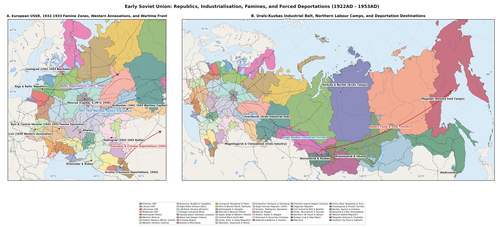

# Abstract

Between the First All-Union Census of December 1926 and the death of
Joseph Stalin in March 1953, the urban network of the European and Asian
Soviet Union was transformed by Five-Year-Plan industrialisation,
wartime devastation and the expansion of the Gulag. Across the 251
towns, republic capitals, industrial centres and forced-labour camp
settlements covered in this gazetteer, the combined urban population
more than doubled from 16,91M in 1926 to 41,18M in 1953. Rapid
industrial construction in the 1930s and factory evacuations during the
Second World War multiplied the size of Moscow, Gorky and the coal and
steel cities of the Donbas, the Urals, the Kuzbass and Western Siberia,
while creating entirely new polar mining and port towns at Vorkuta,
Norilsk, Igarka and Magadan.

Over the same quarter-century, war, genocide and forced migration
hollowed out the historic cities of the western borderlands and the
occupied front zone. Between 1941 and 1945, the Holocaust annihilated
the Jewish urban communities of Vilnius, Kaunas, Riga, Minsk, Vitebsk,
Lviv, Kyiv and Odesa, siege and combat reduced Leningrad, Stalingrad,
Voronezh, Sevastopol and Narva to rubble and post-war population
transfers replaced the pre-war inhabitants of Kaliningrad, Vyborg,
Klaipeda and Yuzhno-Sakhalinsk.

# Methodology

This gazetteer traces the population of 251 towns, republic capitals,
Five-Year-Plan industrial boomtowns and Gulag camp centres across the 45
Stalin-era regions of Estonia (Region 1, 6 towns), Latvia (Region 2, 6
towns), Lithuania (Region 3, 5 towns), Moldova (Region 4, 6 towns),
Belarus (Regions 6-7, 18 towns), Ukraine including Crimea (Regions 8-15,
63 towns) and Russia including Kaliningrad Oblast and Karelia (Region 5
and Regions 16-45, 147 towns) at five benchmark dates: 1926, 1933, 1939,
1945 and 1953.

Population figures for 1926 and 1939 come from the All-Union Censuses of
17 December 1926 and 17 January 1939, supplemented for the borderland
cities annexed between 1939 and 1945 (Tallinn, Tartu, Narva and Parnu in
Region 1; Riga, Liepaja, Daugavpils and Jelgava in Region 2; Vilnius,
Kaunas, Klaipeda and Siauliai in Region 3; Chisinau, Balti and Bender in
Region 4; Kaliningrad/Konigsberg, Sovetsk/Tilsit and
Chernyakhovsk/Insterburg in Region 5; Brest and Grodno in Region 6;
Lviv, Ternopil and Lutsk in Region 8; Chernivtsi, Izmail and Uzhhorod in
Region 9; Vyborg and Sortavala in Region 16; Kyzyl in Region 39; and
Yuzhno-Sakhalinsk/Toyohara in Region 45) by Estonian, Latvian,
Lithuanian, Polish, Romanian, Czechoslovak, Finnish, German, Tuvan and
Japanese censuses
[\[1\]](#ref-tsunkhu1929perepis1926)[\[2\]](#ref-polyakov1992perepis1939)[\[3\]](#ref-andreev1998demograficheskaya)[\[4\]](#ref-parming1972estonia)[\[5\]](#ref-zvidrins1992latvia)[\[6\]](#ref-balkelis2005vilnius)[\[7\]](#ref-kostyashov2009sekretnaya).
Estimates for 1933, 1945 and 1953 are drawn from urban registration
books, Evacuation Council and post-liberation municipal counts
(1944-1945), NKVD-MVD camp and special-settlement files and statistical
yearbooks
[\[8\]](#ref-polyakov1991perepis1937)[\[9\]](#ref-rudnytskyi2015holodomor)[\[10\]](#ref-zemskov2003spetsposelentsy)[\[11\]](#ref-khlevniuk2004history)[\[12\]](#ref-casu2014moldova).
Benchmarks before a settlement’s foundation (such as Kohtla-Jarve,
Sillamae, Vorkuta, Inta, Norilsk, Magadan, Susuman or Pevek in 1926) or
after its wartime destruction (Khatyn after March 1943) are marked with
a hyphen (`-`).

# Results

## Regions 1 - 5: Baltic SSRs, Moldavian SSR and Kaliningrad Oblast

Table gives the population of 28 towns across Estonia (Region 1), Latvia
(Region 2), Lithuania (Region 3), Moldova (Region 4) and Kaliningrad
Oblast (Region 5)
[\[6\]](#ref-balkelis2005vilnius)[\[12\]](#ref-casu2014moldova)[\[13\]](#ref-mertelsmann2009estonia)[\[14\]](#ref-strods2002priboi)[\[15\]](#ref-kostyashov2022kaliningrad).

| Settlement | Other Names | Coords | 1926 | 1933 | 1939 | 1945 | 1953 |
|:---|:---|:---|:---|:---|:---|:---|:---|
| Tallinn (Reg. 1) | Reval; Revel | 59,44, 24,75 (1926-1953) | 127k | 137k | 159,6k | 134k | 238k |
| Tartu (Reg. 1) | Dorpat; Yuryev | 58,38, 26,73 (1926-1953) | 59k | 58,9k | 60,1k | 38k | 64k |
| Kohtla-Jarve (Reg. 1) | Kohtla Oil-Shale Basin | 59,4, 27,27 (1926-1953) | 2,8k | 4,1k | 6,2k | 8,5k | 39k |
| Parnu (Reg. 1) | Pernau; Pyarnu | 58,39, 24,5 (1926-1953) | 21,5k | 20,7k | 21,8k | 18,5k | 31k |
| Narva (Reg. 1) | Kreenholm Mill Town | 59,38, 28,18 (1926-1953) | 26,9k | 23,5k | 23,8k | 6,6k | 21,5k |
| Sillamae (Reg. 1) | Combine No. 7 Uranium Town | 59,4, 27,76 (1926-1953) | 900 | 1,4k | 2,4k | 1,2k | 8,2k |
| Riga (Reg. 2) | Riga VEF Metropolis | 56,95, 24,11 (1926-1953) | 339k | 378k | 385k | 228k | 515k |
| Liepaja (Reg. 2) | Libau; Courland Pocket Port | 56,5, 21,01 (1926-1953) | 60,7k | 57,1k | 57,1k | 37k | 64k |
| Daugavpils (Reg. 2) | Dvinsk; Dunaburg | 55,87, 26,54 (1926-1953) | 40,6k | 44,5k | 45,2k | 22k | 54k |
| Jelgava (Reg. 2) | Mitau; Mitava | 56,65, 23,72 (1926-1953) | 28,3k | 33,4k | 34,1k | 15,5k | 31k |
| Ventspils (Reg. 2) | Windau; Vindava | 57,39, 21,56 (1926-1953) | 16,3k | 15,7k | 15,7k | 11,5k | 23,5k |
| Rezekne (Reg. 2) | Rezhitsa; Latgale Rail Hub | 56,51, 27,33 (1926-1953) | 12,6k | 13,1k | 13,2k | 8k | 18,5k |
| Vilnius (Reg. 3) | Wilno; Vilna | 54,69, 25,28 (1926-1953) | 178k | 198k | 209,4k | 110k | 198k |
| Kaunas (Reg. 3) | Kovno; 1920-39 Provisional Capital | 54,9, 23,9 (1926-1953) | 94,4k | 102k | 154,1k | 106k | 185k |
| Klaipeda (Reg. 3) | Memel | 55,7, 21,14 (1926-1953) | 35,8k | 37,5k | 47,2k | 4,5k | 64k |
| Siauliai (Reg. 3) | Shavli | 55,93, 23,31 (1926-1953) | 21,8k | 24,2k | 31,6k | 19k | 46k |
| Panevezys (Reg. 3) | Ponevezh | 55,73, 24,36 (1926-1953) | 19,7k | 21,2k | 26,7k | 18k | 34,5k |
| Chisinau (Reg. 4) | Kishinev | 47,01, 28,86 (1926-1953) | 112k | 114,9k | 112,5k | 56k | 172k |
| Balti (Reg. 4) | Beltsy | 47,76, 27,92 (1926-1953) | 29,5k | 30,6k | 32,5k | 22k | 53k |
| Tiraspol (Reg. 4) | 1929-40 MASSR Capital | 46,84, 29,64 (1926-1953) | 21,7k | 29,2k | 43,7k | 29k | 52k |
| Bender (Reg. 4) | Tighina; Bendery | 46,83, 29,47 (1926-1953) | 31,2k | 31,4k | 32k | 15,5k | 36k |
| Cahul (Reg. 4) | Kagul (1946-47 Famine Core) | 45,9, 28,2 (1926-1953) | 11,1k | 11,4k | 12,1k | 9,5k | 14,5k |
| Orhei (Reg. 4) | Orgeyev | 47,38, 28,82 (1926-1953) | 14,8k | 15,3k | 15,8k | 8,2k | 12,8k |
| Kaliningrad (Reg. 5) | Konigsberg; Koenigsberg | 54,71, 20,45 (1926-1953) | 286,7k | 315,8k | 372,2k | 73k | 175k |
| Sovetsk (Reg. 5) | Tilsit; East Prussia 1945 Annexation | 55,08, 21,89 (1926-1953) | 50,8k | 57,3k | 59,1k | 11k | 28,5k |
| Chernyak-hovsk (Reg. 5) | Insterburg | 54,63, 21,82 (1926-1953) | 39,3k | 41,2k | 48,7k | 6,2k | 25,5k |
| Baltiysk (Reg. 5) | Pillau; Baltic Fleet Base | 54,65, 19,92 (1926-1953) | 6,9k | 7,6k | 12,4k | 3,8k | 15,5k |
| Gusev (Reg. 5) | Gumbinnen | 54,59, 22,2 (1926-1953) | 19k | 19,9k | 24,5k | 3,2k | 12,2k |

Town populations across Estonia, Latvia, Lithuania, Moldova and
Kaliningrad Oblast (Regions 1 to 5) at the 1926, 1933, 1939, 1945 and
1953 benchmarks, showing wartime losses in Riga, Vilnius and
Konigsberg/Kaliningrad and the post-war creation of Estonian oil-shale
and uranium towns.

## Regions 6 - 7: Western and Eastern Belarus

Table covers 18 settlements across Western Belarus (Region 6: Brest,
Grodno, Baranovichi, Molodechno, Pinsk and Lida) and Eastern Belarus
(Region 7: Minsk, Vitebsk, Gomel, Mogilev, Bobruisk, Polotsk, Orsha,
Borisov, Mozyr, Slutsk, Rechitsa and the razed village of Khatyn)
[\[16\]](#ref-bylov2004belarus)[\[17\]](#ref-arad2009holocaust).

| Settlement | Other Names | Coords | 1926 | 1933 | 1939 | 1945 | 1953 |
|:---|:---|:---|:---|:---|:---|:---|:---|
| Grodno (Reg. 6) | Hrodna | 53,67, 23,81 (1926-1953) | 42,5k | 49,6k | 57,2k | 35k | 62k |
| Brest (Reg. 6) | Brest-Litovsk; Brzesc nad Bugiem | 52,1, 23,73 (1926-1953) | 41k | 48,4k | 55,1k | 36k | 64k |
| Pinsk (Reg. 6) | Pinsk Polesia | 52,11, 26,1 (1926-1953) | 28,5k | 31,9k | 36,4k | 21k | 35k |
| Baranovichi (Reg. 6) | Baranavichy; Baranowicze | 53,13, 26,01 (1926-1953) | 21k | 24,5k | 27,4k | 26k | 48k |
| Lida (Reg. 6) | Lida Grodno | 53,89, 25,3 (1926-1953) | 17,2k | 19,4k | 23,5k | 17k | 26,5k |
| Molodechno (Reg. 6) | Maladzyechna; Molodeczno | 54,31, 26,85 (1926-1953) | 5,2k | 6,1k | 7,5k | 11k | 22,5k |
| Minsk (Reg. 7) | Mensk | 53,9, 27,56 (1926-1953) | 131,8k | 180,9k | 238,9k | 110k | 365k |
| Vitebsk (Reg. 7) | Vitsebsk | 55,19, 30,2 (1926-1953) | 98,9k | 127k | 167,3k | 42k | 128k |
| Gomel (Reg. 7) | Homiel | 52,43, 30,98 (1926-1953) | 86,4k | 120,5k | 144,2k | 65k | 148k |
| Mogilev (Reg. 7) | Mahilyow | 53,9, 30,33 (1926-1953) | 50,2k | 76k | 99,4k | 54k | 106k |
| Bobruisk (Reg. 7) | Babruysk | 53,14, 29,22 (1926-1953) | 51,3k | 68k | 84,1k | 52k | 88k |
| Orsha (Reg. 7) | Vorsha | 54,51, 30,42 (1926-1953) | 22,1k | 31k | 37,5k | 24k | 54k |
| Borisov (Reg. 7) | Barysaw | 54,22, 28,51 (1926-1953) | 25,8k | 32,5k | 33,4k | 23k | 49k |
| Rechitsa (Reg. 7) | Rechytsa | 52,37, 30,39 (1926-1953) | 16,5k | 22k | 29,8k | 19,5k | 28,5k |
| Polotsk (Reg. 7) | Polatsk | 55,49, 28,79 (1926-1953) | 21,5k | 25,8k | 29,6k | 16,5k | 36k |
| Slutsk (Reg. 7) | Sluck | 53,03, 27,56 (1926-1953) | 15,7k | 18,5k | 22k | 14k | 21,5k |
| Mozyr (Reg. 7) | Mazyr | 52,05, 29,25 (1926-1953) | 14,3k | 16,2k | 17,5k | 13,5k | 24k |
| Khatyn (Reg. 7) | Khatyn Logoisk | 54,33, 27,94 (1926-1939) | 140 | 155 | 156 | \- | \- |

Town populations across Western and Eastern Belarus (Regions 6 and 7)
from 1926 to 1953, capturing the destruction of Jewish urban communities
in Minsk, Vitebsk, Brest and Pinsk between 1941 and 1944 and post-war
industrial rebuilding.

## Regions 8 - 11: Western, Right-Bank and Left-Bank Ukraine

Table presents 38 towns across Galicia and Volhynia (Region 8), Northern
Bukovina, Budjak and Transcarpathia (Region 9), Right-Bank Ukraine
(Region 10) and Left-Bank Ukraine (Region 11)
[\[9\]](#ref-rudnytskyi2015holodomor)[\[18\]](#ref-wolowyna2020holodomor)[\[19\]](#ref-polian2001against).

| Settlement | Other Names | Coords | 1926 | 1933 | 1939 | 1945 | 1953 |
|:---|:---|:---|:---|:---|:---|:---|:---|
| Lviv (Reg. 8) | Lwow; Lemberg | 49,84, 24,03 (1926-1953) | 278k | 312,2k | 340k | 245k | 370k |
| Ivano-Frankivsk (Reg. 8) | Stanislav; Stanislawow | 48,92, 24,71 (1926-1953) | 56k | 60k | 65k | 43k | 59k |
| Rivne (Reg. 8) | Rowne; Rovno | 50,62, 26,25 (1926-1953) | 37k | 40,6k | 43k | 28k | 48k |
| Lutsk (Reg. 8) | Luck | 50,75, 25,33 (1926-1953) | 29,5k | 35,6k | 39k | 26k | 44k |
| Ternopil (Reg. 8) | Tarnopol | 49,55, 25,59 (1926-1953) | 33k | 35,7k | 38,5k | 24k | 42k |
| Drohobych (Reg. 8) | Drogobych; Drohobycz | 49,35, 23,51 (1926-1953) | 29,5k | 32,6k | 37,2k | 25k | 36k |
| Kovel (Reg. 8) | Kowel | 51,22, 24,71 (1926-1953) | 24,5k | 27,7k | 32,9k | 17,5k | 23,5k |
| Chernivtsi (Reg. 9) | Cernauti; Czernowitz | 48,29, 25,94 (1926-1953) | 106k | 112,4k | 118k | 88k | 132k |
| Uzhhorod (Reg. 9) | Uzhgorod; Uzhorod | 48,62, 22,29 (1926-1953) | 23,5k | 26,7k | 35,2k | 29k | 41k |
| Bilhorod-Dnistrovskyi (Reg. 9) | Akkerman; Cetatea Alba (1940 Annexation) | 46,19, 30,34 (1926-1953) | 28,2k | 31k | 33,5k | 18,5k | 26k |
| Mukachevo (Reg. 9) | Mukacheve; Munkacs | 48,44, 22,72 (1926-1953) | 23k | 26,1k | 31,6k | 27k | 39k |
| Izmail (Reg. 9) | Ismail Budjak | 45,35, 28,85 (1926-1953) | 25k | 26,4k | 28k | 24k | 41k |
| Kyiv (Reg. 10) | Kiev | 50,45, 30,52 (1926-1953) | 513,6k | 608k | 846,7k | 472k | 930k |
| Zhytomyr (Reg. 10) | Zhitomir | 50,25, 28,66 (1926-1953) | 76,7k | 79k | 95,1k | 53k | 94k |
| Vinnytsia (Reg. 10) | Vinnitsa | 49,23, 28,47 (1926-1953) | 58k | 68k | 93k | 58k | 105k |
| Berdychiv (Reg. 10) | Berdichev | 49,89, 28,6 (1926-1953) | 55,4k | 54k | 62k | 31k | 48k |
| Cherkasy (Reg. 10) | Cherkassy | 49,44, 32,06 (1926-1953) | 39,5k | 37k | 51,7k | 38k | 68k |
| Bila Tserkva (Reg. 10) | Belaya Tserkov | 49,8, 30,12 (1926-1953) | 42,1k | 36,5k | 47,4k | 35k | 58k |
| Uman (Reg. 10) | Uman Podolia | 48,75, 30,22 (1926-1953) | 44,8k | 36k | 40,5k | 26k | 39k |
| Khmelnytskyi (Reg. 10) | Proskuriv; Proskurov | 49,42, 26,99 (1926-1953) | 32k | 31k | 37,5k | 26k | 51k |
| Kamianets-Podilskyi (Reg. 10) | Kamenets-Podolsky | 48,68, 26,59 (1926-1953) | 32,1k | 29,5k | 35,1k | 21k | 35k |
| Korosten (Reg. 10) | Iskorosten | 50,95, 28,65 (1926-1953) | 12k | 19,5k | 30,8k | 19k | 33k |
| Shepetivka (Reg. 10) | Shepetovka | 50,19, 27,06 (1926-1953) | 14,7k | 18,2k | 24,8k | 17,5k | 27k |
| Kharkiv (Reg. 11) | Kharkov | 49,99, 36,23 (1926-1953) | 417,3k | 654k | 832,9k | 455k | 820k |
| Poltava (Reg. 11) | Poltava Left-Bank | 49,59, 34,55 (1926-1953) | 92k | 85k | 128,5k | 76k | 124k |
| Kremenchuk (Reg. 11) | Kremenchug | 49,07, 33,42 (1926-1953) | 58,8k | 59,5k | 89,7k | 42k | 74k |
| Chernihiv (Reg. 11) | Chernigov | 51,5, 31,29 (1926-1953) | 35,2k | 42k | 68,6k | 36k | 72k |
| Sumy (Reg. 11) | Sumy Sloboda | 50,91, 34,8 (1926-1953) | 44,2k | 46,5k | 64k | 48k | 82k |
| Konotop (Reg. 11) | Konotop Chernihiv | 51,24, 33,2 (1926-1953) | 33,6k | 36k | 45,9k | 34k | 49k |
| Nizhyn (Reg. 11) | Nezhin | 51,05, 31,89 (1926-1953) | 38k | 34k | 39,3k | 31k | 42k |
| Pryluky (Reg. 11) | Priluki | 50,59, 32,39 (1926-1953) | 28,6k | 26,5k | 36,9k | 28k | 39,5k |
| Izium (Reg. 11) | Izyum Donets | 49,21, 37,26 (1926-1953) | 12,7k | 21k | 34,9k | 21k | 34k |
| Shostka (Reg. 11) | Shostka Powder Works | 51,86, 33,48 (1926-1953) | 8,5k | 17,5k | 28,6k | 22k | 35k |
| Lubny (Reg. 11) | Lubny Poltava | 50,02, 33 (1926-1953) | 21,3k | 19,5k | 27,2k | 19k | 27,5k |
| Romny (Reg. 11) | Romny Sula | 50,75, 33,47 (1926-1953) | 25,8k | 22,5k | 26k | 21k | 31k |
| Kupiansk (Reg. 11) | Kupyansk | 49,71, 37,62 (1926-1953) | 15,2k | 19,5k | 21k | 16k | 24k |
| Myrhorod (Reg. 11) | Mirgorod | 49,97, 33,61 (1926-1953) | 20,8k | 16,5k | 18,9k | 15k | 20k |
| Hlukhiv (Reg. 11) | Glukhov | 51,68, 33,92 (1926-1953) | 16k | 14,5k | 16,5k | 13,5k | 19,5k |

Town populations across Western, Right-Bank and Left-Bank Ukraine
(Regions 8 to 11) from 1926 to 1953, reflecting the 1933 famine in
Kharkiv and Poltava, the wartime depopulation of Kyiv and Lviv and the
Polish-Ukrainian population exchanges.

## Regions 12 - 15: Dnieper Bend, Donbas, Black Sea Steppe and Crimea

Table covers 25 towns across the Dnieper Industrial Bend (Region 12),
the Donbas Coal-Metallurgical Basin (Region 13), the Ukrainian Black Sea
Steppe (Region 14) and Crimea (Region 15)
[\[2\]](#ref-polyakov1992perepis1939)[\[20\]](#ref-senyavsky2019urbanisation)[\[21\]](#ref-bugai1995deportatsiya).

| Settlement | Other Names | Coords | 1926 | 1933 | 1939 | 1945 | 1953 |
|:---|:---|:---|:---|:---|:---|:---|:---|
| Dnipropet-rovsk (Reg. 12) | Dnipro; Yekaterino-slav | 48,46, 35,05 (1926-1953) | 232,9k | 378k | 500,7k | 310k | 560k |
| Zaporizhzhia (Reg. 12) | Zaporozhye; Aleksandrovsk | 47,84, 35,14 (1926-1953) | 55,7k | 192k | 289,2k | 185k | 380k |
| Kryvyi Rih (Reg. 12) | Krivoy Rog | 47,91, 33,39 (1926-1953) | 31,3k | 118k | 189k | 125k | 320k |
| Melitopol (Reg. 12) | Melitopol Steppe | 46,85, 35,37 (1926-1953) | 25,3k | 48k | 75,7k | 54k | 85k |
| Nikopol (Reg. 12) | Nikopol Manganese | 47,57, 34,4 (1926-1953) | 14,2k | 36k | 57,9k | 42k | 72k |
| Berdiansk (Reg. 12) | Osipenko | 46,76, 36,8 (1926-1953) | 26,4k | 38k | 51,7k | 38k | 58k |
| Stalino (Reg. 13) | Donetsk; Yuzovka | 48,02, 37,8 (1926-1953) | 174,2k | 285k | 466,3k | 295k | 620k |
| Makiivka (Reg. 13) | Makeyevka; Dmitrievsk | 48,05, 37,97 (1926-1953) | 79,4k | 165k | 241,9k | 170k | 315k |
| Mariupol (Reg. 13) | Zhdanov | 47,1, 37,54 (1926-1953) | 63,9k | 152k | 221,5k | 140k | 250k |
| Voroshilov-grad (Reg. 13) | Luhansk; Lugansk | 48,57, 39,31 (1926-1953) | 71,8k | 138k | 214,6k | 148k | 238k |
| Horlivka (Reg. 13) | Gorlovka | 48,31, 38,03 (1926-1953) | 23,1k | 102k | 181,4k | 122k | 255k |
| Kadievka (Reg. 13) | Stakhanov; Sergo | 48,57, 38,64 (1926-1953) | 18,3k | 68k | 134,9k | 88k | 158k |
| Konstant-ynivka (Reg. 13) | Konstanti-novka | 48,53, 37,71 (1926-1953) | 25,3k | 62k | 95,8k | 58k | 82k |
| Kramatorsk (Reg. 13) | Kramatorskaya | 48,74, 37,58 (1926-1953) | 12,3k | 58k | 94,1k | 62k | 108k |
| Yenakiieve (Reg. 13) | Ordzhonikidze Donbas; Rykovo | 48,23, 38,21 (1926-1953) | 24,3k | 55k | 88,6k | 58k | 86k |
| Sloviansk (Reg. 13) | Slavyansk | 48,85, 37,61 (1926-1953) | 28,8k | 46k | 75,5k | 52k | 78k |
| Odesa (Reg. 14) | Odessa | 46,48, 30,72 (1926-1953) | 420,9k | 475k | 601,7k | 380k | 575k |
| Mykolaiv (Reg. 14) | Nikolaev | 46,98, 31,99 (1926-1953) | 104,9k | 132k | 168,7k | 115k | 195k |
| Kherson (Reg. 14) | Kherson Dnieper | 46,64, 32,62 (1926-1953) | 58,8k | 72k | 97k | 68k | 130k |
| Pervomaisk (Reg. 14) | Olviopol-Bohopil | 48,04, 30,85 (1926-1953) | 31,8k | 27,5k | 33k | 24k | 37k |
| Balta (Reg. 14) | 1924-29 MASSR Capital (Odesa Oblast 1940) | 47,94, 29,62 (1926-1953) | 23k | 18,2k | 21,1k | 14,5k | 19,5k |
| Simferopol (Reg. 15) | Aqmescit | 44,95, 34,1 (1926-1953) | 88,3k | 105k | 142,6k | 102k | 165k |
| Sevastopol (Reg. 15) | Sebastopol | 44,62, 33,53 (1926-1953) | 74,6k | 86k | 109,1k | 35k | 118k |
| Kerch (Reg. 15) | Pantikapaion | 45,36, 36,47 (1926-1953) | 34,6k | 68k | 104,4k | 38k | 84k |
| Bakhchisarai (Reg. 15) | Bagchasaray | 44,75, 33,86 (1926-1953) | 9,5k | 10,2k | 10,9k | 5,2k | 9,2k |

Town populations across the Dnieper Bend, Donbas, Black Sea Steppe and
Crimea (Regions 12 to 15) from 1926 to 1953, contrasting rapid
Five-Year-Plan growth in Zaporizhzhia, Kryvyi Rih and Stalino with
wartime ruin and the 1944 Crimean Tatar deportation.

## Regions 16 - 22: Karelia, Leningrad, Komi, Moscow and Central Russia

Table lists 42 settlements across Karelia and Murmansk (Region 16),
Leningrad, Novgorod and Pskov (Region 17), the Komi ASSR and Nenets
Okrug (Region 18), Arkhangelsk and Vologda (Region 19), Moscow (Region
20), the Upper Volga and Western Front (Region 21) and the Central
Black-Earth Belt (Region 22)
[\[22\]](#ref-baron2007karelia)[\[23\]](#ref-lomagin2002neizvestnaya)[\[24\]](#ref-applebaum2003gulag).

| Settlement | Other Names | Coords | 1926 | 1933 | 1939 | 1945 | 1953 |
|:---|:---|:---|:---|:---|:---|:---|:---|
| Murmansk (Reg. 16) | Romanov-on-Murman | 68,97, 33,07 (1926-1953) | 8,8k | 62k | 118,9k | 92k | 185k |
| Vyborg (Reg. 16) | Viipuri | 60,71, 28,75 (1926-1953) | 49k | 71,5k | 74,4k | 22k | 46k |
| Petrozavodsk (Reg. 16) | Karelo-Finnish Capital | 61,78, 34,35 (1926-1953) | 27,1k | 48k | 69,7k | 52k | 112k |
| Monchegorsk (Reg. 16) | Severonikel Kola Gulag Combine | 67,94, 32,9 (1939-1953) | \- | \- | 28,4k | 24k | 41k |
| Medvezhye-gorsk (Reg. 16) | Medvezhya Gora; Belbaltlag BBK HQ (Karelia) | 62,92, 34,46 (1926-1953) | 2,1k | 14,5k | 13,4k | 9,5k | 14,8k |
| Belomorsk (Reg. 16) | Soroka; White Sea-Baltic Canal Terminus | 64,52, 34,77 (1926-1953) | 3,4k | 10,8k | 12,2k | 11,5k | 14,1k |
| Sortavala (Reg. 16) | Serdobol; Ladoga Karelia (1940/44 Finnish Evacuation) | 61,7, 30,69 (1926-1953) | 4,2k | 4,5k | 4,7k | 6,5k | 15,2k |
| Leningrad (Reg. 17) | Saint Petersburg; Petrograd | 59,93, 30,34 (1926-1953) | 1,69M | 2,78M | 3,19M | 1,22M | 2,65M |
| Pskov (Reg. 17) | Pleskov | 57,82, 28,33 (1926-1953) | 43,9k | 52k | 59,9k | 24k | 68k |
| Velikiy Novgorod (Reg. 17) | Novgorod | 58,52, 31,27 (1926-1953) | 32,8k | 36k | 39,8k | 16k | 48k |
| Volkhov (Reg. 17) | Volkhovstroy Hydro-Aluminium | 59,93, 32,34 (1926-1953) | 3,7k | 16,5k | 29,4k | 19,5k | 33k |
| Staraya Russa (Reg. 17) | Novgorod Front Ruin | 57,99, 31,36 (1926-1953) | 22,5k | 26,8k | 37,3k | 4,2k | 21k |
| Syktyvkar (Reg. 18) | Ust-Sysolsk | 61,67, 50,84 (1926-1953) | 5,1k | 14,5k | 25,3k | 32k | 52k |
| Vorkuta (Reg. 18) | Vorkutlag; Rudnik Vorkuta | 67,5, 64,05 (1933-1953) | \- | 4,5k | 18,2k | 38k | 65k |
| Ukhta (Reg. 18) | Chibyu; Ukhtpechlag | 63,57, 53,68 (1933-1953) | \- | 5,8k | 14,8k | 21k | 31k |
| Naryan-Mar (Reg. 18) | Beloshchelye; Nenets National Okrug Capital | 67,64, 53 (1933-1953) | \- | 8,2k | 13,7k | 11,8k | 12,9k |
| Pechora (Reg. 18) | Sevzheldorlag Rail Hub (Komi ASSR) | 65,14, 57,22 (1939-1953) | \- | \- | 3,2k | 14,5k | 22k |
| Inta (Reg. 18) | Intalag & Minlag Arctic Coal Camp (Komi ASSR) | 66,03, 60,17 (1939-1953) | \- | \- | 2,5k | 12k | 24,5k |
| Arkhangelsk (Reg. 19) | Archangel | 64,54, 40,52 (1926-1953) | 76,8k | 195k | 281,1k | 218k | 245k |
| Vologda (Reg. 19) | Vologda North | 59,22, 39,89 (1926-1953) | 58k | 74k | 95,2k | 98k | 122k |
| Severodvinsk (Reg. 19) | Sudostroy; Molotovsk (1938-57); Jagrinlag Shipyard | 64,56, 39,83 (1939-1953) | \- | \- | 21,3k | 35k | 68k |
| Kotlas (Reg. 19) | Kulak Exile & Sevzheldorlag Transit Hub | 61,26, 46,65 (1926-1953) | 4,1k | 14,5k | 17,3k | 24k | 34,5k |
| Moscow (Reg. 20) | Moskva | 55,76, 37,62 (1926-1953) | 2,03M | 3,66M | 4,14M | 3,65M | 4,84M |
| Serpukhov (Reg. 20) | Serpukhov Oka | 54,92, 37,41 (1926-1953) | 55,9k | 74k | 90,8k | 84k | 101k |
| Kolomna (Reg. 20) | Kolomna Locomotive Works | 55,08, 38,78 (1926-1953) | 30,7k | 58k | 75,1k | 74k | 96k |
| Podolsk (Reg. 20) | Podolsk Moscow | 55,43, 37,55 (1926-1953) | 19,8k | 48k | 72,4k | 75k | 102k |
| Yaroslavl (Reg. 21) | Yaroslavl Volga | 57,63, 39,88 (1926-1953) | 114,3k | 215k | 298,1k | 285k | 365k |
| Ivanovo (Reg. 21) | Ivanovo-Voznesensk | 57, 40,97 (1926-1953) | 111,5k | 195k | 285,1k | 265k | 315k |
| Kalinin (Reg. 21) | Tver | 56,86, 35,92 (1926-1953) | 108,4k | 152k | 216,1k | 158k | 238k |
| Bryansk (Reg. 21) | Bryansk-Bezhitsa | 53,24, 34,36 (1926-1953) | 86k | 125k | 174,2k | 98k | 172k |
| Smolensk (Reg. 21) | Smolensk Dnieper | 54,78, 32,05 (1926-1953) | 78,5k | 108k | 156,7k | 68k | 132k |
| Rybinsk (Reg. 21) | Shcherbakov | 58,05, 38,86 (1926-1953) | 55,5k | 92k | 139k | 136k | 165k |
| Kostroma (Reg. 21) | Kostroma Volga | 57,77, 40,93 (1926-1953) | 73,7k | 98k | 121,2k | 125k | 156k |
| Kaluga (Reg. 21) | Kaluga Oka | 54,51, 36,26 (1926-1953) | 51,6k | 68k | 89,5k | 75k | 118k |
| Vladimir (Reg. 21) | Vladimir-on-Klyazma | 56,13, 40,41 (1926-1953) | 39,7k | 51k | 66,8k | 76k | 124k |
| Voronezh (Reg. 22) | Voronezh Don | 51,66, 39,2 (1926-1953) | 121,6k | 212k | 326,9k | 175k | 365k |
| Tula (Reg. 22) | Tula Armory | 54,19, 37,62 (1926-1953) | 155k | 212k | 272,4k | 235k | 302k |
| Kursk (Reg. 22) | Kursk Seim | 51,73, 36,19 (1926-1953) | 98,8k | 105k | 120k | 88k | 165k |
| Oryol (Reg. 22) | Orel | 52,97, 36,08 (1926-1953) | 77,9k | 88k | 110,6k | 65k | 125k |
| Tambov (Reg. 22) | Tambov Tsna | 52,72, 41,45 (1926-1953) | 76,3k | 89k | 106,2k | 115k | 148k |
| Lipetsk (Reg. 22) | Novolipetsk | 52,61, 39,6 (1926-1953) | 21,4k | 42k | 66,6k | 75k | 118k |
| Belgorod (Reg. 22) | Belgorod Donets | 50,6, 36,6 (1926-1953) | 31k | 30k | 34,4k | 24k | 54k |

Town populations across Karelia, Leningrad, Komi, Moscow and Central
Russia (Regions 16 to 22) from 1926 to 1953, showing the 1941-1944 siege
collapse of Leningrad and Novgorod alongside the rapid rise of Moscow
and the Arctic coal camps of Vorkuta and Inta.

## Regions 23 - 34: Volga-Ural Republics, North Caucasus and the Urals

Table covers 54 towns across the Volga-Vyatka and Middle Volga republics
(Regions 23-25), the liquidated Volga German and Kalmyk ASSRs (Regions
26 and 28), the Lower Volga and North Caucasus (Regions 27 and 29-33)
and the Ural industrial region and Bashkir ASSR (Region 34)
[\[21\]](#ref-bugai1995deportatsiya)[\[25\]](#ref-german2000nemtsy)[\[26\]](#ref-tsutsiev2014atlas)[\[27\]](#ref-kotkin1995magnetic).

| Settlement | Other Names | Coords | 1926 | 1933 | 1939 | 1945 | 1953 |
|:---|:---|:---|:---|:---|:---|:---|:---|
| Gorky (Reg. 23) | Nizhny Novgorod | 56,33, 44,01 (1926-1953) | 222,4k | 459k | 643,7k | 710k | 830k |
| Izhevsk (Reg. 23) | Izhevskiy Zavod; Ustinov | 56,85, 53,2 (1926-1953) | 63,2k | 128k | 175,7k | 218k | 255k |
| Kirov (Reg. 23) | Vyatka; Khlynov | 58,6, 49,67 (1926-1953) | 62,1k | 96k | 143,6k | 185k | 218k |
| Dzerzhinsk (Reg. 23) | Rastyapino | 56,24, 43,46 (1926-1953) | 8,9k | 58k | 103,4k | 122k | 145k |
| Saransk (Reg. 23) | Saransk Mordovia | 54,18, 45,17 (1926-1953) | 15,4k | 26k | 40,9k | 52k | 74k |
| Cheboksary (Reg. 23) | Shupashkar | 56,14, 47,25 (1926-1953) | 8,8k | 18,5k | 31k | 46k | 72k |
| Yoshkar-Ola (Reg. 23) | Tsarevok-okshaysk; Krasnoko-kshaysk | 56,63, 47,9 (1926-1953) | 4,4k | 14k | 27,2k | 42k | 68k |
| Kazan (Reg. 24) | Qazan | 55,8, 49,11 (1926-1953) | 179k | 268k | 398k | 465k | 560k |
| Penza (Reg. 24) | Penza Sura | 53,2, 45,02 (1926-1953) | 91,9k | 120k | 159,8k | 195k | 230k |
| Ulyanovsk (Reg. 24) | Simbirsk | 54,31, 48,4 (1926-1953) | 72,3k | 82k | 102,1k | 145k | 175k |
| Kuibyshev (Reg. 25) | Samara | 53,2, 50,1 (1926-1953) | 175,6k | 258k | 390,5k | 530k | 690k |
| Orenburg (Reg. 25) | Chkalov | 51,77, 55,1 (1926-1953) | 123,3k | 144k | 171,7k | 205k | 235k |
| Orsk (Reg. 25) | Yuzhuralnikel & Evacuated Refinery Hub (Chkalov Oblast) | 51,2, 58,56 (1926-1953) | 13,6k | 26k | 66,3k | 115k | 152k |
| Chapayevsk (Reg. 25) | Ivashchenkovo; Trotsky (1927-29); Munitions Hub | 52,98, 49,71 (1926-1953) | 13,5k | 36k | 58k | 72k | 80k |
| Engels (Reg. 26) | Pokrovsk; Volga German Capital | 51,49, 46,13 (1926-1953) | 34,3k | 52k | 73,3k | 58k | 82k |
| Marks (Reg. 26) | Baronsk; Marxstadt (Volga German ASSR Canton, 1941 Deport.) | 51,71, 46,75 (1926-1953) | 12,5k | 10,2k | 16,1k | 7,5k | 11,8k |
| Krasno-armeysk-Volga (Reg. 26) | Balzer (Volga German ASSR Canton, Aug 1941 Deportation) | 51,02, 45,7 (1926-1953) | 12,1k | 9,8k | 15,7k | 8,2k | 12,5k |
| Stalingrad (Reg. 27) | Volgograd; Tsaritsyn | 48,71, 44,51 (1926-1953) | 151,5k | 388k | 445,3k | 215k | 490k |
| Saratov (Reg. 27) | Saratov Volga | 51,53, 46,03 (1926-1953) | 219,5k | 327k | 375,9k | 410k | 495k |
| Astrakhan (Reg. 27) | Astrakhan Delta | 46,35, 48,04 (1926-1953) | 184,3k | 225k | 253,6k | 248k | 275k |
| Elista (Reg. 28) | Stepnoy | 46,31, 44,26 (1926-1953) | 6,1k | 11,5k | 17,1k | 6,5k | 16,5k |
| Lagan (Reg. 28) | Kaspiysky (1944-91); Kalmyk ASSR Caspian Fishery Port | 45,39, 47,36 (1926-1953) | 3,8k | 5,2k | 8,4k | 3,5k | 7,8k |
| Rostov-on-Don (Reg. 29) | Rostov-na-Donu | 47,24, 39,7 (1926-1953) | 308,1k | 456k | 510,2k | 350k | 535k |
| Krasnodar (Reg. 29) | Yekaterinodar | 45,04, 38,98 (1926-1953) | 161,8k | 178k | 203,8k | 172k | 265k |
| Taganrog (Reg. 29) | Taganrog Azov | 47,24, 38,9 (1926-1953) | 86,4k | 142k | 188,8k | 128k | 182k |
| Shakhty (Reg. 29) | Aleksandrovsk-Grushevsky | 47,71, 40,21 (1926-1953) | 41k | 98k | 155,1k | 115k | 178k |
| Novorossiysk (Reg. 29) | Malaya Zemlya | 44,72, 37,77 (1926-1953) | 67,9k | 82k | 95,2k | 46k | 86k |
| Armavir (Reg. 29) | Armavir Kuban | 44,99, 41,12 (1926-1953) | 74,5k | 72k | 83,7k | 72k | 98k |
| Novocherkassk (Reg. 29) | Don Cossack Capital | 47,42, 40,09 (1926-1953) | 62,3k | 68k | 81,3k | 68k | 86k |
| Maykop (Reg. 29) | Maikop Adygea | 44,61, 40,1 (1926-1953) | 53k | 57k | 67,3k | 58k | 76k |
| Poltavskaya (Reg. 29) | Stanitsa Krasnoarmey-skaya | 45,37, 38,22 (1926-1953) | 28,2k | 12,5k | 18,4k | 16,5k | 21k |
| Stavropol (Reg. 30) | Voroshilovsk | 45,04, 41,97 (1926-1953) | 58,7k | 64k | 85,1k | 75k | 118k |
| Pyatigorsk (Reg. 30) | Pyatigorsk Mineral Waters | 44,05, 43,06 (1926-1953) | 53,9k | 56k | 62,9k | 54k | 66k |
| Cherkessk (Reg. 30) | Batalpashinsk; Yezhovo-Cherkessk (1937-39); Cherkess AO Capital | 44,23, 42,06 (1926-1953) | 19,3k | 22,5k | 28,6k | 26k | 36,5k |
| Karachaevsk (Reg. 30) | Mikoyan-Shakhar; Klukhori (1944-55; Karachay AO Capital) | 43,77, 41,91 (1933-1953) | \- | 2,9k | 5,9k | 2,4k | 5,2k |
| Ordzhonikidze (Reg. 31) | Vladikavkaz; Dzaudzhikau | 43,03, 44,68 (1926-1953) | 78,3k | 102k | 130,8k | 118k | 152k |
| Nalchik (Reg. 31) | Nalchik Kabarda | 43,49, 43,61 (1926-1953) | 12,9k | 26k | 48k | 44k | 72k |
| Tyrnyauz (Reg. 31) | Girkhodzhan; Balkar Tungsten-Molybdenum Combine (1944 Deport.) | 43,38, 42,92 (1939-1953) | \- | \- | 3,5k | 4,2k | 10,5k |
| Grozny (Reg. 32) | Grozny Oil; Solzha-Gala | 43,32, 45,69 (1926-1953) | 97,1k | 152k | 172,4k | 138k | 212k |
| Gudermes (Reg. 32) | Chechen-Ingush ASSR Rail Junction (Feb 1944 Deportation) | 43,35, 46,1 (1926-1953) | 3,1k | 6,8k | 10,7k | 7,5k | 14,8k |
| Nazran (Reg. 32) | Kosta-Khetagurovo (1944-57; Ingush Centre Ceded to N. Ossetia) | 43,23, 44,77 (1926-1953) | 2,1k | 3,4k | 4,8k | 2,2k | 4,6k |
| Makhachkala (Reg. 33) | Petrovsk-Port | 42,98, 47,5 (1926-1953) | 33,6k | 62k | 86,8k | 82k | 106k |
| Derbent (Reg. 33) | Bab al-Abwab | 42,06, 48,29 (1926-1953) | 23,1k | 29k | 34,1k | 32k | 42k |
| Khasavyurt (Reg. 33) | Aukhovsky Chechen Deportation & Novolaksky Resettlement Hub | 43,25, 46,59 (1926-1953) | 6,9k | 12,5k | 23,4k | 17,5k | 29,5k |
| Sverdlovsk (Reg. 34) | Yekaterinburg | 56,84, 60,61 (1926-1953) | 140,3k | 401k | 423,3k | 580k | 680k |
| Perm (Reg. 34) | Molotov | 58,01, 56,25 (1926-1953) | 119,8k | 215k | 306,3k | 405k | 520k |
| Chelyabinsk (Reg. 34) | Tankograd | 55,16, 61,44 (1926-1953) | 59,3k | 210k | 273,1k | 450k | 590k |
| Ufa (Reg. 34) | Ufa Bashkiria | 54,74, 55,97 (1926-1953) | 98,5k | 168k | 250k | 345k | 460k |
| Nizhny Tagil (Reg. 34) | Tagil; Uralvago-nzavod | 57,92, 59,97 (1926-1953) | 38,8k | 122k | 159,9k | 225k | 295k |
| Magnitogorsk (Reg. 34) | Magnitnaya; Magnitostroy | 53,41, 58,98 (1926-1953) | 250 | 115k | 145,9k | 205k | 265k |
| Zlatoust (Reg. 34) | Zlatoust-ovskiy Zavod | 55,17, 59,65 (1926-1953) | 48,3k | 78k | 99,4k | 125k | 148k |
| Berezniki (Reg. 34) | Usolye-Berezniki | 59,41, 56,82 (1926-1953) | 16,1k | 45k | 64,6k | 78k | 95k |
| Sterlitamak (Reg. 34) | Sterlitamak Soda | 53,63, 55,93 (1926-1953) | 25,2k | 31k | 38,8k | 58k | 88k |
| Solikamsk (Reg. 34) | Sol Kamskaya; Usollag | 59,64, 56,77 (1926-1953) | 7,3k | 24k | 38,4k | 48k | 68k |

Town populations across the Volga-Ural republics, Lower Volga, North
Caucasus and the Urals (Regions 23 to 34) from 1926 to 1953, contrasting
the wartime depopulation of Stalingrad, Engels, Elista and Grozny with
booming evacuation and steel cities in the Urals.

## Regions 35 - 45: Siberia, the Arctic Gulag and the Far East

Table presents 46 towns and camp settlements across Western Siberia and
the Kuzbass (Regions 35-38), the Altai-Sayan republics (Region 39),
Eastern Siberia and the Yenisei-Taymyr polar zone (Regions 40-41),
Buryatia, Chita and Yakutia (Regions 42-43), the Dalstroy Kolyma-Magadan
complex (Region 44) and the Southern Far East (Region 45)
[\[24\]](#ref-applebaum2003gulag)[\[28\]](#ref-werth2007cannibal)[\[29\]](#ref-shalak2005eastsiberia)[\[30\]](#ref-antonov2018churapcha).

| Settlement | Other Names | Coords | 1926 | 1933 | 1939 | 1945 | 1953 |
|:---|:---|:---|:---|:---|:---|:---|:---|
| Novosibirsk (Reg. 35) | Novoniko-layevsk | 55,01, 82,94 (1926-1953) | 120,1k | 287k | 404,1k | 605k | 710k |
| Omsk (Reg. 35) | Omsk Irtysh | 54,99, 73,32 (1926-1953) | 161,7k | 227k | 288,9k | 410k | 470k |
| Tomsk (Reg. 35) | Tomsk University | 56,48, 84,95 (1926-1953) | 92,3k | 125k | 145,1k | 185k | 210k |
| Tyumen (Reg. 35) | Chimgi-Tura | 57,15, 65,53 (1926-1953) | 50,3k | 62k | 79,2k | 112k | 128k |
| Kurgan (Reg. 35) | Tsaryovo Gorodishche | 55,44, 65,34 (1926-1953) | 28k | 39k | 53,2k | 76k | 102k |
| Kolpashevo (Reg. 36) | Narym Okrug Capital (Ob-Irtysh Kulak Special Settlements) | 58,31, 82,91 (1926-1953) | 1,4k | 11,5k | 15k | 18,2k | 21,5k |
| Salekhard (Reg. 36) | Obdorsk (until 1933); Yamal-Nenets National Okrug Capital | 66,53, 66,6 (1926-1953) | 2,1k | 6,8k | 12,8k | 14,2k | 16,1k |
| Khanty-Mansiysk (Reg. 36) | Ostyako-Vogulsk (1931-40); Ostyak-Vogul National Okrug Capital | 61, 69 (1933-1953) | \- | 5,4k | 7,5k | 13,5k | 18,5k |
| Stalinsk (Reg. 37) | Novokuznetsk; Kuznetsk-Sibirsky | 53,76, 87,14 (1926-1953) | 3,9k | 148k | 165,7k | 235k | 315k |
| Kemerovo (Reg. 37) | Shcheglovsk | 55,35, 86,09 (1926-1953) | 21,7k | 98k | 133k | 188k | 235k |
| Prokopyevsk (Reg. 37) | Prokopyevskiy Rudnik | 53,88, 86,74 (1926-1953) | 10,7k | 78k | 107,2k | 175k | 240k |
| Leninsk-Kuznetsky (Reg. 37) | Kolchugino | 54,66, 86,16 (1926-1953) | 19,6k | 58k | 82,7k | 102k | 118k |
| Anzhero-Sudzhensk (Reg. 37) | Anzherka | 56,08, 86,03 (1926-1953) | 30,2k | 56k | 69k | 88k | 106k |
| Barnaul (Reg. 38) | Barnaul Altai | 53,35, 83,78 (1926-1953) | 73,9k | 109k | 148,2k | 215k | 255k |
| Biysk (Reg. 38) | Biysk Altai | 52,54, 85,21 (1926-1953) | 45,5k | 64k | 80,3k | 105k | 122k |
| Rubtsovsk (Reg. 38) | Evacuated Altai Tractor Plant & German Deportee Hub | 51,52, 81,21 (1926-1953) | 15,9k | 24k | 37,7k | 75k | 98k |
| Slavgorod (Reg. 38) | Kulunda Steppe Volga German & Kalmyk Deportee Centre | 53, 78,65 (1926-1953) | 18,1k | 19,5k | 21,4k | 28,5k | 34k |
| Abakan (Reg. 39) | Ust-Abakanskoye; Khakass Autonomous Oblast Capital (1930) | 53,72, 91,44 (1926-1953) | 3,1k | 18,5k | 36,7k | 41k | 52k |
| Gorno-Altaysk (Reg. 39) | Ulala; Oyrot-Tura (1932-48; Oyrot / Gorno-Altai AO Capital) | 51,96, 85,96 (1926-1953) | 5,7k | 14,5k | 24k | 23,5k | 26,5k |
| Chernogorsk (Reg. 39) | Chernogorskie Kopi; Khakass Coal & Kulak/German Spetsposelok | 53,82, 91,28 (1926-1953) | 1,4k | 12,2k | 17,4k | 26,5k | 42k |
| Kyzyl (Reg. 39) | Belotsarsk; Khem-Beldyr | 51,72, 94,44 (1926-1953) | 4,2k | 7,5k | 10k | 16,5k | 26k |
| Irkutsk (Reg. 40) | Irkutsk Angara | 52,29, 104,31 (1926-1953) | 108,1k | 168k | 250,2k | 285k | 325k |
| Krasnoyarsk (Reg. 40) | Krasnoyarsk Yenisei | 56,02, 92,89 (1926-1953) | 72,3k | 128k | 190k | 265k | 325k |
| Cheremkhovo (Reg. 40) | Irkutsk Coal Basin & Special-Settlement Hub | 53,16, 103,07 (1926-1953) | 14,5k | 38k | 55,8k | 88k | 115k |
| Tayshet (Reg. 40) | Ozerlag (Special Camp No. 7) & Angarstroy Western BAM HQ | 55,94, 98 (1926-1953) | 3,9k | 7,8k | 11,7k | 18,5k | 28,5k |
| Igarka (Reg. 41) | Yenisei Permafrost Timber Export Port & Kulak/Baltic Exile Hub | 67,47, 86,58 (1933-1953) | \- | 14,3k | 23,6k | 19,5k | 17,5k |
| Norilsk (Reg. 41) | Norillag | 69,36, 88,19 (1939-1953) | \- | \- | 13,9k | 42k | 78k |
| Dudinka (Reg. 41) | Taymyr (Dolgan-Nenets) Okrug Capital & Norillag River Port | 69,41, 86,18 (1926-1953) | 300 | 1,8k | 4,3k | 9,5k | 14,8k |
| Ulan-Ude (Reg. 42) | Verkhneudinsk | 51,83, 107,58 (1926-1953) | 28,9k | 68k | 125,7k | 138k | 155k |
| Chita (Reg. 42) | Chita Transbaikalia | 52,03, 113,5 (1926-1953) | 61,5k | 85k | 121,1k | 135k | 156k |
| Zakamensk (Reg. 42) | Gorodok (until 1959); Dzhidlag Tungsten Combine (Buryat ASSR) | 50,37, 103,29 (1939-1953) | \- | \- | 7,2k | 11,5k | 13,2k |
| Yakutsk (Reg. 43) | Dzokuuskay | 62,04, 129,68 (1926-1953) | 10,6k | 26k | 52,9k | 56k | 66k |
| Aldan (Reg. 43) | Nezametny (until 1939); Yakut ASSR Goldfields Centre | 58,61, 125,39 (1926-1953) | 2,2k | 11,5k | 14k | 11,8k | 12,4k |
| Churapcha (Reg. 43) | Yakut ASSR Ulus Centre (Aug 1942 Arctic Deportation Tragedy) | 62, 132,43 (1926-1953) | 1,2k | 1,6k | 2,1k | 1,4k | 2,4k |
| Petropavlovsk-Kamchatsky (Reg. 44) | Petropavlovsk Port | 53,04, 158,66 (1926-1953) | 1,7k | 12k | 35,4k | 48k | 68k |
| Magadan (Reg. 44) | Dalstroy; Sevvostlag | 59,56, 150,81 (1933-1953) | \- | 7,5k | 27,3k | 41k | 55k |
| Susuman (Reg. 44) | Zavodskoy; Dalstroy West Kolyma Gold Mining Lagpunkt HQ | 62,78, 148,15 (1939-1953) | \- | \- | 4,8k | 8,5k | 12,5k |
| Pevek (Reg. 44) | Chaunlag / Chaun-Chukotka Dalstroy Tin & Uranium Port | 69,7, 170,31 (1939-1953) | \- | \- | 850 | 2,4k | 4,8k |
| Khabarovsk (Reg. 45) | Khabarovka | 48,48, 135,07 (1926-1953) | 52k | 115k | 207,2k | 238k | 285k |
| Vladivostok (Reg. 45) | Pacific Fleet Base | 43,12, 131,89 (1926-1953) | 108k | 182k | 206,4k | 225k | 265k |
| Ussuriysk (Reg. 45) | Voroshilov; Nikolsk-Ussuriysky | 43,8, 131,95 (1926-1953) | 35k | 54k | 71,9k | 82k | 96k |
| Komsomolsk-on-Amur (Reg. 45) | Komsomolsk-na-Amure; Permskoye | 50,55, 137,01 (1926-1953) | 260 | 15k | 70,8k | 115k | 160k |
| Blagovesh-chensk (Reg. 45) | Blagovesh-chensk Amur | 50,29, 127,53 (1926-1953) | 61,2k | 59k | 58,8k | 68k | 84k |
| Svobodny (Reg. 45) | Alekseyevsk; Bamlag | 51,38, 128,13 (1926-1953) | 10,2k | 28k | 44k | 48k | 54k |
| Yuzhno-Sakhalinsk (Reg. 45) | Toyohara; Vladimirovka | 46,96, 142,74 (1926-1953) | 24,1k | 33,5k | 38,6k | 42k | 74k |
| Birobidzhan (Reg. 45) | Tikhonkaya (until 1931); Jewish Autonomous Oblast Capital (1934) | 48,79, 132,92 (1926-1953) | 825 | 7,5k | 29,6k | 31k | 38,5k |

Town populations across Western and Eastern Siberia, the Arctic Gulag
and the Far East (Regions 35 to 45) from 1926 to 1953, showing the
expansion of Novosibirsk, Omsk, Stalinsk, Norilsk, Magadan and
Komsomolsk-on-Amur.

# Appendix

## Regional Gazetteer Summary

Table sums the population of the 251 towns across each of the 45 regions
at the five benchmark dates between 1926 and 1953.

| Region (Towns) | 1926 | 1933 | 1939 | 1945 | 1953 |
|:---|:---|:---|:---|:---|:---|
| 1\. Estonian SSR (6) | 238,1k | 245,6k | 273,9k | 206,8k | 401,7k |
| 2\. Latvian SSR (6) | 497,5k | 541,8k | 550,3k | 322k | 706k |
| 3\. Lithuanian SSR (5) | 349,7k | 382,9k | 469k | 257,5k | 527,5k |
| 4\. Moldavian SSR (6) | 220,3k | 232,8k | 248,6k | 140,2k | 340,3k |
| 5\. Kaliningrad Oblast (5) | 402,7k | 441,8k | 516,9k | 97,2k | 256,7k |
| 6\. Western Belarus (6) | 155,4k | 179,9k | 207,1k | 146k | 258k |
| 7\. Eastern Byelorussian SSR (12) | 534,6k | 718,6k | 903,8k | 433,5k | 1,05M |
| 8\. Western Ukraine: Galicia & Volhynia (7) | 487,5k | 544,4k | 595,6k | 408,5k | 622,5k |
| 9\. N. Bukovina, Budjak & Transcarpathia (5) | 205,7k | 222,6k | 246,3k | 186,5k | 279k |
| 10\. Right-Bank Ukrainian SSR (11) | 920,9k | 1,02M | 1,36M | 796,5k | 1,49M |
| 11\. Left-Bank Ukrainian SSR (15) | 868,1k | 1,11M | 1,48M | 877,5k | 1,49M |
| 12\. Dnieper Industrial Bend (6) | 385,9k | 810k | 1,16M | 754k | 1,48M |
| 13\. Donbas Coal-Metallurgical Basin (10) | 521,5k | 1,13M | 1,81M | 1,19M | 2,19M |
| 14\. Ukrainian Black Sea Steppe (5) | 639,4k | 724,7k | 921,4k | 601,5k | 956,5k |
| 15\. Crimea (4) | 207k | 269,2k | 367,1k | 180,2k | 376,2k |
| 16\. Karelo-Finnish SSR & Murmansk (7) | 94,6k | 211,3k | 321,8k | 217,5k | 428,1k |
| 17\. Leningrad, Novgorod & Pskov (5) | 1,79M | 2,91M | 3,36M | 1,28M | 2,82M |
| 18\. Komi ASSR & Nenets Okrug (6) | 5,1k | 33k | 77,7k | 129,3k | 207,4k |
| 19\. Arkhangelsk & Vologda (4) | 138,9k | 283,5k | 414,9k | 375k | 469,5k |
| 20\. Moscow Metropolis (4) | 2,13M | 3,84M | 4,38M | 3,88M | 5,14M |
| 21\. Upper Volga & Western Front (9) | 719,2k | 1,1M | 1,55M | 1,29M | 1,78M |
| 22\. Central Black-Earth Belt (7) | 582,1k | 778k | 1,04M | 777k | 1,28M |
| 23\. Chuvash, Mari, Mordvin & Udmurt ASSRs (7) | 385,2k | 799,5k | 1,17M | 1,38M | 1,66M |
| 24\. Tatar ASSR & Ulyanovsk-Penza (3) | 343,2k | 470k | 659,9k | 805k | 965k |
| 25\. Kuibyshev & Chkalov (4) | 326k | 464k | 686,6k | 922k | 1,16M |
| 26\. Volga German ASSR (3) | 58,9k | 72k | 105k | 73,7k | 106,3k |
| 27\. Saratov, Stalingrad & Astrakhan (3) | 555,3k | 940k | 1,07M | 873k | 1,26M |
| 28\. Kalmyk ASSR (2) | 9,9k | 16,7k | 25,5k | 10k | 24,3k |
| 29\. Rostov, Krasnodar (Kuban) & Adygei AO (9) | 883,4k | 1,17M | 1,4M | 1,03M | 1,53M |
| 30\. Stavropol, Karachay AO & Cherkess AO (4) | 131,9k | 145,4k | 182,5k | 157,4k | 225,7k |
| 31\. Kabardino-Balkar & N. Ossetian ASSRs (3) | 91,2k | 128k | 182,2k | 166,2k | 234,5k |
| 32\. Chechen-Ingush ASSR / Grozny Oblast (3) | 102,3k | 162,2k | 188k | 147,7k | 231,4k |
| 33\. Dagestan ASSR (3) | 63,6k | 103,5k | 144,3k | 131,5k | 177,5k |
| 34\. Ural Industrial Belt & Bashkir ASSR (10) | 553,8k | 1,41M | 1,8M | 2,52M | 3,21M |
| 35\. West Siberian Trans-Siberian Spine (5) | 452,4k | 740k | 970,4k | 1,39M | 1,62M |
| 36\. Ob-Irtysh Taiga (Narym, Yugra, Yamal) (3) | 3,5k | 23,7k | 35,3k | 45,9k | 56,1k |
| 37\. Kuzbass Coal-Steel Basin (5) | 86,2k | 438k | 557,6k | 788k | 1,01M |
| 38\. Altai Krai (4) | 153,4k | 216,5k | 287,6k | 423,5k | 509k |
| 39\. Gorno-Altai, Khakass & Tuva AOs (4) | 14,4k | 52,7k | 88,1k | 107,5k | 146,5k |
| 40\. East Siberian Corridor (Krasnoyarsk-Irkutsk) (4) | 198,8k | 341,8k | 507,7k | 656,5k | 793,5k |
| 41\. Yenisei-Taymyr Polar Zone (Norilsk) (3) | 300 | 16,1k | 41,8k | 71k | 110,3k |
| 42\. Buryat-Mongol ASSR & Chita (3) | 90,4k | 153k | 254k | 284,5k | 324,2k |
| 43\. Yakut ASSR (3) | 14k | 39,1k | 69k | 69,2k | 80,8k |
| 44\. Kolyma-Magadan, Chukotka & Kamchatka (4) | 1,7k | 19,5k | 68,3k | 99,9k | 140,3k |
| 45\. Southern Far East & Sakhalin (8) | 291,6k | 494k | 727,4k | 849k | 1,06M |
| All 45 Regions (251 towns) | 16,91M | 26,15M | 33,48M | 27,54M | 41,18M |

Combined urban population of the 251 towns across all 45 regions from
1926 to 1953, showing the doubling of the urban network over the Stalin
era despite wartime devastation in the occupied west.

# Sources

1.
Tsentralnoe statisticheskoe
upravlenie SSSR. *Vsesoyuznaya Perepis Naseleniya 17 Dekabrya 1926 g.:
Kratkie Svodki i Polnye Izdaniya v 56 Tomakh*. Izdanie TsSU Soyuza SSR,
1929, <https://www.demoscope.ru/weekly/ssp/census.php>.

2.
Polyakov, Yuriy Aleksandrovich,
and Valentina Borisovna Zhiromskaya. *Vsesoyuznaya Perepis Naseleniya
1939 Goda: Osnovnye Itogi*. Nauka, 1992,
<https://www.demoscope.ru/weekly/ssp/census.php>.

3.
Andreev, Evgeniy Mikhaylovich, et
al. *Demograficheskaya Istoriya Rossii: 1927-1959*. Informatika, 1998,
<https://search.worldcat.org/search?q=Demograficheskaya+istoriya+Rossii+1927+1959+Andreev+1998>.

4.
Parming, Tonu. “Population Changes
in Estonia, 1935-1970.” *Population Studies*, vol. 26, no. 1, 1972, pp.
53-78, <https://doi.org/10.2307/2172800>.

5.
Zvidrins, Peteris. “Changes of
Ethnic Structure in Latvia.” *Journal of Baltic Studies*, vol. 23, no.
4, 1992, pp. 359-68, <https://doi.org/10.1080/01629779200000131>.

6.
Balkelis, Tomas. “War, Ethnic
Conflict and the Refugee Crisis in Lithuania, 1939-1945.” *Contemporary
European History*, vol. 16, no. 4, 2007, pp. 461-77,
<https://doi.org/10.1017/s0960777307004122>.

7.
Kostyashov, Yuriy Vladimirovich.
*Sekretnaya Istoriya Kaliningradskoy Oblasti: Ocherki 1945-1956 Gg.*
Terra Baltika, 2009,
<https://search.worldcat.org/search?q=Sekretnaya+istoriya+Kaliningradskoy+oblasti+Ocherki+1945+1956+gg+Kostyashov+2009>.

8.
Polyakov, Yuriy Aleksandrovich, et
al. *Vsesoyuznaya Perepis Naseleniya 1937 g.: Kratkie Itogi*. Institut
istorii SSSR AN SSSR, 1991,
<https://www.demoscope.ru/weekly/ssp/census.php>.

9.
Rudnytskyi, Omelian, et al.
“Demography of a Man-Made Human Catastrophe: The Case of Massive Famine
in Ukraine 1932-1933.” *Canadian Studies in Population*, vol. 42, no.
1-2, 2015, pp. 53-80, <https://doi.org/10.15407/dse2015.03.003>.

10.
Zemskov, Viktor Nikolaevich.
*Spetsposelentsy v SSSR, 1930-1960*. Nauka, 2003,
<https://search.worldcat.org/search?q=Spetsposelentsy+SSSR+1930+1960+Zemskov+2003>.

11.
Khlevniuk, Oleg Vitalyevich. *The
History of the Gulag: From Collectivization to the Great Terror*. Yale
University Press, 2004,
<https://search.worldcat.org/search?q=History+Gulag+Collectivization+Great+Terror+Khlevniuk+2004>.

12.
Casu, Igor. *Dusmanul de Clasa:
Represiuni Politice, Violenta Si Rezistenta in r(a)SS Moldoveneasca,
1924-1956*. Cartier, 2014,
<https://search.worldcat.org/search?q=Dusmanul+de+clasa+Represiuni+politice+violenta+si+rezistenta+Casu+2014>.

13.
Mertelsmann, Olaf, and Aigi
Rahi-Tamm. “Soviet Mass Violence in Estonia Revisited.” *Journal of
Genocide Research*, vol. 11, no. 2-3, 2009, pp. 307-22,
<https://doi.org/10.1080/14623520903119001>.

14.
Strods, Heinrihs, and Matthew
Kott. “The File on Operation Priboi: A Re-Assessment of the Mass
Deportations of 1949.” *Journal of Baltic Studies*, vol. 33, no. 1,
2002, pp. 1-36, <https://doi.org/10.1080/01629770100000191>.

15.
Kostyashov, Yuriy Vladimirovich.
“Migratsionnye Protsessy v Kaliningradskoy Oblasti, Klaypedskom Krae,
Varmii i Mazurakh v 1945-1950 Godakh: Sravnitelnyy Analiz.” *Baltiyskiy
Region*, vol. 14, no. 1, 2022, pp. 125-41,
<https://cyberleninka.ru/article/n/migratsionnye-protsessy-v-kaliningradskoy-oblasti-klaypedskom-krae-varmii-i-mazurah-v-1945-1950-godah-sravnitelnyy-analiz>.

16.
Bylov, V. G., et al.
“Demograficheskie Poteri i Sovremennye Trudoresursnye Vozmozhnosti
Selskoy Mestnosti Belarusi.” *Sotsialnye i Gumanitarnye Nauki:
Otechestvennaya i Zarubezhnaya Literatura*, no. 2, 2004, pp. 142-46,
<https://cyberleninka.ru/article/n/demograficheskie-poteri-i-sovremennye-trudoresursnye-vozmozhnosti-selskoy-mestnosti-belarusi>.

17.
Arad, Yitzhak. *The Holocaust in
the Soviet Union*. University of Nebraska Press; Yad Vashem, 2009,
<https://search.worldcat.org/search?q=Holocaust+Soviet+Union+Arad+2009>.

18.
Wolowyna, Oleh, et al. “Regional
Variations of 1932-34 Famine Losses in Ukraine.” *Canadian Studies in
Population*, vol. 43, no. 3-4, 2016, pp. 175-202,
<https://doi.org/10.25336/p6kc7q>.

19.
Polian, Pavel Markovich. *Against
Their Will: The History and Geography of Forced Migrations in the USSR*.
Central European University Press, 2004,
<https://doi.org/10.1515/9786155053832>.

20.
Senyavsky, Aleksandr Spartakovich.
“Urbanizatsionnyy Protsess v SSSR v Ekonomicheskom Izmerenii:
Strukturnye i Institutsionalnye Aspekty.” *Voprosy Teoreticheskoy
Ekonomiki*, no. 2, 2019, pp. 147-61,
<https://doi.org/10.24411/2587-7666-2019-10211>.

21.
Bugai, Nikolay Fedorovich. *L.
Beriya - i. Stalinu: Soglasno Vashemu Ukazaniyu...* AIRO-XX, 1995,
<https://search.worldcat.org/search?q=Beriya+Stalinu+Soglasno+Vashemu+ukazaniyu+Bugai+1995>.

22.
Baron, Nick. *Soviet Karelia:
Politics, Planning and Terror in Stalin’s Russia, 1920-1939*. Routledge,
2007, <https://doi.org/10.4324/9780203480441>.

23.
Lomagin, Nikita Andreevich.
*Neizvestnaya Blokada*. Neva, 2002,
<https://search.worldcat.org/search?q=Neizvestnaya+blokada+Lomagin+2002>.

24.
Applebaum, Anne. *Gulag: A
History*. Doubleday, 2003,
<https://search.worldcat.org/search?q=Gulag+History+Applebaum+2003>.

25.
German, Arkadiy Adolfovich.
*Nemetskaya Avtonomiya Na Volge, 1918-1941*. Izdatelstvo Saratovskogo
universiteta, 2000,
<https://search.worldcat.org/search?q=Nemetskaya+avtonomiya+Volge+1918+1941+German+2000>.

26.
Tsutsiev, Arthur. *Atlas of the
Ethno-Political History of the Caucasus*. Yale University Press, 2014,
<https://doi.org/10.12987/9780300160109>.

27.
Kotkin, Stephen. *Magnetic
Mountain: Stalinism as a Civilization*. University of California Press,
1995, <https://doi.org/10.1525/9780520918856>.

28.
Werth, Nicolas. *Cannibal Island:
Death in a Siberian Gulag*. Princeton University Press, 2007,
<https://doi.org/10.1515/9780691262529>.

29.
Shalak, Aleksandr Vasilyevich.
“Spetsposelentsy Vostochnoy Sibiri: Chislennost, Dinamika (1941-1950-e
Gg.).” *Irkutskiy Istoriko-Ekonomicheskiy Ezhegodnik*, 2005, pp. 164-72,
<https://cyberleninka.ru/article/n/spetsposelentsy-vostochnoy-sibiri-chislennost-dinamika-1941-1950-e-gg>.

30.
Antonov, Egor Petrovich.
“Demograficheskie Protsessy v Yakutii v Gody Velikoy Otechestvennoy
Voyny: Tragediya Pereselentsev Churapchinskogo Ulusa.”
*Severo-Vostochnyy Gumanitarnyy Vestnik*, no. 3, 2018, pp. 42-53,
<https://cyberleninka.ru/article/n/demograficheskie-protsessy-v-yakutii-v-gody-velikoy-otechestvennoy-voyny-tragediya-pereselentsev-churapchinskogo-ulusa>.

