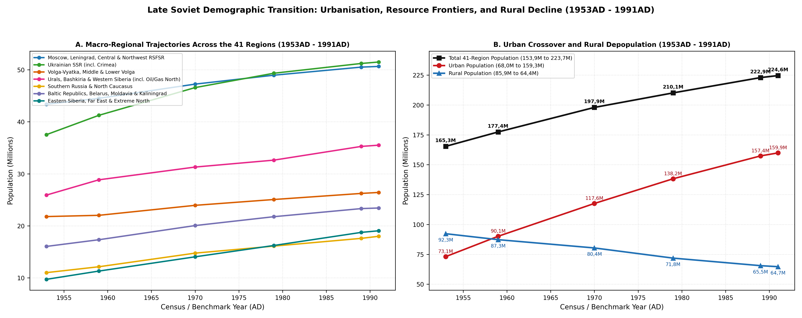
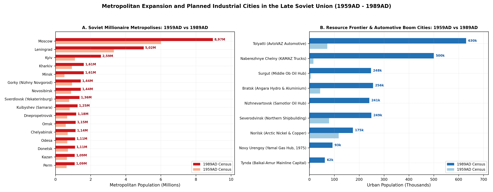
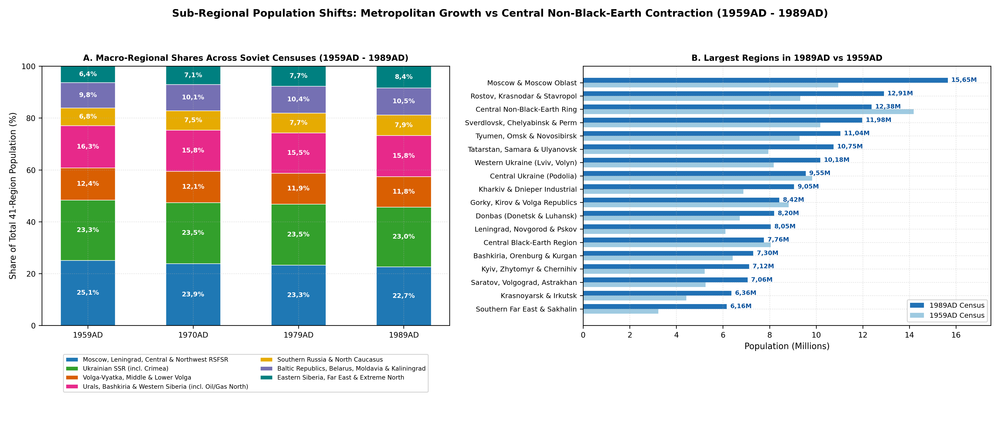

# Abstract

This paper reconstructs the regional population and settlement history of the post-Stalin Soviet Union across forty-one regions (n=41) spanning 18.176.810 km2 and seven European and Northern Eurasian union republics (n=7: the Estonian, Latvian, Lithuanian, Moldavian, Byelorussian and Ukrainian SSRs and the Russian SFSR) between the death of Joseph Stalin in March 1953AD and the dissolution of the USSR in December 1991AD. Across the four post-war All-Union Population Censuses (n=4) and intercensal benchmarks, the combined population rose from 165,35M in 1953AD to 177,4M in 1959AD, 189,52M in 1965AD, 197,91M in 1970AD, 204,69M in 1975AD, 210,07M in 1979AD, 217,4M in 1985AD, 222,88M in 1989AD and a peak of 224,55M in 1991AD.

# Background

Unlike the period from 1914AD to 1953AD, when world wars, civil war, collectivisation famines, mass deportations and political terror repeatedly gashed the Soviet age pyramid, the thirty-eight post-Stalin years (1953AD - 1991AD) unfolded without general warfare or nationwide famine [@vishnevsky_2006_demograficheskaya_modernizatsiya; @andreev_darsky_kharkova_1998_demograficheskaya_istoriya]. Instead, the demographic and settlement history of the forty-one regions (n=41) was shaped by six broad transformations.

Across the western periphery annexed in 1940-1945AD (Regions 1-5), industrialisation and migration regimes diverged sharply between neighbouring republics. In the Estonian SSR (Region 1) and Latvian SSR (Region 2), post-1956AD deportee return coincided with sub-replacement indigenous fertility and heavy All-Union industrial labour recruitment (*orgnabor* and ministerial enterprise housing, accelerated after Khrushchev's July 1959AD purge of Latvian "national communists" around Eduards Berklavs), driving the titular ethnic share down from 74,6% to 61,5% in Estonia and from 62% to 52% (36,5% in Riga) in Latvia by 1989AD [@katus_kupiszewski_rees_1998_migration_estonia; @tammaru_2001_urbanization_migration_estonia; @zvidrins_1992_ethnic_composition_latvia; @misiunas_taagepera_1993_baltic_states]. In the Lithuanian SSR (Region 3), by contrast, First Secretary Antanas Snieckus and Lithuanian Gosplan implemented a decentralised regional growth-pole strategy in 1964AD that channelled Catholic rural youth into ten medium-sized cities (n=10: Alytus, Marijampole/Kapsukas, Panevezys, Siauliai, Mazeikiai, Jonava and Utena, alongside Vilnius, Kaunas and Klaipeda), preserving a 79,6% titular Lithuanian majority in 1989AD despite the construction of the closed Ignalina nuclear town of Snieckus/Visaginas [@balockaite_2012_planned_socialist_towns_visaginas]. Meanwhile, the Moldavian SSR (Region 4) recorded the highest rural density in the USSR and +50,3% census growth (2,88M to 4,33M), divided between Moldavian and Gagauz agro-industrial villages and the Slavic-majority heavy-industrial Dniester corridor (Tiraspol, Bender and Ribnita), while Kaliningrad Oblast (Region 5) consolidated as a closed RSFSR Baltic Fleet (Baltiysk ZATO) and Atlantic fishing exclave (540k to 888k) [@king_2000_moldovans; @fomenco_2019_migration_transnistria_moldova; @fedorov_2020_kaliningrad_exclave].

Between 1953AD and 1958AD, the dismantling of the Gulag and the restoration of abolished autonomies reorganised both the northern labour economy and southern union-republic boundaries. The release of over 2,5M Gulag prisoners and special settlers (*spetsposelentsy*) forced the state to replace camp compulsion in the Far North (Regions 16, 18, 37, 39 and 41) with Northern Wage Bonuses (*severnye nadbavki*) [@polian_2004_against_their_will_deportations; @hill_gaddy_2003_siberian_curse]. Simultaneously, the 19 February 1954AD transfer of Crimean Oblast to the Ukrainian SSR (Region 15) and the 16 July 1956AD abolition of the Karelo-Finnish SSR back into the Karelian ASSR (Region 16) redrew union-republic boundaries, while the 9 January 1957AD Presidium decrees restored the Kalmyk ASSR (Region 24), Karachay-Cherkess AO (Region 25), Kabardino-Balkar ASSR (Region 26) and Chechen-Ingush ASSR (Region 27), triggering the return of over 600.000 deported Caucasian and Kalmyk exiles alongside permanent territorial redrawings across the Terek plain, Prigorodny Raion and lowland Dagestan (Region 28) [@tsutsulaeva_2017_vosstanovlenie_avtonomiy_1957].

Inside the European core, the urban-rural crossover between 1959AD and 1989AD was accompanied by the demographic hollowing-out of the *Nechernozemye* countryside. Over those thirty years, the combined urban population of the seven republics (n=7) surged from 86,78M to 156,78M, whereas the rural population contracted from 89,56M to 63,47M [@pivovarov_2001_urbanizatsiya_rossii; @lappo_1997_geografiya_gorodov]. Driven by the liquidation of "unpromising villages" (*neperspektivnye derevni*) and the 28 August 1974AD passportisation of collective farmers, rural depopulation produced net regional population decline across the Central Non-Black-Earth Depopulation Ring (Region 20: 14,79M to 12,33M), Gorky, Kirov and the Volga-Kama ASSRs (Region 21: 9,15M to 8,45M), the Central Black-Earth Region (Region 22: 8,25M to 7,75M) and Central Forest-Steppe Ukraine (Region 11: 10,02M in 1970AD to 9,52M in 1991AD) [@nefedova_treivish_2003_rural_russia_nechernozemye; @ivanchuk_2019_neperspektivnye_derevni].

At the same time, giant hydroelectric cascades along the Volga-Kama, Dnieper and Angara-Yenisei basins inundated over 18.000 km2 of riverine villages while powering planned automotive and industrial boomtowns - Tolyatti (*AvtoVAZ*) and Naberezhnye Chelny (*KAMAZ* in the Tatar ASSR, Region 23), Volzhsky and Balakovo (Region 24), and Bratsk, Ust-Ilimsk and Divnogorsk (Region 36) - alongside the Moscow *Naukograd* ring (Region 19) and ten secret nuclear *ZATO* cities (n=10) in the Urals and Siberia (Regions 21, 29, 33 and 36) [@orlova_2024_industrialnye_goroda_monogoroda; @lappo_polian_2008_naukogrady_zato_rossii; @rowland_1996_russia_secret_cities_zato; @savchuk_2017_gidrostroitelstvo_irkutsk]. East of the Urals, the regional partition separates the southern agricultural and rail belts - the Virgin Lands (*Tselina*) and Trans-Siberian axis (Regions 30 and 33), the Kuzbass (Region 34), Gorno-Altai, Khakassia and the Tuva ASSR (Region 35), the Buryat ASSR, Chita and the BAM Mainline Corridor (Region 38) and the Southern Far East Rail and Pacific Belt (Region 40) - from the northern resource and indigenous frontiers: the Yamalo-Nenets Polar Gas Frontier (Region 31: 62k to 495k, +698,4%), the Khanty-Mansi Middle Ob Oil Megaproject (Region 32: 124k to 1,28M, +933,9%), the Norilsk, Taymyr and Evenki Polar North (Region 37: 200k to 380k), the Yakut ASSR Diamond and Lena Frontier (Region 39: 487k to 1,09M, +124,6%) and the Extreme Northeast Northern-Bonus Frontier in Magadan, Chukotka and Kamchatka (Region 41: 456k to 1,02M, +123%) [@stas_2013_industrializatsiya_khanty_mansiysk_neft; @arakelyan_2023_perepisi_tyumen; @pivovar_2025_bam_rasselenie; @peshkov_2020_bam_tsentralnyy_uchastok].

Finally, between 1965AD and 1991AD, the European and Slavic republics experienced a prolonged male mortality crisis interrupted by the 1985-1987AD anti-alcohol campaign and the 1986AD Chernobyl disaster. Peacetime male life expectancy at birth (e0) fell to 61,4 years in the RSFSR and 61,9 years in Moldavia by 1980-1984AD before rebounding temporarily during Gorbachev's 1985-1987AD anti-alcohol campaign [@mesle_vallin_shkolnikov_2003_mortality_crisis_ussr; @aralovets_2024_prichiny_smerti_rsfsr_1970_1980], while the 26 April 1986AD Chernobyl nuclear accident forced the evacuation and resettlement of ~350.400 residents across Gomel and Mogilev (Region 8), Kyiv-Zhytomyr-Chernihiv Polesia and Pripyat (Region 10) and western Bryansk (Region 20) [@iaea_2006_chernobyl_environmental_consequences; @de_cort_1998_atlas_caesium_deposition_europe; @onishchenko_2013_chernobyl_posledstviya].

# Methodology

To avoid anachronistic post-1991AD borders and reflect the administrative geography of the post-Stalin USSR (1953AD - 1991AD), this review divides the seven European and Northern Eurasian union republics (n=7) - the Estonian SSR (Region 1), Latvian SSR (Region 2), Lithuanian SSR (Region 3), Moldavian SSR (Region 4), Byelorussian SSR (Regions 6-8), Ukrainian SSR (Regions 9-15) and Russian SFSR (encompassing the Kaliningrad Oblast exclave in Region 5 and mainland Regions 16-41) - into forty-one regions (n=41) spanning 18.176.810 km2. This partition captures the four western union republics annexed in 1940AD, the Kaliningrad Baltic Fleet exclave, the 1954AD Crimean transfer, the 1956AD abolition of the Karelo-Finnish SSR, the 1957-1958AD North Caucasus and Kalmyk ASSR restorations, the Volga-Kama and Ural ASSRs, the *Nechernozemye* depopulation ring, the West Siberian oil and gas okrugs, the Trans-Siberian and BAM rail corridors, the Siberian autonomous republics (Tuva ASSR, Buryat ASSR and Yakut ASSR) and the 1986AD Chernobyl fallout zones.

Across this forty-one-region partition, the population expanded from 165,35M (165,35M) in 1953AD to 177,4M (177,4M) in the 15 January 1959AD All-Union Census, 189,52M in 1965AD, 197,91M in the 15 January 1970AD All-Union Census, 204,69M in 1975AD, 210,07M in the 17 January 1979AD All-Union Census, 217,4M in 1985AD, 222,88M (222,88M, +25,6% over 1959AD) in the 12 January 1989AD All-Union Census, and reached its Soviet peak of 224,55M (224,55M) in 1991AD [@tssu_1962_perepis_1959; @tssu_1972_perepis_1970; @tssu_1984_perepis_1979; @goskomstat_1991_perepis_1989; @goskomstat_1992_demograficheskiy_ezhegodnik_1991; @vishnevsky_2006_demograficheskaya_modernizatsiya]. At both chronological boundaries, the forty-one-region series splices directly with adjacent epochs (Figure \ref{fig:pop-trajectory} and Table \ref{tab:macro-trajectories}). At the 1953AD opening boundary, the 165,35M total (157,05M across the RSFSR including Kaliningrad at 540k, the Ukrainian SSR and the Byelorussian SSR, plus 8,3M across the Estonian 1,15M, Latvian 2,01M, Lithuanian 2,62M and Moldavian 2,52M SSRs) matches the 1953AD terminal benchmark of the Lenin-Stalin era (165,35M). At the 1991AD closing boundary, subtracting the 12,29M combined population of the four newly independent non-Slavic republics - Estonia (1,57M), Latvia (2,66M), Lithuania (3,7M) and Moldova (4,36M) - from 224,55M yields 212,26M (212,26M), matching the 1991AD opening post-Soviet baseline across the Russian Federation (retaining Region 5 Kaliningrad Oblast at 888k), Ukraine and Belarus.

plot of chunk fig-pop-trajectory

# Results

Table: Population trajectories across the forty-one Late-Soviet regions at All-Union census and intercensal benchmarks from 1953AD to 1991AD (in thousands).

|Late-Soviet Region (1-41)                                                        |Area km2   |1953AD  |1959AD  |1970AD  |1979AD  |1985AD  |1989AD  |1991AD  |1959-89 |
|:--------------------------------------------------------------------------------|:----------|:-------|:-------|:-------|:-------|:-------|:-------|:-------|:-------|
|1. Estonian SSR                                                                  |49.227     |1.150   |1.197   |1.356   |1.466   |1.529   |1.566   |1.568   |+30,8%  |
|2. Latvian SSR                                                                   |64.240     |2.010   |2.093   |2.364   |2.503   |2.588   |2.667   |2.658   |+27,4%  |
|3. Lithuanian SSR                                                                |64.449     |2.620   |2.711   |3.128   |3.398   |3.559   |3.675   |3.704   |+35,6%  |
|4. Moldavian SSR                                                                 |31.098     |2.520   |2.885   |3.569   |3.950   |4.185   |4.335   |4.360   |+50,3%  |
|5. Kaliningrad Oblast                                                            |16.065     |540     |611     |732     |808     |845     |871     |888     |+42,6%  |
|6. Minsk Metropolis & Minsk Oblast                                               |34.411     |1.650   |1.860   |2.460   |2.940   |3.180   |3.350   |3.400   |+80,1%  |
|7. Western & Northern Byelorussian SSR                                           |99.875     |3.180   |3.420   |3.680   |3.820   |3.910   |3.980   |4.010   |+16,4%  |
|8. Southeastern Byelorussian SSR                                                 |67.520     |2.370   |2.550   |2.760   |2.870   |2.930   |2.870   |2.840   |+12,5%  |
|9. Western Ukrainian SSR                                                         |114.745    |7.750   |8.180   |9.150   |9.680   |9.950   |10.180  |10.250  |+24,4%  |
|10. Kyiv Metropolis & Kyiv-Zhytomyr-Chernihiv Polesia                            |88.175     |4.850   |5.220   |6.080   |6.680   |6.950   |7.120   |7.180   |+36,4%  |
|11. Central Forest-Steppe Ukrainian SSR                                          |121.754    |9.230   |9.830   |10.020  |9.820   |9.650   |9.550   |9.520   |-2,8%   |
|12. Kharkiv, Dnipropetrovsk, Zaporizhzhia & Kirovohrad Industrial-Hydro Corridor |112.153    |6.220   |6.880   |7.950   |8.620   |8.880   |9.050   |9.100   |+31,5%  |
|13. Mature Donbas Conurbation                                                    |52.520     |5.420   |6.720   |7.650   |7.980   |8.120   |8.200   |8.220   |+22%    |
|14. Ukrainian Black Sea Littoral & Kakhovka Canal Zone                           |93.619     |3.080   |3.220   |3.920   |4.380   |4.550   |4.660   |4.700   |+44,7%  |
|15. Crimean Oblast & Sevastopol                                                  |32.366     |980     |1.200   |1.810   |2.180   |2.350   |2.460   |2.530   |+105%   |
|16. Karelian ASSR                                                                |324.992    |1.000   |1.220   |1.510   |1.710   |1.850   |1.940   |1.940   |+59%    |
|17. Leningrad Metropolis, Leningrad Oblast, Novgorod & Pskov Oblasts             |200.400    |5.610   |6.109   |6.948   |7.572   |7.835   |8.049   |8.092   |+31,8%  |
|18. Komi ASSR                                                                    |1.162.641  |3.680   |4.000   |4.370   |4.570   |4.670   |4.740   |4.740   |+18,5%  |
|19. Moscow Metropolis & Moscow Oblast Naukograd Science-Aerospace Ring           |53.309     |10.050  |10.950  |12.850  |14.550  |15.250  |15.650  |15.800  |+42,9%  |
|20. Central Non-Black-Earth Depopulation Ring                                    |431.452    |14.790  |14.190  |13.620  |12.810  |12.580  |12.380  |12.330  |-12,8%  |
|21. Gorky, Kirov & Volga-Kama ASSRs                                              |299.637    |9.150   |8.820   |8.740   |8.490   |8.440   |8.420   |8.450   |-4,5%   |
|22. Central Black-Earth Economic Region                                          |173.862    |8.250   |8.050   |7.950   |7.750   |7.720   |7.760   |7.750   |-3,6%   |
|23. Tatar ASSR                                                                   |202.830    |7.650   |7.950   |9.050   |9.950   |10.420  |10.750  |10.850  |+35,2%  |
|24. Saratov, Volgograd, Astrakhan & Restored Kalmyk ASSR                         |336.749    |4.980   |5.250   |6.150   |6.620   |6.820   |7.060   |7.120   |+34,5%  |
|25. Rostov, Krasnodar, Stavropol, Adygei AO & Restored Karachay-Cherkess AO      |279.780    |8.820   |9.320   |10.950  |11.870  |12.440  |12.910  |13.150  |+38,5%  |
|26. Restored Kabardino-Balkar ASSR                                               |20.743     |930     |1.040   |1.310   |1.450   |1.540   |1.610   |1.640   |+54,8%  |
|27. Restored Chechen-Ingush ASSR                                                 |18.203     |490     |710     |1.060   |1.150   |1.230   |1.270   |1.320   |+78,9%  |
|28. Dagestan ASSR                                                                |56.471     |760     |1.060   |1.430   |1.630   |1.740   |1.800   |1.880   |+69,8%  |
|29. Ural Heavy-Industrial & Closed Nuclear ZATO Core                             |437.684    |9.050   |10.180  |11.080  |11.490  |11.780  |11.980  |12.010  |+17,7%  |
|30. Bashkir ASSR Petrochemical Core, Orenburg Gas & Kurgan Virgin Lands          |360.165    |5.820   |6.420   |7.030   |7.130   |7.210   |7.300   |7.350   |+13,7%  |
|31. Yamalo-Nenets Autonomous Okrug                                               |690.275    |55      |62      |80      |159     |360     |495     |505     |+698,4% |
|32. Khanty-Mansi Autonomous Okrug                                                |535.280    |115     |124     |271     |571     |1.040   |1.282   |1.315   |+933,9% |
|33. West Siberian Trans-Siberian & Virgin Lands Belt                             |962.215    |8.350   |9.284   |9.919   |10.320  |10.670  |11.043  |11.150  |+18,9%  |
|34. Kuzbass Coal-Metallurgical Conurbation                                       |94.982     |2.520   |2.780   |2.920   |2.960   |3.080   |3.170   |3.180   |+14%    |
|35. Gorno-Altai AO, Khakass AO                                                   |328.805    |710     |740     |850     |930     |990     |1.070   |1.090   |+44,6%  |
|36. Angara-Yenisei Hydroelectric & Aluminium Corridor                            |610.308    |3.810   |4.430   |5.290   |5.810   |6.130   |6.360   |6.410   |+43,6%  |
|37. Norilsk Nickel Metropolis, Taymyr                                            |2.103.192  |180     |200     |260     |320     |360     |380     |380     |+90%    |
|38. Buryat ASSR, Chita Oblast & BAM Mainline Corridor                            |1.554.032  |1.510   |1.763   |2.116   |2.328   |2.530   |2.656   |2.670   |+50,7%  |
|39. Yakut ASSR                                                                   |3.084.002  |470     |487     |664     |852     |990     |1.094   |1.110   |+124,6% |
|40. Southern Far East Rail & Pacific Belt                                        |683.983    |2.610   |3.224   |4.179   |5.134   |5.590   |6.163   |6.360   |+91,2%  |
|41. Extreme Northeast Northern-Bonus Frontier                                    |2.128.601  |420     |456     |681     |846     |960     |1.017   |1.030   |+123%   |
|Total (All 41 Late-Soviet Regions Combined, in k)                                |18.176.810 |165.350 |177.396 |197.907 |210.067 |217.401 |222.883 |224.550 |+25,6%  |

## Regional Trajectories Across the Forty-One Regions

### The Baltic SSRs, Moldavian SSR and Kaliningrad Exclave (Regions 1 to 5)

Across the five westernmost regions (8,84M in 1953AD to 13,18M in 1991AD), demographic trends reflected contrasting interactions between indigenous fertility, returning deportees and union-ministry labour recruitment. In the Estonian SSR (Region 1, 49.227 km2), the return of ~30.000 surviving 1941AD and 1949AD (*Operation Priboi*) deportees after 1956AD coincided with the lowest indigenous natural fertility in the Soviet Union and heavy All-Union ministerial labour recruitment into Tallinn (281,7k in 1959AD to 478,9k in 1989AD, concentrated in the Mustamae, Vaike-Oismae and Lasnamae panel districts), the Ida-Virumaa oil-shale, power and textile cities of Narva (27,6k to 81,2k), Kohtla-Jarve (56,1k to 76,6k) and the closed uranium-enrichment monocity of Sillamae (8,2k to 20,6k), alongside the university centre of Tartu (74,3k to 113,4k) and Parnu (36,1k to 52,4k); as a result, Region 1 grew by +30,8% over 1959-1989AD (1,15M in 1953AD, 1,2M in 1959AD, 1,28M in 1965AD, 1,36M in 1970AD, 1,43M in 1975AD, 1,47M in 1979AD, 1,53M in 1985AD, 1,57M in 1989AD and 1,57M in 1991AD) while the ethnic Estonian share declined from 74,6% in 1959AD to 61,5% in 1989AD [@katus_2000_fertility_estonia; @katus_kupiszewski_rees_1998_migration_estonia; @puur_2000_foreign_origin_population_estonia; @tammaru_2001_urbanization_migration_estonia]. In the neighbouring Latvian SSR (Region 2, 64.240 km2), following Nikita Khrushchev's July 1959AD purge of Latvian "national communists" led by Deputy Premier Eduards Berklavs - who had attempted to restrict All-Union heavy-industrial expansion and enforce *propiska* curbs in Riga - Union ministries concentrated electronics, electrotechnical, railcar, minibus, chemical-fibre and oil-transit plants in Riga (580,4k to 915,1k, housing 34,3% of Latvia's population around *VEF*, *Radiotehnika* and *RVR*), Daugavpils (65,5k to 126,7k), Liepaja (71,5k to 114,5k, including the closed Karosta naval base), Jelgava (36,3k to 74,1k, *RAF* minibus plant), the All-Union resort of Jurmala (38k to 60,6k), the oil and ammonia export terminal of Ventspils (27,4k to 50,6k), Rezekne (42,5k) and Ogre (7,5k to 29,7k). Region 2 expanded by +27,4% over 1959-1989AD (2,01M in 1953AD, 2,09M in 1959AD, 2,27M in 1965AD, 2,36M in 1970AD, 2,46M in 1975AD, 2,5M in 1979AD, 2,59M in 1985AD, 2,67M in 1989AD and 2,66M in 1991AD as net Slavic return migration began), reducing ethnic Latvians from 62% (1,3M) in 1959AD to 52% (1,39M) in 1989AD and 36,5% inside Riga [@zvidrins_1992_ethnic_composition_latvia; @abolina_2024_population_policy_latvia; @zhitin_krisjane_2018_migration_latvia_baltic; @krumins_berzins_2026_migration_ethnic_latvia].

Standing in sharp demographic contrast to Estonia and Latvia, the Lithuanian SSR (Region 3, 64.449 km2) grew by +35,6% between 1959AD and 1989AD (2,62M in 1953AD, 2,71M in 1959AD, 2,97M in 1965AD, 3,13M in 1970AD, 3,29M in 1975AD, 3,4M in 1979AD, 3,56M in 1985AD, 3,67M in 1989AD and 3,7M in 1991AD) while maintaining a stable 79,6% titular Lithuanian majority (79,3% in 1959AD). Under First Secretary Antanas Snieckus (1940-1974AD) and Gosplan's 1964AD Unified Settlement System, industrial investment was dispersed across ten regional growth poles (n=10) - Vilnius (236,1k to 576,7k), Kaunas (214,3k to 418,1k), Klaipeda (89,9k to 202,9k), Siauliai (59,8k to 145,6k), Panevezys (41,1k to 126,5k), Alytus (12,4k to 73k), Marijampole/Kapsukas (19,6k to 50,9k), Mazeikiai (7,9k to 43,5k), Jonava (5k to 36,5k) and Utena (7,2k to 34,4k) - absorbing Catholic rural youth locally rather than importing All-Union migrants, save for the closed *Minsredmash* Ignalina nuclear power town of Visaginas (Snieckus, 32,4k in 1989AD) [@misiunas_taagepera_1993_baltic_states; @balockaite_2012_planned_socialist_towns_visaginas; @balockaite_2010_visaginas_lithuania]. Further south, the Moldavian SSR (Region 4, 31.098 km2) recorded +50,3% census expansion between 1959AD and 1989AD (2,52M in 1953AD, 2,88M in 1959AD, 3,33M in 1965AD, 3,57M in 1970AD, 3,84M in 1975AD, 3,95M in 1979AD, 4,18M in 1985AD, 4,33M in 1989AD and 4,36M in 1991AD) and the highest rural population density (~125-135 inhabitants/km2 across central districts, 139/km2 overall) among European union republics, combining rapid natural increase in Moldavian (64,5% in 1989AD) and Gagauz (Comrat 25,8k) agro-industrial viticultural villages with metropolitan growth in Chisinau (168k in 1953AD and 216k in 1959AD to 667,1k in 1989AD) and Balti (67,3k to 158,8k) and a Slavic-majority heavy-industrial, power and metallurgical corridor along the Dniester at Tiraspol (62,7k to 181,9k), Bender (43k to 130k), Ribnita (18,6k to 61,4k) and Dubasari (25,9k) [@king_2000_moldovans; @fomenco_2019_migration_transnistria_moldova; @bancila_2023_transnistria_massr_moldova; @wrobel_2025_emergence_transnistria_moldova]. Separated geographically from mainland RSFSR by Lithuania and Belarus, Kaliningrad Oblast (Region 5, 16.065 km2) stabilised after the post-1946AD resettlement wave into a militarised maritime RSFSR exclave, expanding by +42,6% over 1959-1989AD (540k in 1953AD, 611k in 1959AD, 680k in 1965AD, 732k in 1970AD, 780k in 1975AD, 808k in 1979AD, 845k in 1985AD, 871k in 1989AD and 888k in 1991AD), led by the Atlantic deep-sea fishing, shipyard and machine-building capital of Kaliningrad (203,6k to 401,3k), the pulp-and-paper and rail hubs of Sovetsk (31,9k to 41,8k), Chernyakhovsk (29,1k to 39,6k) and Gusev (14,2k to 27k), and the closed Baltic Fleet headquarters ZATO of Baltiysk (17,4k to 27,1k) [@fedorov_2020_kaliningrad_exclave; @fedorov_kuznetsova_2017_kaliningrad_baltic_settlement; @lialina_kropinova_2025_kaliningrad_labour_baltic].

### The Byelorussian SSR (Regions 6 to 8)

Across the three regions of the Byelorussian SSR (7,2M in 1953AD to 10,25M in 1991AD), rapid post-war industrialisation in Minsk and provincial oblast centres was offset after 1986AD by the Chernobyl disaster in the southeast. Serving as the tractor (*MTZ*), heavy-truck (*MAZ* and *BelAZ* at Zhodino), computer and electronics (*Integral*) and potash-mining (Soligorsk) growth pole of post-war Belarus, the Minsk Metropolis and Minsk Oblast (Region 6, 34.411 km2) expanded by +80,1% between the 1959AD and 1989AD censuses (1,65M in 1953AD, 1,86M in 1959AD, 2,12M in 1965AD, 2,46M in 1970AD, 2,72M in 1975AD, 2,94M in 1979AD, 3,18M in 1985AD, 3,35M in 1989AD and 3,4M in 1991AD), led by Minsk (509,5k in 1959AD to 1,61M in 1989AD), Borisov (143,8k), Soligorsk (92,7k), Molodechno (91,7k), Slutsk (57,6k) and Zhodino (53,7k) [@romanova_2017_smertnost_gorodskogo_naseleniya_belarus]. Encompassing the western oblasts annexed in 1939AD (Brest, Grodno, Baranovichi, Pinsk and Lida) together with northern Vitebsk, Orsha, Polotsk and the Novopolotsk oil-refining and chemical complex (founded in 1958AD, reaching 92,7k in 1989AD), the Western and Northern BSSR (Region 7, 99.875 km2) grew by +16,4% over 1959-1989AD (3,18M in 1953AD, 3,42M in 1959AD, 3,68M in 1970AD, 3,82M in 1979AD, 3,98M in 1989AD and 4,01M in 1991AD), as urban growth in Vitebsk (350k), Grodno (270,5k) and Brest (258k) outweighed rural out-migration from the northern lake district. Meanwhile, the Southeastern BSSR of Gomel and Mogilev Oblasts (Region 8, 67.520 km2) industrialised around Gomel (168,3k in 1959AD to 500,8k in 1989AD), Mogilev (121,7k to 359,2k), Bobruisk (221,2k), Mozyr (100,3k), Svetlogorsk (69,5k), Rechitsa (69,4k) and Zhlobin (56,7k), expanding from 2,37M in 1953AD and 2,55M in 1959AD to 2,76M in 1970AD, 2,87M in 1979AD and 2,93M in 1985AD; on 26-29 April 1986AD, however, Region 8 absorbed 70% of the high-concentration caesium-137 fallout in Belarus from the Chernobyl disaster, forcing the evacuation and resettlement of 135.000 residents and the closure of 470 settlements across Brahin, Khoiniki, Naroulia, Vetka, Korma, Krasnapolle, Cherykaw and Slawharad, which reversed the regional trajectory downward to 2,87M in 1989AD and 2,84M in 1991AD [@chernobyl_forum_2005_nasledie_chernobylya; @de_cort_1998_atlas_caesium_deposition_europe].

### The Ukrainian SSR (Regions 9 to 15)

Across the seven regions of the Ukrainian SSR (37,53M in 1953AD to 51,5M in 1991AD), demographic growth shifted toward the republican capital, the western oblasts, the Dnieper-Black Sea industrial-irrigation corridor and Crimea, while the central chernozem countryside entered natural decline and the Donbas coal basin matured. Retaining the highest rural birth rates in Ukraine alongside late-Soviet electronics, bus and machine-building (*LAZ*), sulphur, potash and chemical industrialisation in Lviv (410,7k in 1959AD to 790,9k in 1989AD), Chernivtsi (256,6k), Rivne (227,9k), Ivano-Frankivsk (214k), Ternopil (204,8k), Lutsk (197,7k), Drohobych (77,6k) and Uzhhorod (117,1k), the Western Ukrainian SSR across Galicia, Volhynia, Bukovina and Transcarpathia (Region 9, 114.745 km2) grew by +24,4% between 1959AD and 1989AD (7,75M in 1953AD, 8,18M in 1959AD, 8,68M in 1965AD, 9,15M in 1970AD, 9,45M in 1975AD, 9,68M in 1979AD, 9,95M in 1985AD, 10,18M in 1989AD and 10,25M in 1991AD). To the east, the Kyiv Metropolis and Kyiv-Zhytomyr-Chernihiv Polesia (Region 10, 88.175 km2), driven by the growth of the republican capital Kyiv (1,1M in 1959AD to 2,59M in 1989AD) and satellite hubs (Chernihiv 296,3k, Zhytomyr 292,1k, Bila Tserkva 196,9k, Berdychiv 91,6k, Nizhyn 80,6k, Korosten 72,4k and Pryluky 71,9k), expanded by +36,4% from 4,85M in 1953AD and 5,22M in 1959AD to 6,08M in 1970AD, 6,68M in 1979AD, 6,95M in 1985AD, 7,12M in 1989AD and 7,18M in 1991AD, even as northern Polesian rural districts depopulated and the April 1986AD Chernobyl accident forced the evacuation of Pripyat (49,4k), Chernobyl (14k), Poliske (12k) and Narodychi and the construction of Slavutych (21k in 1991AD) [@iaea_2006_chernobyl_environmental_consequences]. By contrast, the Central Forest-Steppe Ukrainian SSR across Vinnytsia, Khmelnytskyi, Cherkasy, Poltava and Sumy (Region 11, 121.754 km2) peaked at 10,02M in the 1970AD census (9,23M in 1953AD, 9,83M in 1959AD and 9,97M in 1965AD) and thereafter experienced sustained rural ageing and natural decrease (9,93M in 1975AD, 9,82M in 1979AD, 9,65M in 1985AD, 9,55M in 1989AD, -2,8% against 1959AD, and 9,52M in 1991AD), despite urban expansion in Vinnytsia (374,3k), Poltava (314,7k), Sumy (291,3k), Cherkasy (290,3k), Khmelnytskyi (236,9k) and Kremenchuk (236,5k).

Along the industrial-hydroelectric spine of Left-Bank and Dnieper Bend Ukraine, Kharkiv, Dnipropetrovsk, Zaporizhzhia and Kirovohrad (Region 12, 112.153 km2) combined aerospace, nuclear-energy, hydroelectric, iron-ore and steel complexes across Kharkiv (1,61M), Dnipropetrovsk (1,18M), Zaporizhzhia (883,9k), Kryvyi Rih (713k), Dniprodzerzhynsk (281,9k), Kirovohrad (269,8k), Melitopol (173,5k), Nikopol (157,6k), Berdiansk (132,6k), Pavlohrad (131,4k), Svitlovodsk (55,6k) and the nuclear boomtown of Enerhodar (47,1k), growing by +31,5% between 1959AD and 1989AD (6,22M in 1953AD, 6,88M in 1959AD, 7,95M in 1970AD, 8,62M in 1979AD, 9,05M in 1989AD and 9,1M in 1991AD). In the Mature Donbas Conurbation of Donetsk and Voroshilovgrad/Luhansk Oblasts (Region 13, 52.520 km2) - already the most densely urbanised coal-and-steel basin in the USSR (Donetsk 1,11M, Mariupol/Zhdanov 518,9k, Luhansk/Voroshilovgrad 496,8k, Makiivka 430,2k, Horlivka 338,1k, Kramatorsk 198k, Severodonetsk 131,4k and Alchevsk/Kommunarsk 125,5k) - rapid post-war reconstruction growth between 1953AD (5,42M) and 1970AD (6,72M in 1959AD and 7,65M in 1970AD) was followed by demographic deceleration as deep coal seams matured and capital shifted to Siberia (7,98M in 1979AD, 8,2M in 1989AD, +22% over 1959AD, and 8,22M in 1991AD). To the south, the Ukrainian Black Sea Littoral and Kakhovka Canal Zone across Odesa, Mykolaiv and Kherson Oblasts (Region 14, 93.619 km2) rose by +44,7% between 1959AD and 1989AD (3,08M in 1953AD, 3,22M in 1959AD, 3,92M in 1970AD, 4,38M in 1979AD, 4,66M in 1989AD and 4,7M in 1991AD), propelled by maritime trade, naval shipbuilding in Mykolaiv (502,8k) and Kherson (355,4k), port-industrial growth in Odesa (667,2k to 1,12M) and Kakhovka Reservoir irrigation around Nova Kakhovka (56,5k). Transferred from the RSFSR to the Ukrainian SSR on 19 February 1954AD, Crimean Oblast and Sevastopol (Region 15, 32.366 km2) more than doubled (+105% over 1959-1989AD) from 980k in 1953AD and 1,2M in 1959AD to 1,81M in 1970AD, 2,18M in 1979AD, 2,46M in 1989AD and 2,53M in 1991AD, transformed by the North Crimean Canal (1961-1971AD), Black Sea Fleet expansion in Sevastopol (148k to 356,4k), Simferopol (343,6k), Kerch (174,4k), All-Union resorts in Yevpatoria (107,8k) and Yalta (88,6k), and the 1987-1991AD return of ~150k to 165k deported Crimean Tatars.

### Northwest, Central, Volga-Kama, Ural and North Caucasus RSFSR (Regions 16 to 30)

In the European North and Northwest of the RSFSR, urban-industrial magnets and high-wage resource hubs grew steadily while surrounding forest villages emptied. Combining the Karelian ASSR (downgraded from the Karelo-Finnish SSR on 16 July 1956AD: Petrozavodsk 135,3k to 269,5k and the Finnish-built iron-ore boomtown of Kostomuksha 30,4k) with the ice-free Kola Peninsula (Murmansk 221,9k to 468k, the Northern Fleet base of Severomorsk 62,1k, and the Khibiny mining hubs of Apatity 88k and Monchegorsk 68,6k), Region 16 (324.992 km2) expanded by +59% between 1959AD and 1989AD (1M in 1953AD, 1,22M in 1959AD, 1,51M in 1970AD, 1,71M in 1979AD and 1,94M in 1989-1991AD). With Kaliningrad Oblast disaggregated into Region 5, the Leningrad Metropolis, Leningrad Oblast, Novgorod and Pskov Oblasts (Region 17, 200.400 km2) encompassed Leningrad (3,32M in 1959AD to 5,02M in 1989AD), suburban nuclear-physics and industrial satellites (Vyborg 51,1k to 80,9k, Gatchina 36,7k to 79,7k and the Leningrad NPP town of Sosnovy Bor 55,8k) and the northwestern oblasts of Novgorod (60,7k to 229,1k city) and Pskov (81,3k to 203,8k city; Velikie Luki 58,9k to 113,7k); here, rural depopulation across forest hamlets was outweighed by Leningrad's *limitchik* industrial and scientific magnet, lifting the regional population by +31,8% from 5,61M in 1953AD and 6,11M in 1959AD to 6,57M in 1965AD, 6,95M in 1970AD, 7,27M in 1975AD, 7,57M in 1979AD, 7,83M in 1985AD, 8,05M in 1989AD and 8,09M in 1991AD [@nefedova_treivish_2003_rural_russia_nechernozemye]. Across the Komi ASSR, Arkhangelsk and Vologda (Region 18, 1.162.641 km2), the transition from the Pechora and Vorkuta Gulag coal and oil complexes to Northern-Bonus cities (Vorkuta 115,6k, Ukhta 110,5k, Inta 60,2k and Syktyvkar 232,1k in the Komi ASSR; Arkhangelsk 415,9k, the nuclear submarine shipyard of Severodvinsk 248,7k and the Plesetsk cosmodrome in Arkhangelsk Oblast; and the Cherepovets steel combine 92,4k to 310,4k and Vologda 282,8k in Vologda Oblast) raised the population by +18,5% over 1959-1989AD (3,68M in 1953AD, 4M in 1959AD, 4,37M in 1970AD, 4,57M in 1979AD and 4,74M in 1989-1991AD).

In the Central Russian heartland, metropolitan Moscow drew millions of migrants from its surrounding depopulating ring. Combining Moscow (6,04M in 1959AD to 8,97M in 1989AD) with its ring of *Naukogrady* and industrial cities (Podolsk 209,2k, Korolev/Kaliningrad 159,4k, Zelenograd 158,3k, Zhukovsky 100,6k, Dubna 65,8k and Protvino 34,5k), the Moscow Metropolis and Moscow Oblast (Region 19, 53.309 km2) expanded by +42,9% from 10,05M in 1953AD and 10,95M in 1959AD to 12,85M in 1970AD, 14,55M in 1979AD, 15,65M in 1989AD and 15,8M in 1991AD via continuous *limitchik* labour recruitment [@lappo_polian_2008_naukogrady_zato_rossii]. By contrast, the surrounding Central Non-Black-Earth Depopulation Ring of Tver, Smolensk, Bryansk, Kaluga, Tula, Ryazan, Yaroslavl, Kostroma, Ivanovo, Vladimir and Oryol (Region 20, 431.452 km2) formed the epicentre of late-Soviet rural depopulation and the liquidation of "unpromising villages" (*neperspektivnye derevni*), compounded in 1986AD by Chernobyl fallout across western Bryansk (Novozybkov and Klintsy), Kaluga, Tula and Oryol [@nefedova_treivish_2003_rural_russia_nechernozemye; @ivanchuk_2019_neperspektivnye_derevni]. Despite substantial growth in oblast capitals (Yaroslavl 633k, Tula 540k, Ryazan 514,6k, Ivanovo 481k, Bryansk 452,2k, Tver/Kalinin 450,9k, Vladimir 349,7k, Smolensk 341,5k, Oryol 336,9k, Kaluga 311,3k, Kostroma 278,4k, Rybinsk 251,4k and Obninsk 100,2k), rural out-migration to Moscow and Leningrad drove total regional population down in every post-war census (-12,8% over 1959-1989AD), from 14,79M in 1953AD and 14,19M in 1959AD to 13,99M in 1965AD, 13,62M in 1970AD, 13,18M in 1975AD, 12,81M in 1979AD, 12,58M in 1985AD, 12,38M in 1989AD and 12,33M in 1991AD. A similar rural exodus affected both Gorky, Kirov and the Volga-Kama ASSRs (Region 21, 299.637 km2) - encompassing Gorky/Nizhny Novgorod (941,9k to 1,44M), Dzerzhinsk (285,1k), Kirov (440,2k), the secret nuclear weapons design centre of Sarov/Arzamas-16 (80,3k) and the four autonomous republics (n=4) of the Udmurt ASSR (Izhevsk 285,3k to 635,2k), Chuvash ASSR (Cheboksary 104,1k to 419,6k and Novocheboksarsk 114,8k), Mordovian ASSR (Saransk 91k to 312,1k) and Mari ASSR (Yoshkar-Ola 88,7k to 241,6k), where rural out-migration from Kirov, Mordovia and rural Gorky reduced the regional population by -4,5% over 1959-1989AD (9,15M in 1953AD, 8,82M in 1959AD, 8,74M in 1970AD, 8,49M in 1979AD, 8,42M in 1989AD and 8,45M in 1991AD) - and the Central Black-Earth Economic Region of Voronezh, Kursk, Belgorod, Lipetsk and Tambov (Region 22, 173.862 km2), where even as the Kursk Magnetic Anomaly (KMA) iron-ore and electrometallurgical complex propelled urban growth in Voronezh (886,8k), Lipetsk (449,6k), Kursk (424,2k), Tambov (304,6k), Belgorod (300,4k) and Stary Oskol (27,5k to 173,9k), rural out-migration from chernozem villages lowered the regional total by -3,6% over 1959-1989AD (8,25M in 1953AD, 8,05M in 1959AD, 7,95M in 1970AD, 7,75M in 1979AD, 7,76M in 1989AD and 7,75M in 1991AD).

Along the Middle and Lower Volga, the North Caucasus and the Urals, hydroelectric cascades, automotive plants, oilfields and restored autonomous republics drove sustained demographic expansion. Transformed by the Kuibyshev and Nizhnekamsk hydroelectric cascades, the Romashkino super-giant oilfield (Almetyevsk 49k to 129k) and the flagship Soviet automotive and petrochemical complexes (*AvtoVAZ* at Tolyatti 72,4k to 630,5k, *KAMAZ* at Naberezhnye Chelny 19,1k to 500,3k, Nizhnekamsk 3,2k to 190,8k, Kuibyshev/Samara 1,25M, Kazan 1,09M, Ulyanovsk 625,2k and Penza 542,6k), the Tatar ASSR, Kuibyshev, Ulyanovsk and Penza (Region 23, 202.830 km2) surged by +35,2% over 1959-1989AD (7,65M in 1953AD, 7,95M in 1959AD, 9,05M in 1970AD, 9,95M in 1979AD, 10,75M in 1989AD and 10,85M in 1991AD) [@orlova_2024_industrialnye_goroda_monogoroda]. Downstream, Saratov, Volgograd, Astrakhan and the restored Kalmyk ASSR (Region 24, 336.749 km2) expanded by +34,5% over 1959-1989AD (4,98M in 1953AD, 5,25M in 1959AD, 6,15M in 1970AD, 6,62M in 1979AD, 7,06M in 1989AD and 7,12M in 1991AD), powered by the Volgograd and Saratov hydroelectric stations, Trans-Volga irrigation and the January 1957AD/July 1958AD restoration of the Kalmyk ASSR (Elista 23,2k to 89k, alongside Volgograd 998,9k, Saratov 904,6k, Astrakhan 509,2k, Volzhsky 268,8k, Balakovo 197,3k and former Volga German capital Engels 181,2k). In the North Caucasus steppe and piedmont, Rostov, Krasnodar, Stavropol, the Adygei AO and the restored Karachay-Cherkess AO (Region 25, 279.780 km2) functioned as the premier grain and sunflower agribusiness, Black Sea and Mineral Waters resort and retirement migration belt of the RSFSR - including the Adygei AO (Maykop 148,6k) and the Karachay-Cherkess AO restored in January 1957AD (Cherkessk 41,7k to 113,1k), alongside Rostov-on-Don (1,02M), Krasnodar (620,5k), Sochi (336,5k), Stavropol (318,3k), Taganrog (291,6k), Shakhty (225,8k), Novocherkassk (187,9k), Novorossiysk (185,9k) and the *Atommash* boomtown of Volgodonsk (15,7k to 175,6k) - growing by +38,5% over 1959-1989AD (8,82M in 1953AD, 9,32M in 1959AD, 10,95M in 1970AD, 11,87M in 1979AD, 12,91M in 1989AD and 13,15M in 1991AD).

Across the North Caucasus mountain republics, the 1957AD rehabilitation decrees and high indigenous fertility produced rapid growth. Combining the Kabardino-Balkar ASSR (restored on 9 January 1957AD upon the return of deported Balkars: Nalchik 87,6k to 234,5k and the molybdenum-tungsten monocity of Tyrnyauz 30,9k) with the North Ossetian ASSR (Vladikavkaz/Ordzhonikidze 164,4k to 300,2k, Mozdok 38k and Prigorodny Raion retained from the pre-1944AD Ingush territory), Region 26 (20.743 km2) expanded by +54,8% over 1959-1989AD (930k in 1953AD, 1,04M in 1959AD, 1,31M in 1970AD, 1,45M in 1979AD, 1,61M in 1989AD and 1,64M in 1991AD). Reconstituted on 9 January 1957AD with the permanent addition of the Naursky, Shelkovskoy and Kargalinsky Cossack steppe districts north of the Terek River, the restored Chechen-Ingush ASSR (Region 27, 18.203 km2) surged by +78,9% between 1959AD and 1989AD (490k in 1953AD, 710k in 1959AD, 920k in 1965AD, 1,06M in 1970AD, 1,12M in 1975AD, 1,15M in 1979AD, 1,23M in 1985AD, 1,27M in 1989AD and 1,32M in 1991AD) as over 420k Chechens and Ingush returned from Central Asia and high rural natural increase reshaped the demographic balance around Grozny (242,1k to 399,6k), Gudermes (38,1k) and Nazran (18,2k) [@tsutsulaeva_2017_vosstanovlenie_avtonomiy_1957]. Adjacent Dagestan ASSR (Region 28, 56.471 km2) recorded +69,8% growth between 1959AD and 1989AD (760k in 1953AD, 1,06M in 1959AD, 1,31M in 1965AD, 1,43M in 1970AD, 1,55M in 1975AD, 1,63M in 1979AD, 1,74M in 1985AD, 1,8M in 1989AD and 1,88M in 1991AD), combining the highest rural fertility in the RSFSR with the state-directed resettlement of over 200.000 mountain Avars, Dargins, Lezgins and Laks onto lowland *kutan* collective farms and Caspian coastal cities (Makhachkala 119,3k to 314,8k, Derbent 78,4k, Khasavyurt 70,5k, Kaspiysk 60,1k and Buynaksk 56,7k). In the Urals, the Ural Heavy-Industrial and Closed Nuclear ZATO Core across Sverdlovsk, Chelyabinsk and Perm (Region 29, 437.684 km2) - anchored by three million-plus metropolises (Sverdlovsk/Yekaterinburg 1,36M, Chelyabinsk 1,14M and Perm 1,09M), Magnitogorsk (440,3k), Nizhny Tagil (439,5k), Zlatoust (207,7k), Berezniki (201,2k) and the Ural secret nuclear *ZATO* complex (Novouralsk/Sverdlovsk-44 91,8k, Ozersk/Chelyabinsk-40 82,9k at the site of the 1957AD Kyshtym accident, Lesnoy/Sverdlovsk-45 54,7k, Snezhinsk/Chelyabinsk-70 46,3k and Trekhgorny/Zlatoust-36 31,2k) - grew by +17,7% over 1959-1989AD (9,05M in 1953AD, 10,18M in 1959AD, 11,08M in 1970AD, 11,49M in 1979AD, 11,98M in 1989AD and 12,01M in 1991AD) [@rowland_1996_russia_secret_cities_zato], while the Bashkir ASSR Petrochemical Core, Orenburg Gas and Kurgan Virgin Lands (Region 30, 360.165 km2), uniting the Bashkir oil-refining and chemical triangle (Ufa 546,9k to 1,08M, Sterlitamak 247,5k, Salavat 60,6k to 149,6k and Neftekamsk 106,8k), the Orenburg gas-condensate and Virgin Lands steppe (Orenburg 546,9k and Orsk 270,7k) and Kurgan (355,5k), expanded by +13,7% over 1959-1989AD (5,82M in 1953AD, 6,42M in 1959AD, 7,03M in 1970AD, 7,13M in 1979AD, 7,3M in 1989AD and 7,35M in 1991AD).

### Siberia and the Far East (Regions 31 to 41)

East of the Urals, the eleven Siberian and Far Eastern regions (n=11, Regions 31-41) separate the northern hydrocarbon and polar resource frontiers from the southern agricultural, coal and rail belts. In northwestern Siberia, the Yamalo-Nenets Autonomous Okrug (Region 31, 690.275 km2) recorded +698,4% growth between 1959AD and 1989AD - the second-fastest relative expansion in the USSR (55k in 1953AD, 62k in 1959AD, 70k in 1965AD, 80k in 1970AD, 115k in 1975AD, 159k in 1979AD, 360k in 1985AD, 495k in 1989AD and 505k in 1991AD) - as the Urengoy, Medvezhye and Yamburg super-giant gas fields transformed the tundra into an Arctic urban archipelago (Novy Urengoy 93,2k, Noyabrsk 85,9k, Nadym 52,6k, Salekhard 32,3k, Labytnangi 31,5k and Muravlenko 23,1k) [@arakelyan_2023_perepisi_tyumen]. Directly to the south along the Middle Ob, the Khanty-Mansi Autonomous Okrug (Region 32, 535.280 km2) recorded the fastest relative population growth of any region in the Soviet Union (+933,9%, more than tenfold over 1959-1989AD: 115k in 1953AD, 124k in 1959AD, 195k in 1965AD, 271k in 1970AD, 415k in 1975AD, 571k in 1979AD, 1,04M in 1985AD, 1,28M in 1989AD and 1,31M in 1991AD), becoming the primary crude-oil province of Eurasia across Surgut (6k to 247,8k), Nizhnevartovsk (2,3k to 241,5k), Nefteyugansk (93,9k), Nyagan (54,1k), Kogalym (44,3k), Megion (39,8k), Uray (37,2k) and Khanty-Mansiysk (34,5k) [@stas_2013_industrializatsiya_khanty_mansiysk_neft; @malovetskiy_2003_surgut_ekonomika]. Separating the agricultural, scientific and rail south from the northern oil swamps, the West Siberian Trans-Siberian and Virgin Lands Belt of Southern Tyumen, Omsk, Novosibirsk, Tomsk and Altai Krai (Region 33, 962.215 km2) encompassed the main RSFSR Virgin Lands (*Tselina*) steppe and the Trans-Siberian metropolises (Novosibirsk 885k to 1,44M with Akademgorodok, Omsk 581,1k to 1,15M, Barnaul 601,8k, Tomsk 501,9k, Tyumen 150,2k to 476,9k, Biysk 233,2k, Rubtsovsk 171,8k, the closed plutonium city of Seversk/Tomsk-7 at 107,7k and Tobolsk 94,1k), growing by +18,9% over 1959-1989AD (8,35M in 1953AD, 9,28M in 1959AD, 9,92M in 1970AD, 10,32M in 1979AD, 11,04M in 1989AD and 11,15M in 1991AD) [@dashinamzhilov_2015_urbanizatsiya_zapadnoy_sibiri]. Adjacent Kemerovo Oblast in the Kuzbass Coal-Metallurgical Conurbation (Region 34, 94.982 km2: Novokuznetsk/Stalinsk 599,9k, Kemerovo 520,2k and Prokopyevsk 273,8k) rose by +14% over 1959-1989AD (2,52M in 1953AD, 2,78M in 1959AD, 2,92M in 1970AD, 2,96M in 1979AD, 3,17M in 1989AD and 3,18M in 1991AD).

In Central and Eastern Siberia, the three southern mountain autonomies of the Altai-Sayan uplift - the Gorno-Altai AO (Gorno-Altaysk 46,4k), the Khakass AO (Abakan 56,4k to 154,1k and the Sayano-Shushenskaya Dam and aluminium boomtown of Sayanogorsk 50,2k) and the Tuva ASSR (elevated from the Tuvan AO on 10 October 1961AD: Kyzyl 34,5k to 84,6k, retaining the highest indigenous rural fertility in Siberia) - formed Region 35 (328.805 km2), which grew by +44,6% over 1959-1989AD (710k in 1953AD, 740k in 1959AD, 850k in 1970AD, 930k in 1979AD, 1,07M in 1989AD and 1,09M in 1991AD). To the north along the Angara-Yenisei Hydroelectric and Aluminium Corridor (Region 36, 610.308 km2), the Irkutsk, Bratsk, Krasnoyarsk and Ust-Ilimsk hydroelectric dams and giant aluminium and timber-chemical complexes (Krasnoyarsk 412,4k to 912,6k, Irkutsk 365,9k to 626,1k, Angarsk 265,8k, Bratsk 43k to 255,7k, Ust-Ilimsk 0,5k to 109,3k, the closed nuclear cities of Zheleznogorsk/Krasnoyarsk-26 96,4k and Zelenogorsk/Krasnoyarsk-45 63,2k, Ust-Kut 61,5k and Divnogorsk 30k) propelled a +43,6% surge over 1959-1989AD (3,81M in 1953AD, 4,43M in 1959AD, 5,29M in 1970AD, 5,81M in 1979AD, 6,36M in 1989AD and 6,41M in 1991AD) [@savchuk_2017_gidrostroitelstvo_irkutsk; @dalzhinova_2010_bratskoe_vodokhranilishche]. Separated from southern Krasnoyarsk Krai by over 1.500 km of roadless taiga and tundra, the Norilsk Nickel Metropolis, Taymyr (Dolgano-Nenets) and Evenki Autonomous Okrugs (Region 37, 2.103.192 km2) grew by +90% over 1959-1989AD (180k in 1953AD, 200k in 1959AD, 260k in 1970AD, 320k in 1979AD and 380k in 1989-1991AD), centred on the nickel-copper-platinum mining metropolis of Norilsk (109,4k to 174,7k city proper, 265k with Talnakh and Kayerkan), the Yenisei Arctic port of Dudinka (16,3k to 32,3k), Igarka (18,8k) and the Evenki capital of Tura (5,7k).

Further east across Transbaikalia, Yakutia and the Pacific seaboard, railway construction, diamond and gold mining and Northern Wage Bonuses drove sustained in-migration. Encompassing the Buryat ASSR (renamed from the Buryat-Mongolian ASSR on 7 July 1958AD: Ulan-Ude 175,2k to 352,5k), Chita Oblast (Chita 171,8k to 365,8k and the uranium monocity of Krasnokamensk 67k) and the central Baikal-Amur Mainline (BAM) corridor (Severobaykalsk 28,3k and the BAM capital of Tynda 3,1k to 62k), Region 38 (1.554.032 km2) expanded by +50,7% over 1959-1989AD (1,51M in 1953AD, 1,76M in 1959AD, 2,12M in 1970AD, 2,33M in 1979AD, 2,66M in 1989AD and 2,67M in 1991AD) [@peshkov_2020_bam_tsentralnyy_uchastok; @dashinamzhilov_2020_vosproizvodstvo_buryatia_1959_1989]. In the Yakut ASSR (Region 39, 3.084.002 km2), the population more than doubled (+124,6%) between 1959AD and 1989AD (470k in 1953AD, 487k in 1959AD, 664k in 1970AD, 852k in 1979AD, 1,09M in 1989AD and 1,11M in 1991AD), combining high rural Sakha (*Yakut*) natural increase in the Lena-Amga-Vilyuy *ulusy* with Slavic contract migration into Yakutsk (74,3k to 186,6k), the Little BAM coal city of Neryungri (0,5k to 72,5k), the Vilyuy diamond monocities of Mirny (5,7k to 38,8k), Udachny (19,6k) and Aykhal (11,5k), and gold-mining Aldan (27,1k). Along the Southern Far East Rail and Pacific Belt of Amur, the Jewish AO, Khabarovsk, Primorye and Sakhalin (Region 40, 683.983 km2) - anchored by the Trans-Siberian and eastern BAM termini, Pacific Fleet naval bases and timber and fishing ports (Vladivostok 290,6k to 633,8k, Khabarovsk 322,7k to 600,6k, Komsomolsk-on-Amur 177,3k to 315,3k, Blagoveshchensk 205,5k, Nakhodka 160,1k, Yuzhno-Sakhalinsk 159,3k, Ussuriysk 158k and the Jewish AO capital of Birobidzhan 40,7k to 83,6k) - the population surged by +91,2% over 1959-1989AD (2,61M in 1953AD, 3,22M in 1959AD, 4,18M in 1970AD, 5,13M in 1979AD, 6,16M in 1989AD and 6,36M in 1991AD) [@pivovar_2025_bam_rasselenie]. Finally, accessible only by sea and air and sustained by the highest Soviet wage coefficients (2x base salary plus 80-100% *severnye nadbavki*), the Extreme Northeast Northern-Bonus Frontier of Magadan-Kolyma, the Chukotka AO and Kamchatka (Region 41, 2.128.601 km2) more than doubled (+123%) between 1959AD and 1989AD (420k in 1953AD, 456k in 1959AD, 681k in 1970AD, 846k in 1979AD, 1,02M in 1989AD and 1,03M in 1991AD), led by the naval and fishing capital of Petropavlovsk-Kamchatsky (85,6k to 268,7k), former Dalstroy headquarters Magadan (62,2k to 151,7k), the Chukotka capital of Anadyr (5,9k to 17,1k) and the Arctic tin and gold port of Pevek (5,8k to 12,9k) [@hill_gaddy_2003_siberian_curse].

## Baltic Migration Regimes, Moldavia and Kaliningrad

Incorporating the four western union republics annexed in 1940AD (n=4, Regions 1-4) alongside the Kaliningrad Oblast RSFSR exclave (Region 5) illustrates how republican party elites, agrarian fertility structures and All-Union ministerial investment interacted to produce divergent ethno-demographic outcomes across neighbouring territories (Table \ref{tab:western-ssrs-ethnic}) [@misiunas_taagepera_1993_baltic_states; @manakov_2017_census_ethnic; @manakov_2021_etnicheskaya_struktura_1939_1989].

Table: Demographic trajectories, titular ethnic shares (1959AD vs 1989AD) and migration regimes across the Baltic and Moldavian SSRs and Kaliningrad Oblast.

|Western Region (1-5)                     |1953AD to 1991AD Series          |Titular/Majority Share (1959 to 1989)             |Primary Institutional, Urban & Migration Mechanism                                                                                                     |
|:----------------------------------------|:--------------------------------|:-------------------------------------------------|:------------------------------------------------------------------------------------------------------------------------------------------------------|
|1. Estonian SSR (49.227 km2)             |1,15M to 1,57M (+30,8% in 59-89) |Estonians: 74,6% to 61,5% (Russians 30,3%)        |Lowest USSR fertility; heavy All-Union orgnabor into Tallinn (Lasnamae), Narva, Kohtla-Jarve & closed Sillamae; 1988-91 Singing Revolution             |
|2. Latvian SSR (64.240 km2)              |2,01M to 2,66M (+27,4% in 59-89) |Latvians: 62% to 52% (36,5% in Riga)              |Jul 1959 purge of Berklavs national communists; concentration in Riga (VEF, RVR, 915k), Daugavpils, Liepaja & Ventspils oil port                       |
|3. Lithuanian SSR (64.449 km2)           |2,62M to 3,7M (+35,6% in 59-89)  |Lithuanians: 79,3% to 79,6% (Russians 9,4%)       |Snieckus 1964 decentralised 10-pole plan (Alytus, Panevezys, Siauliai, Mazeikiai) absorbed Catholic rural youth; sole exception Snieckus/Visaginas NPP |
|4. Moldavian SSR (31.098 km2)            |2,52M to 4,36M (+50,3% in 59-89) |Moldavians: 65,4% to 64,5% (Ukr. 13,8%, Rus. 13%) |Highest USSR rural density (~128-139/km2); Moldavian/Gagauz agro-villages vs Slavic Transnistrian industry (Tiraspol, Bender, Ribnita); Chisinau 667k  |
|5. Kaliningrad Oblast RSFSR (16.065 km2) |540k to 888k (+42,6% in 59-89)   |Russians: 77,6% to 78,5% (Bel. 8,5%, Ukr. 7,2%)   |Post-1946 settler stabilisation; closed Baltiysk Baltic Fleet ZATO; Kaliningrad (401k) Atlantic fishing fleet, shipyards, amber & Sovetsk pulp-paper   |

### Estonian and Latvian SSRs (Regions 1 and 2)

Estonia and Latvia entered the post-Stalin era depleted by wartime flight, Holocaust killings, border transfers (Ivangorod and Pechory detached from Estonia; Pytalovo/Abrene from Latvia) and the mass 1941AD and March 1949AD (*Operation Priboi*) deportations (~20.700 deported from Estonia and ~42.100 from Latvia in March 1949AD alone). Following the 1956-1958AD rehabilitation commissions, roughly 30.000 surviving Estonian and 33.000 Latvian deportees returned from Siberia ([archived PDF](papers/soviet_post_stalin_katus_kupiszewski_rees_1998_migration_estonia.pdf)) [@katus_kupiszewski_rees_1998_migration_estonia; @taagepera_1993_estonia_return]. Because both republics had completed the demographic transition in the 1920s and 1930s, indigenous Estonian and Latvian natural increase remained near zero throughout 1953-1989AD ([archived PDF](papers/soviet_post_stalin_katus_2000_fertility_estonia.pdf); [archived PDF](papers/soviet_post_stalin_katus_1997_population_ageing_estonia.pdf)) [@katus_2000_fertility_estonia; @katus_1997_population_ageing_estonia]. When Latvian Deputy Premier Eduards Berklavs and the Latvian "national communists" attempted in 1957-1959AD to restrict All-Union labour-intensive factory construction, redirect capital toward light and agricultural processing industries and tighten Riga *propiska* registrations, Nikita Khrushchev intervened in July 1959AD, purging Berklavs and over 1.500 Latvian officials [@misiunas_taagepera_1993_baltic_states; @dreifelds_1996_latvia_transition].

Thereafter, Union ministries expanded large industrial enterprises staffed via external *orgnabor* and priority apartment queues from the RSFSR (Pskov, Novgorod, Leningrad and the Nechernozemye), Belarus and Ukraine ([archived PDF](papers/soviet_post_stalin_puur_2000_foreign_origin_population_estonia.pdf); [archived PDF](papers/soviet_post_stalin_zhitin_krisjane_2018_migration_latvia_baltic.pdf)) [@puur_2000_foreign_origin_population_estonia; @tammaru_2001_urbanization_migration_estonia; @zhitin_krisjane_2018_migration_latvia_baltic]. In Estonia, migrants concentrated in Tallinn (281,7k to 478,9k, particularly the prefabricated *Lasnamae* district built in the 1970s and 1980s) and the northeastern Ida-Virumaa oil-shale, power-generation, textile and uranium-processing enclave (Narva 27,6k to 81,2k, 96% Russian-speaking by 1989AD, Kohtla-Jarve 56,1k to 76,6k and closed Sillamae 8,2k to 20,6k), reducing ethnic Estonians from 74,6% (892,7k) in 1959AD to 61,5% (963,3k) in 1989AD [@taagepera_1993_estonia_return; @puur_2000_foreign_origin_population_estonia]. In Latvia, primate-city concentration was even stronger: Riga grew from 580,4k to 915,1k (*VEF* electronics, *Radiotehnika* and *RVR* electric trains, alongside *RAF* minibuses at Jelgava 36,3k to 74,1k, chemical-fibre mills in Daugavpils 65,5k to 126,7k, naval and metallurgical Liepaja 71,5k to 114,5k, the knitwear combine at Ogre 7,5k to 29,7k and the Ventspils crude-oil and ammonia export terminal 27,4k to 50,6k), pushing the titular Latvian share down from 62% (1,3M) in 1959AD to 52% (1,39M) in 1989AD - and to 36,5% inside Riga ([archived PDF](papers/soviet_post_stalin_abolina_2024_population_policy_latvia.pdf); [archived PDF](papers/soviet_post_stalin_krumins_berzins_2026_migration_ethnic_latvia.pdf)) [@zvidrins_1992_ethnic_composition_latvia; @abolina_2024_population_policy_latvia; @krumins_berzins_2026_migration_ethnic_latvia; @krisjane_berzins_2009_labor_migration_latvia]. At the same time, Estonia and Latvia recorded the highest per-capita retail consumption, housing floor-space and passenger-car ownership in the USSR; when Moscow ministries proposed expanding phosphorite mining in northeastern Estonia (the 1987AD *Phosphorite War*) and building a Riga Metro with imported labour (1988AD), ecological and demographic protest sparked the 1988-1991AD Singing Revolution, culminating in the 650-km Baltic Way human chain across Tallinn, Riga and Vilnius on 23 August 1989AD and the restoration of independence in August-September 1991AD [@taagepera_1993_estonia_return; @dreifelds_1996_latvia_transition].

### Lithuanian SSR (Region 3)

Lithuania (2,62M in 1953AD, 2,71M in 1959AD, 3,67M in 1989AD and 3,7M in 1991AD) achieved faster total population growth (+35,6% over 1959-1989AD) than either Estonia (+30,8%) or Latvia (+27,4%) while avoiding titular demographic erosion (79,3% ethnic Lithuanian in 1959AD against 79,6%, or 2,92M of 3,67M, in 1989AD, alongside 9,4% Russians and 7% autochthonous Vilnius-region Poles) [@misiunas_taagepera_1993_baltic_states; @manakov_2017_census_ethnic]. Two structural factors produced this outcome. First, Catholic rural Lithuania entered the 1950s only 33-39% urban with higher rural natural increase (TFR ~2,2-2,6 through the early 1970s), generating an indigenous labour reserve as collective farms mechanised. Second, long-serving Lithuanian Communist Party First Secretary Antanas Snieckus (1940-1974AD) avoided open confrontation with Moscow while empowering Lithuanian Gosplan economists and urbanist Kazimieras Seselgis to adopt the 1964AD Unified System of Settlement (*Vieninga apgyvendinimo sistema*). Rather than concentrating industry in a single primate capital that would exhaust local housing and require All-Union *orgnabor*, Lithuanian planners steered new machine-tool, electronics, textile, chemical and food-processing plants into ten balanced regional centres (n=10) across every historical province: Vilnius (236,1k to 576,7k, only 15,7% of republic population against Riga's 34,3%), Kaunas (214,3k to 418,1k), the ice-free port of Klaipeda (89,9k to 202,9k), Siauliai (59,8k to 145,6k), Panevezys (41,1k to 126,5k, *Ekranas* television-tube plant), Alytus (12,4k to 73k, cotton and refrigerator combines), Marijampole/Kapsukas (19,6k to 50,9k), Mazeikiai (7,9k to 43,5k, Baltic oil refinery), Jonava (5k to 36,5k, *Azotas* fertilisers) and Utena (7,2k to 34,4k) [@misiunas_taagepera_1993_baltic_states]. The sole major enclave of direct All-Union *Minsredmash* colonisation was Snieckus (modern Visaginas, founded in August 1975AD on Lake Druksiai after Snieckus's death to operate the RBMK-1500 Ignalina Nuclear Power Plant), which grew from 6,2k in 1979AD to 32,4k in 1989AD with a predominantly Russian-speaking specialist population ([archived PDF](papers/soviet_post_stalin_balockaite_2012_planned_socialist_towns_visaginas.pdf); [archived PDF](papers/soviet_post_stalin_balockaite_2010_visaginas_lithuania.pdf)) [@balockaite_2012_planned_socialist_towns_visaginas; @balockaite_2010_visaginas_lithuania].

### Moldavian SSR (Region 4) and Kaliningrad Oblast (Region 5)

Recovering from the 1946-1947AD Bessarabian drought-famine and the July 1949AD *Operation Yug* deportations, the Moldavian SSR (Region 4) recorded the fastest natural and total demographic expansion of any European union republic (+50,3% over 1959-1989AD: 2,52M in 1953AD, 2,88M in 1959AD, 3,57M in 1970AD, 3,95M in 1979AD, 4,33M in 1989AD and 4,36M in 1991AD) [@king_2000_moldovans; @rowland_1989_population_trends_ussr_1979_89]. Supported by chernozem viticulture, orchards, tobacco and integrated *kolkhoz-sovkhoz* agro-industrial complexes, rural Moldavia reached the highest rural population density in the USSR (~125-135 inhabitants/km2 across central Right-Bank districts and 139,4/km2 overall by 1989AD) while remaining 53% rural (2,3M rural against 2,04M urban in 1989AD). Simultaneously, Soviet industrialisation entrenched an ethno-geographic split across the Dniester ([archived PDF](papers/soviet_post_stalin_fomenco_2019_migration_transnistria_moldova.pdf); [archived PDF](papers/soviet_post_stalin_bancila_2023_transnistria_massr_moldova.pdf); [archived PDF](papers/soviet_post_stalin_wrobel_2025_emergence_transnistria_moldova.pdf)) [@fomenco_2019_migration_transnistria_moldova; @bancila_2023_transnistria_massr_moldova; @wrobel_2025_emergence_transnistria_moldova]. On the Bessarabian right bank, rural districts remained predominantly ethnic Moldavian (64,5% republic-wide, 2,79M in 1989AD) with a compact Turkic Orthodox Gagauz (153,5k, 3,5% around Comrat 25,8k) and Bulgarian (88,4k) concentration in the southern Budjak steppe (Cahul 42,9k), while Chisinau surged more than threefold (168k in 1953AD and 216k in 1959AD to 667,1k in 1989AD) alongside northern Balti (67,3k to 158,8k), Soroca (42,3k), Ungheni (37,8k) and Orhei (37,5k) as rural Moldavians entered higher education and light and electronics plants [@king_2000_moldovans]. Along the left bank of the Dniester (the pre-1940AD Moldavian ASSR strip plus right-bank Bender), however, Union ministries built heavy power, electrotechnical, textile and steel complexes - the Cuciurgan/Moldavskaya GRES thermal station, Dubasari hydro (25,9k), Tiraspol (62,7k to 181,9k), Bender (43k to 130k) and the Moldavian Metallurgical Plant at Ribnita (18,6k to 61,4k, commissioned in 1985AD) - recruiting Russian (562,1k republic-wide, 13%) and Ukrainian (600,4k, 13,8%) workers who formed >60% of the Transnistrian urban population. When the Moldavian Supreme Soviet adopted the 31 August 1989AD Language Law restoring Moldovan/Romanian in Latin script as the state language, industrial strikes led by *OSTK* in Tiraspol, Bender and Ribnita and Gagauz mobilisation in Comrat culminated in the unilateral proclamation of the Gagauz (August 1990AD) and Transnistrian (September 1990AD) republics on the eve of Moldovan independence (27 August 1991AD) [@king_2000_moldovans; @wrobel_2025_emergence_transnistria_moldova].

Annexed at Potsdam in 1945AD and emptied of its surviving German population by 1948-1950AD, Kaliningrad Oblast (Region 5, 16.065 km2) transitioned after Stalin's death from a frontier of high-turnover *orgnabor* collective-farm settlers into a demographically stable, 79,1% urban maritime-military RSFSR exclave, growing from 540k in 1953AD and 611k in 1959AD to 732k in 1970AD, 808k in 1979AD, 871k in 1989AD and 888k in 1991AD ([archived PDF](papers/soviet_post_stalin_fedorov_2020_kaliningrad_exclave.pdf); [archived PDF](papers/soviet_post_stalin_fedorov_kuznetsova_2017_kaliningrad_baltic_settlement.pdf)) [@fedorov_2020_kaliningrad_exclave; @fedorov_kuznetsova_2017_kaliningrad_baltic_settlement]. Closed to foreign visitors throughout 1953-1990AD, the oblast's economy and urban network rested on two pillars: first, the Twice Red Banner Baltic Fleet, headquartered in Kaliningrad (203,6k to 401,3k) with its main closed naval base ZATO at ice-free Baltiysk (*Pillau*, 17,4k to 27,1k) and ground and air garrisons at Chernyakhovsk (29,1k to 39,6k) and Gusev (14,2k to 27k); and second, the Kaliningrad Atlantic and Expeditionary Fishing Complex (*Zapryba*), which operated a distant-water trawler, whaling and fish-canning fleet alongside *Yantar* naval shipbuilding, wagon-building, amber extraction at Yantarny and pulp-and-paper mills at Kaliningrad, Sovetsk (31,9k to 41,8k) and Neman ([archived PDF](papers/soviet_post_stalin_lialina_kropinova_2025_kaliningrad_labour_baltic.pdf)) [@lialina_kropinova_2025_kaliningrad_labour_baltic]. By the 1989AD census, over half of the oblast's 871,2k residents (78,5% Russian, 8,5% Belarusian, 7,2% Ukrainian and 2,1% Lithuanian) had been born inside Kaliningrad Oblast, anchoring its continuity inside the Russian Federation across the 1991AD dissolution boundary [@fedorov_2020_kaliningrad_exclave].

## Gulag Amnesties, Border Transfers and ASSR Restorations

The post-Stalin political transition (1953AD - 1958AD) reorganised the forced-labour economy, union-republic borders and national autonomies of the USSR. Within three weeks of Stalin's death, Lavrentiy Beria issued the Presidium Amnesty Decree of 27 March 1953AD, releasing 1,2M non-political prisoners from corrective labour camps (*ITL*) and colonies [@polian_2004_against_their_will_deportations; @andreev_darsky_kharkova_1998_demograficheskaya_istoriya]. Following the mass uprisings of political prisoners at *Gorlag* in Norilsk (Region 37, May-August 1953AD) and *Rechlag* in Vorkuta (Region 18, July-August 1953AD) and Nikita Khrushchev's Secret Speech at the Twentieth Party Congress in February 1956AD, the Soviet state released a further >1,3M political prisoners and dismantled the Special Settlement (*spetsposelenie*) regime that had held 2,75M deported "special settlers" in internal exile across Siberia, the Urals and Central Asia [@polian_2004_against_their_will_deportations]. To prevent the collapse of coal, nickel, gold and timber output in Murmansk-Karelia (Region 16), the Komi ASSR (Region 18), Norilsk (Region 37), the Yakut ASSR (Region 39) and Magadan-Chukotka (Region 41), Gosplan replaced forced labour with the Northern Wage Bonus system (*severnye nadbavki*) codified by decrees of 1960AD and 1967AD, converting former camp headquarters into high-wage socialist cities: Norilsk grew from 109,4k in 1959AD to 174,7k in 1989AD (265k with Talnakh and Kayerkan), Vorkuta from 55,7k (176k coal ring) to 115,6k (216k agglomeration), Inta to 60,2k, Ukhta from 36,2k to 110,5k and Magadan from 62,2k to 151,7k [@hill_gaddy_2003_siberian_curse; @goskomstat_1991_perepis_1989].

### The 1954AD Crimea Transfer and 1956AD Karelo-Finnish SSR Abolition

Two union-republic boundary changes reshaped the western periphery during 1954-1956AD. By Decree of the Presidium of the USSR Supreme Soviet of 19 February 1954AD (ratified by USSR Law of 26 April 1954AD), Crimean Oblast (Region 15) was transferred from the RSFSR to the Ukrainian SSR on the grounds of territorial contiguity and economic integration with the Dnieper hydro-irrigation system [@tssu_1962_perepis_1959]. Following the May 1944AD deportation of 191.044 Crimean Tatars (alongside Crimean Greeks, Bulgarians and Armenians) and wartime devastation, Crimea's population stood at only 980k in 1953AD (1,2M in the 1959AD census, 71,4% ethnic Russian and 22,3% Ukrainian) [@manakov_2021_etnicheskaya_struktura_1939_1989]. Completion of the 402-km North Crimean Canal (1961-1971AD) from the Kakhovka Reservoir in Region 14 triggered organised resettlement of Ukrainian and Russian collective farmers into the arid northern Crimean steppe (Dzhankoi and Krasnoperekopsk) alongside naval and sanatorium expansion in Sevastopol (148k to 356,4k), Simferopol (187,6k to 343,6k), Kerch (98,8k to 174,4k), Yevpatoria (107,8k) and Yalta (88,6k). Although the Presidium Decree of 5 September 1967AD absolved the Crimean Tatars of collective treason charges, secret passport (*propiska*) bans prevented their return to Crimea until 1987-1991AD, when ~150.000 to 165.000 Crimean Tatars returned from Uzbekistan, lifting Region 15 from 2,46M in 1989AD to 2,53M in 1991AD [@polian_2004_against_their_will_deportations].

In the northwest, the Karelo-Finnish SSR (Region 16) - established in March 1940AD during the Winter War as the sixteenth union republic of the USSR - was abolished on 16 July 1956AD by the USSR Supreme Soviet and re-incorporated into the RSFSR as the Karelian ASSR [@manakov_2017_census_ethnic]. Post-war Slavic migration into Karelian timber camps, pulp-and-paper combines (Segezha and Kondopoga), Petrozavodsk (135,3k in 1959AD to 269,5k in 1989AD) and the Finnish-built iron-ore complex at Kostomuksha (30,4k) reduced the combined share of titular Finnic peoples (Karelians 85,5k in 1959AD to 78,9k in 1989AD, Finns 27,8k to 18,4k and Vepsians 7,2k to 6k) from 19,9% of the republic's population (651,3k) in 1959AD to 13,1% (790,2k total Karelian ASSR population) in 1989AD [@tssu_1962_perepis_1959; @goskomstat_1991_perepis_1989; @manakov_2021_etnicheskaya_struktura_1939_1989].

Table: Constitutional status changes, boundary redrawings, return migrations and census trajectories across restored and reorganised RSFSR autonomies (1956AD - 1989AD).

|Autonomous Republic/Oblast & Region              |Decree Date                   |1959AD to 1989AD Census   |Territorial Redrawing & Demographic Transformation                                                                                           |
|:------------------------------------------------|:-----------------------------|:-------------------------|:--------------------------------------------------------------------------------------------------------------------------------------------|
|Chechen-Ingush ASSR (Region 27)                  |9 Jan 1957AD (Restored)       |710,4k to 1,27M (+78,8%)  |Lost Prigorodny to N. Ossetia; gained Naursky, Shelkovskoy & Kargalinsky Terek Cossack raions; >420k returned 1957-59; Aug 1958 Grozny riots |
|Dagestan ASSR (Region 28 - Lowland Kutan & Aukh) |1957-1975AD (Kutan Shift)     |1,06M to 1,8M (+69,6%)    |>200k mountain Avars, Dargins & Lezgins resettled to Caspian plain kutans; Akkin Chechen return friction in Khasavyurt & Novolaksky raions   |
|Kabardino-Balkar ASSR (Region 26)                |9 Jan 1957AD (Restored)       |420,1k to 753,5k (+79,4%) |Return of ~38k Balkars from Central Asia; rapid growth of Nalchik (88k to 235k) and Tyrnyauz tungsten-molybdenum monocity                    |
|North Ossetian ASSR (Region 26 - Prigorodny)     |9 Jan 1957AD (Retained Prig.) |450,6k to 632,4k (+40,3%) |Retained Prigorodny Raion (transferred from Ingushetia in 1944); Ingush returnees faced propiska restrictions around Vladikavkaz             |
|Karachay-Cherkess AO (Region 25, in Stavropol)   |9 Jan 1957AD (Restored)       |278k to 415k (+49,3%)     |Cherkess AO expanded into restored Karachay-Cherkess AO upon return of ~70k Karachays; Cherkessk rose from 42k to 113k                       |
|Kalmyk AO to ASSR (Region 24, Lower Volga)       |9 Jan 1957/29 Jul 1958AD      |184,9k to 322,6k (+74,5%) |Restored from Astrakhan/Stavropol steppes as AO (Jan 1957) & ASSR (Jul 1958); >72k Kalmyks returned from Siberia; Elista 23k to 89k          |
|Karelian ASSR (Region 16, ex-Karelo-Finnish SSR) |16 Jul 1956AD (SSR Abolished) |651,3k to 790,2k (+21,3%) |Downgraded from 16th Union Republic to RSFSR ASSR; Slavic timber/industrial inflow reduced Karelians, Finns & Vepsians to 13,1% by 1989      |
|Tuva AO to ASSR (Region 35, Eastern Siberia)     |10 Oct 1961AD (ASSR Elevated) |171,9k to 308,6k (+79,5%) |Annexed 1944 as Tuva AO, elevated to Tuva ASSR in Oct 1961; Kyzyl 35k to 85k; highest rural indigenous Tuvan fertility in Siberia            |

### The 1957-1958AD North Caucasus and Kalmyk ASSR Restorations

In the North Caucasus and Lower Volga (Regions 24-28), the Presidium Decrees of 9 January 1957AD rehabilitating the Kalmyks, Karachays, Balkars, Chechens and Ingush triggered a complex ethno-territorial transformation (Table \ref{tab:assr-restorations}) [@tsutsulaeva_2017_vosstanovlenie_avtonomiy_1957; @polian_2004_against_their_will_deportations]. When the Chechen-Ingush ASSR (Region 27) had been liquidated in March 1944AD, its western Prigorodny Raion (on the right bank of the Terek adjacent to Vladikavkaz) was transferred to the North Ossetian ASSR (Region 26), its eastern Aukhovsky Raion (inhabited by Akkin Chechens) was given to the Dagestan ASSR (Region 28, renamed Novolaksky Raion and settled by mountain Laks) and the central Grozny oil basin was reorganised as Grozny Oblast settled by ~77.000 Russian, Ukrainian and Dagestani migrants [@tsutsulaeva_2017_vosstanovlenie_avtonomiy_1957]. Upon the republic's restoration on 9 January 1957AD, Moscow kept Prigorodny Raion inside the North Ossetian ASSR (Region 26) and compensated the Chechen-Ingush ASSR (Region 27) by permanently attaching three predominantly Russian and Terek Cossack steppe districts north of the Terek River from Stavropol Krai (n=3: Naursky, Shelkovskoy and Kargalinsky raions), both to provide agricultural plains and to maintain an ethnic Russian demographic counterweight. Whereas state planners scheduled a staggered four-year return (1957-1960AD), Chechen and Ingush families left Central Asia en masse: over 200.000 returned in 1957AD alone and 424.000 by 1959AD (360k Chechens and 64k Ingush). Housing clashes between returning deportees reclaiming ancestral homes and Slavic settlers culminated on 23-27 August 1958AD in the Grozny Ethnic Riots, when up to 10.000 Russian oil workers stormed the Chechen-Ingush Obkom headquarters in Grozny demanding the re-establishment of Russian Grozny Oblast before Soviet troops restored order [@tsutsulaeva_2017_vosstanovlenie_avtonomiy_1957; @polian_2004_against_their_will_deportations]. Over the subsequent three decades (1959-1989AD), Slavic out-migration and high Chechen and Ingush rural natural increase (25-32 births per 1.000) transformed the ethnic balance of Region 27: the Chechen and Ingush share rose from 41,1% (292,1k of 710,4k) in 1959AD to 70,7% (898,2k of 1,27M: 734,5k Chechens and 163,8k Ingush) in 1989AD, while the Russian share fell from 49% (348,3k) to 23,1% (293,8k, concentrated in Grozny 399,6k and the Terek Cossack raions) [@manakov_2021_etnicheskaya_struktura_1939_1989].

In the neighbouring Dagestan ASSR (Region 28), where total population surged by +69,8% from 1,06M in 1959AD to 1,8M in 1989AD (1,88M in 1991AD), the return of ~28.000 Akkin Chechens to the Khasavyurt (70,5k in 1989AD) and Novolaksky foothills collided with the 1944AD resettlement of mountain Laks and Avars into former Chechen villages [@tsutsulaeva_2017_vosstanovlenie_avtonomiy_1957]. Simultaneously, between 1957AD and 1975AD (accelerated after the May 1970AD Dagestan earthquake), the Dagestan Council of Ministers carried out the organised resettlement of over 200.000 mountain highlanders (Avars, Dargins, Lezgins, Laks, Tabasarans and Aguls) from high-altitude *auls* to irrigated lowland collective farms and seasonal winter-pasture enclaves (*kutany*) across the Terek-Sulak and Caspian coastal plains (historically inhabited by Kumyks, Nogais and Terek Russians), driving rapid urbanisation in Makhachkala (119,3k to 314,8k), Derbent (47,3k to 78,4k), Khasavyurt (34,2k to 70,5k) and Kaspiysk (25,2k to 60,1k) [@goskomstat_1991_perepis_1989].

In the Lower Volga steppes (Region 24), the Kalmyk Autonomous Oblast was restored on 9 January 1957AD and elevated to the Kalmyk ASSR on 29 July 1958AD (though two pre-war western districts remained in Astrakhan Oblast); over 72.000 Kalmyks returned from Siberia, lifting the republic from 184,9k in 1959AD to 322,6k in 1989AD and its capital Elista (called *Stepnoy* during 1944-1957AD) from 23,2k to 89k [@tsutsulaeva_2017_vosstanovlenie_avtonomiy_1957]. In the Central Caucasus, the return of ~38.000 Balkars restored the Kabardino-Balkar ASSR (Region 26) around Nalchik (87,6k to 234,5k), while the return of ~70.000 Karachays converted the Cherkess AO into the Karachay-Cherkess AO (Region 25) around Cherkessk (41,7k to 113,1k). By contrast, the 1,8M Volga Germans were denied restoration of the Volga German ASSR around Engels and Saratov (Region 24), remaining in Region 33 (Altai Krai, Omsk and Novosibirsk) and Kazakhstan until mass emigration to West Germany accelerated in 1987-1991AD [@polian_2004_against_their_will_deportations].

## Urbanisation, Kolkhoz Passports and Rural Depopulation

The central internal demographic shift of the post-Stalin era was the completion of the urban transition across all seven western and Slavic union republics alongside the depopulation of the European Russian, northern and central Ukrainian, Belarusian and eastern Baltic countryside (Regions 1, 2, 7, 8, 10, 11, 17, 18, 20, 21 and 22) [@pivovarov_2001_urbanizatsiya_rossii; @lappo_1997_geografiya_gorodov; @nefedova_treivish_2003_rural_russia_nechernozemye; @tammaru_2001_urbanization_migration_estonia]. Table \ref{tab:census-urban-rural} presents the urban and rural population totals and urbanisation shares across the RSFSR, Ukrainian SSR, Byelorussian SSR, Baltic SSRs (Estonia, Latvia and Lithuania) and Moldavian SSR alongside our 41-region partition totals from 1953AD to 1991AD.

Table: Urban and rural population dynamics across the RSFSR, Ukrainian, Byelorussian, Baltic and Moldavian SSRs from 1953AD to 1991AD.

|Union Republic & Sector                                |1953AD        |1959AD         |1970AD         |1979AD         |1989AD          |1991AD         |
|:------------------------------------------------------|:-------------|:--------------|:--------------|:--------------|:---------------|:--------------|
|RSFSR (Regions 5 & 16-41) - Official Census Total      |110,8M        |117,53M        |130,08M        |137,55M        |147,4M          |148,54M        |
|RSFSR - Urban Population (and Urban Share %)           |51M (46%)     |61,61M (52,4%) |80,98M (62,3%) |95,37M (69,3%) |108,43M (73,6%) |109,8M (73,9%) |
|RSFSR - Rural Population (and Rural Share %)           |59,8M (54%)   |55,92M (47,6%) |49,1M (37,7%)  |42,18M (30,7%) |38,98M (26,4%)  |38,75M (26,1%) |
|Ukrainian SSR (Regions 9-15) - Official Census Total   |36,9M         |41,87M         |47,13M         |49,76M         |51,45M          |51,94M         |
|Ukrainian SSR - Urban Population (and Urban Share %)   |14,4M (39%)   |19,15M (45,7%) |25,69M (54,5%) |30,51M (61,3%) |34,3M (66,7%)   |35,09M (67,5%) |
|Ukrainian SSR - Rural Population (and Rural Share %)   |22,5M (61%)   |22,72M (54,3%) |21,44M (45,5%) |19,24M (38,7%) |17,16M (33,3%)  |16,86M (32,5%) |
|Byelorussian SSR (Regions 6-8) - Official Census Total |7,75M         |8,06M          |9M             |9,56M          |10,15M          |10,19M         |
|Byelorussian SSR - Urban Population (and Share %)      |1,95M (25,2%) |2,48M (30,8%)  |3,91M (43,4%)  |5,26M (55,1%)  |6,64M (65,4%)   |6,84M (67,2%)  |
|Estonian SSR (Region 1) - Total (and Urban Share %)    |1,15M (53%)   |1,2M (56,4%)   |1,36M (65%)    |1,47M (69,7%)  |1,57M (71,6%)   |1,57M (71,5%)  |
|Latvian SSR (Region 2) - Total (and Urban Share %)     |2,01M (51,5%) |2,09M (56,1%)  |2,36M (62,5%)  |2,5M (68,4%)   |2,67M (71,1%)   |2,66M (71%)    |
|Lithuanian SSR (Region 3) - Total (and Urban Share %)  |2,62M (33%)   |2,71M (38,6%)  |3,13M (50,2%)  |3,4M (60,7%)   |3,68M (68%)     |3,7M (68,8%)   |
|Moldavian SSR (Region 4) - Total (and Urban Share %)   |2,52M (19%)   |2,89M (22,3%)  |3,57M (31,7%)  |3,95M (39,3%)  |4,34M (47%)     |4,36M (47,5%)  |
|Unified 41-Region Partition Total (1953AD - 1991AD)    |165,35M       |177,4M         |197,91M        |210,07M        |222,88M         |224,55M        |

As shown in Table \ref{tab:census-urban-rural}, the seven republics crossed the 50% urban threshold along staggered trajectories: the Estonian SSR (56,4% urban in 1959AD to 71,6% in 1989AD) and Latvian SSR (56,1% to 71,1%) were already majority urban by the mid-1950s; the RSFSR crossed 50% in 1957AD (52,4% in 1959AD to 73,6% in 1989AD); the Ukrainian SSR crossed 50% in 1964AD (45,7% to 66,7%); the Lithuanian SSR crossed 50% in 1970AD (38,6% in 1959AD to 50,2% in 1970AD and 68% in 1989AD); and the Byelorussian SSR (30,8% in 1959AD to 65,4% in 1989AD) crossed 50% in 1975AD, whereas the densely settled agro-industrial Moldavian SSR remained predominantly rural down to Soviet dissolution (22,3% urban in 1959AD to 47% in 1989AD and 47,5% in 1991AD) [@tssu_1962_perepis_1959; @goskomstat_1991_perepis_1989; @rowland_1989_population_trends_ussr_1979_89; @tammaru_2001_urbanization_migration_estonia]. Three institutional mechanisms drove the rural exodus that produced net regional population decline in Region 20 (Central Nechernozemye Depopulation Ring: -12,8%, 14,19M to 12,38M in 1959-1989AD), Region 21 (Gorky, Kirov and Volga-Kama ASSRs: -4,5%, 8,82M to 8,42M), Region 22 (Central Black-Earth: -3,6%, 8,05M to 7,76M) and Region 11 (Central Forest-Steppe UkSSR: -2,8%, 9,83M to 9,55M).

First, kolkhoz amalgamation (*ukrupnenie*) and the liquidation of "unpromising villages" (*neperspektivnye derevni*) reshaped rural settlement. Beginning under Khrushchev in 1950-1959AD and codified into regional physical planning (*rayonnaya planirovka*) under Brezhnev in the 1960s and 1970s, Soviet planners consolidated small village collective farms into large *kolkhozy* and *sovkhozy* and classified 70-80% of historic small forest-zone hamlets across Regions 17, 18, 20 and 21 (Pskov, Novgorod, Vologda, Tver, Smolensk, Yaroslavl, Kostroma and Kirov) as "unpromising villages" [@nefedova_treivish_2003_rural_russia_nechernozemye; @ivanchuk_2019_neperspektivnye_derevni; @gaevskaya_2011_selskoe_rasselenie_xx]. Prohibited from repairing houses or maintaining primary schools, medical posts (*FAP*) and shops, rural youth bypassed central kolkhoz settlements and migrated on temporary residence permits (*limitchiki*) into Moscow (Region 19), Leningrad (Region 17), Gorky (Region 21) and the Volga-Kama automotive boomtowns (Region 23). Even the March 1974AD CPSU Central Committee and Council of Ministers Resolution *On Measures for the Further Development of Agriculture in the Non-Black-Earth Zone of the RSFSR* failed to halt the outflow.

Second, the passportisation of collective farmers (*pasportizatsiya kolkhoznikov*) removed legal restrictions on rural mobility. Under the Stalinist passport statute of December 1932AD, collective farmers (*kolkhozniki*) did not possess internal passports and could not legally leave their village for urban employment without a written certificate (*spravka*) from the kolkhoz chairman [@bazhutova_2019_migratsiya_1953_1955]. On 28 August 1974AD, USSR Council of Ministers Resolution No. 677 granted all rural citizens aged 16 and older an unconditional right to an internal Soviet passport between 1 January 1976AD and 31 December 1981AD [@vishnevsky_2006_demograficheskaya_modernizatsiya; @nefedova_treivish_2003_rural_russia_nechernozemye], removing the last administrative barrier holding prime-age workers in the countryside.

Third, demographic ageing eroded the rural settlement network. Because out-migrants were disproportionately young women aged 16-29 leaving unmechanised dairy and livestock work, rural districts across Regions 11, 17, 20, 21 and 22 experienced sharp sex-ratio imbalances ("the bride shortage" or *problema nevest*) and rapid ageing [@nefedova_treivish_2003_rural_russia_nechernozemye; @ivanchuk_2019_neperspektivnye_derevni]. By 1979AD, pensioners exceeded 32-38% of the rural population across Pskov, Novgorod, Tver, Smolensk and Chernihiv oblasts, and rural deaths permanently exceeded rural births. Across the RSFSR, the number of inhabited rural settlements fell by almost half - from 294.059 in the 1959AD census to 216.845 in 1970AD, 177.047 in 1979AD and 152.922 in 1989AD [@tssu_1962_perepis_1959; @goskomstat_1991_perepis_1989; @gaevskaya_2011_selskoe_rasselenie_xx].

## Virgin Lands, Hydro Cascades, Science Cities and Closed Towns

While traditional villages contracted across the forest and forest-steppe zones (Regions 11, 20, 21 and 22), post-Stalin economic planning created hundreds of new agricultural, hydroelectric, automotive, petrochemical, scientific and military-nuclear settlements across the Baltic, Moldavian and Slavic union republics [@lappo_1997_geografiya_gorodov; @orlova_2024_industrialnye_goroda_monogoroda; @rowland_1996_russia_secret_cities_zato].

Launched by Nikita Khrushchev at the February-March 1954AD Central Committee Plenum, the Virgin and Idle Lands Campaign (*Osvoenie tselinnykh i zalezhnykh zemel*) mobilised over 650.000 Komsomol volunteers, tractor drivers and agronomists from European Russia, Ukraine and Belarus between 1954AD and 1960AD [@mccauley_1976_khrushchev_virgin_lands; @tarasova_2005_kazakhstan_rossiya_migratsiya_tselina]. Alongside the 25,5M hectares ploughed in northern Kazakhstan, some 16,3M hectares of virgin feather-grass steppe and long-fallow land were brought under cultivation inside the RSFSR across Region 33 (West Siberian Trans-Siberian and Virgin Lands Belt), Region 30 (Bashkir ASSR, Orenburg and Kurgan Virgin Lands) and Region 24 (Lower Volga): concentrated in Altai Krai (2,9M ha across the Kulunda and Aleysk steppes, expanding Barnaul from 303k in 1959AD to 601,8k in 1989AD, Rubtsovsk from 111,4k to 171,8k and Biysk from 146,4k to 233,2k), Orenburg Oblast (1,8M ha, expanding Orenburg from 267,3k to 546,9k and Orsk from 176,2k to 270,7k), Omsk Oblast (1,4M ha, expanding Omsk from 581,1k to 1,15M), Novosibirsk Oblast (1,5M ha), Saratov Oblast (1,2M ha), Stalingrad/Volgograd Oblast (1,2M ha), Kurgan Oblast (355,5k city) and the Bashkir ASSR [@mccauley_1976_khrushchev_virgin_lands; @bazhutova_2019_migratsiya_1953_1955]. Newly built state grain farms (*tselinnye sovkhozy*) and rail grain-elevator settlements anchored the rural population of Regions 24, 30 and 33 through the 1960s and 1970s.

Simultaneously, the completion of three continental hydroelectric cascades reshaped the fluvial and urban geography of the European and Siberian plains [@savchuk_2017_gidrostroitelstvo_irkutsk; @dalzhinova_2010_bratskoe_vodokhranilishche]. Along the Volga-Kama hydroelectric cascade (Regions 21, 23 and 24), impoundment of the Kuibyshev (Zhiguli) Reservoir (1955-1957AD, 6.450 km², the largest reservoir in Europe by surface area), the Volgograd Reservoir (1958-1961AD), the Saratov Reservoir at Balakovo (1967-1971AD), the Votkinsk Reservoir at Chaykovsky (1961-1964AD), the Nizhnekamsk Reservoir (1979AD) and the Cheboksary Reservoir (1981AD) submerged hundreds of floodplain villages and river towns (including old Stavropol-on-Volga and Spassk/Kuybyshev), requiring the organised resettlement of over 550.000 residents across the Middle and Lower Volga [@lappo_1997_geografiya_gorodov]. At the same time, inexpensive hydroelectricity and process water powered a chain of planned industrial monocities along the dam sites in Region 23 (Tatar ASSR and Kuibyshev-Ulyanovsk), Region 21 (Volga-Kama ASSRs) and Region 24 (Lower Volga): relocated Stavropol-on-Volga - renamed Tolyatti in August 1964AD and selected in July 1966AD as the site of the Fiat-partnered Volga Automobile Plant (*AvtoVAZ*) alongside synthetic-rubber and nitrogen-fertiliser combines - grew nearly ninefold from 72,4k in 1959AD to 250,9k in 1970AD, 502k in 1979AD and 630,5k in 1989AD (655k in 1991AD) [@orlova_2024_industrialnye_goroda_monogoroda]. On the lower Kama in the Tatar ASSR (Region 23), Naberezhnye Chelny (renamed *Brezhnev* during 1982-1988AD) was selected in August 1969AD for the Kama Heavy Truck Plant (*KAMAZ*) and Nizhnekamsk Hydroelectric Station, rising twenty-six-fold from a grain-wharf town of 19,1k in 1959AD and 37,9k in 1970AD to 301,4k in 1979AD and 500,3k in 1989AD (512k in 1991AD), while neighbouring petrochemical monocity Nizhnekamsk (founded in 1961AD) rose from 3,2k in 1959AD to 190,8k in 1989AD and Romashkino oil centre Almetyevsk expanded from 49k to 129k. In the Chuvash ASSR (Region 21), Cheboksary grew fourfold from 104,1k to 419,6k and its hydro-chemical satellite Novocheboksarsk (founded in 1960AD) reached 114,8k; in the Udmurt ASSR (Region 21), automotive and defence centre Izhevsk expanded from 285,3k to 635,2k; in the Bashkir ASSR (Region 30), petrochemical hubs Ufa (546,9k to 1,08M), Sterlitamak (111,6k to 247,5k) and Salavat (60,6k to 149,6k) expanded; and in Region 24 (Lower Volga), Balakovo rose from 36,4k to 197,3k and Volzhsky (founded in 1954AD opposite Volgograd) expanded from 66,9k in 1959AD to 268,8k in 1989AD [@tssu_1962_perepis_1959; @goskomstat_1991_perepis_1989].

Along the Dnieper hydroelectric cascade (Regions 10, 11, 12 and 14) in the Ukrainian SSR, the post-war restoration of DniproHES at Zaporizhzhia was followed by five major reservoir steps: Kakhovka (1955-1956AD), Kremenchuk (1959-1960AD), Dniprodzerzhynsk (1963-1964AD), Kyiv (1964-1966AD) and Kaniv (1972-1975AD). Together, these reservoirs inundated over 7.000 km² of Dnieper Cossack bottomlands (*Velykyi Luh*) and forced the relocation of over 260.000 villagers and townspeople (the Kremenchuk Reservoir alone submerged 212 settlements, including Novoheorhiivsk, and displaced 133.000 inhabitants), while anchoring new hydro-industrial cities at Nova Kakhovka (23,5k to 56,5k in Region 14), Svitlovodsk (12k to 55,6k in Region 12), Kremenchuk (86,6k to 236,5k in Region 11) and Enerhodar (founded on the Kakhovka Reservoir in June 1970AD to house builders of the Zaporizhzhia Thermal and Nuclear Power Plants, reaching 47,1k in 1989AD in Region 12).

Along the Angara-Yenisei hydroelectric cascade (Regions 35 and 36) in Eastern Siberia, Soviet planners harnessed the Angara and Yenisei rivers to power energy-intensive aluminium smelting, pulp-and-paper and timber-chemical territorial-production complexes (*TPK*) [@savchuk_2017_gidrostroitelstvo_irkutsk; @dalzhinova_2010_bratskoe_vodokhranilishche]. Impoundment of the Irkutsk (1956AD), Bratsk (1961-1967AD, 5.470 km², flooding 267 Russian peasant and Buryat settlements including the 1631AD Bratsk Ostrog and relocating ~70.000 residents - a displacement depicted by Siberian writer Valentin Rasputin in his 1976AD novella *Farewell to Matyora* [*Proshchanie s Matyoroy*]), Krasnoyarsk at Divnogorsk (1967-1972AD), Ust-Ilimsk (1974-1979AD) and Sayano-Shushenskaya at Sayanogorsk in the Khakass AO (1978-1985AD, Region 35) transformed Region 36 into an urban-industrial corridor: Bratsk grew from 43k in 1959AD to 155,4k in 1970AD and 255,7k in 1989AD; petrochemical and uranium-enrichment city Angarsk rose from 134,4k to 265,8k; Ust-Ilimsk (founded in 1966AD) surged from 21,3k in 1970AD to 109,3k in 1989AD; Divnogorsk reached 30k; and Sayanogorsk (Region 35) reached 50,2k in 1989AD [@savchuk_2017_gidrostroitelstvo_irkutsk; @dalzhinova_2010_bratskoe_vodokhranilishche].

Table: Population growth of forty-one post-Stalin industrial boomtowns, hydroelectric hubs, hydrocarbon cities, science cities and closed nuclear towns (1959AD - 1989AD).

|Settlement & Period Region                   |Primary Functional Specialisation |1959AD |1970AD |1979AD |1989AD          |
|:--------------------------------------------|:---------------------------------|:------|:------|:------|:---------------|
|Tolyatti (Reg. 23, Kuibyshev Obl.)           |Volga Hydro/AvtoVAZ               |72,4k  |250,9k |502k   |630,5k          |
|Naberezhnye Chelny (Reg. 23, Tatar ASSR)     |Kama Hydro/KAMAZ                  |19,1k  |37,9k  |301,4k |500,3k          |
|Cherepovets (Reg. 18, Vologda Obl.)          |Northern Steel Combine            |92,4k  |188,3k |265,9k |310,4k          |
|Volzhsky (Reg. 24, Volgograd Obl.)           |Volgograd Hydro-Chemical          |66,9k  |142,1k |209,2k |268,8k          |
|Angarsk (Reg. 36, Irkutsk Obl.)              |Angara Petrochemical              |134,4k |203,3k |238,8k |265,8k          |
|Bratsk (Reg. 36, Irkutsk Obl.)               |Angara Hydro/Aluminium            |43k    |155,4k |213,7k |255,7k          |
|Severodvinsk (Reg. 18, Arkhangelsk Obl.)     |Nuclear Submarine ZATO            |78,7k  |144,7k |197,2k |248,7k          |
|Surgut (Reg. 32, Khanty-Mansi AO)            |Middle Ob Oil Capital             |6k     |34k    |107,3k |247,8k          |
|Nizhnevartovsk (Reg. 32, Khanty-Mansi AO)    |Samotlor Super-Giant Oil          |2,3k   |15,7k  |108,7k |241,5k          |
|Kremenchuk (Reg. 11, Poltava Obl.)           |Dnieper Hydro/Trucks              |86,6k  |148,1k |209,7k |236,5k          |
|Balakovo (Reg. 24, Saratov Obl.)             |Saratov Hydro/NPP                 |36,4k  |103,5k |151,6k |197,3k          |
|Nizhnekamsk (Reg. 23, Tatar ASSR)            |Kama Petrochemical                |3,2k   |49k    |134,2k |190,8k          |
|Stary Oskol (Reg. 22, Belgorod Obl. KMA)     |Kursk Magnetic Anomaly            |27,5k  |51,5k  |114,9k |173,9k          |
|Volgodonsk (Reg. 25, Rostov Obl.)            |Tsymlyansk/Atommash               |15,7k  |28,1k  |91,3k  |175,6k          |
|Korolev/Kaliningrad (Reg. 19, Moscow Obl.)   |Space/Rocket Naukograd            |71,9k  |105,9k |133,5k |159,4k          |
|Zelenograd (Reg. 19, Moscow Naukograd)       |Microelectronics Naukograd        |3k     |89k    |130,5k |158,3k          |
|Salavat (Reg. 30, Bashkir ASSR)              |Bashkir Petrochemical             |60,6k  |113,9k |137,2k |149,6k          |
|Severodonetsk (Reg. 13, Voroshilovgrad Obl.) |Donbas Chemical Hub               |33,2k  |90k    |113k   |131,4k          |
|Almetyevsk (Reg. 23, Tatar ASSR Oil)         |Romashkino Oil Capital            |49k    |87,1k  |109,6k |129k            |
|Novocheboksarsk (Reg. 21, Chuvash ASSR)      |Cheboksary Hydro-Chem.            |0,8k   |38,9k  |85,3k  |114,8k          |
|Ust-Ilimsk (Reg. 36, Irkutsk Obl.)           |Angara Hydro/Timber               |0,5k   |21,3k  |68,6k  |109,3k          |
|Seversk/Tomsk-7 (Reg. 33, Closed ZATO)       |Plutonium/Uranium ZATO            |61k    |81k    |96k    |107,7k          |
|Obninsk (Reg. 20, Kaluga Obl. Naukograd)     |Nuclear Physics Naukograd         |16,3k  |48,6k  |73,4k  |100,2k          |
|Zheleznogorsk/Krasnoyarsk-26 (Reg. 36, ZATO) |Underground Plutonium ZATO        |52k    |74k    |86k    |96,4k           |
|Nefteyugansk (Reg. 32, Khanty-Mansi AO)      |Ust-Balyk Oil Extraction          |0,6k   |33,9k  |51,9k  |93,9k           |
|Novy Urengoy (Reg. 31, Yamalo-Nenets AO)     |Urengoy Polar Gas Capital         |0,3k   |1k     |8,6k   |93,2k           |
|Soligorsk (Reg. 6, Minsk Obl. Potash)        |Potash Mining Monogorod           |2,5k   |38,3k  |65,1k  |92,7k           |
|Novopolotsk (Reg. 7, Vitebsk Obl.)           |Oil Refining Monogorod            |2k     |40,1k  |67,1k  |92,7k           |
|Novouralsk/Sverdlovsk-44 (Reg. 29, ZATO)     |Uranium Enrichment ZATO           |58k    |72k    |83k    |91,8k           |
|Noyabrsk (Reg. 31, Yamalo-Nenets AO)         |Polar Southern Oil/Gas            |0,3k   |1,5k   |12k    |85,9k           |
|Ozersk/Chelyabinsk-40 (Reg. 29, Mayak ZATO)  |Mayak Nuclear Complex ZATO        |53k    |68k    |76k    |82,9k           |
|Sarov/Arzamas-16 (Reg. 21, Nuclear ZATO)     |Nuclear Weapons Design ZATO       |42k    |62k    |73k    |80,3k           |
|Neryungri (Reg. 39, Yakut ASSR BAM Spur)     |South Yakutian Coal/BAM           |0,5k   |0,8k   |22,6k  |72,5k           |
|Tynda (Reg. 38, Amur Obl. BAM Capital)       |BAM Mainline Junction             |3,1k   |3,4k   |41,7k  |62k             |
|Nadym (Reg. 31, Yamalo-Nenets AO)            |Medvezhye Polar Gas Hub           |0,3k   |6,6k   |26,1k  |52,6k           |
|Pripyat (Reg. 10, Kyiv Obl. Chernobyl NPP)   |Nuclear Power Atomgrad            |0,5k   |2k     |21,7k  |0k (Evac. 1986) |
|Narva (Reg. 1, Estonian SSR Power/Shale)     |Oil-Shale Power & Textiles        |27,6k  |57,9k  |72,8k  |81,2k           |
|Alytus (Reg. 3, Lithuanian Snieckus Pole)    |Decentralised Regional Pole       |12,4k  |28,1k  |55,5k  |73k             |
|Ribnita (Reg. 4, Moldavian Steel Hub)        |Transnistrian Metallurgy          |18,6k  |32,4k  |42,3k  |61,4k           |
|Visaginas/Snieckus (Reg. 3, Ignalina NPP)    |RBMK-1500 Nuclear Atomgrad        |0,1k   |0,2k   |6,2k   |32,4k           |
|Baltiysk (Reg. 5, Kaliningrad Fleet ZATO)    |Baltic Fleet Naval ZATO           |17,4k  |20,3k  |23,5k  |27,1k           |

In parallel with heavy-industrial *monogoroda*, the post-Stalin Soviet Union established a specialised network of Science Cities (*Naukogrady*) in Regions 19, 20 and 33 and secret Closed Administrative-Territorial Formations (*ZATO*) in Regions 18, 21, 29, 33 and 36 (Table \ref{tab:boomtowns-zato} and Figure \ref{fig:urban-hierarchy}) [@lappo_polian_2008_naukogrady_zato_rossii; @belousov_2005_klassifikatsiya_naukogradov; @rowland_1996_russia_secret_cities_zato; @josephson_1997_new_atlantis_akademgorodok]. Around the Moscow metropolitan ring (Region 19) and adjacent Kaluga Oblast (Region 20), civilian and defence research towns expanded rapidly: Obninsk (where the world's first grid-connected nuclear power plant went critical in June 1954AD) grew from 16,3k in 1959AD to 100,2k in 1989AD; Dubna on the Upper Volga rose from 14k to 65,8k; Zelenograd (established in March 1958AD as the Soviet microelectronics centre) expanded from 3k to 158,3k; aerospace and rocket-design centre Kaliningrad (Korolev) rose from 71,9k to 159,4k; aviation research centre Zhukovsky grew from 41,7k to 100,6k; and specialised physics and biological *naukogrady* were erected at Pushchino, Protvino (34,5k), Troitsk (29,3k) and Chernogolovka (18,5k) [@lappo_polian_2008_naukogrady_zato_rossii]. In May 1957AD, Academician Mikhail Lavrentyev founded the Siberian Branch of the USSR Academy of Sciences at Akademgorodok in Region 33 (25 km south of Novosibirsk), drawing over 65.000 scientists and family members into Sovetsky District of Novosibirsk by the 1980s [@josephson_1997_new_atlantis_akademgorodok].

Equally distinctive were the ten secret nuclear cities of the Ministry of Medium Machine Building (*Minsredmash*) and the closed naval and space bases, which were omitted from published Soviet maps and census volumes (their inhabitants being redistributed into larger regional totals until their declassification in 1992-1994AD) [@rowland_1996_russia_secret_cities_zato; @lappo_polian_2008_naukogrady_zato_rossii]. By 1989AD, these secret nuclear cities housed over 750.000 inhabitants: Seversk (Tomsk-7, Region 33) reached 107,7k; underground plutonium-production complex Zheleznogorsk (Krasnoyarsk-26, Region 36) reached 96,4k; uranium-enrichment centres Novouralsk (Sverdlovsk-44, Region 29) and Zelenogorsk (Krasnoyarsk-45, Region 36) reached 91,8k and 63,2k; Ozersk (Chelyabinsk-40/65, Region 29) - site of the Mayak Production Association, where the 29 September 1957AD Kyshtym nuclear waste tank explosion contaminated the East Ural Radioactive Trace (*VURS*) across Chelyabinsk, Sverdlovsk and Tyumen oblasts and forced the covert evacuation of 23 villages and ~11.000 rural residents - grew to 82,9k; nuclear weapons design centres Sarov (Arzamas-16, Region 21) and Snezhinsk (Chelyabinsk-70, Region 29) reached 80,3k and 46,3k; Lesnoy (Sverdlovsk-45, Region 29) and Trekhgorny (Zlatoust-36, Region 29) reached 54,7k and 31,2k; Zarechny (Penza-19, Region 23) reached 61,4k; while the White Sea nuclear submarine shipyard city of Severodvinsk (Region 18) grew from 78,7k in 1959AD to 248,7k in 1989AD [@rowland_1996_russia_secret_cities_zato].

plot of chunk fig-urban-hierarchy

## Siberian Hydrocarbon Okrugs, the BAM Corridor and Arctic Republics

From the mid-1960s until 1991AD, the gravitational centre of Soviet frontier colonisation shifted to the northern hydrocarbon okrugs (Regions 31 and 32), the Baikal-Amur Mainline (Region 38) and the diamond, gold and naval frontiers of Eastern Siberia and the Far East (Regions 35, 36, 37, 39, 40 and 41) [@hill_gaddy_2003_siberian_curse; @dashinamzhilov_2015_urbanizatsiya_zapadnoy_sibiri; @dashinamzhilov_2018_netipichnaya_urbanizatsiya_sibiri; @stas_2013_industrializatsiya_khanty_mansiysk_neft]. Disaggregating northern oil-and-gas and Arctic territories from the southern Trans-Siberian rail belt reveals a sharp demographic contrast.

Following the September 1953AD Berezovo gas blowout, the June 1960AD Shaim oil strike, the May 1965AD discovery of the Samotlor Oil Field in the Middle Ob basin (Region 32) and the 1966-1969AD discovery of the Urengoy, Medvezhye and Yamburg natural-gas fields astride the Arctic Circle (Region 31), the USSR Council of Ministers created the West Siberian Oil-and-Gas Complex (*ZSNGK*) [@stas_2013_industrializatsiya_khanty_mansiysk_neft; @malovetskiy_2003_surgut_ekonomika; @arakelyan_2023_perepisi_tyumen]. Rather than relying solely on fly-in/fly-out shift camps (*vakhtovyy metod*), Soviet ministries built permanent multi-storey panel cities across the Middle Ob taiga and Yamal permafrost linked southward to Tyumen (150,2k to 476,9k) and Tobolsk (36,5k to 94,1k in Region 33) by the Tyumen - Tobolsk - Surgut - Nizhnevartovsk - Novy Urengoy railway (1966-1982AD). In Region 32 (Khanty-Mansi AO/Yugra), population grew more than tenfold from 123,9k in 1959AD (271,2k in 1970AD, 569,1k in 1979AD) to 1,28M in 1989AD (1,32M in 1991AD, 91% urban): Surgut expanded forty-one-fold from 6k to 247,8k, Nizhnevartovsk more than a hundredfold from 2,3k to 241,5k, Nefteyugansk to 93,9k, Nyagan to 54,1k, Kogalym to 44,3k, Raduzhny to 43,7k, Megion to 39,8k, Uray to 37,2k and Khanty-Mansiysk from 20,7k to 34,5k [@stas_2013_industrializatsiya_khanty_mansiysk_neft]. In Region 31 (Yamalo-Nenets AO), population surged eightfold from 62,3k in 1959AD (80k in 1970AD, 158,8k in 1979AD) to 494,8k in 1989AD (505k in 1991AD), led by Novy Urengoy (93,2k), Noyabrsk (85,9k), Nadym (52,6k), Salekhard (32,3k), Labytnangi (31,5k) and Muravlenko (23,1k). While Slavic, Tatar, Bashkir, Ukrainian and Azeri oil and gas workers arrived in large numbers (186,2k to 1,78M combined across Regions 31-32), oil spills, gas flaring and pipeline corridors degraded millions of hectares of lichen pasture and spawning tributaries, reducing indigenous Khanty (19,4k to 22,5k), Mansi (6,4k to 8,5k) and Nenets (23k to 34,7k) reindeer herders and fishers to less than 2% of the population of their titular okrugs by 1989AD [@arakelyan_2023_perepisi_tyumen].

Across southern and eastern Siberia, indigenous national autonomies in Regions 35, 37, 38 and 39 exhibited divergent demographic regimes. In Region 35 (Gorno-Altai AO, Khakass AO and Tuva ASSR: 710k to 1,09M), the Tuva Autonomous Oblast (annexed in October 1944AD) was elevated to the Tuva ASSR on 10 October 1961AD, growing by +79,5% from 171,9k in 1959AD to 308,6k in 1989AD (Kyzyl 34,5k to 84,6k) as indigenous Tuvans maintained the highest rural fertility in Siberia (28-34 per 1.000) and increased their ethnic share from 57% (98k) in 1959AD to 64,3% (198,4k) in 1989AD. Conversely, in the Khakass AO (411k to 566,9k), Slavic migration to Abakan (56,4k to 154,1k) and the Sayano-Shushenskaya hydro-aluminium boomtown of Sayanogorsk (50,2k) reduced ethnic Khakass to 11,1% (62,9k) by 1989AD [@manakov_2021_etnicheskaya_struktura_1939_1989].

In Region 38 (Buryat ASSR, Chita Oblast and BAM Mainline Corridor: 1,51M to 2,67M), the Buryat ASSR (renamed from the Buryat-Mongolian ASSR on 7 July 1958AD) expanded by +54,4% from 673,3k in 1959AD to 1,04M in 1989AD (Ulan-Ude 175,2k to 352,5k), combining sustained indigenous Buryat demographic recovery (135,8k in 1959AD to 249,5k in 1989AD inside the republic, or 252,6k to 421,4k union-wide) with Komsomol migration along the northern Baikal-Amur Mainline (BAM) [@dashinamzhilov_2020_vosproizvodstvo_buryatia_1959_1989; @peshkov_2020_bam_tsentralnyy_uchastok]. Proclaimed an All-Union Komsomol Shock Construction Project in March 1974AD and linked at the "Golden Buckle" (*Zolotoye zveno*) at Balbukhta in September 1984AD, the 4.324-km BAM created new urban nodes at Severobaykalsk (28,3k, built by Leningraders on northern Lake Baikal), Taksimo, Novaya Chara and BAM hub Tynda (3,1k in 1959AD to 41,7k in 1979AD and 62k in 1989AD, built by Muscovites) [@pivovar_2025_bam_rasselenie].

In Region 39 (Yakut ASSR: 470k to 1,11M, +124,6% over 1959-1989AD), discovery of the Mir (1955AD), Udachnaya (1955AD) and Aykhal (1960AD) kimberlite diamond pipes in the Vilyuy basin and the South Yakutian Coal Complex on the Little BAM spur created Slavic-majority industrial monocities - Mirny (5,7k to 38,8k), Udachny (19,6k), Aykhal (11,5k) and Neryungri (founded in November 1975AD, rising to 22,6k in 1979AD and 72,5k in 1989AD) - alongside Yakutsk (74,3k to 186,6k). While Slavic contract inflow reduced the titular Sakha (Yakut) share of the republic's total population from 46,4% (226,1k of 487,3k) in 1959AD to 33,4% (365,2k of 1,09M) in 1989AD, Sakha cattle-and-horse pastoralists retained demographic predominance (75-92%) across the central Lena-Amga-Vilyuy rural *ulusy* [@goskomstat_1991_perepis_1989; @manakov_2021_etnicheskaya_struktura_1939_1989].

In the Far East, the Southern Pacific rail belt (Region 40: 2,61M to 6,36M) and the extreme northeastern northern-bonus frontier (Region 41: 420k to 1,03M) expanded rapidly. In Region 40, Pacific Fleet expansion, Trans-Siberian/BAM port terminals and timber and defence industries propelled Vladivostok (290,6k to 633,8k), Khabarovsk (322,7k to 600,6k), Komsomolsk-on-Amur (177,3k to 315,3k), Blagoveshchensk (94,7k to 205,5k), Nakhodka (63,7k to 160,1k), Yuzhno-Sakhalinsk (85,5k to 159,3k) and Birobidzhan (40,7k to 83,6k in the Jewish AO). In Region 41, maximum 2x northern wage coefficients drove urban growth in Petropavlovsk-Kamchatsky (85,6k to 268,7k), Magadan (62,2k to 151,7k), Anadyr (5,9k to 17,1k) and Pevek (5,8k to 12,9k), peaking in 1989-1991AD immediately before post-Soviet price liberalisation triggered steep Arctic out-migration [@hill_gaddy_2003_siberian_curse].

## Mortality Crisis, Anti-Alcohol Campaign and the Chernobyl Disaster

Beneath the outward expansion of Soviet cities and northern resource frontiers, the vital demographic parameters of the Baltic, Moldavian and Slavic union republics underwent a structural shift between 1965AD and 1991AD (Figure \ref{fig:subregional-dist}) [@vishnevsky_2006_demograficheskaya_modernizatsiya; @mesle_vallin_shkolnikov_2003_mortality_crisis_ussr; @aralovets_2024_prichiny_smerti_rsfsr_1970_1980].

During the 1950s and early 1960s, the rollout of antibiotics, maternity clinics and childhood vaccination reduced infant mortality in the RSFSR from 81 per 1.000 live births in 1950AD to 37 in 1960AD and 23 in 1970AD, while total fertility rates (TFR) were lowest in the Estonian and Latvian SSRs (1,9-2,02 across the 1960s and 1970s, having completed the fertility transition before the Second World War [@katus_2000_fertility_estonia; @abolina_2024_population_policy_latvia]), fell below the net replacement threshold of 2,12 children per woman in the Ukrainian SSR by 1963AD (1,93-2,06), in the RSFSR by 1964-1965AD (1,87-2,01), in the Byelorussian SSR by 1974AD (2,03-2,08) and in the Catholic Lithuanian SSR by 1976AD (2,2 in 1970AD to 1,98 in 1980AD), whereas the rural Moldavian SSR maintained above-replacement fertility (2,4-2,79) through 1989AD alongside the North Caucasus (Regions 26-28) and Siberian autonomies (Regions 35, 38 and 39) [@vishnevsky_2006_demograficheskaya_modernizatsiya; @romanova_2017_smertnost_gorodskogo_naseleniya_belarus]. Following the January 1981AD CPSU Central Committee and USSR Council of Ministers decree introducing paid maternity leave and birth grants, period TFR temporarily rebounded above replacement in 1983-1987AD (2,19 in the RSFSR, 2,13 in Ukraine and 2,15 in Belarus in 1986-1987AD) before falling to 1,73 in Russia, 1,77 in Ukraine and 1,8 in Belarus by 1991AD [@goskomstat_1992_demograficheskiy_ezhegodnik_1991].

plot of chunk fig-subregional-dist

Far more anomalous was the 1965-1984AD Soviet Mortality Crisis (Figure \ref{fig:subregional-dist}) [@mesle_vallin_shkolnikov_2003_mortality_crisis_ussr; @aralovets_2024_prichiny_smerti_rsfsr_1970_1980; @kondrichin_2014_epidemiologiya_bssr]. Having converged to within two years of Western European life expectancy by 1964AD - when male life expectancy at birth (e0) reached 64 years in the RSFSR, 67,5 years in Ukraine and 68,1 years in Belarus, and female e0 reached 73,4, 74,4 and 75,5 years respectively - all three Slavic republics experienced a twenty-year peacetime decline in adult male longevity. Between 1964AD and 1980-1984AD, male e0 dropped by 2,6 years in the RSFSR to 61,4 years (an 11,6-year gender gap against female e0 of 73 years), fell to 61,9 years in the Moldavian SSR (burdened by rural hepatic cirrhosis and infant mortality), declined from 66,5 to 64,1 years in the Estonian SSR and 63,9 years in the Latvian SSR, fell from 67,5 to 64,6 years in the Ukrainian SSR and declined from 68,2 to 65,3 years in the Lithuanian SSR and 65,7 years in the Byelorussian SSR (the Western Soviet longevity leaders, where female e0 reached 75,5-76,6 years) [@mesle_vallin_shkolnikov_2003_mortality_crisis_ussr; @aralovets_2024_prichiny_smerti_rsfsr_1970_1980; @kondrichin_2014_epidemiologiya_bssr; @katus_1997_population_ageing_estonia]. Reconstructions by France Meslé, Jacques Vallin, Vladimir Shkolnikov, Evgeny Andreev and Anatoly Vishnevsky demonstrated that this reversal stemmed from the inability of the Soviet health system to control cardiovascular disease combined with rising state vodka consumption, which drove heavy mortality from alcohol poisonings, accidents, violence and acute cardiovascular episodes among working-age Slavic men [@mesle_vallin_shkolnikov_2003_mortality_crisis_ussr; @vishnevsky_2006_demograficheskaya_modernizatsiya]. Mikhail Gorbachev's Anti-Alcohol Campaign of May 1985AD cut state alcohol sales by more than half between 1985AD and 1987AD and lifted male e0 to an all-time Soviet peak in 1986-1987AD (64,9 years in the RSFSR, 66,6 in Ukraine and 67,4 in Belarus, preventing ~900.000 premature deaths across the USSR during 1985-1988AD) before illicit *samogon* distilling and fiscal abandonment caused male e0 to slide back to 63,5 years in Russia, 65,2 in Ukraine and 65,5 in Belarus by 1991AD [@mesle_vallin_shkolnikov_2003_mortality_crisis_ussr; @goskomstat_1992_demograficheskiy_ezhegodnik_1991].

On 26 April 1986AD at 01:23 Moscow Time, a steam explosion and open-air graphite fire at Reactor Unit No. 4 of the V. I. Lenin Chernobyl Nuclear Power Plant (*Chernobylskaya AES*) near Pripyat in northern Kyiv Oblast (Region 10, 51,39°N, 30,1°E, 16 km south of Region 8 in Belarus) caused a severe nuclear accident [@iaea_2006_chernobyl_environmental_consequences; @unscear_2008_chernobyl_radiation_effects; @onishchenko_2013_chernobyl_posledstviya]. Over a ten-day release phase (26 April - 5 May 1986AD), shifting winds deposited radioactive iodine-131 (131I), caesium-137 (137Cs, half-life 30,2 years) and strontium-90 (90Sr) across three primary tracks: (1) the Northern and Western Polesian Track (Region 10 in Ukraine and Regions 7-8 in Southern Belarus) across the 30-km Chernobyl Exclusion Zone (Pripyat, Chernobyl, Poliske, Narodychi, Ovruch, Brahin, Khoiniki and Naroulia); (2) the Northeastern Gomel-Mogilev-Bryansk Track (Region 8 in Eastern Belarus and Region 20 in Western Bryansk Oblast) across Vetka, Korma, Chechersk, Krasnapolle, Cherykaw, Slawharad, Novozybkov (44,9k), Klintsy (71,2k), Zlynka and Krasnaya Gora; and (3) the Central Russian Plume (Region 20: Kaluga, Tula and Oryol Oblasts) [@de_cort_1998_atlas_caesium_deposition_europe; @chernobyl_forum_2005_nasledie_chernobylya].

Table: Radioactive contamination, emergency 1986AD evacuations, 1987AD - 1991AD resettlements and closed settlements from the April 1986AD Chernobyl accident.

|Union Republic & Period Regions                                   |Area >1 Ci/km2                   |Area >15 Ci/km2                  |1986AD Evacuated                     |1987-1991AD Resettled              |Total Displaced                  |
|:-----------------------------------------------------------------|:--------------------------------|:--------------------------------|:------------------------------------|:----------------------------------|:--------------------------------|
|Byelorussian SSR (Regions 8 & 7: Gomel, Mogilev & Brest)          |46.450 km² (22,4% of BSSR)       |6.400 km² (Reg. 8 Gomel-Mogilev) |24,7k (107 Polesian villages)        |110,3k (Vetka, Korma, Krasnapolle) |135k (470 settlements closed)    |
|Ukrainian SSR (Regions 10 & 9: Kyiv, Zhytomyr, Chernihiv & Rivne) |41.840 km² (6,9% of Ukr. SSR)    |1.500 km² (Reg. 10 30-km Zone)   |91,4k (Pripyat 49,4k; Chernobyl 14k) |71,6k (Poliske 12k; Narodychi)     |163k (76 settlements closed)     |
|RSFSR/Russia (Region 20: Bryansk, Kaluga, Tula & Oryol)           |57.650 km² (Bryansk-Tula-Kaluga) |2.310 km² (Reg. 20 W. Bryansk)   |186 (4 border hamlets, 1986)         |52,2k (Novozybkov & Krasnaya Gora) |52,39k (115 settlements closed)  |
|Total Across the Three Slavic Republics (1986AD - 1991AD)         |145.940 km² (> 37 kBq/m²)        |10.210 km² (> 555 kBq/m²)        |116,29k (Spring-Autumn 1986AD)       |234,1k (1987AD - 1991AD)           |350,39k (661 settlements closed) |

Table \ref{tab:chernobyl-displacement} summarises the territorial and demographic footprint of the Chernobyl accident between 1986AD and 1991AD [@iaea_2006_chernobyl_environmental_consequences; @unscear_2008_chernobyl_radiation_effects; @de_cort_1998_atlas_caesium_deposition_europe; @chernobyl_forum_2005_nasledie_chernobylya; @onishchenko_2013_chernobyl_posledstviya]. Between 27 April and mid-August 1986AD, Soviet civil-defence and military units evacuated 116.286 people from 187 settlements within and adjacent to the 30-km Exclusion Zone: on the afternoon of 27 April 1986AD, the population of Pripyat (49,4k inhabitants, founded in February 1970AD 3 km from the plant in Region 10) was evacuated in 1.225 buses within three hours; between 2 and 7 May 1986AD, Chernobyl (14k), Yanov and 71 surrounding Ukrainian villages (91,4k total in Region 10) were evacuated alongside 24,7k inhabitants from 107 Belarusian villages across Brahin, Khoiniki and Naroulia raions of southern Gomel Oblast (Region 8, where the Polesie State Radioecological Reserve, 2.162 km², was established in July 1988AD) [@iaea_2006_chernobyl_environmental_consequences]. To replace Pripyat, the USSR Council of Ministers ordered in October 1986AD the construction of Slavutych (51,52°N, 30,75°E, in Chernihiv Oblast, Region 10), which recorded 11,4k inhabitants in January 1989AD and 21k by 1991AD. Following the declassification of contamination maps in 1989AD and the adoption of the 1990-1991AD State Chernobyl Resettlement Programmes, a second wave of 234.100 inhabitants was evacuated or resettled from strict-control zones (>15 Ci/km² and 5-15 Ci/km² of 137Cs), including the evacuation of Poliske (12k in 1989AD) and Narodychi in Region 10, 470 rural settlements across Gomel and Mogilev oblasts in Region 8 (135k total displaced, causing Region 8's population to drop from 2,93M in 1985AD to 2,84M in 1991AD) and 52,4k residents from the Novozybkov - Zlynka - Krasnaya Gora - Klintsy zone of western Bryansk Oblast (Region 20) [@onishchenko_2013_chernobyl_posledstviya; @chernobyl_forum_2005_nasledie_chernobylya; @iaea_2006_chernobyl_environmental_consequences].

# Sources

::: {#refs}
:::
