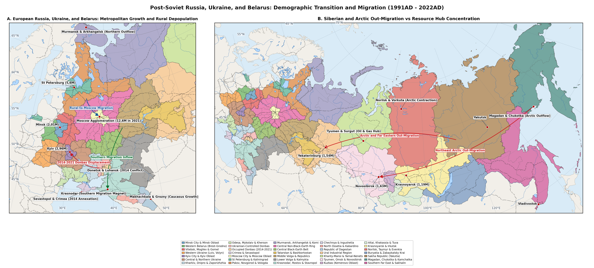

# Abstract

Between the dissolution of the Soviet Union in December 1991 and the eve
of the full-scale Russo-Ukrainian war in late 2021, the total population
across Belarus, Ukraine and the Russian Federation declined by 14,18M
(-6,7%), falling from 212,26M to 198,08M. Beneath this overall
contraction, however, the urban hierarchy of the post-Soviet space
underwent a marked spatial polarisation. Across the 7.376 urban and
large rural settlements catalogued in this gazetteer (totalling 163,62M
inhabitants in 1991 and 162,65M at the 2021 census baselines, a -0,6%
shift across the 7.369 continuous 1991-2021 cohort), migrants moved
steadily from shrinking rural districts, mono-industrial towns and
high-latitude settlements toward metropolitan, sunbelt and hydrocarbon
growth poles.

This gazetteer traces the population histories of those 7.376
settlements across the 35 demographic regions of Belarus (Regions 1-3),
Ukraine (Regions 4-11) and the Russian Federation (Regions 12-35) at
five benchmark dates: 1991, 2002, 2010, 2014 and 2021. The regional
tables contrast the rapid expansion of Moscow, Saint Petersburg,
Krasnodar, Makhachkala, Surgut, Tyumen, Kyiv and Minsk against the
contraction of Arctic mining towns in Chukotka, Magadan, Norilsk and
Vorkuta, coal-basin centres in the Kuzbass and the war-torn cities of
Chechnya and the Donbas.

# Methodology

This gazetteer covers 7.376 urban-type settlements and large rural
centres across the 35 regions of Belarus (Regions 1-3), Ukraine within
its 1991 borders (Regions 4-11, separating Government-Controlled Donbas
in Region 9, Pre-2022 Occupied Donbas in Region 10 and Crimea and
Sevastopol in Region 11) and the Russian Federation (Regions 12-35,
including the North Caucasus in Regions 22-24 and Siberia and the Far
East in Regions 26-35). Each regional table gives the settlement name,
historical or alternative toponyms, coordinates and population estimates
for 1991, 2002, 2010, 2014 and 2021.

Population figures draw on the 1999, 2009 and 2019 censuses of Belarus
[\[1\]](#ref-belstat2000perepis1999)[\[2\]](#ref-belstat2010perepis2009)[\[3\]](#ref-belstat2020perepis2019),
the 2001 Ukrainian census, annual Ukrstat municipal series and the 2019
Electronic Population Assessment
[\[4\]](#ref-ukrstat2003perepis2001)[\[5\]](#ref-ukrstat2021naselennia)[\[6\]](#ref-dubilet2020assessment2019),
and the 2002, 2010 and 2021 Russian censuses
[\[7\]](#ref-rosstat2004perepis2002)[\[8\]](#ref-rosstat2012perepis2010)[\[9\]](#ref-rosstat2022perepis2021).
For northern settlements abandoned during the post-Soviet exodus, such
as the Kolyma coal-mining town of Kadykchan in Region 34 (10,3k in 1991
and 875 in 2002), figures are given up to the last inhabited benchmark
before closure.

# Results

## Minsk Metropolitan Region

Sustained migration into the Belarusian capital lifted the population of
Minsk City and Minsk Oblast (Region 1) from 3,4M in 1991 to 3,48M in
2021 (+2,4%), with Minsk itself passing the two-million mark while
surrounding industrial towns held steady (Table )
[\[3\]](#ref-belstat2020perepis2019).

| Settlement | Other Names | Coords | 1991 | 2002 | 2010 | 2014 | 2021 | Change |
|:---|:---|:---|:---|:---|:---|:---|:---|:---|
| Astrashytski Haradok | Астрашыцкі Гарадок; Astrašycki Haradok | 54,07, 27,7 (Belarus) | 2k | 2,2k | 2,4k | 2,8k | 3,4k | +66,9% |
| Bierazino | Беразіно | 53,84, 28,99 (Belarus) | 12,9k | 13,2k | 12k | 11,9k | 11,4k | -11,2% |
| Bobr | Бобр | 54,34, 29,27 (Belarus) | 1,4k | 1,3k | 1,1k | 970 | 930 | -33,6% |
| Borisov | Barysaw; Borisow | 54,22, 28,51 (Belarus) | 147k | 150k | 147k | 145k | 137,7k | -6,3% |
| Cherven | Чэрвень; Červień | 53,71, 28,43 (Belarus) | 11,6k | 10,8k | 10,1k | 9,8k | 10,7k | -7,5% |
| Dzyarzhynsk | Дзяржынск; Dziaržynsk | 53,68, 27,13 (Belarus) | 23,7k | 24,2k | 25,3k | 26,3k | 29,7k | +25,5% |
| Fanipol | Фаніпаль; Fanipal | 53,75, 27,33 (Belarus) | 9,2k | 11,7k | 12,8k | 13,8k | 17,5k | +90,3% |
| Gorodeya | Гарадзея; Haradzieja | 53,31, 26,54 (Belarus) | 4,8k | 4,3k | 4k | 3,9k | 3,8k | -21,9% |
| Hrozava | Грозава | 53,17, 27,33 (Belarus) | 487 | 429 | 393 | 382 | 368 | -24,4% |
| Ivyanyets | Івянец; Ivianiec | 53,89, 26,74 (Belarus) | 5k | 4,9k | 4,3k | 4,2k | 3,9k | -21,3% |
| Kapyl | Капыль; Копыль | 53,15, 27,09 (Belarus) | 10,1k | 10,7k | 9,9k | 9,8k | 10,4k | +2,6% |
| Kholopenichi | Халапенічы; Chałapieničy | 54,52, 28,96 (Belarus) | 2,2k | 1,9k | 1,5k | 1,4k | 1,4k | -34,5% |
| Kletsk | Клецк; Kleck | 53,06, 26,64 (Belarus) | 11k | 10,9k | 10,8k | 11,1k | 11,5k | +4,2% |
| Krupki | Крупкі | 54,32, 29,14 (Belarus) | 8,4k | 8,5k | 8,7k | 8,6k | 8,5k | +1,7% |
| Kryvichy | Крывічы; Kryvičy | 54,71, 27,29 (Belarus) | 1,6k | 1,4k | 1,3k | 1,2k | 1,1k | -30% |
| Kuraniec | Куренецъ | 54,56, 26,96 (Belarus) | 20,5k | 19,6k | 19k | 19k | 19k | -7,3% |
| Logoysk | Лагойск; Łahojsk | 54,21, 27,85 (Belarus) | 9k | 9,7k | 11k | 12,1k | 15,3k | +70,4% |
| Lyuban | Любань; Lubań | 52,8, 28 (Belarus) | 11,6k | 11,8k | 11,2k | 11,2k | 11,7k | +0,5% |
| Machulishchy | Мачулішчы; Mačuliščy | 53,78, 27,59 (Belarus) | 7k | 7,6k | 7,4k | 7,8k | 9,8k | +40% |
| Mar’Ina Gorka | Мар’іна Горка; Marjina Horka | 53,51, 28,15 (Belarus) | 20,1k | 23,6k | 21,4k | 21,3k | 20,6k | +2,4% |
| Minsk | Mensk; Miensk | 53,9, 27,56 (Belarus) | 1,63M | 1,73M | 1,84M | 1,92M | 2,01M | +23% |
| Molodechno | Maladzyechna; Molodeczno | 54,31, 26,85 (Belarus) | 92k | 97k | 94k | 94k | 91,1k | -1% |
| Myadzyel | Мядзель; Miadziel | 54,88, 26,94 (Belarus) | 7,5k | 7,6k | 7k | 6,9k | 7,1k | -4,7% |
| Narach | Нарач; Narač | 54,91, 26,71 (Belarus) | 3,9k | 3,4k | 2,8k | 3,2k | 4,1k | +3,9% |
| Nesvizh | Нясвіж; Niasviž | 53,22, 26,68 (Belarus) | 15k | 14,4k | 14,2k | 15k | 15,7k | +4,9% |
| Plyeshch-anitsy | Плешчаніцы; Pleščanicy | 54,42, 27,83 (Belarus) | 7,7k | 7,9k | 6k | 5,9k | 5,9k | -23% |
| Prawdzinski | Праўдзінскі; Praŭdzinski | 53,52, 27,83 (Belarus) | 2,9k | 2,8k | 2,4k | 2,3k | 2,1k | -26,4% |
| Pukhavichy | Пухавічы; Puchavičy | 53,53, 28,25 (Belarus) | 1,9k | 1,9k | 1,8k | 1,9k | 1,9k | +2,3% |
| Radashkovichy | Радашковічы; Radaškovičy | 54,16, 27,24 (Belarus) | 5,1k | 5,7k | 5,5k | 5,7k | 6,3k | +24,3% |
| Rakaw | Ракаў; Rakaŭ | 53,97, 27,06 (Belarus) | 2,8k | 2,7k | 2,6k | 2,7k | 2,9k | +2,5% |
| Rudzyensk | Рудзенск; Rudziensk | 53,6, 27,86 (Belarus) | 3,8k | 3k | 2,8k | 2,7k | 2,7k | -29,9% |
| Samakhva-lavichy | Самахвалавічы; Samachvałavičy | 53,74, 27,5 (Belarus) | 1,9k | 2,2k | 2,6k | 2,9k | 3,2k | +73,7% |
| Shatsk | Шацк; Šack | 53,43, 27,7 (Belarus) | 826 | 726 | 658 | 616 | 567 | -31,4% |
| Skuraty | Скураты | 54, 27,77 (Belarus) | 35,5k | 34k | 33k | 33k | 32,9k | -7,3% |
| Slutsk | Sluck; Слуцк | 53,03, 27,56 (Belarus) | 60,1k | 62,7k | 61,4k | 62k | 61,4k | +2,2% |
| Smalyavichy | Смалявічы; Smalavičy | 54,02, 28,09 (Belarus) | 13,9k | 14,1k | 15,2k | 15,6k | 19,8k | +42,8% |
| Smilavichy | Смілавічы; Smiłavičy | 53,75, 28,01 (Belarus) | 4,6k | 5,1k | 4,7k | 4,9k | 5,9k | +28,5% |
| Sokal | Сокал; Sokał | 53,88, 27,9 (Belarus) | 2,2k | 2,1k | 2k | 2k | 2k | -8,6% |
| Soligorsk | Salihorsk Potash Boomtown; Салігорск | 52,79, 27,54 (Belarus) | 95k | 101k | 102k | 105k | 99,6k | +4,9% |
| Sosny | Сосны | 53,83, 27,77 (Belarus) | 2,3k | 2,2k | 2,1k | 2,1k | 2,1k | -8,6% |
| Starobin | Старобін | 52,73, 27,46 (Belarus) | 5,7k | 5,9k | 5,7k | 5,8k | 6,5k | +14,3% |
| Staryye Dorogi | Старыя Дарогі; Staryja Darohi | 53,04, 28,27 (Belarus) | 11,5k | 11,8k | 11k | 10,7k | 11,2k | -2,6% |
| Stowbtsy | Стоўбцы; Stoŭbcy | 53,48, 26,74 (Belarus) | 14,2k | 16,7k | 15,5k | 16,5k | 17,4k | +22,7% |
| Svir | Свір | 54,85, 26,4 (Belarus) | 1,4k | 1,3k | 1k | 928 | 1k | -27,6% |
| Timkovichi | Цімкавічы; Cimkavičy | 53,07, 26,99 (Belarus) | 1,5k | 1,3k | 1,2k | 1,2k | 1,2k | -20% |
| Tselevichi | Целевичи | 52,95, 27,37 (Belarus) | 20,6k | 19,6k | 19,1k | 19,1k | 19,1k | -7,3% |
| Urechcha | Урэчча; Urečča | 52,95, 27,89 (Belarus) | 4,2k | 3,6k | 3,1k | 3k | 2,5k | -40,5% |
| Uzda | Узда | 53,46, 27,21 (Belarus) | 8,8k | 9,5k | 9,7k | 9,9k | 10,8k | +22,5% |
| Vileyka | Вілейка; Vilejka | 54,49, 26,91 (Belarus) | 29,5k | 30k | 26,8k | 26,9k | 27,2k | -7,9% |
| Volozhin | Валожын; Vałožyn | 54,09, 26,53 (Belarus) | 11,1k | 11,5k | 10,5k | 10,4k | 10k | -9,8% |
| Zaslawye | Заслаўе; Zasłaŭje | 54,01, 27,27 (Belarus) | 10,9k | 13,3k | 14,2k | 14,7k | 17,7k | +62,4% |
| Zhodino | Zhodzina BelAZ Hub; Жодзіна | 54,1, 28,32 (Belarus) | 56k | 60,3k | 61,9k | 63,2k | 64,7k | +15,6% |
| Zyalyony Bor | Зялёны Бор; Zialony Bor | 54,01, 28,48 (Belarus) | 1,6k | 1,4k | 1,1k | 1,1k | 1,2k | -26,9% |
| Zyembin | Зембін; Ziembin | 54,36, 28,22 (Belarus) | 854 | 771 | 718 | 698 | 672 | -21,3% |

Population of Minsk and principal towns in Minsk Oblast (Region 1),
1991-2021.

## Western Belarus

Across Brest and Grodno oblasts (Region 2), overall population declined
by -11,9% from 2,68M in 1991 to 2,36M in 2021, although the regional
capitals of Grodno and Brest continued to grow through rural-to-urban
migration (Table ) [\[3\]](#ref-belstat2020perepis2019).

| Settlement | Other Names | Coords | 1991 | 2002 | 2010 | 2014 | 2021 | Change |
|:---|:---|:---|:---|:---|:---|:---|:---|:---|
| Antopal | Антопаль; Антополь | 52,2, 24,79 (Belarus) | 2,5k | 2k | 1,7k | 1,5k | 1,5k | -38,7% |
| Ashmyany | Ашмяны; Ašmiany | 54,53, 26,08 (Belarus) | 15,2k | 15k | 14,9k | 15,8k | 17k | +11,6% |
| Astraviec | Астравец; Островец | 54,61, 25,96 (Belarus) | 8,1k | 8,5k | 8,3k | 9k | 14,1k | +74,7% |
| Baranovichi | Baranavichy; Baranowicze Junction | 53,13, 26,01 (Belarus) | 165k | 168k | 168k | 178k | 174,1k | +5,5% |
| Brest-Litovsk | Brest; Brisk | 52,1, 23,73 (Belarus) | 269k | 294k | 310k | 331k | 340,3k | +26,5% |
| Byaroza | Бяроза; Biaroza | 52,53, 24,98 (Belarus) | 26k | 29,8k | 29,4k | 29,4k | 28,6k | +10,1% |
| Byarozawka | Бярозаўка; Biarozaŭka | 53,72, 25,5 (Belarus) | 12k | 12,1k | 10,8k | 10,5k | 10,1k | -16% |
| Byelaazyorsk | Белаазёрск; Biełaaziorsk | 52,47, 25,18 (Belarus) | 11,4k | 13,2k | 12,5k | 12,5k | 11,1k | -2,5% |
| Damachava | Дамачава; Damačava | 51,74, 23,6 (Belarus) | 1,4k | 1,3k | 1,3k | 1,2k | 1,2k | -12,6% |
| Davyd-Haradok | Давыд-Гарадок; Давид-Городок | 52,06, 27,22 (Belarus) | 7,7k | 7,1k | 6,5k | 6,2k | 5,9k | -23,1% |
| Derechin | Деречинъ | 53,25, 24,92 (Belarus) | 6,4k | 6,1k | 6k | 5,9k | 5,9k | -8,6% |
| Drogichin | Драгічын; Drahičyn | 52,19, 25,16 (Belarus) | 14,6k | 15,1k | 14,7k | 14,8k | 15k | +2,5% |
| Dyatlovo | Дзятлава; Dziatłava | 53,46, 25,41 (Belarus) | 8,2k | 8,3k | 7,8k | 7,7k | 8,1k | -1,7% |
| Gorodishche | Гарадзішча; Haradzišča | 53,32, 26,01 (Belarus) | 2,9k | 2,5k | 2,2k | 2,1k | 1,8k | -36,4% |
| Gorodok | Городок; Городокъ | 52,09, 24,23 (Belarus) | 11,8k | 11,2k | 10,9k | 10,9k | 10,9k | -7,1% |
| Grodno | Hrodna; Gardinas | 53,67, 23,81 (Belarus) | 284k | 310k | 328k | 356k | 357,5k | +25,9% |
| Hantsavichy | Ганцавічы; Hancavičy | 52,76, 26,43 (Belarus) | 14,5k | 14,8k | 13,9k | 14k | 13,8k | -5% |
| Ivanovo | Іванава; Ivanava | 52,15, 25,53 (Belarus) | 14,6k | 16,1k | 16,2k | 16,6k | 16,5k | +13% |
| Ivatsevichi | Івацэвічы; Ivacevičy | 52,71, 25,34 (Belarus) | 18,7k | 24k | 23k | 23,3k | 22,5k | +20,4% |
| Iwye | Іўе; Iŭje | 53,93, 25,78 (Belarus) | 8,3k | 8,4k | 8,1k | 7,8k | 7,3k | -11,7% |
| Kamenets | Камянец; Kamianiec | 52,4, 23,81 (Belarus) | 8,8k | 8,7k | 8,4k | 8,4k | 8,3k | -5,1% |
| Kazhan-Haradok | Кожанъ-Городокъ | 52,21, 27,01 (Belarus) | 11,5k | 9,1k | 7,8k | 7,8k | 7,8k | -32,3% |
| Khomsk | Хомск; Хомскъ | 52,33, 25,23 (Belarus) | 1,2k | 1,1k | 1,1k | 1k | 1,1k | -8,7% |
| Khoroshcha | Хороща | 52,81, 25,25 (Belarus) | 2,7k | 2,4k | 2,3k | 2,2k | 2k | -26% |
| Kobryn | Кобрын; Кобрин | 52,21, 24,36 (Belarus) | 48,3k | 50,8k | 51,3k | 52,5k | 52,8k | +9,4% |
| Korelichi | Карэлічы; Kareličy | 53,56, 26,14 (Belarus) | 7,1k | 7,6k | 6,8k | 6,7k | 6k | -15,3% |
| Kosava | Косава; Коссово | 52,76, 25,16 (Belarus) | 2,8k | 2,4k | 2k | 1,9k | 1,9k | -31,5% |
| Kozlovshchina | Казлоўшчына; Kazłoŭščyna | 53,32, 25,28 (Belarus) | 2,2k | 2,4k | 1,8k | 1,7k | 1,5k | -33,3% |
| Krasnaselski | Краснасельскі; Krasnasielski | 53,26, 24,42 (Belarus) | 6k | 7,4k | 6,9k | 6,9k | 6,1k | +2% |
| Kreva | Крево | 54,31, 26,29 (Belarus) | 6,1k | 5,3k | 4,8k | 4,8k | 4,7k | -21,9% |
| Lahishyn | Лагішын; Łahišyn | 52,34, 25,99 (Belarus) | 3,1k | 2,7k | 2,3k | 2,1k | 2k | -36,2% |
| Lida | Lida Vilna Gub; Lyda | 53,89, 25,3 (Belarus) | 93k | 99k | 98k | 100k | 103,2k | +11% |
| Luninyets | Лунінец; Łuniniec | 52,25, 26,8 (Belarus) | 23,7k | 23,9k | 23,7k | 24k | 23,7k | +0,1% |
| Lyakhovichi | Ляхавічы; Lachavičy | 53,04, 26,26 (Belarus) | 11,1k | 11,6k | 10,9k | 10,9k | 10,6k | -4,4% |
| Lyubcha | Любча; Lubča | 53,75, 26,06 (Belarus) | 1,7k | 1,5k | 1,1k | 1,1k | 1,1k | -37,9% |
| Malorita | Маларыта; Małaryta | 51,79, 24,07 (Belarus) | 9,9k | 11,5k | 11,7k | 11,8k | 12,9k | +30,1% |
| Mikashevichy | Мікашэвічы; Mikaševičy | 52,22, 27,48 (Belarus) | 13,1k | 13,7k | 13k | 12,9k | 12,8k | -2,5% |
| Mir | Мір; Мир | 53,45, 26,47 (Belarus) | 2,6k | 2,6k | 2,3k | 2,3k | 2,1k | -19,3% |
| Mosty | Масты; Masty | 53,41, 24,54 (Belarus) | 17,5k | 17,8k | 16,3k | 15,7k | 15,2k | -13,2% |
| Navaelnya | Наваельня; Navajelnia | 53,46, 25,58 (Belarus) | 4,2k | 3,5k | 3k | 2,8k | 2,7k | -34,8% |
| Novogrudok | Навагрудак; Navahrudak | 53,59, 25,82 (Belarus) | 30,5k | 30,5k | 29,3k | 28,8k | 28,2k | -7,5% |
| Oshmyany | Ошмяны | 54,42, 25,94 (Belarus) | 13,2k | 14,2k | 15k | 15,7k | 16,5k | +24,7% |
| Ostryna | Астрына; Astryna | 53,73, 24,53 (Belarus) | 2,7k | 2,4k | 2k | 1,9k | 1,6k | -39,6% |
| Padbalotstsye | Подболотье | 53,24, 24,75 (Belarus) | 560 | 429 | 297 | 362 | 512 | -8,6% |
| Peski | Пески | 53,78, 25,4 (Belarus) | 6,5k | 6,2k | 6k | 6k | 5,9k | -8,6% |
| Pinsk | Pinsk Polesia; Pinska | 52,11, 26,1 (Belarus) | 122k | 130k | 130k | 136k | 125,1k | +2,5% |
| Pogranichnyy | Пагранічны; Pahraničny | 53,12, 23,97 (Belarus) | 1,5k | 1,5k | 1,4k | 1,4k | 1,4k | -7,1% |
| Porazava | Поразава; Порозово | 52,94, 24,37 (Belarus) | 1,5k | 1,3k | 1,1k | 952 | 790 | -47,3% |
| Pruzhany | Пружаны; Pružany | 52,55, 24,45 (Belarus) | 24,1k | 20k | 19k | 18,8k | 19k | -21% |
| Putno | Путно | 53,52, 23,81 (Belarus) | 49,2k | 47k | 45,6k | 45,4k | 45k | -8,6% |
| Pyershamayski | Першамайскі; Pieršamajski | 53,89, 25,41 (Belarus) | 1,5k | 1,3k | 1,2k | 1,3k | 1,3k | -15,9% |
| Radun | Радунь; Raduń | 54,05, 25 (Belarus) | 2,8k | 3k | 2,6k | 2,5k | 2,2k | -19,8% |
| Rechytsa | Рэчыца; Rečyca | 51,86, 26,78 (Belarus) | 6,8k | 6,7k | 6,3k | 6,2k | 6k | -12,2% |
| Ros | Рось; Roś | 53,28, 24,41 (Belarus) | 4,7k | 6,3k | 5,3k | 4,8k | 4,5k | -4,1% |
| Ruzhany | Ружаны; Ružany | 52,87, 24,89 (Belarus) | 3,9k | 3,4k | 3,1k | 3k | 2,9k | -24,7% |
| Sharashova | Шарашова; Šarašova | 52,56, 24,22 (Belarus) | 2,4k | 2,2k | 1,9k | 1,8k | 1,7k | -31,1% |
| Shchuchyn | Шчучын; Ščučyn | 53,6, 24,75 (Belarus) | 16,4k | 16,1k | 15,1k | 15,5k | 15,9k | -3,1% |
| Sivitsa | Сивица | 54,36, 26,51 (Belarus) | 24,1k | 23,1k | 22,4k | 22,3k | 22,1k | -8,6% |
| Skidzel | Скідзель; Skidziel | 53,59, 24,25 (Belarus) | 11,1k | 11,2k | 10,8k | 10,5k | 10,2k | -8,4% |
| Slonim | Slonim Grodno; Slonim Pale | 53,09, 25,32 (Belarus) | 47,2k | 51,6k | 48,8k | 49,1k | 49,8k | +5,6% |
| Smargon | Смаргонь; Smarhoń | 54,48, 26,4 (Belarus) | 34,8k | 36,5k | 36,4k | 37,2k | 36,2k | +4% |
| Sopotskin | Сапоцкін; Sapockin | 53,83, 23,66 (Belarus) | 1,5k | 1,5k | 1,2k | 1k | 979 | -34,7% |
| Stolin | Столін; Столин | 51,89, 26,84 (Belarus) | 10,6k | 12,2k | 12,4k | 12,4k | 13k | +23% |
| Svislach | Свіслач; Svisłač | 53,03, 24,1 (Belarus) | 8,5k | 7,7k | 6,8k | 6,7k | 6,3k | -25,6% |
| Tarnova | Тарново | 53,79, 25,15 (Belarus) | 11,4k | 10,9k | 10,6k | 10,5k | 10,4k | -8,6% |
| Tsyelyakhany | Целяханы; Cielachany | 52,52, 25,84 (Belarus) | 4,7k | 4,6k | 4,2k | 4k | 3,7k | -20,5% |
| Vasilishki | Василишки | 53,78, 24,85 (Belarus) | 2,8k | 1,6k | 1,7k | 1,6k | 2,7k | -3,7% |
| Vaukavysk | Ваўкавыск; Vaŭkavysk | 53,16, 24,45 (Belarus) | 42k | 46,7k | 44k | 43,8k | 42,7k | +1,8% |
| Vitchin | Вичинъ | 52,26, 26,94 (Belarus) | 14,1k | 866 | 797 | 720 | 25,2k | +78,3% |
| Voronovo | Воранава; Voranava | 54,15, 25,31 (Belarus) | 6,4k | 6,7k | 6,3k | 6,1k | 6,1k | -4,7% |
| Vyalikaya Byerastavitsa | Вялікая Бераставіца; Vialikaja Bierastavica | 53,2, 24,02 (Belarus) | 5,4k | 6k | 5,7k | 5,6k | 5,6k | +3,9% |
| Vysokaye | Высокае; Vysokaje | 52,37, 23,37 (Belarus) | 4,7k | 5,3k | 5,4k | 5,3k | 4,9k | +3,4% |
| Yuratsishki | Юрацішкі; Juraciški | 54,03, 25,93 (Belarus) | 1,7k | 1,6k | 1,5k | 1,4k | 1,4k | -19,4% |
| Zelva | Зэльва; Зельва | 53,15, 24,81 (Belarus) | 8,2k | 8,1k | 7,3k | 7,1k | 6,5k | -20,5% |
| Zhabinka | Жабінка; Žabinka | 52,2, 24,01 (Belarus) | 11,3k | 12,8k | 13,2k | 13,2k | 14,1k | +24,8% |
| Zhaludok | Жалудок; Žałudok | 53,6, 24,98 (Belarus) | 1,7k | 1,5k | 1,3k | 1,1k | 1,1k | -37,6% |
| Zhuprany | Жупраны | 54,47, 26,09 (Belarus) | 7,1k | 6,8k | 6,6k | 6,6k | 6,5k | -8,6% |

Urban populations in Brest and Grodno oblasts (Region 2), 1991-2021.

## Eastern and Southeastern Belarus

Post-Chernobyl resettlement in Gomel and Mogilev and severe rural ageing
in Vitebsk reduced the population of Eastern and Southeastern Belarus
(Region 3) by -20,6%, from 4,17M in 1991 to 3,31M in 2021 (Table )
[\[3\]](#ref-belstat2020perepis2019).

| Settlement | Other Names | Coords | 1991 | 2002 | 2010 | 2014 | 2021 | Change |
|:---|:---|:---|:---|:---|:---|:---|:---|:---|
| Agarodnya Gomelskaya | Агародня Гомельская; Aharodnia Homielskaja | 52,33, 31,55 (Belarus) | 186 | 117 | 84 | 75 | 64 | -65,6% |
| Aktsyabrski | Акцябрскі; Akciabrski | 52,65, 28,88 (Belarus) | 7,3k | 8,2k | 7,3k | 7k | 7,3k | +0,6% |
| Asvieja | Асвея; Освея | 56,01, 28,11 (Belarus) | 1,9k | 1,5k | 1,3k | 1,2k | 1k | -46,9% |
| Azarychy | Азарычы; Azaryčy | 52,46, 29,26 (Belarus) | 1,5k | 1,5k | 1,3k | 1,2k | 1,2k | -22,5% |
| Babinovichi | Бабінавічы; Babinavičy | 54,83, 30,57 (Belarus) | 549 | 494 | 455 | 432 | 398 | -27,5% |
| Bahushewsk | Багушэўск; Bahušeŭsk | 54,84, 30,21 (Belarus) | 4,6k | 3,5k | 3,1k | 2,7k | 2,5k | -45% |
| Balshavik | Бальшавік; Balšavik | 52,56, 30,88 (Belarus) | 2,8k | 2,5k | 2,5k | 2,5k | 2,6k | -7,9% |
| Baran | Барань; Barań | 54,48, 30,31 (Belarus) | 14,1k | 12,4k | 11,6k | 11,4k | 10,6k | -25% |
| Belynichi | Бялынічы; Białyničy | 54, 29,71 (Belarus) | 10,7k | 10,6k | 10,7k | 10,4k | 9,9k | -7,4% |
| Beshenkovichi | Бешанковічы; Biešankovičy | 55,04, 29,46 (Belarus) | 9,2k | 8,2k | 7,2k | 6,8k | 7k | -24% |
| Bobruisk | Babruysk; Bobrujsk Fortress | 53,14, 29,22 (Belarus) | 233k | 221k | 215k | 218k | 209,7k | -10% |
| Bolbasovo | Балбасава; Bałbasava | 54,42, 30,29 (Belarus) | 3,9k | 4,1k | 3,6k | 3,6k | 3,5k | -10,2% |
| Borovukha Pervaya | Баравуха; Baravucha | 55,59, 28,59 (Belarus) | 5,1k | 5,4k | 5,4k | 5,4k | 5,3k | +4,4% |
| Bragin | Брагін; Brahin | 51,79, 30,27 (Belarus) | 5,5k | 3,5k | 4k | 3,9k | 4,4k | -19,3% |
| Braslav | Браслаў; Brasłaŭ | 55,64, 27,06 (Belarus) | 10k | 10,1k | 9,5k | 9,7k | 9,4k | -6,1% |
| Buda-Kashalyova | Буда-Кашалёва; Buda-Kašalova | 52,72, 30,57 (Belarus) | 8,9k | 9,5k | 8,9k | 8,5k | 8,8k | -0,6% |
| Butory | Буторы | 54,52, 29,46 (Belarus) | 9,9k | 9,5k | 9,2k | 9,1k | 9k | -8,6% |
| Byagoml | Бягомль; Biahoml | 54,73, 28,06 (Belarus) | 3,3k | 3,1k | 2,7k | 2,6k | 2,5k | -24,2% |
| Byelitsk | Беліцк; Bielick | 52,94, 30,41 (Belarus) | 700 | 658 | 473 | 403 | 319 | -54,4% |
| Bykhov | Быхаў; Bychaŭ | 53,52, 30,23 (Belarus) | 22k | 17,7k | 17k | 16,8k | 16,9k | -23,1% |
| Chachersk | Чачэрск; Čačersk | 52,92, 30,92 (Belarus) | 8,7k | 7,6k | 8k | 8,1k | 8,8k | +1,1% |
| Chashniki | Чашнікі; Čašniki | 54,85, 29,17 (Belarus) | 10,5k | 9,9k | 9,1k | 9k | 8,1k | -22,9% |
| Chausy | Чавусы; Čavusy | 53,81, 30,97 (Belarus) | 12,5k | 11k | 10,7k | 10,7k | 10,3k | -17,7% |
| Chereya | Чарэя; Čareja | 54,61, 29,28 (Belarus) | 746 | 591 | 485 | 400 | 310 | -58,4% |
| Cherikov | Чэрыкаў; Čerykaŭ | 53,57, 31,38 (Belarus) | 8,3k | 8,5k | 8,2k | 8,2k | 7,9k | -4,7% |
| Dobrush | Добруш; Dobruš | 52,41, 31,31 (Belarus) | 20,1k | 19,4k | 18,3k | 18,1k | 18,3k | -8,9% |
| Dokshytsy | Докшыцы; Dokšycy | 54,89, 27,77 (Belarus) | 7,2k | 7k | 6,6k | 6,8k | 6,8k | -5,2% |
| Dolginovo | Долгинов | 55,74, 27,79 (Belarus) | 6,7k | 6,4k | 6,2k | 6,2k | 6,2k | -8,6% |
| Druja | Друя | 55,79, 27,45 (Belarus) | 1,3k | 1,3k | 1,1k | 997 | 852 | -34,5% |
| Drybin | Дрыбін; Дрибин | 54,12, 31,09 (Belarus) | 3,1k | 3,2k | 3,3k | 3,1k | 3,1k | -0,5% |
| Dubrowna | Дуброўна; Dubroŭna | 54,57, 30,69 (Belarus) | 9,8k | 9,1k | 7,9k | 7,5k | 7k | -29,1% |
| Dzisna | Дзісна; Дисна | 55,57, 28,21 (Belarus) | 2,6k | 2,4k | 1,9k | 1,6k | 1,5k | -42,6% |
| Elsk | Ельск; Jelsk | 51,81, 29,15 (Belarus) | 10,6k | 10,2k | 9,6k | 9,3k | 9,1k | -14,3% |
| Filipovo | Филипово | 55,66, 28,22 (Belarus) | 3,8k | 3,7k | 3,6k | 3,5k | 3,5k | -8,6% |
| Glusha | Глуша; Hłuša | 53,1, 28,82 (Belarus) | 1,8k | 1,6k | 1,3k | 1,3k | 1,3k | -29,6% |
| Glusk | Глуск; Hłusk | 52,9, 28,68 (Belarus) | 8,3k | 8,1k | 7,4k | 7,2k | 7,2k | -13% |
| Gomel | Homyel; Homel Mogilev Gub | 52,43, 30,98 (Belarus) | 506k | 481k | 484k | 512k | 504k | -0,4% |
| Gorodok | Гарадок; Haradok | 55,46, 29,98 (Belarus) | 14,5k | 14k | 12,8k | 12,3k | 11,8k | -18,5% |
| Gorval | Горваль | 52,57, 30,19 (Belarus) | 6,9k | 6,6k | 6,4k | 6,4k | 6,4k | -7,6% |
| Gory | Горы; Hory | 54,27, 31,2 (Belarus) | 1,1k | 796 | 633 | 607 | 572 | -49% |
| Haradzyets | Гарадзец; Haradziec | 52,97, 30,35 (Belarus) | 810 | 800 | 779 | 723 | 657 | -18,9% |
| Hlybokaye | Глыбокае; Hłybokaje | 55,14, 27,69 (Belarus) | 17,6k | 19,5k | 18,3k | 18,7k | 17,8k | +1,1% |
| Horki | Горкі | 54,29, 30,99 (Belarus) | 32,6k | 33,5k | 32,2k | 32k | 30,4k | -6,8% |
| Hradzyanka | Градзянка; Hradzianka | 53,55, 28,74 (Belarus) | 800 | 532 | 388 | 339 | 285 | -64,4% |
| Kalinkovichi | Калінкавічы; Kalinkavičy | 52,13, 29,33 (Belarus) | 40,6k | 38k | 38,4k | 39,3k | 37,6k | -7,3% |
| Kapatkyevichy | Капаткевічы; Kapatkievičy | 52,32, 28,82 (Belarus) | 4,1k | 4k | 3,3k | 3,1k | 2,9k | -30,1% |
| Kapitanovo | Свято-Дмитриевка | 55,2, 30,03 (Belarus) | 7,5k | 7,2k | 7k | 6,9k | 6,9k | -8,6% |
| Kaptsevichy | Капцэвічы; Kapcevičy | 52,23, 28,32 (Belarus) | 1,7k | 1,6k | 1,4k | 1,3k | 1,2k | -29% |
| Kastsyukowka | Касцюкоўка; Kasciukoŭka | 52,54, 30,92 (Belarus) | 10,6k | 10,5k | 9,5k | 9,7k | 9,9k | -6,9% |
| Khotimsk | Хоцімск; Chocimsk | 53,41, 32,58 (Belarus) | 7,9k | 7,4k | 7k | 6,7k | 6,3k | -20,9% |
| Khoyniki | Хойнікі; Chojniki | 51,91, 29,98 (Belarus) | 15,1k | 14,5k | 13,9k | 13,1k | 13,4k | -11% |
| Kirovsk | Кіраўск; Kiraŭsk | 53,27, 29,47 (Belarus) | 8,7k | 8,8k | 8,8k | 8,6k | 8,2k | -6% |
| Klichau | Клічаў; Kličaŭ | 53,49, 29,34 (Belarus) | 8,2k | 7,9k | 7,5k | 7,4k | 7,3k | -10,9% |
| Klimovichi | Клімавічы; Klimavičy | 53,6, 31,96 (Belarus) | 16,5k | 16,4k | 16,8k | 16,3k | 15,4k | -6,6% |
| Kokhanovo | Коханава; Kochanava | 54,46, 30 (Belarus) | 5,2k | 4,8k | 4,3k | 4,3k | 3,8k | -26,4% |
| Kolyshki | Колышки | 55,17, 30,96 (Belarus) | 4,7k | 4,5k | 4,4k | 4,3k | 4,3k | -8,6% |
| Komarin | Камарын; Kamaryn | 51,44, 30,57 (Belarus) | 2,7k | 2,2k | 2k | 1,9k | 2,1k | -23,3% |
| Kopys | Копысь; Kopyś | 54,32, 30,29 (Belarus) | 1,2k | 900 | 890 | 816 | 663 | -44,8% |
| Korma | Карма; Karma | 53,13, 30,8 (Belarus) | 6,3k | 6,3k | 7,5k | 7,5k | 7,9k | +25,7% |
| Kostyukovichi | Касцюковічы; Kasciukovičy | 53,35, 32,05 (Belarus) | 14,7k | 16,6k | 15,9k | 15,9k | 15,5k | +5,3% |
| Krasnapollye | Краснаполле; Krasnapolle | 53,34, 31,4 (Belarus) | 6k | 6,5k | 6,1k | 5,9k | 5,8k | -2,5% |
| Krucha | Круча; Kruča | 54,24, 29,55 (Belarus) | 401 | 378 | 359 | 339 | 314 | -21,7% |
| Krugloye | Круглае; Kruhłaje | 54,25, 29,8 (Belarus) | 7,6k | 7,6k | 7,5k | 7,5k | 7,5k | -0,9% |
| Krychaw | Крычаў; Kryčaŭ | 53,72, 31,71 (Belarus) | 32,6k | 28,8k | 27k | 26,4k | 24,2k | -25,9% |
| Kublichi | Кублічы; Kubličy | 55,16, 28,34 (Belarus) | 363 | 310 | 269 | 228 | 183 | -49,6% |
| Lapichy | Лапічы; Lapičy | 53,44, 28,54 (Belarus) | 1,5k | 1,7k | 1,8k | 1,7k | 1,6k | +6,6% |
| Lelchytsy | Лельчыцы; Lelčycy | 51,79, 28,33 (Belarus) | 8,7k | 9,3k | 10,7k | 10,8k | 12,4k | +42,3% |
| Lepel | Лепель; Lepiel | 54,88, 28,7 (Belarus) | 19,6k | 18,8k | 17,4k | 17,6k | 17,4k | -11,1% |
| Liozno | Лёзна; Lozna | 55,02, 30,8 (Belarus) | 7,8k | 7k | 6,7k | 6,6k | 6,7k | -14% |
| Lipen | Ліпень; Lipień | 53,41, 28,82 (Belarus) | 755 | 775 | 784 | 770 | 747 | -1,1% |
| Loyev | Лоеў; Łojeŭ | 51,94, 30,79 (Belarus) | 7,8k | 7,5k | 7k | 6,8k | 6,3k | -19,2% |
| Lyady | Ляды; Lady | 54,6, 31,17 (Belarus) | 724 | 567 | 476 | 439 | 390 | -46,1% |
| Lyntupy | Лынтупы; Łyntupy | 55,05, 26,31 (Belarus) | 2k | 1,9k | 1,6k | 1,6k | 1,3k | -36% |
| Miory | Миоры | 55,62, 27,63 (Belarus) | 8,7k | 8,4k | 8,1k | 8k | 7,7k | -11,9% |
| Mogilev | Mahilyow; Mogilev Stavka | 53,9, 30,33 (Belarus) | 363k | 361k | 358k | 371k | 355,4k | -2,1% |
| Mozyr | Mazyr; Mozyr Pripyat | 52,05, 29,25 (Belarus) | 103k | 110k | 109k | 112k | 105,2k | +2,2% |
| Mscislau | Мсціслаў; Mscisłaŭ | 54,02, 31,72 (Belarus) | 11,6k | 11,7k | 10,8k | 10,5k | 10,2k | -12,1% |
| Narovlya | Нароўля; Naroŭla | 51,8, 29,5 (Belarus) | 10,8k | 7,8k | 8,1k | 8k | 8,4k | -22,6% |
| Nosovichi | Носовичи | 52,28, 31,27 (Belarus) | 8,8k | 8,4k | 8,1k | 8,1k | 8,1k | -7,6% |
| Novo-Nikolsk | Ново-Никольскъ | 52,88, 30,92 (Belarus) | 7,2k | 6,8k | 6,6k | 6,6k | 6,6k | -7,9% |
| Novolukoml | Новолукомль | 54,66, 29,15 (Belarus) | 13,1k | 13,6k | 13,8k | 13,3k | 12,4k | -5,4% |
| Novopolotsk | Navapolatsk Petrochemical City; Наваполацк | 55,53, 28,6 (Belarus) | 95k | 105k | 98k | 101k | 96,8k | +1,9% |
| Nowka | Ноўка; Noŭka | 55,13, 30,14 (Belarus) | 2,3k | 2,5k | 2,7k | 3k | 3,4k | +49,4% |
| Obal | Обаль; Оболь | 55,69, 29,73 (Belarus) | 3,4k | 3,2k | 2,6k | 2,4k | 2,3k | -33,8% |
| Orekhovsk | Арэхаўск; Arechaŭsk | 54,68, 30,49 (Belarus) | 3,5k | 3,2k | 2,7k | 2,5k | 2,4k | -31,1% |
| Orsha | Vorsha; Орша | 54,51, 30,42 (Belarus) | 125k | 122k | 117k | 116k | 104,6k | -16,3% |
| Osintorf | Асінторф; Asintorf | 54,71, 30,66 (Belarus) | 1,7k | 1,2k | 902 | 855 | 787 | -53,7% |
| Osipovichi | Асіповічы; Asipovičy | 53,31, 28,63 (Belarus) | 34,6k | 35,2k | 32,3k | 31,5k | 30k | -13,3% |
| Padsvillye | Падсвілле; Padsville | 55,15, 27,96 (Belarus) | 3k | 2,7k | 2,2k | 2k | 1,8k | -40,8% |
| Parychy | Парычы; Paryčy | 52,8, 29,42 (Belarus) | 3k | 2,4k | 2,1k | 1,9k | 1,9k | -36,4% |
| Pastavy | Паставы; Поставы | 55,12, 26,83 (Belarus) | 20,3k | 20,7k | 19,8k | 20,1k | 19,2k | -5,7% |
| Petrikov | Петрыкаў; Pietrykaŭ | 52,13, 28,5 (Belarus) | 12,1k | 11,1k | 10,5k | 10,4k | 10k | -17,5% |
| Polotsk | Polatsk; Polock | 55,49, 28,79 (Belarus) | 78k | 82k | 83k | 85k | 80,3k | +3% |
| Pukhovichi | Пуховичи | 55,45, 30,72 (Belarus) | 4,7k | 4,5k | 4,3k | 4,3k | 4,3k | -8,6% |
| Rahachow | Рагачоў; Rahačoŭ | 53,09, 30,05 (Belarus) | 37k | 35,2k | 33,8k | 34,7k | 32,9k | -11,1% |
| Rechitsa | Rechytsa; Рэчыца | 52,37, 30,39 (Belarus) | 69,4k | 66,4k | 64,6k | 65,4k | 66,3k | -4,4% |
| Rossony | Расоны; Rasony | 55,91, 28,81 (Belarus) | 5,6k | 5,6k | 5,4k | 5,1k | 4,8k | -14,1% |
| Ruba | Руба | 55,3, 30,31 (Belarus) | 7,7k | 7,9k | 7,2k | 7,5k | 7,5k | -2,4% |
| Sasnovy Bor | Сасновы Бор; Сосновый Бор | 52,52, 29,6 (Belarus) | 2,7k | 2,6k | 2,4k | 2,2k | 1,9k | -28,4% |
| Senkov | Сеньковъ | 53,76, 29,58 (Belarus) | 3k | 2,7k | 2,5k | 2,4k | 2,2k | -26% |
| Senno | Сянно; Sianno | 54,81, 29,7 (Belarus) | 9k | 8,6k | 7,9k | 7,6k | 7,4k | -18,1% |
| Shamovo | Шамава; Šamava | 54,19, 31,36 (Belarus) | 144 | 109 | 87 | 71 | 55 | -61,8% |
| Sharkovs-hchina | Шарковщина | 55,37, 27,47 (Belarus) | 5,6k | 6,4k | 6,9k | 6,7k | 6,4k | +14,4% |
| Shklov | Шклоў; Škłoŭ | 54,21, 30,29 (Belarus) | 15k | 16,1k | 16,4k | 16,3k | 15,3k | +2,3% |
| Shumilino | Шуміліна; Šumilina | 55,3, 29,61 (Belarus) | 8,9k | 7,9k | 7,4k | 7,3k | 7,4k | -17% |
| Sirotino | Сиротино | 55,38, 29,62 (Belarus) | 6k | 5,7k | 5,6k | 5,5k | 5,5k | -8,6% |
| Skitok | Скитокъ | 52,28, 30,92 (Belarus) | 14,5k | 13,8k | 13,4k | 13,4k | 13,4k | -7,6% |
| Slawharad | Слаўгарад; Słaŭharad | 53,44, 31 (Belarus) | 7,3k | 8,2k | 7,9k | 7,7k | 7,9k | +8,6% |
| Smolyany | Смальяны; Smaljany | 54,6, 30,06 (Belarus) | 1,5k | 1,4k | 1,4k | 1,3k | 1,1k | -21,8% |
| Streshyn | Стрэшын; Strešyn | 52,73, 30,1 (Belarus) | 1,4k | 1,3k | 1,2k | 1,2k | 937 | -33,1% |
| Surazh | Сураж; Suraž | 55,41, 30,72 (Belarus) | 1,5k | 1,2k | 1k | 879 | 692 | -53,9% |
| Svetlogorsk | Svyetlahorsk; Shatilki | 52,63, 29,73 (Belarus) | 71,6k | 72,3k | 69,8k | 68,7k | 65k | -9,2% |
| Tatarka | Татарка | 53,25, 28,82 (Belarus) | 1,2k | 975 | 765 | 734 | 471 | -60,8% |
| Terekhovka | Церахоўка; Cierachoŭka | 52,22, 31,42 (Belarus) | 2,3k | 2,2k | 1,8k | 3,2k | 3,1k | +36% |
| Tolochin | Талачын; Tałačyn | 54,41, 29,69 (Belarus) | 11,6k | 10,5k | 10,1k | 9,9k | 9,9k | -14,7% |
| Trudy | Труды | 55,64, 29,39 (Belarus) | 170 | 118 | 90 | 77 | 62 | -63,5% |
| Tsikhinichy | Ціхінічы; Cichiničy | 53,15, 29,86 (Belarus) | 1,4k | 1,5k | 1,6k | 1,6k | 1,5k | +5,2% |
| Turau | Тураў; Turaŭ | 52,07, 27,74 (Belarus) | 3,4k | 3,2k | 2,9k | 2,8k | 2,8k | -18,5% |
| Ulla | Ула; Uła | 55,22, 29,24 (Belarus) | 1,1k | 1,3k | 1k | 972 | 871 | -20,8% |
| Ushachi | Ушачы; Ušačy | 55,18, 28,62 (Belarus) | 6,3k | 6k | 5,5k | 6,1k | 5,8k | -7,7% |
| Uvaravichy | Уваравічы; Uvaravičy | 52,6, 30,73 (Belarus) | 3,3k | 2,7k | 2,5k | 2,3k | 2,2k | -32% |
| Vasilyevichy | Васілевічы; Vasilevičy | 52,25, 29,83 (Belarus) | 5k | 4,4k | 3,9k | 3,5k | 3,4k | -31,3% |
| Verkhnedvinsk | Верхнядзвінск; Vierchni-adzvinsk | 55,78, 27,94 (Belarus) | 8,2k | 8k | 7,3k | 7,3k | 7k | -15,2% |
| Verki | Верки | 55,49, 26,9 (Belarus) | 7,6k | 7,3k | 7k | 7k | 6,9k | -8,6% |
| Vetka | Vietka Chernobyl Zone; Ветка | 52,56, 31,18 (Belarus) | 9,6k | 7,8k | 8k | 8,2k | 8,4k | -12,2% |
| Vidzy | Відзы; Видзы | 55,4, 26,63 (Belarus) | 2,2k | 2,1k | 1,8k | 1,7k | 1,5k | -30,9% |
| Vitebsk | Vitsebsk; Witebsk | 55,19, 30,2 (Belarus) | 354k | 343k | 348k | 363k | 360,5k | +1,8% |
| Volyntsy | Валынцы; Vałyncy | 55,71, 28,19 (Belarus) | 777 | 773 | 753 | 684 | 597 | -23,2% |
| Voropayevo | Варапаева; Varapajeva | 55,14, 27,21 (Belarus) | 3,7k | 3,3k | 2,8k | 2,6k | 2,4k | -35,9% |
| Vyetryna | Ветрына; Vietryna | 55,41, 28,47 (Belarus) | 1,9k | 2,9k | 2,7k | 2,3k | 1,8k | -3,2% |
| Vysochany | Высачаны; Vysačany | 54,98, 30,44 (Belarus) | 576 | 449 | 379 | 362 | 337 | -41,5% |
| Yakovlevichi | Якаўлевічы; Jakaŭlevičy | 54,33, 30,52 (Belarus) | 388 | 367 | 349 | 331 | 304 | -21,6% |
| Yalizava | Елизово | 53,4, 29 (Belarus) | 3,1k | 2,8k | 2,6k | 2,4k | 2,1k | -30,3% |
| Yanovichi | Янавічы; Janavičy | 55,29, 30,7 (Belarus) | 1,3k | 1,1k | 898 | 814 | 665 | -48,8% |
| Yasen | Ясень; Jasień | 53,25, 28,93 (Belarus) | 507 | 443 | 410 | 420 | 431 | -15% |
| Yezerishche | Езярышча; Jeziaryšča | 55,84, 29,99 (Belarus) | 2,4k | 1,9k | 1,5k | 1,4k | 1,1k | -53,5% |
| Yukhovichi | Юхавічы; Juchavičy | 56,01, 28,65 (Belarus) | 217 | 181 | 156 | 134 | 109 | -49,8% |
| Zarechcha | Зарэчча; Zarečča | 51,78, 30,37 (Belarus) | 1,3k | 1,3k | 2,4k | 2,3k | 2,1k | +57,5% |
| Zhlobin | Zhlobin Steel Mill; Жлобін | 52,89, 30,02 (Belarus) | 59k | 72k | 76k | 75k | 77,4k | +31,2% |
| Zhytkavichy | Жыткавічы; Žytkavičy | 52,22, 27,86 (Belarus) | 16,8k | 17k | 15,9k | 15,9k | 16,1k | -4,3% |

Urban populations across Vitebsk, Mogilev and Gomel oblasts (Region 3),
1991-2021.

## Western Ukraine and Transcarpathia

Higher rural fertility across Galicia, Volhynia, Bukovina and
Zakarpattia (Region 4) cushioned labour emigration to the European
Union, limiting regional contraction to -9,1% (from 10,25M in 1991 to
9,32M in 2021; Table ) [\[5\]](#ref-ukrstat2021naselennia).

| Settlement | Other Names | Coords | 1991 | 2002 | 2010 | 2014 | 2021 | Change |
|:---|:---|:---|:---|:---|:---|:---|:---|:---|
| Banyliv-Pidhirnyi | Банилив-Пидгирний; Baniliv-Pidgirniy | 48,08, 25,48 (Ukraine) | 4,3k | 4,3k | 4,3k | 4,3k | 4,2k | -2,2% |
| Banyliv | Банилив; Baniliv | 48,37, 25,35 (Ukraine) | 3,7k | 3,7k | 3,7k | 3,7k | 3,7k | -2,2% |
| Batiovo | Батьово; Batjovo | 48,36, 22,4 (Ukraine) | 2,9k | 3k | 3k | 3,1k | 3k | +1,7% |
| Bedevlya | Бедевля | 48,01, 23,66 (Ukraine) | 4,2k | 4,1k | 4,1k | 4,1k | 4,1k | -3% |
| Belz | Белз; Belz | 50,38, 24,01 (Ukraine) | 2,5k | 2,5k | 2,4k | 2,4k | 2,2k | -9,4% |
| Beregszasz | Berehove; Beregovo | 48,21, 22,64 (Ukraine) | 30,3k | 26,6k | 24,6k | 24,4k | 23,5k | -22,5% |
| Berehomet | Берегомет; smt Berehomet | 48,17, 25,33 (Ukraine) | 8,6k | 8,5k | 7,8k | 7,7k | 7,6k | -11,9% |
| Berestechko | Берестечко; Berestečko | 50,36, 25,11 (Ukraine) | 2k | 1,9k | 1,8k | 1,8k | 1,6k | -19,6% |
| Berezhany | Бережани; Berežany | 49,45, 24,94 (Ukraine) | 17,6k | 17,6k | 18,1k | 18,3k | 17,3k | -1,7% |
| Berezne | Березне; Berezne | 51, 26,75 (Ukraine) | 12,8k | 13,5k | 13,4k | 13,4k | 13,3k | +3,8% |
| Bibrka | Бібрка; Бибрка | 49,64, 24,29 (Ukraine) | 4,3k | 4k | 3,7k | 3,8k | 3,8k | -10,8% |
| Bila | Била | 49,59, 25,58 (Ukraine) | 3,6k | 3,6k | 3,6k | 3,5k | 3,5k | -3,6% |
| Bili Oslavy | Били Ослави; Bili Oslavi | 48,48, 24,7 (Ukraine) | 4,6k | 4,5k | 4,5k | 4,5k | 4,5k | -2,6% |
| Bilky | Билки; Bilki | 48,31, 23,13 (Ukraine) | 8,3k | 8,2k | 8,1k | 8,1k | 8k | -2,9% |
| Bilshivtsi | Більшівці; Biľšivci | 49,18, 24,74 (Ukraine) | 3k | 2,3k | 2,1k | 2,1k | 1,9k | -37,1% |
| Blahodatne | Благодатне (Жовтневе); Blahodatne (Žovtneve) | 50,66, 24,25 (Ukraine) | 5,4k | 4,8k | 4,8k | 4,8k | 4,7k | -13,7% |
| Bohdan | Богдан | 48,04, 24,34 (Ukraine) | 3,4k | 3,3k | 3,2k | 3,2k | 3,2k | -5,1% |
| Bohorodchany | Богородчани; Bohorodčany | 48,81, 24,54 (Ukraine) | 7k | 7,6k | 7,9k | 7,9k | 8,2k | +18,3% |
| Boiany | Бояни; Boyani | 48,26, 26,13 (Ukraine) | 3,9k | 3,9k | 3,9k | 3,9k | 3,8k | -2,2% |
| Bolekhiv | Болехів; Bolechiv | 49,06, 23,86 (Ukraine) | 11k | 10,6k | 10,7k | 10,8k | 10,3k | -6,2% |
| Borshchiv | Борщів; Borščiv | 48,8, 26,03 (Ukraine) | 11,7k | 11,4k | 11,3k | 11,2k | 10,8k | -8% |
| Borynia | Бориня; Borynja | 49,07, 23,01 (Ukraine) | 2,1k | 1,6k | 1,5k | 1,4k | 1,4k | -33% |
| Boryslav | Boryslaw; Tustanowice Oilfield | 49,29, 23,42 (Ukraine) | 41,2k | 37,9k | 35,1k | 34,9k | 32,9k | -20,1% |
| Brody | Броди; Brodi | 50,09, 25,15 (Ukraine) | 24,2k | 23,2k | 23,8k | 23,8k | 23,3k | -3,6% |
| Broshniv-Osada | Брошнів-Осада; Brošniv-Osada | 49, 24,19 (Ukraine) | 5,7k | 5,8k | 5,9k | 5,8k | 5,5k | -4,2% |
| Bryukhovychi | Брюховичі; Brjuchovyči | 49,9, 23,96 (Ukraine) | 6,4k | 5,8k | 5,8k | 6k | 6,4k | +1,4% |
| Buchach | Бучач; Bučač | 49,06, 25,39 (Ukraine) | 13,9k | 12,6k | 12,5k | 12,6k | 12,3k | -11,3% |
| Bukachivtsi | Букачівці; Bukačivci | 49,25, 24,5 (Ukraine) | 1,6k | 1,5k | 1,4k | 1,3k | 1,2k | -27% |
| Burshtyn | Бурштин; Burštyn | 49,25, 24,63 (Ukraine) | 14,5k | 15,2k | 15,3k | 15,4k | 14,9k | +2,7% |
| Bushtyno | Буштино; Buštyno | 48,05, 23,49 (Ukraine) | 8,2k | 8,5k | 8,6k | 8,6k | 8,5k | +4,1% |
| Busk | Буськ; Buśk | 49,97, 24,61 (Ukraine) | 8,6k | 8,6k | 8,3k | 8,5k | 8,7k | +1,1% |
| Bytkiv | Битків; Биткив | 48,63, 24,47 (Ukraine) | 4,1k | 4,3k | 4,3k | 4,4k | 4,4k | +5,3% |
| Chahor | Чагор; Chagor | 48,24, 25,99 (Ukraine) | 4,4k | 4,4k | 4,4k | 4,4k | 4,3k | -2,2% |
| Cherna | Черна | 48,14, 23,19 (Ukraine) | 2,7k | 2,5k | 2,4k | 2,3k | 2,2k | -16,7% |
| Chernelytsia | Чернелиця; Černelycja | 48,81, 25,43 (Ukraine) | 2,2k | 1,9k | 1,7k | 1,7k | 1,5k | -28,7% |
| Cherniiv | Черниїв; Cherniyiv | 48,86, 24,72 (Ukraine) | 3,9k | 3,8k | 3,8k | 3,8k | 3,8k | -2,6% |
| Chop | Чоп; Čop | 48,43, 22,2 (Ukraine) | 9,8k | 8,9k | 8,9k | 9k | 8,8k | -10,7% |
| Chortkiv | Чортків; Čortkiv | 49,02, 25,8 (Ukraine) | 28,4k | 29,1k | 29,2k | 29,7k | 28,4k | 0% |
| Chudei | Чудей; Chudey | 48,05, 25,62 (Ukraine) | 5,7k | 5,7k | 5,7k | 5,6k | 5,6k | -2,2% |
| Chynadiyovo | Чинадійово; Čynadijovo | 48,49, 22,83 (Ukraine) | 7,3k | 6,8k | 6,8k | 7k | 6,8k | -7,3% |
| Czernowitz | Chernivtsi; Cernauti | 48,29, 25,94 (Ukraine) | 259k | 241k | 252k | 262k | 265,5k | +2,5% |
| Dashava | Дашава; Dašava | 49,26, 24,02 (Ukraine) | 2,1k | 2,3k | 2,3k | 2,4k | 2,4k | +10,9% |
| Davydiv | Давидив; Davidiv | 49,75, 24,14 (Ukraine) | 5,1k | 5k | 5k | 5k | 5k | -2,1% |
| Delyatyn | Делятин; Deljatyn | 48,52, 24,63 (Ukraine) | 8,4k | 8,3k | 8,2k | 8,4k | 8,3k | -2% |
| Demydivka | Демидівка; Демидивка | 50,43, 25,34 (Ukraine) | 2,9k | 2,8k | 2,6k | 2,6k | 2,5k | -16,1% |
| Dobromyl | Добромиль; Dobromyľ | 49,57, 22,79 (Ukraine) | 5,8k | 5k | 4,6k | 4,4k | 4,2k | -28,2% |
| Dobrotvir | Добротвір; Добротвир | 50,21, 24,38 (Ukraine) | 5,2k | 6,7k | 6,4k | 6,5k | 6,4k | +23,4% |
| Dolyna | Долина; Dolina | 48,97, 23,97 (Ukraine) | 23,3k | 20,9k | 20,5k | 20,7k | 20,6k | -11,4% |
| Dombrova | Домброва | 49,18, 24,45 (Ukraine) | 5,3k | 5,1k | 5,1k | 5,1k | 5k | -4,9% |
| Dovhe | Довге; Dovge | 48,37, 23,28 (Ukraine) | 6,6k | 6,8k | 6,8k | 6,8k | 6,8k | +2,1% |
| Drahovo | Драгово; Dragovo | 48,24, 23,55 (Ukraine) | 4,5k | 4,4k | 4,4k | 4,4k | 4,3k | -2,9% |
| Drohobych | Drogobych; Drohobycz | 49,35, 23,51 (Ukraine) | 79k | 79k | 78k | 77k | 73,7k | -6,7% |
| Druzhba | Дружба; Družba | 49,37, 25,64 (Ukraine) | 1,8k | 1,6k | 1,8k | 1,9k | 1,9k | +5,1% |
| Dubliany | Дубляни; Dubljany | 49,9, 24,09 (Ukraine) | 9,1k | 8,5k | 10,9k | 10,1k | 9,8k | +7,5% |
| Dubno | Дубно; Dubno | 50,41, 25,76 (Ukraine) | 42,1k | 38,9k | 38,1k | 38,1k | 37,3k | -11,6% |
| Dubove | Дубове; smt Dubove | 48,17, 23,89 (Ukraine) | 10k | 9,3k | 9,5k | 9,8k | 9,9k | -0,8% |
| Dubove | Дубовое) | 51,26, 24,68 (Ukraine) | 1,8k | 1,6k | 1,5k | 1,4k | 1,3k | -27,7% |
| Dubrovytsya | Дубровиця; Dubrovycja | 51,57, 26,56 (Ukraine) | 10,8k | 9,6k | 9,4k | 9,5k | 9,4k | -13% |
| Dubyshche | Дубище; Dubyšče | 50,93, 25,32 (Ukraine) | 727 | 1,8k | 1,9k | 1,9k | 1,9k | +166,3% |
| Dvorichchia | Дворіччя; Dvoriččja | 49,39, 25,53 (Ukraine) | 1,2k | 1k | 779 | 674 | 524 | -56,4% |
| Halych | Галич; Halyč | 49,12, 24,73 (Ukraine) | 6,9k | 6,4k | 6,3k | 6,3k | 6,2k | -10,7% |
| Hanychi | Ганичи; Ganichi | 48,13, 23,82 (Ukraine) | 5,6k | 5,5k | 5,5k | 5,5k | 5,4k | -2,9% |
| Hertsa | Герца; Herca | 48,15, 26,26 (Ukraine) | 2,4k | 2,1k | 2,1k | 2,1k | 2,1k | -11,7% |
| Hirnyk | Гірник; Гирник | 50,33, 24,2 (Ukraine) | 3,5k | 2,9k | 2,8k | 2,9k | 2,8k | -19,6% |
| Hlyboka | Глибока; smt Hlyboka | 48,09, 25,93 (Ukraine) | 9,6k | 9,3k | 9,3k | 9,4k | 9,3k | -3,4% |
| Hlybokyi Potik | Глибокий Потик; Glibokiy Potik | 48,06, 23,9 (Ukraine) | 5,8k | 5,8k | 5,7k | 5,7k | 5,7k | -2,9% |
| Hlynyany | Глиняни; Hlynjany | 49,82, 24,51 (Ukraine) | 3,6k | 3,4k | 3,2k | 3,2k | 3k | -16,8% |
| Hnizdychiv | Гніздичів; Hnizdyčiv | 49,34, 24,11 (Ukraine) | 4,2k | 4,2k | 4,2k | 4,2k | 4k | -5,6% |
| Holoby | Голоби; smt Holoby | 51,09, 25,01 (Ukraine) | 4,3k | 4,2k | 4,2k | 4,1k | 3,9k | -8,3% |
| Holovne | Головне; smt Holovne | 51,34, 24,08 (Ukraine) | 3,2k | 3,2k | 3,1k | 3k | 2,9k | -8,1% |
| Holyn | Голинь; Golin | 49,01, 24,25 (Ukraine) | 6,3k | 5,6k | 5,2k | 4,9k | 4,6k | -26,8% |
| Horodenka | Городенка; Gorodenka | 48,67, 25,5 (Ukraine) | 12,7k | 9,8k | 9,4k | 9,4k | 9k | -29,5% |
| Horodok | Городок; Gorodok | 49,78, 23,65 (Ukraine) | 17,1k | 16k | 15,8k | 16k | 16,2k | -5,4% |
| Horodyshche | Городище; Gorodishche | 50,64, 26,37 (Ukraine) | 4,1k | 4k | 4k | 4k | 3,9k | -3,4% |
| Horokhiv | Горохів; Horochiv | 50,5, 24,76 (Ukraine) | 9,5k | 9k | 9,2k | 9,2k | 9k | -5,4% |
| Horonda | Горонда; Goronda | 48,38, 22,57 (Ukraine) | 4k | 3,9k | 3,9k | 3,9k | 3,9k | -2,9% |
| Hoshcha | Гоща; Hošča | 50,6, 26,68 (Ukraine) | 5,6k | 5,3k | 5,3k | 5,4k | 5,3k | -5,6% |
| Hrushovo | Грушово; Grushovo | 48,01, 23,77 (Ukraine) | 6,2k | 6,1k | 6,1k | 6,1k | 6k | -2,9% |
| Hrymailiv | Гримайлів; Hrymajliv | 49,33, 26,01 (Ukraine) | 2,6k | 2,1k | 2k | 1,9k | 1,8k | -31,1% |
| Huszt | Khust; Maramaros Huszt | 48,18, 23,3 (Ukraine) | 32k | 28,9k | 28,4k | 28,6k | 28,2k | -11,9% |
| Hvizdets | Гвіздець; Hvizdeć | 48,58, 25,28 (Ukraine) | 2,1k | 1,9k | 2k | 1,9k | 1,9k | -11,7% |
| Iliv | Иловъ | 49,53, 24,12 (Ukraine) | 5,6k | 5,5k | 5,4k | 5,4k | 5,3k | -4,8% |
| Ilnytsia | Ільниця; Iľnycja | 48,36, 23,08 (Ukraine) | 9k | 8,9k | 8,9k | 8,9k | 8,8k | -1,4% |
| Irshava | Іршава; Iršava | 48,31, 23,04 (Ukraine) | 10,2k | 9,5k | 9,2k | 9,2k | 9,2k | -9,8% |
| Ispas | Испас | 48,3, 25,27 (Ukraine) | 4,3k | 4,2k | 4,2k | 4,2k | 4,2k | -2,2% |
| Ivankivtsi | Иванковцы | 48,45, 25,67 (Ukraine) | 1,8k | 1,6k | 1,4k | 1,4k | 1,3k | -26,2% |
| Ivano-Frankove | Івано-Франкове; Ивано-Франкове | 49,92, 23,72 (Ukraine) | 4,9k | 5,9k | 6,2k | 6,4k | 6,4k | +31,4% |
| Ivanychi | Іваничі; Ivanyči | 50,64, 24,36 (Ukraine) | 7,2k | 7k | 6,8k | 6,8k | 6,4k | -11,5% |
| Iza | Иза | 48,22, 23,33 (Ukraine) | 5,3k | 5,2k | 5,2k | 5,1k | 5,1k | -2,9% |
| Kalush | Kalush Galicia; Калуш | 49,01, 24,37 (Ukraine) | 69,6k | 67,7k | 67,3k | 67,6k | 65,1k | -6,4% |
| Kalyny | Калини; Kalini | 48,14, 23,87 (Ukraine) | 6,2k | 6,1k | 6,1k | 6k | 6k | -3% |
| Kamin-Kashyrskyi | Камінь-Каширський; Kamiń-Kašyrśkyj | 51,63, 24,96 (Ukraine) | 10,3k | 10,9k | 11,7k | 12,2k | 12,5k | +21,1% |
| Kamyanka-Buzka | Кам’янка-Бузька; Kam’janka-Buźka | 50,11, 24,34 (Ukraine) | 11,5k | 11,6k | 10,9k | 10,8k | 10,5k | -8,2% |
| Kamyanka | Кам’янка; Kam’Yanka | 48,03, 25,9 (Ukraine) | 6,5k | 6,5k | 6,4k | 6,4k | 6,4k | -2,2% |
| Kelmentsi | Кельменці; Keľmenci | 48,47, 26,83 (Ukraine) | 8,2k | 8,1k | 7,6k | 7,4k | 7,1k | -13,3% |
| Keretsky | Керецьки; Keretski | 48,48, 23,22 (Ukraine) | 4,2k | 4,2k | 4,1k | 4,1k | 4,1k | -3% |
| Khodoriv | Ходорів; Chodoriv | 49,41, 24,31 (Ukraine) | 12,6k | 10,5k | 9,9k | 9,8k | 9,1k | -27,8% |
| Khorostkiv | Хоростків; Chorostkiv | 49,21, 25,92 (Ukraine) | 7,9k | 7,3k | 7,1k | 7k | 6,7k | -15,3% |
| Khotin | Khotyn; Hotin | 48,51, 26,49 (Ukraine) | 12,3k | 11,2k | 10,1k | 9,6k | 9,1k | -26,4% |
| Khyriv | Хирів; Chyriv | 49,53, 22,85 (Ukraine) | 4,7k | 4,6k | 4,1k | 4,1k | 4,2k | -11,8% |
| Kitsman | Кіцмань; Kicmań | 48,44, 25,76 (Ukraine) | 8,2k | 7,6k | 7k | 6,6k | 6,1k | -25,1% |
| Kivertsi | Ківерці; Kiverci | 50,84, 25,46 (Ukraine) | 17,3k | 16,7k | 15k | 14,5k | 13,9k | -19,6% |
| Klesiv | Клесів; Клесив | 51,31, 26,89 (Ukraine) | 5,1k | 4,6k | 4,5k | 4,6k | 4,6k | -9,8% |
| Klevan | Клевань; Klevań | 50,75, 26,01 (Ukraine) | 9,3k | 8,1k | 7,7k | 7,8k | 7,7k | -17,5% |
| Klishkivtsi | Клишкивци; Клишковцы | 48,42, 26,25 (Ukraine) | 5,9k | 5,7k | 5,6k | 5,5k | 5,4k | -8,2% |
| Kobyletska Polyana | Кобилецька Поляна; Kobylećka Poljana | 48,06, 24,07 (Ukraine) | 3,1k | 3,4k | 3,4k | 3,4k | 3,5k | +13,3% |
| Kolchyno | Кольчино; Koľčyno | 48,47, 22,76 (Ukraine) | 4,6k | 4,4k | 4,3k | 4,3k | 4,3k | -7,6% |
| Kolinkivtsy | Колинкивци; Kolinkivtsi | 48,41, 26,12 (Ukraine) | 4,5k | 4,4k | 4,4k | 4,4k | 4,4k | -2,2% |
| Kolky | Колки; smt Kolky | 51,1, 25,67 (Ukraine) | 3,8k | 4k | 4k | 4k | 4k | +3,4% |
| Kolochava | Колочава; Koločava | 48,43, 23,7 (Ukraine) | 5k | 5k | 4,9k | 4,8k | 4,7k | -6,8% |
| Kolomyia | Kolomea; Kolomyja | 48,53, 25,04 (Ukraine) | 66,1k | 61,9k | 61,2k | 61,4k | 60,8k | -8% |
| Komariv | Комаров | 48,56, 26,99 (Ukraine) | 1,6k | 1,6k | 1,5k | 1,5k | 1,4k | -13,8% |
| Komarno | Комарно; Komarno | 49,63, 23,7 (Ukraine) | 3,9k | 4k | 3,9k | 3,8k | 3,7k | -5,6% |
| Kopychyntsi | Копичинці; Kopyčynci | 49,1, 25,91 (Ukraine) | 7,3k | 7k | 6,9k | 6,9k | 6,6k | -9,9% |
| Korets | Корець; Koreć | 50,62, 27,16 (Ukraine) | 9,6k | 8,6k | 7,5k | 7,3k | 7k | -27,4% |
| Korneshty | Корнешты | 48,5, 26,18 (Ukraine) | 180 | 173 | 168 | 166 | 162 | -10% |
| Korolevo | Королево; smt Korolevo | 48,16, 23,14 (Ukraine) | 7,7k | 8,1k | 8,8k | 9,5k | 10,3k | +34,3% |
| Koropets | Коропець; Koropeć | 48,93, 25,18 (Ukraine) | 3,7k | 3,8k | 3,5k | 3,4k | 3,1k | -17% |
| Kosiv | Косів; Косив | 48,32, 25,09 (Ukraine) | 9,1k | 8,3k | 8,4k | 8,6k | 8,5k | -6,6% |
| Kosivska Poliana | Косивська Поляна; Kosivska Polyana | 48, 24,11 (Ukraine) | 4,4k | 4,4k | 4,3k | 4,3k | 4,3k | -2,9% |
| Kosmach | Космач | 48,33, 24,81 (Ukraine) | 5,8k | 5,8k | 5,7k | 5,7k | 5,7k | -2,6% |
| Kostopil | Костопіль; Kostopiľ | 50,88, 26,45 (Ukraine) | 32,7k | 30,4k | 30,9k | 31,7k | 31,1k | -4,9% |
| Kostryzhivka | Кострижівка; Kostryživka | 48,65, 25,71 (Ukraine) | 2,8k | 2,9k | 2,7k | 2,7k | 2,6k | -7% |
| Kovel | Kowel; Kovel Junction | 51,21, 24,71 (Ukraine) | 69,7k | 66,4k | 67,9k | 69k | 68k | -2,5% |
| Kozliv | Козлів; Козлив | 49,55, 25,35 (Ukraine) | 2k | 1,9k | 1,9k | 1,8k | 1,8k | -11,7% |
| Kozova | Козова; smt Kozova | 49,43, 25,15 (Ukraine) | 9,2k | 9,4k | 9,4k | 9,3k | 8,9k | -3,2% |
| Krakovets | Краковець; Krakoveć | 49,96, 23,16 (Ukraine) | 1,3k | 1,1k | 1,1k | 1,1k | 1,1k | -8,8% |
| Krasna | Красна | 48,57, 24,7 (Ukraine) | 1,7k | 2,2k | 2,6k | 2,8k | 3,2k | +82% |
| Krasne | Красне; smt Krasne | 49,91, 24,61 (Ukraine) | 6,4k | 6,5k | 6,3k | 6,4k | 6,4k | -0,4% |
| Krasnoyilsk | Красноїльськ; Krasnojiľśk | 48,02, 25,56 (Ukraine) | 8k | 9,2k | 9,6k | 10k | 10,4k | +30,3% |
| Kremenets | Krzemieniec; Kremenets Volhynia | 50,1, 25,73 (Ukraine) | 24,5k | 21,9k | 21,6k | 21,6k | 20,7k | -15,5% |
| Krykhivtsi | Крихивци; Krikhivtsi | 48,9, 24,67 (Ukraine) | 7,5k | 7,4k | 7,4k | 7,3k | 7,3k | -2,6% |
| Kulykiv | Куликів; Куликив | 49,99, 24,04 (Ukraine) | 3,6k | 3,9k | 3,9k | 4k | 4,1k | +14,4% |
| Kushnytsia | Кушниця; Kushnitsya | 48,45, 23,26 (Ukraine) | 4,8k | 4,7k | 4,7k | 4,7k | 4,7k | -2,9% |
| Kuty | Кути; smt Kuty | 48,26, 25,18 (Ukraine) | 4,8k | 4,3k | 4,2k | 4,1k | 4k | -15,5% |
| Kvasyliv | Квасилів; Квасилив | 50,56, 26,26 (Ukraine) | 7,5k | 7,4k | 8k | 8,3k | 8,1k | +7,5% |
| Lanchyn | Ланчин; Lančyn | 48,55, 24,75 (Ukraine) | 6,9k | 8k | 7,9k | 7,9k | 7,9k | +13,6% |
| Lanivtsi | Ланівці; Lanivci | 49,86, 26,09 (Ukraine) | 9,3k | 8,7k | 8,7k | 8,7k | 8,3k | -10,6% |
| Lazeshchyna | Лазещина; Lazeshchina | 48,27, 24,42 (Ukraine) | 4,4k | 4,3k | 4,3k | 4,3k | 4,2k | -2,9% |
| Lazy | Лази; Lazi | 48,06, 23,62 (Ukraine) | 1,8k | 2,4k | 2,9k | 3,3k | 3,9k | +113,9% |
| Lemberg | Lviv; Lwow | 49,84, 24,03 (Ukraine) | 798k | 733k | 734k | 729k | 717,3k | -10,1% |
| Lenkivtsi | Ленківці; Lenkivci | 48,51, 26,76 (Ukraine) | 1,8k | 1,8k | 1,8k | 1,8k | 1,8k | +0,8% |
| Liubeshiv | Любешів; Ljubešiv | 51,77, 25,51 (Ukraine) | 5,2k | 5,7k | 5,6k | 5,8k | 5,7k | +9,9% |
| Liublynets | Люблинець; Ljublyneć | 51,18, 24,62 (Ukraine) | 3,6k | 4k | 4,4k | 4,5k | 4,5k | +25,6% |
| Lokachi | Локачі; Lokači | 50,74, 24,65 (Ukraine) | 4,2k | 4,1k | 4k | 3,9k | 3,7k | -10,2% |
| Lopatyn | Лопатин; smt Lopatyn | 50,22, 24,85 (Ukraine) | 3,6k | 3,5k | 3,4k | 3,4k | 3,3k | -8% |
| Lukiv | Луків; Лукив | 51,23, 24,34 (Ukraine) | 3,3k | 3,1k | 3,1k | 3,1k | 3k | -7,2% |
| Lutsk | Luck; Lutsk Volhynia | 50,75, 25,33 (Ukraine) | 206k | 209k | 211k | 216k | 216k | +4,8% |
| Luzhany | Лужани; Lužany | 48,36, 25,78 (Ukraine) | 4,8k | 4,7k | 4,7k | 4,8k | 4,8k | +1% |
| Lypcha | Липча; Lipcha | 48,26, 23,38 (Ukraine) | 3,8k | 3,8k | 3,7k | 3,7k | 3,7k | -2,9% |
| Lypyny | Липини; Lipini | 50,76, 25,41 (Ukraine) | 3,7k | 3,7k | 3,7k | 3,7k | 3,7k | -0,6% |
| Lysets | Лисець; Lyseć | 48,87, 24,61 (Ukraine) | 3k | 2,8k | 2,9k | 2,9k | 2,9k | -2,1% |
| Lyuboml | Любомль; Ljubomľ | 51,23, 24,03 (Ukraine) | 10,3k | 10,4k | 10,1k | 10,3k | 10,4k | +1,1% |
| Maheriv | Магерів; Магерив | 50,11, 23,7 (Ukraine) | 1,9k | 2k | 2k | 2k | 2k | +4,6% |
| Mamayvtsi | Мамаївци; Mamayivtsi | 48,35, 25,83 (Ukraine) | 5,5k | 5,5k | 5,5k | 5,4k | 5,4k | -2,2% |
| Manevychi | Маневичі; Manevyči | 51,29, 25,53 (Ukraine) | 9,1k | 10,3k | 10,4k | 10,7k | 10,7k | +17,6% |
| Marshyntsi | Маршинци; Marshintsi | 48,21, 26,3 (Ukraine) | 4,7k | 4,7k | 4,7k | 4,7k | 4,6k | -2,2% |
| Maryanivka | Мар’янівка; Mar’janivka | 50,45, 24,8 (Ukraine) | 2,8k | 2,8k | 2,8k | 2,8k | 2,7k | -3,9% |
| Medenychi | Меденичі; Medenyči | 49,43, 23,75 (Ukraine) | 3,6k | 3,4k | 3,3k | 3,4k | 3,3k | -7,7% |
| Melnytsia | Мельница | 51,15, 25,1 (Ukraine) | 752 | 651 | 586 | 556 | 507 | -32,6% |
| Melnytsya-Podilska | Мельниця-Подільська; Meľnycja-Podiľśka | 48,61, 26,17 (Ukraine) | 4,1k | 3,9k | 3,7k | 3,7k | 3,6k | -10,2% |
| Mizhhirya | Міжгір’я; Mižhir’ja | 48,52, 23,5 (Ukraine) | 10,2k | 9,6k | 9,5k | 9,6k | 9,5k | -7,2% |
| Mizoch | Мізоч; Mizoč | 50,4, 26,14 (Ukraine) | 4,3k | 3,7k | 3,6k | 3,5k | 3,4k | -21,2% |
| Mlyniv | Млинів; Млинив | 50,51, 25,62 (Ukraine) | 8,9k | 8,5k | 8,5k | 8,4k | 8,1k | -8,7% |
| Mokvyn | Моквин | 50,96, 26,8 (Ukraine) | 2,2k | 2,4k | 2,4k | 2,4k | 2,3k | +5,9% |
| Molodiia | Молодия; Molodiya | 48,22, 26,02 (Ukraine) | 4k | 4k | 4k | 3,9k | 3,9k | -2,2% |
| Monastyryska | Монастириська; Monastyryśka | 49,09, 25,17 (Ukraine) | 6,7k | 6,3k | 6,1k | 6,1k | 5,5k | -17,7% |
| Morshyn | Моршин; Moršyn | 49,16, 23,87 (Ukraine) | 9,4k | 6,5k | 6,1k | 6k | 5,7k | -39,8% |
| Mostyska | Мостиська; Mostyśka | 49,79, 23,15 (Ukraine) | 8,2k | 9,1k | 9k | 9,3k | 9,2k | +11,9% |
| Munkacs | Mukachevo; Mukacheve | 48,44, 22,72 (Ukraine) | 86k | 82k | 84k | 85k | 85,6k | -0,5% |
| Murovane | Муроване | 49,52, 22,94 (Ukraine) | 5k | 4,9k | 4,9k | 4,9k | 4,9k | -2% |
| Mykulychyn | Микуличин; Mikulichin | 48,41, 24,61 (Ukraine) | 5,8k | 5,8k | 5,7k | 5,7k | 5,7k | -2,6% |
| Mykulyntsi | Микулинці; Mykulynci | 49,39, 25,61 (Ukraine) | 3,8k | 3,6k | 3,7k | 3,7k | 3,6k | -5,9% |
| Mykytyntsi | Микитинци; Mikitintsi | 48,91, 24,75 (Ukraine) | 5,9k | 5,9k | 5,8k | 5,8k | 5,8k | -2,6% |
| Nadvirna | Надвірна; Надвирна | 48,64, 24,57 (Ukraine) | 20,9k | 21k | 21,8k | 22,3k | 22,5k | +7,9% |
| Nemyriv | Немирів; Немирив | 50,1, 23,44 (Ukraine) | 2,2k | 2k | 2k | 2k | 2k | -9,4% |
| Nepolokivtsi | Неполоківці; Nepolokivci | 48,39, 25,64 (Ukraine) | 2,8k | 2,4k | 2,4k | 2,5k | 2,4k | -12,8% |
| Neresnytsia | Нересниця; Neresnitsya | 48,12, 23,77 (Ukraine) | 4k | 3,9k | 3,9k | 3,9k | 3,8k | -2,9% |
| Nove Davydkovo | Нове Давидково; Nove Davidkovo | 48,44, 22,62 (Ukraine) | 4k | 4k | 3,9k | 3,9k | 3,9k | -2,9% |
| Novi Strilyscha | Нові Стрілища; Novi Strilyšča | 49,52, 24,4 (Ukraine) | 1,1k | 935 | 859 | 851 | 780 | -28,5% |
| Novodnis-trovsk | Новодністровськ; Novodnistrovśk | 48,58, 27,44 (Ukraine) | 11,2k | 10,3k | 10,6k | 10,7k | 10,6k | -5,1% |
| Novoselytsya | Новоселиця; Novoselycja | 48,22, 26,27 (Ukraine) | 8,5k | 8,4k | 8k | 7,7k | 7,5k | -11,9% |
| Novovolynsk | Нововолинськ; Novovolynśk | 50,73, 24,16 (Ukraine) | 56,3k | 53,6k | 52,9k | 53,3k | 50,4k | -10,5% |
| Novoyavorivs’k | Новояворівськ (Новояворівське); Novojavorivśk (Novojavorivśke) | 49,93, 23,57 (Ukraine) | 25,8k | 26,5k | 28,5k | 30k | 31,3k | +21,5% |
| Novyi Kalyniv | Новий Калинів; Novyj Kalyniv | 49,56, 23,31 (Ukraine) | 3,6k | 3,6k | 4,1k | 4,1k | 4,3k | +16,6% |
| Novyi Rozdil | Новий Розділ; Novyj Rozdil | 49,47, 24,13 (Ukraine) | 30,1k | 28k | 28,5k | 28,9k | 28,1k | -6,7% |
| Novyi Yarychiv | Новий Яричів; Novyj Jaryčiv | 49,9, 24,3 (Ukraine) | 2,6k | 3k | 2,9k | 3k | 3k | +12,9% |
| Nyzhankovychi | Нижанковичі; Nyžankovyči | 49,68, 22,81 (Ukraine) | 2,2k | 1,9k | 1,8k | 1,8k | 1,8k | -19,5% |
| Nyzhni Vorota | Нижні Ворота; Nyžni Vorota | 48,77, 23,1 (Ukraine) | 2,7k | 2,6k | 2,4k | 2,4k | 2,4k | -11,7% |
| Nyzhnia Apsha | Нижня Апша; Nizhnya Apsha | 48, 23,83 (Ukraine) | 7,7k | 7,6k | 7,5k | 7,5k | 7,4k | -2,9% |
| Obertyn | Обертин; smt Obertyn | 48,7, 25,17 (Ukraine) | 3,7k | 3,4k | 3,2k | 3,2k | 3k | -19,2% |
| Obroshyne | Оброшине; Obroshine | 49,78, 23,87 (Ukraine) | 4,7k | 4,7k | 4,6k | 4,6k | 4,6k | -2% |
| Oleshnyk | Олешник; Oleshnik | 48,17, 22,96 (Ukraine) | 4,9k | 4,8k | 4,8k | 4,7k | 4,7k | -2,9% |
| Olesko | Олесько; Oleśko | 49,96, 24,89 (Ukraine) | 1,9k | 1,8k | 1,5k | 1,5k | 1,4k | -24,2% |
| Olyka | Олика; smt Olyka | 50,72, 25,81 (Ukraine) | 3,7k | 3,3k | 3,1k | 3,1k | 3,1k | -17,6% |
| Orzhiv | Оржів; Orživ | 50,75, 26,12 (Ukraine) | 4,2k | 4,2k | 4k | 3,9k | 3,8k | -9,6% |
| Osii | Осий; Osiy | 48,36, 23,11 (Ukraine) | 3,6k | 3,6k | 3,6k | 3,6k | 3,5k | -2,9% |
| Ostroh | Острог; Ostrog | 50,33, 26,52 (Ukraine) | 13,4k | 14,8k | 15,4k | 15,7k | 15,2k | +13,5% |
| Ostrytsya | Остриця; Ostritsya | 48,26, 26,05 (Ukraine) | 3,9k | 3,8k | 3,8k | 3,8k | 3,8k | -2,2% |
| Otyniia | Отинія; Otynija | 48,74, 24,86 (Ukraine) | 5,3k | 5,4k | 5,5k | 5,6k | 5,4k | +1,8% |
| Ozerna | Озерна | 49,63, 25,33 (Ukraine) | 3,9k | 3,9k | 3,8k | 3,8k | 3,8k | -3,6% |
| Ozhenyn | Оженин; Ozhenin | 50,44, 26,49 (Ukraine) | 4,3k | 4,3k | 4,2k | 4,2k | 4,2k | -3,4% |
| Pasichna | Пасична | 48,57, 24,42 (Ukraine) | 4,8k | 4,7k | 4,7k | 4,7k | 4,6k | -2,6% |
| Pechenizhyn | Печеніжин; Pečenižyn | 48,52, 24,88 (Ukraine) | 5,5k | 5,3k | 5,3k | 5,3k | 5,2k | -4,6% |
| Perechyn | Перечин; Perečyn | 48,73, 22,48 (Ukraine) | 7,4k | 7,1k | 6,7k | 6,7k | 6,6k | -11,4% |
| Perehinske | Перегінське; Perehinśke | 48,81, 24,19 (Ukraine) | 12,3k | 12,3k | 12,5k | 12,7k | 12,8k | +4,2% |
| Peremyshliany | Перемишляни; Peremyšljany | 49,67, 24,56 (Ukraine) | 7,9k | 7,5k | 6,9k | 6,9k | 6,6k | -17,3% |
| Petrykiv | Петрикив; Petrikiv | 49,53, 25,58 (Ukraine) | 4,4k | 4,3k | 4,3k | 4,3k | 4,2k | -3,6% |
| Pidbuzh | Підбуж; Pidbuž | 49,33, 23,25 (Ukraine) | 2,9k | 2,8k | 2,9k | 3,2k | 3,4k | +16,1% |
| Pidhaytsi | Підгайці; Pidhajci | 49,27, 25,13 (Ukraine) | 3,8k | 3,2k | 2,9k | 2,8k | 2,7k | -29,1% |
| Pidhaytsi | Пидгайци; Pidgaytsi | 50,71, 25,4 (Ukraine) | 3,8k | 3,8k | 3,8k | 3,8k | 3,8k | -0,6% |
| Pidkamin | Підкамінь; Pidkamiń | 49,95, 25,32 (Ukraine) | 2,7k | 2,3k | 2,1k | 2,1k | 1,9k | -29,1% |
| Pidvolochysk | Підволочиськ; Pidvoločyśk | 49,53, 26,14 (Ukraine) | 8,9k | 8k | 8k | 8,1k | 7,7k | -13,4% |
| Pidvynohradiv | Пидвиноградив; Pidvinogradiv | 48,14, 22,97 (Ukraine) | 4,6k | 4,5k | 4,5k | 4,5k | 4,4k | -2,9% |
| Pistyn | Пистинь; Pistin | 48,36, 25,03 (Ukraine) | 5,3k | 4,7k | 4,2k | 4k | 3,7k | -31,2% |
| Pniv | Пнив | 48,61, 24,53 (Ukraine) | 4,7k | 4,6k | 4,6k | 4,6k | 4,6k | -2,6% |
| Pochayiv | Почаїв; Počajiv | 50, 25,51 (Ukraine) | 10,2k | 8,2k | 7,8k | 7,8k | 7,7k | -24,6% |
| Poliana | Поляна; Poljana | 48,62, 22,97 (Ukraine) | 3,8k | 3,2k | 3k | 3k | 3k | -21,8% |
| Pomoriany | Поморяни; Pomorjany | 49,64, 24,94 (Ukraine) | 1,8k | 1,5k | 1,4k | 1,4k | 1,3k | -27,3% |
| Poroshkovo | Порошково | 48,67, 22,75 (Ukraine) | 3,9k | 3,9k | 3,9k | 3,9k | 3,8k | -2,9% |
| Pryborzhavske | Приборжавське; Priborzhavske | 48,34, 23,23 (Ukraine) | 3,7k | 3,6k | 3,6k | 3,6k | 3,6k | -2,9% |
| Pustomyty | Пустомити; Pustomiti | 49,72, 23,91 (Ukraine) | 9,5k | 9,7k | 9k | 9,2k | 9,4k | -0,9% |
| Putyatintsy | Путинъ | 49,38, 24,65 (Ukraine) | 981 | 876 | 806 | 774 | 720 | -26,6% |
| Putyla | Путила; smt Putyla | 47,99, 25,09 (Ukraine) | 3,7k | 3,3k | 3,3k | 3,4k | 3,4k | -8,6% |
| Pyaski | Пяски | 49,68, 23,72 (Ukraine) | 4,8k | 4,7k | 4,6k | 4,6k | 4,6k | -4,8% |
| Radekhiv | Радехів; Radechiv | 50,28, 24,64 (Ukraine) | 9k | 9,2k | 9,5k | 9,6k | 9,7k | +8,9% |
| Radyvyliv | Радивилів (Червоноармійськ); Radyvyliv (Červonoarmijśk) | 50,13, 25,25 (Ukraine) | 10,8k | 10,3k | 10,5k | 10,6k | 10,5k | -2,9% |
| Rafalivka | Рафалівка; Рафаливка | 51,31, 25,99 (Ukraine) | 3,8k | 3,4k | 3,3k | 3,4k | 3,5k | -10% |
| Rakhiv | Рахів; Rachiv | 48,05, 24,2 (Ukraine) | 16,2k | 15,2k | 15,1k | 15,3k | 15,6k | -3,7% |
| Ralivka | Раливка | 49,5, 23,23 (Ukraine) | 3,6k | 3,6k | 3,6k | 3,5k | 3,5k | -2,1% |
| Ratne | Ратне; smt Ratne | 51,67, 24,53 (Ukraine) | 7,6k | 8,7k | 9,4k | 9,8k | 9,7k | +26,5% |
| Rava-Ruska | Рава-Руська; Rava-Ruśka | 50,23, 23,62 (Ukraine) | 8,9k | 8,1k | 8,3k | 8,5k | 8,6k | -3,1% |
| Ridkivtsi | Ридкивци | 48,34, 26,07 (Ukraine) | 3,7k | 3,7k | 3,6k | 3,6k | 3,6k | -2,2% |
| Rohatyn | Рогатин; Rogatin | 49,41, 24,61 (Ukraine) | 9,2k | 8,6k | 8,1k | 8k | 7,6k | -17,1% |
| Rokosovo | Рокосово | 48,21, 23,18 (Ukraine) | 4,8k | 4,7k | 4,7k | 4,7k | 4,6k | -2,9% |
| Rokyni | Рокині; Рокини | 50,83, 25,27 (Ukraine) | 1,3k | 1,4k | 1,5k | 1,5k | 1,5k | +11,6% |
| Rokytne | Рокитне; smt Rokytne | 51,28, 27,22 (Ukraine) | 7,3k | 7,3k | 6,9k | 6,8k | 6,6k | -10,4% |
| Romankivtsi | Романкивци | 48,48, 27,21 (Ukraine) | 4,3k | 4,3k | 4,3k | 4,3k | 4,3k | -2,2% |
| Ropcha | Ропча | 48,11, 25,77 (Ukraine) | 3,6k | 3,6k | 3,6k | 3,6k | 3,5k | -2,3% |
| Rovno | Rivne; Rowne | 50,62, 26,25 (Ukraine) | 239k | 249k | 250k | 250k | 243,9k | +2% |
| Rozdil | Розділ; Роздил | 49,46, 24,06 (Ukraine) | 3,4k | 3k | 2,7k | 2,6k | 2,4k | -29,8% |
| Rozhniativ | Рожнятів; Rožnjativ | 48,94, 24,16 (Ukraine) | 4,4k | 4,1k | 3,9k | 3,9k | 3,9k | -11% |
| Rozhniv | Рожнив | 48,37, 25,23 (Ukraine) | 5,4k | 5,3k | 5,3k | 5,3k | 5,2k | -2,6% |
| Rozhyshche | Рожище; Rožyšče | 50,92, 25,27 (Ukraine) | 14,7k | 13,6k | 13,4k | 13,3k | 12,6k | -14,2% |
| Rudky | Рудки; Rudki | 49,65, 23,49 (Ukraine) | 5k | 5k | 5,3k | 5,4k | 5,3k | +4,7% |
| Rudne | Рудно (Рудне); Rudno (Rudne) | 49,83, 23,9 (Ukraine) | 6,6k | 6,2k | 6,4k | 6,8k | 7,3k | +10,8% |
| Rukshyn | Рукшинъ | 48,49, 26,4 (Ukraine) | 3,3k | 3,1k | 3k | 2,9k | 2,9k | -12,7% |
| Ruske Pole | Руське Поле | 48,06, 23,54 (Ukraine) | 4,6k | 4,5k | 4,5k | 4,5k | 4,4k | -2,9% |
| Sambir | Самбір; Самбир | 49,52, 23,2 (Ukraine) | 41,1k | 36,3k | 35k | 34,9k | 34,4k | -16,2% |
| Sarny | Сарни; Sarni | 51,34, 26,61 (Ukraine) | 29,8k | 28,1k | 28,6k | 28,8k | 28,9k | -3% |
| Senkevychivka | Сенкевичівка; Senkevyčivka | 50,53, 25,04 (Ukraine) | 1,5k | 1,4k | 1,4k | 1,3k | 1,2k | -19,1% |
| Serednie Vodiane | Середнє Водяне; Serednye Vodyane | 47,98, 23,91 (Ukraine) | 5,9k | 5,9k | 5,8k | 5,8k | 5,8k | -2,9% |
| Serednye | Середнє; Serednje | 48,54, 22,5 (Ukraine) | 3,5k | 3,5k | 3,7k | 3,9k | 4,3k | +24,6% |
| Shatsk | Шацьк; Šaćk | 51,5, 23,94 (Ukraine) | 6k | 5,7k | 5,4k | 5,4k | 5,3k | -12,5% |
| Shchyrets | Щирець; Ščyreć | 49,65, 23,86 (Ukraine) | 5,5k | 5,5k | 5,7k | 5,8k | 5,7k | +4,1% |
| Sheptytskyi | Шептицький (Червоноград); Šeptyćkyj (Červonohrad) | 50,39, 24,24 (Ukraine) | 74,1k | 70,3k | 68,5k | 68k | 65,2k | -12,1% |
| Shklo | Шкло; Šklo | 49,96, 23,54 (Ukraine) | 5,6k | 5,4k | 5,7k | 5,9k | 6,1k | +9,2% |
| Shpykolosy | Шпиколосы | 50,44, 24,51 (Ukraine) | 1,1k | 963 | 860 | 812 | 735 | -34,7% |
| Shumsk | Шумськ; Šumśk | 50,12, 26,12 (Ukraine) | 5k | 5,2k | 5,4k | 5,5k | 5,4k | +6,4% |
| Skala-Podilska | Скала-Подільська; Skala-Podiľśka | 48,85, 26,2 (Ukraine) | 5,1k | 4,4k | 4,2k | 4,3k | 4,2k | -17,8% |
| Skalat | Скалат; Skalat | 49,43, 25,98 (Ukraine) | 4,4k | 4k | 4k | 4k | 3,8k | -12,4% |
| Skhidnytsia | Східниця; Schidnycja | 49,22, 23,35 (Ukraine) | 3,1k | 2,3k | 2,1k | 2,2k | 2,3k | -27,4% |
| Skole | Сколе; Skole | 49,04, 23,51 (Ukraine) | 6,9k | 6,7k | 6,2k | 6,3k | 6,1k | -11,7% |
| Slavske | Славсько (Славське); Slavśko (Slavśke) | 48,85, 23,45 (Ukraine) | 3,6k | 3,3k | 3,3k | 3,4k | 3,6k | -0,6% |
| Smyha | Смига; smt Smyha | 50,24, 25,76 (Ukraine) | 3,1k | 2,8k | 2,6k | 2,7k | 2,6k | -14,9% |
| Sniatyn | Снятин; Snjatyn | 48,45, 25,56 (Ukraine) | 11,2k | 10,4k | 10,2k | 10,1k | 9,8k | -12,1% |
| Sokal | Сокаль; Sokaľ | 50,47, 24,28 (Ukraine) | 22,8k | 21,6k | 21,4k | 21,4k | 20,7k | -9,3% |
| Sokilnyky | Сокильники; Sokilniki | 49,78, 23,98 (Ukraine) | 6,5k | 6,4k | 6,4k | 6,4k | 6,3k | -2,1% |
| Sokyrnytsia | Сокирниця; Sokirnitsya | 48,12, 23,4 (Ukraine) | 5,2k | 5,1k | 5,1k | 5,1k | 5k | -2,9% |
| Sokyryany | Сокиряни; Sokyrjany | 48,45, 27,41 (Ukraine) | 11,8k | 10,2k | 9,6k | 9,4k | 8,7k | -26,7% |
| Solonka | Солонка | 49,76, 24,01 (Ukraine) | 3,8k | 3,8k | 3,8k | 3,7k | 3,7k | -2% |
| Solotvyn | Солотвин; smt Solotvyn | 48,71, 24,42 (Ukraine) | 4k | 3,9k | 3,9k | 3,9k | 3,7k | -6,8% |
| Solotvyno | Солотвино; smt Solotvyno | 47,95, 23,87 (Ukraine) | 9,8k | 9,3k | 9k | 8,9k | 8,5k | -13,6% |
| Sosnivka | Соснівка; Соснивка | 50,29, 24,25 (Ukraine) | 13,5k | 11,9k | 11,6k | 11,4k | 10,8k | -19,8% |
| Sosnove | Соснове; smt Sosnove | 50,82, 27 (Ukraine) | 2,2k | 2,1k | 2k | 2k | 1,9k | -11,8% |
| Stanislau | Ivano-Frankivsk; Stanislawow | 48,92, 24,71 (Ukraine) | 226k | 218k | 224k | 227k | 238,2k | +5,4% |
| Stara Sil | Стара Сіль; Stara Siľ | 49,49, 22,97 (Ukraine) | 1,3k | 1,2k | 1,2k | 1,1k | 1,1k | -14,9% |
| Stara Vyzhivka | Стара Вижівка; Stara Vyživka | 51,44, 24,44 (Ukraine) | 4,7k | 5,3k | 5,2k | 5,3k | 5,1k | +9,8% |
| Stari Kuty | Стари Кути; Stari Kuti | 48,28, 25,16 (Ukraine) | 5,1k | 5k | 5k | 5k | 5k | -2,6% |
| Staryi Chortoryisk | Чарторийскъ | 51,23, 25,88 (Ukraine) | 1,9k | 1,8k | 1,7k | 1,7k | 1,6k | -12% |
| Staryi Lysets | Старий Лисець; Stariy Lisets | 48,88, 24,58 (Ukraine) | 3,7k | 3,6k | 3,6k | 3,6k | 3,6k | -2,6% |
| Staryi Sambir | Старий Самбір; Staryj Sambir | 49,44, 23 (Ukraine) | 5,6k | 5,7k | 6,2k | 6,6k | 6,5k | +16,7% |
| Stebnyk | Стебник; Stebnik | 49,3, 23,55 (Ukraine) | 22,7k | 20,9k | 21,1k | 21k | 20,4k | -10,3% |
| Stepan | Степань; Stepań | 51,13, 26,31 (Ukraine) | 4,6k | 4,1k | 4,1k | 4,2k | 4,1k | -10,9% |
| Storozhynets | Сторожинець; Storožyneć | 48,16, 25,72 (Ukraine) | 14,8k | 14,7k | 14,5k | 14,4k | 14,1k | -4,8% |
| Strutyn | Фольварки | 49,79, 24,94 (Ukraine) | 1,1k | 938 | 814 | 758 | 670 | -41,2% |
| Stryi | Stryj; Стрий | 49,26, 23,85 (Ukraine) | 68,8k | 62,3k | 60,4k | 59,8k | 59,4k | -13,7% |
| Sudova Vyshnia | Судова Вишня; Sudova Vyšnja | 49,79, 23,37 (Ukraine) | 6,8k | 6,7k | 6,4k | 6,5k | 6,5k | -4,4% |
| Svalyava | Свалява; Svaljava | 48,55, 22,99 (Ukraine) | 18,6k | 17,1k | 16,8k | 17,1k | 17,1k | -8% |
| Svarychiv | Сваричив; Svarichiv | 48,96, 24,19 (Ukraine) | 4,8k | 4,7k | 4,7k | 4,7k | 4,6k | -2,6% |
| Synevyr | Синевир; Sinevir | 48,49, 23,62 (Ukraine) | 4,6k | 4,6k | 4,5k | 4,5k | 4,5k | -3% |
| Tarasivtsi | Тарасивци | 48,21, 26,36 (Ukraine) | 4,7k | 4,7k | 4,7k | 4,7k | 4,6k | -2,2% |
| Tarnopol | Ternopil; Tarnopol Galicia | 49,55, 25,59 (Ukraine) | 218k | 228k | 218k | 217k | 225,2k | +3,3% |
| Tereblia | Теребля; Tereblya | 48,11, 23,6 (Ukraine) | 3,9k | 3,9k | 3,8k | 3,8k | 3,8k | -2,9% |
| Terebovlia | Теребовля; Terebovlja | 49,3, 25,69 (Ukraine) | 14,5k | 13,7k | 13,8k | 13,7k | 13,3k | -8,2% |
| Teresva | Тересва; smt Teresva | 48, 23,7 (Ukraine) | 7,3k | 7,4k | 7,5k | 7,6k | 7,5k | +3,8% |
| Ternovo | Терново | 48,08, 23,74 (Ukraine) | 4,5k | 4,5k | 4,5k | 4,4k | 4,4k | -3% |
| Tlumach | Тлумач; Tlumač | 48,87, 25 (Ukraine) | 9k | 8,8k | 8,8k | 8,9k | 8,8k | -2% |
| Tomashhorod | Томашгород; Tomašhorod | 51,37, 27,07 (Ukraine) | 2,7k | 2,5k | 2,4k | 2,4k | 2,4k | -9,6% |
| Toporivtsi | Топоривци | 48,39, 26,09 (Ukraine) | 3,9k | 3,9k | 3,9k | 3,9k | 3,8k | -2,2% |
| Torchyn | Торчин; Torčyn | 50,77, 25 (Ukraine) | 4,5k | 4,4k | 4,5k | 4,5k | 4,5k | +0,2% |
| Torhovytsia | Торговица | 50,56, 25,4 (Ukraine) | 590 | 476 | 408 | 377 | 329 | -44,2% |
| Tovste | Товсте; smt Tovste | 48,85, 25,73 (Ukraine) | 4,2k | 3,5k | 3,4k | 3,4k | 3,2k | -24,4% |
| Truskavets | Трускавець; Truskaveć | 49,28, 23,5 (Ukraine) | 33,7k | 30,9k | 29,8k | 29,4k | 28,5k | -15,4% |
| Trybukhivtsi | Трибухивци; Tribukhivtsi | 49,05, 25,45 (Ukraine) | 4,2k | 4,2k | 4,1k | 4,1k | 4,1k | -3,6% |
| Tsuman | Цумань; Cumań | 50,83, 25,88 (Ukraine) | 5,3k | 5,8k | 6,2k | 6,4k | 6,6k | +23% |
| Tuchyn | Тучинъ | 50,7, 26,57 (Ukraine) | 2,5k | 2,4k | 2,3k | 2,3k | 2,2k | -12% |
| Turiisk | Турійськ; Turijśk | 51,09, 24,53 (Ukraine) | 6,2k | 5,9k | 5,7k | 5,8k | 5,9k | -5,6% |
| Turka | Турка; Turka | 49,15, 23,03 (Ukraine) | 8,1k | 7,6k | 7,1k | 7,2k | 7k | -14,3% |
| Tyachiv | Тячів; Tjačiv | 48,01, 23,57 (Ukraine) | 11,3k | 9,7k | 9,2k | 9,1k | 8,9k | -20,9% |
| Tynne | Тинне; Tinne | 50,6, 26,18 (Ukraine) | 4,7k | 4,7k | 4,6k | 4,6k | 4,6k | -3,4% |
| Tysmenytsia | Тисмениця; Tysmenycja | 48,9, 24,85 (Ukraine) | 9,9k | 9,8k | 9,6k | 9,4k | 9,1k | -7,9% |
| Tysovets | Тисовець; Tisovets | 48,17, 25,9 (Ukraine) | 3,9k | 3,8k | 3,8k | 3,8k | 3,8k | -2,2% |
| Uhniv | Угнів; Угнив | 50,37, 23,75 (Ukraine) | 1,2k | 1k | 1k | 1k | 952 | -19,8% |
| Uhornyky | Угорники; Ugorniki | 48,92, 24,76 (Ukraine) | 5,8k | 5,8k | 5,7k | 5,7k | 5,7k | -2,6% |
| Ulychne | Уличне; Ulichne | 49,23, 23,65 (Ukraine) | 3,7k | 3,7k | 3,7k | 3,6k | 3,6k | -2,1% |
| Ungvar | Uzhhorod; Uzhgorod | 48,62, 22,29 (Ukraine) | 120k | 117k | 116k | 115k | 115,4k | -3,8% |
| Ust-Chorna | Усть-Чорна; Usť-Čorna | 48,32, 23,93 (Ukraine) | 1,5k | 1,5k | 1,5k | 1,5k | 1,6k | +3,4% |
| Ustyluh | Устилуг; Ustilug | 50,86, 24,15 (Ukraine) | 2,4k | 2,3k | 2,2k | 2,2k | 2,1k | -13,3% |
| Varash | Вараш (Кузнецовськ); Varaš (Kuznecovśk) | 51,34, 25,86 (Ukraine) | 31,6k | 38,9k | 40,9k | 41,6k | 42,1k | +33,3% |
| Vashkivtsi | Вашківці; Vaškivci | 48,38, 25,52 (Ukraine) | 5,9k | 6k | 5,5k | 5,4k | 5,3k | -9,5% |
| Velyatyno | Велятино; Velyatino | 48,11, 23,32 (Ukraine) | 4,5k | 4,5k | 4,5k | 4,4k | 4,4k | -2,9% |
| Velyka Berezovytsya | Велика Березовиця; Velyka Berezovycja | 49,5, 25,61 (Ukraine) | 5,7k | 6,5k | 7,2k | 7,8k | 8,6k | +49,9% |
| Velyka Dobron | Велика Добронь; Velika Dobron | 48,42, 22,39 (Ukraine) | 6,4k | 6,3k | 6,2k | 6,2k | 6,2k | -2,9% |
| Velyki Birky | Великі Бірки; Велики Бирки | 49,52, 25,75 (Ukraine) | 3,5k | 3,3k | 3,4k | 3,4k | 3,4k | -2,5% |
| Velyki Hai | Велики Гаї; Veliki Gayi | 49,52, 25,65 (Ukraine) | 4,6k | 4,5k | 4,5k | 4,5k | 4,4k | -3,6% |
| Velyki Komiaty | Велики Ком’яти; Veliki Kom’Yati | 48,24, 22,98 (Ukraine) | 7k | 7k | 6,9k | 6,9k | 6,8k | -2,9% |
| Velyki Luchky | Велики Лучки; Veliki Luchki | 48,42, 22,57 (Ukraine) | 9k | 9k | 8,9k | 8,8k | 8,8k | -2,9% |
| Velyki Mosty | Великі Мости; Велики Мости | 50,24, 24,14 (Ukraine) | 5,7k | 5,9k | 6k | 6,1k | 6,3k | +10,8% |
| Velykyi Hlybochok | Великий Глибочок; Velykyj Hlybočok | 49,62, 25,53 (Ukraine) | 2,4k | 2,4k | 2,4k | 2,4k | 2,3k | -4,6% |
| Velykyi Liubin | Великий Любінь; Velykyj Ljubiń | 49,72, 23,73 (Ukraine) | 5,1k | 4,6k | 4,5k | 4,6k | 4,5k | -11,6% |
| Velykyi Rakovets | Великий Раковець; Velikiy Rakovets | 48,27, 23,15 (Ukraine) | 4,7k | 4,6k | 4,6k | 4,6k | 4,5k | -2,9% |
| Velykyy Bereznyy | Великий Березний; Velykyj Bereznyj | 48,89, 22,46 (Ukraine) | 7,2k | 6,8k | 7k | 7,3k | 7,7k | +6,2% |
| Velykyy Bychkiv | Великий Бичків; Velykyj Byčkiv | 47,97, 24,01 (Ukraine) | 9,1k | 9,4k | 9,3k | 9,4k | 9,2k | +1,3% |
| Velykyy Kuchuriv | Великий Кучурив; Velikiy Kuchuriv | 48,19, 25,9 (Ukraine) | 6,6k | 6,6k | 6,5k | 6,5k | 6,5k | -2,2% |
| Verkhni Petrivtsi | Верхни Петривци | 48,07, 25,7 (Ukraine) | 4,1k | 4,1k | 4k | 4k | 4k | -2,2% |
| Verkhnie Synevydne | Верхнє Синьовидне; Verchnje Synjovydne | 49,1, 23,59 (Ukraine) | 3,8k | 3,5k | 3,3k | 3,4k | 3,3k | -12,9% |
| Verkhnye Vodyane | Верхнє Водяне | 48, 23,96 (Ukraine) | 5,5k | 5,4k | 5,4k | 5,3k | 5,3k | -2,9% |
| Verkhovyna | Верховина; Verchovyna | 48,16, 24,83 (Ukraine) | 6,5k | 5,5k | 5,6k | 5,8k | 5,8k | -10,7% |
| Voinyliv | Войнилів; Vojnyliv | 49,13, 24,49 (Ukraine) | 2,7k | 2,8k | 2,7k | 2,8k | 2,6k | -3,5% |
| Volodymyr-Volynskyi | Володимир (Володимир-Волинський); Volodymyr (Volodymyr-Volynśkyj) | 50,85, 24,32 (Ukraine) | 40,2k | 38,2k | 38,8k | 39k | 38,1k | -5,3% |
| Volodymyrets | Володимирець; Volodymyreć | 51,42, 26,14 (Ukraine) | 8,5k | 8,9k | 8,8k | 9,1k | 9,3k | +10,1% |
| Volovets | Воловець; Voloveć | 48,71, 23,19 (Ukraine) | 6,9k | 5,2k | 5,1k | 5,2k | 5k | -26,5% |
| Vorokhta | Ворохта; Vorochta | 48,29, 24,56 (Ukraine) | 4,6k | 4k | 4,1k | 4,2k | 4,2k | -8,8% |
| Vovchynets | Вовчинець; Vovchinets | 48,95, 24,75 (Ukraine) | 4,8k | 4,8k | 4,7k | 4,7k | 4,7k | -2,6% |
| Vyhoda | Вигода; smt Vyhoda | 48,93, 23,91 (Ukraine) | 2,1k | 2,2k | 2,2k | 2,3k | 2,3k | +6,9% |
| Vylok | Вилок; smt Vylok | 48,11, 22,84 (Ukraine) | 3,5k | 3,4k | 3,3k | 3,3k | 3,1k | -11,6% |
| Vynnyky | Винники; Vinniki | 49,82, 24,14 (Ukraine) | 12,4k | 13,7k | 15,5k | 16,5k | 18,5k | +49% |
| Vynohradiv | Виноградів; Виноградив | 48,14, 23,04 (Ukraine) | 26,4k | 25,7k | 25,4k | 25,6k | 25,4k | -3,7% |
| Vyshkovo | Вишково; Vyškovo | 48,05, 23,42 (Ukraine) | 8k | 8,1k | 8,3k | 8,3k | 8,2k | +3,3% |
| Vyshnivets | Вишнівець; Vyšniveć | 49,9, 25,74 (Ukraine) | 4k | 3,5k | 3,4k | 3,4k | 3,2k | -19,7% |
| Vytkiv | Витковъ | 50,63, 26,72 (Ukraine) | 524 | 424 | 363 | 336 | 294 | -43,9% |
| Vyzhnytsya | Вижниця; Vyžnycja | 48,24, 25,18 (Ukraine) | 5,7k | 5k | 4,4k | 4,2k | 3,9k | -32,1% |
| Yabluniv | Яблунів; Jabluniv | 48,4, 24,94 (Ukraine) | 1,9k | 1,9k | 2k | 2,1k | 2k | +8,7% |
| Yaremche | Яремче (Яремча); Jaremče (Jaremča) | 48,45, 24,55 (Ukraine) | 8,6k | 7,9k | 8k | 8,2k | 8k | -6,9% |
| Yasinya | Ясіня; Jasinja | 48,27, 24,36 (Ukraine) | 7,8k | 8k | 8,2k | 8,5k | 8,6k | +9,2% |
| Yavoriv | Яворів; Javoriv | 49,94, 23,38 (Ukraine) | 13,5k | 13,5k | 12,9k | 13k | 12,9k | -4,3% |
| Yezupil | Єзупіль; Jezupiľ | 49,04, 24,78 (Ukraine) | 3,4k | 3,1k | 3k | 2,9k | 2,8k | -17,9% |
| Yizhivtsi | Їживци | 48,03, 25,65 (Ukraine) | 5,9k | 5,8k | 5,8k | 5,8k | 5,7k | -2,2% |
| Zabolotiv | Заболотів; Заболотив | 48,47, 25,29 (Ukraine) | 4,4k | 4,2k | 4,1k | 4,1k | 3,9k | -11,1% |
| Zabolottya | Заболоття; Zabolottja | 51,63, 24,25 (Ukraine) | 4,4k | 4,3k | 4,3k | 4,4k | 4,4k | -0,7% |
| Zahvizdia | Загвиздя; Zagvizdya | 48,92, 24,66 (Ukraine) | 3,6k | 3,6k | 3,5k | 3,5k | 3,5k | -2,6% |
| Zalishchyky | Заліщики; Zališčyky | 48,64, 25,73 (Ukraine) | 11,5k | 10k | 9,4k | 9,4k | 9k | -21,2% |
| Zaliztsi | Залізці; Zalizci | 49,8, 25,38 (Ukraine) | 2,8k | 2,7k | 2,7k | 2,7k | 2,5k | -8,5% |
| Zapytiv | Запитів; Запитив | 49,92, 24,21 (Ukraine) | 2,7k | 2,8k | 2,7k | 2,8k | 3k | +9,6% |
| Zarichchia | Зариччя; Zarichchya | 48,52, 24,65 (Ukraine) | 4k | 4k | 4k | 4k | 3,9k | -2,6% |
| Zarichchia | Зариччя; Zarichchya | 48,28, 22,99 (Ukraine) | 4k | 4k | 4k | 3,9k | 3,9k | -3% |
| Zarichne | Зарічне; Zarične | 51,81, 26,13 (Ukraine) | 6,5k | 6,9k | 7k | 7,3k | 7,3k | +13,3% |
| Zastavna | Заставна; Zastavna | 48,52, 25,84 (Ukraine) | 9,7k | 8,8k | 8,2k | 8k | 7,8k | -19,3% |
| Zavodske | Заводське; Zavodśke | 49, 25,85 (Ukraine) | 3,1k | 3,2k | 3,4k | 3,4k | 3,3k | +6,1% |
| Zbarazh | Збараж; Zbaraž | 49,66, 25,78 (Ukraine) | 14,1k | 13,2k | 13,9k | 14,1k | 13,4k | -4,4% |
| Zboriv | Зборів; Зборив | 49,66, 25,14 (Ukraine) | 7,4k | 7,5k | 7,3k | 6,8k | 6,7k | -9,8% |
| Zdolbuniv | Здолбунів; Здолбунив | 50,52, 26,25 (Ukraine) | 28,1k | 24,6k | 24,5k | 24,7k | 24,6k | -12,4% |
| Zdovbytsia | Здовбиця; Zdovbitsya | 50,5, 26,25 (Ukraine) | 4,7k | 4,7k | 4,6k | 4,6k | 4,6k | -3,4% |
| Zhdeniyevo | Жденієво; Ždenijevo | 48,77, 22,97 (Ukraine) | 1,4k | 1,1k | 1,1k | 1,1k | 1,1k | -23% |
| Zhornyshche | Жорнище | 50,71, 25,75 (Ukraine) | 1,3k | 1,1k | 1,1k | 1k | 938 | -27,4% |
| Zhovkva | Жовква (Нестеров); Žovkva (Nesterov) | 50,06, 23,97 (Ukraine) | 13,1k | 13,4k | 13,4k | 13,6k | 13,9k | +6,2% |
| Zhuravno | Журавно; Žuravno | 49,26, 24,28 (Ukraine) | 3,9k | 3,8k | 3,6k | 3,6k | 3,4k | -13,6% |
| Zhydachiv | Жидачів; Žydačiv | 49,38, 24,14 (Ukraine) | 11,5k | 11,7k | 11,3k | 11,1k | 10,5k | -8,8% |
| Zolochiv | Золочів; Zoločiv | 49,81, 24,9 (Ukraine) | 24,1k | 23,4k | 23,8k | 24,1k | 24k | -0,3% |
| Zolotarovo | Золотарьово | 48,18, 23,5 (Ukraine) | 4,3k | 4,2k | 4,2k | 4,2k | 4,1k | -2,9% |
| Zolotnyky | Золотники | 49,29, 25,38 (Ukraine) | 2k | 1,8k | 1,8k | 1,8k | 1,7k | -14,7% |
| Zolotyi Potik | Золотий Потік; Zolotyj Potik | 48,91, 25,34 (Ukraine) | 2,6k | 2,4k | 2,5k | 2,5k | 2,4k | -7,7% |
| Zoria | Зоря; Zorya | 50,73, 26,03 (Ukraine) | 5,7k | 5,6k | 5,5k | 5,5k | 5,5k | -3,4% |

Population of Lviv and regional centres in Galicia, Volhynia, Bukovina
and Zakarpattia (Region 4), 1991-2021.

## Kyiv and the Metropolitan Ring

Kyiv City and Kyiv Oblast (Region 5) formed the sole demographic growth
pole in post-Soviet Ukraine, expanding by +4,6% from 4,58M in 1991 to
4,79M in 2021 as Kyiv and its suburban ring (Brovary, Irpin and Bucha)
absorbed internal migrants and displaced residents from the east (Table
)
[\[5\]](#ref-ukrstat2021naselennia)[\[6\]](#ref-dubilet2020assessment2019).

| Settlement | Other Names | Coords | 1991 | 2002 | 2010 | 2014 | 2021 | Change |
|:---|:---|:---|:---|:---|:---|:---|:---|:---|
| Babyntsi | Бабинці; Babynci | 50,63, 30,02 (Ukraine) | 3,2k | 2,6k | 2,7k | 2,7k | 2,8k | -13,7% |
| Barakhty | Барахты | 50,11, 30,37 (Ukraine) | 1,2k | 1,1k | 979 | 934 | 860 | -29,9% |
| Baryshivka | Баришівка; Baryšivka | 50,36, 31,32 (Ukraine) | 11k | 11,2k | 10,9k | 11k | 10,4k | -5,1% |
| Berezan | Березань; Berezań | 50,31, 31,47 (Ukraine) | 15,2k | 17,3k | 16,6k | 16,6k | 16,2k | +6,4% |
| Bila Tserkva | Belaya Tserkov; Biala Cerkiew | 49,8, 30,12 (Ukraine) | 204k | 200k | 209k | 211k | 207,3k | +1,6% |
| Bilohorodka | Билогородка; Bilogorodka | 50,39, 30,23 (Ukraine) | 10,2k | 10k | 10k | 9,9k | 9,8k | -3,3% |
| Bilychi | Біличі; Bilyči | 50,47, 30,35 (Ukraine) | 6,7k | 6,2k | 5,9k | 5,8k | 5,6k | -16,9% |
| Bohuslav | Богуслав; Boguslav | 49,55, 30,87 (Ukraine) | 19,2k | 17,1k | 16,7k | 16,8k | 16k | -16,9% |
| Borodianka | Бородянка; Borodjanka | 50,64, 29,92 (Ukraine) | 13,1k | 12,5k | 12,9k | 13,2k | 13k | -0,4% |
| Borova | Борова; smt Borova | 50,18, 30,1 (Ukraine) | 8,4k | 7,5k | 7,3k | 7,3k | 7,2k | -13,6% |
| Bortnyky | Бертники | 50, 29,89 (Ukraine) | 11,2k | 10,7k | 10,1k | 10k | 9,8k | -12,3% |
| Boryspil | Бориспіль; Boryspiľ | 50,35, 30,95 (Ukraine) | 51,8k | 54,4k | 57,6k | 60,2k | 63,7k | +22,9% |
| Boyarka | Боярка; Bojarka | 50,32, 30,3 (Ukraine) | 39k | 35,8k | 34,9k | 35,6k | 35,3k | -9,4% |
| Brovary | Brovari; Бровари | 50,51, 30,79 (Ukraine) | 85k | 87k | 96k | 99k | 109,5k | +28,8% |
| Bucha | Bucha Kyiv Oblast; Буча | 50,54, 30,21 (Ukraine) | 26k | 28,5k | 27,5k | 30k | 37,3k | +43,5% |
| Byshiv | Бышев | 50,27, 29,88 (Ukraine) | 2,5k | 2,3k | 2,1k | 2,1k | 2k | -21,5% |
| Chabany | Чабани; Čabany | 50,34, 30,43 (Ukraine) | 3,3k | 3,6k | 3,6k | 4,2k | 5,1k | +54,8% |
| Chernobyl | Chornobyl (Evacuated May 1986); Чорнобиль | 51,28, 30,22 (Ukraine) | 18,6k | 17,6k | 16,7k | 16,5k | 16,3k | -12,2% |
| Dmytrivka | Дмитривка; Dmitrivka | 50,46, 30,17 (Ukraine) | 3,6k | 3,6k | 3,5k | 3,5k | 3,5k | -3,3% |
| Doslidnytske | Дослідницьке; Doslidnyćke | 49,92, 30,14 (Ukraine) | 2,6k | 2,1k | 1,9k | 1,9k | 1,9k | -27% |
| Dymer | Димер; smt Dymer | 50,79, 30,3 (Ukraine) | 6,6k | 5,9k | 5,9k | 5,8k | 5,6k | -14,5% |
| Fastiv | Фастів; Фастив | 50,08, 29,92 (Ukraine) | 54,4k | 51,7k | 48,7k | 48,1k | 44,8k | -17,6% |
| Fastivets | Фастовецъ | 50,06, 30,04 (Ukraine) | 1,1k | 997 | 899 | 854 | 780 | -32,1% |
| Hatne | Гатне; Gatne | 50,36, 30,41 (Ukraine) | 5,4k | 5,3k | 5,3k | 5,3k | 5,2k | -3,3% |
| Hermanivka | Германовка | 49,99, 30,56 (Ukraine) | 1,6k | 1,5k | 1,4k | 1,4k | 1,3k | -22,2% |
| Hlevakha | Глеваха; Hlevacha | 50,27, 30,33 (Ukraine) | 10,7k | 9,6k | 8,5k | 8,7k | 8,7k | -17,9% |
| Hoholiv | Гоголив; Gogoliv | 50,52, 31,02 (Ukraine) | 4k | 4k | 4k | 3,9k | 3,9k | -3,3% |
| Horenka | Горенка; Gorenka | 50,56, 30,33 (Ukraine) | 9,4k | 9,2k | 9,2k | 9,1k | 9,1k | -3,3% |
| Horenychi | Гореничи; Gorenichi | 50,41, 30,21 (Ukraine) | 2,7k | 3,2k | 3,6k | 3,8k | 4,3k | +56,6% |
| Hornostaypil | Горностайполь | 51,07, 30,25 (Ukraine) | 1,1k | 988 | 902 | 861 | 795 | -29,1% |
| Horodyshche | Городище | 50,27, 31 (Ukraine) | 41,9k | 39,8k | 37,7k | 37,3k | 36,7k | -12,3% |
| Hostomel | Gostomel; Гостомель | 50,57, 30,27 (Ukraine) | 11,4k | 12,4k | 14,3k | 14,5k | 18,5k | +62,7% |
| Hrebinky | Гребінки; Гребинки | 49,95, 30,18 (Ukraine) | 7,5k | 6,8k | 5,8k | 5,7k | 5,7k | -23,7% |
| Irpin | Irpen; Ірпінь | 50,52, 30,24 (Ukraine) | 39k | 40k | 41k | 44k | 65,2k | +67,1% |
| Ivankiv | Іванків; Иванкив | 50,94, 29,9 (Ukraine) | 10,5k | 10,6k | 10,6k | 10,6k | 10,2k | -2,9% |
| Kaharlyk | Кагарлик; Kagarlik | 49,86, 30,82 (Ukraine) | 14,1k | 13,7k | 13,7k | 13,7k | 13,4k | -5,2% |
| Kalynivka | Калинівка; Kalynivka | 50,56, 30,82 (Ukraine) | 6,2k | 5,7k | 5,3k | 5,3k | 5,2k | -16,3% |
| Kalyta | Калита; smt Kalyta | 50,75, 31,02 (Ukraine) | 5,3k | 5k | 4,8k | 4,7k | 4,7k | -10,3% |
| Katiuzhanka | Катюжанка; Katyuzhanka | 50,81, 30,14 (Ukraine) | 2,9k | 3,2k | 3,4k | 3,6k | 3,8k | +32,9% |
| Khotiv | Хотив | 50,33, 30,47 (Ukraine) | 8,2k | 8,1k | 8k | 8k | 7,9k | -3,3% |
| Khotsky | Хоцки | 49,91, 31,65 (Ukraine) | 1,6k | 1,4k | 1,3k | 1,3k | 1,2k | -24,8% |
| Kivshovata | Кошевата | 49,49, 30,62 (Ukraine) | 2,2k | 2k | 1,9k | 1,8k | 1,7k | -25% |
| Klavdiievo-Tarasove | Клавдієво-Тарасове; Klavdijevo-Tarasove | 50,58, 30,01 (Ukraine) | 5,5k | 4,8k | 5k | 5,1k | 5k | -8% |
| Knyazhichi | Княжичи | 50,46, 30,78 (Ukraine) | 4,6k | 4,6k | 4,5k | 4,5k | 4,5k | -3,3% |
| Kodra | Кодра; smt Kodra | 50,59, 29,56 (Ukraine) | 2k | 1,7k | 1,5k | 1,4k | 1,4k | -29,9% |
| Korolivka | Каролевка | 49,99, 29,9 (Ukraine) | 969 | 877 | 815 | 786 | 738 | -23,8% |
| Kotsyubynske | Коцюбинське; Kocjubynśke | 50,49, 30,33 (Ukraine) | 10k | 14k | 14,9k | 15,4k | 17,2k | +71,9% |
| Kozhanka | Кожанка; Kožanka | 49,97, 29,76 (Ukraine) | 3,4k | 2,6k | 2,2k | 2,1k | 1,9k | -42,1% |
| Kozyn | Козин; smt Kozyn | 50,22, 30,65 (Ukraine) | 3,5k | 3,5k | 3,2k | 3,3k | 3,5k | -1,3% |
| Krasiatychi | Красятичі; Krasjatyči | 51,08, 29,64 (Ukraine) | 749 | 701 | 668 | 647 | 645 | -13,9% |
| Krasylivka | Красиловка | 51,12, 29,86 (Ukraine) | 2,8k | 2,9k | 2,9k | 3k | 3k | +8% |
| Kryukivschina | Крюкивщина; Kryukivs-hchina | 50,37, 30,37 (Ukraine) | 6,1k | 6k | 5,9k | 5,9k | 5,9k | -3,3% |
| Kyiv | Kiev; Kijow | 50,45, 30,52 (Ukraine) | 2,63M | 2,61M | 2,79M | 2,87M | 2,95M | +12% |
| Lebedyn | Лебединъ | 50,36, 31,16 (Ukraine) | 1,7k | 1,5k | 1,3k | 1,2k | 1,1k | -34,6% |
| Lekhnivka | Лехновка | 50,38, 31,54 (Ukraine) | 1,8k | 1,5k | 1,4k | 1,3k | 1,1k | -37,5% |
| Lisovychi | Лисовичи | 49,52, 30,48 (Ukraine) | 1,5k | 1,3k | 1,2k | 1,1k | 1,1k | -27,5% |
| Liubartsi | Любарцы | 50,26, 31,17 (Ukraine) | 2,5k | 2,3k | 2,2k | 2,2k | 2,1k | -15,1% |
| Luka | Лука | 49,48, 30,67 (Ukraine) | 2,2k | 2,1k | 1,9k | 1,9k | 1,8k | -19,2% |
| Lukashevka | Лукашевка | 50,92, 29,67 (Ukraine) | 7,4k | 7k | 6,6k | 6,6k | 6,5k | -12,3% |
| Makariv | Макарів; Макарив | 50,46, 29,81 (Ukraine) | 12,3k | 11,9k | 10,5k | 10,1k | 9,6k | -22% |
| Malopolo-vetske | Мало-Половецкое | 49,92, 29,82 (Ukraine) | 1,5k | 1,3k | 1,1k | 1,1k | 965 | -34,5% |
| Matviikha | Матвеиха | 49,48, 29,99 (Ukraine) | 604 | 490 | 421 | 390 | 342 | -43,4% |
| Medvyn | Медвинъ | 49,39, 30,78 (Ukraine) | 3,7k | 3,3k | 3k | 2,9k | 2,7k | -26,8% |
| Motyzhyn | Мотыжин’ | 50,39, 29,92 (Ukraine) | 1,1k | 1k | 951 | 918 | 862 | -23,5% |
| Mykhailivka-Rubezhivka | Михайливка-Рубеживка; Mikhaylivka-Rubezhivka | 50,52, 30,14 (Ukraine) | 5,9k | 5,9k | 5,8k | 5,8k | 5,7k | -3,3% |
| Myrivka | Мировка | 49,93, 30,62 (Ukraine) | 1,4k | 1,2k | 1,1k | 1,1k | 995 | -26,7% |
| Myronivka | Миронівка; Миронивка | 49,66, 30,98 (Ukraine) | 16,1k | 13,3k | 12k | 11,9k | 11,3k | -30,2% |
| Nastashka | Насташка | 49,64, 30,31 (Ukraine) | 1,7k | 1,5k | 1,4k | 1,3k | 1,2k | -28% |
| Nemishayeve | Немішаєве; Nemišajeve | 50,56, 30,09 (Ukraine) | 6,4k | 6,3k | 6,9k | 7,3k | 7,8k | +21,7% |
| Novi Petrivtsi | Нови Петривци | 50,63, 30,44 (Ukraine) | 7,3k | 7,2k | 7,1k | 7,1k | 7k | -3,3% |
| Novosilky | Новосилки; Novosilki | 50,31, 30,08 (Ukraine) | 6,5k | 6,4k | 6,4k | 6,4k | 6,3k | -3,3% |
| Obukhiv | Обухів; Obuchiv | 50,12, 30,63 (Ukraine) | 32,4k | 32,7k | 32,5k | 33,2k | 33,4k | +3,4% |
| Oleksandrivka | Александровка | 49,69, 30,78 (Ukraine) | 788 | 657 | 576 | 539 | 480 | -39,1% |
| Osokorky | Осокорки | 50,38, 30,6 (Ukraine) | 6,2k | 4,5k | 3,2k | 3,1k | 3k | -51,6% |
| Pereiaslav | Переяслав (Переяслав-Хмельницький); Perejaslav (Perejaslav-Chmeľnyćkyj) | 50,07, 31,45 (Ukraine) | 30,3k | 31,4k | 28,3k | 27,9k | 26,6k | -12,3% |
| Petropav-livska Borshchahivka | Петропавливська Борщагивка; Petropav-livska Borshchagivka | 50,43, 30,33 (Ukraine) | 10,6k | 10,5k | 10,4k | 10,4k | 10,3k | -3,3% |
| Piatyhory | Пятигоры | 49,34, 29,93 (Ukraine) | 2k | 1,9k | 1,8k | 1,7k | 1,6k | -21,5% |
| Piskivka | Пісківка; Пискивка | 50,69, 29,62 (Ukraine) | 7,9k | 7,1k | 7,1k | 7k | 6,8k | -14,8% |
| Poliske | Khabne (Resettled 1990-1993); Поліське | 51,24, 29,39 (Ukraine) | 22 | 21 | 21 | 20 | 20 | -9,1% |
| Polohy-Yanenky | Пологи Яненки | 49,96, 31,73 (Ukraine) | 823 | 676 | 586 | 545 | 481 | -41,6% |
| Pomokli | Помокли | 50,11, 31,68 (Ukraine) | 1,3k | 1,1k | 1k | 955 | 871 | -32,5% |
| Potik | Потокъ | 49,77, 31,05 (Ukraine) | 1,8k | 1,4k | 1,1k | 1k | 866 | -51,2% |
| Pushcha-Vodytsya | Пуща-Водиця; Pušča-Vodycja | 50,54, 30,36 (Ukraine) | 8,5k | 6k | 4,6k | 4,5k | 4,4k | -48,4% |
| Pyshchyky | Пищики | 49,82, 29,96 (Ukraine) | 1,6k | 1,4k | 1,3k | 1,2k | 1,1k | -30,4% |
| Rokytne | Рокитне; smt Rokytne | 49,69, 30,47 (Ukraine) | 14,7k | 13,6k | 11,6k | 11,4k | 10,6k | -27,9% |
| Rosava | Рассава | 49,69, 30,95 (Ukraine) | 2,2k | 2,1k | 2k | 2k | 1,9k | -15% |
| Rozhiv | Рожевъ | 50,38, 29,65 (Ukraine) | 574 | 494 | 444 | 420 | 382 | -33,4% |
| Rzhyshchiv | Ржищів; Ržyščiv | 49,97, 31,04 (Ukraine) | 9,5k | 8,4k | 7,6k | 7,5k | 7,3k | -23,7% |
| Semypolky | Семиполки | 50,73, 30,93 (Ukraine) | 2,8k | 2,7k | 2,7k | 2,7k | 2,6k | -5,3% |
| Shamraivka | Шамраевка | 49,77, 29,83 (Ukraine) | 1,8k | 1,6k | 1,5k | 1,5k | 1,4k | -22,1% |
| Shpytky | Шпитьки; Shpitki | 50,42, 30,13 (Ukraine) | 2,8k | 3,1k | 3,4k | 3,6k | 3,9k | +38,5% |
| Skvyra | Сквира; Skvira | 49,73, 29,66 (Ukraine) | 19,3k | 18k | 17,1k | 16,6k | 15,4k | -20,1% |
| Sofiivska Borschahivka | Софиївська Борщагивка; Sofiyivska Borshchagivka | 50,41, 30,36 (Ukraine) | 11,4k | 11,2k | 11,1k | 11,1k | 11k | -3,3% |
| Stavyshche | Ставище; Stavyšče | 49,39, 30,19 (Ukraine) | 8,2k | 7,9k | 7,1k | 6,9k | 6,1k | -24,7% |
| Svyatope-trivske | Святопетривське | 50,38, 30,32 (Ukraine) | 3,5k | 3,4k | 3,4k | 3,4k | 3,3k | -3,3% |
| Tarashcha | Тараща; Tarašča | 49,56, 30,5 (Ukraine) | 14,4k | 13,3k | 11,7k | 11,3k | 9,9k | -31,5% |
| Tarasivka | Тарасивка; Тарасовка | 50,34, 30,32 (Ukraine) | 6,9k | 7,5k | 7,9k | 8,1k | 8,5k | +23,2% |
| Tetiiv | Тетіїв; Tetijiv | 49,37, 29,67 (Ukraine) | 15,2k | 14,8k | 13,3k | 13,3k | 12,8k | -15,9% |
| Trebukhiv | Требухив | 50,48, 30,9 (Ukraine) | 5,8k | 5,7k | 5,6k | 5,6k | 5,6k | -3,3% |
| Trypillia | Триполье | 50,12, 30,78 (Ukraine) | 2,7k | 2,5k | 2,4k | 2,3k | 2,2k | -20,6% |
| Ukrayinka | Українка; Ukrajinka | 50,14, 30,75 (Ukraine) | 16,7k | 14,1k | 15,2k | 15,8k | 16,3k | -2,6% |
| Uzyn | Узин; Uzin | 49,82, 30,42 (Ukraine) | 16,8k | 13,1k | 12,3k | 12,2k | 11,9k | -29% |
| Vasylkiv | Васильків; Vasyľkiv | 50,18, 30,31 (Ukraine) | 40,8k | 39,4k | 36,4k | 36,9k | 37,3k | -8,5% |
| Vedmedivka | Медведовка | 49,88, 31,17 (Ukraine) | 380 | 308 | 263 | 244 | 213 | -43,9% |
| Velyka Dymerka | Велика Димерка; smt Velyka Dymerka | 50,59, 30,9 (Ukraine) | 10,4k | 10k | 9,6k | 9,6k | 9,5k | -9,2% |
| Veselynivka | Скопцы | 50,24, 31,27 (Ukraine) | 1,5k | 1,3k | 1,2k | 1,1k | 1k | -28% |
| Vilcha | Вільча; Viľča | 51,36, 29,43 (Ukraine) | 1,9k | \- | \- | \- | \- | Abandoned |
| Volodarka | Володарка; smt Volodarka | 49,53, 29,91 (Ukraine) | 7,6k | 7,6k | 6,4k | 6,3k | 5,8k | -23,2% |
| Voronkiv | Воронькив; Вороньков | 50,22, 30,9 (Ukraine) | 4,3k | 4,2k | 4,1k | 4,1k | 4k | -7,8% |
| Vorzel | Ворзель; Vorzeľ | 50,54, 30,15 (Ukraine) | 9k | 6,1k | 5,6k | 5,8k | 6,8k | -24,6% |
| Vyshhorod | Вишгород; Vyšhorod | 50,58, 30,49 (Ukraine) | 21,5k | 23,1k | 25,5k | 26,9k | 32,4k | +50,9% |
| Vyshneve | Вишневе; Vyšneve | 50,39, 30,37 (Ukraine) | 31k | 34,6k | 36,6k | 38k | 42,5k | +36,9% |
| Yahotyn | Яготин; Jahotyn | 50,28, 31,76 (Ukraine) | 25,2k | 23,4k | 20,7k | 20,3k | 19,3k | -23,4% |
| Zelenki | Зеленки | 49,75, 30,93 (Ukraine) | 2k | 1,8k | 1,6k | 1,6k | 1,5k | -25,6% |
| Zhurivka | Згурівка; Згуривка | 50,5, 31,78 (Ukraine) | 7k | 6,5k | 5,5k | 5,3k | 4,9k | -29,5% |

Population of Kyiv and its suburban commuter towns in Kyiv Oblast
(Region 5), 1991-2021.

## Central and Northern Ukraine

Pronounced rural ageing and out-migration across the eight oblasts of
Central and Northern Ukraine (Region 6) drove regional population down
by -25,5%, from 12,12M in 1991 to 9,03M in 2021 (Table )
[\[5\]](#ref-ukrstat2021naselennia).

| Settlement | Other Names | Coords | 1991 | 2002 | 2010 | 2014 | 2021 | Change |
|:---|:---|:---|:---|:---|:---|:---|:---|:---|
| Adzhamka | Аджамка | 48,54, 32,54 (Ukraine) | 4,5k | 4,2k | 4,1k | 4k | 3,8k | -14,8% |
| Ahronomichne | Агрономичне; Agronomichne | 49,19, 28,37 (Ukraine) | 4,5k | 4,4k | 4,3k | 4,3k | 4,2k | -6,7% |
| Akhtyrka | Okhtyrka; Akhtyrka Sloboda | 50,31, 34,9 (Ukraine) | 52k | 50,3k | 49,3k | 48,9k | 46,7k | -10,2% |
| Andrushivka | Андрушівка; Andrušivka | 50,02, 29,02 (Ukraine) | 12,9k | 9,9k | 9,2k | 9k | 8,5k | -34,3% |
| Antoniny | Антоніни; Антонини | 49,81, 26,87 (Ukraine) | 3k | 2,7k | 2,4k | 2,4k | 2,2k | -28,1% |
| Atiusha | Атюша | 51,42, 32,99 (Ukraine) | 1,3k | 1,1k | 1k | 1k | 929 | -28,4% |
| Babanka | Бабанка; smt Babanka | 48,71, 30,44 (Ukraine) | 3k | 2,5k | 2,3k | 2,3k | 2,2k | -27,5% |
| Babchyntsi | Бабчинцы | 48,42, 28,16 (Ukraine) | 2,6k | 2,3k | 2,1k | 2k | 1,9k | -26,4% |
| Bahacheve | Багачеве (Ватутіне); Bahačeve (Vatutine) | 49,01, 31,05 (Ukraine) | 20,9k | 19,9k | 18k | 17,3k | 16,1k | -22,8% |
| Bahachka Persha | Богачка | 49,7, 33,61 (Ukraine) | 6,8k | 6,3k | 5,9k | 5,7k | 5,5k | -19,5% |
| Bahrynivtsi | Багриновцы | 49,3, 27,93 (Ukraine) | 1,9k | 1,7k | 1,6k | 1,6k | 1,5k | -21,6% |
| Bakhmach | Бахмач; Bachmač | 51,18, 32,83 (Ukraine) | 23k | 20,1k | 18,9k | 18,6k | 17,2k | -25,3% |
| Balakleia | Балаклея; Balakleya | 49,23, 31,72 (Ukraine) | 4k | 3,9k | 3,8k | 3,7k | 3,6k | -8,8% |
| Balanivka | Балановка | 48,4, 29,39 (Ukraine) | 3,2k | 3k | 2,9k | 2,8k | 2,7k | -14,8% |
| Bar | Бар; Bar | 49,07, 27,67 (Ukraine) | 19,4k | 17,2k | 16,4k | 16,4k | 15,6k | -19,8% |
| Baranivka | Баранівка; Баранивка | 50,3, 27,66 (Ukraine) | 12,9k | 12,5k | 12,2k | 11,9k | 11,3k | -11,9% |
| Baturyn | Батурин; smt Baturyn | 51,34, 32,88 (Ukraine) | 3,9k | 3k | 2,8k | 2,7k | 2,5k | -37,1% |
| Bazaliya | Базалія; Bazalija | 49,71, 26,47 (Ukraine) | 2,3k | 2,1k | 1,8k | 1,7k | 1,5k | -35,6% |
| Bazylivs-hchyna | Тагамлыкъ Мокрый | 49,48, 34,88 (Ukraine) | 1,2k | 1k | 890 | 834 | 745 | -38,3% |
| Berdichev | Berdychiv; Berdyczow | 49,89, 28,6 (Ukraine) | 92k | 86,9k | 79,6k | 78,3k | 73k | -20,6% |
| Berezivka | Березовка | 50,07, 32,47 (Ukraine) | 686 | 554 | 475 | 440 | 384 | -44% |
| Berezna | Березна; smt Berezna | 51,58, 31,79 (Ukraine) | 5,9k | 5,3k | 5k | 4,8k | 4,4k | -25,3% |
| Berkozivka | Беркозовка | 49,61, 31,24 (Ukraine) | 662 | 538 | 463 | 429 | 376 | -43,2% |
| Bershad | Бершадь; Beršaď | 48,36, 29,51 (Ukraine) | 14,3k | 13,3k | 13,2k | 13,1k | 12,5k | -12,9% |
| Bila Krynytsia | Біла Криниця; Bila Krynycja | 50,64, 29,47 (Ukraine) | 1,3k | 1,1k | 947 | 910 | 800 | -38,7% |
| Biliaky | Беляки | 49,58, 33,43 (Ukraine) | 936 | 801 | 715 | 676 | 612 | -34,6% |
| Bilohirya | Білогір’я; Bilohir’ja | 50, 26,41 (Ukraine) | 5,7k | 5,7k | 5,5k | 5,4k | 5,2k | -9% |
| Bilopillia | Білопілля; Bilopillja | 51,15, 34,31 (Ukraine) | 19,7k | 18,3k | 17k | 16,7k | 15,8k | -19,6% |
| Bilotserkivka | Белоцерковка | 49,67, 33,79 (Ukraine) | 822 | 678 | 589 | 549 | 486 | -40,9% |
| Bilotser-kivtsi | Белоцерковцы | 50,33, 32,73 (Ukraine) | 6,5k | 6k | 5,7k | 5,5k | 5,2k | -19,5% |
| Bilovod | Беловодъ | 50,67, 33,46 (Ukraine) | 1,2k | 943 | 813 | 755 | 663 | -42,7% |
| Bilozirya | Билозир’я; Bilozir’Ya | 49,3, 31,89 (Ukraine) | 8,7k | 8,4k | 8,2k | 8,1k | 7,9k | -8,8% |
| Bilsk | Глинск; Бельскъ | 50,09, 34,64 (Ukraine) | 1,5k | 1,2k | 1k | 929 | 798 | -47,9% |
| Bilyky | Білики; Билики | 49,25, 34,27 (Ukraine) | 6,4k | 5,8k | 5,3k | 5,2k | 4,8k | -25,3% |
| Birky | Борки | 50,12, 34,17 (Ukraine) | 2,2k | 1,5k | 1,2k | 1k | 820 | -62,7% |
| Blahovis-hchenske | Благовіщенське (Ульяновка); Blahoviščenśke (Uľjanovka) | 48,33, 30,24 (Ukraine) | 9,1k | 7,4k | 6,3k | 6,1k | 5,9k | -34,6% |
| Bobrovytsia | Бобровиця; Bobrovycja | 50,75, 31,38 (Ukraine) | 12,5k | 11,9k | 11,2k | 11,3k | 10,7k | -13,8% |
| Bobryk | Бобрик | 50,41, 34,24 (Ukraine) | 821 | 690 | 608 | 571 | 511 | -37,8% |
| Bobrynets | Бобринець; Bobryneć | 48,06, 32,17 (Ukraine) | 12,8k | 12,2k | 11k | 11k | 10,6k | -17,7% |
| Bochechky | Бочечки | 51,3, 33,41 (Ukraine) | 1,6k | 1,4k | 1,3k | 1,2k | 1,1k | -31,1% |
| Bondurivka | Бондуровка | 49,04, 29,05 (Ukraine) | 993 | 839 | 742 | 698 | 627 | -36,9% |
| Bondury | Бондури | 49,44, 34,35 (Ukraine) | 7,3k | 6,8k | 6,4k | 6,2k | 5,9k | -19,5% |
| Borivka | Боровка | 48,5, 28,26 (Ukraine) | 3k | 2,8k | 2,6k | 2,6k | 2,4k | -19,3% |
| Boromlia | Боромля | 50,62, 34,97 (Ukraine) | 4,1k | 3,6k | 3,4k | 3,2k | 3k | -27,3% |
| Borovenka | Боровенька | 50,47, 34,41 (Ukraine) | 628 | 535 | 476 | 449 | 406 | -35,4% |
| Borzna | Борзна; Borzna | 51,25, 32,43 (Ukraine) | 12,7k | 11,6k | 10,7k | 10,4k | 9,6k | -24,2% |
| Branytsia | Браница | 50,83, 31,39 (Ukraine) | 1,2k | 1,1k | 961 | 915 | 839 | -30,9% |
| Bratslav | Брацлав; Braclav | 48,82, 28,94 (Ukraine) | 6,5k | 6k | 5,6k | 5,6k | 5k | -23,5% |
| Brayiliv | Браїлів; Brajiliv | 49,11, 28,16 (Ukraine) | 5,8k | 5,2k | 4,7k | 4,7k | 4,4k | -23% |
| Brodetske | Бродецьке; Brodećke | 49,76, 28,62 (Ukraine) | 2,7k | 2,5k | 2,3k | 2,3k | 2,1k | -23,3% |
| Bronytska Huta | Броницька Гута; Bronyćka Huta | 50,93, 27,32 (Ukraine) | 1,1k | 939 | 904 | 880 | 840 | -21,1% |
| Brusyliv | Брусилів; Брусилив | 50,28, 29,52 (Ukraine) | 3,5k | 5,4k | 5,1k | 4,9k | 4,7k | +35,2% |
| Bubnivska Slobidka | Бубновская Слободка | 49,7, 31,71 (Ukraine) | 1,6k | 1,4k | 1,3k | 1,3k | 1,2k | -26,8% |
| Buchmany | Бучмани; Bučmany | 51,07, 28,04 (Ukraine) | 956 | 815 | 734 | 720 | 640 | -33,1% |
| Buky | Буки; smt Buky | 49,09, 30,41 (Ukraine) | 2,5k | 2,2k | 2k | 1,9k | 1,8k | -30,8% |
| Buryn | Буринь; Buryń | 51,2, 33,83 (Ukraine) | 12,8k | 11,6k | 9,5k | 9k | 8,4k | -34,9% |
| Buzhanka | Бужанка | 49,24, 30,74 (Ukraine) | 1,8k | 1,6k | 1,5k | 1,5k | 1,4k | -23% |
| Bykivka | Биківка; Бикивка | 50,29, 27,98 (Ukraine) | 2,1k | 2k | 1,8k | 1,8k | 1,7k | -19,2% |
| Chechelnyk | Чечельник; Čečeľnyk | 48,22, 29,36 (Ukraine) | 6,2k | 5,6k | 5,2k | 5,1k | 4,8k | -21,3% |
| Chemer | Чемеръ | 51,1, 31,22 (Ukraine) | 1,7k | 1,4k | 1,2k | 1,2k | 1,1k | -36,9% |
| Chemerivtsi | Чемерівці; Čemerivci | 49,01, 26,34 (Ukraine) | 5,5k | 5,4k | 5,3k | 5,3k | 5,1k | -6,8% |
| Cherkassy | Cherkasy; Czerkasy | 49,44, 32,06 (Ukraine) | 302k | 295k | 287k | 285k | 269,8k | -10,7% |
| Chernatske | Чернацкое | 52,18, 33,93 (Ukraine) | 766 | 636 | 555 | 519 | 461 | -39,8% |
| Cherniakhiv | Черняхів; Černjachiv | 50,45, 28,67 (Ukraine) | 10,5k | 10,4k | 10,1k | 9,7k | 9,2k | -12,5% |
| Chernigov | Chernihiv; Czernihow | 51,5, 31,29 (Ukraine) | 306k | 305k | 297k | 296k | 282,7k | -7,6% |
| Chernivtsi | Чернівці; Černivci | 48,54, 28,12 (Ukraine) | 3,2k | 3,2k | 2,9k | 2,9k | 2,6k | -18,9% |
| Chervone | Червоне; Červone | 49,96, 28,87 (Ukraine) | 3,3k | 3k | 2,9k | 2,8k | 2,8k | -17% |
| Chervone | Червоне; smt Červone | 52,27, 33,45 (Ukraine) | 2,3k | 1,9k | 1,7k | 1,7k | 1,6k | -29,7% |
| Chetvert-ynivka | Четвертиновка | 48,59, 29,29 (Ukraine) | 1,6k | 1,5k | 1,4k | 1,3k | 1,2k | -22,3% |
| Chopovychi | Чоповичі; Čopovyči | 50,83, 28,95 (Ukraine) | 2,8k | 2,2k | 2,1k | 2k | 1,8k | -36,1% |
| Chornobay | Чорнобай; Čornobaj | 49,67, 32,32 (Ukraine) | 9k | 8,3k | 7,8k | 7,4k | 7k | -22% |
| Chornukhy | Чорнухи; Čornuchy | 50,27, 32,94 (Ukraine) | 3,5k | 3,2k | 2,7k | 2,6k | 2,4k | -31,4% |
| Chornyy Ostriv | Чорний Острів; Čornyj Ostriv | 49,51, 26,76 (Ukraine) | 1,1k | 901 | 959 | 964 | 923 | -16,4% |
| Chudniv | Чуднів; Čudniv | 50,05, 28,12 (Ukraine) | 7,1k | 6,5k | 5,8k | 5,8k | 5,4k | -22,8% |
| Chupakhivka | Чупахівка; Čupachivka | 50,38, 34,58 (Ukraine) | 3,2k | 2,7k | 2,5k | 2,4k | 2,2k | -32% |
| Chutivka | Чутовка | 49,7, 32,69 (Ukraine) | 1,2k | 1,1k | 947 | 899 | 820 | -32,6% |
| Chutove | Чутове; Čutove | 49,71, 35,16 (Ukraine) | 6,7k | 6,4k | 6,3k | 6,3k | 6,1k | -8,2% |
| Chyhyryn | Чигирин; Čyhyryn | 49,08, 32,66 (Ukraine) | 13k | 11,8k | 10k | 9,3k | 8,7k | -33,1% |
| Dashiv | Дашів; Dašiv | 49, 29,44 (Ukraine) | 4,7k | 4,2k | 4k | 4k | 3,8k | -19,5% |
| Denhy | Деньги | 49,6, 32,16 (Ukraine) | 1,5k | 1,3k | 1,2k | 1,1k | 1k | -27,9% |
| Deptivka | Дептовка | 51,02, 33,12 (Ukraine) | 1,1k | 986 | 887 | 841 | 766 | -32,9% |
| Derazhnya | Деражня; Deražnja | 49,27, 27,43 (Ukraine) | 11,8k | 10,4k | 10,2k | 10,3k | 9,9k | -16,1% |
| Derenkovets | Деренковецъ | 49,44, 31,44 (Ukraine) | 1,7k | 1,5k | 1,4k | 1,4k | 1,3k | -23,9% |
| Desna | Десна; smt Desna | 49,28, 28,54 (Ukraine) | 1,5k | 1,2k | 1,3k | 1,3k | 1,3k | -13,4% |
| Desna | Десна; smt Desna | 50,93, 30,77 (Ukraine) | 7,2k | 7,2k | 7,6k | 7,6k | 7,4k | +2% |
| Dibrova | Діброва; Диброва | 51,16, 27,98 (Ukraine) | 884 | 188 | 140 | 131 | 121 | -86,3% |
| Dihtiari | Дігтярі; Dihtjari | 50,58, 32,77 (Ukraine) | 1,5k | 1,3k | 1,3k | 1,2k | 1,2k | -20,9% |
| Dmytrivka | Дмитрівка; Дмитривка | 50,94, 32,95 (Ukraine) | 3,9k | 2,8k | 2,5k | 2,4k | 2,1k | -45% |
| Dobrianka | Добрянка; Dobrjanka | 52,06, 31,18 (Ukraine) | 3,9k | 3,3k | 3k | 2,9k | 2,7k | -32,8% |
| Dobrovel-ychkivka | Добровеличківка; Dobrovelyčkivka | 48,39, 31,18 (Ukraine) | 7,5k | 7k | 6k | 5,7k | 5,5k | -27,1% |
| Dolynska | Долинська; Dolynśka | 48,12, 32,78 (Ukraine) | 21,5k | 18,7k | 19,1k | 19,5k | 18,5k | -14,1% |
| Dovbysh | Довбиш; Dovbyš | 50,37, 27,99 (Ukraine) | 5,4k | 4,7k | 4,6k | 4,4k | 4,1k | -23,5% |
| Dovzhok | Довжок | 48,68, 26,54 (Ukraine) | 4,5k | 4,4k | 4,3k | 4,3k | 4,2k | -6,3% |
| Drabiv | Драбів; Драбив | 49,96, 32,15 (Ukraine) | 7,8k | 7,2k | 6,9k | 6,6k | 6,2k | -21,4% |
| Druzhba | Дружба; Družba | 51,19, 27,97 (Ukraine) | 939 | 544 | 507 | 481 | 493 | -47,5% |
| Druzhba | Дружба; Družba | 50,8, 32,36 (Ukraine) | 601 | 838 | 964 | 1k | 952 | +58,4% |
| Druzhba | Дружба | 50,49, 35,34 (Ukraine) | 5,1k | 4,9k | 4,8k | 4,7k | 4,6k | -9,9% |
| Duboviazivka | Дубов’язівка; Dubov’jazivka | 51,14, 33,37 (Ukraine) | 3,7k | 3k | 2,7k | 2,6k | 2,3k | -37,1% |
| Dubovychi | Дубовичи | 51,63, 33,57 (Ukraine) | 1,1k | 982 | 899 | 860 | 796 | -28,2% |
| Dunayivtsi | Дунаївці; Dunajivci | 48,89, 26,85 (Ukraine) | 18,1k | 16,3k | 16,2k | 16,2k | 15,8k | -12,7% |
| Dykanka | Диканька; Dykańka | 49,83, 34,52 (Ukraine) | 9k | 8,5k | 8k | 7,8k | 7,5k | -16,7% |
| Dykivka | Диковка | 48,78, 32,85 (Ukraine) | 1,7k | 1,5k | 1,3k | 1,3k | 1,1k | -31,9% |
| Dzhulynka | Джулинка | 48,44, 29,75 (Ukraine) | 3,5k | 3,3k | 3,1k | 3,1k | 3k | -14,4% |
| Dziunkiv | Дзюньковъ | 49,46, 29,44 (Ukraine) | 1,3k | 1,1k | 1k | 989 | 908 | -30,6% |
| Elisavetgrad | Kropyvnytskyi; Zinovievsk | 48,51, 32,26 (Ukraine) | 278k | 254k | 236k | 233k | 219,7k | -21% |
| Esman | Есмань (Червоне); Esmań (Červone) | 51,77, 34,07 (Ukraine) | 2,3k | 1,8k | 1,6k | 1,5k | 1,3k | -41,1% |
| Fastivtsi | Фастовцы | 51,04, 32,58 (Ukraine) | 1,1k | 900 | 799 | 753 | 678 | -36,1% |
| Gaysin | Гайсин; Hajsyn | 48,81, 29,38 (Ukraine) | 26,5k | 25,6k | 25,8k | 25,9k | 25,9k | -2,1% |
| Hadyach | Гадяч; Hadjač | 50,37, 34 (Ukraine) | 24,7k | 22,8k | 24k | 24,2k | 23,2k | -6% |
| Hai-Moshenka | Мошонка | 50,25, 34,83 (Ukraine) | 9,4k | 8,4k | 7,9k | 7,6k | 7,2k | -23,1% |
| Hayvoron | Гайворон; Hajvoron | 48,34, 29,87 (Ukraine) | 16,9k | 16k | 15,5k | 15,1k | 14,2k | -15,9% |
| Helmiaziv | Гельмязив; Gelmyaziv | 49,82, 31,84 (Ukraine) | 4,5k | 4,4k | 4,3k | 4,2k | 4,1k | -9,7% |
| Hlobyne | Глобине; Globine | 49,38, 33,28 (Ukraine) | 13,7k | 12,7k | 10,7k | 9,9k | 9,1k | -33,4% |
| Hlukhiv | Glukhov; Глухів | 51,68, 33,92 (Ukraine) | 36,4k | 35,8k | 35,1k | 34,3k | 32,2k | -11,3% |
| Hlukhivtsi | Глухівці; Hluchivci | 49,77, 28,73 (Ukraine) | 4,4k | 3,8k | 3,5k | 3,4k | 3,2k | -27,8% |
| Hlynsk | Глинськ; Hlynśk | 50,62, 33,32 (Ukraine) | 1,7k | 1,7k | 1,6k | 1,5k | 1,4k | -16,9% |
| Hnivan | Гнівань; Hnivań | 49,09, 28,34 (Ukraine) | 14,4k | 12,7k | 12,6k | 12,6k | 12,3k | -14,6% |
| Hoholeve | Гоголеве; smt Hoholeve | 49,92, 33,82 (Ukraine) | 2,8k | 2,6k | 2,6k | 2,6k | 2,5k | -11,3% |
| Holinka | Голенка | 51,04, 33,01 (Ukraine) | 1,1k | 941 | 834 | 786 | 707 | -36,4% |
| Holovanivsk | Голованівськ; Holovanivśk | 48,39, 30,46 (Ukraine) | 7,1k | 6,7k | 6,2k | 6,1k | 5,8k | -18,8% |
| Holovkivka | Головковка | 48,58, 33,07 (Ukraine) | 2,3k | 2,1k | 1,9k | 1,9k | 1,8k | -22,2% |
| Holovyne | Головине; smt Holovyne | 50,47, 28,83 (Ukraine) | 2,4k | 2k | 2,1k | 2k | 1,8k | -24,3% |
| Honcharivske | Гончарівське; Hončarivśke | 51,3, 30,92 (Ukraine) | 4,8k | 3,4k | 3,3k | 3,5k | 3,4k | -30,5% |
| Horishni Plavni | Komsomolsk-on-Dnieper; Горішні Плавні (Комсомольськ) | 49,01, 33,67 (Ukraine) | 53,3k | 51,8k | 52k | 52k | 49,9k | -6,5% |
| Horodkivka | Городкивка; Gorodkivka | 48,38, 28,69 (Ukraine) | 5,1k | 4,9k | 4,8k | 4,8k | 4,7k | -6,7% |
| Horodnia | Городня; Horodnja | 51,89, 31,6 (Ukraine) | 15,4k | 13,9k | 12,9k | 12,4k | 11,7k | -24,1% |
| Horodnytsia | Городниця; Horodnycja | 50,81, 27,31 (Ukraine) | 5,5k | 5,4k | 5,5k | 5,4k | 5,2k | -4,3% |
| Horodok | Городок; Gorodok | 49,17, 26,56 (Ukraine) | 18,3k | 17,7k | 16,9k | 16,7k | 15,8k | -13,4% |
| Horodyshche | Городище; Horodyšče | 49,29, 31,44 (Ukraine) | 17,3k | 15,5k | 14,6k | 14,2k | 13,3k | -23,1% |
| Horoshyne | Горошинъ | 49,66, 32,75 (Ukraine) | 854 | 740 | 666 | 632 | 577 | -32,4% |
| Horyshkivka | Горышковка | 48,64, 28,62 (Ukraine) | 636 | 526 | 458 | 428 | 379 | -40,4% |
| Hovtva | Голтва | 49,42, 33,87 (Ukraine) | 506 | 414 | 357 | 332 | 292 | -42,3% |
| Hradyzk | Градизьк; Hradyźk | 49,24, 33,14 (Ukraine) | 9,5k | 8k | 7,1k | 6,6k | 6,1k | -36% |
| Hranitne | Гранітне; Гранитне | 50,58, 28,55 (Ukraine) | 1,7k | 1,6k | 1,5k | 1,5k | 1,4k | -18,6% |
| Hraniv | Грановъ | 48,87, 29,56 (Ukraine) | 2,7k | 2,4k | 2,2k | 2,1k | 2k | -26,7% |
| Hrebinka | Гребінка; Гребинка | 50,12, 32,43 (Ukraine) | 13,7k | 11,6k | 11k | 10,9k | 10,6k | -22% |
| Hremiach | Гремячъ; Гремяч | 52,34, 33,28 (Ukraine) | 1,4k | 1,1k | 980 | 909 | 798 | -42,9% |
| Hrun | Грунь | 50,24, 34,61 (Ukraine) | 2,6k | 2,2k | 2k | 1,9k | 1,7k | -32,9% |
| Hryshkivtsi | Гришківці; Hryškivci | 49,93, 28,61 (Ukraine) | 4,6k | 4,6k | 4,3k | 4,3k | 4,2k | -9,1% |
| Hrytsiv | Гриців; Hryciv | 49,97, 27,22 (Ukraine) | 4,5k | 3,9k | 3,7k | 3,6k | 3,5k | -22,9% |
| Huiva | Гуйва; Hujva | 50,21, 28,66 (Ukraine) | 1,5k | 1,2k | 1,4k | 1,4k | 1,6k | +11,1% |
| Hupalivka | Гупаловка | 49,11, 34,74 (Ukraine) | 1,7k | 1,5k | 1,3k | 1,3k | 1,2k | -28,6% |
| Husiatyn | Гусятин; Husjatyn | 49,07, 26,2 (Ukraine) | 7k | 6,7k | 7k | 7,2k | 7,1k | +0,8% |
| Hvardiiske | Фельштинъ | 49,34, 26,7 (Ukraine) | 2,2k | 2,2k | 2,2k | 2,2k | 2,3k | +2,9% |
| Ichnia | Ічня; Ičnja | 50,86, 32,39 (Ukraine) | 13,8k | 12,7k | 11,8k | 11,5k | 10,6k | -23,4% |
| Illintsi | Іллінці; Illinci | 49,11, 29,21 (Ukraine) | 10,9k | 11,2k | 11,3k | 11,4k | 11,2k | +3,1% |
| Inhuletske | Інгулецьке (Балахівка); Inhulećke (Balachivka) | 48,46, 33,18 (Ukraine) | 1,3k | 973 | 875 | 830 | 748 | -41,9% |
| Irdyn | Ірдинь; Irdyń | 49,37, 31,69 (Ukraine) | 1,4k | 1k | 892 | 846 | 750 | -45,9% |
| Irshansk | Іршанськ; Iršanśk | 50,75, 28,72 (Ukraine) | 6k | 6,3k | 6,6k | 6,8k | 6,4k | +7,5% |
| Iskorost | Искорость | 50,91, 28,66 (Ukraine) | 5,5k | 5k | 4,9k | 4,7k | 4,5k | -17,5% |
| Ivaniv | Иванив; Яновъ | 49,49, 28,34 (Ukraine) | 4,2k | 4k | 3,9k | 3,9k | 3,8k | -8,8% |
| Ivanopil | Іванопіль; Ivanopiľ | 49,86, 28,22 (Ukraine) | 4,9k | 4k | 3,5k | 3,4k | 3k | -38,2% |
| Ivanytsia | Иваница | 50,79, 32,64 (Ukraine) | 1,9k | 1,6k | 1,4k | 1,3k | 1,2k | -38% |
| Ivashkivtsi | Ивашковцы | 48,8, 27,22 (Ukraine) | 1,3k | 1,1k | 1k | 968 | 892 | -29,5% |
| Iziaslav | Ізяслав; Izjaslav | 50,12, 26,82 (Ukraine) | 18,2k | 18,4k | 17,3k | 17,2k | 16,2k | -11,1% |
| Kalynivka | Калинівка; Калинивка | 49,46, 28,52 (Ukraine) | 20,2k | 20k | 19,3k | 19,2k | 18,7k | -7,4% |
| Kamenets-Podolsky | Kamianets-Podilskyi; Kamieniec Podolski | 48,68, 26,59 (Ukraine) | 105k | 99k | 103k | 102k | 96,9k | -7,7% |
| Kamyanets | Кам’янець (Новгородка); Kam’janeć (Novhorodka) | 48,36, 32,65 (Ukraine) | 7k | 6,6k | 5,9k | 5,8k | 5,5k | -20,3% |
| Kamyanka | Кам’янка; Kam’janka | 49,04, 32,1 (Ukraine) | 17k | 15,1k | 13,3k | 12,4k | 11,1k | -34,5% |
| Kamyanyi Brid | Кам’яний Брід; Kam’janyj Brid | 50,42, 27,84 (Ukraine) | 2,9k | 2,8k | 2,7k | 2,6k | 2,4k | -15% |
| Kaniv | Канів; Канив | 49,75, 31,47 (Ukraine) | 29,7k | 26,6k | 25,8k | 25,4k | 23,5k | -21% |
| Kanizh | Каниж | 48,72, 31,93 (Ukraine) | 1,2k | 1k | 932 | 880 | 797 | -34,7% |
| Kapitanivka | Капітанівка; Капитанивка | 48,92, 31,72 (Ukraine) | 3,5k | 3k | 2,7k | 2,6k | 2,5k | -30,3% |
| Karlivka | Карлівка; Карливка | 49,46, 35,13 (Ukraine) | 20,4k | 17,8k | 16,2k | 15,1k | 14,2k | -30,4% |
| Katerynopil | Калинопіль (Катеринопіль); Kalynopiľ (Katerynopiľ) | 48,95, 30,97 (Ukraine) | 7,1k | 6,4k | 5,9k | 5,7k | 5,4k | -24,1% |
| Khlystunivka | Хлыстуновка | 49,21, 31,45 (Ukraine) | 2,1k | 1,9k | 1,8k | 1,8k | 1,7k | -17,3% |
| Khmeliv | Хмелев; Хмелевъ | 50,89, 33,48 (Ukraine) | 1,5k | 1,3k | 1,2k | 1,1k | 1k | -30,2% |
| Khmelove | Хмелевое | 48,57, 31,4 (Ukraine) | 2,5k | 2,3k | 2,2k | 2,1k | 2k | -22,6% |
| Khmilnyk | Хмільник; Chmiľnyk | 49,56, 27,96 (Ukraine) | 30,3k | 27,9k | 28,1k | 28,3k | 27,2k | -10,4% |
| Khodorkiv | Ходорковъ | 50,1, 29,31 (Ukraine) | 1,3k | 1,2k | 1,2k | 1,1k | 1,1k | -19,5% |
| Kholmy | Холми; Cholmy | 51,87, 32,6 (Ukraine) | 3,6k | 3,2k | 2,9k | 2,8k | 2,5k | -30,3% |
| Khomutets | Хомутец; Хомутецъ | 50,06, 33,72 (Ukraine) | 2,1k | 2k | 1,9k | 1,8k | 1,7k | -19,6% |
| Khomyntsi | Хоминцы | 50,64, 33,23 (Ukraine) | 5,9k | 5,3k | 5k | 4,8k | 4,6k | -23,1% |
| Khorol | Хорол; Chorol | 49,78, 33,27 (Ukraine) | 16,7k | 14,7k | 13,8k | 13,5k | 12,7k | -23,8% |
| Khoroshiv | Хорошів (Володарськ-Волинський); Chorošiv (Volodarśk-Volynśkyj) | 50,59, 28,44 (Ukraine) | 8,7k | 8k | 7,8k | 7,8k | 7,5k | -14,4% |
| Khoruzhivka | Хоружовка | 49,99, 32,67 (Ukraine) | 7,7k | 7,1k | 6,7k | 6,5k | 6,2k | -19,5% |
| Khrystynivka | Христинівка; Chrystynivka | 48,81, 29,97 (Ukraine) | 13,6k | 11,6k | 10,9k | 10,9k | 10,1k | -25,8% |
| Khudoliivka | Худолеевка | 49,23, 32,34 (Ukraine) | 802 | 672 | 591 | 554 | 495 | -38,3% |
| Khukhra | Хухра | 50,21, 34,82 (Ukraine) | 2k | 1,9k | 1,8k | 1,7k | 1,6k | -20,7% |
| Khutir-Mykhaylivskyi | Хутір-Михайлівський (Дружба); Chutir-Mychajlivśkyj (Družba) | 52,05, 33,95 (Ukraine) | 7,4k | 5,7k | 5,1k | 5k | 4,6k | -37,5% |
| Khyttsi | Хитцы | 50,4, 34 (Ukraine) | 799 | 652 | 563 | 523 | 460 | -42,4% |
| Kitay Gorod | Китай-Город; Китай-Городъ | 48,49, 29,01 (Ukraine) | 5,9k | 5,5k | 5,3k | 5,2k | 5k | -15,2% |
| Kleban | Клебань | 48,66, 29,02 (Ukraine) | 2k | 1,9k | 1,8k | 1,7k | 1,6k | -18,9% |
| Klembivka | Клембовка | 48,39, 28,41 (Ukraine) | 3,3k | 3,1k | 3k | 3k | 2,9k | -12,4% |
| Klyshky | Клишки | 51,77, 33,3 (Ukraine) | 2,2k | 1,9k | 1,8k | 1,7k | 1,6k | -25,5% |
| Kobelyaky | Кобеляки; Kobeljaky | 49,15, 34,2 (Ukraine) | 13,1k | 11,9k | 10,5k | 10k | 9,6k | -26,3% |
| Kobyzhcha | Кобыжча | 50,83, 31,5 (Ukraine) | 4,2k | 3,8k | 3,5k | 3,3k | 3,1k | -26,2% |
| Kodnia | Кодня | 50,08, 28,7 (Ukraine) | 1,8k | 1,9k | 2,1k | 2,1k | 2,2k | +23,7% |
| Komarivka | Комаровка | 51,24, 32,14 (Ukraine) | 1,8k | 1,5k | 1,3k | 1,3k | 1,1k | -38,2% |
| Kompaniyivka | Компаніївка; Kompanijivka | 48,25, 32,2 (Ukraine) | 5,2k | 5,1k | 4,6k | 4,5k | 4,4k | -16,6% |
| Komyshnya | Комишня; Komyšnja | 50,19, 33,68 (Ukraine) | 3,2k | 2,7k | 2,4k | 2,3k | 2k | -37,7% |
| Konotop | Konotop Rail Hub; Konotop Chernigov | 51,24, 33,2 (Ukraine) | 97k | 93k | 90k | 88k | 83,5k | -13,9% |
| Kopaihorod | Копайгород; Kopajhorod | 48,85, 27,8 (Ukraine) | 1,9k | 1,5k | 1,3k | 1,3k | 1,2k | -35,8% |
| Kornyn | Корнин; smt Kornyn | 50,1, 29,54 (Ukraine) | 2,8k | 2,7k | 2,4k | 2,3k | 2k | -30,6% |
| Korobchyne | Коробчино | 48,77, 31,49 (Ukraine) | 1,1k | 954 | 846 | 797 | 718 | -36,1% |
| Korop | Короп; smt Korop | 51,57, 32,95 (Ukraine) | 5,7k | 5,7k | 5,5k | 5,4k | 5,1k | -11,3% |
| Korosten | Iskorosten; Коростень | 50,95, 28,65 (Ukraine) | 73k | 66,6k | 65,4k | 65,5k | 61,5k | -15,8% |
| Korostyshiv | Коростишів; Korostyšiv | 50,32, 29,06 (Ukraine) | 28,3k | 26k | 25,8k | 25,8k | 24,5k | -13,4% |
| Korovyntsi | Коровинцы | 50,81, 33,75 (Ukraine) | 2,2k | 2k | 1,9k | 1,9k | 1,8k | -15,2% |
| Korsun-Shevchen-kivskyi | Корсунь-Шевченківський; Korsuń-Ševčenkivśkyj | 49,42, 31,25 (Ukraine) | 23,1k | 19,2k | 18,8k | 18,7k | 17,5k | -24,2% |
| Koryukivka | Корюківка; Korjukivka | 51,77, 32,25 (Ukraine) | 14,5k | 14,2k | 13,4k | 13,1k | 12,4k | -14,7% |
| Kosivka | Косовка | 48,81, 33,03 (Ukraine) | 1,5k | 1,3k | 1,2k | 1,2k | 1,1k | -26,9% |
| Kotelva | Котельва; Koteľva | 50,07, 34,75 (Ukraine) | 13,2k | 12,6k | 12,5k | 12,4k | 11,9k | -10,3% |
| Kovalivka | Ковалевка | 49,61, 34,71 (Ukraine) | 2,5k | 2,4k | 2,3k | 2,3k | 2,2k | -13,4% |
| Kozelets | Козелець; Kozeleć | 50,91, 31,12 (Ukraine) | 9,6k | 8,8k | 8,3k | 8,2k | 7,6k | -20,2% |
| Kozelshchyna | Козельщина; Kozeľščyna | 49,22, 33,85 (Ukraine) | 4,9k | 4,4k | 3,9k | 3,8k | 3,5k | -27,4% |
| Kozyatyn | Козятин; Kozjatyn | 49,72, 28,84 (Ukraine) | 29,2k | 26,5k | 24,5k | 24,2k | 22,6k | -22,4% |
| Krasnohirka | Красногорка | 48,54, 28,91 (Ukraine) | 578 | 468 | 401 | 372 | 325 | -43,8% |
| Krasnopillya | Краснопілля; Krasnopillja | 50,77, 35,26 (Ukraine) | 9,4k | 8,9k | 8,4k | 8,3k | 7,8k | -16,7% |
| Krasyliv | Красилів; Красилив | 49,65, 26,97 (Ukraine) | 21,8k | 20,4k | 19,7k | 19,7k | 18,6k | -14,7% |
| Kremenchug | Kremenchuk; Kremenchug Kryukov | 49,07, 33,42 (Ukraine) | 241k | 234k | 228k | 226k | 215,3k | -10,7% |
| Krolevets | Кролевець; Kroleveć | 51,55, 33,38 (Ukraine) | 26,5k | 25k | 24k | 23,5k | 22,4k | -15,4% |
| Krupoderyntsi | Круподеренцы | 49,92, 32,5 (Ukraine) | 1,1k | 976 | 876 | 829 | 754 | -33,5% |
| Kryukiv | Крюков | 49,03, 33,44 (Ukraine) | 13,8k | 20,4k | 26,4k | 25,7k | 24,4k | +76,6% |
| Kryzhopil | Крижопіль; Kryžopiľ | 48,38, 28,87 (Ukraine) | 10,1k | 9,5k | 9k | 8,9k | 8,6k | -14,7% |
| Kukolivka | Куколовка | 48,64, 33,29 (Ukraine) | 1k | 897 | 807 | 766 | 699 | -32,5% |
| Kulchyny | Кульчины | 49,75, 26,91 (Ukraine) | 1,2k | 1,1k | 953 | 905 | 826 | -32,4% |
| Kulykivka | Куликівка; Куликивка | 51,37, 31,65 (Ukraine) | 6,2k | 5,9k | 5,6k | 5,5k | 5k | -18,2% |
| Kupil | Купель | 49,61, 26,51 (Ukraine) | 927 | 781 | 689 | 647 | 580 | -37,4% |
| Kupyn | Купинъ | 49,1, 26,58 (Ukraine) | 753 | 660 | 600 | 572 | 526 | -30,1% |
| Kurinka | Куринька | 50,21, 32,74 (Ukraine) | 360 | 293 | 253 | 235 | 206 | -42,8% |
| Kuzemyn | Куземинъ | 50,14, 34,65 (Ukraine) | 1,9k | 1,7k | 1,6k | 1,6k | 1,5k | -17,5% |
| Kuzmyn | Кузьминъ | 49,26, 26,52 (Ukraine) | 1,8k | 1,7k | 1,6k | 1,6k | 1,5k | -17,3% |
| Kvitneve | Миролюбів (Жовтневе); Myroljubiv (Žovtneve) | 49,99, 29,52 (Ukraine) | 804 | 627 | 622 | 623 | 581 | -27,7% |
| Kykyshivka | Кикишовка | 49,82, 28,56 (Ukraine) | 16,4k | 15,1k | 14,6k | 14,2k | 13,5k | -17,5% |
| Kyrnasivka | Кирнасівка; Кирнасивка | 48,59, 28,98 (Ukraine) | 6k | 5,5k | 5,4k | 5,3k | 4,9k | -17,9% |
| Kyrykivka | Кириківка; Кирикивка | 50,36, 35,11 (Ukraine) | 3,9k | 3,3k | 2,7k | 2,9k | 2,7k | -31,6% |
| Kyshenky | Кишенка | 48,89, 34,11 (Ukraine) | 6,3k | 5,8k | 5,5k | 5,3k | 5,1k | -19,5% |
| Ladan | Ладан; smt Ladan | 50,52, 32,58 (Ukraine) | 7,5k | 7k | 6,5k | 6,3k | 5,8k | -23,1% |
| Ladyzhyn | Ладижин; Ladyžyn | 48,68, 29,24 (Ukraine) | 20,6k | 22,2k | 22,5k | 22,8k | 22,6k | +9,9% |
| Ladyzhynka | Ладыжинка | 48,54, 30,24 (Ukraine) | 2,6k | 2,4k | 2,2k | 2,1k | 2k | -23,9% |
| Lebedyn | Лебедин; Lebedin | 50,58, 34,48 (Ukraine) | 33k | 28,7k | 26,4k | 25,8k | 24,2k | -26,7% |
| Lelekivka | Лелеківка; Лелековка | 48,24, 33,24 (Ukraine) | 7,5k | 6,9k | 6,2k | 6,1k | 5,8k | -23,2% |
| Lesky | Леськи; Leski | 49,33, 32,22 (Ukraine) | 4,4k | 4,2k | 4,1k | 4k | 3,9k | -11,8% |
| Letychiv | Летичів; Letyčiv | 49,38, 27,62 (Ukraine) | 11,7k | 11k | 10,6k | 10,6k | 10,2k | -12,8% |
| Levkiv | Левковъ | 50,24, 28,85 (Ukraine) | 3,6k | 3,4k | 3,2k | 3,1k | 3k | -14,7% |
| Lisove | Лісове; Лисове | 48,84, 32,33 (Ukraine) | 1,1k | 1,1k | 1k | 1,1k | 1,1k | -0,8% |
| Lisovi Sorochyntsi | Сорочинцы | 50,69, 32,33 (Ukraine) | 8,2k | 7,5k | 7k | 6,7k | 6,3k | -23,1% |
| Lityn | Літин; Литин | 49,33, 28,09 (Ukraine) | 7,4k | 7k | 6,8k | 6,8k | 6,6k | -10,8% |
| Liubar | Любар; Ljubar | 49,92, 27,75 (Ukraine) | 2,7k | 2,4k | 2,3k | 2,2k | 2k | -24,5% |
| Liubech | Любеч; Ljubeč | 51,7, 30,66 (Ukraine) | 3,7k | 2,6k | 2,3k | 2,1k | 1,9k | -47,9% |
| Liutenka | Лютенька | 50,21, 34,03 (Ukraine) | 3,2k | 2,9k | 2,7k | 2,6k | 2,4k | -24,9% |
| Lokhvytsya | Лохвиця; Lochvycja | 50,36, 33,27 (Ukraine) | 13,7k | 12,4k | 12k | 11,8k | 11,1k | -18,9% |
| Losynivka | Лосинівка; Лосинивка | 50,84, 31,92 (Ukraine) | 4,8k | 4,5k | 4,2k | 4,1k | 3,7k | -24,1% |
| Lozove | Лозове; smt Lozove | 49,29, 27,3 (Ukraine) | 1,9k | 1,6k | 1,6k | 1,6k | 1,5k | -20% |
| Lubny | Lubny Poltava; Лубни | 50,02, 33 (Ukraine) | 60,6k | 52,1k | 48,5k | 47,4k | 44,1k | -27,2% |
| Luhyny | Лугини; smt Luhyny | 51,08, 28,4 (Ukraine) | 5k | 4,7k | 4,3k | 4,1k | 3,9k | -21,2% |
| Luka-Meleshkivska | Лука-Мелешкивська | 49,18, 28,49 (Ukraine) | 4,2k | 4,1k | 4k | 4k | 3,9k | -6,7% |
| Lyashchivka | Лящовка | 49,54, 32,68 (Ukraine) | 1,3k | 1,2k | 1,1k | 1,1k | 980 | -27,2% |
| Lykhachiv | Лихачевъ | 51,13, 31,51 (Ukraine) | 1,1k | 949 | 826 | 770 | 682 | -40,6% |
| Lynovytsia | Линовиця; Lynovycja | 50,47, 32,39 (Ukraine) | 3,4k | 3k | 2,8k | 2,7k | 2,6k | -22,6% |
| Lypianka | Липянка | 49,38, 35,01 (Ukraine) | 980 | 837 | 746 | 704 | 637 | -35% |
| Lypnyazhka | Липняжка | 48,45, 31,08 (Ukraine) | 3,6k | 3,4k | 3,3k | 3,2k | 3,1k | -13,2% |
| Lypova Dolyna | Липова Долина; smt Lypova Dolyna | 50,56, 33,79 (Ukraine) | 5,4k | 5,4k | 5,4k | 5,3k | 5k | -7,4% |
| Lysyanka | Лисянка; Lysjanka | 49,25, 30,83 (Ukraine) | 9k | 8,3k | 8,1k | 8,1k | 7,5k | -16% |
| Machukhy | Мачехи | 49,52, 34,43 (Ukraine) | 3,8k | 3,7k | 3,6k | 3,5k | 3,4k | -10,3% |
| Maiachka | Маячка | 49,11, 34,52 (Ukraine) | 959 | 801 | 703 | 659 | 588 | -38,7% |
| Makhnivka | Махновка; Комсомольское | 49,72, 28,67 (Ukraine) | 3,4k | 3,1k | 2,9k | 2,8k | 2,7k | -22,6% |
| Makiv | Маков | 48,79, 26,68 (Ukraine) | 3,6k | 3,3k | 3,1k | 3k | 2,8k | -20,1% |
| Makoshyne | Макошине; Makošyne | 51,46, 32,35 (Ukraine) | 3,1k | 2,7k | 2,4k | 2,3k | 2,1k | -32,6% |
| Makyshyn | Макишинъ | 51,69, 31,62 (Ukraine) | 1k | 871 | 772 | 727 | 654 | -36,4% |
| Mala Divytsia | Мала Дівиця; Mala Divycja | 50,69, 32,18 (Ukraine) | 2,9k | 2,4k | 2,2k | 2,1k | 1,9k | -33,5% |
| Mala Vyska | Мала Виска; Mala Viska | 48,65, 31,63 (Ukraine) | 15k | 13k | 11,4k | 11k | 10,1k | -32,5% |
| Malyn | Малин; Malin | 50,77, 29,24 (Ukraine) | 29,6k | 28,1k | 27k | 26,9k | 25,6k | -13,5% |
| Mankivka | Маньківка; Mańkivka | 48,96, 30,34 (Ukraine) | 9,5k | 8,6k | 8,1k | 7,8k | 7,6k | -20,1% |
| Manzheliia | Манжелея | 49,32, 33,64 (Ukraine) | 962 | 878 | 822 | 796 | 751 | -21,9% |
| Marianivka | Мар’янівка; Mar’janivka | 51,33, 29,08 (Ukraine) | 1,6k | 1,5k | 1,5k | 1,5k | 1,5k | -9,4% |
| Martonosha | Мартоноша | 48,76, 31,79 (Ukraine) | 1,5k | 1,3k | 1,2k | 1,2k | 1,1k | -29,5% |
| Martynivka | Халтурине; Chalturyne | 49,52, 35,29 (Ukraine) | 1,8k | 1,7k | 1,6k | 1,6k | 1,5k | -17,3% |
| Mashivka | Машівка; Mašivka | 49,44, 34,87 (Ukraine) | 4,3k | 4,1k | 3,9k | 3,8k | 3,7k | -15% |
| Medzhybizh | Меджибіж; Medžybiž | 49,44, 27,41 (Ukraine) | 2k | 1,7k | 1,5k | 1,5k | 1,3k | -35,8% |
| Melnyky | Мельники | 49,55, 32,24 (Ukraine) | 1,5k | 1,4k | 1,3k | 1,2k | 1,1k | -25,3% |
| Mena | Мена; Mena | 51,52, 32,21 (Ukraine) | 13,4k | 12,9k | 12,5k | 12,2k | 11,1k | -17,4% |
| Mezhyriv | Межировъ | 49,07, 28,01 (Ukraine) | 462 | 383 | 335 | 313 | 278 | -39,8% |
| Mogilev-Podolsky | Mohyliv-Podilskyi; Mogilev on Dniester | 48,45, 27,8 (Ukraine) | 36,4k | 32,8k | 32,4k | 31,8k | 30,2k | -17,1% |
| Mohrytsia | Могрица | 51,03, 35,11 (Ukraine) | 1,2k | 1k | 938 | 895 | 824 | -29,8% |
| Mokiivka | Мокиевка | 50,24, 32,77 (Ukraine) | 6,9k | 6,4k | 6,1k | 5,9k | 5,6k | -19,5% |
| Mokra Kalyhirka | Мокра Калигірка | 48,84, 31,22 (Ukraine) | 2,1k | 2k | 1,8k | 1,8k | 1,7k | -19% |
| Monastyr-yshche | Монастирище; Monastyryšče | 48,99, 29,81 (Ukraine) | 16,7k | 9,4k | 9,2k | 9k | 8,4k | -49,6% |
| Moshny | Мошни; Moshni | 49,53, 31,74 (Ukraine) | 5k | 4,8k | 4,7k | 4,6k | 4,5k | -11,1% |
| Moshoryne | Мошорино | 48,62, 32,72 (Ukraine) | 1,9k | 1,7k | 1,6k | 1,6k | 1,4k | -25,3% |
| Moshuriv | Мошуровъ | 48,89, 30,58 (Ukraine) | 1,9k | 1,7k | 1,5k | 1,5k | 1,4k | -28,3% |
| Mryn | Мринъ | 51,05, 31,55 (Ukraine) | 1,8k | 1,7k | 1,6k | 1,6k | 1,5k | -13,9% |
| Murovani Kurylivtsi | Муровані Курилівці; Murovani Kurylivci | 48,72, 27,53 (Ukraine) | 6,9k | 6,2k | 6,1k | 6k | 5,7k | -16,6% |
| Murzyntsi | Мурзинцы | 49,17, 30,92 (Ukraine) | 6,1k | 5,6k | 5,2k | 5,1k | 4,8k | -21,9% |
| Mutyn | Мутин; Мутинъ | 51,42, 33,48 (Ukraine) | 1,2k | 1,1k | 999 | 955 | 881 | -29,1% |
| Mykhailo-Kotsiubynske | Михайло-Коцюбинське; Mychajlo-Kocjubynśke | 51,45, 31,08 (Ukraine) | 3,5k | 3k | 3k | 2,9k | 2,9k | -18,8% |
| Mykolaivka | Миколаївка (Жовтневе); Mykolajivka (Žovtneve) | 50,94, 34,37 (Ukraine) | 4,7k | 4,4k | 4,4k | 4,3k | 4,2k | -12,1% |
| Mynivka | Миновка | 49,5, 34,72 (Ukraine) | 16,4k | 15,2k | 14,3k | 13,9k | 13,2k | -19,5% |
| Mynkivtsi | Миньковцы | 48,85, 27,11 (Ukraine) | 1,4k | 1,1k | 980 | 912 | 804 | -41,7% |
| Myrhorod | Mirgorod; Миргород | 49,97, 33,61 (Ukraine) | 47,3k | 42,7k | 41,4k | 40,9k | 37,9k | -20% |
| Myroliubiv | Миролюбив; Mirolyubiv | 51,25, 28,12 (Ukraine) | 628 | 610 | 598 | 592 | 581 | -7,5% |
| Myropil | Миропіль; Myropiľ | 50,11, 27,7 (Ukraine) | 5,6k | 5,5k | 4,9k | 4,7k | 4,5k | -19,3% |
| Myropillia | Миропілля; Myropillja | 51,02, 35,25 (Ukraine) | 3,5k | 2,9k | 2,8k | 2,7k | 2,5k | -26,9% |
| Mytchenky | Митченки | 51,29, 32,94 (Ukraine) | 1,2k | 1,1k | 967 | 919 | 839 | -32,2% |
| Narkevychi | Наркевичі; Narkevyči | 49,52, 26,64 (Ukraine) | 1,8k | 1,7k | 1,6k | 1,6k | 1,5k | -17,3% |
| Narodychi | Народичі; Narodyči | 51,2, 29,08 (Ukraine) | 3,7k | 2,6k | 2,5k | 2,6k | 2,9k | -21,9% |
| Nebelivka | Небелевка | 48,63, 30,58 (Ukraine) | 6,4k | 5,9k | 5,5k | 5,3k | 5k | -21,9% |
| Nedryhailiv | Недригайлів; Nedryhajliv | 50,84, 33,88 (Ukraine) | 6,7k | 6,2k | 5,8k | 5,6k | 5,3k | -21% |
| Nekhvoroshch | Нехворощъ | 49,97, 28,97 (Ukraine) | 1,2k | 1,1k | 1,1k | 1,1k | 1k | -17,4% |
| Nekhvoroshcha | Нехвороща | 49,15, 34,72 (Ukraine) | 2,7k | 2,4k | 2,2k | 2,1k | 2k | -27% |
| Nemyriv | Немирів; Немирив | 48,97, 28,84 (Ukraine) | 11,6k | 12k | 11,8k | 11,9k | 11,6k | -0,6% |
| Nerubaika | Нерубайка | 48,66, 30,69 (Ukraine) | 1,3k | 1,1k | 1k | 983 | 901 | -31% |
| Netishyn | Нетішин; Netišyn | 50,33, 26,65 (Ukraine) | 31,1k | 34,4k | 36,1k | 36,8k | 36,7k | +17,8% |
| Nezhin | Nizhyn; Niezyn | 51,05, 31,89 (Ukraine) | 81k | 77k | 74k | 73k | 65,8k | -18,7% |
| Nosivka | Носівка; Носивка | 50,94, 31,58 (Ukraine) | 18,4k | 15,7k | 14,3k | 14k | 13,1k | -28,5% |
| Nova Basan | Новая Басань | 50,57, 31,51 (Ukraine) | 3,5k | 3k | 2,7k | 2,5k | 2,3k | -35,7% |
| Nova Borova | Нова Борова; smt Nova Borova | 50,69, 28,63 (Ukraine) | 6,2k | 5,7k | 5,6k | 5,6k | 5,4k | -13,2% |
| Nova Haleshchyna | Нова Галещина; Nova Haleščyna | 49,17, 33,76 (Ukraine) | 3,3k | 2,6k | 2,4k | 2,3k | 2,1k | -35,2% |
| Nova Praha | Нова Прага; smt Nova Praha | 48,57, 32,9 (Ukraine) | 8,1k | 7,8k | 7,3k | 7,1k | 6,4k | -21,5% |
| Nova Pryluka | Прилука Новая | 49,38, 28,7 (Ukraine) | 1,9k | 1,7k | 1,6k | 1,6k | 1,5k | -18,9% |
| Nova Ushytsya | Нова Ушиця; Nova Ušycja | 48,84, 27,27 (Ukraine) | 5k | 4,7k | 4,4k | 4,3k | 4k | -21,3% |
| Nove | Нове; smt Nove | 48,53, 32,12 (Ukraine) | 8,3k | 8,4k | 8,6k | 8,7k | 8,5k | +1,7% |
| Novhorod-Siverskyi | Новгород-Сіверський; Novhorod-Siverśkyj | 52,01, 33,26 (Ukraine) | 15,5k | 15,1k | 14,2k | 13,8k | 12,6k | -18,5% |
| Novi Basy | Нові Баси | 50,86, 34,88 (Ukraine) | 7,6k | 6,9k | 6,9k | 6,7k | 6,3k | -16,4% |
| Novi Bilokorovychi | Нові Білокоровичі; Novi Bilokorovyči | 51,12, 28,05 (Ukraine) | 5,5k | 3,4k | 3k | 3,1k | 3k | -45,1% |
| Novi Sanzhary | Нові Санжари; Novi Sanžary | 49,33, 34,31 (Ukraine) | 9,2k | 8,3k | 8,4k | 8,4k | 8,1k | -12,8% |
| Novoarkh-anhelsk | Новоархангельськ; Novoarchanheľśk | 48,66, 30,81 (Ukraine) | 8,4k | 7,5k | 6,5k | 6,4k | 6k | -28,1% |
| Novofastiv | Новофастовъ | 49,58, 29,45 (Ukraine) | 904 | 808 | 745 | 715 | 666 | -26,3% |
| Novohuivynske | Новогуйвинське; Novohujvynśke | 50,21, 28,69 (Ukraine) | 4,5k | 5,2k | 5,2k | 5,3k | 5,2k | +16,8% |
| Novolabun | Лабунь | 50,01, 27,35 (Ukraine) | 628 | 540 | 483 | 457 | 415 | -33,9% |
| Novomyrhorod | Новомиргород; Novomirgorod | 48,79, 31,65 (Ukraine) | 16,3k | 13,1k | 11,7k | 11,5k | 10,9k | -33,1% |
| Novoorzhytske | Новооржицьке; Novooržyćke | 50,03, 32,73 (Ukraine) | 2,2k | 2k | 1,9k | 1,9k | 1,7k | -21,1% |
| Novoozerianka | Новоозерянка; Novoozerjanka | 51,21, 28,01 (Ukraine) | 1,1k | 670 | 590 | 563 | 526 | -53,7% |
| Novoukrayinka | Новоукраїнка; Novoukrajinka | 48,32, 31,52 (Ukraine) | 20,8k | 19,2k | 18k | 17,6k | 16,3k | -21,5% |
| Novyi Bykiv | Новий Биків; Novyj Bykiv | 50,6, 31,67 (Ukraine) | 2,3k | 2k | 1,9k | 1,9k | 1,7k | -23,6% |
| Novyi Starodub | Новий Стародуб; Noviy Starodub | 48,51, 33,17 (Ukraine) | 4,1k | 4k | 3,9k | 3,9k | 3,8k | -8,5% |
| Nyzhnya Syrovatka | Нижня Сироватка; Nizhnya Sirovatka | 50,77, 34,83 (Ukraine) | 4k | 3,9k | 3,8k | 3,7k | 3,6k | -9,9% |
| Nyzy | Низи; smt Nyzy | 50,78, 34,78 (Ukraine) | 3,1k | 2,9k | 2,9k | 2,9k | 2,7k | -12,5% |
| Obodivka | Ободовка | 48,41, 29,25 (Ukraine) | 4,2k | 3,5k | 3,2k | 3k | 2,7k | -35,1% |
| Obolon | Оболонь | 49,6, 32,87 (Ukraine) | 2,1k | 1,9k | 1,7k | 1,6k | 1,5k | -28,9% |
| Obolonnia | Оболонье | 51,62, 32,93 (Ukraine) | 8,6k | 7,9k | 7,4k | 7,1k | 6,6k | -23,1% |
| Oleksandrivka | Александровка | 52,19, 32,91 (Ukraine) | 784 | 654 | 573 | 536 | 478 | -39% |
| Oleksandrivka | Олександрівка; Олександривка | 48,97, 32,24 (Ukraine) | 12,5k | 10,9k | 9,3k | 8,9k | 8,2k | -34,4% |
| Oleksandriya | Олександрія; Oleksandrija | 48,67, 33,12 (Ukraine) | 104,7k | 92,6k | 83,4k | 82,6k | 77,3k | -26,1% |
| Oleksand-riyske | Олександрійське (Димитрове); Oleksandrijśke (Dymytrove) | 48,6, 32,99 (Ukraine) | 6,8k | 5,6k | 4,9k | 4,9k | 4,7k | -31,3% |
| Oleksandro-Hryhorivka | Олександро-Григорівка | 48,77, 33,82 (Ukraine) | 7,2k | 6,8k | 6,6k | 6,4k | 6,2k | -13,1% |
| Olenivka | Оленовка | 51,25, 32,3 (Ukraine) | 1,2k | 1,1k | 964 | 915 | 835 | -32,3% |
| Olevsk | Олевськ; Olevśk | 51,22, 27,65 (Ukraine) | 11,9k | 10,8k | 10,2k | 10,2k | 10,2k | -14,1% |
| Olhopil | Ольгопіль; Oľhopiľ | 48,18, 29,49 (Ukraine) | 4,6k | 3,9k | 3,8k | 3,7k | 3,6k | -22,2% |
| Olyshivka | Олишівка; Olyšivka | 51,22, 31,34 (Ukraine) | 2,8k | 2,4k | 2,1k | 2k | 1,8k | -34,7% |
| Omelnyk | Омельникъ | 49,21, 33,55 (Ukraine) | 1,7k | 1,7k | 1,6k | 1,6k | 1,6k | -10% |
| Onufriyivka | Онуфріївка; Onufrijivka | 48,9, 33,45 (Ukraine) | 5,1k | 4,4k | 4k | 4k | 3,8k | -25,8% |
| Opishnya | Опішня; Opišnja | 49,96, 34,61 (Ukraine) | 7,2k | 6,1k | 5,6k | 5,4k | 5,2k | -27,7% |
| Orativ | Оратів; Оратив | 49,19, 29,53 (Ukraine) | 3,2k | 3,3k | 2,9k | 2,9k | 2,8k | -14,8% |
| Orlivka | Орловка | 51,92, 32,81 (Ukraine) | 1,1k | 916 | 820 | 776 | 704 | -34% |
| Orlovets | Орловецъ | 49,23, 31,58 (Ukraine) | 2,3k | 2k | 1,8k | 1,8k | 1,6k | -31,3% |
| Orynyn | Орынинъ; Оринин | 48,76, 26,4 (Ukraine) | 3,3k | 2,9k | 2,7k | 2,6k | 2,4k | -28,7% |
| Orzhytsya | Оржиця; Oržycja | 49,79, 32,7 (Ukraine) | 4,2k | 4k | 3,6k | 3,6k | 3,4k | -18,8% |
| Ostapie | Остапье | 49,55, 33,76 (Ukraine) | 1,7k | 1,2k | 995 | 888 | 728 | -57,4% |
| Oster | Остер; Oster | 50,95, 30,88 (Ukraine) | 8,3k | 7,1k | 6,4k | 6,3k | 5,7k | -32,2% |
| Ovruch | Овруч; Ovruč | 51,33, 28,8 (Ukraine) | 18,8k | 17k | 16,7k | 16,5k | 15,3k | -18,3% |
| Ozaryntsi | Озаринцы | 48,54, 27,81 (Ukraine) | 1,9k | 1,8k | 1,7k | 1,6k | 1,5k | -20,5% |
| Ozerne | Озерне; smt Ozerne | 50,18, 28,73 (Ukraine) | 5,9k | 5,9k | 5,9k | 5,9k | 5,8k | -2,4% |
| Palanka | Паланка | 48,73, 30,1 (Ukraine) | 1,6k | 1,5k | 1,4k | 1,4k | 1,3k | -21,5% |
| Pantayivka | Пантаївка; Pantajivka | 48,68, 32,9 (Ukraine) | 3,4k | 3k | 2,8k | 2,7k | 2,6k | -24,5% |
| Parafiivka | Парафіївка; Parafijivka | 50,88, 32,65 (Ukraine) | 3,1k | 2,7k | 2,5k | 2,5k | 2,2k | -29,3% |
| Pavlysh | Павлиш; Pavlyš | 48,92, 33,36 (Ukraine) | 5,3k | 4,9k | 4,7k | 4,7k | 4,5k | -14,6% |
| Pavoloch | Паволочь | 49,87, 29,46 (Ukraine) | 1,3k | 1,3k | 1,2k | 1,2k | 1,1k | -15,2% |
| Pecheniuhy | Печенюги | 52,05, 33 (Ukraine) | 7,7k | 7,1k | 6,6k | 6,3k | 5,9k | -23,1% |
| Perekopivka | Перекоповка | 49,63, 33,54 (Ukraine) | 6,4k | 5,9k | 5,6k | 5,4k | 5,2k | -19,5% |
| Petrashivka | Петрашовка | 49,1, 27,19 (Ukraine) | 1,4k | 1,2k | 990 | 916 | 799 | -44,2% |
| Petrivka | Петровка | 49,74, 34,98 (Ukraine) | 1,6k | 1,4k | 1,3k | 1,3k | 1,2k | -27,1% |
| Petrove | Петрове; smt Petrove | 48,34, 33,27 (Ukraine) | 9,7k | 8,5k | 7,7k | 7,5k | 7k | -27,9% |
| Piatka | Пятка | 50,02, 28,37 (Ukraine) | 985 | 876 | 803 | 770 | 714 | -27,5% |
| Pidvysoke | Подвысокое | 48,58, 30,68 (Ukraine) | 2,2k | 2k | 1,8k | 1,7k | 1,6k | -29,6% |
| Pishchane | Пищане | 49,12, 33,4 (Ukraine) | 4,7k | 4,6k | 4,5k | 4,4k | 4,3k | -7,5% |
| Pishchanka | Піщанка; Piščanka | 48,21, 28,88 (Ukraine) | 6,4k | 5,6k | 5,4k | 5,3k | 5,2k | -18,9% |
| Pishchanyi Brid | Песчаный Брод | 48,28, 31,31 (Ukraine) | 2,9k | 2,6k | 2,4k | 2,3k | 2,1k | -26,6% |
| Pisky | Пески | 50,37, 33,45 (Ukraine) | 2,1k | 2k | 1,9k | 1,8k | 1,8k | -18,3% |
| Pletenyi Tashlyk | Плетеный Ташлык; Плетеный Ташлыкъ | 48,48, 31,67 (Ukraine) | 1,7k | 1,5k | 1,4k | 1,3k | 1,2k | -33% |
| Plishyvets | Плешивецъ | 50,44, 34,2 (Ukraine) | 897 | 733 | 634 | 589 | 518 | -42,3% |
| Ploska | Плоска | 50,5, 27,02 (Ukraine) | 8,4k | 7,9k | 7,5k | 7,3k | 7k | -16,6% |
| Plyskiv | Плисковъ | 49,37, 29,28 (Ukraine) | 1,4k | 1,2k | 1,1k | 1,1k | 981 | -27,7% |
| Plysky | Плиски | 51,12, 32,43 (Ukraine) | 1,2k | 1k | 924 | 880 | 807 | -30,9% |
| Pohoriltsi | Погорельцы | 52,04, 32,51 (Ukraine) | 883 | 769 | 695 | 661 | 605 | -31,5% |
| Pohrebyshche | Погребище; Pohrebyšče | 49,49, 29,26 (Ukraine) | 11,7k | 10,7k | 10,1k | 9,8k | 9,4k | -19,8% |
| Pokotylove | Покотилова | 48,47, 30,69 (Ukraine) | 716 | 605 | 535 | 503 | 452 | -36,9% |
| Polianka | Полянка; Poljanka | 50,26, 27,69 (Ukraine) | 1,7k | 1,8k | 1,7k | 1,7k | 1,6k | -7,1% |
| Polonne | Полонне; Polonne | 50,12, 27,51 (Ukraine) | 24,7k | 23,1k | 22,1k | 21,7k | 20,5k | -17,2% |
| Poltava | Poltava Governorate; Pultawa | 49,59, 34,55 (Ukraine) | 320k | 318k | 300k | 296k | 283,4k | -11,4% |
| Pomichna | Помічна; Pomična | 48,24, 31,41 (Ukraine) | 12,4k | 10,9k | 9,6k | 9,2k | 8,8k | -29,3% |
| Poninka | Понінка; Понинка | 50,18, 27,53 (Ukraine) | 9k | 7,9k | 7,5k | 7,4k | 7k | -22,3% |
| Ponornytsia | Понорниця; Ponornycja | 51,73, 32,85 (Ukraine) | 3,3k | 2,7k | 2,4k | 2,3k | 2k | -40,8% |
| Popilnia | Попільня; Popiľnja | 49,95, 29,45 (Ukraine) | 6,3k | 6,2k | 6,1k | 6k | 5,4k | -14,5% |
| Popivka | Поповка | 52,04, 32,86 (Ukraine) | 9,1k | 8,3k | 7,8k | 7,5k | 7k | -23,1% |
| Popivka | Поповка | 49,45, 35,18 (Ukraine) | 3,1k | 2,9k | 2,7k | 2,6k | 2,5k | -18,9% |
| Popivka | Поповка | 51,23, 33,11 (Ukraine) | 3,8k | 3,4k | 3,2k | 3k | 2,8k | -24,7% |
| Portselianove | Порцелянове (Першотравенськ); Porceljanove (Peršotravenśk) | 50,2, 27,64 (Ukraine) | 4,1k | 3,6k | 3,7k | 3,6k | 3,3k | -19,4% |
| Prokhory | Прохоры | 51,16, 32,19 (Ukraine) | 837 | 687 | 596 | 554 | 489 | -41,6% |
| Prorub | Прорубъ | 51,18, 34,32 (Ukraine) | 3,6k | 3,2k | 3k | 2,9k | 2,8k | -23,1% |
| Proskurov | Khmelnytskyi; Ploskyriv | 49,42, 26,99 (Ukraine) | 245k | 254k | 261k | 266k | 274,5k | +12% |
| Pryluky | Priluki; Прилуки | 50,59, 32,39 (Ukraine) | 72k | 64,3k | 59,2k | 58,2k | 51,6k | -28,3% |
| Pryyutivka | Приютівка; Pryjutivka | 48,73, 33,07 (Ukraine) | 3,9k | 3,3k | 3,3k | 3,3k | 3,1k | -19,9% |
| Pulyny | Пулини (Червоноармійськ); Pulyny (Červonoarmijśk) | 50,47, 28,27 (Ukraine) | 5,6k | 5,4k | 5,5k | 5,4k | 5,2k | -6,6% |
| Putyvl | Путивль; Putyvľ | 51,34, 33,87 (Ukraine) | 19,5k | 17,2k | 16,6k | 16,2k | 15,1k | -22,6% |
| Pyryatyn | Пирятин; Pyrjatyn | 50,24, 32,52 (Ukraine) | 18,4k | 16,6k | 16,3k | 15,9k | 15,1k | -17,7% |
| Radomyshl | Радомишль; Radomyšľ | 50,5, 29,23 (Ukraine) | 16,9k | 15,3k | 15k | 14,9k | 14k | -17,5% |
| Radul | Радуль; Raduľ | 51,83, 30,72 (Ukraine) | 1,1k | 782 | 582 | 550 | 464 | -58,2% |
| Raihorodok | Райгородокъ | 49,83, 28,38 (Ukraine) | 891 | 808 | 752 | 726 | 682 | -23,5% |
| Rakhny-Lisovi | Рахни-Лисови; Rakhni-Lisovi | 48,79, 28,48 (Ukraine) | 4,5k | 4,4k | 4,3k | 4,3k | 4,2k | -6,7% |
| Rashivka | Рашевка | 50,23, 33,89 (Ukraine) | 1,8k | 1,6k | 1,5k | 1,4k | 1,3k | -28,1% |
| Remivka | Ремівка; Ремовка | 50,11, 33,34 (Ukraine) | 7,9k | 7,3k | 6,9k | 6,7k | 6,4k | -19,5% |
| Reshetylivka | Решетилівка; Rešetylivka | 49,56, 34,08 (Ukraine) | 9,8k | 9,5k | 9,4k | 9,4k | 9,1k | -6,8% |
| Riabushky | Рябушки | 50,55, 34,62 (Ukraine) | 836 | 734 | 667 | 636 | 585 | -30% |
| Riaske | Рясское | 49,18, 34,91 (Ukraine) | 1,4k | 1,2k | 1,1k | 1k | 940 | -34,2% |
| Ripky | Ріпки; Рипки | 51,8, 31,09 (Ukraine) | 7,4k | 8k | 7,5k | 7,3k | 6,8k | -8,2% |
| Rivne | Ривне | 48,24, 31,76 (Ukraine) | 4,7k | 4,6k | 4,5k | 4,4k | 4,3k | -8,5% |
| Rodnykivka | Сентово | 48,75, 32,08 (Ukraine) | 806 | 665 | 578 | 539 | 477 | -40,8% |
| Romaniv | Романів (Дзержинськ); Romaniv (Dzeržynśk) | 50,15, 27,93 (Ukraine) | 8,3k | 8,2k | 7,8k | 7,7k | 7,3k | -11,5% |
| Romny | Romny Fair; Romen | 50,75, 33,47 (Ukraine) | 57,2k | 50k | 44,4k | 42k | 37,8k | -34% |
| Romodan | Ромодан; smt Romodan | 49,99, 33,33 (Ukraine) | 4,3k | 3,2k | 3k | 2,9k | 2,7k | -37,1% |
| Rososha | Россоше | 49,25, 29,19 (Ukraine) | 2k | 2k | 1,9k | 1,9k | 1,9k | -6,6% |
| Rotmistrivka | Ротмістрівка; Мястковка | 49,15, 31,71 (Ukraine) | 2,5k | 2,2k | 2k | 2k | 1,8k | -27,5% |
| Rozsoshentsi | Розсошенци | 49,54, 34,51 (Ukraine) | 7,4k | 7,2k | 7k | 7k | 6,8k | -7,5% |
| Rudnytsya | Рудниця; Rudnycja | 48,26, 28,93 (Ukraine) | 1,9k | 1,3k | 1,2k | 1,2k | 1,1k | -41,8% |
| Ruska Poliana | Руська Поляна; Ruśka Poljana | 49,42, 31,92 (Ukraine) | 8,2k | 8,1k | 7,8k | 7,7k | 7,5k | -7,6% |
| Ruzhyn | Ружин; Ružyn | 49,72, 29,22 (Ukraine) | 5,5k | 5,2k | 4,8k | 4,6k | 4,3k | -20,7% |
| Ryzhanivka | Рыжановка | 49,1, 30,72 (Ukraine) | 1,1k | 930 | 830 | 784 | 710 | -34,7% |
| Salkove | Салькове; Saľkove | 48,26, 29,98 (Ukraine) | 2,1k | 2k | 1,8k | 1,8k | 1,6k | -24,7% |
| Salnytsia | Сальниця; Saľnycja | 49,74, 28,02 (Ukraine) | 2,8k | 2,5k | 2,4k | 2,3k | 2,2k | -19,1% |
| Salohubivka | Салогубовка | 50,79, 33,33 (Ukraine) | 5,1k | 4,5k | 4,3k | 4,1k | 3,9k | -23,1% |
| Samotoyivka | Самотоевка | 50,81, 35,15 (Ukraine) | 1,5k | 1,3k | 1,2k | 1,1k | 1,1k | -30,2% |
| Sataniv | Сатанів; Сатанив | 49,25, 26,25 (Ukraine) | 2k | 2,6k | 2,4k | 2,4k | 2,4k | +14,8% |
| Sedniv | Седнів; Седнив | 51,64, 31,56 (Ukraine) | 1,8k | 1,3k | 1,2k | 1,1k | 1,1k | -41,3% |
| Semenivka | Семенівка; Семенивка | 49,6, 33,18 (Ukraine) | 8,2k | 7,5k | 6,6k | 6,3k | 5,9k | -28,2% |
| Semenivka | Семенівка; Семенивка | 52,18, 32,58 (Ukraine) | 10,4k | 9,5k | 8,5k | 8,5k | 8k | -23,8% |
| Sencha | Сенча | 50,25, 33,35 (Ukraine) | 2,4k | 2,3k | 2,3k | 2,2k | 2,1k | -11,7% |
| Seredyna-Buda | Середина-Буда; Seredina-Buda | 52,19, 34,04 (Ukraine) | 8,6k | 7,5k | 7,3k | 7,2k | 7k | -19,3% |
| Shabelnyky | Шабельники | 49,69, 31,77 (Ukraine) | 911 | 759 | 664 | 621 | 553 | -39,3% |
| Shalyhyne | Шалигине; Šalyhyne | 51,57, 34,13 (Ukraine) | 3,4k | 3,1k | 2,6k | 2,5k | 2,2k | -34,3% |
| Shapovalivka | Шаповаловка | 51,27, 32,57 (Ukraine) | 1,3k | 1,1k | 1k | 984 | 903 | -30,7% |
| Sharhorod | Шаргород; Šarhorod | 48,74, 28,08 (Ukraine) | 8,6k | 7,1k | 7k | 7k | 7,1k | -17,5% |
| Shenderovka | Шендеровка | 49,41, 28,92 (Ukraine) | 5,9k | 5,5k | 5,3k | 5,2k | 5k | -15,2% |
| Shepetivka | Shepetovka; Шепетівка | 50,19, 27,06 (Ukraine) | 52,1k | 47,8k | 43,7k | 43,3k | 40,8k | -21,7% |
| Shestakovka | Шостаківка; Šostakivka | 48,52, 31,98 (Ukraine) | 580 | 551 | 500 | 487 | 464 | -20% |
| Shostka | Shostka Powder Works; Шостка | 51,86, 33,48 (Ukraine) | 94k | 87k | 80k | 79k | 72k | -23,4% |
| Shpola | Шпола; Špola | 49,01, 31,39 (Ukraine) | 22,7k | 19,4k | 18,3k | 17,5k | 16,6k | -26,9% |
| Shpykiv | Шпиків; Špykiv | 48,78, 28,56 (Ukraine) | 4,3k | 3,7k | 3,4k | 3,3k | 3k | -30,8% |
| Shramkivka | Шрамківка; Šramkivka | 50,14, 32,13 (Ukraine) | 3,7k | 3,2k | 2,9k | 2,8k | 2,4k | -36,6% |
| Shyshaky | Шишаки; Šyšaky | 49,88, 34,01 (Ukraine) | 5,6k | 5,3k | 4,7k | 4,6k | 4,3k | -23,2% |
| Skorokhodove | Скороходове (Артемівка); Skorochodove (Artemivka) | 49,77, 35,07 (Ukraine) | 4,3k | 3,6k | 3,4k | 3,4k | 3,2k | -24,8% |
| Slavuta | Славута; Slavuta | 50,3, 26,87 (Ukraine) | 36,5k | 34,4k | 35,4k | 35,9k | 35,1k | -3,9% |
| Slavutych | Chernobyl Replacement City (Founded Oct 1986); Славутич | 51,52, 30,75 (Ukraine) | 21k | 24,4k | 24,4k | 25k | 24,7k | +17,5% |
| Sloboda | Червона Слобода; Chervona Sloboda | 49,37, 32,16 (Ukraine) | 9,9k | 9,6k | 9,4k | 9,2k | 9k | -8,8% |
| Smila | Smela; Сміла | 49,22, 31,87 (Ukraine) | 81,4k | 69,5k | 68,7k | 68,7k | 65,7k | -19,3% |
| Smolianka | Смолянка | 51,25, 31,46 (Ukraine) | 1,2k | 1k | 951 | 905 | 830 | -30,9% |
| Smoline | Смоліне; Смолине | 48,6, 31,31 (Ukraine) | 10,1k | 9,4k | 9,7k | 9,8k | 9,4k | -7,2% |
| Smotrych | Смотрич; Smotryč | 48,95, 26,56 (Ukraine) | 2,5k | 2,1k | 1,9k | 1,9k | 1,7k | -31% |
| Snitkiv | Снитковъ | 48,81, 27,64 (Ukraine) | 741 | 632 | 563 | 531 | 480 | -35,2% |
| Snovsk | Сновськ (Щорс); Snovśk (Ščors) | 51,82, 31,94 (Ukraine) | 13,5k | 12,2k | 11,4k | 11,5k | 10,8k | -19,9% |
| Sobolivka | Соболевка | 48,62, 29,49 (Ukraine) | 3,2k | 3k | 2,9k | 2,8k | 2,7k | -16,7% |
| Sobych | Собич; Собичъ | 51,86, 33,26 (Ukraine) | 1,4k | 1,2k | 1,1k | 1,1k | 1k | -27,4% |
| Sokilets | Соколецъ | 49,68, 28,88 (Ukraine) | 876 | 766 | 695 | 662 | 608 | -30,6% |
| Sokolivka | Соколовка | 49,16, 26,86 (Ukraine) | 1,5k | 1,3k | 1,2k | 1,2k | 1,1k | -24,8% |
| Solobkivtsi | Солобковцы | 49,09, 26,92 (Ukraine) | 2,2k | 1,9k | 1,6k | 1,6k | 1,4k | -36,1% |
| Soniachne | Сонячне; Sonjačne | 50,19, 35,05 (Ukraine) | 1,1k | 979 | 919 | 891 | 844 | -23,6% |
| Sosnytsia | Сосниця; Sosnycja | 51,52, 32,5 (Ukraine) | 8,3k | 8,1k | 7,6k | 7,3k | 6,7k | -18,9% |
| Sribne | Срібне; Срибне | 50,66, 32,92 (Ukraine) | 3,9k | 3,6k | 3,3k | 3,2k | 3,1k | -21,8% |
| Stanislavchyk | Станиславчикъ; Станиславчик | 48,97, 28,11 (Ukraine) | 2,9k | 2,6k | 2,4k | 2,3k | 2,1k | -28,6% |
| Stara Synyava | Стара Синява; Stara Synjava | 49,6, 27,61 (Ukraine) | 6,6k | 6k | 5,6k | 5,6k | 5,2k | -21,9% |
| Stara Ushytsya | Стара Ушиця; Stara Ušycja | 48,59, 27,07 (Ukraine) | 3,1k | 2,6k | 2,3k | 2,3k | 2,1k | -32,1% |
| Starokos-tyantyniv | Старокостянтинів; Starokos-tjantyniv | 49,76, 27,21 (Ukraine) | 34,8k | 35k | 34,8k | 35,1k | 34,2k | -1,8% |
| Starosillia | Котельня | 50,1, 28,95 (Ukraine) | 671 | 511 | 419 | 379 | 319 | -52,5% |
| Stebliv | Стеблів; Стеблив | 49,4, 31,1 (Ukraine) | 4,7k | 4k | 3,7k | 3,6k | 3,4k | -28% |
| Stepanivka | Степанівка; Степанивка | 50,95, 34,61 (Ukraine) | 5,5k | 5,3k | 5,6k | 5,6k | 5,3k | -2,3% |
| Stepantsi | Степанцы | 49,7, 31,3 (Ukraine) | 2,2k | 1,9k | 1,7k | 1,7k | 1,5k | -32% |
| Stetsivka | Стецовка | 49,03, 32,77 (Ukraine) | 1,9k | 1,7k | 1,6k | 1,5k | 1,4k | -24,9% |
| Stetskivka | Стецькивка | 51,01, 34,79 (Ukraine) | 4k | 3,8k | 3,7k | 3,7k | 3,6k | -9,9% |
| Stolne | Стольное | 51,52, 31,92 (Ukraine) | 1,6k | 1,5k | 1,4k | 1,3k | 1,2k | -24,9% |
| Stryzhavka | Стрижавка; Stryžavka | 49,31, 28,47 (Ukraine) | 8,5k | 8,9k | 8,8k | 9,1k | 9,2k | +8,1% |
| Subotiv | Субботовъ | 49,09, 32,55 (Ukraine) | 1k | 830 | 717 | 667 | 587 | -42,2% |
| Subottsi | Субботец | 48,65, 32,52 (Ukraine) | 2,6k | 2,5k | 2,4k | 2,4k | 2,3k | -11,7% |
| Sudylkiv | Судилкив; Sudilkiv | 50,17, 27,13 (Ukraine) | 4,9k | 4,8k | 4,8k | 4,8k | 4,7k | -3,8% |
| Sumy | Sumy Sugar Hub; Sumy Sloboda | 50,91, 34,8 (Ukraine) | 298k | 293k | 272k | 269k | 255,8k | -14,1% |
| Suprunivka | Супрунивка | 49,58, 34,44 (Ukraine) | 4,4k | 4,3k | 4,2k | 4,2k | 4,1k | -7,6% |
| Sutysky | Сутиски; smt Sutysky | 49,04, 28,42 (Ukraine) | 7k | 6,3k | 6,2k | 6,2k | 5,9k | -15,4% |
| Svarkove | Сварковъ | 51,62, 34,03 (Ukraine) | 1,1k | 852 | 731 | 677 | 592 | -43,7% |
| Svesa | Свеса; smt Svesa | 51,95, 33,93 (Ukraine) | 8,9k | 7,6k | 7,1k | 6,8k | 6,3k | -29,1% |
| Svitlohirske | Переволочна | 48,89, 34,07 (Ukraine) | 2,1k | 2,1k | 2,1k | 2,1k | 2,1k | -2% |
| Svitlovodsk | Світловодськ; Svitlovodśk | 49,06, 33,25 (Ukraine) | 57,6k | 50k | 47,6k | 46,4k | 43,9k | -23,7% |
| Svystunivka | Свистуновка | 49,26, 34,75 (Ukraine) | 4,5k | 4,2k | 3,9k | 3,8k | 3,6k | -19,5% |
| Syniavka | Синявка | 51,61, 32,01 (Ukraine) | 1k | 891 | 809 | 772 | 710 | -30% |
| Sytkivtsi | Ситківці; Sytkivci | 48,91, 29,2 (Ukraine) | 3,3k | 2,8k | 2,4k | 2,3k | 2,2k | -34,1% |
| Talalaivka | Талалаївка; Talalajivka | 50,84, 33,14 (Ukraine) | 5,9k | 5,2k | 5,1k | 5,1k | 4,6k | -20,8% |
| Talianky | Тальянки | 48,81, 30,55 (Ukraine) | 1,5k | 1,4k | 1,3k | 1,2k | 1,1k | -24,5% |
| Talne | Тальне; Taľne | 48,89, 30,7 (Ukraine) | 17,1k | 16,3k | 14,5k | 14,2k | 13k | -23,7% |
| Tarnoruda | Тарноруда | 49,41, 26,23 (Ukraine) | 689 | 608 | 555 | 530 | 489 | -29% |
| Tashlyk | Ташлыкъ | 49,07, 31,73 (Ukraine) | 2k | 1,8k | 1,7k | 1,7k | 1,6k | -24% |
| Teofipol | Теофіполь; Teofipoľ | 49,84, 26,42 (Ukraine) | 8k | 7,1k | 6,8k | 6,7k | 6,4k | -20,4% |
| Teplyk | Теплик; smt Teplyk | 48,67, 29,74 (Ukraine) | 7,5k | 6,8k | 6,6k | 6,4k | 6,2k | -18,2% |
| Terlytsia | Терлица | 48,93, 29,68 (Ukraine) | 640 | 552 | 496 | 470 | 428 | -33,1% |
| Ternivka | Терновка | 49,13, 31,84 (Ukraine) | 1,4k | 1,2k | 1,1k | 998 | 902 | -35% |
| Terny | Терни; smt Terny | 50,99, 33,97 (Ukraine) | 4,7k | 3,8k | 3,3k | 3,1k | 2,8k | -39,7% |
| Tomashpil | Томашпіль; Tomašpiľ | 48,54, 28,51 (Ukraine) | 6,6k | 6,1k | 5,6k | 5,5k | 5,4k | -18,3% |
| Troianiv | Трояновъ; Троянов | 50,11, 28,53 (Ukraine) | 2,9k | 2,5k | 2,3k | 2,2k | 2k | -28,5% |
| Trostianets | Trostyanets Sumy; Тростянець | 50,48, 34,97 (Ukraine) | 26k | 23,1k | 21,7k | 21,2k | 19,5k | -24,7% |
| Trostyanets | Тростянець; Trostjaneć | 48,51, 29,23 (Ukraine) | 8,4k | 8,3k | 7,9k | 7,8k | 7,4k | -11,7% |
| Tsekynivka | Цекиновка | 48,15, 28,32 (Ukraine) | 1,7k | 1,6k | 1,6k | 1,5k | 1,5k | -15,7% |
| Tsvitkove | Цвіткове; Cvitkove | 49,15, 31,53 (Ukraine) | 1,5k | 1,3k | 1,3k | 1,3k | 1,2k | -21,1% |
| Tsvitne | Цветна | 48,96, 32,5 (Ukraine) | 1,1k | 940 | 842 | 797 | 724 | -33,8% |
| Tsybuleve | Цыбулево | 48,81, 32,49 (Ukraine) | 1,9k | 1,6k | 1,5k | 1,4k | 1,3k | -32,2% |
| Tsybuliv | Цибулів; Cybuliv | 49,07, 29,84 (Ukraine) | 4k | 3,9k | 3,7k | 3,7k | 3,5k | -13,1% |
| Tulchyn | Тульчин; Tuľčyn | 48,67, 28,87 (Ukraine) | 16,9k | 16k | 15,6k | 15,8k | 14,7k | -13,4% |
| Tupychiv | Тупичев | 51,77, 31,43 (Ukraine) | 2k | 1,8k | 1,6k | 1,5k | 1,4k | -29,7% |
| Turbiv | Турбів; Турбив | 49,34, 28,72 (Ukraine) | 7,4k | 7k | 6,6k | 6,5k | 6,2k | -17% |
| Tyshkivka | Тишковка | 48,5, 30,94 (Ukraine) | 3,5k | 3,1k | 2,8k | 2,7k | 2,5k | -28,2% |
| Tyvriv | Тиврів; Тиврив | 49,01, 28,5 (Ukraine) | 5k | 4,7k | 4,3k | 4,2k | 3,9k | -22,1% |
| Uhroidy | Угроїди; Uhrojidy | 50,86, 35,28 (Ukraine) | 3,1k | 2,4k | 2,2k | 2,1k | 1,9k | -40% |
| Ulaniv | Уланов; Улановъ | 49,7, 28,13 (Ukraine) | 2,5k | 2,5k | 2,4k | 2,4k | 2,4k | -5,4% |
| Uman | Human; Uman Kyiv Gub | 48,75, 30,22 (Ukraine) | 92k | 89k | 87k | 86k | 81,5k | -11,4% |
| Ushomyr | Ушомир | 50,86, 28,47 (Ukraine) | 1,2k | 1,1k | 1k | 1k | 979 | -14,9% |
| Ustynivka | Устинівка; Устинивка | 47,96, 32,54 (Ukraine) | 4,8k | 4,1k | 3,6k | 3,5k | 3,3k | -31,8% |
| Vakulenchuk | Вакуленчук; Vakulenčuk | 49,94, 28,3 (Ukraine) | 2,5k | 2,2k | 2k | 2k | 1,8k | -25,4% |
| Vapnyarka | Вапнярка; Vapnjarka | 48,53, 28,75 (Ukraine) | 8,8k | 8,7k | 7,9k | 7,8k | 7,3k | -16,6% |
| Varva | Варва; smt Varva | 50,5, 32,72 (Ukraine) | 9k | 8,9k | 8,6k | 8,3k | 7,7k | -14,3% |
| Varvarivka | Варварівка; Варваровка | 49,54, 35,2 (Ukraine) | 3,7k | 2,7k | 2,1k | 1,9k | 1,5k | -59% |
| Vasiutyntsi | Васютинцы | 49,45, 32,46 (Ukraine) | 1,7k | 1,5k | 1,4k | 1,3k | 1,2k | -26,8% |
| Vchoraishe | Вчерайше | 49,86, 29,14 (Ukraine) | 1,6k | 1,3k | 1,1k | 1,1k | 932 | -40,3% |
| Velikiy Zhvanchik | Жванчикъ | 48,77, 26,98 (Ukraine) | 1,5k | 1,4k | 1,3k | 1,3k | 1,2k | -19,3% |
| Velyka Bahachka | Велика Багачка; Velyka Bahačka | 49,8, 33,72 (Ukraine) | 6,4k | 5,9k | 5,8k | 5,8k | 5,3k | -17,2% |
| Velyka Kokhnivka | Велика Кохнівка; Velyka Kochnivka | 49,12, 33,48 (Ukraine) | 20,2k | 13,1k | 7,9k | 7,7k | 7,3k | -64% |
| Velyka Pysarivka | Велика Писарівка; Велика Писаривка | 50,42, 35,48 (Ukraine) | 5,8k | 5,4k | 4,5k | 4,5k | 4k | -31,4% |
| Velyka Vyska | Большая Виска | 48,56, 31,85 (Ukraine) | 2,6k | 2,3k | 2,1k | 2k | 1,8k | -31,2% |
| Velyki Korovyntsi | Великі Коровинці; Velyki Korovynci | 49,98, 28,3 (Ukraine) | 3,2k | 2,7k | 2,4k | 2,3k | 2,2k | -33,1% |
| Vendychany | Вендичани; Vendyčany | 48,62, 27,79 (Ukraine) | 4,2k | 4,3k | 4k | 3,9k | 3,7k | -11,7% |
| Vepryk | Веприк; Веприкъ | 50,37, 34,18 (Ukraine) | 2,6k | 2,3k | 2,1k | 2,1k | 1,9k | -25% |
| Verbovets | Вербовець; Verboveć | 48,72, 27,43 (Ukraine) | 742 | 627 | 599 | 588 | 568 | -23,5% |
| Verkhivka | Верховка | 48,9, 27,65 (Ukraine) | 1,3k | 1,2k | 1,1k | 1k | 969 | -24,3% |
| Verkhnya Syrovatka | Верхня Сироватка; Verkhnya Sirovatka | 50,83, 34,96 (Ukraine) | 4,1k | 4k | 3,9k | 3,8k | 3,7k | -9,9% |
| Verkhnyachka | Верхнячка; Verchnjačka | 48,83, 30,04 (Ukraine) | 4,8k | 4,3k | 4k | 3,8k | 3,5k | -27,3% |
| Vershyno-Kamianka | Вершино-Каменка; Вёршино-Каменка | 48,43, 32,73 (Ukraine) | 1,4k | 1,2k | 1,1k | 1k | 904 | -37,1% |
| Vertiyivka | Вертіївка; Vertijivka | 51,17, 31,86 (Ukraine) | 4,5k | 3,8k | 3,7k | 3,6k | 3,3k | -26,7% |
| Viitivka | Войтовка | 48,42, 29,54 (Ukraine) | 3,5k | 3,4k | 3,4k | 3,3k | 3,3k | -4,7% |
| Vilkhovets | Ольховецъ | 49,04, 30,89 (Ukraine) | 2,3k | 2,3k | 2,3k | 2,3k | 2,2k | -1,2% |
| Vilkhuvatka | Ольховатка | 48,95, 34,19 (Ukraine) | 923 | 747 | 640 | 593 | 518 | -43,9% |
| Vilshana | Вільшана; Viľšana | 49,22, 31,22 (Ukraine) | 4,2k | 3,6k | 3,3k | 3,2k | 3k | -29,8% |
| Vilshana | Ольшана | 50,82, 34,02 (Ukraine) | 2,5k | 2,1k | 1,8k | 1,7k | 1,5k | -39,5% |
| Vilshanka | Вільшанка; Viľšanka | 48,23, 30,87 (Ukraine) | 6,1k | 5,7k | 4,9k | 4,7k | 4,6k | -25,1% |
| Vinkivtsi | Віньківці; Vińkivci | 49,03, 27,23 (Ukraine) | 7,1k | 6,9k | 6,5k | 6,4k | 6,1k | -15,1% |
| Vinnitsa | Vinnytsia; Winnica | 49,23, 28,47 (Ukraine) | 381k | 357k | 369k | 372k | 370,6k | -2,7% |
| Vinnytski Khutory | Винницьки Хутори; Vinnitski Khutori | 49,21, 28,55 (Ukraine) | 7,9k | 7,7k | 7,5k | 7,5k | 7,3k | -6,7% |
| Viytivtsi | Війтівці; Vijtivci | 49,49, 26,44 (Ukraine) | 1,2k | 932 | 914 | 870 | 816 | -30,5% |
| Vlasivka | Власівка; Власивка | 49,12, 33,28 (Ukraine) | 7,4k | 7,5k | 7,7k | 7,7k | 7,4k | +0,1% |
| Volochysk | Волочиськ; Voločyśk | 49,54, 26,21 (Ukraine) | 25k | 20,8k | 19,8k | 19,6k | 18,5k | -26,1% |
| Voronizh | Вороніж; Voroniž | 51,78, 33,46 (Ukraine) | 9k | 7,5k | 7,2k | 7,2k | 6,7k | -26,2% |
| Voronky | Вороньки | 50,21, 33,03 (Ukraine) | 1,2k | 1k | 910 | 861 | 783 | -33,5% |
| Voronovytsya | Вороновиця; Voronovycja | 49,11, 28,69 (Ukraine) | 7k | 6,6k | 6,4k | 6,6k | 6,3k | -9,5% |
| Voroshylivka | Ворошиловка | 49,04, 28,33 (Ukraine) | 1,3k | 1,1k | 1,1k | 1k | 953 | -25,6% |
| Vorozhba | Ворожба; Vorožba | 51,17, 34,23 (Ukraine) | 9,8k | 8,3k | 7,7k | 7,4k | 6,8k | -30,5% |
| Vovkovyntsi | Вовковинці; Vovkovynci | 49,21, 27,66 (Ukraine) | 3,3k | 2,9k | 2,6k | 2,5k | 2,4k | -27,6% |
| Yablunets | Яблунець; Jabluneć | 50,81, 28,07 (Ukraine) | 1,4k | 1,3k | 1,1k | 1,2k | 1,1k | -24,4% |
| Yablunivka | Яблуновка | 50,46, 32,18 (Ukraine) | 1,8k | 1,5k | 1,3k | 1,3k | 1,1k | -39,3% |
| Yaltushkiv | Ялтушковъ | 48,99, 27,51 (Ukraine) | 1,8k | 1,6k | 1,6k | 1,5k | 1,4k | -19,6% |
| Yampil | Ямпіль; Jampiľ | 48,24, 28,28 (Ukraine) | 12,2k | 11,7k | 11,3k | 11,3k | 10,8k | -11,9% |
| Yampil | Ямпіль; Jampiľ | 49,96, 26,24 (Ukraine) | 2,2k | 2,1k | 2k | 2k | 1,8k | -17,1% |
| Yampil | Ямпіль; Jampiľ | 51,95, 33,79 (Ukraine) | 6k | 5,1k | 4,7k | 4,6k | 4,4k | -27,5% |
| Yaresky | Яреськи | 49,84, 33,91 (Ukraine) | 2,9k | 3k | 3k | 3,1k | 3,1k | +9,7% |
| Yarmolyntsi | Ярмолинці; Jarmolynci | 49,19, 26,83 (Ukraine) | 9,8k | 8,9k | 8k | 7,8k | 7,3k | -25,8% |
| Yaroslavka | Ярославка | 50,67, 31,29 (Ukraine) | 1,2k | 1k | 934 | 890 | 819 | -30% |
| Yaruha | Яруга | 48,33, 28,05 (Ukraine) | 775 | 676 | 611 | 582 | 533 | -31,2% |
| Yaryshiv | Ярышевъ | 48,51, 27,63 (Ukraine) | 1,6k | 1,5k | 1,4k | 1,3k | 1,2k | -23,1% |
| Yelyzave-thradka | Гайдамацьке (Єлизаветградка); Hajdamaćke (Jelyzave-thradka) | 48,8, 32,4 (Ukraine) | 2k | 1,7k | 1,4k | 1,3k | 1,1k | -43,5% |
| Yemilchyne | Ємільчине; Jemiľčyne | 50,87, 27,8 (Ukraine) | 8,2k | 7,4k | 6,8k | 6,7k | 6,3k | -22,9% |
| Yerky | Єрки; Jerky | 48,99, 31 (Ukraine) | 5k | 4,3k | 4,1k | 4k | 3,9k | -22% |
| Yunakivka | Юнаковка | 51,12, 35,04 (Ukraine) | 2,4k | 2,1k | 1,9k | 1,8k | 1,7k | -29,2% |
| Yurkivka | Юрківка; Jurkivka | 49,01, 31,09 (Ukraine) | 3,3k | 3k | 2,8k | 2,7k | 2,6k | -21,2% |
| Yurkivka | Юрковка | 49,32, 30,1 (Ukraine) | 622 | 507 | 438 | 406 | 357 | -42,6% |
| Zachepylivka | Зачепиловка | 49,31, 34,34 (Ukraine) | 1,1k | 910 | 812 | 767 | 694 | -34,8% |
| Zaizd | Заездъ | 50,86, 33,29 (Ukraine) | 6,4k | 5,7k | 5,3k | 5,2k | 4,9k | -23,1% |
| Zakupne | Закупне; smt Zakupne | 49,12, 26,33 (Ukraine) | 1,6k | 1,4k | 1,4k | 1,4k | 1,4k | -13,5% |
| Zaliznychne | Залізничне; Zaliznyčne | 49,75, 28,79 (Ukraine) | 1,1k | 1k | 1k | 1k | 976 | -10,9% |
| Zamhlai | Замглай; Zamhlaj | 51,82, 31,16 (Ukraine) | 2,2k | 1,9k | 1,9k | 1,8k | 1,8k | -20,8% |
| Zamikhiv | Замеховъ | 48,86, 27,37 (Ukraine) | 744 | 661 | 606 | 580 | 538 | -27,7% |
| Zavallya | Завалля; Zavallja | 48,22, 30,02 (Ukraine) | 5,9k | 5,2k | 4,9k | 4,9k | 4,5k | -23% |
| Zavodske | Заводське (Червонозаводське); Zavodśke (Červonozavodśke) | 50,4, 33,4 (Ukraine) | 10,2k | 9k | 8,8k | 8,6k | 7,8k | -22,9% |
| Zhabokrich | Жабокричъ | 48,77, 28,7 (Ukraine) | 2,4k | 2k | 1,8k | 1,7k | 1,5k | -36,4% |
| Zhadove | Жадов; Жадовъ | 52,05, 32,69 (Ukraine) | 1,7k | 1,5k | 1,4k | 1,3k | 1,2k | -28% |
| Zhashkiv | Жашків; Žaškiv | 49,25, 30,1 (Ukraine) | 16,7k | 15,8k | 14,5k | 14,1k | 13,4k | -20% |
| Zhitomir | Zhytomyr; Zytomierz | 50,25, 28,66 (Ukraine) | 298k | 284k | 272k | 271k | 261,6k | -12,2% |
| Zhmerynka | Жмеринка; Žmerynka | 49,04, 28,11 (Ukraine) | 41,8k | 37,2k | 35,5k | 35,4k | 34,1k | -18,3% |
| Zhovti Vody | Жовті Води; Žovti Vody | 48,35, 33,5 (Ukraine) | 63,4k | 53k | 48,4k | 47,3k | 42,9k | -32,3% |
| Zhukivka | Жуковка | 51,33, 31,68 (Ukraine) | 1,1k | 979 | 888 | 846 | 777 | -30,5% |
| Zhuravka | Журавка | 50,48, 32,59 (Ukraine) | 2,3k | 2,2k | 2,1k | 2k | 2k | -15,5% |
| Zhvanets | Жванецъ; Жванец | 48,55, 26,49 (Ukraine) | 1,7k | 1,5k | 1,4k | 1,4k | 1,3k | -27,2% |
| Ziatkivtsi | Зятковцы | 48,73, 29,48 (Ukraine) | 1,2k | 1,1k | 1k | 995 | 935 | -23,4% |
| Zinkiv | Зіньків; Zińkiv | 50,21, 34,36 (Ukraine) | 11,3k | 10,5k | 10k | 9,9k | 9,3k | -17,8% |
| Zinkiv | Зиньковъ | 49,09, 27,08 (Ukraine) | 1,5k | 1,5k | 1,4k | 1,4k | 1,3k | -12,8% |
| Zlatopil | Златопіль; Zlatopiľ | 48,82, 31,65 (Ukraine) | 5,2k | 4,9k | 4,8k | 4,7k | 4,5k | -14,3% |
| Zlynka | Злинка; Zlinka | 48,48, 31,54 (Ukraine) | 4,1k | 4k | 3,9k | 3,9k | 3,8k | -8,5% |
| Znamyanka Druha | Знам’янка Друга; Znam’janka Druha | 48,71, 32,6 (Ukraine) | 6,2k | 5,8k | 5,2k | 5,1k | 5,1k | -18,3% |
| Znamyanka | Знам’янка; Znam’janka | 48,72, 32,66 (Ukraine) | 2,8k | 2,6k | 2,3k | 2,3k | 2,2k | -23,2% |
| Znob Novhorodske | Зноб-Новгородське; Znob-Novhorodśke | 52,26, 33,6 (Ukraine) | 2,6k | 2,2k | 2k | 1,9k | 1,9k | -27,8% |
| Zolotonosha | Золотоноша; Zolotonoša | 49,67, 32,04 (Ukraine) | 31,3k | 28,7k | 28,5k | 28,3k | 27,5k | -12,3% |
| Zoziv | Зозовъ | 49,32, 29,01 (Ukraine) | 1,8k | 1,7k | 1,6k | 1,5k | 1,4k | -20,6% |
| Zubivka | Зубовка | 50,02, 33,7 (Ukraine) | 1,1k | 974 | 864 | 814 | 733 | -36,1% |
| Zuivtsi | Зуевцы | 50,18, 33,75 (Ukraine) | 1,3k | 1,2k | 1k | 988 | 900 | -32,9% |
| Zvenyhorodka | Звенигородка; Zvenigorodka | 49,08, 30,96 (Ukraine) | 22,9k | 19,8k | 18,5k | 17,8k | 16,5k | -28% |
| Zviahel | Novohrad-Volynskyi; Звягель (Новоград-Волинський) | 50,59, 27,62 (Ukraine) | 56,3k | 56,1k | 56k | 56k | 55,1k | -2,2% |

Population of oblast capitals and secondary towns across Central and
Northern Ukraine (Region 6), 1991-2021.

## Kharkiv, Dnipro and Zaporizhzhia

Across Ukraine’s Dnieper-Slobozhanshchyna industrial belt (Region 7),
heavy-industrial restructuring and natural decrease reduced the regional
population by -20,3% from 9,1M in 1991 to 7,25M in 2021 (Table )
[\[5\]](#ref-ukrstat2021naselennia).

| Settlement | Other Names | Coords | 1991 | 2002 | 2010 | 2014 | 2021 | Change |
|:---|:---|:---|:---|:---|:---|:---|:---|:---|
| Aleksandrovsk | Zaporizhzhia; Alexandrovsk | 47,84, 35,14 (Ukraine) | 897k | 815k | 780k | 766k | 710,1k | -20,8% |
| Andriyivka | Андріївка; Andrijivka | 49,54, 36,63 (Ukraine) | 10,6k | 9,6k | 9,1k | 8,9k | 8,5k | -19,7% |
| Annovka | Анновка | 48,77, 35,12 (Ukraine) | 3,7k | 3,5k | 3,4k | 3,4k | 3,2k | -13,1% |
| Apostolove | Апостолове; Apostolove | 47,66, 33,72 (Ukraine) | 18,2k | 16,3k | 14,6k | 14,3k | 13,2k | -27,3% |
| Auly | Аули; smt Auly | 48,55, 34,46 (Ukraine) | 4,4k | 4,3k | 4,2k | 4,3k | 4k | -9,9% |
| Aviatorske | Авіаторське; Aviatorśke | 48,37, 35,08 (Ukraine) | 2,5k | 2,3k | 2,3k | 2,4k | 2,6k | +4% |
| Babaikivka | Бабайковка | 49,02, 34,53 (Ukraine) | 1,7k | 1,5k | 1,3k | 1,3k | 1,2k | -33,5% |
| Babayi | Бабаї; Babaji | 49,9, 36,19 (Ukraine) | 7,2k | 7,3k | 7k | 6,9k | 6,6k | -8,4% |
| Balabyne | Балабине; smt Balabyne | 47,74, 35,21 (Ukraine) | 5,9k | 5,7k | 6,2k | 6,2k | 5,9k | -0,2% |
| Balakliia | Balakleya; Балаклія | 49,46, 36,85 (Ukraine) | 36k | 32k | 29,8k | 29,4k | 26,3k | -26,9% |
| Balky | Балки; Balki | 47,39, 34,93 (Ukraine) | 4,7k | 4,7k | 4,6k | 4,5k | 4,5k | -5,6% |
| Barvinkove | Барвінкове; Барвинкове | 48,91, 37,02 (Ukraine) | 14,9k | 12,8k | 10,4k | 9,5k | 8,1k | -45,6% |
| Bazaliivka | Базалеевка | 49,83, 36,99 (Ukraine) | 806 | 707 | 642 | 612 | 563 | -30,1% |
| Berdyansk | Berdiansk; Berdyansk Azov Port | 46,76, 36,8 (Ukraine) | 135k | 122k | 117k | 115k | 106k | -21,5% |
| Bereka | Берека | 49,47, 36,21 (Ukraine) | 1,2k | 1k | 872 | 810 | 712 | -42,4% |
| Berestove | Берестовое | 47,14, 36,8 (Ukraine) | 3,2k | 2,8k | 2,5k | 2,3k | 2,1k | -34,9% |
| Berestovenka | Берестовенька | 49,49, 35,59 (Ukraine) | 1,2k | 1k | 953 | 907 | 833 | -30,6% |
| Berestyn | Берестин (Красноград); Berestyn (Krasnohrad) | 49,38, 35,44 (Ukraine) | 26,7k | 22,5k | 21,5k | 21,2k | 20k | -24,9% |
| Berezivka | Березівка; Березивка | 49,91, 36,07 (Ukraine) | 1,8k | 1,7k | 1,6k | 1,6k | 1,6k | -12,9% |
| Bezliudivka | Безлюдівка; Bezljudivka | 49,87, 36,28 (Ukraine) | 10,5k | 9,6k | 9,6k | 9,7k | 9,3k | -11,1% |
| Bilenke | Биленьке | 47,63, 35,04 (Ukraine) | 5,6k | 5,4k | 5,3k | 5,2k | 5,1k | -8,6% |
| Bilmak | Куйбишеве; smt Kujbyševe | 47,36, 36,65 (Ukraine) | 8,7k | 8k | 7,4k | 7k | 6,5k | -25,5% |
| Bilmanka | Бельманка | 47,24, 36,67 (Ukraine) | 578 | 465 | 397 | 366 | 319 | -44,8% |
| Bilotserkivka | Белоцерковка | 47,24, 36,82 (Ukraine) | 1,6k | 1,4k | 1,3k | 1,2k | 1,2k | -29,5% |
| Bilyi Kolodiaz | Білий Колодязь; Bilyj Kolodjaź | 50,2, 37,11 (Ukraine) | 5k | 4,6k | 4,1k | 4k | 3,7k | -26,6% |
| Birky | Бірки; Бирки | 49,72, 36,06 (Ukraine) | 740 | 653 | 543 | 549 | 534 | -27,8% |
| Blahovis-hchenka | Благовещенка | 47,46, 34,83 (Ukraine) | 2,8k | 2,7k | 2,6k | 2,5k | 2,4k | -13,8% |
| Blyzniuky | Близнюки; Blyznjuky | 48,86, 36,55 (Ukraine) | 5,7k | 4,9k | 4k | 3,9k | 3,6k | -38,1% |
| Bohdanivka | Богданивка; Bogdanivka | 48,5, 36,12 (Ukraine) | 4,3k | 4,2k | 4,1k | 4,1k | 4k | -6,7% |
| Bohodukhiv | Богодухів; Bohoduchiv | 50,16, 35,52 (Ukraine) | 19,1k | 18k | 15,9k | 15,7k | 14,9k | -22,2% |
| Bohuslav | Богуслав; Богуславъ | 48,47, 36,02 (Ukraine) | 3,4k | 3,3k | 3,2k | 3,2k | 3,1k | -6,5% |
| Bohynivka | Брагинивка; smt Brahynivka | 48,49, 36,35 (Ukraine) | 716 | 692 | 862 | 844 | 814 | +13,7% |
| Borodaivka | Бородаевка | 48,75, 34,12 (Ukraine) | 1,2k | 975 | 861 | 809 | 725 | -37,4% |
| Borova | Борова; smt Borova | 49,38, 37,62 (Ukraine) | 7,5k | 6,8k | 5,9k | 5,7k | 5,2k | -30,7% |
| Bryhadyrivka | Бригадировка | 49,56, 37,08 (Ukraine) | 1,2k | 1k | 920 | 878 | 808 | -29,8% |
| Budy | Буди; smt Budy | 49,89, 36,02 (Ukraine) | 8k | 7k | 6,4k | 6,3k | 5,9k | -25,9% |
| Bugayevka | Бугаевка | 49,78, 37,15 (Ukraine) | 5,2k | 4,8k | 4,5k | 4,4k | 4,2k | -19,6% |
| Chapli | Чаплі; Čapli | 48,42, 35,16 (Ukraine) | 5k | 4,8k | 4,7k | 4,6k | 4,4k | -11,8% |
| Chaplyne | Чаплине; Čaplyne | 48,13, 36,23 (Ukraine) | 4,8k | 4,1k | 3,9k | 3,9k | 3,7k | -23,4% |
| Cherkaska Lozova | Черкаська Лозова | 50,11, 36,22 (Ukraine) | 4,1k | 4k | 3,9k | 3,9k | 3,8k | -8,6% |
| Cherkaske | Черкаське; Čerkaśke | 48,71, 35,38 (Ukraine) | 3,9k | 3,7k | 4,1k | 4,3k | 4,2k | +7,1% |
| Chernihivka | Чернігівка; Černihivka | 47,19, 36,22 (Ukraine) | 8,4k | 7,5k | 6,4k | 6,1k | 5,6k | -32,9% |
| Chervono-hryhorivka | Червоногригорівка; Červonohr-yhorivka | 47,62, 34,54 (Ukraine) | 6,8k | 6,7k | 6,7k | 6,6k | 6,1k | -10,4% |
| Chortomlyk | Чортомлик; Čortomlyk | 47,62, 34,14 (Ukraine) | 1,7k | 1,3k | 1,4k | 1,4k | 1,3k | -23,6% |
| Chuhuiv | Chuguyev; Чугуїв | 49,84, 36,69 (Ukraine) | 37,7k | 36,3k | 32,5k | 32,4k | 31k | -17,7% |
| Demuryne | Демурине; smt Demuryne | 48,18, 36,48 (Ukraine) | 1,3k | 1,3k | 1,2k | 1,1k | 982 | -27,2% |
| Derhachi | Дергачі; Derhači | 50,11, 36,12 (Ukraine) | 22,4k | 20,1k | 18,3k | 18,2k | 17,4k | -22,3% |
| Devladove | Девладове | 48,1, 33,75 (Ukraine) | 1,1k | 942 | 914 | 895 | 863 | -21,4% |
| Diyivka | Диевка | 48,47, 34,88 (Ukraine) | 9,7k | 9,2k | 8,9k | 8,7k | 8,4k | -13,1% |
| Dniprodz-erzhynsk | Kamianske; Кам’янське (Дніпродзержинськ) | 48,52, 34,62 (Ukraine) | 284k | 256k | 244k | 241k | 226,8k | -20,1% |
| Dniprorudne | Дніпрорудне; Днипрорудне | 47,39, 35 (Ukraine) | 23,6k | 20,9k | 19,7k | 19,4k | 18k | -23,7% |
| Dniprove | Ямбургъ | 48,34, 35,15 (Ukraine) | 8,2k | 7,8k | 7,6k | 7,4k | 7,1k | -13,1% |
| Dniprovske | Дніпровське; Dniprovśke | 48,59, 34,41 (Ukraine) | 6k | 5,8k | 5,7k | 5,7k | 5,4k | -10% |
| Dokuchayevske | Комунист; s-šče Komunist | 49,89, 36,45 (Ukraine) | 8,1k | 7,2k | 7k | 6,9k | 6,8k | -16,6% |
| Domotkan | Домотканъ | 48,7, 34,25 (Ukraine) | 6k | 5,7k | 5,6k | 5,4k | 5,2k | -13,1% |
| Donets | Донець (Червоний Донець); Doneć (Červonyj Doneć) | 49,51, 36,57 (Ukraine) | 9,8k | 9,7k | 9,2k | 8,9k | 8,6k | -11,7% |
| Dovhenke | Долгенькое | 49,02, 37,32 (Ukraine) | 960 | 819 | 729 | 688 | 622 | -35,2% |
| Dubrovka | Больше-Михайловка | 48, 33,4 (Ukraine) | 9,4k | 8,9k | 8,6k | 8,5k | 8,2k | -13,2% |
| Dvorichna | Дворічна; Dvorična | 49,85, 37,68 (Ukraine) | 4,8k | 4,4k | 3,9k | 3,8k | 3,4k | -29,5% |
| Ekaterinoslav | Dnipro; Dnipropet-rovsk | 48,46, 35,05 (Ukraine) | 1,19M | 1,06M | 1M | 993k | 968,5k | -18,5% |
| Enerhodar | Zaporizhzhia NPP Energy City (Founded 1970); Енергодар | 47,5, 34,66 (Ukraine) | 51k | 55,9k | 54,4k | 54,5k | 52,2k | +2,4% |
| Eskhar | Есхар; Eschar | 49,8, 36,59 (Ukraine) | 6,8k | 5,5k | 5,5k | 5,5k | 5,2k | -22,6% |
| Fedorivka | Федоровка | 48,99, 36,16 (Ukraine) | 16,8k | 15,4k | 14,5k | 14,1k | 13,5k | -19,6% |
| Fedorivka | Федоровка | 46,99, 35,27 (Ukraine) | 2,1k | 2k | 1,8k | 1,8k | 1,7k | -20,8% |
| Grushevka | Грушевка | 47,07, 34,53 (Ukraine) | 7,2k | 6,8k | 6,4k | 6,2k | 6k | -16,9% |
| Havrylivka | Гаврилівка | 49,41, 37,51 (Ukraine) | 1,1k | 838 | 673 | 603 | 498 | -56% |
| Heivka | Геевка | 49,5, 36,49 (Ukraine) | 7,3k | 6,7k | 6,3k | 6,1k | 5,9k | -19,6% |
| Hirnytske | Гірницьке; Hirnyćke | 47,72, 34,15 (Ukraine) | 408 | 372 | 370 | 360 | 342 | -16,2% |
| Hirsivka | Гирсовка | 46,64, 35,39 (Ukraine) | 1,6k | 1,3k | 1,2k | 1,1k | 990 | -36,8% |
| Hlushkivka | Глушковка | 49,59, 37,71 (Ukraine) | 1,1k | 923 | 806 | 753 | 668 | -40% |
| Horokhovatka | Гороховатка | 49,34, 37,53 (Ukraine) | 688 | 565 | 490 | 456 | 402 | -41,6% |
| Hubynykha | Губиниха; Hubynycha | 48,81, 35,26 (Ukraine) | 6,1k | 5,9k | 5,7k | 5,6k | 5,4k | -11,3% |
| Huliaipole | Gulyaypole; Makhno HQ | 47,66, 36,26 (Ukraine) | 19,5k | 16,9k | 14,7k | 14,2k | 12,8k | -34,3% |
| Ihren | Ігрень; Ihreń | 48,47, 35,2 (Ukraine) | 23,3k | 22,1k | 21,4k | 21k | 20,3k | -13,1% |
| Inhulets | Інгулець; Inhuleć | 47,73, 33,25 (Ukraine) | 38,9k | 40,1k | 49,9k | 48,9k | 47,2k | +21,3% |
| Inzivka | Инзовка | 46,75, 36,08 (Ukraine) | 1,4k | 1,3k | 1,2k | 1,1k | 1k | -28,2% |
| Ivanivka | Ивановка | 47,48, 34,76 (Ukraine) | 2,7k | 2,4k | 2,2k | 2,1k | 2k | -27% |
| Izyum | Izium; Izyum Donets | 49,21, 37,26 (Ukraine) | 64k | 56k | 52k | 51k | 45k | -29,7% |
| Kamiana Yaruha | Каменная Яруга | 49,89, 36,6 (Ukraine) | 2k | 1,9k | 1,9k | 1,8k | 1,8k | -7,5% |
| Kamianka | Каменка | 49,12, 37,29 (Ukraine) | 907 | 825 | 770 | 744 | 701 | -22,7% |
| Kamyane | Кам’яне; Kam’jane | 47,88, 35,4 (Ukraine) | 1,6k | 1,3k | 1,2k | 1,2k | 1,1k | -29% |
| Kamyanka-Dniprovska | Кам’янка-Дніпровська; Kam’janka-Dniprovśka | 47,5, 34,41 (Ukraine) | 17,8k | 15,4k | 13,7k | 13,4k | 12,3k | -30,6% |
| Karnaukhivka | Карнаухівка; Karnauchivka | 48,48, 34,74 (Ukraine) | 6,7k | 6,5k | 6,6k | 6,7k | 6,6k | -1,7% |
| Kehychivka | Кегичівка; Kehyčivka | 49,29, 35,76 (Ukraine) | 7k | 6,6k | 6,3k | 6,2k | 5,8k | -18,1% |
| Kharkov | Kharkiv; Sloboda Capital | 49,99, 36,23 (Ukraine) | 1,62M | 1,47M | 1,45M | 1,45M | 1,42M | -12,2% |
| Khorosheve | Хорошеве; Choroševe | 49,85, 36,23 (Ukraine) | 4,6k | 4,6k | 4,3k | 4,3k | 4,1k | -11,5% |
| Khotimlia | Хотомля | 50,02, 36,88 (Ukraine) | 1,4k | 1,2k | 1,1k | 1,1k | 985 | -29,1% |
| Khrystof-orivka | Христофорівка; Chrystof-orivka | 47,98, 33,09 (Ukraine) | 1,9k | 1,6k | 1,5k | 1,4k | 1,4k | -30,1% |
| Kinski Rozdory | Конские Раздоры | 47,41, 36,42 (Ukraine) | 3,2k | 2,8k | 2,6k | 2,5k | 2,4k | -25,1% |
| Kivsharivka | Ківшарівка; Kivšarivka | 49,63, 37,68 (Ukraine) | 24,8k | 20,3k | 19,6k | 19,3k | 18,3k | -26,1% |
| Kocherezhky | Кочережки | 48,67, 35,69 (Ukraine) | 1,8k | 1,6k | 1,5k | 1,4k | 1,3k | -25,9% |
| Kochetok | Кочеток; Kočetok | 49,88, 36,74 (Ukraine) | 3,8k | 3,6k | 3,3k | 3,1k | 3k | -22,2% |
| Kolomak | Коломак; smt Kolomak | 49,84, 35,3 (Ukraine) | 4,5k | 3,8k | 3,3k | 3k | 2,7k | -40,1% |
| Kolontayiv | Колонтаев; Колонтаевъ | 49,98, 34,96 (Ukraine) | 1,5k | 1,2k | 1,1k | 1k | 941 | -35,6% |
| Komarivka | Комарівка | 49,29, 37,48 (Ukraine) | 1,1k | 749 | 559 | 483 | 374 | -66,6% |
| Komysh-Zorya | Комиш-Зоря; Komyš-Zorja | 47,33, 36,7 (Ukraine) | 2,8k | 2,4k | 2,3k | 2,3k | 2,1k | -24,4% |
| Komyshuvakha | Комишуваха; Komyšuvacha | 47,71, 35,52 (Ukraine) | 6,5k | 5,4k | 5,4k | 5,4k | 5,2k | -20% |
| Korobchyne | Коробочкино | 49,78, 36,81 (Ukraine) | 2,6k | 2,6k | 2,6k | 2,6k | 2,6k | -2,9% |
| Korotych | Коротич; Korotyč | 49,95, 36,04 (Ukraine) | 5,3k | 5,1k | 5,1k | 5,2k | 5k | -6,6% |
| Kostyant-ynivka | Костянтинивка; Kostyant-inivka | 46,82, 35,42 (Ukraine) | 11,1k | 10,7k | 10,5k | 10,3k | 10,1k | -8,6% |
| Kotovka | Котовка | 49,13, 34,94 (Ukraine) | 2,9k | 2,7k | 2,5k | 2,4k | 2,3k | -21% |
| Koviahy | Ков’яги; Kov’jahy | 49,9, 35,56 (Ukraine) | 3,9k | 3,5k | 3,2k | 3,1k | 3k | -22,7% |
| Kozacha Lopan | Козача Лопань; Kozača Lopań | 50,33, 36,2 (Ukraine) | 6,9k | 5,8k | 5,4k | 5,3k | 5k | -27,9% |
| Koziyivka | Козиевка | 50,15, 35,22 (Ukraine) | 2,1k | 2k | 1,9k | 1,9k | 1,8k | -14% |
| Krasnokutsk | Краснокутськ; Krasnokutśk | 50,07, 35,16 (Ukraine) | 8,6k | 8,1k | 7,7k | 7,7k | 7,3k | -15% |
| Krasnopa-vlivka | Краснопавлівка; Краснопавливка | 49,14, 36,32 (Ukraine) | 8,6k | 7,7k | 7,4k | 7,3k | 6,8k | -21,5% |
| Krinichki | Кринички; Krynyčky | 48,53, 36,2 (Ukraine) | 5k | 4,7k | 4,4k | 4,2k | 4k | -18,9% |
| Krivoy Rog | Kryvyi Rih; Krivbass Iron | 47,91, 33,39 (Ukraine) | 724k | 669k | 670k | 652k | 603,9k | -16,6% |
| Kulynychi | Кулиничі; Kulynyči | 49,98, 36,38 (Ukraine) | 3,5k | 3,1k | 3,1k | 3,1k | 3k | -14,6% |
| Kunie | Кунье | 49,39, 37,25 (Ukraine) | 1k | 881 | 786 | 743 | 672 | -34,8% |
| Kupiansk | Kupyansk; Куп’янськ | 49,71, 37,62 (Ukraine) | 35,3k | 32,1k | 30k | 29,2k | 26,6k | -24,5% |
| Kupyansk-Vuzlovyi | Куп’янськ-Вузловий; Kup’janśk-Vuzlovyj | 49,67, 37,64 (Ukraine) | 13,1k | 9,6k | 9,1k | 8,9k | 8,4k | -36,1% |
| Kurylivka | Курилівка; Куриливка | 48,58, 34,61 (Ukraine) | 2,5k | 2,5k | 2,6k | 2,6k | 2,4k | -2,8% |
| Kurylivka | Куриловка | 49,66, 37,7 (Ukraine) | 3,1k | 2,9k | 2,8k | 2,7k | 2,6k | -18,2% |
| Kushuhum | Кушугум; Kušuhum | 47,71, 35,22 (Ukraine) | 8,7k | 7,7k | 8,2k | 8,3k | 7,9k | -9,6% |
| Kyrylivka | Кирилівка; Кириливка | 46,37, 35,37 (Ukraine) | 1,6k | 2,2k | 3,4k | 3,5k | 3,4k | +112,3% |
| Kytayhorod | Китайгородъ | 48,9, 34,45 (Ukraine) | 2,1k | 2,1k | 2k | 2k | 2k | -6% |
| Lageri | Лагері; Laheri | 49,47, 36,8 (Ukraine) | 4,4k | 4k | 3,8k | 3,7k | 3,5k | -19,6% |
| Lenivka | Ленивка | 49,34, 36,01 (Ukraine) | 7,8k | 7,1k | 6,7k | 6,5k | 6,2k | -19,6% |
| Liubivka | Любовка | 50,02, 35,06 (Ukraine) | 916 | 825 | 765 | 737 | 690 | -24,7% |
| Liubotyn | Люботин; Ljubotyn | 49,95, 35,93 (Ukraine) | 28,5k | 23,8k | 21,8k | 21,9k | 20,4k | -28,6% |
| Loshkarivka | Лошкарівка; Loškarivka | 47,94, 34,16 (Ukraine) | 322 | 277 | 269 | 263 | 254 | -21,1% |
| Lozova | Lozovaya; Лозова | 48,89, 36,31 (Ukraine) | 73k | 64k | 59k | 58k | 53,1k | -27,2% |
| Lozovenka | Лозовенька | 49,27, 36,64 (Ukraine) | 756 | 637 | 563 | 529 | 475 | -37,2% |
| Lozuvatka | Лозуватка; Лозоватка | 48,06, 33,28 (Ukraine) | 6,7k | 6,6k | 6,6k | 6,5k | 6,5k | -3,4% |
| Lykhivka | Лихівка; Lychivka | 48,68, 33,93 (Ukraine) | 2,8k | 2,5k | 2,1k | 2k | 1,9k | -32,6% |
| Lyman | Лиман | 49,59, 36,47 (Ukraine) | 4,4k | 4,1k | 4k | 3,9k | 3,7k | -16,1% |
| Lymanivka | Лиманівка (Панютине); Lymanivka (Panjutyne) | 48,94, 36,28 (Ukraine) | 8k | 7,3k | 7,5k | 7,4k | 7k | -12,2% |
| Lyptsi | Липци; Liptsi | 50,21, 36,42 (Ukraine) | 4,2k | 4,1k | 4k | 4k | 3,9k | -5,5% |
| Lytvynivka | Литвиновка | 49,84, 35,69 (Ukraine) | 6,4k | 5,9k | 5,6k | 5,4k | 5,2k | -19,6% |
| Mahdalynivka | Магдалинівка; Магдалинивка | 48,91, 34,91 (Ukraine) | 7k | 6,8k | 6,5k | 6,4k | 6,2k | -11,5% |
| Mala Bilozerka | Мала Билозерка | 47,24, 34,93 (Ukraine) | 4,9k | 4,7k | 4,6k | 4,6k | 4,5k | -8,6% |
| Mala Danylivka | Мала Данилівка; Мала Даниливка | 50,06, 36,17 (Ukraine) | 8,3k | 7,5k | 7,9k | 8,2k | 8,1k | -2,3% |
| Malokate-rynivka | Малокатеринівка; Малокатеринивка | 47,66, 35,26 (Ukraine) | 3k | 3,3k | 3,5k | 3,4k | 3,3k | +10,1% |
| Malynivka | Малинівка; Малинивка | 49,8, 36,72 (Ukraine) | 7,6k | 7,8k | 7,4k | 7,6k | 7,5k | -0,9% |
| Malynivka | Туркеновка | 47,68, 36,48 (Ukraine) | 1k | 825 | 710 | 659 | 578 | -42,9% |
| Manchenky | Манченки; Mančenky | 49,98, 35,86 (Ukraine) | 1,3k | 1,2k | 842 | 782 | 714 | -44,1% |
| Manuilivka | Мануйлівка; Manujlivka | 49,74, 37,91 (Ukraine) | 781 | 763 | 675 | 635 | 571 | -26,9% |
| Marhanets | Marganets; Марганець | 47,64, 34,6 (Ukraine) | 54,7k | 49,5k | 48,9k | 48,3k | 45k | -17,8% |
| Martove | Мартовая | 49,94, 36,97 (Ukraine) | 2,1k | 1,9k | 1,8k | 1,8k | 1,7k | -18,8% |
| Maryivka | Мар’ївка; Mar’jivka | 47,61, 34,62 (Ukraine) | 387 | 351 | 328 | 372 | 346 | -10,6% |
| Matviivka | Матвіївка; Matvijivka | 47,91, 35,3 (Ukraine) | 6,2k | 5k | 4,3k | 4k | 3,5k | -44,2% |
| Melioratyvne | Меліоративне; Мелиоративне | 48,62, 35,4 (Ukraine) | 5,2k | 4,4k | 4,3k | 4,3k | 4k | -22,5% |
| Melitopol | Novoalek-sandrovka; Melitopol Tavria | 46,85, 35,37 (Ukraine) | 176k | 160k | 158k | 157k | 148,9k | -15,4% |
| Merefa | Мерефа; Merefa | 49,82, 36,06 (Ukraine) | 28,7k | 24,7k | 22,4k | 22,4k | 21,4k | -25,4% |
| Mezhova | Межова; Mežova | 48,25, 36,73 (Ukraine) | 8,9k | 8,1k | 7,5k | 7,5k | 7,2k | -19,8% |
| Mezhyrich | Межеричь | 48,56, 35,77 (Ukraine) | 4k | 3,7k | 3,5k | 3,5k | 3,3k | -16,8% |
| Mikhaylovka | Елисаветградовка; Михайловка | 47,27, 35,22 (Ukraine) | 15,2k | 14,3k | 13,5k | 13,2k | 12,6k | -16,9% |
| Milova | Меловая | 49,45, 36,7 (Ukraine) | 1,5k | 1,3k | 1,2k | 1,1k | 998 | -34,9% |
| Mohyliv | Могилев; Могилевъ | 48,87, 34,49 (Ukraine) | 4k | 3,8k | 3,6k | 3,5k | 3,3k | -18,5% |
| Molochansk | Молочанськ; Moločanśk | 47,2, 35,6 (Ukraine) | 9,1k | 7,9k | 7,2k | 6,9k | 6,2k | -31,6% |
| Morozivka | Морозовка | 49,42, 37,03 (Ukraine) | 1,2k | 1k | 940 | 897 | 826 | -29,8% |
| Mospanove | Мосьпаново | 49,64, 36,75 (Ukraine) | 1,2k | 1,1k | 983 | 939 | 867 | -28,9% |
| Murafa | Мурафа | 50,05, 35,33 (Ukraine) | 2,8k | 2,6k | 2,5k | 2,4k | 2,3k | -17,6% |
| Mykhailivka | Михайлівка; Mychajlivka | 47,95, 35,26 (Ukraine) | 15,2k | 13,6k | 12,7k | 12,5k | 11,7k | -22,9% |
| Mykolaivka | Миколаївка; Mykolajivka | 48,36, 34,69 (Ukraine) | 1,5k | 1,3k | 1,3k | 1,3k | 1,2k | -22,3% |
| Myrne | Мирне; smt Myrne | 46,95, 35,44 (Ukraine) | 3,5k | 3,1k | 3,1k | 3,1k | 2,9k | -16% |
| Myrove | Мирове | 47,77, 34,73 (Ukraine) | 997 | 1k | 1k | 990 | 955 | -4,2% |
| Nadiyivka | Жданове; Ždanove | 48,23, 34,75 (Ukraine) | 1,3k | 1,2k | 1,1k | 1,1k | 1,1k | -20,5% |
| Nikopol | Nikopol Manganese; Нікополь | 47,57, 34,4 (Ukraine) | 159k | 136k | 122k | 117k | 105,2k | -33,9% |
| Nova Vodolaha | Нова Водолага; smt Nova Vodolaha | 49,72, 35,86 (Ukraine) | 15k | 13,5k | 12,1k | 11,6k | 10,6k | -29,1% |
| Novo-Nikolayevka | Ново Николаевка | 49,54, 36,8 (Ukraine) | 5,6k | 5,1k | 4,8k | 4,7k | 4,5k | -19,6% |
| Novomyko-layivka | Новомиколаївка; Novomyko-lajivka | 48,56, 34,38 (Ukraine) | 4k | 4k | 4,1k | 4,2k | 3,9k | -4,3% |
| Novomyko-layivka | Новомиколаївка; Novomyko-lajivka | 47,97, 35,9 (Ukraine) | 6,1k | 5,7k | 5,5k | 5,4k | 5,1k | -17,5% |
| Novoolek-sandrivka | Новоолександривка | 48,35, 34,99 (Ukraine) | 4,8k | 4,7k | 4,6k | 4,6k | 4,5k | -6,7% |
| Novopokrovka | Новопокровка; smt Novopokrovka | 49,84, 36,55 (Ukraine) | 5,2k | 5k | 4,8k | 4,8k | 4,7k | -9% |
| Novoselovka | Новоселовка | 49,82, 37,76 (Ukraine) | 4,9k | 4,5k | 4,2k | 4,1k | 3,9k | -19,6% |
| Novovasylivka | Нововасилівка; Нововасиливка | 46,83, 35,76 (Ukraine) | 3,3k | 2,8k | 2,6k | 2,4k | 2,2k | -33,4% |
| Novoviazivske | Вязовка | 48,76, 35,82 (Ukraine) | 2k | 1,8k | 1,6k | 1,5k | 1,4k | -28,4% |
| Novovoro-ntsovka | Нововоронцовка; Novovoro-ncovka | 47,5, 33,92 (Ukraine) | 7,4k | 7,1k | 6,6k | 6,4k | 6,1k | -18,2% |
| Obukhivka | Обухівка (Кіровське); Obuchivka (Kirovśke) | 48,55, 34,85 (Ukraine) | 8k | 8,3k | 9,1k | 9,3k | 9,2k | +14,3% |
| Okhoche | Охочее | 49,56, 36,03 (Ukraine) | 1,8k | 1,6k | 1,4k | 1,4k | 1,3k | -28,5% |
| Orikhiv | Orekhov; Оріхів | 47,57, 35,78 (Ukraine) | 21,4k | 17,8k | 15,7k | 15,2k | 13,9k | -34,9% |
| Orilka | Орілька; Oriľka | 48,97, 36,02 (Ukraine) | 4,1k | 3,8k | 3,4k | 3,3k | 2,9k | -28,5% |
| Orlivshchyna | Орливщина; Orlivshchina | 48,64, 35,33 (Ukraine) | 4,2k | 4,3k | 4,3k | 4,3k | 4,4k | +5,1% |
| Parkhomivka | Пархомовка | 50,12, 35,01 (Ukraine) | 3,1k | 3k | 2,9k | 2,9k | 2,9k | -6,3% |
| Pavlohrad | Pavlograd Western Donbas; Павлоград | 48,53, 35,87 (Ukraine) | 134k | 119k | 111k | 110k | 101,4k | -24,3% |
| Pechenihy | Печеніги; Pečenihy | 49,87, 36,94 (Ukraine) | 6,4k | 6k | 5,6k | 5,5k | 5,1k | -21,2% |
| Perekip | Перекопъ | 49,88, 35,5 (Ukraine) | 772 | 664 | 595 | 563 | 511 | -33,8% |
| Peremoha | Лоцманская Каменка; Лоцмано-Каменка | 48,4, 35,09 (Ukraine) | 8,2k | 7,8k | 7,6k | 7,4k | 7,1k | -13,1% |
| Pereshchepyne | Перещепине; Pereščepyne | 49,03, 35,37 (Ukraine) | 9,9k | 10,1k | 10,3k | 10,1k | 9,7k | -1,8% |
| Peresichna | Пересічне (Пересічна); Peresične (Peresična) | 50,02, 35,98 (Ukraine) | 8k | 7,1k | 7,1k | 7,1k | 6,9k | -13,6% |
| Petrivske | Петровская; Петровское | 49,17, 36,9 (Ukraine) | 3,3k | 3k | 2,9k | 2,8k | 2,7k | -18,4% |
| Petropavlivka | Петропавлівка; Петропавливка | 48,46, 36,43 (Ukraine) | 10,1k | 9,1k | 7,9k | 7,5k | 6,8k | -33,1% |
| Petrykivka | Петриківка; Петрикивка | 48,73, 34,62 (Ukraine) | 5,2k | 5k | 4,8k | 4,7k | 4,5k | -12,5% |
| Pidhorodnye | Підгороднє (Підгородне); Pidhorodnje (Pidhorodne) | 48,57, 35,1 (Ukraine) | 19,2k | 17,8k | 19,1k | 19,5k | 19,3k | +0,7% |
| Pishchanka | Пищанка; Песчанка | 48,61, 35,33 (Ukraine) | 3,7k | 3,7k | 3,8k | 3,8k | 3,8k | +1,8% |
| Pishchanka | Пищанка | 49,96, 37,98 (Ukraine) | 5k | 4,8k | 4,7k | 4,7k | 4,6k | -8,6% |
| Pisky-Radkivski | Пески Радьковские | 49,27, 37,61 (Ukraine) | 2k | 2k | 1,9k | 1,9k | 1,8k | -9,4% |
| Pisochyn | Пісочин; Pisočyn | 49,95, 36,1 (Ukraine) | 12,5k | 18,4k | 21,5k | 23k | 23,6k | +88,8% |
| Pivdenne | Південне; Пивденне | 49,88, 36,07 (Ukraine) | 9,7k | 8,4k | 8k | 7,9k | 7,4k | -23,7% |
| Pokotylivka | Покотилівка; Покотиливка | 49,91, 36,18 (Ukraine) | 11,1k | 10,3k | 9,9k | 9,8k | 9,3k | -16,4% |
| Pokrov | Покров (Орджонікідзе); Pokrov (Ordžonikidze) | 47,65, 34,11 (Ukraine) | 46,4k | 44,5k | 42,1k | 41,2k | 38,1k | -17,9% |
| Pokrovske | Покровське; Pokrovśke | 47,55, 34,15 (Ukraine) | 12,4k | 11,7k | 10,5k | 10,2k | 9,6k | -22,7% |
| Polohy | Пологи; Pologi | 47,48, 36,25 (Ukraine) | 25,4k | 22k | 20,3k | 19,8k | 18,4k | -27,7% |
| Polova | Польова; Poljova | 50,09, 36,01 (Ukraine) | 605 | 450 | 438 | 426 | 407 | -32,7% |
| Popivka | Поповка | 49,37, 35,54 (Ukraine) | 1,6k | 1,4k | 1,2k | 1,2k | 1,1k | -29,6% |
| Preobrazhenka | Преображенка | 47,58, 35,8 (Ukraine) | 3,1k | 3k | 3k | 2,9k | 2,9k | -5,7% |
| Prishib | Пришиб; Pryšyb | 47,22, 35,58 (Ukraine) | 4,2k | 3,5k | 3,3k | 3,3k | 3,1k | -25,9% |
| Prolisne | Пролісне (Чкаловське); Prolisne (Čkalovśke) | 49,72, 36,93 (Ukraine) | 4,7k | 4,1k | 4k | 4k | 3,7k | -20,2% |
| Prosiane | Просяное | 49,71, 35,8 (Ukraine) | 1,4k | 1,2k | 1,1k | 1,1k | 1k | -27,3% |
| Prosyana | Просяна; Prosjana | 48,11, 36,37 (Ukraine) | 6,7k | 5,7k | 5,3k | 5,1k | 4,7k | -29,9% |
| Prudianka | Прудянка; Prudjanka | 50,24, 36,17 (Ukraine) | 2,1k | 2k | 1,9k | 1,8k | 1,8k | -17% |
| Pryazovske | Приазовське; Pryazovśke | 46,73, 35,64 (Ukraine) | 7,5k | 7,3k | 6,8k | 6,8k | 6,4k | -14,9% |
| Prydniprovsk | Придніпровськ; Prydniprovśk | 48,41, 35,13 (Ukraine) | 15,6k | 14,8k | 14,6k | 14,3k | 13,7k | -11,8% |
| Prykolotne | Приколотне; smt Prykolotne | 50,16, 37,35 (Ukraine) | 2,7k | 2,6k | 2,2k | 2,1k | 2k | -28,1% |
| Prymorsk | Приморськ; Prymorśk | 46,73, 36,35 (Ukraine) | 14,3k | 12,9k | 12,2k | 12,2k | 11,4k | -20% |
| Pushkarivka | Пушкаровка | 48,65, 34,3 (Ukraine) | 3,1k | 2,9k | 2,8k | 2,7k | 2,6k | -13,9% |
| Pyatykhatky | П’ятихатки; P’jatychatky | 48,41, 33,71 (Ukraine) | 21,2k | 20,3k | 19,1k | 18,9k | 18,5k | -12,8% |
| Pysmenne | Письменне; Pyśmenne | 48,2, 35,8 (Ukraine) | 1,4k | 1,3k | 1,3k | 1,2k | 1,2k | -18,8% |
| Radushne | Радушне; Radušne | 47,82, 33,51 (Ukraine) | 3k | 3,4k | 3,7k | 3,8k | 3,8k | +26% |
| Rohan | Рогань; Rohań | 49,9, 36,48 (Ukraine) | 5,3k | 5k | 3,9k | 3,7k | 3,4k | -36,7% |
| Rozdory | Роздори; smt Rozdory | 48,33, 35,71 (Ukraine) | 1,9k | 1,9k | 1,8k | 1,8k | 1,7k | -14,3% |
| Rozivka | Розівка; Розивка | 47,4, 37,07 (Ukraine) | 4,9k | 4,3k | 3,6k | 3,4k | 3k | -38,2% |
| Ruska Lozova | Руська Лозова | 50,14, 36,29 (Ukraine) | 5k | 4,9k | 4,7k | 4,7k | 4,6k | -8,6% |
| Sad | Сад; smt Sad | 48,43, 35,25 (Ukraine) | 521 | 475 | 477 | 480 | 493 | -5,4% |
| Sakhnovs-hchyna | Сахновщина; Sachnovščyna | 49,15, 35,87 (Ukraine) | 9,9k | 8,5k | 7,7k | 7,5k | 7k | -29,3% |
| Saksahan | Саксагань | 48,34, 33,84 (Ukraine) | 2,8k | 2,5k | 2,2k | 2,1k | 1,9k | -31,8% |
| Samar | Самар (Новомосковськ); Samar (Novomoskovśk) | 48,63, 35,26 (Ukraine) | 76,5k | 72,2k | 70,1k | 71,3k | 70,2k | -8,2% |
| Savyntsi | Савинці; Savynci | 49,4, 37,05 (Ukraine) | 5,9k | 5,5k | 5,2k | 5,1k | 5,3k | -10,7% |
| Semenivka | Семеновское | 46,9, 35,41 (Ukraine) | 2,7k | 2,6k | 2,5k | 2,5k | 2,4k | -9,4% |
| Shakhtarske | Шахтарське (Першотравенськ); Šachtarśke (Peršotravenśk) | 48,35, 36,4 (Ukraine) | 29,1k | 29k | 29,1k | 29k | 27,6k | -5,2% |
| Sharivka | Шарівка; Šarivka | 50,02, 35,45 (Ukraine) | 2,1k | 1,9k | 1,7k | 1,7k | 1,6k | -23,4% |
| Shebelynka | Шебелинка | 49,45, 36,52 (Ukraine) | 9,2k | 8,5k | 8k | 7,8k | 7,4k | -19,6% |
| Sheludkivka | Шелудковка | 49,69, 36,54 (Ukraine) | 2,6k | 2,4k | 2,4k | 2,3k | 2,3k | -11,8% |
| Shestakove | Непокрытое | 50,08, 36,62 (Ukraine) | 783 | 648 | 564 | 526 | 466 | -40,5% |
| Shevchenkove | Шевченкове; Ševčenkove | 49,7, 37,18 (Ukraine) | 7,9k | 7,3k | 7,2k | 7,1k | 6,7k | -14,7% |
| Sholokhove | Шолохово | 47,69, 33,99 (Ukraine) | 3,2k | 3k | 2,9k | 2,8k | 2,7k | -14,4% |
| Shulhivka | Шульговка | 48,75, 34,39 (Ukraine) | 1,5k | 1,3k | 1,2k | 1,2k | 1,1k | -24,9% |
| Shyroke | Широке; Šyroke | 47,69, 33,26 (Ukraine) | 11,8k | 11,3k | 10,3k | 10,4k | 9,8k | -16,9% |
| Sinne | Сенное | 50,21, 35,64 (Ukraine) | 883 | 727 | 631 | 588 | 520 | -41,1% |
| Slatyne | Слатине; smt Slatyne | 50,21, 36,15 (Ukraine) | 7,5k | 6,8k | 6,5k | 6,5k | 6,1k | -19,1% |
| Slavhorod | Славгород; smt Slavhorod | 48,1, 35,52 (Ukraine) | 2,8k | 2,5k | 2,3k | 2,3k | 2,1k | -23,7% |
| Slobozhanske | Слобожанське (Ювілейне); Slobožanśke (Juvilejne) | 48,53, 35,07 (Ukraine) | 10,3k | 11,2k | 12,2k | 12,9k | 14,3k | +39,3% |
| Slobozhanske | Слобожанське (Комсомольське); Slobožanśke (Komsomoľśke) | 49,59, 36,52 (Ukraine) | 16,2k | 15,9k | 15k | 14,7k | 13,9k | -14,5% |
| Slovyanka | Славянка | 48,4, 36,72 (Ukraine) | 2,3k | 2k | 1,9k | 1,8k | 1,7k | -25,4% |
| Sofiyivka | Софіївка; Sofijivka | 48,05, 33,87 (Ukraine) | 8,7k | 8,3k | 7,2k | 7k | 6,5k | -25,7% |
| Sokolove | Соколово | 49,71, 36,19 (Ukraine) | 1,5k | 1,4k | 1,3k | 1,3k | 1,2k | -19,6% |
| Solone | Солоне; smt Solone | 48,21, 34,88 (Ukraine) | 7,4k | 7,6k | 7,5k | 7,6k | 7,5k | +0,5% |
| Solonytsivka | Солоницівка; Solonycivka | 50, 36,03 (Ukraine) | 13,6k | 12,8k | 13,5k | 13,8k | 13,4k | -1,2% |
| Spaske | Спасское | 48,66, 35,05 (Ukraine) | 3k | 2,9k | 2,9k | 2,9k | 2,8k | -6,6% |
| Starovirivka | Староверовка | 49,55, 35,75 (Ukraine) | 3,5k | 3,1k | 2,9k | 2,8k | 2,7k | -23,6% |
| Staryi Saltiv | Старий Салтів; Staryj Saltiv | 50,07, 36,79 (Ukraine) | 4,5k | 3,9k | 3,7k | 3,6k | 3,4k | -24,4% |
| Staryy Merchyk | Старий Мерчик; Staryj Merčyk | 49,98, 35,76 (Ukraine) | 1,9k | 1,8k | 1,8k | 1,8k | 1,8k | -7,2% |
| Staryy | Городъ Старый | 50,4, 37,48 (Russia) | 7,4k | 7,8k | 7,9k | 7,8k | 7,6k | +3,2% |
| Stepnohirsk | Степногірськ; Stepnohirśk | 47,59, 35,36 (Ukraine) | 6,2k | 4,7k | 4,5k | 4,5k | 4,3k | -30,3% |
| Stetskivka | Стецковка | 49,92, 37,53 (Ukraine) | 8,3k | 7,6k | 7,1k | 7k | 6,6k | -19,6% |
| Sursko-Lytovske | Сурсько-Литовське; Sursko-Litovske | 48,34, 34,94 (Ukraine) | 4,6k | 4,5k | 4,4k | 4,3k | 4,3k | -6,7% |
| Sviatova-sylivka | Єлізарове; Jelizarove | 48,18, 34,56 (Ukraine) | 986 | 959 | 931 | 912 | 879 | -10,9% |
| Synelnykove | Синельникове; Syneľnykove | 48,32, 35,53 (Ukraine) | 37,8k | 32,1k | 31,6k | 31,6k | 30k | -20,6% |
| Taranivka | Таранивка; Тарановка | 49,63, 36,15 (Ukraine) | 4,5k | 4,4k | 4,3k | 4,3k | 4,2k | -7,7% |
| Taromske | Таромське; Taromśke | 48,44, 34,79 (Ukraine) | 14k | 15,7k | 14,3k | 14k | 13,5k | -3,7% |
| Tavryiske | Жеребец; Жеребецъ | 47,65, 35,7 (Ukraine) | 3,5k | 3,2k | 3k | 2,9k | 2,7k | -23,2% |
| Ternivka | Тернівка; Тернивка | 48,53, 36,07 (Ukraine) | 33,7k | 29,2k | 29k | 28,9k | 27,3k | -19% |
| Ternova | Терновая | 50,19, 36,67 (Ukraine) | 2,6k | 2,6k | 2,6k | 2,6k | 2,6k | -1,4% |
| Ternovka | Терновка | 49,35, 37,39 (Ukraine) | 5,8k | 5,4k | 5,1k | 4,9k | 4,7k | -19,6% |
| Ternuvate | Тернувате; smt Ternuvate | 47,83, 36,13 (Ukraine) | 1,7k | 1,6k | 1,5k | 1,4k | 1,3k | -25,9% |
| Terny | Терни | 48,15, 33,56 (Ukraine) | 16k | 19,6k | 23,3k | 22,8k | 22k | +37,7% |
| Terpinnia | Терпиння; Terpinnya | 46,98, 35,42 (Ukraine) | 4,5k | 4,3k | 4,2k | 4,2k | 4,1k | -8,6% |
| Tokivske | Токівське; Tokivśke | 47,66, 33,97 (Ukraine) | 1,9k | 1,7k | 1,7k | 1,6k | 1,6k | -17,8% |
| Tokmak | Tokmak Zaporizhzhia; Токмак | 47,25, 35,71 (Ukraine) | 45,2k | 36k | 33,7k | 32,8k | 29,6k | -34,6% |
| Tomakivka | Томаківка; Томакивка | 47,81, 34,74 (Ukraine) | 7,9k | 8,2k | 7,2k | 7,1k | 6,6k | -15,9% |
| Topoli | Тополи | 50,02, 37,92 (Ukraine) | 861 | 825 | 725 | 680 | 607 | -29,5% |
| Tsarychanka | Царичанка; Caryčanka | 48,94, 34,49 (Ukraine) | 8,6k | 7,9k | 7,6k | 7,6k | 7,2k | -15,7% |
| Tsyrkuny | Циркуни; Tsirkuni | 50,08, 36,39 (Ukraine) | 5,3k | 5,5k | 5,6k | 5,7k | 5,9k | +11,5% |
| Tymoshivka | Тимошевка | 47,18, 35,11 (Ukraine) | 3,3k | 3k | 2,7k | 2,6k | 2,5k | -23,8% |
| Utkivka | Утківка; Уткивка | 49,79, 36,02 (Ukraine) | 1,4k | 1,3k | 1,3k | 1,2k | 1,2k | -15,8% |
| Valky | Валки; Valki | 49,84, 35,61 (Ukraine) | 11,1k | 10,3k | 9,6k | 9,4k | 8,7k | -21,3% |
| Varvarivka | Варварівка | 48,91, 35,48 (Ukraine) | 1,4k | 1,4k | 1,4k | 1,4k | 1,3k | -5,2% |
| Vasylenkove | Василенково | 49,77, 37,04 (Ukraine) | 897 | 763 | 678 | 640 | 577 | -35,7% |
| Vasylivka | Василівка; Василивка | 47,44, 35,28 (Ukraine) | 16,6k | 15,5k | 14,2k | 13,9k | 12,8k | -23,3% |
| Vasylivka | Васильевка | 50,24, 37,31 (Ukraine) | 543 | 462 | 411 | 388 | 350 | -35,5% |
| Vasylkivka | Васильківка; Vasyľkivka | 48,21, 36,02 (Ukraine) | 12,8k | 12,1k | 11,9k | 12k | 11,4k | -10,5% |
| Vasyshcheve | Васищеве; Vasyščeve | 49,83, 36,33 (Ukraine) | 6,1k | 6,1k | 6k | 6k | 5,7k | -6,1% |
| Velyka Bilozerka | Велика Билозерка; Velika Bilozerka | 47,28, 34,68 (Ukraine) | 7,4k | 7,1k | 7k | 6,9k | 6,7k | -8,6% |
| Velyka Danylivka | Велика Данилівка | 50,04, 36,33 (Ukraine) | 9,3k | 7,3k | 6k | 5,9k | 5,6k | -40,1% |
| Velyka Znamianka | Велика Знам’янка; Velika Znam’Yanka | 47,45, 34,35 (Ukraine) | 8,3k | 8k | 7,8k | 7,7k | 7,6k | -8,6% |
| Velykyi Burluk | Великий Бурлук; Velykyj Burluk | 50,06, 37,38 (Ukraine) | 5,2k | 4,9k | 4,2k | 4k | 3,7k | -29,8% |
| Verbky | Вербки | 48,59, 35,9 (Ukraine) | 3,5k | 3,3k | 3,2k | 3,2k | 3,1k | -11,7% |
| Verbove | Вербовое | 47,43, 35,99 (Ukraine) | 1,3k | 1,2k | 1,1k | 1k | 946 | -27,8% |
| Verkhivtseve | Верхівцеве; Verchivceve | 48,48, 34,24 (Ukraine) | 11,1k | 10,1k | 10,1k | 10,1k | 10,1k | -9% |
| Verkhniy Rohachyk | Верхній Рогачик; Verchnij Rohačyk | 47,25, 34,34 (Ukraine) | 7,7k | 6,7k | 6,1k | 5,8k | 5,2k | -32,7% |
| Verkhnod-niprovsk | Верхньодніпровськ; Verchnjo-dniprovśk | 48,66, 34,33 (Ukraine) | 21,1k | 16,9k | 16,9k | 16,8k | 15,7k | -25,5% |
| Vesele | Веселе; smt Vesele | 47,01, 34,92 (Ukraine) | 12,5k | 11k | 10k | 10,1k | 9,5k | -23,7% |
| Veseli Terny | Веселые Терны; Веселі Терни | 48,1, 33,56 (Ukraine) | 12,4k | 8,3k | 5,3k | 5,2k | 5k | -59,9% |
| Vilcha | Вільча; Viľča | 50,25, 36,94 (Ukraine) | 1,7k | 1,7k | 1,8k | 1,8k | 1,7k | -3,5% |
| Vilkhivka | Вільхівка; Viľchivka | 49,99, 36,51 (Ukraine) | 2,9k | 2,1k | 1,6k | 1,4k | 1,2k | -59,6% |
| Vilkhuvatka | Ольховатка | 50,19, 37,52 (Ukraine) | 1,2k | 1,1k | 1k | 997 | 934 | -24,3% |
| Vilni Khutory | Вольные Хутора | 48,53, 34,05 (Ukraine) | 647 | 523 | 449 | 415 | 363 | -43,9% |
| Vilnohirsk | Вільногірськ; Viľnohirśk | 48,48, 34,02 (Ukraine) | 25,3k | 23,8k | 23,8k | 23,8k | 22,5k | -11,4% |
| Vilnyansk | Вільнянськ; Viľnjanśk | 47,95, 35,44 (Ukraine) | 17,9k | 16,5k | 16k | 15,8k | 14,6k | -18,6% |
| Vilshana | Ольшана | 49,8, 37,76 (Ukraine) | 1,6k | 1,4k | 1,2k | 1,2k | 1,1k | -30,4% |
| Vilshany | Вільшани; Viľšany | 50,05, 35,88 (Ukraine) | 8,4k | 7,2k | 7k | 7k | 6,8k | -19,9% |
| Vodiane | Водяне; Vodyane | 47,49, 34,5 (Ukraine) | 5,4k | 5,3k | 5,2k | 5,1k | 5k | -8,5% |
| Volnoe | Вольное | 50,16, 37,31 (Ukraine) | 7,2k | 6,6k | 6,3k | 6,1k | 5,8k | -19,6% |
| Volokhiv Yar | Волохов Яр | 49,6, 36,98 (Ukraine) | 1,6k | 1,5k | 1,4k | 1,3k | 1,2k | -24,5% |
| Voloske | Волосское | 48,31, 35,14 (Ukraine) | 1,9k | 1,7k | 1,5k | 1,5k | 1,4k | -26,7% |
| Voskresenka | Воскресенка | 47,47, 36,36 (Ukraine) | 3,3k | 3,1k | 3k | 2,9k | 2,8k | -15,3% |
| Vovchansk | Volchansk; Вовчанськ | 50,29, 36,95 (Ukraine) | 24,3k | 20,5k | 19,2k | 19k | 17,5k | -28,2% |
| Voznesenka | Вознесенка | 46,87, 35,46 (Ukraine) | 4,4k | 4,4k | 4,3k | 4,3k | 4,3k | -2,2% |
| Vsesviatske | Боброве | 48,74, 35,52 (Ukraine) | 918 | 754 | 654 | 609 | 537 | -41,5% |
| Vvedenka | Введенка; smt Vvedenka | 49,82, 36,5 (Ukraine) | 2,5k | 2,7k | 2,5k | 2,5k | 2,4k | -7,5% |
| Vysokopillia | окополье | 49,92, 35,42 (Ukraine) | 1,9k | 1,8k | 1,7k | 1,6k | 1,6k | -18,6% |
| Vysokyi | Високий; Vysokyj | 49,89, 36,12 (Ukraine) | 12,9k | 11,3k | 10,7k | 10,6k | 9,8k | -24,1% |
| Yakymivka | Якимівка; Jakymivka | 46,7, 35,16 (Ukraine) | 13,3k | 12,7k | 12k | 11,9k | 11,3k | -15,1% |
| Yavornytske | Яворницьке (Іларіонове); Javornyćke (Ilarionove) | 48,4, 35,28 (Ukraine) | 8,6k | 8,5k | 8,9k | 9k | 8,7k | +2% |
| Yelyzavetivka | Елизаветовка | 48,62, 34,65 (Ukraine) | 2,5k | 2,4k | 2,3k | 2,3k | 2,2k | -10,8% |
| Yuryivka | Юріївка (Юр’ївка); Jurijivka (Jur’jivka) | 48,74, 36,02 (Ukraine) | 2,4k | 2,5k | 2,4k | 2,3k | 2,2k | -9,5% |
| Zachepylivka | Зачепилівка; Začepylivka | 49,2, 35,24 (Ukraine) | 5k | 4,3k | 3,8k | 3,7k | 3,4k | -32,9% |
| Zaitseve | Зайцево | 48,43, 35,67 (Ukraine) | 1,4k | 1,2k | 1,1k | 1k | 904 | -36% |
| Zaliznychne | Залізничне; Zaliznyčne | 48,43, 36,49 (Ukraine) | 3,5k | 3,3k | 3,2k | 3,1k | 3k | -13,2% |
| Zaliznychne | Залізничне; Zaliznyčne | 47,65, 36,17 (Ukraine) | 1,1k | 1,3k | 1,2k | 1,1k | 1,1k | +0,2% |
| Zarichne | Зарічне (Гвардійське); Zarične (Hvardijśke) | 48,73, 35,31 (Ukraine) | 4,2k | 4,8k | 5,9k | 6,2k | 6,1k | +46,3% |
| Zelene | Зелене; smt Zelene | 47,72, 33,23 (Ukraine) | 1,3k | 1k | 1k | 993 | 957 | -25,8% |
| Zelene | Зеленое | 47,93, 34,26 (Ukraine) | 1,2k | 1k | 1k | 993 | 957 | -22,3% |
| Zelenodolsk | Зеленодольськ; Zelenodoľśk | 47,55, 33,66 (Ukraine) | 15,8k | 14,7k | 14,2k | 13,9k | 12,9k | -18,8% |
| Zhovte | Жовте; Žovte | 48,5, 33,54 (Ukraine) | 971 | 1,1k | 1,4k | 1,4k | 1,3k | +36,1% |
| Zidky | Зідьки; Ziďky | 49,7, 36,4 (Ukraine) | 3,9k | 4,1k | 3,8k | 3,9k | 3,7k | -5,5% |
| Zlatopil | Pervomaiskyi Kharkiv; Златопіль (Первомайський) | 49,39, 36,22 (Ukraine) | 38,2k | 32,3k | 30,9k | 31k | 28,5k | -25,3% |
| Zmiyiv | Зміїв; Zmijiv | 49,7, 36,36 (Ukraine) | 19,9k | 16,9k | 15,4k | 15,2k | 14,1k | -29,2% |
| Znamenivka | Знаменивка | 48,63, 35,46 (Ukraine) | 4,2k | 4,1k | 4k | 4k | 3,9k | -6,7% |
| Zolochiv | Золочів; Zoločiv | 50,27, 35,98 (Ukraine) | 12,8k | 11,4k | 9,4k | 9k | 7,9k | -38,2% |

Urban populations in Kharkiv, Dnipropetrovsk and Zaporizhzhia oblasts
(Region 7), 1991-2021.

## Ukrainian Black Sea Littoral

The maritime oblasts of Odesa, Mykolaiv and Kherson (Region 8)
contracted by -13,8% from 4,7M in 1991 to 4,05M in 2021, with Odesa
holding near one million inhabitants while shipbuilding and port towns
on the Southern Bug and lower Dnieper shrank (Table )
[\[5\]](#ref-ukrstat2021naselennia).

| Settlement | Other Names | Coords | 1991 | 2002 | 2010 | 2014 | 2021 | Change |
|:---|:---|:---|:---|:---|:---|:---|:---|:---|
| Akkerman | Bilhorod-Dnistrovskyi; Cetatea Alba | 46,2, 30,34 (Ukraine) | 56,7k | 51,6k | 50,3k | 50,1k | 47,7k | -15,9% |
| Ananyiv | Ананьїв; Anańjiv | 47,72, 29,96 (Ukraine) | 10,4k | 9,4k | 8,7k | 8,6k | 7,8k | -25,4% |
| Antonivka | Антонівка; Антонивка | 46,68, 32,73 (Ukraine) | 13,4k | 12,9k | 12,7k | 12,8k | 12,7k | -5,5% |
| Arbuzynka | Арбузинка; smt Arbuzynka | 47,91, 31,32 (Ukraine) | 8,1k | 7,4k | 6,5k | 6,4k | 6,1k | -25,1% |
| Arkhanhelske | Архангельське; Archanheľśke | 47,43, 33,41 (Ukraine) | 2,1k | 2,2k | 1,9k | 1,9k | 1,8k | -15,6% |
| Artsyz | Арциз; Arcyz | 45,99, 29,43 (Ukraine) | 20,7k | 16,3k | 15,2k | 15k | 14,5k | -30,2% |
| Askaniya-Nova | Асканія-Нова; Askanija-Nova | 46,45, 33,87 (Ukraine) | 4,7k | 3,4k | 3,1k | 2,9k | 2,6k | -44,4% |
| Avanhard | Авангард; smt Avanhard | 46,47, 30,62 (Ukraine) | 2,4k | 2,4k | 2,9k | 3,5k | 6,8k | +179,4% |
| Azovske | Юзкуй | 46,26, 34,86 (Ukraine) | 2,8k | 2,6k | 2,5k | 2,4k | 2,3k | -16,7% |
| Bahate | Багате; Bagate | 45,41, 28,94 (Ukraine) | 3,9k | 3,8k | 3,7k | 3,7k | 3,6k | -6,6% |
| Balta | Balta Podolia; Balta Fair Town | 47,94, 29,62 (Ukraine) | 23,7k | 19,9k | 19,4k | 19,1k | 18,1k | -23,7% |
| Baraboi | Барабой | 46,29, 30,51 (Ukraine) | 3,7k | 3k | 2,6k | 2,5k | 2,2k | -41,2% |
| Bashtanka | Баштанка; Baštanka | 47,41, 32,43 (Ukraine) | 13,5k | 13,1k | 12,7k | 12,7k | 12,3k | -8,6% |
| Berezanka | Березанка; smt Berezanka | 46,85, 31,39 (Ukraine) | 4,2k | 4,2k | 4,1k | 4,1k | 4,1k | -3,7% |
| Berezivka | Березівка; Березивка | 47,2, 30,91 (Ukraine) | 15,4k | 9,5k | 9,8k | 9,8k | 9,5k | -38,1% |
| Bereznehuvate | Березнегувате; smt Bereznehuvate | 47,31, 32,85 (Ukraine) | 8,4k | 7,8k | 7,7k | 7,8k | 7,4k | -12,6% |
| Beryslav | Berislav; Kizi-Kermen | 46,84, 33,43 (Ukraine) | 17,7k | 15,3k | 13,5k | 13k | 11,9k | -32,8% |
| Bessarabske | Бессарабське (Тарутине); Bessarabśke (Tarutyne) | 46,19, 29,15 (Ukraine) | 6,4k | 6,2k | 6k | 6,1k | 5,7k | -10,5% |
| Bila Krynytsya | Біла Криниця; Bila Krynycja | 47,35, 33,2 (Ukraine) | 1,8k | 1,6k | 1,3k | 1,3k | 1,2k | -35,8% |
| Bilolissya | Акмангитъ | 45,89, 29,7 (Ukraine) | 3k | 2,6k | 2,3k | 2,2k | 2k | -32,1% |
| Bilozerka | Білозерка; Билозерка | 46,63, 32,44 (Ukraine) | 9,7k | 9,7k | 9,8k | 9,7k | 9,4k | -3,2% |
| Bilyayivka | Біляївка; Biljajivka | 46,48, 30,21 (Ukraine) | 14k | 14,1k | 12,4k | 12k | 12,5k | -10,6% |
| Blakytne | Блакитная | 47,41, 33,44 (Ukraine) | 5,9k | 5,6k | 5,3k | 5,1k | 4,9k | -16,9% |
| Bolhrad | Болград; Bolgrad | 45,68, 28,62 (Ukraine) | 18,3k | 17,1k | 15,5k | 15,6k | 15k | -18,2% |
| Bratske | Братське; Bratśke | 47,87, 31,58 (Ukraine) | 6,9k | 6,1k | 5,5k | 5,3k | 5,1k | -26,8% |
| Brylivka | Брилівка; Бриливка | 46,42, 33,14 (Ukraine) | 5,9k | 4,5k | 4,4k | 4,4k | 4,2k | -29,3% |
| Budey | Будеи | 48,05, 29,28 (Ukraine) | 1,4k | 1,2k | 1,1k | 1,1k | 1k | -26,5% |
| Budzhak | Буджак (Бородіно); Budžak (Borodino) | 46,3, 29,24 (Ukraine) | 2k | 1,8k | 1,7k | 1,6k | 1,5k | -24,1% |
| Chaplynka | Чаплинка; Čaplynka | 46,36, 33,54 (Ukraine) | 10,7k | 10,5k | 10k | 9,9k | 9,5k | -11% |
| Chornobaivka | Чорнобаївка; Chornobayivka | 46,7, 32,55 (Ukraine) | 9,3k | 9,1k | 8,9k | 8,8k | 8,7k | -6,7% |
| Chornomorsk | Чорноморськ (Іллічівськ); Čornomorśk (Illičivśk) | 46,3, 30,66 (Ukraine) | 56k | 54,6k | 58,9k | 59,8k | 58,5k | +4,5% |
| Chornomorske | Чорноморське; Čornomorśke | 46,58, 30,93 (Ukraine) | 5k | 6k | 6,8k | 6,9k | 7,1k | +42,2% |
| Chulakivka | Чулаковка | 46,36, 32,35 (Ukraine) | 3,4k | 3,1k | 3k | 2,9k | 2,8k | -17,5% |
| Dachne | Дачне | 46,58, 30,55 (Ukraine) | 8,4k | 8,2k | 8k | 8k | 7,8k | -6,6% |
| Delzhyler | Дельжилер; Delzhiler | 45,84, 29,49 (Ukraine) | 3,8k | 3,7k | 3,6k | 3,6k | 3,5k | -6,7% |
| Dmytrivka | Дмитровка | 47,26, 34,17 (Ukraine) | 1,4k | 1,1k | 972 | 903 | 794 | -42,4% |
| Dmytrivka | Дмитривка; Dmitrivka | 45,97, 28,99 (Ukraine) | 4,6k | 4,4k | 4,4k | 4,3k | 4,3k | -6,7% |
| Dnipryany | Дніпряни; Dniprjany | 46,75, 33,27 (Ukraine) | 5,1k | 4,7k | 4,5k | 4,3k | 4k | -21,8% |
| Dobroslav | Доброслав (Комінтернівське); Dobroslav (Kominternivśke) | 46,82, 30,95 (Ukraine) | 5,4k | 6,6k | 6,9k | 6,9k | 6,8k | +25,9% |
| Dolynske | Валегоцулово | 47,53, 29,93 (Ukraine) | 4,6k | 3,9k | 3,4k | 3,2k | 2,9k | -37,6% |
| Domanivka | Доманівка; Доманивка | 47,63, 30,99 (Ukraine) | 7,1k | 6,7k | 6,3k | 6,1k | 5,8k | -17,8% |
| Doroshivka | Арнаутовка | 47,48, 31,46 (Ukraine) | 2k | 1,9k | 1,8k | 1,7k | 1,6k | -18,3% |
| Fontanka | Фонтанка | 46,57, 30,86 (Ukraine) | 7,4k | 7,2k | 7,1k | 7k | 6,9k | -6,6% |
| Gurovka | Гуровка | 47,24, 33,66 (Ukraine) | 8,9k | 8,4k | 7,9k | 7,7k | 7,4k | -16,9% |
| Handrabury | Гандрабуры | 47,72, 29,87 (Ukraine) | 2,5k | 2,3k | 2,2k | 2,1k | 2k | -18,9% |
| Henichesk | Genichesk Azov; Генічеськ | 46,18, 34,8 (Ukraine) | 23,8k | 21,7k | 20,5k | 20,1k | 18,9k | -20,5% |
| Hola Prystan | Гола Пристань; Hola Prystań | 46,53, 32,52 (Ukraine) | 17k | 15,9k | 15,1k | 14,8k | 13,8k | -19,2% |
| Hornostayivka | Горностаївка; Hornostajivka | 47,01, 33,73 (Ukraine) | 6,5k | 7k | 6,8k | 6,7k | 6,4k | -2,4% |
| Horodnye | Городнє; Gorodnye | 45,89, 28,85 (Ukraine) | 4,5k | 4,5k | 4,6k | 4,6k | 4,6k | +1,6% |
| Hrabove | Грабова | 48,02, 29,04 (Ukraine) | 1,4k | 1,3k | 1,1k | 1,1k | 987 | -31,3% |
| Hradenytsi | Граденици; Gradenitsi | 46,6, 30 (Ukraine) | 4,6k | 4,5k | 4,4k | 4,4k | 4,3k | -7,6% |
| Inhulets | Ингулецъ | 46,79, 32,83 (Ukraine) | 2,5k | 2,3k | 2,1k | 2k | 1,9k | -23,4% |
| Ismail | Izmail; Tuchkov | 45,35, 28,83 (Ukraine) | 94,5k | 84,2k | 75,8k | 72,5k | 69,9k | -26% |
| Ivanivka | Іванівка; Иванивка | 46,71, 34,55 (Ukraine) | 5,6k | 5,2k | 4,7k | 4,6k | 4,4k | -21,8% |
| Ivanivka | Іванівка; Иванивка | 46,97, 30,47 (Ukraine) | 3,5k | 3,1k | 2,7k | 2,5k | 2,4k | -31,5% |
| Kachkarivka | Качкаровка | 47,1, 33,75 (Ukraine) | 2,1k | 1,9k | 1,8k | 1,7k | 1,6k | -22,5% |
| Kairy | Каиры | 46,95, 33,71 (Ukraine) | 3,5k | 3,3k | 3,1k | 3k | 2,9k | -17,7% |
| Kakhovka | Каховка; Kachovka | 46,82, 33,48 (Ukraine) | 44k | 38,2k | 37,3k | 37,3k | 35,4k | -19,6% |
| Kalanchak | Каланчак; Kalančak | 46,25, 33,29 (Ukraine) | 11,6k | 11k | 9,5k | 9,3k | 9,1k | -21,6% |
| Kalynivka | Калиновка | 47,05, 32,18 (Ukraine) | 3,2k | 3,2k | 3,1k | 3,1k | 3,1k | -2,1% |
| Kalynivske | Калинівське (Калінінське); Kalynivśke (Kalininśke) | 47,12, 32,98 (Ukraine) | 1,9k | 1,6k | 1,3k | 1,2k | 1,1k | -44,4% |
| Karyerne | Кар’єрне; Kar’jerne | 47,34, 33,21 (Ukraine) | 598 | 481 | 382 | 382 | 329 | -45% |
| Katlabuh | Катлабуг (Суворове); Katlabuh (Suvorove) | 45,58, 28,98 (Ukraine) | 5,8k | 4,8k | 4,7k | 4,6k | 4,6k | -21,5% |
| Kazanka | Казанка; smt Kazanka | 47,83, 32,83 (Ukraine) | 9k | 8,2k | 7,4k | 7,2k | 6,7k | -25,5% |
| Kherson | Kherson Port; Kherson Governorate | 46,64, 32,62 (Ukraine) | 365k | 328k | 304k | 298k | 279,1k | -23,5% |
| Khlibodarske | Хлібодарське; Chlibodarśke | 46,48, 30,59 (Ukraine) | 3k | 2,5k | 2,4k | 2,3k | 2,5k | -14,8% |
| Khorly | Хорли; Chorly | 46,08, 33,3 (Ukraine) | 970 | 815 | 838 | 816 | 780 | -19,6% |
| Kiliya | Кілія; Kilija | 45,44, 29,26 (Ukraine) | 26,2k | 22,4k | 20,9k | 20,4k | 19,1k | -27% |
| Kodyma | Кодима; Kodima | 48,1, 29,13 (Ukraine) | 11,7k | 9,6k | 9k | 8,9k | 8,5k | -27,3% |
| Komyshany | Комишани; Komyšany | 46,64, 32,5 (Ukraine) | 7,9k | 7,2k | 7k | 7,1k | 6,8k | -14,6% |
| Kontseba | Концеба | 48,12, 29,98 (Ukraine) | 2,1k | 1,9k | 1,8k | 1,8k | 1,7k | -17,2% |
| Kopani | Варваровка | 47,75, 32,99 (Ukraine) | 9,4k | 8,7k | 7,9k | 7,7k | 7,4k | -21% |
| Kozachi Laheri | Козачи Лагери; Kozachi Lageri | 46,71, 32,98 (Ukraine) | 3,6k | 3,6k | 3,6k | 3,6k | 3,5k | -3% |
| Kozatske | Козацьке; Kozaćke | 46,79, 33,35 (Ukraine) | 4,4k | 3,9k | 3,8k | 3,8k | 3,7k | -16,1% |
| Krasnosilka | Красносилка; Красноселка | 46,62, 30,77 (Ukraine) | 4,7k | 4,8k | 4,9k | 5k | 5k | +7,6% |
| Krizhanivka | Крижанивка | 47,24, 30,44 (Ukraine) | 3,8k | 3,7k | 3,6k | 3,6k | 3,5k | -6,7% |
| Krynychne | Криничне; Krinichne | 45,54, 28,67 (Ukraine) | 4,2k | 4,1k | 4k | 4k | 3,9k | -6,6% |
| Kryve Ozero | Криве Озеро; smt Kryve Ozero | 47,95, 30,35 (Ukraine) | 9,2k | 8,5k | 8k | 7,9k | 7,4k | -20% |
| Kubey | Кубей | 45,79, 28,74 (Ukraine) | 5,2k | 5,3k | 5,4k | 5,5k | 5,6k | +8,3% |
| Kulevcha | Кулевча | 46,03, 29,94 (Ukraine) | 3,3k | 3,4k | 3,5k | 3,5k | 3,6k | +8,3% |
| Kurisove | Курисове | 46,97, 30,96 (Ukraine) | 4,3k | 4,2k | 4,2k | 4,1k | 4,1k | -6,6% |
| Kyselivka | Киселевка | 46,76, 32,41 (Ukraine) | 2,8k | 2,6k | 2,5k | 2,4k | 2,3k | -17,8% |
| Lazurne | Лазурне; smt Lazurne | 46,08, 32,53 (Ukraine) | 3k | 3,3k | 3,2k | 3,2k | 3,1k | +4,1% |
| Lymanka | Лиманка; Limanka | 46,39, 30,68 (Ukraine) | 8,7k | 8,5k | 8,4k | 8,3k | 8,2k | -6,7% |
| Lymanske | Лиманське; Lymanśke | 46,68, 29,97 (Ukraine) | 8,8k | 7,3k | 7,2k | 7,4k | 7,2k | -18% |
| Lysa Hora | Лысая Гора | 48,17, 31,11 (Ukraine) | 4k | 3,8k | 3,6k | 3,5k | 3,4k | -15,1% |
| Lyubashivka | Любашівка; Ljubašivka | 47,83, 30,25 (Ukraine) | 9,9k | 9,8k | 9,4k | 9,5k | 8,9k | -10,3% |
| Lyubymivka | Любимівка; Ljubymivka | 46,81, 33,57 (Ukraine) | 5,6k | 6k | 5,6k | 5,6k | 5,5k | -2% |
| Mayaky | Маяки; Majaky | 46,41, 30,27 (Ukraine) | 5,5k | 5,9k | 5,7k | 5,6k | 5,4k | -0,1% |
| Mishkovo-Pohorilove | Мишково-Погорилове; Mishkovo-Pogorilove | 46,99, 32,11 (Ukraine) | 5,3k | 5,1k | 5k | 5k | 4,9k | -6,9% |
| Moloha | Молога | 46,22, 30,23 (Ukraine) | 2,5k | 2,3k | 2,1k | 2k | 1,9k | -21,9% |
| Mykolayivka | Миколаївка; Mykolajivka | 47,54, 30,76 (Ukraine) | 4,3k | 3,7k | 3k | 2,9k | 2,6k | -38,2% |
| Myrne | Мирне; smt Myrne | 46,25, 33,47 (Ukraine) | 2,3k | 2,1k | 2k | 1,9k | 1,8k | -19,7% |
| Naddnipr-yanske | Наддніпрянське; Naddniprjanśke | 46,74, 32,71 (Ukraine) | 1,3k | 1,2k | 1,1k | 1,1k | 1,1k | -18,3% |
| Nerubayske | Нерубайське | 46,54, 30,63 (Ukraine) | 8,4k | 8,2k | 8k | 7,9k | 7,8k | -6,7% |
| Nikolaev | Mykolaiv; Black Sea Shipyard | 46,98, 31,99 (Ukraine) | 512k | 514k | 501k | 495k | 470k | -8,2% |
| Nova Dolyna | Нова Долина; Nova Dolina | 46,4, 30,58 (Ukraine) | 3,9k | 3,8k | 3,7k | 3,7k | 3,7k | -6,6% |
| Nova Kakhovka | Kakhovka Hydroelectric Boomtown; Нова Каховка | 46,75, 33,36 (Ukraine) | 58k | 51,7k | 48,5k | 47,6k | 44,4k | -23,4% |
| Nova Mayachka | Нова Маячка; Nova Majačka | 46,6, 33,22 (Ukraine) | 7,4k | 7,5k | 7,2k | 7,1k | 6,7k | -9,2% |
| Nova Odesa | Нова Одеса; Nova Odesa | 47,31, 31,77 (Ukraine) | 15k | 14k | 12,5k | 12,3k | 11,7k | -21,9% |
| Nova Zburivka | Нова Збур’ївка; Nova Zbur’Yivka | 46,45, 32,45 (Ukraine) | 7,4k | 7,2k | 7,1k | 7k | 6,9k | -6,7% |
| Novi Bilyari | Нові Білярі; Novi Biljari | 46,64, 31,01 (Ukraine) | 2,2k | 823 | 634 | 202 | 177 | -92,1% |
| Novi Troyany | Нови Трояни; Novi Troyani | 45,94, 28,86 (Ukraine) | 4k | 3,9k | 3,8k | 3,8k | 3,7k | -6,7% |
| Novo-Nikolayevka | Ново-Николаевка | 46,92, 33,2 (Ukraine) | 7k | 6,6k | 6,2k | 6,1k | 5,8k | -16,9% |
| Novo-Odessa | Ново-Одесса | 47,32, 34,2 (Ukraine) | 9k | 8,4k | 8k | 7,8k | 7,4k | -16,9% |
| Novo-Pavlovka | Ново-Павловка | 46,5, 33,51 (Ukraine) | 6,4k | 6k | 5,7k | 5,6k | 5,3k | -16,9% |
| Novoolek-siyivka | Новоолексіївка; Novoolek-sijivka | 46,23, 34,65 (Ukraine) | 10,7k | 10,2k | 10,2k | 10,2k | 10,1k | -6,1% |
| Novotroyitske | Новотроїцьке; Novotrojićke | 46,35, 34,33 (Ukraine) | 12,8k | 11,8k | 10,9k | 10,7k | 10,6k | -16,9% |
| Novyi Buh | Новий Буг; Novyj Buh | 47,69, 32,51 (Ukraine) | 17,7k | 16,2k | 15,8k | 15,6k | 15k | -15,3% |
| Nyzhni Sirohozy | Нижні Сірогози; Nyžni Sirohozy | 46,85, 34,37 (Ukraine) | 6,8k | 5,9k | 5,2k | 5k | 4,5k | -33,7% |
| Ochakiv | Очаків; Očakiv | 46,61, 31,55 (Ukraine) | 19,7k | 16,7k | 15k | 14,6k | 13,9k | -29,1% |
| Odessa | Odesa; Khadzhibey | 46,48, 30,72 (Ukraine) | 1,11M | 1,03M | 1,01M | 1,02M | 1,01M | -8,6% |
| Okny | Окни (Красні Окни); Okny (Krasni Okny) | 47,54, 29,46 (Ukraine) | 5,9k | 5,7k | 5,4k | 5,4k | 5,1k | -13,4% |
| Oleksandrivka | Олександрівка; Олександривка | 47,69, 31,28 (Ukraine) | 6,3k | 5,8k | 5,5k | 5,4k | 5,1k | -19,3% |
| Oleksandrivka | Олександрівка; Олександривка | 46,33, 30,64 (Ukraine) | 5k | 5,2k | 6,8k | 7,3k | 7,6k | +50,5% |
| Oleshky | Tsiurupynsk; Олешки (Цюрупинськ) | 46,62, 32,72 (Ukraine) | 26k | 24,1k | 25,3k | 25,1k | 24,1k | -7,1% |
| Olshanske | Ольшанське; Oľšanśke | 47,17, 31,76 (Ukraine) | 4,5k | 4k | 3,8k | 3,7k | 3,6k | -18,9% |
| Ovidiopol | Овідіополь; Ovidiopoľ | 46,25, 30,44 (Ukraine) | 10,5k | 11,8k | 11,6k | 11,9k | 11,6k | +10,7% |
| Ozerne | Озерне | 45,41, 28,67 (Ukraine) | 5,3k | 5,1k | 5k | 5k | 4,9k | -6,6% |
| Partyzany | Партизани; smt Partyzany | 46,89, 34,69 (Ukraine) | 3,9k | 3,9k | 3,6k | 3,6k | 3,4k | -13,8% |
| Pervomaisk | Olviopol-Bohopil; Первомайськ | 48,04, 30,85 (Ukraine) | 84k | 69,7k | 67,2k | 66,7k | 62,4k | -25,7% |
| Petrodolynske | Петродолинське; Petrodolinske | 46,43, 30,4 (Ukraine) | 4,6k | 4,5k | 4,4k | 4,4k | 4,3k | -6,6% |
| Pidhorodna | Підгородна; Пидгородна | 48,11, 30,89 (Ukraine) | 2,9k | 2,5k | 2,2k | 2,2k | 2,2k | -25% |
| Pivdenne | Південне (Южне); Pivdenne (Južne) | 46,62, 31,1 (Ukraine) | 17,5k | 24,2k | 27,9k | 31,8k | 32,7k | +87,4% |
| Pivdenno-ukrainsk | Південноукраїнськ (Южноукраїнськ); Pivdenno-ukrajinśk (Južnoukrajinśk) | 47,83, 31,18 (Ukraine) | 39,1k | 38,2k | 40k | 40,4k | 39k | -0,2% |
| Plakhtiyivka | Плахтиївка | 46,09, 29,72 (Ukraine) | 5k | 4,8k | 4,8k | 4,7k | 4,6k | -6,6% |
| Pobuzke | Побузьке; Pobuźke | 48,16, 30,59 (Ukraine) | 7,6k | 5,9k | 6k | 6,1k | 5,7k | -24,2% |
| Podilsk | Подільськ (Котовськ); Podiľsk (Kotovśk) | 47,75, 29,53 (Ukraine) | 43,4k | 40,5k | 40,6k | 40,7k | 39,7k | -8,7% |
| Prybuzhzhya | Ахмечетка | 47,67, 31,23 (Ukraine) | 2,1k | 1,9k | 1,8k | 1,7k | 1,6k | -22,1% |
| Prychorn-omorske | Першотравневе; Pershotr-avneve | 46,74, 30,91 (Ukraine) | 4,3k | 4,2k | 4,2k | 4,1k | 4,1k | -6,6% |
| Prylymanske | Прилиманське; Prilimanske | 46,42, 30,61 (Ukraine) | 6,4k | 6,2k | 6,1k | 6,1k | 6k | -6,6% |
| Pryvilne | Привольное | 46,56, 33,37 (Ukraine) | 779 | 662 | 619 | 598 | 563 | -27,7% |
| Radensk | Раденськ | 46,55, 32,93 (Ukraine) | 3,5k | 3,6k | 3,7k | 3,7k | 3,8k | +6,9% |
| Radisne | Радісне; Радисне | 47, 30,34 (Ukraine) | 2,3k | 1,8k | 1,6k | 1,6k | 1,5k | -32,5% |
| Raukhivka | Раухівка; Rauchivka | 47,17, 30,82 (Ukraine) | 2,6k | 2,3k | 2,6k | 2,7k | 2,6k | 0% |
| Reni | Рені; Рени | 45,45, 28,28 (Ukraine) | 24,5k | 20,4k | 19,5k | 19,3k | 18k | -26,6% |
| Rozdilna | Роздільна; Rozdiľna | 46,85, 30,07 (Ukraine) | 18,5k | 17,6k | 17,8k | 17,9k | 17,6k | -5% |
| Rubanivka | Рубановка | 47, 34,17 (Ukraine) | 4k | 3,5k | 3,2k | 3,1k | 2,8k | -28,9% |
| Rykove | Рикове (Партизани); Rykove (Partyzany) | 46,33, 34,75 (Ukraine) | 4,1k | 3,9k | 3,6k | 3,6k | 3,5k | -14,9% |
| Sarata | Сарата; smt Sarata | 46,02, 29,66 (Ukraine) | 6,3k | 5,2k | 4,6k | 4,4k | 4,2k | -33,2% |
| Savran | Саврань; Savrań | 48,13, 30,08 (Ukraine) | 7,7k | 6,8k | 6,6k | 6,5k | 6,1k | -20,5% |
| Serhiyivka | Сергіївка; Serhijivka | 46,03, 30,37 (Ukraine) | 9,1k | 5,1k | 5,2k | 5,3k | 5,3k | -41,6% |
| Serpneve | Серпневе; smt Serpneve | 46,3, 29,02 (Ukraine) | 2,3k | 1,8k | 1,8k | 1,8k | 1,8k | -23,6% |
| Shabo | Шабо | 46,13, 30,39 (Ukraine) | 5,9k | 6,2k | 6,4k | 6,5k | 6,8k | +15,6% |
| Shevchenkove | Шевченкове | 45,55, 29,33 (Ukraine) | 5,1k | 5k | 4,9k | 4,8k | 4,7k | -6,6% |
| Shyroka Balka | Широка Балка; Šyroka Balka | 46,54, 30,35 (Ukraine) | 996 | 860 | 773 | 733 | 668 | -32,9% |
| Skadovsk | Skadovsk Black Sea; Скадовськ | 46,12, 32,91 (Ukraine) | 22,1k | 19,6k | 19,1k | 18,8k | 17k | -23,2% |
| Slobidka | Слобідка; Слобидка | 47,88, 29,34 (Ukraine) | 2,7k | 2,6k | 2,4k | 2,4k | 2,3k | -15,9% |
| Snihurivka | Снігурівка; Снигуривка | 47,08, 32,82 (Ukraine) | 17,6k | 15,3k | 13,6k | 13k | 12,3k | -30,2% |
| Soborne | Соборне (Березине); Soborne (Berezyne) | 46,23, 29,2 (Ukraine) | 4,4k | 3,8k | 3,5k | 3,5k | 3,4k | -23,4% |
| Stanislav | Станислав | 46,57, 32,15 (Ukraine) | 4,5k | 4,6k | 4,6k | 4,6k | 4,6k | +1,3% |
| Stara Maiachka | Маячка Старая | 46,51, 33,18 (Ukraine) | 984 | 838 | 745 | 703 | 634 | -35,6% |
| Starokozache | Старокозаче | 46,34, 29,99 (Ukraine) | 5,4k | 5,2k | 5,1k | 5,1k | 5k | -6,6% |
| Stepanivka | Степанивка | 46,7, 32,58 (Ukraine) | 4,9k | 4,7k | 4,7k | 4,6k | 4,5k | -6,7% |
| Syvaske | Сиваське; Syvaśke | 46,39, 34,55 (Ukraine) | 5,5k | 4,9k | 4,6k | 4,5k | 4,2k | -24,2% |
| Tatarbunary | Tatar-Bunar; 1924 Uprising | 45,84, 29,61 (Ukraine) | 11,7k | 10,8k | 10,8k | 11k | 10,9k | -6,2% |
| Tavriysk | Таврійськ; Tavrijśk | 46,75, 33,42 (Ukraine) | 12,2k | 11,4k | 11,1k | 10,9k | 10,2k | -15,8% |
| Tayirove | Таїрове; Tajirove | 46,36, 30,65 (Ukraine) | 2,1k | 1,9k | 2,5k | 2,8k | 3,8k | +84% |
| Teplodar | Теплодар; Teplodar | 46,5, 30,32 (Ukraine) | 8,7k | 8,9k | 10k | 10,2k | 10,1k | +15,7% |
| Ternove | Терновое | 47,92, 32,89 (Ukraine) | 8,2k | 7,6k | 6,9k | 6,7k | 6,5k | -21% |
| Tokarivka | Токарівка (Кудрявцівка); Tokarivka (Kudrjavcivka) | 47,31, 31,02 (Ukraine) | 2,2k | 2,1k | 2,1k | 2k | 2k | -8,6% |
| Troyitske | Троїцьке | 46,54, 30,02 (Ukraine) | 5,1k | 5k | 4,9k | 4,8k | 4,8k | -6,6% |
| Tsebrykove | Цебрикове; Cebrykove | 47,15, 30,11 (Ukraine) | 3,2k | 2,9k | 2,8k | 2,8k | 2,8k | -13,1% |
| Tuzly | Тузли | 45,87, 30,1 (Ukraine) | 1,9k | 1,9k | 1,9k | 1,9k | 1,8k | -4,7% |
| Usatove | Усатове | 46,53, 30,65 (Ukraine) | 7,9k | 7,7k | 7,6k | 7,5k | 7,4k | -6,6% |
| Utkonosivka | Утконосивка | 45,5, 28,96 (Ukraine) | 4,2k | 4,1k | 4k | 4k | 3,9k | -6,6% |
| Vasylivka | Василивка; Vasilivka | 45,64, 28,83 (Ukraine) | 3,9k | 3,8k | 3,7k | 3,7k | 3,6k | -6,6% |
| Velyka Lepetykha | Велика Лепетиха; Velyka Lepetycha | 47,17, 33,93 (Ukraine) | 10,8k | 9,8k | 8,7k | 8,4k | 7,8k | -27,4% |
| Velyka Mykhaylivka | Велика Михайлівка; Velyka Mychajlivka | 47,08, 29,85 (Ukraine) | 6,2k | 6k | 5,8k | 5,7k | 5,4k | -13,1% |
| Velyka Oleksandrivka | Велика Олександрівка; Велика Олександривка | 47,32, 33,29 (Ukraine) | 8,3k | 7,5k | 7k | 6,9k | 6,5k | -22% |
| Velyki Kopani | Велики Копани; Veliki Kopani | 46,49, 32,97 (Ukraine) | 5,8k | 5,6k | 5,5k | 5,5k | 5,4k | -6,7% |
| Velykodo-lynske | Великодолинське; Velykodolynśke | 46,35, 30,58 (Ukraine) | 10,1k | 11,7k | 12,9k | 13,4k | 14k | +37,8% |
| Velykyi Dalnyk | Великий Дальник; Velikiy Dalnik | 46,47, 30,56 (Ukraine) | 7,5k | 7,4k | 7,2k | 7,2k | 7k | -6,6% |
| Veselynove | Веселинове; smt Veselynove | 47,36, 31,23 (Ukraine) | 8,2k | 7,2k | 6,4k | 6,1k | 5,6k | -31,5% |
| Voskresenske | Воскресенське; Voskresenśke | 47,01, 32,15 (Ukraine) | 4,5k | 4,6k | 4,8k | 4,8k | 4,7k | +4,8% |
| Voznesensk | Вознесенськ; Voznesenśk | 47,56, 31,34 (Ukraine) | 44,2k | 42,2k | 37,3k | 36,2k | 34k | -22,9% |
| Vradiyivka | Врадіївка; Vradijivka | 47,86, 30,59 (Ukraine) | 10,5k | 9,9k | 8,8k | 8,4k | 8,2k | -22,3% |
| Vyhoda | Вигода; Vigoda | 46,62, 30,4 (Ukraine) | 3,9k | 3,8k | 3,8k | 3,7k | 3,7k | -6,6% |
| Vylkove | Вилкове; Vilkove | 45,4, 29,59 (Ukraine) | 11,1k | 9,2k | 8,6k | 8,4k | 7,8k | -29,9% |
| Vynohradove | Виноградове; Vinogradove | 46,37, 32,94 (Ukraine) | 4,7k | 4,6k | 4,5k | 4,4k | 4,4k | -6,7% |
| Vypasne | Випасне; Vipasne | 46,19, 30,26 (Ukraine) | 6,7k | 6,9k | 7k | 7,1k | 7,2k | +7,8% |
| Vysokopillya | Високопілля; Vysokopillja | 47,49, 33,53 (Ukraine) | 5k | 4,7k | 4,4k | 4,3k | 3,9k | -21,9% |
| Vysunsk | Висунск; Висунскъ | 47,26, 32,82 (Ukraine) | 2,4k | 2,1k | 1,9k | 1,8k | 1,7k | -28% |
| Yanovka | Яновка | 47,78, 30,29 (Ukraine) | 3,4k | 3,1k | 2,8k | 2,6k | 2,4k | -29,6% |
| Yasky | Яськи; Yaski | 46,51, 30,08 (Ukraine) | 4k | 3,9k | 3,9k | 3,8k | 3,8k | -6,6% |
| Yelanets | Єланець; Jelaneć | 47,7, 31,85 (Ukraine) | 6k | 5,6k | 5k | 4,9k | 4,7k | -20,8% |
| Zakharivka | Захарівка (Фрунзівка); Zacharivka (Frunzivka) | 47,33, 29,75 (Ukraine) | 5,4k | 5,2k | 5,1k | 5,3k | 5,2k | -2,9% |
| Zatoka | Затока; smt Zatoka | 46,07, 30,46 (Ukraine) | 1,6k | 1,4k | 1,6k | 1,9k | 2k | +23,2% |
| Zatyshshya | Затишшя; Zatyššja | 47,33, 29,88 (Ukraine) | 3,7k | 3,4k | 3,4k | 3,6k | 3,5k | -6,2% |
| Zelenivka | Зеленівка; Зеленивка | 46,72, 32,66 (Ukraine) | 5,7k | 5,7k | 5,8k | 5,8k | 5,7k | +0,4% |
| Zelenohirske | Зеленогірське; Zelenohirśke | 47,88, 30,1 (Ukraine) | 2,1k | 1,7k | 1,6k | 1,6k | 1,4k | -31,5% |
| Znamianka | Знаменка | 46,71, 32,39 (Ukraine) | 7k | 6,6k | 6,3k | 6,1k | 5,8k | -16,9% |
| Znamyanka | Знам’янка; Znam’Yanka | 47,02, 30,29 (Ukraine) | 3,8k | 3,7k | 3,7k | 3,6k | 3,6k | -6,6% |
| Zorya | Зоря | 45,99, 29,69 (Ukraine) | 5,2k | 5k | 5k | 4,9k | 4,8k | -6,6% |

Population of Odesa, Mykolaiv and Kherson on the Ukrainian Black Sea
littoral (Region 8), 1991-2021.

## Government-Controlled Donbas

In the Ukrainian-held districts of Donetsk and Luhansk oblasts west and
north of the 2014-2021 Line of Contact (Region 9), post-Soviet
coal-basin shrinkage and wartime displacement reduced the population by
-39%, from 3,62M in 1991 to 2,21M in 2021 (Table )
[\[5\]](#ref-ukrstat2021naselennia).

| Settlement | Other Names | Coords | 1991 | 2002 | 2010 | 2014 | 2021 | Change |
|:---|:---|:---|:---|:---|:---|:---|:---|:---|
| Andriyivka | Андріївка; Andrijivka | 48,62, 37,29 (Ukraine) | 3,7k | 3,3k | 3k | 2,8k | 2,6k | -30,3% |
| Andriyivka | Карань | 47,46, 37,66 (Ukraine) | 3,6k | 3,3k | 3k | 2,8k | 2,6k | -28,1% |
| Avdiivka | Avdeyevka; Авдіївка | 48,14, 37,75 (Ukraine) | 40,1k | 37,1k | 35,6k | 35,1k | 31,4k | -21,7% |
| Aydar | Айдар (Новопсков); Ajdar (Novopskov) | 49,53, 39,12 (Ukraine) | 9,4k | 10,1k | 9,9k | 9,9k | 9,5k | +1,5% |
| Baidivka | Байдовка | 49,18, 38,92 (Ukraine) | 1,1k | 995 | 935 | 906 | 858 | -20,9% |
| Bakhmut | Artemovsk; Bakhmut Salt-Coal | 48,6, 38 (Ukraine) | 91k | 83k | 79k | 77k | 71,1k | -21,9% |
| Baranykivka | Бараниковка | 49,23, 38,3 (Ukraine) | 2,1k | 1,9k | 1,9k | 1,8k | 1,8k | -15,1% |
| Bilenke | Біленьке; Bileńke | 48,77, 37,63 (Ukraine) | 10,4k | 10,1k | 9,6k | 9,4k | 9,5k | -8,9% |
| Bilohorivka | Білогорівка; Билогоривка | 48,93, 38,25 (Ukraine) | 1,3k | 1,2k | 987 | 925 | 828 | -37% |
| Bilokurakyne | Білокуракине; Билокуракине | 49,53, 38,73 (Ukraine) | 8,6k | 7,9k | 7k | 6,7k | 6,4k | -25,1% |
| Bilolutsk | Білолуцьк; Bilolućk | 49,7, 39,02 (Ukraine) | 4,7k | 4,2k | 4,1k | 4k | 3,7k | -20,3% |
| Bilovods’k | Біловодськ; Bilovodśk | 49,21, 39,59 (Ukraine) | 9,9k | 8,7k | 8,3k | 8,2k | 7,8k | -21,3% |
| Bilozerske | Білозерське; Bilozerśke | 48,53, 37,06 (Ukraine) | 21,1k | 17,7k | 16,4k | 15,9k | 14,9k | -29,2% |
| Bilytske | Білицьке; Bilyćke | 48,41, 37,18 (Ukraine) | 11,7k | 10k | 8,9k | 8,6k | 7,9k | -32,2% |
| Blahodatne | Желанне; smt Želanne | 48,21, 37,44 (Ukraine) | 1,6k | 1,6k | 1,5k | 1,4k | 1,3k | -19,2% |
| Bohoiavlenka | Доброволье | 47,86, 37,21 (Ukraine) | 1,6k | 1,4k | 1,3k | 1,3k | 1,2k | -24,3% |
| Borivske | Борівське; Borivśke | 48,87, 38,57 (Ukraine) | 5,7k | 6k | 5,9k | 5,9k | 5,7k | -0,7% |
| Brusivka | Брусовка | 48,91, 37,78 (Ukraine) | 7,4k | 6,7k | 6,2k | 6k | 5,8k | -22,1% |
| Bylbasivka | Билбасівка; Билбасивка | 48,84, 37,5 (Ukraine) | 7,2k | 6,7k | 6,3k | 6,2k | 5,9k | -19,1% |
| Chasiv Yar | Chasov Yar; Часів Яр | 48,59, 37,84 (Ukraine) | 19,7k | 16,4k | 14,5k | 13,8k | 12,2k | -37,9% |
| Cherkaske | Черкаське; Čerkaśke | 48,83, 37,39 (Ukraine) | 4,4k | 3,8k | 3,5k | 3,5k | 3,2k | -26,3% |
| Chermalyk | Чермалыкъ | 47,31, 37,81 (Ukraine) | 1,9k | 1,7k | 1,6k | 1,6k | 1,5k | -21,1% |
| Chertkovo | Чертково; Čertkovo | 49,38, 40,15 (Russia) | 10,8k | 11k | 10,8k | 10,2k | 9,2k | -14,3% |
| Dobropillya | Добропілля; Dobropillja | 48,47, 37,09 (Ukraine) | 40,4k | 35,3k | 31,9k | 30,9k | 28,8k | -28,9% |
| Donske | Донське; Donśke | 47,51, 37,54 (Ukraine) | 5,7k | 5,3k | 5,2k | 5k | 4,6k | -19,2% |
| Drobysheve | Дробышево | 49,04, 37,73 (Ukraine) | 6,8k | 5,2k | 4,3k | 4,2k | 4k | -41% |
| Druzhkivka | Druzhkovka; Дружківка | 48,62, 37,53 (Ukraine) | 74k | 64,3k | 61k | 59,6k | 54k | -27,1% |
| Hirnyk | Гірник; Гирник | 48,06, 37,37 (Ukraine) | 16,3k | 14k | 11,9k | 11,5k | 10,6k | -35,2% |
| Hirske | Гірське; Hirśke | 48,74, 38,5 (Ukraine) | 13,4k | 11,4k | 10,4k | 10k | 9,3k | -30,7% |
| Hostre | Гостре; smt Hostre | 47,99, 37,4 (Ukraine) | 1,2k | 930 | 719 | 660 | 570 | -53,4% |
| Hrafs’ke | Графське (Комсомольський); Hrafśke (Komsomoľśkyj) | 47,67, 37,41 (Ukraine) | 688 | 522 | 426 | 389 | 387 | -43,8% |
| Hranitne | Гранітне | 47,32, 37,55 (Ukraine) | 4,1k | 3,5k | 3,3k | 3,2k | 3,1k | -25,1% |
| Hrodivka | Гродівка; Гродивка | 48,26, 37,38 (Ukraine) | 3,2k | 3,1k | 2,7k | 2,6k | 2,4k | -26,5% |
| Huziyivka | Ново-Астрахань; Новая Астрахань | 49,13, 38,61 (Ukraine) | 2k | 1,7k | 1,6k | 1,5k | 1,4k | -30,1% |
| Keramik | Керамік; Керамик | 48,25, 37,68 (Ukraine) | 704 | 479 | 401 | 373 | 341 | -51,6% |
| Koliadivka | Колядовка | 49,08, 39,19 (Ukraine) | 1k | 889 | 804 | 764 | 699 | -31,6% |
| Komyshivka | Комишівка; Komyšivka | 48,18, 37,47 (Ukraine) | 621 | 531 | 453 | 430 | 365 | -41,2% |
| Komyshuvakha | Комишуваха; Komyšuvacha | 48,64, 37,45 (Ukraine) | 495 | 527 | 496 | 490 | 501 | +1,2% |
| Konstant-ynivka | Konstant-inovka; Костянтинівка | 48,53, 37,71 (Ukraine) | 108k | 95k | 80k | 76k | 67,3k | -37,6% |
| Kramatorsk | Kramatorskaya; Краматорськ | 48,74, 37,58 (Ukraine) | 199k | 181k | 167k | 163k | 147,1k | -26,1% |
| Krasna Hora | Красна Гора; smt Krasna Hora | 48,66, 38,02 (Ukraine) | 711 | 677 | 660 | 642 | 611 | -14,1% |
| Krasnohorivka | Krasnogorovka; Красногорівка | 48,01, 37,51 (Ukraine) | 19,2k | 16,6k | 16,1k | 15,9k | 14,7k | -23,5% |
| Krasnori-chenske | Красноріченське; Krasnoričenśke | 49,22, 38,21 (Ukraine) | 6,1k | 5,3k | 4,6k | 4,4k | 3,9k | -36,3% |
| Krasnotorka | Красноторка; smt Krasnotorka | 48,69, 37,53 (Ukraine) | 2,7k | 3,2k | 3k | 3k | 2,9k | +6,3% |
| Kreminna | Кремінна; Креминна | 49,05, 38,22 (Ukraine) | 27,9k | 24,2k | 21k | 20,1k | 18,4k | -34% |
| Krymske | Крымское | 48,75, 38,79 (Ukraine) | 1,7k | 1,5k | 1,4k | 1,4k | 1,3k | -23,5% |
| Kurakhivka | Курахівка; Kurachivka | 48,03, 37,37 (Ukraine) | 5,3k | 4,1k | 3,2k | 3k | 2,7k | -49,6% |
| Kurakhove | Kurakhovo; Курахове | 47,99, 37,28 (Ukraine) | 22,7k | 21,3k | 20,4k | 20k | 18,2k | -19,8% |
| Kurdyumivka | Курдюмівка; Kurdjumivka | 48,47, 37,96 (Ukraine) | 1,2k | 1,1k | 968 | 865 | 755 | -37,7% |
| Kuriachivka | Курячевка | 49,65, 38,69 (Ukraine) | 917 | 792 | 713 | 676 | 616 | -32,8% |
| Kuzemivka | Куземовка | 49,52, 37,98 (Ukraine) | 712 | 609 | 544 | 514 | 465 | -34,7% |
| Lisne | Лісне; Лисне | 47,17, 37,3 (Ukraine) | 205 | 167 | 138 | 136 | 132 | -35,6% |
| Lozno-Oleksandrivka | Лозно-Олександрівка; Лозно-Олександривка | 49,84, 38,74 (Ukraine) | 1,5k | 1,2k | 1k | 953 | 856 | -42,9% |
| Luhanske | Луганське; Luhanśke | 48,44, 38,26 (Ukraine) | 2,8k | 2,6k | 2,5k | 2,3k | 2,2k | -21,5% |
| Lyman | Krasnyi Lyman; Лиман (Красний Лиман) | 48,99, 37,8 (Ukraine) | 31,2k | 27,8k | 22,7k | 22,4k | 20,1k | -35,7% |
| Lysychansk | Lisichansk; Лисичанськ | 48,9, 38,43 (Ukraine) | 126k | 115k | 106k | 103k | 93,3k | -25,9% |
| Maloianysol | Мало-Янисоль | 47,38, 37,33 (Ukraine) | 2,5k | 2,3k | 2,2k | 2,1k | 2k | -19,8% |
| Maloriaz-antseve | Малорязанцеве; Malorjaz-anceve | 48,88, 38,38 (Ukraine) | 1,1k | 961 | 840 | 793 | 702 | -37,1% |
| Malotaranivka | Малотаранівка; Малотаранивка | 48,66, 37,51 (Ukraine) | 3,8k | 3,9k | 3,7k | 3,7k | 3,8k | -1,6% |
| Manhush | Мангуш; Manhuš | 47,06, 37,31 (Ukraine) | 7,8k | 8,4k | 8,4k | 8,3k | 7,9k | +0,5% |
| Mar’yinka | Мар’їнка; Mar’jinka | 47,95, 37,51 (Ukraine) | 11,1k | 10,7k | 10k | 9,8k | 9,3k | -16,7% |
| Mariupol | Mariupol Azov Port; Mariupol Metallurgical | 47,1, 37,54 (Ukraine) | 522k | 492k | 469k | 459k | 431,9k | -17,3% |
| Markivka | Марківка; Маркивка | 49,53, 39,57 (Ukraine) | 7,9k | 7,3k | 6,5k | 6,1k | 5,6k | -29,7% |
| Marynivka | Мариновка | 48,18, 37,35 (Ukraine) | 46,8k | 42,2k | 39,3k | 38,2k | 36,5k | -22,1% |
| Metolkine | Метьолчине (Метьолкіне); Metjolčyne (Metjolkine) | 48,93, 38,56 (Ukraine) | 705 | 537 | 687 | 755 | 792 | +12,3% |
| Milove | Мілове; Милове | 49,38, 40,14 (Ukraine) | 6,1k | 5,6k | 6k | 5,9k | 5,8k | -5,5% |
| Mykilske | Микільське (Володарське, Нікольське); Mykiľśke (Volodarśke, Nikoľśke) | 48,92, 37,45 (Ukraine) | 9,4k | 8,8k | 8,6k | 8,4k | 7,9k | -16,2% |
| Mykolaivka | Миколаївка; smt Mykolajivka | 48,86, 37,77 (Ukraine) | 16,3k | 16,5k | 15,6k | 15,2k | 14,4k | -11,2% |
| Myrna Dolyna | Мирна Долина; smt Myrna Dolyna | 48,81, 38,48 (Ukraine) | 889 | 465 | 370 | 328 | 283 | -68,2% |
| Myrnohrad | Dymytrov; Dimitrov | 48,3, 37,27 (Ukraine) | 63,6k | 54,4k | 50,6k | 49,5k | 46,1k | -27,5% |
| Myronivskyi | Миронівський; Myronivśkyj | 48,46, 38,27 (Ukraine) | 63 | 61 | 60 | 59 | 58 | -7,9% |
| Nelipivka | Неліпівка; Нелипивка | 48,35, 37,84 (Ukraine) | 1,3k | 1,3k | 1,2k | 1,1k | 999 | -24,1% |
| Novoaidar | Новоайдар; Novoajdar | 48,96, 39 (Ukraine) | 8,5k | 9k | 8,6k | 8,5k | 7,9k | -7,5% |
| Novodonetske | Новодонецьке; Novodonećke | 48,64, 36,98 (Ukraine) | 6,9k | 6,2k | 5,9k | 5,9k | 5,7k | -17,1% |
| Novodruzhesk | Новодружеськ; Novodružeśk | 48,96, 38,35 (Ukraine) | 11,1k | 8,9k | 8k | 7,7k | 6,8k | -38,8% |
| Novoekon-omichne | Новоекономічне; Novoekonomične | 48,33, 37,33 (Ukraine) | 27,1k | 24,4k | 22,8k | 22,1k | 21,1k | -22,1% |
| Novohrodivka | Новогродівка; Новогродивка | 48,2, 37,34 (Ukraine) | 19,5k | 17,3k | 15,8k | 15,2k | 14,3k | -26,6% |
| Novoluhanske | Новолуганське; s-šče Novoluhanśke | 48,43, 38,18 (Ukraine) | 4,2k | 3,7k | 3,3k | 3,1k | 2,8k | -34% |
| Novomyko-laivka | Новомиколаївка; Novomyko-lajivka | 48,19, 36,93 (Ukraine) | 191 | 120 | 100 | 97 | 79 | -58,6% |
| Novoselivka | Новоселівка; Новоселивка | 49,07, 37,7 (Ukraine) | 1,7k | 1,4k | 1,2k | 1,3k | 1,3k | -25,5% |
| Novotosh-kivske | Новотошківське; Novotoškivśke | 48,72, 38,63 (Ukraine) | 3,8k | 2,7k | 2,3k | 2,3k | 2,2k | -42,8% |
| Novyi Donbas | Новий Донбас; Novyj Donbas | 48,45, 37,18 (Ukraine) | 14,3k | 12,8k | 12k | 11,6k | 11,1k | -22,1% |
| Nyu-York | Нью-Йорк (Новгородське); Ńju-Jork (Novhorodśke) | 48,33, 37,84 (Ukraine) | 13,2k | 11,8k | 11k | 10,8k | 9,9k | -24,9% |
| Nyzhnia Duvanka | Нижня Дуванка; Nyžnja Duvanka | 49,59, 38,17 (Ukraine) | 2,8k | 2,4k | 2,3k | 2,2k | 1,9k | -31,4% |
| Nyzhnye | Нижнє; Nyžnje | 48,78, 38,62 (Ukraine) | 3,8k | 3,1k | 2,7k | 2,5k | 2,2k | -43% |
| Ocheretyne | Очеретине; Očeretyne | 48,24, 37,62 (Ukraine) | 4,6k | 4k | 3,7k | 3,7k | 3,4k | -26,5% |
| Oleksandrivka | Олександрівка; Олександривка | 48,71, 36,91 (Ukraine) | 4,9k | 4,2k | 3,9k | 3,7k | 3,4k | -30,2% |
| Oleksiyevo-Druzhkivka | Олексієво-Дружківка; Oleksijevo-Družkivka | 48,58, 37,61 (Ukraine) | 8,2k | 7,9k | 7,8k | 7,7k | 7k | -14,2% |
| Olhynka | Ольгинка; Oľhynka | 47,7, 37,51 (Ukraine) | 4k | 3,5k | 3,3k | 3,2k | 3k | -26,4% |
| Pavlivka | Павлівка; Павливка | 49,61, 38,7 (Ukraine) | 1,4k | 1,2k | 1,1k | 1k | 1k | -27,2% |
| Pivdenne | Південне (Ленінське); Pivdnne (Leninśke) | 48,36, 37,93 (Ukraine) | 2,7k | 1,9k | 1,7k | 1,6k | 1,4k | -47,1% |
| Pivnichne | Північне (Кірове); Pivnične (Kirove) | 48,4, 37,91 (Ukraine) | 11,2k | 11,6k | 10,4k | 10,1k | 9,2k | -17,5% |
| Pokrovsk | Krasnoarmiisk; Покровськ (Красноармійськ) | 48,28, 37,18 (Ukraine) | 73k | 69k | 66k | 65k | 60,1k | -17,6% |
| Popasna | Popasnaya; Попасна | 48,63, 38,38 (Ukraine) | 30k | 25,6k | 22,5k | 21,8k | 19,2k | -36% |
| Pryvillia | Привілля; Pryvillja | 49,01, 38,3 (Ukraine) | 11,6k | 8,9k | 8k | 7,6k | 6,7k | -42,2% |
| Raihorodok | Райгородок; Rajhorodok | 48,9, 37,72 (Ukraine) | 4,3k | 3,8k | 3,7k | 3,6k | 3,2k | -24,2% |
| Rayske | Райське; Rajśke | 48,57, 37,46 (Ukraine) | 1,2k | 1k | 941 | 911 | 783 | -34,8% |
| Rodynske | Родинське; Rodynśke | 48,35, 37,21 (Ukraine) | 15,3k | 11,9k | 11k | 10,6k | 9,9k | -34,9% |
| Rubizhne | Rubezhnoye; Рубіжне | 49,01, 38,37 (Ukraine) | 75,4k | 64,9k | 61,5k | 60k | 55,2k | -26,7% |
| Sartana | Сартана; smt Sartana | 47,18, 37,69 (Ukraine) | 10,9k | 10,9k | 10,8k | 10,8k | 10,2k | -6,9% |
| Selydove | Selidovo; Селидове | 48,15, 37,3 (Ukraine) | 30,4k | 26,5k | 24,5k | 24k | 21,5k | -29,2% |
| Semenivka | Семеновка | 48,67, 37,65 (Ukraine) | 549 | 447 | 385 | 357 | 313 | -43% |
| Serebrianka | Серебрянка | 48,92, 38,14 (Ukraine) | 1,2k | 1k | 930 | 884 | 808 | -31,9% |
| Serhiyivka | Сергеевка | 48,67, 37,37 (Ukraine) | 2k | 1,8k | 1,6k | 1,5k | 1,4k | -27,8% |
| Severodonetsk | Sievierodo-netsk Azot Chemical City; Сіверськодонецьк (Сєвєродонецьк) | 48,95, 38,49 (Ukraine) | 133k | 120k | 111k | 109k | 101,1k | -24% |
| Shabelkivka | Шабельківка; Šabeľkivka | 48,75, 37,49 (Ukraine) | 5,7k | 4,4k | 4,4k | 4,4k | 4,2k | -27,4% |
| Shchastya | Щастя; Ščastja | 48,74, 39,23 (Ukraine) | 13,6k | 13,7k | 13,2k | 12,6k | 11,6k | -14,9% |
| Shcherbynivka | Щербинівка; Ščerbynivka | 48,39, 37,79 (Ukraine) | 3,8k | 4k | 3,7k | 3,6k | 3,3k | -12,9% |
| Shevchenko | Шевченко; Ševčenko | 48,22, 37,14 (Ukraine) | 2,9k | 2,1k | 1,8k | 1,8k | 1,7k | -41,6% |
| Shulhynka | Шульгинка | 49,14, 38,92 (Ukraine) | 2,3k | 2,1k | 1,9k | 1,9k | 1,8k | -22,3% |
| Sil | Сіль; Siľ | 48,72, 38,03 (Ukraine) | 1k | 798 | 704 | 685 | 654 | -35,2% |
| Siversk | Сіверськ; Siverśk | 48,86, 38,1 (Ukraine) | 14,1k | 14,3k | 12,6k | 12k | 11,1k | -21,4% |
| Slavyansk | Sloviansk; Tor Salt Works | 48,85, 37,61 (Ukraine) | 136k | 125k | 119k | 117k | 105,1k | -22,7% |
| Soledar | Karlo-Libknekhtivsk; Соледар | 48,7, 38,07 (Ukraine) | 12,2k | 13,1k | 12,1k | 11,6k | 10,5k | -14,3% |
| Sontsivka | Солнцевка | 48,05, 37,19 (Ukraine) | 932 | 795 | 708 | 668 | 604 | -35,2% |
| Stanytsya-Luhanska | Станиця Луганська (Станично-Луганське); Stanycja Luhanśka (Stanyčno-Luhanśke) | 48,66, 39,48 (Ukraine) | 16,3k | 14,4k | 13,7k | 13,8k | 12,5k | -23,1% |
| Starobilsk | Старобільськ; Starobiľśk | 49,28, 38,91 (Ukraine) | 25,2k | 22k | 19,1k | 18k | 16,3k | -35,3% |
| Staromlynivka | Старый Керменчик | 47,7, 36,83 (Ukraine) | 3k | 2,8k | 2,7k | 2,6k | 2,5k | -16,8% |
| Staryi Krym | Старий Крим; Staryj Krym | 47,16, 37,49 (Ukraine) | 6,5k | 6,2k | 6,1k | 6,1k | 5,8k | -10,6% |
| Svatove | Svatovo Luhansk; Сватове | 49,41, 38,16 (Ukraine) | 21,5k | 19,4k | 18,6k | 18,1k | 16,4k | -23,8% |
| Sviatohorivka | Святогорівка; Svjatohorivka | 48,49, 37,04 (Ukraine) | 2,2k | 2,1k | 2k | 1,9k | 1,8k | -17,8% |
| Svitlodarsk | Світлодарськ; Svitlodarśk | 48,43, 38,22 (Ukraine) | 12,5k | 13,1k | 12,3k | 12,1k | 11,3k | -9,9% |
| Svyatohirsk | Святогірськ (Слов’яногірськ); Svjatohirśk (Slov’janohirśk) | 49,04, 37,57 (Ukraine) | 5,8k | 5,1k | 4,8k | 4,6k | 4,3k | -25,7% |
| Syrotyne | Сиротине; smt Syrotyne | 48,92, 38,51 (Ukraine) | 1,3k | 1,3k | 1,6k | 1,6k | 1,5k | +20,6% |
| Talakivka | Талаківка; Талакивка | 47,18, 37,72 (Ukraine) | 3,9k | 4,2k | 4,2k | 4,1k | 3,9k | +0,1% |
| Toretsk | Dzerzhynsk; Торецьк (Дзержинськ) | 48,39, 37,85 (Ukraine) | 50,2k | 42,8k | 36,8k | 34,8k | 30,9k | -38,5% |
| Torske | Торская | 49,02, 37,96 (Ukraine) | 1,6k | 1,5k | 1,4k | 1,3k | 1,2k | -24% |
| Toshkivka | Тошківка; Toškivka | 48,78, 38,56 (Ukraine) | 5,7k | 5k | 4,4k | 4,3k | 3,9k | -32,3% |
| Troitske | Троїцьке; Trojićke | 49,91, 38,28 (Ukraine) | 8,4k | 8,5k | 8k | 7,8k | 7,2k | -14,2% |
| Tsukuryne | Цукурине; Cukuryne | 48,08, 37,31 (Ukraine) | 3,1k | 2,4k | 2k | 2k | 1,8k | -42,7% |
| Udachne | Удачне; Udačne | 48,24, 36,99 (Ukraine) | 1,8k | 1,7k | 1,7k | 1,7k | 1,7k | -8,2% |
| Ukrayinsk | Українськ; Ukrajinśk | 48,1, 37,37 (Ukraine) | 15,6k | 13k | 12,2k | 11,9k | 10,8k | -30,5% |
| Velyka Novosilka | Велика Новосілка; Велика Новосилка | 47,84, 36,84 (Ukraine) | 8,3k | 7,4k | 6,4k | 6k | 5,4k | -35,2% |
| Verkhneye | Верхнее | 48,88, 38,47 (Ukraine) | 16,5k | 14,3k | 12,9k | 12,6k | 12,1k | -26,7% |
| Verkhnot-oretske | Верхньоторецьке; Verchnjotorećke | 48,22, 37,87 (Ukraine) | 3,5k | 3,1k | 3k | 3k | 2,9k | -18,8% |
| Virivka | Вірівка | 48,48, 36,98 (Ukraine) | 1,1k | 792 | 631 | 563 | 461 | -57,5% |
| Vodyanske | Водянське; Vodjanśke | 48,41, 37,11 (Ukraine) | 2,1k | 1,7k | 1,6k | 1,6k | 1,4k | -33,2% |
| Volnovakha | Volnovakha Rail Hub; Волноваха | 47,6, 37,5 (Ukraine) | 26,6k | 24,6k | 23,5k | 23,2k | 21,2k | -20,4% |
| Volodymyrivka | Володимирівка; Володимиривка | 47,73, 37,39 (Ukraine) | 8,1k | 7,2k | 6,8k | 6,6k | 6,2k | -24,1% |
| Voronove | Воронове; smt Voronove | 48,9, 38,57 (Ukraine) | 817 | 771 | 831 | 867 | 824 | +0,9% |
| Vovchoiarivka | Вовчоярівка; Vovčojarivka | 48,84, 38,36 (Ukraine) | 1,5k | 1,3k | 948 | 847 | 739 | -51,5% |
| Vrubivka | Врубівка; Врубивка | 48,76, 38,38 (Ukraine) | 1,3k | 1,2k | 1k | 993 | 889 | -32% |
| Vuhledar | Ugledar; Вугледар | 47,78, 37,25 (Ukraine) | 19,9k | 17,2k | 15,6k | 15,3k | 14,1k | -28,8% |
| Yalta | Ялта; Jalta | 46,96, 37,27 (Ukraine) | 5,8k | 5,7k | 5,4k | 5,3k | 4,8k | -17,4% |
| Yarova | Ярова; Jarova | 49,06, 37,63 (Ukraine) | 2,5k | 2,2k | 1,8k | 2k | 1,9k | -25,3% |
| Yasna Polyana | Ясна Поляна; Jasna Poljana | 48,74, 37,53 (Ukraine) | 1,4k | 2,2k | 2,1k | 2,1k | 2,2k | +58,8% |
| Yasnohirka | Ясногірка; Jasnohirka | 48,77, 37,55 (Ukraine) | 9,5k | 8,5k | 8,4k | 8,3k | 8k | -15,3% |
| Yevsuh | Евсуг | 49,21, 39,31 (Ukraine) | 2k | 1,8k | 1,6k | 1,5k | 1,4k | -32,6% |
| Zaitseve | Зайцеве; Zajceve | 48,39, 38,03 (Ukraine) | 5k | 4k | 3,6k | 3,3k | 3,9k | -21,1% |
| Zalizne | Залізне (Артемове); Zalizne (Artemove) | 48,37, 37,89 (Ukraine) | 7,6k | 6,6k | 5,8k | 5,6k | 5k | -34% |
| Zheleznoye | Железное | 48,32, 37,85 (Ukraine) | 5,4k | 4,9k | 4,6k | 4,4k | 4,2k | -22,1% |
| Zolote | Золоте; Zolote | 48,7, 38,52 (Ukraine) | 22,4k | 17,6k | 15,2k | 14,4k | 13,2k | -41,1% |
| Zolotoy Kolodez | Золотой Колодезь | 48,53, 37,24 (Ukraine) | 1,1k | 915 | 782 | 722 | 629 | -44,7% |
| Zorykivka | Зориковка | 49,4, 39,84 (Ukraine) | 861 | 767 | 705 | 676 | 628 | -27,1% |
| smt Volodarśke | Володарське; Никольське | 47,21, 37,32 (Ukraine) | 9,1k | 8,8k | 8,4k | 8,2k | 7,9k | -13,7% |

Population of Mariupol, Kramatorsk, Sievierodonetsk and frontline towns
in Government-Controlled Donbas (Region 9), 1991-2021.

## Occupied Donbas

Across the occupied Donetsk-Makiivka-Horlivka and Luhansk-Alchevsk
conurbations (Region 10), wartime flight after April 2014 and acute
natural decrease reduced the regional total by -46,3%, from 4,6M in 1991
to 2,47M in 2021 (Table )
[\[5\]](#ref-ukrstat2021naselennia)[\[10\]](#ref-gladun2020ukraine).

| Settlement | Other Names | Coords | 1991 | 2002 | 2010 | 2014 | 2021 | Change |
|:---|:---|:---|:---|:---|:---|:---|:---|:---|
| Alchevsk | Voroshilovsk; Kommunarsk (1961-1992) | 48,47, 38,8 (Ukraine) | 126k | 119k | 113k | 110k | 106,1k | -15,8% |
| Almazna | Алмазна; Almazna | 48,52, 38,58 (Ukraine) | 7,2k | 5k | 4,4k | 4,3k | 3,4k | -52,6% |
| Amvrosiyivka | Амвросіївка; Amvrosijivka | 47,79, 38,48 (Ukraine) | 24,2k | 21,9k | 19,5k | 18,7k | 15,3k | -36,7% |
| Antratsyt | Антрацит; Antracyt | 48,12, 39,09 (Ukraine) | 72,6k | 63,2k | 55,9k | 54,2k | 44,5k | -38,7% |
| Avdotyine | Авдотьїне; Avdoťjine | 47,92, 37,85 (Ukraine) | 5,1k | 6,8k | 8,5k | 7,4k | 6k | +17% |
| Bairachky | Байрачки; Bajračky | 48,39, 38,6 (Ukraine) | 1,4k | 1,1k | 886 | 820 | 658 | -52,8% |
| Bairak | Калінінськ; Kalininśk | 48,36, 38,13 (Ukraine) | 22,2k | 20,1k | 18,7k | 18,3k | 14,1k | -36,6% |
| Berestovskyi | Червоногвардійський; Červonohvardijśkyj | 48,04, 37,88 (Ukraine) | 8,2k | 7,3k | 6,8k | 6,7k | 5,2k | -35,7% |
| Bile | Біле; Биле | 48,5, 39,05 (Ukraine) | 8,6k | 7k | 6,6k | 6,4k | 5,3k | -38,7% |
| Bilorich-enskyi | Білоріченський; Biloričenśkyj | 48,45, 39,1 (Ukraine) | 5,5k | 3,9k | 3,5k | 3,3k | 2,7k | -51,3% |
| Blahodatne | Войкове; Vojkove | 47,97, 38,21 (Ukraine) | 15,2k | 13,7k | 12,8k | 12,5k | 10,3k | -32,6% |
| Blahodatne | Благодатне; Благодатне (Желанне) | 47,88, 38,48 (Ukraine) | 1,3k | 1,3k | 1,2k | 1,2k | 958 | -27,2% |
| Bokovo-Khrustalne | Боково-Хрустальне (Вахрушеве); Bokovo-Chrustaľne (Vachruševe) | 48,15, 38,78 (Ukraine) | 18,1k | 14,6k | 12,4k | 11,7k | 9,6k | -46,9% |
| Boykivske | Бойківське (Тельманове); Bojkivśke (Teľmanove) | 47,41, 38,02 (Ukraine) | 5,6k | 5,3k | 4,6k | 4,5k | 3,6k | -34,9% |
| Brazhyne | Бражине; Bražyne | 48, 38,84 (Ukraine) | 497 | 351 | 332 | 316 | 259 | -47,9% |
| Bryanka | Брянка; Brjanka | 48,51, 38,67 (Ukraine) | 64,7k | 54,3k | 49k | 46,8k | 37,7k | -41,7% |
| Buhayivka | Бугаївка; Buhajivka | 48,42, 38,86 (Ukraine) | 4,8k | 3,8k | 3,2k | 3,1k | 2,5k | -47,9% |
| Bulavynske | Булавинське; Bulavynśke | 48,26, 38,33 (Ukraine) | 4,6k | 3,6k | 3,2k | 3,1k | 2,4k | -46,9% |
| Bunhe | Бунге (Юнокомунарівськ); Bunhe (Junokomunarivśk) | 48,22, 38,28 (Ukraine) | 20,6k | 17,6k | 14,8k | 13,9k | 11k | -46,9% |
| Buran | Буран (Енгельсове); Buran (Enheľsove) | 48,3, 39,62 (Ukraine) | 1,3k | 1,2k | 1k | 974 | 799 | -39,2% |
| Chornukhyne | Чорнушине (Чорнухине); Čornušyne (Čornuchyne) | 48,32, 38,52 (Ukraine) | 8,8k | 7,7k | 6,3k | 5,8k | 4,6k | -47,8% |
| Chystyakove | Чистякове (Торез); Čystjakove (Torez) | 48,04, 38,6 (Ukraine) | 88,1k | 71,2k | 60k | 57k | 46,7k | -46,9% |
| Debaltseve | Дебальцеве; Debaľceve | 48,34, 38,4 (Ukraine) | 35,5k | 29,9k | 26,5k | 25,5k | 19,6k | -44,8% |
| Diakove | Дьяково | 47,94, 39,14 (Ukraine) | 2,6k | 2,3k | 2,2k | 2,1k | 1,7k | -32,8% |
| Dokuchayevsk | Докучаєвськ; Dokučajevśk | 47,75, 37,68 (Ukraine) | 26,3k | 24,2k | 23,8k | 23,6k | 19,1k | -27,3% |
| Donetskyi | Донецький; Donećkyj | 48,7, 38,68 (Ukraine) | 5,7k | 4,7k | 3,9k | 3,6k | 2,8k | -50,2% |
| Dovzhansk | Довжанськ (Свердловськ); Dovžanśk (Sverdlovśk) | 48,08, 39,65 (Ukraine) | 83,5k | 72k | 66,3k | 64,9k | 53,2k | -36,2% |
| Druzhne | Дружне; Družne | 48,2, 38,28 (Ukraine) | 785 | 697 | 686 | 679 | 539 | -31,3% |
| Dubivskyi | Дубівський; Dubivśkyj | 48,06, 39,12 (Ukraine) | 5,6k | 4,5k | 4,1k | 4k | 3,2k | -42,2% |
| Dubove | Дубове (Комсомольський); Dubove (Komsomoľśkyj) | 48,13, 39,67 (Ukraine) | 4,1k | 3,4k | 3,1k | 3,1k | 2,5k | -38,8% |
| Fashchivka | Фащівка; Faščivka | 48,27, 38,62 (Ukraine) | 6,3k | 5,5k | 4,9k | 4,7k | 3,8k | -39,4% |
| Fedorivka | Федорівка; Федоривка | 48,32, 38,85 (Ukraine) | 484 | 410 | 410 | 414 | 339 | -30% |
| Golubovka | Голубовка | 48,54, 39,14 (Ukraine) | 13,8k | 12k | 10,8k | 10,8k | 8,8k | -36,3% |
| Hannivka | Ганнівка; Ганнивка | 48,48, 38,55 (Ukraine) | 482 | 356 | 282 | 259 | 207 | -57,1% |
| Heorhiivka | Георгіївка; Heorhijivka | 48,42, 39,25 (Ukraine) | 7,3k | 6,4k | 6,5k | 6,4k | 5,3k | -28,1% |
| Hirne | Гірне; Гирне | 48,06, 38,2 (Ukraine) | 4,2k | 3,8k | 3,5k | 3,4k | 2,8k | -33,1% |
| Hirne | Гірне; Гирне | 48,28, 39,6 (Ukraine) | 502 | 213 | 74 | 43 | 35 | -93% |
| Hirnyk | Гірник; Гирник | 48,07, 39,19 (Ukraine) | 1,1k | 896 | 800 | 785 | 644 | -41,5% |
| Hlybokyi | Глибокий; Hlybokyj | 48,48, 38,59 (Ukraine) | 509 | 241 | 224 | 211 | 170 | -66,6% |
| Holmivskyi | Гольмівський; Hoľmivśkyj | 48,4, 38,08 (Ukraine) | 8,6k | 7,7k | 7,1k | 7k | 5,4k | -37,2% |
| Holubivka | Голубівка (Кіровськ); Holubivka (Kirovśk) | 48,64, 38,64 (Ukraine) | 41,6k | 34,7k | 29,6k | 28,2k | 22k | -47,2% |
| Horbachevo-Mykhailivka | Горбачево-Михайлівка; Horbačevo-Mychajlivka | 47,85, 38,01 (Ukraine) | 1,2k | 838 | 933 | 919 | 754 | -36,7% |
| Horlivka | Gorlovka; Горлівка | 48,31, 38,03 (Ukraine) | 338k | 292k | 263k | 254k | 239,8k | -29% |
| Hruzko-Lomivka | Грузько-Ломівка; Hruźko-Lomivka | 47,9, 38,11 (Ukraine) | 904 | 702 | 632 | 622 | 510 | -43,6% |
| Hruzko-Zorianske | Грузько-Зорянське; Hruźko-Zorjanśke | 47,94, 38,09 (Ukraine) | 1,7k | 1,5k | 1,4k | 1,3k | 1,1k | -35,8% |
| Huselske | Гусельське; Huseľśke | 47,99, 38,12 (Ukraine) | 502 | 495 | 465 | 459 | 376 | -25,1% |
| Illinka | Іллінка; Иллинка | 48,27, 38,42 (Ukraine) | 698 | 452 | 434 | 452 | 354 | -49,3% |
| Ilovaysk | Іловайськ; Ilovajśk | 47,92, 38,2 (Ukraine) | 21k | 17,5k | 16,3k | 15,8k | 13k | -38,3% |
| Irmino | Ірміно (Теплогірськ); Irmino (Teplohirśk) | 48,6, 38,59 (Ukraine) | 18,4k | 12,9k | 10,6k | 9,9k | 7,7k | -58,2% |
| Ivanivka | Іванівка; Иванивка | 48,24, 38,94 (Ukraine) | 9,9k | 8,1k | 7,4k | 7,2k | 5,9k | -40,4% |
| Ivanivske | Іванівське (Лотикове); Ivanivśke (Lotykove) | 48,53, 38,92 (Ukraine) | 3,9k | 3,4k | 3,2k | 3,2k | 2,6k | -33,4% |
| Izvaryne | Ізварине; Изварине | 48,29, 39,9 (Ukraine) | 2,9k | 2k | 1,8k | 1,7k | 1,6k | -46,4% |
| Kadievka | Stakhanov; Sergo | 48,57, 38,64 (Ukraine) | 112k | 90k | 79k | 77k | 73,2k | -34,6% |
| Kal’mius’ke | Кальміуське (Комсомольське); Kaľmiuśke (Komsomoľśke) | 47,66, 38,08 (Ukraine) | 14,1k | 12,7k | 12k | 11,7k | 9,6k | -32,1% |
| Kalynove | Калинове; smt Kalynove | 48,57, 38,52 (Ukraine) | 4,5k | 3,8k | 3,2k | 3,1k | 2,4k | -47,3% |
| Kamyane | Кам’яне; Kam’jane | 48,17, 39,17 (Ukraine) | 3,7k | 3,2k | 2,8k | 2,7k | 2,2k | -39,9% |
| Kartushyne | Картушине (Пролетарський); Kartušyne (Proletarśkyj) | 48,13, 39,26 (Ukraine) | 1,5k | 1,6k | 1,5k | 1,6k | 1,3k | -15,9% |
| Katerynivka | Катеринівка (Ювілейне); Katerynivka (Juvilejne) | 48,56, 39,18 (Ukraine) | 17,5k | 15,9k | 16,6k | 16,9k | 13,7k | -21,8% |
| Khanzhonkove | Ханженково | 48,09, 38,08 (Ukraine) | 5,4k | 4,9k | 4,5k | 4,4k | 3,6k | -33,8% |
| Khartsyzk | Харцизьк; Charcyźk | 48,04, 38,14 (Ukraine) | 69k | 63,8k | 60,3k | 58,6k | 48,1k | -30,3% |
| Kholodne | Холодне (Свердлове); Cholodne (Sverdlove) | 48,03, 38,06 (Ukraine) | 1,7k | 1,6k | 1,5k | 1,5k | 1,2k | -28,8% |
| Khrestivka | Хрестівка (Кіровське); Chrestivka (Kirovśke) | 48,15, 38,36 (Ukraine) | 33,3k | 30,7k | 28,7k | 28,2k | 22,7k | -31,8% |
| Khrustalne | Хрустальне; Chrustaľne | 48,15, 38,85 (Ukraine) | 2,1k | 1,8k | 1,5k | 1,4k | 1,1k | -46,1% |
| Khrustalnyi | Хрустальний (Красний Луч); Chrustaľnyj (Krasnyj Luč) | 48,14, 38,92 (Ukraine) | 113,9k | 93,9k | 84,8k | 82,2k | 67,4k | -40,8% |
| Kindrativskyi | Кіндратівський; Kindrativśkyj | 48,3, 38,05 (Ukraine) | 13k | 11,7k | 10,9k | 10,7k | 8,1k | -37,5% |
| Kirove | Кирове; smt Kirove | 48,09, 38,03 (Ukraine) | 11,3k | 11,2k | 7,6k | 8,4k | 6,7k | -40,4% |
| Klenovyi | Кленовий; Klenovyj | 48,12, 39,46 (Ukraine) | 3k | 2,3k | 2,2k | 2,1k | 1,7k | -43,2% |
| Kniahynivka | Княгинівка; Knjahynivka | 48,12, 38,85 (Ukraine) | 1,8k | 1,3k | 959 | 868 | 712 | -60,9% |
| Kolosnykove | Колосникове; smt Kolosnykove | 48,05, 38,06 (Ukraine) | 604 | 593 | 616 | 602 | 486 | -19,5% |
| Komisarivka | Комисаривка; smt Komisarivka | 48,47, 39,5 (Ukraine) | 3k | 2,5k | 2,1k | 1,9k | 1,5k | -49,7% |
| Komyshuvakha | Комишуваха; Komyšuvacha | 48,45, 39,03 (Ukraine) | 3,3k | 2,8k | 2,3k | 2,2k | 1,8k | -45% |
| Kondryuche | Кундрюче (Калінінський); Kundrjuče (Kalininśkyj) | 48,02, 39,59 (Ukraine) | 2,3k | 1,9k | 1,7k | 1,7k | 1,4k | -40,4% |
| Kontarne | Контарне; smt Kontarne | 48,09, 38,51 (Ukraine) | 2,7k | 2k | 1,6k | 1,5k | 1,2k | -55,9% |
| Kopani | Копані (Войковський); Kopani (Vojkovśkyj) | 47,76, 38,34 (Ukraine) | 2k | 1,4k | 1,2k | 1,1k | 940 | -51,8% |
| Korsun | Корсунь; Korsuń | 48,2, 38,08 (Ukraine) | 3,4k | 3,1k | 2,7k | 2,6k | 2k | -40,2% |
| Krasniy Oktyabr | Красний Октябр; Krasnyj Oktjabr | 48,25, 38,2 (Ukraine) | 6,5k | 4,2k | 2,5k | 2,9k | 2,3k | -64,8% |
| Krasnyi Kut | Красний Кут; Krasnyj Kut | 48,2, 38,8 (Ukraine) | 3,5k | 3,1k | 2,6k | 2,5k | 2k | -42,3% |
| Krasnyi Yar | Красний Яр; Krasnyj Jar | 48,3, 39,48 (Ukraine) | 4,9k | 4,3k | 3,9k | 3,9k | 3,2k | -35,9% |
| Krasnyy Profintern | Красний Профінтерн; Krasnyj Profintern | 48,27, 38,18 (Ukraine) | 13,2k | 11,9k | 11,1k | 10,9k | 8,5k | -36,1% |
| Kripenskyi | Кріпенський; Kripenśkyj | 48,08, 39,06 (Ukraine) | 9k | 7,7k | 7k | 6,8k | 5,6k | -37,8% |
| Krynychanske | Криничанське (Червоногвардійське); Krynyčanśke (Červonohvardijśke) | 48,59, 38,75 (Ukraine) | 2,4k | 1,8k | 1,5k | 1,4k | 1,1k | -54,8% |
| Krynychna | Кринична; Krynyčna | 48,13, 38,03 (Ukraine) | 5,1k | 4,7k | 4,5k | 4,5k | 3,6k | -29,2% |
| Krynychne | Криничне (Бірюкове); Krynyčne (Birjukove) | 47,96, 39,74 (Ukraine) | 5,3k | 4,4k | 4,1k | 4k | 3,3k | -37,9% |
| Kryvorizhzhya | Криворіжжя; Kryvorižžja | 48,55, 38,84 (Ukraine) | 11,7k | 10,1k | 9,2k | 9,1k | 7,5k | -35,9% |
| Kulykivske | Куликівське (Московське); Kulykivśke (Moskovśke) | 48,11, 38,54 (Ukraine) | 1,2k | 901 | 729 | 645 | 529 | -56,2% |
| Kypuche | Кипуче (Артемівськ); Kypuče (Artemivśk) | 48,44, 38,73 (Ukraine) | 11,4k | 9k | 7,8k | 7,5k | 6,1k | -46,3% |
| Laryne | Ларине; smt Laryne | 47,89, 37,93 (Ukraine) | 3,1k | 2,9k | 2,8k | 2,8k | 2,3k | -27,3% |
| Lomuvatka | Ломуватка; smt Lomuvatka | 48,45, 38,57 (Ukraine) | 1,2k | 1k | 938 | 925 | 741 | -38% |
| Lozivskyi | Лозівський; Lozivśkyj | 48,56, 38,88 (Ukraine) | 7k | 6,1k | 5,2k | 5k | 4,1k | -42,1% |
| Lugansk | Luhansk; Lugansky Zavod | 48,57, 39,31 (Ukraine) | 504k | 463k | 434k | 424k | 397,7k | -21,1% |
| Lutuhyne | Лутугине; Lutugine | 48,4, 39,21 (Ukraine) | 19,3k | 18,8k | 18,2k | 17,9k | 14,7k | -23,8% |
| Lymanchuk | Лиманчук; Lymančuk | 48,02, 38,82 (Ukraine) | 987 | 950 | 926 | 902 | 740 | -25% |
| Lyubymivka | Любимівка (Дзержинський); Ljubymivka (Dzeržynśkyj) | 48,05, 39,44 (Ukraine) | 9,9k | 8,7k | 8,6k | 8,7k | 7,1k | -27,9% |
| Maiak | Маяк; Majak | 47,97, 38,03 (Ukraine) | 1,4k | 1,2k | 1,2k | 1,2k | 974 | -28,4% |
| Makiivka | Makeyevka; Dmitrievsk | 48,05, 37,97 (Ukraine) | 427k | 390k | 360k | 352k | 339k | -20,6% |
| Malomyko-layivka | Маломиколаївка; Malomyko-lajivka | 48,31, 39,03 (Ukraine) | 2,6k | 2k | 1,8k | 1,7k | 1,4k | -46,3% |
| Mariia | Марія (Леніна); Marija (Lenina) | 48,43, 39,15 (Ukraine) | 1,8k | 1,3k | 1,1k | 1,1k | 864 | -51,6% |
| Mezhove | Межове; Mežove | 47,97, 38,07 (Ukraine) | 1,7k | 1,3k | 1,2k | 1,2k | 986 | -41,9% |
| Miusynsk | Міусинськ; Miusynśk | 48,08, 38,9 (Ukraine) | 7,5k | 5,9k | 5,1k | 4,7k | 3,9k | -48,5% |
| Monakhove | Монахове; Monachove | 48,15, 38,11 (Ukraine) | 202 | 167 | 162 | 156 | 124 | -38,6% |
| Mospyne | Моспине; Mospine | 47,89, 38,06 (Ukraine) | 13,4k | 11,6k | 10,8k | 10,7k | 8,8k | -34,1% |
| Mushketove | Мушкетово | 47,97, 37,87 (Ukraine) | 5,9k | 5,2k | 4,9k | 4,8k | 3,8k | -35,3% |
| Mykhailivka | Михайлівка; Mychajlivka | 48,5, 38,9 (Ukraine) | 3,8k | 3,2k | 2,9k | 2,8k | 2,3k | -39,5% |
| Mykolaivka | Миколаївка; Mykolajivka | 48,59, 39,52 (Ukraine) | 475 | 398 | 360 | 358 | 276 | -41,9% |
| Mykytivka | Микитівка | 48,37, 38,04 (Ukraine) | 16,2k | 14,6k | 13,6k | 13,3k | 10,2k | -37,2% |
| Myrne | Мирне; smt Myrne | 48,29, 39,65 (Ukraine) | 515 | 466 | 404 | 382 | 313 | -39,2% |
| Naholno-Tarasivka | Нагольно-Тарасівка; Nahoľno-Tarasivka | 48, 39,48 (Ukraine) | 2,3k | 2,2k | 2,1k | 2,1k | 1,7k | -25,5% |
| Novoamvr-osiivske | Новоамвросіївське; Novoamvr-osijivśke | 47,83, 38,5 (Ukraine) | 2,9k | 2,5k | 2,3k | 2,2k | 1,8k | -37% |
| Novoazovs’k | Новоазовськ; Novoazovśk | 47,11, 38,09 (Ukraine) | 13,3k | 12,6k | 12k | 11,7k | 9,4k | -29% |
| Novodarivka | Новодар’ївка; Novodar’jivka | 48,08, 39,48 (Ukraine) | 5,1k | 4,5k | 4,5k | 4,4k | 3,6k | -28,4% |
| Novohryh-orivka | Новогригорівка; Новогригоривка | 48,37, 38,42 (Ukraine) | 397 | 400 | 388 | 380 | 292 | -26,4% |
| Novomarivka | Новомар’ївка; Novomar’jivka | 48,15, 38,15 (Ukraine) | 356 | 304 | 293 | 283 | 225 | -36,8% |
| Novoolek-sandrivka | Новоолександрівка; Новоолександривка | 48,26, 39,64 (Ukraine) | 1,9k | 1,7k | 1,6k | 1,6k | 1,3k | -31,8% |
| Novopavlivka | Новопавлівка | 48,41, 39,07 (Ukraine) | 5,2k | 4,6k | 4,1k | 4,1k | 3,4k | -35,9% |
| Novosvitlivka | Новосвітлівка; Новосвитливка | 48,49, 39,51 (Ukraine) | 4k | 3,6k | 3,7k | 3,7k | 3k | -25,7% |
| Novyi Svit | Новий Світ; Novyj Svit | 47,81, 38,02 (Ukraine) | 10,1k | 9,8k | 9,4k | 9,2k | 7,5k | -25,1% |
| Nykyforove | Никифорове; smt Nykyforove | 48,01, 38,85 (Ukraine) | 413 | 405 | 387 | 368 | 302 | -26,9% |
| Nyzhnya Krynka | Нижня Кринка; Nyžnja Krynka | 48,11, 38,16 (Ukraine) | 16,7k | 14,7k | 14k | 13,8k | 11,1k | -33,5% |
| Nyzhnyi Naholchyk | Нижній Нагольчик; Nyžnij Nahoľčyk | 48,02, 39,07 (Ukraine) | 2k | 1,7k | 1,7k | 1,6k | 1,3k | -33,1% |
| Oleksandrivsk | Олександрівськ; Oleksandrivśk | 48,59, 39,19 (Ukraine) | 7,8k | 7k | 6,7k | 6,6k | 5,3k | -32,1% |
| Oleksand-rivske | Олександрівське; Oleksandrivśke | 47,21, 38,11 (Ukraine) | 2,5k | 2k | 1,7k | 1,6k | 1,3k | -49,3% |
| Olenivka | Оленівка; Оленивка | 47,83, 37,66 (Ukraine) | 5,3k | 4,9k | 4,8k | 4,6k | 3,7k | -30,4% |
| Olenivka | Оленівка | 48,41, 38,57 (Ukraine) | 322 | 261 | 236 | 234 | 187 | -41,9% |
| Olkhovatka | Ольховатка; Oľchovatka | 48,25, 38,41 (Ukraine) | 4,7k | 3,7k | 3,2k | 3,1k | 2,4k | -48,6% |
| Otamanivka | Отаманівка (Молодогвардійськ); Otamanivka (Molodohvardijśk) | 48,35, 39,65 (Ukraine) | 31,9k | 25,4k | 23,8k | 23,1k | 19k | -40,5% |
| P’yatypill’ya | П’ятипілля (Пролетарське); P’jatypillja (Proletarśke) | 48,02, 38,1 (Ukraine) | 3,8k | 3,6k | 3,3k | 3,2k | 2,6k | -31,4% |
| Panteley-monivka | Пантелеймонівка; Pantelej-monivka | 48,2, 37,97 (Ukraine) | 8,8k | 8k | 7,8k | 7,9k | 6,1k | -29,9% |
| Pelahiivka | Пелагіївка; Pelahijivka | 48,11, 38,61 (Ukraine) | 18,9k | 18,1k | 17,8k | 18k | 14,8k | -21,7% |
| Perevalsk | Перевальськ; Perevaľśk | 48,44, 38,83 (Ukraine) | 31,7k | 29,3k | 26,3k | 25,7k | 21,1k | -33,3% |
| Pervomayskyi | Первомайський; Pervomajśkyj | 47,97, 38,79 (Ukraine) | 3,4k | 3k | 2,8k | 2,8k | 2,3k | -31,9% |
| Petrovo-Krasnosillya | Петрово-Красносілля (Петровське); Petrovo-Krasnosillja (Petrovśke) | 48,3, 38,88 (Ukraine) | 16,7k | 15,3k | 13,7k | 13,1k | 10,8k | -35,5% |
| Pobyeda | Побєда; Pobjeda | 47,98, 38,81 (Ukraine) | 704 | 554 | 551 | 539 | 442 | -37,2% |
| Pokrovka | Покровка; smt Pokrovka | 47,91, 38,33 (Ukraine) | 203 | 183 | 172 | 168 | 138 | -32% |
| Popova Balka | Попова Балка (Кутейникове); Popova Balka (Kutejnykove) | 47,81, 38,29 (Ukraine) | 2,6k | 2,1k | 1,8k | 1,7k | 1,4k | -47,2% |
| Prykordonne | Прикордонне (Краснодарський); Prykordonne (Krasnodarśkyj) | 48,3, 39,97 (Ukraine) | 579 | 404 | 341 | 332 | 326 | -43,7% |
| Rodakove | Родакове; smt Rodakove | 48,56, 39,03 (Ukraine) | 7,6k | 6,6k | 6,3k | 6,2k | 5,1k | -32,6% |
| Rovenky | Ровеньки; Roveńky | 48,08, 39,38 (Ukraine) | 58,6k | 53,3k | 49,1k | 47,4k | 38,8k | -33,7% |
| Rozkishne | Розкишне | 48,49, 39,28 (Ukraine) | 6,4k | 6,1k | 5,9k | 5,8k | 4,7k | -26,5% |
| Rozsypne | Розсипне; smt Rozsypne | 48,15, 38,58 (Ukraine) | 5,5k | 5,1k | 5,1k | 5k | 4,1k | -24,4% |
| Sabivka | Сабівка | 48,58, 39,14 (Ukraine) | 1,6k | 1,2k | 970 | 875 | 708 | -55,3% |
| Sadovo-Khrustal-nenskyi | Садово-Хрустальненський; Sadovo-Chrustaľnenśkyj | 48,15, 38,73 (Ukraine) | 1,1k | 698 | 633 | 597 | 490 | -55,7% |
| Seleznivka | Селезнівка; Селезнивка | 48,39, 38,79 (Ukraine) | 3,4k | 2,9k | 2,6k | 2,5k | 2k | -40,5% |
| Sentyanivka | Сентянівка (Фрунзе); Sentjanivka (Frunze) | 48,67, 38,75 (Ukraine) | 4,4k | 3,7k | 3,4k | 3,2k | 2,6k | -42,1% |
| Serdyte | Сердите; smt Serdyte | 48,04, 38,39 (Ukraine) | 2k | 2k | 1,9k | 1,9k | 1,6k | -20,8% |
| Shakhtarsk | Shakhtyorsk; Шахтарськ | 48,05, 38,47 (Ukraine) | 73,3k | 58,8k | 52,1k | 50,5k | 48,2k | -34,2% |
| Shakhtarske | Шахтарське; Šachtarśke | 48,06, 39,55 (Ukraine) | 5,4k | 4,1k | 3,7k | 3,6k | 2,9k | -45,3% |
| Shakhtne | Шахтне; Šachtne | 47,98, 38,28 (Ukraine) | 1k | 999 | 868 | 790 | 648 | -35,3% |
| Shaposhnikova | Шапошникова | 47,75, 38,4 (Ukraine) | 3,2k | 2,9k | 2,7k | 2,6k | 2,4k | -26% |
| Shchotove | Щотове; Ščotove | 48,18, 39,11 (Ukraine) | 5,7k | 4,5k | 3,9k | 3,6k | 3k | -47,3% |
| Shterivka | Штерівка; Šterivka | 48,31, 38,94 (Ukraine) | 1,9k | 1,7k | 1,3k | 1,2k | 1k | -46,4% |
| Shyroke | Широке; Šyroke | 47,96, 38,23 (Ukraine) | 1,3k | 1k | 847 | 760 | 623 | -52,5% |
| Siedove | Сєдове; Sjedove | 47,08, 38,15 (Ukraine) | 2,9k | 2,8k | 2,7k | 2,7k | 2,2k | -23,5% |
| Sievernyi | Сєверний; Sjevernyj | 48,35, 39,92 (Ukraine) | 3k | 2,3k | 2k | 1,9k | 1,8k | -39,3% |
| Sievero-Hundorivskyi | Сєверо-Гундорівський; Sjevero-Hundorivśkyj | 48,37, 39,88 (Ukraine) | 2k | 1,5k | 1,2k | 1,1k | 908 | -54,6% |
| Simeychyne | Сімейчине (Сімейкине); Simejčyne (Simejkyne) | 48,33, 39,53 (Ukraine) | 2,7k | 2,6k | 2,4k | 2,3k | 1,9k | -31,3% |
| Slavyano-serbsk | Славяносербск | 48,55, 38,91 (Ukraine) | 11,2k | 9,7k | 8,8k | 8,8k | 7,2k | -35,9% |
| Slov’Yanoserbsk | Слов’яносербськ; Slov’janoserbśk | 48,7, 38,98 (Ukraine) | 8,8k | 8,3k | 8,1k | 8k | 6,6k | -25,2% |
| Snizhne | Сніжне; Snižne | 48,02, 38,76 (Ukraine) | 69k | 57,6k | 50,1k | 48k | 39,4k | -42,9% |
| Sofiivskyi | Софіївський; Sofijivśkyj | 48,22, 38,87 (Ukraine) | 5,6k | 4,7k | 4,1k | 3,9k | 3,2k | -42,1% |
| Sofiyivka | Софіївка; Sofijivka | 48,26, 38,16 (Ukraine) | 892 | 906 | 865 | 855 | 661 | -25,9% |
| Sokolohirsk | Сокологірськ (Первомайськ); Sokolohirśk (Pervomajśk) | 48,63, 38,52 (Ukraine) | 51,7k | 42,7k | 39,1k | 38,2k | 29,3k | -43,4% |
| Sorokyne | Сорокине (Краснодон); Sorokyne (Krasnodon) | 48,29, 39,73 (Ukraine) | 54,2k | 50k | 45,1k | 44k | 36,1k | -33,4% |
| Starobesheve | Старобешеве; Starobeševe | 47,75, 38,03 (Ukraine) | 7,9k | 7,1k | 6,5k | 6,3k | 5,2k | -34,5% |
| Staromyk-hailivka | Старомихайлівка; Staromyc-hajlivka | 47,99, 37,59 (Ukraine) | 6k | 5,3k | 5,3k | 5,4k | 4,2k | -30,5% |
| Stizhkivske | Стіжківське; Stižkivśke | 48,12, 38,47 (Ukraine) | 5,9k | 4,6k | 4,2k | 4k | 3,3k | -44,6% |
| Stroitel | Строїтель; Strojiteľ | 47,72, 38,22 (Ukraine) | 638 | 398 | 371 | 363 | 298 | -53,3% |
| Styla | Стыла | 47,7, 37,85 (Ukraine) | 2,1k | 1,9k | 1,8k | 1,8k | 1,5k | -28,6% |
| Sukhodilsk | Суходільськ; Suchodiľśk | 48,35, 39,73 (Ukraine) | 28,5k | 23,4k | 21,4k | 20,9k | 17,2k | -39,8% |
| Syeverne | Сєверне; Sjeverne | 48,1, 38,68 (Ukraine) | 12,7k | 11k | 10,2k | 10k | 8,2k | -35,3% |
| Talove | Талове; smt Talove | 48,31, 39,67 (Ukraine) | 1,6k | 1,5k | 1,4k | 1,4k | 1,2k | -28,7% |
| Teple | Тепле | 48,31, 39,56 (Ukraine) | 6k | 5,8k | 5,6k | 5,5k | 4,5k | -25,1% |
| Teplinskoye | Теплинское | 48,14, 39,48 (Ukraine) | 17,4k | 15,1k | 13,7k | 13,6k | 11,1k | -35,9% |
| Teplychne | Тепличне; Teplyčne | 48,58, 39,23 (Ukraine) | 2,8k | 2,6k | 2k | 2,1k | 1,6k | -41,4% |
| Troitsko-Khartsyzk | Троїцько-Харцизьк; Trojićko-Charcyźk | 47,97, 38,27 (Ukraine) | 2,1k | 1,2k | 1,1k | 960 | 787 | -63,1% |
| Tsentralnyi | Центральний; Centraľnyj | 48,35, 38,57 (Ukraine) | 1,2k | 1k | 864 | 828 | 660 | -44,3% |
| Tytarenkove | Титаренкове (Челюскінець); Tytarenkove (Čeljuskineć) | 48,43, 39,2 (Ukraine) | 1,5k | 1,3k | 1,1k | 1,1k | 920 | -39,1% |
| Uralo-Kavkaz | Урало-Кавказ; smt Uralo-Kavkaz | 48,32, 39,8 (Ukraine) | 3,4k | 3,1k | 2,7k | 2,5k | 2,1k | -38,9% |
| Uspenka | Успенка; smt Uspenka | 48,39, 39,16 (Ukraine) | 12,5k | 9,7k | 9k | 8,8k | 7,2k | -41,9% |
| Valyanivske | Вальянівське (Ленінське); Vaľjanivśke (Leninśke) | 48,07, 39,55 (Ukraine) | 5,2k | 4,1k | 3,5k | 3,3k | 2,7k | -47,7% |
| Vedmezhe | Ведмеже (Володарськ); Vedmeže (Volodarśk) | 48,12, 39,59 (Ukraine) | 4,2k | 3,2k | 2,8k | 2,8k | 2,3k | -45,8% |
| Velyke Orikhove | Велике Оріхове; Velyke Orichove | 48,09, 38,13 (Ukraine) | 800 | 756 | 623 | 603 | 488 | -39% |
| Velykoka-mianka | Великокам’янка; Velykokam’janka | 48,14, 39,44 (Ukraine) | 1,4k | 1,3k | 1,2k | 1,1k | 942 | -33,7% |
| Velykyi Loh | Великий Лог; Velykyj Loh | 48,26, 39,55 (Ukraine) | 785 | 738 | 656 | 609 | 499 | -36,4% |
| Verhulivka | Вергулівка; Вергуливка | 48,4, 38,49 (Ukraine) | 1,7k | 1,4k | 1,3k | 1,3k | 1k | -39,8% |
| Verkhnii Naholchyk | Верхній Нагольчик; Verchnij Nahoľčyk | 48,09, 39,09 (Ukraine) | 2,2k | 2k | 1,8k | 1,7k | 1,4k | -35,2% |
| Vil’khivchyk | Вільхівчик; Viľchivčyk | 47,85, 38,81 (Ukraine) | 139 | 134 | 130 | 128 | 125 | -10,1% |
| Vilkhivka | Вільхівка; Viľchivka | 48,11, 38,31 (Ukraine) | 910 | 930 | 783 | 746 | 609 | -33,1% |
| Voznesenivka | Вознесенівка (Червонопартизанськ); Voznesenivka (Červonopa-rtyzanśk) | 48,08, 39,79 (Ukraine) | 20,3k | 17,6k | 15,9k | 15,6k | 12,8k | -37% |
| Vuhlehirsk | Вуглегірськ; Vuhlehirśk | 48,31, 38,27 (Ukraine) | 12,5k | 10,2k | 8,4k | 7,7k | 5,8k | -53% |
| Vuhliar | Вугляр; Vuhljar | 48,02, 38,06 (Ukraine) | 1,3k | 1,2k | 1,1k | 1,1k | 882 | -32,5% |
| Vyshneve | Вишневе; Vyšneve | 47,67, 38,27 (Ukraine) | 315 | 279 | 253 | 260 | 213 | -32,4% |
| Vysoke | Високе; smt Vysoke | 47,95, 38,06 (Ukraine) | 704 | 569 | 485 | 463 | 380 | -46% |
| Yasenivskyi | Ясенівський; Jasenivśkyj | 48,16, 39,22 (Ukraine) | 11,3k | 9,3k | 9k | 9k | 7,4k | -34,7% |
| Yashchykove | Ящикове; Jaščykove | 48,4, 38,74 (Ukraine) | 3,5k | 2,4k | 1,9k | 1,8k | 1,5k | -57,8% |
| Yasynivka | Ясинівка; Jasynivka | 48,13, 37,94 (Ukraine) | 3,8k | 4,1k | 3,8k | 3,6k | 2,9k | -25,6% |
| Yasynuvata | Ясинувата; Jasynuvata | 48,13, 37,86 (Ukraine) | 39,7k | 37,4k | 36,2k | 35,7k | 27,4k | -31% |
| Yenakiieve | Ordzhonikidze Donbas; Rykovo | 48,23, 38,21 (Ukraine) | 120k | 104k | 87k | 81k | 76,7k | -36,1% |
| Yesaulivka | Осавулівка (Єсаулівка); Osavulivka (Jesaulivka) | 48,05, 39,02 (Ukraine) | 1,8k | 1,6k | 1,5k | 1,4k | 1,2k | -35% |
| Yurivka | Юріївка (Юр’ївка); Jurijivka (Jur’jivka) | 48,5, 38,98 (Ukraine) | 4,5k | 3,4k | 3,1k | 3k | 2,4k | -45,2% |
| Yuzhna Lomuvatka | Южна Ломуватка; Južna Lomuvatka | 48,44, 38,53 (Ukraine) | 3,9k | 3,5k | 3,4k | 3,4k | 2,7k | -30,1% |
| Yuzovka | Donetsk; Hughesovka | 48,02, 37,8 (Ukraine) | 1,12M | 1,02M | 968k | 950k | 901,6k | -19,6% |
| Zemlianky | Землянки; Zemljanky | 48,13, 37,91 (Ukraine) | 2,7k | 2,2k | 1,8k | 1,7k | 1,3k | -50,6% |
| Zhdanivka | Жданівка; Ždanivka | 48,15, 38,26 (Ukraine) | 14,6k | 13,6k | 12,6k | 12,3k | 9,9k | -32,2% |
| Zorynsk | Зоринськ; Zorynśk | 48,41, 38,62 (Ukraine) | 9,9k | 8,7k | 7,6k | 7,3k | 5,9k | -40,7% |
| Zuhres | Зугрес; Zugres | 48,01, 38,27 (Ukraine) | 23,4k | 19,7k | 18,7k | 18,5k | 15,1k | -35,4% |
| Zuyivka | Зуївка; Zujivka | 48,06, 38,25 (Ukraine) | 4,3k | 3,6k | 3,3k | 3,2k | 2,6k | -39,6% |
| Zymohirya | Зимогір’я; Zymohir’ja | 48,59, 38,94 (Ukraine) | 12,8k | 11,2k | 10,2k | 9,9k | 8,1k | -36,9% |

Population of Donetsk, Luhansk and coal-basin towns in Pre-2022 Occupied
Donbas (Region 10), 1991-2021.

## Crimea and Sevastopol

In Crimea and Sevastopol (Region 11), the population stood at 2,44M in
2021 (-3,6% relative to 2,53M in 1991), as post-2014 military and
civilian inflows from the Russian Federation lifted Sevastopol from 344k
in 2014 to 548k in 2021 (Table )
[\[5\]](#ref-ukrstat2021naselennia)[\[9\]](#ref-rosstat2022perepis2021).

| Settlement | Other Names | Coords | 1991 | 2002 | 2010 | 2014 | 2021 | Change |
|:---|:---|:---|:---|:---|:---|:---|:---|:---|
| Aeroflotskyi | Аерофлотський; Aeroflotśkyj | 45,02, 34 (Ukraine) | 2,9k | 2k | 2,2k | 2,4k | 1,7k | -43,4% |
| Ahrarne | Аграрне; smt Ahrarne | 45,02, 34,06 (Ukraine) | 3,7k | 3,6k | 5,7k | 6,1k | 3,5k | -6,5% |
| Albat | Куйбишеве; Kujbyševe | 44,63, 33,87 (Ukraine) | 2,9k | 2,4k | 2,4k | 2,4k | 2,7k | -7% |
| Alupka | Алупка | 44,42, 34,04 (Ukraine) | 10,9k | 9k | 8,4k | 8,5k | 8,1k | -26,1% |
| Alushta | Алушта; Alušta | 44,68, 34,41 (Ukraine) | 37,6k | 31,1k | 29,2k | 28,3k | 30,2k | -19,7% |
| Armyansk | Армянськ; Armjanśk | 46,11, 33,69 (Ukraine) | 25,7k | 23,7k | 22,7k | 22,3k | 21,2k | -17,5% |
| Azovske | Азовське; Azovśke | 45,59, 34,57 (Ukraine) | 4,6k | 4,3k | 3,8k | 3,8k | 3,4k | -25% |
| Baherove | Багерове; smt Baherove | 45,37, 36,3 (Ukraine) | 7,3k | 4,4k | 4k | 3,9k | 4k | -45,9% |
| Bakhchisarai | Bagchasaray; Бахчисарай | 44,75, 33,86 (Ukraine) | 26,6k | 27,3k | 26,1k | 26,7k | 26,1k | -1,8% |
| Balaklava | Балаклава | 44,51, 33,6 (Ukraine) | 19,8k | 25,1k | 20,6k | 18,6k | 35,9k | +81,1% |
| Berehove | Берегове; smt Berehove | 45,1, 35,44 (Ukraine) | 803 | 520 | 502 | 489 | 426 | -46,9% |
| Bilohirsk | Білогірськ; Bilohirśk | 45,06, 34,6 (Ukraine) | 16,3k | 18,7k | 18,2k | 18,3k | 16,3k | -0,2% |
| Chekhovo | Чехове; Čechove | 45,55, 33,41 (Ukraine) | 5,8k | 5,2k | 5,1k | 5k | 4,9k | -15,6% |
| Chornomorske | Чорноморське; Čornomorśke | 45,51, 32,7 (Ukraine) | 12,5k | 11,6k | 11k | 11,1k | 11,6k | -7,5% |
| Dmitriyevka | Дмитриевка | 45,7, 34,36 (Ukraine) | 56,1k | 50,4k | 49,2k | 48,5k | 47,3k | -15,6% |
| Dzhankoy | Джанкой; Džankoj | 45,71, 34,39 (Ukraine) | 54,3k | 42,9k | 37,3k | 35,7k | 37,4k | -31,1% |
| Feodosiya | Theodosia; Kefe | 45,03, 35,38 (Ukraine) | 85,6k | 74,1k | 70,4k | 69k | 67,8k | -20,8% |
| Foros | Форос; smt Foros | 44,39, 33,79 (Ukraine) | 2,8k | 2,1k | 2k | 2k | 2k | -29,2% |
| Goluboy Zaliv | Голуба Затока; Holuba Zatoka | 44,41, 33,99 (Ukraine) | 493 | 419 | 421 | 443 | 642 | +30,2% |
| Haspra | Гаспра; smt Haspra | 44,44, 34,11 (Ukraine) | 14,1k | 11k | 11,3k | 11,4k | 12,3k | -12,8% |
| Hresivskyi | Гресівський; Hresivśkyj | 45,01, 34,03 (Ukraine) | 10k | 10,1k | 11,1k | 11,5k | 10,2k | +1,3% |
| Hurzuf | Гурзуф; smt Hurzuf | 44,55, 34,29 (Ukraine) | 11,6k | 9,1k | 9,1k | 9,2k | 9,4k | -19% |
| Hvardiyske | Гвардійське; Hvardijśke | 45,12, 34,02 (Ukraine) | 14,5k | 12,8k | 12,7k | 12,7k | 12,2k | -15,6% |
| Ichki | Совєтський; Sovjetśkyj | 45,34, 34,92 (Ukraine) | 10,7k | 10,8k | 9,9k | 10,1k | 9,5k | -11,3% |
| Inkerman | Інкерман | 44,61, 33,61 (Ukraine) | 12,4k | 10,7k | 11,9k | 12k | 10k | -19,2% |
| Islyam-Terek | Кіровське; Kirovśke | 45,23, 35,2 (Ukraine) | 8,1k | 7,4k | 7k | 7,1k | 6,5k | -19,4% |
| Kacha | Кача; Kača | 44,78, 33,54 (Ukraine) | 6k | 5k | 5,2k | 5,1k | 5k | -16,3% |
| Katsiveli | Кацівелі; Kaciveli | 44,4, 33,97 (Ukraine) | 613 | 651 | 617 | 625 | 586 | -4,4% |
| Kayhador | Орджонікідзе; Ordžonikidze | 44,96, 35,36 (Ukraine) | 4,2k | 2,9k | 2,7k | 2,6k | 2,6k | -38,5% |
| Kerch | Kerch-Yenikale; Panticapaeum | 45,36, 36,47 (Ukraine) | 178k | 158k | 147k | 147k | 152k | -14,6% |
| Koktebel | Коктебель; Koktebeľ | 44,96, 35,25 (Ukraine) | 2,7k | 2,8k | 2,8k | 2,9k | 3,3k | +20,2% |
| Komsomolske | Комсомольське; Komsomoľśke | 45,78, 34,39 (Ukraine) | 3,3k | 4,3k | 4,7k | 4,9k | 4,2k | +27% |
| Komyshova Bukhta | Комишова Бухта; Komyšova Buchta | 44,58, 33,44 (Ukraine) | 11,2k | 10,3k | 10k | 9,8k | 9,4k | -15,7% |
| Konstant-inovka | Константиновка | 44,86, 34,12 (Ukraine) | 53,4k | 48k | 46,9k | 46,2k | 45k | -15,6% |
| Koreyiz | Кореїз; Korejiz | 44,43, 34,08 (Ukraine) | 8,1k | 6,5k | 6,2k | 6,3k | 6k | -26,2% |
| Krasnoka-myanka | Краснокам’янка; Krasnokam’janka | 44,92, 35,08 (Ukraine) | 995 | 1,1k | 1k | 1k | 974 | -2,1% |
| Kurortnoye | Курортне; Kurortne | 45, 34,36 (Ukraine) | 402 | 316 | 326 | 337 | 417 | +3,7% |
| Kurpaty | Курпати; smt Kurpaty | 44,44, 34,13 (Ukraine) | 1,3k | 413 | 412 | 415 | 161 | -87,6% |
| Livadiya | Лівадія; Livadija | 44,47, 34,14 (Ukraine) | 1,9k | 1,6k | 1,6k | 1,6k | 1,3k | -31,2% |
| Masandra | Масандра; smt Masandra | 44,52, 34,18 (Ukraine) | 6,3k | 7,3k | 8,3k | 8,6k | 7,8k | +23,2% |
| Myrnyi | Мирний; Myrnyj | 45,31, 33,04 (Ukraine) | 5,4k | 4,1k | 4,2k | 4,2k | 3,9k | -28,8% |
| Nauchnyi | Научний; Naučnyj | 44,73, 34,01 (Ukraine) | 1,2k | 860 | 810 | 780 | 612 | -48,4% |
| Nikita | Нікіта; Никита | 44,51, 34,24 (Ukraine) | 2,2k | 2,4k | 2,5k | 2,5k | 2,5k | +13,4% |
| Nikolayevka | Миколаївка; Mykolajivka | 44,96, 33,61 (Ukraine) | 2,6k | 2,7k | 2,7k | 2,8k | 2,6k | +1,1% |
| Nizhnegorskiy | Нижньогірський; Nyžnjohirśkyj | 45,45, 34,74 (Ukraine) | 10,9k | 10,4k | 9,6k | 9,4k | 8,2k | -25,3% |
| Nove Zhittya | Нове Життя; Nove Žyttja | 45,66, 34,5 (Ukraine) | 3,5k | 2,3k | 1,5k | 1,5k | 1,5k | -57,8% |
| Novofedorovka | Новофедорівка; Novofedorivka | 45,09, 33,57 (Ukraine) | 7,3k | 5,6k | 6,4k | 6,6k | 6,5k | -10,6% |
| Novoozerne | Новоозерне; smt Novoozerne | 45,38, 33,12 (Ukraine) | 7,5k | 6,1k | 7,2k | 7,4k | 5,1k | -32,2% |
| Novoselo-vskoye | Новоселівське; Novoselivśke | 45,44, 33,6 (Ukraine) | 3,7k | 3,3k | 3,3k | 3,4k | 3k | -20,8% |
| Novyi Svit | Новий Світ; Novyj Svit | 44,83, 34,91 (Ukraine) | 1,4k | 1,1k | 1,1k | 1,1k | 1,4k | +6,8% |
| Oktyabr’skoye | Октябрське; Oktjabrśke | 45,36, 36,37 (Ukraine) | 10,6k | 10,9k | 11,4k | 11,7k | 10,9k | +3,2% |
| Osoviny | Осовины | 45,43, 36,59 (Ukraine) | 55k | 49,5k | 48,3k | 47,6k | 46,4k | -15,6% |
| Otradnoye | Відрадне; Vidradne | 44,86, 33,73 (Ukraine) | 690 | 586 | 651 | 694 | 787 | +14,1% |
| Parkovoye | Паркове; Parkove | 44,4, 33,91 (Ukraine) | 587 | 477 | 483 | 500 | 475 | -19,1% |
| Partenit | Партеніт; Партенит | 44,58, 34,34 (Ukraine) | 9,4k | 6,2k | 6,1k | 6,1k | 6,5k | -31,2% |
| Pervomayskoye | Первомайське; Pervomajśke | 45,06, 35,16 (Ukraine) | 9,2k | 9,3k | 9,1k | 9k | 7,5k | -18,6% |
| Petropavlovka | Петропавловка | 44,9, 34,15 (Ukraine) | 92,9k | 83,5k | 81,5k | 80,4k | 78,3k | -15,6% |
| Petrovka | Петровка | 45,5, 34,29 (Ukraine) | 8,9k | 7,6k | 7,1k | 7k | 6,8k | -23,8% |
| Poshtove | Поштове; Poštove | 44,84, 33,96 (Ukraine) | 3,2k | 3k | 3,1k | 3,2k | 3,1k | -3,3% |
| Prymorskyi | Приморський; Prymorśkyj | 45,11, 35,48 (Ukraine) | 15k | 14,1k | 14,8k | 15k | 13,3k | -11,2% |
| Rozdolne | Роздольне; Rozdoľne | 45,77, 33,49 (Ukraine) | 8,3k | 8,1k | 7,3k | 7,3k | 7,2k | -12,6% |
| Sakharna Holovka | \- | 44,58, 33,64 (Ukraine) | 4,5k | 4,3k | 4,2k | 4,1k | 6,2k | +38,8% |
| Saky | Саки | 45,13, 33,6 (Ukraine) | 39,2k | 29k | 24,6k | 23,4k | 24,3k | -38,1% |
| Sanatornoye | Санаторне; Sanatorne | 44,4, 33,81 (Ukraine) | 700 | 530 | 498 | 490 | 206 | -70,6% |
| Sevastopol | Sebastopol; Akhtiar Naval Base | 44,62, 33,53 (Ukraine) | 366k | 342k | 340k | 393k | 510k | +39,3% |
| Shchebetovka | Щебетовка; Ščebetovka | 44,94, 35,16 (Ukraine) | 3k | 3,3k | 3,4k | 3,6k | 3,5k | +16,4% |
| Shcholkine | Щолкіне; Ščolkine | 45,43, 35,82 (Ukraine) | 15,1k | 11,7k | 11,2k | 11,2k | 10,1k | -33,5% |
| Simeyiz | Сімеїз; Simejiz | 44,41, 34,01 (Ukraine) | 4,7k | 4k | 3,9k | 3,9k | 2,8k | -40,8% |
| Simferopol | Aqmescit; Taurida Capital | 44,95, 34,1 (Ukraine) | 353k | 344k | 336k | 332k | 340,5k | -3,5% |
| Sovetskoye | Совєтське; Sovjetśke | 45,57, 34,5 (Ukraine) | 709 | 543 | 574 | 579 | 718 | +1,3% |
| Staryi Krym | Старий Крим; Staryj Krym | 45,03, 35,09 (Ukraine) | 10,6k | 10k | 9,5k | 9,5k | 9,4k | -11,1% |
| Sudak | Судак | 44,85, 34,97 (Ukraine) | 16,7k | 14,5k | 15,2k | 15,5k | 16,2k | -2,8% |
| Vilne | Вільне; Viľne | 45,57, 34,3 (Ukraine) | 3,6k | 1,8k | 2k | 2,1k | 2k | -43,5% |
| Voskhod | Восход; Voschod | 45,51, 34,39 (Ukraine) | 609 | 475 | 448 | 456 | 495 | -18,7% |
| Voykovo | Войково | 45,38, 36,44 (Ukraine) | 28,6k | 18,2k | 11,5k | 11,4k | 11,1k | -61,3% |
| Vynohradne | Виноградне; smt Vynohradne | 45,29, 35,84 (Ukraine) | 889 | 1,3k | 1,3k | 1,4k | 1,7k | +91,7% |
| Yalta | All-Union Crimean Health Resort; Ялта | 44,5, 34,17 (Ukraine) | 90k | 81,3k | 78,3k | 78,2k | 78,2k | -13,1% |
| Yany Kapu | Красноперекопськ; Krasnoperekopśk | 45,96, 33,79 (Ukraine) | 31,9k | 31k | 30,2k | 29,7k | 24,7k | -22,7% |
| Yedy-Kuyu | Леніне; Lenine | 45,3, 35,78 (Ukraine) | 9,2k | 8,6k | 7,9k | 7,8k | 7,4k | -20,1% |
| Yevpatoria | Evpatoria Resort; Євпаторія | 45,19, 33,37 (Ukraine) | 111k | 106k | 107k | 106k | 108,1k | -2,6% |
| Zalesnoye | Залісне; Zalisne | 44,62, 33,79 (Ukraine) | 3,1k | 2,6k | 2,5k | 2,4k | 2,4k | -23,1% |
| Zaozerne | Заозерне; smt Zaozerne | 45,16, 33,28 (Ukraine) | 6,4k | 4,6k | 4,9k | 5k | 4,8k | -25% |
| Zuya | Зуя; Zuja | 45,05, 34,32 (Ukraine) | 6k | 6,9k | 7k | 7,2k | 6,6k | +9,7% |

Population of Sevastopol, Simferopol, Kerch and Yevpatoria in Crimea
(Region 11), 1991-2021.

## Moscow City and Oblast

As the primary destination of internal and international migration in
the Russian Federation, Moscow City and Moscow Oblast (Region 12)
expanded by +33,9% from 15,8M in 1991 to 21,15M in 2021, with rapid
growth across the outer commuter ring led by Balashikha, Podolsk, Khimki
and Mytishchi (Table ) [\[9\]](#ref-rosstat2022perepis2021).

| Settlement | Other Names | Coords | 1991 | 2002 | 2010 | 2014 | 2021 | Change |
|:---|:---|:---|:---|:---|:---|:---|:---|:---|
| Abramtsevo | Абрамцево; Abramcevo | 55,83, 37,84 (Russia) | 187 | 238 | 209 | 377 | 1,1k | +467,4% |
| Alabino | Алабино | 55,53, 37,01 (Russia) | 769 | 617 | 651 | 685 | 748 | -2,7% |
| Alabushevo | Алабушево; Alabuševo | 56,02, 37,15 (Russia) | 2k | 2,8k | 3k | 3,1k | 3,2k | +56,2% |
| Alachkovo | Алачково | 55,21, 37,56 (Russia) | 10,5k | 10,1k | 9,8k | 10,2k | 11k | +5,2% |
| Andreyevka | Андреевка; Andrejevka | 55,98, 37,13 (Russia) | 6,4k | 8,5k | 10k | 10,7k | 10,4k | +62,1% |
| Aniskino | Анискино | 55,91, 38,1 (Russia) | 596 | 548 | 836 | 976 | 1,3k | +114,8% |
| Aprelevka | Апрелевка | 55,55, 37,08 (Russia) | 20,7k | 18,4k | 18,3k | 22,9k | 35,5k | +71,4% |
| Aristovo | Аристово | 55,18, 39,89 (Russia) | 4,7k | 4,2k | 3,9k | 3,7k | 3,5k | -26% |
| Arkhangelskoe | Архангельское | 55,85, 35,33 (Russia) | 3,9k | 3,6k | 4,4k | 4,1k | 3,7k | -5,1% |
| Ashukino | Ашукино; Ašukino | 56,17, 37,95 (Russia) | 4,8k | 6,4k | 9,9k | 9,7k | 8,9k | +83,6% |
| Avsyunino | Авсюнино | 55,57, 39,12 (Russia) | 4,2k | 5,2k | 4,9k | 5,2k | 5,5k | +31% |
| Baksheyevo | Бакшеево; Bakšejevo | 55,71, 39,88 (Russia) | 2,9k | 2,3k | 2k | 2,2k | 2,8k | -5,4% |
| Balashikha | Balashikha-Zhelezno-dorozhny; Балашиха | 55,81, 37,96 (Russia) | 138k | 148k | 215k | 247k | 521k | +277,5% |
| Barvikha | Барвиха | 55,74, 37,28 (Russia) | 4,5k | 4,2k | 4,1k | 3,4k | 2,5k | -44,2% |
| Barybino | Барыбино | 55,27, 37,89 (Russia) | 5,1k | 4k | 4,6k | 4,8k | 5,1k | +1,3% |
| Beloomut | Белоомут | 54,94, 39,34 (Russia) | 8,1k | 7k | 6,6k | 6,4k | 5,9k | -26,7% |
| Beloozyorskiy | Белоозёрский; Beloozjorskij | 55,46, 38,44 (Russia) | 12,8k | 14,5k | 17,8k | 18,1k | 13,7k | +7,2% |
| Belyye Stolby | Белые Столбы; Belyje Stolby | 55,33, 37,85 (Russia) | 5,8k | 5,6k | 5,7k | 5,9k | 6,4k | +10,4% |
| Bobrovo | Боброво | 55,53, 37,62 (Russia) | 139 | 134 | 130 | 699 | 13,3k | +9,44k% |
| Bogorodsk | Noginsk; Bogorodsk Klyazma | 55,85, 38,44 (Russia) | 122,2k | 117,6k | 100,1k | 101,9k | 103,9k | -15% |
| Bogorodskoye | Богородское; Bogorodskoje | 56,55, 37,88 (Russia) | 8,9k | 9,4k | 9,1k | 9,2k | 9,9k | +10,2% |
| Bol’šije Dvory | Большие Дворы | 55,82, 38,65 (Russia) | 5,2k | 4,8k | 5k | 5,1k | 5,8k | +11,2% |
| Bolshoe Bunkovo | Большое Буньково | 55,85, 38,6 (Russia) | 3,1k | 3,4k | 4,1k | 4,1k | 4,3k | +38% |
| Brekhovo | Брёхово | 55,93, 37,19 (Russia) | 6,3k | 6,2k | 6,1k | 6k | 5,9k | -6,8% |
| Bronnitsy | Бронницы; Bronnicy | 55,42, 38,26 (Russia) | 16,4k | 18,2k | 21,1k | 21,8k | 21,8k | +33,3% |
| Butovo | Бутово | 55,54, 37,59 (Russia) | 13,2k | 12,8k | 12,6k | 12,5k | 12,3k | -6,8% |
| Bykovo | Быково | 55,64, 38,08 (Russia) | 10,2k | 9,2k | 10,4k | 10,8k | 8,6k | -15,8% |
| Chastsy | Часцы | 55,62, 36,86 (Russia) | 1,6k | 1,5k | 4,3k | 4,9k | 6,3k | +292% |
| Chekhov | Чехов; Čehov | 55,15, 37,46 (Russia) | 61,1k | 72,9k | 60,7k | 67,6k | 89k | +45,6% |
| Cherkizovo | Черкизово; Čerkizovo | 55,98, 37,79 (Russia) | 4,6k | 3,5k | 3,6k | 3,5k | 4,4k | -4% |
| Chernaya | Чёрная | 56,13, 37,52 (Russia) | 5,1k | 4,9k | 4,8k | 4,8k | 4,7k | -6,8% |
| Chernogolovka | Черноголовка; Černogolovka | 56, 38,36 (Russia) | 18,8k | 20,3k | 21k | 21,8k | 19,5k | +4,1% |
| Cherusti | Черусти; Čerusti | 55,55, 40,01 (Russia) | 3,6k | 2,9k | 2,9k | 2,9k | 3,6k | -0,7% |
| Chornoye | Черное | 55,75, 38,07 (Russia) | 6,2k | 5,8k | 4k | 4,6k | 5,6k | -9,5% |
| Danilovo | Данилово | 55,67, 38,77 (Russia) | 30,7k | 28,8k | 29,6k | 30,9k | 33,3k | +8,4% |
| Davydovo | Давыдово | 55,61, 38,86 (Russia) | 11,4k | 10,7k | 10,9k | 10,8k | 10,6k | -7% |
| Dedenevo | Деденево | 56,24, 37,52 (Russia) | 7,4k | 6,5k | 6,3k | 6,5k | 5,9k | -21% |
| Dedinovo | Дединово | 55,06, 39,13 (Russia) | 2,1k | 2k | 1,9k | 1,9k | 1,9k | -9,5% |
| Dedovsk | Дедовск; Дедовский | 55,87, 37,12 (Russia) | 30,2k | 27,7k | 29,1k | 29,5k | 30,7k | +1,6% |
| Demikhovo | Демихово | 55,8, 38,88 (Russia) | 5,9k | 5,5k | 5,6k | 6k | 6,8k | +14,9% |
| Dmitrov | Дмитров; Dmitrov Yakhroma | 56,34, 37,52 (Russia) | 64,8k | 62,2k | 61,3k | 64,9k | 65,6k | +1,3% |
| Dmitrovskoye | Дмитровское | 55,75, 37,12 (Russia) | 715 | 569 | 602 | 587 | 561 | -21,5% |
| Dolgoprudnyy | Долгопрудный; Dolgoprudnyj | 55,95, 37,5 (Russia) | 70,4k | 68,8k | 91k | 97,5k | 120,9k | +71,6% |
| Domodedovo | Domodedovo Moscow Oblast; Домодедово | 55,44, 37,77 (Russia) | 56k | 56k | 96k | 108k | 152,4k | +172,2% |
| Dorokhovo | Дорохово; Dorohovo | 55,55, 36,37 (Russia) | 5,1k | 4,3k | 3,7k | 4k | 4,5k | -12,3% |
| Drezna | Дрезна | 55,74, 38,85 (Russia) | 12,8k | 11,7k | 11,8k | 11,8k | 12,3k | -4,1% |
| Drozhzhino | Дрожжино; Drožžino | 55,52, 37,59 (Russia) | 31,2k | 30,4k | 29,8k | 29,6k | 29,1k | -6,8% |
| Druzhba | Дружба | 55,89, 37,74 (Russia) | 4,4k | 4,1k | 4,2k | 4,1k | 3,8k | -12,5% |
| Dubki | Дубки | 55,67, 37,21 (Russia) | 566 | 391 | 516 | 629 | 888 | +56,9% |
| Dubna | JINR Nuclear Physics Naukograd; Дубна | 56,73, 37,17 (Russia) | 67k | 61k | 70,7k | 74,8k | 74,2k | +10,7% |
| Dzerzhinskiy | Дзержинский; Dzeržinskij | 55,63, 37,84 (Russia) | 36,9k | 41,5k | 47,2k | 48,5k | 57,9k | +57% |
| Elektrogorsk | Электрогорск; Êlektrogorsk | 55,88, 38,79 (Russia) | 18,7k | 20,4k | 22,5k | 22,9k | 30k | +60,5% |
| Elektrougli | Электроугли; Êlektrougli | 55,72, 38,21 (Russia) | 18,3k | 16,7k | 20,1k | 20,7k | 17,9k | -2,1% |
| Fedurnovo | Федурново | 55,75, 38,05 (Russia) | 1,9k | 1,9k | 1,8k | 2,4k | 4,1k | +111,5% |
| Firsanovka | Фирсановка | 55,95, 37,24 (Russia) | 4k | 2,8k | 2,9k | 3k | 3,2k | -19,4% |
| Fosforitnyy | Фосфоритный; Fosforitnyj | 55,33, 38,9 (Russia) | 4,4k | 4,2k | 4,3k | 4,4k | 3,9k | -12,7% |
| Fryanovo | Фряново; Frjanovo | 56,13, 38,45 (Russia) | 12,9k | 11,2k | 11,2k | 11,2k | 12,7k | -1,4% |
| Fryazino | Фрязино; Frjazino | 55,96, 38,05 (Russia) | 53,2k | 52,4k | 55,4k | 58,2k | 60,6k | +13,9% |
| Glukhovo | Глухово | 56,24, 37,19 (Russia) | 2,1k | 1,8k | 1,6k | 1,5k | 1,4k | -34,9% |
| Golitsyno | Голицыно; Golicyno | 55,61, 36,98 (Russia) | 22k | 16,2k | 17,6k | 17,4k | 22,7k | +3,1% |
| Gorki-10 | Горки-10 | 55,7, 37,02 (Russia) | 6,7k | 6,3k | 6,5k | 7,3k | 8,9k | +32,9% |
| Gorki-Leninskiye | Горки Ленинские; Gorki Leninskije | 55,51, 37,78 (Russia) | 1,7k | 1,7k | 3,6k | 4k | 3,2k | +84,9% |
| Gorodishche-Yushkovo | Городищи; Gorodišči | 55,19, 38,54 (Russia) | 3,4k | 3,2k | 3,3k | 3,4k | 3,7k | +8,4% |
| Gorodishchi | Городищи; Gorodišči | 55,87, 39,08 (Russia) | 6,1k | 5,9k | 5,6k | 5,4k | 4,3k | -29,9% |
| Gubino | Губино | 56,4, 36,8 (Russia) | 2,7k | 2,6k | 2,6k | 2,9k | 3,4k | +25,1% |
| Iksha | Икша; Ikša | 56,17, 37,5 (Russia) | 4,5k | 3,7k | 3,7k | 4,1k | 3,9k | -12,4% |
| Il’inskij | Ильинский | 55,62, 38,12 (Russia) | 8,4k | 8k | 10,3k | 10,9k | 14,6k | +74,8% |
| Ilinskoe | Ильинское | 55,25, 37,96 (Russia) | 6k | 5,6k | 5,3k | 5,1k | 4,9k | -18,5% |
| Ivanteyevka | Ивантеевка; Ivantejevka | 55,97, 37,92 (Russia) | 52,9k | 51,5k | 58,6k | 66,7k | 82,8k | +56,6% |
| Izmaylovo | Измайлово; Izmajlovo | 55,56, 37,64 (Russia) | 1,8k | 1,7k | 1,6k | 1,6k | 1,5k | -15,9% |
| Jegor’jevsk | Егорьевск | 55,38, 39,04 (Russia) | 73k | 68,3k | 70,1k | 71,2k | 71,7k | -1,8% |
| Kashira | Кашира; Kašira | 54,85, 38,18 (Russia) | 43,6k | 40,9k | 41,9k | 40,2k | 45,9k | +5,3% |
| Kerva | Керва | 55,61, 39,58 (Russia) | 3,2k | 2,8k | 2,8k | 3k | 3,2k | -1,4% |
| Khimki | Khimki Moscow Ring; Химки | 55,9, 37,43 (Russia) | 135k | 141k | 207k | 226k | 257,1k | +90,5% |
| Khorlovo | Хорлово; Horlovo | 55,33, 38,81 (Russia) | 4,4k | 3,9k | 7,9k | 7,9k | 3,7k | -15,1% |
| Khot’kovo | Хотьково; Hot’kovo | 56,26, 38 (Russia) | 23k | 21k | 21,5k | 21,7k | 20,5k | -10,9% |
| Kievskiy | Киевский; Kijevskij | 55,43, 36,87 (Russia) | 7,8k | 8,3k | 8,1k | 9,6k | 10,6k | +36,2% |
| Klin | Клин | 56,33, 36,73 (Russia) | 93k | 83,2k | 80,6k | 79,5k | 88,5k | -4,8% |
| Kljaz’ma | Клязьма | 55,98, 37,85 (Russia) | 4,2k | 3,5k | 3,6k | 3,7k | 4k | -5,1% |
| Kokoshkino | Кокошкино; Kokoškino | 55,6, 37,17 (Russia) | 10,6k | 9,9k | 11,6k | 12,7k | 19,5k | +84,4% |
| Kolomenskoe | Коломенское | 56,22, 37,41 (Russia) | 134k | 125,5k | 129k | 134,7k | 145,3k | +8,4% |
| Kolomna | Kolomna Locomotive Works; Kolomna Oka | 55,08, 38,78 (Russia) | 160k | 150,1k | 144,6k | 144,3k | 134,8k | -15,7% |
| Kolyubakino | Колюбакино; Koljubakino | 55,67, 36,53 (Russia) | 3,1k | 2,7k | 2,4k | 2,5k | 2,6k | -16,5% |
| Kommunarka | Коммунарка | 55,57, 37,49 (Russia) | 4,3k | 4,7k | 5,2k | 6,3k | 8,8k | +103,7% |
| Konobeyevo | Конобеево | 55,41, 38,66 (Russia) | 2,6k | 3k | 3,2k | 3,4k | 3,9k | +48,3% |
| Korenevo | Коренево | 55,67, 38,01 (Russia) | 5,6k | 7,4k | 6,6k | 6,9k | 7,4k | +31% |
| Korolev | Kaliningrad (Moscow Obl.); RKK Energiya Space Naukograd | 55,92, 37,83 (Russia) | 160k | 142,6k | 183,4k | 187,8k | 228,1k | +42,6% |
| Kosino | Косино | 55,72, 37,86 (Russia) | 16,9k | 18,5k | 21,1k | 25,5k | 35,5k | +110,4% |
| Kotel’niki | Котельники | 55,65, 37,86 (Russia) | 17,5k | 17,7k | 32,3k | 39,4k | 63,7k | +264,2% |
| Kraskovo | Красково | 55,66, 37,98 (Russia) | 13,5k | 11,9k | 21,2k | 22,9k | 27,3k | +102,3% |
| Krasnaya Polyana | Красная Поляна; Krasnaja Poljana | 56,02, 37,42 (Russia) | 9k | 8,5k | 8,7k | 9,1k | 9,8k | +8,4% |
| Krasnoarmeysk | Красноармейск; Krasnoarmejsk | 56,1, 38,13 (Russia) | 27,2k | 26,1k | 26,3k | 26,6k | 26,5k | -2,7% |
| Krasnozavodsk | Краснозаводск | 56,45, 38,22 (Russia) | 26,4k | 13,5k | 13,4k | 13,6k | 14,6k | -44,5% |
| Krasnozn-amensk | Краснознаменск | 55,6, 37,05 (Russia) | 29,9k | 28k | 36,1k | 38,4k | 43,9k | +46,7% |
| Kratovo | Кратово | 55,6, 38,18 (Russia) | 6,4k | 6,9k | 8,3k | 8,8k | 15,6k | +144% |
| Kryukovo | Крюково | 55,87, 36,99 (Russia) | 2,4k | 2,8k | 2,7k | 3,1k | 4,1k | +69,6% |
| Kubinka | Кубинка | 55,58, 36,7 (Russia) | 9,6k | 26,2k | 23k | 21,6k | 23,1k | +140,6% |
| Kubrinsk | Кубринск | 56,73, 38,35 (Russia) | 2,3k | 1,7k | 1,6k | 1,4k | 1,2k | -46,1% |
| Kudinovo | Кудиново | 55,76, 38,21 (Russia) | 3,5k | 3,3k | 3,2k | 3,8k | 5,4k | +54,7% |
| Kulikovo | Куликово | 56,45, 37,29 (Russia) | 1,4k | 1,4k | 1,4k | 1,4k | 1,4k | +2,6% |
| Kupavna | Купавна | 55,75, 38,13 (Russia) | 5,2k | 6,7k | 9,1k | 9,5k | 10,2k | +96,9% |
| Kurovskoye | Куровское; Kurovskoje | 55,58, 38,92 (Russia) | 20,9k | 19,5k | 21,8k | 21,4k | 19,9k | -4,9% |
| L’vovskij | Львовский | 55,32, 37,52 (Russia) | 12,7k | 11,9k | 10,9k | 10,9k | 11,6k | -8,9% |
| LMS | ЛМС | 55,31, 37,19 (Russia) | 4,9k | 5,4k | 5,2k | 6,3k | 8,8k | +78,2% |
| Lesnoy Gorodok | Лесной Городок; Lesnoj Gorodok | 55,64, 37,21 (Russia) | 4,4k | 5,1k | 7,2k | 8,6k | 14,8k | +234,7% |
| Lesnoy | Лесной; Lesnoj | 56,07, 37,92 (Russia) | 9,2k | 8,8k | 8,6k | 8,4k | 10,1k | +9,4% |
| Lesnyye Polyany | Лесные Поляны | 55,97, 37,87 (Russia) | 4k | 3,7k | 4,1k | 4,3k | 4,8k | +22,1% |
| Lobnya | Лобня; Lobnja | 56,03, 37,47 (Russia) | 60,6k | 61,6k | 74,3k | 82,1k | 82,8k | +36,5% |
| Lopatino | Лопатино | 55,53, 37,65 (Russia) | 118 | 108 | 222 | 880 | 9,8k | +8,22k% |
| Lopatinskiy | Лопатинский; Lopatinskij | 55,34, 38,72 (Russia) | 14,2k | 14,3k | 14,5k | 15,1k | 16,3k | +14,3% |
| Losino-Petrovskiy | Лосино-Петровский; Losino-Petrovskij | 55,87, 38,19 (Russia) | 22,8k | 22,3k | 22,6k | 24,3k | 29k | +27,1% |
| Lotoshino | Лотошино; Lotošino | 56,23, 35,64 (Russia) | 8,2k | 5,7k | 5,6k | 5,4k | 6,3k | -23,3% |
| Lugovaya | Луговая; Lugovaja | 56,05, 37,48 (Russia) | 3,6k | 3,1k | 3,1k | 3,3k | 3,5k | -1,6% |
| Lukhovitsy | Луховицы; Luhovicy | 54,94, 39,02 (Russia) | 32,5k | 32,4k | 29,9k | 29,7k | 29,9k | -8% |
| Lunevo | Лунёво | 55,38, 38,88 (Russia) | 4,4k | 4,1k | 4k | 3,8k | 3,4k | -21,8% |
| Lytkarino | Лыткарино | 55,58, 37,91 (Russia) | 50,9k | 50,8k | 55,2k | 56k | 65,2k | +28% |
| Lyubertsy | Lyubertsy Moscow Ring; Люберцы | 55,68, 37,9 (Russia) | 165k | 157k | 173k | 185k | 224,2k | +35,9% |
| Lyubuchany | Любучаны | 55,25, 37,55 (Russia) | 3,8k | 3,6k | 3,4k | 3,8k | 4,7k | +24,9% |
| Malakhovka | Малаховка; Malahovka | 55,65, 38,02 (Russia) | 25k | 18,6k | 24k | 25,3k | 26k | +3,8% |
| Malino | Малино | 55,11, 38,17 (Russia) | 3,3k | 4,4k | 4,1k | 4k | 3,4k | +1,8% |
| Malye Vyazemy | Малые Вязёмы | 55,63, 37,01 (Russia) | 1,1k | 1,1k | 1,7k | 2,5k | 4,8k | +325,5% |
| Mamontovka | Мамонтовка | 55,98, 37,82 (Russia) | 9,5k | 8,9k | 9k | 9,4k | 10,1k | +6,2% |
| Marfino | Марфино | 56,07, 37,56 (Russia) | 4k | 3,7k | 4,2k | 3,9k | 3,4k | -14,3% |
| Marusino | Марусино | 55,7, 37,98 (Russia) | 1,6k | 1,5k | 490 | 1,4k | 9,2k | +479,7% |
| Medvezhi Ozera | Медвежьи Озёра | 55,87, 37,99 (Russia) | 2,5k | 2,3k | 4,2k | 4,6k | 5,4k | +118,8% |
| Mendeleyevo | Менделеево; Mendelejevo | 56,03, 37,22 (Russia) | 9k | 8k | 7,9k | 7,6k | 6,3k | -29,7% |
| Meshcherino | Мещерино | 55,2, 38,36 (Russia) | 4,5k | 4,2k | 3,9k | 3,1k | 2k | -56% |
| Meščjorskij | Мещёрский | 55,67, 37,41 (Russia) | 5,6k | 6,2k | 7,1k | 8,5k | 11,9k | +110,4% |
| Mihnevo | Михнево | 55,13, 37,95 (Russia) | 9,4k | 10,8k | 11,3k | 11,5k | 11,4k | +21,2% |
| Mirnyy | Мирный; Mirnyj | 55,62, 37,95 (Russia) | 322 | 302 | 804 | 1,3k | 3,1k | +860,9% |
| Misaylovo | Мисайлово | 55,56, 37,82 (Russia) | 29,1k | 28,3k | 27,8k | 27,5k | 27,1k | -6,8% |
| Misheronskiy | Мишеронский; Mišeronskij | 55,72, 39,74 (Russia) | 4,2k | 3,8k | 3,9k | 3,8k | 4,7k | +12,4% |
| Molodjožnyj | Молодёжный | 55,33, 36,79 (Russia) | 2,8k | 2,6k | 2,9k | 2,9k | 3k | +7% |
| Molokovo | Молоково | 55,56, 37,86 (Russia) | 13,3k | 12,9k | 12,7k | 12,6k | 12,4k | -6,8% |
| Monino | Монино | 55,84, 38,19 (Russia) | 18,8k | 20k | 22,8k | 21,2k | 20,3k | +8,1% |
| Moscow | Moskva; Second Imperial Capital | 55,76, 37,62 (Russia) | 9M | 10,38M | 11,5M | 12,11M | 13,01M | +44,5% |
| Moskovskiy | Московский; Moskovskij | 55,6, 37,36 (Russia) | 12,2k | 15,6k | 17,4k | 24,2k | 81,3k | +567,5% |
| Mozhaysk | Можайск; Možajsk | 55,5, 36,03 (Russia) | 30,8k | 31,5k | 31,4k | 30,6k | 33,9k | +9,8% |
| Mukhanovo | Муханово; Muhanovo | 56,51, 38,32 (Russia) | 806 | 657 | 544 | 605 | 730 | -9,4% |
| Mytishchi | Mytishchi Moscow Ring; Мытищи | 55,91, 37,73 (Russia) | 155k | 160k | 173k | 183k | 255,4k | +64,8% |
| Nakhabino | Нахабино; Nahabino | 55,85, 37,18 (Russia) | 20,2k | 28,2k | 36,5k | 39k | 50,9k | +152,6% |
| Naro-Fominsk | Наро-Фоминск; Нара | 55,39, 36,73 (Russia) | 60k | 70,5k | 64,7k | 62,3k | 71,1k | +18,5% |
| Nekrasovka | Некрасовка | 55,7, 37,94 (Russia) | 7,4k | 7,8k | 19,9k | 27,7k | 104,9k | +1,32k% |
| Nekrasovskiy | Некрасовский; Nekrasovskij | 56,09, 37,5 (Russia) | 7,6k | 9,7k | 10,3k | 10,5k | 11,6k | +52,4% |
| Nemchinovka | Немчиновка; Nemčinovka | 55,72, 37,36 (Russia) | 1,4k | 1,7k | 2,5k | 4,6k | 12,6k | +823,2% |
| Nemchinovo | Немчиново | 55,68, 37,36 (Russia) | 462 | 357 | 329 | 493 | 1k | +116,7% |
| Nikol’sko-Arhangel’skij | Никольско-Архангельский | 55,74, 37,97 (Russia) | 11,7k | 18,6k | 19,2k | 20k | 21,6k | +85% |
| Novobrat-tsevskiy | Новобратцевский; Novobrat-cevskij | 55,85, 37,36 (Russia) | 2,8k | 3,1k | 3,5k | 4,3k | 5,9k | +110,4% |
| Novoivan-ovskoye | Новоивановское; Novoivan-ovskoje | 55,7, 37,37 (Russia) | 759 | 712 | 6k | 5,9k | 12,3k | +1,53k% |
| Novopetr-ovskoye | Новопетровское | 55,99, 36,47 (Russia) | 4,3k | 5,2k | 4,9k | 5,4k | 6,4k | +48,5% |
| Novopodr-ezkovo | Новоподрезково | 55,94, 37,34 (Russia) | 9,1k | 10,4k | 10,4k | 10,9k | 11,7k | +29,7% |
| Novosinkovo | Новосиньково | 56,38, 37,33 (Russia) | 6,9k | 6,4k | 8,1k | 8k | 7,8k | +14,3% |
| Obolensk | Оболенск | 54,98, 37,22 (Russia) | 5,8k | 5,5k | 4,9k | 4,9k | 4,2k | -28,4% |
| Obukhovo | Обухово; Obuhovo | 55,83, 38,27 (Russia) | 11,3k | 10,7k | 9,6k | 10k | 8,7k | -22,8% |
| Odintsovo | Odintsovo Moscow Ring; Одинцово | 55,68, 37,26 (Russia) | 127k | 135k | 139k | 140k | 180,5k | +42,1% |
| Oktjabr’skij | Октябрьский | 55,61, 37,98 (Russia) | 8,8k | 10,1k | 13,2k | 16,4k | 24,7k | +179,1% |
| Opalikha | Опалиха; Opaliha | 55,83, 37,25 (Russia) | 5k | 5,1k | 5,2k | 5,4k | 5,8k | +16% |
| Orekhovo-Zuevo | Morozov Mills; Nikolskoe-Orekhovo | 55,81, 38,96 (Russia) | 134,8k | 122,2k | 120,7k | 120,7k | 105,7k | -21,5% |
| Ostrov | Островъ | 55,59, 37,84 (Russia) | 65,5k | 61,4k | 63,1k | 65,9k | 71,1k | +8,4% |
| Ostrovtsy | Островцы | 55,59, 38,01 (Russia) | 3,1k | 3,7k | 5,5k | 8,1k | 15,8k | +406,7% |
| Otradnoye | Отрадное | 55,88, 37,31 (Russia) | 10,1k | 9,9k | 9,7k | 9,6k | 9,4k | -6,8% |
| Ozjory | Озёры; Озерки | 54,86, 38,55 (Russia) | 27,8k | 25,7k | 25,8k | 25,7k | 24,4k | -12,4% |
| Pavlovskaya Sloboda | Павловская Слобода; Pavlovskaja Sloboda | 55,82, 37,08 (Russia) | 5,4k | 6k | 6,3k | 7,1k | 8,7k | +61,9% |
| Pavlovskiy Posad | Павловский Посад; Pavlovskij Posad | 55,78, 38,65 (Russia) | 69,8k | 62k | 63,7k | 65,6k | 65,1k | -6,7% |
| Peresvet | Пересвет | 56,42, 38,18 (Russia) | 15,7k | 14,7k | 14,1k | 14k | 11,8k | -25,1% |
| Pervomayskiy | Первомайский; Pervomajskij | 55,07, 38,66 (Russia) | 10,8k | 10k | 10,3k | 10,8k | 11,6k | +7,6% |
| Peski | Пески; Лахва | 55,22, 38,76 (Russia) | 4k | 3,7k | 3,8k | 3,8k | 3,3k | -18,5% |
| Pirogovskiy | Пироговский; Pirogovskij | 55,98, 37,73 (Russia) | 5k | 6,3k | 6,7k | 9,6k | 10,9k | +116,2% |
| Podmoshe | Подмошье | 56,38, 37,4 (Russia) | 27k | 25,3k | 26k | 27,2k | 29,3k | +8,4% |
| Podolsk | Podolsk Moscow; Подольск | 55,43, 37,55 (Russia) | 208k | 181k | 188k | 219k | 314,9k | +51,4% |
| Podsobnogo Khozyaystva Voskresenskoe | подсобного хозяйства Воскресенское; Подсобного Хозяйства “Воскресенское” | 55,53, 37,45 (Russia) | 5,1k | 5,5k | 6,3k | 7,6k | 10,6k | +110% |
| Pokrovka | Покровка | 56,23, 36,82 (Russia) | 547 | 393 | 359 | 567 | 1,3k | +131,1% |
| Povarovo | Поварово | 56,07, 37,05 (Russia) | 8,8k | 7,6k | 8k | 7,9k | 8,4k | -4,3% |
| Pravdinskiy | Правдинский; Pravdinskij | 56,06, 37,86 (Russia) | 11,2k | 10,5k | 10,6k | 10,4k | 10k | -10% |
| Proletarskiy | Пролетарский; Proletarskij | 55,02, 37,39 (Russia) | 4,6k | 4,1k | 4,2k | 4,2k | 4,3k | -6,6% |
| Protvino | Протвино | 54,87, 37,22 (Russia) | 34,8k | 36,2k | 37,3k | 37,4k | 37,7k | +8,5% |
| Ptichnoye | Птичное | 55,52, 37,22 (Russia) | 1,8k | 1,9k | 4,3k | 5,1k | 7,2k | +304,1% |
| Pushchino | Пущино; Puščino | 54,83, 37,61 (Russia) | 19,6k | 20k | 20,3k | 21,2k | 19,6k | +0,1% |
| Pushkino | Пушкино; Puškino | 55,99, 37,83 (Russia) | 75,3k | 72,4k | 102,9k | 106,1k | 110,9k | +47,2% |
| Putilkovo | Путилково | 55,86, 37,39 (Russia) | 29,1k | 28,3k | 27,8k | 27,5k | 27,1k | -6,8% |
| Ramenskoye | Раменское; Ramenskoje | 55,56, 38,24 (Russia) | 86,8k | 82,1k | 96,3k | 103,1k | 114,5k | +32% |
| Rastunovo | Растуново | 55,27, 37,83 (Russia) | 4,3k | 4,2k | 4k | 4,4k | 5,2k | +20,4% |
| Ravenskaya | Равенская | 55,49, 39,15 (Russia) | 46,7k | 43,7k | 44,9k | 46,9k | 50,6k | +8,4% |
| Razvilka | Развилка | 55,59, 37,74 (Russia) | 9,4k | 8,8k | 9,8k | 11,4k | 14,8k | +58,1% |
| Rechitsy | Речицы | 55,6, 38,47 (Russia) | 3,1k | 3,5k | 3,5k | 3,9k | 4,9k | +56,4% |
| Remmash | Реммаш | 56,45, 38,09 (Russia) | 8,1k | 7,6k | 7,3k | 6,8k | 5,9k | -26,9% |
| Reshetnikovo | Решетниково; Rešetnikovo | 56,45, 36,57 (Russia) | 4k | 3,2k | 3,1k | 3,2k | 4,6k | +15,7% |
| Reutov | Реутов; Реутово | 55,76, 37,86 (Russia) | 69,6k | 76,8k | 87,3k | 91,5k | 113,9k | +63,7% |
| Rodniki | Родники | 55,65, 38,07 (Russia) | 4k | 3,7k | 5,2k | 5,3k | 5,1k | +27,8% |
| Rozhdestvenno | Рождественно | 56,12, 37,62 (Russia) | 37,1k | 34,8k | 35,8k | 37,3k | 40,3k | +8,4% |
| Rozhdestveno | Рождествено | 55,85, 37,05 (Russia) | 2,6k | 3,1k | 3,3k | 4,5k | 7,7k | +200,9% |
| Rošal’ | Рошаль; Крестов | 55,67, 39,87 (Russia) | 23,7k | 22,4k | 21,3k | 21,2k | 21,4k | -9,7% |
| Rubljovo | Рублёво | 55,79, 37,35 (Russia) | 8,7k | 12,9k | 17,4k | 21k | 29,2k | +235,1% |
| Rumyantsevo | Румянцево | 55,97, 36,53 (Russia) | 2,3k | 1,7k | 1,6k | 1,8k | 2,4k | +6,3% |
| Ruza | Руза | 55,7, 36,19 (Russia) | 14,5k | 13,5k | 13,5k | 13,6k | 16k | +10,7% |
| Ryazanovskiy | Рязановский; Rjazanovskij | 55,55, 39,43 (Russia) | 2,8k | 2,3k | 2,1k | 2k | 2,8k | -0,1% |
| Rzhavki | Ржавки; Ržavki | 56,02, 37,23 (Russia) | 4,4k | 4,1k | 4k | 5k | 4,8k | +10,3% |
| Saburovo | Сабурово | 56, 38,05 (Russia) | 8,4k | 8,2k | 8k | 7,9k | 7,8k | -6,8% |
| Saltykovka | Салтыковка | 55,77, 37,94 (Russia) | 5k | 4,6k | 4,7k | 4,9k | 5,2k | +4,7% |
| Selyatino | Селятино; Seljatino | 55,52, 36,98 (Russia) | 13,9k | 13,1k | 12,6k | 12,9k | 14,5k | +4,3% |
| Semkhoz | Семхоз; Semhoz | 56,28, 38,07 (Russia) | 3k | 2,9k | 2,9k | 3k | 3,2k | +6,2% |
| Serebryanyye Prudy | Серебряные Пруды; Serebrjanyje Prudy | 54,47, 38,73 (Russia) | 9k | 9k | 9,7k | 9,5k | 9k | -0,2% |
| Sergiyev Posad | Сергиев Посад; Sergijev Posad | 56,31, 38,14 (Russia) | 114,5k | 113,6k | 111,2k | 106,7k | 101,8k | -11,1% |
| Serpukhov | Serpukhov Textile; Serpukhov Oka | 54,92, 37,41 (Russia) | 141,6k | 131,1k | 127k | 127,1k | 133,8k | -5,5% |
| Severnyy | Северный; Severnyj | 56,73, 37,65 (Russia) | 4k | 3,8k | 4,1k | 3,9k | 3,9k | -3,1% |
| Severnyy | Северный; Severnyj | 55,94, 37,55 (Russia) | 6k | 6,5k | 7,5k | 9k | 12,6k | +110,4% |
| Shakhovskaya | Шаховская; Šahovskaja | 56,03, 35,51 (Russia) | 10,4k | 10,4k | 10,7k | 10,7k | 12,9k | +23,7% |
| Sharapovo | Шарапово; Šarapovo | 56,25, 38,25 (Russia) | 792 | 784 | 778 | 671 | 518 | -34,6% |
| Shatura | Шатура; Šatura | 55,57, 39,53 (Russia) | 31,4k | 30,4k | 32,9k | 33,2k | 38,2k | +21,6% |
| Shaturtorf | Шатурторф; Šaturtorf | 55,57, 39,42 (Russia) | 3,8k | 3,3k | 3,6k | 3,8k | 4,2k | +10,8% |
| Shcherbinka | Щербинка; Ščerbinka | 55,5, 37,56 (Russia) | 28k | 28k | 32,5k | 38,9k | 56,5k | +101,8% |
| Shchyolkovo | Щёлково; Ščjolkovo | 55,92, 37,97 (Russia) | 109,8k | 112,9k | 110,4k | 116,4k | 134,2k | +22,3% |
| Shemetovo | Шеметово | 56,53, 38,08 (Russia) | 4,7k | 4,5k | 4,4k | 4,2k | 4k | -13,9% |
| Shishkin Les | Шишкин Лес | 55,41, 37,19 (Russia) | 3,8k | 4,2k | 3,9k | 4,7k | 6,6k | +72,6% |
| Shuvoye | Шувое; Šuvoje | 55,47, 39,08 (Russia) | 3,3k | 2,9k | 2,6k | 2,7k | 3k | -8,3% |
| Skoropus-kovskiy | Скоропусковский; Skoropus-kovskij | 56,37, 38,17 (Russia) | 6,1k | 5,5k | 6,7k | 6,8k | 6,6k | +8,2% |
| Snegiri | Снегири | 55,89, 37,02 (Russia) | 4,1k | 3,5k | 3,2k | 3,1k | 5,6k | +34,7% |
| Sofino | Софьино | 55,51, 38,18 (Russia) | 1,9k | 2k | 2,3k | 2,8k | 4,1k | +114,3% |
| Sofrino | Софрино | 56,15, 37,93 (Russia) | 12,4k | 15,5k | 15,8k | 15,3k | 15,1k | +22,4% |
| Solnechn-ogorsk | Солнечногорск; Solnečnogorsk | 56,18, 36,97 (Russia) | 56k | 58,4k | 52,9k | 52,8k | 48,4k | -13,5% |
| Staraya Kupavna | Старая Купавна; Staraja Kupavna | 55,81, 38,18 (Russia) | 24,5k | 21,4k | 21,8k | 22k | 22,9k | -6,4% |
| Starbeyevo | Старбеево; Starbejevo | 55,92, 37,48 (Russia) | 666 | 373 | 390 | 407 | 439 | -34,1% |
| Stolbovaya | Столбовая; Stolbovaja | 55,25, 37,49 (Russia) | 5,5k | 5,2k | 5,1k | 5,1k | 5,4k | -1,9% |
| Stromyn | Стромынь | 56,04, 38,48 (Russia) | 4,4k | 5,6k | 6,6k | 6,1k | 5,4k | +23% |
| Stupino | Ступино; Электровоз | 54,9, 38,07 (Russia) | 72,6k | 63,1k | 66,8k | 66,4k | 64,4k | -11,3% |
| Sverdlovskiy | Свердловский; Sverdlovskij | 55,91, 38,15 (Russia) | 6,1k | 5,7k | 6,8k | 6,7k | 23,1k | +280,7% |
| Syčjovo | Сычёво | 55,06, 38,71 (Russia) | 3k | 3,2k | 3,1k | 3k | 3,1k | +3,2% |
| Taldom | Талдом | 56,73, 37,53 (Russia) | 14,2k | 13,3k | 13,8k | 13,3k | 17,3k | +21,6% |
| Tekstil’ščik | Текстильщик | 55,94, 37,84 (Russia) | 8,1k | 7,5k | 7,7k | 8k | 8,7k | +7,7% |
| Tempy | Темпы | 56,63, 37,3 (Russia) | 635 | 462 | 437 | 548 | 813 | +28% |
| Tomilino | Томилино | 55,66, 37,95 (Russia) | 27,9k | 28,5k | 30,6k | 31,1k | 30,3k | +8,8% |
| Troitsk | Троицк; Troick | 55,48, 37,31 (Russia) | 29,8k | 32,7k | 39,9k | 47,3k | 65k | +118,3% |
| Troitskoye | Троицкое | 56,3, 36,48 (Russia) | 4,9k | 4,6k | 4,9k | 5k | 5,3k | +9,4% |
| Tuchkovo | Тучково; Tučkovo | 55,6, 36,47 (Russia) | 15,3k | 17k | 17,4k | 17,9k | 22,7k | +47,8% |
| Tugolesskiy Bor | Туголесский Бор; Tugolesskij Bor | 55,55, 39,82 (Russia) | 2,6k | 2,2k | 2,4k | 2,5k | 2,8k | +7,7% |
| Udel’naja | Удельная | 55,64, 38,05 (Russia) | 11,6k | 13,3k | 15k | 15,2k | 17,8k | +53,6% |
| Uvarovka | Уваровка | 55,53, 35,61 (Russia) | 3,6k | 3,2k | 3,4k | 3,5k | 3,8k | +7% |
| Vatutinki | Ватутинки | 55,5, 37,33 (Russia) | 8,7k | 9,6k | 11,1k | 13,4k | 18,6k | +113% |
| Vaulovo | Ваулово | 55,15, 37,3 (Russia) | 4,5k | 4,3k | 4,2k | 3,9k | 3,5k | -22,8% |
| Verbilki | Вербилки | 56,53, 37,6 (Russia) | 8,1k | 6,8k | 7k | 7,1k | 10,1k | +24,7% |
| Vereya | Верея; Vereja | 55,34, 36,17 (Russia) | 5,5k | 5k | 5,4k | 5,3k | 4,9k | -10,8% |
| Verzilovo | Верзилово | 55,02, 38,09 (Russia) | 6,4k | 6,3k | 6,1k | 6,1k | 6k | -6,9% |
| Vidnoye | Видное; Vidnoje | 55,55, 37,71 (Russia) | 55,3k | 52,2k | 56,8k | 57,4k | 101,5k | +83,7% |
| Vishnyak-ovskiye Dachi | Вишняковские Дачи; Višnjakovskije Dači | 55,76, 38,13 (Russia) | 1,9k | 1,8k | 2,6k | 2,8k | 3k | +54% |
| Vlasikha | Власиха; Vlasiha | 55,68, 37,2 (Russia) | 28,2k | 27,1k | 26,4k | 25,9k | 28,2k | +0,1% |
| Vnukovo | Внуково | 55,61, 37,3 (Russia) | 14,5k | 20,1k | 21k | 23,5k | 27,5k | +90,1% |
| Volodarskogo | Володарского | 55,5, 37,94 (Russia) | 3,7k | 3,5k | 4,5k | 5,9k | 9,3k | +151,9% |
| Volokolamsk | Волоколамск | 56,03, 35,97 (Russia) | 18k | 16,7k | 23,4k | 21,7k | 26,4k | +46,8% |
| Voskhod | Восход; Voshod | 55,97, 36,46 (Russia) | 1,9k | 1,8k | 2k | 2k | 2,1k | +8,5% |
| Voskresensk | Воскресенск; Истра | 55,31, 38,69 (Russia) | 80k | 77,9k | 91,5k | 93,5k | 95,5k | +19,4% |
| Vostochnyy | Восточный; Vostočnyj | 55,82, 37,87 (Russia) | 10,2k | 12,7k | 12,3k | 12,9k | 12,8k | +25,8% |
| Vostryakovo | Востряково; Vostrjakovo | 55,4, 37,81 (Russia) | 20,2k | 16,6k | 16,7k | 17,4k | 18,8k | -7,1% |
| Vysokovsk | Высоковск; Высоковский | 56,32, 36,55 (Russia) | 11,5k | 10,9k | 10,6k | 10,7k | 13,1k | +13,7% |
| Yakhroma | Яхрома; Jahroma | 56,3, 37,46 (Russia) | 16,8k | 13,4k | 13,2k | 13,6k | 14k | -16,5% |
| Yakovlevskoye | Яковлевское | 55,44, 37,95 (Russia) | 4,6k | 4,4k | 4,1k | 4,3k | 4,7k | +0,8% |
| Yershovo | Ершово | 55,77, 36,86 (Russia) | 2,7k | 2,4k | 2,4k | 2,7k | 3,3k | +23,4% |
| Yushkovo | Калининец; Kalininec | 55,56, 36,97 (Russia) | 15,2k | 23,9k | 21,8k | 20,9k | 25,1k | +64,9% |
| Zaprudnya | Запрудня; Zaprudnja | 56,57, 37,43 (Russia) | 14,2k | 12,6k | 12,9k | 12,7k | 15,2k | +7,3% |
| Zaraysk | Зарайск; Zarajsk | 54,76, 38,88 (Russia) | 26,7k | 25,1k | 24,6k | 24,1k | 20,7k | -22,2% |
| Zareč’je | Заречье | 55,69, 37,39 (Russia) | 5,4k | 5,1k | 6,3k | 6,1k | 10,6k | +95,5% |
| Zavety Il’iča | Заветы Ильича | 56,04, 37,85 (Russia) | 5,7k | 5,8k | 6k | 6,2k | 6,7k | +17,6% |
| Zelenograd | Soviet Microele-ctronics Naukograd (Founded 1958); Зеленоград | 55,98, 37,18 (Russia) | 164k | 215,7k | 221,7k | 229,9k | 256,8k | +56,6% |
| Zelenogr-adskiy | Зеленоградский; Zelenogr-adskij | 56,1, 37,92 (Russia) | 2,6k | 2,2k | 2,5k | 2,2k | 5,5k | +112,3% |
| Zelenyy | Зеленый | 55,81, 38,11 (Russia) | 2,8k | 2,6k | 4,1k | 3,1k | 1,9k | -30,6% |
| Zhavoronki | Жаворонки; Žavoronki | 55,65, 37,1 (Russia) | 3,8k | 2,9k | 3,4k | 4,2k | 6k | +59,4% |
| Zhukovsky | TsAGI Aviation Naukograd; Жуковский | 55,6, 38,12 (Russia) | 101k | 101,3k | 104,7k | 107,6k | 111,2k | +10,1% |
| Znamya Oktyabrya | Знамя Октября | 55,48, 37,54 (Russia) | 5,9k | 6,5k | 7,4k | 8,9k | 12,4k | +110,3% |
| Zubovo | Зубово | 56,38, 36,93 (Russia) | 1,2k | 1,2k | 1,1k | 1,1k | 1,1k | -7,5% |
| Zvenigorod | Звенигород | 55,73, 36,86 (Russia) | 15,2k | 12,2k | 16,4k | 18,2k | 35,8k | +136,1% |
| Zvjozdnyj Gorodok | Звёздный Городок; Звездный городок | 55,88, 38,11 (Russia) | 6,8k | 6,5k | 6,3k | 5,8k | 7,7k | +14,1% |
| Êlektrostal’ | Электросталь; Затишье | 55,79, 38,46 (Russia) | 151,5k | 146,3k | 155,2k | 157,4k | 146,4k | -3,4% |
| Šeremet’jevskij | Шереметьевский | 55,98, 37,49 (Russia) | 7k | 6,5k | 6,6k | 6,9k | 7,4k | +5,7% |
| Žiljovo | Жилёво | 55,01, 38,01 (Russia) | 2,7k | 2,5k | 2,5k | 2,5k | 1,9k | -28,2% |

Population of Moscow and its principal satellite cities in Moscow Oblast
(Region 12), 1991-2021.

## Saint Petersburg, Leningrad and Kaliningrad

Sustained in-migration lifted Saint Petersburg, Leningrad Oblast and the
Kaliningrad exclave (Region 13) by +10,5% from 7,62M in 1991 to 8,42M in
2021, including the rapid growth of suburban Murino on the northern edge
of Saint Petersburg (Table ) [\[9\]](#ref-rosstat2022perepis2021).

| Settlement | Other Names | Coords | 1991 | 2002 | 2010 | 2014 | 2021 | Change |
|:---|:---|:---|:---|:---|:---|:---|:---|:---|
| Agalatovo | Агалатово | 60,22, 30,27 (Russia) | 3,9k | 5,1k | 5,3k | 5,6k | 6,2k | +59,7% |
| Aleksand-rovskaya | Александровская; Aleksand-rovskaja | 59,73, 30,33 (Russia) | 2,6k | 1,2k | 2,5k | 2,7k | 3,1k | +21,2% |
| Annino | Аннино | 59,77, 30,06 (Russia) | 3,5k | 3,3k | 3,6k | 3,7k | 4k | +16,1% |
| Bagrationovsk | Багратионовск; Preu | 54,39, 20,64 (Russia) | 6,8k | 7,2k | 6,4k | 6,2k | 6,4k | -5,6% |
| Baltiysk | Балтийск; Baltijsk | 54,65, 19,91 (Russia) | 27,9k | 33,3k | 32,7k | 32,9k | 26,8k | -4,1% |
| Beloostrov | Белоостров | 60,15, 30 (Russia) | 1,4k | 1,7k | 2,1k | 2,1k | 2,4k | +69,2% |
| Boksitogorsk | Бокситогорск; Бокситы | 59,48, 33,85 (Russia) | 21,2k | 18,1k | 16,6k | 16k | 16,2k | -23,7% |
| Bol’shoe Isakovo | Большое Исаково | 54,72, 20,6 (Russia) | 2,4k | 2,5k | 3,2k | 4,2k | 6,9k | +190,7% |
| Bol’šaja Ižora | Большая Ижора | 59,94, 29,57 (Russia) | 3,9k | 3,8k | 3,3k | 3k | 2,4k | -38,3% |
| Bolshie Kolpany | Большие Колпаны | 59,52, 30,07 (Russia) | 4,4k | 4,2k | 4,2k | 3,9k | 3,6k | -19,1% |
| Budogošč’ | Будогощь | 59,28, 32,47 (Russia) | 4,5k | 3,9k | 3,9k | 4,1k | 2,7k | -41,5% |
| Bugry | Бугры | 60,07, 30,39 (Russia) | 4,9k | 4,7k | 6,2k | 9,8k | 22,4k | +353,9% |
| Chernyakhovsk | Черняховск; Černjahovsk | 54,63, 21,82 (Russia) | 40,3k | 44,3k | 40,4k | 37,9k | 36,1k | -10,4% |
| Chernysh-evskoye | Чернышевское; Černyševskoje | 54,64, 22,73 (Russia) | 1,5k | 1,2k | 1,1k | 1k | 819 | -46,5% |
| Dobrovol’sk | Добровольск; Pillkallen | 54,77, 22,51 (Russia) | 2k | 1,6k | 1,7k | 1,6k | 1,4k | -27,9% |
| Domnovo | Домново; Domnau | 54,43, 20,83 (Russia) | 1k | 801 | 820 | 834 | 860 | -14,7% |
| Donskoye | Донское; Donskoje | 54,94, 19,97 (Russia) | 3k | 3,2k | 2,9k | 2,9k | 2,9k | -2,3% |
| Druzhba | Дружба; Družba | 54,49, 21,19 (Russia) | 688 | 515 | 440 | 454 | 481 | -30,1% |
| Druzhnaya Gorka | Дружная Горка; Družnaja Gorka | 59,28, 30,13 (Russia) | 4,1k | 3,7k | 3,5k | 3,6k | 3,4k | -16,5% |
| Dubrovka | Дубровка | 59,84, 30,93 (Russia) | 6k | 5,4k | 6,7k | 7,1k | 7,5k | +26% |
| Fjodorovskoje | Фёдоровское; Федоровское | 59,66, 30,53 (Russia) | 3,2k | 3k | 2,9k | 3,1k | 4,8k | +48,8% |
| Fornosovo | Форносово | 59,57, 30,55 (Russia) | 3k | 4,9k | 6,4k | 6,4k | 4,7k | +56,1% |
| Garbolovo | Гарболово | 60,34, 30,5 (Russia) | 4k | 3,8k | 4k | 4,2k | 4,5k | +13,3% |
| Gatchina | Gatchina Palace; Trotsk | 59,57, 30,13 (Russia) | 80,5k | 88,4k | 92,9k | 95,9k | 94,4k | +17,2% |
| Gorbunki | Горбунки | 59,81, 29,98 (Russia) | 7,9k | 7,6k | 7,5k | 7,1k | 6,6k | -17,3% |
| Gostilitsy | Гостилицы | 59,75, 29,62 (Russia) | 3,7k | 3,6k | 3,7k | 3,8k | 4k | +7,5% |
| Gur’jevsk | Гурьевск; Neuhausen | 54,77, 20,61 (Russia) | 8,3k | 10,9k | 12,4k | 13,6k | 26,8k | +221,1% |
| Gusev | Гусев; Gumbinnen | 54,59, 22,2 (Russia) | 27,2k | 28,5k | 28,3k | 28,5k | 29,2k | +7,3% |
| Gvardeysk | Гвардейск; Gvardejsk | 54,65, 21,07 (Russia) | 12,3k | 14,6k | 13,9k | 13,5k | 14,1k | +15% |
| Ivangorod | Ивангород | 59,37, 28,22 (Russia) | 11,7k | 11,2k | 9,9k | 10,7k | 9,9k | -16% |
| Janino-1 | Янино-1 | 59,95, 30,56 (Russia) | 4,5k | 4,3k | 4,5k | 5,3k | 16,9k | +277,9% |
| Kaliningrad | Калининград | 54,71, 20,51 (Russia) | 405,6k | 430k | 431,9k | 448,5k | 490,4k | +20,9% |
| Kamenka | Каменка | 60,45, 29,08 (Russia) | 8,5k | 8,1k | 8,2k | 8k | 7,5k | -10,8% |
| Kamennogorsk | Каменногорск; Antrea | 60,95, 29,13 (Russia) | 5,8k | 6,1k | 6,7k | 6,8k | 7,2k | +24,5% |
| Kikerino | Кикерино | 59,46, 29,63 (Russia) | 2k | 2k | 2k | 2k | 2k | +3,1% |
| Kingisepp | Кингисепп | 59,38, 28,61 (Russia) | 50k | 50,3k | 48,5k | 48,1k | 49,7k | -0,6% |
| Kingiseppskiy | Кингисеппский | 59,4, 28,56 (Russia) | 2,2k | 2,1k | 2,1k | 2,9k | 5,2k | +137,5% |
| Kirishi | Кириши; Kiriši | 59,47, 32,04 (Russia) | 53,4k | 55,6k | 52,3k | 52,5k | 51k | -4,5% |
| Kirovsk | Кировск | 59,88, 31 (Russia) | 23,8k | 24,4k | 25,6k | 25,4k | 27,2k | +14,6% |
| Kobrinskoye | Кобринское; Kobrinskoje | 59,42, 30,12 (Russia) | 1,2k | 1,2k | 1,2k | 1,2k | 1,2k | +3,8% |
| Kolpino | Колпино | 59,75, 30,59 (Russia) | 140,7k | 136,6k | 139k | 144,4k | 142,1k | +1% |
| Koltushi | Колтуши; Koltuši | 59,93, 30,64 (Russia) | 159 | 152 | 173 | 246 | 453 | +184,9% |
| Komarovo | Комарово | 60,19, 29,81 (Russia) | 1,5k | 1,1k | 1,2k | 1,3k | 1,5k | -2,8% |
| Kommunar | Коммунар | 59,62, 30,39 (Russia) | 17,7k | 17,2k | 20,2k | 21,3k | 25,8k | +45,8% |
| Kornevo | Корнево; Zinten | 54,44, 20,29 (Russia) | 2,3k | 1,9k | 1,9k | 1,9k | 1,8k | -23% |
| Koshevoye | Кошевое; Koševoje | 54,71, 20,75 (Russia) | 119 | 50 | 20 | 18 | 14 | -88,2% |
| Krasnozn-amensk | Краснознаменск; Lasdehnen | 54,94, 22,49 (Russia) | 3,9k | 3,8k | 3,5k | 3,4k | 3,4k | -11,7% |
| Krasnyy Bor | Красный Бор; Krasnyj Bor | 59,68, 30,67 (Russia) | 5,6k | 4,9k | 5k | 5,4k | 4,6k | -17,6% |
| Kronstadt | Kronshtadt; Baltic Fleet Base | 59,99, 29,77 (Russia) | 44,8k | 43,4k | 43k | 43,7k | 44,4k | -0,9% |
| Kudrovo | Кудрово | 59,9, 30,51 (Russia) | 143 | 140 | 137 | 1,5k | 60,8k | +42,41k% |
| Kutuzovo | Кутузово; Schirwindt | 54,78, 22,84 (Russia) | 37 | 18 | 54 | 51 | 46 | +24,3% |
| Kuz’molovskij | Кузьмоловский | 60,11, 30,49 (Russia) | 10,3k | 9,7k | 9,7k | 10,1k | 12,8k | +24,2% |
| Kuznechnoye | Кузнечное; Kuznečnoje | 61,12, 29,88 (Russia) | 5k | 4,7k | 4,5k | 4,4k | 4k | -19,3% |
| Ladushkin | Ладушкин; Laduškin | 54,57, 20,17 (Russia) | 3,2k | 3,8k | 3,8k | 4k | 3,7k | +14,4% |
| Lebjaž’je | Лебяжье | 59,96, 29,41 (Russia) | 5,4k | 5,6k | 4,7k | 4,6k | 5,1k | -5,8% |
| Leskolovo | Лесколово | 60,26, 30,45 (Russia) | 4,2k | 4,1k | 4,3k | 4,4k | 4,6k | +9,6% |
| Lesogorskiy | Лесогорский; Lesogorskij | 61,05, 28,93 (Russia) | 3,6k | 3k | 3,3k | 3,3k | 3,1k | -15,1% |
| Levashovo | Левашово; Levašovo | 60,1, 30,21 (Russia) | 4k | 4,1k | 3,7k | 4k | 5,9k | +46,9% |
| Lisiy Nos | Лисий Нос; Lisij Nos | 60,02, 30,02 (Russia) | 3,1k | 2,6k | 4,8k | 4,9k | 6,5k | +112,6% |
| Ljuban’ | Любань | 59,35, 31,22 (Russia) | 5k | 4,6k | 4,2k | 4,6k | 4,6k | -8,8% |
| Lodeynoye Pole | Лодейное Поле; Lodejnoje Pole | 60,73, 33,56 (Russia) | 26,1k | 22,8k | 20,7k | 20,3k | 18,9k | -27,5% |
| Lomonosov | Ломоносов; Ораниенбаум | 59,91, 29,77 (Russia) | 41,1k | 37,8k | 42,5k | 42,9k | 39,1k | -4,7% |
| Luga | Luga Ingria; Luga St Petersburg | 58,74, 29,85 (Russia) | 41,6k | 40,4k | 38,6k | 36,8k | 38,4k | -7,6% |
| Maloye Isakovo | Малое Исаково | 54,73, 20,58 (Russia) | 1,7k | 1,7k | 2,5k | 3,4k | 5,5k | +218,4% |
| Maloye Verevo | Малое Верево | 59,61, 30,17 (Russia) | 4,3k | 4,1k | 4,2k | 4,6k | 5,2k | +21,5% |
| Mamonovo | Мамоново; Heiligenbeil | 54,46, 19,94 (Russia) | 7,7k | 7,4k | 7,8k | 8,1k | 8,3k | +7,3% |
| Matrosovo | Матросово; Хацутой | 60,64, 28,73 (Russia) | 326 | 154 | 103 | 85 | 61 | -81,3% |
| Metallostroy | Металлострой; Metallostroj | 59,8, 30,55 (Russia) | 23,3k | 25,7k | 26,4k | 27,9k | 26,9k | +15,4% |
| Mga | Мга | 59,75, 31,07 (Russia) | 9,8k | 9,6k | 10,2k | 10,3k | 11,2k | +13,6% |
| Molodezhnoye | Молодежное; Molodežnoje | 60,2, 29,52 (Russia) | 1,6k | 1,4k | 1,6k | 1,7k | 1,7k | +9% |
| Murino | Murino Vsevolozhsky; Мурино | 60,05, 30,45 (Russia) | 5,4k | 5k | 7k | 13k | 89,1k | +1,55k% |
| Naziya | Назия; Nazija | 59,9, 31,34 (Russia) | 3,3k | 3k | 2,8k | 2,7k | 2,5k | -26% |
| Neman | Неман; Ragnit | 55,03, 22,03 (Russia) | 13,6k | 12,7k | 11,8k | 11,5k | 9,3k | -32,2% |
| Nesterov | Нестеров; Stallup | 54,63, 22,57 (Russia) | 4,9k | 5k | 4,6k | 4,4k | 3,3k | -31,4% |
| Nikol’skoje | Никольское | 59,7, 30,78 (Russia) | 17,2k | 17,3k | 19,3k | 20,5k | 22,4k | +29,8% |
| Novaya Ladoga | Новая Ладога; Novaja Ladoga | 60,1, 32,3 (Russia) | 11,1k | 9,9k | 8,8k | 8,8k | 7,4k | -32,9% |
| Novoselje | Новоселье | 59,81, 30,07 (Russia) | 2,5k | 2,4k | 2,8k | 3,3k | 7,6k | +210,6% |
| Novoye Devyatkino | Новое Девяткино | 60,06, 30,48 (Russia) | 9,2k | 8,8k | 11k | 14,6k | 24k | +160% |
| Novyy Svet | Новый Свет | 59,56, 30,2 (Russia) | 5,8k | 5,6k | 5,6k | 6,1k | 7k | +20,9% |
| Otradnoye | Отрадное; Otradnoje | 59,78, 30,82 (Russia) | 22,3k | 21,6k | 23,9k | 25,2k | 25,7k | +15,5% |
| Ozjorsk | Озёрск; Darkehmen | 54,41, 22,01 (Russia) | 6,2k | 5,8k | 4,7k | 4,4k | 4,2k | -32,5% |
| Ozjorskoje | Озёрское; Чибисанский пост | 60,87, 29,48 (Russia) | 2,3k | 1,8k | 1,4k | 1,4k | 1,3k | -44,6% |
| Pargolovo | Парголово | 60,08, 30,28 (Russia) | 8,6k | 12,2k | 15,9k | 28,6k | 97,4k | +1,03k% |
| Pavlovo | Павлово | 59,81, 30,9 (Russia) | 3,8k | 3,4k | 3,2k | 3,3k | 3,3k | -12,4% |
| Pavlovsk | Павловск | 59,68, 30,43 (Russia) | 23,5k | 15k | 16,1k | 16,5k | 17,5k | -25,7% |
| Pervomayskoye | Первомайское | 60,36, 29,74 (Russia) | 4,7k | 4,5k | 4,5k | 4,7k | 5,1k | +8,6% |
| Pesochnyy | Песочный; Pesočnyj | 60,12, 30,16 (Russia) | 7,6k | 6,5k | 8,1k | 8,5k | 9,6k | +26,7% |
| Peterhof | Петергоф; Petergof (Peterhof) | 59,88, 29,9 (Russia) | 78,7k | 64,8k | 73,2k | 75,3k | 80,8k | +2,7% |
| Petro-Slavyanka | Петро-Славянка; Petro-Slavjanka | 59,8, 30,51 (Russia) | 1,3k | 1,3k | 1,1k | 1,3k | 2,1k | +58% |
| Pikaljovo | Пикалёво; Пикалево | 59,52, 34,17 (Russia) | 24,3k | 23,3k | 21,6k | 20,9k | 20,4k | -16,2% |
| Pionerskiy | Пионерский; Pionerskij | 54,95, 20,23 (Russia) | 11,7k | 11,8k | 11k | 11,6k | 12,8k | +9,7% |
| Podgorovka | Подгоровка | 54,6, 22,32 (Russia) | 8,5k | 9k | 8,9k | 8,9k | 8,8k | +3,7% |
| Podporož’je | Подпорожье | 60,91, 34,16 (Russia) | 22,8k | 20,3k | 18,7k | 18,2k | 16,1k | -29,3% |
| Polessk | Полесск; Labiau | 54,86, 21,1 (Russia) | 7k | 7,7k | 7,6k | 7,3k | 6,9k | -0,8% |
| Pontonnyy | Понтонный; Pontonnyj | 59,79, 30,62 (Russia) | 10,6k | 9,2k | 8,3k | 8,7k | 8,6k | -19% |
| Pravdinsk | Правдинск; Friedland | 54,44, 21,02 (Russia) | 4,2k | 4,5k | 4,3k | 4,3k | 4k | -4,9% |
| Priladozhskiy | Приладожский; Priladožskij | 59,87, 31,32 (Russia) | 5,3k | 5,2k | 5,8k | 5,7k | 5,8k | +9,5% |
| Primor’je | Приморье; Gro | 54,94, 20,04 (Russia) | 725 | 848 | 954 | 1k | 777 | +7,2% |
| Primorsk | Приморск; Fischhausen | 54,74, 20,01 (Russia) | 1,8k | 2,1k | 2k | 1,9k | 1,4k | -22,1% |
| Primorsk | Приморск | 60,37, 28,61 (Russia) | 6,4k | 5,3k | 6,1k | 5,8k | 6,5k | +1,9% |
| Priozersk | Приозерск; Корела | 61,04, 30,14 (Russia) | 20,5k | 20,5k | 18,9k | 18,9k | 18,8k | -8,6% |
| Pudost | Пудость | 59,62, 30,05 (Russia) | 2,6k | 2,5k | 2,5k | 3k | 4,1k | +56,2% |
| Pulkovo | Пулково | 59,97, 29,19 (Russia) | 19,1k | 18,3k | 18,5k | 18,7k | 19,1k | +0,1% |
| Rah’ja | Рахья | 60,09, 30,84 (Russia) | 3,3k | 3,2k | 3,2k | 3,4k | 3,9k | +18,8% |
| Repino | Репино | 60,17, 29,87 (Russia) | 3,8k | 2k | 2,5k | 2,6k | 2,9k | -23,2% |
| Romanovka | Романовка | 60,04, 30,71 (Russia) | 5,9k | 5,7k | 6,1k | 6,9k | 8,4k | +41,4% |
| Roshchino | Рощино; Roščino | 60,25, 29,61 (Russia) | 8,6k | 9,4k | 13,4k | 14,2k | 16,2k | +88,4% |
| Russko-Vysotskoye | Русско-Высоцкое | 59,7, 29,94 (Russia) | 4,9k | 4,7k | 5,4k | 5,2k | 4,9k | 0% |
| Ryabovo | Рябово; Rjabovo | 59,4, 31,13 (Russia) | 3,8k | 3,3k | 3,3k | 3,4k | 3,2k | -17,4% |
| Rybachiy | Рыбачий; Rybačij | 55,15, 20,85 (Russia) | 828 | 960 | 839 | 744 | 604 | -27,1% |
| Saint Petersburg | Petrograd; Sankt-Peterburg | 59,93, 30,34 (Russia) | 5,04M | 4,66M | 4,88M | 5,13M | 5,6M | +11,3% |
| Sapernyj | Саперный | 59,78, 30,66 (Russia) | 1,1k | 1,4k | 1,4k | 1,5k | 1,7k | +52,7% |
| Serovo | Серово | 60,2, 29,55 (Russia) | 274 | 252 | 280 | 276 | 326 | +19% |
| Sertolovo | Сертолово | 60,14, 30,2 (Russia) | 20k | 38,4k | 47,5k | 50,4k | 68,2k | +242,1% |
| Sestroretsk | Сестрорецк; Sestroreck | 60,1, 29,96 (Russia) | 36,2k | 40,3k | 37,2k | 38,8k | 45,2k | +24,9% |
| Shcheglovo | Щеглово | 60,03, 30,75 (Russia) | 3,2k | 3,1k | 2,9k | 3,7k | 5,6k | +71,9% |
| Shushary | Шушары; Šušary | 59,81, 30,38 (Russia) | 5,8k | 15,8k | 22,7k | 43,4k | 126,1k | +2,09k% |
| Sinyavino | Синявино; Sinjavino | 59,91, 31,07 (Russia) | 2,1k | 3,6k | 3,8k | 4k | 4,2k | +96,2% |
| Siverskiy | Сиверский; Siverskij | 59,35, 30,08 (Russia) | 11,9k | 12,1k | 12,2k | 12,5k | 13,5k | +13,2% |
| Sjas’stroj | Сясьстрой | 60,14, 32,57 (Russia) | 15,8k | 14k | 13,7k | 13,6k | 12,6k | -20,3% |
| Slantsy | Сланцы; Slancy | 59,12, 28,09 (Russia) | 42,2k | 37,4k | 33,5k | 33,2k | 34,6k | -17,9% |
| Slavsk | Славск; Heinrich-swalde | 55,04, 21,68 (Russia) | 4,8k | 5,2k | 4,6k | 4,4k | 4,2k | -12,6% |
| Slavskoye | Славское; Slavskoje | 54,5, 20,44 (Russia) | 429 | 310 | 248 | 270 | 312 | -27,3% |
| Smolyachkovo | Смолячково; Smoljačkovo | 60,18, 29,48 (Russia) | 618 | 568 | 610 | 705 | 846 | +36,9% |
| Soboleva | Соболева | 59,72, 30,33 (Russia) | 18,5k | 17,7k | 17,9k | 18,1k | 18,5k | +0,1% |
| Solnechnoye | Солнечное; Solnečnoje | 60,16, 29,95 (Russia) | 1,5k | 1,2k | 1,4k | 1,5k | 1,8k | +22,6% |
| Sosnovo | Сосново | 60,55, 30,21 (Russia) | 6,2k | 6k | 7,2k | 6,5k | 5,4k | -13,2% |
| Sosnovyy Bor | Сосновый Бор; Sosnovyj Bor | 59,9, 29,09 (Russia) | 57,3k | 66,1k | 65,8k | 67,1k | 65,4k | +14,1% |
| Sovetsk | Tilsit; East Prussia 1945 Annexation | 55,08, 21,89 (Russia) | 42,3k | 43,2k | 41,7k | 41,6k | 38,9k | -8% |
| Sovetskiy | Советский; Sovetskij | 60,54, 28,68 (Russia) | 6,5k | 6,6k | 7,1k | 7k | 7,2k | +10,9% |
| Staraya Ladoga | Старая Ладога; Staraja Ladga | 60, 32,29 (Russia) | 1,9k | 2,2k | 2k | 2k | 1,9k | +0,3% |
| Strel’na | Стрельна | 59,85, 30,04 (Russia) | 14,2k | 12,8k | 12,5k | 13,3k | 14,1k | -0,8% |
| Svetlogorsk | Светлогорск; Rauschen | 54,94, 20,15 (Russia) | 11,7k | 10,9k | 10,8k | 11,5k | 16,2k | +38,1% |
| Svetlyy | Светлый; Svetlyj | 54,68, 20,13 (Russia) | 20,2k | 21,7k | 21,4k | 21,8k | 21,1k | +4,5% |
| Svetogorsk | Светогорск; Enso | 61,11, 28,86 (Russia) | 15,6k | 15,7k | 16k | 15,9k | 13,8k | -11,7% |
| Svir’stroy | Свирьстрой; Svir’stroj | 60,8, 33,72 (Russia) | 1,1k | 1k | 927 | 950 | 841 | -26,1% |
| Sviritsa | Свирица; Svirica | 60,48, 32,89 (Russia) | 996 | 768 | 609 | 577 | 524 | -47,4% |
| Taytsy | Тайцы; Tajcy | 59,66, 30,11 (Russia) | 2,9k | 2,6k | 2,9k | 3,3k | 4,8k | +66,1% |
| Tel’mana | Тельмана | 59,73, 30,63 (Russia) | 6,1k | 5,8k | 8,8k | 12,6k | 24k | +296,1% |
| Tikhvin | Тихвин; Tihvin | 59,64, 33,53 (Russia) | 70,1k | 63,3k | 58,5k | 58,3k | 55,4k | -20,9% |
| Toksovo | Токсово | 60,15, 30,52 (Russia) | 5,7k | 5,9k | 6,1k | 5,8k | 7,9k | +37,4% |
| Tolmachevo | Толмачёво; Tolmačjovo | 58,86, 29,91 (Russia) | 3,9k | 3,4k | 3,2k | 3k | 2,9k | -24,8% |
| Torkovichi | Торковичи; Torkoviči | 58,86, 30,34 (Russia) | 1,7k | 1,5k | 1,3k | 1,3k | 1,2k | -29,8% |
| Tosno | Тосно; Тосна | 59,54, 30,88 (Russia) | 33,3k | 38,7k | 39,1k | 39,3k | 34,1k | +2,2% |
| Tsarskoe Selo | Pushkin; Detskoe Selo | 59,72, 30,4 (Russia) | 93,7k | 84,6k | 92,9k | 100,8k | 107,2k | +14,5% |
| Tyarlevo | Тярлево; Tjarlevo | 59,71, 30,45 (Russia) | 826 | 1,6k | 1,9k | 1,8k | 1,7k | +104,8% |
| Ul’janovka | Ульяновка; Саблино | 59,64, 30,76 (Russia) | 9,5k | 9,2k | 11,6k | 12,6k | 11,7k | +22,4% |
| Ust’-Ižora | Усть-Ижора | 59,81, 30,58 (Russia) | 1,3k | 1,2k | 1,4k | 1,6k | 2,6k | +91,5% |
| Vasilkovo | Васильково | 54,89, 20,4 (Russia) | 4k | 4,2k | 4,5k | 5,7k | 8,7k | +117,1% |
| Vazhiny | Важины; Važiny | 60,96, 34,02 (Russia) | 3,8k | 2,9k | 2,8k | 2,7k | 2,5k | -34,3% |
| Viipuri | Vyborg; Viborg | 60,71, 28,75 (Russia) | 81,3k | 79,2k | 80k | 80,3k | 72,5k | -10,8% |
| Villozi | Виллози | 59,7, 30,1 (Russia) | 3,2k | 3,1k | 3,9k | 4k | 3,1k | -2,6% |
| Volkhov | Volkhovstroy Hydro-Aluminium; Волхов | 59,93, 32,34 (Russia) | 49,7k | 46,6k | 47,2k | 46,6k | 38,5k | -22,6% |
| Volosovo | Волосово | 59,45, 29,49 (Russia) | 10,5k | 11,7k | 12,2k | 12,2k | 11,9k | +14,1% |
| Voyskovitsy | Войсковицы | 59,53, 29,94 (Russia) | 4,1k | 3,9k | 4,2k | 4,3k | 4,5k | +10,5% |
| Voznesen’je | Вознесенье | 61,01, 35,48 (Russia) | 3,1k | 2,8k | 2,4k | 2,5k | 2,2k | -27,9% |
| Vsevolozhsk | Всеволожск; Vsevoložsk | 60,02, 30,67 (Russia) | 33,7k | 45,3k | 59,7k | 64,4k | 79k | +134,5% |
| Vyndin Ostrov | Вындинъ Островъ | 59,81, 32,35 (Russia) | 74,4k | 71,4k | 72,2k | 73,1k | 74,5k | +0,1% |
| Vyritsa | Вырица; Vyrica | 59,41, 30,35 (Russia) | 12,4k | 11,2k | 11,9k | 12,4k | 15,1k | +21,5% |
| Vysotsk | Высоцк; Vysock | 60,63, 28,57 (Russia) | 1k | 1,7k | 1,2k | 1,2k | 1,1k | +11% |
| Vzmorye | Взморье; Vzmor’je | 54,7, 20,24 (Russia) | 1,1k | 805 | 683 | 621 | 525 | -52,1% |
| Yantarnyy | Янтарный; Jantarnyj | 54,87, 19,94 (Russia) | 5k | 5,5k | 5,5k | 5,6k | 6,6k | +32,3% |
| Yefimovskiy | Ефимовский; Jefimovskij | 59,5, 34,67 (Russia) | 5k | 3,9k | 3,6k | 3,7k | 3,5k | -30,1% |
| Zapljus’je | Заплюсье | 58,44, 29,73 (Russia) | 1,8k | 1,4k | 1,1k | 1,1k | 869 | -51,7% |
| Zelenogorsk | Зеленогорск; Terijoki | 60,2, 29,7 (Russia) | 12,9k | 12,1k | 15k | 14,5k | 15,6k | +21,2% |
| Zelenogradsk | Зеленоградск; Cranz | 54,96, 20,48 (Russia) | 11k | 12,5k | 13k | 13,6k | 16,6k | +50,7% |
| Zhelezno-dorozhnyy | Железнодорожный; Železnodorožnyj | 54,36, 21,31 (Russia) | 3,2k | 2,9k | 2,8k | 2,8k | 2,5k | -21,9% |
| Znamensk | Знаменск; Wehlau | 54,61, 21,23 (Russia) | 4,5k | 4,3k | 4k | 4k | 3,8k | -15,6% |
| Šlissel’burg | Шлиссельбург; Šlissel’burg (Schlüsselburg) | 59,95, 31,04 (Russia) | 12,6k | 12,4k | 13,2k | 14,6k | 14,1k | +12,5% |

Population of Saint Petersburg, Murino and Kaliningrad (Region 13),
1991-2021.

## Northwestern Russia and Karelia

Severe rural ageing and out-migration toward Saint Petersburg and Moscow
reduced the population of Pskov, Novgorod, Vologda and Karelia (Region
14) by -24,7%, from 3,72M in 1991 to 2,8M in 2021 (Table )
[\[9\]](#ref-rosstat2022perepis2021).

| Settlement | Other Names | Coords | 1991 | 2002 | 2010 | 2014 | 2021 | Change |
|:---|:---|:---|:---|:---|:---|:---|:---|:---|
| Ambarnyy | Амбарный; Ambarnyj | 65,9, 33,71 (Russia) | 1,3k | 1k | 675 | 544 | 373 | -71,8% |
| Antsiferovo | Анциферово; Anciferovo | 58,97, 34,01 (Russia) | 1,2k | 934 | 865 | 832 | 776 | -34,7% |
| Babayevo | Бабаево; Babajevo | 59,39, 35,94 (Russia) | 14k | 12,6k | 12,1k | 11,6k | 11,7k | -15,9% |
| Belomorsk | Soroka; White Sea-Baltic Canal Terminus | 64,52, 34,77 (Russia) | 17,9k | 13,1k | 11,2k | 10,4k | 7,7k | -56,9% |
| Belozersk | Белозерск | 60,03, 37,81 (Russia) | 12,1k | 11k | 9,6k | 9,4k | 8,4k | -31% |
| Bezhanitsy | Бежаницы; Bežanicy | 56,98, 29,88 (Russia) | 6,4k | 4,8k | 4,3k | 3,9k | 3,7k | -42,1% |
| Bol’šaja Višera | Большая Вишера | 58,91, 32,09 (Russia) | 2,3k | 1,9k | 1,5k | 1,3k | 956 | -58,7% |
| Borovichi | Боровичи; Boroviči | 58,39, 33,92 (Russia) | 62,2k | 57,8k | 53,7k | 52,7k | 47,9k | -23% |
| Borovoy | Боровой; Borovoj | 64,61, 32,25 (Russia) | 3k | 2,4k | 1,9k | 1,7k | 1,3k | -54,6% |
| Chagoda | Чагода; Čagoda | 59,16, 35,33 (Russia) | 8,1k | 7,4k | 6,9k | 6,5k | 5,7k | -29,3% |
| Chalna | Чална; Čalna | 61,88, 34,06 (Russia) | 4,6k | 2,8k | 2,4k | 2,5k | 2,7k | -40,5% |
| Chebsara | Чёбсара; Čjobsara | 59,2, 38,84 (Russia) | 2,6k | 1,8k | 1,4k | 1,3k | 1k | -59,2% |
| Cherepovets | Cherepovets Mariinsk Canal; Cherepovets Novgorod | 59,13, 37,9 (Russia) | 315k | 312k | 312k | 317k | 305,2k | -3,1% |
| Chkalovskiy | Чкаловский; Čkalovskij | 66,3, 33,4 (Russia) | 273 | 158 | 70 | 53 | 32 | -88,3% |
| Chudovo | Чудово; Čudovo | 59,12, 31,68 (Russia) | 17,9k | 17,4k | 15,4k | 15k | 14,3k | -20,1% |
| Chupa | Чупа; Čupa | 66,27, 33,05 (Russia) | 5k | 4,1k | 2,9k | 2,6k | 2,1k | -58,7% |
| Dedovichi | Дедовичи; Dedoviči | 57,55, 29,95 (Russia) | 8,7k | 9,9k | 8,8k | 8,2k | 6,9k | -20,4% |
| Demyansk | Демянск; Demjansk | 57,64, 32,47 (Russia) | 6k | 5,8k | 5,4k | 4,9k | 4,5k | -24,6% |
| Derevyanka | Деревянка; Derevjanka | 61,57, 34,45 (Russia) | 2k | 1,9k | 1,6k | 1,7k | 1,7k | -14,1% |
| Dno | Дно | 57,83, 29,97 (Russia) | 12k | 10k | 9,1k | 8,3k | 7,8k | -34,6% |
| Dubovo | Дубово | 61,77, 37,73 (Russia) | 3k | 2,7k | 2,5k | 2,4k | 2,2k | -26% |
| Elisenvaara | Элисенваара; Êlisenvaara | 61,41, 29,76 (Russia) | 877 | 827 | 720 | 664 | 576 | -34,3% |
| Fedotovo | Федотово | 60,1, 42,8 (Russia) | 5,2k | 4,8k | 5,3k | 4,9k | 4,2k | -18% |
| Gdov | Гдов | 58,74, 27,82 (Russia) | 5,9k | 5,2k | 4,4k | 3,8k | 3,5k | -41,2% |
| Girvas | Гирвас | 62,48, 33,68 (Russia) | 1,5k | 1,2k | 1,1k | 974 | 804 | -47,6% |
| Gorodno | Городно | 57,53, 29,58 (Russia) | 2,5k | 2,2k | 2,1k | 2k | 1,8k | -26% |
| Govorovo | Говорово | 58,23, 31,95 (Russia) | 2,3k | 2,1k | 1,9k | 1,9k | 1,7k | -26% |
| Grigorovo | Григорово | 58,55, 31,21 (Russia) | 2,6k | 2,4k | 3,3k | 3,8k | 4,9k | +87,7% |
| Gruzino | Грузино | 59,15, 31,89 (Russia) | 1,2k | 946 | 815 | 746 | 638 | -48,4% |
| Gryazovets | Грязовец; Grjazovec | 58,88, 40,25 (Russia) | 16,4k | 16,2k | 15,5k | 15,1k | 14,5k | -11,5% |
| Idel’ | Идель | 64,13, 34,24 (Russia) | 838 | 712 | 454 | 390 | 298 | -64,4% |
| Idritsa | Идрица; Idrica | 56,33, 28,89 (Russia) | 5,5k | 5,8k | 5k | 4,9k | 4k | -27,8% |
| Il’inskij | Ильинский | 61,01, 32,67 (Russia) | 3,3k | 3,2k | 2,9k | 2,6k | 2,1k | -37,9% |
| Imeni Zhelyabova | им. Желябова; im. Željabova | 58,95, 36,6 (Russia) | 1,3k | 1,1k | 962 | 801 | 581 | -56,5% |
| Impilakhti | Импилахти; Impilahti | 61,67, 31,16 (Russia) | 927 | 818 | 703 | 651 | 568 | -38,7% |
| Kadnikov | Кадников | 59,5, 40,34 (Russia) | 5,3k | 5,4k | 4,8k | 4,7k | 4,1k | -22,8% |
| Kaduy | Кадуй; Kaduj | 59,2, 37,15 (Russia) | 11,2k | 11,8k | 11,3k | 11,3k | 11,3k | +0,8% |
| Kalevala | Калевала | 65,2, 31,19 (Russia) | 5,2k | 5,6k | 4,5k | 4,2k | 3,5k | -32,4% |
| Kem’ | Кемь | 64,96, 34,59 (Russia) | 17,9k | 14,6k | 13,1k | 12,2k | 10k | -43,9% |
| Keret’ | Кереть | 66,2, 32,9 (Russia) | 986 | 850 | 707 | 634 | 523 | -47% |
| Kesten’ga | Кестеньга | 65,89, 31,83 (Russia) | 2,4k | 2k | 1,3k | 1,1k | 908 | -62,1% |
| Kharlu | Харлу; Harlu | 61,81, 30,94 (Russia) | 1,5k | 1,1k | 904 | 791 | 626 | -57,2% |
| Kharovsk | Харовск; Harovsk | 59,96, 40,19 (Russia) | 12,8k | 11,5k | 10,1k | 9,5k | 8,4k | -34,6% |
| Khelyulya | Хелюля; Heljulja | 61,74, 30,69 (Russia) | 3,6k | 3,2k | 2,8k | 2,7k | 1,9k | -47,8% |
| Khetolambina | Хетоламбина; Hetolambina | 66,36, 33,28 (Russia) | 271 | 139 | 72 | 73 | 74 | -72,7% |
| Khokhlovo | Хохлово; Hohlovo | 59,15, 37,4 (Russia) | 2,8k | 2,5k | 2,5k | 2,4k | 2,1k | -23,2% |
| Kholm | Холм; Holm | 57,15, 31,18 (Russia) | 4,8k | 4,3k | 3,8k | 3,6k | 3,2k | -32,5% |
| Khvoynaya | Хвойная; Hvojnaja | 58,9, 34,51 (Russia) | 7,5k | 6,8k | 6,4k | 6,1k | 6,1k | -18,3% |
| Kichmengskiy Gorodok | Кичменгский Городок | 59,98, 45,79 (Russia) | 7,2k | 6,8k | 6,4k | 6,3k | 6,1k | -15,5% |
| Kirillov | Кириллов | 59,86, 38,38 (Russia) | 8,7k | 8,2k | 7,7k | 7,5k | 7,1k | -18,1% |
| Komarovo | Комарово | 58,88, 34,9 (Russia) | 339 | 225 | 156 | 121 | 78 | -77% |
| Kondopoga | Кондопога | 62,2, 34,27 (Russia) | 36,1k | 34,9k | 33k | 31,6k | 25,9k | -28,5% |
| Kostomuksha | Finnish-Soviet Karelian Iron-Ore Boomtown (Founded 1977); Костомукша | 64,57, 30,58 (Russia) | 31,5k | 29,7k | 28,4k | 29k | 26k | -17,3% |
| Krasavino | Красавино | 60,96, 46,48 (Russia) | 9,3k | 8,2k | 7k | 6,4k | 5,6k | -39,9% |
| Krasnofa-rfornyy | Краснофарфорный; Krasnofa-rfornyj | 59,14, 31,85 (Russia) | 2k | 1,7k | 1,3k | 1,2k | 1,1k | -43,2% |
| Krasnogorodsk | Красногородск; Красный | 56,83, 28,3 (Russia) | 5,2k | 4,7k | 3,9k | 3,7k | 3,5k | -32,3% |
| Krasnyy Luch | Красный Луч; Krasnyj Luč | 57,07, 30,09 (Russia) | 2k | 1,5k | 1k | 899 | 724 | -63,7% |
| Krechevitsy | Кречевицы; Krečevicy | 58,62, 31,4 (Russia) | 3,6k | 3,4k | 3,1k | 3k | 2,7k | -24,4% |
| Kresttsy | Крестцы; Krestcy | 58,25, 32,52 (Russia) | 10,4k | 10k | 8,7k | 8,2k | 8,2k | -20,8% |
| Krivoy Porog | Кривой Порог; Krivoj Porog | 65,04, 33,67 (Russia) | 1,3k | 1,1k | 893 | 775 | 604 | -52,4% |
| Kulotino | Кулотино | 58,45, 33,38 (Russia) | 4,2k | 3,4k | 2,9k | 2,7k | 2,1k | -49,6% |
| Kun’ja | Кунья | 56,29, 30,98 (Russia) | 3,9k | 3,5k | 3,1k | 2,8k | 2,9k | -26,4% |
| Kuzino | Кузино | 59,78, 38,31 (Russia) | 1,9k | 1,5k | 1,1k | 1,1k | 869 | -55,1% |
| Lahdenpoh’ja | Лахденпохья; Сиеклахти | 61,52, 30,2 (Russia) | 10,2k | 8,8k | 7,8k | 7,5k | 6k | -41,4% |
| Ledmozero | Ледмозеро | 64,25, 32,03 (Russia) | 2,9k | 2,6k | 2,1k | 1,9k | 1,5k | -47,4% |
| Letnerec-henskiy | Летнереченский; Letnerečenskij | 64,28, 34,38 (Russia) | 2,8k | 2,3k | 1,8k | 1,5k | 1,1k | -60,7% |
| Loknya | Локня; Loknja | 56,83, 30,14 (Russia) | 5,9k | 4,9k | 3,9k | 3,7k | 3,5k | -39,6% |
| Loukhi | Лоухи; Louhi | 66,08, 33,05 (Russia) | 6,3k | 5,9k | 4,8k | 4,2k | 3,7k | -41,4% |
| Lyaskelya | Ляскеля; Ljaskelja | 61,76, 31,01 (Russia) | 4,3k | 3,7k | 3k | 2,2k | 1,2k | -72,8% |
| Lychkovo | Лычково; Lyčkovo | 57,92, 32,4 (Russia) | 2,3k | 2k | 1,6k | 1,4k | 1,1k | -50,7% |
| Lyubytino | Любытино; Ljubytino | 58,81, 33,39 (Russia) | 3,4k | 3,3k | 2,8k | 2,6k | 2,5k | -28,3% |
| Malaya Vishera | Малая Вишера; Malaja Višera | 58,85, 32,22 (Russia) | 15,4k | 14,2k | 12,5k | 11,8k | 10k | -35,1% |
| Malenga | Маленга | 63,84, 36,44 (Russia) | 448 | 238 | 160 | 113 | 61 | -86,4% |
| Marinskoe | Марьинское | 58,27, 34,05 (Russia) | 23,5k | 21,6k | 19,1k | 18,1k | 16,4k | -30,1% |
| Masel’gskaja | Масельгская | 63,15, 34,31 (Russia) | 72 | 29 | 20 | 17 | 12 | -83,3% |
| Medvezhy-egorsk | Medvezhya Gora; Belbaltlag BBK HQ (Karelia) | 62,92, 34,46 (Russia) | 19,9k | 17,3k | 15,5k | 14,8k | 12k | -39,8% |
| Meliorativnyy | Мелиоративный; Meliorativnyj | 61,86, 34,25 (Russia) | 2,4k | 2,5k | 2,5k | 2,4k | 2,2k | -5,8% |
| Molochnoye | Молочное; Moločnoje | 59,29, 39,68 (Russia) | 8,1k | 8,6k | 7,5k | 7,2k | 6,6k | -18,4% |
| Mostki | Мостки | 58,88, 31,48 (Russia) | 5,4k | 5k | 4,4k | 4,2k | 3,8k | -30,1% |
| Muyezerskiy | Муезерский; Mujezerskij | 63,96, 31,99 (Russia) | 4,3k | 4k | 3,3k | 3k | 2,6k | -40% |
| Nadvoitsy | Надвоицы; Nadvoicy | 63,89, 34,26 (Russia) | 11,4k | 11,1k | 8,4k | 8k | 6,1k | -47% |
| Najstenjarvi | Найстенъярви | 62,28, 32,68 (Russia) | 3,2k | 1,7k | 1,3k | 1,2k | 1k | -67,5% |
| Nebolchi | Неболчи; Nebolči | 59,12, 33,35 (Russia) | 2,4k | 2,2k | 2k | 2,1k | 1,8k | -24,4% |
| Nevel’ | Невель | 56,02, 29,93 (Russia) | 21,8k | 18,5k | 16,3k | 15,4k | 14k | -35,9% |
| Nigino | Нигино | 59,65, 45,28 (Russia) | 508 | 399 | 286 | 265 | 231 | -54,5% |
| Nikol’sk | Никольск | 59,54, 45,46 (Russia) | 8,6k | 8,6k | 8,5k | 8,1k | 7,7k | -10,8% |
| Novgorod | Veliky Novgorod; Novgorod Governorate | 58,52, 31,28 (Russia) | 234k | 217k | 219k | 220k | 224,3k | -4,2% |
| Novorzhev | Новоржев; Novoržev | 57,03, 29,33 (Russia) | 4,9k | 4,1k | 3,7k | 3,5k | 3,2k | -34,2% |
| Novosokol’niki | Новосокольники | 56,35, 30,16 (Russia) | 7,9k | 9,8k | 8,1k | 7,7k | 6,9k | -13% |
| Novyy Izborsk | Новый Изборск; Novyj Izborsk | 57,77, 27,97 (Russia) | 1,6k | 1,4k | 1,3k | 1,2k | 1k | -34,6% |
| Nyuksenitsa | Нюксеница | 60,41, 44,23 (Russia) | 4,7k | 4,4k | 4,3k | 4,3k | 4,3k | -8,1% |
| Okulovka | Окуловка | 58,41, 33,29 (Russia) | 16,7k | 14,5k | 12,5k | 11,3k | 9,9k | -40,6% |
| Olonets | Олонец; Olonec | 60,98, 32,97 (Russia) | 11,6k | 10,2k | 9,1k | 8,4k | 7,7k | -34% |
| Opechenskiy Posad | Опеченский Посад; Opecenskij Posad | 58,28, 34,12 (Russia) | 1,1k | 1,2k | 958 | 953 | 945 | -16,6% |
| Opochka | Опочка; Opočka | 56,71, 28,66 (Russia) | 15,8k | 14k | 11,6k | 10,6k | 9,9k | -37,3% |
| Ostrov | Остров | 57,34, 28,35 (Russia) | 28,4k | 25,1k | 21,7k | 20,6k | 20,9k | -26,4% |
| Ozerniy | Озёрный; Ozjornyj | 57,87, 33,66 (Russia) | 11,9k | 10,7k | 10,9k | 10,5k | 10k | -16,2% |
| Palkino | Палкино | 57,54, 28,01 (Russia) | 3,4k | 3,2k | 2,9k | 2,8k | 2,9k | -14,9% |
| Pankovka | Панковка | 58,5, 31,2 (Russia) | 7,3k | 10,1k | 9,6k | 9,4k | 10,1k | +37,6% |
| Parfino | Парфино; Жересло | 57,97, 31,65 (Russia) | 8,3k | 8,4k | 7,5k | 7,1k | 6,5k | -22,1% |
| Pechory | Печоры; Pečory | 57,82, 27,61 (Russia) | 12,1k | 13,1k | 11,2k | 10,3k | 10,2k | -15,3% |
| Pestovo | Пестово | 58,59, 35,8 (Russia) | 15,9k | 16k | 15,9k | 15,8k | 14k | -12% |
| Petrozavodsk | Olonets Capital; Petrovskaya Sloboda | 61,78, 34,35 (Russia) | 271k | 266k | 262k | 272k | 234,9k | -13,3% |
| Pindushi | Пиндуши; Pinduši | 62,92, 34,58 (Russia) | 6,4k | 5,2k | 4,6k | 4,5k | 3,9k | -38,2% |
| Pitkyaranta | Питкяранта; Pitkjaranta | 61,57, 31,48 (Russia) | 14,2k | 13,3k | 11,4k | 10,9k | 8,3k | -41,3% |
| Pjažijeva Sel’ga | Пяжиева Сельга | 61,48, 34,5 (Russia) | 208 | 83 | 48 | 56 | 74 | -64,4% |
| Plyussa | Плюсса; Pljussa | 58,43, 29,37 (Russia) | 4,2k | 3,9k | 3,5k | 3k | 2,4k | -42,9% |
| Porkhov | Порхов; Porhov | 57,77, 29,56 (Russia) | 13,9k | 12,3k | 10,6k | 9,6k | 7,3k | -47,3% |
| Porosozero | Поросозеро | 62,72, 32,73 (Russia) | 4,3k | 3,5k | 2,9k | 2,5k | 2k | -53,7% |
| Povenets | Повенец; Povenec | 62,85, 34,83 (Russia) | 3,9k | 2,6k | 2,2k | 2k | 1,8k | -53,6% |
| Proletariy | Пролетарий; Proletarij | 58,43, 31,7 (Russia) | 5,7k | 5,4k | 5,1k | 4,8k | 4,6k | -18,6% |
| Pryazha | Пряжа; Prjaža | 61,7, 33,63 (Russia) | 4,4k | 4,3k | 3,7k | 3,6k | 3k | -32,2% |
| Pskov | Pleskov; Pskov Governorate | 57,82, 28,33 (Russia) | 206k | 203k | 203k | 207k | 193,1k | -6,3% |
| Pudozh | Пудож; Pudož | 61,8, 36,53 (Russia) | 10,9k | 10,6k | 9,7k | 9,3k | 7,4k | -32,7% |
| Pushkinskiye Gory | Пушкинские Горы; Puškinskije Gory | 57,02, 28,92 (Russia) | 6,9k | 6,1k | 5,2k | 4,9k | 4,4k | -36,7% |
| Pustoshka | Пустошка; Pustoška | 56,34, 29,37 (Russia) | 6,2k | 5,5k | 4,6k | 4,3k | 4,1k | -34,3% |
| Pyaozerskiy | Пяозерский; Pjaozerskij | 65,77, 31,09 (Russia) | 2,6k | 2,6k | 2,1k | 1,9k | 1,6k | -40% |
| Pytalovo | Пыталово | 57,07, 27,92 (Russia) | 7,1k | 6,8k | 5,8k | 5,4k | 5,3k | -26% |
| Rabocheo-strovsk | Рабочеостровск; Rabočeostrovsk | 64,99, 34,78 (Russia) | 3k | 2,5k | 2,1k | 1,9k | 1,5k | -49,5% |
| Rodina | Родина | 57,83, 28,26 (Russia) | 2,8k | 2,4k | 3,4k | 4,6k | 7,8k | +181,6% |
| Salmi | Салми | 61,37, 31,85 (Russia) | 3,3k | 2,8k | 2,2k | 1,8k | 1,3k | -61% |
| Sazonovo | Сазоново; Белые | 59,09, 35,23 (Russia) | 4,2k | 3,6k | 3,2k | 3,1k | 2,7k | -36,1% |
| Sebezh | Себеж; Sebež | 56,29, 28,48 (Russia) | 9,1k | 7,1k | 6,4k | 5,7k | 6,2k | -31,3% |
| Segezha | Сегежа; Segeža | 63,75, 34,32 (Russia) | 37,6k | 34,2k | 29,6k | 28,1k | 23,5k | -37,3% |
| Sheksna | Шексна; Šeksna | 59,21, 38,51 (Russia) | 16,7k | 21,6k | 21k | 21,1k | 16,2k | -2,7% |
| Shimsk | Шимск; Šimsk | 58,21, 30,72 (Russia) | 4k | 3,8k | 3,9k | 3,7k | 3,3k | -15,6% |
| Shuya | Шуя; Šuja | 61,95, 34,23 (Russia) | 3,6k | 3,3k | 3,1k | 2,8k | 2,2k | -37,2% |
| Smerdomskiy | Смердомский; Smerdomskij | 59,18, 35,06 (Russia) | 780 | 751 | 570 | 515 | 431 | -44,7% |
| Sokol | Сокол | 59,46, 40,12 (Russia) | 46k | 43k | 38,5k | 37,7k | 34,7k | -24,5% |
| Sol’cy | Сольцы | 58,12, 30,32 (Russia) | 11,7k | 11,3k | 10,1k | 9,3k | 8,4k | -27,8% |
| Solomennoye | Соломенное; Solomennoje | 61,84, 34,37 (Russia) | 7k | 6k | 5k | 4,5k | 3,7k | -46,9% |
| Sortavala | Serdobol; Sordavala | 61,7, 30,69 (Russia) | 22,4k | 21,1k | 19,2k | 18,9k | 14,9k | -33,5% |
| Staraya Russa | Russa; Staraya Russa Spa | 57,98, 31,37 (Russia) | 40,5k | 35,5k | 31,8k | 30k | 27,5k | -32,2% |
| Strugi-Krasnyye | Струги Красные; Strugi Krasnyje | 58,27, 29,11 (Russia) | 7,3k | 8,8k | 8,4k | 7,2k | 4,9k | -33,3% |
| Suda | Суда | 59,15, 37,56 (Russia) | 6,3k | 5,7k | 5,9k | 5,8k | 5,6k | -11,3% |
| Sukkozero | Суккозеро | 63,17, 32,34 (Russia) | 1,8k | 1,6k | 1,1k | 968 | 732 | -59,4% |
| Sumskiy Posad | Сумский Посад; Sumskij Posad | 64,26, 35,42 (Russia) | 1k | 979 | 718 | 627 | 494 | -50,6% |
| Suoyarvi | Суоярви; Suojarvi | 62,09, 32,37 (Russia) | 11,7k | 11,6k | 9,8k | 9,3k | 7,2k | -38,8% |
| Tarnogskiy Gorodok | Тарногский Городок | 60,5, 43,58 (Russia) | 5,9k | 5,5k | 5,4k | 5,2k | 4,9k | -16,8% |
| Tesovskiy | Тёсовский; Tjosovskij | 58,83, 30,83 (Russia) | 1,3k | 1k | 934 | 811 | 633 | -49,7% |
| Tjosovo-Netyl’skij | Тёсово-Нетыльский | 58,95, 31,07 (Russia) | 2,6k | 2,3k | 2,1k | 2,1k | 1,9k | -26% |
| Tonshalovo | Тоншалово; Tonšalovo | 59,19, 37,95 (Russia) | 4,4k | 4,1k | 4,5k | 4,4k | 4,1k | -6,1% |
| Tot’ma | Тотьма; Totma Saltworks | 59,97, 42,76 (Russia) | 10,6k | 10,5k | 9,8k | 9,9k | 8,7k | -18,3% |
| Uglovka | Угловка | 58,24, 33,51 (Russia) | 4k | 3,6k | 3,1k | 2,7k | 2,3k | -41,5% |
| Ust’je | Устье | 59,63, 39,74 (Russia) | 4,5k | 4,1k | 3,9k | 4k | 4,2k | -6,6% |
| Ustyuzhna | Устюжна; Ustjužna | 58,84, 36,43 (Russia) | 10,1k | 10,5k | 9,5k | 8,9k | 7,8k | -22,4% |
| Usvyaty | Усвяты; Usvjaty | 55,74, 30,75 (Russia) | 3,6k | 3,1k | 3k | 2,8k | 2,7k | -24,9% |
| Valaam | Валаам | 61,39, 30,95 (Russia) | 492 | 522 | 447 | 405 | 340 | -30,9% |
| Valday | Валдай; Valdaj | 57,98, 33,25 (Russia) | 19,1k | 18,7k | 16,1k | 14,8k | 14,1k | -26,3% |
| Velikie Luki | Velikiye Luki; Luki on Lovat | 56,34, 30,55 (Russia) | 114,9k | 105k | 98,8k | 96,5k | 86,7k | -24,5% |
| Veliky Ustyug | Ustyug Veliky; Sukhona Port | 60,76, 46,3 (Russia) | 35,8k | 33,4k | 31,7k | 32k | 28,7k | -19,8% |
| Vereb’je | Веребье | 58,68, 32,7 (Russia) | 522 | 468 | 295 | 253 | 194 | -62,8% |
| Verhovaž’je | Верховажье | 60,75, 42,05 (Russia) | 4,8k | 5,2k | 5k | 5k | 4,8k | +1,7% |
| Virandozero | Вирандозеро | 64,02, 36,01 (Russia) | 1,2k | 825 | 519 | 437 | 323 | -71,9% |
| Vokhtoga | Вохтога; Vohtoga | 58,81, 41,06 (Russia) | 7,6k | 7,2k | 6,4k | 5,9k | 5,5k | -27,1% |
| Volkhovskiy | Волховский; Volhovskij | 58,58, 31,32 (Russia) | 3,3k | 3k | 2,8k | 2,7k | 2,4k | -26,9% |
| Vologda | Vologda Governorate; Vologda Rail Junction | 59,22, 39,89 (Russia) | 289k | 293k | 302k | 308k | 313,9k | +8,6% |
| Vozhega | Вожега; Vožega | 60,47, 40,22 (Russia) | 7,3k | 6,8k | 6,7k | 6,3k | 6,1k | -16% |
| Vyartsilya | Вяртсиля; Vjartsilja | 62,18, 30,69 (Russia) | 3k | 3,2k | 3,1k | 3k | 2,1k | -28,9% |
| Vyazhishchi | Вяжищи | 58,62, 31,17 (Russia) | 100,2k | 92,2k | 81,5k | 77,1k | 70k | -30,1% |
| Vypolzovo | Выползово | 57,88, 33,7 (Russia) | 10,1k | 2k | 1,7k | 1,6k | 1,4k | -86,1% |
| Vytegra | Вытегра | 61,01, 36,45 (Russia) | 12,7k | 11,4k | 10,5k | 10,3k | 10,4k | -18% |
| Zarubino | Зарубино | 58,74, 33,48 (Russia) | 2,2k | 1,6k | 1,2k | 1,1k | 846 | -62,2% |
| Černjovo | Чернёво | 58,65, 28,24 (Russia) | 676 | 547 | 414 | 391 | 354 | -47,6% |
| Čjornyj Porog | Чёрный Порог | 64, 33,67 (Russia) | 1k | 813 | 557 | 379 | 193 | -81,5% |
| Šal’skij | Шальский | 61,8, 36,02 (Russia) | 2,6k | 2,3k | 1,8k | 1,5k | 1,1k | -58,5% |

Urban populations across Pskov, Novgorod, Vologda and Karelia (Region
14), 1991-2021.

## European Russian Arctic

Across Murmansk and Arkhangelsk oblasts, the Komi Republic and the
Nenets Autonomous Okrug (Region 15), the post-Soviet northern outflow
reduced regional population by -36,1% from 4,32M in 1991 to 2,76M in
2021, with coal-mining towns in the Pechora basin (Vorkuta and Inta)
losing more than half their residents (Table )
[\[9\]](#ref-rosstat2022perepis2021).

| Settlement | Other Names | Coords | 1991 | 2002 | 2010 | 2014 | 2021 | Change |
|:---|:---|:---|:---|:---|:---|:---|:---|:---|
| Abez’ | Абезь | 66,53, 61,78 (Russia) | 874 | 714 | 478 | 375 | 245 | -72% |
| Afrikanda | Африканда | 67,44, 32,78 (Russia) | 3,2k | 1,9k | 1,6k | 1,4k | 1,1k | -64,7% |
| Alakurtti | Алакуртти | 66,97, 30,35 (Russia) | 8,7k | 6,7k | 3,4k | 4,1k | 5,5k | -36,6% |
| Amderma | Амдерма | 69,76, 61,67 (Russia) | 4k | 650 | 541 | 506 | 451 | -88,6% |
| Apatity | Khibiny Apatite-Nepheline Mining Hub; Апатиты | 67,56, 33,4 (Russia) | 88k | 64k | 59k | 57k | 49,6k | -43,6% |
| Arkhangelsk | Archangel; Pomorye Port | 64,54, 40,52 (Russia) | 419k | 356k | 349k | 350k | 301,2k | -28,1% |
| Beluš’ja Guba | Белушья Губа | 71,54, 52,33 (Russia) | 3,1k | 2,6k | 2k | 2,1k | 2k | -36,5% |
| Bereznik | Березник | 62,86, 42,7 (Russia) | 6,9k | 6,5k | 6k | 5,7k | 5,6k | -18,7% |
| Blagoyevo | Благоево; Blagojevo | 63,42, 47,96 (Russia) | 4,3k | 2,6k | 2,2k | 2,1k | 1,9k | -55,4% |
| Borovoy | Боровой; Borovoj | 63,23, 52,89 (Russia) | 2,5k | 1,9k | 1,6k | 1,5k | 760 | -69,2% |
| Cheremushskiy | Черёмушский; Čerjomušskij | 61,27, 47,26 (Russia) | 1,6k | 1,1k | 1,1k | 1k | 986 | -37,2% |
| Dvinskoy | Двинской; Dvinskoj | 62,15, 45,12 (Russia) | 3,2k | 3k | 2,5k | 2,3k | 2k | -39,1% |
| Fortnite Battle Pass | Порт-Владимир; Port-Vladimir | 69,42, 33,11 (Russia) | 2k | 1,5k | 1,3k | 1,2k | 1k | -46,8% |
| Gadzhiyevo | Гаджиево; Gadžijevo | 69,26, 33,34 (Russia) | 15,9k | 12,2k | 11,1k | 11,8k | 9,3k | -41,7% |
| Gulyayevo | Гуляево | 64,52, 40,57 (Russia) | 11,5k | 9,7k | 8,7k | 8,1k | 7k | -39,1% |
| Ileza | Илеза | 61,05, 43,9 (Russia) | 2k | 1,5k | 1,1k | 889 | 614 | -70% |
| Inta | Intalag & Minlag Arctic Coal Camp (Komi ASSR); Инта | 66,03, 60,17 (Russia) | 60k | 41k | 32k | 28k | 20,3k | -66,2% |
| Irajol’ | Ираёль | 64,41, 55,2 (Russia) | 1,6k | 1,1k | 750 | 613 | 431 | -73,4% |
| Iskateley | Искателей; Iskatelej | 67,68, 53,15 (Russia) | 8,4k | 7k | 6,9k | 7,1k | 7,3k | -13,4% |
| Izjaju | Изъяю | 65,11, 56,99 (Russia) | 2,4k | 1,7k | 1,3k | 1,2k | 936 | -61,5% |
| Kadzherom | Каджером; Kadžerom | 64,69, 55,92 (Russia) | 2,9k | 2,1k | 1,8k | 1,6k | 1,2k | -57% |
| Kamenka | Каменка | 65,88, 44,13 (Russia) | 4,8k | 3,4k | 2,6k | 2,3k | 1,7k | -64,5% |
| Kandalaksha | Кандалакша; Kandalakša | 67,15, 32,41 (Russia) | 51,7k | 40,6k | 35,7k | 33,5k | 29,1k | -43,7% |
| Kargopol’ | Каргополь; Onega Portage Town | 61,5, 38,95 (Russia) | 12,3k | 11,2k | 10,2k | 10,1k | 8,8k | -28% |
| Karpogory | Карпогоры | 64, 44,45 (Russia) | 5,5k | 4,6k | 4,4k | 4k | 3,4k | -37,7% |
| Kazhym | Кажым; Kažym | 60,33, 51,54 (Russia) | 1,3k | 1,1k | 940 | 957 | 988 | -25,7% |
| Khanovey | Хановей; Hanovej | 67,33, 64,4 (Russia) | 113 | 36 | 4 | 5 | 7 | -93,8% |
| Kharitonovo | Харитоново; Haritonovo | 61,4, 47,5 (Russia) | 2k | 1,5k | 1,2k | 1,1k | 927 | -54,3% |
| Kholmogory | Холмогоры; Holmogory | 64,23, 41,65 (Russia) | 5,1k | 4,6k | 4,2k | 3,9k | 3,4k | -33,5% |
| Kil’dinstroj | Кильдинстрой | 68,8, 33,1 (Russia) | 3,6k | 2,9k | 2,1k | 1,9k | 2,2k | -37,4% |
| Kirovsk | Кировск; Хибиногорск | 67,61, 33,67 (Russia) | 41,4k | 31,6k | 28,6k | 27,7k | 24,9k | -40% |
| Kizema | Кизема | 61,11, 44,83 (Russia) | 4,9k | 3,8k | 3k | 2,7k | 2,2k | -54,5% |
| Knyazhaya Guba | Княжая Губа; Knjazaja Guba | 66,87, 32,39 (Russia) | 228 | 186 | 127 | 113 | 91 | -60,1% |
| Kodino | Кодино | 63,72, 39,64 (Russia) | 2,6k | 1,8k | 1,5k | 1,2k | 859 | -66,5% |
| Kola | Кола; Kola Ostrog | 68,88, 33,02 (Russia) | 15,5k | 11,1k | 10,4k | 10,1k | 9k | -42% |
| Komsomol’skij | Комсомольский | 67,55, 63,78 (Russia) | 12,1k | 4k | 1k | 797 | 128 | -98,9% |
| Konosha | Коноша; Konoša | 60,97, 40,26 (Russia) | 16,4k | 12,9k | 12,4k | 11,5k | 10,5k | -36,2% |
| Kortkeros | Корткерос | 61,81, 51,58 (Russia) | 6,3k | 4,7k | 4,6k | 4,7k | 4,7k | -24,7% |
| Koryazhma | Коряжма; Korjažma | 61,31, 47,15 (Russia) | 42k | 42,8k | 39,6k | 38k | 34,5k | -17,7% |
| Kotlas | Kulak Exile & Sevzheldorlag Transit Hub; Котлас | 61,26, 46,65 (Russia) | 66,8k | 60,6k | 60,6k | 60,5k | 56,1k | -16,1% |
| Kovda | Ковда | 66,69, 32,87 (Russia) | 81 | 45 | 20 | 22 | 27 | -66,7% |
| Kovdor | Ковдор | 67,57, 30,48 (Russia) | 28,8k | 20,9k | 18,8k | 17,6k | 15,8k | -45,2% |
| Kozhva | Кожва; Kožva | 65,11, 57,05 (Russia) | 5,4k | 3,5k | 3k | 2,8k | 1,8k | -66,5% |
| Kozhym | Кожым; Kožym | 65,73, 59,52 (Russia) | 493 | 56 | 10 | 6 | 3 | -99,4% |
| Krasnoborsk | Красноборск | 61,56, 45,93 (Russia) | 5,1k | 5k | 4,8k | 4,5k | 4k | -21,2% |
| Krasnoza-tonskiy | Краснозатонский; Krasnoza-tonskij | 61,68, 50,98 (Russia) | 10k | 8,5k | 8,6k | 8,7k | 7,4k | -25,5% |
| Kulikovo | Куликово | 61,71, 46,68 (Russia) | 1,1k | 928 | 679 | 575 | 429 | -61,3% |
| Kuloy | Кулой; Kuloj | 61,03, 42,49 (Russia) | 8,6k | 6,8k | 5,9k | 5,7k | 4,8k | -43,9% |
| Leshukonskoye | Лешуконское | 64,9, 45,76 (Russia) | 5,9k | 5k | 4,4k | 4,1k | 3,5k | -40,1% |
| Lesozavodskiy | Лесозаводский; Lesozavodskij | 66,73, 32,84 (Russia) | 949 | 618 | 391 | 286 | 165 | -82,6% |
| Loyga | Лойга; Lojga | 61,08, 44,61 (Russia) | 2,2k | 1,7k | 1,3k | 947 | 542 | -75% |
| Lukovetskiy | Луковецкий; Lukoveckij | 64,3, 41,92 (Russia) | 3k | 2,8k | 2,5k | 2,3k | 2k | -31,5% |
| Maloshuyka | Малошуйка; Malošujka | 63,71, 37,45 (Russia) | 3,8k | 3,2k | 2,9k | 2,8k | 2k | -47,9% |
| Mezen’ | Мезень | 65,84, 44,25 (Russia) | 4,8k | 3,9k | 3,6k | 3,4k | 2,9k | -39,9% |
| Mezhdure-chensk | Междуреченск; Meždurečensk | 63,25, 48,55 (Russia) | 3k | 2k | 1,4k | 1,2k | 1,1k | -64,7% |
| Mikun’ | Микунь | 62,35, 50,08 (Russia) | 12,4k | 11,7k | 10,7k | 10,2k | 8,5k | -31,1% |
| Mirnyy | Мирный; Mirnyj | 62,76, 40,34 (Russia) | 36,1k | 30,5k | 30,3k | 31,4k | 27,3k | -24,5% |
| Molochnyy | Молочный; Moločnyj | 68,85, 33,02 (Russia) | 5,8k | 5,6k | 5,2k | 5,1k | 4,2k | -28,2% |
| Monchegorsk | Severonikel Kola Gulag Combine; Мончегорск | 67,94, 32,9 (Russia) | 65,8k | 52,2k | 45,4k | 43,5k | 40k | -39,3% |
| Mud’juga | Мудьюга | 63,78, 39,24 (Russia) | 1k | 748 | 573 | 461 | 316 | -68,8% |
| Mul’da | Мульда | 67,5, 63,85 (Russia) | 914 | 183 | 82 | 41 | 12 | -98,7% |
| Murmashi | Мурмаши; Murmaši | 68,82, 32,81 (Russia) | 14,6k | 16,3k | 14,2k | 13,8k | 9,6k | -34,5% |
| Naryan-Mar | Beloshchelye; Nenets National Okrug Capital | 67,64, 53 (Russia) | 14,8k | 13,3k | 12,1k | 11,5k | 24,1k | +62,2% |
| Nikel | Никель; Nikel’ | 69,41, 30,22 (Russia) | 20,9k | 16,5k | 12,8k | 12,1k | 9,9k | -52,9% |
| Nikolskaya | Никольская | 64,38, 40,86 (Russia) | 14,7k | 12,4k | 11,2k | 10,3k | 9k | -39,1% |
| Nivskiy | Нивский; Nivskij | 67,3, 32,48 (Russia) | 1,6k | 1,3k | 1k | 967 | 847 | -45,7% |
| Nizhniy Odes | Нижний Одес; Nižnij Odes | 63,64, 54,86 (Russia) | 12,5k | 11,7k | 9,7k | 9,3k | 7,3k | -41% |
| Nizhnyaya Omra | Нижняя Омра; Nižnjaja Omra | 62,75, 55,83 (Russia) | 2,2k | 1,1k | 791 | 666 | 492 | -77,2% |
| Novodvinsk | Новодвинск; Первомайский | 64,42, 40,82 (Russia) | 49,1k | 43,4k | 40,6k | 39,6k | 33,3k | -32,2% |
| Nyandoma | Няндома; Njandoma | 61,67, 40,21 (Russia) | 24,5k | 22,6k | 22,4k | 21,1k | 18,5k | -24,5% |
| Nyuvchim | Нювчим; Njuvčim | 61,4, 50,74 (Russia) | 961 | 619 | 511 | 519 | 533 | -44,5% |
| Objatschewo | Объячево | 60,34, 49,61 (Russia) | 2k | 1,8k | 1,6k | 1,6k | 1,5k | -26% |
| Obozerskij | Обозерский | 63,45, 40,3 (Russia) | 5,4k | 3,7k | 3,6k | 3,4k | 3,4k | -36,9% |
| Oksovskiy | Оксовский; Oksovskij | 62,61, 39,9 (Russia) | 2,8k | 2,2k | 2,1k | 1,9k | 1,6k | -41,9% |
| Oktjabr’skij | Октябрьский | 67,57, 64,13 (Russia) | 2,9k | 660 | 280 | 253 | 211 | -92,6% |
| Oktjabr’skij | Октябрьский; Oktjabr’skij | 61,09, 43,17 (Russia) | 10,2k | 10,1k | 9,3k | 9,1k | 9,1k | -10% |
| Olenegorsk | Оленегорск; Оленья | 68,14, 33,25 (Russia) | 33,7k | 25,2k | 23,1k | 21,3k | 21,4k | -36,5% |
| Onega | Онега; Устье | 63,91, 38,1 (Russia) | 25,6k | 23,4k | 21,4k | 20,3k | 16,9k | -33,9% |
| Ostrovnoy | Островной; Ostrovnoj | 68,05, 39,51 (Russia) | 6,8k | 5k | 2,2k | 2k | 1,5k | -78% |
| Parma | Парма | 66, 57,7 (Russia) | 6,6k | 1,4k | 1,2k | 1,2k | 713 | -89,2% |
| Pechenga | Печенга; Pečenga | 69,53, 31,17 (Russia) | 2,7k | 3k | 3,2k | 3k | 2,2k | -18,7% |
| Pechora | Sevzheldorlag Rail Hub (Komi ASSR); Печора | 65,14, 57,22 (Russia) | 62k | 48,7k | 43,1k | 41,2k | 35,3k | -43,1% |
| Pezmeg | Пезмогъ | 61,82, 51,72 (Russia) | 509 | 405 | 318 | 362 | 453 | -11% |
| Pinega | Пинега | 64,7, 43,39 (Russia) | 4,3k | 3,8k | 3,2k | 2,9k | 2,5k | -41,8% |
| Plesetsk | Плесецк; Pleseck | 62,71, 40,29 (Russia) | 13,6k | 11,3k | 11k | 10,5k | 9,1k | -33% |
| Podyuga | Подюга; Podjuga | 61,09, 40,86 (Russia) | 3,5k | 3,1k | 2,6k | 2,3k | 1,7k | -50,7% |
| Polyarnyy | Полярный; Poljarnyj | 69,2, 33,44 (Russia) | 26k | 18,6k | 17,3k | 17,1k | 12,3k | -52,7% |
| Polyarnyye Zori | Полярные Зори; Poljarnyje Zori | 67,37, 32,5 (Russia) | 18,8k | 15,9k | 15,1k | 14,9k | 14,1k | -24,9% |
| Prirechnyy | Приречный; Prirečnyj | 69,01, 30,29 (Russia) | 511 | 109 | 45 | 30 | 15 | -97,1% |
| Privodino | Приводино | 61,08, 46,5 (Russia) | 3,2k | 3,3k | 3,2k | 3,1k | 3,2k | -0,3% |
| Promyshlennyy | Промышленный; Promyšlennyj | 67,58, 63,92 (Russia) | 6,2k | 1,2k | 438 | 395 | 330 | -94,7% |
| Puksoozero | Пуксоозеро | 62,59, 40,61 (Russia) | 3,8k | 2,2k | 1,2k | 787 | 249 | -93,5% |
| Puteyets | Путеец; Putejec | 65,17, 57,09 (Russia) | 1,5k | 1,3k | 1,1k | 1k | 769 | -47% |
| Revda | Ревда | 67,94, 34,56 (Russia) | 13,2k | 10,4k | 8,4k | 8k | 6,4k | -51,6% |
| Rochegda | Рочегда; Ročegda | 62,67, 43,41 (Russia) | 2,9k | 2,5k | 2k | 1,7k | 1,3k | -56,9% |
| Romanov-on-Murman | Murmansk; Murman Terminus | 68,97, 33,07 (Russia) | 472k | 336k | 307k | 299k | 270,4k | -42,7% |
| Roslyakovo | Росляково; Rosljakovo | 69,04, 33,2 (Russia) | 11,6k | 9,5k | 8,7k | 8,9k | 7,6k | -33,8% |
| Rusanovo | Русаново | 62,93, 56,17 (Russia) | 542 | 424 | 262 | 193 | 113 | -79,2% |
| Safonovo | Сафоново | 69,06, 33,3 (Russia) | 7,1k | 4,9k | 5,3k | 5,1k | 4,3k | -39,7% |
| Samoded | Самодед | 63,61, 40,51 (Russia) | 2,9k | 2k | 1,5k | 1,4k | 917 | -68,1% |
| Savinskiy | Савинский; Savinskij | 62,93, 40,14 (Russia) | 10,9k | 7,9k | 7,7k | 7,2k | 5,8k | -46,3% |
| Sedkyrkeshch | Седкыркещ; Sedkyrkešč | 61,72, 50,95 (Russia) | 2,4k | 2,1k | 2k | 2k | 1,3k | -43,4% |
| Severnyy | Северный; Severnyj | 67,6, 64,11 (Russia) | 18,8k | 12k | 9k | 8,6k | 3,7k | -80,6% |
| Severodvinsk | Sudostroy; Molotovsk (1938-57); Jagrinlag Shipyard | 64,56, 39,83 (Russia) | 251k | 202k | 192k | 187k | 157,2k | -37,4% |
| Severomorsk | Североморск; Ваенга | 69,07, 33,41 (Russia) | 61k | 55,1k | 50,1k | 49k | 43,3k | -29% |
| Severoonezhsk | Североонежск; Severoonežsk | 62,59, 39,84 (Russia) | 6,1k | 5,6k | 5,3k | 5k | 4,8k | -21,3% |
| Shalakusha | Шалакуша; Šalakuša | 62,22, 40,25 (Russia) | 3,3k | 2,8k | 2,2k | 2k | 1,6k | -49,2% |
| Shenkursk | Шенкурск; Šenkursk | 62,11, 42,9 (Russia) | 7,2k | 6,2k | 5,7k | 5,2k | 4,6k | -36,2% |
| Shipitsyno | Шипицыно; Šipicyno | 61,28, 46,52 (Russia) | 4,7k | 3,9k | 3,5k | 3,4k | 3,4k | -27,3% |
| Shonguy | Шонгуй; Šonguj | 68,74, 33,16 (Russia) | 1,7k | 1,2k | 1k | 922 | 750 | -55% |
| Shudayag | Шудаяг; Šudajag | 63,53, 53,61 (Russia) | 4,9k | 3,6k | 3,4k | 3,4k | 3k | -39,2% |
| Sindor | Синдор | 62,86, 51,89 (Russia) | 2,8k | 3k | 2,5k | 2,2k | 2,1k | -25,1% |
| Sivomask-inskiy | Сивомаскинский; Sivomask-inskij | 66,67, 62,58 (Russia) | 1,8k | 627 | 525 | 421 | 287 | -83,7% |
| Snezhnogorsk | Снежногорск; Snežnogorsk | 69,19, 33,25 (Russia) | 10,6k | 12,7k | 12,7k | 12,5k | 9,9k | -5,9% |
| Sol’vyčegodsk | Сольвычегодск | 61,33, 46,92 (Russia) | 3,8k | 2,8k | 2,5k | 2,3k | 2k | -48,6% |
| Solginskiy | Солгинский; Solginskij | 61,05, 41,34 (Russia) | 2,5k | 1,9k | 1,5k | 1,3k | 1k | -57,3% |
| Solombala | Соломбала | 64,58, 40,53 (Russia) | 29,4k | 24,8k | 22,4k | 20,7k | 17,9k | -39,1% |
| Sosnogorsk | Сосногорск; Ижма | 63,6, 53,89 (Russia) | 30,3k | 29,6k | 27,8k | 27,1k | 22,2k | -26,8% |
| Sovetskiy | Советский; Sovetskij | 67,48, 64,42 (Russia) | 5k | 2,5k | 2,3k | 2k | 1,7k | -65,9% |
| Taezhniy | Таежный | 64,04, 44,03 (Russia) | 3k | 2,5k | 2,4k | 2,1k | 1,7k | -44,2% |
| Teriberka | Териберка | 69,16, 35,15 (Russia) | 2,2k | 1,4k | 957 | 782 | 550 | -74,5% |
| Trakt | Тракт | 62,7, 51,29 (Russia) | 2,1k | 1,1k | 764 | 562 | 329 | -84,6% |
| Troitsko-Pechorsk | Троицко-Печорск; Troicko-Pečorsk | 62,72, 56,17 (Russia) | 10,4k | 8,9k | 7,3k | 6,6k | 6,1k | -41,8% |
| Tsementn-ozavodskiy | Цементнозаводский; Cementno-zavodskij | 67,63, 64,09 (Russia) | 3,8k | 2,2k | 2k | 1,8k | 1,5k | -60,1% |
| Tumannyy | Туманный; Tumannyj | 68,88, 35,69 (Russia) | 1,7k | 950 | 685 | 600 | 404 | -76,5% |
| Udimskiy | Удимский; Udimskij | 61,14, 45,91 (Russia) | 3,3k | 2,7k | 2,1k | 1,9k | 1,6k | -53,5% |
| Ukhta | Chibyu; Ukhtpechlag | 63,57, 53,68 (Russia) | 113k | 103k | 100k | 99k | 79,9k | -29,3% |
| Umba | Умба; Лесной | 66,69, 34,34 (Russia) | 8k | 6,5k | 5,5k | 5k | 4,1k | -48,5% |
| Unskiy | Унский | 64,84, 38,37 (Russia) | 6,9k | 5,8k | 5,3k | 4,9k | 4,2k | -39,1% |
| Urdoma | Урдома | 61,75, 48,54 (Russia) | 4,9k | 4,6k | 4,6k | 4,4k | 4k | -18,2% |
| Usinsk | Усинск | 66,01, 57,53 (Russia) | 46,9k | 45,4k | 40,8k | 39,8k | 32,2k | -31,4% |
| Usogorsk | Усогорск | 63,41, 48,69 (Russia) | 10,1k | 5,6k | 5,3k | 5,2k | 4,9k | -51,2% |
| Ust’-Šonoša | Усть-Шоноша | 61,15, 41,34 (Russia) | 2,5k | 1,9k | 1,3k | 1,1k | 813 | -68% |
| Ust-Kulom | Усть-Кулом | 61,69, 53,69 (Russia) | 5,1k | 5,5k | 5,1k | 5,1k | 5,1k | -1,1% |
| Ust-Sysolsk | Syktyvkar; Komi Ust-Sysolsk | 61,67, 50,84 (Russia) | 236k | 230k | 235k | 242k | 220,6k | -6,5% |
| Ust-Tsilma | Усть-Цильма; Ust’-Cil’ma | 65,44, 52,15 (Russia) | 5,3k | 5,1k | 4,9k | 4,7k | 4,3k | -18,3% |
| Uyemskiy | Уемский; Ujemskij | 64,47, 40,85 (Russia) | 4,1k | 3,7k | 3,7k | 3,9k | 4,2k | +2,4% |
| Vel’sk | Вельск | 61,07, 42,1 (Russia) | 26k | 26,2k | 23,9k | 23,1k | 21,6k | -16,9% |
| Verkhnet-ulomskiy | Верхнетуломский; Verhnetu-lomskij | 68,61, 31,8 (Russia) | 2,7k | 2k | 1,6k | 1,4k | 1,3k | -50,3% |
| Verkhnyaya Inta | Верхняя Инта; Verhnjaja Inta | 65,98, 60,31 (Russia) | 4k | 2,1k | 1,1k | 1,1k | 438 | -89% |
| Verkhnyaya Maksakovka | Верхняя Максаковка; Verhnjaja Maksakovka | 61,64, 50,97 (Russia) | 5,4k | 4k | 4,2k | 4,2k | 3,8k | -30,2% |
| Vizinga | Визинга | 61,07, 50,08 (Russia) | 9,6k | 7,1k | 6,8k | 6,6k | 6,4k | -33,8% |
| Vodnyy | Водный; Vodnyj | 63,5, 53,41 (Russia) | 7,8k | 6,6k | 6,4k | 6,3k | 4,7k | -39,9% |
| Voloshka | Волошка; Vološka | 61,33, 40,09 (Russia) | 2,3k | 1,6k | 902 | 692 | 435 | -81,1% |
| Vorgashor | Воргашор; Vorgašor | 67,58, 63,79 (Russia) | 23,9k | 19,1k | 12k | 10,9k | 6,6k | -72,6% |
| Vorkuta | Vorkutlag; Rudnik Vorkuta | 67,5, 64,05 (Russia) | 116k | 85k | 71k | 62k | 57k | -50,9% |
| Voyvozh | Войвож; Vojvož | 62,89, 54,96 (Russia) | 5,2k | 3,9k | 3,4k | 3,1k | 1,8k | -64,7% |
| Vožajol’ | Вожаёль | 62,84, 51,33 (Russia) | 1,1k | 230 | 135 | 122 | 102 | -90,5% |
| Vuktyl | Вуктыл | 63,85, 57,31 (Russia) | 18,5k | 14,5k | 12,4k | 11,2k | 9,3k | -49,6% |
| Vychegodskiy | Вычегодский; Vyčegodskij | 61,25, 46,9 (Russia) | 14,3k | 13,4k | 12,9k | 12,9k | 10,8k | -24,3% |
| Vylgort | Выльгорт | 61,62, 50,76 (Russia) | 13,7k | 10,2k | 10,3k | 10,4k | 10,6k | -23% |
| Vysokiy | Высокий; Vysokij | 68,14, 33,42 (Russia) | 6,9k | 7,5k | 6,9k | 7k | 6,5k | -5,1% |
| Yarega | Ярега; Jarega | 63,44, 53,58 (Russia) | 10,3k | 8,5k | 7,8k | 7,7k | 6,3k | -39,2% |
| Yarensk | Яренск; Jarensk | 62,17, 49,1 (Russia) | 4,2k | 4,1k | 3,7k | 3,5k | 3,1k | -25,9% |
| Yeletskiy | Елецкий; Jeleckij | 67,05, 64,21 (Russia) | 1,1k | 780 | 631 | 587 | 307 | -73,1% |
| Yemetsk | Емецк; Jemeck | 63,47, 41,78 (Russia) | 1,3k | 1,4k | 1,1k | 992 | 859 | -36,2% |
| Yemtsa | Емца; Jemca | 63,07, 40,33 (Russia) | 2,1k | 1,5k | 1,1k | 925 | 572 | -73,1% |
| Yemva | Емва; Jemva | 62,59, 50,86 (Russia) | 18,5k | 16,7k | 14,6k | 13,6k | 11k | -40,4% |
| Yertsevo | Ерцево; Jercevo | 60,8, 40,09 (Russia) | 4,6k | 4k | 4,2k | 3,5k | 2,6k | -43,6% |
| Zaozjorsk | Заозёрск; Заозерный | 69,4, 32,45 (Russia) | 16,6k | 12,7k | 11,2k | 9,9k | 7,8k | -53,3% |
| Zapolyarnyy | Заполярный; Zapoljarnyj | 67,5, 63,73 (Russia) | 7,2k | 4,7k | 1,9k | 1,7k | 483 | -93,3% |
| Zapolyarnyy | Заполярный; Zapoljarnyj | 69,43, 30,81 (Russia) | 22,7k | 18,6k | 15,8k | 15,4k | 14,8k | -34,9% |
| Zarechensk | Зареченск; Zarečensk | 66,68, 31,43 (Russia) | 1,2k | 772 | 621 | 511 | 363 | -68,8% |
| Zasheyek | Зашеек; Zašejek | 67,4, 32,55 (Russia) | 1,7k | 1k | 901 | 755 | 554 | -68,1% |
| Zelenoborskiy | Зеленоборский; Zelenoborskij | 66,84, 32,36 (Russia) | 9,3k | 7,6k | 6,6k | 6k | 3,8k | -59,5% |
| Zheshart | Жешарт; Žešart | 62,07, 49,57 (Russia) | 12,2k | 10k | 8,6k | 7,9k | 7,1k | -41,7% |
| Ščel’jajur | Щельяюр | 65,33, 53,43 (Russia) | 4k | 3,6k | 2,9k | 2,6k | 2,2k | -46% |

Population of Murmansk, Arkhangelsk, Vorkuta and northern centres in the
European Russian Arctic (Region 15), 1991-2021.

## Central Non-Black-Earth Region

In the eleven oblasts surrounding the Moscow region (Region 16), high
mortality and youth out-migration to the capital reduced the regional
total by -21,1% from 12,35M in 1991 to 9,75M in 2021, accompanied by
steady contraction in older textile and engineering centres such as
Ivanovo, Tula and Rybinsk (Table ) [\[9\]](#ref-rosstat2022perepis2021).

| Settlement | Other Names | Coords | 1991 | 2002 | 2010 | 2014 | 2021 | Change |
|:---|:---|:---|:---|:---|:---|:---|:---|:---|
| Abbakumovo | Аббакумово | 55,92, 39,69 (Russia) | 3,5k | 3,2k | 3k | 2,9k | 2,7k | -21,9% |
| Ageyevka | Агеевка | 52,78, 35,8 (Russia) | 6,9k | 6,8k | 6,3k | 5,9k | 5,4k | -22,6% |
| Ageyevo | Агеево; Agejevo | 54,16, 36,47 (Russia) | 6,1k | 6,1k | 5,8k | 5,7k | 5,5k | -9,2% |
| Aleksandro-Nevskiy | Александро-Невский; Aleksandro-Nevskij | 53,48, 40,21 (Russia) | 4,4k | 4,1k | 4k | 3,9k | 3,7k | -15,6% |
| Aleksandrov | Александров; Александровская слобода | 56,4, 38,71 (Russia) | 67,7k | 64,8k | 61,6k | 60,6k | 57,1k | -15,7% |
| Aleksin | Алексин | 54,5, 37,07 (Russia) | 73,3k | 68,2k | 61,7k | 59,2k | 60,8k | -17% |
| Altukhovo | Алтухово; Altuhovo | 52,68, 34,37 (Russia) | 2,2k | 1,9k | 1,8k | 1,7k | 1,7k | -22,9% |
| Andreapol’ | Андреаполь | 56,65, 32,26 (Russia) | 9,6k | 9,3k | 8,3k | 7,5k | 7k | -27,3% |
| Andreyevo | Андреево; Andrejevo | 55,95, 41,15 (Russia) | 5,7k | 5,3k | 3,8k | 3,7k | 3,5k | -38,8% |
| Anopino | Анопино | 55,7, 40,67 (Russia) | 2k | 2k | 2k | 2,1k | 2,2k | +9,4% |
| Antropovo | Антропово | 58,4, 43,01 (Russia) | 4,1k | 3,8k | 3,6k | 3,3k | 2,9k | -29,9% |
| Ardon’ | Ардонь | 52,74, 32,31 (Russia) | 2,9k | 2,8k | 2,5k | 2,5k | 2,3k | -20,8% |
| Arkhipovka | Архиповка; Arhipovka | 56,66, 41,25 (Russia) | 2,2k | 1,8k | 1,6k | 1,5k | 1,4k | -37,6% |
| Arsen’jevo | Арсеньево | 53,74, 36,67 (Russia) | 5,8k | 6k | 4,8k | 4,8k | 4,7k | -19,4% |
| Babynino | Бабынино | 54,39, 35,74 (Russia) | 3,8k | 4,1k | 3,7k | 3,8k | 3,8k | +0,8% |
| Balabanovo | Балабаново | 55,18, 36,66 (Russia) | 19,7k | 23,3k | 26,3k | 25,7k | 29k | +47,1% |
| Balakirevo | Балакирево | 56,51, 38,84 (Russia) | 9,4k | 9,1k | 10,1k | 9,9k | 9,5k | +0,6% |
| Barsuki | Барсуки | 54,27, 37,49 (Russia) | 4,3k | 3,6k | 3,3k | 3,2k | 3,1k | -29% |
| Baturino | Батурино | 59,25, 42,54 (Russia) | 2,9k | 2,1k | 1,8k | 1,5k | 1,2k | -58,8% |
| Bavleny | Бавлены | 56,39, 39,57 (Russia) | 3,4k | 3,3k | 2,5k | 2,7k | 2,9k | -14,5% |
| Begichevskiy | Бегичевский; Begičevskij | 53,8, 38,25 (Russia) | 3,8k | 2,7k | 2,3k | 2,4k | 2,8k | -27,3% |
| Belaja Berjozka | Белая Берёзка; Белая Березка | 52,38, 33,48 (Russia) | 7,7k | 7,2k | 6,3k | 6k | 5,9k | -23,3% |
| Belaya Rechka | Белая Речка; Belaja Rečka | 56,28, 39,41 (Russia) | 2,4k | 2,3k | 2,4k | 2,3k | 2,2k | -9,3% |
| Beljov | Белёв; Белев | 53,81, 36,13 (Russia) | 18k | 16,1k | 13,9k | 13,4k | 12,8k | -28,5% |
| Belopole | Белополье | 54,35, 37,58 (Russia) | 30k | 27k | 24,8k | 24,2k | 23,4k | -22,2% |
| Belousovo | Белоусово | 55,09, 36,67 (Russia) | 11,3k | 8,5k | 8,4k | 8,5k | 10,9k | -3,1% |
| Belyy Gorodok | Белый Городок; Belyj Gorodok | 56,97, 37,51 (Russia) | 3,5k | 2,8k | 2,4k | 2,2k | 2k | -41,8% |
| Belyy | Белый; Belyj | 55,84, 32,94 (Russia) | 5,1k | 4,3k | 3,8k | 3,4k | 3,1k | -38,5% |
| Belyye Berega | Белые Берега; Belyje Berega | 53,21, 34,66 (Russia) | 10,7k | 10,6k | 9,6k | 9,2k | 7,4k | -31% |
| Berendeyevo | Берендеево; Berendejevo | 56,6, 39,02 (Russia) | 2,4k | 1,7k | 1,5k | 1,4k | 1,2k | -48,7% |
| Berezayka | Березайка; Berezajka | 57,99, 33,9 (Russia) | 2,7k | 2,5k | 2,2k | 2,1k | 1,9k | -29,3% |
| Bezhetsk | Бежецк; Bežeck | 57,78, 36,7 (Russia) | 30,1k | 28,6k | 24,5k | 23,1k | 21,5k | -28,7% |
| Bogolyubovo | Боголюбово; Bogoljubovo | 56,19, 40,52 (Russia) | 4,2k | 4,2k | 4,5k | 4,6k | 4,7k | +13,8% |
| Bogoroditsk | Богородицк; Bogorodick | 53,77, 38,12 (Russia) | 33,1k | 30,9k | 31,9k | 31,4k | 29,6k | -10,8% |
| Bol’šoje Polpino | Большое Полпино | 53,24, 34,5 (Russia) | 6,1k | 4,6k | 6,4k | 6,2k | 5,9k | -3,4% |
| Bol’šoje Selo | Большое Село | 57,72, 38,93 (Russia) | 4k | 3,7k | 3,5k | 3,5k | 3,5k | -12,6% |
| Bolkhov | Болхов; Bolhov | 53,44, 36,01 (Russia) | 12,9k | 12,1k | 11,4k | 11,4k | 9,5k | -26,5% |
| Bologoye | Бологое; Bologoje | 57,89, 34,05 (Russia) | 34,3k | 26,6k | 23,5k | 22,2k | 20,2k | -41% |
| Bolokhovo | Болохово; Bolohovo | 54,08, 37,83 (Russia) | 11,6k | 10,4k | 9,6k | 9,2k | 9,3k | -19,2% |
| Borets | Борецъ | 54,45, 41,8 (Russia) | 888 | 746 | 625 | 560 | 463 | -47,9% |
| Borisogl-ebskiy | Борисоглебский; Borisogl-ebskij | 57,26, 39,15 (Russia) | 6,3k | 6k | 5,6k | 5,6k | 5,5k | -13% |
| Borodinskiy | Бородинский; Borodinskij | 54, 37,82 (Russia) | 7,8k | 6,6k | 6,1k | 6k | 5,3k | -31,4% |
| Borovsk | Боровск | 55,2, 36,49 (Russia) | 13,2k | 11,9k | 12,3k | 11,7k | 12,6k | -4,3% |
| Breytovo | Брейтово; Brejtovo | 58,3, 37,86 (Russia) | 4k | 3,7k | 3,3k | 3,2k | 3k | -24,6% |
| Brusyanka | Брусянский; Brusjanskij | 53,98, 38,04 (Russia) | 4,2k | 3,4k | 3,5k | 3,5k | 3,1k | -26,3% |
| Bryansk | Bryansk Works; Bezhitsa-Bryansk | 53,24, 34,36 (Russia) | 456k | 432k | 416k | 408k | 379,2k | -16,9% |
| Burmakino | Бурмакино | 57,42, 40,24 (Russia) | 3,7k | 3,4k | 2,9k | 2,6k | 2,6k | -30,1% |
| Buy | Буй; Buj | 58,48, 41,54 (Russia) | 31,8k | 27,4k | 25,8k | 24,5k | 20,6k | -35,4% |
| Bytoš’ | Бытошь | 53,82, 34,09 (Russia) | 5,2k | 4,5k | 4,3k | 4,6k | 4k | -23,3% |
| Chekalin | Чекалин; Čekalin | 54,1, 36,24 (Russia) | 1,3k | 1,2k | 994 | 975 | 935 | -27,6% |
| Chernava | Чернава | 53,81, 40,18 (Russia) | 1,3k | 1,2k | 846 | 787 | 693 | -47,9% |
| Chernousovo | Черноусово | 53,39, 36,9 (Russia) | 9,1k | 8,2k | 7,5k | 7,3k | 7,1k | -22,2% |
| Chuchkovo | Чучково; Čučkovo | 54,27, 41,45 (Russia) | 3,9k | 4,5k | 3,1k | 2,9k | 2,6k | -32% |
| Chukhloma | Чухлома; Čuhloma | 58,75, 42,69 (Russia) | 5,6k | 5,5k | 5,4k | 5,1k | 4,3k | -23,7% |
| Churovichi | Чуровичи; Čuroviči | 52,17, 31,99 (Russia) | 1,7k | 1,5k | 1,3k | 1,2k | 1,1k | -36,9% |
| Danilov | Данилов | 58,19, 40,17 (Russia) | 18,6k | 17,2k | 15,9k | 15,2k | 13,7k | -26,5% |
| Dedilovo | Дедилово | 53,98, 37,93 (Russia) | 1,8k | 1,4k | 1,6k | 1,7k | 1,8k | +3,8% |
| Degtyanoye | Дегтяное | 54,44, 40,66 (Russia) | 852 | 721 | 703 | 692 | 672 | -21,1% |
| Demidov | Демидов; Поречье | 55,27, 31,52 (Russia) | 10k | 8,8k | 7,3k | 6,7k | 6,3k | -36,5% |
| Desnogorsk | Десногорск | 54,15, 33,28 (Russia) | 32,3k | 32,1k | 29,7k | 28,7k | 25,3k | -21,4% |
| Detchino | Детчино | 54,81, 36,31 (Russia) | 4,2k | 4,9k | 5k | 5k | 4,9k | +17,3% |
| Djat’kovo | Дятьково; Дятково | 53,6, 34,34 (Russia) | 34,3k | 33,6k | 29,4k | 27,8k | 25,3k | -26,3% |
| Dmitrovsk | Дмитровск; Дмитровка | 52,51, 35,15 (Russia) | 6,9k | 6,5k | 5,6k | 5,4k | 5,2k | -24,6% |
| Dobrun | Добрунь | 53,19, 34,24 (Russia) | 4,3k | 4,2k | 4,5k | 4,6k | 5k | +14% |
| Dobryatino | Добрятино; Dobrjatino | 55,51, 41,32 (Russia) | 2,1k | 2k | 1,8k | 1,6k | 1,4k | -35,1% |
| Dolgoye | Долгое; Dolgoje | 52,06, 37,52 (Russia) | 4,4k | 5k | 4,4k | 4,1k | 3,5k | -19,9% |
| Dolmatovskiy | Долматовский; Dolmatovskij | 57,5, 42,33 (Russia) | 578 | 438 | 369 | 338 | 290 | -49,8% |
| Donskoy | Донской; Donskoj | 53,97, 38,33 (Russia) | 35,6k | 32,7k | 64,6k | 64k | 63,8k | +79,3% |
| Dorogobuzh | Дорогобуж; Dorogobuž | 54,92, 33,3 (Russia) | 12,3k | 12,2k | 10,7k | 10,2k | 9,5k | -22,2% |
| Doschatoye | Досчатое; Dosčatoje | 55,39, 42,1 (Russia) | 5,1k | 5,1k | 5,2k | 5,2k | 4,6k | -8,7% |
| Dragunskaya | Драгунская | 52,69, 35,75 (Russia) | 5,8k | 5,7k | 5,3k | 5k | 4,5k | -22,6% |
| Dubna | Дубна | 54,15, 36,96 (Russia) | 6,2k | 6,2k | 6k | 5,9k | 6k | -3,6% |
| Dubovka | Дубовка | 53,95, 38,06 (Russia) | 10,3k | 9,2k | 8,9k | 8,8k | 8,2k | -20,8% |
| Dubovoye | Дубовое | 53,98, 38,4 (Russia) | 19,1k | 17,2k | 15,7k | 15,4k | 14,8k | -22,2% |
| Dubrovka | Дубровка | 53,69, 33,51 (Russia) | 8,5k | 8,6k | 8k | 7,7k | 6,8k | -20,3% |
| Dudorovskiy | Дудоровский; Dudorovskij | 53,66, 35,37 (Russia) | 1,3k | 930 | 833 | 814 | 783 | -38,2% |
| Dugna | Дугна | 54,41, 36,85 (Russia) | 920 | 792 | 667 | 665 | 672 | -27% |
| Dukhovshchina | Духовщина; Duhovščina | 55,19, 32,41 (Russia) | 5,6k | 4,7k | 4,4k | 4,1k | 4k | -28,4% |
| Dulyapino | Дуляпино; Duljapino | 57,26, 40,81 (Russia) | 1,9k | 1,5k | 1,3k | 1k | 718 | -62,3% |
| Duminichi | Думиничи; Duminiči | 53,93, 35,11 (Russia) | 7,5k | 7,9k | 6,3k | 5,8k | 5,5k | -26,9% |
| Dunilovo | Дунилово | 57,75, 38,93 (Russia) | 733 | 608 | 560 | 582 | 623 | -15% |
| Dyadkovo | Дядьково | 54,61, 39,83 (Russia) | 2,5k | 1,9k | 1,9k | 2,6k | 4,3k | +75,2% |
| Energetik | Энергетик; Ênergetik | 56,1, 40,2 (Russia) | 6,6k | 6k | 5,6k | 5,4k | 5,1k | -22,1% |
| Ferzikovo | Ферзиково | 54,52, 36,76 (Russia) | 4,6k | 4,4k | 4,7k | 4,6k | 4,5k | -1,9% |
| Firovo | Фирово | 57,48, 33,7 (Russia) | 3k | 2,8k | 2,4k | 2,2k | 2k | -33,7% |
| Fokino | Фокино; Цементный | 53,45, 34,41 (Russia) | 15,2k | 15,5k | 13,9k | 13,3k | 12,5k | -17,7% |
| Furmanov | Фурманов; Середа | 57,25, 41,11 (Russia) | 45,1k | 39,7k | 36,1k | 35,4k | 29,7k | -34,1% |
| Gagarin | Гагарин; Гжатск | 55,55, 35 (Russia) | 28,9k | 28,8k | 31,7k | 30,2k | 26,5k | -8,2% |
| Galich | Галич; Galič | 58,38, 42,35 (Russia) | 21,2k | 19,2k | 17,3k | 16,9k | 12,9k | -39,5% |
| Galitsy | Галицы; Galicy | 56,18, 42,85 (Russia) | 1,2k | 957 | 850 | 830 | 797 | -33,9% |
| Gavrilov Posad | Гаврилов Посад | 56,56, 40,12 (Russia) | 8,3k | 7,2k | 6,4k | 6k | 5,4k | -34,4% |
| Gavrilov-Yam | Гаврилов-Ям; Gavrilov-Jam | 57,3, 39,85 (Russia) | 21k | 19,1k | 17,8k | 17,5k | 16,1k | -23,4% |
| Gavrilovskoye | Гавриловское | 54,43, 40,38 (Russia) | 1,3k | 1,1k | 1,5k | 1,6k | 1,9k | +48,8% |
| Glazunovka | Глазуновка | 52,5, 36,32 (Russia) | 7k | 6,8k | 5,9k | 5,6k | 4,8k | -31,7% |
| Glebovskoe | Глебовское | 56,65, 38,7 (Russia) | 1,1k | 904 | 887 | 805 | 679 | -36% |
| Glinishchevo | Глинищево | 53,3, 34,07 (Russia) | 4,4k | 4,2k | 4,4k | 4,4k | 4,3k | -0,8% |
| Gnezdovo | Гнёздово; Gnjozdovo | 54,78, 31,85 (Russia) | 10k | 9,2k | 8,4k | 7,9k | 7,1k | -28,8% |
| Golovino | Головино | 55,96, 40,43 (Russia) | 3,3k | 3,1k | 4,4k | 3,8k | 3k | -11,2% |
| Golynki | Голынки | 54,87, 31,39 (Russia) | 4,5k | 3,9k | 3,6k | 3,4k | 2,9k | -35,9% |
| Gorchukha | Горчуха; Gorčuha | 57,7, 43,72 (Russia) | 2,1k | 1,6k | 1,2k | 1k | 749 | -64,1% |
| Gorelki | Горелки | 54,26, 37,61 (Russia) | 6,7k | 7,9k | 7,4k | 7,3k | 7k | +5,2% |
| Gorlovo | Горлово | 53,83, 39,04 (Russia) | 1,1k | 927 | 790 | 743 | 667 | -39,1% |
| Gorokhovets | Гороховец; Gorohovec | 56,2, 42,69 (Russia) | 15,6k | 14,5k | 14k | 13,3k | 12,7k | -18,7% |
| Granki | Гранки | 54,85, 31,44 (Russia) | 602 | 434 | 342 | 304 | 247 | -59% |
| Gritsovskiy | Грицовский; Gricovskij | 54,14, 38,16 (Russia) | 7,6k | 6,8k | 6,2k | 5,9k | 5,6k | -25,6% |
| Gryaznoye | Грязное | 54,04, 39,12 (Russia) | 1,1k | 1,1k | 989 | 951 | 888 | -16,8% |
| Gus’-Hrustal’nyj | Гусь-Хрустальный | 55,61, 40,65 (Russia) | 74,9k | 67,1k | 60,8k | 57,6k | 51,6k | -31,1% |
| Gus’-Železnyj | Гусь-Железный | 55,06, 41,17 (Russia) | 2,7k | 2,4k | 2,1k | 2k | 1,9k | -30,8% |
| Gusevskiy | Гусевский; Gusevskij | 55,66, 40,56 (Russia) | 4,3k | 3,6k | 3,1k | 3k | 1,9k | -55,8% |
| Gusino | Гусино | 54,73, 31,37 (Russia) | 2,6k | 3,3k | 2,8k | 2,9k | 3,1k | +17,2% |
| Il’ino | Ильино | 58,2, 34,85 (Russia) | 866 | 698 | 561 | 470 | 345 | -60,2% |
| Il’inskoje-Hovanskoje | Ильинское-Хованское | 56,97, 39,77 (Russia) | 4,2k | 3,8k | 3,4k | 3,2k | 3,1k | -26,8% |
| Imeni Vorovskogo | им. Воровского; im. Vorovskogo | 55,72, 41,12 (Russia) | 2,3k | 2,2k | 2k | 1,9k | 1,7k | -29% |
| Ishnya | Ишня; Išnja | 57,19, 39,36 (Russia) | 3,8k | 3,4k | 3,1k | 3k | 2,7k | -28,2% |
| Ivan’kovskij | Иваньковский | 56,68, 40,11 (Russia) | 573 | 467 | 387 | 296 | 186 | -67,5% |
| Ivanishchi | Иванищи; Ivanišči | 55,77, 40,43 (Russia) | 2,2k | 2,2k | 1,9k | 1,8k | 1,6k | -27% |
| Ivanovo-Voznesensk | Ivanovo; Russian Manchester | 57, 40,97 (Russia) | 482k | 432k | 408k | 409k | 361,6k | -25% |
| Ivot | Ивот | 53,67, 34,19 (Russia) | 6,9k | 6,4k | 6,4k | 6,7k | 5,8k | -15,1% |
| Izdeškovo | Издешково | 55,14, 33,62 (Russia) | 2,6k | 1,9k | 1,7k | 1,5k | 1,3k | -48% |
| Izoplit | Изоплит | 56,63, 36,22 (Russia) | 5,2k | 4,4k | 1,8k | 1,7k | 1,2k | -76,9% |
| Jel’nja | Ельня | 54,58, 33,18 (Russia) | 10k | 10,8k | 10,1k | 9,6k | 8,3k | -16,7% |
| Jelat’ma | Елатьма | 54,97, 41,75 (Russia) | 4,5k | 4k | 3,5k | 3,3k | 3,3k | -26,5% |
| Jepifan’ | Епифань | 53,83, 38,55 (Russia) | 2,4k | 2,4k | 2,2k | 2,2k | 2,1k | -14,8% |
| Jermiš’ | Ермишь | 54,77, 42,27 (Russia) | 5k | 4,7k | 4,3k | 4k | 3,4k | -31,4% |
| Jur’jev-Pol’skij | Юрьев-Польский | 56,5, 39,68 (Russia) | 21,9k | 19,9k | 19,6k | 19,1k | 17,3k | -21% |
| Yuryevets (Vladimir) | Юрьевец | 56,1, 40,27 (Russia) | 15,7k | 11,6k | 10,8k | 10,4k | 9,8k | -37,6% |
| Jur’jevec | Юрьевец | 57,31, 43,1 (Russia) | 15,9k | 12,7k | 10,2k | 9,1k | 7,9k | -50,2% |
| Kabitsyno | Кабицыно | 55,14, 36,63 (Russia) | 4,4k | 4,3k | 4,3k | 4,2k | 4,2k | -4% |
| Kadom | Кадом | 54,56, 42,47 (Russia) | 7,1k | 6,2k | 5,5k | 5,3k | 5,2k | -27% |
| Kadyy | Кадый; Kadyj | 57,79, 43,19 (Russia) | 4,1k | 3,9k | 3,6k | 3,5k | 3,1k | -24,4% |
| Kalashnikovo | Калашниково; Kalašnikovo | 57,28, 35,23 (Russia) | 5,5k | 5,2k | 5k | 5k | 4,2k | -23,3% |
| Kaluga | Kaluga Oka; Kaluga Governorate | 54,53, 36,28 (Russia) | 345k | 335k | 325k | 334k | 337,1k | -2,3% |
| Kalyazin | Калязин; Kaljazin | 57,24, 37,83 (Russia) | 15,4k | 14,8k | 13,9k | 13,4k | 12,6k | -18,2% |
| Kamenetskiy | Каменецкий; Kameneckij | 54,01, 38,22 (Russia) | 3,5k | 2,9k | 2,5k | 2,4k | 2,3k | -34,1% |
| Kamenka | Каменка | 57,39, 41,79 (Russia) | 4,3k | 4,3k | 4k | 3,8k | 3,7k | -14,7% |
| Kameshkovo | Камешково; Kameškovo | 56,35, 41 (Russia) | 14,9k | 14,2k | 13,1k | 12,7k | 12k | -19,4% |
| Kaminskiy | Каминский; Kaminskij | 57,15, 41,47 (Russia) | 2,3k | 1,7k | 1,5k | 1,3k | 1,1k | -50,5% |
| Kandaurovka | Кондауровка | 53,81, 39,81 (Russia) | 4,6k | 4,1k | 3,8k | 3,6k | 3,4k | -26% |
| Kanino | Канино | 53,94, 40,49 (Russia) | 556 | 442 | 381 | 373 | 360 | -35,3% |
| Karabanovo | Карабаново | 56,31, 38,7 (Russia) | 17,2k | 16k | 14,9k | 15k | 13,2k | -23,7% |
| Karachev | Карачев; Karačev | 53,12, 34,98 (Russia) | 22,1k | 20,2k | 19,7k | 18,7k | 17,4k | -21% |
| Karavayevo | Караваево; Karavajevo | 57,74, 41,07 (Russia) | 8,3k | 7,7k | 7,5k | 7,3k | 6,9k | -16,9% |
| Kardymovo | Кардымово | 54,89, 32,43 (Russia) | 4,9k | 5,1k | 4,7k | 4,5k | 4,4k | -10% |
| Kashin | Кашин; Kašin | 57,36, 37,61 (Russia) | 20,5k | 17,3k | 16,2k | 15,2k | 14,1k | -31,3% |
| Kasimov | Касимов; Gorodets Meshchersky | 54,94, 41,4 (Russia) | 37,3k | 35,8k | 33,5k | 31,9k | 28,4k | -23,7% |
| Kazachka | Казачка; Kazačka | 53,36, 38,07 (Russia) | 1,2k | 1,1k | 1k | 1k | 1k | -14,9% |
| Kazanovka | Казановка | 53,76, 38,57 (Russia) | 1,1k | 804 | 643 | 497 | 316 | -70,8% |
| Kazinka | Казинка | 53,9, 39,4 (Russia) | 815 | 679 | 570 | 490 | 377 | -53,7% |
| Kazinki | Казинки | 53,6, 38,63 (Russia) | 3,9k | 3,5k | 3,2k | 3,1k | 3k | -22,2% |
| Kaznacheyevka | Казначеевка | 53,63, 39,48 (Russia) | 6,2k | 5,6k | 5,1k | 4,9k | 4,6k | -25,4% |
| Kaznache-yevskiy | Казначеевский; Kaznačejevskij | 54,03, 37,56 (Russia) | 811 | 478 | 433 | 424 | 408 | -49,7% |
| Kesova Gora | Кесова Гора | 57,58, 37,3 (Russia) | 4,2k | 4,1k | 3,9k | 3,8k | 3,7k | -10,5% |
| Khanino | Ханино; Hanino | 54,21, 36,62 (Russia) | 1,5k | 1,3k | 1,1k | 1,1k | 1,1k | -27% |
| Khislavichi | Хиславичи; Hislaviči | 54,19, 32,16 (Russia) | 5k | 4,6k | 4,1k | 3,8k | 3,2k | -35,7% |
| Kholm-Zhirkovskiy | Холм-Жирковский; Holm-Žirkovskij | 55,51, 33,49 (Russia) | 3,7k | 3,8k | 3,5k | 3,3k | 3,2k | -14,2% |
| Kholmech | Холмечъ | 52,54, 34,32 (Russia) | 6,6k | 6,5k | 6,1k | 5,8k | 5,5k | -17,6% |
| Kholuy | Холуй; Holuj | 56,58, 41,87 (Russia) | 1,3k | 1k | 855 | 807 | 730 | -41,8% |
| Khomutovo | Хомутово; Homutovo | 52,85, 37,44 (Russia) | 4,7k | 4,7k | 4,2k | 4,2k | 3,9k | -17,6% |
| Khotenskoye | Хотенское | 56,23, 40,31 (Russia) | 22,9k | 21,1k | 19,6k | 19k | 17,9k | -21,9% |
| Khotkova | Хотькова | 53,76, 35,23 (Russia) | 382 | 312 | 304 | 300 | 293 | -23,3% |
| Khotynets | Хотынец; Hotynec | 53,13, 35,4 (Russia) | 4,6k | 4,2k | 3,9k | 3,7k | 3,5k | -22,8% |
| Khvastovichi | Хвастовичи | 53,47, 35,09 (Russia) | 3,7k | 4,6k | 4,5k | 4,5k | 4,4k | +21% |
| Kimovsk | Кимовск; Михайловка | 53,97, 38,54 (Russia) | 37,5k | 33,2k | 28,5k | 27,1k | 26,5k | -29,3% |
| Kimry | Кимры | 56,87, 37,36 (Russia) | 60,2k | 53,6k | 49,6k | 47,2k | 40,9k | -32,2% |
| Kineshma | Кинешма; Kinešma | 57,44, 42,13 (Russia) | 103,5k | 95,2k | 88,2k | 86,1k | 77,7k | -24,9% |
| Kireyevsk | Киреевск; Kirejevsk | 53,93, 37,92 (Russia) | 29,8k | 26,3k | 25,6k | 25,1k | 25,6k | -14,3% |
| Kirov | Киров; Песочня | 54,07, 34,3 (Russia) | 36,4k | 38,9k | 31,9k | 31,2k | 28,1k | -22,8% |
| Kirzhach | Киржач; Kiržač | 56,15, 38,86 (Russia) | 25k | 22,7k | 30k | 28,2k | 27,3k | +9,3% |
| Kletnya | Клетня; Kletnja | 53,39, 33,22 (Russia) | 14,2k | 13,9k | 13,3k | 13k | 11,9k | -15,9% |
| Klimovo | Климово; Климов | 52,38, 32,2 (Russia) | 14,7k | 14,8k | 13,9k | 13,6k | 13,6k | -7,5% |
| Klintsy | Western Bryansk Chernobyl Zone; Клинцы | 52,75, 32,24 (Russia) | 71k | 67,3k | 62,5k | 61,9k | 63,1k | -11,2% |
| Knjaž’ji Gory | Княжьи Горы | 56,08, 35,23 (Russia) | 1,1k | 1,1k | 989 | 920 | 810 | -25,4% |
| Kokhma | Кохма; Kohma | 56,93, 41,09 (Russia) | 27,2k | 28,8k | 29,4k | 29,4k | 30,9k | +13,6% |
| Kokino | Кокино | 52,5, 34,78 (Russia) | 4,1k | 4,7k | 3,9k | 3,5k | 3k | -27,1% |
| Kokorevka | Кокоревка | 52,59, 34,28 (Russia) | 2,7k | 2,5k | 2k | 1,8k | 1,8k | -35,6% |
| Kol’čugino | Кольчугино | 56,3, 39,38 (Russia) | 45,8k | 47,1k | 45,8k | 44,4k | 39,4k | -14% |
| Kolobovo | Колобово | 56,7, 41,34 (Russia) | 3,1k | 3k | 2,5k | 2,5k | 2,4k | -24,2% |
| Kolodezi | Колодези | 54,13, 41,47 (Russia) | 5,7k | 5,1k | 4,7k | 4,5k | 4,2k | -25,4% |
| Kolodnya | Колодня; Kolodnja | 54,81, 32,19 (Russia) | 18,1k | 16,7k | 15,3k | 14,4k | 12,9k | -28,8% |
| Kologriv | Кологрив | 58,83, 44,32 (Russia) | 4,2k | 3,7k | 3,3k | 3,1k | 2,5k | -41,3% |
| Kolosovo | Бергдорфъ | 54,55, 37,07 (Russia) | 12,5k | 11,3k | 10,3k | 10,1k | 9,7k | -22,2% |
| Kolpna | Колпна; Колпны | 52,22, 37,03 (Russia) | 7,6k | 7,2k | 6,6k | 6k | 5,4k | -29% |
| Komarichi | Комаричи; Komariči | 52,42, 34,8 (Russia) | 7,9k | 7,2k | 7,7k | 7,9k | 7,3k | -7,5% |
| Komsomol’sk | Комсомольск | 57,03, 40,38 (Russia) | 11,3k | 9,6k | 8,7k | 8,6k | 8,4k | -25,7% |
| Komsomolskiy | Комсомольский | 53,9, 38,26 (Russia) | 3,3k | 3k | 2,7k | 2,7k | 2,6k | -22,1% |
| Konakovo | Конаково; Кузнецово | 56,7, 36,77 (Russia) | 42,5k | 42,3k | 41,3k | 41,4k | 33,6k | -21% |
| Kondrovo | Кондрово | 54,81, 35,93 (Russia) | 17,2k | 17,2k | 16,7k | 15,8k | 15,7k | -8,6% |
| Konstant-inovskiy | Константиновский; Konstant-inovskij | 57,83, 39,59 (Russia) | 6,4k | 5,8k | 5,6k | 5,7k | 5,1k | -21% |
| Koptevo | Коптево | 57,08, 40,38 (Russia) | 184 | 104 | 61 | 49 | 33 | -82,1% |
| Korablino | Кораблино | 53,93, 40,02 (Russia) | 15,2k | 14,7k | 12,7k | 11,6k | 10,3k | -32,2% |
| Korotysh | Коротышъ | 52,37, 37,46 (Russia) | 1,8k | 1,7k | 1,6k | 1,5k | 1,4k | -24,5% |
| Kosaya Gora | Косая Гора; Kosaja Gora | 54,12, 37,54 (Russia) | 20,1k | 18,1k | 17,1k | 16,7k | 16,1k | -19,9% |
| Kosmynino | Космынино | 57,58, 40,76 (Russia) | 2,1k | 1,7k | 1,5k | 1,5k | 1,6k | -27,6% |
| Kosterevo | Костерёво; Kosterjovo | 55,93, 39,61 (Russia) | 11,4k | 9,6k | 9,1k | 8,7k | 7,1k | -37,7% |
| Kostroma | Kostroma Textile; Kostroma Governorate | 57,77, 40,93 (Russia) | 281k | 279k | 269k | 273k | 267,5k | -4,8% |
| Kotova | Котова | 52,99, 35,73 (Russia) | 3,9k | 3,5k | 3,3k | 3,1k | 2,9k | -26% |
| Kovrov | Ковров | 56,36, 41,32 (Russia) | 159,2k | 155,5k | 145,2k | 141k | 132,4k | -16,8% |
| Kozel’sk | Козельск | 54,04, 35,77 (Russia) | 19,8k | 19,9k | 18,2k | 16,7k | 16,8k | -15,2% |
| Kozlovo | Козлово; Нечаянное | 56,51, 36,27 (Russia) | 4,4k | 4,4k | 3,9k | 3,9k | 3k | -30,9% |
| Krainka | Краинка | 54,12, 36,35 (Russia) | 591 | 669 | 576 | 569 | 557 | -5,8% |
| Krapivna | Крапивна | 53,94, 37,16 (Russia) | 1,4k | 1,3k | 1,1k | 985 | 854 | -40,2% |
| Krasnaya Gora | Красная Гора; Krasnaja Gora | 53, 31,6 (Russia) | 6,9k | 6,6k | 5,9k | 5,8k | 5,5k | -19,8% |
| Krasnaya Gorbatka | Красная Горбатка; Krasnaja Gorbatka | 55,88, 41,76 (Russia) | 10,3k | 9,4k | 8,9k | 8,4k | 8k | -22,5% |
| Krasnaya | Красная | 53,48, 33,61 (Russia) | 381 | 302 | 299 | 272 | 231 | -39,4% |
| Krasnomayskiy | Красномайский; Krasnomajskij | 57,62, 34,41 (Russia) | 6,7k | 5,8k | 5k | 5k | 4,4k | -34,2% |
| Krasnoye Ekho | Красное Эхо; Krasnoje Êho | 55,79, 40,71 (Russia) | 2,2k | 2,3k | 2k | 2k | 2k | -9,9% |
| Krasnoye Znamya | Красное Знамя | 57,43, 35,21 (Russia) | 770 | 636 | 537 | 412 | 259 | -66,4% |
| Krasnoye-na-Volge | Красное-на-Волге; Krasnoje-na-Volge | 57,51, 41,24 (Russia) | 8,5k | 8,2k | 7,7k | 7,8k | 7k | -18,5% |
| Krasnyj Bogatyr’ | Красный Богатырь | 56,01, 41,13 (Russia) | 1k | 1k | 966 | 953 | 930 | -9,1% |
| Krasnyj Oktjabr’ | Красный Октябрь | 56,12, 38,88 (Russia) | 11,3k | 10,2k | 9,7k | 9,4k | 8,8k | -21,6% |
| Krasnyy Bor | Красный Бор | 58,11, 40,86 (Russia) | 7,3k | 7,1k | 6,9k | 6,8k | 6,6k | -9,6% |
| Krasnyy Kholm | Красный Холм; Krasnyj Holm | 58,06, 37,12 (Russia) | 7,6k | 6,4k | 5,6k | 5,4k | 5k | -34,5% |
| Krasnyy Mayak | Красный Маяк; Krasnyj Majak | 56,05, 41,37 (Russia) | 840 | 876 | 623 | 607 | 579 | -31,1% |
| Krasnyy Profintern | Красный Профинтерн; Krasnyj Profintern | 57,74, 40,44 (Russia) | 1,9k | 1,5k | 1,3k | 1,2k | 1,1k | -41,2% |
| Krasnyy | Красный; Krasnyj | 54,57, 31,43 (Russia) | 5k | 4,7k | 4,3k | 4,2k | 3,6k | -28% |
| Krasnyye Tkachi | Красные Ткачи; Krasnyje Tkači | 57,49, 39,76 (Russia) | 4,4k | 4,1k | 3,9k | 4,2k | 4,2k | -4,4% |
| Kremenki | Кремёнки; Kremjonki | 54,89, 37,12 (Russia) | 12,6k | 12,1k | 11,6k | 11k | 11,7k | -6,7% |
| Kromy | Кромы | 52,69, 35,77 (Russia) | 7,1k | 7,2k | 6,7k | 6,8k | 7,1k | -0,2% |
| Kryukovo | Крюково; Krjukovo | 57,12, 34,94 (Russia) | 13,4k | 12,1k | 10,8k | 10,1k | 9,1k | -32,3% |
| Kupanskoye | Купанское; Kupanskoje | 56,82, 38,67 (Russia) | 2k | 1,7k | 1,5k | 1,5k | 1,6k | -21,8% |
| Kurkino | Куркино | 53,43, 38,66 (Russia) | 6,8k | 6,1k | 5,4k | 5,1k | 5,5k | -20,3% |
| Kurlovo | Курлово; Курловский | 55,43, 40,49 (Russia) | 7,8k | 7,4k | 6,8k | 6,4k | 6,3k | -19,3% |
| Kurovskoy | Куровской; Kurovskoj | 54,53, 36,02 (Russia) | 4,1k | 3,7k | 3,2k | 3,2k | 3,1k | -22,8% |
| Kuvshinovo | Кувшиново; Kuvšinovo | 57,03, 34,18 (Russia) | 12,2k | 11,3k | 10k | 9,6k | 9,3k | -24,4% |
| Kuzhenkino | Куженкино; Kuženkino | 57,76, 33,95 (Russia) | 3,9k | 3,5k | 2,8k | 2,6k | 1,9k | -50,8% |
| Kuznechikha | Кузнечиха | 58,4, 39,82 (Russia) | 3,6k | 3,3k | 3,2k | 3,5k | 4,2k | +16,6% |
| Lakinsk | Лакинск; Лакинский | 56,02, 39,95 (Russia) | 18,6k | 17,1k | 15,7k | 15k | 12,9k | -30,9% |
| Lashma | Лашма; Lašma | 54,93, 41,14 (Russia) | 2k | 1,8k | 1,6k | 1,6k | 1,5k | -23,1% |
| Leninskiy | Ленинский; Leninskij | 54,29, 37,46 (Russia) | 10,7k | 10,1k | 7,1k | 6,8k | 7,4k | -30,2% |
| Lesnaya Polyana | Лесная Поляна; Lesnaja Poljana | 57,69, 39,89 (Russia) | 3,3k | 3,2k | 3k | 2,8k | 2,5k | -24,2% |
| Lesnoy | Лесной; Lesnoj | 54,21, 40,47 (Russia) | 8,3k | 7,5k | 15,7k | 7,7k | 7,7k | -6,5% |
| Levshino | Левшино | 54,81, 35,56 (Russia) | 7,6k | 7,4k | 7,2k | 7,1k | 6,9k | -9,8% |
| Lezhnevo | Лежнево; Ležnevo | 56,78, 40,89 (Russia) | 8,7k | 8,3k | 8k | 7,9k | 7,3k | -15,8% |
| Lihoslavl’ | Лихославль | 57,13, 35,46 (Russia) | 13,3k | 12,5k | 12,3k | 12,1k | 11k | -17,2% |
| Lipki | Липки | 54,33, 37,52 (Russia) | 10,3k | 9,8k | 8,7k | 8,9k | 8,3k | -19% |
| Livny | Ливны | 52,42, 37,6 (Russia) | 51,9k | 52,8k | 50,3k | 49k | 43,5k | -16% |
| Lokot’ | Локоть | 52,57, 34,58 (Russia) | 11,3k | 12,1k | 10k | 9,7k | 8,5k | -25,2% |
| Lomintsevskiy | Ломинцевский; Lomincevskij | 53,99, 37,66 (Russia) | 4,2k | 4,8k | 2,2k | 2,3k | 2,4k | -42,5% |
| Lopandino | Лопандино | 52,47, 34,82 (Russia) | 2,1k | 2k | 1,7k | 1,5k | 1,2k | -41,2% |
| Lukh | Лух; Luh | 57,01, 42,26 (Russia) | 3,6k | 3,3k | 3k | 2,9k | 2,6k | -28,7% |
| Luknovo | Лукново | 56,18, 42,04 (Russia) | 3,4k | 2,7k | 2,4k | 2,3k | 2,2k | -35,5% |
| Lyubim | Любим; Ljubim | 58,36, 40,69 (Russia) | 6,9k | 6,3k | 5,6k | 5,2k | 5k | -27,4% |
| Lyubokhna | Любохна; Ljubohna | 53,5, 34,39 (Russia) | 5,4k | 5,3k | 5,4k | 6,2k | 5k | -7,6% |
| Lyudinovo | Людиново; Ljudinovo | 53,87, 34,45 (Russia) | 43,4k | 41,8k | 40,5k | 39,5k | 35,9k | -17,3% |
| Magnitnyy | Магнитный; Magnitnyj | 52,43, 35,55 (Russia) | 2,2k | 2,4k | 2k | 1,8k | 1,5k | -31,2% |
| Makar’jev | Макарьев | 57,89, 43,81 (Russia) | 8,9k | 7,8k | 7,3k | 6,9k | 5,5k | -38,2% |
| Maksatikha | Максатиха; Maksatiha | 57,8, 35,88 (Russia) | 10,1k | 9,8k | 8,7k | 7,9k | 7,6k | -24,9% |
| Maloarhangel’sk | Малоархангельск | 52,4, 36,5 (Russia) | 4,2k | 4k | 3,6k | 3,5k | 3,6k | -14,9% |
| Maloyaro-slavets | Малоярославец; Malojaro-slavec | 55,01, 36,47 (Russia) | 27,3k | 31,6k | 30,4k | 29k | 41,8k | +53,3% |
| Manturovo | Мантурово | 58,33, 44,76 (Russia) | 22k | 19,5k | 17,5k | 16,4k | 13k | -40,6% |
| Marinki | Маринки | 55,09, 37,03 (Russia) | 4,3k | 4,2k | 4,1k | 3,9k | 3,5k | -19% |
| Mayskiy | Майский; Majskij | 53,96, 38,21 (Russia) | 2,5k | 2,1k | 2,3k | 2,2k | 2k | -18,3% |
| Medvedevo | Медведево | 57,29, 34,08 (Russia) | 422 | 334 | 321 | 300 | 267 | -36,7% |
| Medyn | Медынь; Medyn’ | 54,97, 35,86 (Russia) | 8,3k | 7,9k | 8,3k | 7,8k | 8,2k | -1,2% |
| Melekhovo | Мелехово; Melehovo | 56,28, 41,29 (Russia) | 6,3k | 7,1k | 7k | 7k | 6,6k | +3,9% |
| Melenki | Меленки | 55,34, 41,63 (Russia) | 18k | 16,3k | 15,2k | 14,5k | 13,4k | -25,6% |
| Mendeley-evskiy | Менделеевский; Mendelej-evskij | 54,14, 37,59 (Russia) | 10k | 9,6k | 9,2k | 9k | 8,7k | -13,6% |
| Meshchovsk | Мещовск; Meščovsk | 54,32, 35,28 (Russia) | 5,2k | 4,5k | 4,1k | 4k | 3,8k | -27,3% |
| Mezinovskiy | Мезиновский; Mezinovskij | 55,5, 40,36 (Russia) | 2,9k | 2,2k | 2,1k | 2k | 1,9k | -35,2% |
| Mglin | Мглин | 53,06, 32,85 (Russia) | 7,8k | 8,3k | 7,9k | 7,9k | 6,9k | -11,1% |
| Michurinskiy | Мичуринский | 53,28, 34,23 (Russia) | 2,8k | 2,7k | 2,6k | 3,2k | 4,5k | +62% |
| Mikhaylov | Михайлов; Mihajlov | 54,23, 39,03 (Russia) | 15k | 13,3k | 11,8k | 11k | 10,3k | -31,2% |
| Mikulino | Микулино | 55,03, 31,11 (Russia) | 198 | 144 | 97 | 93 | 87 | -56,1% |
| Mileyevo | Милеево | 54,02, 33,82 (Russia) | 292 | 230 | 206 | 192 | 169 | -42,1% |
| Miloslavskoye | Милославское; Miloslavskoje | 53,58, 39,45 (Russia) | 5k | 4,8k | 4,5k | 4,4k | 4,2k | -15% |
| Mirnyy | Мирный; Mirnyj | 53,23, 34,45 (Russia) | 2k | 1,6k | 1,5k | 1,4k | 1,4k | -31,8% |
| Mit’kovka | Митьковка | 52,43, 32,16 (Russia) | 653 | 541 | 417 | 371 | 303 | -53,6% |
| Molokovo | Молоково | 58,17, 36,77 (Russia) | 2,8k | 2,6k | 2,3k | 2,1k | 1,8k | -35% |
| Monastyr-shchina | Монастырщина; Monastyrščina | 54,35, 31,84 (Russia) | 5,1k | 4,6k | 4,1k | 3,8k | 3,2k | -36,5% |
| Mosal’sk | Мосальск | 54,49, 34,98 (Russia) | 4,6k | 4,4k | 4,3k | 4,2k | 4,2k | -7,4% |
| Mosta | Моста | 56,53, 42,16 (Russia) | 910 | 644 | 643 | 550 | 418 | -54,1% |
| Mstera | Мстёра; Mstjora | 56,38, 41,92 (Russia) | 6,2k | 5,6k | 4,9k | 4,5k | 4,5k | -27,1% |
| Mtsensk | Мценск; Mcensk | 53,28, 36,58 (Russia) | 48,3k | 47,8k | 43,2k | 39,8k | 37k | -23,5% |
| Mugreyevskiy | Мугреевский; Mugrejevskij | 56,6, 42,35 (Russia) | 4k | 949 | 789 | 720 | 613 | -84,5% |
| Murmino | Мурмино | 54,6, 40,05 (Russia) | 4,2k | 3,6k | 3,5k | 3,4k | 3,3k | -21,4% |
| Murom | Муром; Муромъ | 55,57, 42,02 (Russia) | 124,6k | 126,9k | 116,1k | 111,5k | 107,5k | -13,8% |
| Myatlevo | Мятлево; Mjatlevo | 54,9, 35,68 (Russia) | 1,9k | 1,6k | 1,6k | 1,7k | 1,8k | -8,8% |
| Myshkin | Мышкин; Myškin | 57,79, 38,45 (Russia) | 6,3k | 6,1k | 5,9k | 5,9k | 5,6k | -10,8% |
| Nagishi | Нагиши | 53,84, 38,92 (Russia) | 517 | 411 | 370 | 337 | 286 | -44,7% |
| Naryshkino | Нарышкино; Naryškino | 52,97, 35,73 (Russia) | 8,9k | 9,7k | 9,6k | 10k | 9,3k | +3,7% |
| Navlya | Навля; Navlja | 52,83, 34,5 (Russia) | 13,8k | 14k | 14,4k | 14,8k | 15,5k | +12,9% |
| Navoloki | Наволоки | 57,47, 41,96 (Russia) | 12,2k | 11,2k | 10,2k | 9,9k | 8,2k | -33,3% |
| Nekrasovskoye | Некрасовское; Nekrasovskoje | 57,68, 40,37 (Russia) | 6,9k | 6,5k | 6,2k | 6k | 6,1k | -11,6% |
| Nelidovo | Нелидово | 56,23, 32,77 (Russia) | 29,4k | 26,2k | 22,9k | 21k | 18,6k | -36,7% |
| Nerekhta | Нерехта; Nerehta | 57,46, 40,57 (Russia) | 28,8k | 26k | 22,8k | 21,8k | 20k | -30,5% |
| Nerl’ | Нерль | 56,66, 40,39 (Russia) | 3k | 2,4k | 2,1k | 2k | 2k | -33,7% |
| Neya | Нея; Neja | 58,3, 43,87 (Russia) | 13k | 11,5k | 9,8k | 9,2k | 7,8k | -39,9% |
| Nikologory | Никологоры | 56,14, 41,99 (Russia) | 6,7k | 6,4k | 5,5k | 5,2k | 5k | -26,3% |
| Nikolskoe | Никольское | 58,01, 44,05 (Russia) | 4k | 5k | 5k | 4,6k | 4k | +0,6% |
| Novaya Slobodka | Новая Слободка; Novaja Slobodka | 53,99, 36,2 (Russia) | 6,2k | 5,5k | 5,1k | 5k | 4,8k | -22,1% |
| Novki | Новки | 56,36, 41,09 (Russia) | 1,9k | 1,7k | 1,6k | 1,6k | 1,5k | -20,8% |
| Novo-Talitsy | Ново-Талицы | 57, 40,86 (Russia) | 10,3k | 8,8k | 8,6k | 8,3k | 8k | -22,7% |
| Novodugino | Новодугино | 55,63, 34,3 (Russia) | 4,1k | 4k | 3,8k | 3,6k | 3,3k | -21,2% |
| Novogurovskiy | Новогуровский; Novogurovskij | 54,47, 37,34 (Russia) | 4,4k | 3,8k | 3,6k | 3,5k | 3,6k | -17% |
| Novol’vovsk | Новольвовск | 53,92, 38,79 (Russia) | 2,8k | 2k | 1,7k | 1,6k | 1,3k | -52,6% |
| Novomich-urinsk | Новомичуринск; Novomičurinsk | 54,04, 39,75 (Russia) | 19,8k | 20,7k | 19,3k | 17,6k | 16,9k | -14,6% |
| Novomoskovsk | Новомосковск; Бобрики | 54,01, 38,29 (Russia) | 144,4k | 134,1k | 131,4k | 128k | 119,7k | -17,1% |
| Novopistsovo | Новописцово; Novopiscovo | 57,32, 41,85 (Russia) | 3,6k | 3,2k | 2,7k | 2,5k | 2,3k | -36% |
| Novoselki | Новоселки | 55,18, 39,93 (Russia) | 1,1k | 918 | 916 | 866 | 786 | -27,4% |
| Novosil’ | Новосиль | 52,97, 37,04 (Russia) | 4,2k | 4k | 3,7k | 3,4k | 2,9k | -30,2% |
| Novougol’nyj | Новоугольный | 53,99, 38,29 (Russia) | 7,2k | 7,3k | 6,6k | 6,4k | 6,2k | -14,1% |
| Novovyazniki | Нововязники; Novovjazniki | 56,2, 42,17 (Russia) | 8k | 5,7k | 5,4k | 5,2k | 4,9k | -38,8% |
| Novoye Leushino | Новое Леушино; Novoje Leušino | 56,81, 40,51 (Russia) | 2,2k | 1,6k | 1,2k | 1,2k | 1,2k | -45,3% |
| Novoye Mesto | Новое Место; Novoje Mesto | 52,54, 31,81 (Russia) | 515 | 421 | 400 | 381 | 351 | -31,8% |
| Novozavi-dovskiy | Новозавидовский; Novozavi-dovskij | 56,55, 36,43 (Russia) | 8,8k | 7,9k | 7,5k | 7,1k | 5,7k | -34,8% |
| Novozybkov | Bryansk Chernobyl Strict-Control Zone; Новозыбков | 52,53, 31,93 (Russia) | 42k | 43k | 40,6k | 40,8k | 38,7k | -7,9% |
| Novyy Nekouz | Новый Некоуз; Novyj Nekouz | 57,9, 38,07 (Russia) | 3,8k | 3,7k | 3,5k | 3,4k | 3,3k | -13,8% |
| Novyye Gorki | Новые Горки; Novyje Gorki | 56,73, 41,06 (Russia) | 3,4k | 3k | 2,8k | 2,5k | 2,1k | -37% |
| Obninsk | First Nuclear Power Naukograd; Обнинск | 55,1, 36,61 (Russia) | 104k | 105,7k | 104,7k | 107,3k | 125,4k | +20,6% |
| Obraztsovo | Образцово | 53,1, 35,4 (Russia) | 4,2k | 4,1k | 4,1k | 4,1k | 4,1k | -1,9% |
| Odoyev | Одоев; Odojev | 53,94, 36,69 (Russia) | 6,9k | 6,6k | 6,1k | 5,7k | 5,4k | -21,1% |
| Ogarjovka | Огарёвка | 54,06, 38,05 (Russia) | 4,1k | 3,9k | 2,8k | 2,8k | 2,6k | -36,3% |
| Oktjabr’skij | Октябрьский; Oktjabr’skij | 54,23, 38,89 (Russia) | 5,5k | 4,9k | 6,1k | 5,6k | 5,8k | +5,8% |
| Olenino | Оленино | 56,21, 33,49 (Russia) | 5,8k | 5,2k | 4,9k | 4,9k | 4,7k | -18,6% |
| Orgtrud | Оргтруд | 56,18, 40,61 (Russia) | 5,1k | 4,5k | 4,3k | 4,1k | 3,9k | -23,8% |
| Oryol | Orel; Oryol Governorate | 52,97, 36,08 (Russia) | 345k | 333k | 318k | 317k | 303k | -12,2% |
| Ostashkov | Осташков; Ostaškov | 57,15, 33,11 (Russia) | 26,2k | 20,7k | 18,1k | 17,1k | 16,7k | -36,4% |
| Oster | Остёр; Ostjor | 54,02, 32,8 (Russia) | 2,2k | 1,9k | 1,8k | 1,7k | 1,5k | -30,1% |
| Ostrovskoye | Островское; Ostrovskoje | 57,81, 42,24 (Russia) | 5,4k | 5,3k | 5k | 4,7k | 4,2k | -21,5% |
| Ozjornyj | Озёрный | 57,16, 40,98 (Russia) | 1k | 860 | 795 | 779 | 752 | -24,9% |
| Ozjornyj | Озёрный; Озерный | 55,58, 32,41 (Russia) | 6,8k | 6,4k | 5,9k | 5,5k | 5k | -25,6% |
| Pakino | Пакино | 56,36, 41,24 (Russia) | 2,3k | 2,1k | 4,6k | 3,8k | 2,7k | +15,8% |
| Pal’co | Пальцо | 53,29, 34,92 (Russia) | 1,4k | 1,2k | 1k | 850 | 629 | -54,5% |
| Palekh | Палех; Paleh | 56,8, 41,86 (Russia) | 6,1k | 5,8k | 5,3k | 5k | 4,6k | -24,6% |
| Panfilovo | Панфилово | 56,69, 41,19 (Russia) | 541 | 299 | 160 | 114 | 63 | -88,4% |
| Parfen’jevo | Парфеньево | 58,48, 43,41 (Russia) | 3k | 2,9k | 2,9k | 2,6k | 2,1k | -29,8% |
| Partizan | Партизан | 53,95, 38,1 (Russia) | 3,4k | 2,5k | 2,3k | 2,2k | 2k | -41,8% |
| Pavelets | Павелец; Pavelec | 53,79, 39,25 (Russia) | 5k | 2,2k | 2k | 1,8k | 2,1k | -57,4% |
| Pechersk | Печерск | 54,85, 32,03 (Russia) | 4,1k | 3,8k | 3,9k | 4,5k | 5,8k | +42% |
| Peno | Пено | 56,93, 32,74 (Russia) | 6,1k | 5,4k | 4,2k | 3,9k | 3,4k | -44,7% |
| Pereborovo | Переборово | 56,38, 40,56 (Russia) | 13,5k | 12,9k | 12,6k | 12,4k | 12,1k | -10,1% |
| Perelazy | Перелазы | 53,04, 31,47 (Russia) | 1,3k | 1,1k | 878 | 777 | 628 | -49,8% |
| Peremyšl’ | Перемышль | 54,26, 36,16 (Russia) | 3,2k | 3,2k | 3,3k | 3,4k | 3,6k | +13,4% |
| Pereslavl’-Zalesskij | Переславль-Залесский | 56,74, 38,86 (Russia) | 42,5k | 43,4k | 41,9k | 40,3k | 37,7k | -11,2% |
| Pesochenskiy | Песоченский; Pesočenskij | 54,17, 36,11 (Russia) | 769 | 563 | 394 | 406 | 429 | -44,2% |
| Pesochnoye | Песочное; Pesočnoje | 58,01, 39,18 (Russia) | 3,6k | 3,1k | 2,6k | 2,6k | 2,6k | -26,7% |
| Pestyaki | Пестяки; Pestjaki | 56,71, 42,67 (Russia) | 4,8k | 4,3k | 4k | 3,8k | 3,1k | -35,6% |
| Petrovsk | Петровское; Petrovskoje | 57,01, 39,27 (Russia) | 5,6k | 5,4k | 4,9k | 4,7k | 4,5k | -20,1% |
| Petrovskiy | Петровский; Petrovskij | 56,64, 40,32 (Russia) | 3,6k | 3k | 2,6k | 2,4k | 1,9k | -47,2% |
| Petushki | Петушки; Petuški | 55,93, 39,46 (Russia) | 19,5k | 16,5k | 15,1k | 14,1k | 13,3k | -31,8% |
| Pistsovo | Писцово; Piscovo | 57,18, 40,53 (Russia) | 3,9k | 2,9k | 3,6k | 3,7k | 3,7k | -5,4% |
| Pitelino | Пителино | 54,58, 41,81 (Russia) | 2,7k | 2,4k | 2,3k | 2,1k | 1,9k | -28,2% |
| Plavsk | Плавск | 53,71, 37,29 (Russia) | 16,6k | 16,8k | 16,2k | 16k | 16,9k | +1,8% |
| Plekhanovo | Плеханово; Plehanovo | 54,25, 37,55 (Russia) | 8,4k | 9,1k | 9,2k | 9,2k | 8,7k | +3% |
| Plyos | Плёс; Pljos | 57,46, 41,52 (Russia) | 3,8k | 2,8k | 2,3k | 2,1k | 1,9k | -50,5% |
| Pobedinka | Побединка | 53,71, 39,56 (Russia) | 1,9k | 1,5k | 1,5k | 1,5k | 1,6k | -19,7% |
| Pochep | Почеп; Počep | 52,93, 33,45 (Russia) | 16,9k | 17,1k | 17,2k | 17k | 15k | -11,3% |
| Pochinok | Починок; Počinok | 54,41, 32,44 (Russia) | 10,6k | 9,6k | 8,8k | 8,7k | 7,6k | -28,3% |
| Podbuzhe | Подбужье | 53,5, 34,93 (Russia) | 642 | 518 | 441 | 419 | 383 | -40,3% |
| Podlesnyy | Подлесный; Podlesnyj | 53,94, 38,27 (Russia) | 2,7k | 1,8k | 1,7k | 1,6k | 1,6k | -41,6% |
| Podozjorskij | Подозёрский | 57,22, 40,34 (Russia) | 1,3k | 1,2k | 1,1k | 1,1k | 1k | -22,2% |
| Pogar | Погар | 52,55, 33,26 (Russia) | 10,2k | 11,5k | 10k | 9,2k | 9,5k | -6,8% |
| Pogoreloye Gorodishche | Погорелое Городище | 56,14, 34,94 (Russia) | 1,6k | 1,5k | 1,4k | 1,3k | 1,1k | -31,7% |
| Pokrov | Покров | 55,92, 39,17 (Russia) | 16k | 15,9k | 17,8k | 17,7k | 17,7k | +11,1% |
| Pokrovskoye | Покровское; Pokrovskoje | 52,61, 36,87 (Russia) | 4,3k | 4,6k | 4,4k | 4,3k | 3,8k | -13,7% |
| Poldnevitsa | Полдневица; Poldnevica | 58,61, 46,61 (Russia) | 2,3k | 1,6k | 1k | 745 | 421 | -81,9% |
| Polotnyany Zavod | Полотняный Завод; Polotnjanyj Zavod | 54,72, 35,97 (Russia) | 5,5k | 5,7k | 5,2k | 4,9k | 5k | -9,3% |
| Polyany | Поляны | 54,72, 39,83 (Russia) | 6k | 6,3k | 6,6k | 6,5k | 6,4k | +5,8% |
| Ponazyrevo | Поназырево | 58,36, 46,32 (Russia) | 5,5k | 5k | 4,8k | 4,7k | 3,1k | -44,7% |
| Ponurovka | Понуровка | 52,36, 32,84 (Russia) | 732 | 628 | 550 | 503 | 430 | -41,3% |
| Poplevinskiy | Поплевинский; Poplevinskij | 53,68, 39,54 (Russia) | 2,8k | 684 | 485 | 520 | 587 | -79,1% |
| Popova Sloboda | Попова-Слобода | 53,58, 38,88 (Russia) | 9,6k | 8,7k | 7,9k | 7,8k | 7,5k | -22,2% |
| Poreč’je-Rybnoje | Поречье-Рыбное | 57,1, 39,38 (Russia) | 2,4k | 1,9k | 1,7k | 1,7k | 1,4k | -39,6% |
| Pošehon’je | Пошехонье; Пертома | 58,5, 39,14 (Russia) | 7,9k | 7k | 6,1k | 5,9k | 5,2k | -34,5% |
| Prechistoye | Пречистое; Prečistoje | 58,42, 40,33 (Russia) | 5,2k | 5,1k | 4,8k | 4,7k | 4,5k | -13,9% |
| Priupskiy | Приупский; Priupskij | 53,91, 37,74 (Russia) | 4,5k | 3,4k | 2,1k | 2k | 1,9k | -58,1% |
| Privolzhsk | Приволжск; Privolžsk | 57,38, 41,29 (Russia) | 20,3k | 18,4k | 16,7k | 16,4k | 14,3k | -29,4% |
| Pronsk | Пронск | 54,11, 39,6 (Russia) | 5k | 4,3k | 3,9k | 4,6k | 4,8k | -4,5% |
| Protva | Протва | 55,02, 36,7 (Russia) | 7,4k | 7,2k | 7k | 6,9k | 6,7k | -9,8% |
| Prževal’skoje | Пржевальское | 55,51, 31,85 (Russia) | 2,7k | 2,1k | 1,7k | 1,6k | 1,3k | -54% |
| Puchezh | Пучеж; Pučež | 56,98, 43,17 (Russia) | 12,3k | 10,3k | 8,6k | 7,6k | 6,9k | -44,1% |
| Putevka | Путевка | 53,26, 34,3 (Russia) | 3,9k | 3,7k | 4,7k | 6k | 9k | +133% |
| Putyatino | Путятино | 54,16, 41,12 (Russia) | 3,2k | 3,1k | 3k | 3,1k | 3,2k | -1,4% |
| Pyatovskiy | Пятовский; Pjatovskij | 54,69, 36,06 (Russia) | 3k | 3k | 3k | 2,8k | 2,6k | -11,6% |
| Radchenko | Радченко; Radčenko | 56,68, 36,37 (Russia) | 2,5k | 2,1k | 1,5k | 1,4k | 1,2k | -52,8% |
| Raditsa-Krylovka | Радица-Крыловка; Radica-Krylovka | 53,32, 34,36 (Russia) | 3,8k | 3,5k | 3,5k | 3,5k | 3,2k | -16,4% |
| Radovitskiy | Радовицкий; Radovickij | 55,13, 39,8 (Russia) | 2,3k | 1,9k | 1,9k | 1,9k | 1,9k | -14,7% |
| Raduzhnyy | Радужный; Radužnyj | 56, 40,34 (Russia) | 19,1k | 17,5k | 18,2k | 18,4k | 17,6k | -7,9% |
| Ramasukha | Рамасуха; Ramasuha | 52,74, 33,54 (Russia) | 620 | 564 | 481 | 437 | 371 | -40,2% |
| Rameshki | Рамешки; Rameški | 57,34, 36,04 (Russia) | 4,4k | 4,2k | 4,3k | 4,2k | 4,1k | -6,1% |
| Rassvet | Рассвет | 54,17, 37,43 (Russia) | 4,4k | 4k | 4,2k | 4k | 3,8k | -15,4% |
| Redkino | Редкино | 56,65, 36,3 (Russia) | 13,2k | 11,9k | 11,7k | 11,5k | 9,6k | -27% |
| Revyakino | Ревякино; Revjakino | 54,37, 37,66 (Russia) | 3,2k | 3,3k | 3k | 3k | 3,4k | +7,6% |
| Rodniki | Родники | 57,11, 41,74 (Russia) | 31,5k | 28,4k | 26,3k | 25,4k | 24,1k | -23,5% |
| Rognedino | Рогнедино | 53,8, 33,56 (Russia) | 3,4k | 3,4k | 3,2k | 3k | 2,8k | -19,3% |
| Roslavl’ | Рославль | 53,95, 32,86 (Russia) | 60k | 57,7k | 54,9k | 52,1k | 45,4k | -24,4% |
| Rostov Veliky | Ростов Великий; Rostov Velikij | 57,19, 39,41 (Russia) | 35,5k | 34,1k | 31,8k | 30,9k | 28,1k | -20,7% |
| Rudnev | Руднев | 53,94, 38,41 (Russia) | 2,6k | 2,2k | 2k | 1,9k | 1,8k | -29,4% |
| Rudnya | Рудня; Rudnja | 54,95, 31,09 (Russia) | 10,8k | 9,9k | 10k | 9,8k | 8,9k | -17,8% |
| Ryazan | Pereyaslavl-Ryazansky; Ryazan Governorate | 54,63, 39,69 (Russia) | 525k | 522k | 525k | 530k | 528,6k | +0,7% |
| Ryazhsk | Ряжск; Rjažsk | 53,71, 40,08 (Russia) | 26,5k | 22,9k | 21,7k | 21,7k | 20,6k | -22,1% |
| Rybinsk | Rybinsk Grain Port; Rybinsk Yaroslavl | 58,05, 38,86 (Russia) | 252k | 223k | 201k | 195k | 177,3k | -29,6% |
| Rybnoye | Рыбное; Rybnoje | 54,73, 39,51 (Russia) | 18,7k | 19,1k | 18,4k | 18,8k | 21,1k | +12,4% |
| Rzhanitsa | Ржаница; Ržanica | 53,43, 33,92 (Russia) | 3,5k | 5,4k | 5k | 4,7k | 4,3k | +22,4% |
| Rzhev | Ржев; Ržev | 56,26, 34,33 (Russia) | 68,8k | 63,7k | 62k | 60,8k | 55,8k | -19% |
| Safonovo | Сафоново | 55,11, 33,24 (Russia) | 55,2k | 48,2k | 46,1k | 43,8k | 38,4k | -30,4% |
| Sakharovo | Сахарово; Saharovo | 56,9, 36,05 (Russia) | 4,2k | 3,9k | 3,6k | 3,4k | 3k | -27,6% |
| Sandovo | Сандово | 58,46, 36,42 (Russia) | 4,5k | 3,9k | 3,5k | 3,4k | 3,1k | -30,9% |
| Sanskoye | Санское | 54,38, 40,77 (Russia) | 730 | 589 | 442 | 439 | 433 | -40,7% |
| Sapozhok | Сапожок; Sapožok | 53,94, 40,68 (Russia) | 5,2k | 4,4k | 3,9k | 3,4k | 3,1k | -40,5% |
| Sarayi | Сараи; Sarai | 53,73, 41 (Russia) | 7,8k | 6,6k | 5,8k | 5,5k | 5k | -35,5% |
| Sasovo | Сасово | 54,35, 41,92 (Russia) | 35k | 30,7k | 28,1k | 27,3k | 21,6k | -38,3% |
| Savino | Савино | 56,59, 41,21 (Russia) | 7,2k | 6,3k | 5,5k | 5,2k | 4,7k | -34% |
| Sel’co | Сельцо | 53,37, 34,1 (Russia) | 20,5k | 19,1k | 17,9k | 17,1k | 15,9k | -22,4% |
| Selishche | Селище; Selišče | 56,89, 33,27 (Russia) | 1,5k | 1,1k | 792 | 736 | 647 | -55,6% |
| Selizharovo | Селижарово; Seližarovo | 56,85, 33,45 (Russia) | 7,6k | 7,3k | 6,7k | 6,3k | 5,9k | -22,1% |
| Semibratovo | Семибратово | 57,3, 39,54 (Russia) | 8,4k | 7,7k | 7,1k | 7k | 6,5k | -22,1% |
| Seredeyskiy | Середейский; Seredejskij | 54,05, 35,23 (Russia) | 2,4k | 1,9k | 1,8k | 1,7k | 1,8k | -27,1% |
| Sergiyevskoye | Сергиевское | 54,11, 37,75 (Russia) | 8,1k | 7,3k | 6,7k | 6,5k | 6,3k | -22,2% |
| Serpeysk | Серпейск; Serpejsk | 54,34, 34,99 (Russia) | 779 | 743 | 658 | 642 | 615 | -21,1% |
| Seshcha | Сеща | 53,74, 33,34 (Russia) | 5,3k | 5,1k | 4,5k | 3,8k | 2,8k | -48,1% |
| Sevsk | Севск | 52,15, 34,49 (Russia) | 7,8k | 7,7k | 7,3k | 6,9k | 6,7k | -13,6% |
| Shablykino | Шаблыкино; Šablykino | 52,86, 35,2 (Russia) | 4,1k | 3,9k | 3,4k | 3k | 2,9k | -28,7% |
| Shatalovo | Шаталово | 54,33, 32,45 (Russia) | 4,6k | 4,3k | 3k | 2,8k | 2,5k | -44,9% |
| Shatsk | Шацк; Šack | 54,02, 41,72 (Russia) | 8,1k | 7,6k | 6,6k | 6,3k | 5,9k | -26,7% |
| Shekshema | Шекшема; Šekšema | 58,34, 45,18 (Russia) | 2k | 1,6k | 1,4k | 1,2k | 1k | -48,5% |
| Shilovo | Шилово; Šilovo | 54,32, 40,88 (Russia) | 4,9k | 6,8k | 7,8k | 9,6k | 13,9k | +184,7% |
| Shumyachi | Шумячи; Šumjači | 53,86, 32,43 (Russia) | 5,6k | 4,7k | 4,2k | 4k | 3,2k | -42,6% |
| Shuya | Шуя; Šuja | 56,85, 41,39 (Russia) | 68,3k | 62,4k | 58,5k | 58,6k | 55,2k | -19,1% |
| Shvartsevskiy | Шварцевский; Švarcevskij | 54,09, 37,99 (Russia) | 5,8k | 5,2k | 4,9k | 4,7k | 4,3k | -25,5% |
| Sknyatinovo | Скнятиново | 57,08, 39,34 (Russia) | 15,8k | 14,4k | 13,3k | 12,9k | 12,2k | -22,9% |
| Skopin | Скопин | 53,82, 39,55 (Russia) | 28,3k | 25,1k | 30,4k | 28,1k | 25,2k | -10,8% |
| Skuratovskiy | Скуратовский; Skuratovskij | 54,1, 37,6 (Russia) | 13,7k | 13,7k | 12,9k | 12,7k | 12,2k | -10,5% |
| Slavniy | Славный; Slavnyj | 53,55, 36,47 (Russia) | 2,1k | 1,9k | 1,9k | 1,9k | 1,9k | -8,4% |
| Smolensk | Smolensk Dnieper; Smolensk Governorate | 54,78, 32,05 (Russia) | 346k | 325k | 327k | 331k | 316,6k | -8,5% |
| Smolevichi | Смолевичи | 52,83, 32,21 (Russia) | 1,1k | 724 | 737 | 695 | 626 | -41,4% |
| Snovitsy | Сновицы | 56,17, 40,37 (Russia) | 1,4k | 1,5k | 1,8k | 2,2k | 3,2k | +128,5% |
| Sobinka | Собинка | 55,99, 40,02 (Russia) | 23,3k | 21,1k | 19,5k | 18,7k | 17,4k | -25,1% |
| Sokol’skoje | Сокольское | 57,14, 43,16 (Russia) | 7,1k | 6,7k | 6,3k | 6k | 5,9k | -17% |
| Sokolki | Санчелеево Верхнее | 52,99, 32,03 (Russia) | 526 | 416 | 390 | 375 | 351 | -33,3% |
| Sokolovo | Соколово | 56,41, 38,92 (Russia) | 39,3k | 36,3k | 33,7k | 32,6k | 30,7k | -21,9% |
| Soligalich | Солигалич; Soligalič | 59,08, 42,29 (Russia) | 7,4k | 7k | 6,4k | 6,1k | 5,5k | -25% |
| Solnechnyy | Солнечный; Solnečnyj | 57,67, 34,46 (Russia) | 2,3k | 2,1k | 2,2k | 2,2k | 1,8k | -21,4% |
| Solotcha | Солотча; Solotča | 54,79, 39,83 (Russia) | 3,8k | 2,5k | 2,4k | 2,3k | 2,2k | -43,8% |
| Sonkovo | Сонково | 57,78, 37,16 (Russia) | 5,7k | 4,6k | 4,2k | 4k | 3,6k | -38,2% |
| Sortirov-ochnaya | Сортировочная; Sortirovočnaja | 54,16, 36,49 (Russia) | 994 | 895 | 820 | 803 | 774 | -22,1% |
| Sosenskiy | Сосенский; Sosenskij | 54,06, 35,96 (Russia) | 13,2k | 12,6k | 12,4k | 11,5k | 11,4k | -13,4% |
| Sotnitsyno | Сотницыно; Sotnicyno | 54,27, 41,8 (Russia) | 3,2k | 2,7k | 2,6k | 2,4k | 2,1k | -34,9% |
| Sovetsk | Советск | 53,94, 37,63 (Russia) | 9,9k | 8,8k | 7,5k | 7,4k | 7,9k | -20% |
| Spas-Demensk | Спас-Деменск | 54,41, 34,02 (Russia) | 6,1k | 5,3k | 4,9k | 4,5k | 4,6k | -24,9% |
| Spas-Klepiki | Спас-Клепики | 55,14, 40,18 (Russia) | 7k | 6,2k | 5,9k | 5,7k | 4,7k | -32,6% |
| Spassk-Ryazanskiy | Спасск-Рязанский; Spassk-Rjazanskij | 54,41, 40,38 (Russia) | 9,7k | 8,9k | 7,7k | 7k | 5,8k | -40,1% |
| Spirovo | Спирово | 57,42, 34,98 (Russia) | 6,9k | 6,9k | 6,3k | 6k | 5,2k | -24,6% |
| Star’ | Старь | 53,62, 34,15 (Russia) | 5,6k | 5,1k | 5k | 4,8k | 4,2k | -24,9% |
| Staraya Toropa | Старая Торопа; Staraja Toropa | 56,28, 31,67 (Russia) | 2,7k | 2,3k | 2k | 1,8k | 1,6k | -41% |
| Staraya Vichuga | Старая Вичуга; Staraja Vičuga | 57,27, 41,88 (Russia) | 6,1k | 5,8k | 5,3k | 5,1k | 4,6k | -25,5% |
| Staritsa | Старица; Starica | 56,51, 34,93 (Russia) | 9,1k | 9,1k | 8,6k | 8,3k | 6,9k | -23,9% |
| Starodub | Стародуб; Starodub Regiment Center | 52,59, 32,76 (Russia) | 18,9k | 18,6k | 19k | 18,9k | 17,7k | -6,2% |
| Starozhilovo | Старожилово; Starožilovo | 54,23, 39,91 (Russia) | 5,3k | 5,3k | 5,1k | 5,1k | 5k | -7% |
| Staryy Gorodok | Старый Городок | 52,17, 32,15 (Russia) | 2,3k | 2,1k | 1,9k | 1,8k | 1,7k | -26% |
| Stavrovo | Ставрово | 56,13, 40,01 (Russia) | 8k | 8k | 7,8k | 7,7k | 6,9k | -13,2% |
| Steklyannaya Raditsa | Стеклянная Радица; Stekljannaja Radica | 53,37, 34,49 (Russia) | 1,5k | 1,5k | 1,4k | 1,3k | 1,2k | -20,3% |
| Stepantsevo | Стёпанцево; Stjopancevo | 56,13, 41,7 (Russia) | 3,3k | 2,8k | 2,2k | 2,2k | 2,3k | -32% |
| Stodolishche | Стодолище; Stodolišče | 54,19, 32,65 (Russia) | 3,1k | 3,3k | 3k | 2,8k | 2,5k | -19,5% |
| Strunino | Струнино | 56,37, 38,58 (Russia) | 18,2k | 16,1k | 14,4k | 14k | 11,8k | -35,4% |
| Strykovo | Стрыково | 53,3, 35,49 (Russia) | 3,3k | 3k | 2,8k | 2,6k | 2,4k | -26% |
| Sudislavl’ | Судиславль | 57,88, 41,71 (Russia) | 5,7k | 5,4k | 4,9k | 4,7k | 4,2k | -27,3% |
| Sudogda | Судогда | 55,95, 40,87 (Russia) | 14,1k | 13,3k | 11,8k | 11k | 10,4k | -25,9% |
| Suhodol’skij | Суходольский | 53,72, 38,27 (Russia) | 958 | 863 | 791 | 774 | 746 | -22,1% |
| Sukhinichi | Сухиничи; Suhiniči | 54,1, 35,34 (Russia) | 17,5k | 16,4k | 16,3k | 15,6k | 14,8k | -15,6% |
| Sukhoverkovo | Суховерково; Suhoverkovo | 56,63, 35,56 (Russia) | 931 | 729 | 670 | 615 | 562 | -39,6% |
| Sukreml’ | Сукремль | 53,82, 34,4 (Russia) | 4,8k | 4,6k | 4,5k | 4,5k | 4,3k | -9,8% |
| Suponevo | Супонево | 53,21, 34,31 (Russia) | 9,8k | 8k | 8,6k | 8,9k | 9,4k | -3,3% |
| Surazh | Сураж; Suraž | 53,02, 32,39 (Russia) | 12,5k | 12k | 11,6k | 11,2k | 11,2k | -10,4% |
| Susanino | Сусанино; Молвитино | 58,15, 41,59 (Russia) | 5,1k | 4,1k | 3,4k | 3,2k | 3k | -40,8% |
| Suvorov | Суворов; Суворовский | 54,12, 36,5 (Russia) | 21,8k | 21,2k | 19k | 18k | 17,6k | -19,2% |
| Suzdal’ | Суздаль; Suzdal Opolye | 56,42, 40,45 (Russia) | 12k | 11,4k | 10,5k | 10,1k | 9,3k | -22,3% |
| Suzemka | Суземка | 52,32, 34,08 (Russia) | 9,5k | 9,7k | 9,1k | 8,9k | 8,7k | -8,4% |
| Sven’ | Свень | 53,18, 34,55 (Russia) | 4k | 3,6k | 1,2k | 1,3k | 1,4k | -65% |
| Svyatsk | Святск; Svjatsk | 52,67, 31,56 (Russia) | 3 | 1 | 40 | 40 | 40 | +1,23k% |
| Syntul | Сынтул | 55, 41,3 (Russia) | 2,2k | 1,9k | 1,7k | 1,6k | 1,6k | -27,8% |
| Syčjovka | Сычёвка; Сычевка | 55,83, 34,28 (Russia) | 9,5k | 8,7k | 8,1k | 8,2k | 7,5k | -20,5% |
| Talitsy | Талицы; Talicy | 56,53, 42,33 (Russia) | 7,2k | 6,2k | 5,7k | 4,4k | 2,8k | -61,5% |
| Tarusa | Таруса | 54,72, 37,17 (Russia) | 9k | 9,9k | 9,7k | 9,4k | 9,9k | +10,7% |
| Tatarsk | Татарск | 54,25, 31,56 (Russia) | 421 | 357 | 301 | 265 | 212 | -49,6% |
| Telepino | Телепино | 58,53, 39,25 (Russia) | 3,5k | 3,1k | 2,9k | 2,8k | 2,6k | -26% |
| Teykovo | Тейково; Tejkovo | 56,86, 40,54 (Russia) | 37,9k | 36,7k | 35k | 33,8k | 31,3k | -17,4% |
| Tikhmenevo | Тихменево; Tihmenevo | 57,99, 38,61 (Russia) | 2,4k | 2,1k | 1,8k | 1,8k | 1,8k | -23,9% |
| Tjoploje | Тёплое; Теплое | 53,62, 37,59 (Russia) | 5,7k | 5,5k | 5,1k | 4,9k | 4,8k | -14,9% |
| Toropets | Торопец; Toropec | 56,5, 31,64 (Russia) | 17k | 14,6k | 13k | 12,3k | 11,4k | -32,8% |
| Torzhok | Торжок; Toržok | 57,04, 34,96 (Russia) | 49,8k | 49k | 47,6k | 47k | 41,1k | -17,5% |
| Tovarkovo | Товарково | 54,68, 35,94 (Russia) | 13k | 14,5k | 14,5k | 14,3k | 15,6k | +20,2% |
| Tovarkovskiy | Товарковский; Tovarkovskij | 53,68, 38,21 (Russia) | 9,9k | 8,2k | 7,6k | 7,7k | 7,8k | -21,3% |
| Trekhovitsy | Треховицы | 55,65, 41,95 (Russia) | 30,4k | 28,1k | 26,1k | 25,2k | 23,7k | -21,9% |
| Trubchevsk | Трубчевск; Trubčevsk | 52,58, 33,77 (Russia) | 16,3k | 16,3k | 15k | 14,1k | 13,3k | -18,5% |
| Trud | Труд | 57,61, 33,96 (Russia) | 719 | 625 | 415 | 376 | 316 | -56,1% |
| Tula | Tula Imperial Arsenal; Tula Governorate | 54,2, 37,62 (Russia) | 541k | 481k | 501k | 491k | 473,6k | -12,5% |
| Tuma | Тума | 55,15, 40,55 (Russia) | 7k | 6,6k | 6,2k | 6k | 5,4k | -22,9% |
| Tutayev | Тутаев; Tutajev | 57,87, 39,53 (Russia) | 40,2k | 42,6k | 41k | 40,4k | 39,6k | -1,5% |
| Tver | Kalinin; Tver Governorate | 56,86, 35,92 (Russia) | 455k | 409k | 404k | 411k | 416,2k | -8,5% |
| Udomlya | Удомля; Udomlja | 57,88, 35,01 (Russia) | 30,9k | 32k | 31,1k | 29,4k | 26k | -16,1% |
| Uglich | Углич; Uglič | 57,52, 38,32 (Russia) | 39,7k | 38,3k | 34,5k | 32,8k | 32,7k | -17,6% |
| Ugra | Угра | 54,78, 34,33 (Russia) | 5k | 4,8k | 4,3k | 4k | 3,5k | -31,3% |
| Ukholovo | Ухолово; Uholovo | 53,79, 40,49 (Russia) | 6,1k | 5,7k | 5k | 4,7k | 4k | -34,7% |
| Ulanovskiy | Улановский; Ulanovskij | 54,06, 37,85 (Russia) | 456 | 411 | 377 | 369 | 356 | -21,9% |
| Unecha | Унеча; Uneča | 52,84, 32,69 (Russia) | 28,7k | 29k | 26,2k | 24,9k | 24,3k | -15,3% |
| Unzha | Унжа; Unža | 58,02, 44,01 (Russia) | 484 | 415 | 355 | 295 | 214 | -55,8% |
| Uršel’skij | Уршельский; Уршель | 55,68, 40,22 (Russia) | 5,8k | 4,7k | 3,8k | 3,6k | 3,4k | -41,8% |
| Ushcherpe | Ущерпье | 52,71, 31,89 (Russia) | 1,2k | 1k | 1k | 943 | 845 | -30,7% |
| Uzlovaya | Узловая; Uzlovaja | 53,98, 38,16 (Russia) | 64,1k | 59,8k | 55,3k | 53,3k | 49,4k | -22,9% |
| Varegovo | Варегово | 57,78, 39,28 (Russia) | 1,9k | 1,1k | 967 | 941 | 896 | -52,9% |
| Vasil’jevskij Moh | Васильевский Мох | 57,01, 35,92 (Russia) | 3,3k | 2,6k | 2,1k | 2,2k | 2,3k | -31% |
| Vasilevka | Васильевка | 54,11, 38,29 (Russia) | 9,8k | 8,9k | 8,1k | 7,9k | 7,7k | -22,1% |
| Velikodv-orskiy | Великодворский; Velikodv-orskij | 55,25, 40,67 (Russia) | 2,5k | 2,3k | 2k | 2k | 2k | -20,3% |
| Velikooktjabr’skij | Великооктябрьский | 57,43, 33,82 (Russia) | 3k | 2,7k | 2,3k | 2,1k | 2,1k | -30,2% |
| Velikoye | Великое; Velikoje | 57,35, 39,77 (Russia) | 2,7k | 2,2k | 1,7k | 1,8k | 1,9k | -30,8% |
| Velizh | Велиж; Veliž | 55,6, 31,2 (Russia) | 9k | 8,3k | 7,6k | 7,2k | 6,3k | -30,2% |
| Venjov | Венёв; Венев | 54,35, 38,26 (Russia) | 13,7k | 16,2k | 15,2k | 14,2k | 12,7k | -7,2% |
| Verbovskiy | Вербовский; Verbovskij | 55,53, 41,97 (Russia) | 18,3k | 16,9k | 15,7k | 15,2k | 14,3k | -21,9% |
| Verevkina | Веревкина | 57,82, 41,67 (Russia) | 9,2k | 8,3k | 7,6k | 7k | 6,1k | -34,1% |
| Verhov’je | Верховье | 52,81, 37,24 (Russia) | 8,8k | 8,1k | 7,2k | 7,2k | 7,1k | -19,2% |
| Verkhned-neprovskiy | Верхнеднепровский; Verhnedn-eprovskij | 54,98, 33,35 (Russia) | 16,1k | 14,3k | 13k | 12,4k | 10,8k | -32,9% |
| Verkhniy Landekh | Верхний Ландех; Verhnij Landeh | 56,84, 42,6 (Russia) | 2,2k | 2,1k | 2k | 1,9k | 1,6k | -25,3% |
| Verkhounzha | Верхоунжа; Verhounža | 55,45, 41,52 (Russia) | 292 | 237 | 187 | 183 | 177 | -39,4% |
| Ves’jegonsk | Весьегонск | 58,67, 37,26 (Russia) | 9,4k | 8,7k | 7,3k | 6,6k | 6,3k | -32,9% |
| Vesenniy | Весенний | 53,97, 38,49 (Russia) | 893 | 804 | 1,8k | 2,6k | 5,2k | +483,5% |
| Veski | Вески | 57,07, 35,46 (Russia) | 814 | 675 | 625 | 615 | 599 | -26,4% |
| Vetluzhskiy | Ветлужский; Vetlužskij | 58,39, 45,47 (Russia) | 14,8k | 13,6k | 12,2k | 12,2k | 9,5k | -35,5% |
| Vichuga | Вичуга; Vičuga | 57,21, 41,93 (Russia) | 48,3k | 40,9k | 37,6k | 36,1k | 30,7k | -36,4% |
| Vjaz’ma | Вязьма | 55,21, 34,3 (Russia) | 58,8k | 57,5k | 57,1k | 54,8k | 52k | -11,6% |
| Vladimir | Vladimir Klyazma; Vladimir Governorate | 56,13, 40,41 (Russia) | 353k | 316k | 345k | 350k | 350k | -0,9% |
| Vnukovichi | Родонежское | 53,83, 32,9 (Russia) | 38,8k | 35,9k | 32,8k | 30,8k | 27,6k | -28,8% |
| Vokhma | Вохма; Vohma | 58,93, 46,76 (Russia) | 4,9k | 4,8k | 4,4k | 4,2k | 3,9k | -20,3% |
| Vol’ginskij | Вольгинский | 55,95, 39,24 (Russia) | 6,1k | 6,3k | 6,1k | 6k | 5,5k | -10,4% |
| Volga | Волга | 57,95, 38,39 (Russia) | 4,3k | 3,5k | 3k | 2,6k | 2,2k | -50,3% |
| Volgorechensk | Волгореченск; Volgorečensk | 57,44, 41,16 (Russia) | 16,3k | 18,2k | 17,1k | 16,8k | 14,4k | -11,9% |
| Volkhons-hchino | Волхонщино | 53,75, 37,27 (Russia) | 4,8k | 4,3k | 4k | 3,9k | 3,7k | -22,2% |
| Volovo | Волово | 53,56, 38 (Russia) | 4,3k | 4,2k | 3,9k | 3,6k | 3,6k | -17,2% |
| Vorga | Ворга | 53,76, 32,75 (Russia) | 1,5k | 1,2k | 1,1k | 980 | 773 | -48,8% |
| Voronok | Воронок | 52,36, 32,67 (Russia) | 1,6k | 1,3k | 1,1k | 1,1k | 990 | -36,3% |
| Vorotynsk | Воротынск | 54,43, 36,05 (Russia) | 205 | 158 | 168 | 146 | 114 | -44,4% |
| Vyazma-Bryanskaya | Вязьма-Брянская | 55,16, 34,37 (Russia) | 5k | 4,8k | 4,6k | 4,3k | 3,8k | -24,1% |
| Vyazniki | Вязники; Vjazniki | 56,24, 42,15 (Russia) | 44,6k | 40,4k | 41,2k | 38,7k | 36,2k | -18,9% |
| Vyazovenka | Вязовенка | 53,78, 39,32 (Russia) | 5,4k | 4,8k | 4,4k | 4,3k | 4k | -25,4% |
| Vygonichi | Выгоничи; Vygoniči | 53,1, 34,07 (Russia) | 5,1k | 5,2k | 4,9k | 4,9k | 4,7k | -9,1% |
| Vypolzovo | Выползово | 54,59, 35,61 (Russia) | 4,9k | 4,8k | 4,7k | 4,6k | 4,2k | -14% |
| Vysha | Выша; Vyša | 53,85, 42,38 (Russia) | 1,1k | 768 | 614 | 591 | 553 | -47,9% |
| Vyshkov | Вышков; Vyškov | 52,48, 31,69 (Russia) | 3,5k | 2,9k | 2,7k | 2,6k | 2,5k | -27,9% |
| Vyšnij Voločjok | Вышний Волочёк; Вышний Волочек | 57,59, 34,57 (Russia) | 63,4k | 56,4k | 52,4k | 49,4k | 45,8k | -27,7% |
| Yakshanga | Якшанга; Jakšanga | 58,36, 45,92 (Russia) | 3,1k | 2,1k | 1,4k | 1,2k | 870 | -71,6% |
| Yaroslavl | Yaroslavl Volga; Yaroslavl Governorate | 57,63, 39,88 (Russia) | 636k | 613k | 592k | 602k | 577,3k | -9,2% |
| Yartsevo | Ярцево; Jarcevo | 55,06, 32,7 (Russia) | 52,4k | 52,6k | 47,8k | 46,3k | 41,5k | -20,8% |
| Yasnogorsk | Ясногорск; Jasnogorsk | 54,48, 37,7 (Russia) | 20,9k | 18,6k | 16,8k | 16,1k | 15,3k | -26,8% |
| Yefremov | Ефремов; Jefremov | 53,14, 38,12 (Russia) | 55,2k | 47,3k | 42,4k | 37,6k | 36,5k | -33,8% |
| Yekimovichi | Екимовичи; Jekimoviči | 54,11, 33,3 (Russia) | 2,1k | 1,6k | 1,5k | 1,6k | 1,7k | -19,9% |
| Yelenskiy | Еленский; Jelenskij | 53,48, 35,37 (Russia) | 2k | 1,6k | 1,4k | 1,4k | 1,4k | -31,2% |
| Yelionka | Елионка | 52,43, 32,6 (Russia) | 762 | 640 | 532 | 506 | 464 | -39,1% |
| Yerlino | Ерлино | 53,91, 39,73 (Russia) | 7,8k | 7k | 6,4k | 6,2k | 5,8k | -25,4% |
| Yermolino | Ермолино; Jermolino | 55,19, 36,6 (Russia) | 10,4k | 9,5k | 10,4k | 10,4k | 10,8k | +4% |
| Yukhnov | Юхнов; Juhnov | 54,74, 35,23 (Russia) | 6,3k | 7,7k | 7,1k | 6,5k | 6,6k | +5,2% |
| Yuzha | Южа; Juža | 56,58, 42,01 (Russia) | 20k | 15,6k | 14,2k | 13,4k | 13k | -35,2% |
| Zadon’je | Задонье | 54,01, 38,4 (Russia) | 2,2k | 1,5k | 1,3k | 1,2k | 1,2k | -44,4% |
| Zalegošč’ | Залегощь | 52,9, 36,89 (Russia) | 5,8k | 6k | 5,3k | 5,1k | 4,4k | -24,4% |
| Zaokskiy | Заокский; Zaokskij | 54,73, 37,4 (Russia) | 6,5k | 6,7k | 7,1k | 7k | 6,5k | -1,1% |
| Zapadnaya Dvina | Западная Двина; Zapadnaja Dvina | 56,26, 32,07 (Russia) | 11,3k | 10,2k | 9,4k | 8,6k | 7,9k | -30,6% |
| Zarechnyy | Заречный; Zarečnyj | 57,47, 42,28 (Russia) | 1,7k | 1,4k | 1,2k | 1k | 822 | -52,5% |
| Zarechnyy | Заречный; Zarečnyj | 53,73, 39,59 (Russia) | 3,7k | 3,1k | 3k | 2,9k | 2,7k | -27,5% |
| Zasetskoye | Старохоперская | 54, 38,19 (Russia) | 5,8k | 5,2k | 4,8k | 4,7k | 4,5k | -22,2% |
| Zavolzhsk | Заволжск; Zavolžsk | 57,48, 42,14 (Russia) | 16k | 13,5k | 12k | 11,2k | 8,9k | -44,5% |
| Zaymishche | Займище; Zajmišče | 52,73, 32,23 (Russia) | 4,4k | 5k | 5,3k | 5,2k | 5k | +13,2% |
| Zaytsevo | Зайцево | 53,65, 36,05 (Russia) | 797 | 660 | 713 | 695 | 664 | -16,7% |
| Zeblyaki | Зебляки; Zebljaki | 58,42, 45,65 (Russia) | 2,9k | 2,4k | 2,2k | 2k | 1,8k | -39,5% |
| Zharkovskiy | Жарковский; Žarkovskij | 55,85, 32,27 (Russia) | 6,2k | 5k | 4k | 3,7k | 3k | -52,6% |
| Zhdankovskiy | Жданковский; Ždankovskij | 53,75, 38,18 (Russia) | 4,8k | 3,1k | 2,9k | 2,8k | 2,7k | -43,3% |
| Zhilina | Жилина | 53, 36,07 (Russia) | 2,9k | 2,9k | 2,8k | 3,9k | 6,9k | +136,8% |
| Zhizdra | Жиздра; Žizdra | 53,75, 34,74 (Russia) | 5,5k | 5,7k | 5,6k | 5,4k | 5,5k | +1,2% |
| Zhukov | Жуков; Žukov | 55,02, 36,74 (Russia) | 3,6k | 12,3k | 12,1k | 12k | 16,2k | +349,5% |
| Zhukovka | Жуковка; Žukovka | 53,53, 33,73 (Russia) | 19,7k | 19,7k | 18,3k | 17,4k | 17,6k | -10,6% |
| Zlynka | Злынка | 52,43, 31,74 (Russia) | 5,6k | 5,4k | 5,5k | 5,5k | 5,3k | -5,1% |
| Zmijovka | Змиёвка | 52,67, 36,38 (Russia) | 6,3k | 6,4k | 6k | 6,1k | 5k | -20,3% |
| Znamenka | Знаменка | 52,9, 35,98 (Russia) | 12,3k | 12,1k | 12k | 11,8k | 9,9k | -19,8% |
| Zneber | Знеберь; Zneber’ | 53,58, 34,21 (Russia) | 1,5k | 1,4k | 1,3k | 1,3k | 1,2k | -17,6% |
| Zolotkovo | Золотково | 55,53, 41,11 (Russia) | 4,2k | 3,7k | 2,7k | 2,7k | 2,6k | -37,7% |
| Zubtsov | Зубцов; Zubcov | 56,18, 34,59 (Russia) | 7,6k | 7,4k | 6,9k | 6,6k | 6,2k | -18,2% |
| Čerepet’ | Черепеть | 54,12, 36,38 (Russia) | 2,5k | 2,1k | 1,3k | 1,3k | 1,3k | -45,7% |
| Čern’ | Чернь | 53,45, 36,91 (Russia) | 6,3k | 6,9k | 6,4k | 6,4k | 6,2k | -2,1% |
| Šahtjorskij | Шахтёрский; Шахтерский | 53,77, 38,17 (Russia) | 3,2k | 4k | 3,6k | 3,5k | 3,4k | +6,2% |
| Šar’ja | Шарья | 58,37, 45,52 (Russia) | 26,7k | 24,9k | 23,7k | 23,8k | 20,4k | -23,5% |
| Ščjokino | Щёкино; Щекино | 54,01, 37,51 (Russia) | 68k | 61,6k | 58,1k | 58,5k | 55,1k | -19% |

Population of oblast capitals and industrial cities in the Central
Non-Black-Earth Ring (Region 16), 1991-2021.

## Central Black-Earth Region

Across the fertile *Chernozemye* oblasts of Belgorod, Voronezh, Kursk,
Lipetsk, Orel and Tambov (Region 17), repatriation inflows during the
1990s and the growth of Voronezh and Belgorod moderated overall regional
decline to -9,4%, from 7,75M in 1991 to 7,02M in 2021 (Table )
[\[9\]](#ref-rosstat2022perepis2021).

| Settlement | Other Names | Coords | 1991 | 2002 | 2010 | 2014 | 2021 | Change |
|:---|:---|:---|:---|:---|:---|:---|:---|:---|
| Aleksandrovka | Александровка | 51,6, 39,32 (Russia) | 1,7k | 1,5k | 1,4k | 1,3k | 1,2k | -27,6% |
| Alexeyevka | Алексеевка; Aleksejevka | 50,63, 38,69 (Russia) | 37k | 39,3k | 39k | 38,9k | 36,6k | -1,2% |
| Alferovka | Алферовка | 51,2, 41,67 (Russia) | 969 | 829 | 713 | 670 | 601 | -38% |
| Algasovo | Алгасово | 53,68, 41,66 (Russia) | 2,8k | 2,4k | 2,2k | 2,2k | 2k | -27,4% |
| Anna | Анна | 51,49, 40,42 (Russia) | 19,1k | 19,4k | 18k | 17k | 15,3k | -19,9% |
| Annovka | Анновка | 50,77, 37,45 (Russia) | 937 | 856 | 724 | 676 | 600 | -36% |
| Banishchi | Банищи | 51,7, 35,07 (Russia) | 1,2k | 1k | 717 | 662 | 575 | -50,4% |
| Bekhteyevka | Бехтеевка | 50,81, 37,22 (Russia) | 3,6k | 3,3k | 3,3k | 3,3k | 3,3k | -9,1% |
| Belaya | Белая | 51,06, 35,71 (Russia) | 3,1k | 2,9k | 2,6k | 2,5k | 2,3k | -25,2% |
| Belgorod | Belgorod Kursk Gub; Belgorod Chalk | 50,6, 36,59 (Russia) | 311k | 337k | 356k | 379k | 340k | +9,3% |
| Belogore | Белогорье | 50,49, 40,01 (Russia) | 2,6k | 2,3k | 2,2k | 2k | 1,8k | -31,2% |
| Bereznyagi | Березняги | 51,65, 40,05 (Russia) | 1,3k | 1,1k | 773 | 672 | 526 | -58,2% |
| Berezovka | Березовка | 53,4, 41,51 (Russia) | 777 | 619 | 506 | 502 | 494 | -36,4% |
| Biruch | Бирюч; Birjuč | 50,65, 38,4 (Russia) | 8,5k | 8,1k | 7,8k | 7,3k | 7,1k | -15,9% |
| Blagodatnoye | Благодатное | 51,6, 35,28 (Russia) | 647 | 522 | 451 | 434 | 405 | -37,4% |
| Blizhnyaya Igumenka | Ближняя Игуменка | 50,62, 36,71 (Russia) | 4,6k | 4,7k | 4,8k | 4,8k | 4,9k | +7% |
| Bobrov | Бобров; Бобровская слобода | 51,1, 40,03 (Russia) | 21,2k | 20,8k | 19,7k | 19,2k | 20,9k | -1,5% |
| Bogana | Богана | 51,48, 42,19 (Russia) | 1,4k | 1,2k | 1,2k | 1,2k | 1k | -27,4% |
| Bogatyy | Богатое; Bogatoje | 50,65, 37,89 (Russia) | 595 | 603 | 531 | 521 | 505 | -15,1% |
| Boguchar | Богучар; Bogučar | 49,93, 40,55 (Russia) | 9,2k | 13,8k | 11,8k | 11,2k | 14,4k | +57% |
| Bokino | Бокино | 52,64, 41,46 (Russia) | 3,7k | 4,1k | 4,5k | 5,2k | 6,8k | +84% |
| Bondari | Бондари | 52,95, 42,06 (Russia) | 4,4k | 4,1k | 4,1k | 3,6k | 2,9k | -32,9% |
| Borinskoye | Боринское | 52,46, 39,37 (Russia) | 5,5k | 6,1k | 6,6k | 6,8k | 7,2k | +31,6% |
| Borisoglebsk | Борисоглебск | 51,37, 42,1 (Russia) | 71,9k | 69,4k | 65,6k | 64,2k | 60,7k | -15,6% |
| Borisovka | Борисовка | 50,6, 36,02 (Russia) | 13,2k | 14,1k | 13,9k | 13,6k | 12,6k | -4,6% |
| Boyevo | Боево | 51,4, 39,33 (Russia) | 2,3k | 2,1k | 2,1k | 2k | 1,9k | -16,4% |
| Bratki | Братки | 51,59, 41,49 (Russia) | 1,7k | 1,5k | 1,2k | 1,2k | 1k | -39,2% |
| Burnak | Бурнакъ | 51,89, 41,5 (Russia) | 2,6k | 2,4k | 2,2k | 2,1k | 1,9k | -27% |
| Buturlinovka | Бутурлиновка | 50,83, 40,6 (Russia) | 29,2k | 28,6k | 27,2k | 25,7k | 24,4k | -16,3% |
| Chaplygin | Чаплыгин; Čaplygin | 53,23, 39,96 (Russia) | 14,2k | 13,7k | 12,7k | 12,1k | 11,6k | -18,7% |
| Cheremisinovo | Черемисиново; Čeremisinovo | 51,89, 37,26 (Russia) | 4,7k | 4,1k | 3,8k | 3,5k | 3,4k | -28,1% |
| Chernyanka | Чернянка; Černjanka | 50,94, 37,82 (Russia) | 13,7k | 15,1k | 15,2k | 15k | 14,9k | +8,7% |
| Chesmenka | Чесменка | 51,29, 40,17 (Russia) | 1,4k | 1,2k | 1,1k | 1,1k | 1,1k | -21% |
| Chulok | Чулокъ | 50,94, 40,65 (Russia) | 751 | 596 | 610 | 592 | 561 | -25,3% |
| Dankov | Данков | 53,25, 39,14 (Russia) | 24,4k | 23,2k | 21,1k | 19,9k | 19,7k | -19,3% |
| Davydovka | Давыдовка | 51,16, 39,43 (Russia) | 6,2k | 5,9k | 5,6k | 5,4k | 5,2k | -16,1% |
| Dedovka | Дедовка | 49,89, 40,94 (Russia) | 474 | 396 | 342 | 326 | 299 | -36,9% |
| Derezovka | Дерезовка | 50,08, 40,31 (Russia) | 1,1k | 961 | 825 | 774 | 693 | -38% |
| Devitsa | Девица; Салтыково | 51,64, 38,96 (Russia) | 4,1k | 4,5k | 4,6k | 4,8k | 5,2k | +27,2% |
| Dmitriyev | Дмитриев-Льговский; Dmitrijev-L’govskij | 52,13, 35,08 (Russia) | 10,8k | 8,8k | 7,7k | 7,1k | 6,3k | -41,4% |
| Dmitriyevka | Дмитриевка; Dmitrijevka | 52,88, 40,79 (Russia) | 9,5k | 9,3k | 8,4k | 8,1k | 6,9k | -27,4% |
| Dmitryashevka | Дмитряшевка | 52,15, 39,08 (Russia) | 1,8k | 1,6k | 1,6k | 1,5k | 1,5k | -18,5% |
| Dobrinka | Добринка | 52,17, 40,47 (Russia) | 9,7k | 10,2k | 9,6k | 9,3k | 9k | -8% |
| Dobroye | Доброе | 52,86, 39,81 (Russia) | 5,7k | 5,6k | 5,4k | 5,8k | 6,5k | +12,9% |
| Dolgorukovo | Долгоруково | 52,32, 38,35 (Russia) | 5,7k | 5,6k | 5,3k | 5,3k | 5,2k | -8,2% |
| Donskoye | Донское | 52,77, 41,48 (Russia) | 4,8k | 4,4k | 4,3k | 4,4k | 4,7k | -2,3% |
| Dubovoye | Дубовое | 50,54, 36,59 (Russia) | 4,9k | 5,2k | 8,6k | 10,8k | 16,1k | +228,9% |
| Dyachenkova | Дьяченкова | 49,91, 40,6 (Russia) | 2,7k | 2,6k | 2,3k | 2,3k | 2,3k | -16,5% |
| Dyakonovo | Дьяконово | 51,62, 35,9 (Russia) | 3,3k | 4,1k | 3,9k | 4,1k | 4,3k | +30% |
| Elan-Koleno | Елань-Колено; Jelan’-Kolenovskij | 51,15, 41,23 (Russia) | 4,8k | 4,5k | 4,7k | 4,6k | 4,4k | -8,5% |
| Fatezh | Фатеж; Fatež | 52,09, 35,86 (Russia) | 5,7k | 5,7k | 5,4k | 5,8k | 4,7k | -17,9% |
| Galiyevka | Галиевка | 49,98, 40,63 (Russia) | 760 | 614 | 603 | 584 | 552 | -27,4% |
| Glushkovo | Глушково; Gluškovo | 51,34, 34,64 (Russia) | 6,3k | 5,7k | 5,3k | 4,9k | 4,8k | -24,1% |
| Gniloye | Гнилая | 50,81, 39,07 (Russia) | 1,1k | 973 | 1k | 1k | 985 | -6,3% |
| Golovchino | Головчино | 50,53, 35,81 (Russia) | 2,2k | 2k | 4,7k | 4,7k | 4,6k | +114,3% |
| Goncharovka | Гончаровка | 50,52, 39,47 (Russia) | 1,1k | 917 | 907 | 822 | 692 | -35,5% |
| Goreloye | Горелое | 52,94, 41,5 (Russia) | 4,1k | 4,1k | 4,2k | 4,1k | 4k | -3,3% |
| Gorokhovka | Гороховка | 51,82, 40,47 (Russia) | 1,8k | 1,5k | 1,3k | 1,2k | 1,1k | -40,4% |
| Gorshechnoye | Горшечное; Goršečnoje | 51,52, 38,04 (Russia) | 6,9k | 6,9k | 6,1k | 5,8k | 5,1k | -25,7% |
| Grachevka | Краснореченс.кое | 51,27, 40,87 (Russia) | 8,5k | 8,2k | 7,7k | 7,3k | 6,8k | -20,1% |
| Grayvoron | Грайворон; Grajvoron | 50,48, 35,68 (Russia) | 6k | 6,2k | 6,2k | 6,4k | 6,2k | +2,6% |
| Gribanovskiy | Грибановский; Gribanovskij | 51,45, 41,96 (Russia) | 17,2k | 17,5k | 15,7k | 15,3k | 14,8k | -13,6% |
| Grinev | Гриневъ | 50,65, 37,68 (Russia) | 336 | 271 | 251 | 224 | 184 | -45,2% |
| Gruzskoye | Грузское | 50,51, 35,98 (Russia) | 1,3k | 1,1k | 1k | 1k | 947 | -25,4% |
| Gryazi | Грязи; Grjazi | 52,5, 39,94 (Russia) | 47,5k | 47,5k | 46,8k | 46,2k | 43,9k | -7,5% |
| Gubari | Губари | 51,51, 42,55 (Russia) | 1,3k | 1,1k | 1k | 946 | 817 | -37% |
| Gubkin | Губкин | 51,28, 37,54 (Russia) | 75,6k | 86,1k | 88,6k | 87,9k | 85,2k | +12,7% |
| Gvazda | Гвазда | 50,74, 40,45 (Russia) | 3,1k | 2,9k | 2,5k | 2,3k | 2,1k | -33,1% |
| Gvozdevka Russkaya | Гвоздевка Русская | 51,81, 39,07 (Russia) | 982 | 842 | 892 | 1,1k | 1,4k | +45,9% |
| Hohol’skij | Хохольский; Хохолъ | 51,57, 38,77 (Russia) | 8,5k | 7,9k | 7,5k | 7,5k | 8k | -6,3% |
| Ilovay-Dmitriye-vskoye | Иловай-Дмитриевское | 53,2, 40,35 (Russia) | 1,9k | 1,7k | 1,6k | 1,6k | 1,5k | -20,1% |
| Inzhavino | Инжавино; Inžavino | 52,32, 42,49 (Russia) | 12,3k | 10,6k | 9,6k | 9k | 7,7k | -37% |
| Istobnoye | Истобное | 51,26, 38,66 (Russia) | 2k | 1,6k | 1,4k | 1,4k | 1,5k | -27,2% |
| Ivanino | Иванино | 51,64, 35,58 (Russia) | 2,7k | 2,4k | 2,4k | 2,6k | 2,3k | -16,8% |
| Ivanovskoye | Ивановское | 51,61, 34,95 (Russia) | 2,5k | 2,3k | 1,9k | 1,9k | 1,7k | -31% |
| Ivnitsa | Ивница | 51,42, 35,3 (Russia) | 6,9k | 6,4k | 5,8k | 5,6k | 5,2k | -23,8% |
| Ivnya | Ивня; Ivnja | 51,06, 36,15 (Russia) | 7,3k | 7,7k | 7,9k | 7,6k | 7,1k | -2,4% |
| Izmalkovo | Измалково | 52,69, 37,97 (Russia) | 3,8k | 4,1k | 4k | 3,9k | 3,6k | -4,4% |
| Kalach | Калач; Kalač | 50,42, 41,02 (Russia) | 22,8k | 21k | 20k | 19,5k | 17,6k | -22,8% |
| Kamenka | Каменка | 50,71, 39,42 (Russia) | 9,5k | 9,6k | 9,2k | 8,6k | 8,1k | -15,1% |
| Kantemirovka | Кантемировка | 49,7, 39,86 (Russia) | 13,4k | 12,9k | 11,9k | 11,2k | 10,7k | -19,9% |
| Kashirskoye | Каширское | 51,41, 39,59 (Russia) | 4,3k | 4,6k | 4,3k | 4,3k | 4,2k | -3,6% |
| Kastornoye | Касторное; Kastornoje | 51,83, 38,13 (Russia) | 4,6k | 4,5k | 3,8k | 3,6k | 3,5k | -24% |
| Kazaki | Казаки | 52,62, 38,26 (Russia) | 3,5k | 3,3k | 3,4k | 3,3k | 3,2k | -6,7% |
| Kazatskoye | Казацкое | 50,74, 36,24 (Russia) | 1,7k | 1,4k | 1,4k | 1,2k | 1k | -38,2% |
| Kazinka | Казинка | 52,54, 39,82 (Russia) | 8,8k | 6,9k | 4,8k | 4,8k | 4,7k | -46,6% |
| Kazinka | Казинка | 51,92, 38,62 (Russia) | 9,2k | 8,9k | 8,3k | 8k | 7,4k | -20,1% |
| Khlevnoye | Хлевное | 52,19, 39,09 (Russia) | 5,8k | 6,2k | 6k | 6k | 6k | +2,8% |
| Khomutovka | Хомутовка; Homutovka | 51,92, 34,56 (Russia) | 5,5k | 5k | 4,2k | 3,9k | 3,8k | -31,7% |
| Khotmyzhsk | Хотмыжск; Hotmyžsk | 50,59, 35,86 (Russia) | 1,1k | 908 | 1,1k | 1,1k | 1k | -6,7% |
| Khrenovoye | Хреновое | 51,12, 40,29 (Russia) | 5,7k | 5,6k | 4,9k | 4,9k | 4,8k | -14,7% |
| Kirovskiy | Кировский; Kirovskij | 51,42, 36,67 (Russia) | 3,8k | 3,1k | 2,8k | 2,6k | 2,4k | -35,8% |
| Kirsanov | Кирсанов | 52,65, 42,73 (Russia) | 20,4k | 18,5k | 17,2k | 17,3k | 16,2k | -20,7% |
| Klepovka | Клеповка | 50,71, 40,45 (Russia) | 3,1k | 3k | 2,5k | 2,2k | 1,9k | -38,8% |
| Kobylki | Кобылки | 51,33, 34,68 (Russia) | 1,4k | 1,3k | 1,2k | 1,2k | 1,2k | -18,8% |
| Kochetovka | Кочетовка; Kočetovka | 53,04, 40,53 (Russia) | 15,1k | 14,1k | 12,9k | 12,3k | 11,2k | -25,7% |
| Kolodeznyy | Колодезный | 51,33, 39,18 (Russia) | 6,2k | 5,9k | 5,7k | 5,6k | 5,3k | -14,6% |
| Kolybelka | Колыбелка | 50,84, 39,82 (Russia) | 1,5k | 1,4k | 1,3k | 1,2k | 977 | -33,4% |
| Kon-Kolodez | Конь-Колодезь | 52,14, 39,16 (Russia) | 2,2k | 2,1k | 1,9k | 1,9k | 1,9k | -14,8% |
| Konyšjovka | Конышёвка; Конышевка | 51,84, 35,29 (Russia) | 4,3k | 4,1k | 3,7k | 3,5k | 3,6k | -16,2% |
| Korenevo | Коренево | 51,41, 34,9 (Russia) | 7,1k | 6,6k | 6,1k | 5,7k | 5,6k | -21,7% |
| Korocha | Короча; Koroča | 50,81, 37,2 (Russia) | 5,8k | 6k | 5,9k | 5,9k | 5,6k | -3% |
| Korotoyak | Коротояк; Korotojak | 50,99, 39,18 (Russia) | 1,9k | 2,2k | 1,9k | 1,9k | 1,8k | -6% |
| Korshevo | Коршево | 51,18, 40,11 (Russia) | 2,5k | 2,2k | 2k | 2k | 2k | -18,5% |
| Kostenki | Костенки | 51,4, 39,04 (Russia) | 1,8k | 1,5k | 1,4k | 1,4k | 1,4k | -23,2% |
| Kostino-Otdelets | Костино-Отделецъ | 51,54, 41,45 (Russia) | 1,9k | 1,6k | 1,4k | 1,2k | 1k | -45,9% |
| Kotovsk | Котовск; Ударный | 52,59, 41,5 (Russia) | 37,8k | 34,1k | 31,9k | 31,2k | 26,7k | -29,4% |
| Kozlov | Michurinsk; Kozlov Rail Hub | 52,9, 40,49 (Russia) | 107k | 96,1k | 98,8k | 96,6k | 90,5k | -15,4% |
| Kozlovka | Козловка | 50,86, 40,45 (Russia) | 3,9k | 3,4k | 3,1k | 2,9k | 2,5k | -35,1% |
| Krasnaya Yaruga | Красная Яруга; Krasnaja Jaruga | 50,8, 35,66 (Russia) | 7,3k | 7,8k | 8k | 7,9k | 8k | +8,8% |
| Krasnenkaya | Красненькая | 52,76, 41,45 (Russia) | 5k | 4,6k | 4,9k | 5,5k | 6,6k | +32,8% |
| Krasnolesnyy | Краснолесный; Krasnolesnyj | 51,88, 39,58 (Russia) | 6,8k | 5,4k | 5,4k | 5,2k | 4,8k | -30,4% |
| Krasnoselovka | Красноселовка | 50,18, 40,86 (Russia) | 1,9k | 1,7k | 1,5k | 1,4k | 1,2k | -33,3% |
| Krasnoye | Красное | 52,86, 38,78 (Russia) | 3,7k | 4,1k | 3,8k | 3,8k | 3,6k | -1,3% |
| Krasnyy | Красная | 51,86, 40,92 (Russia) | 595 | 505 | 417 | 392 | 353 | -40,7% |
| Krinichnoye | Криничная | 50,01, 39,84 (Russia) | 771 | 678 | 606 | 546 | 454 | -41,1% |
| Krivopolyane | Кривополянье | 53,23, 39,93 (Russia) | 5,5k | 5,1k | 5,1k | 5,1k | 5,2k | -5,7% |
| Kshenskiy | Кшенский; Kšenskij | 51,84, 37,71 (Russia) | 7,4k | 6,7k | 6,1k | 5,8k | 5,6k | -24,2% |
| Kupyanka | Купянка | 49,9, 40,55 (Russia) | 1,2k | 1,1k | 1,1k | 1,1k | 1k | -10,2% |
| Kurchatov | Курчатов; Kurčatov | 51,65, 35,69 (Russia) | 41,7k | 45,6k | 42,7k | 40k | 40,3k | -3,4% |
| Kursk | Kursk Governorate; Kursk Fair | 51,74, 36,19 (Russia) | 433k | 412k | 415k | 431k | 440,1k | +1,6% |
| Latnaya | Латная; Latnaja | 51,65, 38,9 (Russia) | 7,5k | 7,3k | 7,5k | 7,2k | 7,3k | -2,5% |
| Lebedjan’ | Лебедянь | 53,02, 39,14 (Russia) | 22,9k | 23k | 21k | 20,2k | 20k | -12,3% |
| Lev Tolstoy | Лев Толстой; Lev Tolstoj | 53,21, 39,45 (Russia) | 9,1k | 9k | 8,7k | 8,7k | 8,9k | -2,7% |
| Levaya Rossosh | Левая Россошь | 51,33, 39,41 (Russia) | 1,4k | 1,3k | 1,2k | 1,1k | 1k | -28,5% |
| Lipetsk | Lipetsk Ironworks; Lipetsk Spa | 52,6, 39,57 (Russia) | 460k | 506k | 509k | 510k | 496,4k | +7,9% |
| Liski | Лиски; Новая | 50,98, 39,5 (Russia) | 54,3k | 55,9k | 55,9k | 55,1k | 54,1k | -0,3% |
| Livenka | Ливенка | 50,45, 38,3 (Russia) | 4,2k | 4,1k | 3,9k | 3,7k | 3,5k | -16,8% |
| Lizinovka | Лизиновка | 50,12, 39,46 (Russia) | 1,4k | 1,2k | 1,2k | 1,2k | 1k | -27,4% |
| Losevo | Лосево | 50,68, 40,05 (Russia) | 3,9k | 4,5k | 4,4k | 4,2k | 4k | +1,3% |
| Lugovoye | Загребайловка; Расковка | 49,91, 40,33 (Russia) | 922 | 833 | 841 | 833 | 819 | -11,2% |
| Lyubitskoye | Любитское | 51,53, 36,41 (Russia) | 4,7k | 4,2k | 3,9k | 3,7k | 3,4k | -26% |
| Makashevka | Макашевка | 51,49, 42,62 (Russia) | 1,5k | 1,3k | 1,1k | 972 | 804 | -47,5% |
| Makhrovka | Махровка | 51,54, 42,4 (Russia) | 803 | 646 | 541 | 442 | 310 | -61,4% |
| Malaya Vereyka | Верейка; Verejka | 51,97, 38,71 (Russia) | 569 | 477 | 615 | 597 | 567 | -0,4% |
| Mamonovka | Мамоновка | 50,4, 40,5 (Russia) | 836 | 734 | 631 | 604 | 560 | -33% |
| Manino | Манина | 50,5, 41,38 (Russia) | 3k | 2,7k | 2,4k | 2,2k | 1,8k | -38,6% |
| Marki | Марки | 50,78, 39,68 (Russia) | 1,2k | 1,1k | 1k | 935 | 828 | -33,1% |
| Maslova Pristan’ | Маслова Пристань | 50,46, 36,74 (Russia) | 4,3k | 5,6k | 5,8k | 5,9k | 5,9k | +38,9% |
| Maslovka | Масловка | 51,55, 39,24 (Russia) | 5,8k | 7,6k | 8,4k | 8,1k | 7,4k | +29% |
| Matyskiy | Матырский; Matyrskij | 52,55, 39,8 (Russia) | 7,2k | 7,1k | 6,8k | 6,8k | 6,6k | -7,9% |
| Mayskiy | Майский; Majskij | 50,52, 36,47 (Russia) | 4,7k | 7,4k | 8,7k | 10,4k | 14,1k | +200,4% |
| Mazurka | Мазурка | 51,28, 42,58 (Russia) | 1,1k | 948 | 786 | 740 | 667 | -41,5% |
| Medvenka | Медвенка | 51,42, 36,11 (Russia) | 4,5k | 4,6k | 4,4k | 4,4k | 4,5k | +0,6% |
| Melovatka | Меловатка | 51,84, 38,66 (Russia) | 580 | 458 | 349 | 309 | 250 | -56,9% |
| Mikhaylovka | Михайловка | 52,23, 35,38 (Russia) | 2,7k | 2,5k | 2,6k | 2,7k | 3k | +13,5% |
| Mitrofanovka | Митрофановка | 49,97, 39,69 (Russia) | 5,9k | 5,7k | 5,4k | 5,2k | 4,8k | -18,4% |
| Monayenki | Монаенки | 53,05, 38,7 (Russia) | 7,9k | 7,8k | 7,5k | 7,4k | 7,3k | -7,9% |
| Mordovo | Мордово | 52,09, 40,77 (Russia) | 8,3k | 7,3k | 6,5k | 6,1k | 5,5k | -34% |
| Morozovka | Морозовка | 51,93, 40,72 (Russia) | 1,5k | 1,4k | 1,4k | 1,3k | 1,2k | -21,3% |
| Morshansk | Morshansk Tsna Port; Morshansk Tambov | 53,44, 41,81 (Russia) | 49,2k | 44,5k | 41,6k | 40k | 39k | -20,6% |
| Muchkapskiy | Мучкапский; Mučkapskij | 51,85, 42,48 (Russia) | 8,5k | 8,1k | 7,1k | 6,7k | 5,9k | -30,1% |
| Muzhiche | Мужичье | 50,75, 41,07 (Russia) | 1,1k | 977 | 909 | 838 | 728 | -31,2% |
| Nikolskoe | Никольское | 51,86, 39,74 (Russia) | 4,3k | 5,4k | 5,5k | 5,3k | 4,9k | +14,4% |
| Nizhnedevitsk | Нижнедевицк; Nižnedevick | 51,54, 38,36 (Russia) | 6,7k | 6,4k | 5,8k | 5,7k | 5,5k | -18,3% |
| Nizhniy Byk | Бычекъ | 50,7, 41,17 (Russia) | 9,7k | 9,4k | 8,8k | 8,4k | 7,8k | -20,1% |
| Nizhniy Kislyay | Нижний Кисляй; Nižnij Kisljaj | 50,85, 40,17 (Russia) | 4,5k | 4,5k | 4k | 3,7k | 3,2k | -29,3% |
| Novaya Chigla | Новая-Чигла | 51,22, 40,48 (Russia) | 3,5k | 3k | 2,5k | 2,1k | 1,6k | -54,5% |
| Novaya Lyada | Новая Ляда; Novaja Ljada | 52,71, 41,64 (Russia) | 4,8k | 5k | 5,2k | 5,1k | 5,5k | +14,5% |
| Novaya Tavolzhanka | Новая Таволжанка; Novaja Tavolžanka | 50,35, 36,83 (Russia) | 3,9k | 5k | 5,3k | 5,3k | 5,3k | +34,6% |
| Novaya Usman | Новая Усмань | 51,64, 39,41 (Russia) | 11,2k | 11,4k | 13,2k | 14,3k | 16,6k | +48,7% |
| Novohopjorsk | Новохопёрск | 51,1, 41,63 (Russia) | 8k | 7,6k | 6,8k | 6,5k | 5,9k | -25,5% |
| Novokast-ornoye | Новокасторное; Novokast-ornoje | 51,78, 38,12 (Russia) | 2,7k | 2,5k | 2k | 1,8k | 1,6k | -40,6% |
| Novomarkovka | Марковка | 49,71, 39,73 (Russia) | 1,7k | 1,6k | 1,5k | 1,4k | 1,3k | -27,1% |
| Novopokrovka | Новопокровка | 52,13, 40,88 (Russia) | 3,4k | 2,2k | 2k | 1,9k | 1,6k | -54,2% |
| Novosadovyy | Новосадовый | 50,65, 36,66 (Russia) | 7,3k | 7,5k | 7,6k | 7,7k | 7,8k | +7% |
| Novovoronezh | Нововоронеж; Novovoronež | 51,32, 39,22 (Russia) | 35,9k | 37k | 32,6k | 31,7k | 30,7k | -14,5% |
| Novy Oskol | Новый Оскол; Novyj Oskol | 50,76, 37,86 (Russia) | 20,2k | 20,9k | 19,5k | 18,9k | 18,4k | -9,1% |
| Obojan’ | Обоянь | 51,21, 36,28 (Russia) | 15,2k | 14,6k | 13,6k | 13,5k | 11,8k | -22,3% |
| Oktjabr’skij | Октябрьский; Микояновка | 50,45, 36,36 (Russia) | 6,5k | 6,9k | 7,5k | 7,1k | 8,8k | +35,3% |
| Ol’hovatka | Ольховатка | 50,28, 39,29 (Russia) | 4,3k | 4,4k | 3,8k | 3,6k | 3,3k | -24,6% |
| Olym | Олымский; Olymskij | 51,68, 38,18 (Russia) | 5,7k | 3,2k | 2,6k | 2,3k | 2,3k | -60,6% |
| Orlovo | Орлово | 51,76, 39,59 (Russia) | 4,3k | 4,1k | 4,1k | 4,2k | 4,4k | +1,9% |
| Ostrogozhsk | Острогожск; Ostrogožsk | 50,87, 39,08 (Russia) | 34,5k | 34,6k | 33,8k | 32,8k | 31,7k | -8,1% |
| Ostrovki | Островки | 52,94, 38,03 (Russia) | 8,8k | 8,7k | 8,4k | 8,3k | 8,1k | -7,9% |
| Ostryanka | Острянка | 51,29, 38,42 (Russia) | 509 | 403 | 359 | 334 | 295 | -42% |
| Otradnoye | Отрадное | 51,66, 39,33 (Russia) | 3,4k | 3,3k | 4,6k | 6k | 9,7k | +187,6% |
| Ozerki | Озерки | 52,98, 42,47 (Russia) | 1,2k | 1k | 918 | 849 | 741 | -40% |
| Panino | Панино | 51,65, 40,13 (Russia) | 7,8k | 7,3k | 6,7k | 6,3k | 6k | -23,3% |
| Parevka | Паревка | 52,43, 42,58 (Russia) | 744 | 588 | 514 | 464 | 389 | -47,7% |
| Pavlovsk | Павловск; Осеред | 50,45, 40,12 (Russia) | 26k | 26,4k | 25,1k | 25,1k | 22,4k | -13,8% |
| Pereljošinskij | Перелёшинский | 51,72, 40,2 (Russia) | 3,6k | 3,3k | 3,1k | 2,9k | 2,6k | -27,7% |
| Peresypkino Pervoye | Пересыпкино | 52,91, 42,91 (Russia) | 2,1k | 1,8k | 1,7k | 1,6k | 1,5k | -31,8% |
| Perevalnaya | Перевальная | 50,54, 39,51 (Russia) | 524 | 431 | 384 | 296 | 188 | -64,1% |
| Perlevka | Перлевка | 51,85, 38,86 (Russia) | 1,4k | 1,1k | 1,2k | 1,1k | 1k | -29,7% |
| Pershino | Першино | 51,5, 38,37 (Russia) | 1,3k | 1,1k | 933 | 906 | 860 | -33,2% |
| Pervoavg-ustovskiy | Первоавгустовский; Pervoavg-ustovskij | 52,23, 35,06 (Russia) | 2,4k | 1,7k | 1,6k | 1,4k | 1,2k | -50,9% |
| Pervomayskiy | Первомайский; Pervomajskij | 53,25, 40,29 (Russia) | 13,8k | 13,7k | 12,7k | 12,2k | 10,7k | -22,4% |
| Pervoye Maya | Первое Мая | 50,89, 39,59 (Russia) | 5,1k | 5k | 4,9k | 4,7k | 4,3k | -15,1% |
| Peski | Пески | 51,82, 39,57 (Russia) | 7,6k | 7,3k | 7k | 6,8k | 6,6k | -12,7% |
| Petropavlovka | Петропавловка | 50,1, 40,88 (Russia) | 5,4k | 5,5k | 5,2k | 5,1k | 4,8k | -10,1% |
| Plotovka | Плотовка | 50,32, 37,76 (Russia) | 5,4k | 5,7k | 5,8k | 5,7k | 5,6k | +3,2% |
| Podgorenskiy | Подгоренский; Podgorenskij | 50,41, 39,64 (Russia) | 7k | 6,7k | 6,1k | 5,8k | 5,7k | -18,5% |
| Podgornoye | Подгорное | 51,74, 39,15 (Russia) | 7,6k | 7,8k | 9,3k | 6,5k | 3,5k | -54% |
| Pogorelovka | Погореловка | 51,65, 35,47 (Russia) | 22,1k | 20,7k | 18,7k | 18k | 16,8k | -23,8% |
| Pokrovo-Prigorodnoye | Покрово-Пригородное | 52,68, 41,42 (Russia) | 5,6k | 5,2k | 5,5k | 5,2k | 4,8k | -13,8% |
| Polkovoye | Полковая | 52,82, 41,42 (Russia) | 5,6k | 5,2k | 4,8k | 4,6k | 4,2k | -25,7% |
| Poltavka | Полтавская | 49,88, 40,55 (Russia) | 702 | 602 | 523 | 518 | 509 | -27,5% |
| Ponyri | Поныри | 52,32, 36,3 (Russia) | 4,9k | 4,7k | 4,8k | 4,8k | 4,9k | +0,3% |
| Popovka | Поповка | 51,54, 41,73 (Russia) | 2,7k | 2,4k | 2,5k | 2,5k | 2,4k | -10,5% |
| Povorino | Поворино | 51,2, 42,25 (Russia) | 19,3k | 18,3k | 17,7k | 17,4k | 16,4k | -14,8% |
| Pridonskoy | Придонской; Pridonskoj | 51,68, 39,07 (Russia) | 13,4k | 17,1k | 18,3k | 17,5k | 16,1k | +20,8% |
| Prigorodnyy | Пригородный | 50,36, 41,01 (Russia) | 4,2k | 4k | 4,2k | 3,9k | 3,4k | -17,7% |
| Pristen’ | Пристень | 51,24, 36,7 (Russia) | 5,7k | 5,6k | 5,3k | 5,1k | 4,9k | -13,5% |
| Prokhorovka | Прохоровка; Prohorovka | 51,04, 36,73 (Russia) | 8,4k | 10k | 9,8k | 9,3k | 9,8k | +17,1% |
| Proletarskiy | Пролетарский; Proletarskij | 50,79, 35,77 (Russia) | 8,2k | 8,7k | 8,7k | 8,9k | 9k | +9,7% |
| Pryamitsyno | Прямицыно; Prjamicyno | 51,66, 35,94 (Russia) | 5,7k | 5,2k | 5,1k | 5,2k | 5,2k | -9,6% |
| Pushkarnoye | Пушкарная | 51,49, 34,82 (Russia) | 608 | 506 | 412 | 387 | 348 | -42,8% |
| Pyatnitskoye | Пятницкое; Pjatnickoje | 50,42, 37,83 (Russia) | 4,6k | 4,8k | 4,5k | 4,3k | 4,2k | -8,9% |
| Pykhovka | Пыховка | 51,02, 41,5 (Russia) | 1k | 856 | 903 | 851 | 766 | -26,5% |
| Rakitnoye | Ракитное; Rakitnoje | 50,84, 35,85 (Russia) | 11,1k | 10,5k | 10,3k | 10,3k | 10k | -9,4% |
| Ramon’ | Рамонь | 51,91, 39,34 (Russia) | 8,6k | 8k | 8,4k | 8,4k | 8,5k | -1,4% |
| Rasskazovo | Рассказово | 52,66, 41,89 (Russia) | 48,7k | 46,5k | 45,5k | 44,9k | 47,6k | -2,1% |
| Razumnoye | Разумное; Razumnoje | 50,53, 36,68 (Russia) | 11,3k | 15,3k | 16,6k | 18,1k | 28,2k | +148,8% |
| Repets | Репецъ | 51,5, 37,46 (Russia) | 603 | 481 | 315 | 308 | 297 | -50,7% |
| Repevka | Репьёвка | 51,08, 38,64 (Russia) | 5,7k | 5,9k | 5,3k | 5,4k | 5,4k | -5,6% |
| Repnoye | Репное | 51,89, 39,08 (Russia) | 2,5k | 2,3k | 2,7k | 2,6k | 2,4k | -4,8% |
| Rogachevka | Рогачевка | 51,52, 39,54 (Russia) | 2k | 1,8k | 1,8k | 1,9k | 2,1k | +3,6% |
| Rossoshi | Россоши | 51,12, 38,51 (Russia) | 1,3k | 970 | 858 | 854 | 848 | -32,2% |
| Rossoš’ | Россошь | 50,2, 39,57 (Russia) | 57,9k | 62,9k | 62,9k | 62,5k | 60,9k | +5,1% |
| Roven’ki | Ровеньки | 49,92, 38,91 (Russia) | 8,6k | 9,7k | 10,3k | 10,5k | 10,9k | +27,3% |
| Rozhdest-venskaya Khava | Рождественская Хава | 51,66, 39,7 (Russia) | 2,9k | 2,5k | 2,6k | 2,6k | 2,5k | -15,1% |
| Rozhdest-venskoye | Рождественское | 51,24, 42,18 (Russia) | 3k | 2,7k | 2,6k | 2,5k | 2,4k | -20,9% |
| Rozhdest-venskoye | Рождественское | 51,44, 36,24 (Russia) | 585 | 469 | 425 | 409 | 382 | -34,7% |
| Rudovka | Рудовка | 53,1, 42,4 (Russia) | 1,6k | 1,4k | 1,3k | 1,2k | 1k | -35,2% |
| Rykan | Рыкань | 51,62, 39,57 (Russia) | 1,1k | 899 | 847 | 934 | 1,1k | +4,9% |
| Ryl’sk | Рыльск | 51,57, 34,68 (Russia) | 19,2k | 17,6k | 15,7k | 16,2k | 15,1k | -21,4% |
| Rzhaksa | Ржакса; Ržaksa | 52,14, 42,03 (Russia) | 6,1k | 5,9k | 5,2k | 4,9k | 4,5k | -26,8% |
| Sadovoye | Садовое | 51,53, 40,5 (Russia) | 4,9k | 5,1k | 4,3k | 4k | 3,6k | -25,4% |
| Saguny | Сагуны | 50,6, 39,73 (Russia) | 1,5k | 1,3k | 1,2k | 1,1k | 1k | -29,9% |
| Sayukino | Саюкино | 52,79, 41,97 (Russia) | 1,8k | 1,6k | 1,4k | 1,4k | 1,4k | -20,5% |
| Selezni | Селезни | 52,8, 41,24 (Russia) | 2,1k | 2k | 1,9k | 1,9k | 1,9k | -9,8% |
| Semeyka | Семейки | 50,33, 39,96 (Russia) | 415 | 342 | 325 | 292 | 242 | -41,7% |
| Semidesy-atnoye | Семидесятское | 51,34, 38,73 (Russia) | 1,5k | 1,3k | 770 | 713 | 624 | -58,8% |
| Semiluki | Семилуки | 51,73, 39,05 (Russia) | 22,2k | 25,6k | 26k | 26,5k | 27,9k | +25,8% |
| Severnyy | Северный; Severnyj | 50,68, 36,56 (Russia) | 4,1k | 7,7k | 9,8k | 9,8k | 24,1k | +484,6% |
| Seym | Сейм; Sejm | 51,36, 37,04 (Russia) | 3,1k | 2,7k | 2,6k | 2,3k | 1,9k | -38,3% |
| Shapkino | Шапкино | 51,71, 42,39 (Russia) | 2,1k | 1,8k | 1,5k | 1,2k | 930 | -55,4% |
| Shchigry | Щигры; Ščigry | 51,88, 36,91 (Russia) | 20,9k | 19,6k | 17k | 16,2k | 14,9k | -28,7% |
| Shebekino | Шебекино; Šebekino | 50,41, 36,93 (Russia) | 44,6k | 45,1k | 44,3k | 43,6k | 39,7k | -11,1% |
| Shestakovo | Шестаково | 50,79, 40,06 (Russia) | 2,7k | 2,4k | 1,9k | 1,9k | 1,7k | -34,2% |
| Shevchenkovo | Голая | 49,85, 39,78 (Russia) | 579 | 489 | 355 | 334 | 300 | -48,2% |
| Shuklino | Шуклино | 51,96, 35,66 (Russia) | 4,9k | 4,6k | 4,1k | 4k | 3,7k | -23,8% |
| Siniye Lipyagi | Синие Липяги | 51,38, 38,47 (Russia) | 2,4k | 2,1k | 1,8k | 1,6k | 1,3k | -48% |
| Sinyavka | Сенявка | 52,55, 38,93 (Russia) | 1k | 813 | 835 | 807 | 760 | -26% |
| Skorodnoye | Скородное | 51,36, 35,62 (Russia) | 734 | 604 | 476 | 420 | 338 | -54% |
| Sloboda | Слобода | 51,14, 40,3 (Russia) | 4,2k | 3,6k | 3,7k | 3,8k | 3,9k | -5,9% |
| Smagleyevka | Смаглеевка | 49,8, 39,89 (Russia) | 1,2k | 1,1k | 1k | 994 | 907 | -25,6% |
| Snagost | Снагость | 51,32, 34,89 (Russia) | 812 | 672 | 494 | 488 | 479 | -41% |
| Sokovoye | Соковое | 51,28, 37,79 (Russia) | 24,2k | 25,7k | 25,9k | 25,6k | 24,9k | +3,2% |
| Solntsevo | Солнцево; Solncevo | 51,42, 36,76 (Russia) | 4,9k | 4,5k | 4,3k | 4,2k | 3,6k | -26,2% |
| Somovo | Сомово | 51,74, 39,37 (Russia) | 14,5k | 13,9k | 13,6k | 13k | 12k | -17,2% |
| Soshki | Сошки | 52,36, 39,66 (Russia) | 1,7k | 1,5k | 1,7k | 1,7k | 1,7k | +2,6% |
| Sosnovka | Сосновка | 53,23, 41,37 (Russia) | 11,7k | 10,8k | 9,2k | 8,9k | 7,5k | -35,5% |
| Sredniy Ikorets | Средний Икорец | 51,07, 39,76 (Russia) | 3,4k | 3,3k | 4,9k | 4,7k | 4,4k | +28,2% |
| Stanovoye | Становое | 52,76, 38,34 (Russia) | 4,4k | 5,3k | 5,3k | 5,2k | 5k | +15,1% |
| Staroklenskoe | Старокленское | 53,21, 40,17 (Russia) | 1k | 846 | 710 | 591 | 429 | -57,4% |
| Staroyurevo | Староюрьево | 53,32, 40,7 (Russia) | 7,4k | 6,9k | 6,1k | 5,8k | 5,4k | -28% |
| Stary Oskol | OEMK Electrom-etallurgical Boomtown; Старый Оскол | 51,3, 37,84 (Russia) | 181k | 216k | 221k | 221k | 221,7k | +22,5% |
| Stezhki | Стежки | 53,11, 41,22 (Russia) | 1,4k | 1,2k | 887 | 820 | 714 | -47,1% |
| Strelitsa | Стрелица; Strelica | 51,61, 38,91 (Russia) | 4,6k | 4,8k | 3,9k | 4k | 4k | -13% |
| Stroitel | Строитель; Stroitel’ | 50,79, 36,48 (Russia) | 14,8k | 18,4k | 23,9k | 24,2k | 23,8k | +60,2% |
| Stroitel | Строитель | 52,65, 41,44 (Russia) | 19,1k | 17,7k | 18,4k | 18,9k | 19,6k | +2,8% |
| Sudzha | Sudzha Kursk; Суджа | 51,19, 35,27 (Russia) | 5,8k | 7k | 6k | 5,7k | 5,1k | -10,9% |
| Sukhaya Berezovka | Сухая Березовка | 51,18, 40 (Russia) | 1,5k | 1,3k | 1,2k | 1,1k | 1,1k | -27,3% |
| Sukmanovka | Сукмановка | 51,79, 41,57 (Russia) | 1,3k | 1k | 939 | 845 | 703 | -44% |
| Syrskoye | Сырский; Syrskij | 52,57, 39,53 (Russia) | 16,2k | 12,1k | 7,6k | 7,5k | 7,3k | -54,7% |
| Talovaya | Таловая; Talovaja | 51,12, 40,73 (Russia) | 13,9k | 13,6k | 12,2k | 11,8k | 11,1k | -20% |
| Taly | Талы | 49,86, 40,08 (Russia) | 2k | 1,7k | 1,7k | 1,5k | 1,3k | -32,9% |
| Tambov | Tambov Governorate; Tambov Tsna | 52,72, 41,45 (Russia) | 311k | 294k | 280k | 285k | 261,8k | -15,8% |
| Tantsyrey | Танцырей | 51,33, 42,37 (Russia) | 1,6k | 1,3k | 1,2k | 1,1k | 804 | -50,6% |
| Tavrovo | Таврово | 50,51, 36,58 (Russia) | 2,1k | 2,3k | 5,2k | 7,4k | 13,6k | +535,4% |
| Terbuny | Тербуны | 52,15, 38,28 (Russia) | 6,7k | 7k | 7,3k | 7,5k | 7,8k | +15% |
| Terekhovo | Терехово | 50,97, 40,78 (Russia) | 509 | 401 | 348 | 314 | 263 | -48,3% |
| Ternovka | Терновка | 51,68, 41,6 (Russia) | 4,6k | 4,8k | 5,7k | 5,4k | 5k | +7,2% |
| Tetkino | Теткино | 51,28, 34,29 (Russia) | 5,4k | 5,2k | 4,2k | 3,9k | 3,9k | -28% |
| Tim | Тим | 51,63, 37,13 (Russia) | 4k | 3,8k | 3,2k | 3,1k | 3,1k | -24,2% |
| Tokaryovka | Токарёвка; Tokarjovka | 52, 41,15 (Russia) | 8k | 7,4k | 6,9k | 6,9k | 6,4k | -19,8% |
| Tomarovka | Томаровка | 50,68, 36,23 (Russia) | 7,3k | 7,8k | 8,1k | 8k | 7,4k | +1,8% |
| Tretyaki | Третьяки | 51,35, 42,48 (Russia) | 1,6k | 1,4k | 1,3k | 1,2k | 1k | -36,7% |
| Troitskiy | Троицкий; Troickij | 51,36, 37,53 (Russia) | 6,1k | 6,2k | 6,2k | 5,9k | 5,4k | -10,4% |
| Tugolukovo | Туголуково | 51,94, 41,66 (Russia) | 1,3k | 1,1k | 1,1k | 989 | 837 | -36,2% |
| Tulinovka | Тулиновка | 52,81, 41,57 (Russia) | 1,9k | 2k | 1,8k | 1,7k | 1,5k | -19,3% |
| Tverdokh-lebovka | Твердохлебова | 49,94, 40,35 (Russia) | 849 | 731 | 726 | 685 | 618 | -27,2% |
| Uglyanets | Углянец | 51,82, 39,6 (Russia) | 3,8k | 3,7k | 3,7k | 3,8k | 4,2k | +8,4% |
| Umjot | Умёт; Умет | 52,56, 42,97 (Russia) | 5,2k | 5k | 4,7k | 4,5k | 4,2k | -18,9% |
| Urazovo | Уразово; Уразова | 50,08, 38,04 (Russia) | 6,4k | 6,9k | 7k | 6,9k | 6,6k | +2,3% |
| Usman’ | Усмань | 52,04, 39,73 (Russia) | 20,8k | 20,1k | 18,7k | 19,4k | 19,7k | -5,3% |
| Utochka | Уточка | 51,77, 40,81 (Russia) | 1,1k | 1,1k | 1k | 932 | 822 | -27,6% |
| Uvarovo | Уварово | 51,98, 42,26 (Russia) | 33,8k | 29,7k | 26,8k | 25,1k | 23,6k | -30,1% |
| Valuyki | Валуйки; Valujki | 50,2, 38,12 (Russia) | 35k | 35,8k | 35,3k | 34,4k | 33k | -5,6% |
| Varvarovka | Варваровка | 50,47, 39,36 (Russia) | 675 | 548 | 519 | 494 | 454 | -32,7% |
| Verkhneye Gutorovo | Вышне-Гуторово | 51,6, 36,57 (Russia) | 646 | 522 | 479 | 457 | 421 | -34,8% |
| Verkhneye Turovo | Турово | 51,61, 38,58 (Russia) | 2k | 1,6k | 1,5k | 1,4k | 1,3k | -34% |
| Verkhniy Mamon | Верхний Мамон | 50,16, 40,39 (Russia) | 8,4k | 8,4k | 8,6k | 8,2k | 7,5k | -10,4% |
| Verkhnyaya Khava | Верхняя Хава | 51,84, 39,94 (Russia) | 7,6k | 8k | 8,2k | 7,8k | 7,3k | -3,2% |
| Verkhnyaya Tishanka | Верхо-Тишанка | 51,32, 40,53 (Russia) | 3,9k | 3,7k | 3,2k | 3k | 2,7k | -31,5% |
| Veydelevka | Вейделевка; Vejdelevka | 50,15, 38,45 (Russia) | 7,1k | 7,2k | 7k | 6,6k | 7,3k | +3,8% |
| Volokonovka | Волоконовка | 50,49, 37,86 (Russia) | 12,5k | 12,3k | 11,6k | 11,1k | 10,4k | -16,5% |
| Volotovo | Волотово | 52,97, 39,09 (Russia) | 777 | 632 | 596 | 596 | 596 | -23,3% |
| Volovo | Волово | 52,03, 37,88 (Russia) | 4,1k | 4,1k | 3,7k | 3,6k | 3,4k | -17,1% |
| Volya | Воля | 51,77, 39,54 (Russia) | 8,3k | 8k | 7,8k | 7,8k | 7,7k | -6,9% |
| Vorobyovka | Воробьёвка | 50,65, 40,95 (Russia) | 4,7k | 4,5k | 4,1k | 3,9k | 3,7k | -21,7% |
| Voronezh | Voronezh Don; Voronezh Governorate | 51,67, 39,18 (Russia) | 900k | 849k | 890k | 1,01M | 1,06M | +17,5% |
| Vorontsovka | Воронцовка | 50,61, 40,35 (Russia) | 5,4k | 5,1k | 5,2k | 5,1k | 5k | -8,8% |
| Yablochnoye | Яблочное; Jabločnoje | 51,3, 39,01 (Russia) | 2,6k | 2,2k | 1,8k | 1,8k | 1,7k | -36,4% |
| Yablonovets | Яблоновецъ | 52,47, 40,45 (Russia) | 897 | 741 | 657 | 561 | 426 | -52,5% |
| Yakovlevo | Яковлево; Jakovlevo | 50,85, 36,45 (Russia) | 2,6k | 2,6k | 2,9k | 2,9k | 2,7k | +4,8% |
| Yamnoye | Ямное | 51,79, 39,14 (Russia) | 1,7k | 1,9k | 2,3k | 3,3k | 6,1k | +252,9% |
| Yamnyy | Ямный | 52,35, 34,96 (Russia) | 4k | 3,6k | 3,3k | 3,2k | 3k | -26% |
| Yaroslavka | Ярославка | 52,91, 40,87 (Russia) | 1,3k | 1,1k | 1k | 992 | 938 | -27,5% |
| Yasenki | Ясенки | 51,5, 38,67 (Russia) | 2,2k | 2k | 1,9k | 1,9k | 1,8k | -18,5% |
| Yasinovo | Ясиново | 50,8, 39,4 (Russia) | 9k | 8,7k | 8,2k | 7,8k | 7,2k | -20,1% |
| Yelets | Elets; Yelets Grain Hub | 52,62, 38,5 (Russia) | 119,7k | 116,7k | 108,4k | 106,4k | 99,9k | -16,6% |
| Yurasovka | Юрасовка | 50,49, 39,19 (Russia) | 889 | 809 | 764 | 694 | 587 | -34% |
| Zabrody | Заброды | 50,4, 41,03 (Russia) | 4,5k | 4k | 3,7k | 3,6k | 3,3k | -26% |
| Zadonsk | Задонск; Тешевка | 52,39, 38,93 (Russia) | 11,1k | 10,5k | 9,7k | 9,6k | 9,9k | -10,7% |
| Zasosna | Засосна | 50,63, 38,4 (Russia) | 4k | 4,2k | 4,2k | 4,1k | 3,8k | -4,5% |
| Zavorone-zhskoye | Заворонежское | 52,88, 40,55 (Russia) | 6,3k | 5,8k | 6k | 6,1k | 6,2k | -0,7% |
| Zayache | Заячье | 50,77, 36,98 (Russia) | 810 | 669 | 685 | 666 | 635 | -21,6% |
| Zaytsevka | Зайцевка | 49,69, 39,97 (Russia) | 720 | 624 | 545 | 492 | 411 | -42,9% |
| Zemlyansk | Землянск; Zemljansk | 51,9, 38,73 (Russia) | 2,5k | 3,2k | 3k | 3,1k | 3,3k | +33,4% |
| Zheleznogorsk | Железногорск; Železnogorsk | 52,34, 35,36 (Russia) | 86,7k | 95,5k | 95k | 97,6k | 97k | +11,9% |
| Zherdevka | Жердевка; Žerdevka | 51,85, 41,45 (Russia) | 18,8k | 16,6k | 15,2k | 14,7k | 13,9k | -26,1% |
| Zhigaylovka | Жигайловка | 50,72, 37,38 (Russia) | 700 | 578 | 590 | 539 | 461 | -34,1% |
| Zhuravka | Журавка | 50,05, 40,59 (Russia) | 1,1k | 895 | 722 | 661 | 567 | -48% |
| Znamenka | Знаменка | 52,42, 41,43 (Russia) | 9,5k | 9,2k | 6,2k | 6,2k | 5,5k | -41,8% |
| Zolotukhino | Золотухино; Zolotuhino | 52,09, 36,38 (Russia) | 5,4k | 5k | 4,7k | 4,6k | 4,5k | -16,5% |
| Zvannoye | Званное | 51,38, 34,55 (Russia) | 2,3k | 2,2k | 1,8k | 1,8k | 1,6k | -29,1% |
| Êrtil’ | Эртиль | 51,84, 40,8 (Russia) | 13,9k | 12,9k | 11,4k | 10,8k | 10k | -28,1% |

Population of Voronezh, Lipetsk, Belgorod and regional centres in the
Central Black-Earth Belt (Region 17), 1991-2021.

## Tatarstan and Bashkortostan

Supported by oil-refining, petrochemical industry and balanced natural
and migratory trends, the republics of Tatarstan and Bashkortostan
(Region 18) grew by +4,9% from 7,58M in 1991 to 7,95M in 2021, led by
Kazan and Ufa (Table ) [\[9\]](#ref-rosstat2022perepis2021).

| Settlement | Other Names | Coords | 1991 | 2002 | 2010 | 2014 | 2021 | Change |
|:---|:---|:---|:---|:---|:---|:---|:---|:---|
| Agidel’ | Агидель | 55,91, 53,93 (Russia) | 16,4k | 18,7k | 16,4k | 15,9k | 14,2k | -13,6% |
| Agryz | Агрыз | 56,52, 52,99 (Russia) | 19,6k | 18,6k | 19,3k | 19,8k | 20k | +2,2% |
| Akberdino | Акбердино | 54,59, 56,18 (Russia) | 4,9k | 5k | 5,1k | 5,2k | 5,2k | +7% |
| Aksakovo | Аксаково | 54,03, 54,15 (Russia) | 2,7k | 3,2k | 3,1k | 3,1k | 3k | +11,6% |
| Aksjonovo | Аксёново | 53,92, 54,6 (Russia) | 1,2k | 1,1k | 1k | 928 | 752 | -37,9% |
| Aksubayevo | Аксубаево; Aksubajevo | 54,85, 50,8 (Russia) | 7,9k | 9,5k | 10k | 10k | 9,2k | +17,4% |
| Aktanysh | Актаныш; Aktanyš | 55,72, 54,07 (Russia) | 7k | 8,1k | 8,9k | 9,3k | 9,9k | +41,4% |
| Aktyubinskiy | Актюбинский; Aktjubinskij | 54,81, 52,81 (Russia) | 8,6k | 9,9k | 9,2k | 9,2k | 8k | -6,7% |
| Akyar | Акъяр | 51,86, 58,22 (Russia) | 4,7k | 5,5k | 6,9k | 7,6k | 8,8k | +84,8% |
| Alekseyevka | Алексеевка | 54,85, 55,23 (Russia) | 3,2k | 4k | 4,6k | 4,9k | 5,5k | +71,1% |
| Alekseye-vskoye | Алексеевское; Alekseje-vskoje | 55,31, 50,12 (Russia) | 8,4k | 9,7k | 11,2k | 11,6k | 11,6k | +38,7% |
| Allaguvat | Аллагуватъ | 53,47, 55,92 (Russia) | 19,3k | 20,5k | 20,7k | 20,6k | 20,4k | +5,7% |
| Almetyevsk | Romashkino Super-Giant Oil Capital (Tatar ASSR); Альметьевск | 54,9, 52,32 (Russia) | 133k | 140,4k | 146,4k | 149,9k | 163,5k | +22,9% |
| Almukhametova | Альмухаметова | 53,02, 58,69 (Russia) | 652 | 649 | 659 | 626 | 571 | -12,4% |
| Amzya | Амзя; Amzja | 56,23, 54,38 (Russia) | 4,6k | 4,8k | 5k | 4,7k | 4,2k | -8,4% |
| Apastovo | Апастово | 55,2, 48,51 (Russia) | 3,7k | 4,6k | 5,1k | 5,3k | 5,1k | +38,9% |
| Arkhange-lskaya | Архангельская | 55,16, 51,26 (Russia) | 688 | 585 | 518 | 484 | 429 | -37,6% |
| Arkhangelskoe | Архангельское | 54,41, 56,78 (Russia) | 5,6k | 5,6k | 5,8k | 5,8k | 5,8k | +3,2% |
| Arsk | Арск | 56,09, 49,88 (Russia) | 14,4k | 17,2k | 18,1k | 19,3k | 20,4k | +41,8% |
| Asha | Аша; Aša | 55, 57,25 (Russia) | 37,9k | 33,9k | 31,9k | 30,7k | 27,9k | -26,4% |
| Askarovo | Аскарово | 53,33, 58,52 (Russia) | 6,6k | 7,1k | 7,6k | 8,2k | 9,2k | +38,5% |
| Askino | Аскино | 56,09, 56,58 (Russia) | 6k | 6,9k | 6,9k | 7,2k | 7,7k | +28,2% |
| Avdon | Авдон | 54,67, 55,72 (Russia) | 4,7k | 5k | 5,2k | 5,4k | 5,7k | +21,3% |
| Aznakayevo | Азнакаево; Aznakajevo | 54,86, 53,08 (Russia) | 32,6k | 35,4k | 34,9k | 34,7k | 34,8k | +6,4% |
| Bakaly | Бакалы | 55,18, 53,8 (Russia) | 7,6k | 9,5k | 9,6k | 9,8k | 10,3k | +34,7% |
| Baltasi | Балтаси | 56,35, 50,21 (Russia) | 5,3k | 7k | 7,7k | 8,1k | 8,2k | +54,2% |
| Bavly | Бавлы | 54,4, 53,25 (Russia) | 20,4k | 22,9k | 22,1k | 22,2k | 21,6k | +5,8% |
| Baymak | Баймак; Bajmak | 52,59, 58,31 (Russia) | 16,2k | 17,2k | 17,7k | 17,5k | 17,8k | +10,3% |
| Bayryaka | Байряки | 54,72, 53,4 (Russia) | 1,7k | 1,5k | 1,3k | 1,2k | 1,1k | -35% |
| Bazarnyye Mataki | Базарные Матаки | 54,91, 49,93 (Russia) | 4,8k | 5,3k | 5,9k | 6k | 6,3k | +31% |
| Belebey | Белебей; Belebej | 54,11, 54,12 (Russia) | 54,5k | 60,9k | 60,2k | 59,5k | 59,2k | +8,6% |
| Beloretsk | Белорецк; Beloreck | 53,96, 58,4 (Russia) | 72,2k | 71,1k | 68,8k | 66,9k | 64,5k | -10,7% |
| Birsk | Бирск; Birsky Ostrog | 55,42, 55,54 (Russia) | 35,6k | 40k | 41,6k | 44,7k | 44,3k | +24,3% |
| Bizhbulyak | Бижбуляк | 53,7, 54,26 (Russia) | 4,9k | 5,6k | 6,4k | 6,5k | 6,6k | +34,5% |
| Blagovesh-chensk | Благовещенск; Blagoveščensk | 55,04, 55,98 (Russia) | 28,5k | 33k | 34,2k | 34,9k | 35,5k | +24,7% |
| Bogatyye Saby | Богатые Сабы; Bogatyje Saby | 56,01, 50,45 (Russia) | 5,8k | 7,2k | 7,7k | 8,3k | 8,8k | +53% |
| Bolgar | Болгар; Спасск | 54,97, 49,03 (Russia) | 8,4k | 8,7k | 8,7k | 8,6k | 8,3k | -1,8% |
| Bolsheus-tikinskoe | Большеустьикинское | 55,94, 58,26 (Russia) | 6,2k | 7,6k | 7,8k | 8,1k | 8,6k | +37,7% |
| Bugulma | Бугульма; Bugul’ma | 54,54, 52,8 (Russia) | 90,1k | 93k | 89,2k | 87,2k | 81,7k | -9,4% |
| Buinsk | Буинск | 54,97, 48,29 (Russia) | 17,2k | 19,7k | 20,4k | 20,7k | 20k | +16% |
| Bulgakovo | Булгаково | 54,5, 55,88 (Russia) | 2,6k | 2,8k | 3,6k | 4,5k | 6,7k | +154,9% |
| Burayevo | Бураево | 55,84, 55,41 (Russia) | 7,8k | 8,9k | 9,5k | 10k | 10,8k | +38,5% |
| Buribay | Бурибай; Buribaj | 51,96, 58,16 (Russia) | 4,3k | 4,5k | 4,6k | 4,5k | 4,3k | +0,9% |
| Buzdyak | Буздяк | 54,57, 54,53 (Russia) | 7,6k | 9,7k | 10,3k | 10,2k | 9,9k | +30,4% |
| Chekmagush | Чекмагуш | 55,14, 54,64 (Russia) | 9,4k | 11,2k | 11,4k | 12k | 13k | +39,2% |
| Cheremshan | Черемшан | 54,66, 51,51 (Russia) | 5,1k | 5,6k | 5,9k | 6,1k | 6,4k | +27,5% |
| Chesnokovka | Чесноковка | 54,61, 55,95 (Russia) | 2,1k | 2,2k | 3,3k | 4,5k | 7,8k | +278,3% |
| Chishmy | Чишмы; Čišmy | 54,59, 55,38 (Russia) | 19,3k | 21k | 21,2k | 21,9k | 22,6k | +17,2% |
| Davlekanovo | Давлеканово | 54,22, 55,03 (Russia) | 22,2k | 23,9k | 24,1k | 24k | 21,8k | -1,6% |
| Dmitriyevka | Дмитриевка | 54,75, 55,33 (Russia) | 3,1k | 3,8k | 4,4k | 4,6k | 5,1k | +61,3% |
| Dyurtyuli | Дюртюли; Djurtjuli | 55,49, 54,86 (Russia) | 25,9k | 30k | 31,3k | 31,2k | 31,2k | +20,2% |
| Džalil’ | Джалиль | 55,02, 52,74 (Russia) | 11,8k | 14,8k | 13,9k | 13,8k | 13,6k | +15,2% |
| Gabishevo | Габишево | 55,61, 49,14 (Russia) | 2,2k | 2,5k | 2,5k | 3,1k | 4,2k | +90,5% |
| Gorodishche | Городище | 55,3, 51,16 (Russia) | 1,1k | 869 | 771 | 707 | 607 | -44,3% |
| Iglino | Иглино | 54,83, 56,41 (Russia) | 13k | 13,9k | 16,8k | 21k | 31,2k | +139,1% |
| Innopolis | Иннополис | 55,75, 48,75 (Russia) | \- | \- | \- | 17 | 4k | Abandoned |
| Inzer | Инзер | 54,22, 57,56 (Russia) | 4,9k | 4,4k | 4,3k | 4,2k | 4,1k | -15,4% |
| Ishimbay | Ишимбай; Išimbaj | 53,45, 56,04 (Russia) | 69,9k | 70,2k | 66,3k | 66,2k | 64k | -8,4% |
| Isyangulovo | Исянгулово | 52,19, 56,59 (Russia) | 7k | 7,4k | 7,4k | 7,5k | 7,7k | +9,8% |
| Kabakovo | Кабаково | 54,54, 56,15 (Russia) | 2,7k | 3,1k | 3,1k | 3,4k | 4k | +48,4% |
| Kaltasy | Калтасы | 55,97, 54,8 (Russia) | 4,2k | 4,4k | 4,4k | 4,3k | 4,1k | -1,9% |
| Kamskiye Polyany | Камские Поляны; Kamskije Poljany | 55,43, 51,42 (Russia) | 12,6k | 15k | 15,8k | 15,8k | 13,9k | +10,6% |
| Kamskoje Ust’je | Камское Устье | 55,2, 49,26 (Russia) | 4,4k | 4,5k | 4,5k | 4,5k | 4,4k | +0,3% |
| Kananikol’skoje | Кананикольское | 52,78, 57,48 (Russia) | 1,3k | 990 | 805 | 708 | 565 | -55,9% |
| Kandry | Кандры | 54,57, 54,12 (Russia) | 10,9k | 12,1k | 10,9k | 10,6k | 10,1k | -7,3% |
| Karabash | Карабаш; Karabaš | 54,69, 52,58 (Russia) | 4,4k | 5,1k | 5k | 5k | 4,7k | +7% |
| Karaidel’skij | Караидельский | 55,82, 57,11 (Russia) | 198 | 203 | 152 | 144 | 130 | -34,3% |
| Karaidel | Караидель | 55,84, 56,9 (Russia) | 4,3k | 5,2k | 6k | 6k | 6,2k | +43,5% |
| Karmaskaly | Кармаскалы | 54,37, 56,17 (Russia) | 6,8k | 7,8k | 8,5k | 9,4k | 11,1k | +62,3% |
| Kazan | Qazan; Kazan University Hub | 55,79, 49,12 (Russia) | 1,1M | 1,1M | 1,14M | 1,19M | 1,31M | +18,5% |
| Khryashchevka | Хрящевка | 53,81, 49,09 (Russia) | 3,2k | 3,2k | 3,2k | 3,3k | 3,5k | +7,3% |
| Kirgiz-Miyaki | Киргиз-Мияки | 53,63, 54,8 (Russia) | 6,4k | 7,7k | 7,5k | 7,8k | 8,5k | +33,8% |
| Kiryabinskoye | Кирябинское | 54,55, 59,26 (Russia) | 716 | 593 | 485 | 461 | 422 | -41,1% |
| Krasnaya Gorka | Красная Горка | 55,19, 56,67 (Russia) | 3,9k | 4,1k | 4,3k | 4,5k | 4,8k | +22,3% |
| Krasnokh-olmskiy | Краснохолмский; Krasnoho-lmskij | 55,99, 55,05 (Russia) | 7,4k | 8,1k | 8k | 7,9k | 7,8k | +4,4% |
| Krasnousol’skij | Красноусольский; Красноусольский завод | 53,89, 56,47 (Russia) | 10,8k | 11,8k | 12k | 11,7k | 11,2k | +3,8% |
| Krasnyy Klyuch | Красный Ключ; Krasnyj Ključ | 55,39, 56,65 (Russia) | 2,6k | 2,3k | 2,3k | 2,3k | 2,3k | -12,1% |
| Kriushi | Криуши | 54,1, 48,53 (Russia) | 3,1k | 3k | 2,7k | 2,5k | 2,1k | -31,1% |
| Kudeyevskiy | Кудеевский; Kudejevskij | 54,88, 56,76 (Russia) | 2,8k | 2,9k | 3,1k | 3,1k | 3k | +9,9% |
| Kukmor | Кукмор | 56,19, 50,89 (Russia) | 15k | 16,8k | 16,9k | 17,4k | 17,9k | +19% |
| Kumertau | Кумертау | 52,76, 55,79 (Russia) | 64,4k | 65k | 62,9k | 61,9k | 57,9k | -10% |
| Kuperbash | Купербашъ | 56,11, 49,94 (Russia) | 535 | 418 | 448 | 456 | 470 | -12,1% |
| Kushnarenkovo | Кушнаренково | 55,1, 55,35 (Russia) | 9,6k | 10,6k | 9,9k | 9,8k | 9,8k | +2,1% |
| Kuybyshevskiy Zaton | Куйбышевский Затон; Kujbyševskij Zaton | 55,16, 49,17 (Russia) | 2,9k | 2,9k | 2,7k | 2,7k | 2,5k | -15,9% |
| Kuyeda | Куеда; Kujeda | 56,43, 55,59 (Russia) | 9,6k | 9,8k | 9,6k | 9,5k | 9,5k | -1,9% |
| Kuyuki | Куюки | 55,72, 49,36 (Russia) | 8,2k | 10,5k | 12,5k | 13,7k | 16k | +93,9% |
| Laishevo | Лаишево; Laiševo | 55,41, 49,55 (Russia) | 7,2k | 7,7k | 7,7k | 8,2k | 9,1k | +26,7% |
| Leninogorsk | Лениногорск | 54,6, 52,45 (Russia) | 62,6k | 65,6k | 64,1k | 63,7k | 61k | -2,6% |
| Lomovka | Ломовка | 53,92, 58,37 (Russia) | 4,6k | 3,2k | 2,6k | 2,6k | 2,6k | -43,3% |
| Lubyany | Лубяны; Lubjany | 56,04, 51,4 (Russia) | 2,1k | 1,9k | 1,7k | 1,6k | 1,4k | -34,9% |
| Maloucha-linskiy | Учалы; Učaly | 54,32, 59,45 (Russia) | 33,1k | 37,2k | 37,8k | 37,7k | 36,2k | +9,3% |
| Maloyaz | Малояз | 55,18, 58,16 (Russia) | 3,8k | 4,8k | 4,9k | 5k | 5,1k | +34,2% |
| Mamadysh | Мамадыш; Mamadyš | 55,7, 51,4 (Russia) | 12,1k | 13,5k | 14,4k | 15,3k | 15,7k | +30,2% |
| Mariyets | Мариец; Marijec | 56,51, 49,84 (Russia) | 1,1k | 977 | 728 | 646 | 525 | -53,6% |
| Mayachnyy | Маячный; Majačnyj | 52,68, 55,69 (Russia) | 3,4k | 3,5k | 3,1k | 3k | 2,9k | -15,7% |
| Meleuz | Мелеуз | 52,96, 55,93 (Russia) | 54,8k | 62,9k | 61,4k | 60k | 56,5k | +3,1% |
| Mendeleyevsk | Менделеевск; Mendelejevsk | 55,9, 52,31 (Russia) | 18,6k | 22k | 22,1k | 22,1k | 22,9k | +22,7% |
| Menzelinsk | Мензелинск; Menzelinskiy Ostrog | 55,73, 53,1 (Russia) | 15,4k | 16,7k | 16,5k | 17k | 16k | +3,6% |
| Mesyagutovo | Месягутово; Mesjagutovo | 55,53, 58,25 (Russia) | 8,5k | 9,8k | 10,9k | 11,3k | 12k | +41,7% |
| Mežgor’je | Межгорье; Mezgor’e | 54,05, 57,82 (Russia) | 17,9k | 19,1k | 17,4k | 16,4k | 15,7k | -12,5% |
| Mikhaylovka | Михайловка | 54,8, 55,89 (Russia) | 3,8k | 4,3k | 5,4k | 7,1k | 11,4k | +200,8% |
| Milovka | Миловка | 54,78, 55,83 (Russia) | 2,3k | 2,5k | 2,8k | 3,7k | 6k | +156,3% |
| Mindyak | Миндяк; Mindjak | 54,02, 58,79 (Russia) | 3,1k | 2,9k | 2,3k | 2,3k | 2,2k | -27,4% |
| Mrakovo | Мраково | 52,72, 56,62 (Russia) | 7,6k | 8,4k | 8,7k | 8,8k | 9,1k | +19,2% |
| Mursalimkino | Мурсалимкино | 55,04, 58,56 (Russia) | 2,4k | 2,5k | 2,2k | 2,1k | 1,9k | -19,9% |
| Muslyumovo | Муслюмово; Musljumovo | 55,31, 53,19 (Russia) | 6,4k | 7,4k | 7,3k | 7,6k | 8k | +26,2% |
| Naberezhnye Chelny | Brezhnev (1982-1988); KAMAZ Truck Boomtown | 55,74, 52,4 (Russia) | 512k | 510k | 513k | 522k | 548,4k | +7,1% |
| Nagayevo | Нагаево | 54,62, 56,11 (Russia) | 9,2k | 9,4k | 9,6k | 9,7k | 9,8k | +7% |
| Neftekamsk | Нефтекамск | 56,09, 54,26 (Russia) | 109k | 122,3k | 121,7k | 124k | 131,9k | +21% |
| Nikolo-Berjozovka | Николо-Берёзовка; Николо-Березовка | 56,12, 54,16 (Russia) | 5,4k | 6k | 6,1k | 6,1k | 6,1k | +12,8% |
| Nizhnekamsk | Nizhneka-mskneftekhim Boomtown (Founded 1961); Нижнекамск | 55,64, 51,82 (Russia) | 197k | 226k | 234k | 235k | 241,5k | +22,6% |
| Nizhnetr-oitskiy | Нижнетроицкий; Nižnetroickij | 54,34, 53,68 (Russia) | 3,9k | 3,8k | 4k | 3,8k | 3,6k | -8,8% |
| Nizhniye Vyazovyye | Нижние Вязовые; Nižnije Vjazovyje | 55,8, 48,52 (Russia) | 6,3k | 8,3k | 8k | 8,1k | 7,1k | +11,7% |
| Nizhnyaya Maktama | Нижняя Мактама; Nižnjaja Maktama | 54,86, 52,43 (Russia) | 7,8k | 10,6k | 9,9k | 10k | 9,7k | +23,8% |
| Novobelokatay | Новобелокатай | 55,71, 58,96 (Russia) | 4,9k | 5,9k | 6k | 5,9k | 5,8k | +18% |
| Novomikh-aylovskiy | Новомихайловский; Novomiha-jlovskij | 53,9, 54,13 (Russia) | 948 | 928 | 969 | 963 | 953 | +0,5% |
| Novoshes-hminsk | Новошешминск | 55,07, 51,24 (Russia) | 4,1k | 4,6k | 4,6k | 4,7k | 5k | +21,4% |
| Novoye Shigaleyevo | Новое Шигалеево | 55,81, 49,46 (Russia) | 6,8k | 7,1k | 7,4k | 7,5k | 7,7k | +12,8% |
| Nurlat | Нурлат | 54,43, 50,81 (Russia) | 24,7k | 32,5k | 32,6k | 33,3k | 34k | +37,6% |
| Oktyabrsky | Октябрьский; Oktjabr’skij | 54,48, 53,47 (Russia) | 105,3k | 108,6k | 109,5k | 112,2k | 115,6k | +9,7% |
| Osinovo | Осиново | 55,88, 48,88 (Russia) | 7k | 7,8k | 8,7k | 11,1k | 17k | +142,6% |
| Pavlovka | Павловка | 55,42, 56,55 (Russia) | 3,7k | 4,3k | 4,1k | 4,1k | 3,9k | +5% |
| Pestretsy | Пестрецы | 55,75, 49,65 (Russia) | 6,7k | 7,3k | 8,1k | 9,2k | 11,6k | +74,1% |
| Pribel’skij | Прибельский | 54,38, 56,45 (Russia) | 4,2k | 5k | 4,9k | 4,6k | 4,2k | +0,2% |
| Priyutovo | Приютово; Prijutovo | 53,9, 53,93 (Russia) | 19,6k | 20,8k | 20,9k | 20,2k | 19,6k | +0,1% |
| Rayevskiy | Раевский; Rajevskij | 54,06, 54,93 (Russia) | 18,1k | 20k | 19,6k | 19,2k | 18,7k | +3,4% |
| Russkiy Aktash | Русский Акташ; Russkij Aktaš | 55,04, 52,12 (Russia) | 3,5k | 4,2k | 4,2k | 4,1k | 3,8k | +9,1% |
| Rybnaya Sloboda | Рыбная Слобода; Rybnaja Sloboda | 55,46, 50,14 (Russia) | 7,2k | 7,2k | 7,7k | 7,8k | 7,6k | +5,3% |
| Salavat | Bashkir Petrochemical Monocity (Founded 1948); Салават | 53,36, 55,92 (Russia) | 152k | 158,6k | 156,1k | 154,6k | 148,6k | -2,3% |
| Sarmanovo | Сарманово | 55,25, 52,59 (Russia) | 5,7k | 6,3k | 7,2k | 7,1k | 7,1k | +25,8% |
| Semiletka | Семилетка | 55,36, 54,62 (Russia) | 3,7k | 4,2k | 4k | 3,8k | 3,5k | -6,9% |
| Sengiley | Сенгилей; Sengilej | 53,96, 48,8 (Russia) | 10k | 8,4k | 7k | 6,8k | 6,4k | -36,2% |
| Serafimovskiy | Серафимовский; Serafimovskij | 54,42, 53,8 (Russia) | 9,9k | 10,3k | 9,8k | 9,5k | 9k | -9,8% |
| Shafranovo | Шафраново; Šafranovo | 53,97, 54,77 (Russia) | 3k | 2,6k | 2,4k | 2,2k | 1,9k | -37,9% |
| Shaksha | Шакша; Šakša | 54,78, 56,22 (Russia) | 10k | 10,7k | 10,8k | 10,7k | 10,6k | +5,7% |
| Sharan | Шаран | 54,82, 53,99 (Russia) | 5k | 5,5k | 5,9k | 6k | 6k | +20,3% |
| Shemordan | Шемордан; Šemordan | 56,19, 50,4 (Russia) | 5,4k | 5,9k | 5,9k | 5,9k | 5,7k | +6,7% |
| Shilovka | Шиловка | 54,05, 48,65 (Russia) | 1,2k | 1k | 978 | 859 | 685 | -42,9% |
| Shugurovo | Шугурово; Šugurovo | 54,51, 52,13 (Russia) | 2,1k | 2,2k | 2,1k | 2k | 1,8k | -12,3% |
| Sibay | Сибай; Sibaj | 52,72, 58,67 (Russia) | 48,9k | 59,1k | 62,8k | 62,6k | 56,5k | +15,5% |
| Slak | Слакъ | 53,95, 54,72 (Russia) | 1,3k | 1,2k | 956 | 861 | 716 | -46,3% |
| Sloboda Yekateri-ninskaya | Екатерининская | 55,01, 51,07 (Russia) | 627 | 536 | 468 | 441 | 397 | -36,7% |
| Staraya Mayna | Старая Майна; Staraja Majna | 54,61, 48,92 (Russia) | 6,7k | 7k | 6,5k | 6,3k | 5,9k | -12,5% |
| Starobal-tachevo | Старобалтачево | 56, 55,92 (Russia) | 4,7k | 5,6k | 5,6k | 6,1k | 7k | +48% |
| Starosub-khangulovo | Старосубхангулово | 53,1, 57,43 (Russia) | 4,9k | 4,3k | 4,6k | 4,8k | 5,2k | +6,6% |
| Sterlibashevo | Стерлибашево | 53,44, 55,26 (Russia) | 5,4k | 5,8k | 5,9k | 6k | 6,2k | +14,8% |
| Sterlitamak | Sterlitamak Salt Wharf; Sterlitamak Ufa Gub | 53,62, 55,95 (Russia) | 252k | 264k | 273k | 277k | 277,4k | +10,1% |
| Stolbishchi | Столбище | 55,65, 49,22 (Russia) | 3,3k | 3,6k | 4k | 5,2k | 8,3k | +153,7% |
| Subkhankulovo | Субханкулово; Subhankulovo | 54,56, 53,81 (Russia) | 5,3k | 5,7k | 5,6k | 5,6k | 5,6k | +5,3% |
| Sviyazhsk | Свияжск; Svijažsk | 55,77, 48,66 (Russia) | 372 | 268 | 276 | 279 | 285 | -23,4% |
| Tenishevo | Тенишево; Teniševo | 55,25, 49,21 (Russia) | 903 | 866 | 809 | 789 | 708 | -21,6% |
| Tetyushi | Тетюши; Tetjuši | 54,94, 48,83 (Russia) | 10,7k | 11,9k | 11,6k | 11,4k | 10,5k | -1,5% |
| Tirlyanskiy | Тирлянский; Tirljanskij | 54,21, 58,58 (Russia) | 7,7k | 5,7k | 4,4k | 4,3k | 4,1k | -46,5% |
| Tolbazy | Толбазы | 54,01, 55,89 (Russia) | 8,1k | 10,2k | 10,1k | 10,1k | 9,9k | +22,4% |
| Tsemzavod | Цемзавод; Cemzavod | 54, 48,73 (Russia) | 1,4k | 1,3k | 1,2k | 1,1k | 787 | -41,8% |
| Tubinskiy | Тубинский; Tubinskij | 52,89, 58,22 (Russia) | 1,6k | 1,4k | 1,2k | 1,2k | 1,2k | -26,2% |
| Tukan | Тукан | 53,84, 57,46 (Russia) | 2,2k | 1,8k | 1,3k | 1,2k | 1,1k | -50,3% |
| Tuymazy | Туймазы; Tujmazy | 54,61, 53,71 (Russia) | 59,2k | 66,7k | 66,8k | 67,6k | 68,3k | +15,5% |
| Uchaly | алы | 54,36, 59,44 (Russia) | 35k | 37,2k | 37,8k | 37,2k | 36,2k | +3,4% |
| Ufa | Ufa Governorate; Bashkiria Seat | 54,74, 55,97 (Russia) | 1,1M | 1,04M | 1,06M | 1,1M | 1,14M | +4,4% |
| Ulu-Telyak | Улу-Теляк; Ulu-Teljak | 54,92, 56,98 (Russia) | 3,1k | 3,3k | 3,4k | 3,3k | 3,2k | +2,8% |
| Ulukulevo | Улукулево | 54,44, 56,32 (Russia) | 4,3k | 4,5k | 4,5k | 4,4k | 4,1k | -3,1% |
| Urman | Урман | 54,88, 56,87 (Russia) | 2,7k | 2,5k | 2,9k | 2,5k | 2k | -24% |
| Urussu | Уруссу | 54,6, 53,46 (Russia) | 10,8k | 11,3k | 10,7k | 10,6k | 10,5k | -2,2% |
| Usady | Усады | 55,99, 49,31 (Russia) | 4,2k | 5,2k | 6k | 6,5k | 7,4k | +76,3% |
| Uzyan | Узянъ | 53,7, 57,85 (Russia) | 1,7k | 1,4k | 1,1k | 1,1k | 996 | -40,7% |
| Vasil’jevo | Васильево | 55,83, 48,72 (Russia) | 18,5k | 16,8k | 17k | 17,3k | 17,3k | -6,4% |
| Verkhnea-rshinskiy | Верхнеаршинский; Verhnearšinskij | 54,36, 58,53 (Russia) | 263 | 167 | 119 | 108 | 92 | -65% |
| Verkhney-arkeyevo | Верхнеяркеево | 55,45, 54,31 (Russia) | 8,8k | 9,3k | 9,7k | 9,6k | 9,3k | +6,1% |
| Verkhniy Avzyan | Верхний Авзян; Verhnij Avzjan | 53,53, 57,54 (Russia) | 3,2k | 2,6k | 2k | 1,9k | 1,6k | -49,2% |
| Verkhniy Uslon | Верхний Услон | 55,77, 48,98 (Russia) | 3,8k | 4,3k | 4,5k | 4,4k | 4,1k | +7,8% |
| Verkhniye Kigi | Верхние Киги | 55,41, 58,6 (Russia) | 6,3k | 6,9k | 6,6k | 6,8k | 7,2k | +13,9% |
| Verkhniye Tatyshly | Верхние Татышлы | 56,29, 55,86 (Russia) | 6k | 6,3k | 6,6k | 6,9k | 7,3k | +22,5% |
| Volchya | Волчья | 54,93, 51,27 (Russia) | 553 | 445 | 388 | 377 | 359 | -35,1% |
| Voskrese-nskoye | Воскресенское; Voskrese-nskoje | 53,12, 56,15 (Russia) | 2,1k | 2k | 1,8k | 1,8k | 1,7k | -17,7% |
| Vysokaya Gora | окая Гора | 55,91, 49,31 (Russia) | 7,2k | 8k | 9,6k | 12k | 17,7k | +147,3% |
| Yablonevyy Ovrag | Яблоневый Овраг; Jablonevyj Ovrag | 53,4, 49,41 (Russia) | 6,2k | 6,5k | 6,5k | 6,4k | 6,2k | -1,3% |
| Yagodnoye | Ягодное | 53,61, 49,04 (Russia) | 2,3k | 2,6k | 4k | 5,9k | 11,8k | +424% |
| Yanaul | Янаул; Janaul | 56,27, 54,93 (Russia) | 26,1k | 27,9k | 26,9k | 26,3k | 25,9k | -0,5% |
| Yaroslavka | Ярославка | 55,86, 57,97 (Russia) | 2,5k | 2,4k | 2,3k | 2,2k | 2,1k | -16,9% |
| Yazykovo | Языково | 54,69, 55,01 (Russia) | 5k | 5,9k | 6,4k | 6,6k | 7k | +41,1% |
| Yelabuga | Елабуга; Jelabuga | 55,76, 52,04 (Russia) | 55,6k | 68,7k | 70,7k | 72k | 73,6k | +32,4% |
| Yermekeyevo | Ермекеево | 54,07, 53,67 (Russia) | 3,8k | 4,2k | 3,9k | 4k | 4,1k | +7,8% |
| Yermolayevo | Ермолаево; Jermolajevo | 52,7, 55,82 (Russia) | 5,7k | 6,3k | 6,4k | 6,2k | 6k | +5,6% |
| Yumaguzino | Юмагузино; Jumaguzino | 52,9, 56,39 (Russia) | 5,2k | 5,3k | 4,6k | 4,6k | 4,6k | -10,8% |
| Zelenodolsk | Зеленодольск; Zelenodol’sk | 55,84, 48,52 (Russia) | 95k | 100,1k | 97,7k | 98,1k | 99,1k | +4,4% |
| Zeljonaja Rošča | Зелёная Роща | 54,49, 52,05 (Russia) | 693 | 822 | 709 | 664 | 593 | -14,4% |
| Zhukovo | Жуково | 54,65, 55,78 (Russia) | 1,3k | 1,4k | 1,7k | 2,4k | 4,3k | +234,6% |
| Zigaza | Зигаза | 53,84, 57,33 (Russia) | 1,1k | 937 | 638 | 615 | 577 | -48,5% |
| Zilair | Зилаир | 52,23, 57,44 (Russia) | 5,2k | 5,9k | 5,6k | 5,6k | 5,8k | +11,7% |
| Zirgan | Зирган | 53,22, 55,92 (Russia) | 3,7k | 4,1k | 4,1k | 4,1k | 4,1k | +9,9% |
| Zubovo | Зубово | 54,62, 55,9 (Russia) | 8,1k | 8,3k | 8,5k | 8,6k | 8,7k | +7% |
| Zuyevo | Зуево | 55,88, 53,22 (Russia) | 1k | 908 | 808 | 874 | 1k | -4,1% |
| Čistopol’ | Чистополь | 55,37, 50,64 (Russia) | 65,1k | 63k | 60,8k | 61,1k | 58,8k | -9,6% |
| Šingak-Kul’ | Шингак-Куль | 54,39, 55,21 (Russia) | 2,2k | 2,6k | 3k | 3k | 3k | +39,7% |
| Žiguljovsk | Жигулёвск; Жигулевск | 53,4, 49,51 (Russia) | 45,4k | 48,8k | 55,6k | 55,6k | 50,5k | +11,2% |

Population of Kazan, Ufa and industrial cities in Tatarstan and
Bashkortostan (Region 18), 1991-2021.

## Middle Volga and the Finno-Ugric Republics

Across Samara, Nizhny Novgorod, Kirov, Ulyanovsk and Penza oblasts
alongside Chuvashia, Mari El, Mordovia and Udmurtia (Region 19),
industrial restructuring and natural decrease reduced the regional
population by -13,5%, from 15,4M in 1991 to 13,31M in 2021 (Table )
[\[9\]](#ref-rosstat2022perepis2021).

| Settlement | Other Names | Coords | 1991 | 2002 | 2010 | 2014 | 2021 | Change |
|:---|:---|:---|:---|:---|:---|:---|:---|:---|
| Afanas’jevo | Афанасьево | 58,87, 53,26 (Russia) | 4,7k | 3,5k | 3,4k | 3,4k | 3,4k | -27,2% |
| Afonino | Афонино | 56,26, 44,1 (Russia) | 3,4k | 3,2k | 3,4k | 4,2k | 6k | +77,5% |
| Alatyr’ | Алатырь | 54,84, 46,58 (Russia) | 46k | 43,2k | 38,2k | 36,6k | 32,3k | -29,9% |
| Alekseyevka | Алексеевка; Aleksejevka | 53,25, 50,49 (Russia) | 9,3k | 9,7k | 10,4k | 10,7k | 10,9k | +17,5% |
| Alnashi | Алнаши | 56,19, 52,48 (Russia) | 5,1k | 6,3k | 6,3k | 6,5k | 6,8k | +35,2% |
| Ankudinovka | Анкудиновка | 56,24, 44,05 (Russia) | 5,5k | 5,4k | 5,3k | 5,3k | 5,2k | -5,1% |
| Antonovo | Антоново | 55,87, 45,81 (Russia) | 488 | 381 | 317 | 288 | 244 | -50% |
| Ar’ja | Арья | 57,49, 45,97 (Russia) | 5,4k | 5k | 5k | 4,9k | 4,9k | -9,7% |
| Arbazh | Арбаж; Arbaž | 57,68, 48,31 (Russia) | 4,8k | 4,1k | 3,6k | 3,4k | 2,8k | -40,6% |
| Arbuzovka | Арбузовка | 54,55, 48,24 (Russia) | 658 | 536 | 506 | 456 | 380 | -42,2% |
| Ardatov | Ардатов | 54,84, 46,24 (Russia) | 10k | 9,6k | 9,4k | 9k | 8,9k | -11,1% |
| Ardatov | Ардатов | 55,24, 43,1 (Russia) | 9,5k | 10,1k | 9,6k | 9k | 9,2k | -2,9% |
| Arkul’ | Аркуль | 57,28, 50,04 (Russia) | 3,1k | 2,6k | 2,1k | 1,9k | 1,4k | -54,3% |
| Arzamas | Арзамас; Mordovian Borderland Town | 55,4, 43,84 (Russia) | 109k | 109,4k | 106,4k | 105,1k | 104,9k | -3,8% |
| Atemar | Атемар; Атемаръ | 54,18, 45,41 (Russia) | 4,2k | 4,1k | 4,1k | 4,1k | 4,2k | +0,4% |
| Atmis | Атмис | 53,48, 43,92 (Russia) | 872 | 746 | 683 | 632 | 551 | -36,8% |
| Atyashevo | Атяшево; Atjaševo | 54,59, 46,12 (Russia) | 6,3k | 6,1k | 6,2k | 6,1k | 6k | -3,5% |
| Atyurevo | Атюрьево | 54,32, 43,34 (Russia) | 4,9k | 4,7k | 4,4k | 4,2k | 3,9k | -19,7% |
| Azrapino | Азрапино | 54,7, 44,56 (Russia) | 812 | 682 | 561 | 487 | 380 | -53,2% |
| Babino | Бабино | 56,21, 43,6 (Russia) | 2,6k | 2,5k | 229 | 239 | 257 | -90,2% |
| Balasheyka | Балашейка; Balašejka | 53,28, 48,09 (Russia) | 3,1k | 3,1k | 2,9k | 2,9k | 2,6k | -15% |
| Balezino | Балезино | 57,98, 53,01 (Russia) | 18,2k | 16,8k | 16,1k | 15,5k | 14,5k | -20,7% |
| Barysh | Барыш; Baryš | 53,65, 47,13 (Russia) | 20k | 18,9k | 17,1k | 16,6k | 14,9k | -25,4% |
| Bashmakovo | Башмаково; Bašmakovo | 53,21, 43,03 (Russia) | 9,9k | 9,8k | 10,4k | 10,3k | 9,4k | -5% |
| Batyrevo | Батырево | 55,07, 47,61 (Russia) | 5,6k | 5,7k | 5,4k | 5,4k | 5,3k | -5,3% |
| Bazarnyy Syzgan | Базарный Сызган; Bazarnyj Syzgan | 53,75, 46,76 (Russia) | 6,6k | 6,1k | 5,7k | 5,3k | 4,5k | -32% |
| Bekovo | Беково | 52,47, 43,71 (Russia) | 7,2k | 6,9k | 6,9k | 6,7k | 6,1k | -15,8% |
| Belaya Kholunitsa | Белая Холуница; Belaja Holunica | 58,84, 50,84 (Russia) | 13,1k | 12k | 11,2k | 10,7k | 9,7k | -26,5% |
| Belinskiy | Белинский; Belinskij | 52,96, 43,42 (Russia) | 9k | 8,8k | 8,6k | 8,3k | 8,7k | -3,8% |
| Belorechensk | Белореченск; Belorečensk | 58,77, 52,29 (Russia) | 1,8k | 1,5k | 1,3k | 1,1k | 902 | -48,6% |
| Belozere | Белозерье | 54,33, 47,19 (Russia) | 1,3k | 1,1k | 913 | 837 | 720 | -44,7% |
| Berezovka | Березовка | 56,44, 44,75 (Russia) | 1,6k | 1,7k | 2,4k | 3k | 4,4k | +177,6% |
| Berjoza | Берёза; Береза | 53,52, 50,14 (Russia) | 6,5k | 5,9k | 5,8k | 5,7k | 5,5k | -15,5% |
| Bessonovka | Бессоновка | 53,31, 45,04 (Russia) | 9,8k | 10k | 11,4k | 12,2k | 13,8k | +41% |
| Bestuzhevka | Бестужевка | 53,72, 47,74 (Russia) | 2,9k | 2,6k | 2,4k | 2,3k | 2,1k | -26% |
| Bezenchuk | Безенчук; Bezenčuk | 52,98, 49,43 (Russia) | 23,7k | 23,9k | 23k | 22,5k | 20,5k | -13,4% |
| Bezvodnoye | Безводное; Bezvodnoje | 56,83, 44,7 (Russia) | 1,3k | 1,1k | 1,1k | 1,1k | 1k | -19,7% |
| Blizhne-Pesochnoye | Ближне-Песочное; Bližne-Pesočnoje | 55,35, 42,1 (Russia) | 3k | 2,7k | 2,9k | 3,2k | 2,9k | -4,4% |
| Bobrovka | Бобровка | 53,15, 50,65 (Russia) | 1,6k | 1,4k | 1,8k | 1,9k | 2k | +28,3% |
| Bogatoye | Богатое | 53,06, 51,33 (Russia) | 5,1k | 6,4k | 5,9k | 5,8k | 5,6k | +9,1% |
| Bogatyr’ | Богатырь | 53,43, 49,96 (Russia) | 1,2k | 1,1k | 987 | 845 | 643 | -48,5% |
| Bogdashkino | Богдашкино | 54,61, 47,67 (Russia) | 1,1k | 971 | 968 | 880 | 745 | -33,8% |
| Bogorodsk | Богородск | 56,1, 43,51 (Russia) | 38,2k | 37,1k | 35,5k | 35k | 35,1k | -8,2% |
| Bogorodskoye | Богородское; Bogorodskoje | 57,83, 50,75 (Russia) | 3,6k | 3,2k | 2,9k | 2,7k | 2,3k | -37,6% |
| Bogoslovka | Богословка | 53,21, 44,8 (Russia) | 5k | 4,7k | 5,3k | 5,2k | 5k | +0,4% |
| Bol’šaja Jelhovka | Большая Елховка | 54,28, 45,32 (Russia) | 4k | 4,1k | 4,2k | 4,1k | 4k | -0,8% |
| Bol’šoje Kozino | Большое Козино | 56,4, 43,71 (Russia) | 6,6k | 5,7k | 5,9k | 6,3k | 6,7k | +1,6% |
| Bol’šoje Muraškino | Большое Мурашкино | 55,78, 44,78 (Russia) | 6,7k | 6,4k | 5,6k | 5,4k | 5,6k | -16,4% |
| Bol’šoje Pikino | Большое Пикино | 56,35, 44,19 (Russia) | 2,5k | 2,7k | 2,6k | 2,5k | 2,4k | -6,8% |
| Bolshaya Chernigovka | Большая Черниговка | 52,09, 50,87 (Russia) | 6,3k | 6,3k | 6,4k | 6,3k | 6,2k | -1,1% |
| Bolshie Berezniki | Большие Березники | 54,17, 45,97 (Russia) | 6k | 6,4k | 6,4k | 6,3k | 6,1k | +1,4% |
| Bolshoe Boldino | Большое Болдино | 55,01, 45,31 (Russia) | 5,2k | 4,9k | 5,1k | 5,1k | 5,1k | -0,9% |
| Bolshoe Nagatkino | Большое Нагаткино | 54,52, 47,97 (Russia) | 5,5k | 5,2k | 5,5k | 5,3k | 4,9k | -10,3% |
| Bor | Бор | 56,36, 44,07 (Russia) | 64k | 61,5k | 78,1k | 77,9k | 78,4k | +22,4% |
| Borisovka | Борисовка | 54,32, 49,38 (Russia) | 59,6k | 56,6k | 52,5k | 49,5k | 44,7k | -24,9% |
| Borovoy | Боровой; Borovoj | 59,96, 51,69 (Russia) | 1,3k | 264 | 137 | 127 | 112 | -91,6% |
| Borskoye | Борское | 53,03, 51,7 (Russia) | 8,9k | 9,2k | 9k | 8,9k | 8,9k | -0,1% |
| Buinsk | Буинск | 55,2, 47,06 (Russia) | 1,9k | 1,6k | 1,2k | 1,1k | 973 | -49,9% |
| Buturlino | Бутурлино | 55,57, 44,9 (Russia) | 6,5k | 7k | 6,4k | 6,4k | 6,9k | +5,8% |
| Central’nyj | Центральный | 56,3, 42,79 (Russia) | 2,6k | 3,9k | 3k | 2,8k | 1,6k | -39,9% |
| Chaadayevka | Чаадаевка; Čaadajevka | 53,14, 45,91 (Russia) | 8,5k | 7,2k | 7,6k | 7,6k | 6,7k | -20,7% |
| Chamzinka | Чамзинка; Čamzinka | 54,41, 45,79 (Russia) | 9,9k | 9,9k | 9,5k | 9,5k | 9,5k | -4% |
| Chapayevsk | Ivashchenkovo; Trotsky (1927-29); Munitions Hub | 52,98, 49,71 (Russia) | 93,8k | 73,9k | 72,7k | 72,4k | 70,2k | -25,2% |
| Cheboksary | Shupashkar; Chuvash Capital | 56,14, 47,25 (Russia) | 436k | 441k | 454k | 469k | 497,8k | +14,2% |
| Chekalino | Чекалино | 53,87, 50,92 (Russia) | 627 | 510 | 537 | 480 | 394 | -37,2% |
| Chelno-Vershiny | Челно-Вершины | 54,41, 51,09 (Russia) | 6k | 6,1k | 5,7k | 5,7k | 5,5k | -8,1% |
| Chemodanovka | Чемодановка | 53,23, 45,25 (Russia) | 4,7k | 5,1k | 6,1k | 6k | 5,7k | +21,7% |
| Chepetskiy | Чепецкий; Čepeckij | 58,5, 51,2 (Russia) | 1,5k | 986 | 459 | 319 | 169 | -88,8% |
| Cherdakly | Чердаклы; Čerdakly | 54,35, 48,85 (Russia) | 11,2k | 12k | 11,4k | 11,4k | 12,1k | +7,6% |
| Chernoe Ozero | Черное Озеро | 56,36, 47,41 (Russia) | 297 | 211 | 193 | 168 | 132 | -55,6% |
| Chernovka | Черновка | 53,71, 50,77 (Russia) | 1,6k | 1,4k | 1,4k | 1,3k | 1,2k | -20,8% |
| Chistoye | Чистое; Čistoje | 56,54, 43 (Russia) | 1,5k | 1,1k | 768 | 658 | 714 | -51,7% |
| Chkalovsk | Чкаловск; Čkalovsk | 56,76, 43,25 (Russia) | 14,9k | 13,9k | 12,4k | 11,9k | 11,5k | -22,4% |
| Chkalovskoye | Шыгырдан | 55,05, 47,56 (Russia) | 4,9k | 5,1k | 5,4k | 5,4k | 5,3k | +6,8% |
| Chufarovo | Чуфарово; Čufarovo | 54,1, 47,34 (Russia) | 2,9k | 2,7k | 2,2k | 2,1k | 1,7k | -43,1% |
| Chur | Чур; Čur | 57,12, 52,97 (Russia) | 2,2k | 2,2k | 2,1k | 2k | 1,7k | -20,1% |
| Chuvashskiy Suskan | Сусканъ Чувашский | 53,88, 49,22 (Russia) | 518 | 414 | 261 | 248 | 228 | -56% |
| Cil’na | Цильна | 54,6, 48,14 (Russia) | 4,6k | 4,2k | 4,1k | 4k | 3,9k | -16,3% |
| Civil’sk | Цивильск | 55,87, 47,48 (Russia) | 10,5k | 13k | 13,5k | 13,5k | 12,8k | +22,1% |
| Dal’neje Konstantinovo | Дальнее Константиново | 55,81, 44,09 (Russia) | 5,1k | 5k | 4,8k | 4,3k | 4,8k | -5% |
| Darovskoy | Даровской; Darovskoj | 58,77, 47,96 (Russia) | 7,3k | 7,5k | 7,1k | 6,8k | 6,1k | -15,7% |
| Debesy | Дебесы | 57,65, 53,81 (Russia) | 6k | 5,8k | 5,7k | 5,7k | 5,7k | -6,1% |
| Dem’janovo | Демьяново | 60,35, 47,08 (Russia) | 6,9k | 6,4k | 5,6k | 5,2k | 4,4k | -35,8% |
| Dergunovka | Дергуновка | 52,49, 50,33 (Russia) | 843 | 683 | 656 | 577 | 460 | -45,4% |
| Dimitrovgrad | Димитровград; Мелекесс | 54,21, 49,62 (Russia) | 124,7k | 130,9k | 122,6k | 118,5k | 111k | -11% |
| Diveyevo | Дивеево | 55,04, 43,25 (Russia) | 6,8k | 6,5k | 6,4k | 6,6k | 6,9k | +2% |
| Dolgorukovo | Долгоруково | 53,92, 44,93 (Russia) | 704 | 693 | 569 | 491 | 380 | -46% |
| Druzhba | Дружба | 55,42, 42,18 (Russia) | 4,6k | 4,3k | 3,9k | 3,7k | 3,3k | -27,9% |
| Dubovskiy | Дубовский; Dubovskij | 56,34, 46,79 (Russia) | 3,7k | 3,5k | 3,3k | 3,2k | 2,9k | -20% |
| Dubrovka | Дубровка | 59,23, 51,16 (Russia) | 2,5k | 2k | 1,5k | 1,3k | 939 | -61,7% |
| Elniki | Ельники | 54,62, 43,88 (Russia) | 5,4k | 5,7k | 5,9k | 5,7k | 5,2k | -3% |
| Fakel | Факел; Сергиевский | 57,63, 53,03 (Russia) | 2,2k | 2k | 1,8k | 1,7k | 1,5k | -30,6% |
| Falyonki | Фаленки; Falenki | 58,36, 51,59 (Russia) | 6,7k | 6k | 5,3k | 5k | 4,3k | -36,2% |
| Fjodorovka | Фёдоровка; Федоровка | 53,47, 49,63 (Russia) | 2,8k | 3k | 3,2k | 3,1k | 3k | +7,7% |
| Frolishchi | Фролищи; Frolišči | 56,42, 42,65 (Russia) | 2k | 1,7k | 1,6k | 1,5k | 1,2k | -38,8% |
| Gagino | Гагино | 55,23, 45,02 (Russia) | 3,6k | 4k | 3,9k | 3,8k | 3,6k | +0,8% |
| Gavrilovka | Гавриловка | 56,23, 43,72 (Russia) | 727 | 712 | 803 | 790 | 800 | +10% |
| Georgiyevka | Зимовенька; Георгиевка | 53,27, 51 (Russia) | 4k | 3,7k | 4k | 3,9k | 3,9k | -2,4% |
| Gidrotorf | Гидроторф | 56,48, 43,54 (Russia) | 7,6k | 7,7k | 7,6k | 7,6k | 6,6k | -13,1% |
| Glazov | Глазов | 58,14, 52,66 (Russia) | 103,6k | 100,9k | 95,9k | 94,9k | 87,8k | -15,3% |
| Glotovka | Глотовка | 53,95, 46,7 (Russia) | 3,4k | 3,1k | 2,4k | 2,2k | 1,8k | -46,5% |
| Golovins-hchino | Головинщина | 53,31, 44 (Russia) | 1k | 888 | 849 | 793 | 704 | -30% |
| Gorbatov | Горбатов | 56,13, 43,06 (Russia) | 3,4k | 2,7k | 2,3k | 2,1k | 2k | -40,9% |
| Gorbatovka | Горбатовка | 56,26, 43,75 (Russia) | 4,3k | 3,3k | 3,4k | 3,4k | 3,2k | -24,6% |
| Gorodets | Городец; Gorodec | 56,65, 43,47 (Russia) | 33,9k | 32,4k | 30,7k | 30,5k | 28,7k | -15,5% |
| Gorodishche | Городище; Gorodišče | 53,28, 45,7 (Russia) | 8k | 8,3k | 8,1k | 8,1k | 7,8k | -2,3% |
| Grabovo | Грабово | 53,39, 45,06 (Russia) | 5,3k | 7,4k | 8k | 8k | 7,8k | +47,8% |
| Gremyachevo | Гремячево; Gremjačevo | 55,39, 43,03 (Russia) | 5,3k | 5,3k | 5,3k | 5,2k | 4,5k | -16,3% |
| Griboyedovo | Грибоедово | 54,12, 45,32 (Russia) | 21,7k | 21k | 20,2k | 19,4k | 18k | -17,1% |
| Ibresi | Ибреси | 55,3, 47,04 (Russia) | 8,8k | 9,2k | 8,4k | 8k | 7,3k | -17,3% |
| Ichalki | Ичалки | 55,44, 44,5 (Russia) | 1,1k | 934 | 757 | 767 | 784 | -28,3% |
| Ignatovka | Игнатовка | 53,95, 47,65 (Russia) | 3,2k | 2,9k | 2,3k | 2,2k | 1,9k | -40% |
| Igra | Игра | 57,55, 53,05 (Russia) | 22,8k | 22,3k | 20,7k | 20,3k | 19,3k | -15,2% |
| Ilmino | Ильмино | 53,79, 45,66 (Russia) | 1,1k | 917 | 765 | 683 | 559 | -48% |
| Ilyinogorsk | Ильиногорск; Il’inogorsk | 56,23, 42,95 (Russia) | 8,1k | 8,4k | 8k | 7,6k | 6,2k | -24,1% |
| Imeni Stepana Razina | им. Степана Разина; im. Stepana Razina | 54,89, 44,3 (Russia) | 3,6k | 3,2k | 2,8k | 2,5k | 2,1k | -41,4% |
| Inderka | Индерка | 53,25, 46,26 (Russia) | 4k | 4,1k | 4k | 3,9k | 3,6k | -10,1% |
| Insar | Инсар | 53,87, 44,37 (Russia) | 9,2k | 9k | 8,7k | 8,6k | 7,9k | -14,1% |
| Inza | Инза | 53,85, 46,35 (Russia) | 23k | 20,3k | 18,8k | 18,1k | 16,3k | -29,1% |
| Isakly | Исаклы | 54,13, 51,54 (Russia) | 4,4k | 4,5k | 4,3k | 4,3k | 4,4k | -1,2% |
| Isheyevka | Ишеевка; Išejevka | 54,43, 48,27 (Russia) | 9,4k | 10k | 10,4k | 10,5k | 10,4k | +10,8% |
| Issa | Исса | 53,87, 44,86 (Russia) | 5,9k | 5,6k | 5,4k | 5,3k | 4,9k | -16,1% |
| Ivanovskoye Pervoye | Ивановское | 55,9, 44,88 (Russia) | 681 | 553 | 509 | 459 | 383 | -43,8% |
| Izhevsky Zavod | Izhevsk; Izhevsk Rifle Arsenal | 56,85, 53,21 (Russia) | 647k | 632k | 628k | 637k | 623,5k | -3,6% |
| Izmaylovo | Измайлово; Izmajlovo | 53,72, 47,25 (Russia) | 3,8k | 3,1k | 2,5k | 2,3k | 2k | -46,8% |
| Kadoshkino | Кадошкино; Kadoškino | 54,03, 44,42 (Russia) | 5,1k | 4,9k | 4,7k | 4,5k | 4k | -22,3% |
| Kama | Кама; Бутыш | 56,31, 54,09 (Russia) | 3,8k | 3,5k | 2,1k | 1,9k | 1,8k | -53,3% |
| Kambarka | Камбарка | 56,27, 54,21 (Russia) | 13,2k | 12,6k | 11k | 10,7k | 10,1k | -23,4% |
| Kamenka | Каменка | 53,18, 44,05 (Russia) | 40,2k | 40,7k | 39,6k | 37,8k | 33,5k | -16,7% |
| Kamennyy Brod | Каменный Бродъ | 52,89, 49,97 (Russia) | 943 | 807 | 766 | 700 | 597 | -36,7% |
| Kamyshla | Камышла | 54,12, 52,14 (Russia) | 4,5k | 4,8k | 4,9k | 4,9k | 4,8k | +6,3% |
| Kanadey | Канадей; Kanadej | 53,17, 47,53 (Russia) | 2,3k | 2,1k | 2k | 1,9k | 1,7k | -28% |
| Kanash | Канаш; Kanaš | 55,51, 47,49 (Russia) | 54k | 50,6k | 45,6k | 45,8k | 44,4k | -17,8% |
| Karakulino | Каракулино | 56,01, 53,71 (Russia) | 4,7k | 5,1k | 4,8k | 4,7k | 4,4k | -7% |
| Karintorf | Каринторф | 58,55, 50,19 (Russia) | 2,7k | 2k | 1,4k | 1,3k | 1,1k | -58,3% |
| Karsun | Карсун | 54,2, 46,98 (Russia) | 8k | 8,2k | 7,7k | 7,6k | 7,1k | -10,5% |
| Katunki | Катунки | 56,83, 43,22 (Russia) | 1,1k | 829 | 806 | 809 | 610 | -46,7% |
| Kemlya | Кемля; Kemlja | 54,69, 45,26 (Russia) | 4,9k | 4,9k | 4,8k | 4,7k | 4,4k | -11,8% |
| Kerzhenets | Керженец; Kerženec | 56,47, 44,42 (Russia) | 898 | 679 | 520 | 523 | 529 | -41,1% |
| Kevdo-Melsitovo | Кевдо-Мельситово | 53,16, 43,89 (Russia) | 2k | 1,8k | 1,9k | 1,7k | 1,5k | -22,4% |
| Kez | Кез | 57,9, 53,71 (Russia) | 10,2k | 10,9k | 11,1k | 10,7k | 10,1k | -0,3% |
| Khokhryaki | Хохряки | 56,92, 53,32 (Russia) | 3,7k | 3,6k | 5,1k | 5,5k | 6,3k | +69,4% |
| Khristoforovo | Христофорово; Hristoforovo | 60,9, 47,25 (Russia) | 1,2k | 843 | 412 | 277 | 138 | -88,6% |
| Khvorostyanka | Хворостянка | 52,61, 48,96 (Russia) | 5,1k | 4,9k | 5,2k | 5,2k | 5,2k | +1% |
| Kiknur | Кикнур | 57,3, 47,2 (Russia) | 6,4k | 5,4k | 5k | 4,6k | 4,2k | -35,6% |
| Kil’mez’ | Кильмезь | 57,01, 51,34 (Russia) | 3,7k | 3,1k | 2,6k | 2,4k | 2k | -45,3% |
| Kil’mez’ | Кильмезь | 56,94, 51,06 (Russia) | 6,1k | 6,1k | 6k | 5,7k | 5,4k | -11,8% |
| Kilemary | Килемары | 56,78, 46,86 (Russia) | 4,1k | 4k | 4,1k | 4k | 3,9k | -3,6% |
| Kinel’ | Кинель | 53,23, 50,63 (Russia) | 33,6k | 34,4k | 34,5k | 34,3k | 36,7k | +9,4% |
| Kinel-Cherkassy | Кинель-Черкассы | 53,47, 51,49 (Russia) | 6,4k | 6,5k | 17,3k | 17k | 16,7k | +160,3% |
| Kirovo-Chepetsk | Кирово-Чепецк; Kirovo-Čepeck | 58,55, 50,03 (Russia) | 92,1k | 90,3k | 80,9k | 76k | 66,7k | -27,6% |
| Kirs | Кирс | 59,34, 52,24 (Russia) | 13,8k | 11,8k | 10,4k | 9,9k | 8,5k | -38,3% |
| Kirya | Киря; Kirja | 55,08, 46,86 (Russia) | 2,9k | 2,4k | 1,8k | 1,7k | 1,5k | -49,1% |
| Kivat | Кивать | 54,44, 47,04 (Russia) | 1,6k | 1,4k | 1,2k | 1,1k | 1k | -36,4% |
| Kizhevatovo | Селикса | 53,21, 45,29 (Russia) | 2,8k | 2,7k | 3,2k | 3,4k | 3,7k | +29,6% |
| Kizner | Кизнер | 56,27, 51,51 (Russia) | 9,9k | 10k | 9,5k | 9,4k | 9,3k | -6,3% |
| Klimkovka | Климковка | 58,89, 51,24 (Russia) | 1,4k | 1,4k | 1,2k | 1,1k | 894 | -36,5% |
| Klyuchishchi | Ключищи | 55,85, 43,56 (Russia) | 662 | 543 | 417 | 403 | 379 | -42,7% |
| Klyuchishchi | Ключищи | 54,14, 48,24 (Russia) | 3,8k | 3,7k | 3,9k | 3,9k | 3,8k | -0,3% |
| Knyaginino | Княгинино; Knjaginino | 55,82, 45,03 (Russia) | 6,4k | 6,8k | 6,7k | 7k | 6,4k | +0,1% |
| Kochelayevo | Кочелаево | 54,02, 44,05 (Russia) | 1,8k | 1,6k | 1,5k | 1,4k | 1,3k | -27,9% |
| Kochkurovo | Кочкурово | 54,76, 44,99 (Russia) | 1,5k | 1,3k | 1,1k | 983 | 796 | -47,9% |
| Kochugury | Девица Верхняя | 54,25, 45,38 (Russia) | 26,2k | 25,4k | 24,4k | 23,4k | 21,7k | -17,1% |
| Kolyshley | Колышлей; Kolyšlej | 52,7, 44,54 (Russia) | 8,9k | 8,5k | 8,3k | 8,1k | 8k | -10,5% |
| Komsomol’skij | Комсомольский | 54,45, 45,83 (Russia) | 14,7k | 14,2k | 13,5k | 13,1k | 11,3k | -23,2% |
| Komsomol’skoye | Комсомольское | 55,26, 47,55 (Russia) | 4,7k | 4,8k | 4,9k | 4,8k | 4,6k | -2,1% |
| Konovalovka | Коноваловка | 53,1, 51,55 (Russia) | 1,2k | 1,1k | 939 | 962 | 1k | -18,6% |
| Kopovka | Коповка | 53,57, 43,15 (Russia) | 479 | 376 | 244 | 167 | 86 | -82% |
| Koshki | Кошки | 54,21, 50,47 (Russia) | 7,4k | 8,1k | 8k | 7,7k | 7,3k | -1,1% |
| Kosino | Косино | 58,41, 51,28 (Russia) | 2,9k | 2,4k | 1,8k | 1,6k | 1,3k | -54,1% |
| Kotel’nič | Котельнич | 58,3, 48,34 (Russia) | 35,4k | 28,2k | 25k | 24,5k | 20,1k | -43% |
| Kovernino | Ковернино | 57,13, 43,81 (Russia) | 7,2k | 6,9k | 6,9k | 6,8k | 7k | -2,3% |
| Kovylkino | Ковылкино | 54,04, 43,92 (Russia) | 21,7k | 21,9k | 21,3k | 20,8k | 19,8k | -8,6% |
| Koz’modem’jansk | Козьмодемьянск | 56,33, 46,56 (Russia) | 24,4k | 22,8k | 21,3k | 20,8k | 19,7k | -19,2% |
| Kozlovka | Козловка | 55,84, 48,25 (Russia) | 12,8k | 13,1k | 10,4k | 9,4k | 7,8k | -39% |
| Krasnaya Gorka | Красная Горка; Krasnaja Gorka | 55,39, 46,11 (Russia) | 1,7k | 1,1k | 555 | 628 | 657 | -60,6% |
| Krasnaya Polyana | Красная Поляна; Krasnaja Poljana | 56,24, 51,14 (Russia) | 8,5k | 8,1k | 6,8k | 6,4k | 5,2k | -38,1% |
| Krasnoar-meyskoye | Красноармейское | 55,77, 47,17 (Russia) | 4,2k | 4,3k | 4,3k | 4,1k | 3,9k | -8% |
| Krasnoar-meyskoye | Красноармейское | 52,72, 50,03 (Russia) | 5,4k | 5,4k | 5,3k | 5,1k | 4,6k | -14,5% |
| Krasnogorskiy | Красногорский; Krasnogorskij | 56,15, 48,33 (Russia) | 8,4k | 7,2k | 6,7k | 6,4k | 6,1k | -27% |
| Krasnogo-rskoye | Красногорское | 57,7, 52,5 (Russia) | 4,7k | 4,6k | 4,4k | 4,2k | 3,9k | -18,3% |
| Krasnooktjabr’skij | Краснооктябрьский | 56,68, 47,66 (Russia) | 4,5k | 4,3k | 4,6k | 4,7k | 3,6k | -19,3% |
| Krasnosl-obodsk | Краснослободск | 54,43, 43,79 (Russia) | 11,2k | 10,8k | 10,2k | 9,7k | 8,9k | -20,4% |
| Krasnoye | Красное | 59,2, 47,88 (Russia) | 803 | 601 | 552 | 493 | 404 | -49,7% |
| Krasnye Baki | Красные Баки; Krasnyje Baki | 57,13, 45,16 (Russia) | 8,4k | 7,9k | 7,3k | 7,4k | 7,3k | -12,3% |
| Krasnyy Gulyay | Красный Гуляй; Krasnyj Guljaj | 54,03, 48,33 (Russia) | 4k | 3,1k | 3k | 3k | 2,6k | -34,4% |
| Krasnyy Steklovar | Красный Стекловар; Krasnyj Steklovar | 56,22, 48,79 (Russia) | 1,3k | 1k | 846 | 804 | 735 | -44,4% |
| Krasnyy Yar | Красный Яр | 53,5, 50,39 (Russia) | 6,8k | 7,7k | 8k | 8k | 8,2k | +20,7% |
| Krotovka | Кротовка | 53,29, 51,17 (Russia) | 4,7k | 5,4k | 5,7k | 5,5k | 5,3k | +13,1% |
| Kstovo | Кстово | 56,15, 44,2 (Russia) | 64,6k | 66,9k | 66,7k | 66,8k | 63,6k | -1,5% |
| Kugesi | Кугеси | 56,03, 47,29 (Russia) | 9,8k | 11,7k | 11,9k | 12,5k | 13,5k | +36,7% |
| Kugeyevo | Кугеево | 55,86, 47,92 (Russia) | 694 | 552 | 404 | 380 | 342 | -50,7% |
| Kulebaki | Кулебаки | 55,41, 42,53 (Russia) | 44,6k | 39,1k | 35,8k | 34,1k | 32,2k | -27,9% |
| Kumeny | Кумены | 58,11, 49,91 (Russia) | 5,5k | 5,2k | 4,8k | 4,7k | 4,2k | -23,6% |
| Kurmysh | Курмыш; Kurmyš | 55,83, 46,07 (Russia) | 1,4k | 1,3k | 1k | 989 | 910 | -35,1% |
| Kurmyshi | Курмыш | 55,99, 47,06 (Russia) | 769 | 652 | 696 | 643 | 560 | -27,2% |
| Kurumoch | Курумоч | 53,49, 50,04 (Russia) | 5,9k | 6,5k | 6,7k | 6,4k | 6k | +1,8% |
| Kuzhener | Куженер; Kužener | 56,81, 48,92 (Russia) | 6,1k | 5,9k | 5,4k | 5,1k | 4,8k | -21,4% |
| Kuznetsk | Кузнецк; Kuzneck | 53,12, 46,6 (Russia) | 97,6k | 92k | 88,8k | 86,2k | 78,4k | -19,6% |
| Kuzovatovo | Кузоватово | 53,55, 47,69 (Russia) | 8,1k | 8,7k | 8k | 7,9k | 7,3k | -9,9% |
| Lal’sk | Лальск | 60,74, 47,59 (Russia) | 5,3k | 4,6k | 3,7k | 3,3k | 2,5k | -53,9% |
| Lebjaž’je | Лебяжье | 57,41, 49,53 (Russia) | 3,8k | 3,6k | 3,4k | 3,2k | 2,8k | -26,2% |
| Leninskaya Sloboda | Ленинская Слобода; Leninskaja Sloboda | 56,08, 44,47 (Russia) | 64 | 30 | 31 | 30 | 29 | -54,7% |
| Leninskoye | Ленинское; Leninskoje | 58,32, 47,09 (Russia) | 5,8k | 5,5k | 5,1k | 4,8k | 4,1k | -29,3% |
| Lesnoy | Лесной; Lesnoj | 59,78, 52,13 (Russia) | 7,4k | 7,1k | 5,4k | 4,9k | 3,6k | -52,1% |
| Lesnyye Polyany | Лесные Поляны; Lesnyje Poljany | 59, 52,42 (Russia) | 2,5k | 1,8k | 1,4k | 1,1k | 839 | -66% |
| Lesogorsk | Лесогорск | 55,1, 43,94 (Russia) | 1,1k | 1,1k | 1k | 925 | 904 | -16,9% |
| Letki | Летки | 54,31, 44,57 (Russia) | 501 | 401 | 360 | 333 | 291 | -41,9% |
| Levintsy | Лёвинцы; Ljovincy | 58,45, 50,96 (Russia) | 2,7k | 2,5k | 2,1k | 2,3k | 1,9k | -31,4% |
| Linda | Линда | 56,62, 44,1 (Russia) | 5,9k | 5,6k | 5,4k | 5,2k | 4,8k | -18,3% |
| Lopatino | Лопатино | 52,62, 45,81 (Russia) | 3,9k | 4,4k | 4,4k | 4,2k | 3,8k | -3,3% |
| Lukhovka | Луховка; Luhovka | 54,15, 45,26 (Russia) | 9,9k | 9,1k | 8,6k | 8,3k | 9k | -8,4% |
| Lukino | Лукино | 56,44, 43,63 (Russia) | 3,9k | 3,7k | 3,5k | 3,7k | 3,5k | -9,7% |
| Lukoyanov | Лукоянов; Lukojanov | 55,03, 44,48 (Russia) | 12,4k | 12,9k | 15k | 14,3k | 12,7k | +2,3% |
| Lunino | Лунино | 53,59, 45,23 (Russia) | 9k | 8,3k | 7,9k | 8k | 7,2k | -19,4% |
| Luza | Луза | 60,63, 47,26 (Russia) | 13,5k | 12,3k | 11,3k | 10,7k | 9,1k | -32,3% |
| Lyambir | Лямбирь | 54,28, 45,12 (Russia) | 8,7k | 8,5k | 8,5k | 8,4k | 8,3k | -4,4% |
| Lyangasovo | Лянгасово; Ljangasovo | 58,52, 49,45 (Russia) | 13k | 13k | 12,1k | 11,3k | 9,9k | -23,5% |
| Lyskovo | Лысково | 56,03, 45,04 (Russia) | 24,9k | 23,9k | 21,9k | 21,4k | 21,7k | -12,9% |
| Makar’yevo | Макарьево; Makar’jevo | 56,08, 45,06 (Russia) | 438 | 222 | 178 | 132 | 79 | -82% |
| Makhalino | Махалино | 53,09, 46,22 (Russia) | 4,5k | 5,3k | 2k | 1,8k | 1,5k | -66,1% |
| Maksimovka | Максимовка | 52,98, 51,14 (Russia) | 1,3k | 1,1k | 1k | 959 | 889 | -28,9% |
| Malaya Purga | Малая Пурга | 56,56, 53 (Russia) | 7,1k | 6,9k | 7,7k | 7,7k | 7,6k | +6,9% |
| Malaya Serdoba | Малая Сердоба | 52,47, 44,95 (Russia) | 5,2k | 5k | 4,4k | 4,2k | 4k | -22,8% |
| Malmyzh | Малмыж; Malmyž | 56,52, 50,68 (Russia) | 10,5k | 9,3k | 8,3k | 7,6k | 6,9k | -33,8% |
| Maloye Kozino | Малое Козино; Maloje Kozino | 56,44, 43,67 (Russia) | 5,1k | 837 | 777 | 864 | 932 | -81,6% |
| Mari-Turek | Мари-Турек | 56,79, 49,62 (Russia) | 6,1k | 6k | 5,2k | 4,7k | 4,5k | -25,7% |
| Mariinskiy Posad | Мариинский Посад; Mariinskij Posad | 56,11, 47,72 (Russia) | 10,4k | 10,3k | 9,1k | 8,8k | 7,9k | -24,6% |
| Marino | Марьино | 53,28, 51,58 (Russia) | 2,1k | 2k | 1,8k | 1,8k | 1,6k | -21,1% |
| Maromitsa | Маромица; Maromica | 59,87, 48,01 (Russia) | 2,3k | 1,9k | 1,5k | 1,2k | 771 | -66% |
| Matveyevka | Матвеевка | 53,1, 49,65 (Russia) | 18,8k | 18,9k | 18,8k | 18,4k | 17,7k | -5,9% |
| Mayna | Майна; Majna | 54,12, 47,62 (Russia) | 8,2k | 8k | 7,1k | 6,8k | 6,7k | -18,5% |
| Medvedevo | Медведево | 56,63, 47,8 (Russia) | 14k | 16,6k | 16,8k | 17,4k | 21,8k | +55,2% |
| Medvedok | Медведок | 57,39, 50,04 (Russia) | 2,5k | 2,1k | 1,8k | 1,6k | 1,3k | -49,4% |
| Melovoy | Меловой; Melovoj | 54,12, 48,33 (Russia) | 818 | 778 | 767 | 692 | 579 | -29,2% |
| Mezhdure-chensk | Междуреченск; Meždurečensk | 53,27, 49,11 (Russia) | 4k | 3,5k | 3k | 2,9k | 2,7k | -32,3% |
| Mikhaylovka | Михайловка | 53,85, 45,33 (Russia) | 381 | 360 | 299 | 265 | 214 | -43,8% |
| Mirnyy | Мирный; Mirnyj | 58,49, 47,65 (Russia) | 3,9k | 3,6k | 3,9k | 4,5k | 3,3k | -16% |
| Mirnyy | Мирный; Mirnyj | 53,51, 50,28 (Russia) | 7,2k | 7,5k | 7,3k | 7,2k | 7,2k | -0,1% |
| Mochalishche | Мочалище; Močališče | 56,33, 48,35 (Russia) | 2,5k | 2,3k | 2k | 1,8k | 1,5k | -39,9% |
| Moksha | Мокша | 52,67, 50,4 (Russia) | 791 | 649 | 662 | 582 | 465 | -41,2% |
| Mokshan | Мокшан; Mokšan | 53,44, 44,61 (Russia) | 11,4k | 11,8k | 11,6k | 11,7k | 11k | -3,4% |
| Morki | Морки | 56,43, 49 (Russia) | 9,6k | 9,7k | 9,9k | 9,3k | 8,7k | -9,9% |
| Morsha | Морша | 52,4, 50,75 (Russia) | 810 | 666 | 606 | 563 | 494 | -39% |
| Mozhga | Можга; Možga | 56,45, 52,22 (Russia) | 46,2k | 47,1k | 48k | 49,8k | 44,3k | -4% |
| Mukhtolovo | Мухтолово; Muhtolovo | 55,47, 43,2 (Russia) | 5,8k | 5,7k | 5k | 4,8k | 4,3k | -26,5% |
| Mulino | Мулино | 56,29, 42,92 (Russia) | 12,3k | 11,7k | 13k | 11,1k | 8,4k | -31,2% |
| Mullovka | Мулловка | 54,2, 49,4 (Russia) | 6,8k | 6,4k | 6,2k | 6,1k | 5k | -25,8% |
| Murashi | Мураши; Muraši | 59,4, 48,96 (Russia) | 9,6k | 7,7k | 6,8k | 6,6k | 5,7k | -40,9% |
| Murygino | Мурыгино | 58,74, 49,46 (Russia) | 8,9k | 8,2k | 7,7k | 7,5k | 6,3k | -29,4% |
| Nagorsk | Нагорск | 59,32, 50,81 (Russia) | 5,7k | 5,1k | 4,9k | 4,6k | 4,1k | -28,1% |
| Narovchat | Наровчат; Narovčat | 53,88, 43,69 (Russia) | 4,4k | 4,4k | 4,2k | 4,1k | 4,1k | -7,4% |
| Navashino | Навашино; Navašino | 55,54, 42,19 (Russia) | 18,8k | 17,8k | 16,4k | 15,5k | 14,7k | -21,9% |
| Nechayevka | Нечаевка | 53,78, 45,72 (Russia) | 2k | 2,3k | 2k | 1,9k | 1,8k | -11,2% |
| Neftegorsk | Нефтегорск | 52,8, 51,17 (Russia) | 19k | 19,4k | 19,3k | 18,5k | 18,1k | -4,7% |
| Neklyudovo | Неклюдово; Nekljudovo | 56,41, 43,98 (Russia) | 9,8k | 9,2k | 8,8k | 8,6k | 8,2k | -16,2% |
| Nema | Нема | 57,51, 50,5 (Russia) | 4,1k | 3,9k | 3,6k | 3,5k | 3,1k | -25,5% |
| Neverkino | Неверкино | 52,79, 46,74 (Russia) | 4,6k | 5,2k | 4,4k | 4,3k | 4,3k | -6,5% |
| Nevezhkino | Невежкино | 53,11, 43,33 (Russia) | 1,4k | 1,1k | 833 | 751 | 626 | -53,9% |
| Nikitino | Никитино | 57,05, 44,63 (Russia) | 941 | 802 | 726 | 678 | 602 | -36% |
| Nikol’sk | Никольск | 53,72, 46,07 (Russia) | 26,4k | 24,1k | 22,5k | 22,1k | 19,9k | -24,8% |
| Nikol’skoje-na-Čeremšane | Никольское-на-Черемшане | 54,05, 49,23 (Russia) | 2k | 2k | 1,6k | 1,5k | 1,4k | -31,2% |
| Nikolayevka | Николаевка; Nikolajevka | 54,15, 45,14 (Russia) | 5,6k | 5,2k | 5,1k | 5k | 3,7k | -33,3% |
| Nikolayevka | Николаевка; Nikolajevka | 53,13, 47,21 (Russia) | 6,4k | 6,5k | 6,4k | 6,2k | 5,7k | -11,5% |
| Nikolskoe | Никольское | 53,04, 49,46 (Russia) | 678 | 544 | 525 | 509 | 481 | -29,1% |
| Nizhneivkino | Нижнеивкино; Nižneivkino | 58,19, 49,52 (Russia) | 3,1k | 2,3k | 2,1k | 2k | 1,7k | -45,4% |
| Nizhniy Lomov | Нижний Ломов; Nižnij Lomov | 53,53, 43,68 (Russia) | 26,3k | 24,2k | 22,7k | 21,8k | 20,4k | -22,2% |
| Nizhny Novgorod | Makaryev Fair; Nizhegor-odskaya Yarmarka | 56,3, 43,94 (Russia) | 1,45M | 1,31M | 1,25M | 1,26M | 1,23M | -15,2% |
| Nolinsk | Нолинск | 57,56, 49,93 (Russia) | 10,8k | 10,5k | 9,6k | 9,8k | 8,3k | -23,7% |
| Novaya Balakhna | Балахна; Balahna | 56,49, 43,6 (Russia) | 35,1k | 57,3k | 51,5k | 50,1k | 48,6k | +38,3% |
| Novaya Mayna | Новая Майна; Novaja Majna | 54,15, 49,75 (Russia) | 5,8k | 6,5k | 5,9k | 5,9k | 5,1k | -12,5% |
| Novocheb-oksarsk | Cheboksary Hydro-Chemical Satellite; Новочебоксарск | 56,11, 47,48 (Russia) | 119k | 125,9k | 124,1k | 124k | 120,4k | +1,2% |
| Novocher-emshansk | Новочеремшанск; Novočeremšansk | 54,36, 50,17 (Russia) | 3,8k | 3,3k | 2,9k | 2,6k | 2k | -46,1% |
| Novodeviche | Новодевичье | 54,57, 43,97 (Russia) | 375 | 294 | 268 | 243 | 204 | -45,6% |
| Novokash-pirskiy | Новокашпирский; Novokašpirskij | 53,02, 48,44 (Russia) | 8,7k | 8,8k | 8,7k | 8,5k | 8,2k | -5,9% |
| Novokuyb-yshevsk | Новокуйбышевск; Novokujbyševsk | 53,1, 49,94 (Russia) | 113k | 113k | 108,4k | 106k | 98,3k | -13% |
| Novosemeykino | Новосемейкино; Novosemejkino | 53,37, 50,35 (Russia) | 9,8k | 9,7k | 9,8k | 9,8k | 10,2k | +4% |
| Novosmol-inskiy | Новосмолинский | 56,28, 43,05 (Russia) | 5,5k | 5,2k | 5,6k | 5,3k | 4,9k | -9,8% |
| Novospasskoye | Новоспасское; Novospasskoje | 53,15, 47,75 (Russia) | 10,1k | 11k | 11,1k | 10,9k | 10,8k | +6,9% |
| Novotulka | Новотулка | 52,66, 48,75 (Russia) | 1,2k | 1k | 1,1k | 1k | 1k | -13,5% |
| Novoul’janovsk | Новоульяновск | 54,15, 48,39 (Russia) | 16,9k | 17,6k | 16k | 15,1k | 13,7k | -19% |
| Novyy Toryal | Новый Торъял; Novyj Tor’jal | 57, 48,73 (Russia) | 7,9k | 7,3k | 6,6k | 6,2k | 5,6k | -29,1% |
| Novyye Klyuchi | Новоключевка | 53,31, 51,88 (Russia) | 615 | 501 | 444 | 390 | 311 | -49,4% |
| Novyye Lapsary | Новые Лапсары; Novyje Lapsary | 56,07, 47,21 (Russia) | 6k | 7,7k | 7k | 6,6k | 5,9k | -0,7% |
| Obsharovka | Обшаровка | 53,12, 48,85 (Russia) | 5,5k | 5,7k | 5,7k | 5,4k | 5k | -9% |
| Oktjabr’skij | Октябрьский | 56,28, 44,19 (Russia) | 6,9k | 7,4k | 6,8k | 6,6k | 6,3k | -8,4% |
| Oktjabr’skij | Октябрьский | 54,34, 48,71 (Russia) | 5,7k | 6,7k | 5,7k | 5,4k | 5k | -11,5% |
| Oktyabrskiy | Октябрьский | 58,09, 52,87 (Russia) | 3k | 2,9k | 3,4k | 4,4k | 7k | +132,2% |
| Omutninsk | Омутнинск | 58,67, 52,19 (Russia) | 28,7k | 26,1k | 23,6k | 22,7k | 19,6k | -31,7% |
| Oparino | Опарино | 59,85, 48,29 (Russia) | 5,7k | 5,1k | 4,4k | 4,1k | 3,9k | -32,3% |
| Orekhovka | Ореховка | 52,56, 50,89 (Russia) | 660 | 539 | 512 | 470 | 404 | -38,8% |
| Orichi | Оричи; Oriči | 58,4, 49,06 (Russia) | 9,6k | 8,1k | 8k | 7,5k | 7,4k | -22,5% |
| Orlov | Орлов | 58,54, 48,89 (Russia) | 10k | 8,6k | 7k | 7k | 5,5k | -45% |
| Orshanka | Оршанка; Oršanka | 56,92, 47,9 (Russia) | 6,9k | 6,8k | 6,6k | 6,2k | 5,6k | -19,2% |
| Osinki | Осинки | 52,84, 49,51 (Russia) | 3,1k | 3,1k | 3,1k | 3,1k | 2,9k | -7,8% |
| Otradnyy | Отрадный; Otradnyj | 53,38, 51,35 (Russia) | 49k | 50k | 48,4k | 47,6k | 47k | -4% |
| Pachelma | Пачелма; Pačelma | 53,24, 43,35 (Russia) | 9,3k | 8,7k | 8,1k | 8k | 7k | -25,2% |
| Pamjat’ Parižskoj Kommuny | Память Парижской Коммуны | 56,1, 44,5 (Russia) | 4,8k | 4,1k | 3,8k | 3,7k | 3,5k | -27% |
| Paran’ga | Параньга | 56,7, 49,4 (Russia) | 6,8k | 6,7k | 6k | 5,6k | 5,4k | -21,4% |
| Parapino | Парапино | 53,99, 43,9 (Russia) | 1,5k | 1,5k | 1,6k | 1,5k | 1,4k | -8,8% |
| Pavlovka | Павловка | 52,69, 47,14 (Russia) | 5,8k | 5,9k | 5,6k | 5,4k | 5k | -14% |
| Pavlovo | Павлово | 55,97, 43,09 (Russia) | 70,5k | 64,8k | 60,7k | 59k | 57,1k | -18,9% |
| Pazelki | Пазелки | 53,35, 45,39 (Russia) | 1k | 864 | 795 | 720 | 606 | -40,1% |
| Pechineno | Печенино | 53,06, 51,22 (Russia) | 851 | 668 | 611 | 578 | 524 | -38,4% |
| Penza | Penza Sura; Penza Governorate | 53,2, 45 (Russia) | 546k | 518k | 517k | 521k | 501,1k | -8,2% |
| Perevoz | Перевоз | 55,6, 44,55 (Russia) | 8,5k | 9,4k | 9,2k | 8,9k | 9k | +6,2% |
| Pervomaysk | Первомайск; Pervomajsk | 54,87, 43,8 (Russia) | 16,2k | 15,1k | 14,6k | 14k | 13,2k | -18,5% |
| Pervomayskiy | Первомайский; Pervomajskij | 59,06, 49,29 (Russia) | 4,1k | 3,8k | 6,1k | 6,5k | 5,1k | +23% |
| Pervomayskiy | Первомайский; Pervomajskij | 53,35, 51,59 (Russia) | 803 | 447 | 301 | 230 | 144 | -82,1% |
| Pervomayskiy | Первомайский | 57,07, 54,13 (Russia) | 2,6k | 2,5k | 2,8k | 3,4k | 4,4k | +73,5% |
| Pervoye Maya | Первое Мая; Pervoje Maja | 56,42, 43,65 (Russia) | 2,3k | 2,2k | 2,1k | 2,2k | 1,9k | -17,6% |
| Peskovka | Песковка | 59,04, 52,36 (Russia) | 7,7k | 7k | 4,7k | 4,4k | 3,5k | -54,4% |
| Pestravka | Пестравка | 52,4, 49,96 (Russia) | 6,6k | 6,7k | 6,6k | 6,4k | 6,1k | -8,8% |
| Petrova Dubrava | Петра Дубрава; Petra Dubrava | 53,3, 50,37 (Russia) | 6,4k | 6,1k | 6,5k | 6,6k | 6,7k | +5,2% |
| Pil’na | Пильна | 55,55, 45,92 (Russia) | 7,5k | 7,9k | 7,3k | 6,9k | 6,5k | -14,2% |
| Pinyug | Пинюг; Pinjug | 60,25, 47,78 (Russia) | 3,8k | 3k | 2,3k | 2,2k | 1,4k | -62,6% |
| Piskaly | Пискалы | 53,63, 49,82 (Russia) | 1,7k | 1,6k | 1,7k | 1,6k | 1,6k | -9,3% |
| Pizhanka | Пижанка; Pižanka | 57,46, 48,54 (Russia) | 4,1k | 4k | 3,9k | 3,7k | 3,6k | -12,3% |
| Pizhma | Пижма; Pižma | 57,86, 47,12 (Russia) | 5,1k | 4,3k | 4,3k | 4,1k | 3,6k | -29,5% |
| Pochinki | Починки; Počinki | 54,7, 44,86 (Russia) | 10,5k | 11,9k | 11,9k | 11,8k | 11,8k | +11,6% |
| Podosinovets | Подосиновец; Podosinovec | 60,28, 47,07 (Russia) | 4,4k | 4,2k | 4k | 3,9k | 3,4k | -23% |
| Podstepki | Подстепки | 53,52, 49,14 (Russia) | 2,7k | 3,2k | 4,9k | 7,5k | 15,5k | +474,7% |
| Poim | Поим | 53,03, 43,19 (Russia) | 3,6k | 3,2k | 2,7k | 2,6k | 2,5k | -30,3% |
| Pokhvistnevo | Похвистнево; Pohvistnevo | 53,65, 52,13 (Russia) | 27,9k | 28k | 28,2k | 28,1k | 27,3k | -1,9% |
| Pokrovka | Покровка | 53,83, 46,01 (Russia) | 966 | 773 | 737 | 651 | 524 | -45,8% |
| Pokrovka | Покровка | 53,28, 50,85 (Russia) | 1k | 864 | 733 | 782 | 877 | -13% |
| Poretskoye | Порецкое | 55,2, 46,33 (Russia) | 6,3k | 6,5k | 5,8k | 5,5k | 5,1k | -19,5% |
| Pot’ma | Потьма | 54,12, 42,91 (Russia) | 3,7k | 4,4k | 4,2k | 4k | 3,7k | -1,7% |
| Potma | Потьма | 53,51, 44,09 (Russia) | 3,9k | 3,7k | 3,6k | 3,4k | 3,2k | -19,6% |
| Povodimovo | Поводимово | 54,46, 46,31 (Russia) | 2,7k | 2,6k | 2,3k | 2,1k | 1,8k | -31,2% |
| Povolzhskiy | Поволжский; Povolžskij | 53,59, 49,76 (Russia) | 7,6k | 9k | 9,2k | 9k | 8,7k | +13,9% |
| Pribrezhnyy | Прибрежный; Pribrežnyj | 53,49, 49,86 (Russia) | 11,9k | 11,6k | 11,5k | 11,2k | 10,8k | -8,9% |
| Pridorozhnyy | Придорожный | 53,09, 50,16 (Russia) | 27,2k | 27,3k | 27,4k | 27,5k | 27,5k | +1% |
| Prigorodnoye | Пригородное | 52,44, 44,21 (Russia) | 5k | 5,5k | 5,3k | 5k | 4,4k | -11,8% |
| Privolzhe | Приволжье | 52,86, 48,6 (Russia) | 7,4k | 7,5k | 7,5k | 7,3k | 7,1k | -4,5% |
| Privolzhskiy | Приволжский; Privolžskij | 55,96, 48,42 (Russia) | 3,8k | 4,2k | 4,2k | 4k | 3,8k | -1,6% |
| Provolochnoye | Проволочное; Provoločnoje | 55,23, 42,18 (Russia) | 3,3k | 3,1k | 3k | 2,9k | 2,8k | -15,9% |
| Pudem | Пудем | 58,3, 52,17 (Russia) | 2,9k | 2,3k | 1,9k | 1,7k | 1,3k | -53,1% |
| Pugačjovo | Пугачёво | 56,61, 53,07 (Russia) | 2,7k | 2,7k | 2,7k | 2,6k | 2,5k | -8,5% |
| Pychas | Пычас; Pyčas | 56,5, 52,44 (Russia) | 3,5k | 3,2k | 3k | 3k | 2,9k | -16,9% |
| Pyra | Пыра | 56,3, 43,35 (Russia) | 2,3k | 2k | 1,9k | 1,9k | 1,7k | -23% |
| Radishchevo | Радищево; Radiščevo | 52,85, 47,86 (Russia) | 4,7k | 4,9k | 4,6k | 4,3k | 3,9k | -17% |
| Raduzhnyy | Радужный; Radužnyj | 58,5, 49,64 (Russia) | 8,7k | 9,8k | 9,9k | 9,2k | 8,1k | -6,9% |
| Ramzay | Рамзай | 53,3, 44,74 (Russia) | 2,1k | 2k | 2k | 2k | 2k | -1,6% |
| Reshetikha | Решетиха; Rešetiha | 56,22, 43,29 (Russia) | 8,1k | 7,5k | 6,8k | 6,9k | 6,5k | -19,2% |
| Rizovatovo | Ризоватово | 54,78, 44,64 (Russia) | 869 | 731 | 585 | 580 | 572 | -34,2% |
| Romodanovo | Ромоданово | 54,42, 45,34 (Russia) | 10,1k | 9,9k | 9,4k | 9,2k | 9,1k | -9,1% |
| Roschinskiy | Рощинский; Roščinskij | 53,05, 50,5 (Russia) | 12,8k | 12,9k | 11,9k | 11,1k | 8,1k | -36,3% |
| Rozhdestveno | Рождествено | 53,24, 50,06 (Russia) | 4,6k | 5k | 6,2k | 5,8k | 5,1k | +9,6% |
| Rudnichnyy | Рудничный; Rudničnyj | 59,62, 52,47 (Russia) | 7,4k | 5,7k | 5,1k | 4,7k | 2,8k | -61,7% |
| Ruem | Руэм | 56,63, 47,76 (Russia) | 3,7k | 3,6k | 3,3k | 3,8k | 4,9k | +31,4% |
| Russkaya Lashma | Лашма Русская | 54,02, 43,85 (Russia) | 39,2k | 38k | 36,5k | 35k | 32,5k | -17,1% |
| Russkiy Kameshkir | Русский Камешкир | 52,86, 46,09 (Russia) | 5,4k | 5,4k | 5,4k | 5,2k | 5k | -7% |
| Ruzayevka | Рузаевка; Ruzajevka | 54,06, 44,95 (Russia) | 50,8k | 49,8k | 47,5k | 46,4k | 43k | -15,4% |
| Sabayevo | Сабаево | 53,99, 45,72 (Russia) | 1,4k | 1,2k | 1k | 943 | 811 | -41,8% |
| Salazgor | Салазгорь | 54,12, 43,15 (Russia) | 1,5k | 1,3k | 1,1k | 1,1k | 1,1k | -28,3% |
| Samara | Kuybyshev; Samara Wheat Hub | 53,2, 50,15 (Russia) | 1,25M | 1,16M | 1,17M | 1,17M | 1,17M | -6,3% |
| Samaykino | Самайкино; Samajkino | 53,28, 47,82 (Russia) | 463 | 414 | 342 | 293 | 223 | -51,8% |
| Sanchursk | Санчурск; Sančursk | 56,94, 47,25 (Russia) | 6,4k | 5,7k | 4,7k | 4,3k | 3,9k | -39,3% |
| Saransk | Saransk Penza Gub; Mordovian Hub | 54,18, 45,17 (Russia) | 320k | 305k | 297k | 299k | 314,9k | -1,6% |
| Sarapul | Sarapul Kama Port; Sarapul Vyatka Gub | 56,48, 53,8 (Russia) | 109,2k | 103,1k | 101,4k | 99,9k | 91,1k | -16,6% |
| Sarov | Arzamas-16 Nuclear Weapons ZATO; Саров | 54,94, 43,32 (Russia) | 82k | 87,7k | 92k | 94,1k | 93,4k | +13,9% |
| Satis | Сатис | 54,92, 43,23 (Russia) | 2,3k | 1,9k | 1,6k | 1,5k | 1,3k | -46,3% |
| Sechenovo | Сеченово | 55,22, 45,89 (Russia) | 5,5k | 5,2k | 5,3k | 5,3k | 5,4k | -1,1% |
| Selty | Селты | 57,31, 52,13 (Russia) | 4,4k | 5,6k | 5,3k | 5,3k | 5,2k | +18,8% |
| Semenovka | Семеновка | 56,65, 47,98 (Russia) | 7,3k | 7k | 6,5k | 6,7k | 7k | -3,8% |
| Semenovka | Семеновка | 53, 49,88 (Russia) | 929 | 776 | 739 | 649 | 518 | -44,2% |
| Semjonov | Семёнов; Семенов | 56,79, 44,5 (Russia) | 26,1k | 25,3k | 24,5k | 24,5k | 25,1k | -4% |
| Serdobsk | Сердобск | 52,46, 44,22 (Russia) | 42,6k | 37,7k | 35,4k | 34k | 30,2k | -29% |
| Sergach | Сергач; Sergač | 55,53, 45,46 (Russia) | 24,9k | 22,9k | 21,4k | 20,7k | 20,3k | -18,5% |
| Sergiyevsk | Сергиевск; Sergijevsk | 53,94, 51,17 (Russia) | 8,4k | 8,3k | 8,7k | 8,8k | 9,1k | +8,6% |
| Sernovodsk | Серноводск | 53,92, 51,26 (Russia) | 4,9k | 3,6k | 3,6k | 3,5k | 3,4k | -30,7% |
| Sernur | Сернур | 56,94, 49,15 (Russia) | 10k | 9k | 8,7k | 8,3k | 8,2k | -18,2% |
| Serp i Molot | Серп и Молот | 52,71, 46,25 (Russia) | 1,3k | 1,3k | 1,2k | 1,2k | 1,1k | -19,6% |
| Sharanga | Шаранга; Šaranga | 57,18, 46,54 (Russia) | 6,1k | 6,4k | 6,6k | 6,6k | 6,7k | +9,8% |
| Sharkan | Шаркан | 57,3, 53,87 (Russia) | 5,3k | 6,6k | 6,6k | 6,9k | 7,4k | +39% |
| Shatki | Шатки; Šatki | 55,19, 44,12 (Russia) | 9,5k | 9,9k | 9,7k | 9k | 8,9k | -6,7% |
| Shaygino | Шайгино; Šajgino | 57,77, 46,86 (Russia) | 1,4k | 1,1k | 1k | 939 | 844 | -41,4% |
| Shemysheyka | Шемышейка; Šemyšejka | 52,89, 45,39 (Russia) | 6,8k | 6,7k | 6,5k | 6,6k | 6,4k | -6,2% |
| Shigony | Шигоны | 53,39, 48,67 (Russia) | 5,3k | 5,3k | 5k | 5k | 5k | -5,8% |
| Shimorskoye | Шиморское; Šimorskoje | 55,33, 42,03 (Russia) | 4,2k | 3,8k | 3,9k | 4,3k | 3,9k | -7,5% |
| Shiringushi | Ширингуши; Širinguši | 53,85, 42,77 (Russia) | 3k | 2,4k | 2,1k | 2k | 1,9k | -37,6% |
| Shishkeyevo | Шишкеево; Šiškejevo | 54,19, 44,76 (Russia) | 955 | 752 | 749 | 676 | 566 | -40,7% |
| Shugurovo | Шугурово | 53,41, 46,48 (Russia) | 660 | 542 | 420 | 382 | 324 | -50,9% |
| Shumerlya | Шумерля; Šumerlja | 55,5, 46,41 (Russia) | 41k | 36,2k | 31,7k | 30,5k | 26,9k | -34,5% |
| Shuvary | Шувары | 54,19, 44,46 (Russia) | 540 | 431 | 357 | 316 | 256 | -52,6% |
| Sigayevo | Сигаево | 56,42, 53,78 (Russia) | 6k | 5,8k | 5,6k | 5,5k | 5,2k | -14,8% |
| Silikatnyy | Силикатный; Silikatnyj | 53,99, 48,33 (Russia) | 4k | 3,6k | 3k | 3k | 2,7k | -33,5% |
| Simbirsk | Ulyanovsk; Sinbirsk | 54,31, 48,4 (Russia) | 648k | 636k | 615k | 617k | 617,4k | -4,7% |
| Simonikha | Симониха; Simoniha | 56,5, 53,83 (Russia) | 407 | 397 | 384 | 373 | 355 | -12,8% |
| Simonovskiy | Симоновский | 53,2, 48,62 (Russia) | 81,5k | 82,2k | 81,5k | 79,7k | 76,7k | -5,9% |
| Sitniki | Ситники | 56,46, 44,07 (Russia) | 3,7k | 1,3k | 1,4k | 1,3k | 1,2k | -65,9% |
| Skolkovo | Тихвинское | 53,32, 50,74 (Russia) | 882 | 691 | 834 | 833 | 831 | -5,8% |
| Slobodskoy | Слободской; Slobodskoj | 58,73, 50,17 (Russia) | 38,3k | 33,5k | 34k | 33,5k | 29,1k | -23,9% |
| Smolino | Смолино | 56,28, 43,09 (Russia) | 6,9k | 2,9k | 2,7k | 2,5k | 2,4k | -65,5% |
| Smyshlyayevka | Смышляевка; Smyšljaevka | 53,24, 50,39 (Russia) | 11,9k | 6k | 6,8k | 7,3k | 8k | -33% |
| Smyshlyayevka | Смышляевка | 53,76, 47,73 (Russia) | 811 | 675 | 608 | 542 | 443 | -45,4% |
| Solnechnaya Polyana | Солнечная Поляна; Solnečnaja Poljana | 53,44, 49,91 (Russia) | 1,6k | 1,6k | 1,5k | 1,3k | 1,1k | -35% |
| Sosnovka | Сосновка | 56,19, 47,22 (Russia) | 4,5k | 3,1k | 2,2k | 2,3k | 2,5k | -44,9% |
| Sosnovka | Сосновка | 56,25, 51,28 (Russia) | 14,8k | 12,8k | 12k | 11,8k | 8,4k | -43% |
| Sosnovoborsk | Сосновоборск; Литвино | 53,29, 46,25 (Russia) | 8k | 7,4k | 6,5k | 6,3k | 5,8k | -26,7% |
| Sosnovskoye | Сосновское; Sosnovskoje | 55,81, 43,17 (Russia) | 9,2k | 9,2k | 8,7k | 8,4k | 8,5k | -8% |
| Sotnikovo | Сотниково | 56,03, 47,78 (Russia) | 699 | 558 | 488 | 443 | 373 | -46,6% |
| Sovetsk | Советск; Кукарка | 57,59, 48,96 (Russia) | 19,2k | 18,2k | 16,6k | 15,9k | 14,6k | -23,7% |
| Sovetskiy | Советский; Sovetskij | 56,76, 48,48 (Russia) | 11,3k | 10,8k | 10,7k | 10,4k | 10,6k | -6,4% |
| Sozimskiy | Созимский; Sozimskij | 59,74, 52,25 (Russia) | 3,1k | 2k | 1,5k | 1,1k | 649 | -78,8% |
| Spassk | Спасск; Беднодемьяновск | 53,93, 43,18 (Russia) | 8,2k | 7,6k | 7,4k | 7,2k | 6,9k | -15,3% |
| Spasskoye | Спасское | 55,86, 45,7 (Russia) | 3,9k | 4,1k | 3,9k | 4k | 4k | +2,1% |
| Spiridonovka | Спиридоновка | 53,09, 50,65 (Russia) | 4k | 4,4k | 4,9k | 4,1k | 3,1k | -23,6% |
| Srednyaya Elyuzan | Средняя Елюзань | 53,02, 45,95 (Russia) | 7,4k | 8,4k | 8,8k | 9k | 9,5k | +28,7% |
| Staraya Kulatka | Старая Кулатка; Staraja Kulatka | 52,73, 47,62 (Russia) | 5,9k | 6,1k | 5,7k | 5,3k | 4,3k | -27% |
| Starotim-oshkino | Старотимошкино; Starotimoškino | 53,72, 47,53 (Russia) | 4,5k | 4,1k | 3,9k | 3,7k | 3,3k | -25,9% |
| Staroye Shaygovo | Старое Шайгово | 54,31, 44,47 (Russia) | 5,4k | 5,2k | 5,2k | 5k | 4,8k | -10,2% |
| Strizhi | Стрижи; Striži | 58,47, 49,26 (Russia) | 4,6k | 4k | 3,7k | 3,5k | 3,1k | -32% |
| Sukhobez-vodnoye | Сухобезводное; Suhobezv-odnoje | 57,05, 44,89 (Russia) | 4,8k | 6,7k | 6,4k | 6,1k | 4,7k | -3% |
| Sukhodol | Суходол; Suhodol | 53,9, 51,21 (Russia) | 12,6k | 14,4k | 13,4k | 13,5k | 13,3k | +6,3% |
| Suna | Суна | 57,83, 50,06 (Russia) | 144 | 82 | 54 | 44 | 31 | -78,5% |
| Sura | Сура | 53,89, 45,74 (Russia) | 2,6k | 2,3k | 2,1k | 2,1k | 1,6k | -37,2% |
| Surgut | Сургут | 53,92, 51,2 (Russia) | 4,3k | 4,7k | 4,9k | 4,8k | 4,7k | +10% |
| Sursk | Сурск; Никольский | 53,08, 45,68 (Russia) | 9,6k | 8k | 7k | 6,8k | 6k | -37,1% |
| Surskoye | Сурское; Surskoje | 54,48, 46,72 (Russia) | 7,7k | 7,4k | 6,9k | 6,6k | 5,8k | -24,3% |
| Suslonger | Суслонгер | 56,32, 48,25 (Russia) | 4,1k | 3,6k | 3,2k | 3,1k | 2,7k | -33,6% |
| Svecha | Свеча; Sveča | 58,28, 47,51 (Russia) | 5,6k | 5,1k | 4,8k | 4,4k | 3,9k | -31,3% |
| Svetlopo-lyansk | Светлополянск; Svetlopo-ljansk | 59,42, 52,36 (Russia) | 3,9k | 3,3k | 2,9k | 2,8k | 2,3k | -39,7% |
| Syava | Сява; Sjava | 58,01, 46,32 (Russia) | 6,9k | 5,4k | 4,7k | 4,2k | 2,5k | -63,4% |
| Syreyka | Сырейка | 53,35, 50,52 (Russia) | 1,2k | 1k | 1,1k | 1,1k | 1k | -9,7% |
| Syumsi | Сюмси | 57,11, 51,61 (Russia) | 4,8k | 5,6k | 5,3k | 5,1k | 4,8k | +0,3% |
| Syzran | Syzran Rail Bridge; Syzran Simbirsk Gub | 53,16, 48,47 (Russia) | 176,4k | 188,1k | 178,8k | 176,1k | 165,7k | -6% |
| Tamala | Тамала | 52,54, 43,25 (Russia) | 8,5k | 8,1k | 7,5k | 6,9k | 6,3k | -25,8% |
| Temnikov | Темников; Temnikov Principality | 54,63, 43,22 (Russia) | 9k | 8,4k | 7,2k | 6,7k | 6,5k | -28,7% |
| Tengushevo | Теньгушево | 54,77, 42,72 (Russia) | 4,2k | 4,1k | 4,2k | 4k | 3,7k | -11,8% |
| Teren’ga | Тереньга | 53,72, 48,37 (Russia) | 5,9k | 5,5k | 5,3k | 5,1k | 5,2k | -11,7% |
| Timaševo | Тимашево | 53,35, 51,17 (Russia) | 5,8k | 5,6k | 5,7k | 5,6k | 5,4k | -6,4% |
| Timofeyevka | Тимофеевка | 53,56, 49,4 (Russia) | 1,9k | 2,2k | 3,9k | 4,7k | 6,6k | +250,8% |
| Tjoša | Тёша | 55,52, 42,82 (Russia) | 1,7k | 1,3k | 988 | 916 | 872 | -48,2% |
| Tolyatti | Stavropol-on-Volga (until 1964); AvtoVAZ Boomtown | 53,51, 49,42 (Russia) | 655k | 703k | 720k | 718k | 684,7k | +4,5% |
| Tonkino | Тонкино | 57,37, 46,46 (Russia) | 5,6k | 5,5k | 5,1k | 4,9k | 4,5k | -19,9% |
| Tonshayevo | Тоншаево; Tonšajevo | 57,74, 47,01 (Russia) | 4,4k | 4,4k | 4,6k | 4,5k | 4,4k | -0,1% |
| Torbeyevo | Торбеево; Torbejevo | 54,08, 43,25 (Russia) | 9k | 9,4k | 9,4k | 9,1k | 9k | -0,2% |
| Torfyanoy | Торфяной; Torfjanoj | 58,49, 49,2 (Russia) | 2,6k | 1,8k | 1,7k | 1,5k | 1,3k | -51,2% |
| Tumbotino | Тумботино | 56, 43,02 (Russia) | 7,9k | 7,7k | 7,3k | 7,1k | 7,1k | -10,7% |
| Turgenevo | Тургенево | 54,85, 46,33 (Russia) | 5,6k | 5,3k | 5,3k | 5k | 4,5k | -20% |
| Tushna | Тушна | 54,03, 48,52 (Russia) | 1,4k | 1,2k | 1,1k | 1,1k | 1,1k | -22% |
| Tuzha | Тужа; Tuža | 57,61, 47,94 (Russia) | 5,4k | 5,2k | 4,6k | 4,3k | 4k | -27,1% |
| Umet | Умёт; Umjot | 54,12, 42,7 (Russia) | 3,3k | 3k | 2,8k | 2,7k | 2,5k | -25,9% |
| Undory | Ундоры | 54,61, 48,39 (Russia) | 3,2k | 3,4k | 3,7k | 3,5k | 3,3k | +1,5% |
| Uni | Уни | 57,76, 51,49 (Russia) | 5k | 4,9k | 4,6k | 4,4k | 3,7k | -26,2% |
| Uren’ | Урень | 57,46, 45,79 (Russia) | 13,4k | 12,6k | 12,3k | 12,1k | 12,4k | -7,1% |
| Urmary | Урмары | 55,68, 47,94 (Russia) | 6,1k | 6,3k | 5,7k | 5,5k | 5,3k | -12,7% |
| Urzhum | Уржум; Uržum | 57,11, 50 (Russia) | 12k | 11,5k | 10,2k | 10,1k | 8,4k | -29,7% |
| Ushinka | Ушинка | 53,47, 42,81 (Russia) | 2k | 1,8k | 1,4k | 1,2k | 893 | -56% |
| Ust’-Kinel’skij | Усть-Кинельский | 53,27, 50,58 (Russia) | 7,5k | 9k | 10k | 11,2k | 10,5k | +40,6% |
| Ust-Uza | Усть-Уза | 52,97, 45,3 (Russia) | 1,6k | 1,4k | 1,5k | 1,3k | 1,1k | -31% |
| Utevka | Утевка | 52,9, 50,95 (Russia) | 4,7k | 4,6k | 6,1k | 5,9k | 5,7k | +21,2% |
| Uva | Ува | 56,99, 52,19 (Russia) | 18,4k | 19,4k | 20k | 19,7k | 19,1k | +3,5% |
| Uvarovo | Уварово | 53,75, 44,77 (Russia) | 387 | 299 | 255 | 230 | 192 | -50,4% |
| Vacha | Вача; Vača | 55,8, 42,77 (Russia) | 7,3k | 6,7k | 6k | 5,5k | 5,2k | -29,4% |
| Vad | Вад | 55,53, 44,21 (Russia) | 5,8k | 6,8k | 6,7k | 6,7k | 6,7k | +15,2% |
| Vadinsk | Вадинск; Керенск | 53,69, 43,06 (Russia) | 5,1k | 4,8k | 4,9k | 4,6k | 4,1k | -21,2% |
| Vakhrushi | Вахруши; Vahruši | 58,68, 50,03 (Russia) | 12k | 10,7k | 9,7k | 9,7k | 9k | -24,8% |
| Vakhtan | Вахтан; Vahtan | 57,97, 46,69 (Russia) | 8k | 6,6k | 5,8k | 5,4k | 3,8k | -53% |
| Valamaz | Валамаз | 57,54, 52,1 (Russia) | 1,6k | 1,1k | 851 | 701 | 499 | -69,2% |
| Varnavino | Варнавино | 57,4, 45,09 (Russia) | 3,9k | 3,7k | 3,5k | 3,4k | 3,2k | -17,4% |
| Vasil’sursk | Васильсурск; Васильгород | 56,13, 46,02 (Russia) | 1,8k | 1,3k | 1,1k | 1,2k | 676 | -61,9% |
| Vavozh | Вавож | 56,78, 51,93 (Russia) | 5,8k | 5,6k | 5,8k | 5,7k | 5,5k | -4,9% |
| Vechkusy | Вечкусы | 54,69, 45,61 (Russia) | 477 | 368 | 298 | 264 | 214 | -55,1% |
| Velet’ma | Велетьма | 55,33, 42,42 (Russia) | 1,4k | 1,2k | 1k | 1k | 878 | -38,7% |
| Verhošižem’je | Верхошижемье | 58,01, 49,11 (Russia) | 5k | 4,5k | 4,4k | 4,2k | 3,6k | -27,1% |
| Verkhniy Lomov | Верхний Ломов; Verhnij Lomov | 53,47, 43,55 (Russia) | 4,7k | 4,4k | 4,1k | 3,8k | 3,3k | -28,9% |
| Verkhozim | Верхозим; Verhozim | 52,71, 45,42 (Russia) | 1,9k | 1,8k | 1,8k | 1,7k | 1,5k | -19,5% |
| Veselaya | Веселая | 53,52, 42,19 (Russia) | 6,8k | 6,4k | 6,2k | 5,9k | 5,5k | -19,7% |
| Veselovka | Лесная Слобода | 53,17, 44,94 (Russia) | 22,8k | 21,6k | 20,7k | 19,8k | 18,3k | -19,6% |
| Veshkayma | Вешкайма; Veškajma | 54,05, 47,12 (Russia) | 7,7k | 7,2k | 6,6k | 6,2k | 5,8k | -24,7% |
| Vetluga | Ветлуга | 57,86, 45,78 (Russia) | 10,1k | 9,6k | 9k | 8,6k | 7,7k | -24% |
| Vetluzhskiy | Ветлужский; Vetlužskij | 57,17, 45,12 (Russia) | 6,2k | 5,7k | 5,2k | 5,4k | 4,6k | -25,3% |
| Vetlyanka | Ветлянка; Vetljanka | 53,47, 50,33 (Russia) | 336 | 158 | 123 | 114 | 100 | -70,2% |
| Vilya | Виля; Vilja | 55,25, 42,21 (Russia) | 3,8k | 3,4k | 3,3k | 3,7k | 3,7k | -2,2% |
| Vizimjary | Визимъяры | 56,44, 46,94 (Russia) | 2,4k | 2k | 2,1k | 2k | 1,9k | -22,6% |
| Volodarsk | Володарск; Володары | 56,23, 43,18 (Russia) | 11k | 11k | 9,9k | 10,1k | 9,7k | -12% |
| Volzhsk | Волжск; Volžsk | 55,87, 48,36 (Russia) | 60,6k | 59k | 55,7k | 54,9k | 53k | -12,5% |
| Volzhskiy | Волжский; Volžskij | 53,43, 50,12 (Russia) | 5k | 7,1k | 7k | 7,5k | 7,7k | +55,9% |
| Vorotynets | Воротынец; Vorotynec | 56,06, 45,87 (Russia) | 7k | 6,7k | 6,5k | 6,2k | 5,8k | -16% |
| Vorsma | Ворсма | 55,99, 43,27 (Russia) | 13,5k | 12,6k | 11,6k | 11k | 10,2k | -24,6% |
| Voskrese-nskoye | Воскресенское; Voskrese-nskoje | 56,84, 45,43 (Russia) | 6,2k | 6,4k | 6,2k | 6k | 5,6k | -10,8% |
| Vostochnyy | Восточный; Vostočnyj | 58,79, 52,25 (Russia) | 8,2k | 7,9k | 7,2k | 7,2k | 5,8k | -29,3% |
| Votkinsk | Воткинск | 57,05, 53,99 (Russia) | 102,9k | 99,4k | 99k | 98k | 97,5k | -5,3% |
| Voznesenskoye | Вознесенское; Voznesenskoje | 54,89, 42,76 (Russia) | 6,8k | 7,3k | 6,8k | 6,4k | 6,1k | -11,5% |
| Vsekhsvy-atskoye | Всехсвятское | 59,06, 50,86 (Russia) | 537 | 417 | 373 | 351 | 315 | -41,3% |
| Vurnary | Вурнары | 55,49, 46,96 (Russia) | 12,2k | 10,9k | 10,1k | 10,2k | 10,5k | -14% |
| Vyatka | Kirov; Khlynov | 58,6, 49,67 (Russia) | 445k | 458k | 474k | 487k | 468,2k | +5,2% |
| Vyatskiye Polyany | Вятские Поляны; Vjatskije Poljany | 56,23, 51,06 (Russia) | 43,8k | 40,3k | 35,2k | 33,6k | 29,7k | -32,1% |
| Vyazovka | Вязовка | 54,07, 47,23 (Russia) | 590 | 474 | 356 | 308 | 238 | -59,7% |
| Vyksa | Выкса | 55,32, 42,17 (Russia) | 61,2k | 61,7k | 56,2k | 54,2k | 45,2k | -26,1% |
| Vyyezdnoye | Выездное; Vyjezdnoje | 55,38, 43,79 (Russia) | 8,3k | 8k | 8,1k | 7,8k | 7,8k | -5% |
| Yadrin | Ядрин; Jadrin | 55,94, 46,21 (Russia) | 10,2k | 10,6k | 9,6k | 8,8k | 7,9k | -22,5% |
| Yagul | Ягул | 58,24, 52,67 (Russia) | 2,7k | 2,6k | 3k | 3,5k | 4,6k | +70% |
| Yakshur-Bodya | Якшур-Бодья | 57,18, 53,16 (Russia) | 7,2k | 6,9k | 7,3k | 7,4k | 7,6k | +6,3% |
| Yalga | Ялга; Jalga | 54,13, 45,13 (Russia) | 3,9k | 5,1k | 5,7k | 7,2k | 6,4k | +63,3% |
| Yar | Яр; Jar | 58,25, 52,11 (Russia) | 7k | 7,2k | 6,6k | 6,2k | 5,5k | -20,8% |
| Yaransk | Яранск; Jaransk | 57,3, 47,87 (Russia) | 20,4k | 19,7k | 17,3k | 16,6k | 14,3k | -29,8% |
| Yavas | Явас; Javas | 54,42, 42,85 (Russia) | 8,3k | 8k | 7,9k | 7,7k | 5,8k | -29,4% |
| Yazykovo | Языково; Jazykovo | 54,29, 47,39 (Russia) | 5,4k | 5k | 4,2k | 3,9k | 3,3k | -38,9% |
| Yelaur | Елауръ | 53,84, 48,8 (Russia) | 1,3k | 1,2k | 1k | 914 | 763 | -42,8% |
| Yelshanka | Елшанка | 53,83, 50,85 (Russia) | 667 | 533 | 515 | 487 | 441 | -33,9% |
| Yevlashevo | Евлашево; Jevlaševo | 53,11, 46,83 (Russia) | 4,7k | 4,6k | 5k | 5k | 4,5k | -3,8% |
| Yoshkar-Ola | Tsarevok-okshaysk; Krasnoko-kshaysk | 56,63, 47,9 (Russia) | 249k | 257k | 249k | 260k | 281,2k | +13% |
| Yuganets | Юганец; Juganec | 56,25, 43,23 (Russia) | 3,4k | 3k | 2,9k | 2,8k | 2,7k | -22,4% |
| Yukamenskoye | Юкаменское | 57,89, 52,24 (Russia) | 4,5k | 4,3k | 4,1k | 3,9k | 3,5k | -21,9% |
| Yulovo | Юлово | 53,62, 44,6 (Russia) | 695 | 641 | 522 | 470 | 392 | -43,6% |
| Yurino | Юрино; Jurino | 56,29, 46,3 (Russia) | 5k | 4,3k | 3,5k | 3,2k | 2,6k | -47,3% |
| Zaplavnoye | Заплавное | 52,98, 51,7 (Russia) | 967 | 825 | 892 | 825 | 720 | -25,5% |
| Zarechnyy | Заречный; Zarečnyj | 53,2, 45,19 (Russia) | 35,2k | 63k | 63,6k | 64,1k | 58,5k | +66,4% |
| Zasechnoye | Засечное | 53,11, 45,08 (Russia) | 9k | 13,5k | 18k | 20,8k | 26,9k | +198,1% |
| Zavolž’je | Заволжье | 56,64, 43,39 (Russia) | 44,5k | 44k | 40,5k | 39,3k | 36,8k | -17,4% |
| Zavyalovo | Завьялово | 56,79, 53,38 (Russia) | 6,3k | 7,5k | 9k | 9,7k | 11,1k | +75,6% |
| Zelyony Gorod | Зелёный Город; Zeljonyj Gorod | 56,18, 44,07 (Russia) | 3,9k | 2,4k | 2,7k | 2,6k | 2,1k | -45,4% |
| Zemetchino | Земетчино; Zemetčino | 53,5, 42,62 (Russia) | 11,9k | 12,1k | 10,8k | 10,2k | 9,6k | -19,2% |
| Zhadovka | Жадовка; Žadovka | 53,57, 46,95 (Russia) | 2,3k | 2,1k | 1,8k | 1,7k | 1,5k | -35,7% |
| Zhdanovskiy | Ждановский | 56,21, 44,11 (Russia) | 5,8k | 5,5k | 5,3k | 6,1k | 7,7k | +33,6% |
| Zhelnino | Желнино; Želnino | 56,2, 43,37 (Russia) | 1k | 696 | 896 | 868 | 1k | -1,1% |
| Zol’noje | Зольное | 53,44, 49,8 (Russia) | 1,8k | 1,7k | 1,7k | 1,7k | 1,6k | -10,1% |
| Zolotaryovka | Золотарёвка; Zolotarjovka | 53,08, 45,32 (Russia) | 3,2k | 2,9k | 2,6k | 2,5k | 2,9k | -8,2% |
| Zubova Polyana | Зубова Поляна; Zubova Poljana | 54,08, 42,84 (Russia) | 10,7k | 10,4k | 10,3k | 10,1k | 11k | +3,2% |
| Zubovo | Зубово | 53,72, 43,38 (Russia) | 3,9k | 3,5k | 3,3k | 3,1k | 2,9k | -26% |
| Zuyevka | Зуевка; Zujevka | 58,4, 51,13 (Russia) | 15,5k | 12,6k | 11,2k | 10,9k | 9,8k | -37% |
| Zvenigovo | Звенигово | 55,97, 48,02 (Russia) | 14k | 12,7k | 11,9k | 11,7k | 11k | -21,4% |
| Zykovo | Зыково | 54,07, 45,09 (Russia) | 1,2k | 1,1k | 981 | 1k | 1,1k | -5% |
| Černaja Holunica | Черная Холуница | 58,85, 51,72 (Russia) | 2k | 1,6k | 1,2k | 1,1k | 863 | -57% |
| Šahun’ja | Шахунья | 57,68, 46,61 (Russia) | 22,2k | 21,7k | 20,9k | 20,5k | 17,6k | -20,8% |

Urban populations in the Middle Volga oblasts and Finno-Ugric republics
(Region 19), 1991-2021.

## Lower Volga and Kalmykia

Along the lower Volga valley in Saratov, Volgograd and Astrakhan oblasts
and the Republic of Kalmykia (Region 20), early repatriation gains were
followed by post-2000 natural decline, reducing the regional total by
-9,6% from 7,12M in 1991 to 6,44M in 2021 (Table )
[\[9\]](#ref-rosstat2022perepis2021).

| Settlement | Other Names | Coords | 1991 | 2002 | 2010 | 2014 | 2021 | Change |
|:---|:---|:---|:---|:---|:---|:---|:---|:---|
| Akhtubinsk | Ахтубинск; Ahtubinsk | 48,28, 46,17 (Russia) | 49,5k | 45,5k | 41,9k | 38,9k | 35,6k | -28% |
| Aleksandrov Gay | Александров Гай; Aleksandrov Gaj | 50,14, 48,57 (Russia) | 9,7k | 10k | 9,7k | 9,4k | 8,8k | -9,3% |
| Alekseyevka | Алексеевка; Aleksejevka | 52,31, 48,03 (Russia) | 2,4k | 2,1k | 1,9k | 1,9k | 1,8k | -26,3% |
| Alekseye-vskaya | Алексеевская; Alekseje-vskaja | 50,29, 42,18 (Russia) | 4,1k | 4,2k | 4,2k | 4k | 3,7k | -9,7% |
| Antipovka | Антиповка | 52,3, 45,48 (Russia) | 9,1k | 9k | 8,5k | 8,1k | 7,5k | -17,2% |
| Apalikha | Апалиха | 52,31, 47,72 (Russia) | 745 | 610 | 519 | 462 | 376 | -49,5% |
| Arkadak | Аркадак | 51,94, 43,5 (Russia) | 14,3k | 14,4k | 12,8k | 12,3k | 11k | -23% |
| Astrakhan | Hajitarkhan; Caspian Fishery Port | 46,35, 48,04 (Russia) | 512k | 505k | 521k | 531k | 475,6k | -7,1% |
| Atkarsk | Аткарск | 51,88, 45,01 (Russia) | 28,7k | 27,9k | 25,6k | 25,4k | 22,7k | -20,9% |
| Balakovo | Saratov Hydro & Balakovo NPP Boomtown; Балаково | 52,03, 47,8 (Russia) | 201k | 200k | 200k | 195k | 184,5k | -8,2% |
| Balashov | Балашов; Balašov | 51,55, 43,17 (Russia) | 97,2k | 98,3k | 82,2k | 79,7k | 74,1k | -23,8% |
| Baranov | Баранов | 49,02, 45,38 (Russia) | 4,8k | 5k | 4,9k | 4,8k | 4,5k | -5,5% |
| Bazarnyy Karabulak | Базарный Карабулак; Bazarnyj Karabulak | 52,27, 46,42 (Russia) | 10,3k | 10,5k | 9,8k | 9,8k | 9,1k | -11,7% |
| Belogornoye | Самодуровка | 52,4, 47,58 (Russia) | 876 | 721 | 750 | 709 | 643 | -26,6% |
| Bereslavka | Береславка | 48,63, 44,04 (Russia) | 4,6k | 4,8k | 4,6k | 4,4k | 3,9k | -14,4% |
| Bereznyaki | Березники | 51,74, 46,7 (Russia) | 545 | 434 | 505 | 395 | 257 | -52,8% |
| Bolkhuny | Болхунское | 47,99, 46,42 (Russia) | 2,7k | 2,3k | 2,2k | 1,8k | 1,3k | -49,9% |
| Bolshevik | Большевик | 50,64, 43,75 (Russia) | 5k | 5,3k | 5,7k | 6,3k | 7,7k | +52,4% |
| Bolshoy Tsaryn | Большой Царын | 47,85, 45,43 (Russia) | 5,4k | 5,1k | 5,5k | 5,1k | 4,4k | -18,3% |
| Borodayevka | Боаро | 51,68, 46,87 (Russia) | 1,1k | 932 | 1k | 971 | 904 | -17,1% |
| Bykovo | Быково | 49,77, 45,39 (Russia) | 7,9k | 8,2k | 7,7k | 7,9k | 7,1k | -9,5% |
| Chardym | Чардымъ | 51,79, 46,33 (Russia) | 843 | 693 | 871 | 928 | 1k | +23,1% |
| Cherkasskoye | Черкасское; Čerkasskoje | 52,43, 47,21 (Russia) | 3,7k | 3,5k | 3,2k | 3k | 2,6k | -29,6% |
| Chernovskiy | Черновский | 48,3, 42,89 (Russia) | 7,8k | 8,2k | 8k | 7,8k | 7,4k | -5,5% |
| Cherny Yar | Chyorny Yar; Cherny Yar Volga | 48,06, 46,11 (Russia) | 8,1k | 8k | 7,8k | 7,4k | 6,8k | -16,3% |
| Chernysh-kovskiy | Чернышковский; Černyškovskij | 48,42, 42,23 (Russia) | 5,6k | 5,4k | 5,4k | 5,2k | 3,6k | -36,8% |
| Chervlenoe | Червленое | 48,44, 44,38 (Russia) | 2,6k | 2,6k | 2,3k | 2,3k | 2,3k | -11,9% |
| Danilovka | Даниловка | 50,36, 44,11 (Russia) | 5,6k | 5,9k | 5,3k | 5k | 4,3k | -22,8% |
| Dergachi | Дергачи; Dergači | 51,23, 48,77 (Russia) | 10,2k | 9,6k | 8,3k | 8,1k | 7,4k | -27,6% |
| Donguz | Донгузъ | 52,49, 46,81 (Russia) | 1,4k | 1,3k | 1,1k | 1k | 844 | -41,5% |
| Dubki | Дубки | 51,66, 46,06 (Russia) | 4,1k | 4k | 4,4k | 4,5k | 4,6k | +12,9% |
| Dubovka | Дубовка | 49,06, 44,83 (Russia) | 13,9k | 15,1k | 14,3k | 14,2k | 14,8k | +6,5% |
| Dukhovni-tskoye | Духовницкое; Duhovnickoje | 52,48, 48,21 (Russia) | 6,5k | 6k | 5,3k | 5,3k | 4,6k | -28,3% |
| Elista | Kalmyk Steppe; Kalmyk AO | 46,31, 44,26 (Russia) | 93k | 104k | 104k | 104k | 102,6k | +10,3% |
| Frolovo | Фролово; Фроловский | 49,77, 43,65 (Russia) | 41,6k | 41,1k | 39,4k | 38,6k | 35,7k | -14,3% |
| Gor’kovskij | Горьковский | 48,68, 44,33 (Russia) | 10,3k | 15,3k | 16,6k | 16,1k | 15,3k | +48,4% |
| Gornyy | Горный; Gornyj | 51,76, 48,54 (Russia) | 4,9k | 7,1k | 5,1k | 4,9k | 4,5k | -7,3% |
| Gorodishche | Городище; Gorodišče | 48,8, 44,47 (Russia) | 15,7k | 19,5k | 21,4k | 21,8k | 22,9k | +46,3% |
| Gorodovikovsk | Городовиковск; Башанта | 46,09, 41,93 (Russia) | 11,7k | 10,9k | 9,6k | 9k | 8,3k | -29,5% |
| Gulyayevka | Гуляевка | 49,79, 43,49 (Russia) | 705 | 603 | 574 | 587 | 610 | -13,5% |
| Gumrak | Гумрак | 48,78, 44,38 (Russia) | 4,3k | 5,2k | 6,1k | 5,9k | 5,6k | +30,2% |
| Guselka | Гуселка | 50,46, 45,16 (Russia) | 731 | 593 | 332 | 353 | 392 | -46,4% |
| Iki Burul | Ики-Бурул | 45,82, 44,65 (Russia) | 4,1k | 3,8k | 4,1k | 3,8k | 3,3k | -18,2% |
| Ikryanoye | Икряное | 46,09, 47,73 (Russia) | 10,2k | 9,9k | 10k | 10,2k | 10,5k | +2,5% |
| Il’inka | Ильинка | 46,24, 47,9 (Russia) | 4,4k | 4,6k | 4,7k | 4,8k | 6,4k | +44,9% |
| Ilmen | Ильмень | 51,88, 43,46 (Russia) | 6,8k | 6,8k | 6,4k | 6,1k | 5,7k | -17,2% |
| Ilovlya | Иловля; Ilovlja | 49,3, 43,98 (Russia) | 10,5k | 11,9k | 11,3k | 11,3k | 10,6k | +0,3% |
| Ivanovka Malaya | Ивановка Малая | 51,9, 43,06 (Russia) | 9k | 9k | 8,4k | 8,1k | 7,5k | -17,2% |
| Ivanteyevka | Ивантеевка; Ivantejevka | 52,27, 49,11 (Russia) | 6,2k | 6,2k | 6,1k | 5,8k | 5,3k | -15,2% |
| Jaškul’ | Яшкуль | 46,17, 45,34 (Russia) | 6,8k | 7,4k | 7,9k | 7,8k | 7,8k | +14,7% |
| Jelan’ | Елань | 50,95, 43,74 (Russia) | 15k | 15,1k | 14,8k | 14,3k | 14,1k | -5,8% |
| Jerzovka | Ерзовка | 48,94, 44,65 (Russia) | 4,5k | 5,6k | 6,1k | 6,3k | 6,3k | +41,4% |
| Kalach-na-Donu | Калач-на-Дону; Kalač-na-Donu | 48,69, 43,53 (Russia) | 23,5k | 26,9k | 26,9k | 25,6k | 24,3k | +3,1% |
| Kalininsk | Калининск; Баланда | 51,5, 44,48 (Russia) | 19,3k | 18,9k | 16,4k | 16,1k | 14,9k | -22,4% |
| Kamennyy Yar | Каменный-Яръ | 48,45, 45,57 (Russia) | 1,3k | 1,1k | 988 | 1,1k | 1,3k | +2,8% |
| Kamenskiy | Каменский; Kamenskij | 50,89, 45,49 (Russia) | 2,5k | 3,6k | 2,9k | 2,8k | 2,5k | +0,3% |
| Kamyshin | Dmitrievsk; Kamyshin Saratov | 50,1, 45,42 (Russia) | 123,3k | 127,9k | 119,6k | 115,1k | 107,9k | -12,5% |
| Kamyzyak | Камызяк; Kamyzjak | 46,11, 48,08 (Russia) | 15,2k | 16,1k | 16,3k | 16,2k | 16,2k | +6,1% |
| Kapustin Yar | Капустин Яр; Kapustin Jar | 48,4, 45,71 (Russia) | 7,5k | 6,5k | 5,7k | 5,1k | 4,1k | -45,5% |
| Karamysh | Карамышъ | 51,03, 45,54 (Russia) | 381 | 294 | 232 | 220 | 200 | -47,5% |
| Ketchenery | Кетченеры; Ketčenery | 47,31, 44,52 (Russia) | 4,8k | 3,9k | 3,9k | 3,7k | 3,2k | -32% |
| Kharabali | Харабали; Harabali | 47,41, 47,25 (Russia) | 18,5k | 18,3k | 18,1k | 18,1k | 18,5k | 0% |
| Khmelinka | Хмелинка | 52,14, 42,89 (Russia) | 8,6k | 8,6k | 8,1k | 7,7k | 7,1k | -17,2% |
| Khvalynsk | Хвалынск; Hvalynsk | 52,49, 48,11 (Russia) | 14,8k | 13,8k | 13,1k | 13k | 12k | -18,4% |
| Khvatovka | Хватовка; Hvatovka | 52,35, 46,56 (Russia) | 2,2k | 2,3k | 1,7k | 1,5k | 1,2k | -44,9% |
| Kirovskiy | Кировский; Kirovskij | 45,85, 48,12 (Russia) | 2,4k | 2,3k | 2,2k | 2,2k | 2k | -15,8% |
| Kirovskoye | Чаусы | 50,81, 46,7 (Russia) | 964 | 863 | 782 | 724 | 633 | -34,3% |
| Kleny | Клёны; Kljony | 52,09, 47,47 (Russia) | 2,3k | 2,2k | 2,2k | 2,2k | 2,2k | -0,7% |
| Kletskaya | Клетская; Kletskaja | 49,31, 43,06 (Russia) | 5,2k | 5,3k | 5,3k | 5,2k | 5k | -3,6% |
| Komsomol’skij | Комсомольский | 45,33, 46,04 (Russia) | 4k | 4k | 4,5k | 4,4k | 4,3k | +5,5% |
| Koshary | Верхне - Ольховая | 48,37, 44,29 (Russia) | 4,3k | 4,5k | 4,4k | 4,3k | 4k | -5,5% |
| Kotel’nikovo | Котельниково | 47,63, 43,14 (Russia) | 20,2k | 19,7k | 20,4k | 20,5k | 22k | +8,9% |
| Kotovo | Котово | 50,32, 44,81 (Russia) | 25,6k | 26,8k | 24,1k | 23,3k | 21k | -17,8% |
| Kraishevo | Краишевка | 50,84, 43,93 (Russia) | 1,6k | 1,4k | 1,2k | 1,1k | 930 | -42,4% |
| Krasnoarmeysk-Volga | Balzer (Volga German ASSR Canton, Aug 1941 Deportation) | 51,02, 45,7 (Russia) | 19,6k | 18,2k | 17,3k | 16,8k | 15,9k | -18,6% |
| Krasnooktjabr’skij | Краснооктябрьский | 48,87, 44,76 (Russia) | 8,8k | 11,1k | 12,8k | 12,7k | 12k | +36,7% |
| Krasnosl-obodsk | Краснослободск | 48,71, 44,58 (Russia) | 13,7k | 14,4k | 16k | 16,7k | 16,5k | +21,1% |
| Krasny Yar | Krasny Yar Delta; Buzan Fortress | 46,53, 48,35 (Russia) | 10,9k | 10,9k | 11,8k | 6,5k | 12,3k | +12,6% |
| Krasnyj Oktjabr’ | Красный Октябрь | 51,54, 45,7 (Russia) | 3,4k | 3,3k | 3,3k | 3,4k | 3,7k | +8,9% |
| Krasnyj Tekstil’ščik | Красный Текстильщик | 51,36, 45,83 (Russia) | 3,5k | 3,3k | 3,4k | 3,4k | 3,4k | -2,6% |
| Krasnyy Kut | Красный Кут; Krasnyj Kut | 50,95, 46,97 (Russia) | 17,1k | 15,3k | 14,4k | 14,5k | 14,3k | -16,6% |
| Krasnyy Yar | Красный Яр; Krasnyj Jar | 50,7, 44,73 (Russia) | 7,5k | 7,7k | 7k | 6,5k | 5,7k | -23,5% |
| Krasnyy Yar | Красный Яръ | 51,63, 46,42 (Russia) | 3,3k | 3,1k | 3,3k | 3,2k | 3,2k | -3,3% |
| Krasnyye Barrikady | Красные Баррикады; Krasnyje Barrikady | 46,2, 47,85 (Russia) | 6,2k | 6,3k | 6,5k | 6,7k | 6,6k | +6,3% |
| Kumylzhe-nskaya | Кумылженская; Kumylženskaja | 49,88, 42,59 (Russia) | 7k | 8k | 8k | 7,7k | 7,3k | +4,6% |
| Lagan | Kaspiysky (1944-91); Kalmyk ASSR Caspian Fishery Port; Лагань | 45,39, 47,36 (Russia) | 15,6k | 14,3k | 14,3k | 13,5k | 13,8k | -11,2% |
| Leninsk | Ленинск; Пришиб | 48,7, 45,2 (Russia) | 13,4k | 14,9k | 15,5k | 15,4k | 13,4k | +0,2% |
| Liman | Лиман | 45,78, 47,22 (Russia) | 9,1k | 8,9k | 9k | 8,8k | 9k | -1,4% |
| Lineynoye | Линейное | 46,25, 47,41 (Russia) | 1,6k | 1,4k | 832 | 987 | 1,3k | -17,3% |
| Linjovo | Линёво; Гуссенбах | 50,89, 44,83 (Russia) | 6,8k | 6,7k | 6k | 5,9k | 5,4k | -19,8% |
| Lipovka | Липовка | 52,16, 45,76 (Russia) | 1,5k | 1,3k | 1,1k | 1,1k | 1,1k | -24,6% |
| Log | Лог | 49,48, 43,86 (Russia) | 3,5k | 3,7k | 3,7k | 3,7k | 3,7k | +5,1% |
| Luganskoye | Луганское | 51,17, 45,66 (Russia) | 2,1k | 1,8k | 1,8k | 1,8k | 1,7k | -19,4% |
| Lysyye Gory | Лысые Горы; Lysyje Gory | 51,55, 44,84 (Russia) | 7,5k | 7,6k | 7,2k | 7,2k | 6,9k | -8,1% |
| Machekha | Мачиха | 50,81, 43,31 (Russia) | 2,7k | 2,6k | 2,5k | 2,4k | 2,2k | -18,8% |
| Malyye Derbety | Малые Дербеты | 47,96, 44,68 (Russia) | 6,4k | 6k | 6,4k | 6,4k | 6,3k | -2,1% |
| Marfino | Марфино | 46,41, 48,71 (Russia) | 3,4k | 3,3k | 3,3k | 3k | 2,7k | -21% |
| Marks | Baronsk; Marxstadt (Volga German ASSR Canton, 1941 Deport.) | 51,71, 46,75 (Russia) | 32,1k | 32,8k | 31,5k | 31,9k | 28,7k | -10,3% |
| Matyshevo | Матышево | 50,82, 44,2 (Russia) | 1,9k | 1,6k | 1,5k | 1,4k | 1,2k | -34,1% |
| Medveditskiy | Медведицкий; Medvedickij | 50,79, 44,71 (Russia) | 1,5k | 1,5k | 1,3k | 1,2k | 1k | -29,6% |
| Mikhaylovka | Михайловка; Mihajlovka | 50,06, 43,23 (Russia) | 58,6k | 60k | 59,1k | 58,3k | 56k | -4,4% |
| Mokrous | Мокроус | 51,24, 47,51 (Russia) | 6,6k | 6,8k | 6,7k | 6,6k | 5,9k | -11,1% |
| Mumra | Мумра | 45,77, 47,65 (Russia) | 3,7k | 2,8k | 2,4k | 2,3k | 2,1k | -42,1% |
| Nachalovo | Началово | 46,34, 48,2 (Russia) | 5k | 4,8k | 5,5k | 7,4k | 12,5k | +151,1% |
| Narimanov | Нариманов; Нижневолжское | 46,69, 47,85 (Russia) | 11,1k | 11,2k | 11,5k | 11,3k | 11,1k | 0% |
| Nekhayevskaya | Нехаевская; Nehajevskaja | 50,41, 41,75 (Russia) | 4,4k | 4,7k | 4,7k | 4,4k | 4k | -8,7% |
| Nekrasovo | Норка | 51,16, 45,31 (Russia) | 1,2k | 1k | 964 | 732 | 452 | -63,5% |
| Nikol’skoje | Никольское | 47,76, 46,41 (Russia) | 5,7k | 5,3k | 5,2k | 5,3k | 5,3k | -6,4% |
| Nikolayevsk | Николаевск; Nikolajevsk | 50,03, 45,46 (Russia) | 16,4k | 16,1k | 15,1k | 14,4k | 13,5k | -18% |
| Nizhniy Baskunchak | Нижний Баскунчак; Nižnij Baskunčak | 48,22, 46,83 (Russia) | 3,3k | 3,2k | 2,8k | 2,6k | 2,1k | -36,8% |
| Nizhniy Chir | Нижний Чир; Nižnij Čir | 48,36, 43,09 (Russia) | 4,8k | 4,8k | 4k | 3,7k | 3,2k | -33,5% |
| Novo-Pokrovskoye | Ново-Покровское | 46,3, 47,98 (Russia) | 18,1k | 17,2k | 17,1k | 17k | 16,9k | -6,9% |
| Novoanninskiy | Новоаннинский; Novoanninskij | 50,53, 42,67 (Russia) | 20,7k | 19,5k | 17,9k | 17k | 15,4k | -25,8% |
| Novoniko-layevskiy | Новониколаевский; Novoniko-lajevskij | 50,97, 42,36 (Russia) | 10,7k | 10,2k | 9,9k | 9,4k | 9,1k | -15,4% |
| Novorepnoye | Новорепное | 51,07, 48,42 (Russia) | 1,3k | 1,1k | 828 | 704 | 530 | -60,5% |
| Novouzensk | Новоузенск | 50,46, 48,14 (Russia) | 16,6k | 16,9k | 17k | 16,4k | 15,2k | -8,5% |
| Novyy Rogachik | Новый Рогачик; Novyj Rogačik | 48,68, 44,06 (Russia) | 6,4k | 7,6k | 7,2k | 7,1k | 6,4k | 0% |
| Novyye Burasy | Новые Бурасы; Novyje Burasy | 52,13, 46,08 (Russia) | 6k | 6,5k | 5,9k | 5,8k | 5,8k | -2,7% |
| Oblivskaya | Обливская | 48,54, 42,5 (Russia) | 9,5k | 9,5k | 9,9k | 9,7k | 9,2k | -2,6% |
| Oktjabr’skij | Октябрьский | 47,97, 43,65 (Russia) | 6,8k | 6,9k | 6,2k | 6k | 6,1k | -10,4% |
| Ol’hovka | Ольховка | 49,86, 44,56 (Russia) | 4,6k | 5,3k | 5,4k | 5,4k | 5,4k | +19,6% |
| Oleynikov | Олейниковъ | 49,88, 45,6 (Russia) | 8,9k | 9,4k | 9,2k | 8,9k | 8,5k | -5,5% |
| Oranzherei | Оранжереи; Oranžerei | 45,85, 47,57 (Russia) | 5,1k | 4,4k | 4,5k | 4,4k | 4,4k | -14,3% |
| Orlovka | Орловка | 48,85, 44,53 (Russia) | 1,4k | 1,3k | 1,5k | 1,5k | 1,5k | +5,2% |
| Osypnoy Bugor | Осыпной Бугор | 46,29, 48,05 (Russia) | 3k | 2,9k | 3,4k | 3,7k | 4,5k | +50,4% |
| Ozinki | Озинки | 51,2, 49,73 (Russia) | 12,6k | 9,8k | 9,2k | 9,1k | 7,7k | -38,7% |
| Palatovka | Палатовка | 52,04, 45,08 (Russia) | 9,4k | 9,3k | 8,8k | 8,4k | 7,8k | -17,2% |
| Pallasovka | Палласовка | 50,05, 46,89 (Russia) | 17,6k | 17,2k | 16,1k | 15,5k | 15k | -15,1% |
| Perelyub | Перелюб; Перелюбъ | 51,86, 50,35 (Russia) | 4,8k | 5,6k | 4,8k | 4,7k | 4,6k | -5,5% |
| Peschanka | Песчанка | 48,68, 44,59 (Russia) | 719 | 582 | 542 | 643 | 866 | +20,4% |
| Peschanka | Песчанка | 52,28, 43,96 (Russia) | 1k | 869 | 704 | 619 | 494 | -52,9% |
| Petrov Val | Петров Вал | 50,14, 45,21 (Russia) | 13,9k | 14,7k | 13,2k | 12,7k | 12,5k | -9,9% |
| Petrovsk | Петровск | 52,31, 45,39 (Russia) | 34,6k | 34k | 31,2k | 30,1k | 26,3k | -24% |
| Pinerovka | Пинеровка | 51,56, 43,07 (Russia) | 3,7k | 3,6k | 3,4k | 3,5k | 3,3k | -8,7% |
| Piterka | Питерка | 50,68, 47,44 (Russia) | 5,4k | 5,5k | 5,4k | 5,2k | 4,8k | -10,3% |
| Podchinnyy | Подчинный; Podčinnyj | 50,88, 45,22 (Russia) | 287 | 187 | 145 | 139 | 129 | -55,1% |
| Podgorinskiy | Подгорный | 50,66, 41,82 (Russia) | 7,2k | 7,6k | 7,4k | 7,2k | 6,8k | -5,5% |
| Podlesnoye | Подлесное; Podlesnoje | 51,82, 47,01 (Russia) | 3,9k | 4,2k | 3,8k | 3,8k | 3,8k | -3,7% |
| Potapov | Потаповъ | 49,94, 42,37 (Russia) | 8k | 8,3k | 8,2k | 7,9k | 7,5k | -5,5% |
| Preobraz-henskaya | Преображенская; Preobraženskaja | 50,74, 43,05 (Russia) | 5,2k | 5,5k | 5,5k | 5,3k | 4,9k | -5,7% |
| Primorsk | Приморск | 49,27, 45,03 (Russia) | 2,8k | 3,2k | 3,2k | 3,1k | 3,1k | +9,9% |
| Prishib | Пришибъ | 47,68, 46,47 (Russia) | 1,6k | 1,3k | 1,1k | 1,1k | 1k | -36,4% |
| Privolzhskiy | Приволжский; Privolžskij | 51,41, 46,05 (Russia) | 29,4k | 32,1k | 34,4k | 34,4k | 33,1k | +12,7% |
| Priyutnoye | Приютное | 46,1, 43,51 (Russia) | 5,4k | 5,8k | 6k | 5,7k | 5,2k | -3,3% |
| Promyslovoye | Промысловка | 45,72, 47,17 (Russia) | 1,8k | 1,6k | 1,5k | 1,5k | 1,5k | -17,4% |
| Pugačjov | Пугачёв; Николаевск | 52,02, 48,8 (Russia) | 41k | 41,4k | 41,7k | 41,4k | 40,1k | -2,2% |
| Pushkino | Пушкино; Puškino | 51,24, 46,97 (Russia) | 2,6k | 2,7k | 2,5k | 2,4k | 2,3k | -9,3% |
| Rakhinka | Рахинка | 49,02, 44,92 (Russia) | 2,5k | 2,4k | 2,5k | 2,4k | 2,2k | -12% |
| Raspopinskaya | Распопинская | 49,4, 42,87 (Russia) | 1,8k | 1,4k | 1,3k | 1,2k | 1k | -42,4% |
| Repnoye | Репное | 51,59, 43,19 (Russia) | 3,2k | 3,2k | 3k | 3k | 3k | -7,9% |
| Romanovka | Романовка | 51,74, 42,75 (Russia) | 7,7k | 7,8k | 7,3k | 6,9k | 5,9k | -23,4% |
| Rovnoye | Ровное; Rovnoje | 50,78, 46,05 (Russia) | 5,5k | 5,3k | 4,5k | 4,5k | 4,6k | -17,5% |
| Rtishchevo | Ртищево; Rtiščevo | 52,26, 43,79 (Russia) | 44,3k | 44,2k | 41,3k | 40,2k | 37,9k | -14,6% |
| Rudnya | Рудня; Rudnja | 50,81, 44,56 (Russia) | 8,9k | 8k | 7,4k | 7k | 6,1k | -31,6% |
| Rybushka | Рыбушка | 51,27, 45,44 (Russia) | 1,5k | 1,4k | 1,3k | 1,2k | 1,1k | -25,5% |
| Sadovoye | Садовое | 47,77, 44,51 (Russia) | 5,8k | 6,5k | 6,5k | 6,2k | 5,8k | 0% |
| Salomatino | Саламатино | 50,02, 44,84 (Russia) | 1,8k | 1,6k | 1,6k | 1,4k | 1,2k | -32,3% |
| Samoylovka | Самойловка; Samojlovka | 51,19, 43,71 (Russia) | 8,5k | 8,6k | 7,6k | 7,1k | 6,6k | -22,6% |
| Saratov | Saratov Grain Capital; Saratov Governorate | 51,53, 46,03 (Russia) | 911k | 873k | 838k | 841k | 901,4k | -1,1% |
| Sasykoli | Сасыколи | 47,55, 47 (Russia) | 4,8k | 5k | 5,2k | 5,1k | 4,9k | +2,7% |
| Sebrovo | Себрово | 50,1, 43,3 (Russia) | 5k | 4,5k | 4,9k | 4,9k | 4,8k | -3,8% |
| Sennoy | Сенной; Sennoj | 52,15, 46,96 (Russia) | 6,4k | 7k | 6,7k | 6,6k | 5,9k | -8,6% |
| Serafimovich | Серафимович; Serafimovič | 49,58, 42,73 (Russia) | 10k | 9,9k | 9,4k | 9,2k | 8,6k | -13,9% |
| Shikhany | Шиханы; Šihany | 52,12, 47,2 (Russia) | 11,6k | 6,7k | 6,1k | 5,8k | 5,2k | -55,4% |
| Shumeyka | Шумейковка | 51,56, 46,25 (Russia) | 1,6k | 1,4k | 1,4k | 1,6k | 2k | +29,1% |
| Sizov | Сизовъ | 48,14, 42,29 (Russia) | 702 | 577 | 498 | 490 | 476 | -32,2% |
| Skurishe-nskaya | Скуришенская | 49,84, 42,93 (Russia) | 1k | 847 | 799 | 741 | 649 | -36,4% |
| Sokolovyy | Соколовый; Sokolovyj | 51,57, 45,83 (Russia) | 6,3k | 6,2k | 6k | 6,1k | 4,9k | -21,2% |
| Sokrutovka | Сокрутовка | 47,9, 46,54 (Russia) | 1,1k | 889 | 826 | 663 | 451 | -57,5% |
| Solenoe-Zaymishche | Соленое-Займище; Соленое Займище | 47,92, 46,14 (Russia) | 2,3k | 2,2k | 2,3k | 2,2k | 2,2k | -3,2% |
| Solyanka | Солянка | 46,39, 48,02 (Russia) | 3,6k | 3,2k | 3,7k | 4,4k | 6k | +68,4% |
| Sovetskoye | Советское; Sovetskoje | 51,44, 46,74 (Russia) | 3,6k | 3,5k | 3,3k | 3,3k | 2,8k | -21% |
| Splavnukha | Сплавнуха | 51,07, 45,38 (Russia) | 1k | 828 | 819 | 730 | 597 | -40,4% |
| Srednyaya Akhtuba | Средняя Ахтуба; Srednjaja Ahtuba | 48,71, 44,87 (Russia) | 11,8k | 13,9k | 14,4k | 14,3k | 14,2k | +20,8% |
| Staraya Poltavka | Старая Полтавка; Staraja Poltavka | 50,48, 46,48 (Russia) | 3,7k | 4,1k | 4,1k | 4,1k | 4k | +10,1% |
| Starokuc-herganovka | Старокучергановка | 46,32, 47,96 (Russia) | 5,8k | 5,7k | 6k | 6,3k | 6,8k | +17% |
| Stepnoye | Степное; Stepnoje | 51,38, 46,85 (Russia) | 14,1k | 14,1k | 13,1k | 12,5k | 12,4k | -12,3% |
| Surovikino | Суровикино | 48,61, 42,86 (Russia) | 18,6k | 20,3k | 20,5k | 19,6k | 18,2k | -2,2% |
| Svetlyy Yar | Светлый Яр; Svetlyj Jar | 48,47, 44,79 (Russia) | 11,6k | 13,1k | 12,5k | 12,1k | 11,3k | -2,1% |
| Svetlyy | Светлый; Svetlyj | 51,67, 45,63 (Russia) | 12,4k | 12,3k | 12,5k | 12,2k | 12,7k | +2,5% |
| Svobodnyy | Свободный; Svobodnyj | 52,33, 46,37 (Russia) | 2,3k | 2,3k | 2,2k | 2k | 1,8k | -21,1% |
| Talalikhino | Талалихино; Talalihino | 52,11, 47,65 (Russia) | 994 | 988 | 938 | 1k | 1,2k | +22,9% |
| Tatishchevo | Татищево; Tatiščevo | 51,67, 45,59 (Russia) | 14,6k | 7,4k | 7,5k | 7,2k | 7,2k | -50,4% |
| Tersa | Терса | 52,09, 47,54 (Russia) | 2,9k | 2,7k | 2,6k | 2,4k | 2,2k | -23,8% |
| Tri Protoka | Три Протока | 46,33, 48,12 (Russia) | 2,1k | 2k | 2,6k | 3,1k | 4,4k | +115,3% |
| Troitskoye | Троицкое | 46,41, 44,26 (Russia) | 10,5k | 10,3k | 11,9k | 12,3k | 13k | +23% |
| Trostyanka | Тростянка | 51,52, 43,08 (Russia) | 2,1k | 2k | 1,9k | 2k | 2k | -5,8% |
| Trudfront | Трудфронт | 45,93, 47,67 (Russia) | 3,2k | 2,6k | 2,7k | 2,6k | 2,4k | -22,8% |
| Tsagan Aman | Цаган Аман; Cagan Aman | 47,56, 46,72 (Russia) | 6,4k | 5,9k | 6k | 5,9k | 5,6k | -13,5% |
| Tsaritsyn | Volgograd; Stalingrad | 48,71, 44,51 (Russia) | 1,01M | 1,01M | 1,02M | 1,02M | 1,03M | +2,1% |
| Tumak | Тумак | 46,23, 48,51 (Russia) | 2,6k | 2,5k | 2,5k | 2,5k | 2,4k | -8,1% |
| Turki | Турки | 51,99, 43,27 (Russia) | 7,3k | 6,9k | 6,1k | 6k | 5,3k | -28,1% |
| Ulan Khol | Улан Хол; Ulan Hol | 45,32, 47,06 (Russia) | 2,8k | 2,1k | 2,3k | 2,2k | 2k | -29,5% |
| Uryupinsk | Урюпинск; Urjupinsk | 50,81, 42,01 (Russia) | 42,8k | 42k | 41,6k | 39,5k | 36,7k | -14,3% |
| Ushakovka | Ушаковка | 48,43, 45,12 (Russia) | 1,8k | 1,6k | 1,6k | 1,5k | 1,5k | -17% |
| Ust-Zalikha | Усть-Залиха | 50,97, 45,55 (Russia) | 1,3k | 1,1k | 1,5k | 1,3k | 941 | -25,1% |
| Verkhniy Baskunchak | Верхний Баскунчак; Verhnij Baskunčak | 48,23, 46,72 (Russia) | 9,5k | 8,8k | 8,4k | 8,1k | 7,3k | -23,5% |
| Vodstroy | Водстрой; Vodstroj | 48,84, 44,56 (Russia) | 4k | 4,2k | 4,5k | 4,4k | 4,1k | +2,5% |
| Volgo-Kaspiyskiy | Волго-Каспийский; Volgo-Kaspijskij | 46,2, 47,92 (Russia) | 3k | 2,7k | 2,6k | 2,5k | 2,8k | -8,7% |
| Volodarskiy | Володарский; Volodarskij | 46,4, 48,54 (Russia) | 9,4k | 9,6k | 10k | 10,4k | 11,2k | +19,6% |
| Volsk | Volgsk; Volsk Cement | 52,04, 47,38 (Russia) | 66,5k | 71,1k | 66,5k | 64,6k | 55k | -17,2% |
| Volzhsky | Volgograd Hydroelectric Boomtown (Founded 1954); Волжский | 48,79, 44,78 (Russia) | 278k | 313k | 314k | 326k | 321,5k | +15,6% |
| Voskrese-nskoye | Воскресенское | 51,82, 46,94 (Russia) | 3,4k | 3,2k | 3,3k | 3,2k | 3k | -11,7% |
| Vostochnoye | Восточное; Vostočnoje | 46,12, 47,67 (Russia) | 1,9k | 994 | 399 | 272 | 139 | -92,5% |
| Vozrozhdeniye | Возрождение; Vozroždenije | 52,69, 48,2 (Russia) | 3,4k | 2,8k | 2,5k | 2,4k | 2,1k | -39,4% |
| Vyazovka | Вязовка | 52,16, 46,72 (Russia) | 2,7k | 2,5k | 2,2k | 2,2k | 2,3k | -14,4% |
| Vysokoye | Гололобовка | 51, 45,47 (Russia) | 1k | 860 | 822 | 761 | 664 | -35,5% |
| Yashalta | Яшалта; Jašalta | 46,34, 42,27 (Russia) | 5k | 4,9k | 4,7k | 4,6k | 4,5k | -10,4% |
| Yekaterinovka | Екатериновка; Jekaterinovka | 52,05, 44,35 (Russia) | 6,7k | 6,5k | 6,4k | 6,1k | 5,8k | -13% |
| Yelovatka | Еловатка | 51,12, 43,66 (Russia) | 830 | 713 | 606 | 529 | 417 | -49,8% |
| Yelshanka | Елшанка | 51,81, 46,4 (Russia) | 2,3k | 2,1k | 2k | 2,1k | 2,3k | -0,3% |
| Yenotayevka | Енотаевка; Jenotajevka | 47,24, 47,03 (Russia) | 7,9k | 8k | 7,6k | 7,8k | 8,1k | +3,5% |
| Yershov | Ершов; Jeršov | 51,36, 48,27 (Russia) | 24,4k | 23,8k | 21,4k | 20,8k | 18,1k | -25,8% |
| Yuzhnyy | Южный; Južnyj | 48,42, 44,49 (Russia) | 1,8k | 1,9k | 1,9k | 1,9k | 1,8k | -2,1% |
| Zalesyanka | Залесянка | 51,21, 43,68 (Russia) | 894 | 786 | 583 | 529 | 447 | -50% |
| Zaplavnoye | Заплавное | 48,7, 45,02 (Russia) | 4k | 3,7k | 3,7k | 3,7k | 3,7k | -7,3% |
| Zhirnovsk | Жирновск; Žirnovsk | 50,98, 44,78 (Russia) | 16,9k | 17,8k | 16,9k | 16,4k | 15,6k | -8,2% |
| Znamensk | Знаменск; Капустин | 48,58, 45,73 (Russia) | 32,9k | 32,1k | 29,4k | 27k | 24,6k | -25,2% |
| Zolotovka | Золотурнъ | 51,89, 47,15 (Russia) | 4,8k | 4,8k | 4,5k | 4,3k | 4k | -17,2% |
| Êl’ton | Эльтон | 49,13, 46,85 (Russia) | 2,5k | 2,5k | 2,7k | 2,7k | 2,5k | +0,1% |

Population of Volgograd, Saratov, Astrakhan and Elista in the Lower
Volga region (Region 20), 1991-2021.

## Kuban, Don and Stavropol

Attracting both post-Soviet repatriates and retirees from northern
Russia, the Southern Russian Sunbelt of Krasnodar and Stavropol krais,
Rostov Oblast and Adygea (Region 21) expanded by +11,9% from 13,15M in
1991 to 14,71M in 2021, with Krasnodar crossing the one-million
threshold alongside booming Sochi and Stavropol (Table )
[\[9\]](#ref-rosstat2022perepis2021).

| Settlement | Other Names | Coords | 1991 | 2002 | 2010 | 2014 | 2021 | Change |
|:---|:---|:---|:---|:---|:---|:---|:---|:---|
| Abadzekhskaya | Абадзехская | 44,39, 40,22 (Russia) | 4k | 4k | 3,6k | 3,6k | 3,5k | -11,8% |
| Abinsk | Абинск; Абинская | 44,87, 38,16 (Russia) | 29,8k | 33,7k | 34,9k | 36,6k | 39,5k | +32,4% |
| Abrau-Dyurso | Абрау-Дюрсо; Abrau-Djurso | 44,7, 37,6 (Russia) | 2,8k | 3k | 3,5k | 3,6k | 3,8k | +33% |
| Achikulak | Ачикулак | 44,55, 44,84 (Russia) | 6,5k | 6,9k | 6,1k | 5,9k | 5,7k | -13% |
| Achuyevo | Ачуево; Ačujevo | 45,71, 37,77 (Russia) | 493 | 479 | 456 | 444 | 424 | -14% |
| Adygeysk | Адыгейск; Adygejsk | 44,89, 39,19 (Russia) | 12,5k | 12,2k | 12,2k | 12,5k | 13,2k | +5,4% |
| Afipsip | Афипсипъ | 45, 38,78 (Russia) | 2,1k | 2k | 2,1k | 2,1k | 2,1k | +0,2% |
| Afipskiy | Афипский; Afipskij | 44,9, 38,84 (Russia) | 16,3k | 18k | 19k | 19,8k | 23,6k | +44,9% |
| Agronom | Агроном | 45,14, 39,19 (Russia) | 3,5k | 3,8k | 3,8k | 4k | 4,3k | +25,9% |
| Akhtarskiy | Ахтарский | 46,01, 38,35 (Russia) | 3,9k | 4,3k | 3,3k | 2,9k | 2,2k | -43% |
| Akhtyrskiy | Ахтырский; Ahtyrskij | 44,85, 38,3 (Russia) | 18,7k | 19,2k | 20,1k | 20,6k | 21,5k | +15,3% |
| Aksay | Аксай; Aksaj | 47,26, 39,87 (Russia) | 34,1k | 38k | 42k | 43,2k | 48,4k | +42% |
| Aleksand-riyskaya | Александрийская | 44,23, 43,35 (Russia) | 9,4k | 10,1k | 11,8k | 11,3k | 10,5k | +11,8% |
| Aleksandrovsk-Grushevsky | Shakhty; Grushevsky Anthracite | 47,71, 40,21 (Russia) | 227k | 223k | 240k | 237k | 226k | -0,4% |
| Aleksand-rovskoye | Александровское; Aleksand-rovskoje | 44,71, 43 (Russia) | 26,7k | 27,5k | 27,5k | 26,7k | 25,5k | -4,4% |
| Aleksandrowka | Александровка | 46,8, 39 (Russia) | 5k | 4,7k | 4,7k | 4,7k | 4,7k | -5,2% |
| Almaznyy | Алмазный; Almaznyj | 48,04, 40,05 (Russia) | 5,6k | 3,1k | 3,1k | 3k | 2,9k | -47,1% |
| Anapa | Анапа; Ottoman Circassian Port | 44,89, 37,32 (Russia) | 54,7k | 53,5k | 59k | 66,8k | 81,9k | +49,5% |
| Anapskaya | Анапская | 44,9, 37,39 (Russia) | 12,6k | 13,8k | 16,1k | 15,9k | 15,6k | +23,5% |
| Anastasi-yevskaya | Анастасиевская | 45,22, 37,89 (Russia) | 10,5k | 11,1k | 10,6k | 10,6k | 10,7k | +1,4% |
| Andzhiyevskiy | Анджиевский; Andžijevskij | 44,24, 43,09 (Russia) | 5,5k | 6,6k | 6,7k | 6,5k | 6,1k | +11,2% |
| Apsheronsk | Апшеронск; Apšeronsk | 44,46, 39,73 (Russia) | 35,2k | 39,6k | 40,2k | 40,2k | 40,3k | +14,3% |
| Arkhange-lskaya | Архангельская | 45,68, 40,28 (Russia) | 3k | 2,7k | 2,5k | 2,4k | 2,2k | -26% |
| Arkhangelskoe | Архангельское | 44,61, 44,09 (Russia) | 5,3k | 5,1k | 4,9k | 4,9k | 5k | -5% |
| Arkhipo-Osipovka | Архипо-Осиповка; Arhipo-Osipovka | 44,37, 38,53 (Russia) | 7,4k | 8,1k | 7,9k | 7,5k | 7k | -5,1% |
| Armavir | Armavirskiy Aul; Armavir Kuban Rail | 44,99, 41,12 (Russia) | 162k | 194k | 189k | 192k | 187,2k | +15,5% |
| Arzgir | Арзгир | 45,37, 44,22 (Russia) | 14,7k | 15,6k | 14,7k | 14,1k | 13,2k | -10,2% |
| Ayutinskiy | Аютинский; Ajutinskij | 47,78, 40,15 (Russia) | 11,4k | 10,6k | 10,5k | 10,3k | 10k | -12% |
| Azov | Азов; Azaq | 47,11, 39,41 (Russia) | 80,6k | 82,1k | 82,9k | 82,5k | 81,9k | +1,7% |
| Azovskaya | Азовская | 44,79, 38,63 (Russia) | 3,6k | 3,9k | 4,3k | 4,2k | 4,1k | +14,7% |
| Bagayevskaya | Багаевская; Bagajevskaja | 47,32, 40,38 (Russia) | 13,9k | 15,3k | 15,5k | 14,8k | 13,6k | -1,9% |
| Balakhon-ovskoye | Балахоновское | 44,78, 41,78 (Russia) | 3,9k | 4,3k | 4,4k | 4,4k | 4,3k | +12,1% |
| Barsukovskaya | Барсуковская | 44,76, 41,82 (Russia) | 5,2k | 5,4k | 4,7k | 4,7k | 4,5k | -12,3% |
| Bataysk | Батайск; Batajsk | 47,14, 39,76 (Russia) | 94,2k | 107,4k | 111,8k | 117,4k | 127k | +34,9% |
| Belaya Glina | Белая Глина | 46,08, 40,87 (Russia) | 19k | 17,8k | 17,3k | 17,4k | 17,5k | -7,9% |
| Belaya Kalitva | Белая Калитва; Belaja Kalitva | 48,18, 40,78 (Russia) | 47,7k | 47,3k | 43,7k | 42,2k | 40,4k | -15,3% |
| Belorechensk | Белореченск; Belorečensk | 44,77, 39,87 (Russia) | 51,6k | 54k | 53,9k | 52,6k | 55,9k | +8,3% |
| Beloye | Белое | 45,05, 39,65 (Russia) | 3,2k | 3,1k | 2,9k | 2,9k | 2,9k | -11,1% |
| Belozernyy | Белозерный | 45,07, 38,73 (Russia) | 3,9k | 4,3k | 4,3k | 4,7k | 5,3k | +36,3% |
| Benokovo | Беноково | 44,42, 40,68 (Russia) | 2,4k | 1,9k | 1,8k | 1,8k | 1,8k | -24,4% |
| Benoy-Yurt | Бено-Юрт | 43,69, 45,05 (Russia) | 5k | 5,6k | 7,1k | 7,3k | 7,8k | +56,2% |
| Berezanskaya | Березанская | 45,71, 39,59 (Russia) | 5,9k | 6,5k | 7k | 6,7k | 6,3k | +5,6% |
| Berezovyy | Березовый | 45,15, 38,99 (Russia) | 5,8k | 6,3k | 6,7k | 7k | 7,6k | +31,4% |
| Beshpagir | Бешпагир | 45,02, 42,38 (Russia) | 4,5k | 4,1k | 3,9k | 4k | 4,1k | -8,4% |
| Besskorbnaya | Бесскорбная | 44,64, 41,31 (Russia) | 5,3k | 5,8k | 5,9k | 5,9k | 5,8k | +9,5% |
| Bezopasnoye | Безопасное | 45,65, 41,94 (Russia) | 7k | 7k | 6,6k | 6,6k | 6,6k | -4,7% |
| Blagodarnyy | Благодарный; Blagodarnyj | 45,1, 43,44 (Russia) | 28,8k | 34,5k | 32,7k | 32k | 30,8k | +7,2% |
| Blagodatnoye | Благодатное | 45,4, 42,59 (Russia) | 4,6k | 5,1k | 5,1k | 4,8k | 4,3k | -5,6% |
| Bokovskaya | Боковская | 49,23, 41,83 (Russia) | 5,9k | 5k | 4,8k | 4,8k | 4,8k | -19,1% |
| Bol’šaja Martynovka | Большая Мартыновка | 47,27, 41,67 (Russia) | 6,1k | 6,8k | 6,2k | 6,2k | 6,3k | +3,1% |
| Bolshaya Orlovka | Большая Орловка | 47,33, 41,27 (Russia) | 4,3k | 4,3k | 4,1k | 4,1k | 4,1k | -2,9% |
| Bolshie Saly | Большие Салы | 47,39, 39,69 (Russia) | 3,2k | 3,3k | 3,5k | 3,7k | 4,2k | +30,9% |
| Bolshinskaya | Большинская | 48,65, 41,08 (Russia) | 1,8k | 1,7k | 1,5k | 1,4k | 1,3k | -27,7% |
| Bolshoy Log | Большой Лог | 47,3, 39,92 (Russia) | 3,5k | 3,7k | 4,3k | 5k | 6,3k | +81,9% |
| Borgusta-nskaya | Боргустанская | 44,05, 42,53 (Russia) | 4,6k | 4,2k | 4k | 4k | 4k | -12,9% |
| Borisovka | Борисовка | 44,76, 37,7 (Russia) | 2,1k | 2,3k | 3,2k | 3,8k | 5k | +142,4% |
| Brinkovskaya | Бриньковская | 46,03, 38,59 (Russia) | 4,4k | 4,8k | 5,1k | 5,1k | 5,2k | +19,6% |
| Bryukhov-etskaya | Брюховецкая | 45,8, 39 (Russia) | 24,5k | 22k | 22,1k | 21k | 19,2k | -21,9% |
| Budyonnovsk | Будённовск; Budjonnovsk | 44,78, 44,17 (Russia) | 56,8k | 65,7k | 64,6k | 63,6k | 58,1k | +2,2% |
| Bystrogorskiy | Быстрогорский; Bystrogorskij | 48,21, 41,14 (Russia) | 3,5k | 3,9k | 3,6k | 3,3k | 2,9k | -15,9% |
| Chaltyr | Чалтырь | 47,28, 39,48 (Russia) | 13,2k | 14,7k | 15,3k | 16,8k | 19,6k | +48,4% |
| Chamlykskaya | Чамлыкская | 44,72, 40,88 (Russia) | 3,4k | 3,7k | 4k | 3,9k | 3,6k | +7% |
| Chelbasskaya | Челбасская | 45,98, 39,37 (Russia) | 7,1k | 7k | 6,9k | 7k | 7,1k | +0,4% |
| Chernole-sskoye | Чернолесское | 44,72, 43,71 (Russia) | 5,4k | 5,3k | 5,6k | 5,6k | 5,6k | +3,6% |
| Chernomorskiy | Черноморский; Černomorskij | 44,85, 38,49 (Russia) | 8,4k | 8,3k | 8,6k | 8,6k | 8,6k | +2,2% |
| Dagomys | Дагомыс | 43,67, 39,67 (Russia) | 11,5k | 13,6k | 15,3k | 16,2k | 17,9k | +55,6% |
| Demino | Дёмино | 44,98, 42,03 (Russia) | 3,9k | 4,4k | 2,7k | 2,8k | 2,9k | -25,1% |
| Dinskaya | Динская | 45,22, 39,23 (Russia) | 31,3k | 34,1k | 34,8k | 35,5k | 36,6k | +17% |
| Divnomorskoye | Дивноморское | 44,5, 38,13 (Russia) | 5,3k | 5,8k | 6,4k | 6,5k | 6,8k | +28,2% |
| Divnoye | Дивное | 45,91, 43,35 (Russia) | 13,8k | 15,4k | 14,1k | 13,7k | 13,1k | -5,1% |
| Dmitriye-vskoye | Дмитриевская; Городъ Старый | 45,81, 41,9 (Russia) | 3,4k | 3,4k | 3,2k | 3,1k | 2,9k | -14,2% |
| Dolzhanskaya | Должанская | 46,63, 37,8 (Russia) | 7,1k | 7,1k | 7k | 6,9k | 6,7k | -6,8% |
| Dondukovskaya | Дондуковская | 44,88, 40,36 (Russia) | 6,6k | 6,6k | 6,6k | 6,6k | 6,5k | -1,7% |
| Donetsk | Донецк; Doneck | 48,34, 39,95 (Russia) | 48,6k | 48k | 50,1k | 49,2k | 46,6k | -4% |
| Donskoy | Донской; Donskoj | 47,41, 40,26 (Russia) | 13,2k | 13,6k | 13,5k | 13,3k | 13k | -2,2% |
| Donskoye | Донское | 45,45, 41,97 (Russia) | 14,6k | 15,2k | 14,9k | 14,7k | 14,3k | -1,5% |
| Dubovaya Roshcha | Дубовая Роща | 44,71, 42,85 (Russia) | 3,7k | 4,1k | 4,4k | 4,3k | 4,1k | +11,7% |
| Dubovskoye | Дубовское | 47,41, 42,77 (Russia) | 8k | 8k | 8,5k | 8,1k | 7,3k | -8,2% |
| Dvubratskiy | Двубратский | 45,24, 39,8 (Russia) | 9,3k | 10,1k | 8,5k | 7k | 5k | -45,8% |
| Dyadkovskaya | Дядьковская | 45,55, 39,19 (Russia) | 4,1k | 4,5k | 4,4k | 4,3k | 4,2k | +2,4% |
| Dyakov | Дьяковъ | 44,66, 40,15 (Russia) | 20,4k | 20,4k | 20,8k | 21k | 21,3k | +4,5% |
| Dzhiginka | Джигинка | 45,13, 37,34 (Russia) | 3,5k | 4k | 4,4k | 4,8k | 5,5k | +59% |
| Dzhubga | Джубга; Džubga | 44,32, 38,71 (Russia) | 4,7k | 5,2k | 5,2k | 5,4k | 7,1k | +49,9% |
| Edissiya | Эдиссия | 44,05, 44,54 (Russia) | 5,4k | 5,7k | 5,8k | 5,8k | 5,8k | +6,7% |
| Ekaterinodar | Krasnodar; Kuban Cossack Capital | 45,04, 38,98 (Russia) | 631k | 646k | 745k | 806k | 1,1M | +74,2% |
| Elin-Yurt | Гвардейское | 43,67, 44,96 (Russia) | 6,7k | 7,2k | 7,5k | 7,9k | 8,8k | +32,9% |
| Enem | Энем; Ênem | 44,93, 38,91 (Russia) | 17,8k | 17,7k | 17,9k | 18,4k | 27,7k | +55,6% |
| Fastovetskaya | Фастовецкая | 45,92, 40,16 (Russia) | 8,4k | 8,7k | 8,6k | 8,6k | 8,7k | +4% |
| Fortshtadt | Ирена | 45,03, 41,14 (Russia) | 18,2k | 19,9k | 20,3k | 20,4k | 20,5k | +12,6% |
| Gatlukay | Гатлукай | 44,89, 39,24 (Russia) | 1,7k | 1,4k | 1,5k | 1,5k | 1,5k | -11,4% |
| Gaverdovskiy | Гавердовский | 44,61, 40,03 (Russia) | 2,9k | 2,9k | 3,6k | 4k | 4,7k | +63,6% |
| Gayduk | Гайдук; Gajduk | 44,78, 37,7 (Russia) | 6,2k | 7,2k | 7,5k | 8,4k | 10,4k | +68,7% |
| Gelendzhik | Геленджик; Gelendžik | 44,58, 38,07 (Russia) | 48,1k | 50k | 55k | 65,1k | 80,2k | +66,9% |
| Georgievsk | Georgievsk Fortress; Caucasus Line | 44,15, 43,46 (Russia) | 64k | 70,6k | 72,2k | 71k | 63,2k | -1,3% |
| Georgiye-vskaya | Георгиевская | 44,11, 43,49 (Russia) | 5,1k | 5,5k | 6,2k | 6k | 5,7k | +11,2% |
| Giaginskaya | Гиагинская | 44,86, 40,07 (Russia) | 15,1k | 15,2k | 14,1k | 14,2k | 14,4k | -4,3% |
| Gigant | Гигант | 46,51, 41,34 (Russia) | 10,1k | 10k | 10,2k | 10,4k | 10,6k | +4,6% |
| Girey | Гирей; Girej | 45,4, 40,66 (Russia) | 5,9k | 6,6k | 6,6k | 6,4k | 6,3k | +6,4% |
| Glubokiy | Глубокий; Glubokij | 48,53, 40,33 (Russia) | 12k | 11,2k | 9,9k | 9k | 8,3k | -31,4% |
| Gofitskoye | Гофицкое | 45,08, 43,05 (Russia) | 5,3k | 5,4k | 5,1k | 4,8k | 4,2k | -20,9% |
| Golubitskaya | Голубицкая | 45,33, 37,27 (Russia) | 3,7k | 4,1k | 5,1k | 5,3k | 5,6k | +49,5% |
| Gornyatskiy | Горняцкий; Gornjackij | 48,3, 40,92 (Russia) | 10,9k | 9,3k | 8,1k | 7,5k | 6,7k | -38,8% |
| Gornyy | Горный; Gornyj | 47,82, 40,2 (Russia) | 2,7k | 2,7k | 2,4k | 2,4k | 2,5k | -9,6% |
| Goryache-vodskiy | Горячеводский; Gorjačevodskij | 44,02, 43,09 (Russia) | 30,4k | 34,5k | 37k | 36,8k | 36k | +18,6% |
| Goryachiy Klyuch | Горячий Ключ; Gorjačij Ključ | 44,63, 39,14 (Russia) | 25,9k | 27,7k | 30,1k | 33,5k | 40,9k | +57,8% |
| Gostagay-evskaya | Гостагаевская | 45,02, 37,51 (Russia) | 8,5k | 9k | 9,8k | 11,8k | 16,4k | +94,5% |
| Grachevka | Грачёвка | 45,21, 42,41 (Russia) | 5,6k | 6,2k | 6,7k | 6,6k | 6,4k | +14,9% |
| Grigorop-olisskaya | Григорополисская | 45,3, 41,06 (Russia) | 8,8k | 9,1k | 9k | 9k | 9k | +2,9% |
| Grivenskaya | Гривенская | 45,65, 38,18 (Russia) | 5,4k | 5,1k | 4,7k | 4,6k | 4,3k | -20% |
| Grushevskaya | Грушевская | 47,44, 39,95 (Russia) | 4k | 4k | 4,4k | 4,3k | 4,3k | +6,6% |
| Grushevskoye | Грушевское | 44,94, 43,04 (Russia) | 3,2k | 3k | 3k | 3k | 3,1k | -4,7% |
| Gukovo | Гуково | 48,05, 39,93 (Russia) | 67,2k | 66,6k | 67,3k | 65,3k | 60,4k | -10,2% |
| Gul’keviči | Гулькевичи | 45,35, 40,69 (Russia) | 32,2k | 35,1k | 35,2k | 34,5k | 33,4k | +3,7% |
| Gundorovskiy | Гундоровский; Gundorovskij | 46,78, 41,9 (Russia) | 5,2k | 5,2k | 5,2k | 5,1k | 5k | -5,4% |
| Il’skij | Ильский | 44,84, 38,57 (Russia) | 19,5k | 22,3k | 23,8k | 24,5k | 24,9k | +27,6% |
| Ilinka | Ильинка | 48,54, 41,09 (Russia) | 1,3k | 1,2k | 1,2k | 1,1k | 1k | -21,9% |
| Ilinskaya | Ильинская | 45,72, 40,72 (Russia) | 5,1k | 4,8k | 4,2k | 4,1k | 3,9k | -23% |
| Industrialnyy | Индустриальный | 45,1, 39,11 (Russia) | 3,5k | 3,9k | 4,8k | 4,5k | 4k | +11,8% |
| Inozemtsevo | Иноземцево; Inozemcevo | 44,09, 43,09 (Russia) | 22,2k | 27,1k | 28,4k | 28,1k | 27,5k | +24,1% |
| Ipatovo | Ипатово; Чемрек | 45,72, 42,91 (Russia) | 26,7k | 28,6k | 26,1k | 25,2k | 26,1k | -2,3% |
| Ishcherskaya | Ищерская | 43,71, 45,13 (Russia) | 4,8k | 4,9k | 4,8k | 4,8k | 4,8k | -1,5% |
| Ispravnaya | Исправная | 44,07, 41,61 (Russia) | 4,9k | 4,6k | 4,3k | 4,3k | 4,4k | -9,5% |
| Ivanovskaya | Ивановская | 45,28, 38,46 (Russia) | 7,1k | 9,3k | 9,5k | 9,5k | 9,7k | +36,6% |
| Ivanovskoye | Ивановское | 44,58, 41,88 (Russia) | 5,3k | 6,9k | 7,5k | 7,8k | 8,4k | +57,8% |
| Izobil’nyj | Изобильный; Изобильное | 45,37, 41,71 (Russia) | 33,8k | 38,9k | 40,6k | 39k | 38,6k | +14,4% |
| Kabardinka | Кабардинка | 44,65, 37,94 (Russia) | 7,6k | 7,3k | 7,6k | 7,9k | 8,7k | +14,5% |
| Kagalnik | Кагальник | 47,08, 39,32 (Russia) | 8,4k | 8k | 8,1k | 8,5k | 9,2k | +9,3% |
| Kagalnitskaya | Кагальницкая | 46,88, 40,15 (Russia) | 6,8k | 6,8k | 6,8k | 6,6k | 6,1k | -9,7% |
| Kalinin | Калинин | 47,25, 39,51 (Russia) | 3,4k | 3,4k | 3,8k | 4,1k | 4,8k | +42% |
| Kalininskaya | Калининская | 45,48, 38,66 (Russia) | 15,1k | 13,2k | 13,4k | 13,7k | 14,1k | -6,6% |
| Kalinovskoye | Калиновское | 44,86, 42,96 (Russia) | 4,2k | 3,9k | 4k | 3,8k | 3,4k | -17,3% |
| Kalnibol-otskaya | Калниболотская | 46,01, 40,46 (Russia) | 6,4k | 6,5k | 5,7k | 5,6k | 5,4k | -15,8% |
| Kambulat | Камбулат | 45,38, 43,07 (Russia) | 2,8k | 2,5k | 2,3k | 2,2k | 2k | -25,9% |
| Kamennom-ostskiy | Каменномостский; Kamennom-ostskij | 44,29, 40,19 (Russia) | 8,2k | 7,6k | 7,2k | 7,2k | 7,1k | -13,7% |
| Kamenolomni | Каменоломни | 47,67, 40,2 (Russia) | 12,4k | 12,3k | 11,2k | 10,8k | 12,3k | -0,5% |
| Kamenskaya | Kamensk-Shakhtinsky; Kamenskaya Stanitsa | 48,32, 40,26 (Russia) | 72,9k | 75,6k | 95,3k | 92k | 86,4k | +18,5% |
| Kamyshev-atskaya | Камышеватская | 46,41, 37,96 (Russia) | 5,4k | 5,1k | 5k | 4,8k | 4,5k | -17% |
| Kanelovskaya | Канеловская | 46,59, 39,19 (Russia) | 4,6k | 4,3k | 4,3k | 4,1k | 3,8k | -15,7% |
| Kanevskaya | Каневская | 46,1, 38,98 (Russia) | 41k | 44,8k | 44,4k | 43,4k | 41,7k | +1,8% |
| Kangly | Канглы | 44,25, 43,03 (Russia) | 3,5k | 3,4k | 3,2k | 3,3k | 3,5k | -0,7% |
| Karagach | Карагач | 43,81, 43,77 (Russia) | 5k | 5,7k | 5,7k | 6k | 6,6k | +32,8% |
| Kashary | Кашары | 49,04, 41 (Russia) | 6,3k | 6,3k | 6,5k | 6,1k | 5,3k | -14,6% |
| Kavkazskaya | Кавказская | 45,44, 40,67 (Russia) | 10,3k | 11,5k | 11,2k | 10,8k | 10,2k | -1,7% |
| Kayasula | Каясула | 44,33, 45 (Russia) | 4,2k | 4,9k | 5k | 4,9k | 4,6k | +9,1% |
| Kazachi Lageri | Казачьи Лагери | 47,55, 40,11 (Russia) | 5k | 5k | 5k | 4,7k | 4,3k | -12,9% |
| Kazanskaya | Казанская | 45,41, 40,44 (Russia) | 9,8k | 10,7k | 11k | 11,1k | 11,2k | +14,7% |
| Kazanskaya | Казанская | 49,79, 41,15 (Russia) | 4,9k | 5k | 4,7k | 4,9k | 5,2k | +6% |
| Kazgulak | Казгулак | 45,5, 43,23 (Russia) | 2,5k | 2,3k | 2k | 1,8k | 1,6k | -37,2% |
| Kazminskoe | Казьминское | 44,59, 41,67 (Russia) | 6,4k | 6k | 5,7k | 5,6k | 5,4k | -15,7% |
| Khadyzhensk | Хадыженск; Hadyžensk | 44,43, 39,54 (Russia) | 19,3k | 21,3k | 21,6k | 22,2k | 22,1k | +14,3% |
| Khanskaya | Ханская | 44,68, 39,96 (Russia) | 11,2k | 11,3k | 11,2k | 11,3k | 11,3k | +0,7% |
| Khatukay | Хатукай | 45,19, 39,66 (Russia) | 4,5k | 4,5k | 4,9k | 5k | 5,1k | +13,9% |
| Kholmskiy | Холмская; Holmskaja | 44,85, 38,38 (Russia) | 15,8k | 17,3k | 17,6k | 18k | 18,7k | +18,3% |
| Kirovskaya | Кировская | 46,97, 40,04 (Russia) | 5,9k | 5,9k | 5,8k | 5,8k | 6k | +1,1% |
| Kirpilskaya | Кирпильская | 45,37, 39,7 (Russia) | 5,7k | 5,7k | 5,5k | 5,3k | 5k | -11,7% |
| Kislyako-vskaya | Кисляковская | 46,44, 39,67 (Russia) | 6,4k | 5,4k | 5,1k | 5k | 4,7k | -26,4% |
| Kitayevskoye | Китаевское | 44,79, 43,32 (Russia) | 2,9k | 2,7k | 2,8k | 2,9k | 3k | +3,6% |
| Kiyevskoye | Киевское | 45,04, 37,89 (Russia) | 4,3k | 4,7k | 5,5k | 5,6k | 5,8k | +34,9% |
| Klimovka | Климовка | 49,34, 41,54 (Russia) | 253 | 198 | 171 | 156 | 132 | -47,8% |
| Kochubey-evskoye | Кочубеевское | 44,64, 41,85 (Russia) | 25,1k | 28k | 26,8k | 26,8k | 26,6k | +6,1% |
| Koksovyy | Коксовый; Koksovyj | 48,2, 40,64 (Russia) | 9,2k | 8,5k | 7,6k | 7,4k | 7,1k | -23% |
| Kolodezi | Колодези | 49,16, 40,44 (Russia) | 1,3k | 1,2k | 1,2k | 1,1k | 1k | -25% |
| Konokovo | Коноково | 44,86, 41,33 (Russia) | 6,8k | 7,4k | 7,9k | 8k | 8,4k | +23,1% |
| Konstant-inovsk | Константиновск; Константиновская | 47,58, 41,09 (Russia) | 18,5k | 18,8k | 17,9k | 17,5k | 17,2k | -6,8% |
| Konstant-inovskaya | Константиновская | 44,84, 40,73 (Russia) | 3,8k | 4,1k | 4k | 4k | 4k | +6% |
| Konstant-inovskaya | Константиновская | 44,05, 43,16 (Russia) | 5,5k | 7k | 8,6k | 8,9k | 9,4k | +70,6% |
| Konstant-inovskoye | Константиновское | 45,3, 42,64 (Russia) | 6,2k | 5,7k | 5,1k | 4,9k | 4,7k | -23,4% |
| Korenovsk | Кореновск; Кореновская | 45,47, 39,45 (Russia) | 36,5k | 40,8k | 41,2k | 41,3k | 41,8k | +14,6% |
| Koshekhabl | Кошехабль | 44,9, 40,5 (Russia) | 7,3k | 7,3k | 7,2k | 7,3k | 7,3k | +0,4% |
| Koysug | Койсугъ | 47,12, 39,69 (Russia) | 3,2k | 2,8k | 2,5k | 2,4k | 2,2k | -32% |
| Kozet | Козетъ | 44,99, 39 (Russia) | 1,9k | 1,7k | 1,8k | 2,1k | 2,9k | +50,1% |
| Krasnaya Polyana | Красная Поляна; Krasnaja Poljana | 43,68, 40,2 (Russia) | 3,4k | 4k | 4,6k | 5k | 9,2k | +171,1% |
| Krasnogv-ardeyskoye | Красногвардейское | 45,13, 39,57 (Russia) | 9k | 9,1k | 9,5k | 9,5k | 9,5k | +5,4% |
| Krasnogv-ardeyskoye | Красногвардейское | 45,84, 41,52 (Russia) | 14,7k | 15,9k | 16k | 15,3k | 14,2k | -3,2% |
| Krasnoku-mskoye | Краснокумское | 44,18, 43,5 (Russia) | 12k | 13,4k | 17,1k | 17k | 16,7k | +39% |
| Krasnook-tyabrskiy | Краснооктябрьский | 44,58, 40,08 (Russia) | 5,5k | 5,5k | 5,9k | 5,9k | 6k | +9,8% |
| Krasnosel’skij | Красносельский | 45,39, 40,61 (Russia) | 6,7k | 7,5k | 7,8k | 7,6k | 7,4k | +10,5% |
| Krasnoselskoe | Красносельское | 45,29, 39,16 (Russia) | 2,6k | 2,8k | 3,1k | 3,6k | 4,7k | +81,9% |
| Krasnoya-rskaya | Красноярская | 47,65, 42,04 (Russia) | 3,9k | 3,9k | 5k | 5,1k | 5,3k | +37,5% |
| Krasnoye | Красное; Krasnoje | 46,74, 39,57 (Russia) | 3,2k | 3,5k | 3,6k | 3,3k | 3k | -7,1% |
| Krasnyy Kurgan | Красный Курган | 43,94, 42,61 (Russia) | 3,8k | 3,2k | 3,8k | 3,9k | 4k | +7,1% |
| Krasnyy Pakhar | Красный Пахарь | 44,2, 43,1 (Russia) | 2,4k | 2,7k | 3,1k | 3,4k | 4,2k | +73,9% |
| Krasnyy Sad | Красный Сад | 47,1, 39,73 (Russia) | 2,1k | 2,1k | 2,9k | 3,4k | 4,7k | +123,9% |
| Krasnyy Sulin | Красный Сулин; Krasnyj Sulin | 47,89, 40,07 (Russia) | 43,3k | 44,2k | 40,9k | 39,5k | 35,7k | -17,5% |
| Krasnyy | Красный; Krasnyj | 47,39, 39,88 (Russia) | 1,7k | 1,7k | 1,6k | 1,5k | 1,5k | -11,6% |
| Krasyuko-vskaya | Красюковская | 47,52, 40,08 (Russia) | 4,3k | 4,3k | 4,2k | 4,4k | 4,6k | +7,9% |
| Krivorozhe | Криворожье | 48,85, 40,77 (Russia) | 1,6k | 1,6k | 1,5k | 1,6k | 1,6k | -1,8% |
| Krivyanskaya | Кривянская | 47,4, 40,17 (Russia) | 10,2k | 10,2k | 10,4k | 10,5k | 10,7k | +5,6% |
| Kropotkin | Кропоткин; Романовский | 45,44, 40,57 (Russia) | 76,4k | 79,2k | 80,8k | 80k | 75,9k | -0,7% |
| Kruglole-sskoye | Круглолесское | 44,66, 42,81 (Russia) | 3,6k | 3,2k | 3k | 2,9k | 2,7k | -26,2% |
| Krugloye | Круглое | 47,01, 39,24 (Russia) | 2,5k | 2,3k | 2,3k | 2,4k | 2,6k | +3,4% |
| Krylov | Крылов; Крыловъ | 48,14, 41,53 (Russia) | 905 | 811 | 757 | 671 | 543 | -40% |
| Krylovskaya | Крыловская | 46,32, 39,97 (Russia) | 16,4k | 14,4k | 13,6k | 13,3k | 12,8k | -22,1% |
| Krym | Крым | 47,3, 39,52 (Russia) | 4,5k | 4,5k | 4,9k | 5,4k | 6,4k | +42,8% |
| Krymsk | Крымск; Крымская | 44,93, 37,99 (Russia) | 51,7k | 56,6k | 57,4k | 57,1k | 54,6k | +5,5% |
| Kugulta | Кугульта | 45,36, 42,39 (Russia) | 5,9k | 5,5k | 5,6k | 5,8k | 6,2k | +4,9% |
| Kuleshovka | Кулешовка | 47,08, 39,56 (Russia) | 14,6k | 14,7k | 13,7k | 14k | 14,6k | -0,2% |
| Kurchanskaya | Курчанская | 45,22, 37,57 (Russia) | 5,7k | 6,3k | 6,6k | 6,6k | 6,7k | +16,6% |
| Kurdzhinovo | Курджиново; Kurdžinovo | 43,99, 40,96 (Russia) | 5k | 4,2k | 6k | 6k | 6k | +21,2% |
| Kurganinsk | Курганинск; Курганная | 44,88, 40,59 (Russia) | 41,6k | 46,6k | 48k | 48,5k | 47,3k | +13,7% |
| Kursavka | Курсавка | 44,46, 42,5 (Russia) | 12,9k | 10,8k | 11,8k | 11,7k | 11,5k | -11% |
| Kurskaya | Курская | 44,04, 44,45 (Russia) | 12,9k | 11,8k | 12k | 11,9k | 11,7k | -9,2% |
| Kushchyo-vskaya | Кущевская | 46,56, 39,63 (Russia) | 25,4k | 22,7k | 28,4k | 29,1k | 30,4k | +19,8% |
| Kuteynikovo | Кутейниково | 47,55, 39,77 (Russia) | 1,4k | 1,2k | 1,1k | 1,1k | 1,1k | -22,7% |
| Kuteynik-ovskaya | Кутейниковская | 47,24, 42,13 (Russia) | 1,4k | 1,2k | 1,2k | 1,2k | 1,1k | -19,2% |
| Kuybyshevo | Куйбышево | 47,81, 38,91 (Russia) | 5,8k | 5,8k | 6,1k | 5,9k | 5,5k | -4,6% |
| Labinsk | Лабинск; Лабинская | 44,64, 40,74 (Russia) | 58,5k | 61,4k | 62,9k | 61,2k | 57,4k | -1,8% |
| Ladovskaya Balka | Ладовская Балка | 45,63, 41,4 (Russia) | 5,7k | 5k | 4,7k | 4,6k | 4,4k | -24% |
| Ladozhskaya | Ладожская | 45,31, 39,94 (Russia) | 13,5k | 14,7k | 14,8k | 14,5k | 14k | +4,1% |
| Lakedemonovka | Лакедемоновка | 47,2, 38,54 (Russia) | 1,6k | 1,4k | 1,4k | 1,4k | 1,4k | -8,7% |
| Lazurnyy | Лазурный | 45,15, 39,09 (Russia) | 2,2k | 2,5k | 2,8k | 3,7k | 6k | +167,4% |
| Lenina | Ленина | 46,07, 39,78 (Russia) | 4,8k | 5,2k | 7,4k | 8,4k | 10,6k | +123,9% |
| Leningra-dskaya | Ленинградская; Уманская | 46,32, 39,39 (Russia) | 32,3k | 38,2k | 36,9k | 36,4k | 35,6k | +10,2% |
| Lermontov | Лермонтов; Лермонтовский | 44,11, 42,98 (Russia) | 21,1k | 23k | 22,5k | 22,8k | 22,4k | +6,4% |
| Letnyaya Stavka | Летняя Ставка | 45,43, 43,44 (Russia) | 4,1k | 4,9k | 4,4k | 4,2k | 3,9k | -7% |
| Levokumka | Левокумка | 44,23, 43,15 (Russia) | 5k | 5,6k | 6,7k | 6,6k | 6,5k | +30,6% |
| Levokumskoye | Левокумское | 44,82, 44,66 (Russia) | 10k | 11,2k | 10,3k | 9,8k | 8,9k | -11,2% |
| Likhovskoy | Лиховской; Lihovskoj | 48,15, 40,18 (Russia) | 14,7k | 13,6k | 13,5k | 13,3k | 12,9k | -11,8% |
| Lysogorka | Лысогорка | 48,95, 40,94 (Russia) | 1,5k | 1,4k | 1,3k | 1,3k | 1,2k | -14,9% |
| Lysogorskaya | Лысогорская | 44,11, 43,28 (Russia) | 9,4k | 10k | 11,2k | 11,2k | 11,2k | +19% |
| Mankovo-Kalitvenskoe | Маньково-Калитвенское | 49,4, 40,28 (Russia) | 4,2k | 4,2k | 3,8k | 3,6k | 3,3k | -21,2% |
| Mariinskaya | Мариинская | 47,6, 41,7 (Russia) | 755 | 587 | 519 | 506 | 485 | -35,8% |
| Marinskaya | Марьинская | 43,88, 43,49 (Russia) | 8,3k | 8,9k | 9,1k | 9,3k | 9,6k | +15,6% |
| Martynovka | Мартыновка | 48,66, 40,62 (Russia) | 596 | 487 | 432 | 429 | 425 | -28,7% |
| Maryanskaya | Марьянская | 45,1, 38,64 (Russia) | 10,1k | 10,2k | 10,6k | 11,2k | 12,2k | +21,2% |
| Masalovka | Заводской; Zavodskoj | 48,4, 40,26 (Russia) | 8,8k | 9k | 8,9k | 8,8k | 8,5k | -2,5% |
| Matveyev Kurgan | Матвеев Курган; Matvejev Kurgan | 47,57, 38,87 (Russia) | 14k | 14,4k | 15,6k | 15k | 14k | +0,2% |
| Maykop | Maikop; Meotida Foothills | 44,61, 40,1 (Russia) | 154k | 157k | 144k | 145k | 143,4k | -6,9% |
| Maykopskoye | Майкопское | 45,39, 40,77 (Russia) | 3,8k | 4,1k | 4,1k | 4,1k | 4,2k | +11,8% |
| Mayskiy | Майский; Majskij | 47,7, 40,1 (Russia) | 11,1k | 12,2k | 12k | 11,8k | 11,5k | +4,3% |
| Mechetinskaya | Мечетинская | 46,77, 40,46 (Russia) | 6,5k | 6,5k | 7,2k | 7k | 6,7k | +3,1% |
| Medvedovskaya | Медведовская | 45,45, 39,02 (Russia) | 16,2k | 16,7k | 16,8k | 17k | 17,4k | +7,6% |
| Mefodiyevka | Мефодиевский , пслк | 44,75, 37,78 (Russia) | 25,9k | 28,3k | 28,8k | 29k | 29,2k | +12,6% |
| Merkulovskiy | Меркуловъ | 49,61, 41,54 (Russia) | 1,7k | 1,5k | 1,3k | 1,3k | 1,2k | -30% |
| Mikhaylovsk | Михайловск; Mihajlovsk | 45,13, 42,03 (Russia) | 39,1k | 58,2k | 71k | 79,6k | 114,1k | +192,1% |
| Mikhaylo-vskaya | Михайловская | 44,99, 40,6 (Russia) | 8,1k | 7,9k | 8,2k | 8,3k | 8,3k | +2% |
| Mikhaylovskiy | Михайлов; Mihajlov | 47,67, 40,96 (Russia) | 3,1k | 2,9k | 2,7k | 2,5k | 2,1k | -32,5% |
| Millerovo | Миллерово | 48,93, 40,4 (Russia) | 37,5k | 38,5k | 36,5k | 36,1k | 34,8k | -7,1% |
| Mineralnye Vody | Минеральные Воды; Mineral’nyje Vody | 44,21, 43,14 (Russia) | 71,7k | 75,6k | 76,7k | 76,2k | 70,5k | -1,6% |
| Mingrelskaya | Мингрельская | 45,01, 38,34 (Russia) | 3,1k | 2,8k | 2,6k | 2,5k | 2,3k | -26% |
| Mityakinskaya | Митякинская | 48,61, 39,78 (Russia) | 2,5k | 1,9k | 2,1k | 2,1k | 2,1k | -15,9% |
| Morozovsk | Морозовск | 48,35, 41,83 (Russia) | 27,3k | 29,2k | 27,6k | 26,7k | 24,3k | -11,3% |
| Moskovskoye | Московское | 45,28, 41,91 (Russia) | 5,5k | 5,4k | 5,6k | 6,1k | 7k | +27% |
| Mostovskoy | Мостовской; Mostovskoj | 44,41, 40,79 (Russia) | 20,1k | 24,9k | 25,1k | 25k | 25,5k | +27% |
| Mozdok | Mozdok Terek Line; Mezdeug | 43,75, 44,66 (Russia) | 38,7k | 42,9k | 38,8k | 39,4k | 36,8k | -5,1% |
| Myskhako | Мысхако | 44,66, 37,76 (Russia) | 5,2k | 5,7k | 8k | 8,3k | 8,9k | +71% |
| Nadezhda | Надежда | 44,1, 44,6 (Russia) | 7,4k | 8,3k | 10,6k | 11,1k | 12k | +61,6% |
| Natukhay-evskaya | Натухаевская | 44,91, 37,57 (Russia) | 5,8k | 6,3k | 6,9k | 8,6k | 12,4k | +114,1% |
| Neftegorsk | Нефтегорск | 44,37, 39,71 (Russia) | 5,5k | 4,7k | 5,3k | 5,2k | 4,8k | -13% |
| Neftekumsk | Нефтекумск | 44,76, 44,99 (Russia) | 22,8k | 27,4k | 27,7k | 25,6k | 23,1k | +1,3% |
| Nekrasovskaya | Некрасовская | 45,14, 39,75 (Russia) | 4,4k | 4,8k | 4,8k | 4,8k | 4,7k | +8,6% |
| Nevinnomyssk | Невинномысск | 44,63, 41,94 (Russia) | 123k | 132,1k | 118,4k | 117,6k | 117,6k | -4,4% |
| Nezlobnaya | Незлобная | 44,12, 43,4 (Russia) | 15,6k | 18,1k | 19,7k | 19,5k | 19,1k | +22,2% |
| Nikolskaya | Никольская | 48,96, 40,67 (Russia) | 856 | 769 | 660 | 662 | 665 | -22,3% |
| Niny | Нины | 44,49, 43,95 (Russia) | 5k | 4,8k | 4,1k | 4k | 3,8k | -22,4% |
| Nizhneba-kanskiy | Нижнебаканская; Nižnebakanskaja | 44,86, 37,87 (Russia) | 6,7k | 8,5k | 8,3k | 8,4k | 8,6k | +29,1% |
| Nizhnyaya Shilovka | Нижняя Шиловка | 43,45, 40,02 (Russia) | 4,9k | 5,2k | 5,4k | 5,3k | 5,1k | +2,6% |
| Novaya Adygeya | Новая Адыгея | 45,03, 38,94 (Russia) | 13k | 13k | 13k | 13k | 13,1k | +0,5% |
| Novoalek-sandrovsk | Новоалександровск; Новоалександровское | 45,5, 41,23 (Russia) | 26k | 27,3k | 26,8k | 26,9k | 26,8k | +3% |
| Novobataysk | Новобатайск | 46,9, 39,78 (Russia) | 5,1k | 5,1k | 5,3k | 5,3k | 5,2k | +1,7% |
| Novobess-ergenovka | Новобессергеневка | 47,19, 38,85 (Russia) | 3,4k | 3,5k | 3,6k | 4k | 4,8k | +39,4% |
| Novocher-kassk | Don Host Capital; Novocher-kassk Stanitsa | 47,42, 40,09 (Russia) | 189k | 171k | 169k | 173k | 163,7k | -13,4% |
| Novodere-vyankovskaya | Новодеревянковская | 46,32, 38,75 (Russia) | 6,7k | 6,6k | 6,8k | 6,8k | 6,9k | +3,7% |
| Novodmit-riyevskaya | Новодмитриевская | 44,83, 38,88 (Russia) | 4,7k | 5,2k | 5,2k | 5,5k | 5,9k | +24% |
| Novodzhe-reliyevskaya | Новоджерелиевская | 45,77, 38,67 (Russia) | 5,3k | 5,3k | 5k | 5,1k | 5,2k | -2,6% |
| Novokors-unskaya | Новокорсунская | 45,64, 39,15 (Russia) | 4,6k | 5,1k | 4,9k | 5k | 5k | +8% |
| Novokubansk | Новокубанск; Новокубанское | 45,11, 41,04 (Russia) | 30,9k | 35,4k | 34,9k | 35k | 34k | +9,9% |
| Novoleus-hkovskaya | Новолеушковская | 46, 39,99 (Russia) | 6,9k | 6,8k | 6,5k | 6,3k | 6k | -13,2% |
| Novomalo-rossiyskaya | Новомалороссийская | 45,63, 39,89 (Russia) | 5,7k | 5,8k | 5,8k | 5,5k | 5k | -12,3% |
| Novomikh-aylovskiy | Новомихайловский; Novomiha-jlovskij | 44,26, 38,86 (Russia) | 10,4k | 10,2k | 10,2k | 10,6k | 10,2k | -2,1% |
| Novominskaya | Новоминская | 46,32, 38,96 (Russia) | 11,3k | 11,9k | 12k | 11,8k | 11,6k | +2,5% |
| Novomysh-astovskaya | Новомышастовская | 45,2, 38,58 (Russia) | 9,1k | 9,8k | 10k | 10,4k | 11,2k | +23,1% |
| Novopavlovsk | Новопавловск; Новопавловская | 43,96, 43,63 (Russia) | 19,2k | 23,2k | 26,6k | 26,3k | 20,8k | +8% |
| Novopokr-ovskaya | Новопокровская | 45,96, 40,7 (Russia) | 17,2k | 19,1k | 19,7k | 19,3k | 18,6k | +8,1% |
| Novorossiysk | Sudzhuk-Kale; Black Sea Governorate Seat | 44,72, 37,77 (Russia) | 189k | 232k | 242k | 257k | 262,3k | +38,8% |
| Novorozh-destvenskaya | Новорождественская | 45,86, 39,95 (Russia) | 6,8k | 6,7k | 6,5k | 6,3k | 6,1k | -10,1% |
| Novoseli-tskoye | Новоселицкое | 44,75, 43,44 (Russia) | 8,3k | 8,6k | 8,7k | 8,2k | 7,4k | -10,3% |
| Novoshak-htinsk | Новошахтинск; Novošahtinsk | 47,76, 39,93 (Russia) | 106,7k | 101,1k | 111,1k | 109,5k | 103,5k | -3% |
| Novoshch-erbinovskaya | Новощербиновская | 46,48, 38,65 (Russia) | 6,5k | 6,3k | 6,2k | 5,9k | 5,4k | -17% |
| Novotita-rovskaya | Новотитаровская | 45,24, 38,98 (Russia) | 19k | 22,3k | 24,8k | 27k | 31,5k | +66% |
| Novotroi-tskaya | Новотроицкая | 45,33, 41,53 (Russia) | 7k | 7,8k | 7,8k | 7,9k | 8,2k | +17,2% |
| Novoukra-inskiy | Новоукраинский | 44,89, 38,05 (Russia) | 3,2k | 3,5k | 3,6k | 3,8k | 4,3k | +32% |
| Novoukra-inskoye | Новоукраинское | 45,38, 40,53 (Russia) | 5,4k | 5,9k | 5,8k | 5,8k | 5,8k | +8,2% |
| Novoveli-chkovskaya | Нововеличковская | 45,28, 38,84 (Russia) | 8,6k | 8,7k | 9,2k | 9,7k | 10,7k | +24,3% |
| Novozave-dennoye | Новозаведенное | 44,26, 43,64 (Russia) | 5,3k | 5,2k | 5,1k | 5,1k | 5,1k | -4,7% |
| Obilnoe | Обильное | 44,24, 43,56 (Russia) | 6,5k | 6,6k | 6,6k | 6,4k | 6,1k | -7% |
| Olginskaya | Ольгинская | 45,95, 38,55 (Russia) | 4k | 4,4k | 4,9k | 4,9k | 4,9k | +21,8% |
| Olginskaya | Ольгинская | 47,19, 39,95 (Russia) | 5,2k | 5,3k | 5,6k | 5,9k | 6,4k | +22,4% |
| Olkhovyy Rog | Ольховый Рог | 49,01, 40,69 (Russia) | 1,3k | 1k | 893 | 932 | 1k | -24,9% |
| Orel-Izumrud | Орел-Изумруд | 43,46, 39,92 (Russia) | 4,2k | 4,6k | 5,7k | 6,4k | 7,9k | +88,8% |
| Orlovskiy | Орловский; Orlovskij | 46,87, 42,05 (Russia) | 17,9k | 19,4k | 20k | 18,4k | 15,9k | -10,7% |
| Otkaznoye | Отказное | 44,33, 43,86 (Russia) | 4,2k | 4k | 3k | 2,9k | 2,7k | -34,5% |
| Otradnaya | Отрадная | 44,39, 41,52 (Russia) | 19,6k | 22,7k | 23,2k | 23,1k | 23k | +17,4% |
| Ovoshchnoy | Овощной | 47,1, 39,64 (Russia) | 2,2k | 2,2k | 2,4k | 3,1k | 4,9k | +123% |
| Parkovyy | Парковый | 45,83, 40,15 (Russia) | 4,1k | 4,5k | 4,5k | 4,5k | 4,4k | +8,6% |
| Pashkovskiy | Пашковский; Paškovskij | 45,02, 39,1 (Russia) | 35k | 43,1k | 43,7k | 43,9k | 44,3k | +26,5% |
| Pavlodolskaya | Павлодольская | 43,72, 44,48 (Russia) | 5,5k | 5,7k | 5,5k | 5,4k | 5,3k | -4,3% |
| Pavlovskaya | Павловская | 46,14, 39,79 (Russia) | 22,8k | 30,7k | 31,3k | 30,7k | 29,5k | +29,4% |
| Pelagiada | Пелагиада | 45,21, 42,02 (Russia) | 6,7k | 6,8k | 6,8k | 6,9k | 7,1k | +5,8% |
| Peredovaya | Передовая | 44,12, 41,48 (Russia) | 4,4k | 4,2k | 3,9k | 4k | 4,1k | -7% |
| Pereyasl-ovskaya | Переясловская | 45,84, 39,02 (Russia) | 7,7k | 8,4k | 8,4k | 8,1k | 7,6k | -1,3% |
| Persianovka | Персиановский | 47,53, 39,42 (Russia) | 15,7k | 15,8k | 7,6k | 7,8k | 8k | -48,6% |
| Peschano-kopskoye | Песчанокопское | 46,19, 41,08 (Russia) | 10,8k | 11,4k | 10,6k | 9,9k | 8,8k | -18,6% |
| Peshkovo | Пешково | 47,02, 39,39 (Russia) | 3,6k | 3,6k | 4k | 4,4k | 5,3k | +46,1% |
| Petropav-lovskaya | Петропавловская | 45,08, 40,45 (Russia) | 5,3k | 6,5k | 6,7k | 6,5k | 6,1k | +16% |
| Petrovskaya | Петровская | 45,43, 37,95 (Russia) | 12,7k | 13,2k | 13,6k | 13,4k | 13,1k | +3% |
| Plastuno-vskaya | Пластуновская | 45,29, 39,27 (Russia) | 9,2k | 9,5k | 10,3k | 10,6k | 11,1k | +21% |
| Platniro-vskaya | Платнировская | 45,4, 39,38 (Russia) | 10,6k | 11,6k | 12k | 12,1k | 12,2k | +15,2% |
| Podgornaya | Подгорная | 44,2, 43,43 (Russia) | 5,1k | 5,2k | 5,9k | 5,7k | 5,3k | +3,8% |
| Pokoynoye | Покойное | 44,81, 44,25 (Russia) | 8,4k | 9k | 9k | 8,8k | 8,6k | +2,4% |
| Pokrovskoye | Покровское | 47,41, 38,9 (Russia) | 11,4k | 12,6k | 12,4k | 12,5k | 12,6k | +10,5% |
| Poltavskaya | Stanitsa Krasnoar-meyskaya; Полтавская | 45,37, 38,22 (Russia) | 26,7k | 28,6k | 26,5k | 25,6k | 24,2k | -9,5% |
| Poputnaya | Попутная | 44,51, 41,44 (Russia) | 5,7k | 6,2k | 5,8k | 5,8k | 5,8k | +2,9% |
| Praskoveya | Прасковея; Praskoveja | 44,74, 44,2 (Russia) | 10,3k | 11,2k | 10,9k | 10,8k | 10,7k | +4,3% |
| Pravokumskoye | Правокумское | 44,77, 44,65 (Russia) | 5,4k | 5k | 4,4k | 4,1k | 3,6k | -32,7% |
| Primorsko-Akhtarsk | Приморско-Ахтарск; Primorsko-Ahtarsk | 46,05, 38,18 (Russia) | 30,4k | 32,7k | 32,3k | 31,7k | 31,1k | +2,1% |
| Privokzal’nyj | Привокзальный | 45,76, 38,77 (Russia) | 5,4k | 3,6k | 3,7k | 3,7k | 3,8k | -30,4% |
| Privolnaya | Привольная | 46,14, 38,69 (Russia) | 5,9k | 6,5k | 6,5k | 6,5k | 6,5k | +10% |
| Privolnoe | Привольное | 45,92, 41,31 (Russia) | 3,7k | 3,5k | 3,4k | 3,3k | 3,3k | -10,7% |
| Prochnoo-kopskaya | Прочноокопская | 45,07, 41,12 (Russia) | 5,2k | 4,9k | 4,7k | 4,6k | 4,5k | -13,6% |
| Proletarsk | Пролетарск; Великокняжеская | 46,7, 41,72 (Russia) | 19,4k | 19,6k | 20,3k | 19,8k | 19k | -2,4% |
| Psebay | Псебай; Psebaj | 44,12, 40,81 (Russia) | 11,2k | 11k | 10,8k | 10,6k | 10,7k | -4,6% |
| Pshekhskaya | Пшехская | 44,7, 39,8 (Russia) | 4,5k | 4,9k | 5,1k | 5k | 4,9k | +9% |
| Ptiche | Птичье | 45,53, 41,72 (Russia) | 4,8k | 4,6k | 5,1k | 4,9k | 4,7k | -3,7% |
| Pyatigorsk | Konstant-inogorsk; Caucasian Mineral Waters | 44,05, 43,06 (Russia) | 131k | 141k | 143k | 146k | 146,5k | +11,8% |
| Pyatigorskiy | Пятигорский | 43,97, 43,26 (Russia) | 4,4k | 4,9k | 4,9k | 5k | 5,1k | +15,1% |
| Raguli | Рагули | 45,64, 43,72 (Russia) | 3k | 2,6k | 2,5k | 2,5k | 2,4k | -18,6% |
| Rassheva-tskaya | Расшеватская | 45,57, 41,03 (Russia) | 5,8k | 5,6k | 5,3k | 5,4k | 5,5k | -4,3% |
| Rassvet | Рассвет | 46,83, 40,75 (Russia) | 4,7k | 4,8k | 5k | 5,3k | 6,1k | +27,9% |
| Rayevskaya | Раевская | 44,84, 37,56 (Russia) | 7,7k | 8,4k | 10k | 11,9k | 15,9k | +106,5% |
| Razvilnoe | Развильное | 46,24, 41,3 (Russia) | 5,5k | 5,9k | 5,5k | 5,3k | 5k | -8,1% |
| Remontnoye | Ремонтное | 46,56, 43,65 (Russia) | 7,1k | 7,4k | 7,2k | 6,8k | 6,1k | -14,2% |
| Rodionovo-Nesvetayskaya | Родионово-Несветайская | 47,61, 39,71 (Russia) | 6,2k | 6,2k | 6,4k | 6,3k | 6,2k | +0,8% |
| Rodniki | Родники | 44,74, 39,91 (Russia) | 2,4k | 2,6k | 3,2k | 3,8k | 5,1k | +112,4% |
| Rodnikovskaya | Родниковская | 44,76, 40,67 (Russia) | 8,2k | 8,8k | 8,3k | 8,4k | 8,5k | +3,3% |
| Rogovskaya | Роговская | 45,73, 38,74 (Russia) | 8,3k | 8,3k | 7,9k | 8k | 8,2k | -1% |
| Romanovskaya | Романовская | 47,54, 42,02 (Russia) | 6,9k | 6,9k | 8,2k | 8,6k | 9,1k | +33,1% |
| Rossiyskiy | Российский | 45,12, 39,04 (Russia) | 6,2k | 6,4k | 6,6k | 6,7k | 6,9k | +10,3% |
| Rostov-on-Don | Rostov & Nakhichevan; Don Grain Port | 47,24, 39,7 (Russia) | 1,03M | 1,07M | 1,09M | 1,11M | 1,14M | +11,1% |
| Rubashkin | Мариновский | 49,41, 42,05 (Russia) | 7,3k | 7,7k | 7,5k | 7,3k | 6,9k | -5,5% |
| Russkoye | Русское | 43,84, 44,62 (Russia) | 4k | 4,4k | 4,7k | 4,7k | 4,8k | +21,3% |
| Ryazanskaya | Рязанская | 44,96, 39,59 (Russia) | 5k | 5,1k | 5,4k | 5,3k | 5,1k | +3% |
| Ryzdvyanyy | Рыздвяный; Ryzdvjanyj | 45,27, 41,84 (Russia) | 6,5k | 7,5k | 7,7k | 7,6k | 7,7k | +19,6% |
| Sal’sk | Сальск; Торговый | 46,47, 41,54 (Russia) | 61,2k | 61,8k | 61,3k | 59,7k | 57,9k | -5,3% |
| Samarskoye | Самарское | 46,94, 39,68 (Russia) | 9,4k | 10,7k | 10,5k | 10,7k | 11k | +17,7% |
| Sambek | Самбек | 47,74, 39,82 (Russia) | 5k | 5,3k | 2,3k | 2,4k | 2,5k | -50,1% |
| Sandata | Сандата | 46,27, 41,76 (Russia) | 4,3k | 4,1k | 3,7k | 3,6k | 3,6k | -16% |
| Saratovskaya | Саратовская | 44,71, 39,22 (Russia) | 5,5k | 6k | 6,6k | 6,8k | 7,1k | +28,1% |
| Semibalki | Семибалки | 47,01, 39,05 (Russia) | 2,1k | 1,8k | 1,7k | 1,7k | 1,6k | -20,4% |
| Semikarakorsk | Семикаракорск | 47,52, 40,81 (Russia) | 22,8k | 23,5k | 23,9k | 22,7k | 21,7k | -4,8% |
| Sergiyevskoye | Сергиевское | 44,95, 42,7 (Russia) | 2,9k | 2,7k | 2,4k | 2,5k | 2,6k | -9,5% |
| Severnoye | Северное | 44,83, 42,86 (Russia) | 3,7k | 3,5k | 3,4k | 3,4k | 3,3k | -11,6% |
| Severskaya | Северская | 44,85, 38,68 (Russia) | 26,1k | 22,6k | 24,9k | 25,6k | 27k | +3,2% |
| Shendzhiy | Шенджий | 44,88, 39,07 (Russia) | 2,4k | 2k | 2k | 1,9k | 1,8k | -23,3% |
| Shirochanka | Широчанка | 46,66, 38,34 (Russia) | 5,3k | 5,8k | 6k | 6k | 6k | +13% |
| Shkurinskaya | Шкуринская | 46,59, 39,36 (Russia) | 4,5k | 4,9k | 4,6k | 4,5k | 4,4k | -3,2% |
| Sholokhovskiy | Шолоховский; Šolohovskij | 48,28, 41,05 (Russia) | 12,8k | 10,1k | 8,3k | 7,9k | 7,4k | -42,4% |
| Shovgenovskiy | Хакуринохабль | 45,02, 40,23 (Russia) | 3,8k | 3,8k | 4k | 4k | 3,9k | +1,4% |
| Shturbino | Штурбино | 45,06, 39,91 (Russia) | 638 | 522 | 474 | 484 | 502 | -21,3% |
| Sinegorskiy | Синегорский; Sinegorskij | 48,01, 40,84 (Russia) | 9,2k | 6,7k | 5,8k | 5,5k | 5,1k | -44,7% |
| Sinyavskoye | Синявское | 47,28, 39,28 (Russia) | 3,7k | 3,7k | 3,8k | 3,9k | 4,1k | +10,4% |
| Sirius | Сириус | 43,41, 39,96 (Russia) | 11,9k | 12,3k | 12,7k | 12,8k | 13,1k | +10,2% |
| Slavyansk-na-Kubani | Славянск-на-Кубани; Slavjansk-na-Kubani | 45,25, 38,12 (Russia) | 58,7k | 64,1k | 63,8k | 65,1k | 63k | +7,3% |
| Smolenskaya | Смоленская | 44,79, 38,8 (Russia) | 7,3k | 8k | 7,6k | 7,9k | 8,3k | +13,3% |
| Sochi | Fort Aleksandiya; Dakhovsky Posad | 43,59, 39,72 (Russia) | 344k | 328,8k | 343,3k | 394,7k | 466,1k | +35,5% |
| Sokolovo-Kundryuc-henskiy | Соколово-Кундрюченский; Sokolovo-Kundrjučenskij | 47,84, 39,95 (Russia) | 9,1k | 9,6k | 9,5k | 9,3k | 9,1k | -0,5% |
| Soldato-Aleksand-rovskoye | Солдато-Александровское | 44,27, 43,75 (Russia) | 10,7k | 10,9k | 9,5k | 9,2k | 8,7k | -18,2% |
| Soldatskaya | Солдатская | 43,82, 43,82 (Russia) | 4,4k | 4,5k | 4,3k | 4,4k | 4,6k | +5,5% |
| Solnečnodol’sk | Солнечнодольск | 45,32, 41,54 (Russia) | 11,4k | 12,9k | 12,1k | 11,8k | 13,2k | +16,3% |
| Sotnikovskoye | Сотниковское | 45, 43,78 (Russia) | 5,5k | 5k | 4,5k | 4,3k | 3,9k | -28,1% |
| Sovetskaya | Советская | 44,78, 41,17 (Russia) | 9,7k | 10k | 9k | 9,3k | 9,9k | +1,5% |
| Sovetskaya | Чернышевская | 49,01, 42,12 (Russia) | 2,2k | 2,3k | 2,3k | 2,3k | 2,3k | +3,9% |
| Sovetskaya | Советская | 44,03, 44,05 (Russia) | 7,3k | 7,7k | 8k | 8,4k | 9,2k | +25,5% |
| Sovkhoznyy | Совхозный | 45,29, 38,11 (Russia) | 3,5k | 3,9k | 4,2k | 4,4k | 4,8k | +36,9% |
| Spasskoye | Спасское | 45,07, 43,69 (Russia) | 2,8k | 2,6k | 2,5k | 2,4k | 2,4k | -14,4% |
| Spokoynaya | Спокойная | 44,25, 41,4 (Russia) | 5,3k | 5,2k | 5,5k | 5,5k | 5,5k | +3,3% |
| Staraya Stanitsa | Старая Станица | 45,01, 41,15 (Russia) | 6,5k | 7,1k | 7,6k | 7,2k | 6,4k | -0,2% |
| Staraya Stanitsa | Старая Станица | 48,35, 40,29 (Russia) | 6,4k | 8,3k | 8,5k | 8,2k | 7,6k | +18,4% |
| Staroche-rkasskaya | Старочеркасская; Don Cossack Capital | 47,24, 40,04 (Russia) | 2,1k | 1,9k | 2,4k | 2,4k | 2,3k | +10,9% |
| Staroder-evyankovskaya | Стародеревянковская | 46,13, 38,97 (Russia) | 10,9k | 12,8k | 13k | 13,2k | 13,5k | +23,8% |
| Starodubskoye | Стародубское | 44,56, 44,02 (Russia) | 3,7k | 4k | 4,4k | 4,4k | 4,3k | +16,2% |
| Starokor-sunskaya | Старокорсунская | 45,06, 39,32 (Russia) | 10,3k | 10,8k | 12,2k | 12,1k | 11,9k | +15,7% |
| Staroleu-shkovskaya | Старолеушковская | 45,99, 39,76 (Russia) | 5,7k | 5,7k | 5,3k | 5,3k | 5,3k | -6,5% |
| Staromarevka | Старомарьевка | 45,09, 42,24 (Russia) | 5,3k | 5,8k | 6k | 6,3k | 6,9k | +29% |
| Starominskaya | Староминская | 46,53, 39,05 (Russia) | 27,8k | 30,1k | 29,8k | 30k | 30,4k | +9% |
| Staromys-hastovskaya | Старомышастовская | 45,34, 39,08 (Russia) | 9,9k | 10,5k | 10,6k | 10,8k | 11,2k | +13,3% |
| Staroniz-hestebliyevskaya | Старонижестеблиевская | 45,38, 38,44 (Russia) | 10,2k | 10,3k | 10,3k | 10,2k | 10,2k | -0,2% |
| Staroshc-herbinovskaya | Старощербиновская | 46,63, 38,66 (Russia) | 16,9k | 18,5k | 18k | 17,7k | 17,3k | +2,1% |
| Starotit-arovskaya | Старотитаровская | 45,22, 37,15 (Russia) | 11,9k | 12,2k | 12,2k | 12,5k | 13,2k | +11,3% |
| Starovel-ichkovskaya | Старовеличковская | 45,43, 38,73 (Russia) | 12,2k | 12,9k | 13,5k | 13,8k | 14,3k | +17,3% |
| Stavropol | Stavropol-Kavkazsky; Stavropol Governorate | 45,04, 41,97 (Russia) | 328k | 355k | 399k | 420k | 547,4k | +66,9% |
| Stepnoye | Степное | 44,27, 44,58 (Russia) | 6k | 6k | 5,6k | 5,6k | 5,6k | -5,1% |
| Strelka | Стрелка | 45,21, 37,29 (Russia) | 4,9k | 5,4k | 5k | 5k | 5,2k | +5,2% |
| Supsekh | Супсех | 44,86, 37,37 (Russia) | 5,8k | 6,3k | 6,7k | 9,1k | 15,7k | +171,3% |
| Svetlograd | Светлоград; Петровское | 45,33, 42,86 (Russia) | 37,5k | 39,4k | 38,5k | 38,1k | 35,7k | -4,9% |
| Svobody | Свободы | 44,03, 43,05 (Russia) | 15,5k | 17,3k | 18k | 17,9k | 18,6k | +19,9% |
| Taganrog | Taganrog Azov Port; Troitsk on Tagan-Rog | 47,24, 38,9 (Russia) | 293k | 282k | 258k | 254k | 245,1k | -16,3% |
| Takhtamukay | Тахтамукай | 44,92, 38,99 (Russia) | 5,1k | 5,1k | 5,2k | 5,5k | 6,1k | +19,2% |
| Talovyy | Таловый; Talovyj | 47,81, 40,11 (Russia) | 6k | 5,9k | 5,8k | 5,7k | 5,6k | -6,7% |
| Taman | Тамань | 45,21, 36,72 (Russia) | 9,1k | 9,3k | 10k | 10,3k | 10,8k | +19,6% |
| Tarasovskiy | Тарасовский; Tarasovskij | 48,73, 40,36 (Russia) | 8,6k | 9k | 9k | 8,8k | 8,4k | -2,9% |
| Tatarka | Татарка | 44,96, 41,95 (Russia) | 5,9k | 6k | 6,3k | 6,4k | 6,5k | +9,8% |
| Tatsinskaya | Тацинская; Tacinskaja | 48,19, 41,28 (Russia) | 10,9k | 11,3k | 10k | 10,1k | 10,3k | -5,7% |
| Tbilisskaya | Тбилисская | 45,36, 40,2 (Russia) | 22,7k | 24,1k | 25,3k | 25,4k | 25,6k | +12,8% |
| Temirgoy-evskaya | Темиргоевская | 45,11, 40,28 (Russia) | 8,4k | 8,5k | 7,5k | 7,7k | 8,1k | -3,4% |
| Temizhbe-kskaya | Темижбекская | 45,45, 40,84 (Russia) | 5,5k | 6k | 5,8k | 5,6k | 5,2k | -6,3% |
| Temryuk | Темрюк; Temrjuk | 45,27, 37,4 (Russia) | 33,6k | 36,1k | 38k | 38,8k | 41,6k | +23,8% |
| Ternevskaya | Терновская | 45,85, 40,41 (Russia) | 6,4k | 6,6k | 6,1k | 5,9k | 5,6k | -12,8% |
| Tikhoretsk | Тихорецк; Tihoreck | 45,85, 40,12 (Russia) | 66,8k | 65k | 61,8k | 60k | 55,7k | -16,6% |
| Tikhoretskiy | Тихорецкий | 45,82, 40,24 (Russia) | 88,6k | 96,7k | 98,5k | 98,9k | 99,8k | +12,6% |
| Timashyovsk | Тимашевск; Timaševsk | 45,62, 38,95 (Russia) | 46,8k | 54,1k | 53,9k | 53k | 51,9k | +10,9% |
| Tljustenhabl’ | Тлюстенхабль | 44,98, 39,1 (Russia) | 4k | 5k | 5,4k | 5,6k | 7,1k | +77,4% |
| Troitskaya | Троицкая | 45,13, 38,13 (Russia) | 6,2k | 6,4k | 6,8k | 6,5k | 6,1k | -2,5% |
| Troitskoye | Троицкое | 43,76, 44,68 (Russia) | 3,8k | 3,9k | 3,7k | 3,8k | 4,1k | +9,2% |
| Trudobel-ikovskiy | Трудобеликовский | 45,27, 38,15 (Russia) | 8,1k | 8,9k | 9,4k | 9,5k | 9,6k | +17,6% |
| Trunovskoye | Труновское | 45,49, 42,14 (Russia) | 6,7k | 6,3k | 6,1k | 6,2k | 6,2k | -7,5% |
| Tselina | Целина; Celina | 46,53, 41,03 (Russia) | 11,5k | 11,1k | 10,6k | 10,5k | 10,3k | -10,5% |
| Tsibanobalka | Цибанобалка | 44,98, 37,34 (Russia) | 4,1k | 4,5k | 5,4k | 6,2k | 7,9k | +92,7% |
| Tsimlyansk | Цимлянск; Cimljansk | 47,65, 42,09 (Russia) | 15,4k | 15,4k | 15k | 14,8k | 14,7k | -4,1% |
| Tuapse | Туапсе; Вельяминовский посад | 44,1, 39,08 (Russia) | 63,3k | 64,2k | 63,3k | 63,2k | 61,6k | -2,7% |
| Tul’skij | Тульский | 44,52, 40,18 (Russia) | 9,7k | 10,5k | 10,7k | 10,9k | 11,1k | +14,8% |
| Udarnoye | Ударное; Udarnoje | 45,06, 37,86 (Russia) | 1,5k | 550 | 407 | 409 | 412 | -72,6% |
| Udarnyy | Ударный; Udarnyj | 44,35, 42,51 (Russia) | 1,2k | 1,1k | 1,1k | 990 | 1k | -14,7% |
| Udobnaya | Удобная | 44,19, 41,55 (Russia) | 5,6k | 5,4k | 5,3k | 5,3k | 5,2k | -7,3% |
| Uglegorskiy | Углегорский; Uglegorskij | 48,24, 41,25 (Russia) | 2,9k | 2,5k | 2,4k | 2,3k | 2,1k | -28,8% |
| Uglerodovskiy | Углеродовский; Uglerodovskij | 48,15, 40,06 (Russia) | 3,1k | 3k | 2,5k | 2,3k | 2,2k | -27,8% |
| Urozhaynoye | Урожайное | 44,79, 44,92 (Russia) | 4,4k | 4,1k | 4,2k | 4,1k | 4k | -10,4% |
| Uspenskoye | Успенская; Успенское | 44,83, 41,39 (Russia) | 4,5k | 4,6k | 4,2k | 4,2k | 4,1k | -8,1% |
| Ust’-Doneckij | Усть-Донецкий | 47,64, 40,87 (Russia) | 10,2k | 11,4k | 11,8k | 11,4k | 10,2k | 0% |
| Ust’-Labinsk | Усть-Лабинск; Усть- | 45,21, 39,69 (Russia) | 42,1k | 43,8k | 43,3k | 42,4k | 40,2k | -4,5% |
| Vareniko-vskaya | Варениковская | 45,12, 37,64 (Russia) | 13k | 14,2k | 14,9k | 15,1k | 15,4k | +17,9% |
| Vasyurinskaya | Васюринская | 45,12, 39,42 (Russia) | 11,9k | 12,7k | 13,3k | 13,9k | 14,8k | +24,2% |
| Velichay-evskoye | Величаевское | 44,95, 45,13 (Russia) | 5,4k | 5,7k | 5,2k | 5k | 4,7k | -13,2% |
| Velikove-chnoye | Великовечное | 44,93, 39,75 (Russia) | 5,2k | 5,7k | 5,8k | 5,7k | 5,5k | +6,5% |
| Ventsy | Венцы | 45,38, 40,84 (Russia) | 3,8k | 4,1k | 3,9k | 3,7k | 3,3k | -11,6% |
| Verkhneb-akanskiy | Верхнебаканский; Verhneba-kanskij | 44,85, 37,66 (Russia) | 5,7k | 6,7k | 6,8k | 6,9k | 7,2k | +27% |
| Verkhner-usskoye | Верхнерусское | 45,13, 41,95 (Russia) | 3,9k | 4,3k | 5,2k | 5,4k | 5,7k | +47,2% |
| Verkhnet-emernitzkiy | Верхнетемерницкий | 47,31, 39,74 (Russia) | 6,3k | 6,3k | 6,3k | 6,3k | 6,3k | +0,7% |
| Veselo-Voznesenka | Весело-Вознесенская | 47,15, 38,34 (Russia) | 2,1k | 2k | 2k | 2k | 2k | -5,8% |
| Veseloe | Веселое | 43,41, 40 (Russia) | 3,8k | 4,1k | 4,1k | 4,6k | 5,6k | +48,5% |
| Veshenskaya | Вешенская | 49,63, 41,73 (Russia) | 10,6k | 9,3k | 9,3k | 9,1k | 8,8k | -17% |
| Vesjolyj | Весёлый; Веселый | 47,09, 40,74 (Russia) | 8,5k | 8,8k | 9,2k | 9,2k | 9,3k | +9,4% |
| Vinogradnyy | Виноградный | 45,06, 37,32 (Russia) | 2,9k | 3,2k | 3,4k | 3,6k | 4k | +37,5% |
| Vinsady | Винсады | 44,08, 42,97 (Russia) | 7,9k | 8,8k | 8,9k | 9,2k | 9,8k | +24% |
| Vityazevo | Витязево; Vitjazevo | 45, 37,28 (Russia) | 5,4k | 6k | 7,9k | 9,7k | 13,7k | +155% |
| Vladimirskaya | Владимирская | 44,55, 40,79 (Russia) | 7,3k | 7,2k | 7,2k | 6,9k | 6,4k | -12,9% |
| Volgodonsk | Volga-Don Canal & Atommash Boomtown; Волгодонск | 47,51, 42,15 (Russia) | 181k | 166k | 171k | 170k | 168k | -7,2% |
| Voronezhskaya | Воронежская | 45,21, 39,57 (Russia) | 1,2k | 1,1k | 1k | 998 | 922 | -26% |
| Voskhod | Восход; Voshod | 47,41, 41,85 (Russia) | 487 | 632 | 591 | 599 | 612 | +25,7% |
| Vozdvizh-enskoye | Воздвиженское | 45,83, 43,66 (Russia) | 2,5k | 2,4k | 2,2k | 2,1k | 1,9k | -23,9% |
| Voznesenskaya | Вознесенская | 44,55, 41,03 (Russia) | 7,3k | 6,9k | 6,5k | 6,2k | 5,8k | -20,9% |
| Vyselki | елки | 45,58, 39,66 (Russia) | 11,9k | 18,5k | 19,4k | 19,6k | 20k | +67,1% |
| Vysheste-bliyevskaya | Вышестеблиевская | 45,2, 37,02 (Russia) | 3,9k | 4,3k | 3,8k | 4k | 4,6k | +17% |
| Vysotskoye | оцкое | 45,02, 42,91 (Russia) | 3,3k | 3k | 2,6k | 2,4k | 2,1k | -36,3% |
| Yablonovskiy | Яблоновский; Jablonovskij | 44,99, 38,94 (Russia) | 25k | 25,1k | 26,2k | 28,9k | 54,3k | +117,5% |
| Yaroslavskaya | Ярославская | 44,61, 40,46 (Russia) | 5,2k | 5,4k | 5,4k | 5,3k | 5k | -4,7% |
| Yasenskaya | Ясенская | 46,36, 38,27 (Russia) | 4,4k | 4,8k | 4,8k | 4,7k | 4,6k | +4,4% |
| Yasnaya Polyana | Ясная Поляна | 44,02, 42,75 (Russia) | 4,5k | 5k | 5,1k | 5k | 4,9k | +10% |
| Yefremovo-Stepanovka | Ефремово-Степановка | 48,71, 40,84 (Russia) | 1,3k | 1,1k | 969 | 905 | 804 | -38,5% |
| Yegorlykskaya | Егорлыкская | 46,57, 40,66 (Russia) | 16,5k | 18k | 17,7k | 16,5k | 14,6k | -11,5% |
| Yelizave-tinskaya | Елизаветинская | 45,05, 38,79 (Russia) | 17k | 19,1k | 24,8k | 24,4k | 23,8k | +40,6% |
| Yessentuki | Ессентуки; Jessentuki | 44,05, 42,86 (Russia) | 84,6k | 81,8k | 101k | 103,1k | 119,7k | +41,5% |
| Yessentu-kskaya | Ессентукская | 44,03, 42,87 (Russia) | 18,4k | 19,6k | 20,2k | 21,7k | 24,7k | +34,6% |
| Yeysk | Eisk; Yeysk Azov Grain Port | 46,71, 38,27 (Russia) | 79,4k | 86,3k | 87,8k | 85,9k | 82,9k | +4,5% |
| Yeyskoye Ukrepleniye | Ейское Укрепление | 46,71, 38,61 (Russia) | 2,4k | 2,3k | 2,2k | 2,1k | 2k | -15,8% |
| Yurovka | Юровка | 45,11, 37,42 (Russia) | 3,2k | 3,5k | 3,5k | 3,8k | 4,4k | +39,6% |
| Yutsa | Юца | 43,96, 43,01 (Russia) | 7,7k | 8,5k | 9,4k | 9,5k | 9,7k | +26,9% |
| Yuzhnyy | Южный | 45, 40,47 (Russia) | 4,1k | 4,4k | 5,1k | 6,8k | 11,1k | +173,1% |
| Zagorskiy | Загорский; Zagorskij | 44,25, 43,13 (Russia) | 798 | 1,3k | 1,6k | 1,6k | 1,6k | +100% |
| Zalukokoazhe | Залукокоаже; Zalukokoaže | 43,9, 43,21 (Russia) | 6,5k | 9,3k | 9,9k | 9,9k | 9,8k | +51,2% |
| Zapadnyy | Западный; Zapadnyj | 46,46, 39,19 (Russia) | 3,5k | 3,8k | 3,9k | 3,9k | 4k | +12,6% |
| Zaterechnyy | Затеречный; Zaterečnyj | 44,79, 45,21 (Russia) | 6,5k | 7,7k | 7,7k | 7,8k | 6,5k | -0,2% |
| Zavetnoye | Заветное | 47,12, 43,89 (Russia) | 6,7k | 6,7k | 7,1k | 6,6k | 5,9k | -11% |
| Zavetnyy | Заветный | 44,93, 41,14 (Russia) | 4,1k | 4,4k | 4,9k | 5,2k | 6k | +47,9% |
| Zelenokumsk | Зеленокумск; Советское | 44,41, 43,88 (Russia) | 35,9k | 40,3k | 35,8k | 35,6k | 33,2k | -7,5% |
| Zernograd | Зерноград; Зерновой | 46,85, 40,31 (Russia) | 26,5k | 28,8k | 26,8k | 25,8k | 24,1k | -9,2% |
| Zheleznovodsk | Железноводск; Železnovodsk | 44,14, 43 (Russia) | 27,9k | 25,1k | 24,4k | 24,4k | 22,9k | -18,1% |
| Zhirnov | Жирнов; Žirnov | 48,17, 41,13 (Russia) | 6,6k | 6,1k | 5,6k | 5,5k | 5,3k | -20,3% |
| Zhuravskoye | Журавское | 44,84, 43,3 (Russia) | 3,2k | 3k | 3k | 2,9k | 2,7k | -15,9% |
| Zimovniki | Зимовники | 47,15, 42,47 (Russia) | 17k | 17,7k | 18,1k | 17,2k | 15,7k | -8% |
| Zolskaya | Зольская | 43,91, 43,3 (Russia) | 8,1k | 8,7k | 9,3k | 9,3k | 9,2k | +13,4% |
| Zverevo | Зверево | 48,03, 40,12 (Russia) | 27,7k | 25,4k | 22,4k | 21k | 19,4k | -30,3% |

Population of Rostov-on-Don, Krasnodar, Sochi, Stavropol and sunbelt
cities (Region 21), 1991-2021.

## Chechnya and Ingushetia

Despite wartime devastation in Grozny during the Chechen Wars of
1994-2009 and the permanent departure of most ethnic Russian residents,
high Vainakh natural increase and post-war reconstruction lifted
Chechnya and Ingushetia (Region 22) by +54,5% from 1,32M in 1991 to
2,04M in 2021, while displaced arrivals swelled Nazran nearly sevenfold
(Table ) [\[9\]](#ref-rosstat2022perepis2021).

| Settlement | Other Names | Coords | 1991 | 2002 | 2010 | 2014 | 2021 | Change |
|:---|:---|:---|:---|:---|:---|:---|:---|:---|
| Achkhoy-Martan | Ачхой-Мартан; Ačhoj-Martan | 43,19, 45,28 (Russia) | 15k | 16,7k | 20,2k | 23,5k | 30,7k | +105,2% |
| Ahmat-Jurt | Ахмат-Юрт | 43,22, 46,26 (Russia) | 2,2k | 2k | 1,8k | 1,7k | 1,6k | -26% |
| Ali-Yurt | Али-Юрт | 43,14, 44,85 (Russia) | 6k | 6,9k | 5,6k | 5,9k | 6,4k | +5,3% |
| Alkhan-Churtskiy | Алхан-Чурт | 43,37, 45,72 (Russia) | 7,1k | 7,6k | 8,6k | 9,1k | 10,2k | +43,4% |
| Alkhan-Kala | Алхан-Кала | 43,26, 45,54 (Russia) | 9,4k | 10,1k | 11,4k | 12,4k | 14,4k | +53,5% |
| Alkhan-Yurt | Алхан-Юрт | 43,23, 45,57 (Russia) | 7,8k | 8,9k | 9,8k | 10,9k | 13,3k | +70,5% |
| Alkhast | Алхасты | 43,18, 44,99 (Russia) | 3,9k | 3,7k | 4k | 4,3k | 4,8k | +22,5% |
| Alkhazurovo | Алхазурово | 43,06, 45,65 (Russia) | 5k | 5,4k | 4,6k | 5,2k | 6,3k | +25,7% |
| Alleroy | Аллерой | 43,22, 46,28 (Russia) | 8,5k | 10,2k | 11,1k | 11,2k | 11,4k | +34,1% |
| Alpatovo | Алпатово | 43,7, 45,24 (Russia) | 4,8k | 5,2k | 4,9k | 5k | 5,3k | +10% |
| Argun | Аргун | 43,29, 45,87 (Russia) | 25,5k | 25,7k | 29,5k | 33,2k | 41,6k | +63,1% |
| Assinovskaya | Ассиновская | 43,24, 45,18 (Russia) | 9,3k | 10,2k | 10,2k | 10k | 9,8k | +5,1% |
| Avtury | Автуры | 43,16, 46 (Russia) | 17k | 18,3k | 15k | 16,2k | 18,4k | +8,7% |
| Bachi-Yurt | Бачи-Юрт | 43,22, 46,19 (Russia) | 12,5k | 14,8k | 16,5k | 16,7k | 17,2k | +37,6% |
| Bamut | Бамут | 43,16, 45,2 (Russia) | 4,8k | 5,1k | 6k | 6k | 5,8k | +22,8% |
| Barsuki | Барсуки | 43,26, 44,81 (Russia) | 11,1k | 10,7k | 10,3k | 9,2k | 7,6k | -31,6% |
| Belgatoy | Белгатой | 43,19, 45,83 (Russia) | 2,8k | 3,2k | 4,6k | 4,9k | 5,5k | +96,4% |
| Berdakel | Бердыкель | 43,26, 45,82 (Russia) | 7,7k | 7,9k | 8,1k | 8,2k | 8,3k | +8,9% |
| Berkat-Yurt | Беркат-Юрт | 43,32, 45,82 (Russia) | 1,9k | 2k | 3,1k | 3,6k | 4,7k | +153,2% |
| Bilty | Бильты | 43,07, 46,36 (Russia) | 1,2k | 944 | 943 | 811 | 623 | -46,1% |
| Borzoy | Борзой | 42,84, 45,63 (Russia) | 3,9k | 4,2k | 4,1k | 3,9k | 3,7k | -5,9% |
| Chechen-Aul | Чечен-Аул | 43,2, 45,79 (Russia) | 6,3k | 7,1k | 8,2k | 8,6k | 9,2k | +46,9% |
| Chervlennaya | Червленная | 43,5, 45,88 (Russia) | 7,8k | 7,9k | 9,5k | 9,6k | 9,7k | +24,6% |
| Chiri-Yurt | Чири-Юрт; Čiri-Jurt | 43,09, 45,74 (Russia) | 5,1k | 5,1k | 5,7k | 6,1k | 6,9k | +35% |
| Duba-Yurt | Дуба-Юрт | 43,04, 45,73 (Russia) | 5,1k | 5,7k | 6,3k | 6,8k | 7,6k | +47,4% |
| Dyshne-Vedeno | Дышне-Ведено | 42,96, 46,12 (Russia) | 2,8k | 3,3k | 4,8k | 5,6k | 7,4k | +166% |
| Dzhalka | Джалка | 43,32, 45,99 (Russia) | 5,8k | 6,3k | 7,4k | 8,3k | 10k | +71,6% |
| Ekazhevo | Экажево | 43,21, 44,82 (Russia) | 24,8k | 23,2k | 15,7k | 19,1k | 27,2k | +9,8% |
| Engel-Yurt | Энгель-Юрт | 43,33, 46,36 (Russia) | 4,8k | 5,5k | 4,5k | 5,3k | 7,2k | +49,2% |
| Galashki | Галашки | 43,12, 44,99 (Russia) | 5,2k | 6,3k | 6,7k | 6,9k | 7,3k | +39,2% |
| Gekhi | Гехи | 43,16, 45,47 (Russia) | 8,7k | 9,7k | 11,7k | 12,9k | 15,4k | +77% |
| Geldagan | Гелдаган | 43,21, 46,04 (Russia) | 11k | 11,9k | 12,3k | 11,8k | 11k | +0,2% |
| Germenchuk | Герменчук | 43,19, 45,92 (Russia) | 8,1k | 9,3k | 10,7k | 11,3k | 12,5k | +53,9% |
| Gerzel-Aul | Герзель-Аул | 43,25, 46,4 (Russia) | 3k | 3,5k | 3,9k | 4,4k | 5,6k | +88,3% |
| Gikalovskiy | Гикало | 43,23, 45,73 (Russia) | 4,7k | 5,1k | 9,4k | 10k | 11,2k | +136% |
| Goragorskiy | Горагорский; Goragorskij | 43,5, 45,09 (Russia) | 4,4k | 4,8k | 4,7k | 4,7k | 4,7k | +7,4% |
| Goy-Chu | Гой-Чу | 43,06, 45,61 (Russia) | 4,7k | 4,9k | 5,1k | 5,2k | 5,4k | +16,4% |
| Goyty | Гойты | 43,16, 45,62 (Russia) | 11,5k | 13,2k | 16,2k | 17,2k | 19,2k | +67,2% |
| Grebenskaya | Гребенская | 43,53, 46,37 (Russia) | 4,6k | 5,1k | 6,2k | 6,8k | 8k | +75,6% |
| Grozny | Krepost Groznaya; Grozny Oilfields | 43,32, 45,7 (Russia) | 388k | 211k | 272k | 280k | 328,5k | -15,3% |
| Gudermes | Chechen-Ingush ASSR Rail Junction (Feb 1944 Deportation); Гудермес | 43,35, 46,1 (Russia) | 39k | 34k | 46k | 50k | 64,4k | +65,1% |
| Ilaskhan-Yurt | Илсхан-Юрт; Иласхан-Юрт | 43,28, 46,1 (Russia) | 4,2k | 4,5k | 5k | 5,3k | 5,9k | +41,1% |
| Ishkhoy-Yurt | Ишхой-Юрт | 43,21, 46,39 (Russia) | 2,8k | 3k | 3,8k | 4,3k | 5,3k | +87% |
| Kadi-Yurt | Кади-Юрт | 43,32, 46,31 (Russia) | 2,3k | 2,6k | 4,4k | 4,8k | 5,8k | +152,4% |
| Kalinovskaya | Калиновская | 43,57, 45,52 (Russia) | 7,8k | 8,3k | 8k | 8,4k | 9,2k | +18,6% |
| Karabulak | Карабулак | 43,31, 44,9 (Russia) | 11,3k | 31,3k | 31k | 37,9k | 43k | +282,1% |
| Kargalinskaya | Каргалинская | 43,74, 46,48 (Russia) | 4,7k | 5,4k | 4,2k | 4,5k | 5,2k | +11,1% |
| Katyr-Yurt | Катар-Юрт; Катыр-Юрт | 43,17, 45,37 (Russia) | 8,1k | 9,2k | 12,8k | 13,6k | 15,2k | +87,7% |
| Khamamatyurt | Хамаматюрт | 43,61, 46,5 (Russia) | 3,9k | 4,6k | 4,7k | 5k | 5,5k | +39,3% |
| Khankala | Ханкала | 43,3, 45,76 (Russia) | 7,3k | 7,9k | 8,4k | 8,9k | 10k | +35,9% |
| Komsomolskoe | Комсомольское | 43,39, 46,16 (Russia) | 6,6k | 7,1k | 6,9k | 6,3k | 5,2k | -20,9% |
| Koshkeldy | Кошкельды | 43,25, 46,35 (Russia) | 4,5k | 5,2k | 4,8k | 5,6k | 7,2k | +59,5% |
| Kulary | Кулары | 43,24, 45,5 (Russia) | 4,3k | 4,7k | 5,4k | 5,6k | 5,9k | +37,1% |
| Kurchaloy | Курчалой; Kurčaloj | 43,2, 46,09 (Russia) | 15,4k | 20,9k | 22,7k | 24k | 23,4k | +52,3% |
| Magas | Ingush Capital; Магас | 43,17, 44,81 (Russia) | \- | 6k | 8,9k | 10,8k | 15,3k | Abandoned |
| Makhkety | Махкеты | 42,97, 45,91 (Russia) | 2,3k | 2,4k | 5k | 5,1k | 5,2k | +124,4% |
| Martan-Chu | Мартан-Чу | 43,06, 45,56 (Russia) | 5k | 5,4k | 6k | 6,5k | 7,6k | +52,2% |
| Mayrtup | Майртуп | 43,2, 46,13 (Russia) | 10k | 10,8k | 11,8k | 11,9k | 11,9k | +19,4% |
| Mekenskaya | Мекенская | 43,66, 45,38 (Russia) | 2,9k | 3k | 3,9k | 4,1k | 4,6k | +57,9% |
| Melchu Khe | Мелчхи | 43,31, 46,19 (Russia) | 3,7k | 3,9k | 3,9k | 4k | 4,1k | +8,9% |
| Mesker-Yurt | Мескер-Юрт | 43,25, 45,91 (Russia) | 10,3k | 11,1k | 10,4k | 11,1k | 12,6k | +22,6% |
| Meskety | Мескеты | 43,16, 46,36 (Russia) | 2,5k | 2,9k | 3,4k | 3,8k | 4,5k | +80,4% |
| Nadterechnoje | Надтеречное | 43,62, 45,34 (Russia) | 6,9k | 7,9k | 8,5k | 9,3k | 10,9k | +58,5% |
| Naurskaya | Наурская; Naurskaja | 43,65, 45,31 (Russia) | 7,8k | 8,5k | 9,1k | 9,7k | 10,8k | +39,9% |
| Nazran | Kosta-Khetagurovo (1944-57; Ingush Centre Ceded to N. Ossetia); Назрань | 43,23, 44,77 (Russia) | 19k | 125k | 93k | 106k | 122,3k | +543,9% |
| Nesterovskaya | Нестеровская | 43,24, 45,05 (Russia) | 18,6k | 17,4k | 21,9k | 20,4k | 18k | -3,4% |
| Nizhnij-Nojbera | Нижний Нойбера | 43,27, 46,28 (Russia) | 6,3k | 6,8k | 6,8k | 7,2k | 8k | +27,7% |
| Nizhniye Achaluki | Нижние Ачалуки | 43,4, 44,76 (Russia) | 5,1k | 4,8k | 4,4k | 4,6k | 5k | -2,1% |
| Novoterskoye | Новотерское | 43,6, 45,59 (Russia) | 2,5k | 2,7k | 3,8k | 3,9k | 4,1k | +68,9% |
| Novyj-Engeroy | Новый Энгеной | 43,31, 46,02 (Russia) | 2,1k | 2,2k | 3k | 3,6k | 4,7k | +129,1% |
| Novyy Redant | Новый Редант | 43,47, 44,81 (Russia) | 4,8k | 4,5k | 3,7k | 4,5k | 6,3k | +29,8% |
| Novyye Atagi | Новые-Атаги | 43,14, 45,77 (Russia) | 8,1k | 8,7k | 8,7k | 9,2k | 10,2k | +26,1% |
| Nozhay-Yurt | Ножай-Юрт | 43,09, 46,38 (Russia) | 4,7k | 5,1k | 6,7k | 7,3k | 8,3k | +77,7% |
| Oktyabrskoe | Октябрьское | 43,31, 45,57 (Russia) | 2,4k | 2,6k | 3k | 3,4k | 4,5k | +87,6% |
| Oyskhara | Ойсхара; Ojshara | 43,26, 46,25 (Russia) | 8,8k | 12,8k | 9,5k | 12,3k | 19,4k | +121,2% |
| Pervomayskaya | Первомайская | 43,4, 45,52 (Russia) | 4,6k | 5k | 5,2k | 5,8k | 6,8k | +46,7% |
| Petropav-lovskaya | Петропавловская | 43,38, 45,83 (Russia) | 3,4k | 3,7k | 4,3k | 4,8k | 5,7k | +66,5% |
| Pobedinskoye | Побединское | 43,4, 45,43 (Russia) | 3,1k | 3,6k | 3,5k | 3,8k | 4,3k | +38,9% |
| Prigorodnoye | Пригородное | 43,26, 45,76 (Russia) | 4,5k | 4,9k | 4,9k | 5,2k | 5,8k | +29,1% |
| Roshni-Chu | Рошни-Чу | 43,09, 45,45 (Russia) | 3,9k | 4,2k | 5,2k | 5,4k | 5,8k | +47,3% |
| Samashki | Самашки | 43,29, 45,3 (Russia) | 10k | 10,8k | 11,3k | 11,8k | 12,9k | +28,7% |
| Sernovodsk | Серноводское; Sernovodskoje | 43,31, 45,16 (Russia) | 9,1k | 9,9k | 10,8k | 11,4k | 12,6k | +37,8% |
| Serzhen-Yurt | Сержень-Юрт | 43,12, 45,99 (Russia) | 4k | 4,8k | 5,6k | 5,9k | 6,3k | +59,2% |
| Shaami-Yurt | Шаами-Юрт | 43,23, 45,39 (Russia) | 3k | 3,2k | 4k | 4,4k | 5,2k | +75,8% |
| Shalazhi | Шалажи | 43,09, 45,36 (Russia) | 4,5k | 5,3k | 5k | 5,1k | 5,2k | +14,6% |
| Shali | Shali Chechnya; Шали | 43,15, 45,9 (Russia) | 26k | 40k | 48k | 50k | 55,1k | +111,7% |
| Shelkovskaya | Шелковская | 43,51, 46,34 (Russia) | 8,9k | 9,6k | 11,1k | 11,6k | 12,6k | +42% |
| Sredniye Achaluki | Средние Ачалуки | 43,37, 44,73 (Russia) | 4,3k | 5,1k | 2,9k | 3,5k | 4,8k | +13,2% |
| Staraya Sunzha | Старая Сунжа | 43,34, 45,74 (Russia) | 7,3k | 7,8k | 8,3k | 8,9k | 9,9k | +35,9% |
| Staryye Atagi | Старые-Атаги; Воздвиженская | 43,12, 45,74 (Russia) | 9k | 10,2k | 10,9k | 12k | 14,3k | +59,1% |
| Sterch-Kerch | Стерч-Керч; Sterč-Kerč | 42,99, 46,35 (Russia) | 282 | 271 | 580 | 606 | 655 | +132,3% |
| Sunzha | Сунжа; Sunža | 43,32, 45,05 (Russia) | 21,2k | 65,1k | 61,6k | 63,4k | 62,1k | +192,4% |
| Surkhakhi | Сурхахи | 43,19, 44,9 (Russia) | 12,1k | 14,7k | 10,6k | 11,5k | 13,2k | +8,8% |
| Tolstoy-Yurt | Толстой-Юрт | 43,44, 45,78 (Russia) | 7,2k | 7,8k | 8,1k | 8,8k | 10,3k | +43,7% |
| Troitskaya | Троицкая | 43,31, 44,98 (Russia) | 17,7k | 21,5k | 16,2k | 18,4k | 23,1k | +30,5% |
| Tsentoroy | Центорой; Цонторой | 43,01, 46,22 (Russia) | 5,7k | 5,7k | 7,1k | 7,6k | 8,4k | +47,4% |
| Tsotsin-Yurt | Цоци-Юрт; Цоцин-Юрт | 43,24, 46 (Russia) | 14,8k | 15,9k | 18,3k | 17,8k | 16,9k | +14,5% |
| Urus-Martan | Urus-Martan Chechnya; Урус-Мартан | 43,13, 45,54 (Russia) | 35k | 40k | 49k | 54k | 63,4k | +81,3% |
| Valerik | Валерик | 43,18, 45,41 (Russia) | 5,3k | 6k | 8k | 8,6k | 9,6k | +80,3% |
| Vedeno | Ведено | 42,97, 46,1 (Russia) | 1,4k | 1,5k | 3,2k | 3,6k | 4,3k | +203% |
| Verkhnij Nojber | Верхний-Нойбер | 43,25, 46,29 (Russia) | 4,9k | 5,1k | 5,2k | 5,3k | 5,4k | +8,9% |
| Verkhniy Naur | Верхний Наур | 43,61, 45,25 (Russia) | 4,7k | 5k | 5,4k | 5,8k | 6,5k | +38,6% |
| Verkhniye Achaluki | Верхние Ачалуки | 43,35, 44,7 (Russia) | 7,3k | 8,5k | 7,5k | 7,8k | 8,5k | +17% |
| Yalkhoy-Mokhk | Ялхой-Мохк | 43,11, 46,19 (Russia) | 3,7k | 4k | 4,5k | 4,2k | 3,8k | +1,9% |
| Zakan-Yurt | Закан-Юрт | 43,26, 45,42 (Russia) | 4,6k | 4,9k | 5,8k | 6,1k | 6,5k | +42,6% |
| Zandak | Зандак | 43,06, 46,46 (Russia) | 3,2k | 3,5k | 5k | 5,3k | 5,9k | +83,5% |
| Znamenskoye | Знаменское | 43,68, 45,13 (Russia) | 8,9k | 9,6k | 10,3k | 11,3k | 13,4k | +50,2% |

Population of Grozny, Nazran and urban centres in Chechnya and
Ingushetia (Region 22), 1991-2021.

## North Ossetia, Kabardino-Balkaria and Karachay-Cherkessia

Across the central North Caucasus republics of North Ossetia-Alania,
Kabardino-Balkaria and Karachay-Cherkessia (Region 23), indigenous
natural increase and refugee inflows from South Ossetia outweighed
ethnic Russian out-migration, lifting the regional total by +9,9% from
1,92M in 1991 to 2,11M in 2021 (Table )
[\[9\]](#ref-rosstat2022perepis2021).

| Settlement | Other Names | Coords | 1991 | 2002 | 2010 | 2014 | 2021 | Change |
|:---|:---|:---|:---|:---|:---|:---|:---|:---|
| Adyge-Khabl | Адыге-Хабль | 44,33, 41,94 (Russia) | 4,3k | 3,6k | 3,9k | 4,1k | 4,5k | +5,2% |
| Alagir | Алагир | 43,04, 44,22 (Russia) | 21,2k | 21,5k | 20,9k | 20,4k | 21,6k | +1,7% |
| Ali-Berdukovskiy | Али-Бердуковский | 43,99, 41,74 (Russia) | 5,9k | 5,1k | 5,4k | 5,4k | 5,4k | -7,8% |
| Altud | Алтуд | 43,72, 43,87 (Russia) | 4,7k | 5,4k | 5,3k | 5,6k | 6,1k | +29,5% |
| Anzorey | Анзорей | 43,36, 43,94 (Russia) | 6k | 6,9k | 6,6k | 6,9k | 7,6k | +26,8% |
| Ardon | Ардон | 43,18, 44,29 (Russia) | 14,1k | 17,5k | 18,8k | 19,2k | 19k | +34,6% |
| Argudan | Аргудан | 43,42, 43,91 (Russia) | 7k | 8k | 8,2k | 8,4k | 8,9k | +28,1% |
| Arkhonskaya | Архонская | 43,11, 44,51 (Russia) | 7,7k | 7,9k | 8,1k | 8,2k | 8,3k | +7,8% |
| Arkhyz | Архыз; Arhyz | 43,57, 41,28 (Russia) | 1,6k | 528 | 505 | 610 | 849 | -46,3% |
| Aushiger | Аушигер | 43,39, 43,74 (Russia) | 4,2k | 4,8k | 4,8k | 4,9k | 5,1k | +22,2% |
| Baksan | Баксан | 43,68, 43,54 (Russia) | 29,8k | 35,8k | 36,9k | 37,4k | 39,6k | +33,1% |
| Baksanenok | Баксаненок | 43,69, 43,65 (Russia) | 6k | 6,9k | 7,2k | 7,7k | 8,5k | +43,3% |
| Belaya Rechka | Белая Речка; Belaja Rečka | 43,44, 43,53 (Russia) | 3,1k | 3,3k | 3,4k | 3,6k | 3,8k | +22,4% |
| Beslan | Беслан; Prigorodny District | 43,18, 44,53 (Russia) | 33k | 35,5k | 36,7k | 37k | 35,9k | +8,9% |
| Bylym | Былым; Угольный | 43,46, 43,04 (Russia) | 1,8k | 2k | 2,1k | 2,1k | 2,2k | +20,3% |
| Chapayevskoye | Чапаевское | 44,29, 42,07 (Russia) | 5,3k | 4,6k | 5,2k | 5,3k | 5,5k | +2,9% |
| Chegem Vtoroy | Чегем Второй | 43,6, 43,6 (Russia) | 9,2k | 10,6k | 10,8k | 10,7k | 10,7k | +15,7% |
| Chegem | Чегем; Čegem | 43,57, 43,59 (Russia) | 13,9k | 17,9k | 18k | 17,8k | 20,7k | +49,7% |
| Cherkessk | Batalpashinsk; Yezhovo-Cherkessk (1937-39); Cherkess AO Capital | 44,23, 42,06 (Russia) | 115k | 116k | 129k | 124k | 113,2k | -1,5% |
| Chermen | Чермен | 43,15, 44,71 (Russia) | 8,2k | 8,4k | 8,5k | 8,4k | 8,2k | -0,8% |
| Chikola | Чикола | 43,2, 43,92 (Russia) | 8,5k | 7k | 7k | 7,1k | 7,4k | -13,1% |
| Dachnoye | Дачное | 42,96, 44,66 (Russia) | 4,3k | 4,5k | 3,9k | 3,6k | 3,1k | -27,4% |
| Dalakovo | Долаково | 43,24, 44,59 (Russia) | 7,4k | 9,1k | 6,4k | 6,6k | 6,8k | -7,4% |
| Deyskoye | Дейское | 43,48, 44,16 (Russia) | 4k | 4,6k | 4,6k | 4,8k | 5k | +25,9% |
| Digora | Дигора | 43,16, 44,16 (Russia) | 11k | 11,8k | 10,9k | 10,4k | 9,9k | -9,9% |
| Dombay | Домбай; Dombaj | 43,29, 41,63 (Russia) | 1,3k | 403 | 657 | 645 | 665 | -48,6% |
| Dugulubgey | Дугулубгей | 43,66, 43,54 (Russia) | 17,7k | 20,4k | 20,7k | 21,3k | 22,4k | +26,9% |
| Erken-Shakhar | Эркен-Шахар; Êrken-Šahar | 44,38, 41,96 (Russia) | 4,8k | 4,2k | 4,2k | 3k | 1,6k | -66,2% |
| Germenchik | Герменчик | 43,59, 43,77 (Russia) | 3,5k | 4k | 3,8k | 3,9k | 4,1k | +16,5% |
| Gizel | Гизель | 43,04, 44,57 (Russia) | 6,6k | 7,1k | 7,8k | 8k | 8,2k | +25% |
| Hasan’ja | Хасанья | 43,43, 43,58 (Russia) | 7k | 10,2k | 10,8k | 10,4k | 9,8k | +39,9% |
| Ikon-Khalk | Икон-Халк | 44,31, 41,91 (Russia) | 3,7k | 4,2k | 4,4k | 4,4k | 4,6k | +22,8% |
| Inarki | Инарки | 43,47, 44,54 (Russia) | 7,7k | 7,2k | 5,9k | 6,4k | 7,4k | -3,6% |
| Islamey | Исламей | 43,68, 43,45 (Russia) | 9,2k | 10,6k | 11,3k | 11,4k | 11,8k | +28% |
| Kadgaron | Кадгарон; Кадгаронъ | 43,13, 44,33 (Russia) | 3,1k | 3k | 3,1k | 3,2k | 3,4k | +12,4% |
| Kakhun | Кахун | 43,54, 43,88 (Russia) | 6,3k | 7,3k | 7,1k | 7,4k | 7,8k | +23,7% |
| Kambiley-evskoye | Камбилеевское | 43,08, 44,75 (Russia) | 7,3k | 7,6k | 7,5k | 7k | 6,3k | -13,5% |
| Kamennom-ostskoye | Каменномостское | 43,74, 43,05 (Russia) | 5,3k | 6,1k | 5,8k | 5,9k | 6k | +13,4% |
| Kantyshevo | Кантышево | 43,23, 44,63 (Russia) | 16,8k | 15,7k | 15,7k | 16,1k | 16,8k | -0,4% |
| Karachaevsk | Mikoyan-Shakhar; Klukhori (1944-55; Karachay AO Capital) | 43,77, 41,91 (Russia) | 21,7k | 22,1k | 21,5k | 20,4k | 23,9k | +10,2% |
| Kardonikskaya | Кардоникская | 43,87, 41,71 (Russia) | 7,8k | 7,8k | 7,1k | 7,3k | 7,6k | -3,4% |
| Kashkhatau | Кашхатау; Kašhatau | 43,32, 43,61 (Russia) | 4,5k | 5,2k | 5,3k | 5,3k | 6,4k | +40,5% |
| Kenzhe | Кенже; Kenže | 43,5, 43,55 (Russia) | 7,4k | 10,3k | 9,7k | 9,8k | 10k | +34,6% |
| Khabez | Хабез | 44,04, 41,77 (Russia) | 5k | 5,8k | 6,2k | 6,4k | 6,6k | +31,7% |
| Kholst | Холст; Holst | 42,83, 44,15 (Russia) | 207 | 44 | 21 | 19 | 16 | -92,3% |
| Kishpek | Кишпек | 43,66, 43,64 (Russia) | 3,6k | 4,2k | 4,6k | 4,7k | 4,9k | +34,7% |
| Kislovodsk | Narzan Spa; Кисловодск | 43,91, 42,72 (Russia) | 116k | 130k | 129k | 130k | 127,5k | +9,9% |
| Kizlyar | Кизляр | 43,7, 44,59 (Russia) | 8k | 8,4k | 10,8k | 10,9k | 10,9k | +35,9% |
| Kuchmazukino | Кучмазукино | 43,69, 43,55 (Russia) | 11,7k | 13,8k | 13,8k | 14,2k | 15k | +28,7% |
| Kumysh | Кумыш | 43,88, 41,89 (Russia) | 5k | 4,3k | 4,9k | 5k | 5,1k | +2,6% |
| Kyzburun Pervyy | Кызбурун Первый | 43,65, 43,4 (Russia) | 5,6k | 5,7k | 5,7k | 5,9k | 6,2k | +10,7% |
| Lechinkay | Лечинкай | 43,56, 43,43 (Russia) | 3,7k | 4,2k | 4,2k | 4,6k | 5,3k | +45,3% |
| Lukovskaya | Луковская | 43,73, 44,63 (Russia) | 5k | 5,2k | 5,2k | 5,6k | 6,4k | +28,3% |
| Malgobek | Малгобек | 43,51, 44,59 (Russia) | 22,8k | 41,9k | 31k | 34,4k | 36,5k | +60,3% |
| Malka | Малка; Ашабово | 43,8, 43,32 (Russia) | 6,6k | 7k | 6,7k | 6,8k | 7,1k | +8,4% |
| Mayskiy | Майский; Majskij | 43,64, 44,04 (Russia) | 24,9k | 27k | 26,8k | 26,5k | 26,6k | +6,9% |
| Mednogorskiy | Медногорский; Mednogorskij | 43,92, 41,18 (Russia) | 5,3k | 4,3k | 6k | 5,7k | 5,6k | +6% |
| Mikhaylo-vskoye | Михайловское | 43,1, 44,63 (Russia) | 9,9k | 10,3k | 9,2k | 8,9k | 8,5k | -14,2% |
| Mizur | Мизур | 42,85, 44,05 (Russia) | 3,8k | 2,9k | 3,2k | 2,7k | 2,1k | -43,7% |
| Nalchik | Kabarda; Kabardino-Balkar AO | 43,49, 43,61 (Russia) | 240k | 275k | 240k | 239k | 247,1k | +2,9% |
| Nartan | Нартан | 43,51, 43,7 (Russia) | 10,7k | 12,3k | 12,8k | 13,9k | 16,1k | +50,1% |
| Nartkala | Нарткала; Докшукино | 43,55, 43,85 (Russia) | 29k | 33,8k | 31,7k | 30,5k | 33,2k | +14,6% |
| Nogamerzin-Yurt | Братское | 43,65, 44,89 (Russia) | 4,7k | 5k | 5k | 5,3k | 5,9k | +26,6% |
| Nogir | Ногир | 43,08, 44,64 (Russia) | 9,8k | 11,3k | 11,5k | 11,7k | 12k | +22,3% |
| Novaya Dzheguta | Новая Джегута | 44,01, 42,04 (Russia) | 4,3k | 3,7k | 4k | 4k | 4,1k | -5,7% |
| Novyy Karachay | Новый Карачай; Novyj Karačaj | 43,82, 41,9 (Russia) | 2,1k | 2,2k | 3k | 3,2k | 3,2k | +49,3% |
| Oktyabrskoe | Октябрьское | 43,06, 44,74 (Russia) | 10,1k | 10,6k | 10,4k | 10,3k | 10,1k | +0,2% |
| Ordzhoni-kidzevskiy | Орджоникидзевский; Ordžonikidzevskij | 43,84, 41,9 (Russia) | 3,1k | 3,2k | 3k | 3k | 2,9k | -7,2% |
| Pervomayskoye | Первомайское | 43,94, 42,48 (Russia) | 6,2k | 5,3k | 5,9k | 6,1k | 6,5k | +4,4% |
| Pravokub-anskiy | Правокубанский; Pravokub-anskij | 43,91, 41,88 (Russia) | 3,5k | 3k | 3,2k | 3,2k | 3,3k | -6,1% |
| Pregradnaya | Преградная | 43,95, 41,19 (Russia) | 7,7k | 6,6k | 7,5k | 7,5k | 7,6k | -1,3% |
| Primalki-nskoye | Прималкинское | 43,75, 44,01 (Russia) | 4,1k | 4,7k | 4,6k | 5k | 5,7k | +37,8% |
| Prokhladny | Прохладный; Prokhladnaya | 43,76, 44,03 (Russia) | 58k | 61,8k | 59,6k | 58,1k | 59,9k | +3,3% |
| Psedakh | Пседах | 43,47, 44,57 (Russia) | 5,3k | 6,3k | 4,6k | 5,1k | 6,1k | +15,2% |
| Psygansu | Псыгансу | 43,41, 43,79 (Russia) | 5,8k | 6,7k | 6,4k | 6,6k | 7k | +20,4% |
| Psyzh | Псыж | 44,23, 42,02 (Russia) | 7,9k | 6,8k | 8,2k | 8,4k | 8,7k | +9,9% |
| Sadon | Садон | 42,85, 44,01 (Russia) | 1,2k | 741 | 87 | 96 | 115 | -90,1% |
| Sagopshi | Сагопши | 43,49, 44,59 (Russia) | 11,5k | 10,7k | 10k | 10,9k | 12,7k | +10,2% |
| Sarmakovo | Сармаково | 43,75, 43,2 (Russia) | 8,1k | 9,3k | 8k | 8,2k | 8,5k | +5,1% |
| Shalushka | Шалушка | 43,53, 43,57 (Russia) | 9,8k | 11,2k | 11,2k | 12k | 13,7k | +39,9% |
| Staryy Cherek | Старый Черек | 43,47, 43,86 (Russia) | 5,7k | 6,5k | 6,2k | 6,4k | 6,7k | +19,2% |
| Storozhevaya | Сторожевая | 43,88, 41,45 (Russia) | 7,7k | 8k | 10k | 10,1k | 10,3k | +34,7% |
| Sunzha | Сунжа | 43,06, 44,82 (Russia) | 9,7k | 11,3k | 11,7k | 11,5k | 11,1k | +14,5% |
| Suvorovskaya | Суворовская | 44,19, 42,66 (Russia) | 14,9k | 17k | 17,6k | 18,2k | 19,4k | +30,1% |
| Tarskoye | Тарское | 42,97, 44,78 (Russia) | 4,2k | 4,4k | 3,8k | 3,5k | 2,9k | -30,9% |
| Terek | Терек | 43,48, 44,14 (Russia) | 17,1k | 20,3k | 19,2k | 19,4k | 19,9k | +16,8% |
| Tereze | Терезе | 43,94, 42,44 (Russia) | 7,3k | 6,3k | 7,1k | 6,9k | 6,6k | -10,1% |
| Tyrnyauz | Girkhodzhan; Balkar Tungsten-Molybdenum Combine (1944 Deport.) | 43,38, 42,92 (Russia) | 29k | 21,1k | 21k | 20,5k | 22,1k | -24% |
| Uchkeken | кекен | 43,95, 42,52 (Russia) | 17,5k | 15,1k | 16,5k | 16,3k | 15,8k | -9,6% |
| Urukh | Урух | 43,29, 44,03 (Russia) | 3,7k | 4,2k | 4,1k | 4,3k | 4,5k | +22,9% |
| Urup | Уруп | 43,85, 41,14 (Russia) | 1,3k | 1,1k | 1,5k | 1,6k | 1,6k | +22,2% |
| Urvan | Урвань | 43,49, 43,76 (Russia) | 4,6k | 5,3k | 5,4k | 5,5k | 5,7k | +23,2% |
| Ust’-Džeguta | Усть-Джегута | 44,08, 41,98 (Russia) | 29,8k | 32,9k | 30,6k | 29,7k | 31,1k | +4,6% |
| Verkhniy Baksan | Верхний Баксан; Verhnij Baksan | 43,31, 42,75 (Russia) | 406 | 444 | 448 | 498 | 600 | +47,8% |
| Verkhniy Fiagdon | Верхний Фиагдон; Verhnij Fiagdon | 42,83, 44,31 (Russia) | 1,9k | 1,1k | 1,1k | 1,1k | 1,1k | -40,3% |
| Verkhniy Zgid | Верхний Згид; Verhnij Zgid | 42,87, 43,96 (Russia) | 566 | 204 | 76 | 81 | 90 | -84,1% |
| Verkhnyaya Balkariya | Верхняя Балкария | 43,13, 43,46 (Russia) | 3,4k | 4k | 4,2k | 4,5k | 5,1k | +47,4% |
| Verkhnyaya Teberda | Теберда; Teberda | 43,54, 41,78 (Russia) | 8,7k | 7,8k | 9,1k | 8,8k | 9k | +4% |
| Vladikavkaz | Terek Oblast Capital; Dzaudzhikau | 43,02, 44,68 (Russia) | 306k | 316k | 312k | 307k | 295,8k | -3,3% |
| Voznesenskaya | Вознесенская | 43,54, 44,75 (Russia) | 6,8k | 6,3k | 1,8k | 1,3k | 759 | -88,8% |
| Zavodskoy | Заводской; Zavodskoj | 42,98, 44,69 (Russia) | 11,7k | 14,6k | 16,8k | 16,7k | 15,5k | +32,4% |
| Zayukovo | Заюково | 43,62, 43,33 (Russia) | 9,4k | 10,3k | 11,2k | 11,5k | 12k | +26,8% |
| Zelenchu-kskaya | Зеленчукская | 43,85, 41,59 (Russia) | 18,5k | 21k | 19,4k | 19,7k | 20k | +8,1% |
| Zmeyskaya | Змейская | 43,34, 44,16 (Russia) | 6,5k | 6,4k | 6,9k | 6,9k | 7k | +7,6% |
| Êl’brus | Эльбрус | 43,26, 42,64 (Russia) | 2,2k | 3,4k | 3,1k | 3,4k | 3,8k | +69,8% |
| Êl’brusskij | Эльбрусский | 43,56, 42,13 (Russia) | 313 | 242 | 320 | 286 | 291 | -7% |

Population of Vladikavkaz, Nalchik, Cherkessk and Beslan in the central
North Caucasus (Region 23), 1991-2021.

## Republic of Dagestan

Sustained natural increase and mountain-to-piedmont migration made
Dagestan (Region 24) the fastest-growing region in the post-Soviet
space, expanding by +77,1% from 1,88M in 1991 to 3,33M in 2021 and
nearly doubling the population of Makhachkala, Kaspiysk and Khasavyurt
(Table ) [\[9\]](#ref-rosstat2022perepis2021).

| Settlement | Other Names | Coords | 1991 | 2002 | 2010 | 2014 | 2021 | Change |
|:---|:---|:---|:---|:---|:---|:---|:---|:---|
| Achisu | Ачису | 42,65, 47,68 (Russia) | 1,6k | 1,6k | 1,8k | 1,9k | 2k | +23% |
| Adil-Yangiyurt | Адиль-Янгиюрт | 43,56, 46,58 (Russia) | 3,2k | 3,8k | 3,9k | 4,1k | 4,6k | +45,5% |
| Agachaul | Агачаул | 42,92, 47,46 (Russia) | 1,2k | 1,4k | 1,8k | 2,6k | 5,1k | +322,8% |
| Akhty | Ахты | 41,46, 47,73 (Russia) | 11,2k | 13,2k | 13,4k | 14,1k | 15,3k | +36,8% |
| Aknada | Акнада | 42,4, 46,17 (Russia) | 2,9k | 3,8k | 4k | 4k | 3,9k | +31,6% |
| Aksay | Аксай | 43,37, 46,44 (Russia) | 7,1k | 8,3k | 9k | 9,8k | 11,4k | +59,2% |
| Akusha | Акуша | 42,28, 47,34 (Russia) | 4,2k | 4,5k | 4,7k | 4,3k | 3,6k | -14,8% |
| Al’burikent | Альбурикент | 42,97, 47,47 (Russia) | 5,3k | 6,9k | 12,4k | 12,6k | 10,6k | +100,2% |
| Andi | Анди | 42,78, 46,26 (Russia) | 4,5k | 5k | 5,6k | 6,1k | 7,1k | +58,9% |
| Ansalta | Ансалта | 42,69, 46,12 (Russia) | 4,1k | 5,3k | 4,6k | 4,8k | 5,3k | +29,3% |
| Averyanovka | Аверьяновка | 43,85, 46,75 (Russia) | 2,1k | 2,7k | 3,5k | 3,7k | 4k | +92,5% |
| Babayurt | Бабаюрт | 43,6, 46,78 (Russia) | 10k | 12,9k | 15,2k | 16,2k | 18k | +80,3% |
| Bammatyurt | Бамматюрт | 43,35, 46,61 (Russia) | 2,7k | 3,6k | 4,3k | 4,4k | 4,5k | +67,7% |
| Bavtugay | Бавтугай; Bavtugaj | 43,17, 46,83 (Russia) | 4,1k | 5k | 4,8k | 4,8k | 4,4k | +8,8% |
| Belidzhi | Белиджи; Belidži | 41,89, 48,41 (Russia) | 10,9k | 11,6k | 12,2k | 11,9k | 12k | +9,2% |
| Bogatyrevka | Богатыревка | 43,12, 47,37 (Russia) | 1,7k | 2,1k | 3,2k | 3,7k | 4,7k | +182,1% |
| Botashyurt | Баташюрт | 43,31, 46,51 (Russia) | 2,7k | 3,5k | 3,3k | 3,6k | 4,3k | +56,2% |
| Botayurt | Батаюрт | 43,32, 46,68 (Russia) | 3,3k | 3,8k | 4,1k | 4,8k | 6,5k | +98,9% |
| Burtunay | Буртунай | 42,99, 46,63 (Russia) | 3,3k | 3,7k | 4k | 4,3k | 4,7k | +43,1% |
| Chinar | Чинар | 42,11, 48,14 (Russia) | 3,4k | 4,4k | 5,2k | 5k | 4,7k | +40,1% |
| Chirkey | Чиркей | 42,96, 46,98 (Russia) | 5,7k | 7,4k | 8,7k | 9,2k | 10,1k | +75,8% |
| Chontaul | Чонтаул | 43,3, 46,86 (Russia) | 5,9k | 7,7k | 7k | 7,1k | 7,3k | +23,4% |
| Dagestanskiye Ogni | Дагестанские Огни; Dagestanskije Ogni | 42,12, 48,19 (Russia) | 22,3k | 26,3k | 27,9k | 28,1k | 31,4k | +40,6% |
| Derbent | Bab al-Abwab; Derbent Caspian Gate | 42,06, 48,29 (Russia) | 81k | 101k | 119k | 120k | 125k | +54,3% |
| Dorgeli | Доргели; Дургели | 42,67, 47,29 (Russia) | 4,4k | 4,8k | 5,8k | 6,6k | 8,4k | +90,8% |
| Druzhba | Дружба; Družba | 42,24, 48 (Russia) | 4,5k | 3,4k | 3,7k | 3,8k | 4k | -11,9% |
| Dubki | Дубки | 43,02, 46,84 (Russia) | 6,3k | 5,2k | 5,2k | 5,3k | 5,6k | -10,6% |
| Dylym | Дылым | 43,07, 46,63 (Russia) | 5,9k | 7,5k | 8,6k | 9k | 9,7k | +65% |
| Endirey | Эндирей; Andrey-Aul | 43,16, 46,65 (Russia) | 5,3k | 6,5k | 7,4k | 8,1k | 9,4k | +76,2% |
| Erpeli | Эрпели | 42,81, 46,98 (Russia) | 3,1k | 3,4k | 3,4k | 3,7k | 4,4k | +38,5% |
| Gamiyakh | Гамиях | 43,21, 46,49 (Russia) | 1,6k | 2,1k | 2,5k | 3k | 4,2k | +154,9% |
| Gedzhukh | Геджух | 42,13, 48,06 (Russia) | 4,9k | 6,4k | 6,8k | 6,8k | 6,8k | +37,3% |
| Gerga | Герга | 42,35, 47,96 (Russia) | 3k | 3,5k | 3,9k | 4k | 4,1k | +37,8% |
| Gergebil | Гергебиль | 42,5, 47,07 (Russia) | 4,1k | 4,8k | 5,2k | 5,1k | 4,8k | +16,7% |
| Gimry | Гимры | 42,76, 46,84 (Russia) | 2,9k | 3,4k | 4,7k | 4,8k | 5,2k | +77,2% |
| Gubden | Губден | 42,57, 47,57 (Russia) | 7k | 7,5k | 8,6k | 9,1k | 10,1k | +44% |
| Gurbuki | Гурбуки | 42,61, 47,6 (Russia) | 3,3k | 4,3k | 5,3k | 5,9k | 7k | +111,8% |
| Izberbash | Избербаш; Izberbaš | 42,57, 47,88 (Russia) | 29,6k | 39,4k | 55,6k | 56,3k | 56k | +89,1% |
| Kafyr-Kumukh | Кафыр-Кумух | 42,84, 47,15 (Russia) | 3,1k | 4k | 5,1k | 5,4k | 6k | +89,7% |
| Kakashura | Кака-Шура | 42,65, 47,39 (Russia) | 3,4k | 3k | 2,8k | 2,7k | 2,5k | -26% |
| Kalininaul | Калининаул | 43,07, 46,57 (Russia) | 3,7k | 4,4k | 4,5k | 4,9k | 5,8k | +55,6% |
| Karabuda-khkent | Карабудахкент | 42,71, 47,56 (Russia) | 9,5k | 12,3k | 15,4k | 17,1k | 20,7k | +117,2% |
| Karamakhi | Карамахи | 42,62, 47,26 (Russia) | 2,8k | 3,6k | 4,5k | 4,3k | 3,9k | +38,9% |
| Karata | Карата | 42,59, 46,34 (Russia) | 5,3k | 4,5k | 4,2k | 4,5k | 5,1k | -4,3% |
| Kaspiysk | Dvigatelstroy; Dagestan Naval-Industrial Satellite | 42,88, 47,64 (Russia) | 62k | 78k | 100k | 105k | 121,1k | +95,4% |
| Kasumkent | Касумкент | 41,68, 48,15 (Russia) | 8,8k | 11,4k | 13,2k | 13k | 12,5k | +41,7% |
| Kayakent | Каякент | 42,39, 47,9 (Russia) | 8,5k | 11k | 11,1k | 12,7k | 15,9k | +86,8% |
| Khadzhalmakhi | Хаджалмахи | 42,42, 47,18 (Russia) | 4,8k | 5,7k | 6,2k | 6,6k | 7,4k | +53,9% |
| Khalimbekaul | Халимбекаул | 42,85, 47,14 (Russia) | 3,9k | 4,5k | 5,1k | 4,8k | 4,2k | +8,9% |
| Khasavyurt | Aukhovsky Chechen Deportation & Novolaksky Resettlement Hub; Хасавюрт | 43,25, 46,59 (Russia) | 74k | 122k | 131k | 135k | 155,1k | +109,7% |
| Khazar | Хазар | 42, 48,33 (Russia) | 2,7k | 3,5k | 4,8k | 5,2k | 5,9k | +119,2% |
| Khryug | Хрюкъ | 41,49, 47,6 (Russia) | 1,9k | 2,1k | 2,2k | 2,1k | 2k | +5,4% |
| Khunzakh | Avar Nutsalate; Khunzakh Fortress | 42,55, 46,7 (Russia) | 3,4k | 3,7k | 4,2k | 4,2k | 4,1k | +23,3% |
| Kikuni | Кикуни | 42,51, 47,03 (Russia) | 2,5k | 2,9k | 3,2k | 3,5k | 4,1k | +59,5% |
| Kizilyurt | Кизилюрт; Kiziljurt | 43,2, 46,87 (Russia) | 33,1k | 30,3k | 33k | 34,2k | 38,3k | +15,7% |
| Kizlyar | Кизляр; Kizljar | 43,85, 46,71 (Russia) | 41k | 48,5k | 49k | 48,1k | 50k | +22% |
| Kochubey | Кочубей; Kočubej | 44,39, 46,58 (Russia) | 10,3k | 6,4k | 7,3k | 7,6k | 8,3k | -19,5% |
| Kokrek | Кокрек | 43,24, 46,73 (Russia) | 3k | 3,9k | 4,8k | 4,9k | 5,2k | +71,2% |
| Komsomol’skij | Комсомольский | 43,98, 46,7 (Russia) | 2,4k | 2,6k | 2,7k | 2,7k | 2,5k | +4,8% |
| Komsomolskoe | Комсомольское | 43,19, 46,9 (Russia) | 6,3k | 8,1k | 7k | 7,5k | 8,6k | +37% |
| Korkmaskala | Коркмаскала | 43,02, 47,29 (Russia) | 7,2k | 6k | 7,7k | 8,7k | 10,8k | +50,3% |
| Kostek | Костек | 43,34, 46,85 (Russia) | 3,4k | 3,9k | 4,6k | 5,2k | 6,4k | +88,5% |
| Krasnoar-meyskoye | Красноармейское | 43,02, 47,41 (Russia) | 4,4k | 2,9k | 4k | 4,5k | 5,8k | +31,7% |
| Kubachi | Кубачи; Kubači | 42,09, 47,6 (Russia) | 1,9k | 2,8k | 3,1k | 3,1k | 3k | +62% |
| Kurakh | Курахъ | 41,58, 47,78 (Russia) | 3k | 3,1k | 3,2k | 3,3k | 3,4k | +13,3% |
| Kurkent | Куркент | 41,71, 48,12 (Russia) | 2,6k | 3k | 4,1k | 4k | 4k | +54,1% |
| Kurush | Куруш | 41,28, 47,83 (Russia) | 5,7k | 7,3k | 7,3k | 7,2k | 7,1k | +24,3% |
| Leninaul | Ленинаул | 43,09, 46,57 (Russia) | 5,4k | 7k | 8,3k | 9,1k | 10,5k | +93,8% |
| Leninkent | Ленинкент | 42,97, 47,35 (Russia) | 6,4k | 13k | 15,5k | 16k | 19,4k | +203% |
| Levashi | Леваши | 42,43, 47,32 (Russia) | 6k | 7,3k | 10k | 10,4k | 11,1k | +85,1% |
| Madzhalis | Маджалис | 42,12, 47,83 (Russia) | 4,7k | 5,8k | 6,8k | 6,8k | 6,7k | +42% |
| Magaramkent | Магарамкент | 41,62, 48,35 (Russia) | 4,8k | 6,3k | 7k | 6,5k | 5,8k | +18,9% |
| Mamedkala | Мамедкала | 42,17, 48,12 (Russia) | 6,3k | 8,4k | 11k | 11k | 10,9k | +72,8% |
| Manas | Манас; Манаскент | 42,73, 47,68 (Russia) | 3,8k | 4,9k | 5,4k | 5,6k | 6,7k | +77,8% |
| Mekegi | Мекеге | 42,4, 47,46 (Russia) | 2,6k | 2,6k | 2,9k | 2,7k | 2,4k | -9,5% |
| Mezhgyul | Межгюль | 41,81, 48,01 (Russia) | 974 | 1,1k | 1,2k | 1,1k | 1k | +6,3% |
| Miatli | Миатли | 43,08, 46,83 (Russia) | 3,2k | 4,1k | 4k | 4,3k | 4,9k | +54,6% |
| Mutsalaul | Муцалаул | 43,28, 46,73 (Russia) | 4,5k | 5,8k | 6,8k | 7,4k | 8,5k | +90% |
| Myurego | Мюрего | 42,41, 47,69 (Russia) | 3,8k | 4,2k | 4,2k | 4,1k | 3,9k | +1,4% |
| Nechayevka | Нечаевка | 43,27, 46,92 (Russia) | 4,9k | 6,4k | 4,8k | 5,3k | 6,3k | +28% |
| Nizhneye Kazanishche | Нижнее Казанище | 42,76, 47,16 (Russia) | 9,4k | 11k | 12,9k | 14,2k | 17k | +80,6% |
| Nizhniy Dzhengutay | Нижний Дженгутай | 42,7, 47,24 (Russia) | 6,2k | 7k | 7,5k | 7,3k | 6,9k | +12,1% |
| Novaya Maka | Новая Мака | 41,77, 48,36 (Russia) | 3,3k | 4,2k | 3,7k | 3,7k | 3,8k | +15,5% |
| Novogagatli | Новогагатли | 43,46, 46,48 (Russia) | 3,3k | 4,3k | 4,8k | 5,2k | 6k | +78,6% |
| Novokayakent | Новокаякент | 42,39, 47,99 (Russia) | 4,3k | 5,6k | 5,1k | 5,4k | 6k | +37,6% |
| Novokuli | Ярыксу-Аух; Ярыксу-Аухъ | 43,17, 46,52 (Russia) | 1,8k | 1,7k | 2,4k | 2,5k | 2,7k | +51,4% |
| Novolakskoye | Новолакское | 43,12, 46,48 (Russia) | 3,4k | 4,2k | 6k | 6,2k | 6,8k | +99,2% |
| Novyy Chirkey | Новый Чиркей | 43,16, 47,06 (Russia) | 5,5k | 7,1k | 5,9k | 6,5k | 7,7k | +41,3% |
| Novyy Khushet | Новый Хушет | 42,9, 47,56 (Russia) | 5,7k | 7,4k | 11,4k | 12,3k | 14,2k | +148,3% |
| Novyy Kostek | Новый Костек | 43,34, 46,82 (Russia) | 2,9k | 3,7k | 4,5k | 4,9k | 5,5k | +90,6% |
| Novyy Sulak | Новый Сулак; Novyj Sulak | 43,21, 46,82 (Russia) | 3,9k | 5,1k | 3,4k | 3,5k | 4,1k | +3,6% |
| Novyye Vikri | Новые Викри | 42,3, 47,99 (Russia) | 2,2k | 2,8k | 3,3k | 3,7k | 4,5k | +105% |
| Nuradilovo | Нурадилово | 43,28, 46,46 (Russia) | 2,4k | 3,1k | 4k | 4,4k | 5,2k | +115,7% |
| Paraul | Параул | 42,74, 47,36 (Russia) | 3,4k | 4k | 4,9k | 6,2k | 9,2k | +168,2% |
| Pervomayskoye | Первомайское | 43,92, 46,71 (Russia) | 6,6k | 8,5k | 8,9k | 8,3k | 7,4k | +13,3% |
| Petrakovskoye | Петраковское | 43,25, 46,63 (Russia) | 1,5k | 2k | 3k | 3,4k | 4,5k | +191,6% |
| Petrovsk-Port | Makhachkala; Petrovskoe Caspian | 42,98, 47,5 (Russia) | 332k | 462k | 572k | 578k | 623,3k | +87,7% |
| Pokrovskoye | Покровское | 43,29, 46,67 (Russia) | 2,8k | 3,6k | 4,1k | 4,4k | 5,1k | +82,9% |
| Rutul | Рутул | 41,53, 47,42 (Russia) | 3,6k | 4k | 4,1k | 4,1k | 4k | +11,2% |
| Semender | Семендер | 42,99, 47,4 (Russia) | 5,8k | 7,6k | 13,7k | 13,7k | 15,6k | +166,5% |
| Sergokala | Сергокала | 42,45, 47,66 (Russia) | 8,9k | 7,6k | 8,1k | 8,4k | 8,8k | -1,4% |
| Shamkhal | Шамхал; Šamhal | 43,06, 47,34 (Russia) | 5,7k | 7,8k | 11,9k | 11,9k | 11,1k | +93,7% |
| Shamkhal-Termen | Шамхал-Термен | 43,03, 47,31 (Russia) | 4,2k | 5,4k | 10,3k | 9,7k | 8,7k | +109,2% |
| Shukty | Шукти | 42,22, 47,3 (Russia) | 825 | 863 | 613 | 621 | 634 | -23,2% |
| Siukh | Сиух | 42,6, 46,54 (Russia) | 2,5k | 3,2k | 3,3k | 3,7k | 4,6k | +82,7% |
| Solnechnoye | Солнечное | 43,28, 46,51 (Russia) | 2,9k | 3,8k | 4,5k | 4,8k | 5,5k | +89,2% |
| Sovetskoye | Советское | 41,73, 48,33 (Russia) | 3k | 3,9k | 4,2k | 4,3k | 4,3k | +42,1% |
| Stalskoe | Стальское | 43,19, 46,97 (Russia) | 4,7k | 6,1k | 5,7k | 5,9k | 6,3k | +32,5% |
| Sulak | Сулак; Сулакъ | 43,27, 47,51 (Russia) | 4k | 6,4k | 8,6k | 8,6k | 9,8k | +147,7% |
| Talovka | Таловское | 44,25, 46,61 (Russia) | 1,5k | 1,4k | 1,5k | 1,6k | 1,6k | +7,3% |
| Tarki | Тарки; Shamkhalate of Tarki Capital | 42,94, 47,5 (Russia) | 4,3k | 9,9k | 15,4k | 15,4k | 18,2k | +319,7% |
| Tarumovka | Тарумовка | 44,08, 46,54 (Russia) | 4,1k | 4,9k | 5,4k | 5,8k | 6,5k | +58,4% |
| Temir-Khan-Shura | Buynaksk; Dagestan Oblast Capital | 42,82, 47,12 (Russia) | 57,5k | 61,4k | 62,6k | 62,9k | 68,1k | +18,5% |
| Temiraul | Темираул; Темиръ-Аулъ | 43,25, 46,83 (Russia) | 2,6k | 3,1k | 3,8k | 3,9k | 4,2k | +60,4% |
| Terekli-Mekteb | Терекли-Мектеб | 44,17, 45,87 (Russia) | 8,1k | 7,3k | 8k | 7,5k | 6,7k | -16,4% |
| Tsvetkovka | Цветковка | 43,94, 46,83 (Russia) | 1,8k | 2,3k | 3,8k | 4k | 4,5k | +151,4% |
| Tukita | Тукита | 42,57, 46,37 (Russia) | 697 | 674 | 763 | 697 | 595 | -14,6% |
| Tyube | Тюбе; Tjube | 43,05, 47,31 (Russia) | 3,4k | 6k | 6,5k | 6,9k | 6,4k | +88,5% |
| Uchkent | кент | 43,11, 47,08 (Russia) | 2,4k | 3,2k | 3,7k | 4,1k | 5k | +104,8% |
| Ulluaya | Уллуая | 42,37, 47,37 (Russia) | 4,3k | 5,5k | 6k | 6,4k | 7,1k | +67,2% |
| Ullubiyaul | Уллубийаул | 42,6, 47,72 (Russia) | 2,7k | 3,4k | 3,7k | 4k | 4,8k | +75,3% |
| Untsukul | Унцукуль | 42,71, 46,79 (Russia) | 4,8k | 5,5k | 6,3k | 6,4k | 6,6k | +37,1% |
| Urkarakh | Уркарах | 42,16, 47,63 (Russia) | 4,7k | 5,2k | 4,4k | 4,5k | 4,7k | -1% |
| Urma | Урма | 42,54, 47,29 (Russia) | 2,8k | 3,3k | 3,9k | 4,1k | 4,5k | +58,4% |
| Usisha | Усиша | 42,25, 47,39 (Russia) | 3,9k | 4,1k | 3,9k | 3,9k | 4k | +1,3% |
| Utsmiyurt | Уцмиюрт | 43,53, 46,47 (Russia) | 2,5k | 3,2k | 3,5k | 3,9k | 4,7k | +89,1% |
| Velikent | Великент | 42,19, 48,06 (Russia) | 3,1k | 3,8k | 4,2k | 4,3k | 4,3k | +38% |
| Verkhneye Kazanishche | Верхнее Казанище | 42,74, 47,14 (Russia) | 5,1k | 6k | 6,6k | 7,4k | 9k | +77% |
| Yuzhno-Sukhokumsk | Южно-Сухокумск; Južno-Suhokumsk | 44,66, 45,65 (Russia) | 11,8k | 9,8k | 10k | 10,2k | 10,5k | -11,2% |
| Šamil’kala | Шамилькала; Светогорск | 42,69, 46,87 (Russia) | 3,5k | 7,1k | 4,9k | 4,9k | 5,2k | +48,9% |

Population of Makhachkala, Khasavyurt, Derbent and Kaspiysk in Dagestan
(Region 24), 1991-2021.

## Ural Industrial Belt

Across Sverdlovsk, Chelyabinsk, Perm, Orenburg and Kurgan oblasts
(Region 25), the growth of Yekaterinburg and Chelyabinsk nearly offset
steep contraction in single-industry metallurgical and mining towns such
as Nizhny Tagil, Zlatoust and Berezniki, limiting overall regional
decline to -3,8% (from 16,32M in 1991 to 15,7M in 2021; Table )
[\[9\]](#ref-rosstat2022perepis2021).

| Settlement | Other Names | Coords | 1991 | 2002 | 2010 | 2014 | 2021 | Change |
|:---|:---|:---|:---|:---|:---|:---|:---|:---|
| Abdulino | Абдулино | 53,69, 53,66 (Russia) | 22,5k | 21,5k | 20,2k | 19,5k | 17,3k | -23,1% |
| Achit | Ачит; Ačit | 56,8, 57,9 (Russia) | 5,5k | 5,1k | 4,9k | 4,9k | 4,6k | -15,5% |
| Adamovka | Адамовка | 51,52, 59,94 (Russia) | 7,8k | 8k | 7,7k | 7,9k | 8,3k | +6,7% |
| Agapovka | Агаповка | 53,3, 59,13 (Russia) | 6,1k | 6,4k | 6,6k | 6,7k | 6,9k | +12,7% |
| Ajat’ | Аять | 57,03, 60,23 (Russia) | 1,2k | 875 | 904 | 857 | 781 | -32,5% |
| Akbasheva | Акбашева | 55,29, 60,85 (Russia) | 1,4k | 1,2k | 1,3k | 1,3k | 1,4k | -1,7% |
| Akkermanovka | Аккермановка | 51,19, 58,21 (Russia) | 1,1k | 1,3k | 1,6k | 1,5k | 1,2k | +10,3% |
| Alapayevsk | Алапаевск; Alapajevsk | 57,85, 61,69 (Russia) | 49,1k | 44,3k | 38,2k | 37,9k | 36,2k | -26,3% |
| Aleksandrovka | Александровка | 52,68, 54,41 (Russia) | 3,6k | 4,2k | 4k | 4,1k | 4,2k | +15,7% |
| Aleksandrovsk | Александровск | 59,16, 57,57 (Russia) | 19,4k | 16,2k | 14,5k | 13,6k | 10,8k | -44,5% |
| Almenevo | Альменево | 54,94, 63,58 (Russia) | 4k | 4,6k | 4,3k | 4,1k | 3,7k | -8,4% |
| Alnyash | Альняшъ | 56,73, 54,74 (Russia) | 1,1k | 902 | 805 | 683 | 512 | -52,8% |
| Altynay | Алтынай; Altynaj | 57,07, 61,99 (Russia) | 1,7k | 1,5k | 1,4k | 1,4k | 1,4k | -15,2% |
| Aramil | Арамиль; Aramil’ | 56,7, 60,84 (Russia) | 13,8k | 15,1k | 14,2k | 14,7k | 19k | +37,7% |
| Argayash | Аргаяш; Argajaš | 55,49, 60,87 (Russia) | 10,5k | 10,2k | 10,1k | 10,1k | 10,1k | -3,7% |
| Artel’nyj | Артельный | 58,84, 59,56 (Russia) | 44 | 20 | 12 | 5 | 1 | -97,7% |
| Artemevka | Артемьевка | 53,72, 53,51 (Russia) | 808 | 669 | 567 | 527 | 463 | -42,7% |
| Arti | Арти | 56,42, 58,54 (Russia) | 15,5k | 13,8k | 12,9k | 12,9k | 11,7k | -24,7% |
| Artjomovskij | Артёмовский; Егоршино | 57,35, 61,87 (Russia) | 40,2k | 35k | 33,2k | 31,6k | 28,9k | -28% |
| Asbest | Асбест; Куделька | 57,01, 61,46 (Russia) | 83,2k | 76,3k | 68,9k | 66,9k | 57,3k | -31,1% |
| Asbestovskiy | Асбестовский; Asbestovskij | 57,76, 61,4 (Russia) | 1,5k | 1,2k | 1,3k | 1,2k | 1k | -32,2% |
| Asekeyevo | Асекеево | 53,58, 52,82 (Russia) | 5,5k | 5,3k | 5,2k | 5,1k | 4,9k | -11,1% |
| Atig | Атиг | 56,69, 59,42 (Russia) | 4,4k | 3,9k | 3,4k | 3,3k | 3k | -32,9% |
| Ayatskoye | Аятское | 57,41, 60,69 (Russia) | 1k | 876 | 746 | 676 | 568 | -44,9% |
| Aydyrlinskiy | Айдырлинский; Ajdyrlinskij | 52,05, 59,77 (Russia) | 790 | 758 | 665 | 658 | 646 | -18,2% |
| Bakal | Бакал | 54,94, 58,81 (Russia) | 23,8k | 22,3k | 20,9k | 20,3k | 16,3k | -31,4% |
| Balkany | Балканы | 53,44, 59,61 (Russia) | 1,1k | 656 | 507 | 487 | 453 | -57,6% |
| Baranchinskiy | Баранчинский; Barančinskij | 58,16, 59,7 (Russia) | 13k | 11,2k | 9,5k | 9,2k | 8,7k | -32,8% |
| Barda | Барда | 56,93, 55,59 (Russia) | 7,3k | 8,5k | 8,8k | 9,2k | 10k | +36,2% |
| Bas’janovskij | Басьяновский | 58,47, 60,73 (Russia) | 2,2k | 1,8k | 1,5k | 1,2k | 783 | -64% |
| Baykalovo | Байкалово; Bajkalovo | 57,4, 63,77 (Russia) | 6,7k | 6,1k | 5,8k | 5,8k | 5,9k | -11,2% |
| Bazhovo | Бажово; Bažovo | 55,06, 61,6 (Russia) | 11,6k | 11,6k | 11,2k | 10,8k | 10,2k | -11,4% |
| Belorechka | Белоречка; Belorečka | 57,33, 60,03 (Russia) | 492 | 269 | 319 | 231 | 131 | -73,4% |
| Beloyarskiy | Белоярский; Belojarskij | 56,76, 61,42 (Russia) | 13,5k | 12,6k | 12,6k | 12,1k | 13,3k | -1,8% |
| Belozerskoye | Белозерское | 55,82, 65,59 (Russia) | 3,8k | 4,5k | 4,1k | 4k | 3,8k | -1,9% |
| Belyayevka | Беляевка | 51,4, 56,41 (Russia) | 5,4k | 5,1k | 5k | 4,8k | 4,5k | -16,5% |
| Berdyaush | Бердяуш; Berdjauš | 55,16, 59,15 (Russia) | 6,4k | 5,7k | 5,3k | 5,1k | 3,9k | -38,8% |
| Berezniki | Usolye-Berezniki; Березники | 59,41, 56,82 (Russia) | 201k | 173k | 157k | 150k | 138,1k | -31,3% |
| Berezovka | Березовка | 57,6, 57,32 (Russia) | 5,5k | 7,1k | 6,9k | 6,7k | 6,5k | +18% |
| Beryozovsky | Берёзовский; Berjozovskij | 56,91, 60,8 (Russia) | 47,8k | 46,7k | 51,7k | 55,2k | 59,7k | +25% |
| Bilimbay | Билимбай; Bilimbaj | 56,97, 59,81 (Russia) | 6,7k | 6k | 6k | 5,4k | 4,5k | -32,8% |
| Biser | Бисер | 58,51, 58,88 (Russia) | 1,3k | 1k | 800 | 736 | 634 | -52,6% |
| Bisert’ | Бисерть; Бисертский завод | 56,86, 59,05 (Russia) | 12,4k | 11,3k | 10,2k | 9,8k | 9,4k | -24,6% |
| Bobrovskiy | Бобровский; Bobrovskij | 56,67, 60,98 (Russia) | 5,3k | 5,3k | 5,2k | 5,5k | 5,9k | +12,7% |
| Bogdanovich | Богданович; Bogdanovič | 56,78, 62,05 (Russia) | 35,5k | 32,9k | 30,7k | 29,7k | 30,1k | -15,1% |
| Bol’šoj Istok | Большой Исток | 56,72, 60,78 (Russia) | 6,7k | 6,7k | 7,3k | 8,1k | 9,9k | +47,4% |
| Bolshaya Sosnova | Большая Соснова | 57,67, 54,6 (Russia) | 4,9k | 4,4k | 4,4k | 4,5k | 4,8k | -3,1% |
| Bredy | Бреды | 52,42, 60,34 (Russia) | 10,2k | 10,5k | 9,5k | 9,2k | 8,8k | -13,5% |
| Buguruslan | Бугуруслан | 53,66, 52,44 (Russia) | 54,1k | 53,9k | 49,7k | 50k | 43,6k | -19,4% |
| Bulanash | Буланаш; Bulanaš | 57,28, 62 (Russia) | 15,7k | 13,3k | 12,5k | 12,3k | 12k | -23,8% |
| Buzuluk | Бузулук | 52,78, 52,26 (Russia) | 84,5k | 87,3k | 82,9k | 84,7k | 88,3k | +4,6% |
| Bym | Бымовский | 57,43, 56,33 (Russia) | 687 | 578 | 465 | 423 | 359 | -47,7% |
| Central’nyj-Kospašskij | Центральный-Коспашский | 59,04, 57,77 (Russia) | 6,4k | 2,9k | 1,5k | 1,2k | 766 | -88% |
| Chastyye | Частые | 57,29, 54,97 (Russia) | 5,6k | 5k | 4,9k | 4,9k | 4,9k | -13,4% |
| Chaykovskiy | Чайковский; Čajkovskij | 56,76, 54,11 (Russia) | 86k | 86,7k | 82,9k | 82,9k | 75,8k | -11,8% |
| Chebenki | Чебеньки | 51,94, 55,7 (Russia) | 3,7k | 3,5k | 3,9k | 4,1k | 4,5k | +21,7% |
| Chelyabinsk | Chelyaba; Trans-Siberian Migration Depot | 55,16, 61,44 (Russia) | 1,15M | 1,08M | 1,13M | 1,17M | 1,19M | +3,6% |
| Cheremshanka | Черемшанка; Čeremšanka | 56,12, 60,27 (Russia) | 1,5k | 1,2k | 1k | 923 | 769 | -47,3% |
| Chermoz | Чёрмоз; Čjormoz | 58,78, 56,16 (Russia) | 5,6k | 4,4k | 3,9k | 3,6k | 3k | -46% |
| Chernavskoye | Чернавское | 54,99, 65,11 (Russia) | 822 | 664 | 549 | 484 | 389 | -52,7% |
| Chernois-tochinsk | Черноисточинск; Černoistočinsk | 57,74, 59,87 (Russia) | 5k | 3,7k | 3,8k | 3,7k | 3,5k | -30,6% |
| Chernushka | Чернушка; Černuška | 56,51, 56,08 (Russia) | 35k | 35,7k | 33,3k | 32,7k | 33k | -5,7% |
| Chesma | Чесма | 53,81, 60,65 (Russia) | 6,2k | 5,8k | 6,5k | 6,3k | 6,1k | -1,5% |
| Chusovoy | Чусовой; Čusovoj | 58,29, 57,81 (Russia) | 56,9k | 51,6k | 46,7k | 45,9k | 45,5k | -20% |
| Dalmatovo | Далматово | 56,26, 62,93 (Russia) | 17,1k | 15k | 13,9k | 13,5k | 11,6k | -32,2% |
| Degtyarsk | Дегтярск; Degtjarsk | 56,7, 60,09 (Russia) | 18k | 15,9k | 15,5k | 15,9k | 15,5k | -13,8% |
| Dmitriyevka | Дмитриевка | 53,89, 52,44 (Russia) | 561 | 436 | 291 | 248 | 188 | -66,5% |
| Dobryanka | Добрянка; Dobrjanka | 58,46, 56,41 (Russia) | 35,5k | 36,4k | 33,7k | 33,4k | 28,8k | -18,9% |
| Dolgoder-evenskoye | Долгодеревенское | 55,35, 61,34 (Russia) | 7,4k | 7k | 7,7k | 8,3k | 9,4k | +26,7% |
| Dombarovskiy | Домбаровский; Dombarovskij | 50,76, 59,54 (Russia) | 9,4k | 9,6k | 8,6k | 8k | 7,1k | -24,4% |
| Druzhinino | Дружинино; Družinino | 56,79, 59,51 (Russia) | 3,8k | 2,9k | 3,8k | 3,8k | 3,1k | -18% |
| Dubenskiy | Дубенский; Dubenskij | 51,45, 56,63 (Russia) | 562 | 490 | 430 | 388 | 325 | -42,2% |
| Dvurechensk | Двуреченск; Dvurečensk | 56,6, 61,1 (Russia) | 5,1k | 5,2k | 4,9k | 4,8k | 4,5k | -12,7% |
| Ekaterinburg | Yekaterinburg; Sverdlovsk | 56,84, 60,61 (Russia) | 1,38M | 1,29M | 1,35M | 1,41M | 1,54M | +12,3% |
| Energetik | Энергетик; Ênergetik | 51,74, 58,79 (Russia) | 9,1k | 9,2k | 3,5k | 3,4k | 3,4k | -63,3% |
| Fershampenuaz | Фершампенуаз | 53,52, 59,82 (Russia) | 4,7k | 4,4k | 4,4k | 4,2k | 4k | -13,6% |
| Fjodorovka | Фёдоровка; Федоровка | 55,31, 61,59 (Russia) | 3,6k | 4,2k | 4k | 3,9k | 3,7k | +1,8% |
| Froly | Фролы | 57,92, 56,27 (Russia) | 1,5k | 1,3k | 2k | 3k | 6,3k | +326% |
| Gamovo | Гамово | 57,87, 56,11 (Russia) | 5k | 4,5k | 5,5k | 6k | 7,1k | +42,7% |
| Gari | Гари | 59,43, 62,35 (Russia) | 3,4k | 3,2k | 2,5k | 2,3k | 2k | -40,9% |
| Gay | Гай; Gaj | 51,47, 58,45 (Russia) | 41,7k | 41,6k | 38,3k | 36,5k | 33,3k | -20,1% |
| Gayny | Гайны; Gajny | 60,3, 54,32 (Russia) | 4,8k | 4,5k | 4k | 4k | 3,9k | -18,5% |
| Glyadyanskoye | Глядянское | 54,91, 65,09 (Russia) | 3,8k | 4,3k | 4k | 3,6k | 3,1k | -17,9% |
| Gornoural’skij | Горноуральский | 58,06, 59,9 (Russia) | 5,8k | 4,3k | 4k | 3,7k | 2,9k | -50% |
| Gornozavodsk | Горнозаводск; Новопашийский | 58,37, 58,33 (Russia) | 14,6k | 13,1k | 12,1k | 11,6k | 11,1k | -24% |
| Gornyak | Горняк; Gornjak | 55,18, 61,71 (Russia) | 16,3k | 14k | 13,2k | 12,8k | 12,1k | -26% |
| Gornyy Shchit | Горный Щит | 56,69, 60,52 (Russia) | 4,3k | 4,7k | 6,3k | 6,1k | 5,7k | +33,8% |
| Grachevka | Грачёвка | 52,92, 52,87 (Russia) | 6,8k | 6,5k | 6,1k | 5,9k | 5,6k | -17,9% |
| Gremyachinsk | Гремячинск; Gremjačinsk | 58,56, 57,85 (Russia) | 19,5k | 13,2k | 10,8k | 9,6k | 8,4k | -57,2% |
| Gubakha | Губаха; Gubaha | 58,84, 57,55 (Russia) | 36k | 31,7k | 28,1k | 21,7k | 23,4k | -35% |
| Ikovka | Иковка | 55,61, 64,94 (Russia) | 5,7k | 5,4k | 4,7k | 4,2k | 3,5k | -39,2% |
| Il’inskij | Ильинский; Ильинское | 58,57, 55,7 (Russia) | 6,6k | 6,5k | 6,3k | 6,3k | 6,2k | -5,5% |
| Ilek | Илек | 51,53, 53,38 (Russia) | 9,7k | 10k | 9,8k | 9,9k | 10,2k | +4,8% |
| Irbit | Ирбит | 57,67, 63,07 (Russia) | 50,3k | 43,3k | 38,4k | 37,9k | 37k | -26,5% |
| Iriklinskiy | Ириклинский; Iriklinskij | 51,67, 58,64 (Russia) | 1,1k | 1,2k | 1k | 890 | 719 | -36,2% |
| Is | Ис | 58,79, 59,72 (Russia) | 5,4k | 4,8k | 4,2k | 3,8k | 3,2k | -40,9% |
| Iset’ | Исеть | 56,98, 60,37 (Russia) | 3,6k | 3,2k | 3,2k | 3,2k | 3,1k | -13,1% |
| Istok | Исток | 56,79, 60,78 (Russia) | 6,5k | 5,8k | 6k | 6,1k | 6,4k | -1,7% |
| Ivaka | Ивака | 59,29, 57,52 (Russia) | 15 | 6 | 40 | 40 | 40 | +166,7% |
| Ivdel’ | Ивдель | 60,69, 60,42 (Russia) | 19,1k | 19,3k | 17,8k | 16,6k | 14,3k | -24,9% |
| Izumrud | Изумруд | 57,08, 61,4 (Russia) | 2,1k | 1,3k | 1,4k | 1,3k | 1,2k | -45,5% |
| Jetkul’ | Еткуль | 54,82, 61,58 (Russia) | 5,8k | 6,2k | 6,8k | 6,6k | 6,3k | +10% |
| Jolkino | Ёлкино; Елкино | 58,69, 59,83 (Russia) | 1,3k | 1,3k | 1,2k | 1,1k | 1k | -19,9% |
| Jurjuzan’ | Юрюзань | 54,86, 58,42 (Russia) | 17,6k | 14,2k | 12,6k | 12,2k | 10,3k | -41,5% |
| Južnoural’sk | Южноуральск; Южноуральский | 54,45, 61,26 (Russia) | 41k | 39,3k | 37,9k | 37,6k | 37,5k | -8,6% |
| Kachkanar | Качканар; Kačkanar | 58,7, 59,48 (Russia) | 47,7k | 44,7k | 41,4k | 40,3k | 37,3k | -21,8% |
| Kalino | Калино | 58,25, 57,61 (Russia) | 3,2k | 2,5k | 2,1k | 2,1k | 1,7k | -46,8% |
| Kalinovo | Калиново | 57,13, 60,15 (Russia) | 3,3k | 2,9k | 2,6k | 2,2k | 1,7k | -47,7% |
| Kamensk-Ural’skij | Каменск-Уральский; Каменский завод | 56,41, 61,93 (Russia) | 204,3k | 186,2k | 174,7k | 171,5k | 164,2k | -19,6% |
| Kamyshlov | Камышлов; Kamyšlov | 56,85, 62,71 (Russia) | 32,7k | 28,9k | 26,9k | 26,7k | 27,1k | -17,1% |
| Karabash | Карабаш; Karabaš | 55,49, 60,21 (Russia) | 16,8k | 15,9k | 13,2k | 11,9k | 10,5k | -37,6% |
| Karagay | Карагай | 58,27, 54,93 (Russia) | 5,2k | 6,8k | 6,7k | 6,7k | 6,7k | +29,4% |
| Kargala | Каргала | 51,89, 54,87 (Russia) | 3,4k | 2k | 1,9k | 1,8k | 1,5k | -55,2% |
| Kargapol’je | Каргаполье | 55,95, 64,43 (Russia) | 9,8k | 8,7k | 8,4k | 8k | 8,3k | -15,9% |
| Karpinsk | Карпинск; Богословский | 59,77, 60,01 (Russia) | 36k | 31,2k | 29,1k | 28,1k | 25,9k | -28,2% |
| Karpuninskiy | Карпунинский; Karpuninskij | 58,72, 61,8 (Russia) | 998 | 598 | 402 | 346 | 267 | -73,2% |
| Karpushikha | Карпушиха; Karpušiha | 57,5, 59,9 (Russia) | 1,9k | 1,5k | 1,2k | 1,1k | 913 | -52,5% |
| Kartaly | Карталы | 53,06, 60,64 (Russia) | 35,9k | 29,9k | 29,1k | 28,8k | 27,1k | -24,5% |
| Kasli | Касли; Каслинский завод | 55,89, 60,75 (Russia) | 21,1k | 19,1k | 17k | 16,7k | 15,4k | -27,2% |
| Katav-Ivanovsk | Катав-Ивановск; Катавъ-Ивановский | 54,75, 58,2 (Russia) | 24,2k | 20,2k | 17,6k | 16,7k | 14,7k | -39,3% |
| Kataysk | Катайск; Katajsk | 56,29, 62,58 (Russia) | 16,6k | 15,8k | 14k | 13,2k | 11,9k | -28,6% |
| Kazantsevo | Казанцево | 55,27, 61,35 (Russia) | 2,7k | 3,2k | 3,6k | 3,8k | 4,3k | +60,1% |
| Kedrovoye | Кедровое; Kedrovoje | 57,16, 60,57 (Russia) | 2,5k | 2,2k | 2,3k | 2,4k | 2,5k | -0,4% |
| Kerchevskiy | Керчевский; Kerčevskij | 59,95, 56,3 (Russia) | 5,2k | 3,1k | 2,3k | 2k | 1,7k | -67,8% |
| Ketovo | Кетово | 55,35, 65,33 (Russia) | 7,6k | 7,1k | 7,3k | 7,7k | 8,4k | +11,7% |
| Khalilovo | Халилово; Halilovo | 51,4, 58,12 (Russia) | 912 | 797 | 649 | 577 | 470 | -48,5% |
| Khimmash | Нижнеисетский; Nižneisetskij | 56,76, 60,7 (Russia) | 10,8k | 9,6k | 8,9k | 8,5k | 7,9k | -26,7% |
| Kirovgrad | Кировград; Калата | 57,43, 60,06 (Russia) | 25,2k | 23,2k | 21k | 20,3k | 18,7k | -25,8% |
| Kizel | Кизел | 59,05, 57,65 (Russia) | 34,4k | 23,8k | 19,6k | 17,2k | 15,6k | -54,6% |
| Kizilskoe | Кизильское | 52,72, 58,9 (Russia) | 6,9k | 6,5k | 6,7k | 6,4k | 5,9k | -13,3% |
| Klyuchevsk | Ключевск; Ključevsk | 57,12, 60,94 (Russia) | 2,1k | 2k | 2k | 1,9k | 1,7k | -18,8% |
| Koltsovo | Кольцово; Kol’covo | 56,76, 60,82 (Russia) | 14,5k | 14,7k | 14k | 13,4k | 12,4k | -14% |
| Koltuban-ovskiy | Колтубановский; Koltuban-ovskij | 52,94, 52,03 (Russia) | 4,1k | 3,9k | 3,5k | 3,3k | 3,2k | -23,4% |
| Komarikh-inskiy | Комарихинский; Komarihinskij | 58,1, 57,12 (Russia) | 2,2k | 1,5k | 1,4k | 1,3k | 1,1k | -48,3% |
| Komarovskiy | Комаровский; Komarovskij | 52,87, 52,42 (Russia) | 8,7k | 8,3k | 8,1k | 8,8k | 6,4k | -26,3% |
| Kondratovo | Кондратово | 57,98, 56,11 (Russia) | 6,4k | 5,7k | 10k | 11,5k | 14,6k | +128,7% |
| Kopeysk | Копейск; Kopejsk | 55,12, 61,62 (Russia) | 78,1k | 73,3k | 137,6k | 141,9k | 147,8k | +89,2% |
| Kordon | Кордон | 59,95, 55,04 (Russia) | 2,1k | 1,6k | 1,1k | 1,1k | 1,1k | -50,2% |
| Korkino | Коркино | 54,89, 61,39 (Russia) | 44,6k | 41,5k | 38,6k | 36,2k | 37,2k | -16,6% |
| Kos’ja | Косья | 58,8, 59,35 (Russia) | 767 | 512 | 325 | 277 | 209 | -72,8% |
| Koyelga | Коелга | 54,65, 60,9 (Russia) | 4,3k | 4,1k | 4k | 4k | 4k | -6,1% |
| Krasnogorskiy | Красногорский; Krasnogorskij | 54,6, 61,23 (Russia) | 15,1k | 13,7k | 13,6k | 13,3k | 12k | -20,5% |
| Krasnogv-ardeyskiy | Красногвардейский; Krasnogv-ardejskij | 57,38, 62,32 (Russia) | 5,6k | 4,8k | 4,4k | 4,1k | 3,8k | -33,2% |
| Krasnokamsk | Краснокамск | 58,08, 55,76 (Russia) | 57,1k | 53,7k | 51,9k | 53,7k | 48,8k | -14,5% |
| Krasnokholm | Краснохолм | 51,6, 54,16 (Russia) | 6,3k | 6,1k | 5,8k | 5,5k | 5k | -20,5% |
| Krasnoturinsk | Краснотурьинск; Krasnotur’insk | 59,77, 60,21 (Russia) | 66,9k | 64,9k | 59,6k | 58,9k | 55,9k | -16,5% |
| Krasnoufimsk | Красноуфимск | 56,61, 57,77 (Russia) | 45,3k | 43,6k | 39,8k | 39,3k | 37,3k | -17,7% |
| Krasnoural’sk | Красноуральск | 58,36, 60,04 (Russia) | 34,2k | 29k | 25k | 23,9k | 21,5k | -37,2% |
| Krasnovi-shersk | Красновишерск; Krasnovišersk | 60,41, 57,08 (Russia) | 18,6k | 18,3k | 16,1k | 15,9k | 14,5k | -22,2% |
| Krasnoyarskiy | Красноярский; Krasnojarskij | 51,97, 59,9 (Russia) | 3,6k | 3,2k | 2,8k | 2,5k | 2,2k | -38,4% |
| Krasnyj Oktjabr’ | Красный Октябрь | 55,66, 64,81 (Russia) | 4,5k | 4,2k | 4,2k | 4,4k | 3,5k | -22,5% |
| Krasnyy Kommunar | Красный Коммунар; Krasnyj Kommunar | 51,96, 55,37 (Russia) | 3,4k | 4,2k | 4,1k | 4,1k | 4,1k | +21,6% |
| Kropačevo | Кропачево | 55,01, 57,99 (Russia) | 5,6k | 5,3k | 5k | 4,7k | 4,3k | -22,9% |
| Kudymkar | Кудымкар | 59,02, 54,65 (Russia) | 33,2k | 31,9k | 29k | 30,5k | 28,3k | -14,8% |
| Kukushtan | Кукуштан; Kukuštan | 57,65, 56,5 (Russia) | 5,7k | 5k | 5,7k | 5,6k | 5,5k | -2,7% |
| Kultayevo | Култаево | 57,89, 55,94 (Russia) | 4,8k | 4,3k | 5,1k | 6,1k | 8,5k | +75% |
| Kumak | Кумак | 51,53, 56 (Russia) | 594 | 511 | 301 | 202 | 100 | -83,2% |
| Kunashak | Кунашак | 55,7, 61,55 (Russia) | 5,7k | 6k | 6,3k | 6,5k | 6,8k | +19,8% |
| Kungur | Кунгур; Sylva Agricultural Center | 57,41, 56,97 (Russia) | 79,3k | 68,9k | 66,1k | 66,8k | 62,7k | -21% |
| Kurgan | Tsaryovo Gorodishche; Kurgan Butter Hub | 55,45, 65,33 (Russia) | 363k | 346k | 334k | 326k | 310,9k | -14,3% |
| Kurmanayevka | Курманаевка | 52,51, 52,07 (Russia) | 4,8k | 4,6k | 4,3k | 4,2k | 4,1k | -13,6% |
| Kurtamysh | Куртамыш; Kurtamyš | 54,91, 64,43 (Russia) | 19k | 18,2k | 17,1k | 16,9k | 14,8k | -22,1% |
| Kus’je-Aleksand-rovskij | Кусье-Александровский | 58,28, 58,38 (Russia) | 2,5k | 1,9k | 1,8k | 2,1k | 1,6k | -37,1% |
| Kusa | Куса | 55,35, 59,44 (Russia) | 22,2k | 20,3k | 18,8k | 17,9k | 17,1k | -22,9% |
| Kushva | Кушва; Kušva | 58,29, 59,75 (Russia) | 41,8k | 35,6k | 30,2k | 29,3k | 27,3k | -34,7% |
| Kuvandyk | Кувандык; Покровка | 51,48, 57,36 (Russia) | 28,4k | 28,7k | 26,2k | 25k | 26,6k | -6,3% |
| Kuzino | Кузино | 57,02, 59,44 (Russia) | 3,7k | 3,3k | 2,9k | 2,6k | 2,1k | -41,8% |
| Kvarkeno | Кваркено | 52,08, 59,73 (Russia) | 4,4k | 4,2k | 3,9k | 4k | 4,1k | -5,8% |
| Kyn | Кын | 57,87, 58,64 (Russia) | 2,4k | 2,3k | 1,9k | 1,7k | 1,3k | -44,9% |
| Kyshtym | Кыштым; Kyštym | 55,72, 60,55 (Russia) | 42,7k | 41,9k | 38,9k | 38,5k | 36k | -15,6% |
| Kytlym | Кытлым | 59,5, 59,2 (Russia) | 977 | 887 | 1,4k | 1,2k | 1,1k | +8,2% |
| Lebjaž’je | Лебяжье | 55,27, 66,49 (Russia) | 7,9k | 6,9k | 6,5k | 6k | 5,4k | -31,1% |
| Lenina | Ленина | 51,87, 55,06 (Russia) | 5,7k | 5,6k | 5,5k | 5,5k | 5,4k | -4,5% |
| Leninsk | Ленинск | 54,9, 59,87 (Russia) | 1,7k | 1,7k | 1,9k | 1,8k | 1,6k | -5,5% |
| Lesnikovo | Лесниково | 55,28, 65,32 (Russia) | 6,4k | 6k | 5,1k | 4,5k | 3,8k | -40,8% |
| Lesnoy | Лесной | 58,64, 59,79 (Russia) | 59,7k | 53,2k | 50,4k | 49,6k | 48,3k | -19,2% |
| Levikha | Лёвиха; Ljoviha | 57,58, 59,9 (Russia) | 4,2k | 3,5k | 2,9k | 2,6k | 2,2k | -48,6% |
| Lobanovo | Лобаново | 57,86, 56,3 (Russia) | 4,1k | 3,7k | 4,3k | 4,9k | 6,3k | +55% |
| Lobva | Лобва | 59,19, 60,52 (Russia) | 9,7k | 8,5k | 8,4k | 7,9k | 7,2k | -25,9% |
| Lokomotivnyy | Локомотивный; Lokomotivnyj | 53,04, 60,62 (Russia) | 11,3k | 10,7k | 8,5k | 8,5k | 8,6k | -24,6% |
| Losinyy | Лосиный; Losinyj | 57,14, 61,07 (Russia) | 2,7k | 2,2k | 2,4k | 2,4k | 2,4k | -8,3% |
| Lugovskoy | Луговской; Lugovskoj | 56,96, 64,53 (Russia) | 3,3k | 3k | 2,7k | 2,6k | 2,3k | -30,9% |
| Lun’jevka | Луньевка | 59,15, 57,69 (Russia) | 548 | 363 | 211 | 137 | 64 | -88,3% |
| Lyamino | Лямино; Ljamino | 58,28, 57,73 (Russia) | 5,5k | 5,1k | 4,6k | 4,6k | 4,5k | -18,7% |
| Lys’va | Лысьва | 58,11, 57,81 (Russia) | 75,7k | 71,1k | 65,9k | 64k | 53,9k | -28,9% |
| Magnitka | Магнитка | 55,35, 59,7 (Russia) | 7k | 5,8k | 5,2k | 5k | 3,9k | -44,1% |
| Magnitogorsk | Magnitnaya; Magnitostroy | 53,41, 58,98 (Russia) | 444k | 419k | 408k | 415k | 410,6k | -7,5% |
| Mahnjovo | Махнёво | 58,45, 61,7 (Russia) | 4,2k | 3,8k | 3,4k | 3,3k | 2,7k | -34,2% |
| Makushino | Макушино; Makušino | 55,21, 67,25 (Russia) | 10,4k | 9,9k | 8,3k | 8k | 6,8k | -34,6% |
| Malaya Laya | Лая; Laja | 58,12, 59,88 (Russia) | 2,1k | 1,9k | 1,8k | 1,8k | 1,9k | -7,9% |
| Malysheva | Малышева; Malyševa | 57,12, 61,4 (Russia) | 12,2k | 10,1k | 9,5k | 9,4k | 8,5k | -30,6% |
| Maminskoye | Маминское | 56,44, 61,4 (Russia) | 1,4k | 1,3k | 1,2k | 1,1k | 1k | -29,9% |
| Mariinsk | Мариинск | 56,62, 59,87 (Russia) | 684 | 616 | 580 | 426 | 249 | -63,6% |
| Mariinskoye | Мариинский | 52,33, 61 (Russia) | 5,6k | 6,5k | 7,2k | 7,6k | 8,4k | +49% |
| Markovo | Марковский; Markovskij | 56,64, 54,1 (Russia) | 5k | 4,5k | 3,4k | 3,6k | 4k | -19,2% |
| Marsyaty | Марсяты; Marsjaty | 60,04, 60,48 (Russia) | 929 | 657 | 497 | 383 | 242 | -74% |
| Martyush | Мартюш; Martjuš | 56,4, 61,88 (Russia) | 4,7k | 4,2k | 4k | 4k | 3,9k | -16,8% |
| Maslovo | Маслово | 60,11, 60,48 (Russia) | 921 | 710 | 509 | 388 | 242 | -73,7% |
| Maykor | Майкор; Majkor | 59, 55,88 (Russia) | 4,1k | 3,4k | 2,8k | 2,6k | 2,4k | -41,8% |
| Mayskiy | Майский; Majskij | 58,1, 55,58 (Russia) | 5,2k | 5,4k | 5,2k | 4,8k | 4,1k | -20% |
| Mednogorsk | Медногорск | 51,41, 57,59 (Russia) | 33,7k | 31,4k | 27,3k | 26,5k | 23,7k | -29,6% |
| Medvedka | Медведка | 58,74, 59,1 (Russia) | 976 | 816 | 370 | 337 | 298 | -69,5% |
| Mezhevoy | Межевой; Meževoj | 55,17, 58,78 (Russia) | 5,8k | 5,6k | 5,6k | 5,5k | 5,1k | -11,2% |
| Mežozernyj | Межозерный | 54,15, 59,37 (Russia) | 7,4k | 8,3k | 7,4k | 7,2k | 6,7k | -9,9% |
| Miass | Миасс | 55,05, 60,11 (Russia) | 166,4k | 158,4k | 151,8k | 150,8k | 148k | -11% |
| Miasskoye | Миасское | 55,28, 61,89 (Russia) | 10,1k | 9,6k | 9,8k | 10,3k | 11,3k | +11,5% |
| Mikhaylovsk | Михайловск; Mihajlovsk | 56,44, 59,12 (Russia) | 12,5k | 10,5k | 9,9k | 9,4k | 9,8k | -22,2% |
| Mikhaylovskiy Zavod | Михайловский завод | 56,4, 59,26 (Russia) | 856 | 620 | 565 | 544 | 509 | -40,5% |
| Min’jar | Миньяр | 55,07, 57,56 (Russia) | 12,6k | 11k | 10,2k | 9,8k | 8,5k | -32,6% |
| Mishkino | Мишкино; Miškino | 55,34, 63,91 (Russia) | 9,4k | 8,9k | 8k | 7,9k | 6,6k | -29,7% |
| Mokrousovo | Мокроусово | 55,81, 66,77 (Russia) | 4,4k | 5k | 4,8k | 4,7k | 4,5k | +1,4% |
| Monetnyy | Монетный; Monetnyj | 57,05, 60,88 (Russia) | 6,7k | 5,6k | 5,6k | 5,6k | 5,6k | -16% |
| Mramorskoye | Мраморское; Mramorskoje | 56,55, 60,41 (Russia) | 824 | 811 | 743 | 740 | 736 | -10,7% |
| Nagornskiy | Нагорнский; Nagornskij | 58,77, 57,55 (Russia) | 1,3k | 574 | 477 | 405 | 304 | -76,3% |
| Natal’insk | Натальинск | 56,47, 57,87 (Russia) | 2,3k | 2,1k | 1,9k | 1,7k | 1,5k | -35,9% |
| Nev’jansk | Невьянск | 57,49, 60,21 (Russia) | 29,3k | 26,6k | 24,6k | 23,8k | 22,1k | -24,6% |
| Neyvo-Rudyanka | Нейво-Рудянка; Nejvo-Rudjanka | 57,34, 60,13 (Russia) | 3,5k | 2,9k | 2,6k | 2,5k | 2,4k | -30,8% |
| Neyvo-Shaytanskiy | Нейво-Шайтанский; Nejvo-Šajtanskij | 57,73, 61,25 (Russia) | 3,3k | 2,6k | 2,3k | 2,2k | 2,1k | -35,9% |
| Nezhinka | Нежинка | 51,77, 55,37 (Russia) | 5,3k | 5,1k | 5,9k | 7,3k | 10,7k | +99,4% |
| Nikolo-Pavlovskoye | Николо-Павловское; Nikolo-Pavlovskoje | 57,78, 60,06 (Russia) | 4,8k | 4,8k | 5k | 4,9k | 4,6k | -4,5% |
| Nizhniy Ufaley | Нижний Уфалей; Nižnij Ufalej | 55,92, 59,98 (Russia) | 3,5k | 2,8k | 2,4k | 2,1k | 1,5k | -56,6% |
| Nizhniye Sergi | Нижние Серги; Nižnije Sergi | 56,66, 59,3 (Russia) | 14,5k | 12,6k | 10,3k | 9,7k | 8k | -44,9% |
| Nizhny Tagil | Nizhneta-gilsky Zavod; Demidov Ironworks | 57,92, 59,97 (Russia) | 439k | 390k | 362k | 357k | 339k | -22,8% |
| Nizhnyaya Salda | Нижняя Салда; Nižnjaja Salda | 58,08, 60,72 (Russia) | 20,5k | 18,1k | 17,6k | 17,3k | 16,5k | -19,3% |
| Nizhnyaya Tura | Нижняя Тура; Nižnjaja Tura | 58,62, 59,85 (Russia) | 25,9k | 24,2k | 22k | 21,1k | 18,4k | -29,1% |
| Novaya Lyalya | Новая Ляля; Novaja Ljalja | 59,05, 60,59 (Russia) | 15,5k | 14,6k | 12,7k | 12,1k | 10,7k | -31,1% |
| Novoasbest | Новоасбест | 57,74, 60,29 (Russia) | 3,1k | 2,4k | 2,2k | 2,1k | 2k | -34,4% |
| Novogornyy | Новогорный; Novogornyj | 55,63, 60,79 (Russia) | 7,8k | 8,2k | 6,7k | 6,6k | 6,3k | -18,9% |
| Novoil’inskij | Новоильинский | 57,89, 55,48 (Russia) | 3k | 2,7k | 2,5k | 2,4k | 2,2k | -26% |
| Novoorsk | Новоорск | 51,38, 58,99 (Russia) | 10,5k | 11,3k | 11,3k | 11,2k | 11,1k | +5% |
| Novorudnyy | Новорудный; Novorudnyj | 51,5, 58,19 (Russia) | 2k | 1,9k | 1,5k | 1,2k | 818 | -59,6% |
| Novoserg-iyevka | Новосергиевка; Novoserg-ijevka | 52,09, 53,65 (Russia) | 12,7k | 13,3k | 13,7k | 13,6k | 13,4k | +5,6% |
| Novosine-glazovskiy | Новосинеглазовский; Novosine-glazovskij | 55,04, 61,38 (Russia) | 15k | 14,7k | 14,2k | 13,8k | 13k | -13,1% |
| Novotroitsk | Новотроицк; Novotroick | 51,2, 58,31 (Russia) | 106,1k | 106,3k | 98,2k | 93,6k | 76k | -28,4% |
| Novouralsk | Sverdlovsk-44 Closed Uranium ZATO; Новоуральск | 57,24, 60,08 (Russia) | 92k | 95,4k | 85,5k | 82,9k | 78,5k | -14,7% |
| Novoutkinsk | Новоуткинск | 56,99, 59,56 (Russia) | 6,3k | 5,6k | 5,4k | 5k | 4,4k | -30,2% |
| Novovil’venskij | Нововильвенский | 58,72, 58,72 (Russia) | 924 | 421 | 177 | 109 | 37 | -96% |
| Novyye Lyady | Новые Ляды; Novyje Ljady | 58,06, 56,61 (Russia) | 9,7k | 9,3k | 8,7k | 8,4k | 7,9k | -19,1% |
| Nozhovka | Ножовка | 57,09, 54,74 (Russia) | 2,1k | 2k | 1,8k | 1,7k | 1,6k | -23,7% |
| Nyazepetrovsk | Нязепетровск; Njazepetrovsk | 56,04, 59,6 (Russia) | 16,5k | 13,4k | 12,5k | 12,1k | 10,4k | -37,1% |
| Nyrob | Ныроб | 60,73, 56,72 (Russia) | 5,8k | 7,5k | 5,5k | 5,2k | 3,3k | -43,1% |
| Nytva | Нытва | 57,94, 55,34 (Russia) | 21,7k | 20,7k | 19k | 18,8k | 16,7k | -23,1% |
| Okhansk | Оханск; Ohansk | 57,71, 55,39 (Russia) | 8,3k | 8k | 7,2k | 7,1k | 6,4k | -23% |
| Oktjabr’skij | Октябрьский | 56,52, 57,2 (Russia) | 9,1k | 10k | 9,8k | 9,8k | 9k | -0,9% |
| Orda | Орда | 57,19, 56,9 (Russia) | 4,6k | 5,4k | 5,4k | 5,4k | 5,4k | +17,6% |
| Orenburg | Orenburg Steppe Gateway; Chkalov | 51,77, 55,1 (Russia) | 552k | 549k | 548k | 560k | 543,7k | -1,5% |
| Orjol | Орёл | 59,34, 56,59 (Russia) | 2,3k | 1,9k | 1,8k | 1,7k | 1,6k | -31,5% |
| Orsk | Orenburg Fortress; Орск | 51,23, 58,48 (Russia) | 273k | 251k | 239k | 233k | 225k | -17,6% |
| Orsk | Yuzhuralnikel & Evacuated Refinery Hub (Chkalov Oblast); Орск | 51,2, 58,56 (Russia) | 273k | 251k | 239,8k | 220k | 189,2k | -30,7% |
| Osa | Оса | 57,28, 55,46 (Russia) | 24k | 23,5k | 21,2k | 21k | 19,5k | -18,7% |
| Overyata | Оверята; Overjata | 58,08, 55,87 (Russia) | 4,9k | 4,6k | 4,6k | 4,8k | 4,6k | -6,4% |
| Ozersk | Chelyabinsk-40 / Chelyabinsk-65 Mayak ZATO; Озёрск | 55,76, 60,7 (Russia) | 84k | 91,8k | 82,2k | 80,2k | 76,9k | -8,5% |
| Očjor | Очёр; Очер | 57,88, 54,72 (Russia) | 16,2k | 15,6k | 14,2k | 14,1k | 14,4k | -11,4% |
| Palimovka | Палимовка | 52,84, 52,2 (Russia) | 1,9k | 1,7k | 1,9k | 2,2k | 2,9k | +52% |
| Parkany | Парканы | 57,8, 57,87 (Russia) | 4k | 3,6k | 3,4k | 3,2k | 3k | -26% |
| Pashiya | Пашия; Pašija | 58,43, 58,26 (Russia) | 5,1k | 4,2k | 3,9k | 3,7k | 3,4k | -33,3% |
| Patrushi | Патруши | 56,69, 60,8 (Russia) | 3k | 2,9k | 3,3k | 3,6k | 4,1k | +36,9% |
| Pavda | Павда | 59,25, 59,52 (Russia) | 857 | 688 | 478 | 363 | 225 | -73,7% |
| Pavlovskiy | Павловский; Pavlovskij | 57,84, 54,84 (Russia) | 3,8k | 3,4k | 3,2k | 3,3k | 3,1k | -16,4% |
| Peles | Пелес | 60,63, 51,99 (Russia) | 1,2k | 1,1k | 994 | 958 | 899 | -25,9% |
| Pelym | Пелым; Pelym Ostrog | 61,02, 61,99 (Russia) | 4,2k | 3,7k | 3,4k | 3,3k | 2,9k | -31,1% |
| Perevolotskiy | Переволоцкий; Perevolockij | 51,88, 54,19 (Russia) | 10,2k | 9,7k | 9,6k | 9,2k | 8,5k | -16,9% |
| Perm | Perm Kama; Motovilikha Cannon Works | 58,01, 56,25 (Russia) | 1,09M | 1M | 991k | 1,03M | 1,03M | -5,5% |
| Pervomayskiy | Первомайский; Pervomajskij | 54,87, 61,17 (Russia) | 10,2k | 10,8k | 10,6k | 10,9k | 9,7k | -5% |
| Pervouralsk | Первоуральск; Pervoural’sk | 56,91, 59,94 (Russia) | 140,6k | 132,3k | 124,5k | 125,6k | 114,4k | -18,6% |
| Petukhovo | Петухово; Petuhovo | 55,07, 67,9 (Russia) | 14,3k | 12,7k | 11,3k | 10,6k | 8,5k | -40,4% |
| Plast | Пласт | 54,37, 60,81 (Russia) | 18,6k | 17,4k | 17,3k | 17,3k | 18,4k | -1,4% |
| Pleshanovo | Плешаново; Plešanovo | 52,85, 53,49 (Russia) | 4,1k | 3,8k | 3,5k | 3,5k | 3,4k | -15,4% |
| Podgorodnyaya Pokrovka | Подгородняя Покровка | 51,83, 54,99 (Russia) | 3,3k | 3,1k | 4,4k | 5,3k | 7,5k | +130,4% |
| Pokrovskoye | Покровское | 56,47, 61,61 (Russia) | 3,2k | 3,6k | 2,7k | 2,6k | 2,4k | -27,3% |
| Polazna | Полазна | 58,29, 56,42 (Russia) | 12,3k | 13,3k | 12,8k | 12,8k | 11,2k | -8,9% |
| Poletayevo | Полетаево; Poletajevo | 55,03, 61,11 (Russia) | 6k | 6,6k | 6,5k | 6,5k | 6,6k | +9,2% |
| Polevskoy | Полевской; Polevskoj | 56,44, 60,19 (Russia) | 70k | 66,8k | 64,2k | 62,9k | 55,2k | -21,2% |
| Polovinkina | Половинкина | 55,83, 59,73 (Russia) | 7k | 6,6k | 6,3k | 6,1k | 5,7k | -17,7% |
| Polovinnoye | Половинное | 54,79, 65,99 (Russia) | 3,7k | 5,2k | 4,6k | 4,3k | 3,8k | +2% |
| Polunochnoye | Полуночное; Polunočnoje | 60,87, 60,42 (Russia) | 3,9k | 2,9k | 2,5k | 2,2k | 1,8k | -54,7% |
| Ponomarevka | Пономарёвка; Пономаревка | 53,32, 54,12 (Russia) | 5,4k | 5,4k | 5,2k | 5,1k | 5k | -6% |
| Potanino | Потанино | 55,18, 61,62 (Russia) | 6,9k | 8,8k | 8,5k | 8,2k | 7,8k | +13% |
| Pozhva | Пожва; Požva | 59,09, 56,09 (Russia) | 4,8k | 3,8k | 3,1k | 2,9k | 2,4k | -49,1% |
| Prigorodnyy | Пригородный | 51,77, 55,27 (Russia) | 3,4k | 3,2k | 4,2k | 5,6k | 9,3k | +174,6% |
| Privokzal’nyj | Привокзальный | 58,88, 60,73 (Russia) | 2,4k | 2,2k | 2k | 2k | 1,8k | -26% |
| Promysla | Промысла | 58,56, 59,15 (Russia) | 1,1k | 747 | 558 | 481 | 390 | -63,2% |
| Putilova | Путилова | 58,98, 64,2 (Russia) | 2,5k | 2,2k | 2,1k | 2k | 1,8k | -26% |
| Pyshma | Пышма; Pyšma | 56,95, 63,25 (Russia) | 11,3k | 10,3k | 9,8k | 9,8k | 9,2k | -18,5% |
| Rakityanka | Ракитянка; Rakitjanka | 51,47, 57,65 (Russia) | 3,2k | 3,1k | 2,9k | 2,9k | 2,7k | -13,3% |
| Ratchino | Ратчино | 53,07, 54,45 (Russia) | 1,1k | 946 | 729 | 632 | 493 | -54,9% |
| Rechnoy | Речной; Rečnoj | 51,22, 59,76 (Russia) | 814 | 734 | 440 | 316 | 177 | -78,3% |
| Reftinskiy | Рефтинский; Reftinskij | 57,09, 61,68 (Russia) | 17,3k | 18k | 16,5k | 16,1k | 15,2k | -12,1% |
| Revda | Ревда | 56,8, 59,94 (Russia) | 65,3k | 62,7k | 61,9k | 62k | 60,2k | -7,8% |
| Rezh | Реж; Rež | 57,37, 61,4 (Russia) | 42,9k | 39,9k | 38,2k | 37,6k | 36,6k | -14,6% |
| Roshchino | Рощино | 55,31, 61,26 (Russia) | 5,6k | 5,3k | 5,7k | 6,3k | 7,4k | +32,9% |
| Roza | Роза | 54,92, 61,46 (Russia) | 15,4k | 14,6k | 13,1k | 13,6k | 8,8k | -43,1% |
| Rudnichnyy | Рудничный; Rudničnyj | 59,01, 57,63 (Russia) | 1,3k | 897 | 849 | 819 | 768 | -40,6% |
| Rudnichnyy | Рудничный; Rudničnyj | 59,7, 60,29 (Russia) | 4,5k | 4,3k | 4k | 3,5k | 2,8k | -38,5% |
| Safakulevo | Сафакулево | 54,99, 62,54 (Russia) | 3,8k | 4,3k | 3,6k | 3,6k | 3,5k | -8,4% |
| Sak-Elginskiy | Сак-Элгинский; Sak-Êlginskij | 55,45, 60,22 (Russia) | 5,1k | 4,8k | 4,6k | 4,4k | 4,2k | -17,7% |
| Sakmara | Сакмара | 51,98, 55,33 (Russia) | 4,8k | 4,6k | 5k | 5,2k | 5,6k | +16,2% |
| Saraktash | Саракташ; Saraktaš | 51,79, 56,36 (Russia) | 16,4k | 17,5k | 17,2k | 17,8k | 18,8k | +14,3% |
| Sarana | Сарана | 56,48, 57,73 (Russia) | 3,6k | 2,7k | 2,3k | 2,1k | 1,8k | -49,6% |
| Sarany | Сараны | 58,55, 58,76 (Russia) | 1,3k | 1,3k | 1,1k | 1k | 913 | -31,7% |
| Sarapulka | Сарапулка | 56,87, 61,06 (Russia) | 919 | 900 | 1k | 1k | 1,1k | +15,8% |
| Sars | Сарс | 56,55, 57,14 (Russia) | 5,8k | 5,5k | 5k | 5,1k | 4,6k | -20,7% |
| Satka | Сатка | 55,04, 59,05 (Russia) | 50,5k | 49,7k | 45,2k | 43,2k | 42,6k | -15,7% |
| Serebryanka | Серебрянка; Serebrjanka | 59,57, 59,37 (Russia) | 1,1k | 963 | 598 | 531 | 431 | -61,4% |
| Serov | Серов; Надеждинск | 59,6, 60,59 (Russia) | 103,5k | 99,8k | 99,4k | 98,3k | 94,2k | -9% |
| Severka | Северка | 56,87, 60,3 (Russia) | 3,2k | 3,4k | 3,5k | 3,3k | 2,9k | -9,2% |
| Severnoye | Северное | 54,09, 52,54 (Russia) | 4,9k | 4,7k | 4,4k | 4,3k | 4,2k | -14,2% |
| Severnyy Kommunar | Северный Коммунар; Severnyj Kommunar | 58,38, 54,02 (Russia) | 2,2k | 2k | 1,6k | 1,5k | 1,2k | -45,5% |
| Severnyy-Kospashskiy | Северный-Коспашский; Severnyj-Kospašskij | 59,09, 57,8 (Russia) | 4,1k | 2,3k | 1,4k | 1k | 607 | -85,1% |
| Severnyy | Северный; Severnyj | 55,85, 60,48 (Russia) | 444 | 266 | 311 | 259 | 188 | -57,7% |
| Severoural’sk | Североуральск; Петропавловский | 60,15, 59,95 (Russia) | 35,9k | 34,7k | 29,3k | 27,6k | 24,4k | -32% |
| Shabrovskiy | Шабровский; Šabrovskij | 56,64, 60,58 (Russia) | 4k | 3,9k | 4,5k | 4,4k | 4,3k | +6,4% |
| Shadrinsk | Шадринск; Šadrinsk | 56,09, 63,64 (Russia) | 85,8k | 80,9k | 77,8k | 77,2k | 68,6k | -20% |
| Shakhta | Шахта; Šahta | 59,09, 57,66 (Russia) | 4,8k | 2,8k | 1,1k | 1,1k | 1k | -79,3% |
| Shakhtnyy | Шахтный; Šahtnyj | 58,98, 57,57 (Russia) | 5k | 4,5k | 4,1k | 3,9k | 3,7k | -25,8% |
| Shalya | Шаля; Šalja | 57,25, 58,73 (Russia) | 7,1k | 6,8k | 6,4k | 6,5k | 6k | -15,7% |
| Shamary | Шамары; Šamary | 57,34, 58,22 (Russia) | 4,5k | 3,7k | 3,4k | 3k | 2,4k | -46% |
| Sharlyk | Шарлык | 52,93, 54,74 (Russia) | 8,5k | 8,1k | 7,6k | 7,4k | 7,1k | -15,9% |
| Shatrovo | Шатрово | 56,52, 64,63 (Russia) | 5,8k | 6,4k | 5,7k | 5,4k | 4,9k | -15,9% |
| Shirokaya Rechka | Широкая Речка; Širokaja Rečka | 56,8, 60,49 (Russia) | 1,7k | 1,1k | 1,1k | 1k | 955 | -45,3% |
| Shirokovskiy | Широковский; Širokovskij | 58,84, 57,78 (Russia) | 1,6k | 1,9k | 3,3k | 3,3k | 1,1k | -36,1% |
| Shumikha | Шумиха; Šumiha | 55,23, 63,29 (Russia) | 21,5k | 19,1k | 17,8k | 17,6k | 16,3k | -24,4% |
| Shumikhinskiy | Шумихинский; Šumihinskij | 58,74, 57,69 (Russia) | 4k | 2,2k | 1,3k | 1k | 634 | -84,1% |
| Sim | Сим | 54,99, 57,7 (Russia) | 19,5k | 16,4k | 14,5k | 13,7k | 12,9k | -34,2% |
| Siva | Сива | 58,38, 54,37 (Russia) | 5,4k | 4,9k | 4,7k | 4,7k | 4,8k | -11,1% |
| Skal’nyj | Скальный | 58,36, 57,97 (Russia) | 5,1k | 2,1k | 1,9k | 1,7k | 1,6k | -68,2% |
| Slonovka | Слоновка | 52,8, 55,32 (Russia) | 527 | 414 | 292 | 245 | 180 | -65,8% |
| Snezhinsk | Chelyabinsk-70 Nuclear Weapons Design ZATO; Снежинск | 56,08, 60,73 (Russia) | 47k | 50,5k | 48,8k | 49,5k | 50,6k | +7,7% |
| Sol’-Ileck | Соль-Илецк; Илецк | 51,16, 54,99 (Russia) | 24,3k | 26,9k | 28,4k | 27,3k | 26,1k | +7,7% |
| Solikamsk | Sol Kamskaya; Usollag | 59,64, 56,77 (Russia) | 108,9k | 102,5k | 97,4k | 95,8k | 89,5k | -17,8% |
| Sorochinsk | Сорочинск; Soročinsk | 52,43, 53,15 (Russia) | 27,2k | 30,1k | 29,2k | 28,5k | 28,5k | +4,6% |
| Sos’va | Сосьва; Сосьвинский завод | 59,18, 61,86 (Russia) | 10,4k | 10,3k | 9,6k | 8,9k | 7,1k | -32,1% |
| Sovkhoznyy | Совхозный | 56,56, 61,43 (Russia) | 4k | 3,6k | 3,9k | 4,9k | 7,1k | +75,6% |
| Sredneuralsk | Среднеуральск; Sredneural’sk | 56,99, 60,47 (Russia) | 18,9k | 19,6k | 20,4k | 21,4k | 23,3k | +23,5% |
| Staraya Lyalya | Старая Ляля; Staraja Ljalja | 59,07, 59,87 (Russia) | 370 | 332 | 260 | 177 | 90 | -75,7% |
| Starokam-yshinsk | Старокамышинск; Starokamyšinsk | 55,04, 61,59 (Russia) | 13,5k | 11,2k | 10,9k | 10,5k | 9,9k | -26,3% |
| Staropys-hminsk | Старопышминск; Staropyšminsk | 56,94, 60,9 (Russia) | 1,5k | 1,7k | 1,9k | 1,9k | 1,8k | +16,6% |
| Staroutkinsk | Староуткинск | 57,23, 59,33 (Russia) | 4,2k | 3,2k | 3k | 3,1k | 2,6k | -38,5% |
| Staryy Biser | Старый Бисер; Staryj Biser | 58,41, 58,88 (Russia) | 914 | 708 | 523 | 444 | 347 | -62% |
| Steklozavod | Стеклозавод | 56,22, 65,5 (Russia) | 538 | 517 | 390 | 356 | 303 | -43,7% |
| Stepanova | Ильтабакова | 58,99, 54,69 (Russia) | 595 | 478 | 542 | 534 | 519 | -12,8% |
| Sukhoy Log | Сухой Лог; Suhoj Log | 56,91, 62,03 (Russia) | 36,6k | 36,4k | 34,6k | 34,4k | 32,7k | -10,4% |
| Suksun | Суксун | 57,15, 57,4 (Russia) | 8,8k | 8,5k | 8k | 8,1k | 8,4k | -4,7% |
| Suleya | Сулея; Suleja | 55,13, 58,88 (Russia) | 3,1k | 2,9k | 3,2k | 3,2k | 2,8k | -7,3% |
| Surikovo | Суриково | 52,63, 52,04 (Russia) | 906 | 783 | 699 | 658 | 593 | -34,5% |
| Svetlyy | Светлый; Svetlyj | 50,82, 60,85 (Russia) | 10,1k | 9k | 8k | 7,6k | 6,9k | -32,3% |
| Svobodnyy | Свободный; Svobodnyj | 58,04, 60,4 (Russia) | 10,8k | 9,7k | 8,2k | 8,3k | 7,9k | -26,8% |
| Sylva | Сылва | 58,03, 56,77 (Russia) | 7,7k | 7,8k | 8,3k | 8,2k | 8,1k | +4,9% |
| Syrostan | Сыростан | 55,06, 59,9 (Russia) | 1,1k | 970 | 997 | 960 | 898 | -20,8% |
| Sysert’ | Сысерть | 56,5, 60,82 (Russia) | 22,4k | 22,2k | 20,5k | 20,8k | 20,6k | -7,9% |
| Tajožnyj | Таёжный | 61,16, 62,68 (Russia) | 3,1k | 2,5k | 2,4k | 2,2k | 1,7k | -46,5% |
| Talitsa | Талица; Talica | 57,01, 63,73 (Russia) | 19,7k | 18,9k | 16,2k | 16,1k | 14,8k | -24,9% |
| Tashla | Ташла | 51,77, 52,74 (Russia) | 7k | 6,7k | 7,1k | 7,2k | 7,4k | +5,5% |
| Tatarskaya Kargala | Татарская Каргала | 51,95, 55,17 (Russia) | 3,6k | 3,5k | 3,8k | 4,2k | 5k | +36,4% |
| Tavatuy | Таватуй; Tavatuj | 57,15, 60,21 (Russia) | 684 | 568 | 385 | 335 | 263 | -61,5% |
| Tavda | Тавда | 58,04, 65,27 (Russia) | 44,9k | 40,7k | 35,4k | 34,3k | 32,7k | -27,1% |
| Tayginka | Тайгинка; Tajginka | 55,62, 60,51 (Russia) | 1,6k | 1,4k | 1,5k | 1,3k | 1k | -32,9% |
| Timiryaz-evskiy | Тимирязевское; Timirjaz-evskoje | 54,93, 60,76 (Russia) | 7,6k | 6,2k | 6,4k | 6,4k | 6,4k | -15,9% |
| Tjoplaja Gora | Тёплая Гора; Теплая Гора | 58,52, 59,07 (Russia) | 4,4k | 3,9k | 3,3k | 3k | 2,8k | -37,7% |
| Tjul’gan | Тюльган | 52,34, 56,16 (Russia) | 10,6k | 10,2k | 9k | 9,1k | 9,3k | -12,3% |
| Tjul’kino | Тюлькино | 59,84, 56,53 (Russia) | 1,6k | 1,4k | 1,3k | 1,2k | 977 | -40,6% |
| Totskoye Vtoroye | Тоцкое Второе | 52,54, 52,83 (Russia) | 7,1k | 7,2k | 6,9k | 7,2k | 7,9k | +11% |
| Totskoye | Тоцкое | 52,53, 52,75 (Russia) | 7,1k | 7,2k | 6,9k | 7,2k | 7,9k | +11,5% |
| Trekhgornyy | Трехгорный | 54,82, 58,45 (Russia) | 36,2k | 34,3k | 33,7k | 33,2k | 32,5k | -10,4% |
| Tretiy Severnyy | Третий Северный; Tretij Severnyj | 60,21, 59,96 (Russia) | 2,4k | 2,2k | 1,8k | 1,6k | 1,3k | -45,8% |
| Troitsk | Troitsk Caravan Mart; Troitsk Orenburg | 54,1, 61,57 (Russia) | 89,1k | 83,9k | 78,4k | 77,2k | 70,3k | -21,1% |
| Troitskiy | Троицкий; Troickij | 57,06, 63,75 (Russia) | 12,3k | 11,3k | 10,5k | 10,3k | 10k | -18,3% |
| Trudovoy | Трудовой; Trudovoj | 55,99, 61,75 (Russia) | 446 | 383 | 343 | 318 | 278 | -37,7% |
| Tselinnoye | Целинное | 54,5, 63,68 (Russia) | 6,2k | 5,8k | 5,1k | 4,9k | 4,6k | -25,5% |
| Tsementnyy | Цементный; Cementnyj | 57,47, 60,15 (Russia) | 6,3k | 6,1k | 5,8k | 5,5k | 5k | -19,8% |
| Tugulym | Тугулым | 57,06, 64,65 (Russia) | 6,8k | 6,2k | 6k | 5,8k | 5,4k | -20,3% |
| Turgoyak | Тургояк; Turgojak | 55,15, 60,12 (Russia) | 3,3k | 2,3k | 2,6k | 2,7k | 2,8k | -15,4% |
| Turinsk | Туринск; Yepanchin-Yurt | 58,05, 63,7 (Russia) | 22,5k | 19,3k | 17,9k | 17,3k | 16,6k | -26,5% |
| Turinskaya Sloboda | Туринская Слобода | 57,62, 64,38 (Russia) | 6,9k | 6,1k | 6k | 5,6k | 5k | -27,6% |
| Ufimskiy | Уфимский; Ufimskij | 56,71, 58,05 (Russia) | 3,7k | 3,3k | 3k | 2,8k | 2,4k | -35% |
| Ugleural’skij | Углеуральский | 58,94, 57,59 (Russia) | 11k | 10,4k | 5,4k | 9,4k | 8,7k | -21,2% |
| Uinskoye | Уинское | 56,88, 56,58 (Russia) | 4,1k | 4,4k | 4,3k | 4,3k | 4,2k | +2,5% |
| Ural’skij | Уральский | 57,93, 55,55 (Russia) | 9k | 8,9k | 8k | 7,9k | 6,7k | -25,4% |
| Uralets | Уралец; Uralec | 57,66, 59,65 (Russia) | 1,9k | 1,6k | 1,4k | 1,3k | 1k | -47,4% |
| Usol’je | Усолье | 59,42, 56,68 (Russia) | 6,4k | 6,1k | 5,7k | 5,8k | 6,6k | +3,4% |
| Ust’-Katav | Усть-Катав; Усть- | 54,94, 58,18 (Russia) | 30,3k | 25,9k | 23,6k | 23,1k | 21,4k | -29,3% |
| Ust-Kachka | Усть-Качка | 58, 55,67 (Russia) | 4,6k | 4,1k | 4,1k | 4k | 3,7k | -18,1% |
| Ust-Kishert | Усть-Кишерть | 57,37, 57,25 (Russia) | 3,9k | 4,5k | 4,2k | 4,1k | 4k | +1,1% |
| Uvel’skij | Увельский | 54,44, 61,36 (Russia) | 9,9k | 10,7k | 10,5k | 10,6k | 10,7k | +8,6% |
| Uyskoye | Уйское | 54,38, 60 (Russia) | 8,2k | 7,7k | 7,4k | 7,1k | 6,7k | -17,5% |
| Vakhrushevo | Вахрушево; Vahruševo | 55,23, 61,72 (Russia) | 4,4k | 4,2k | 4k | 3,9k | 3,7k | -16,3% |
| Valerianovsk | Валериановск | 58,76, 59,56 (Russia) | 1,4k | 2,2k | 2,2k | 2k | 1,8k | +24,5% |
| Vargashi | Варгаши; Vargaši | 55,38, 65,81 (Russia) | 9,9k | 10k | 9,3k | 9,1k | 8,4k | -14,8% |
| Varna | Варна | 53,38, 60,97 (Russia) | 10,5k | 10k | 9,9k | 10k | 10,4k | -1,7% |
| Vasilevka | Васильевка | 53,72, 52,48 (Russia) | 851 | 720 | 610 | 559 | 480 | -43,6% |
| Vereshchagino | Верещагино; Vereščagino | 58,08, 54,66 (Russia) | 23,9k | 22,8k | 22,2k | 22,4k | 22,2k | -7% |
| Verhneural’sk | Верхнеуральск | 53,88, 59,22 (Russia) | 10,8k | 10,1k | 9,5k | 9,3k | 8,9k | -17% |
| Verhnjaja Sysert’ | Верхняя Сысерть | 56,44, 60,76 (Russia) | 1,2k | 1,1k | 1,1k | 1,1k | 1,1k | -9,1% |
| Verhotur’je | Верхотурье | 58,86, 60,81 (Russia) | 8,8k | 7,8k | 8,8k | 8,8k | 6,7k | -23,7% |
| Verkh-Neyvinskiy | Верх-Нейвинский; Verh-Nejvinskij | 57,27, 60,14 (Russia) | 6,3k | 5,2k | 5,1k | 5,2k | 4,4k | -31,2% |
| Verkhne-Turinskiy | Верхне-Туринский | 58,38, 59,79 (Russia) | 27,5k | 24,4k | 22,7k | 21,7k | 20,1k | -26,7% |
| Verkhnec-husovskiye Gorodki | Верхнечусовские Городки; Verhnečusovskije Gorodki | 58,17, 57,11 (Russia) | 3,3k | 2,5k | 2,1k | 2k | 1,8k | -45% |
| Verkhneye Dubrovo | Верхнее Дуброво; Verhneje Dubrovo | 56,76, 61,05 (Russia) | 5,1k | 4,7k | 4,8k | 4,9k | 4,7k | -9,1% |
| Verkhniy Tagil | Верхний Тагил; Verhnij Tagil | 57,37, 59,95 (Russia) | 13k | 12,6k | 11,8k | 11,4k | 10,1k | -22,4% |
| Verkhniy Ufaley | Верхний Уфалей; Verhnij Ufalej | 56,05, 60,23 (Russia) | 39,1k | 34,4k | 30,5k | 29,1k | 23k | -41,3% |
| Verkhniye Sergi | Верхние Серги; Verhnije Sergi | 56,65, 59,56 (Russia) | 7,4k | 6,6k | 6,1k | 6k | 5,5k | -25,5% |
| Verkhnyaya Pyshma | Верхняя Пышма; Verhnjaja Pyšma | 56,97, 60,58 (Russia) | 53,8k | 58k | 59,7k | 64,1k | 71,3k | +32,5% |
| Verkhnyaya Salda | Верхняя Салда; Verhnjaja Salda | 58,05, 60,55 (Russia) | 54,6k | 51,2k | 46,2k | 44,4k | 41k | -24,9% |
| Verkhnyaya Sinyachikha | Верхняя Синячиха; Verhnjaja Sinjačiha | 57,98, 61,67 (Russia) | 11,8k | 11,1k | 10k | 9,8k | 9,4k | -20,9% |
| Verkhnyaya Tura | Верхняя Тура; Verhnjaja Tura | 58,36, 59,81 (Russia) | 13,2k | 11,1k | 9,5k | 9,2k | 8,6k | -35% |
| Veselovka | Веселовка | 59,69, 60 (Russia) | 503 | 299 | 167 | 120 | 68 | -86,5% |
| Visim | Висим | 57,65, 59,5 (Russia) | 2,1k | 1,7k | 1,6k | 1,4k | 1,1k | -47,1% |
| Visimo-Utkinsk | Висимо-Уткинск; Висимо-Уткинский | 57,68, 59,36 (Russia) | 1,1k | 857 | 606 | 571 | 515 | -54,9% |
| Višnevogorsk | Вишневогорск | 55,99, 60,66 (Russia) | 6,1k | 5,1k | 4,6k | 4,5k | 4,2k | -30,7% |
| Volchansk | Волчанск; Volčansk | 59,94, 60,08 (Russia) | 14,2k | 11k | 10k | 9,5k | 8,6k | -39,5% |
| Vorontsovka | Воронцовка; Voroncovka | 59,66, 60,24 (Russia) | 1,2k | 999 | 870 | 821 | 743 | -35,9% |
| Vostochnyy | Восточный; Vostočnyj | 58,8, 61,81 (Russia) | 6,9k | 5,7k | 4,7k | 4,5k | 4,3k | -37,6% |
| Vsevolodo-Vil’va | Всеволодо-Вильва | 59,22, 57,44 (Russia) | 4,3k | 3,6k | 2,8k | 2,6k | 2k | -53,6% |
| Vvedenskoye | Введенское | 55,47, 65,08 (Russia) | 3,5k | 4k | 4,5k | 4,9k | 5,6k | +58,5% |
| Vyazovaya | Вязовая; Vjazovaja | 54,91, 58,36 (Russia) | 2,4k | 2,1k | 1,7k | 1,6k | 1,3k | -44,9% |
| Yasnyy | Ясный; Jasnyj | 51,04, 59,87 (Russia) | 25,2k | 18,5k | 17,4k | 15,6k | 15,5k | -38,5% |
| Yayva | Яйва; Jajva | 59,33, 57,26 (Russia) | 11,7k | 10,9k | 10,3k | 10,1k | 8,3k | -29,4% |
| Yelanskiy | Еланский | 56,84, 62,5 (Russia) | 9,9k | 8,8k | 10k | 8,7k | 6,9k | -30,6% |
| Yelovo | Елово | 57,05, 54,92 (Russia) | 4,6k | 5,7k | 5,3k | 5,2k | 4,8k | +6,4% |
| Yemanzhelinsk | Еманжелинск; Jemanželinsk | 54,75, 61,32 (Russia) | 31k | 30,2k | 30,2k | 29,9k | 27,6k | -10,9% |
| Yertarskiy | Ертарский; Jertarskij | 56,79, 64,3 (Russia) | 2,3k | 1,6k | 1,2k | 1k | 805 | -64,3% |
| Yubileynyy | Юбилейный; Jubilejnyj | 58,78, 57,78 (Russia) | 3,5k | 1,7k | 1,3k | 964 | 591 | -83% |
| Yug | Юг; Jug | 57,73, 56,17 (Russia) | 2,7k | 2,5k | 2,7k | 2,9k | 3,2k | +15,5% |
| Yugo-Kamskiy | Юго-Камский; Jugo-Kamskij | 57,7, 55,59 (Russia) | 8,3k | 8k | 8k | 8,5k | 9,3k | +12,7% |
| Yurgamysh | Юргамыш; Jurgamyš | 55,37, 64,46 (Russia) | 8,9k | 8,1k | 7,6k | 7,5k | 6,5k | -27,5% |
| Yurla | Юрла | 59,32, 54,32 (Russia) | 3,4k | 4,2k | 4,1k | 4,2k | 4,4k | +30,2% |
| Yushala | Юшала; Jušala | 57,08, 64,26 (Russia) | 4,7k | 4,2k | 3,8k | 3,5k | 3k | -35,8% |
| Yusva | Юсьва | 58,97, 54,96 (Russia) | 3,8k | 4,7k | 4,7k | 4,8k | 5k | +29% |
| Yuzhnyy Ural | Южный Урал | 51,73, 55,04 (Russia) | 1,3k | 1,2k | 2k | 2,7k | 4,6k | +267% |
| Yuzhnyy-Kospashskiy | Южный-Коспашский; Južnyj-Kospašskij | 58,97, 57,76 (Russia) | 4,2k | 2,3k | 1,5k | 1,1k | 728 | -82,8% |
| Zakoulovo | Закоулово | 54,83, 64,89 (Russia) | 672 | 538 | 305 | 266 | 209 | -68,9% |
| Zapadnyy | Западный | 55,11, 61,28 (Russia) | 8,4k | 8,2k | 8,1k | 8k | 7,9k | -5,9% |
| Zarechnyy | Заречный; Zarečnyj | 56,81, 61,33 (Russia) | 756 | 674 | 620 | 566 | 483 | -36,1% |
| Zaural’skij | Зауральский | 54,79, 61,24 (Russia) | 7,9k | 7,8k | 7,9k | 7,9k | 7k | -12,2% |
| Zavod Mikhaylovskiy | Завод Михайловский; Zavod Mihajlovskij | 56,52, 54,28 (Russia) | 269 | 232 | 173 | 155 | 127 | -52,8% |
| Zavodous-penskoye | Заводоуспенское; Zavodous-penskoje | 56,86, 65,02 (Russia) | 2,3k | 1,5k | 1,3k | 1,1k | 789 | -66,1% |
| Zaykovo | Зайково; Zajkovo | 57,56, 62,76 (Russia) | 5,9k | 4,8k | 4,3k | 4,1k | 3,8k | -34,8% |
| Zhelezno-dorozhnyy | Железнодорожный; Železnodorožnyj | 55,1, 61,55 (Russia) | 6,1k | 7,4k | 7,2k | 7k | 6,6k | +8,6% |
| Zjuzel’skij | Зюзельский | 56,49, 60,13 (Russia) | 1,6k | 1,3k | 1,4k | 1,3k | 1,1k | -27,8% |
| Zlatoust | Zlatoustovsky Zavod; Zlatoust Steel | 55,17, 59,65 (Russia) | 208k | 195k | 175k | 171k | 161,8k | -22,2% |
| Zverinog-olovskoye | Звериноголовское | 54,45, 64,85 (Russia) | 4,8k | 4,5k | 4,1k | 3,7k | 3,2k | -33,7% |
| Zvjozdnyj | Звёздный | 57,73, 56,31 (Russia) | 1,9k | 1,7k | 1,8k | 1,7k | 1,7k | -11% |
| Zyryanovskiy | Зыряновский; Zyrjanovskij | 57,73, 61,7 (Russia) | 1,3k | 911 | 876 | 778 | 633 | -51% |
| Zyukayka | Зюкайка; Zjukajka | 58,2, 54,71 (Russia) | 5,1k | 4,7k | 4k | 3,8k | 3,6k | -28,8% |
| Čebarkul’ | Чебаркуль | 54,98, 60,37 (Russia) | 49,6k | 47,1k | 42,8k | 40,9k | 44,7k | -9,9% |
| Čerdyn’ | Чердынь | 60,4, 56,48 (Russia) | 6,4k | 5,8k | 4,9k | 4,6k | 4,6k | -28,4% |
| Čerjomuhovo | Черёмухово | 60,35, 59,99 (Russia) | 7,9k | 7,4k | 6k | 5,4k | 4,5k | -43,6% |
| Šil’da | Шильда | 51,81, 59,77 (Russia) | 2,8k | 2,6k | 2,2k | 1,9k | 1,5k | -46,3% |
| Ščuč’je Ozero | Щучье Озеро | 56,47, 56,65 (Russia) | 2,8k | 2,1k | 1,7k | 1,5k | 1,3k | -54,4% |
| Ščuč’je | Щучье | 55,21, 62,75 (Russia) | 11k | 10,6k | 11k | 10,6k | 8,3k | -25,1% |

Population of Yekaterinburg, Chelyabinsk, Perm and industrial centres in
the Urals (Region 25), 1991-2021.

## Yugra and Yamal

Unlike the depopulating coal and metal-mining zones of the Russian
North, the oil and gas autonomous okrugs of Khanty-Mansi (Yugra) and
Yamalo-Nenets (Region 26) expanded by +23,9% from 1,82M in 1991 to 2,25M
in 2021, led by Surgut, Nizhnevartovsk, Novy Urengoy and Khanty-Mansiysk
(Table ) [\[9\]](#ref-rosstat2022perepis2021).

| Settlement | Other Names | Coords | 1991 | 2002 | 2010 | 2014 | 2021 | Change |
|:---|:---|:---|:---|:---|:---|:---|:---|:---|
| Agirish | Агириш; Agiriš | 61,92, 63,02 (Russia) | 3,5k | 2,8k | 2,9k | 2,5k | 1,6k | -52,7% |
| Aksarka | Аксарка | 66,56, 67,8 (Russia) | 3k | 2,6k | 3,1k | 3,5k | 4,4k | +44,4% |
| Barsovo | Барсово | 61,25, 73,19 (Russia) | 12k | 5,6k | 5k | 5,5k | 6,2k | -48,3% |
| Beloyarskiy | Белоярский; Belojarskij | 63,71, 66,67 (Russia) | 20,2k | 18,7k | 20,3k | 20,2k | 20k | -1,2% |
| Belyy Yar | Белый Яр; Belyj Jar | 61,26, 73,24 (Russia) | 13,2k | 14,4k | 14,6k | 16,9k | 16,1k | +22,2% |
| Berezov | Beryozovo; Sugmut-Vosh Exile Ostrog | 63,94, 65,04 (Russia) | 7,5k | 7,1k | 7,3k | 7,3k | 6,4k | -14,5% |
| Fedorovskiy | Фёдоровский; Fjodorovskij | 61,61, 73,71 (Russia) | 11,8k | 18,4k | 20,3k | 23,3k | 23,6k | +99,5% |
| Gornopra-vdinsk | Горноправдинск | 60,05, 69,9 (Russia) | 5k | 5k | 4,8k | 4,7k | 4,5k | -8,5% |
| Gubkinskiy | Губкинский; Gubkinskij | 64,43, 76,5 (Russia) | 10,9k | 20,4k | 23,3k | 26,2k | 33,3k | +206,6% |
| Igrim | Игрим | 63,19, 64,42 (Russia) | 10,8k | 9,4k | 8,8k | 8k | 7,2k | -33% |
| Izluchinsk | Излучинск; Izlučinsk | 60,98, 76,92 (Russia) | 10,4k | 15,5k | 17,4k | 18,4k | 21,4k | +106,1% |
| Khanty-Mansiysk | Ostyako-Vogulsk (1931-40); Ostyak-Vogul National Okrug Capital | 61, 69 (Russia) | 35k | 54k | 80k | 93k | 107,5k | +207,1% |
| Khanymey | Ханымей | 63,72, 75,96 (Russia) | 5,2k | 4,6k | 4,7k | 4,2k | 3,4k | -33,7% |
| Kharp | Харп; Harp | 66,8, 65,81 (Russia) | 5,6k | 7,3k | 6,4k | 6,2k | 5k | -10,8% |
| Kogalym | West Siberian Oil Boomtown (Founded 1975); Когалым | 62,27, 74,48 (Russia) | 48k | 55,4k | 58,2k | 61k | 61,4k | +28% |
| Kommunis-ticheskiy | Коммунистический; Kommunističeskij | 61,68, 64,48 (Russia) | 3,8k | 2,6k | 2,4k | 2,2k | 1,5k | -60,5% |
| Kondinskoye | Кондинское; Kondinskoje | 59,65, 67,41 (Russia) | 4,9k | 4,1k | 3,6k | 3,1k | 2,7k | -45,6% |
| Korotchaevo | Коротчаево; Korotčajevo | 65,91, 78,21 (Russia) | 8,8k | 7k | 7,3k | 7,2k | 6,9k | -21,5% |
| Krasnoselkup | Красноселькуп | 65,7, 82,45 (Russia) | 4,5k | 4k | 4k | 3,9k | 3,7k | -17,1% |
| Kuminskiy | Куминский; Kuminskij | 58,67, 66,57 (Russia) | 3,3k | 2,8k | 3,1k | 2,9k | 2,5k | -23,7% |
| Labytnangi | Лабытнанги | 66,66, 66,42 (Russia) | 30,8k | 27,3k | 26,9k | 26,4k | 25,5k | -17,2% |
| Langepas | Лангепас | 61,25, 75,21 (Russia) | 27,1k | 37,2k | 41,7k | 42,8k | 42,7k | +57,4% |
| Lyantor | Лянтор; Ljantor | 61,62, 72,16 (Russia) | 23,5k | 33k | 39k | 40k | 41k | +74,5% |
| Malinovskiy | Малиновский; Malinovskij | 61,2, 62,81 (Russia) | 2,9k | 2,6k | 2,8k | 2,6k | 2,2k | -24,1% |
| Megion | Мегион | 61,03, 76,11 (Russia) | 40,8k | 46,6k | 49,4k | 48,9k | 52,9k | +29,8% |
| Mezhdure-chenskiy | Междуреченский; Meždurečenskij | 59,6, 65,93 (Russia) | 9k | 10,9k | 11,1k | 11,4k | 11,1k | +23,4% |
| Mortka | Мортка | 59,33, 66,02 (Russia) | 3,5k | 3,6k | 3,8k | 3,6k | 3,2k | -6,6% |
| Muravlenko | Муравленко | 63,79, 74,52 (Russia) | 40,3k | 35,9k | 33,4k | 33k | 29,2k | -27,4% |
| Nadym | Medvezhye Arctic Gas Boomtown; Надым | 65,53, 72,52 (Russia) | 53k | 45,9k | 46,6k | 45,8k | 46k | -13,3% |
| Nefteyugansk | Ust-Balyk Oil Boomtown (Founded 1961); Нефтеюганск | 61,1, 72,6 (Russia) | 96k | 107,8k | 122,9k | 125,8k | 124,7k | +29,9% |
| Nizhneso-rtymskiy | Нижнесортымский | 62,44, 71,76 (Russia) | 10,6k | 10,6k | 10,3k | 11,6k | 14,2k | +34,1% |
| Nizhnevar-tovsk | Samotlor Super-Giant Oil Boomtown; Нижневартовск | 60,93, 76,55 (Russia) | 247k | 239k | 252k | 266k | 283,3k | +14,7% |
| Novoagansk | Новоаганск | 61,94, 76,66 (Russia) | 10k | 9,7k | 10,3k | 9,9k | 9,1k | -8,8% |
| Novy Urengoy | Yamal Super-Giant Gas Capital (Founded 1975); Новый Уренгой | 66,08, 76,63 (Russia) | 95k | 94k | 104k | 116k | 107,3k | +12,9% |
| Noyabrsk | Kholmogory Oil/Gas Boomtown (Founded 1976); Ноябрьск | 63,2, 75,45 (Russia) | 90k | 96,4k | 110,6k | 107,4k | 100,2k | +11,3% |
| Nyagan | Krasnole-ninsky Oil Boomtown; Нягань | 62,14, 65,39 (Russia) | 59k | 52,6k | 54,9k | 55,9k | 63k | +6,8% |
| Obdorsk | Salekhard; Poluy Yamal Fair | 66,53, 66,6 (Russia) | 32,3k | 36,8k | 42,5k | 47,9k | 47,9k | +48,3% |
| Pangody | Пангоды | 65,85, 74,49 (Russia) | 12,3k | 10,9k | 11k | 10,9k | 11,1k | -9,8% |
| Pionerskiy | Пионерский; Pionerskij | 61,19, 62,87 (Russia) | 6,5k | 5,2k | 5,4k | 5,2k | 4,3k | -34,6% |
| Pokachi | Покачи; Pokači | 61,72, 75,37 (Russia) | 12,2k | 17k | 17,2k | 17,5k | 16k | +31% |
| Poykovskiy | Пойковский; Pojkovskij | 61, 71,89 (Russia) | 16,4k | 27,5k | 25,6k | 26k | 24,4k | +49,2% |
| Priob’je | Приобье | 62,52, 65,6 (Russia) | 8,3k | 7,1k | 7,2k | 7k | 7,6k | -9,4% |
| Purpe | Пурпе | 64,48, 76,69 (Russia) | 10,2k | 9,1k | 9,8k | 9,6k | 9,3k | -8,4% |
| Pyt-Yakh | Пыть-Ях; Pyt’-Jah | 60,75, 72,86 (Russia) | 19,6k | 41,8k | 41,5k | 41k | 40,2k | +104,8% |
| Raduzhny | Радужный; Radužnyj | 62,1, 77,47 (Russia) | 44,2k | 47,1k | 43,4k | 43,2k | 43,6k | -1,5% |
| Salym | Салым | 60,06, 71,48 (Russia) | 5,5k | 5,5k | 6,6k | 7k | 7,7k | +40% |
| Singapay | Сингапай | 61,15, 72,66 (Russia) | 3,1k | 3,1k | 3,1k | 3,6k | 4,6k | +47,4% |
| Sovetskiy | Советский; Sovetskij | 61,36, 63,58 (Russia) | 21,4k | 23,2k | 26,5k | 28,1k | 31,1k | +45,3% |
| Staryy Nadym | Старый Надым; Staryj Nadym | 65,61, 72,68 (Russia) | 5,9k | 2,8k | 2,9k | 2,8k | 2,7k | -53,4% |
| Surgut | Surgutsky Ostrog; Middle Ob Yasak | 61,25, 73,42 (Russia) | 259k | 285k | 307k | 332k | 396,4k | +53,1% |
| Talinka | Талинка | 61,55, 66,44 (Russia) | 4,9k | 4,8k | 4,1k | 3,8k | 3,3k | -31,4% |
| Tarko-Sale | Тарко-Сале | 64,92, 77,77 (Russia) | 17,6k | 18,5k | 20,4k | 21,2k | 19,9k | +13,3% |
| Tazovsky | Тазовский; Tazovskij | 67,47, 78,72 (Russia) | 6,8k | 6k | 6,8k | 7,6k | 8,4k | +23,8% |
| Unyugan | Унъюган | 61,96, 64,95 (Russia) | 5,1k | 5,1k | 4,6k | 4,9k | 5,5k | +7,8% |
| Uray | Урай; Uraj | 60,13, 64,79 (Russia) | 37,5k | 38,9k | 39,5k | 39,9k | 41,3k | +10,3% |
| Urengoy | Уренгой; Urengoj | 65,97, 78,37 (Russia) | 11,4k | 9,3k | 10,1k | 10,8k | 5,8k | -48,9% |
| Yar-Sale | Яр-Сале | 66,87, 70,84 (Russia) | 5,4k | 4,9k | 6,5k | 6,8k | 7,4k | +38,2% |
| Yugorsk | Югорск; Jugorsk | 61,31, 63,33 (Russia) | 25,7k | 30,3k | 34,1k | 35,8k | 38,2k | +48,9% |
| Zelenoborsk | Зеленоборск | 61,47, 64,04 (Russia) | 2,6k | 2,2k | 2,4k | 2,3k | 1,8k | -30,9% |

Population of Surgut, Nizhnevartovsk, Novy Urengoy and administrative
centres in Yugra and Yamal (Region 26), 1991-2021.

## West Siberian Corridor

Along the West Siberian section of the Trans-Siberian Railway across
Tyumen, Omsk, Novosibirsk and Tomsk oblasts and Altai Krai (Region 27),
rapid growth in Tyumen, Novosibirsk and Tomsk cushioned rural and
industrial losses elsewhere, holding overall contraction to -5,9% (from
11,15M in 1991 to 10,49M in 2021; Table )
[\[9\]](#ref-rosstat2022perepis2021).

| Settlement | Other Names | Coords | 1991 | 2002 | 2010 | 2014 | 2021 | Change |
|:---|:---|:---|:---|:---|:---|:---|:---|:---|
| Abatskoye | Абатское; Abatskoje | 56,29, 70,45 (Russia) | 8,5k | 8,2k | 8k | 8k | 8,1k | -5,1% |
| Akutikha | Акутиха; Akutiha | 52,43, 84,47 (Russia) | 1,7k | 1,5k | 1,1k | 968 | 759 | -55,6% |
| Aleysk | Алейск; Alejsk | 52,5, 82,77 (Russia) | 30k | 28,6k | 29,5k | 28,5k | 25,4k | -15,5% |
| Altayskoye | Алтайское; Altajskoje | 51,95, 85,34 (Russia) | 12,9k | 14k | 13,7k | 13,8k | 14,1k | +8,6% |
| Antipino | Антипино | 57,11, 65,76 (Russia) | 5,3k | 5,2k | 5,2k | 5,2k | 5,3k | +1% |
| Armizonskoye | Армизонское | 55,95, 67,68 (Russia) | 4k | 4,7k | 4,8k | 4,8k | 4,9k | +23,3% |
| Aromashevo | Аромашево | 56,87, 68,65 (Russia) | 5,7k | 5,6k | 5,4k | 5,4k | 5,4k | -5,3% |
| Asino | Асино | 57, 86,16 (Russia) | 30,5k | 28,1k | 25,6k | 25,4k | 24,9k | -18,2% |
| Azovo | Азово | 54,7, 73,02 (Russia) | 5,5k | 5,4k | 6k | 6,5k | 7,5k | +37,4% |
| Bagan | Баган | 54,1, 77,67 (Russia) | 6,1k | 5,9k | 5,5k | 5,5k | 5,5k | -9,9% |
| Bakchar | Бакчар | 57,02, 82,07 (Russia) | 6,4k | 7,2k | 6,1k | 6,2k | 6,3k | -2,5% |
| Barabinsk | Барабинск | 55,35, 78,36 (Russia) | 35,9k | 32,5k | 30,4k | 29,7k | 27,6k | -22,9% |
| Barnaul | Altai Cabinet Capital; Barnaulsky Zavod | 53,35, 83,78 (Russia) | 607k | 601k | 612k | 633k | 630,9k | +3,9% |
| Baryshevo | Барышево | 54,96, 83,18 (Russia) | 5,3k | 5,1k | 5,2k | 5,3k | 5,5k | +5,4% |
| Bayevo | Баево | 53,27, 80,78 (Russia) | 4,8k | 5,2k | 4,7k | 4,4k | 4k | -18% |
| Belmesevo | Бельмесёво | 53,2, 83,71 (Russia) | 854 | 843 | 1,5k | 2,2k | 4,3k | +408,3% |
| Belokurikha | Белокуриха; Belokuriha | 52, 85 (Russia) | 14,4k | 14,5k | 14,7k | 14,5k | 14,7k | +2% |
| Beloyarsk | Белоярск; Belojarsk | 53,45, 83,9 (Russia) | 10,7k | 10,8k | 10,4k | 10k | 9,2k | -13,7% |
| Belyy Yar | Белый Яр | 58,44, 85,05 (Russia) | 8,9k | 8,2k | 7,8k | 7,7k | 7,5k | -15,9% |
| Berdsk | Бердск; Бердский острог | 54,75, 83,1 (Russia) | 80,6k | 88,4k | 97,3k | 101,7k | 102,8k | +27,6% |
| Berdyuzhe | Бердюжье | 55,8, 68,32 (Russia) | 5,4k | 5,3k | 5,2k | 5,4k | 5,8k | +8,6% |
| Beregovoy | Береговой; Beregovoj | 55,17, 73,22 (Russia) | 7,2k | 8,1k | 7,8k | 7,6k | 7,2k | -1% |
| Biysk | Bikatunskaya Krepost; Chuysky Trakt Terminus | 52,54, 85,21 (Russia) | 234k | 219k | 210k | 204k | 183,9k | -21,4% |
| Blagoves-hchenka | Благовещенка; Blagoveščenka | 52,83, 79,88 (Russia) | 13,4k | 12,4k | 11,6k | 11,5k | 10,6k | -21,3% |
| Bogandinskiy | Богандинский; Bogandinskij | 56,89, 65,89 (Russia) | 8,9k | 9,6k | 9,9k | 10,5k | 11,6k | +29,9% |
| Bogashevo | Богашёво; Bogašjovo | 56,37, 85,14 (Russia) | 4k | 3,8k | 3,7k | 3,9k | 4,1k | +4,8% |
| Bol’šegrivskoje | Большегривское | 53,91, 74,91 (Russia) | 4,2k | 3,8k | 3,6k | 3,6k | 3k | -27,6% |
| Bol’šereč’je | Большеречье | 56,1, 74,63 (Russia) | 12,5k | 12,4k | 11,3k | 10,4k | 9,7k | -21,9% |
| Bolotnoye | Болотное; Bolotnoje | 55,67, 84,39 (Russia) | 19,7k | 18,2k | 16,6k | 16,1k | 15,6k | -20,6% |
| Bolshie Uki | Большие Уки | 56,95, 72,63 (Russia) | 3,9k | 4,4k | 4,2k | 3,9k | 3,6k | -7,9% |
| Bolshoe Sorokino | Большое Сорокино | 56,64, 69,82 (Russia) | 5,6k | 5,5k | 5,3k | 5,4k | 5,5k | -2,2% |
| Borisovskoye | Борисовское; Borisovskoje | 54,62, 72,59 (Russia) | 1,5k | 1,3k | 979 | 894 | 762 | -49,3% |
| Borovikha | Боровиха; Boroviha | 53,51, 83,84 (Russia) | 7,4k | 6,8k | 7k | 6,8k | 6,4k | -13,5% |
| Borovlyanka | Боровлянка; Borovljanka | 53,87, 85,47 (Russia) | 2,6k | 2,4k | 2,2k | 2,1k | 2k | -26% |
| Borovskiy | Боровский; Borovskij | 57,04, 65,72 (Russia) | 15,4k | 15,5k | 17,5k | 18,4k | 20k | +29,3% |
| Burla | Бурла | 53,34, 78,33 (Russia) | 4,8k | 4,7k | 4,3k | 3,9k | 3,3k | -31,5% |
| Bursol’ | Бурсоль | 53,17, 78,44 (Russia) | 992 | 986 | 653 | 630 | 591 | -40,4% |
| Bystryy Istok | Быстрый Исток; Bystryj Istok | 52,37, 84,39 (Russia) | 5,9k | 4,5k | 3,9k | 3,4k | 2,7k | -55,1% |
| Chany | Чаны; Čany | 55,31, 76,76 (Russia) | 9,5k | 9k | 8,5k | 8,3k | 8k | -15,9% |
| Cheremnoye | Черёмное; Čerjomnoje | 53,17, 83,21 (Russia) | 4,2k | 4,5k | 4,5k | 4,3k | 4,1k | -2,1% |
| Cherepanovo | Черепаново; Čerepanovo | 54,22, 83,38 (Russia) | 21,9k | 20,5k | 19,8k | 19,5k | 19,9k | -9% |
| Cherlak | Черлак; Čerlak | 54,15, 74,81 (Russia) | 11,9k | 12,3k | 11k | 10,7k | 10,1k | -15,2% |
| Chernolu-chinskiy | Чернолучинский; Černolučinskij | 55,28, 73,03 (Russia) | 3,9k | 2,7k | 1,7k | 1,8k | 1,5k | -60% |
| Chervishevo | Червишево | 56,95, 65,43 (Russia) | 3,2k | 3,1k | 3,9k | 4k | 4,1k | +27,7% |
| Chik | Чик; Čik | 54,99, 82,43 (Russia) | 5k | 5,1k | 5k | 5,2k | 5,1k | +1,3% |
| Chulym | Чулым; Čulym | 55,09, 80,97 (Russia) | 13,5k | 12,3k | 11,6k | 11,3k | 11k | -18,1% |
| Dorogino | Дорогино | 54,36, 83,32 (Russia) | 4,1k | 3,8k | 3,8k | 3,8k | 4,2k | +2% |
| Dovolnoe | Довольное | 54,49, 79,67 (Russia) | 7,6k | 7,3k | 6,8k | 6,5k | 6,2k | -18,7% |
| Druzhino | Дружино | 55,02, 73,13 (Russia) | 2,5k | 2,5k | 2,8k | 3,4k | 4,7k | +87,7% |
| Dudareva | Дударева | 57,11, 65,46 (Russia) | 5,1k | 5,1k | 5,1k | 5k | 5k | -2,3% |
| Elitnyy | Элитный | 54,91, 82,95 (Russia) | 6,5k | 6,4k | 6,3k | 6,3k | 6,2k | -3,7% |
| Golyshmanovo | Голышманово; Golyšmanovo | 56,4, 68,38 (Russia) | 12,9k | 13,5k | 13,6k | 13,4k | 13k | +0,9% |
| Goncharnaya | Гончарная | 53,92, 83,05 (Russia) | 6,4k | 6,4k | 6k | 5,7k | 5,3k | -17,6% |
| Gor’kovskoje | Горьковское | 55,37, 74,37 (Russia) | 6k | 5,7k | 5,4k | 5,4k | 4,8k | -19% |
| Gornyak | Горняк; Gornjak | 51, 81,47 (Russia) | 15,8k | 15,8k | 13,9k | 13,2k | 10,1k | -36,1% |
| Gornyy | Горный; Gornyj | 55,12, 83,91 (Russia) | 7,9k | 9,9k | 9,4k | 9,5k | 9k | +12,9% |
| Irtyshskiy | Иртышский; Irtyšskij | 58,33, 68,13 (Russia) | 4,6k | 4,5k | 4,5k | 4,5k | 4,6k | -0,3% |
| Isetskoye | Исетское | 56,48, 65,32 (Russia) | 5,7k | 7,2k | 7,5k | 7,8k | 8,3k | +45,3% |
| Ishim | Korkina Sloboda; Ishim Fair | 56,11, 69,49 (Russia) | 66,6k | 67,8k | 65,2k | 65k | 67,6k | +1,5% |
| Isil’kul’ | Исилькуль | 54,91, 71,27 (Russia) | 26,4k | 26,5k | 24,5k | 24,1k | 20,5k | -22,4% |
| Iskitim | Искитим | 54,64, 83,3 (Russia) | 67k | 62,8k | 60,1k | 57,9k | 57,1k | -14,8% |
| Itatka | Итатка | 56,83, 85,6 (Russia) | 2,9k | 1,5k | 1,4k | 1,3k | 1,1k | -62,1% |
| Kalachinsk | Калачинск; Kalačinsk | 55,05, 74,58 (Russia) | 24,9k | 24,2k | 23,6k | 22,5k | 21,4k | -14,1% |
| Kamen’-na-Obi | Камень-на-Оби; Камень | 53,79, 81,33 (Russia) | 42,8k | 44,4k | 43,9k | 42,2k | 32,4k | -24,3% |
| Karasuk | Карасук | 53,74, 78,04 (Russia) | 29,3k | 28,7k | 28,6k | 28,1k | 24,9k | -15% |
| Kargasok | Каргасок | 59,06, 80,86 (Russia) | 8,5k | 8,5k | 8,1k | 7,9k | 7,4k | -12,5% |
| Kargat | Каргат | 55,19, 80,28 (Russia) | 12,3k | 11,2k | 10k | 9,7k | 8,3k | -32,6% |
| Kaskara | Каскара | 57,18, 65,94 (Russia) | 6,4k | 6,3k | 7,1k | 7,2k | 7,5k | +16,6% |
| Kazanskoye | Казанское; Kazanskoje | 55,65, 69,23 (Russia) | 6k | 5,9k | 5,9k | 5,8k | 5,6k | -6,3% |
| Kedrovyy | Кедровый; Kedrovyj | 57,37, 74,65 (Russia) | 2,1k | 3,1k | 2,5k | 2,2k | 1,8k | -14,8% |
| Kedrovyy | Кедровый | 57,56, 79,57 (Russia) | 3,3k | 3,1k | 2,5k | 2,2k | 1,8k | -45,1% |
| Khabary | Хабары | 53,63, 79,54 (Russia) | 5,1k | 5,9k | 5,6k | 5,3k | 5k | -3,3% |
| Kislovka | Кисловка | 56,42, 84,87 (Russia) | 2,8k | 2,6k | 2,9k | 4,5k | 9,5k | +233,1% |
| Klyuchi | Ключи | 52,25, 79,17 (Russia) | 8,3k | 9,3k | 8,9k | 8,2k | 7,1k | -14,1% |
| Kochki | Кочки | 54,33, 80,49 (Russia) | 4,3k | 4,2k | 4,1k | 3,9k | 3,7k | -14,6% |
| Kol’covo | Кольцово | 54,94, 83,19 (Russia) | 8,2k | 9,6k | 12,3k | 14,6k | 20,9k | +155,1% |
| Kolosovka | Колосовка | 56,47, 73,62 (Russia) | 4,9k | 5,8k | 5,3k | 5,1k | 4,8k | -1,2% |
| Kolpashevo | Narym Okrug Capital (Ob-Irtysh Kulak Special Settlements); Колпашево | 58,31, 82,91 (Russia) | 30,9k | 28,4k | 24,1k | 23,1k | 20,8k | -32,5% |
| Kolyvan’ | Колывань | 51,31, 82,57 (Russia) | 1,6k | 1,5k | 1,2k | 1,1k | 973 | -38,6% |
| Kolyvan’ | Колывань; Чаусский острог | 55,31, 82,74 (Russia) | 10,6k | 10,9k | 11,8k | 12,3k | 12,6k | +18,2% |
| Kormilovka | Кормиловка | 55, 74,1 (Russia) | 9,9k | 10,3k | 9,6k | 9,6k | 9,1k | -7,6% |
| Kornilovo | Корнилово | 56,5, 85,17 (Russia) | 1,8k | 1,6k | 2k | 2,7k | 4,7k | +169,4% |
| Kosikha | Косиха | 53,36, 84,58 (Russia) | 5,3k | 5,7k | 5,2k | 5k | 4,7k | -12,3% |
| Kozhevnikovo | Кожевниково | 56,26, 83,97 (Russia) | 8,6k | 7,9k | 8,2k | 8,3k | 8,4k | -2,7% |
| Kočenjovo | Коченёво; Коченево | 55,01, 82,21 (Russia) | 15,3k | 16,5k | 16,4k | 16,5k | 17,1k | +11,7% |
| Krasnogo-rskoye | Красногорское | 52,3, 86,2 (Russia) | 5k | 5,3k | 6k | 5,7k | 5,3k | +5,1% |
| Krasnoobsk | Краснообск | 54,92, 82,99 (Russia) | 16,2k | 17,1k | 18,4k | 20,7k | 29,1k | +79,3% |
| Krasnosh-chekovo | Краснощёково | 51,67, 82,73 (Russia) | 5k | 5,5k | 5,1k | 4,9k | 4,5k | -10,7% |
| Krasnoyarka | Красноярка | 55,33, 73,12 (Russia) | 4,1k | 4,1k | 4,9k | 4,7k | 4,4k | +7% |
| Krasnozj-orskoje | Краснозёрское; Краснозерское | 53,99, 79,24 (Russia) | 10k | 10,5k | 9,5k | 9,1k | 9k | -10,7% |
| Krasnyy Yar | Красный Яр; Krasnyj Jar | 55,24, 72,93 (Russia) | 4,9k | 5,4k | 5,1k | 5,2k | 5,4k | +10,6% |
| Krivodanovka | Криводановка | 55,09, 82,66 (Russia) | 9,4k | 9,1k | 10,1k | 10,7k | 11,9k | +25,8% |
| Krivosheino | Кривошеино | 57,34, 83,92 (Russia) | 6,5k | 6k | 5,5k | 5,4k | 5,3k | -19,1% |
| Krutaya Gorka | Крутая Горка; Krutaja Gorka | 55,36, 73,22 (Russia) | 7,3k | 6,9k | 6,7k | 6,5k | 6,1k | -15,6% |
| Krutikha | Крутиха | 53,96, 81,21 (Russia) | 4,4k | 4,3k | 3,8k | 3,5k | 3k | -31,4% |
| Krutinka | Крутинка | 56,01, 71,51 (Russia) | 8k | 7,8k | 7,3k | 6,9k | 6,7k | -17% |
| Kulunda | Кулунда | 52,56, 78,94 (Russia) | 16,3k | 15,5k | 14,5k | 14,6k | 14,7k | -9,9% |
| Kupino | Купино | 54,37, 77,31 (Russia) | 19,1k | 16,9k | 14,9k | 14,2k | 15,1k | -21,1% |
| Kuybyshev | Куйбышев; Kujbyšev | 55,45, 78,32 (Russia) | 50,8k | 48,8k | 45,3k | 44,5k | 41,9k | -17,4% |
| Kyshtovka | Кыштовка | 56,56, 76,63 (Russia) | 6k | 5,8k | 5,3k | 5,2k | 5k | -17,1% |
| Kytmanovo | Кытманово | 53,46, 85,45 (Russia) | 3,8k | 4,2k | 3,9k | 3,7k | 3,3k | -14,1% |
| Lebedevka | Лебедёвка; Lebedjovka | 56,79, 66,95 (Russia) | 1,8k | 1,6k | 1,4k | 1,4k | 1,3k | -25,3% |
| Lebyazhe | Лебяжье | 53,24, 83,65 (Russia) | 4,7k | 4,6k | 5,2k | 5k | 4,6k | -1,9% |
| Linjovo | Линёво; Линево | 54,46, 83,38 (Russia) | 22,2k | 21,8k | 20,7k | 19,3k | 17,8k | -20% |
| Listvyanskiy | Листвянский; Listvjanskij | 54,44, 83,5 (Russia) | 3k | 2,7k | 2,5k | 2,5k | 2,7k | -10% |
| Luzino | Лузино | 54,95, 73,04 (Russia) | 7,9k | 10k | 9k | 8,6k | 8k | +1,3% |
| Lyubinskiy | Любинский; Ljubinskij | 55,16, 72,69 (Russia) | 10,8k | 10,6k | 10,2k | 10,3k | 10,8k | -0,3% |
| Malinovoye Ozero | Малиновое Озеро; Malinovoje Ozero | 51,68, 79,78 (Russia) | 4,9k | 4,1k | 3,6k | 3,4k | 2,7k | -44,9% |
| Mamontovo | Мамонтово | 52,71, 81,62 (Russia) | 8k | 9,3k | 8,8k | 8,6k | 8,3k | +2,6% |
| Mar’janovka | Марьяновка | 54,96, 72,64 (Russia) | 8,6k | 8,4k | 8,6k | 8,5k | 8,5k | -0,8% |
| Maslyanino | Маслянино; Masljanino | 54,34, 84,21 (Russia) | 12,8k | 13,6k | 13,1k | 12,7k | 13,1k | +2,8% |
| Melioratorov | Мелиораторов | 57,21, 65,61 (Russia) | 5,1k | 5,3k | 5,5k | 5,6k | 5,7k | +12,8% |
| Melnikovo | Мельниково | 56,56, 84,08 (Russia) | 10,5k | 9,7k | 8,4k | 8,3k | 8,3k | -21,5% |
| Mendeleyevo | Менделеево; Mendelejevo | 58,17, 68,3 (Russia) | 4,8k | 4,3k | 4,3k | 4,3k | 4,4k | -7,2% |
| Mikhaylo-vskoye | Михайловское; Mihajlovskoje | 51,82, 79,72 (Russia) | 10,8k | 11,6k | 11k | 10,2k | 8,9k | -17,7% |
| Mogochin | Могочино; Mogočino | 57,71, 83,58 (Russia) | 3,6k | 3,2k | 3k | 2,9k | 2,6k | -26% |
| Molchanovo | Молчаново | 57,58, 83,76 (Russia) | 6,9k | 6,1k | 5,7k | 5,8k | 5,8k | -16,2% |
| Moryakovskiy Zaton | Моряковский Затон; Morjakovskij Zaton | 56,69, 84,65 (Russia) | 5,2k | 4,7k | 5,2k | 4,9k | 4,5k | -13,1% |
| Moshkovo | Мошково; Moškovo | 55,31, 83,61 (Russia) | 9,7k | 10,7k | 10,2k | 9,6k | 9,7k | -0,4% |
| Moskalenki | Москаленки; Ольгино | 54,94, 71,94 (Russia) | 10,6k | 9,9k | 9,3k | 9,3k | 8,9k | -15,7% |
| Moskovskiy | Московский | 57,11, 65,42 (Russia) | 3,5k | 3,5k | 3,6k | 4,3k | 5,7k | +61,6% |
| Muromtsevo | Муромцево; Muromcevo | 56,37, 75,25 (Russia) | 11,4k | 11,3k | 10,8k | 10,5k | 9,4k | -18% |
| Mys | Мыс | 57,17, 65,64 (Russia) | 9,9k | 13k | 13k | 13,2k | 13,5k | +36,6% |
| Nagornyy | Нагорный; Nagornyj | 52,8, 83,55 (Russia) | 6,4k | 6,4k | 7,5k | 7,1k | 6,3k | -1,6% |
| Nalobikha | Налобиха; Nalobiha | 53,2, 84,6 (Russia) | 3,7k | 4,5k | 4,3k | 3,9k | 3,3k | -12,2% |
| Narga | Нарга | 57,68, 83,56 (Russia) | 1,6k | 1,5k | 1,4k | 1,3k | 1,2k | -28,9% |
| Narym | Narymsky Ostrog; Narym Exile Post | 58,93, 81,59 (Russia) | 981 | 1,1k | 947 | 897 | 817 | -16,7% |
| Nauchnyy Gorodok | Научный Городок; Naučnyj Gorodok | 53,42, 83,52 (Russia) | 2,4k | 2,7k | 2,9k | 2,9k | 2,9k | +20,5% |
| Nazyvayevsk | Называевск; Nazyvajevsk | 55,57, 71,36 (Russia) | 14,2k | 13k | 11,6k | 11,5k | 10,4k | -26,5% |
| Nizhnyaya Omka | Нижняя Омка | 55,43, 74,94 (Russia) | 5,4k | 5,3k | 4,8k | 4,7k | 4,6k | -15,4% |
| Nizhnyaya Tavda | Нижняя Тавда; Nižnjaja Tavda | 57,67, 66,18 (Russia) | 6,9k | 6,8k | 6,8k | 7,3k | 8,3k | +20,3% |
| Novaya Zaimka | Новая Заимка | 56,49, 66,92 (Russia) | 4,3k | 4,2k | 4,1k | 4,2k | 4,2k | -2,5% |
| Novichikha | Новичиха | 52,21, 81,39 (Russia) | 4,2k | 4,5k | 4,3k | 4,1k | 3,7k | -11,4% |
| Novikovo | Новиково; Оямамбэцу | 52,62, 85,96 (Russia) | 1,2k | 853 | 565 | 576 | 595 | -50,5% |
| Novoaltaysk | Новоалтайск; Novoaltajsk | 53,41, 83,94 (Russia) | 54,6k | 60k | 70,4k | 71k | 73k | +33,8% |
| Novoegor-evskoe | Новоегорьевское | 51,76, 80,9 (Russia) | 6,3k | 6,2k | 5,8k | 5,5k | 5k | -20,3% |
| Novogorskiy | Новогорский; Novogorskij | 53,45, 84,01 (Russia) | 2,4k | 2,3k | 2,1k | 2k | 1,9k | -20,5% |
| Novolugovoye | Новолуговое | 54,98, 83,11 (Russia) | 3,5k | 3,4k | 4,1k | 5k | 6,9k | +100,4% |
| Novoomskiy | Новоомский | 54,84, 73,3 (Russia) | 4,6k | 4,5k | 4,9k | 5k | 5,2k | +13% |
| Novosili-katnyy | Новосиликатный; Novosili-katnyj | 53,31, 83,62 (Russia) | 14k | 15,4k | 14,8k | 14,2k | 13,1k | -6,7% |
| Novovarshavka | Нововаршавка; Novovaršavka | 54,17, 74,7 (Russia) | 6,6k | 6,6k | 5,9k | 6k | 5,9k | -10,5% |
| Novyy Tap | Новый Тап; Novyj Tap | 57,05, 67,74 (Russia) | 2,4k | 1,4k | 1,2k | 1k | 737 | -68,8% |
| Ob’ | Обь | 54,99, 82,71 (Russia) | 24,9k | 24,5k | 25,4k | 27,4k | 30,4k | +21,8% |
| Odesskoye | Одесское | 54,22, 72,97 (Russia) | 6,2k | 6,1k | 6,1k | 6,1k | 6k | -3% |
| Okoneshnikovo | Оконешниково; Okonešnikovo | 54,84, 75,08 (Russia) | 6,1k | 5,6k | 5,2k | 4,9k | 4,7k | -22% |
| Oktjabr’skoje | Октябрьское | 53,27, 85,28 (Russia) | 370 | 365 | 400 | 399 | 398 | +7,6% |
| Omsk | Omskaya Krepost; Steppe & Rail Capital | 54,99, 73,32 (Russia) | 1,17M | 1,13M | 1,15M | 1,17M | 1,13M | -3,5% |
| Omskiy | Омский | 55,1, 73,35 (Russia) | 1,6k | 1,5k | 1,6k | 2,3k | 4,3k | +178,6% |
| Omutinskoye | Омутинское; Omutinskoje | 56,47, 67,64 (Russia) | 10,3k | 9,7k | 9,2k | 9,2k | 9,1k | -11,3% |
| Onokhino | Онохино | 56,93, 65,54 (Russia) | 3,1k | 3k | 4,1k | 4,2k | 4,4k | +43,7% |
| Ordynskoye | Ордынское; Ordynskoje | 54,36, 81,89 (Russia) | 9,6k | 10,4k | 10,3k | 9,7k | 9,5k | -2% |
| Ozero-Karachi | Озеро-Карачи | 55,34, 76,95 (Russia) | 1,8k | 1,8k | 1,5k | 1,4k | 1,4k | -24,8% |
| Pankrushikha | Панкрушиха | 53,83, 80,35 (Russia) | 4,9k | 5,2k | 4,9k | 4,6k | 4,1k | -16,7% |
| Parabel | Парабель | 58,7, 81,49 (Russia) | 6,7k | 6,2k | 6,1k | 6k | 5,9k | -12,3% |
| Pavlogradka | Павлоградка | 54,2, 73,56 (Russia) | 7,7k | 6,2k | 7,6k | 7,2k | 7,2k | -6,2% |
| Pavlovsk | Павловск | 53,32, 82,99 (Russia) | 13,8k | 14,9k | 14,5k | 14,3k | 13,8k | 0% |
| Pervomayskoye | Первомайское | 53,72, 84,02 (Russia) | 5,3k | 5,3k | 5,3k | 5,3k | 5,3k | -1,3% |
| Pervomayskoye | Первомайское | 57,07, 86,24 (Russia) | 6,3k | 5,8k | 5,6k | 5,8k | 6,2k | -1,6% |
| Peshcherka | Пещерка | 54,09, 84,77 (Russia) | 1,6k | 1,4k | 1,3k | 1,1k | 927 | -42,8% |
| Podgornoye | Подгорное | 57,79, 82,65 (Russia) | 4,4k | 5k | 5k | 4,9k | 4,8k | +9% |
| Poltavka | Полтавка | 54,36, 71,76 (Russia) | 7,4k | 7,2k | 7k | 7k | 6,4k | -13% |
| Posevnaya | Посевная; Posevnaja | 54,3, 83,33 (Russia) | 2,9k | 2,6k | 2,4k | 2,3k | 2,2k | -26% |
| Pospelikha | Поспелиха; Pospeliha | 51,95, 81,77 (Russia) | 13,2k | 13,7k | 12,5k | 11,7k | 10,4k | -21,1% |
| Prokudskoye | Прокудское | 55,01, 82,46 (Russia) | 5,5k | 6,1k | 6k | 6k | 6k | +7,7% |
| Razdolnoe | Раздольное | 55,06, 83,12 (Russia) | 2,8k | 2,8k | 4,9k | 4,6k | 4,2k | +48,2% |
| Rebrikha | Ребриха | 53,08, 82,34 (Russia) | 8,1k | 8,9k | 8,5k | 8,1k | 7,5k | -7,1% |
| Rodino | Родино | 52,5, 80,2 (Russia) | 9k | 9,6k | 8,6k | 8,2k | 7,4k | -17,8% |
| Romanovo | Романово | 52,62, 81,23 (Russia) | 5,7k | 6,1k | 5,6k | 5,4k | 5,1k | -10,4% |
| Rostovka | Ростовка | 55,02, 73,58 (Russia) | 5,6k | 5,5k | 5,5k | 5,5k | 5,6k | -0,2% |
| Rubtsovsk | Evacuated Altai Tractor Plant & German Deportee Hub; Рубцовск | 51,52, 81,21 (Russia) | 172k | 163k | 147k | 147k | 126,8k | -26,3% |
| Russkaya Polyana | Русская Поляна; Russkaja Poljana | 53,78, 73,88 (Russia) | 7,8k | 6,5k | 5,9k | 5,9k | 6,1k | -21,8% |
| Sadovyy | Садовый | 55,14, 82,97 (Russia) | 2,1k | 2,1k | 2,5k | 3,1k | 4,6k | +114,4% |
| Samus’ | Самусь | 56,74, 84,7 (Russia) | 5,8k | 5,7k | 5,8k | 5,7k | 5,4k | -6,4% |
| Sargatskoye | Саргатское; Sargatskoje | 55,61, 73,5 (Russia) | 8,6k | 8,4k | 8,2k | 8k | 7,6k | -12,2% |
| Sedelnikovo | Седельниково | 56,95, 75,31 (Russia) | 4,3k | 5,1k | 5,3k | 5,2k | 5k | +17,2% |
| Severnoye | Северное | 56,35, 78,36 (Russia) | 5,6k | 5,4k | 5,3k | 5,1k | 4,7k | -16,7% |
| Seversk | Tomsk-7 Closed Nuclear Complex ZATO; Северск | 56,6, 84,88 (Russia) | 109k | 109,1k | 108,6k | 109k | 106,6k | -2,2% |
| Shelabolikha | Шелаболиха | 53,42, 82,61 (Russia) | 4,4k | 4,3k | 4k | 3,8k | 3,4k | -22,6% |
| Shipunovo | Шипуново; Šipunovo | 52,22, 82,27 (Russia) | 10,6k | 11,5k | 12,1k | 11,2k | 9,8k | -7,3% |
| Sibirskiy | Сибирский; Sibirskij | 53,58, 83,77 (Russia) | 12,2k | 12k | 11,3k | 11,5k | 10,5k | -13,8% |
| Slavgorod | Kulunda Steppe Volga German & Kalmyk Deportee Centre; Славгород | 53, 78,65 (Russia) | 34,8k | 34,3k | 32,4k | 31k | 27,9k | -19,8% |
| Smolenskoye | Смоленское | 52,3, 85,08 (Russia) | 9k | 9,5k | 9k | 8,6k | 8k | -10,9% |
| Sokolovo | Соколово | 52,53, 84,79 (Russia) | 3k | 3,3k | 3,2k | 3k | 2,7k | -11,4% |
| Sokur | Сокур | 55,21, 83,32 (Russia) | 6k | 5,8k | 5,8k | 5,7k | 5,7k | -5,5% |
| Soloneshnoye | Солонешное | 51,66, 84,32 (Russia) | 3,7k | 3,6k | 4,4k | 4,1k | 3,6k | -2,2% |
| Sorokino | Сорокино | 53,75, 84,92 (Russia) | 6k | 6,3k | 6k | 5,8k | 5,3k | -11,8% |
| Sovetskoye | Советское | 52,29, 85,41 (Russia) | 5k | 5,5k | 5,2k | 5k | 4,6k | -6,7% |
| Stantsionno-Oyashinskiy | Станционно-Ояшинский; Stancionno-Ojašinskij | 55,47, 83,82 (Russia) | 4,9k | 4,8k | 4,6k | 4,9k | 4,2k | -14% |
| Stantsiya Yevsino | станция Евсино | 54,51, 83,35 (Russia) | 5,3k | 5,1k | 5,4k | 5,1k | 4,7k | -11% |
| Staroale-yskoye | Староалейское | 51,01, 82 (Russia) | 4,6k | 5,1k | 4,8k | 4,6k | 4,2k | -9,1% |
| Stepnoye Ozero | Степное Озеро; Stepnoje Ozero | 52,78, 79,86 (Russia) | 7,4k | 7,2k | 6,7k | 6,5k | 5,6k | -23,9% |
| Strezhevoy | Стрежевой; Streževoj | 60,73, 77,59 (Russia) | 43,4k | 43,8k | 42,2k | 41,6k | 39,2k | -9,8% |
| Sumkino | Сумкино | 58,11, 68,32 (Russia) | 5,4k | 4,2k | 3,9k | 3,7k | 3,4k | -37,4% |
| Suzun | Сузун | 53,78, 82,32 (Russia) | 15,5k | 15,6k | 15,4k | 15,4k | 15,5k | 0% |
| Svetlyy | Светлый; Svetlyj | 54,89, 73,49 (Russia) | 7k | 7,5k | 7,5k | 7,4k | 7,4k | +5,6% |
| Svetlyy | Светлый | 56,92, 85,97 (Russia) | 8,2k | 7,5k | 7,5k | 7,4k | 7,4k | -9,4% |
| Tal’menka | Тальменка | 53,82, 83,57 (Russia) | 19,8k | 20,1k | 18,8k | 19,1k | 18,1k | -8,6% |
| Tara | Tara Irtysh; Tara Tobolsk Gub | 56,89, 74,37 (Russia) | 26,3k | 26,9k | 27,3k | 27,8k | 26,9k | +2,3% |
| Tarmany | Тарманы | 57,18, 65,61 (Russia) | 5,6k | 5,5k | 5,5k | 5,6k | 5,7k | +1,7% |
| Tatarsk | Татарск | 55,22, 75,98 (Russia) | 29,6k | 26,1k | 24,2k | 24,2k | 23,7k | -20% |
| Tavricheskoye | Таврическое; Tavričeskoje | 54,59, 73,64 (Russia) | 12,4k | 13,2k | 13,1k | 12,9k | 12k | -3,6% |
| Teguldet | Тегульдет | 57,31, 88,16 (Russia) | 5,2k | 4,8k | 4,4k | 4,3k | 4,2k | -20% |
| Tevriz | Тевриз | 57,51, 72,4 (Russia) | 7,7k | 7,4k | 7k | 6,5k | 6,8k | -11,8% |
| Timiryaz-evskoye | Тимирязевское | 56,49, 84,88 (Russia) | 6,7k | 6,2k | 6,4k | 6,4k | 6,4k | -5,3% |
| Tobolsk | Tobolsk Governorate Seat; Irtysh-Tobol Confluence | 58,2, 68,25 (Russia) | 96k | 93k | 100k | 98k | 100,4k | +4,5% |
| Toguchin | Тогучин; Togučin | 55,24, 84,4 (Russia) | 23k | 22,2k | 21,9k | 21,7k | 20,8k | -9,8% |
| Togul | Тогул | 53,47, 85,91 (Russia) | 5,1k | 5k | 4,3k | 4k | 3,5k | -31,5% |
| Togur | Тогур | 58,36, 82,83 (Russia) | 9,2k | 8,4k | 7,6k | 7k | 6k | -34,8% |
| Tolmachevo | Толмачево | 54,98, 82,74 (Russia) | 3,2k | 4k | 4,6k | 5,9k | 9,2k | +188,3% |
| Tomsk | Tomsk Governorate; Siberian University City | 56,5, 84,97 (Russia) | 506k | 488k | 525k | 557k | 556,5k | +10% |
| Topchikha | Топчиха; Topčiha | 52,82, 83,12 (Russia) | 9,1k | 9,4k | 8,8k | 8,4k | 7,8k | -14,3% |
| Troitskoye | Троицкое; Troickoje | 52,98, 84,68 (Russia) | 11,5k | 11k | 10k | 9,6k | 9k | -21,9% |
| Troitskoye | Троицкое | 54,86, 73,3 (Russia) | 4k | 4k | 3,8k | 4,9k | 7,7k | +91,1% |
| Trubetskoye | Трубетчина | 54,61, 72,9 (Russia) | 705 | 727 | 700 | 650 | 571 | -19% |
| Tselinnoye | Целинное | 53,08, 85,66 (Russia) | 5,8k | 5,9k | 5,3k | 5,1k | 4,7k | -18,3% |
| Tsentralnyy | Центральный | 53,22, 83,61 (Russia) | 1,9k | 1,8k | 2k | 2,6k | 4,5k | +140,5% |
| Turtas | Туртас | 58,94, 69,13 (Russia) | 5,2k | 5,1k | 5,4k | 5,3k | 5,1k | -1,3% |
| Tyagun | Тягун; Tjagun | 53,95, 85,66 (Russia) | 2,3k | 2,1k | 1,9k | 1,9k | 1,7k | -26% |
| Tyukalinsk | Тюкалинск; Tjukalinsk | 55,87, 72,2 (Russia) | 12,2k | 12k | 11,3k | 10,7k | 9,9k | -18,7% |
| Tyumen | Chimgi-Tura; Siberian Gateway | 57,15, 65,53 (Russia) | 491k | 511k | 582k | 679k | 847,5k | +72,6% |
| Tyumentsevo | Тюменцево | 53,32, 81,5 (Russia) | 5,6k | 5,8k | 5,6k | 5,1k | 4,4k | -20,1% |
| Ubinskoye | Убинское | 55,31, 79,68 (Russia) | 6,2k | 6k | 5,8k | 5,5k | 5k | -18,1% |
| Uglovskoye | Угловское | 51,36, 80,19 (Russia) | 4,3k | 4,8k | 4,4k | 4,2k | 3,9k | -10% |
| Uporovo | Упорово | 56,31, 66,27 (Russia) | 5,4k | 5,3k | 5,8k | 5,9k | 6,1k | +11,3% |
| Ust-Charyshskaya Pristan | Усть-Чарышская Пристань | 52,39, 83,66 (Russia) | 6,2k | 5,7k | 5k | 4,6k | 3,9k | -37,2% |
| Ust-Ishim | Усть-Ишим | 57,69, 71,17 (Russia) | 4,3k | 5,1k | 4,8k | 4,6k | 4,3k | -0,7% |
| Ust-Kalmanka | Усть-Калманка | 52,12, 83,31 (Russia) | 6,6k | 6,7k | 6,4k | 5,9k | 5,2k | -21,4% |
| Ust-Tarka | Усть-Тарка | 55,57, 75,71 (Russia) | 4,5k | 4,4k | 3,8k | 3,9k | 4,1k | -10,6% |
| Uvat | Уват | 59,14, 68,89 (Russia) | 4,7k | 4,6k | 5k | 5k | 5,1k | +9,3% |
| Vagay | Вагай; Vagaj | 57,93, 69,01 (Russia) | 3,6k | 5k | 5k | 5k | 4,9k | +33,3% |
| Vengerovo | Венгерово | 55,68, 76,75 (Russia) | 7,4k | 7,2k | 7k | 6,7k | 6,1k | -17,8% |
| Verkh-Tula | Верх-Тула | 54,88, 82,78 (Russia) | 4,9k | 5,7k | 6k | 6,8k | 8,3k | +68,3% |
| Veseloyarsk | Веселоярск | 51,29, 81,11 (Russia) | 5,2k | 5,3k | 4,8k | 4,6k | 4,2k | -20% |
| Vikulovo | Викулово | 56,82, 70,61 (Russia) | 7,1k | 7k | 7k | 6,8k | 6,6k | -8% |
| Vinzili | Винзили | 56,96, 65,77 (Russia) | 11,5k | 11,3k | 12,3k | 12,5k | 12,8k | +11% |
| Vkhodnoy | Входной; Vhodnoj | 54,95, 73,17 (Russia) | 7,6k | 7,9k | 7,7k | 7,5k | 7,1k | -6,4% |
| Vlasikha | Власиха | 53,3, 83,57 (Russia) | 4,8k | 4,7k | 9,2k | 10,4k | 13k | +171,1% |
| Volchikha | Волчиха; Volčiha | 52,02, 80,36 (Russia) | 10,6k | 11,3k | 10,4k | 9,7k | 8,5k | -19,7% |
| Yagotino | Яготино | 52,75, 79,63 (Russia) | 875 | 724 | 651 | 588 | 493 | -43,7% |
| Yalutorovsk | Ялуторовск; Jalutorovsk | 56,65, 66,3 (Russia) | 36,7k | 36,1k | 36,5k | 38,3k | 38,9k | +5,8% |
| Yarkovo | Ярково | 54,81, 82,6 (Russia) | 5,4k | 5,2k | 5,4k | 4,6k | 3,5k | -35,5% |
| Yarkovo | Ярково | 57,4, 67,07 (Russia) | 7,1k | 7k | 7k | 7,2k | 7,5k | +4,8% |
| Yarovoye | Яровое; Jarovoje | 52,93, 78,58 (Russia) | 21,7k | 21,4k | 18,6k | 18,2k | 16,4k | -24,4% |
| Yurginskoye | Юргинское | 56,82, 67,39 (Russia) | 4,7k | 4,6k | 4,5k | 4,7k | 5,1k | +7,7% |
| Yuzhnyy | Южный; Južnyj | 53,25, 83,69 (Russia) | 23k | 19,7k | 19,2k | 20,1k | 18,1k | -21,3% |
| Zalesovo | Залесово | 53,99, 84,74 (Russia) | 7,4k | 8k | 7,3k | 7k | 6,5k | -11,6% |
| Zarinsk | Заринск; Заринский | 53,71, 84,94 (Russia) | 50,3k | 50,4k | 48,5k | 47,6k | 41,3k | -17,9% |
| Zaton | Затон | 53,29, 83,81 (Russia) | 3,3k | 3,2k | 3,1k | 2,9k | 2,7k | -18,1% |
| Zavodope-trovskiy | Заводопетровское; Zavodope-trovskoje | 56,84, 66,73 (Russia) | 1,1k | 895 | 743 | 643 | 499 | -54,8% |
| Zavodoukovsk | Заводоуковск; Заводоуковский | 56,5, 66,55 (Russia) | 25,8k | 25,7k | 25,6k | 25,3k | 27,1k | +5% |
| Zavyalovo | Завьялово | 52,84, 80,92 (Russia) | 6,9k | 7,5k | 6,9k | 6,7k | 6,3k | -8,9% |
| Zdvinsk | Здвинск | 54,7, 78,67 (Russia) | 5,8k | 5,6k | 5,6k | 5,4k | 5k | -14,5% |
| Zmeinogorsk | Змеиногорск; Zmeinogorskiy Rudnik | 51,16, 82,19 (Russia) | 12,1k | 11,6k | 11k | 10,6k | 9,4k | -22,5% |
| Znamenskoye | Знаменское | 57,13, 73,83 (Russia) | 5,6k | 5,5k | 5,3k | 5,3k | 5,2k | -6,3% |
| Zonalnaya Stantsiya | Зональная Станция | 56,43, 85,02 (Russia) | 5,5k | 5k | 5,8k | 8,3k | 15,4k | +182,3% |
| Zudilovo | Зудилово | 53,49, 83,89 (Russia) | 3,2k | 3,2k | 4k | 4,4k | 5,2k | +60,6% |
| Zyryanskoye | Зырянское | 56,83, 86,63 (Russia) | 6,8k | 6,3k | 5,6k | 5,5k | 5,2k | -22,8% |
| Čistoozjornoje | Чистоозёрное; Чистоозерное | 54,71, 76,58 (Russia) | 8k | 6,8k | 6,4k | 5,9k | 5,4k | -32,5% |
| Šerbakul’ | Шербакуль | 54,63, 72,4 (Russia) | 7,8k | 7,3k | 7k | 6,8k | 6,5k | -16% |

Population of Novosibirsk, Omsk, Tyumen, Barnaul and Tomsk in the West
Siberian Corridor (Region 27), 1991-2021.

## Kuzbass Coal Basin

Post-Soviet coal-mine closures and metallurgical restructuring across
Kemerovo Oblast (Region 28) reduced the population of the Kuzbass by
-18,2% from 3,18M in 1991 to 2,6M in 2021, with steep losses in
Prokopyevsk and Kiselevsk alongside moderate contraction in Novokuznetsk
and Kemerovo (Table ) [\[9\]](#ref-rosstat2022perepis2021).

| Settlement | Other Names | Coords | 1991 | 2002 | 2010 | 2014 | 2021 | Change |
|:---|:---|:---|:---|:---|:---|:---|:---|:---|
| Abagur | Абагур | 53,73, 87,25 (Russia) | 4,4k | 6,7k | 6,5k | 6,2k | 5,7k | +29,7% |
| Artyshta | Артышта; Artyšta | 54,12, 86,29 (Russia) | 3,5k | 3,2k | 2,8k | 2,6k | 2,3k | -33,5% |
| Bachatskiy | Бачатский; Bačatskij | 54,29, 86,13 (Russia) | 13,6k | 15k | 14,4k | 14k | 12,7k | -6,4% |
| Barzas | Барзас | 55,73, 86,32 (Russia) | 2,7k | 2,3k | 2,1k | 2,1k | 2k | -26,2% |
| Belogorsk | Белогорск | 55,02, 88,49 (Russia) | 3,7k | 3,5k | 3,3k | 2,9k | 2,3k | -38,8% |
| Belovo | Белово | 54,42, 86,3 (Russia) | 91,4k | 82,4k | 76,8k | 74,3k | 68,5k | -25% |
| Berikul’skij | Берикульский | 55,53, 88,14 (Russia) | 1,9k | 956 | 694 | 521 | 315 | -83,3% |
| Berjozovskij | Берёзовский; Березовский | 55,67, 86,27 (Russia) | 50,8k | 48,3k | 47,3k | 47,2k | 44,1k | -13,2% |
| Borovoy | Боровой; Borovoj | 55,43, 86,08 (Russia) | 5,7k | 6,1k | 5,8k | 5,5k | 5,1k | -10,7% |
| Chistogorskiy | Чистогорский; Čistogorskij | 53,98, 87,38 (Russia) | 4,6k | 4,3k | 4,6k | 4,5k | 4,4k | -4% |
| Chugunash | Чугунаш; Čugunaš | 52,87, 87,78 (Russia) | 1k | 674 | 639 | 655 | 685 | -31,9% |
| Gramoteino | Грамотеино | 54,54, 86,38 (Russia) | 16,4k | 14,4k | 13k | 12,6k | 11,2k | -31,5% |
| Gur’jevsk | Гурьевск | 54,28, 85,95 (Russia) | 28k | 27,4k | 24,8k | 24,1k | 22,1k | -21% |
| Inskoy | Инской; Inskoj | 54,43, 86,44 (Russia) | 13,7k | 13,7k | 12,6k | 12,3k | 12,5k | -9% |
| Itatskiy | Итатский; Itatskij | 56,07, 89,04 (Russia) | 5k | 4,3k | 3,7k | 3,5k | 2,6k | -47,3% |
| Izhmorskiy | Ижморский; Ižmorskij | 56,19, 86,64 (Russia) | 6,7k | 6,1k | 5,6k | 5,2k | 4,8k | -28,9% |
| Kaltan | Калтан | 53,53, 87,28 (Russia) | 25,5k | 26k | 21,9k | 21,8k | 21,8k | -14,6% |
| Karagayla | Карагайлинский; Karagajl-inskij | 54,17, 86,55 (Russia) | 5,6k | 4,4k | 4,2k | 4,2k | 4,1k | -27,9% |
| Kaz | Каз | 53,11, 87,58 (Russia) | 5,2k | 5k | 4,6k | 4,3k | 4,3k | -17,9% |
| Kedrovka | Кедровка | 55,52, 86,1 (Russia) | 12,7k | 18,2k | 17,4k | 16,6k | 15,4k | +21% |
| Kemerovo | Shcheglovsk; Кемерово | 55,35, 86,09 (Russia) | 521k | 485k | 533k | 544k | 557,1k | +6,9% |
| Kiselevsk | Kiselevsk Kuzbass Coal; Киселёвск | 53,99, 86,64 (Russia) | 128k | 106k | 98k | 93k | 83,4k | -34,8% |
| Krapivinskiy | Крапивинский; Krapivinskij | 55, 86,8 (Russia) | 8,2k | 8,1k | 7,4k | 7,3k | 7,4k | -9,2% |
| Krasnobr-odskiy | Краснобродский; Krasnobr-odskij | 54,16, 86,45 (Russia) | 12,5k | 11,9k | 11,9k | 11,8k | 11,4k | -9% |
| Krasnogorskiy | Красногорский; Krasnogorskij | 54,55, 86,28 (Russia) | 3,8k | 3,1k | 3k | 2,8k | 2,6k | -32,6% |
| Kuzedeyevo | Кузедеево; Kuzedejevo | 53,33, 87,2 (Russia) | 3,7k | 3,5k | 3,6k | 3,5k | 3,3k | -9,8% |
| Kuznetsk | Novokuznetsk; Kuznetsky Ostrog | 53,76, 87,11 (Russia) | 602k | 550k | 548k | 550k | 537,5k | -10,7% |
| Leninsk-Kuznetsky | Kolchugino; Ленинск-Кузнецкий | 54,66, 86,16 (Russia) | 155,9k | 112,3k | 101,7k | 99,3k | 92,2k | -40,8% |
| Listvyagi | Листвяги; Listvjagi | 53,68, 86,95 (Russia) | 5k | 4,7k | 4,5k | 4,3k | 4k | -21,1% |
| Makarakskiy | Макаракский; Makarakskij | 55,59, 88,03 (Russia) | 569 | 453 | 442 | 396 | 327 | -42,5% |
| Malinovka | Малиновка | 53,42, 87,28 (Russia) | 11,2k | 10,2k | 8,8k | 8,2k | 7,3k | -34,8% |
| Mariinsk | Kiyskoe; Mariinsk Gold-Rail | 56,21, 87,75 (Russia) | 41,3k | 43k | 40,5k | 39,9k | 40,8k | -1,2% |
| Mezhdure-chensk | Междуреченск; Meždurečensk | 53,69, 88,06 (Russia) | 106,2k | 102k | 101,7k | 98,9k | 96,2k | -9,5% |
| Mundybash | Мундыбаш; Mundybaš | 53,21, 87,3 (Russia) | 6,8k | 6k | 5,1k | 4,8k | 4,2k | -38,1% |
| Myski | Мыски | 53,72, 87,8 (Russia) | 45,7k | 44,4k | 43k | 42,6k | 40,1k | -12,3% |
| Nikitinskiy | Никитинский; Nikitinskij | 54,58, 86,01 (Russia) | 3,4k | 2,5k | 2,3k | 1,9k | 1,3k | -60,8% |
| Novyy Gorodok | Новый Городок; Novyj Gorodok | 54,31, 86,29 (Russia) | 19,7k | 16,8k | 15,8k | 15,6k | 14,7k | -25,4% |
| Osinniki | Осинники | 53,6, 87,33 (Russia) | 60,7k | 51,1k | 46k | 44,2k | 40,4k | -33,5% |
| Pioner | Пионер | 55,32, 85,95 (Russia) | 6,8k | 6,2k | 5,9k | 5,7k | 5,2k | -22,5% |
| Plotnikovo | Плотниково | 55,02, 85,94 (Russia) | 5,4k | 5,1k | 5,2k | 5,2k | 5,2k | -5% |
| Polysayevo | Полысаево; Polysajevo | 54,6, 86,28 (Russia) | 27,2k | 28,2k | 27,6k | 27,3k | 25,6k | -5,8% |
| Pritomskiy | Притомский; Pritomskij | 53,77, 87,61 (Russia) | 4,4k | 4,4k | 4,2k | 4k | 3,7k | -15,9% |
| Prokopyevsk | Prokopyevskiy Rudnik; Прокопьевск | 53,88, 86,74 (Russia) | 274k | 225k | 210k | 201k | 177,8k | -35,1% |
| Promyshl-ennaya | Промышленная; Promyšlennaja | 54,91, 85,64 (Russia) | 17,5k | 17,7k | 18k | 18,3k | 19,5k | +11,3% |
| Promyshl-ennovskiy | Промышленновский; Promyšlennovskij | 55,48, 86,2 (Russia) | 5,3k | 6,3k | 6k | 5,7k | 5,3k | -0,3% |
| Rudnichnyy | Рудничный; Rudničnyj | 56,08, 86,25 (Russia) | 4,6k | 4,4k | 3,9k | 3,8k | 3,4k | -25,8% |
| Salair | Салаир | 54,23, 85,8 (Russia) | 11,1k | 9,5k | 8,3k | 8k | 7,1k | -36,3% |
| Sheregesh | Шерегеш; Šeregeš | 52,92, 87,99 (Russia) | 9,7k | 10,4k | 10,2k | 10,2k | 9,9k | +2,4% |
| Starobachaty | Старобачаты; Starobačaty | 54,24, 86,21 (Russia) | 5,4k | 4,7k | 4,4k | 4,2k | 3,9k | -28,3% |
| Tashtagol | Таштагол; Taštagol | 52,77, 87,89 (Russia) | 25,8k | 23,4k | 23,1k | 23k | 22k | -14,8% |
| Tayga | Тайга; Tajga | 56,07, 85,62 (Russia) | 26k | 24,7k | 25,3k | 25,1k | 22,4k | -13,9% |
| Tayzhina | Тайжина; Tajžina | 53,67, 87,44 (Russia) | 6,5k | 5,2k | 5k | 4,6k | 3,9k | -40,2% |
| Tel’bes | Тельбес | 53,23, 87,38 (Russia) | 107 | 35 | 19 | 22 | 29 | -72,9% |
| Temirtau | Темиртау | 53,14, 87,45 (Russia) | 5,4k | 4,8k | 4,4k | 4,1k | 3,7k | -30,8% |
| Tisul’ | Тисуль | 55,76, 88,31 (Russia) | 9,5k | 9,5k | 9k | 8,4k | 8,2k | -14,2% |
| Topki | Топки | 55,28, 85,61 (Russia) | 33,2k | 31k | 28,6k | 28k | 27,2k | -18,1% |
| Trudarmeyskiy | Трудармейский; Trudarmejskij | 54,13, 86,41 (Russia) | 4,9k | 4,8k | 4,8k | 4,5k | 4,2k | -14,9% |
| Tyazhinskiy | Тяжинский; Tjažinskij | 56,11, 88,52 (Russia) | 12,6k | 14,1k | 11,1k | 10,6k | 9,7k | -23,6% |
| Ursk | Урск | 54,45, 85,4 (Russia) | 2k | 1,8k | 1,7k | 1,6k | 1,4k | -30,8% |
| Verkh-Chebula | Верх-Чебула; Verh-Čebula | 56,03, 87,62 (Russia) | 5,5k | 5,4k | 5,1k | 4,8k | 5,3k | -2,7% |
| Yagunovskiy | Ягуновский; Jagunovskij | 55,28, 85,98 (Russia) | 7,6k | 8,4k | 8k | 7,7k | 7,1k | -6,2% |
| Yashkino | Яшкино; Jaškino | 55,87, 85,43 (Russia) | 16,5k | 15,6k | 14,7k | 14,2k | 13k | -21,4% |
| Yaya | Яя; Jaja | 56,2, 86,43 (Russia) | 14,2k | 13,6k | 11,7k | 11,2k | 9,3k | -34,6% |
| Zelenogorskiy | Зеленогорский; Zelenogorskij | 55,03, 87 (Russia) | 6,3k | 5,4k | 5,2k | 5k | 4,6k | -26,5% |

Population of Novokuznetsk, Kemerovo, Prokopyevsk and Kiselevsk in the
Kuzbass coal basin (Region 28), 1991-2021.

## Altai, Khakassia and Tuva

In the southern Siberian republics of Altai, Khakassia and Tuva (Region
29), above-replacement Tuvan and Altai fertility offset ethnic Russian
out-migration, keeping the regional population nearly unchanged at 1,08M
in 2021 (-0,5% from 1,09M in 1991) while lifting Kyzyl, Abakan and
Gorno-Altaysk (Table ) [\[9\]](#ref-rosstat2022perepis2021).

| Settlement | Other Names | Coords | 1991 | 2002 | 2010 | 2014 | 2021 | Change |
|:---|:---|:---|:---|:---|:---|:---|:---|:---|
| Abaza | Абаза | 52,65, 90,09 (Russia) | 17,7k | 18,1k | 17,1k | 16,2k | 12,3k | -30,6% |
| Ak-Dovurak | Ak-Dovurak Tuva; Ак-Довурак | 51,18, 90,6 (Russia) | 14,8k | 13k | 13,5k | 13,6k | 13,8k | -7,1% |
| Aktash | Акташ; Aktaš | 50,31, 87,6 (Russia) | 3,5k | 3,4k | 2,8k | 2,5k | 2,1k | -40% |
| Askiz | Аскиз | 53,13, 90,53 (Russia) | 4,6k | 5k | 5,2k | 4,9k | 5,4k | +15,4% |
| Balyksa | Балыкса | 53,41, 89,13 (Russia) | 4,5k | 4k | 3,7k | 3,6k | 3,3k | -26% |
| Belotsarsk | Kyzyl; Uriankhai 1914 Protectorate | 51,72, 94,44 (Russia) | 87k | 104k | 110k | 114k | 125,2k | +44% |
| Belyy Yar | Белый Яр | 53,59, 91,38 (Russia) | 7k | 9,1k | 10k | 10k | 10,1k | +43,9% |
| Beya | Бея | 53,05, 90,92 (Russia) | 5,3k | 5,4k | 5,2k | 5k | 4,6k | -12% |
| Birikčul’ | Бирикчуль | 53,33, 89,88 (Russia) | 4,9k | 4,5k | 4,1k | 3,9k | 3,6k | -26% |
| Biskamzha | Бискамжа; Biskamža | 53,45, 89,53 (Russia) | 1,9k | 2k | 1,3k | 1,1k | 1,2k | -37,6% |
| Bograd | Боград | 54,23, 90,85 (Russia) | 4,1k | 4,7k | 4,7k | 4,3k | 3,7k | -10,3% |
| Chadan | Чадан; Čadan | 51,29, 91,57 (Russia) | 10,6k | 9,5k | 9k | 8,9k | 9,7k | -7,8% |
| Chapayevo | Чапаево | 53,66, 91,34 (Russia) | 8,3k | 7,8k | 7,5k | 7,3k | 7,1k | -14,3% |
| Chemal | Чемал; Čemal | 51,42, 85,99 (Russia) | 3k | 3,3k | 3,6k | 3,8k | 4,3k | +44,4% |
| Chernogorsk | Chernogorskie Kopi; Khakass Coal & Kulak/German Spetsposelok | 53,82, 91,28 (Russia) | 80k | 73,1k | 72,1k | 73,2k | 75,7k | -5,3% |
| Kaa-Khem | Каа-Хем; Kaa-Hem | 51,69, 94,57 (Russia) | 7,7k | 10,5k | 15k | 16k | 19,7k | +155,2% |
| Khovu-Aksy | Хову-Аксы; Hovu-Aksy | 51,13, 93,71 (Russia) | 5,5k | 3,7k | 3,7k | 3,6k | 3,6k | -34,5% |
| Kommunar | Коммунар | 54,35, 89,28 (Russia) | 3,4k | 2,8k | 2,3k | 2k | 1,5k | -54,9% |
| Kop’jovo | Копьёво | 54,99, 89,82 (Russia) | 5,6k | 4,9k | 4,4k | 4,2k | 3,9k | -30,2% |
| Kosh-Agach | Кош-Агач | 49,99, 88,68 (Russia) | 4,4k | 5,7k | 7,9k | 8,1k | 8,3k | +87,7% |
| Kyzyl-Mazhalyk | Кызыл-Мажалык; Kyzyl-Mažalyk | 51,15, 90,58 (Russia) | 5,6k | 5k | 5,1k | 4,9k | 4,5k | -19,4% |
| Kyzylozek | Кызыл-Озек | 51,89, 86 (Russia) | 3,4k | 3,2k | 4,1k | 4,2k | 4,5k | +31,8% |
| Mayma | Майма | 52, 85,9 (Russia) | 16,4k | 15,3k | 16,2k | 16,4k | 16,9k | +2,8% |
| Mugur-Aksy | Мугур-Аксы | 50,38, 90,44 (Russia) | 4,5k | 4k | 4,2k | 4,3k | 4,5k | -0,2% |
| Onguday | Онгудай | 50,75, 86,13 (Russia) | 4,9k | 5,4k | 5,7k | 5,7k | 5,8k | +17,6% |
| Priiskovoe | Приисковое; Priiskovoje | 54,65, 88,69 (Russia) | 1,4k | 690 | 470 | 430 | 369 | -73,4% |
| Sarala | Сарала | 54,87, 89,25 (Russia) | 5,7k | 5,2k | 4,8k | 4,6k | 4,2k | -26,3% |
| Saryg-Sep | Сарыг-Сеп | 51,49, 95,56 (Russia) | 5,2k | 4,6k | 4,4k | 4,3k | 4,2k | -19,1% |
| Shagonar | Шагонар; Šagonar | 51,53, 92,93 (Russia) | 10,2k | 11k | 11k | 10,9k | 11,8k | +15,2% |
| Shebalino | Шебалино | 51,3, 85,68 (Russia) | 4,4k | 4,9k | 4,9k | 4,8k | 4,7k | +6,3% |
| Shira | Шира; Šira | 54,49, 89,97 (Russia) | 10,5k | 9,5k | 9,4k | 9,5k | 9,5k | -9,1% |
| Sorsk | Сорск; Дзержинский | 54, 90,25 (Russia) | 14,8k | 13,3k | 12,1k | 11,5k | 10,1k | -31,8% |
| Sukpak | Сукпак | 51,65, 94,27 (Russia) | 4,1k | 3,7k | 4,2k | 4,8k | 6,1k | +48,6% |
| Tashtyp | Таштып | 52,8, 89,89 (Russia) | 6,3k | 6,5k | 6,4k | 6,6k | 6,8k | +8,8% |
| Tsvetnogorsk | Цветногорск; Cvetnogorsk | 54,24, 90,45 (Russia) | 220 | 82 | 46 | 34 | 20 | -90,9% |
| Tuim | Туим | 54,34, 89,95 (Russia) | 5,7k | 4,7k | 4,2k | 4,1k | 3,8k | -34% |
| Turan | Туран | 52,15, 93,92 (Russia) | 5,9k | 5,6k | 5k | 4,9k | 5k | -14,7% |
| Turochak | Турочак | 52,26, 87,12 (Russia) | 4,6k | 5,5k | 5,6k | 5,5k | 5,2k | +13,7% |
| Ulagan | Улаган | 50,63, 87,96 (Russia) | 2,2k | 2,6k | 3,2k | 3,5k | 4,2k | +87,2% |
| Ulala | Gorno-Altaysk; Altai Spiritual Mission | 51,96, 85,96 (Russia) | 46,9k | 53,5k | 56,9k | 61,4k | 65,3k | +39,3% |
| Ust-Kan | Усть-Кан | 50,93, 84,77 (Russia) | 3,1k | 3,5k | 4,1k | 4,4k | 4,9k | +55,4% |
| Ust-Koksa | Усть-Кокса | 50,27, 85,63 (Russia) | 3,4k | 4k | 4,4k | 4,5k | 4,8k | +40,9% |
| Vershina Tei | Вершина Тёи; Veršina Tjoi | 53,27, 89,56 (Russia) | 5,4k | 4,5k | 3,8k | 3,6k | 3,1k | -42,2% |
| Zhemchuzhnyy | Жемчужный; Žemčužnyj | 54,5, 90,15 (Russia) | 2k | 814 | 811 | 749 | 617 | -69,1% |

Population of Abakan, Kyzyl, Chernogorsk and Gorno-Altaysk in southern
Siberia (Region 29), 1991-2021.

## East Siberian Corridor

Along the Angara-Yenisei industrial corridor in Krasnoyarsk Krai and
Irkutsk Oblast (Region 30), the growth of Krasnoyarsk past one million
inhabitants contrasted with contraction in timber and aluminium towns
such as Bratsk and Angarsk, reducing the regional total by -14,3% from
6,03M in 1991 to 5,17M in 2021 (Table )
[\[9\]](#ref-rosstat2022perepis2021).

| Settlement | Other Names | Coords | 1991 | 2002 | 2010 | 2014 | 2021 | Change |
|:---|:---|:---|:---|:---|:---|:---|:---|:---|
| Aban | Абан | 56,68, 96,07 (Russia) | 10,3k | 9,8k | 9,2k | 8,8k | 8,2k | -20,3% |
| Achinsk | Achinsky Ostrog; Chulym Crossing | 56,27, 90,5 (Russia) | 121,1k | 118,7k | 109,2k | 106,5k | 100,6k | -16,9% |
| Aginskoye | Агинское | 55,26, 94,91 (Russia) | 5,2k | 6,2k | 5,6k | 5,2k | 4,6k | -11,6% |
| Alekseye-vskaya | Алексеевск; Aleksejevsk | 57,85, 108,4 (Russia) | 3,6k | 3,2k | 2,5k | 2,3k | 1,9k | -48,6% |
| Alzamay | Алзамай; Alzamaj | 55,56, 98,66 (Russia) | 8,8k | 7,4k | 6,7k | 6,3k | 5,4k | -38,6% |
| Angarsk | Angara Petrochemical & Uranium Enrichment Hub; Ангарск | 52,54, 103,89 (Russia) | 269k | 247k | 234k | 229k | 221,3k | -17,7% |
| Aprel’sk | Апрельск | 58,18, 114,54 (Russia) | 1,6k | 1,5k | 1,3k | 1,3k | 1,2k | -26% |
| Artemovsk | Артёмовск; Artjomovsk | 54,35, 93,44 (Russia) | 4,3k | 2,9k | 2,2k | 1,9k | 1,5k | -64,9% |
| Atagay | Атагай; Atagaj | 55,1, 99,39 (Russia) | 3,7k | 1,9k | 1,7k | 1,7k | 1,3k | -63,8% |
| Bajkal’sk | Байкальск | 51,52, 104,14 (Russia) | 16,3k | 15,7k | 13,6k | 13,1k | 13,2k | -19% |
| Baklashi | Баклаши | 52,23, 104,04 (Russia) | 2,6k | 2,3k | 3,7k | 5,1k | 8,9k | +235,2% |
| Balagansk | Балаганск; Balagansk | 54,01, 103,05 (Russia) | 4,2k | 4,3k | 4,1k | 4k | 3,8k | -8,4% |
| Balakhninskiy | Балахнинский; Balahninskij | 58,01, 114,28 (Russia) | 2,1k | 1,7k | 1,3k | 1,1k | 925 | -55% |
| Balakhta | Балахта; Balahta | 55,38, 91,62 (Russia) | 7,8k | 7,8k | 7,4k | 6,9k | 7k | -10,3% |
| Barnaulskoe | Барнаульское | 53,8, 91,87 (Russia) | 14,7k | 13,1k | 12,2k | 11,6k | 10,7k | -26,7% |
| Belorech-enskiy | Белореченский; Belorečenskij | 52,81, 103,52 (Russia) | 8,4k | 8,5k | 8k | 7,8k | 7,6k | -9,4% |
| Berjozovka | Берёзовка; Березовка | 56,04, 93,13 (Russia) | 20,9k | 21,3k | 20,9k | 20,7k | 19,1k | -8,6% |
| Biryusinsk | Бирюсинск; Birjusinsk | 55,96, 97,82 (Russia) | 11,7k | 10k | 9k | 8,6k | 8,6k | -26,4% |
| Bodaibo | Bodaybo; Lena Goldfields 1912 | 57,85, 114,19 (Russia) | 20,2k | 16,5k | 15,3k | 14,2k | 8,9k | -55,8% |
| Bogotol | Боготол | 56,2, 89,53 (Russia) | 27,2k | 24,4k | 21,1k | 20,7k | 18,2k | -33,1% |
| Bokhan | Бохан; Bohan | 53,15, 103,77 (Russia) | 5,1k | 5,4k | 5,2k | 5,2k | 5,1k | +0,6% |
| Bol’šaja Irba | Большая Ирба | 54,08, 92,93 (Russia) | 4,9k | 5k | 4,5k | 4,3k | 3,5k | -28% |
| Bol’šaja Murta | Большая Мурта | 56,9, 93,15 (Russia) | 8,8k | 8,4k | 7,9k | 7,8k | 7,1k | -19,2% |
| Bol’šoj Lug | Большой Луг | 54,6, 105,6 (Russia) | 1k | 940 | 868 | 832 | 769 | -26% |
| Borodino | Бородино | 55,91, 94,91 (Russia) | 18,5k | 19,2k | 17,4k | 16,5k | 15,2k | -18,2% |
| Bratsk | Bratsk Hydroelectric & Aluminium Boomtown; Братск | 56,15, 101,63 (Russia) | 259k | 259k | 246k | 239k | 224,1k | -13,5% |
| Chekanovskiy | Чекановский; Čekanovskij | 56,16, 101,46 (Russia) | 7,6k | 6,6k | 6,1k | 5,9k | 5,6k | -25,9% |
| Cheremkhovo | Irkutsk Coal Basin & Special-Settlement Hub; Черемхово | 53,16, 103,07 (Russia) | 71,4k | 60,1k | 52,6k | 51,3k | 54k | -24,4% |
| Chunskiy | Чунский; Čunskij | 56,09, 99,64 (Russia) | 17,6k | 16,6k | 15k | 14,4k | 13,6k | -22,9% |
| Divnogorsk | Krasnoyarsk Hydroelectric Dam Builders’ City; Дивногорск | 55,96, 92,36 (Russia) | 30,2k | 30,1k | 28,3k | 28,9k | 27,5k | -9% |
| Dubinino | Дубинино | 55,62, 89,09 (Russia) | 12,2k | 12k | 9,5k | 8,9k | 7,4k | -38,8% |
| Dzerzhinsk | Дзержинск | 52,28, 104,39 (Russia) | 1,7k | 1,5k | 2,3k | 3k | 4,7k | +174% |
| Dzerzhinskoye | Дзержинское; Dzeržinskoje | 56,83, 95,23 (Russia) | 2,4k | 2,2k | 2,9k | 2,9k | 3k | +25,1% |
| Filimonovo | Филимоново | 56,2, 95,46 (Russia) | 3,2k | 3,2k | 2,9k | 2,7k | 2,5k | -21,6% |
| Gmiryanka | Гмирянка | 56,01, 94,88 (Russia) | 406 | 313 | 261 | 246 | 221 | -45,6% |
| Gorno-Chuyskiy | Горно-Чуйский; Gorno-Čujskij | 57,64, 111,72 (Russia) | 1,8k | 621 | 276 | 206 | 58 | -96,7% |
| Goryachegorsk | Горячегорск; Gorjačegorsk | 55,4, 88,92 (Russia) | 1,1k | 887 | 756 | 659 | 398 | -62,9% |
| Granovshchina | Грановщина | 52,47, 104,28 (Russia) | 9,7k | 9,1k | 8,8k | 8,6k | 8,3k | -14,1% |
| Idrinskoye | Идринское | 54,37, 92,14 (Russia) | 5,3k | 5,6k | 5,1k | 5,1k | 4,9k | -6,4% |
| Ilanskiy | Иланский; Ilanskij | 56,24, 96,07 (Russia) | 18,2k | 17,1k | 16,1k | 15,6k | 15,9k | -12,4% |
| Irbeyskoye | Ирбейское | 55,65, 95,46 (Russia) | 4,4k | 4,8k | 4,7k | 4,6k | 4,5k | +2,3% |
| Irkutsk | East Siberian Capital; Angara-Irkut | 52,29, 104,31 (Russia) | 639k | 593k | 588k | 613k | 617,3k | -3,4% |
| Irsha | Ирша; Irša | 55,93, 94,8 (Russia) | 1,8k | 1,5k | 1,2k | 1,3k | 957 | -46% |
| Jangel’ | Янгель | 57,08, 103,65 (Russia) | 1,1k | 1k | 1k | 1k | 878 | -23,5% |
| Jantal’ | Янталь | 56,85, 105,25 (Russia) | 2,8k | 2,4k | 1,8k | 1,6k | 1,5k | -48,2% |
| Jemel’janovo | Емельяново | 56,17, 92,67 (Russia) | 14,8k | 11,9k | 12,1k | 11,8k | 15,6k | +5,7% |
| Kachug | Качуг; Kačug | 53,96, 105,89 (Russia) | 8,7k | 7,7k | 7k | 7k | 6,4k | -26,5% |
| Kalinino | Калинино | 53,74, 91,39 (Russia) | 3,2k | 2,8k | 3,7k | 4,6k | 6,9k | +114,1% |
| Kansk | Kansky Ostrog; Kansk Trans-Siberian | 56,2, 95,72 (Russia) | 108,6k | 103k | 94,2k | 92,1k | 86,8k | -20% |
| Karatuzskoye | Каратузское | 53,6, 92,87 (Russia) | 7,3k | 8k | 7,5k | 7,2k | 6,7k | -7,9% |
| Karluk | Карлук | 53,43, 105,99 (Russia) | 2,1k | 1,8k | 2,6k | 3,3k | 5k | +137,5% |
| Kazachinskoye | Казачинское | 57,7, 93,28 (Russia) | 3,7k | 4k | 3,9k | 3,8k | 3,7k | -0,7% |
| Kedrovyy | Кедровый; Kedrovyj | 56,24, 92,33 (Russia) | 5,8k | 5,2k | 4,7k | 5,3k | 3,8k | -33,4% |
| Khomutovo | Хомутово | 52,47, 104,4 (Russia) | 5,8k | 5k | 7,5k | 9,7k | 15,1k | +160% |
| Khrebtovaya | Хребтовая; Hrebtovaja | 56,7, 104,25 (Russia) | 2,9k | 2,1k | 1,5k | 1,4k | 1k | -63,7% |
| Khudonogovo | Жерлыкъ | 56,16, 93,23 (Russia) | 745 | 621 | 607 | 579 | 534 | -28,3% |
| Khuzhir | Хужир; Hužir | 53,19, 107,34 (Russia) | 1,2k | 1,1k | 1,3k | 1,4k | 1,6k | +28,8% |
| Kirensk | Ust-Kirensky Ostrog; Upper Lena Portage | 57,79, 108,1 (Russia) | 15,7k | 13,7k | 12,6k | 11,8k | 11k | -30,1% |
| Kitoy | Китой; Kitoj | 52,6, 103,9 (Russia) | 4,7k | 4,1k | 3,9k | 3,8k | 3,6k | -24,2% |
| Koshurnikovo | Кошурниково; Košurnikovo | 54,17, 93,3 (Russia) | 4,9k | 3,8k | 3,5k | 3,4k | 2,8k | -43,5% |
| Kozul’ka | Козулька | 56,16, 91,39 (Russia) | 8,9k | 8,8k | 8k | 7,9k | 6,4k | -28% |
| Krasnokamensk | Красно-каменск | 54,33, 93,26 (Russia) | 5,2k | 4,8k | 4,7k | 4,4k | 3,2k | -38,1% |
| Krasnoturansk | Краснотуранск; Abakan Fortress | 54,32, 91,57 (Russia) | 5,6k | 5,9k | 5,8k | 5,6k | 5,3k | -6,4% |
| Krasnoyarsk | Krasny Yar on Yenisei; Yeniseysk Capital | 56,02, 92,89 (Russia) | 924k | 909k | 974k | 1,03M | 1,19M | +28,5% |
| Kuda | Куда | 52,44, 104,41 (Russia) | 2k | 1,8k | 2,4k | 3,1k | 4,8k | +138,5% |
| Kultuk | Култук | 51,72, 103,7 (Russia) | 5,2k | 4,3k | 3,7k | 3,7k | 3,4k | -34,2% |
| Kunerma | Кунерма | 55,77, 108,42 (Russia) | 480 | 161 | 59 | 39 | 25 | -94,8% |
| Kuragino | Курагино | 53,89, 92,68 (Russia) | 14,3k | 14,3k | 13,7k | 13,4k | 11,9k | -17% |
| Kutulik | Кутулик | 53,35, 102,79 (Russia) | 5,2k | 5,4k | 4,9k | 5k | 5,1k | -2,8% |
| Kuytun | Куйтун; Kujtun | 54,34, 101,51 (Russia) | 11,1k | 10,8k | 10,1k | 9,7k | 9,8k | -11,3% |
| Kvitok | Квиток | 56,07, 98,48 (Russia) | 4,3k | 3,2k | 2,9k | 2,8k | 2,7k | -38,4% |
| Lesogorsk | Лесогорск | 56,05, 99,51 (Russia) | 8,3k | 6k | 5,5k | 5,2k | 4,3k | -48,8% |
| Lugovskiy | Луговский; Lugovskij | 58,06, 112,89 (Russia) | 2,3k | 633 | 503 | 437 | 397 | -82,9% |
| Magistral’nyj | Магистральный | 56,17, 107,44 (Russia) | 8,5k | 7,6k | 7,1k | 6,6k | 5,8k | -32% |
| Maksimov-shchina | Максимовщина | 52,27, 104,12 (Russia) | 1,3k | 1,1k | 1,7k | 2,4k | 4,2k | +227,8% |
| Mama | Мама | 58,31, 112,9 (Russia) | 6,4k | 4,4k | 3,6k | 3,3k | 2,6k | -60,3% |
| Mamakan | Мамакан | 57,82, 114 (Russia) | 3,1k | 2,3k | 2,1k | 1,8k | 1,8k | -43% |
| Mamony | Мамоны | 52,31, 104,16 (Russia) | 1,9k | 1,6k | 3,2k | 4,3k | 7,3k | +286% |
| Markova | Маркова | 52,21, 104,22 (Russia) | 3k | 6,5k | 9,9k | 16k | 37k | +1,15k% |
| Mayna | Майна; Majna | 53,01, 91,48 (Russia) | 6,2k | 5,4k | 5,1k | 4,9k | 4,3k | -29,9% |
| Mazul’skij | Мазульский | 56,2, 90,35 (Russia) | 1,6k | 1,3k | 1,3k | 1,3k | 1,5k | -8,5% |
| Meget | Мегет | 52,42, 104,05 (Russia) | 8,1k | 8,6k | 8,8k | 8,9k | 8,6k | +6,3% |
| Mikhaylovka | Михайловка; Mihajlovka | 52,96, 103,28 (Russia) | 9,2k | 8,1k | 7,8k | 7,7k | 7,5k | -18,4% |
| Minino | Минино | 56,07, 92,7 (Russia) | 2,1k | 1,8k | 2k | 1,8k | 1,4k | -31,1% |
| Minusinsk | Minusinsk Hollow; Minusinsk Yeniseysk Gub | 53,71, 91,69 (Russia) | 72,9k | 72,6k | 71,2k | 68,9k | 70,1k | -3,8% |
| Mishelevka | Мишелёвка; Mišeljovka | 52,86, 103,17 (Russia) | 9k | 7,7k | 7,8k | 5,9k | 4,7k | -47,5% |
| Nazarovo | Назарово | 56,01, 90,42 (Russia) | 63,1k | 56,5k | 52,8k | 51,4k | 45,3k | -28,1% |
| Nizhneudinsk | Pokrovsky Gorodok; Uda Rail Depot | 54,91, 99,03 (Russia) | 43,1k | 39,6k | 37k | 34,8k | 30k | -30,4% |
| Nizhniy Ingash | Нижний Ингаш; Nižnij Ingaš | 56,2, 96,54 (Russia) | 8,1k | 8,6k | 7,6k | 7,2k | 7,1k | -13,1% |
| Nizhnyaya Poyma | Нижняя Пойма; Nižnjaja Pojma | 56,16, 97,21 (Russia) | 9,8k | 9,7k | 9k | 8,6k | 6,8k | -30,6% |
| Novaya Igirma | Новая Игирма; Novaja Igirma | 57,13, 103,91 (Russia) | 12,7k | 11k | 10,2k | 9,7k | 9,1k | -28,2% |
| Novobiri-lyussy | Новобирилюссы | 56,95, 90,69 (Russia) | 4,8k | 4,3k | 4,1k | 4k | 3,8k | -21,3% |
| Novobiry-usinskiy | Новобирюсинский; Novobirj-usinskij | 56,96, 97,71 (Russia) | 4,6k | 5k | 4,8k | 4,6k | 3,5k | -24,4% |
| Novocher-norechenskiy | Новочернореченский; Novočernorečenskij | 56,27, 91,09 (Russia) | 4,3k | 3,8k | 3,8k | 3,8k | 3k | -30% |
| Novokamala | Новокамала | 55,97, 95,01 (Russia) | 2k | 1,5k | 1,1k | 1,1k | 1,1k | -42% |
| Novosjolovo | Новосёлово; Новоселово | 55, 90,97 (Russia) | 6,6k | 6,3k | 6k | 5,7k | 5,2k | -20,7% |
| Osa | Оса | 53,39, 103,87 (Russia) | 3,8k | 4,5k | 4,5k | 4,7k | 4,9k | +31,1% |
| Osinovka | Осиновка | 56,27, 101,9 (Russia) | 15,5k | 13,4k | 12,4k | 12,1k | 11,5k | -25,9% |
| Ovsyanka | Овсянка; Ovsjanka | 55,96, 92,57 (Russia) | 4,4k | 3,8k | 2,2k | 2,1k | 2k | -55,4% |
| Pad Melnichnaya | Падь Мельничная | 52,16, 104,38 (Russia) | 5,5k | 5,2k | 5k | 4,9k | 4,7k | -14,1% |
| Pivovarikha | Пивовариха | 52,27, 104,45 (Russia) | 2,8k | 2,4k | 3,5k | 3,9k | 4,8k | +73,5% |
| Podgornyy | Подгорный; Podgornyj | 53,85, 92,85 (Russia) | 6,8k | 6,2k | 6,8k | 6,6k | 5,5k | -19,2% |
| Pokanayevka | Поканаевка; Pokanajevka | 56,52, 97,66 (Russia) | 1,1k | 734 | 551 | 473 | 229 | -78,9% |
| Porozhskiy | Порожский; Porožskij | 56,09, 101,67 (Russia) | 5,1k | 4,5k | 4,1k | 4k | 3,8k | -25,9% |
| Predivinsk | Предивинск | 57,06, 93,44 (Russia) | 2,9k | 2,1k | 1,6k | 1,4k | 885 | -69% |
| Radishchev | Радищев; Radiščev | 57,23, 103,49 (Russia) | 1,4k | 1,3k | 1,1k | 1k | 893 | -35,4% |
| Rassvet | Рассвет | 57, 91,47 (Russia) | 4k | 3,5k | 2,7k | 2,6k | 2,3k | -43,5% |
| Rudnogorsk | Рудногорск | 57,26, 103,75 (Russia) | 5,6k | 4,6k | 3,6k | 3,4k | 2,6k | -53,2% |
| Sayanogorsk | Sayano-Shushenskaya Hydro/Aluminium Boomtown; Саяногорск | 53,09, 91,4 (Russia) | 53k | 50,3k | 49,9k | 48,9k | 44,9k | -15,3% |
| Sayansk | Саянский; Sajanskij | 54,15, 91,89 (Russia) | 4k | 4k | 4k | 4k | 4,1k | +4,4% |
| Sayansk | Саянск; Sajansk | 54,11, 102,18 (Russia) | 38,9k | 43,5k | 40,8k | 39,2k | 35,6k | -8,7% |
| Shalinskoye | Шалинское | 55,72, 93,75 (Russia) | 4k | 4,3k | 3,9k | 3,9k | 4k | -1,3% |
| Sharypovo | Шарыпово; Šarypovo | 55,54, 89,2 (Russia) | 40k | 41,5k | 38,6k | 37,4k | 34k | -15,2% |
| Shelekhov | Шелехов; Šelehov | 52,22, 104,1 (Russia) | 47,7k | 47,5k | 47,9k | 46,8k | 42k | -11,9% |
| Shestakovo | Шестаково; Šestakovo | 56,49, 103,96 (Russia) | 1,6k | 1,1k | 772 | 694 | 463 | -71,1% |
| Shitkino | Шиткино; Šitkino | 56,37, 98,35 (Russia) | 2,9k | 2,4k | 2k | 1,9k | 1,6k | -45% |
| Shumskiy | Шумский; Šumskij | 54,83, 99,13 (Russia) | 3,6k | 3,2k | 2,8k | 2,7k | 1,5k | -59,7% |
| Shushenskoye | Шушенское; Šušenskoje | 53,32, 91,94 (Russia) | 19,3k | 19,1k | 17,5k | 17k | 16,6k | -13,9% |
| Slyudyanka | Слюдянка; Sljudjanka | 51,66, 103,71 (Russia) | 19,8k | 19,1k | 18,6k | 18,6k | 18,1k | -8,6% |
| Smolenshchina | Смоленщина | 52,26, 104,12 (Russia) | 2,7k | 2,4k | 3,2k | 4k | 5,9k | +115,3% |
| Sogdiondon | Согдиондон | 57,69, 112,16 (Russia) | 1,7k | 581 | 275 | 203 | 40 | -97,7% |
| Solontsy | Солонцы | 56,07, 92,85 (Russia) | 3k | 2,7k | 3,8k | 4,7k | 6,7k | +126,8% |
| Sosnovoborsk | Сосновоборск | 56,12, 93,34 (Russia) | 29,8k | 30,6k | 33,1k | 35,5k | 40,4k | +35,6% |
| Sredniy | Средний; Srednij | 52,89, 103,49 (Russia) | 6,6k | 5,3k | 5,4k | 5,3k | 4,9k | -25,3% |
| Sukhobuz-imskoye | Сухобузимское | 56,5, 93,27 (Russia) | 4k | 4,6k | 4,4k | 4,3k | 4,2k | +5,2% |
| Svirsk | Свирск | 53,09, 103,34 (Russia) | 18,6k | 15,5k | 13,7k | 13,1k | 15,5k | -16,7% |
| Taseyevo | Тасеево | 57,22, 94,89 (Russia) | 7,6k | 8,6k | 8k | 7,5k | 6,7k | -12,4% |
| Tayshet | Ozerlag (Special Camp No. 7) & Angarstroy Western BAM HQ; Тайшет | 55,94, 98 (Russia) | 41,8k | 38,5k | 35,5k | 33,8k | 34,5k | -17,4% |
| Tayturka | Тайтурка; Tajturka | 52,87, 103,46 (Russia) | 6k | 5,2k | 4,9k | 4,9k | 5k | -15,4% |
| Tel’ma | Тельма | 52,7, 103,71 (Russia) | 4,2k | 4,1k | 4,6k | 4,9k | 4,9k | +17,3% |
| Tinskoy | Тинской; Tinskoj | 56,15, 96,92 (Russia) | 5,1k | 4,2k | 3,8k | 3,5k | 2,8k | -44,5% |
| Tulun | Тулун | 54,57, 100,58 (Russia) | 52,7k | 51,8k | 44,6k | 42,3k | 38,4k | -27,1% |
| Tyret’ Pervaja | Тыреть 1-я | 53,67, 102,31 (Russia) | 4,4k | 4,2k | 3,9k | 3,9k | 3,6k | -18,6% |
| Tyukhtet | Тюхтет | 56,54, 89,32 (Russia) | 4,7k | 5,2k | 4,8k | 4,8k | 4,7k | +1% |
| Uk | Ук | 55,08, 98,86 (Russia) | 4,4k | 2,4k | 1,8k | 1,7k | 1,3k | -70,1% |
| Ul’kan | Улькан | 57,24, 107,32 (Russia) | 581 | 526 | 485 | 465 | 430 | -26% |
| Ural | Урал | 55,91, 94,75 (Russia) | 2,5k | 2,1k | 1,8k | 1,7k | 1,7k | -30,2% |
| Uralo-Klyuchi | Урало-Ключи; Uralo-Ključi | 56,07, 97,46 (Russia) | 506 | 439 | 406 | 394 | 375 | -25,9% |
| Usol’je-Sibirskoje | Усолье-Сибирское; Усолье | 52,75, 103,65 (Russia) | 103,8k | 90,2k | 83,3k | 80,3k | 74,8k | -28% |
| Ust’-Abakan | Усть-Абакан | 53,84, 91,39 (Russia) | 15,7k | 14,9k | 14,6k | 15,4k | 14,2k | -9,4% |
| Ust’-Ordynskij | Усть-Ордынский | 52,81, 104,75 (Russia) | 13,2k | 14,3k | 14,9k | 15,1k | 15,4k | +16,2% |
| Ust’-Uda | Усть-Уда | 54,17, 103,03 (Russia) | 5,2k | 5,3k | 5,2k | 5,2k | 4,9k | -5,6% |
| Ust-Abakanskoe | Abakan; Khakassia Steppe Duma | 53,72, 91,43 (Russia) | 157k | 165k | 165k | 173k | 184,8k | +17,7% |
| Ust-Ilimsk | Angara Hydro & Timber Boomtown (Founded 1966); Усть-Илимск | 58, 102,66 (Russia) | 112k | 100,6k | 86,6k | 83,6k | 79,6k | -29% |
| Ust-Kut | Osetrovo Lena Port & Western BAM Gateway; Усть-Кут | 56,79, 105,77 (Russia) | 62k | 50k | 45,4k | 43,6k | 36,9k | -40,5% |
| Uyar | Уяр; Ujar | 55,81, 94,33 (Russia) | 16,5k | 13,8k | 12,7k | 12,3k | 12k | -27% |
| Uzhur | Ужур; Užur | 55,32, 89,83 (Russia) | 26,3k | 17,3k | 16,1k | 15,5k | 14,1k | -46,2% |
| Verkholensk | Верхоленск; Verholensk | 54,09, 105,57 (Russia) | 731 | 645 | 537 | 536 | 535 | -26,8% |
| Vidim | Видим | 56,41, 103,11 (Russia) | 2,1k | 1,5k | 1,2k | 1,1k | 930 | -55,4% |
| Vikhorevka | Вихоревка; Vihorevka | 56,12, 101,18 (Russia) | 24k | 24,8k | 22,5k | 21,8k | 21,7k | -9,5% |
| Vitimskiy | Витимский; Vitimskij | 58,22, 113,26 (Russia) | 3,4k | 909 | 457 | 325 | 245 | -92,7% |
| Yakurim | Якурим; Jakurim | 56,82, 105,97 (Russia) | 4,1k | 3,6k | 3,3k | 3,2k | 3,1k | -25,8% |
| Yegorovskaya | Егоровская | 53,3, 103,02 (Russia) | 483 | 376 | 353 | 341 | 322 | -33,3% |
| Yelantsy | Еланцы | 52,8, 106,41 (Russia) | 4,3k | 3,8k | 4k | 4,2k | 4,5k | +4% |
| Yermakovskoye | Ермаковское | 53,28, 92,4 (Russia) | 8,3k | 9,1k | 8,6k | 8,4k | 8k | -2,9% |
| Yurty | Юрты; Jurty | 56,05, 97,63 (Russia) | 6,8k | 6,1k | 5,3k | 5,3k | 5,1k | -24,7% |
| Zabituy | Забитуй; Zabituj | 53,28, 102,83 (Russia) | 2,1k | 1,9k | 1,5k | 1,4k | 1,3k | -37,5% |
| Zalari | Залари | 53,56, 102,51 (Russia) | 10,6k | 10k | 9,6k | 9,4k | 9,9k | -6,7% |
| Zaozyornyy | Заозёрный; Zaozjornyj | 55,96, 94,71 (Russia) | 15,2k | 12,5k | 10,7k | 10,3k | 10,6k | -30,3% |
| Zayarsk | Заярск; Zajarsk | 56,19, 102,83 (Russia) | 288 | 99 | 51 | 33 | 16 | -94,4% |
| Zelenogorsk | Зеленогорск | 56,11, 94,59 (Russia) | 76,5k | 69,4k | 66,1k | 64,3k | 54,3k | -29% |
| Zeljonyj Bor | Зелёный Бор; Зеленый Бор | 53,62, 91,62 (Russia) | 2,5k | 2,6k | 2,8k | 2,8k | 2,7k | +9% |
| Zhelezno-dorozhnyy | Железнодорожный; Železnodorožnyj | 57,91, 102,78 (Russia) | 8,9k | 7,8k | 7k | 7k | 6k | -33% |
| Zheleznogorsk-Ilimskiy | Железногорск-Илимский; Železnogorsk-Ilimskij | 56,58, 104,13 (Russia) | 31,8k | 29,1k | 26,1k | 24,5k | 21,6k | -32% |
| Zheleznogorsk | Krasnoyarsk-26 Underground Plutonium ZATO; Железногорск | 56,25, 93,53 (Russia) | 97k | 93,9k | 84,8k | 84,9k | 82,7k | -14,7% |
| Zhigalovo | Жигалово; Žigalovo | 54,81, 105,16 (Russia) | 5,6k | 5,4k | 5,4k | 5,1k | 5,5k | -2,3% |
| Zima | Зима | 53,92, 102,04 (Russia) | 40,7k | 34,9k | 32,5k | 31,5k | 30,6k | -24,7% |
| Znamenka | Знаменка | 53,54, 91,92 (Russia) | 2,1k | 2,4k | 2,3k | 2,2k | 2k | -1,9% |
| Zvjozdnyj | Звёздный | 56,75, 106,48 (Russia) | 2,5k | 1,2k | 1k | 930 | 748 | -70,5% |
| Zykovo | Зыково | 55,96, 93,16 (Russia) | 6k | 5,4k | 5,9k | 6k | 6,1k | +1% |
| Čerjomuški | Черёмушки | 52,86, 91,42 (Russia) | 11,4k | 9,1k | 8,4k | 8,2k | 7,4k | -35,1% |
| Čibižek | Чибижек | 54,4, 93,6 (Russia) | 725 | 353 | 196 | 166 | 94 | -87% |

Population of Krasnoyarsk, Irkutsk, Angarsk and Bratsk in the East
Siberian Corridor (Region 30), 1991-2021.

## Norilsk, Taymyr and Evenkia

In the polar mining and timber district of Norilsk, Taymyr and Evenkia
in northern Krasnoyarsk Krai (Region 31), the curtailment of northern
labour subsidies reduced the regional population by -42,1%, from 380k in
1991 to 220k in 2021 (Table ) [\[9\]](#ref-rosstat2022perepis2021).

| Settlement | Other Names | Coords | 1991 | 2002 | 2010 | 2014 | 2021 | Change |
|:---|:---|:---|:---|:---|:---|:---|:---|:---|
| Baykit | Байкит | 61,68, 96,38 (Russia) | 3,2k | 4k | 3,5k | 3,3k | 2,9k | -9% |
| Boguchany | Богучаны | 58,38, 97,45 (Russia) | 12,6k | 11,4k | 11,2k | 11,2k | 11,2k | -10,9% |
| Dikson | Диксон | 73,51, 80,53 (Russia) | 3,6k | 1,2k | 676 | 664 | 319 | -91,2% |
| Dudinka | Taymyr (Dolgan-Nenets) Okrug Capital & Norillag River Port; Дудинка | 69,41, 86,18 (Russia) | 32,1k | 25,1k | 22,2k | 22k | 19,6k | -39,1% |
| Igarka | Yenisei Permafrost Timber Export Port & Kulak/Baltic Exile Hub; Игарка | 67,47, 86,58 (Russia) | 18,8k | 8,6k | 6,2k | 5,3k | 3,6k | -80,7% |
| Kayyerkan | Кайеркан; Kajerkan | 69,38, 87,74 (Russia) | 27,8k | 27,1k | 26,3k | 25,1k | 23,2k | -16,5% |
| Kodinsk | Кодинск; Кодинский | 58,61, 99,17 (Russia) | 14,2k | 14,7k | 14,8k | 16k | 13,3k | -5,9% |
| Lesosibirsk | Лесосибирск; Новомаклаково | 58,24, 92,48 (Russia) | 67,9k | 65,4k | 61,1k | 60,3k | 55,7k | -17,9% |
| Lesosibirsk | Новоенисейск; Novojenisejsk | 58,29, 92,38 (Russia) | 17,8k | 16k | 14,8k | 14,2k | 13,1k | -26,7% |
| Motygino | Мотыгино | 58,18, 94,69 (Russia) | 7,8k | 6,7k | 5,9k | 5,6k | 4,6k | -41,5% |
| Norilsk | Norillag; Норильск | 69,36, 88,19 (Russia) | 265k | 213k | 175k | 177k | 174,5k | -34,2% |
| Novoyeru-dinskiy | Новоерудинский; Novojeru-dinskij | 59,78, 93,48 (Russia) | 123 | 57 | 47 | 29 | 12 | -90,2% |
| Podtjosovo | Подтёсово; Подтесово | 58,6, 92,09 (Russia) | 6,4k | 5,7k | 4,7k | 4,3k | 3,7k | -42,8% |
| Razdolinsk | Раздолинск | 58,42, 94,62 (Russia) | 3,6k | 2,8k | 2,5k | 2,4k | 2,3k | -35,9% |
| Severo-Yeniseyskiy | Северо-Енисейский; Severo-Jenisejskij | 60,38, 93,03 (Russia) | 9,5k | 6,7k | 7k | 6,9k | 6,2k | -35,1% |
| Snezhnogorsk | Снежногорск; Snežnogorsk | 68,09, 87,8 (Russia) | 2k | 1,3k | 887 | 767 | 784 | -61,5% |
| Strelka | Стрелка | 58,07, 93,03 (Russia) | 6,9k | 5,8k | 5k | 4,9k | 4,1k | -41% |
| Svetlogorsk | Светлогорск | 66,94, 88,35 (Russia) | 5,4k | 1,4k | 1k | 944 | 775 | -85,5% |
| Talnakh | Талнах; Talnah | 69,49, 88,4 (Russia) | 62,2k | 58,7k | 56,5k | 54k | 49,8k | -19,9% |
| Tayezhnyy | Таёжный; Tajožnyj | 58,07, 97,32 (Russia) | 6,1k | 5,7k | 6k | 6,3k | 6,7k | +10,2% |
| Teya | Тея; Teja | 60,37, 92,63 (Russia) | 2,3k | 1,7k | 1,5k | 1,5k | 1,2k | -46,6% |
| Tura | Тура; Evenkia Capital | 64,28, 100,22 (Russia) | 7,5k | 5,8k | 5,5k | 5,5k | 4,4k | -40,8% |
| Turukhansk | Monastyrskoe; Novaya Mangazeya | 65,79, 87,95 (Russia) | 200 | 96 | 72 | 69 | 64 | -68% |
| Yeniseysk | Eniseisk; Yenisey Gold Boomtown | 58,45, 92,17 (Russia) | 22,5k | 20,4k | 18,8k | 18,6k | 17,5k | -22% |
| Yuzhno-Yeniseyskiy | Южно-Енисейский | 58,78, 94,63 (Russia) | 904 | 820 | 784 | 748 | 690 | -23,7% |

Population of Norilsk, Dudinka, Igarka and Tura in the Yenisei North
(Region 31), 1991-2021.

## Buryatia and Zabaykalsky Krai

Across Transbaikalia in the Republic of Buryatia and Zabaykalsky Krai
(Region 32), rural-to-urban migration lifted Ulan-Ude by nearly a
quarter even as westward out-migration reduced the overall regional
population by -17,2%, from 2,41M in 1991 to 2M in 2021 (Table )
[\[9\]](#ref-rosstat2022perepis2021).

| Settlement | Other Names | Coords | 1991 | 2002 | 2010 | 2014 | 2021 | Change |
|:---|:---|:---|:---|:---|:---|:---|:---|:---|
| Aginskoye | Агинское; Aginskoje | 51,11, 114,54 (Russia) | 9,6k | 11,7k | 15,6k | 17k | 16,5k | +71,6% |
| Aksenovo-Zilovskoje | Аксеново-Зиловское | 53,07, 117,51 (Russia) | 5,6k | 4,3k | 3,4k | 3,2k | 2,7k | -51,1% |
| Aksha | Акша; Akša | 50,28, 113,29 (Russia) | 4,6k | 4,1k | 3,9k | 3,8k | 3,6k | -20,5% |
| Aleksand-rovskiy Zavod | Александровский завод | 50,93, 117,94 (Russia) | 2,7k | 2,6k | 2,5k | 2,3k | 2k | -25% |
| Amazar | Амазар | 53,86, 120,87 (Russia) | 3,4k | 2,6k | 2,4k | 2,3k | 2k | -41,9% |
| Arbagar | Арбагар | 51,94, 116,28 (Russia) | 1,3k | 744 | 554 | 495 | 310 | -76,3% |
| Atamanovka | Атамановка | 51,93, 113,64 (Russia) | 10,1k | 9,5k | 10,4k | 10,6k | 11k | +8,6% |
| Bada | Бада | 51,39, 109,86 (Russia) | 6,9k | 5,4k | 4,7k | 4,2k | 3,5k | -48,7% |
| Bagdarin | Багдарин | 54,44, 113,59 (Russia) | 4,8k | 4,8k | 4,7k | 4,7k | 4,5k | -6% |
| Baley | Балей; Balej | 51,58, 116,63 (Russia) | 22,2k | 14,8k | 12,5k | 11,8k | 10,3k | -53,7% |
| Balyaga | Баляга; Baljaga | 51,15, 108,91 (Russia) | 4,8k | 3,7k | 3,3k | 3,1k | 2,6k | -46% |
| Barguzin | Баргузин | 53,62, 109,63 (Russia) | 6,2k | 6,2k | 5,7k | 5,4k | 4,8k | -21,2% |
| Bayangol | Баянгол; Bajangol | 50,7, 103,47 (Russia) | 1,9k | 1,5k | 1,3k | 1,2k | 968 | -47,9% |
| Baykal | Байкал; Bajkal | 51,87, 104,8 (Russia) | 595 | 504 | 425 | 428 | 514 | -13,6% |
| Bichura | Бичура | 50,59, 107,6 (Russia) | 5,1k | 4,9k | 4,6k | 5,8k | 8,7k | +69,9% |
| Bol’šaja Rečka | Большая Речка | 51,95, 104,73 (Russia) | 2,3k | 2,4k | 2,6k | 2,8k | 2,7k | +20,3% |
| Borzya | Borzya 36th Motor Rifle Brigade; Борзя | 50,38, 116,52 (Russia) | 35,6k | 31,5k | 31,4k | 29,8k | 29,6k | -16,8% |
| Bukachacha | Букачача; Bukačača | 52,98, 116,9 (Russia) | 3,5k | 2,7k | 2,2k | 2k | 3,4k | -3% |
| Chernyshevsk | Чернышевск; Černyševsk | 52,52, 117,02 (Russia) | 15,7k | 13k | 13,4k | 13,1k | 13,7k | -12,8% |
| Chikoy | Чикой; Čikoj | 50,27, 106,92 (Russia) | 900 | 718 | 733 | 649 | 525 | -41,7% |
| Chita | Transbaikal Capital; Chita Rail Hub | 52,05, 113,47 (Russia) | 376k | 317k | 324k | 336k | 334,4k | -11,1% |
| Darasun | Дарасун | 51,66, 113,97 (Russia) | 9,4k | 8,1k | 7,3k | 7,1k | 6,4k | -32,3% |
| Davenda | Давенда | 53,55, 119,32 (Russia) | 1,8k | 1k | 812 | 772 | 583 | -67,9% |
| Domna | Домна | 51,89, 113,15 (Russia) | 8,8k | 6,9k | 6,7k | 6,5k | 6,1k | -30,7% |
| Drovyanaya | Дровяная; Drovjanaja | 51,58, 113,04 (Russia) | 3,3k | 3,2k | 3,1k | 3k | 3,1k | -6,6% |
| Duldurga | Дульдурга | 50,67, 113,59 (Russia) | 8,1k | 6,4k | 6,7k | 6,7k | 6,9k | -15,6% |
| Dzhida | Джида; Džida | 50,68, 106,18 (Russia) | 5,1k | 5k | 5,4k | 3,1k | 1,6k | -68% |
| Erkhirik | Эрхирик | 51,89, 107,82 (Russia) | 1,8k | 1,6k | 2,3k | 3,1k | 5,2k | +198,9% |
| Gornyi | Горный; Gornyj | 51,55, 113,04 (Russia) | 12,4k | 9,8k | 12,3k | 11,6k | 7,6k | -39,2% |
| Gornyy Zerentuy | Горный Зерентуй; Gornyj Zerentuj | 51,22, 119,52 (Russia) | 2,4k | 1,6k | 1,2k | 905 | 593 | -75,5% |
| Gurulba | Гурульба | 51,83, 107,41 (Russia) | 1,9k | 1,7k | 2,7k | 3,3k | 4,5k | +142,4% |
| Gusinoozyorsk | Гусиноозёрск; Gusinoozjorsk | 51,28, 106,5 (Russia) | 29,3k | 26,5k | 24,6k | 23,4k | 24,5k | -16,4% |
| Gusinoye Ozero | Гусиное Озеро; Gusinoje Ozero | 51,11, 106,26 (Russia) | 4,1k | 3,3k | 2,9k | 2,7k | 2,3k | -42,7% |
| Il’inka | Ильинка | 52,12, 107,27 (Russia) | 4,3k | 4,4k | 4,2k | 4,2k | 4,2k | -1,5% |
| Il’ka | Илька | 51,72, 108,52 (Russia) | 2,7k | 2,2k | 2,2k | 2,1k | 2k | -26% |
| Itaka | Итака | 53,89, 118,71 (Russia) | 618 | 451 | 356 | 312 | 183 | -70,4% |
| Ivolginsk | Иволгинск | 51,75, 107,28 (Russia) | 6,2k | 7,2k | 7,4k | 7,6k | 8k | +29,8% |
| Kabansk | Кабанск | 52,05, 106,65 (Russia) | 6,6k | 6,4k | 6k | 5,9k | 5,7k | -14,1% |
| Kadaya | Кадая; Kadaja | 50,93, 119,3 (Russia) | 1,8k | 1,2k | 1k | 674 | 312 | -82,4% |
| Kalanguy | Калангуй; Kalanguj | 51,01, 116,52 (Russia) | 4,4k | 2,8k | 2,1k | 1,9k | 1,3k | -70,2% |
| Kamensk | Каменск | 51,98, 106,58 (Russia) | 8,9k | 8,1k | 7,2k | 6,9k | 6,3k | -29,1% |
| Karymskoye | Карымское; Karymskoje | 51,63, 114,34 (Russia) | 15,1k | 12,4k | 13k | 12,9k | 12,1k | -19,9% |
| Kazanovo | Казаново | 51,77, 115,86 (Russia) | 3k | 2,4k | 2,1k | 2k | 1,7k | -44,6% |
| Khapcheranga | Хапчеранга; Hapčeranga | 49,7, 112,39 (Russia) | 1,6k | 1,5k | 1,4k | 1,3k | 1,2k | -26% |
| Khilok | Хилок; Hilok | 51,36, 110,46 (Russia) | 13,4k | 11,2k | 11,5k | 11,1k | 9,9k | -25,8% |
| Kholbon | Холбон; Holbon | 51,9, 116,25 (Russia) | 3,3k | 2,7k | 2,6k | 2,5k | 2k | -39,1% |
| Kholtoson | Холтосон; Holtoson | 50,3, 103,31 (Russia) | 1,4k | 1,1k | 877 | 749 | 568 | -60% |
| Khorinsk | Хоринск; Horinsk | 52,16, 109,78 (Russia) | 8,6k | 8,1k | 8,1k | 8,3k | 8,7k | +0,8% |
| Kichera | Кичера; Kičera | 55,94, 110,1 (Russia) | 2,5k | 1,6k | 1,4k | 1,3k | 922 | -63,2% |
| Kizhinga | Кижинга | 51,85, 109,91 (Russia) | 7,4k | 6,6k | 6,4k | 6,4k | 6,4k | -14% |
| Klichka | Кличка; Klička | 50,44, 118 (Russia) | 4,1k | 2,6k | 1,8k | 1,6k | 1,1k | -72,2% |
| Klyuchevskiy | Ключевский; Ključevskij | 53,53, 119,46 (Russia) | 2,6k | 1,7k | 1,4k | 1,3k | 934 | -64,4% |
| Kokuy | Кокуй; Kokuj | 52,21, 117,55 (Russia) | 9,3k | 8,1k | 7,2k | 7,2k | 5,4k | -41,7% |
| Krasnokamensk | Красно-каменск; Priargunsky Uranium Combine | 50,1, 118,04 (Russia) | 67k | 55,9k | 55,7k | 54,3k | 51,1k | -23,7% |
| Krasnyy Chikoy | Красный Чикой | 50,36, 108,76 (Russia) | 9,1k | 7,1k | 7,1k | 6,8k | 6,5k | -29,1% |
| Ksen’jevka | Ксеньевка | 53,56, 118,73 (Russia) | 4,8k | 3,5k | 3k | 2,8k | 2,4k | -49,5% |
| Kurleya | Курлея; Kurleja | 52,19, 119,12 (Russia) | 27 | 10 | 6 | 5 | 3 | -88,9% |
| Kurort-Darasun | Курорт-Дарасун; Курорт Дарасун | 51,2, 113,71 (Russia) | 4,8k | 3,4k | 3,1k | 3k | 2,6k | -45,9% |
| Kurumkan | Курумкан | 54,32, 110,31 (Russia) | 6,7k | 6k | 5,5k | 5,5k | 5,6k | -16,9% |
| Kyra | Кыра | 49,58, 111,98 (Russia) | 5,9k | 4,7k | 4,6k | 4,3k | 3,8k | -35,6% |
| Kyren | Кырен | 51,68, 102,14 (Russia) | 6k | 5,4k | 5,4k | 5,6k | 6k | -1% |
| Listvyanka | Листвянка; Listvjanka | 51,86, 104,86 (Russia) | 2,3k | 1,7k | 1,9k | 2k | 1,9k | -14,6% |
| Makkaveyevo | Маккавеево | 51,75, 113,94 (Russia) | 5,2k | 4,1k | 4,1k | 4,4k | 5k | -4,6% |
| Matusovo | Матусово | 51,47, 116,35 (Russia) | 679 | 535 | 443 | 401 | 337 | -50,4% |
| Mogocha | Могоча; Mogoča | 53,74, 119,77 (Russia) | 17,1k | 13,3k | 13,3k | 13,7k | 12,4k | -27,3% |
| Mogoytuy | Могойтуй; Mogojtuj | 51,29, 114,93 (Russia) | 7,5k | 8,6k | 10,2k | 11k | 10,8k | +44,8% |
| Mogzon | Могзон | 51,74, 111,97 (Russia) | 6k | 4,5k | 3,9k | 3,7k | 2,9k | -52% |
| Molodezhnyy | Молодежный | 52,24, 104,42 (Russia) | 7,7k | 7,1k | 6,6k | 7,5k | 9,2k | +19,8% |
| Mukhorshibir | Мухоршибирь | 51,05, 107,83 (Russia) | 6,2k | 5,5k | 5,2k | 5,1k | 4,9k | -20,8% |
| Naushki | Наушки; Nauški | 50,38, 106,11 (Russia) | 4,1k | 3,6k | 3,4k | 3,1k | 2,4k | -41,5% |
| Nerchinsk | Nerchinsky Zavod Katorga; Shilka Silver-Gold | 51,98, 116,58 (Russia) | 16,8k | 15,7k | 15k | 14,8k | 15,3k | -8,8% |
| Nizhneangarsk | Нижнеангарск; Nižneangarsk | 55,79, 109,58 (Russia) | 6,7k | 5,6k | 5k | 4,8k | 3,9k | -42,3% |
| Nizhnie Taltsy | Нижние Тальцы | 51,88, 107,9 (Russia) | 1,1k | 1k | 1,5k | 2,3k | 5,1k | +349% |
| Nizhniy Sayantuy | Нижний Саянтуй | 51,74, 107,51 (Russia) | 12,1k | 11,5k | 11,1k | 10,9k | 10,6k | -12,5% |
| Nizhnyaya Ivolga | Нижняя Иволга | 51,77, 107,42 (Russia) | 1,1k | 993 | 1,7k | 2,4k | 4,5k | +303,2% |
| Nizhnyaya Shakhtama | Нижняя Шахтама; Nižnjaja Šahtama | 51,39, 117,69 (Russia) | 524 | 279 | 264 | 224 | 167 | -68,1% |
| Novaya Bryan | Новая Брянь | 51,71, 108,26 (Russia) | 5,6k | 5k | 4,6k | 4,5k | 4,3k | -23,1% |
| Novaya Chara | Новая Чара; Novaja Čara | 56,8, 118,27 (Russia) | 8k | 4,7k | 4,3k | 4k | 4,2k | -46,9% |
| Novoil’insk | Новоильинск | 51,68, 108,71 (Russia) | 6k | 5,1k | 4,7k | 4,4k | 4k | -32,3% |
| Novokizh-inginsk | Новокижингинск; Novokižinginsk | 51,62, 109,6 (Russia) | 3k | 2,3k | 1,8k | 1,8k | 1,8k | -37,8% |
| Novokruc-hininskiy | Новокручининский; Novokručininskij | 51,77, 113,8 (Russia) | 10,9k | 9,8k | 10,2k | 10,2k | 8,9k | -17,9% |
| Novoorlovsk | Новоорловск | 51,08, 114,73 (Russia) | 4,8k | 2,9k | 3,1k | 3k | 3,1k | -36% |
| Novopavlovka | Новопавловка | 51,22, 109,22 (Russia) | 4,7k | 4,3k | 3,9k | 3,8k | 2,8k | -39,6% |
| Novyy Uoyan | Новый Уоян; Novyj Uojan | 56,16, 111,71 (Russia) | 8,6k | 5k | 4k | 3,7k | 2,9k | -66,3% |
| Oktjabr’skij | Октябрьский | 50,08, 118,25 (Russia) | 3,8k | 2,2k | 1k | 939 | 836 | -77,9% |
| Olovyannaya | Оловянная; Olovjannaja | 50,95, 115,58 (Russia) | 11,3k | 8,6k | 8,4k | 8k | 7,6k | -32,3% |
| Onokhoy | Онохой; Onohoj | 51,93, 108,06 (Russia) | 10,7k | 10,7k | 10,7k | 10,7k | 9,3k | -12,9% |
| Orlovskiy | Орловский; Orlovskij | 51,04, 114,85 (Russia) | 3,2k | 2,3k | 2,2k | 2,1k | 1,8k | -42,7% |
| Pervomayskiy | Первомайский; Pervomajskij | 51,66, 115,62 (Russia) | 15,8k | 13,1k | 12,2k | 11,6k | 11,1k | -29,5% |
| Petropavlovka | Петропавловка | 50,61, 105,32 (Russia) | 8,3k | 7,7k | 7,5k | 7,4k | 7,4k | -10,8% |
| Petrovsk-Zabajkal’skij | Петровск-Забайкальский; Петровский | 51,28, 108,85 (Russia) | 27,1k | 21,2k | 18,5k | 17,5k | 15k | -44,5% |
| Priargunsk | Приаргунск; Цурухайтуй | 50,36, 119,1 (Russia) | 8k | 8,3k | 7,4k | 7,4k | 7,1k | -11,7% |
| Priiskovyy | Приисковый; Priiskovyj | 51,92, 116,62 (Russia) | 2k | 1,6k | 1,5k | 1,4k | 1,5k | -26,9% |
| Sagan-Nur | Саган-Нур | 51,34, 108,44 (Russia) | 5k | 4,4k | 4,1k | 4,1k | 4,1k | -18% |
| Selenduma | Селендума | 50,91, 106,24 (Russia) | 3,5k | 2,6k | 2,5k | 2,3k | 2,1k | -41,2% |
| Selenginsk | Новоселенгинск; Novosele-nginsk | 52,01, 106,86 (Russia) | 2,1k | 2,1k | 2,2k | 2,1k | 1,8k | -15,5% |
| Severoba-ikalsk | Severobay-kalsk; Northern Baikal BAM Boomtown (Founded 1974) | 55,64, 109,32 (Russia) | 29k | 25,4k | 24,9k | 24,1k | 24,3k | -16,1% |
| Severomuysk | Северомуйск; Severomujsk | 56,18, 113,57 (Russia) | 8,5k | 4k | 2,2k | 1,3k | 923 | -89,1% |
| Sherlovaya Gora | Шерловая Гора; Šerlovaja Gora | 50,53, 116,32 (Russia) | 17k | 14,6k | 12,5k | 12,4k | 10,3k | -39,3% |
| Shilka | Шилка; Šilka | 51,85, 116,03 (Russia) | 17,5k | 14,7k | 13,9k | 13,3k | 12k | -31,2% |
| Smolenka | Смоленка | 52,14, 113,51 (Russia) | 3,9k | 3,1k | 4,2k | 5,9k | 10,4k | +166,7% |
| Sokol | Сокол | 51,8, 107,44 (Russia) | 7,1k | 6k | 6,2k | 6k | 5,7k | -19,2% |
| Sosnovo-Ozerskoe | Сосново-Озерское | 52,52, 111,54 (Russia) | 6,7k | 5,9k | 6,1k | 6,2k | 6,4k | -4,4% |
| Sotnikovo | Сотниково | 51,88, 107,48 (Russia) | 5k | 4,5k | 6,3k | 7,7k | 10,9k | +115,3% |
| Sretensk | Сретенск | 52,25, 117,71 (Russia) | 10,1k | 8,2k | 6,8k | 6,6k | 6,1k | -39,4% |
| Taksimo | Таксимо | 56,35, 114,89 (Russia) | 12,1k | 10,6k | 9,4k | 8,5k | 7,4k | -38,5% |
| Tal’cy | Тальцы | 51,99, 104,67 (Russia) | 42 | 14 | 9 | 11 | 15 | -64,3% |
| Tankhoy | Танхой; Tanhoj | 51,56, 105,13 (Russia) | 1,1k | 1k | 964 | 927 | 840 | -24,6% |
| Tarbagatay | Тарбагатай | 51,48, 107,36 (Russia) | 4,8k | 4,3k | 4,3k | 4,3k | 4,2k | -11,4% |
| Tonnel’nyj | Тоннельный | 56,29, 113,35 (Russia) | 3k | 441 | 321 | 312 | 297 | -90,2% |
| Troitskosavsk | Kyakhta Tea Entrepot; Troitskosavsk-Kyakhta | 50,35, 106,45 (Russia) | 18,3k | 18,4k | 20k | 20,1k | 17,9k | -2,4% |
| Turuntayevo | Турунтаево | 52,2, 107,64 (Russia) | 7,2k | 6,4k | 5,9k | 5,8k | 5,6k | -21,7% |
| Ulety | Улеты | 51,36, 112,48 (Russia) | 8,1k | 6,3k | 6,1k | 6,2k | 6,6k | -19% |
| Urul’ga | Урульга | 51,77, 114,8 (Russia) | 4k | 3,2k | 3,1k | 3,3k | 3,5k | -12,3% |
| Ust’-Barguzin | Усть-Баргузин | 53,41, 109,03 (Russia) | 7,2k | 7,3k | 7,2k | 7,1k | 6,2k | -14,3% |
| Ust’-Karsk | Усть-Карск | 52,7, 118,8 (Russia) | 2,5k | 2k | 1,9k | 1,8k | 1,5k | -37,9% |
| Verkhne-udinsk | Ulan-Ude; Udinsky Ostrog | 51,83, 107,58 (Russia) | 366k | 359k | 404k | 421k | 437,6k | +19,6% |
| Vershino-Darasunskiy | Вершино-Дарасунский; Veršino-Darasunskij | 52,37, 115,53 (Russia) | 9,7k | 6,7k | 5,9k | 5,7k | 5k | -48,7% |
| Vershino-Shakhtam-inskiy | Вершино-Шахтаминский; Veršino-Šahtaminskij | 51,3, 117,89 (Russia) | 2,7k | 1,7k | 1,4k | 1,2k | 896 | -67% |
| Vydrino | Выдрино | 51,46, 104,64 (Russia) | 6k | 5,3k | 4,4k | 3,7k | 2,8k | -53,9% |
| Yablonovo | Яблоново; Jablonovo | 51,84, 112,76 (Russia) | 959 | 835 | 752 | 703 | 600 | -37,4% |
| Yamarovka | Ямаровка; Jamarovka | 50,72, 110,27 (Russia) | 166 | 136 | 98 | 90 | 78 | -53% |
| Yanchukan | Янчукан; Jančukan | 56,25, 112,8 (Russia) | 1,3k | 539 | 392 | 332 | 252 | -79,9% |
| Yasnogorsk | Ясногорск; Jasnogorsk | 50,87, 115,7 (Russia) | 7,8k | 9,7k | 8,9k | 7,8k | 8,5k | +8,2% |
| Zabajkal’sk | Забайкальск | 49,65, 117,33 (Russia) | 8,9k | 10,2k | 11,8k | 12,6k | 13,4k | +51,8% |
| Zaigrayevo | Заиграево; Zaigrajevo | 51,83, 108,26 (Russia) | 5,6k | 5,6k | 5,6k | 5,4k | 4,8k | -13,1% |
| Zakamensk | Gorodok (until 1959); Dzhidlag Tungsten Combine (Buryat ASSR) | 50,37, 103,29 (Russia) | 15,1k | 12,7k | 11,5k | 11,5k | 11,4k | -24,8% |
| Zapokrovskiy | Запокровский; Zapokrovskij | 50,82, 119,17 (Russia) | 56 | 20 | 10 | 9 | 7 | -87,5% |
| Zarechnyy | Заречный; Zarečnyj | 51,85, 107,52 (Russia) | 8,2k | 10k | 10,5k | 10,2k | 9,7k | +18,2% |
| Zasopka | Засопка | 52,01, 113,42 (Russia) | 2,6k | 2k | 3,6k | 4,2k | 5,5k | +114,6% |
| Zhireken | Жирекен; Žireken | 52,83, 117,31 (Russia) | 5,2k | 3,9k | 4,6k | 4,6k | 3,4k | -34,1% |
| Zolotore-chensk | Золотореченск; Zolotorečensk | 51,06, 116,74 (Russia) | 5,1k | 2k | 1,4k | 1,2k | 1k | -80% |

Population of Ulan-Ude, Chita, Krasnokamensk and Severobaykalsk in
Transbaikalia (Region 32), 1991-2021.

## Sakha Republic (Yakutia)

In the Sakha Republic (Region 33), the exodus of ethnic Russian workers
from northern mining and Arctic port settlements such as Neryungri and
Tiksi was largely counterbalanced by high rural Sakha fertility and
migration into Yakutsk, which nearly doubled between 1991 and 2021 and
held overall regional contraction to -11,3% (from 1,11M to 985k; Table )
[\[9\]](#ref-rosstat2022perepis2021).

| Settlement | Other Names | Coords | 1991 | 2002 | 2010 | 2014 | 2021 | Change |
|:---|:---|:---|:---|:---|:---|:---|:---|:---|
| Aldan | Nezametny (until 1939); Yakut ASSR Goldfields Centre | 58,61, 125,39 (Russia) | 26,7k | 24,7k | 21,3k | 21,4k | 21,6k | -19,2% |
| Allah-Jun’ | Аллах-Юнь | 61,14, 138,05 (Russia) | 1,6k | 306 | 96 | 67 | 35 | -97,8% |
| Almaznyy | Алмазный; Almaznyj | 62,45, 114,33 (Russia) | 1,9k | 1,8k | 1,5k | 1,5k | 1,6k | -15% |
| Amga | Амга | 60,9, 131,98 (Russia) | 8,6k | 6,4k | 6,5k | 6,5k | 6,4k | -25,8% |
| Aykhal | Айхал; Ajhal | 65,93, 111,48 (Russia) | 12,1k | 15,8k | 13,7k | 13,4k | 13,4k | +10,3% |
| Batagay | Батагай; Batagaj | 67,66, 134,64 (Russia) | 7,6k | 4,6k | 4,4k | 3,8k | 3,8k | -50,9% |
| Belaya Gora | Белая Гора; Belaja Gora | 68,54, 146,19 (Russia) | 3,3k | 2,5k | 2,2k | 2,1k | 1,9k | -42,1% |
| Berdigestyakh | Бердигестях | 62,1, 126,7 (Russia) | 8,3k | 6,1k | 6,5k | 6,6k | 7k | -16,3% |
| Berkakit | Беркакит | 56,58, 124,77 (Russia) | 8,2k | 4,9k | 4,3k | 3,9k | 3,6k | -56,6% |
| Bestyakh | Бестях; Bestjah | 61,37, 128,88 (Russia) | 2,6k | 2,2k | 2,4k | 2k | 1,4k | -47,5% |
| Bezymyannyy | Безымянный; Bezymjannyj | 58,74, 126,39 (Russia) | 421 | 111 | 69 | 15 | 1 | -99,8% |
| Bol’šoj Nimnyr | Большой Нимныр | 58,04, 125,48 (Russia) | 637 | 479 | 236 | 186 | 123 | -80,7% |
| Borogontsy | Борогонцы | 62,67, 131,17 (Russia) | 7,4k | 5,5k | 5,2k | 5,6k | 6,4k | -13% |
| Brindakit | Бриндакит | 60,07, 137,69 (Russia) | 464 | 15 | 40 | 40 | 40 | -91,4% |
| Bykovskiy | Быковский; Bykovskij | 72, 129,11 (Russia) | 576 | 363 | 517 | 483 | 429 | -25,5% |
| Chagda | Чагда; Čagda | 58,75, 130,61 (Russia) | 650 | 497 | 218 | 196 | 163 | -74,9% |
| Chernysh-evskiy | Чернышевский; Černyševskij | 63,02, 112,47 (Russia) | 7,7k | 5,3k | 5k | 4,5k | 3,5k | -55,1% |
| Cherskiy | Черский; Čerskij | 68,75, 161,33 (Russia) | 9,5k | 3,8k | 2,9k | 2,6k | 2,6k | -72,3% |
| Chokurdakh | Чокурдах; Čokurdah | 70,62, 147,9 (Russia) | 3,6k | 2,6k | 2,4k | 2,2k | 1,9k | -48,3% |
| Churapcha | Yakut ASSR Ulus Centre (Aug 1942 Arctic Deportation Tragedy); Чурапча | 62, 132,43 (Russia) | 5,8k | 7,5k | 8,8k | 9,3k | 10,2k | +75,8% |
| Deputatsky | Депутатский; Deputatskij | 69,31, 139,98 (Russia) | 10,9k | 3,6k | 3k | 2,9k | 2,6k | -76,2% |
| Dzhebariki-Khaya | Джебарики-Хая; Džebariki-Haja | 62,21, 135,85 (Russia) | 3,5k | 2,1k | 1,7k | 1,6k | 1k | -70,7% |
| Ese-Khayya | Эсэ-Хайя; Êsê-Hajja | 67,54, 134,67 (Russia) | 1,2k | 343 | 239 | 200 | 153 | -87,4% |
| Jugorjonok | Югорёнок; Югоренок | 59,76, 137,69 (Russia) | 1,7k | 905 | 272 | 145 | 267 | -84% |
| Kangalassy | Кангалассы | 62,35, 129,96 (Russia) | 2,1k | 1,8k | 1,6k | 1,6k | 1,4k | -32,5% |
| Kankunskiy | Канкунский; Kankunskij | 57,62, 126,03 (Russia) | 951 | 681 | 623 | 589 | 535 | -43,7% |
| Khandyga | Хандыга; Handyga | 62,65, 135,57 (Russia) | 9,1k | 7k | 6,6k | 6,4k | 5,3k | -42% |
| Khatassy | Хатассы | 61,91, 129,63 (Russia) | 5,1k | 3,8k | 5k | 5,2k | 5,5k | +6,5% |
| Kysyl-Syr | Кысыл-Сыр | 63,89, 122,77 (Russia) | 6,5k | 3,6k | 3,1k | 2,8k | 2,8k | -57,5% |
| Lebedinyy | Лебединый; Lebedinyj | 58,49, 125,49 (Russia) | 2,1k | 1,3k | 1,1k | 1k | 935 | -56,1% |
| Leninskiy | Ленинский; Leninskij | 58,57, 125,44 (Russia) | 2,6k | 2,1k | 1,9k | 1,8k | 1,8k | -30,9% |
| Lensk | Ленск; Мухтуя | 60,72, 114,93 (Russia) | 29,3k | 24,6k | 25k | 23,9k | 21,4k | -27% |
| Magan | Маган | 62,11, 129,53 (Russia) | 1,8k | 1,7k | 1,6k | 1,5k | 1,4k | -24,7% |
| Markha | Марха; Marha | 62,11, 129,74 (Russia) | 9,6k | 12k | 11,3k | 10,7k | 9,7k | +1% |
| Mayya | Майя | 61,74, 130,28 (Russia) | 9,5k | 7k | 7,3k | 7,6k | 8,1k | -14,9% |
| Mirny | Yakutian Diamond-Mining Capital (Founded 1955); Мирный | 62,54, 113,96 (Russia) | 39k | 40k | 37k | 35k | 34k | -12,7% |
| Mokhsogollokh | Мохсоголлох; Mohsogolloh | 61,4, 128,94 (Russia) | 6,9k | 7,2k | 6,7k | 6,2k | 5,3k | -23,7% |
| Nagornyy | Нагорный; Nagornyj | 55,95, 124,92 (Russia) | 693 | 152 | 68 | 22 | 40 | -94,2% |
| Namtsy | Намцы | 62,72, 129,67 (Russia) | 11,2k | 8,2k | 8,9k | 9,3k | 9,9k | -11% |
| Nel’kan | Нелькан | 64,25, 142,97 (Russia) | 1,1k | 140 | 88 | 83 | 76 | -93,1% |
| Neryungri | South Yakutian Coal & Little BAM Capital (Founded 1975); Нерюнгри | 56,66, 124,72 (Russia) | 76k | 66k | 62k | 58k | 53,4k | -29,7% |
| Nizhneyansk | Нижнеянск; Nižnejansk | 71,44, 136,14 (Russia) | 2,1k | 701 | 391 | 300 | 218 | -89,4% |
| Nizhniy Bestyakh | Нижний Бестях; Nižnij Bestjah | 61,97, 129,92 (Russia) | 3,9k | 3,3k | 3,5k | 3,6k | 5,1k | +31,2% |
| Nizhniy Kuranakh | Нижний Куранах; Nižnij Kuranah | 58,82, 125,52 (Russia) | 8k | 7k | 5,9k | 5,7k | 5,5k | -31% |
| Nyurba | Нюрба; Njurba | 63,28, 118,35 (Russia) | 11,7k | 10,3k | 10,2k | 10k | 10,1k | -13,1% |
| Ol’čan | Ольчан | 64,7, 142,59 (Russia) | 931 | 666 | 609 | 576 | 523 | -43,8% |
| Olyokminsk | Олёкминск; Oljokminsk | 60,37, 120,42 (Russia) | 11,2k | 10k | 9,5k | 9,2k | 8,4k | -25,3% |
| Orochen Pervyy | Орочён Первый; Oročjon Pervyj | 58,5, 125,41 (Russia) | 185 | 42 | 16 | 16 | 17 | -90,8% |
| Peleduy | Пеледуй; Peleduj | 59,63, 112,74 (Russia) | 5k | 4,7k | 5,2k | 5,2k | 3,6k | -29,1% |
| Pokrovsk | Покровск | 61,48, 129,14 (Russia) | 9,4k | 10,1k | 9,5k | 9k | 12k | +27,8% |
| Predporozhnyy | Предпорожный; Predporožnyj | 65,17, 143,2 (Russia) | 967 | 247 | 202 | 191 | 173 | -82,1% |
| Sangar | Сангар | 63,92, 127,47 (Russia) | 9k | 4,8k | 4,4k | 4k | 3,3k | -63,5% |
| Sarylakh | Сарылах; Sarylah | 64,35, 142,53 (Russia) | 734 | 107 | 144 | 136 | 124 | -83,1% |
| Serebryanyy Bor | Серебряный Бор; Serebrjanyj Bor | 56,67, 124,84 (Russia) | 9,8k | 4,4k | 4,2k | 4,1k | 2k | -79,2% |
| Solnechnyy | Солнечный; Solnečnyj | 60,3, 137,56 (Russia) | 2k | 1,3k | 1k | 937 | 877 | -56,5% |
| Srednekolymsk | Среднеколымск | 67,46, 153,7 (Russia) | 4,3k | 3,6k | 3,5k | 3,5k | 3,1k | -27,8% |
| Suntar | Сунтар | 62,16, 117,66 (Russia) | 12,1k | 8,9k | 10k | 10,1k | 10,3k | -14,7% |
| Tabaga | Табага | 61,86, 129,6 (Russia) | 3k | 3,7k | 3,3k | 3,1k | 2,9k | -4,9% |
| Tiksi | Тикси; Arctic Lena Port | 71,64, 128,87 (Russia) | 11,6k | 5,9k | 5,1k | 4,6k | 4,2k | -64% |
| Tit-Ary | Тит-Ары | 71,99, 127,09 (Russia) | 435 | 418 | 478 | 456 | 421 | -3,2% |
| Tommot | Томмот | 58,96, 126,29 (Russia) | 9,4k | 9k | 8,1k | 7,5k | 6,4k | -31,4% |
| Torgo | Торго | 58,46, 119,52 (Russia) | 1k | 97 | 23 | 28 | 40 | -96,1% |
| Udachny | Yakutian Arctic Diamond Pipe Boomtown; Удачный | 66,42, 112,4 (Russia) | 20k | 15,7k | 12,6k | 11,6k | 12,9k | -35,4% |
| Ust-Kuyga | Усть-Куйга; Ust’-Kujga | 70, 135,55 (Russia) | 4,4k | 1,6k | 979 | 796 | 668 | -84,9% |
| Ust-Maya | Усть-Мая; Ust’-Maja | 60,42, 134,54 (Russia) | 3,5k | 3,2k | 2,9k | 2,7k | 2,5k | -26,5% |
| Ust-Nera | Усть-Нера; Ust’-Nera | 64,57, 143,24 (Russia) | 12k | 9,5k | 6,5k | 5,6k | 4,2k | -64,8% |
| Verkhnev-ilyuysk | Верхневилюйск | 63,45, 120,31 (Russia) | 8,9k | 6,6k | 6,5k | 6,6k | 7k | -21,4% |
| Verkhoyansk | Верхоянск; Verhojansk | 67,55, 133,39 (Russia) | 1,8k | 1,4k | 1,3k | 1,2k | 828 | -54,2% |
| Vilyuysk | Вилюйск; Viljujsk | 63,75, 121,63 (Russia) | 9,1k | 9,8k | 10,2k | 10,6k | 10k | +10,2% |
| Vitim | Витим | 59,44, 112,57 (Russia) | 5,1k | 4k | 4,4k | 4,4k | 3,4k | -32,9% |
| Yakokut | Якокут; Jakokut | 58,53, 125,72 (Russia) | 409 | 150 | 111 | 43 | 8 | -98% |
| Yakutsk | Tuimaada; Yakutsk Oblast Seat | 62,04, 129,68 (Russia) | 193k | 211k | 270k | 294k | 355,4k | +84,2% |
| Yllymakh | Ыллымах; Yllymah | 58,58, 126,69 (Russia) | 1,3k | 500 | 472 | 413 | 326 | -75,8% |
| Ynykchanskiy | Ыныкчан; Ynykčan | 60,26, 137,7 (Russia) | 1,6k | 392 | 99 | 94 | 85 | -94,6% |
| Ytyk-Kyuel | Ытык-Кюёль | 62,36, 133,56 (Russia) | 8,5k | 6,3k | 6,8k | 7,1k | 7,5k | -11,8% |
| Zhatay | Жатай; Žataj | 62,16, 129,83 (Russia) | 8,2k | 8,4k | 9,5k | 9,4k | 11,4k | +39,6% |
| Zolotinka | Золотинка | 56,18, 124,86 (Russia) | 966 | 566 | 552 | 560 | 576 | -40,4% |
| Zvjozdočka | Звёздочка; Звездочка | 60,51, 137,77 (Russia) | 646 | 566 | 408 | 399 | 294 | -54,5% |
| Zyryanka | Зырянка; Zyrjanka | 65,74, 150,89 (Russia) | 6,1k | 3,7k | 3,2k | 2,9k | 2,5k | -58,8% |
| Êl’dikan | Эльдикан | 60,78, 135,15 (Russia) | 2,8k | 2,1k | 1,5k | 1,3k | 1,1k | -61,6% |
| Êl’ginskij | Эльгинский | 64,56, 141,67 (Russia) | 1,2k | 392 | 265 | 250 | 227 | -81,6% |
| Čul’man | Чульман | 56,85, 124,91 (Russia) | 16,1k | 10,8k | 9,8k | 9k | 7,3k | -54,8% |

Population of Yakutsk, Neryungri, Mirny and Tiksi in the Sakha Republic
(Region 33), 1991-2021.

## Magadan, Chukotka and Kamchatka

Across the northeast Arctic and sub-Arctic belt of Magadan Oblast,
Chukotka Autonomous Okrug and Kamchatka Krai (Region 34), the
post-Soviet northern exodus reduced the regional population by more than
half (-52,9%, from 1,03M in 1991 to 485k in 2021) and left Kolyma mining
settlements such as Kadykchan completely abandoned (Table )
[\[9\]](#ref-rosstat2022perepis2021).

| Settlement | Other Names | Coords | 1991 | 2002 | 2010 | 2014 | 2021 | Change |
|:---|:---|:---|:---|:---|:---|:---|:---|:---|
| Aliskerovo | Алискерово | 67,78, 167,52 (Russia) | 584 | 7 | 40 | 40 | 40 | -93,2% |
| Anadyr | Chukotka Autonomous Okrug Capital; Анадырь | 64,73, 177,52 (Russia) | 17k | 11k | 13k | 14k | 13,2k | -22,3% |
| Arkagala | Аркагала | 63,15, 146,94 (Russia) | 299 | 119 | \- | \- | \- | Abandoned |
| Arman’ | Армань | 59,67, 150,13 (Russia) | 2,4k | 1,5k | 1,1k | 960 | 821 | -66,2% |
| Atka | Атка | 60,83, 151,79 (Russia) | 2,1k | 604 | 485 | 425 | 20 | -99,1% |
| Atlasovo | Атласово | 55,61, 159,64 (Russia) | 1,4k | 921 | 790 | 735 | 648 | -54,3% |
| Baranikha | Бараниха; Baraniha | 68,5, 168,27 (Russia) | 1,8k | 898 | 783 | 785 | 789 | -55,3% |
| Beringovskiy | Беринговский; Beringovskij | 63,06, 179,35 (Russia) | 2,9k | 2k | 1,4k | 1k | 1,1k | -61,3% |
| Bilibino | Билибино | 68,05, 166,44 (Russia) | 13,5k | 6,2k | 5,5k | 5,6k | 5,5k | -58,9% |
| Bol’ševik | Большевик | 62,69, 147,58 (Russia) | 829 | 371 | 96 | 62 | 8 | -99% |
| Burkand’ja | Буркандья | 63,38, 147,55 (Russia) | 1,7k | 875 | 703 | 637 | 537 | -68,8% |
| Burkhala | Бурхала; Burhala | 62,65, 149,11 (Russia) | 1,5k | 571 | 272 | 189 | 150 | -90,2% |
| Debin | Дебин | 62,34, 150,76 (Russia) | 2,1k | 921 | 721 | 698 | 460 | -77,7% |
| Dukat | Дукат | 62,57, 155,35 (Russia) | 5,4k | 1,3k | 1,4k | 1,6k | 1k | -80,5% |
| Egvekinot | Эгвекинот; Êgvekinot | 66,32, -179,12 (Russia) | 4,8k | 2,4k | 2,8k | 3k | 3,1k | -35,5% |
| Evensk | Эвенск; Êvensk | 61,92, 159,23 (Russia) | 4,3k | 2,2k | 1,8k | 1,6k | 1,3k | -69,8% |
| Galimyy | Галимый; Galimyj | 62,35, 155,96 (Russia) | 927 | 188 | 101 | 19 | 1 | -99,9% |
| Gizhiga | Гижигинск; Gižiginsk | 61,95, 160,38 (Russia) | 571 | 589 | 325 | 210 | 98 | -82,8% |
| Il’pyrskoje | Ильпырское | 59,96, 164,19 (Russia) | 938 | 369 | 151 | 143 | 131 | -86% |
| Kadykchan | Kadykchan Kolyma Coal Ghost Town; Кадыкчан | 63,09, 147,06 (Russia) | 10,3k | 875 | 227 | 206 | 173 | -98,3% |
| Karamken | Карамкен | 60,21, 151,09 (Russia) | 2,8k | 745 | 336 | \- | \- | Abandoned |
| Kholodnyy | Холодный; Holodnyj | 62,71, 147,91 (Russia) | 1,7k | 1,3k | 1,1k | 884 | 651 | -62,6% |
| Klyuchi | Ключи; Ključi | 56,32, 160,85 (Russia) | 10,5k | 7,1k | 5,7k | 5,2k | 4,3k | -59,1% |
| Komsomol’skij | Комсомольский | 69,13, 172,74 (Russia) | 2,9k | 597 | 348 | 349 | 351 | -87,7% |
| Korf | Корф | 60,37, 166,02 (Russia) | 2,8k | 1,5k | 289 | 274 | 249 | -91,2% |
| Kozyrevsk | Козыревск | 56,05, 159,87 (Russia) | 2,2k | 1,5k | 1,2k | 1,1k | 956 | -55,7% |
| Leningradskiy | Ленинградский; Leningradskij | 69,36, 178,4 (Russia) | 2,8k | 764 | 640 | 642 | 645 | -77,3% |
| Magadan | Dalstroy; Sevvostlag | 59,56, 150,81 (Russia) | 155k | 99k | 96k | 94k | 90,8k | -41,4% |
| Markovo | Марково | 64,68, 170,41 (Russia) | 1,9k | 922 | 809 | 780 | 733 | -60,9% |
| Milkovo | Мильково | 54,69, 158,62 (Russia) | 7,6k | 9,2k | 8,3k | 7,9k | 7,4k | -3% |
| Mokhovaya | Моховая; Mohovaja | 53,07, 158,58 (Russia) | 11,2k | 7,5k | 6,1k | 5,8k | 5,3k | -52,8% |
| Myaundzha | Мяунджа; Mjaundža | 63,04, 147,18 (Russia) | 4,5k | 2,1k | 1,7k | 1,7k | 1,1k | -76% |
| Mys Shmidta | Мыс Шмидта; Mys Šmidta | 68,89, -179,41 (Russia) | 3,4k | 705 | 492 | 238 | 37 | -98,9% |
| Neksikan | Нексикан | 62,67, 147,76 (Russia) | 1,5k | 788 | 633 | 574 | 484 | -68,8% |
| Ola | Ола | 59,58, 151,3 (Russia) | 9,5k | 6,8k | 6,2k | 6,2k | 5,7k | -40,1% |
| Omchak | Омчак; Omčak | 61,64, 147,88 (Russia) | 2,8k | 1,6k | 956 | 722 | 442 | -84% |
| Omsukchan | Омсукчан; Omsukčan | 62,52, 155,79 (Russia) | 8,8k | 4,5k | 4,2k | 3,8k | 3,5k | -60,1% |
| Orotukan | Оротукан | 62,26, 151,67 (Russia) | 5,1k | 2,8k | 1,5k | 1,2k | 880 | -82,6% |
| Ossora | Оссора | 59,25, 163,07 (Russia) | 3,8k | 2,6k | 2,1k | 2,1k | 1,8k | -51,6% |
| Ozernovskiy | Озерновский; Ozernovskij | 51,5, 156,5 (Russia) | 3,5k | 2,8k | 1,8k | 1,7k | 1,6k | -53,5% |
| Pakhachi | Пахачи; Pahači | 60,56, 169,14 (Russia) | 2k | 628 | 483 | 401 | 289 | -85,6% |
| Palana | Палана | 59,08, 159,96 (Russia) | 4,3k | 3,9k | 3,2k | 3,1k | 2,8k | -33,7% |
| Palatka | Палатка | 60,1, 150,93 (Russia) | 9,3k | 4,9k | 4,2k | 4k | 4k | -57,5% |
| Petropavlovsk | Petropav-lovsk-Kamchatsky; Avacha Bay | 53,05, 158,65 (Russia) | 273k | 198k | 180k | 183k | 164,9k | -39,6% |
| Pevek | Chaunlag / Chaun-Chukotka Dalstroy Tin & Uranium Port; Певек | 69,7, 170,31 (Russia) | 12,5k | 5,2k | 4,2k | 4,7k | 4k | -67,9% |
| Provideniya | Провидения; Providenija | 64,42, -173,23 (Russia) | 4,9k | 2,7k | 2k | 2k | 2,1k | -56,2% |
| Seymchan | Сеймчан; Sejmčan | 62,93, 152,39 (Russia) | 8,6k | 3,7k | 2,8k | 2,5k | 2,2k | -74,9% |
| Shirokiy | Широкий; Širokij | 63,08, 148,04 (Russia) | 1,6k | 585 | 80 | 57 | 78 | -95,2% |
| Sinegor’ye | Синегорье; Sinegor’je | 62,09, 150,52 (Russia) | 9,9k | 4,1k | 2,8k | 2,5k | 1,9k | -80,9% |
| Sokol | Сокол | 59,92, 150,74 (Russia) | 7,4k | 4,7k | 4,7k | 4,7k | 3,9k | -47,3% |
| Spornoye | Спорное; Spornoje | 62,34, 151,1 (Russia) | 2,2k | 921 | \- | \- | \- | Abandoned |
| Stekol’nyj | Стекольный | 60,04, 150,74 (Russia) | 4,3k | 2,3k | 2k | 2k | 2,1k | -50,7% |
| Susuman | Zavodskoy; Dalstroy West Kolyma Gold Mining Lagpunkt HQ | 62,78, 148,15 (Russia) | 17k | 7,8k | 5,8k | 5,1k | 4,4k | -73,9% |
| Ugol’nyje Kopi | Угольные Копи | 64,75, 177,69 (Russia) | 10,3k | 3,9k | 3,4k | 3,6k | 3,2k | -68,7% |
| Uptar | Уптар | 59,9, 150,87 (Russia) | 3,7k | 2,3k | 2k | 2k | 1,7k | -53,6% |
| Ust’-Kamčatsk | Усть-Камчатск | 56,24, 162,53 (Russia) | 5,3k | 5,2k | 5,1k | 5k | 4,9k | -7% |
| Ust’-Omčug | Усть-Омчуг | 61,14, 149,63 (Russia) | 10k | 4,9k | 3,9k | 3,5k | 2,6k | -74,2% |
| Verkhniy At-Uryakh | Верхний Ат-Урях; Verhnij At-Urjah | 62,65, 150,11 (Russia) | 790 | 61 | 14 | \- | \- | Abandoned |
| Vilyuchinsk | Вилючинск; Viljučinsk | 52,93, 158,41 (Russia) | 34,1k | 24,2k | 22,9k | 21,6k | 21,8k | -36,1% |
| Vstrechnyy | Встречный; Vstrečnyj | 67,95, 165,6 (Russia) | 1,5k | 738 | 643 | 645 | 648 | -55,3% |
| Vulkannyy | Вулканный; Vulkannyj | 53,1, 158,35 (Russia) | 2,3k | 1,6k | 1,6k | 1,5k | 1,3k | -42,2% |
| Yagodnoye | Ягодное; Jagodnoje | 62,53, 149,63 (Russia) | 9,8k | 5k | 4,2k | 3,9k | 2,8k | -70,9% |
| Yelizovo | Елизово; Jelizovo | 53,19, 158,38 (Russia) | 46,1k | 41,5k | 39,6k | 38,6k | 36,2k | -21,3% |
| Šahtjorskij | Шахтёрский; Шахтерский | 64,79, 177,57 (Russia) | 2,1k | 328 | 40 | 40 | 40 | -98,1% |

Population of Petropavlovsk-Kamchatsky, Magadan, Anadyr and Kolyma
mining towns (Region 34), 1991-2021.

## Southern Far East and the Pacific Littoral

Across Primorsky and Khabarovsk krais, Amur and Sakhalin oblasts and the
Jewish Autonomous Oblast (Region 35), sustained westward out-migration
reduced the regional population by -24,3% from 6,06M in 1991 to 4,58M in
2021, with Khabarovsk, Vladivostok, Blagoveshchensk and
Yuzhno-Sakhalinsk holding steady while defence and port towns such as
Komsomolsk-on-Amur and Nakhodka contracted (Table )
[\[9\]](#ref-rosstat2022perepis2021).

| Settlement | Other Names | Coords | 1991 | 2002 | 2010 | 2014 | 2021 | Change |
|:---|:---|:---|:---|:---|:---|:---|:---|:---|
| Aleksand-rovsky Post | Aleksandrovsk-Sakhalinsky; Sakhalin Katorga Seat | 50,9, 142,16 (Russia) | 11,9k | 12,8k | 10,6k | 9,9k | 8,9k | -25,9% |
| Altynovka | Алтыновка | 44,4, 132,53 (Russia) | 661 | 522 | 397 | 304 | 190 | -71,3% |
| Amursk | Амурск | 50,23, 136,9 (Russia) | 56,6k | 47,8k | 43k | 41,1k | 38,6k | -31,8% |
| Amurzet | Амурзет | 47,69, 131,1 (Russia) | 5,7k | 5,4k | 5,1k | 4,6k | 4k | -30,1% |
| Aniva | Анива; Лютога | 46,72, 142,53 (Russia) | 8,8k | 8,1k | 9,1k | 9,2k | 9,6k | +9,9% |
| Anuchino | Анучино | 43,96, 133,06 (Russia) | 4,3k | 4,8k | 4,5k | 4,4k | 4,2k | -1,6% |
| Arkhara | Архара; Arhara | 49,42, 130,08 (Russia) | 12,8k | 10,8k | 9,6k | 9,1k | 7,8k | -39% |
| Arsen’jev | Арсеньев; Семёновка | 44,16, 133,27 (Russia) | 68,9k | 62,9k | 56,8k | 54,1k | 47,9k | -30,4% |
| Artjom | Артём; Артем | 43,36, 132,19 (Russia) | 68,1k | 64,1k | 102,6k | 102,4k | 109,6k | +60,8% |
| Artjomovskij | Артёмовский; Артемовский | 43,37, 132,32 (Russia) | 10,1k | 9,7k | 8,8k | 8,2k | 7,3k | -27,8% |
| Avangard | Авангард | 42,89, 132,72 (Russia) | 3,2k | 2,9k | 2,1k | 2k | 1,7k | -47,7% |
| Babstovo | Бабстово | 48,12, 132,48 (Russia) | 4,2k | 3,8k | 4,5k | 4,3k | 4k | -4,4% |
| Barabash | Барабаш | 43,2, 131,49 (Russia) | 3k | 3,7k | 5,7k | 4,1k | 2,3k | -23,7% |
| Belogorsk | Белогорск; Александровское | 50,91, 128,51 (Russia) | 72,5k | 67,4k | 68,2k | 67,6k | 61,4k | -15,2% |
| Berezovyy | Березовый | 51,67, 135,68 (Russia) | 6,9k | 5,8k | 5,5k | 5,1k | 4,4k | -35,4% |
| Bikin | Бикин | 46,81, 134,25 (Russia) | 19,2k | 19,6k | 17,2k | 16,5k | 16,2k | -15,4% |
| Bira | Бира | 49, 132,46 (Russia) | 4,1k | 4,3k | 3,2k | 2,9k | 2,8k | -31,2% |
| Birakan | Биракан | 48,99, 131,72 (Russia) | 3k | 2,5k | 2,2k | 2k | 1,8k | -41,3% |
| Birobidzhan | Tikhonkaya (until 1931); Jewish Autonomous Oblast Capital (1934) | 48,79, 132,92 (Russia) | 86k | 77k | 75k | 75k | 70,1k | -18,5% |
| Blagovesh-chensk | Ust-Zeysky Post; Amur Oblast Capital | 50,29, 127,53 (Russia) | 211k | 219k | 214k | 220k | 241,4k | +14,4% |
| Bogorodskoye | Богородское | 52,37, 140,44 (Russia) | 3,6k | 4,2k | 3,9k | 3,7k | 3,3k | -7,5% |
| Bol’šoj Kamen’ | Большой Камень | 43,11, 132,35 (Russia) | 60,4k | 38,4k | 39,3k | 39,1k | 41,8k | -30,8% |
| Bolon’ | Болонь | 49,9, 136,14 (Russia) | 1,2k | 1,1k | 946 | 680 | 381 | -68% |
| Boshnyakovo | Бошняково; Bošnjakovo | 49,65, 142,18 (Russia) | 3,2k | 1,6k | 1,1k | 982 | 777 | -75,7% |
| Bureya | Бурея; Bureja | 49,81, 129,81 (Russia) | 6,5k | 5,6k | 4,8k | 4,5k | 3,5k | -46,8% |
| Bykov | Быков; Найбути | 47,32, 142,57 (Russia) | 7,1k | 5k | 4,1k | 3,7k | 3,1k | -57,1% |
| Chegdomyn | Чегдомын; Čegdomyn | 51,13, 133 (Russia) | 19,5k | 15,3k | 13k | 12,4k | 11,9k | -38,9% |
| Chekhov | Чехов | 47,45, 141,99 (Russia) | 6,8k | 4,9k | 4,4k | 4,1k | 3,8k | -43,7% |
| Cheremshany | Черемшаны; Čeremšany | 44,71, 135,81 (Russia) | 23 | 8 | 73 | 72 | 70 | +204,3% |
| Chernigovka | Черниговка | 44,34, 132,57 (Russia) | 13,7k | 14,3k | 13k | 11,9k | 10,1k | -26% |
| Chigiri | Чигири | 50,34, 127,51 (Russia) | 22k | 20,7k | 19,8k | 19,3k | 18,5k | -15,9% |
| Chuguyevka | Чугуевка | 44,16, 133,87 (Russia) | 15,5k | 13,7k | 12,2k | 11,8k | 11,1k | -28,3% |
| Dalnegorsk | Дальнегорск; Dal’negorsk | 44,56, 135,62 (Russia) | 48,2k | 40,1k | 37,5k | 36k | 33,7k | -30,1% |
| Dalnerechensk | Дальнереченск; Dal’nerečensk | 45,93, 133,74 (Russia) | 33k | 30,1k | 27,6k | 26,6k | 23,6k | -28,5% |
| Dolinsk | Долинск; Галкино- | 47,33, 142,8 (Russia) | 15,1k | 12,6k | 12,2k | 11,8k | 11,7k | -22,4% |
| Dormidontovka | Дормидонтовка | 47,77, 134,91 (Russia) | 2k | 1,7k | 1,4k | 1,3k | 1,2k | -40% |
| Due | Дуэ; Duê | 50,82, 142,11 (Russia) | 370 | 207 | 112 | 68 | 28 | -92,4% |
| Dunay | Дунай; Dunaj | 42,88, 132,34 (Russia) | 7,4k | 8,6k | 7,6k | 7,3k | 7k | -6,1% |
| Ekhabi | Эхаби; Êhabi | 53,51, 142,97 (Russia) | 1,4k | 539 | 146 | 139 | 127 | -91% |
| Ekimchan | Экимчан; Êkimčan | 53,07, 132,94 (Russia) | 1,7k | 1,2k | 1,2k | 1,1k | 779 | -54,8% |
| Fevral’sk | Февральск | 52,46, 130,88 (Russia) | 8k | 4,7k | 5,1k | 4,9k | 3,7k | -54% |
| Fokino | Фокино; Тихоокеанский | 42,97, 132,41 (Russia) | 20,3k | 26,5k | 23,7k | 23,1k | 19,7k | -2,9% |
| Galenki | Галёнки | 44,04, 131,76 (Russia) | 6,1k | 5,4k | 4,3k | 3,8k | 3,1k | -49% |
| Gastello | Гастелло; Найро | 49,1, 142,94 (Russia) | 1,7k | 1,1k | 865 | 714 | 511 | -69,2% |
| Goluboye | Голубое | 51,79, 127,97 (Russia) | 1,7k | 1,5k | 1,4k | 1,4k | 1,3k | -26% |
| Gorin | Горин | 51,2, 136,66 (Russia) | 4,5k | 3,8k | 4,2k | 3,8k | 3,2k | -28,9% |
| Gornorec-henskiy | Горнореченский; Gornorečenskij | 44,26, 135,11 (Russia) | 4k | 3,5k | 3,2k | 3k | 2,6k | -34,6% |
| Gornozavodsk | Горнозаводск | 46,56, 141,84 (Russia) | 6,1k | 6,1k | 4,4k | 4,1k | 3,7k | -39,6% |
| Gornyy | Горный; Gornyj | 44,84, 133,96 (Russia) | 311 | 219 | 100 | 68 | 63 | -79,7% |
| Gornyye Klyuchi | Горные Ключи; Gornyje Ključi | 45,24, 133,5 (Russia) | 7k | 5,3k | 4,6k | 4,4k | 4,3k | -38,6% |
| Gurskoye | Гурское; Gurskoje | 50,31, 138,09 (Russia) | 923 | 847 | 777 | 729 | 632 | -31,5% |
| Hrustal’nyj | Хрустальный | 44,35, 135,1 (Russia) | 5,2k | 3,7k | 3,1k | 3,1k | 2,6k | -50,3% |
| Innokent’jevka | Иннокентьевка | 49,68, 136,9 (Russia) | 1,5k | 1,4k | 1,1k | 951 | 726 | -52,5% |
| Innokent’jevskij | Иннокентьевский | 48,6, 140,17 (Russia) | 36 | 11 | 5 | 11 | 40 | +11,1% |
| Ivanovka | Ивановка | 50,36, 128 (Russia) | 5,7k | 6,8k | 6,6k | 6,6k | 6,5k | +13,8% |
| Izvestkovyy | Известковый; Izvestkovyj | 48,98, 131,56 (Russia) | 2,9k | 2,2k | 1,8k | 1,7k | 1,4k | -53% |
| Kamen-Rybolov | Камень-Рыболов | 44,74, 132,04 (Russia) | 13,3k | 11,8k | 10,9k | 10,1k | 8,7k | -34,5% |
| Kamenka | Каменка; Макарово | 44,46, 136,01 (Russia) | 2,2k | 1,7k | 1,4k | 1,2k | 986 | -55,2% |
| Kasivobara | Северо-Курильск; Severo-Kuril’sk | 50,67, 156,12 (Russia) | 4,7k | 2,6k | 2,5k | 2,5k | 2,4k | -49% |
| Katangli | Катангли | 51,71, 143,23 (Russia) | 1,6k | 903 | 426 | 406 | 372 | -77% |
| Kavalerovo | Кавалерово | 44,27, 135,05 (Russia) | 19k | 17,4k | 15,4k | 14,9k | 13,5k | -29% |
| Khabarovsk | Khabarovka; Priamurye Seat | 48,48, 135,08 (Russia) | 613k | 583k | 577k | 601k | 617,4k | +0,7% |
| Khingansk | Хинганск; Hingansk | 49,13, 131,2 (Russia) | 3k | 2,2k | 1,5k | 1,3k | 909 | -69,5% |
| Kholmsk | Холмск; Holmsk | 47,05, 142,05 (Russia) | 48,5k | 35,1k | 30,9k | 29k | 25,7k | -47% |
| Khor | Хор; Hor | 47,88, 134,96 (Russia) | 13k | 11,8k | 10,3k | 10,1k | 10k | -23,5% |
| Khorol | Хороль | 44,43, 132,08 (Russia) | 10,2k | 11,5k | 10,9k | 10,4k | 9,7k | -4,9% |
| Khurba | Хурба | 50,41, 136,88 (Russia) | 6,8k | 5,7k | 6k | 5,6k | 5k | -25,4% |
| Kirovskiy | Кировский; Kirovskij | 45,09, 133,5 (Russia) | 10,5k | 9,7k | 9,1k | 8,5k | 8k | -23,6% |
| Kivdinskiy | Кивдинский; Kivdinskij | 49,83, 129,64 (Russia) | 581 | 498 | 443 | 408 | 354 | -39,1% |
| Knevichi | Кневичи | 43,4, 132,19 (Russia) | 5,3k | 4,7k | 4,8k | 4,8k | 4,8k | -10,5% |
| Knyaze-Volkonskoye | Князе-Волконское | 48,47, 135,45 (Russia) | 10,9k | 9,2k | 9,2k | 8,2k | 6,8k | -38,1% |
| Koboldo | Коболдо | 52,96, 132,73 (Russia) | 687 | 551 | 445 | 391 | 275 | -60% |
| Komsomolsk-on-Amur | Komsomolsk-na-Amure; Permskoye | 50,55, 137,01 (Russia) | 319k | 281k | 264k | 255k | 238,5k | -25,2% |
| Konstant-inovka | Константиновка | 49,62, 127,99 (Russia) | 6,2k | 5,9k | 5,3k | 5,1k | 4,7k | -23,2% |
| Korfovskiy | Корфовский; Korfovskij | 48,22, 135,07 (Russia) | 5,3k | 5,8k | 5,7k | 5,8k | 4,9k | -7,5% |
| Korsakov | Корсаков; Муравьёвский пост | 46,63, 142,78 (Russia) | 43,7k | 36,7k | 33,5k | 32,9k | 34k | -22,3% |
| Kraskino | Краскино; Новокиевское | 42,71, 130,78 (Russia) | 4,3k | 3,5k | 3,3k | 3,1k | 2,4k | -43,1% |
| Krasnogorsk | Красногорск | 48,41, 142,09 (Russia) | 3,5k | 3,6k | 3,1k | 3k | 2,7k | -22,7% |
| Krasnore-chenskiy | Краснореченский; Krasnorečenskij | 44,63, 135,35 (Russia) | 5,3k | 3,9k | 3,3k | 2,9k | 2,4k | -55,4% |
| Kul’dur | Кульдур | 49,2, 131,64 (Russia) | 3,7k | 2k | 1,6k | 1,5k | 1,4k | -63,2% |
| Lazarev | Лазарев | 52,23, 141,51 (Russia) | 2,6k | 2k | 1,3k | 1,2k | 912 | -64,5% |
| Leninskoye | Ленинское | 47,94, 132,62 (Russia) | 5,7k | 7k | 6,1k | 5,6k | 4,8k | -16,5% |
| Leonidovo | Леонидово; Камисикука | 49,29, 142,87 (Russia) | 2,5k | 1,4k | 1,1k | 960 | 763 | -68,9% |
| Lermontovka | Лермонтовка | 47,15, 134,34 (Russia) | 5,5k | 4,6k | 3,9k | 3,6k | 3k | -45,8% |
| Lesopil’noje | Лесопильное | 46,74, 134,34 (Russia) | 991 | 908 | 893 | 738 | 529 | -46,6% |
| Lesozavodsk | Лесозаводск | 45,47, 133,4 (Russia) | 43,8k | 42,2k | 37k | 36,6k | 35,4k | -19% |
| Lipovtsy | Липовцы; Lipovcy | 44,2, 131,72 (Russia) | 8,2k | 6,7k | 6,4k | 6,3k | 5,3k | -35,4% |
| Litovko | Литовко | 49,24, 135,18 (Russia) | 3,3k | 2,8k | 2k | 1,9k | 1,7k | -49,1% |
| Livadiya | Ливадия; Livadija | 42,87, 132,67 (Russia) | 12,4k | 13k | 12,2k | 11,4k | 10,1k | -18,9% |
| Londoko Zavod | Лондоко-завод; Londoko-zavod | 49,02, 131,93 (Russia) | 1,8k | 1,3k | 1,1k | 964 | 1k | -42,8% |
| Londoko | Лондоко | 49,02, 131,99 (Russia) | 1,5k | 1,3k | 1,1k | 993 | 876 | -40,9% |
| Lososina | Лососина | 49, 140,32 (Russia) | 5,2k | 3,2k | 3,2k | 3,2k | 2,6k | -50,7% |
| Luchegorsk | Лучегорск; Lučegorsk | 46,44, 134,29 (Russia) | 21,9k | 22,4k | 21k | 19,9k | 17,4k | -20,4% |
| Magdagachi | Магдагачи; Magdagači | 53,45, 125,81 (Russia) | 15k | 12,2k | 10,9k | 10,3k | 9,3k | -38,1% |
| Mago | Маго | 53,26, 140,18 (Russia) | 3,6k | 2,3k | 1,5k | 1,2k | 854 | -76,1% |
| Makarov | Макаров; Селютора | 48,63, 142,78 (Russia) | 10,6k | 7,3k | 6,7k | 6,5k | 5,8k | -44,8% |
| Mayskiy | Майский; Majskij | 54,2, 124,48 (Russia) | 184 | 42 | 134 | 23 | 1 | -99,5% |
| Mayskiy | Майский; Majskij | 49, 140,21 (Russia) | 4k | 3k | 2,6k | 2,5k | 2k | -51% |
| Mgachi | Мгачи; Mgači | 51,05, 142,27 (Russia) | 3,3k | 1,7k | 1k | 866 | 634 | -80,7% |
| Mikhaylovka | Михайловка | 43,93, 132,01 (Russia) | 9,1k | 9,3k | 9,2k | 9k | 8,6k | -5,1% |
| Mnogover-shinnyy | Многовершинный; Mnogoveršinnyj | 53,93, 139,93 (Russia) | 3,1k | 2,8k | 2,3k | 2,5k | 1,6k | -49,1% |
| Monastyr-ishche | Монастырище | 44,19, 132,5 (Russia) | 3,9k | 4,3k | 5,3k | 4,6k | 3,6k | -8,5% |
| Mongokhto | Монгохто | 49,24, 140,23 (Russia) | 5,2k | 4,4k | 4,1k | 3,7k | 3,1k | -39,8% |
| Mukhen | Мухен; Muhen | 48,2, 136,12 (Russia) | 5,9k | 4,8k | 4,1k | 3,7k | 3k | -48,9% |
| Nakhodka | Far Eastern Commercial Port; Находка | 42,81, 132,87 (Russia) | 165k | 149k | 160k | 156k | 139,9k | -15,2% |
| Nekrasovka | Некрасовка | 48,35, 135,24 (Russia) | 11,2k | 9,4k | 8,9k | 9,1k | 9,5k | -15,3% |
| Nel’ma | Нельма | 47,65, 139,18 (Russia) | 726 | 613 | 551 | 513 | 453 | -37,6% |
| Nevel’sk | Невельск; Хонто | 46,68, 141,86 (Russia) | 23,3k | 18,6k | 11,7k | 10,7k | 10,6k | -54,4% |
| Never | Невер; Ларинское | 53,98, 124,16 (Russia) | 3k | 2,1k | 1,6k | 1,4k | 1,2k | -61,4% |
| Nikolaevsk-on-Amur | Nikolaevsky Post; Amur Estuary | 53,14, 140,73 (Russia) | 35k | 28,5k | 22,8k | 20,8k | 18,6k | -46,7% |
| Nikolayevka | Николаевка; Nikolajevka | 48,56, 134,78 (Russia) | 8,1k | 7,7k | 7,9k | 7,3k | 6,3k | -22,6% |
| Nikolsk-Ussuriysky | Ussuriysk; Nikolskoe Green Wedge | 43,8, 131,95 (Russia) | 162k | 158k | 158k | 167k | 180,4k | +11,4% |
| Nogliki | Ноглики | 51,8, 143,14 (Russia) | 11,4k | 10,7k | 10,2k | 10,1k | 11,1k | -3,1% |
| Novobureyskiy | Новобурейский; Novoburejskij | 49,8, 129,88 (Russia) | 9k | 8,9k | 8,3k | 7,7k | 6,8k | -23,9% |
| Novokiyevskiy Uval | Новокиевский Увал | 51,66, 128,92 (Russia) | 3,7k | 4,7k | 4,3k | 4k | 3,5k | -6,3% |
| Novonikolsk | Новоникольск | 43,86, 131,86 (Russia) | 4,7k | 4,2k | 4,4k | 4,3k | 4k | -15% |
| Novopokrovka | Новопокровка | 45,85, 134,5 (Russia) | 3,6k | 4k | 3,6k | 3,4k | 3,1k | -13,1% |
| Novorayc-hikhinsk | Новорайчихинск; Novorajčihinsk | 49,79, 129,59 (Russia) | 3,6k | 2,9k | 2,1k | 2k | 1,2k | -66,5% |
| Novoshak-htinskiy | Новошахтинский; Novošahtinskij | 44,03, 132,17 (Russia) | 8,8k | 8,3k | 7,8k | 7,7k | 7,1k | -19,2% |
| Novosysoyevka | Новосысоевка | 44,23, 133,37 (Russia) | 5,7k | 5k | 4,9k | 4,5k | 4k | -30,2% |
| Novyy Urgal | Новый Ургал; Novyj Urgal | 51,07, 132,6 (Russia) | 8,8k | 7,3k | 6,8k | 6,5k | 7,2k | -18% |
| Novyy | Новый; Novyj | 43,37, 132,02 (Russia) | 6k | 4,6k | 5,7k | 5,9k | 6k | -0,7% |
| Obluč’je | Облучье | 49,02, 131,05 (Russia) | 11,9k | 11,1k | 9,4k | 8,9k | 8k | -32,9% |
| Ogodzha | Огоджа; Ogodža | 52,77, 132,54 (Russia) | 768 | 484 | 395 | 331 | 207 | -73% |
| Okha | Оха; Oha | 53,59, 142,95 (Russia) | 34,7k | 28k | 23k | 21,5k | 20,4k | -41,4% |
| Okhotsk | Охотск; Ohotsk | 59,36, 143,21 (Russia) | 8,6k | 5,7k | 4,2k | 3,8k | 3,3k | -61,4% |
| Oktjabr’skij | Октябрьский | 49,06, 140,25 (Russia) | 7,7k | 6,5k | 6,2k | 6k | 6,1k | -20,7% |
| Ol’ga | Ольга | 43,75, 135,29 (Russia) | 4,7k | 4,5k | 4k | 3,8k | 3,2k | -33,3% |
| Ozerskiy | Озерский | 46,61, 143,13 (Russia) | 1,8k | 1,8k | 1,5k | 1,4k | 1,3k | -30,5% |
| Partizansk | Партизанск; Сучанский | 43,12, 133,12 (Russia) | 48,6k | 43,7k | 38,7k | 37,8k | 33,8k | -30,4% |
| Pereyaslavka | Переяславка; Perejaslavka | 47,97, 135,06 (Russia) | 11,6k | 10,5k | 8,9k | 8,1k | 7,9k | -32,1% |
| Pivan’ | Пивань | 50,48, 137,09 (Russia) | 1,7k | 1,7k | 1,8k | 1,7k | 1,7k | +0,8% |
| Plastun | Пластун | 44,76, 136,28 (Russia) | 6k | 6,2k | 5,3k | 5,2k | 4,8k | -19,7% |
| Pogranichnyy | Пограничный; Pograničnyj | 44,41, 131,38 (Russia) | 11,5k | 12,2k | 10,3k | 10,2k | 9,9k | -13,6% |
| Pokrovka | Покровка | 43,95, 131,64 (Russia) | 9,8k | 10,9k | 10,4k | 9,7k | 8,7k | -11,6% |
| Popova | Попова | 42,96, 131,72 (Russia) | 2,2k | 1,3k | 1,1k | 1k | 948 | -56,3% |
| Poronaysk | Поронайск; Poronajsk | 49,22, 143,09 (Russia) | 24,5k | 18k | 16,1k | 15,3k | 16k | -34,7% |
| Pos’jet | Посьет | 42,65, 130,81 (Russia) | 2,3k | 2,9k | 1,7k | 1,9k | 1,6k | -29% |
| Poyarkovo | Поярково; Pojarkovo | 49,63, 128,65 (Russia) | 8,2k | 7,3k | 7k | 6,9k | 6,7k | -17,5% |
| Pravda | Правда; Хироти | 46,94, 142,01 (Russia) | 3k | 2,6k | 2k | 1,9k | 1,8k | -39,3% |
| Preobraz-heniye | Преображение; Preobraženije | 42,9, 133,9 (Russia) | 11,7k | 9,3k | 7,2k | 6,9k | 6,5k | -44,3% |
| Priamurskiy | Приамурский; Priamurskij | 48,53, 134,91 (Russia) | 3,7k | 3,7k | 4k | 3,9k | 3,2k | -14,5% |
| Primorskiy | Приморский; Primorskij | 43,1, 131,59 (Russia) | 1,5k | 1,8k | 2,2k | 2k | 1,4k | -8,5% |
| Progress | Прогресс | 49,75, 129,67 (Russia) | 14,1k | 13,1k | 11,2k | 10,6k | 9,9k | -29,9% |
| Putyatin | Путятин; Putjatin | 42,86, 132,42 (Russia) | 1,5k | 1,1k | 887 | 825 | 707 | -54% |
| Raychikhinsk | Райчихинск; Rajčihinsk | 49,8, 129,4 (Russia) | 27,3k | 24,5k | 20,5k | 18,1k | 15,8k | -42,2% |
| Razdol’noje | Раздольное | 43,54, 131,9 (Russia) | 9,3k | 7,8k | 8,2k | 7,2k | 5,7k | -38,8% |
| Rettikhovka | Реттиховка; Rettihovka | 44,17, 132,77 (Russia) | 3,5k | 2,8k | 2,1k | 1,8k | 1,3k | -62,1% |
| Reyneke | Рейнеке; Rejneke | 42,92, 131,73 (Russia) | 77 | 39 | 22 | 28 | 44 | -42,9% |
| Rudnyy | Рудный; Rudnyj | 44,28, 134,96 (Russia) | 3,7k | 2,6k | 2,4k | 2,2k | 1,8k | -50,1% |
| Russkiy | Русский; Russkij | 43,02, 131,86 (Russia) | 5,9k | 5,2k | 4,7k | 6,3k | 10,4k | +77,1% |
| Selikhino | Селихино | 50,37, 137,5 (Russia) | 5,8k | 4,9k | 4,3k | 4k | 3,6k | -37,2% |
| Sergeyevka | Сергеевка | 43,35, 133,36 (Russia) | 3,9k | 5,2k | 5,8k | 4,9k | 3,7k | -4,9% |
| Sergeyevka | Сергиевский | 44,34, 131,66 (Russia) | 5,8k | 5,2k | 5,8k | 4,9k | 3,7k | -35,9% |
| Seryshevo | Серышево; Seryševo | 51,09, 128,38 (Russia) | 13,3k | 12,2k | 10,8k | 10,3k | 9,3k | -29,5% |
| Shebunino | Шебунино; Šebunino | 46,43, 141,86 (Russia) | 2,8k | 1,2k | 727 | 646 | 525 | -81,3% |
| Shimanovsk | Шимановск; Šimanovsk | 52, 127,68 (Russia) | 25,6k | 22,3k | 19,8k | 19,1k | 16,5k | -35,6% |
| Shirokiy | Широкий; Širokij | 49,76, 129,52 (Russia) | 2k | 1,6k | 1,4k | 1,1k | 835 | -57,9% |
| Shkotovo | Шкотово; Škotovo | 43,32, 132,35 (Russia) | 7,3k | 5,3k | 5k | 5k | 4,7k | -35,1% |
| Sibirtsevo | Сибирцево; Sibircevo | 44,2, 132,46 (Russia) | 11,3k | 9,5k | 8,7k | 8,5k | 7k | -38,1% |
| Sinegorsk | Синегорск; Каваками | 47,17, 142,52 (Russia) | 3,1k | 2,6k | 2,3k | 1,9k | 1,4k | -53,6% |
| Sivaki | Сиваки | 52,63, 126,75 (Russia) | 3,5k | 2,6k | 2,1k | 1,9k | 1,3k | -62,4% |
| Skovorodino | Сковородино; Змеиный | 53,98, 123,94 (Russia) | 13,3k | 10,6k | 9,6k | 9,4k | 7,1k | -46,8% |
| Slavyanka | Славянка; Slavjanka | 42,86, 131,39 (Russia) | 17k | 15k | 14k | 12,9k | 10,9k | -35,7% |
| Smidovich | Смидович; Smidovič | 48,59, 133,81 (Russia) | 6,5k | 5,9k | 5,1k | 4,7k | 4,3k | -34,1% |
| Smirnykh | Смирных; Smirnyh | 49,75, 142,83 (Russia) | 9,3k | 7,6k | 7,4k | 7,2k | 8,1k | -13,7% |
| Smolyaninovo | Смоляниново; Smoljaninovo | 43,29, 132,45 (Russia) | 16k | 6,4k | 6,7k | 6,7k | 5,3k | -66,8% |
| Sofiysk | Софийск; Sofijsk | 52,26, 133,99 (Russia) | 1,1k | 670 | 435 | 342 | 225 | -79,6% |
| Sogda | Согда | 50,34, 132,29 (Russia) | 1,3k | 162 | 135 | 121 | 100 | -92,1% |
| Sokolovka | Соколовка | 44,12, 133,86 (Russia) | 1,5k | 1,1k | 1,1k | 1k | 996 | -32,1% |
| Solnechnyy | Горный; Gornyj | 50,72, 136,64 (Russia) | 2,7k | 1,7k | 1,5k | 1,6k | 1,1k | -57,4% |
| Solovjevsk | Соловьёвск; Solov’jovsk | 54,23, 124,43 (Russia) | 3,5k | 3,1k | 3k | 3k | 2,9k | -16,5% |
| Sovetskaja Gavan’ | Советская Гавань; Императорская | 48,97, 140,29 (Russia) | 34,2k | 30,5k | 27,7k | 26,2k | 24,2k | -29,1% |
| Spassk-Dal’nij | Спасск-Дальний; Спасское | 44,6, 132,82 (Russia) | 58,7k | 51,7k | 44,2k | 42,5k | 35,7k | -39,1% |
| Srednebelaya | Среднебелая; Srednebelaja | 50,66, 128,01 (Russia) | 4,8k | 6,4k | 4k | 3,7k | 3,2k | -32,2% |
| Sredniy Urgal | Средний Ургал; Srednij Urgal | 51,16, 132,94 (Russia) | 747 | 591 | 467 | 391 | 287 | -61,6% |
| Stoyba | Стойба; Stojba | 52,79, 131,72 (Russia) | 1,2k | 931 | 814 | 596 | 346 | -71,5% |
| Susanino | МИХЕЛЬ | 52,79, 140,08 (Russia) | 999 | 883 | 845 | 797 | 720 | -27,9% |
| Svetlaya | Светлая; Svetlaja | 46,54, 138,33 (Russia) | 1,1k | 1,1k | 925 | 833 | 479 | -57% |
| Svobodny | Alekseyevsk; Bamlag | 51,38, 128,13 (Russia) | 77,3k | 63,9k | 58,8k | 56,2k | 48,5k | -37,2% |
| Tajožnoje | Таёжное; Таежное | 48,6, 135,6 (Russia) | 2,4k | 1,4k | 1,1k | 976 | 794 | -67,1% |
| Takhtamygda | Тахтамыгда; Tahtamygda | 54,11, 123,61 (Russia) | 1,6k | 2k | 1,7k | 1k | 423 | -73,9% |
| Talakan | Талакан | 50,26, 130,27 (Russia) | 4,7k | 6,5k | 5,2k | 4,8k | 3,3k | -30,3% |
| Taldan | Талдан | 53,69, 124,82 (Russia) | 3,9k | 3,6k | 3,1k | 2,9k | 2,4k | -38,4% |
| Tambovka | Тамбовка | 50,1, 128,06 (Russia) | 9,5k | 8,1k | 7,6k | 7,5k | 7,4k | -22,4% |
| Tavrichanka | Тавричанка; Tavričanka | 43,33, 131,86 (Russia) | 9,7k | 8,6k | 7,9k | 8k | 8,1k | -16,7% |
| Tel’novskoje | Тельновское; Тельновский | 49,39, 142,12 (Russia) | 1,9k | 220 | 112 | 107 | 98 | -94,8% |
| Teploozjorsk | Теплоозёрск; Теплоозерск | 49,01, 131,87 (Russia) | 5,7k | 5,1k | 4,3k | 4k | 3,5k | -37,6% |
| Terney | Терней; Ternej | 45,05, 136,61 (Russia) | 4,4k | 4k | 3,6k | 3,4k | 2,9k | -33,7% |
| Tigrovoy | Тигровой; Tigrovoj | 43,19, 132,9 (Russia) | 466 | 565 | 421 | 377 | 311 | -33,3% |
| Tikhmenevo | Тихменево; Tihmenevo | 49,2, 142,89 (Russia) | 1,6k | 858 | 495 | 361 | 207 | -86,9% |
| Tokur | Токур | 53,14, 132,89 (Russia) | 2,2k | 1,2k | 1,1k | 974 | 595 | -72,8% |
| Tomari | Томари; Томариору | 47,77, 142,07 (Russia) | 7,6k | 5,3k | 4,5k | 4k | 4,3k | -43,3% |
| Topolevo | Тополево | 48,51, 135,18 (Russia) | 5k | 4,2k | 4,4k | 4,9k | 6k | +19,8% |
| Troitskoye | Троицкое | 46,92, 142,64 (Russia) | 2,9k | 3,4k | 4,7k | 5k | 5,4k | +88,8% |
| Trudovoye | Трудовое; Trudovoje | 43,3, 132,08 (Russia) | 17,5k | 18,9k | 18,5k | 18,9k | 19,5k | +11,5% |
| Tsiolkovskiy | Циолковский; Ciolkovskij | 51,77, 128,12 (Russia) | 5,9k | 5k | 5,9k | 6,1k | 7,2k | +21,8% |
| Tungor | Тунгор | 53,39, 142,96 (Russia) | 2,7k | 1,4k | 782 | 662 | 494 | -81,5% |
| Tygda | Тыгда | 53,11, 126,33 (Russia) | 4,5k | 3,6k | 3,3k | 3k | 2,5k | -45,2% |
| Tymovskoye | Тымовское; Tymovskoje | 50,85, 142,66 (Russia) | 10,5k | 8,5k | 7,9k | 7,6k | 8,6k | -17,6% |
| Tynda | Tyndinsky; Capital of the Baikal-Amur Mainline (BAM) | 55,16, 124,72 (Russia) | 62k | 40,1k | 36,3k | 34,2k | 28,6k | -53,8% |
| Tyrma | Тырма | 50,05, 132,17 (Russia) | 4,9k | 2,5k | 1,9k | 1,8k | 1,5k | -69,6% |
| Udarnyy | Ударный | 49,12, 142,14 (Russia) | 752 | 550 | 486 | 462 | 424 | -43,6% |
| Uglegorsk | Углегорск; Эсутору | 49,08, 142,07 (Russia) | 17,5k | 13,4k | 10,4k | 9,6k | 8k | -54,1% |
| Uglekamensk | Углекаменск; Тудагоу | 43,22, 133,23 (Russia) | 8,6k | 6,6k | 3,6k | 3,4k | 3k | -64,7% |
| Uglezavodsk | Углезаводск; Фукакуса | 47,32, 142,63 (Russia) | 2,1k | 1,7k | 1,5k | 1,3k | 967 | -54,7% |
| Uglovoye | Угловое; Uglovoje | 43,33, 132,09 (Russia) | 12,4k | 12,7k | 12,1k | 11,3k | 10k | -19,3% |
| Urusha | Уруша; Uruša | 54,05, 122,88 (Russia) | 4,8k | 4,4k | 3,8k | 3,5k | 3k | -39% |
| Ushumun | Ушумун; Ušumun | 52,79, 126,54 (Russia) | 3,2k | 2,9k | 2,4k | 2,2k | 1,8k | -45% |
| Ussurka | Уссурка | 45,2, 133,51 (Russia) | 1k | 767 | 681 | 636 | 564 | -45,1% |
| Vakhrushev | Вахрушев; Vahrušev | 48,99, 142,86 (Russia) | 4,1k | 3,1k | 2,2k | 2k | 1,5k | -63,2% |
| Valentin | Валентин | 43,12, 134,3 (Russia) | 1,4k | 1,2k | 942 | 875 | 769 | -44,5% |
| Vanino | Ванино | 49,1, 140,25 (Russia) | 21,1k | 19,2k | 17k | 16,1k | 17,3k | -18% |
| Varvarovka | Варваровка | 50,34, 128,57 (Russia) | 2,5k | 2,9k | 2,7k | 2,7k | 2,6k | +5,7% |
| Vladimiro-Aleksand-rovskoye | Владимиро-Александровское | 42,89, 133,08 (Russia) | 4,8k | 5,6k | 5,7k | 6k | 6,4k | +33,8% |
| Vladivostok | Golden Horn Fortress; Primorskaya Capital | 43,12, 131,89 (Russia) | 648k | 595k | 592k | 603k | 603,5k | -6,9% |
| Volchanets | Волчанец | 42,91, 132,76 (Russia) | 4,7k | 4,1k | 4,5k | 3,6k | 2,5k | -45,7% |
| Volno-Nadezhdinskoe | Вольно-Надеждинское | 43,37, 132 (Russia) | 8k | 6,8k | 6,7k | 7,3k | 8,4k | +5,1% |
| Vostok | Восток; Vostok | 46,45, 135,83 (Russia) | 5,6k | 3,5k | 4,1k | 3,9k | 3,3k | -41% |
| Vozdvizhenka | Воздвиженка | 43,89, 131,95 (Russia) | 6,1k | 7,3k | 6,5k | 6,4k | 6,4k | +4,3% |
| Vozzhayevka | Возжаевка; Vozžajevka | 50,73, 128,72 (Russia) | 1,4k | 1,3k | 1,2k | 1,1k | 1k | -26% |
| Vrangel’ | Врангель | 42,73, 133,08 (Russia) | 13,2k | 15,3k | 17k | 15,8k | 14k | +6,6% |
| Vyazemskiy | Вяземский; Vjazemskij | 47,53, 134,76 (Russia) | 18k | 15,8k | 14,6k | 13,9k | 12,8k | -29% |
| Vysokogornyy | Высокогорный; Vysokogornyj | 50,1, 139,12 (Russia) | 4,2k | 4k | 3,4k | 3,2k | 2,5k | -40,4% |
| Vysokogorsk | Высокогорск | 44,41, 135,39 (Russia) | 806 | 474 | 293 | 215 | 125 | -84,5% |
| Yablochnyy | Яблочный | 47,15, 142,06 (Russia) | 2,4k | 2,2k | 1,9k | 1,8k | 1,7k | -30,2% |
| Yakovlevka | Яковлевка | 44,43, 133,48 (Russia) | 4,5k | 5,1k | 4,5k | 4,2k | 3,6k | -19,2% |
| Yaroslavskiy | Ярославский; Jaroslavskij | 44,19, 132,23 (Russia) | 11,5k | 10,3k | 9,1k | 8,7k | 8,3k | -28% |
| Yasnomorskiy | Ясноморское; Jasnomorskoje | 46,75, 141,91 (Russia) | 211 | 182 | 161 | 116 | 65 | -69,2% |
| Yekateri-noslavka | Екатеринославка; Jekateri-noslavka | 50,37, 129,11 (Russia) | 9,4k | 10,6k | 9,7k | 9,6k | 9,3k | -1,1% |
| Yerofey Pavlovich | Ерофей Павлович; Jerofej Pavlovič | 53,96, 121,96 (Russia) | 6,6k | 5,6k | 5,2k | 4,8k | 4,4k | -33,5% |
| Yuzhno-Kurilsk | Южно-Курильск; Južno-Kuril’sk | 44,03, 145,86 (Russia) | 6,2k | 5,8k | 5,8k | 7k | 7k | +11,9% |
| Yuzhno-Sakhalinsk | Toyohara; Vladimirovka | 46,96, 142,74 (Russia) | 164k | 175k | 182k | 193k | 181,6k | +10,7% |
| Zarubino | Зарубино | 42,65, 131,07 (Russia) | 5k | 3,5k | 3,1k | 3k | 2,5k | -49,8% |
| Zavety Il’iča | Заветы Ильича | 49,03, 140,26 (Russia) | 12,5k | 9,4k | 9,2k | 8,8k | 8,1k | -35,5% |
| Zavitinsk | Завитинск; Завитая | 50,11, 129,44 (Russia) | 20,4k | 14,2k | 11,5k | 11k | 9,6k | -53% |
| Zavodskoy | Заводской; Zavodskoj | 43,46, 132,28 (Russia) | 13,1k | 15,2k | 14,3k | 13,4k | 11,9k | -9,3% |
| Zeya | Зея; Zeja | 53,74, 127,26 (Russia) | 31,3k | 27,8k | 25k | 24,1k | 19,4k | -37,9% |
| Zlatoustovsk | Златоустовск | 52,97, 133,6 (Russia) | 1,2k | 856 | 710 | 645 | 545 | -53,9% |
| Êl’ban | Эльбан | 50,1, 136,5 (Russia) | 14,8k | 12,9k | 11,9k | 11,6k | 10,4k | -30% |
| Šahtjorsk | Шахтёрск; Торо | 49,17, 142,12 (Russia) | 12,6k | 10,6k | 8,4k | 7,4k | 6,7k | -46,8% |

Population of Vladivostok, Khabarovsk, Blagoveshchensk and Pacific
littoral cities (Region 35), 1991-2021.

# Appendix

## Regional Gazetteer Summary

Table summarises the number of urban settlements covered in each of the
35 regions and their combined urban population from 1991 to 2021. Across
all 7.376 settlements, catalogued totals stand at 163,62M in 1991,
159,09M at the 2001-2002 census round and 162,65M in 2021 (-0,6% across
the 7.369 continuous 1991-2021 settlement cohort), reflecting
demographic concentration into metropolitan agglomerations (Regions 1,
5, 12, 13, 18, 21, 24 and 26) even as rural districts, conflict zones
(Regions 9, 10 and 22) and northern or coal-mining *monogoroda* (Regions
15, 28, 31, 34 and 35) contracted.

| Region (Cities) | 1991 | 2002 | 2010 | 2014 | 2021 | Change |
|:---|:---|:---|:---|:---|:---|:---|
| 1\. Minsk City & Minsk Oblast Metropolitan Magnet (54) | 2,49M | 2,62M | 2,7M | 2,8M | 2,9M | +16,3% |
| 2\. Western Belarus: Brest & Grodno Oblasts (77) | 1,73M | 1,8M | 1,8M | 1,87M | 1,89M | +9,3% |
| 3\. Eastern & Southeastern Belarus: Vitebsk, Mogilev & Gomel Oblasts (140) | 2,99M | 2,94M | 2,88M | 2,94M | 2,85M | -4,7% |
| 4\. Western Ukraine (384) | 5,26M | 5,06M | 5,05M | 5,08M | 5,03M | -4,3% |
| 5\. Kyiv City & Kyiv Metropolitan Oblast (115) | 3,96M | 3,9M | 4,06M | 4,16M | 4,28M | +8,2% |
| 6\. Central & Northern Ukraine Depopulation Belt (599) | 7,49M | 7,01M | 6,73M | 6,65M | 6,34M | -15,3% |
| 7\. Kharkiv, Dnipro-petrovsk & Zaporizhzhia Industrial East (322) | 7,86M | 7,16M | 6,91M | 6,82M | 6,49M | -17,4% |
| 8\. Ukrainian Black Sea Littoral (194) | 3,75M | 3,5M | 3,39M | 3,37M | 3,27M | -12,7% |
| 9\. Government-Controlled Donbas (155) | 2,79M | 2,53M | 2,35M | 2,29M | 2,12M | -24,1% |
| 10\. Occupied Donbas / ORDLO (207) | 4,83M | 4,27M | 3,94M | 3,84M | 3,43M | -29% |
| 11\. Crimea & Sevastopol (83) | 2,1M | 1,92M | 1,86M | 1,9M | 2,02M | -3,8% |
| 12\. Moscow City & Moscow Oblast Post-Soviet Hyper-Centralisation Core (273) | 15,05M | 16,36M | 18,01M | 18,93M | 21,2M | +40,9% |
| 13\. Saint Petersburg, Leningrad Oblast & Kaliningrad Exclave (169) | 7,64M | 7,29M | 7,57M | 7,94M | 8,85M | +16% |
| 14\. Depopulating Northwest: Pskov, Novgorod, Vologda & Republic of Karelia (166) | 2,78M | 2,64M | 2,52M | 2,49M | 2,32M | -16,8% |
| 15\. European Arctic Exodus Zone: Murmansk, Arkhan-gelsk, Komi & Nenets AO (167) | 3,36M | 2,74M | 2,53M | 2,46M | 2,15M | -36,1% |
| 16\. Central Non-Black-Earth Mortality & Shrinkage Ring (579) | 11,35M | 10,65M | 10,25M | 10,08M | 9,62M | -15,3% |
| 17\. Central Black-Earth Belt (330) | 5,3M | 5,29M | 5,26M | 5,38M | 5,31M | +0,2% |
| 18\. Republics of Tatarstan & Bashkortostan (196) | 5,79M | 5,98M | 6,07M | 6,2M | 6,43M | +11,1% |
| 19\. Middle Volga Oblasts (529) | 12,13M | 11,8M | 11,56M | 11,53M | 11,19M | -7,7% |
| 20\. Lower Volga (220) | 5,02M | 5,03M | 4,94M | 4,91M | 4,82M | -4% |
| 21\. Southern Russian Sunbelt Magnet (482) | 9,69M | 10,11M | 10,38M | 10,58M | 11,17M | +15,3% |
| 22\. Chechnya & Ingushetia (107) | 1,2M | 1,28M | 1,38M | 1,48M | 1,68M | +38,4% |
| 23\. North Ossetia (106) | 1,69M | 1,82M | 1,78M | 1,78M | 1,8M | +6,9% |
| 24\. Republic of Dagestan (130) | 1,26M | 1,6M | 1,87M | 1,91M | 2,08M | +66% |
| 25\. Ural Industrial Belt (450) | 12,48M | 11,7M | 11,4M | 11,42M | 11,2M | -10,2% |
| 26\. Khanty-Mansi (59) | 1,64M | 1,76M | 1,9M | 1,98M | 2,07M | +26,5% |
| 27\. West Siberian Trans-Siberian Belt (259) | 5,83M | 5,76M | 5,83M | 5,97M | 6,02M | +3,3% |
| 28\. Kuzbass Coal-Metallurgical Basin (64) | 2,59M | 2,34M | 2,31M | 2,28M | 2,2M | -14,9% |
| 29\. Southern Siberian Republics: Altai, Khakassia & Tuva (44) | 461k | 471,5k | 484k | 491,9k | 510,4k | +10,7% |
| 30\. East Siberian Trans-Siberian & Angara-Yenisei Corridor (172) | 4,55M | 4,3M | 4,2M | 4,24M | 4,32M | -5% |
| 31\. Norilsk, Taymyr & Evenkia Polar De-Population Zone (25) | 606,4k | 510,1k | 452,2k | 447,6k | 420,2k | -30,7% |
| 32\. Republic of Buryatia (132) | 1,69M | 1,48M | 1,51M | 1,53M | 1,52M | -9,9% |
| 33\. Sakha Republic (82) | 771,2k | 675,7k | 706,5k | 714,2k | 759,2k | -1,5% |
| 34\. Extreme Northeast Arctic Exodus Zone (64) | 802,2k | 518k | 467,6k | 461,5k | 424k | -46,7% |
| 35\. Southern Far East & Pacific Corridor (241) | 4,71M | 4,27M | 4,11M | 4,08M | 3,95M | -16,3% |
| Total Gazetteer Sample (7376) | 163,62M | 159,09M | 159,17M | 161,01M | 162,65M | -0,6% |

Combined urban population across all 7.376 catalogued settlements by
region from 1991 to 2021.

# Sources

1.
Minstat Respubliki Belarus. *Itogi
Perepisi Naseleniya Respubliki Belarus 1999 Goda*. Minstat RB, 2000,
<https://www.belstat.gov.by/>.

2.
Belstat. *Perepis Naseleniya
Respubliki Belarus 2009 Goda: Chislennost, Sostav i Razmeshchenie
Naseleniya*. Natsionalnyy statisticheskiy komitet Respubliki Belarus,
2010, <https://www.belstat.gov.by/>.

3.
Belstat. *Itogi Perepisi
Naseleniya Respubliki Belarus 2019 Goda: V 7 Tomakh*. Natsionalnyy
statisticheskiy komitet Respubliki Belarus, 2020,
<https://www.belstat.gov.by/>.

4.
Derzhkomstat Ukrainy.
*Vseukrainskyi Perepys Naselennia 2001 Roku: Kilkist Ta Terytorialne
Rozmishchennia Naselennia Ukrainy*. Derzhkomstat Ukrainy, 2003,
<https://www.ukrstat.gov.ua/>.

5.
Derzhstat Ukrainy. *Naselennia
Ukrainy Za 2020 Rik: Demohrafichnyi Shchorichnyk; Chiselnist Nayavnoho
Naselennia Ukrainy Na 1 Sichnia 2021 Roku*. Derzhavna sluzhba statystyky
Ukrainy, 2021, <https://www.ukrstat.gov.ua/>.

6.
Dubilet, Dmytro, et al. *Otsinka
Chyselnosti Nayavnoho Naselennia Ukrainy Stanom Na 1 Hrudnia 2019 Roku
(Electronic Population Assessment)*. Cabinet of Ministers of Ukraine;
Ptoukha Institute for Demography; Social Studies, 2020,
<https://idss.org.ua>.

7.
Rosstat. *Itogi Vserossiyskoy
Perepisi Naseleniya 2002 Goda: V 14 Tomakh. Tom 1: Chislennost i
Razmeshchenie Naseleniya*. IIC Statistika Rossii, 2004,
<https://rosstat.gov.ru/folder/12781>.

8.
Rosstat. *Itogi Vserossiyskoy
Perepisi Naseleniya 2010 Goda: V 11 Tomakh. Tom 1: Chislennost i
Razmeshchenie Naseleniya*. IIC Statistika Rossii, 2012,
<https://rosstat.gov.ru/folder/12781>.

9.
Rosstat. *Itogi Vserossiyskoy
Perepisi Naseleniya 2020 Goda (Po Sostoyaniyu Na 1 Oktyabrya 2021 Goda).
Tom 1: Chislennost i Razmeshchenie Naseleniya*. Rosstat, 2022,
<https://rosstat.gov.ru/folder/12781>.

10.
Gladun, Oleksandr M. “Demographic
Losses and Migration Shifts in Ukraine Under Conditions of Armed
Conflict in Donbas (2014–2020).” *Demography and Social Economy*, vol.
40, no. 2, 2020, pp. 3-24, <https://dse.org.ua/en/archive>.

