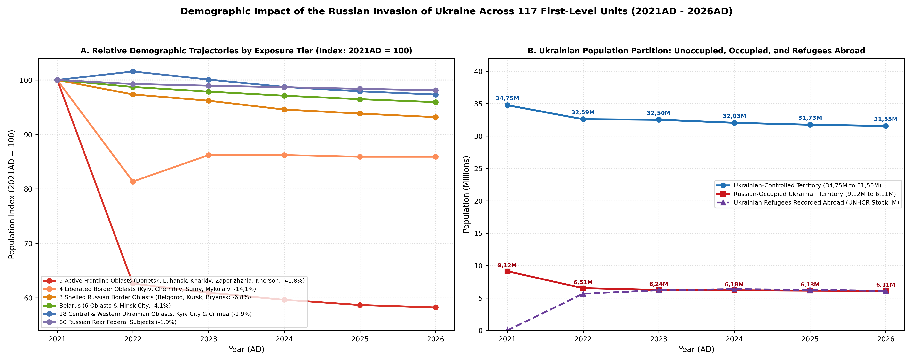
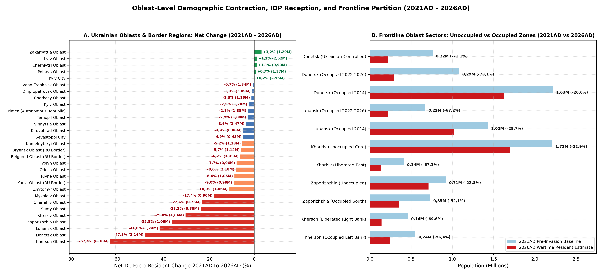
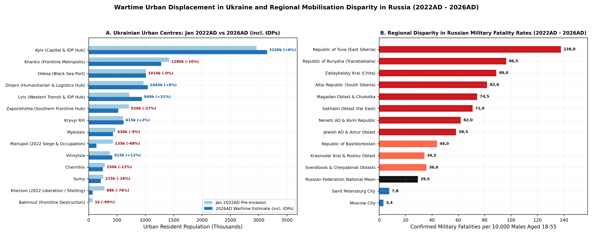

# Modern Oblast Architecture & Synthesis

Russia's full-scale invasion of Ukraine on 24 February 2022AD triggered the sharpest demographic, settlement, and migratory shock in Europe since the Second World War [@libanova2023ukraine; @libanova2024demographic; @unhcr2025ukraine; @iom2025returns]. Whereas earlier eras in this regional series reflect river-basin ecology or imperial provincial boundaries, wartime demography between 2021AD and 2026AD is governed strictly by modern first-level (`Admin-1`) jurisdictions: the 27 constitutional oblasts, autonomous republic, and special-status cities of Ukraine, the 7 administrative divisions of Belarus, and the 83 internationally recognised federal subjects of the Russian Federation. Across this entire 123-unit spatial domain (17 959 829 km2; Figure \ref{fig:hero}), the de facto resident population contracted by 9 520k (-4,8%), falling from 198,08M (198 080k) in 2021AD to 192,05M in 2022AD, 191,13M in 2023AD, 190,08M in 2024AD, 189,24M in 2025AD, and 188,56M (188 560k) in early 2026AD (Table \ref{tab:macro-summary}).

In Ukraine, the Law *On the Foundations of National Resistance* (Law No. 1702-IX, effective 1 January 2022AD) and Presidential Decree No. 68/2022 of 24 February 2022AD converted every regional state administration into an Oblast Military Administration (*Oblasna viiskova administratsiia*) paired with a dedicated Territorial Defence Brigade (the 100th to 128th and 241st Brigades) and regional recruitment centres [@ukraine2024strategy; @libanova2023ukraine]. Mandatory frontline evacuations, curfew regimes, fortifications, and *eVidnovlennia* housing-reconstruction grants are administered on an oblast-by-oblast basis. Likewise, both the Ministry of Social Policy's Unified IDP Database and the International Organization for Migration (IOM) Displacement Tracking Matrix (Rounds 1 to 18+) record Ukraine's 3,67M active internally displaced persons and 4,45M returnees by oblast of origin and current oblast of residence, while ACLED conflict events and the DeepState line of contact map directly onto Ukraine's modern oblasts and 2020AD raions [@iom2022gps; @iom2024displacement; @iom2025returns; @acled2025ukraine; @deepstate2025map]. Where shifting frontlines split an oblast's demographic trajectory between 2014AD and 2026AD, this synthesis subdivides Donetsk (government-controlled, post-2022 occupied, and pre-2022 occupied), Luhansk (post-2022 occupied and pre-2022 occupied), Kharkiv (unoccupied core, 2022 liberated, and Oskil-Vovchansk east), Zaporizhzhia (Ukrainian north and post-2022 occupied south), and Kherson (liberated right bank and post-2022 occupied left bank) into 11 distinct occupation-history zones, yielding 33 Ukrainian analytical divisions.

Inside the Russian Federation, mobilization and casualty patterns followed federal-subject boundaries just as closely. Presidential Decree No. 647 of 21 September 2022AD ("partial mobilisation" of over 300 000 reservists) assigned call-up quotas to each of the 83 federal subjects—comprising 46 oblasts, 21 republics, 9 krais, 4 autonomous okrugs, 1 autonomous oblast, and 2 federal cities—through regional military commissariats chaired by each governor [@bessudnov2022ethnic; @istories2024mobilisation]. From 2023AD to 2026AD, volunteer contract recruitment (*kontraktniki*) operated through intense fiscal competition in governor-set regional sign-up bonuses, which ranged from 400k - 800k roubles in poorer oblasts to 1,9M - 3,20M roubles in Moscow City, Khanty-Mansi AO, Belgorod Oblast, Tatarstan, Bashkortostan, Sverdlovsk, and Leningrad Oblast. Shelled western border oblasts (Belgorod, Kursk, and Bryansk) raised oblast-specific territorial defence units, while independent mortality monitors—most notably Mediazona, BBC News Russian, and Meduza/Kobak—track military fatalities strictly by federal subject [@mediazona2025casualties; @meduza2024probate; @kobak2023excess].

Table: De facto resident population trajectories across the fifteen strategic regional tiers and national subtotals from 2021AD to 2026AD (in thousands).

|Modern Oblast / Federal Subject Tier (Count)                      |2021AD  |2022AD  |2023AD  |2024AD  |2025AD  |2026AD  |Change |
|:-----------------------------------------------------------------|:-------|:-------|:-------|:-------|:-------|:-------|:------|
|UA Frontline Oblast Ukrainian-Held Cores (3)                      |3 890   |2 700   |2 785   |2 715   |2 660   |2 635   |-32,3% |
|UA 2022AD Occupied & Liberated Oblast Zones (2)                   |870     |370     |335     |300     |285     |275     |-68,4% |
|UA Newly Occupied 2022-2026AD Oblast Zones (4)                    |3 030   |1 270   |1 145   |1 120   |1 110   |1 100   |-63,7% |
|UA Pre-2022 Occupied Donbas & Crimea (4)                          |6 090   |5 240   |5 095   |5 065   |5 025   |5 010   |-17,7% |
|UA Feb-Apr 2022AD Defended Border Oblasts (4)                     |4 930   |4 010   |4 250   |4 250   |4 235   |4 235   |-14,1% |
|UA Central & Southern IDP Hub Oblasts & Kyiv (7)                  |13 420  |13 090  |13 280  |13 210  |13 140  |13 100  |-2,4%  |
|UA Western & Northern Rear Oblasts (9)                            |11 640  |12 420  |11 850  |11 560  |11 415  |11 305  |-2,9%  |
|Belarus Oblasts & Minsk City (7)                                  |9 350   |9 230   |9 150   |9 080   |9 020   |8 970   |-4,1%  |
|RU Shelled Western Border Oblasts (3)                             |3 810   |3 709   |3 665   |3 603   |3 575   |3 550   |-6,8%  |
|RU Southern Military District Rear Subjects (5)                   |15 777  |15 787  |15 757  |15 735  |15 724  |15 711  |-0,4%  |
|RU Federal Capitals & Metro Oblasts (4)                           |29 148  |29 001  |29 173  |29 288  |29 315  |29 342  |+0,7%  |
|RU Hydrocarbon High-Bonus Autonomous Okrugs (2)                   |2 260   |2 275   |2 273   |2 273   |2 274   |2 276   |+0,7%  |
|RU Defence-Industrial & Core Oblasts/Krais (39)                   |63 401  |62 650  |62 192  |61 797  |61 456  |61 130  |-3,6%  |
|RU High-Loss Garrison, Arctic & Pacific Subjects (11)             |7 111   |6 994   |6 934   |6 881   |6 833   |6 786   |-4,6%  |
|RU Disproportionate-Loss Ethnic Republics (19)                    |23 353  |23 304  |23 246  |23 203  |23 168  |23 135  |-0,9%  |
|Ukraine Subtotal (33 Oblast & Occupation Units across 27 Oblasts) |43 870  |39 100  |38 740  |38 220  |37 870  |37 660  |-14,2% |
|Belarus Subtotal (7 Admin-1 Units)                                |9 350   |9 230   |9 150   |9 080   |9 020   |8 970   |-4,1%  |
|Russian Federation Subtotal (83 Federal Subjects, 1991AD Borders) |144 860 |143 720 |143 240 |142 780 |142 345 |141 930 |-2,0%  |
|Total Domain (All 123 Oblast, Occupation & Subject Units)         |198 080 |192 050 |191 130 |190 080 |189 235 |188 560 |-4,8%  |

# Proxy, OSINT & Humanitarian Datasets

Because martial law in Ukraine suspended the planned 2023AD All-Ukrainian Census and wartime censorship in the Russian Federation restricted granular Rosstat demographic tables after mid-2022AD [@libanova2023ukraine; @raksha2023fertility; @meduza2024probate; @kobak2023excess], reconstructing oblast-level population and settlement trajectories from 2021AD to 2026AD requires triangulating seven empirical streams.

## Conflict Events, Frontline Vectors & Satellite Damage

Kinetic intensity and territorial control are anchored by pairing geo-located conflict monitors with orbital remote sensing. The Armed Conflict Location & Event Data Project (ACLED) provides 138 geo-referenced Ukrainian raion polygons aggregating 5 893 high-intensity baseline shelling and combat clusters and 16 301 baseline fatalities alongside more than 180 000 cumulative conflict events recorded through 2025AD - 2026AD [@acled2025ukraine; @attar2024linked]. Fifteen frontline raions across Donetsk, Luhansk, Kherson, Kharkiv, and Kyiv Oblasts account for the overwhelming share of urban kinetic destruction (Table \ref{tab:acled-raions} and Figure \ref{fig:displacement-cascade}B). In parallel, DeepState vector polygons delineate the active line of contact and Russian-occupied shares inside Luhansk Oblast (~98% occupied), Donetsk Oblast (~70% occupied), Zaporizhzhia Oblast (~73% occupied), Kherson Oblast (~72% occupied left bank), Kharkiv Oblast (~3% border strip), and AR Crimea and Sevastopol (100% occupied since 2014AD), hatched in crimson over modern oblast borders in Figure \ref{fig:hero} [@deepstate2025map; @winkler2024high]. At the settlement level, building damage classifications derived from Copernicus Sentinel-1 Synthetic Aperture Radar (SAR) interferometric coherence (Scher & Van Den Hoek), UNOSAT optical assessments, and World Bank Rapid Damage and Needs Assessments ($524B reconstruction need across over 2,5M damaged housing units) are cross-checked against NASA/NOAA VIIRS night-time radiance series tracking urban depopulation and energy-grid blackouts [@scher2023sar; @unosat2023mariupol; @worldbank2023rdna2; @worldbank2024rdna3; @worldbank2025rdna4; @minora2023ukraine; @aimi2023ukraine].

## Administrative Registries, Displacement Tracking & Mortality Models

For Kyiv-controlled territories, demographic estimates developed by the Ptoukha Institute for Demography and Social Studies (NASU—Ella Libanova, Oleksandr Gladun, Pavlo Shevchuk, and Nataliia Levchuk) triangulate active mobile-operator SIM cards (Kyivstar, Vodafone Ukraine, lifecell), eHealth medical declarations, oblast IDP subsistence allowances, school enrolments, and municipal water and bread consumption [@libanova2023ukraine; @libanova2024demographic; @gladun2023war; @gladun2024mortality; @shevchuk2023reconstruction; @ukraine2024strategy; @ukrstat2022chiselnist]. Cross-border refugee stocks (6,40M globally in 2026AD, including ~4,3M EU Temporary Protection beneficiaries) are anchored by UNHCR and Eurostat registers [@unhcr2025ukraine; @eurostat2025temporary; @mazzoli2023ukraine; @kim2023ukraine; @scherbov2024eastern], while oblast-level IDP (3,67M) and returnee (4,45M) stocks are drawn from IOM General Population Survey Rounds 1 to 18+ [@iom2022gps; @iom2024displacement; @iom2025returns; @unocha2024ukraine; @leasure2022ukraine; @boy2023ukraine; @gonzalez2022ukraine].

Combat and civilian mortality estimates integrate the Mediazona and BBC News Russian named-obituary database (over 105 000 individually verified Russian military dead by 2025AD - 2026AD, coded by federal subject) with Meduza and Dmitry Kobak's Federal Chamber of Notaries (RND) probate-registry excess mortality model (160 000 - 220 000+ total Russian military dead) [@meduza2024probate; @kobak2023excess; @mediazona2025casualties; @bessudnov2022ethnic; @istories2024mobilisation], alongside UALosses (over 70 000 named Ukrainian military dead), UN OHCHR civilian casualty monitors (12 600+ verified killed, excluding full Mariupol siege tolls of 22 000 - 25 000+), and satellite cemetery measurements [@ohchr2025casualties; @kovalenko2024ukraine; @stojkoski2023ukraine; @shevchenko2023mariupol; @ballinger2024battle; @dietrich2024ukraine; @dietrich2024mapping]. Finally, wartime human-capital outflows from Russia (650k - 1,05M at peak, with 580k - 680k net retained abroad in 2026AD) and Belarus (200k - 350k outflow) are quantified through receiving-state residence permits, tax identification numbers (IIN), and banking registries across Poland, Lithuania, Germany, Kazakhstan, Armenia, Georgia, Serbia, Turkey, Israel, and the UAE [@rerussia2024outflow; @kuznetsova2024russian; @wachs2022russian; @shcherbakova2024demographic; @dudin2023belarus].

Table: Top fifteen Ukrainian conflict raions by geo-located combat events, fatalities, satellite building damage, and urban population outcomes (2021AD - 2026AD).

|Raion (Parent Oblast)            |Oblast ISO |Events |Fatalities |SAR Damage |Primary Frontline Urban Centres & Outcome (2021AD -> 2026AD)                                          |
|:--------------------------------|:----------|:------|:----------|:----------|:-----------------------------------------------------------------------------------------------------|
|Bakhmutskyi (Donetsk Obl.)       |UA-14      |1 025  |829        |88-96%     |Bakhmut (71k -> 0,3k), Toretsk (31k -> 1,2k), Soledar (10k -> 0,1k), Chasiv Yar (12k -> 0,3k)         |
|Pokrovskyi (Donetsk Obl.)        |UA-14      |687    |608        |62-94%     |Avdiivka (31k -> 0,7k), Pokrovsk (60k -> 5,5k), Myrnohrad (46k -> 2,8k), Kurakhove (18k -> 0,9k)      |
|Syevyerodonetskyi (Luhansk Obl.) |UA-09      |661    |1 493      |72-92%     |Sievierodonetsk (101k -> 18k), Lysychansk (93k -> 18k), Rubizhne (55k -> 12k), Popasna (19k -> 0,25k) |
|Kramatorskyi (Donetsk Obl.)      |UA-14      |455    |215        |38-85%     |Kramatorsk (147k -> 75k), Sloviansk (105k -> 54k), Lyman (20k -> 5,4k), Kostiantynivka (67k -> 12k)   |
|Beryslavskyi (Kherson Obl.)      |UA-65      |383    |943        |54-75%     |Beryslav (12k -> 1,2k); severe Dnieper right-bank artillery and FPV drone attrition                   |
|Izyumskyi (Kharkiv Obl.)         |UA-63      |314    |297        |52-68%     |Izium (45k -> 23,5k), Balakliia (26k -> 19,8k); liberated in Sept 2022AD counteroffensive             |
|Khersonskyi (Kherson Obl.)       |UA-65      |262    |5 884      |41-64%     |Kherson City (279k -> 66k), Oleshky (24k -> 8k); June 2023AD Kakhovka dam flood and daily shelling    |
|Volnovaskyi (Donetsk Obl.)       |UA-14      |238    |322        |76-95%     |Volnovakha (21k -> 10,2k), Vuhledar (14k -> 0,1k); southern Donetsk rail and assault axis             |
|Kharkivskyi (Kharkiv Obl.)       |UA-63      |215    |285        |28-78%     |Kharkiv City (1 421k -> 1 200k, Saltivka damage and IDP rebound), Chuhuiv (31k -> 24,5k)              |
|Mariupolskyi (Donetsk Obl.)      |UA-14      |155    |323        |74-90%     |Mariupol (432k -> 195k incl. Russian garrison); Feb-May 2022AD siege (22k-25k+ civilian dead)         |
|Horlivskyi (Donetsk Obl.)        |UA-14      |135    |11         |35-55%     |Horlivka (240k -> 155k), Yenakiieve (77k -> 55k); coercive DNR conscription depletion                 |
|Buchanskyi (Kyiv Obl.)           |UA-32      |120    |191        |26-58%     |Bucha (37k -> 38k), Irpin (62k -> 65k); March 2022AD occupation and rapid post-liberation rebuild     |
|Kupyanskyi (Kharkiv Obl.)        |UA-63      |114    |132        |55-82%     |Kupiansk (27k -> 3,2k), Vovchansk (17k -> 0,15k, May 2024AD razing along northern border)             |
|Donetskyi (Donetsk Obl.)         |UA-14      |111    |627        |24-48%     |Donetsk City (902k -> 660k), Makiivka (339k -> 250k); frontline water crisis and conscription         |
|Svativskyi (Luhansk Obl.)        |UA-09      |85     |78         |42-65%     |Svatove (16k -> 7,4k), Kreminna corridor; northern Luhansk logistics and artillery line               |

# Ukraine: Modern Oblasts and Occupation Zones

Within its internationally recognised 1991AD borders, Ukraine's resident population fell by 6 210k (-14,2%) between 2021AD and 2026AD, contracting from 43,87M (43 870k) in early 2021AD to 39,10M in 2022AD, 38,74M in 2023AD, 38,22M in 2024AD, 37,87M in 2025AD, and 37,66M (37 660k) in early 2026AD. Of this 2026AD total, approximately 31,4M reside in Kyiv-controlled oblasts and 6,2M live across Russian-occupied Crimea, Luhansk, Donetsk, and southern Zaporizhzhia and Kherson Oblasts [@libanova2024demographic; @iom2025returns; @unhcr2025ukraine]. Table \ref{tab:ukraine-oblasts} and Figure \ref{fig:displacement-cascade} detail the demographic, territorial defence, and displacement trajectories across all 33 analytical divisions spanning Ukraine's 27 constitutional oblasts and special-status cities.

plot of chunk fig-displacement-cascade

## Frontline and Partially Occupied Oblasts

Ukraine's five frontline oblasts—Donetsk (`UA-14`), Luhansk (`UA-09`), Kharkiv (`UA-63`), Zaporizhzhia (`UA-23`), and Kherson (`UA-65`)—experienced catastrophic depopulation, declining collectively from 11 440k in 2021AD to 6 660k in 2026AD (-41,8%). In Donetsk Oblast (4 060k -> 2 140k, -47,3%; 109th Territorial Defence Brigade), the 2022AD siege of Mariupol (432k -> 195k, with 22k - 25k+ civilian dead) [@shevchenko2023mariupol; @ballinger2024battle; @unosat2023mariupol], the near-total destruction of Bakhmut (71k -> 0,3k), Avdiivka (31k -> 0,7k), Toretsk (31k -> 1,2k), Vuhledar (14k -> 0,1k), and Kurakhove (18k -> 0,9k), and mandatory evacuations from Pokrovsk (60k -> 5,5k) and Myrnohrad (46k -> 2,8k) halved the regional population, leaving Kramatorsk (147k -> 75k) and Sloviansk (105k -> 54k) as fortified administrative hubs [@acled2025ukraine; @deepstate2025map]. Neighbouring Luhansk Oblast (2 100k -> 1 240k, -41,0%; 111th Brigade) fell almost entirely under Russian occupation following the 2022AD assaults on Popasna (19k -> 0,25k), Sievierodonetsk (101k -> 18k), and Lysychansk (93k -> 18k).

Further north, Kharkiv Oblast (2 620k -> 1 840k, -29,8%; 113th and 127th Brigades) defended Kharkiv City (1 421k -> 1 200k, hosting over 200k intra-oblast IDPs) and liberated Izium (45k -> 23,5k) in September 2022AD, but renewed 2024AD - 2025AD border fighting forced the evacuation of Kupiansk (27k -> 3,2k) and razed Vovchansk (17,5k -> 0,15k) [@holoborodko2024kharkiv; @iom2025returns]. In the south, Zaporizhzhia Oblast (1 650k -> 1 060k, -35,8%; 110th Brigade) remained divided between Ukrainian-held Zaporizhzhia City (710k -> 530k, hosting ~210k IDPs) and Orikhiv (14k -> 1,15k) and Russian-occupied Melitopol (149k -> 110k), Berdiansk (106k -> 74k), and Enerhodar (52k -> 22k). Kherson Oblast (1 010k -> 380k, -62,4%; 124th Brigade) suffered the steepest proportional loss of any Ukrainian region after the November 2022AD liberation of right-bank Kherson City (279k -> 66k), relentless cross-river shelling of Beryslav (12k -> 1,2k), and the 6 June 2023AD Kakhovka dam breach across Oleshky (24k -> 8k) and Nova Kakhovka (45k -> 13k) [@petrenko2024kakhovka; @unep2023kakhovka].

## De-Occupied Border Oblasts, Central Hubs & Western Sanctuaries

Across the four northern and southern border oblasts de-occupied in early 2022AD—Mykolaiv (`UA-48`), Sumy (`UA-59`), Chernihiv (`UA-74`), and Kyiv Oblast (`UA-32`)—combined population declined by 14,1% from 4 930k to 4 235k. Rapid resistance by regular forces and Territorial Defence units between February and April 2022AD repelled Russian advances on Mykolaiv (1 090k -> 900k; 123rd Brigade), Chernihiv (975k -> 755k; 119th Brigade), Sumy (1 035k -> 795k; 117th Brigade), and Kyiv Oblast (1 830k -> 1 785k; 114th Brigade). Whereas Kyiv Oblast (~245k IDPs) nearly recovered its pre-war population through rapid reconstruction in Bucha (37k -> 38k) and Irpin (62k -> 65k), Sumy and Chernihiv Oblasts lost over a fifth of their residents as cross-border shelling forced mandatory evacuations along the 5 - 15 km Russian frontier strip from 2023AD to 2026AD [@iom2025returns; @acled2025ukraine].

By contrast, Ukraine's seven central and southern IDP reception hubs—Kyiv City (`UA-30`), Dnipropetrovsk (`UA-12`), Odesa (`UA-51`), Poltava (`UA-53`), Cherkasy (`UA-71`), Kirovohrad (`UA-35`), and Vinnytsia (`UA-05`)—absorbed more than 1,6M displaced citizens, limiting their combined net contraction to just 2,4% (13 420k -> 13 100k). Anchored by Kyiv City (2 960k -> 2 965k; 112th and 241st Brigades, ~375k IDPs) and Dnipropetrovsk Oblast (3 120k -> 3 090k; 108th and 128th Brigades, Ukraine's largest IDP reception region with ~455k IDPs in Dnipro 968k -> 980k and Kryvyi Rih 603k -> 585k offsetting artillery evacuations from Nikopol 105k -> 54k), IDP inflows kept population near pre-war parity in Poltava (1 360k -> 1 370k, +0,7%; ~185k IDPs), Cherkasy (1 170k -> 1 155k, -1,3%), Vinnytsia (1 520k -> 1 465k, -3,6%), Kirovohrad (920k -> 875k, -4,9%), and Odesa Oblast (2 370k -> 2 180k, -8,0%) [@iom2025returns; @worldbank2025rdna4].

In the nine western and northern rear oblasts (11 640k -> 11 305k, -2,9%), enterprise relocation and IDP settlement drove net wartime population growth in Zakarpattia (`UA-21`, 1 250k -> 1 290k, +3,2%; 101st Brigade), Lviv (`UA-46`, 2 490k -> 2 520k, +1,2%; 103rd and 125th Brigades, ~260k IDPs), and Chernivtsi (`UA-77`, 890k -> 900k, +1,1%; 107th Brigade). Meanwhile, northern forest-belt oblasts—Volyn (`UA-07`, -7,7%), Rivne (`UA-56`, -8,6%), and Zhytomyr (`UA-18`, -10,9%)— alongside Ivano-Frankivsk (`UA-26`), Ternopil (`UA-61`), and Khmelnytskyi (`UA-68`), saw moderate contractions due to EU refugee departures and northern border fortification duty [@iom2025returns; @unhcr2025ukraine]. In Russian-occupied Crimea (`UA-43` and `UA-40`, 2 440k -> 2 360k, -3,3%), both the Autonomous Republic (1 930k -> 1 875k) and Sevastopol City (510k -> 485k) contracted under strikes on the Black Sea Fleet and Crimean Tatar draft flight.

Table: De facto resident population trajectories across all thirty-three Ukrainian oblast and occupation-history divisions from 2021AD to 2026AD (in thousands).

|Ukrainian Oblast & Occupation Zone (ISO)                           |2021AD |2022AD |2023AD |2024AD |2025AD |2026AD |Change |Territorial Defence, Administration & Displacement Profile                                                     |
|:------------------------------------------------------------------|:------|:------|:------|:------|:------|:------|:------|:--------------------------------------------------------------------------------------------------------------|
|Donetsk Oblast - Ukrainian-Controlled GCA (UA-14-UKR)              |760    |330    |290    |260    |235    |220    |-71,1% |109th TrO / Donetsk OVA; Kramatorsk-Sloviansk fortified hub & Pokrovsk-Myrnohrad evacuations                   |
|Donetsk Oblast - Occupied 2022-2026AD (UA-14-OCC22)                |1 080  |310    |280    |285    |290    |290    |-73,1% |2022AD Mariupol siege (22k-25k+ dead), razed Bakhmut, Avdiivka, Vuhledar & Kurakhove                           |
|Donetsk Oblast - Pre-2022 Occupied ORDLO (UA-14-ORDLO)             |2 220  |1 730  |1 670  |1 655  |1 635  |1 630  |-26,6% |Occupied since 2014AD (Donetsk, Makiivka, Horlivka); Feb 2022AD total male conscription & water crisis         |
|Luhansk Oblast - Occupied 2022-2026AD (UA-09-OCC22)                |670    |240    |225    |220    |220    |220    |-67,2% |111th TrO evacuated; 2022AD destruction of Sievierodonetsk, Lysychansk, Rubizhne & Popasna                     |
|Luhansk Oblast - Pre-2022 Occupied ORDLO (UA-09-ORDLO)             |1 430  |1 090  |1 035  |1 030  |1 020  |1 020  |-28,7% |Occupied since 2014AD (Luhansk, Alchevsk, Kadiivka); coercive 2022AD LNR male mobilisation                     |
|Kharkiv Oblast - Unoccupied Core & South (UA-63-UKR)               |2 210  |1 600  |1 745  |1 730  |1 710  |1 705  |-22,9% |113th & 127th TrO / Kharkiv OVA; Kharkiv City (~420k Oblast IDPs), Chuhuiv & Lozova rail hub                   |
|Kharkiv Oblast - 2022AD Liberated East & Oskil Front (UA-63-DEOCC) |410    |180    |175    |150    |140    |135    |-67,1% |Occupied Feb-Sept 2022AD (Izium, Balakliia, Kupiansk); 2024-2026AD Vovchansk & Oskil evacuations               |
|Zaporizhzhia Oblast - Ukrainian-Controlled North (UA-23-UKR)       |920    |770    |750    |725    |715    |710    |-22,8% |110th TrO / Zaporizhzhia OVA; Zaporizhzhia City (~210k IDPs) & Orikhiv-Huliaipole defensive line               |
|Zaporizhzhia Oblast - Occupied South 2022-2026AD (UA-23-OCC22)     |730    |410    |380    |365    |355    |350    |-52,1% |Occupied since Mar 2022AD (Melitopol, Berdiansk, Enerhodar ZNPP, Tokmak); mass IDP exodus north                |
|Kherson Oblast - Liberated Right Bank (Nov 2022AD) (UA-65-LIB22)   |460    |190    |160    |150    |145    |140    |-69,6% |124th TrO; Occupied Mar-Nov 2022AD, liberated Nov 2022AD; Kherson City & Beryslav Dnieper shelling             |
|Kherson Oblast - Occupied Left Bank 2022-2026AD (UA-65-OCC22)      |550    |310    |260    |250    |245    |240    |-56,4% |Occupied since Feb 2022AD (Nova Kakhovka, Oleshky, Skadovsk, Henichesk); June 2023AD Kakhovka flood            |
|Mykolaiv Oblast (UA-48)                                            |1 090  |790    |860    |880    |890    |900    |-17,4% |123rd TrO / Mykolaiv OVA; 2022 coastal defence, potable water crisis & ~125k returnees/IDPs                    |
|Sumy Oblast (UA-59)                                                |1 035  |840    |860    |830    |805    |795    |-23,2% |117th TrO / Sumy OVA; April 2022 liberation & 2023-2026 10 km border shelling evacuations                      |
|Chernihiv Oblast (UA-74)                                           |975    |780    |800    |780    |765    |755    |-22,6% |119th TrO / Chernihiv OVA; Feb-April 2022 siege & northern border FPV/artillery depopulation                   |
|Kyiv Oblast (UA-32)                                                |1 830  |1 600  |1 730  |1 760  |1 775  |1 785  |-2,5%  |114th TrO / Kyiv OVA; Bucha-Irpin-Hostomel liberation, rapid rebuild & ~245k registered IDPs                   |
|Kyiv City (UA-30)                                                  |2 960  |2 550  |2 850  |2 920  |2 945  |2 965  |+0,2%  |112th & 241st TrO / KMVA; air-defended capital rebound & ~375k registered IDPs                                 |
|Dnipropetrovsk Oblast (UA-12)                                      |3 120  |3 150  |3 180  |3 140  |3 110  |3 090  |-1,0%  |108th & 128th TrO / Dnipropetrovsk OVA; No. 1 IDP oblast (~455k IDPs), medical/logistics hub & shelled Nikopol |
|Odesa Oblast (UA-51)                                               |2 370  |2 150  |2 180  |2 180  |2 180  |2 180  |-8,0%  |122nd & 126th TrO / Odesa OVA; ~215k IDPs, Black Sea & Izmail Danube maritime grain corridor                   |
|Poltava Oblast (UA-53)                                             |1 360  |1 480  |1 430  |1 400  |1 380  |1 370  |+0,7%  |116th TrO / Poltava OVA; ~185k IDPs from Kharkiv and Donbas (No. 1 per-capita central IDP hub)                 |
|Cherkasy Oblast (UA-71)                                            |1 170  |1 230  |1 200  |1 180  |1 165  |1 155  |-1,3%  |118th TrO / Cherkasy OVA; ~135k IDPs in Cherkasy and Uman central Dnieper corridor                             |
|Kirovohrad Oblast (UA-35)                                          |920    |950    |920    |900    |885    |875    |-4,9%  |121st TrO / Kirovohrad OVA; ~85k IDPs in Kropyvnytskyi and Oleksandriia                                        |
|Vinnytsia Oblast (UA-05)                                           |1 520  |1 580  |1 520  |1 490  |1 475  |1 465  |-3,6%  |120th TrO / Vinnytsia OVA; ~165k IDPs, enterprise relocation & Air Force HQ rear                               |
|Zhytomyr Oblast (UA-18)                                            |1 190  |1 110  |1 100  |1 080  |1 070  |1 060  |-10,9% |115th TrO / Zhytomyr OVA; northern Belarusian border fortifications & ~60k IDPs                                |
|Khmelnytskyi Oblast (UA-68)                                        |1 240  |1 290  |1 230  |1 200  |1 185  |1 175  |-5,2%  |106th TrO / Khmelnytskyi OVA; ~125k IDPs, nuclear power hub & logistics corridor                               |
|Rivne Oblast (UA-56)                                               |1 160  |1 130  |1 100  |1 080  |1 070  |1 060  |-8,6%  |104th TrO / Rivne OVA; northern border defence, Rivne NPP & ~52k IDPs                                          |
|Volyn Oblast (UA-07)                                               |1 040  |1 050  |1 000  |980    |970    |960    |-7,7%  |100th TrO (Mech.) Bde / Volyn OVA; Polish Yahodyn transit & Belarusian border shield                           |
|Lviv Oblast (UA-46)                                                |2 490  |2 820  |2 650  |2 580  |2 545  |2 520  |+1,2%  |103rd & 125th TrO / Lviv OVA; ~260k IDPs, primary EU humanitarian/rail hub & IT relocation                     |
|Ivano-Frankivsk Oblast (UA-26)                                     |1 350  |1 490  |1 410  |1 370  |1 355  |1 340  |-0,7%  |102nd TrO / Ivano-Frankivsk OVA; ~120k IDPs & relocated industrial enterprises                                 |
|Ternopil Oblast (UA-61)                                            |1 030  |1 110  |1 060  |1 030  |1 010  |1 000  |-2,9%  |105th TrO / Ternopil OVA; ~68k IDPs vs cross-border labour/refugee outflow                                     |
|Zakarpattia Oblast (UA-21)                                         |1 250  |1 420  |1 350  |1 315  |1 300  |1 290  |+3,2%  |101st TrO / Zakarpattia OVA; +3,2% net growth, ~145k IDPs & Carpathian factory relocations                     |
|Chernivtsi Oblast (UA-77)                                          |890    |1 000  |950    |925    |910    |900    |+1,1%  |107th TrO / Chernivtsi OVA; +1,1% net growth, ~80k IDPs & Romanian Siret transit                               |
|Autonomous Republic of Crimea (UA-43)                              |1 930  |1 915  |1 895  |1 890  |1 885  |1 875  |-2,8%  |Occupied since 2014AD; Crimean Tatar mobilisation flight & North Crimean Canal loss                            |
|Sevastopol City (UA-40)                                            |510    |505    |495    |490    |485    |485    |-4,9%  |Occupied Black Sea Fleet HQ; missile/USV strikes & partial fleet relocation to Novorossiysk                    |
|Ukraine Total (All 33 Oblast & Occupation Units / 27 Oblasts)      |43 870 |39 100 |38 740 |38 220 |37 870 |37 660 |-14,2% |UNHCR 6,4M refugees abroad; IOM 3,67M IDPs & 4,45M returnees                                                   |

Table: Wartime external refugee, internal displacement, returnee, border evacuation, and emigration stocks across Ukraine, Russia, and Belarus (2022AD - 2026AD).

|Displacement / Demographic Category              |Peak 2022-2023AD |Early 2026AD Stock |Primary Empirical Source & Oblast Geographic Distribution                                                                                      |
|:------------------------------------------------|:----------------|:------------------|:----------------------------------------------------------------------------------------------------------------------------------------------|
|Ukrainian Refugees Abroad (Total Global)         |6 800k           |6 400k             |UNHCR Operational Data Portal (~4,3M EU TPD: Germany 1,20M, Poland 0,98M, Czechia 0,38M; UK/US/Canada 0,9M; Russia/Belarus 1,2M)               |
|Internally Displaced Persons (IDPs by Oblast)    |5 900k           |3 670k             |IOM DTM Oblast Registers (Dnipropetrovsk 455k, Kharkiv 420k, Kyiv City 375k, Lviv 260k, Kyiv Obl. 245k, Odesa 215k, Poltava 185k)              |
|Returned Displaced Ukrainians (IDP + Foreign)    |4 100k           |4 450k             |IOM Returns Report (~78% from internal displacement, ~22% from abroad; concentrated in Kyiv City/Obl. 1,1M, Kharkiv 680k, Mykolaiv, Chernihiv) |
|Russian Border Oblast Evacuees (RU-BEL / RU-KRS) |65k              |145k               |Belgorod Oblast (Shebekino, Graivoron 2023-2025AD) and Kursk Oblast (Aug 2024AD Sudzha incursion: 130k-150k civilians evacuated)               |
|Russian Wartime Emigration (Brain Drain)         |820k - 1 050k    |580k - 680k        |Receiving-state registries: EU (240k), Israel (135k), Kazakhstan (130k), Turkey (102k), Serbia (92k), Armenia (85k), UAE (70k), Georgia (68k)  |
|Belarusian Political & Wartime Outflow (7 Units) |310k             |290k               |Eurostat Polish (165k) and Lithuanian (62k) residence permits and IT sector relocation from Minsk, Brest, and Grodno Oblasts                   |

# Belarus & Shelled Russian Border Oblasts

Disaggregating Belarus into its seven modern `Admin-1` divisions (six oblasts plus Minsk City; Table \ref{tab:belarus-oblasts}) and isolating Russia's three shelled western border oblasts (`RU-BEL`, `RU-KRS`, and `RU-BRY`) captures sharp frontier asymmetries obscured by national totals.

In February 2022AD, Russian forces launched the northern Kyiv and Chernihiv offensive from staging bases in Gomel Oblast (1 330k -> 1 250k, -6,0%; Gomel, Mozyr, and Zyabrovka) and airfields in Brest Oblast (1 340k -> 1 285k, -4,1%; Luninets and Baranovichi) [@deepstate2025map]. Between 2021AD and 2026AD, Belarus's total population declined by 380k (-4,1%, from 9 350k to 8 970k), driven by deep natural decrease (-55k to -65k annually at a total fertility rate of 1,16) in Vitebsk (-6,2%) and Mogilev (-6,2%) Oblasts and the emigration of 200k - 350k IT specialists, physicians, and skilled workers from Minsk City (2 010k -> 1 980k) and Grodno Oblast (1 020k -> 965k, -5,4%) to Poland and Lithuania [@belstat2024chislennost; @dudin2023belarus; @eurostat2025temporary].

Along Russia's western frontier with Ukraine, Belgorod, Kursk, and Bryansk Oblasts contracted collectively by 6,8% (3 810k -> 3 550k). From 2023AD to 2025AD, artillery and drone bombardment along the Kharkiv-Belgorod border forced civilian evacuations from Shebekino (39,6k -> 24,0k) and Graivoron, reducing Belgorod Oblast from 1 540k to 1 445k (-6,2%) even as regional authorities raised local territorial defence battalions and hiked one-time contract bonuses to 3,0M roubles [@acled2025ukraine; @istories2024mobilisation]. In August 2024AD, Ukraine's cross-border incursion into Kursk Oblast (1 082k -> 985k, -9,0%) captured Sudzha (5,1k -> 0,6k) and displaced 130 000 - 150 000 residents toward Kursk City (440k -> 425k), Zheleznogorsk, and Oryol, while Bryansk Oblast (1 188k -> 1 120k, -5,7%) contracted under border shelling and natural decrease [@deepstate2025map; @rosstat2024demografiya].

Table: Resident population trajectories across all seven Belarusian oblasts and Minsk City from 2021AD to 2026AD (in thousands).

|Belarusian Oblast / Capital (ISO)                  |2021AD |2022AD |2023AD |2024AD |2025AD |2026AD |Change |Wartime Staging, Sanctions & Migration Profile                                                                        |
|:--------------------------------------------------|:------|:------|:------|:------|:------|:------|:------|:---------------------------------------------------------------------------------------------------------------------|
|Minsk City (BY-HM)                                 |2 010  |1 995  |1 990  |1 988  |1 984  |1 980  |-1,5%  |Capital metropolis; IT/medical brain drain (EPAM, Wargaming exit to Poland/Lithuania) offset by internal rural inflow |
|Minsk Oblast (BY-MI)                               |1 470  |1 460  |1 455  |1 452  |1 448  |1 445  |-1,7%  |Suburban capital ring & Salihorsk potash sanctions shock                                                              |
|Brest Oblast (BY-BR)                               |1 340  |1 325  |1 312  |1 302  |1 293  |1 285  |-4,1%  |Polish/Volyn border oblast; Luninets & Baranovichi airbase staging & cross-border emigration                          |
|Grodno Oblast (BY-HR)                              |1 020  |1 005  |993    |983    |974    |965    |-5,4%  |Polish-Lithuanian borderland; heavy working-age emigration via Karta Polaka & EU permits                              |
|Vitebsk Oblast (BY-VI)                             |1 210  |1 185  |1 170  |1 155  |1 141  |1 135  |-6,2%  |Northern industrial oblast; severe natural decrease (TFR ~1,14) & out-migration                                       |
|Gomel Oblast (BY-HO)                               |1 330  |1 308  |1 290  |1 273  |1 262  |1 250  |-6,0%  |Primary Feb 2022 Kyiv/Chernihiv invasion staging zone (Gomel, Mozyr, Zyabrovka)                                       |
|Mogilev Oblast (BY-MA)                             |970    |952    |940    |927    |918    |910    |-6,2%  |Eastern oblast (Mogilev, Bobruisk); military training grounds & demographic ageing                                    |
|Belarus Total (All 7 Constitutional Admin-1 Units) |9 350  |9 230  |9 150  |9 080  |9 020  |8 970  |-4,1%  |Natural decrease (-59k/yr) & ~290k net working-age outflow to Poland/Lithuania                                        |

# Russian Federal Subjects: Mobilisation & Mortality

Across all 83 internationally recognised federal subjects of the Russian Federation (within 1991AD borders, excluding occupied Ukrainian territories), the resident population declined by 2 930k (-2,0%), from 144 860k in 2021AD to 141 930k in 2026AD (Tables \ref{tab:ethnic-casualties} and \ref{tab:russia-subjects}; Figure \ref{fig:ethnic-casualties}). Because mobilisation quotas, governor sign-up bonuses, defence-industrial exemptions, and permanent garrison deployments operate along regional boundaries, wartime demographic trajectories diverged sharply across five federal-subject groups.

plot of chunk fig-ethnic-casualties

## Metropolitan Capitals vs High-Mortality Ethnic Republics

To insulate metropolitan populations from political backlash, federal authorities kept compulsory mobilisation minimal in Moscow City (`RU-MOS`, 3,2 confirmed deaths per 10 000 working-age males; 13 010k -> 12 880k in 2022AD before rebounding to 13 120k in 2026AD) and Saint Petersburg (`RU-SPE`, 6,8 per 10 000; 5 602k -> 5 565k), alongside surrounding Moscow Oblast (`RU-MOW`) and Leningrad Oblast (`RU-LEN`). Both capitals relied on 1,9M - 2,5M+ rouble contract bonuses to meet recruitment targets while generating over 65% of Russia's 650k - 1,05M skilled wartime emigrants [@bessudnov2022ethnic; @rerussia2024outflow; @kuznetsova2024russian].

At the opposite extreme, econometric analysis of Mediazona and BBC obituaries alongside Meduza and Kobak probate excess male mortality reveals severe ethnic and rural socioeconomic stratification across Russia's 19 disproportionate-loss ethnic republics [@bessudnov2022ethnic; @meduza2024probate; @kobak2023excess; @mediazona2025casualties]. Per-capita confirmed mortality peaked in Tuva (`RU-TY`, 122,0 per 10 000 males, or 38,1x Moscow's rate; 55th Mountain Brigade in Kyzyl), Buryatia (`RU-BU`, 96,0 per 10 000, 30,0x Moscow; 36th Combined Arms Army in Ulan-Ude and Kyakhta), and the Altai Republic (`RU-AL`, 82,0 per 10 000, 25,6x Moscow). In the Volga-Ural and Caucasus belt, Bashkortostan (`RU-BA`, 4 091k -> 4 015k) suffered the highest absolute military death toll of any Russian federal subject (over 4 850 named dead and 8 700 - 10 500+ total estimated dead; 44,5 per 10 000), accompanied by heavy losses in North Ossetia-Alania (`RU-SE`, 56,0 per 10 000), Kalmykia (`RU-KL`, 46,0), Mari El (`RU-ME`, 43,8), Chuvashia (`RU-CU`, 42,5), Udmurtia (`RU-UD`, 36,2), Sakha/Yakutia (`RU-SA`, 35,0), Dagestan (`RU-DA`, 29,5, where above-replacement fertility of ~1,95 still sustained net growth from 3 180k to 3 295k), and Tatarstan (`RU-TA`, 26,5, where 2,0M+ rouble bonuses and *Alga*/*Timer* battalion losses coincided with Kazan aviation and Alabuga drone manufacturing expansion) [@mediazona2025casualties; @istories2024mobilisation].

## Garrison Regions, Hydrocarbon Okrugs & the Defence-Industrial Core

Eleven northern, airborne, and Pacific garrison subjects experienced severe combat attrition compounded by structural Far Eastern and Arctic out-migration. Permanent brigade home stations in Zabaykalsky Krai (`RU-ZAB`, 74,0 deaths per 10 000; 29th CAA in Chita and Borzya), Sakhalin Oblast (`RU-SAK`, 62,5; 39th Brigade), Chukotka AO (`RU-CHU`, 58,0), Magadan Oblast (`RU-MAG`, 54,0), Pskov Oblast (`RU-PSK`, 49,5; 76th VDV Air Assault Division), Kamchatka Krai (`RU-KAM`, 48,5; 40th Naval Infantry), Murmansk Oblast (`RU-MUR`, 46,2; 200th Arctic Brigade), and Primorsky Krai (`RU-PRI`, 41,5; Vladivostok 155th Naval Infantry and Ussuriysk 5th CAA) suffered some of the highest non-republic casualty rates in the federation [@mediazona2025casualties; @rosstat2024demografiya].

Conversely, the two hydrocarbon autonomous okrugs—Khanty-Mansi (`RU-KHM`) and Yamalo-Nenets (`RU-YAN`)—offered record 2,75M - 3,20M rouble regional sign-up bonuses in 2024AD - 2025AD to fulfil federal quotas via out-of-region recruits while shielding Surgut, Nizhnevartovsk, and Novy Urengoy oil-and-gas shift crews, enabling slight net demographic growth (2 255k -> 2 290k, +1,6%) [@istories2024mobilisation]. Across Russia's 44 defence-industrial and southern rear oblasts and krais, round-the-clock three-shift munitions, tank, and aircraft production in Sverdlovsk (`RU-SVE`, Nizhny Tagil Uralvagonzavod), Chelyabinsk (`RU-CHE`), Perm (`RU-PER`), Tula (`RU-TUL`), Nizhny Novgorod (`RU-NIZ`), Samara (`RU-SAM`), Novosibirsk (`RU-NVS`), Omsk (`RU-OMS`), Krasnoyarsk (`RU-KYA`), Irkutsk (`RU-IRK`), and Khabarovsk (`RU-KHA`) stabilised core industrial cities even as rural districts and penal/contract cohorts absorbed heavy casualties (30 - 43 confirmed dead per 10 000 males), while Southern Military District rear hubs in Krasnodar Krai (`RU-KDA`, 5 838k -> 5 935k) and Rostov Oblast (`RU-ROS`, 4 201k -> 4 145k) anchored military logistics [@rosstat2024demografiya; @mediazona2025casualties].

Table: Confirmed named obituaries and probate-estimated total military fatalities across seventeen representative Russian federal subjects (2022AD - 2026AD).

|Russian Federal Subject (ISO)  |Named Dead |Est. Total Dead |Deaths / 10k |vs Moscow |Federal-Subject Socioeconomic & Garrison Driver                                    |
|:------------------------------|:----------|:---------------|:------------|:---------|:----------------------------------------------------------------------------------|
|Tuva Republic (RU-TY)          |1 450      |2 600 - 3 200   |122,0        |38,1x     |Acute rural poverty; Kyzyl 55th Mountain Brigade & high contract enlistment        |
|Buryatia Republic (RU-BU)      |3 120      |5 600 - 6 800   |96,0         |30,0x     |Ulan-Ude & Kyakhta 36th CAA / 11th VDV attrition & cross-border flight to Mongolia |
|Altai Republic (RU-AL)         |920        |1 650 - 2 000   |82,0         |25,6x     |Rural South Siberian indigenous republic; household debt & contract bonuses        |
|Zabaykalsky Krai (RU-ZAB)      |2 640      |4 800 - 5 800   |74,0         |23,1x     |Chita & Borzya 29th CAA (36th Bde) & depressed mono-industrial mining towns        |
|Sakhalin Oblast (RU-SAK)       |1 080      |1 900 - 2 400   |62,5         |19,5x     |Yuzhno-Sakhalinsk 39th Motor Rifle Brigade & Kuril garrison deployments            |
|North Ossetia-Alania (RU-SE)   |1 180      |2 100 - 2 600   |56,0         |17,5x     |Vladikavkaz 19th Motor Rifle Division & North Caucasus volunteer battalions        |
|Pskov Oblast (RU-PSK)          |1 190      |2 100 - 2 600   |49,5         |15,5x     |Pskov 76th Guards Air Assault Division (VDV) & 2nd Spetsnaz Brigade losses         |
|Murmansk Oblast (RU-MUR)       |960        |1 700 - 2 100   |46,2         |14,4x     |Pechenga 200th Arctic Brigade & Northern Fleet 61st Naval Infantry losses          |
|Bashkortostan Republic (RU-BA) |4 850      |8 700 - 10 500  |44,5         |13,9x     |No. 1 in absolute Russian war dead; heavy rural Bashkir/Tatar recruitment          |
|Chuvashia Republic (RU-CU)     |1 540      |2 800 - 3 400   |42,5         |13,3x     |Atal volunteer battalion & rural Volga Chuvash mobilisation                        |
|Primorsky Krai (RU-PRI)        |2 280      |4 100 - 5 000   |41,5         |13,0x     |Vladivostok 155th Naval Infantry Brigade (Vuhledar/Kursk) & Ussuriysk 5th CAA      |
|Perm Krai (RU-PER)             |2 910      |5 200 - 6 300   |39,0         |12,2x     |Depressed Ural forestry/mining districts alongside penal & contract recruitment    |
|Sverdlovsk Oblast (RU-SVE)     |4 120      |7 400 - 9 000   |33,5         |10,5x     |Nizhny Tagil Uralvagonzavod defence exemptions vs heavy penal/contract losses      |
|Dagestan Republic (RU-DA)      |1 850      |3 400 - 4 200   |29,5         |9,2x      |Kaspiysk 177th Naval Infantry & 2022AD contract losses; offset by high TFR         |
|Tatarstan Republic (RU-TA)     |3 450      |6 200 - 7 500   |26,5         |8,3x      |2,0M+ RUB bonus & Alga/Timer battalions vs Kazan/Alabuga defence exemptions        |
|Saint Petersburg City (RU-SPE) |1 120      |2 000 - 2 500   |6,8          |2,1x      |Metropolitan political protection; >150k IT and academic emigration                |
|Moscow City (RU-MOS)           |890        |1 600 - 2 000   |3,2          |1,0x      |Lowest per-capita mortality in Russia; 1,9M+ RUB bonus & ~400k brain drain         |

# Fertility, Mortality & Economic Shocks

Beyond territorial displacement, the 2021AD - 2026AD war permanently reshaped vital rates, age-sex pyramids, disability prevalence, and labour markets across all 123 administrative and occupation-history divisions (Figure \ref{fig:vital-shock} and Table \ref{tab:vital-rates}).

In Ukraine, total fertility collapsed from 1,16 (273,8k live births) in 2021AD to 0,92 (206,0k) in 2022AD and ~0,77 - 0,82 across 2023AD - 2026AD (187,4k births in 2023AD, 176,7k in 2024AD, and ~170,0k per year in 2025AD - 2026AD), driven by the wartime separation of roughly 1,0M mobilised men from 2,8M reproductive-age women displaced abroad [@libanova2024demographic; @gladun2024mortality; @levchuk2023fertility; @eurostat2025temporary]. With annual deaths (~515k) running at three times annual births, Ukraine's natural population balance fell to -345,0k per year alongside 50 000 - 70 000+ war amputees and more than 300 000 conflict-disabled citizens [@worldbank2025rdna4; @ohchr2025casualties].

In the Russian Federation, following roughly 1,05M excess COVID-19 deaths across 2020AD - 2022AD [@kobak2021regional], annual live births dropped from 1 398,3k (TFR 1,50) in 2021AD to 1 215,0k (TFR 1,39) in 2025AD - 2026AD—the smallest birth cohort since 1999AD [@rosstat2024demografiya; @raksha2023fertility; @zakharov2023fertility; @shcherbakova2024demographic]. Combined with 160k - 220k+ military dead, 320k - 450k severely wounded (+290k working-age male disability pensioners in Social Fund registers), and over 580k net emigrants, Russia lost 1,8M - 2,2M civilian male workers, pushing official unemployment down to 2,3% - 2,6% amid acute industrial wage inflation [@meduza2024probate; @rerussia2024outflow].

plot of chunk fig-vital-shock

Table: Wartime vital rates, natural population decrease, male life expectancy, and conflict casualty and disability shocks across Ukraine, Belarus, and Russia.

|Vital & Socio-Demographic Indicator                     |Ukraine (27 Units)                |Belarus (7 Units)              |Russian Federation (83 Units)                |
|:-------------------------------------------------------|:---------------------------------|:------------------------------|:--------------------------------------------|
|Live Births (2021AD -> 2025/2026AD, per yr)             |273,8k -> 170,0k (-37,9%)         |82,0k -> 59,0k (-28,0%)        |1 398,3k -> 1 215,0k (-13,1%)                |
|Total Deaths (2021AD -> 2025/2026AD, per yr)            |714,3k -> 515,0k (war excess)     |145,0k -> 118,0k               |2 441,6k (COVID) -> 1 820,0k (war excess)    |
|Annual Natural Balance (2025/2026AD, per yr)            |-345,0k (Deaths/Births 3,0 : 1)   |-59,0k (Deaths/Births 2,0 : 1) |-605,0k (Deaths/Births 1,5 : 1)              |
|Total Fertility Rate (TFR, 2021AD -> 2026AD)            |1,16 -> 0,77                      |1,29 -> 1,16                   |1,50 -> 1,39                                 |
|Male Life Expectancy at Birth (e0, 2025AD)              |57,5 - 60,5 yrs (combat shock)    |68,8 yrs                       |64,2 - 66,5 yrs (Tuva/Buryatia < 58 yrs)     |
|Confirmed / Estimated Military Fatalities (2022-2026AD) |70k - 110k+ (>70k UALosses named) |< 0,2k (volunteers)            |160k - 220k+ (>105k named obituaries)        |
|Conflict-Disabled & Severely Wounded (2022-2026AD)      |300k - 380k (50k - 70k amputees)  |-                              |320k - 450k (+290k male disability pensions) |

# Complete 83-Subject Russian Directory & Urban Gazetteer

Table \ref{tab:russia-subjects} reports the complete resident population trajectory and per-capita confirmed military mortality rate across all 83 internationally recognised oblasts, krais, republics, autonomous okrugs, autonomous oblast, and federal cities of the Russian Federation from 2021AD to 2026AD. In parallel, the companion settlement gazetteer tracks 245 individual cities, frontline towns, regional administrative and defence centres, military garrisons, hydrocarbon boomtowns, and defence-industrial hubs, providing georeferenced municipal coverage across every one of the 123 analytical divisions—from razed frontline towns (Bakhmut 71k -> 0,3k, Avdiivka 31k -> 0,7k, Vovchansk 17,5k -> 0,15k, and Sudzha 5,1k -> 0,6k) to IDP-expanded sanctuary hubs (Lviv 717k -> 805k, Dnipro 968k -> 980k, and Uzhhorod 115k -> 136k) and Russian garrison and industrial centres (Moscow, Ufa, Kazan, Pskov, Kostroma, Nizhny Tagil, Surgut, Kyzyl, Ulan-Ude, Chita, and Vladivostok).

Table: Resident population trajectories (2021AD - 2026AD, in thousands) and confirmed military deaths per 10 000 men across all eighty-three Russian federal subjects.

|Russian Federal Subject (ISO 3166-2)               |2021AD  |2022AD  |2023AD  |2024AD  |2025AD  |2026AD  |Change |Named / 10k |
|:--------------------------------------------------|:-------|:-------|:-------|:-------|:-------|:-------|:------|:-----------|
|Belgorod Oblast (RU-BEL)                           |1 540   |1 503   |1 487   |1 473   |1 458   |1 445   |-6,2%  |24,5/10k    |
|Kursk Oblast (RU-KRS)                              |1 082   |1 044   |1 028   |990     |987     |985     |-9,0%  |26,8/10k    |
|Bryansk Oblast (RU-BRY)                            |1 188   |1 162   |1 150   |1 140   |1 130   |1 120   |-5,7%  |29,4/10k    |
|Rostov Oblast (RU-ROS)                             |4 207   |4 186   |4 169   |4 154   |4 143   |4 131   |-1,8%  |22,6/10k    |
|Voronezh Oblast (RU-VOR)                           |2 315   |2 296   |2 280   |2 266   |2 255   |2 244   |-3,1%  |21,8/10k    |
|Krasnodar Krai (RU-KDA)                            |5 844   |5 883   |5 891   |5 900   |5 911   |5 921   |+1,3%  |20,4/10k    |
|Stavropol Krai (RU-STA)                            |2 914   |2 922   |2 916   |2 913   |2 912   |2 911   |-0,1%  |24,2/10k    |
|Republic of Adygea (RU-AD)                         |497     |500     |501     |502     |503     |504     |+1,4%  |23,5/10k    |
|Moscow City (RU-MOS)                               |13 010  |12 880  |12 980  |13 088  |13 104  |13 120  |+0,8%  |3,2/10k     |
|Moscow Oblast (RU-MOW)                             |8 530   |8 576   |8 587   |8 599   |8 613   |8 626   |+1,1%  |9,4/10k     |
|Saint Petersburg City (RU-SPE)                     |5 602   |5 520   |5 582   |5 576   |5 570   |5 565   |-0,7%  |6,8/10k     |
|Leningrad Oblast (RU-LEN)                          |2 006   |2 025   |2 024   |2 025   |2 028   |2 031   |+1,2%  |19,2/10k    |
|Khanty-Mansi AO - Yugra (RU-KHM)                   |1 745   |1 758   |1 755   |1 754   |1 755   |1 756   |+0,6%  |18,5/10k    |
|Yamalo-Nenets AO (RU-YAN)                          |515     |517     |518     |519     |519     |520     |+1,0%  |17,2/10k    |
|Kaliningrad Oblast (RU-KGD)                        |1 030   |1 028   |1 027   |1 026   |1 026   |1 025   |-0,5%  |28,6/10k    |
|Pskov Oblast (RU-PSK)                              |595     |581     |576     |570     |565     |560     |-5,9%  |49,5/10k    |
|Murmansk Oblast (RU-MUR)                           |665     |653     |648     |644     |639     |635     |-4,5%  |46,2/10k    |
|Arkhangelsk Oblast (RU-ARK)                        |975     |954     |945     |936     |928     |920     |-5,6%  |38,4/10k    |
|Nenets Autonomous Okrug (RU-NEN)                   |42      |42      |41      |41      |41      |41      |-2,4%  |44,0/10k    |
|Zabaykalsky Krai (RU-ZAB)                          |1 010   |991     |983     |976     |969     |962     |-4,8%  |74,0/10k    |
|Primorsky Krai (RU-PRI)                            |1 850   |1 815   |1 791   |1 770   |1 753   |1 736   |-6,2%  |41,5/10k    |
|Sakhalin Oblast (RU-SAK)                           |468     |460     |457     |454     |451     |448     |-4,3%  |62,5/10k    |
|Kamchatka Krai (RU-KAM)                            |292     |288     |286     |285     |283     |282     |-3,4%  |48,5/10k    |
|Magadan Oblast (RU-MAG)                            |136     |134     |133     |132     |131     |130     |-4,4%  |54,0/10k    |
|Chukotka Autonomous Okrug (RU-CHU)                 |48      |48      |47      |47      |47      |47      |-2,1%  |58,0/10k    |
|Republic of Tuva (RU-TY)                           |336     |337     |337     |337     |338     |338     |+0,6%  |122,0/10k   |
|Republic of Buryatia (RU-BU)                       |985     |971     |966     |960     |955     |950     |-3,6%  |96,0/10k    |
|Altai Republic (RU-AL)                             |211     |210     |209     |209     |208     |208     |-1,4%  |82,0/10k    |
|Republic of Khakassia (RU-KK)                      |538     |534     |532     |531     |529     |528     |-1,9%  |47,5/10k    |
|Sakha (Yakutia) Republic (RU-SA)                   |994     |996     |997     |998     |998     |999     |+0,5%  |35,0/10k    |
|Republic of Bashkortostan (RU-BA)                  |4 096   |4 068   |4 047   |4 030   |4 015   |4 001   |-2,3%  |44,5/10k    |
|Republic of Tatarstan (RU-TA)                      |4 010   |4 008   |3 997   |3 990   |3 986   |3 981   |-0,7%  |26,5/10k    |
|Chuvash Republic (RU-CU)                           |1 185   |1 162   |1 152   |1 142   |1 133   |1 125   |-5,1%  |42,5/10k    |
|Mari El Republic (RU-ME)                           |675     |662     |657     |652     |647     |642     |-4,9%  |43,8/10k    |
|Republic of Mordovia (RU-MO)                       |780     |764     |757     |750     |744     |738     |-5,4%  |34,5/10k    |
|Udmurt Republic (RU-UD)                            |1 480   |1 447   |1 433   |1 420   |1 407   |1 395   |-5,7%  |36,2/10k    |
|Republic of Kalmykia (RU-KL)                       |268     |264     |262     |261     |259     |258     |-3,7%  |46,0/10k    |
|Republic of Dagestan (RU-DA)                       |3 185   |3 231   |3 241   |3 254   |3 268   |3 281   |+3,0%  |29,5/10k    |
|Chechen Republic (RU-CE)                           |1 515   |1 557   |1 566   |1 577   |1 590   |1 601   |+5,7%  |18,0/10k    |
|Republic of Ingushetia (RU-IN)                     |512     |524     |529     |533     |538     |542     |+5,9%  |22,0/10k    |
|Republic of North Ossetia-Alania (RU-SE)           |688     |683     |681     |679     |677     |675     |-1,9%  |56,0/10k    |
|Kabardino-Balkarian Republic (RU-KB)               |902     |906     |908     |909     |911     |912     |+1,1%  |24,0/10k    |
|Karachay-Cherkess Republic (RU-KC)                 |458     |457     |457     |457     |456     |456     |-0,4%  |25,5/10k    |
|Republic of Karelia (RU-KR)                        |535     |523     |518     |514     |509     |505     |-5,6%  |41,0/10k    |
|Komi Republic (RU-KO)                              |738     |721     |714     |707     |701     |695     |-5,8%  |43,5/10k    |
|Novgorod Oblast (RU-NGR)                           |582     |571     |567     |563     |559     |555     |-4,6%  |33,0/10k    |
|Vologda Oblast (RU-VLG)                            |1 140   |1 121   |1 112   |1 105   |1 097   |1 090   |-4,4%  |34,2/10k    |
|Tula Oblast (RU-TUL)                               |1 495   |1 472   |1 462   |1 452   |1 443   |1 435   |-4,0%  |28,5/10k    |
|Kaluga Oblast (RU-KLU)                             |1 065   |1 057   |1 054   |1 051   |1 048   |1 045   |-1,9%  |22,0/10k    |
|Vladimir Oblast (RU-VLA)                           |1 340   |1 319   |1 310   |1 301   |1 293   |1 285   |-4,1%  |29,8/10k    |
|Yaroslavl Oblast (RU-YAR)                          |1 205   |1 189   |1 183   |1 177   |1 171   |1 165   |-3,3%  |26,4/10k    |
|Ivanovo Oblast (RU-IVA)                            |925     |909     |903     |897     |891     |885     |-4,3%  |35,6/10k    |
|Kostroma Oblast (RU-KOS)                           |580     |569     |565     |560     |556     |552     |-4,8%  |39,5/10k    |
|Tver Oblast (RU-TVE)                               |1 225   |1 204   |1 195   |1 186   |1 178   |1 170   |-4,5%  |31,2/10k    |
|Smolensk Oblast (RU-SMO)                           |885     |869     |863     |857     |851     |845     |-4,5%  |30,5/10k    |
|Ryazan Oblast (RU-RYA)                             |1 098   |1 082   |1 076   |1 070   |1 064   |1 058   |-3,6%  |30,8/10k    |
|Oryol Oblast (RU-ORL)                              |710     |698     |693     |689     |684     |680     |-4,2%  |29,0/10k    |
|Lipetsk Oblast (RU-LIP)                            |1 140   |1 124   |1 118   |1 112   |1 106   |1 100   |-3,5%  |24,8/10k    |
|Tambov Oblast (RU-TAM)                             |982     |966     |959     |952     |946     |940     |-4,3%  |30,2/10k    |
|Nizhny Novgorod Oblast (RU-NIZ)                    |3 120   |3 083   |3 057   |3 037   |3 019   |3 001   |-3,8%  |27,5/10k    |
|Samara Oblast (RU-SAM)                             |3 170   |3 137   |3 113   |3 094   |3 077   |3 061   |-3,4%  |29,2/10k    |
|Saratov Oblast (RU-SAR)                            |2 440   |2 399   |2 372   |2 349   |2 330   |2 311   |-5,3%  |32,5/10k    |
|Volgograd Oblast (RU-VGG)                          |2 500   |2 463   |2 437   |2 416   |2 399   |2 381   |-4,8%  |33,8/10k    |
|Kirov Oblast (RU-KIR)                              |1 150   |1 127   |1 117   |1 107   |1 098   |1 090   |-5,2%  |36,8/10k    |
|Ulyanovsk Oblast (RU-ULY)                          |1 195   |1 174   |1 165   |1 156   |1 148   |1 140   |-4,6%  |34,0/10k    |
|Penza Oblast (RU-PNZ)                              |1 265   |1 242   |1 232   |1 222   |1 213   |1 205   |-4,7%  |28,8/10k    |
|Astrakhan Oblast (RU-AST)                          |1 002   |990     |985     |981     |976     |972     |-3,0%  |36,0/10k    |
|Sverdlovsk Oblast (RU-SVE)                         |4 270   |4 244   |4 224   |4 207   |4 195   |4 181   |-2,1%  |33,5/10k    |
|Chelyabinsk Oblast (RU-CHE)                        |3 435   |3 411   |3 392   |3 375   |3 363   |3 351   |-2,4%  |34,8/10k    |
|Perm Krai (RU-PER)                                 |2 540   |2 514   |2 494   |2 477   |2 464   |2 451   |-3,5%  |39,0/10k    |
|Orenburg Oblast (RU-ORE)                           |1 870   |1 848   |1 829   |1 814   |1 802   |1 791   |-4,2%  |37,5/10k    |
|Kurgan Oblast (RU-KGN)                             |775     |759     |753     |747     |741     |735     |-5,2%  |41,2/10k    |
|Tyumen Oblast (excl. AOs) (RU-TYU)                 |1 595   |1 607   |1 602   |1 600   |1 601   |1 602   |+0,4%  |25,0/10k    |
|Omsk Oblast (RU-OMS)                               |1 865   |1 840   |1 819   |1 803   |1 789   |1 777   |-4,7%  |31,5/10k    |
|Novosibirsk Oblast (RU-NVS)                        |2 800   |2 796   |2 785   |2 777   |2 772   |2 767   |-1,2%  |24,2/10k    |
|Tomsk Oblast (RU-TOM)                              |1 065   |1 053   |1 048   |1 044   |1 039   |1 035   |-2,8%  |25,8/10k    |
|Altai Krai (RU-ALT)                                |2 170   |2 137   |2 113   |2 093   |2 077   |2 062   |-5,0%  |36,4/10k    |
|Kemerovo Oblast - Kuzbass (RU-KEM)                 |2 610   |2 569   |2 542   |2 519   |2 500   |2 482   |-4,9%  |38,2/10k    |
|Krasnoyarsk Krai (RU-KYA)                          |2 860   |2 846   |2 831   |2 819   |2 810   |2 802   |-2,0%  |30,5/10k    |
|Irkutsk Oblast (RU-IRK)                            |2 380   |2 355   |2 334   |2 318   |2 304   |2 292   |-3,7%  |42,8/10k    |
|Amur Oblast (RU-AMU)                               |772     |761     |757     |753     |749     |745     |-3,5%  |43,0/10k    |
|Jewish Autonomous Oblast (RU-YEV)                  |150     |146     |145     |144     |142     |141     |-6,0%  |47,0/10k    |
|Khabarovsk Krai (RU-KHA)                           |1 292   |1 278   |1 272   |1 266   |1 260   |1 255   |-2,9%  |37,5/10k    |
|Russian Federation Total (All 83 Federal Subjects) |144 860 |143 720 |143 240 |142 780 |142 345 |141 930 |-2,0%  |~28,5/10k   |

# Sources

::: {#refs}
:::
