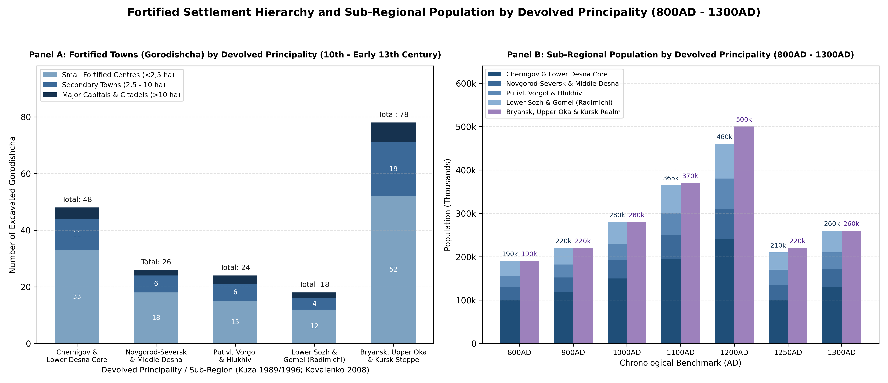
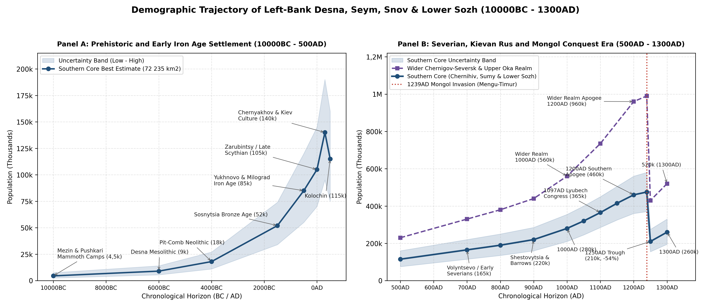
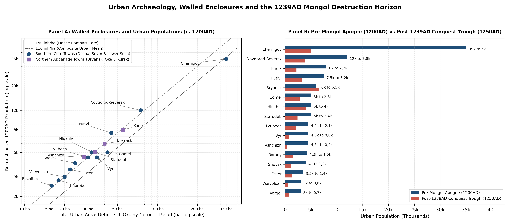

# Abstract

From the eleventh to the thirteenth centuries, the Olgovichi branch of
the Rurikid dynasty ruled the largest territorial domain in Eastern
Europe, stretching from the Dnieper, Desna and Sozh river junctions in
the south-west to the Upper Oka, the Moscow river approaches and the
Kursk Posemye in the north-east
[\[1\]](#ref-zaitsev1975chernigov)[\[2\]](#ref-dimnik1994dynasty)[\[3\]](#ref-dimnik2003olgovichi).
To avoid double-counting across regional boundaries, the wider
Chernigov-Seversk realm is divided along modern frontiers into two
complementary zones. The Southern Core of Chernigov and Novgorod-Seversk
(72,24k km²) covers the dynastic capitals and forest-steppe heartland
across Chernihivska Oblast (Ukraine, 31,9k km²), Sumska Oblast (Ukraine,
23,83k km²) and the Eastern Gomel and Lower Sozh-Dnieper Corridor
(Belarus, 16,5k km²). This area encompasses the primary domains of the
principalities of Chernigov, Novgorod-Seversk, Putivl, Vorgol and
post-Mongol Hlukhiv. The Northern Russian Half (~118k km²), accounted
for separately in the European Russia review, covers the northern forest
and north-eastern forest-steppe appanages inside the modern Russian
Federation across the Upper Oka and Bryansk-Chernigov North (including
Bryansk, Starodub, Trubchevsk, Vshchizh, Karachev, Novosil, Tarusa and
Kozelsk) and the Kursk-Seversk Steppe Frontier (Kursk, Rylsk and
Yelets).

In the Southern Core, human settlement began in the Upper Palaeolithic
mammoth-hunting camps of the middle Desna gorge (4,5k inhabitants at
10000BC) and grew through the Early Iron Age hillfort cultures (85k at
500BC) and the Roman-era Kiev and Chernyakhov horizons (140k at 300AD).
After the eighth- and ninth-century Slavic expansion of the Severians
and Radimichi (220k by 900AD) and their incorporation into Kievan Rus
(280k by 1000AD), the Southern Core reached a pre-Mongol peak of 460k
inhabitants in 1200AD (360k - 560k, mean density 6,37 inh/km²). Almost a
fifth of this population lived in fortified towns, led by the capital of
Chernigov (35k inhabitants across 330 ha) and the princely seats of
Novgorod-Seversk (12k), Putivl (7,5k), Gomel (5k) and Hlukhiv (5k)
[\[4\]](#ref-kovalenko2008chernihiv)[\[5\]](#ref-tolochko1989goroda)[\[6\]](#ref-kuza1989malye).
Combined with the 500k inhabitants of the Northern Russian Half (210k in
Bryansk-Starodub-Upper Oka and 290k in the Kursk-Rylsk Posemye), the
Grand Principality of Chernigov-Seversk contained 960k people in 1200AD,
a total rivalled in Rus only by the Kievan and Galician-Volhynian south
[\[7\]](#ref-tolochko2001demography). Mengu-Timur’s campaign of October
1239 shattered the exposed Desna and Seym towns, cutting the population
of the Southern Core by more than half to 210k in 1250AD before partial
recovery in the wooded country around Hlukhiv, Putivl and northern
Chernigov brought numbers back to 260k by 1300AD.

| Date | Population | Range | Density (inh/km2) | Urban Share (%) | Historical Notes |
|:---|:---|:---|:---|:---|:---|
| 10000BC | 4,5k | 2,5k - 7,5k | 0,06 | 0% | Mezin, Pushkari I & Chulatovo mammoth-bone camps |
| 6000BC | 9k | 5,5k - 14k | 0,12 | 0% | Desna-Sozh Mesolithic & early Pit-Comb Ware sites |
| 4000BC | 18k | 11k - 27k | 0,25 | 0% | Dnieper-Donets II & Desna Neolithic fishers |
| 1500BC | 52k | 34k - 74k | 0,72 | 0% | Sosnytsia & Marianivka Bronze Age agro-pastoralists |
| 500BC | 85k | 55k - 120k | 1,18 | 0% | Yukhnovo, Milograd & Scythian Posemye hillforts |
| 0AD | 105k | 70k - 145k | 1,45 | 0% | Late Zarubintsy (Pochep-Harivka) & Late Scythian |
| 300AD | 140k | 95k - 190k | 1,94 | 0% | Kiev culture (Roishche) & northern Chernyakhov peak |
| 500AD | 115k | 75k - 160k | 1,59 | 0% | Kolochin culture forest-riverine settlements |
| 700AD | 165k | 115k - 220k | 2,28 | 2,5% | Volyntsevo & early Romny-Borshchevo Severian opoliya |
| 800AD | 190k | 135k - 250k | 2,63 | 4,8% | Bititsa, Gornal & Romny fortified Severian hillforts |
| 900AD | 220k | 160k - 285k | 3,05 | 8,5% | Shestovytsia, Chernigov barrows & Lyubech trade axis |
| 1000AD | 280k | 210k - 355k | 3,88 | 13,2% | Early Rurikid tribute network & Severian integration |
| 1100AD | 365k | 285k - 450k | 5,05 | 17,8% | Post-1097AD Lyubech Congress Olgovichi expansion |
| 1200AD | 460k | 360k - 560k | 6,37 | 21,5% | Olgovichi apogee (116 hillforts; Chernigov 35k) |
| 1250AD | 210k | 155k - 275k | 2,91 | 10,5% | October 1239AD Mongol destruction of Desna-Posemye |
| 1300AD | 260k | 195k - 330k | 3,6 | 11,8% | Post-Mongol Hlukhiv, Putivl & Chernigov principalities |

Estimated population, uncertainty ranges, settlement density and urban
share across the Desna, Seym, Snov and Lower Sozh basins (72,24k km²)
from the Late Palaeolithic mammoth-hunting camps of the middle Desna
gorge (10000BC) to the post-Mongol principalities (1300AD).

# Background

The political geography of the Left-Bank Desna, Seym, Snov and Lower
Sozh basin reflects the dynastic division of the Olgovichi (descendants
of Oleg Svyatoslavich, d. 1115AD, who secured hereditary rights to the
Chernigov land at the Congress of Lyubech in 1097AD)
[\[2\]](#ref-dimnik1994dynasty)[\[3\]](#ref-dimnik2003olgovichi).
Following Vsevolod Olgovich’s accession to the Kievan throne (1139AD),
the realm divided into the senior Chernigov patrimony (*Otchina*) along
the Lower and Middle Desna, Snov and Sozh, and the junior Seversk
(*Sever*) patrimony along the Middle Desna and Seym. After the Mongol
sack of 1239AD and the execution of Grand Prince Mikhail Vsevolodovich
at the Golden Horde (1246AD), the southern lands reorganised into the
post-Mongol principalities of Chernigov, Novgorod-Seversk, Putivl and
Hlukhiv (founded 1247AD). Table lists the principalities within the
Southern Core territory.

| Dynastic Phase | Principality Name | Active Span | Capital (Coords) | Core Basin & Administrative Coverage |
|:---|:---|:---|:---|:---|
| Senior Patrimony | Principality of Chernigov | 1133-1279AD | Chernigov (51,5°N, 31,29°E) | Lower & Middle Desna, Snov, Oster & Lower Sozh (Chernihiv & Gomel) |
| Post-Mongol Core | Principality of Chernigov | 1279-1356AD | Chernigov (51,5°N, 31,29°E) | Post-Mongol Desna-Snov-Sozh core under Bryansk-Chernigov line |
| Late Appanage | Principality of Chernigov | 1356-1358AD | Chernigov (51,5°N, 31,29°E) | Late post-Mongol Chernigov domain prior to Lithuanian annexation |
| Seversk Patrimony | Principality of Novgorod-Seversk | 1133-1363AD | Novgorod-Seversk (51,99°N, 33,27°E) | Middle Desna, Lower Seym & Ivot-Esman (NE Chernihiv & N Sumy) |
| Posemye Appanage | Principality of Putivl | 1147-1501AD | Putivl (51,32°N, 33,86°E) | Middle Seym (Posemye), Vyr, Kleven & Upper Sula & Psyol (Sumy) |
| Kleven Appanage | Principality of Vorgol | 1203-1241AD | Vorgol (51,48°N, 33,78°E) | Kleven-Seym interfluve NW of Putivl (Krolevets & Putyvl) |
| Esman-Kleven Refuge | Principality of Hlukhiv | 1247-1408AD | Hlukhiv (51,68°N, 33,92°E) | Post-Mongol Esman-Kleven plateau (Hlukhiv & Yampil) |

Dynastic divisions, seats and river-basin boundaries of the Olgovichi
principalities in the southern Chernigov-Seversk core from the
post-Lyubech partition (1133AD) to the Lithuanian annexation.

# Methodology

Because historical and archaeological studies by A. K. Zaitsev
[\[1\]](#ref-zaitsev1975chernigov), V. P. Kovalenko
[\[4\]](#ref-kovalenko2008chernihiv), A. V. Kuza
[\[6\]](#ref-kuza1989malye)[\[8\]](#ref-kuza1996gorodishcha) and M.
Dimnik [\[3\]](#ref-dimnik2003olgovichi) often cite aggregate figures
for the entire Chernigov-Seversk realm from the Desna mouth to the Upper
Oka and Kursk Posemye, separate accounting is needed to link this
Southern Core study with the Northern Russian appanages documented in
the European Russia regional review.

In the northern and north-eastern wings of the Olgovichi patrimony, the
Upper Oka and Bryansk-Chernigov North (~70k km²) covers modern Bryansk,
Kaluga, Orel and western Tula Oblasts, comprising Bryansk, Starodub,
Trubchevsk, Vshchizh, Karachev, Novosil, Tarusa, Mtsensk, Odoev,
Vorotynsk, Belyov and Kozelsk. Following the 1239AD sack of southern
Chernigov, Prince Roman Mikhailovich transferred the senior
Chernigov-Bryansk throne northward into the Bryansk forest
(*Debryansk*), initiating a lasting population shift toward the wooded
Upper Oka (*Verchovskie*) principalities. To the south-east, the
Kursk-Seversk Steppe Frontier (~48k km²) covers modern Kursk and western
Lipetsk and Belgorod Oblasts, comprising Kursk, Rylsk and Yelets along
the Tuskar, Upper Seym, Svapa and Upper Psyol rivers.

Table shows how the four southern districts of the Southern Core
(Chernigov Core, Novgorod-Seversk, Putivl-Vorgol-Hlukhiv and Lower Sozh
and Gomel) combine with the northern Upper Oka and Kursk-Rylsk appanages
to reconstruct the population of the wider Chernigov-Seversk lands
(800AD - 1300AD) without boundary overlap.

| Principality / District | 800AD | 1000AD | 1100AD | 1200AD | 1250AD | 1300AD |
|:---|:---|:---|:---|:---|:---|:---|
| Chernigov Core (Desna-Snov-Oster) | 100k | 150k | 195k | 240k | 100k | 130k |
| Novgorod-Seversk (Middle Desna) | 30k | 42k | 55k | 70k | 35k | 42k |
| Putivl, Vorgol & Hlukhiv (Posemye) | 26k | 38k | 50k | 70k | 35k | 38k |
| Lower Sozh & Dnieper (Gomel Corridor) | 34k | 50k | 65k | 80k | 40k | 50k |
| Southern Core Subtotal (72,24k km2) | 190k | 280k | 365k | 460k | 210k | 260k |
| Bryansk, Starodub & Upper Oka North | 90k | 130k | 170k | 210k | 120k | 140k |
| Kursk & Rylsk Posemye East | 100k | 150k | 200k | 290k | 100k | 120k |
| Northern Appanages Subtotal (118k km2) | 190k | 280k | 370k | 500k | 220k | 260k |
| Grand Principality of Chernigov-Seversk Total | 380k | 560k | 735k | 960k | 430k | 520k |

Sub-regional population estimates for the four southern districts
(72,24k km²) alongside the northern Bryansk-Upper Oka and Kursk-Rylsk
appanages (~118k km²) accounted for in European Russia, showing the
1200AD peak of 960k across the wider Chernigov-Seversk realm and the
54,3% decline in the Southern Core after the October 1239AD campaign.

# Results

## Prehistoric and Early Slavic Settlement

### Upper Palaeolithic to Bronze Age

The middle Desna chalk gorge between Pushkari, Novgorod-Seversk and
Mezin (Mizyn) formed one of the main Upper Palaeolithic Ice Age hunting
grounds in Eurasia
[\[9\]](#ref-shovkoplyas1965mezinskaya)[\[10\]](#ref-boriskovsky1953paleolit)[\[11\]](#ref-velichko1997mammoth).
At Mezin (51,83°N, 33,08°E), I. G. Shovkoplyas excavated five circular
mammoth-bone *yaranga*-type dwellings enclosing hearths fuelled by bone
ash, marine amber ornaments transported over 600 km and geometric
meander-engraved ivory bracelets dated to the late Pleniglacial and
Bølling-Allerød transition (13000BC - 10000BC). Directly upstream along
the Desna bluffs, Pushkari I (Pogon), Chulatovo I-II, Buzhany and the
Novgorod-Seversky rock-shelter document multi-family winter aggregation
camps of 60 to 120 inhabitants each. Across the 72,24k km² regional
core, the 10000BC Late Palaeolithic population is estimated at 4,5k
inhabitants (2,5k - 7,5k, 0,06 inh/km²).

During the Holocene climatic optimum (6000BC - 3000BC), Mesolithic
hunter-fishers of the Desna-Sozh tradition gave way to the
Dnieper-Donets II and Pit-Comb Ware Neolithic cultures, occupying low
sandy river terraces along the Desna, Snov, Seym and Sozh (9k
inhabitants at 6000BC, rising to 18k by 4000BC). In the Middle and Late
Bronze Age (2000BC - 1000BC), the Sosnytsia variant of the
Trzciniec-Komariv complex and the Marianivka culture along the Seym
introduced mixed millet-barley cultivation and floodplain cattle
pastoralism, raising the regional population to 52k at 1500BC (0,72
inh/km²) [\[12\]](#ref-tretyakov1966finno).

### Yukhnovo, Milograd, Kiev and Kolochin Horizons

In the Early Iron Age (700BC - 200BC), the region was divided between
two fortified hillfort cultures that built chains of cliff-top forts
along the Desna and Sozh
[\[12\]](#ref-tretyakov1966finno)[\[13\]](#ref-lyapushkin1961dneprovskoe).
The Yukhnovo Culture (named after the Yukhnovo type-hillfort near
Novgorod-Seversk) occupied the Middle Desna and Seym valleys,
constructing timber-laced earthen ramparts on high right-bank chalk
headlands (0,5 - 2,5 ha per hillfort, housing 60 - 150 inhabitants at
sites such as Kurove-Yukhnovo, Khorobor, Ponornytsia and
Novgorod-Seversk). To the west, the Milograd Culture (named after the
Milograd hillfort on the Dnieper south of Rechitsa) occupied the Lower
Sozh, Braginka and Dnieper-Desna interfluve (Gomel, Khalch, Milograd,
Lyubech and Gorval), while Scythian forest-steppe farmers fortified the
Upper Sula, Psyol and Vorskla valleys (Vovkivtsi, Pustoviitivka, Kuzemyn
and Romny). By 500BC, regional population reached 85k (1,18 inh/km²).

During the Late La Tène and Roman Iron Age (200BC - 400AD), Late
Zarubintsy (Pochep-Harivka horizon, 105k at 0AD) and Kiev culture
(200AD - 450AD, excavated at Roishche, Desna-Harivka and Ulianyky)
unfortified riverside hamlets spread along the Desna, Snov and Lower
Sozh, while the northernmost Chernyakhov culture settlements reached the
Sula, Psyol and southern Seym, supporting a Roman-era peak of 140k
inhabitants at 300AD (1,94 inh/km²)
[\[14\]](#ref-symonovich1983chernyakhov)[\[15\]](#ref-byrnya1991ranneslavyanskie).
Following the Hunnic collapse of the Chernyakhov frontier in the late
fourth century, the early Slavic Kolochin culture (450AD - 700AD, named
after the Kolochin I promontory hillfort near Rechitsa) consolidated
along the wooded Dnieper-Sozh-Desna valleys, supporting 115k inhabitants
at 500AD (1,59 inh/km²)
[\[15\]](#ref-byrnya1991ranneslavyanskie)[\[16\]](#ref-baran1998early).

### Severian Expansion and Shestovytsia

In the eighth and ninth centuries, Slavic population growth accelerated
under the Volyntsevo culture (700AD - 820AD, named after the type-site
near Putivl, alongside the fortified Khazar-Severian administrative
citadel at Bytytsia on the Psyol) and its successor, the
Romny-Borshchevo culture (800AD - 1000AD, named after the
*Monastyryshche* hillfort at Romny on the Sula)
[\[13\]](#ref-lyapushkin1961dneprovskoe)[\[17\]](#ref-sukhobokov1975slaviane)[\[18\]](#ref-sukhobokov1992romny).
Identified with the chronicle Severians (*Severyane*) on the Desna, Seym
and Sula and the southern Radimichi on the Lower Sozh, the Romny
population combined fortified promontory refuges (Novotroitske, Gornal,
Putivl, Vyr, Romny, Chernigov, Snovsk and Gomel) with dense clusters of
open *selyshcha* equipped with sunken-featured dwellings
(*poluzemlyanki*) and domed clay ovens. Archaeological surveys by O. V.
Sukhobokov record over 320 Volyntsevo and Romny settlements across the
Southern Core, supporting 165k inhabitants by 700AD, 190k by 800AD and
220k by 900AD.

At the same time, the Lower Desna and Dnieper-Sozh corridor became a
major artery of Varangian-Rus trade and military organisation
[\[19\]](#ref-rybakov1949drevnosti)[\[20\]](#ref-motsia2011shestovytsia)[\[21\]](#ref-androschuk2013vikings).
At Shestovytsia (Korovel, 18 km south-west of Chernigov), excavations by
P. Smolychev, D. I. Blifeld, V. P. Kovalenko and O. P. Motsia revealed a
16 ha fortified hillfort and harbour suburb accompanied by five barrow
cemeteries (over 400 mounds) containing tenth-century Scandinavian
chamber graves with Frankish swords, warhorses, folding balances and
Abbasid and Samanid silver dirhams (2,4k inhabitants in 900AD, peaking
at 3,2k in 1000AD). In the Chernigov retinue necropolises (Chorna
Mohyla, Hulbyshche and Boldyni Hory), B. A. Rybakov’s study of the
*Chorna Mohyla* princely tumulus (40 m diameter, 11 m height, c. 960AD)
and the more than 230 barrows of Boldyni Hory shows that tenth-century
Chernigov already functioned as the seat of an autonomous princely and
boyar *druzhina* (9,5k inhabitants in 900AD, rising to 18k by 1000AD).
Further west, Lyubech (51,7°N, 30,66°E) and Mokhov (52,02°N, 30,73°E)
guarded the Dnieper-Sozh-Desna confluence; Lyubech is listed by
Constantine Porphyrogenitus (*De Administrando Imperio*, c. 948AD) as
*Telioutza*, one of the fortified ship-assembly stations on the route
from the Varangians to the Greeks (3,5k at Lyubech and 1,95k at Mokhov
in 1000AD).

By 1000AD, following Grand Prince Vladimir Svyatoslavich’s integration
of the Severian and Radimichi lands (984AD Battle on the Pishchana) and
the construction of the Desna-Oster-Sula frontier ramparts (Gorodets
Ostersky, Pryluky, Romny and Vovkivtsi), the Southern Core reached 280k
inhabitants (3,88 inh/km²), with an urban population of 37k (13,2%).

## The Olgovichi Principalities

### Dynastic Consolidation

Following the Battle of Listven (1024AD, fought beside the Listven
hillfort 22 km north of Chernigov), Prince Mstislav Vladimirovich
established Chernigov as the capital of Left-Bank Rus, founding the
stone Transfiguration Cathedral (*Spaso-Preobrazhensky Sobor*,
1030-1036AD) inside the 16 ha *Detinets*
[\[2\]](#ref-dimnik1994dynasty)[\[19\]](#ref-rybakov1949drevnosti).
Under Svyatoslav Yaroslavich (1054-1076AD) and his son Oleg
Svyatoslavich (d. 1115AD), recognised at the Congress of Lyubech
(1097AD) as hereditary ruler of the Chernigov-Seversk land, the dynasty
promoted internal colonisation across the *Chernigov Opolye*, the middle
Desna, the Lower Sozh and the Posemye steppe frontier
[\[1\]](#ref-zaitsev1975chernigov)[\[3\]](#ref-dimnik2003olgovichi).

Archaeological surveys by V. P. Kovalenko
[\[4\]](#ref-kovalenko2008chernihiv), A. V. Kuza
[\[6\]](#ref-kuza1989malye)[\[8\]](#ref-kuza1996gorodishcha), P. P.
Tolochko [\[5\]](#ref-tolochko1989goroda), Yu. Yu. Morgunov
[\[22\]](#ref-morgunov2003posemye) and H. V. Shtykhov
[\[23\]](#ref-shtykhov1992goroda) catalogue 116 excavated tenth- to
early thirteenth-century fortified *gorodishcha* within the Southern
Core (48 in the Chernigov Core, 26 in Novgorod-Seversk, 24 in
Putivl-Vorgol-Hlukhiv and 18 in the Lower Sozh and Gomel corridor), plus
78 *gorodishcha* in the northern Russian appanages (194 fortified towns
in total across the Grand Principality), surrounded by over 2,1k
unfortified rural *selyshcha* (such as the excavated 12 ha rural craft
village of Avtunichi).

### Major Towns in 1200AD

Following the town density estimates of P. P. Tolochko and A. V. Kuza
(120 - 150 inh/ha inside the walled *detinets* and *okolny gorod*
ramparts; 75 - 100 inh/ha in the outer *posad* and *podol* craft
quarters, or 20 - 25 homesteads per hectare at 5,5 - 6 persons per
household), Table sets out the populations of the chief towns in 1200AD
and 1250AD.

| Urban Centre | Rampart (ha) | Posad (ha) | Total (ha) | 1200AD Pop. | 1250AD Pop. |
|:---|:---|:---|:---|:---|:---|
| Chernigov | 160 ha | 170 ha | 330 ha | 35k | 5k |
| Novgorod-Seversk | 32 ha | 43 ha | 75 ha | 12k | 3,8k |
| Putivl | 22 ha | 23 ha | 45 ha | 7,5k | 3,2k |
| Gomel (Homiy) | 18 ha | 24 ha | 42 ha | 5k | 2,8k |
| Hlukhiv | 15 ha | 17 ha | 32 ha | 5k | 4k |
| Lyubech | 14 ha | 16 ha | 30 ha | 4,5k | 2,1k |
| Vyr | 15 ha | 20 ha | 35 ha | 4,5k | 800 |
| Romny (Romen) | 12 ha | 16 ha | 28 ha | 4,2k | 1,5k |
| Snovsk (Sedniv) | 12 ha | 12 ha | 24 ha | 4k | 1,2k |
| Oster | 10 ha | 12 ha | 22 ha | 3,5k | 1,4k |
| Pryluky | 10 ha | 11 ha | 21 ha | 3,2k | 1,1k |
| Vsevolozh | 10 ha | 10 ha | 20 ha | 3k | 600 |
| Vorgol | 9 ha | 11 ha | 20 ha | 3k | 700 |
| Bragin | 9 ha | 11 ha | 20 ha | 3k | 1,4k |
| Khorobor | 9 ha | 9 ha | 18 ha | 2,8k | 900 |
| Unenezh (Nizhyn) | 9 ha | 9 ha | 18 ha | 2,8k | 950 |
| Sosnytsia | 9 ha | 9 ha | 18 ha | 2,8k | 1,15k |
| Rechitsa | 8 ha | 8 ha | 16 ha | 2,5k | 1,5k |
| Kursk (Posemye East) | 24 ha | 31 ha | 55 ha | 8k | 2,2k |
| Bryansk (Upper Desna) | 20 ha | 20 ha | 40 ha | 6k | 6,5k |
| Starodub (Seversk North) | 16 ha | 18 ha | 34 ha | 5k | 2,4k |
| Vshchizh (Upper Desna) | 14 ha | 14 ha | 28 ha | 4,5k | 400 |

Excavated rampart circuits (detinets and okolny gorod), outer craft
suburbs (posad and podol) and estimated inhabitants of the 18 chief
southern Chernigov-Seversk towns alongside four northern appanage
capitals in 1200AD and 1250AD.

### Population by Principality in 1200AD

Across the four southern districts (460k inhabitants in total at
1200AD), the Principality of Chernigov Core accounted for 240k
inhabitants. Here settlement centred on the fertile *Chernigov Opolye*
between the Desna, Snov and Bilous rivers (12 - 18 inh/km²), where
princely domains (*sela*) such as Orgoshch (2,1k), Listven (1,85k),
Blestovit (2k), Gurichev (1,8k), Snovsk (4k) and Berezna (2,2k) supplied
grain, warhorses and ironwork to the 35k-strong capital of Chernigov (16
ha *Detinets*, 40 ha *Okolny Gorod*, 20 ha *Tretyak*, 85 ha walled
*Peredgorodier* and 170 ha *Podol* and *Leskovitsa* craft suburbs,
containing five twelfth- and early thirteenth-century brick cathedrals:
the Transfiguration, Boris and Gleb, Dormition at Yeletsky Monastery, St
Elias and St Paraskeva Pyatnitsa)
[\[4\]](#ref-kovalenko2008chernihiv)[\[19\]](#ref-rybakov1949drevnosti).
Along the Dnieper, middle Desna and Oster-Udai corridors, fortified
*volost* centres - Lyubech (4,5k, where B. A. Rybakov excavated the
timber-and-earth princely castle of *Zamkova Hora*), Oster (3,5k),
Pryluky (3,2k), Vsevolozh (3k), Sosnytsia (2,8k), Khorobor (2,8k),
Unenezh (Nizhyn, 2,8k), Baturin (2,6k), Bakhmach (2,4k), Moroviisk
(2,2k), Varva (2,1k) and Lutava (1,8k) - supported 68k townspeople
(28,3% of the core’s population) and 172k rural inhabitants
[\[1\]](#ref-zaitsev1975chernigov).

In the Principality of Novgorod-Seversk along the Middle Desna and
Ivot-Esman tributaries (70k inhabitants at 1200AD), administration was
conducted from the high chalk headland of Novgorod-Seversk (12k
inhabitants across 75 ha, comprising the 2,5 ha *Zamkova Hora* citadel,
the 30 ha *Okolny Gorod* and the stone Spaso-Preobrazhensky princely
monastery). Celebrated as the seat of Prince Igor Svyatoslavich
(1151-1202AD) in the *Tale of Igor’s Campaign* (1185AD), this
principality controlled the middle Desna crossings and the wooded Ivot,
Znob and Esman valleys, including Voronizh (2,4k), Krolevets-Retezh
(1,1k), Znob (950), Shalyhyne-Obesta (850), Ivot (780), Yampil (740) and
Kurove-Yukhnovo (720)
[\[3\]](#ref-dimnik2003olgovichi)[\[4\]](#ref-kovalenko2008chernihiv).

Across the Principalities of Putivl, Vorgol and Hlukhiv in the Posemye
and Upper Sula and Psyol valleys (70k inhabitants at 1200AD), a chain of
fortresses guarded the southern forest-steppe frontier against the
Polovtsians (*Cumans*). Putivl (7,5k inhabitants across 45 ha, with a
twelfth-century brick princely church excavated on *Nikolske Gorka*)
stood alongside Vyr (4,5k across 35 ha), Hlukhiv (5k across 32 ha),
Romny (4,2k across 28 ha) and Vorgol (3k across 20 ha, seat of an
autonomous appanage on the Kleven cliffs between 1203AD and 1241AD)
[\[18\]](#ref-sukhobokov1992romny)[\[22\]](#ref-morgunov2003posemye).
Secondary steppe-watch fortresses along the Seym, Tern, Sula, Psyol and
Vorskla included Lipen (Sumy, 2,6k), Okhtyrka (2,5k), Hlinsk (2,3k),
Popash (2,2k), Konotop (2,1k), Viakhan (2,1k), Zartyi (1,9k), Lipovets
(1,85k), Nedryhailiv (1,35k) and Igoreve Seltsye (1,25k, the fortified
princely estate with wine and honey cellars looted in the 1146AD
chronicle).

In the Lower Sozh and Dnieper-Braginka Corridor of eastern Gomel (80k
inhabitants at 1200AD), which incorporated the southern Radimichi and
Dregovichi-Severian contact zone under Chernigov rule, the main river
towns were Gomel (*Homiy*, 5k inhabitants across 42 ha, with
weapon-smithing workshops excavated by O. A. Makushnykov), Bragin (3k),
Rechitsa (2,5k), Chechersk (2,3k), Loyev (2,2k), Khalch (1,45k),
Streshin (1,25k), Gorval (1,15k) and Zaspa (1,05k)
[\[23\]](#ref-shtykhov1992goroda)[\[24\]](#ref-makushnykov2009gomel).

## Mongol Invasion and Post-Conquest Era

### Destruction of October 1239AD

In the autumn of 1239AD, following the campaigns against Ryazan
(1237AD), Vladimir-Suzdal (1238AD) and Pereyaslavl-Yuzhny (March
1239AD), a Mongol army commanded by Batu’s cousin Mengu-Timur (Möngke)
and Kadan advanced up the Seym and Desna valleys against the
Chernigov-Seversk principalities
[\[3\]](#ref-dimnik2003olgovichi)[\[4\]](#ref-kovalenko2008chernihiv).
Archaeological excavations across more than 40 *gorodishcha* in the
Southern Core reveal a mid-thirteenth-century destruction layer marked
by vitrified timber-and-earth ramparts, clusters of armour-piercing
Mongol tanged arrowheads, hoards of silver *grivnas* and temple rings
and unburied skeletons in collapsed dwellings and church vaults.

Along the Posemye corridor, Putivl, Vyr, Vorgol, Hlukhiv, Popash and
Viakhan were stormed during the autumn offensive along the Seym and
Kleven in October 1239AD. At Putivl and Vyr, mass graves containing
decapitated and arrow-pierced defenders alongside burned artisan
quarters record the loss of the frontier garrisons
[\[18\]](#ref-sukhobokov1992romny), while Vorgol, Popash, Viakhan and
Zartyi suffered destruction and permanent urban abandonment after
1239-1241AD. Along the Desna-Snov-Oster approach, Snovsk, Sosnytsia,
Khorobor, Vsevolozh, Unenezh, Orgoshch, Listven and Blestovit were
sacked to sever communications before the investment of Chernigov; at
Vsevolozh, Blestovit and Unenezh, burned rampart casemates yielded
hundreds of skeletons of defenders, women and children who perished in
the flames [\[4\]](#ref-kovalenko2008chernihiv).

During the siege and sack of Chernigov on 18 October 1239AD, as recorded
in the Laurentian and Hypatian Chronicles, Mongol siege engineers
surrounded the city and bombarded the walls with heavy counterweight
trebuchets (*poroki*) that hurled stones a distance of a bowshot and a
half, each stone requiring four men to lift. Despite a relief sortie led
outside the ramparts by Prince Mstislav Glebovich of Rylsk and
Chernigov - whose troops were routed in open battle - the Mongols
breached the *Okolny Gorod* on 18 October 1239AD, put the city to the
torch, looted the five brick cathedrals and slaughtered or enslaved the
population
[\[3\]](#ref-dimnik2003olgovichi)[\[4\]](#ref-kovalenko2008chernihiv).
Excavations across the 170 ha *Peredgorodier* and *Podol* show that the
outer suburbs ceased to be occupied, leaving post-conquest settlement
confined to the 16 ha *Detinets* (~5k inhabitants in 1250AD).

### Post-Mongol Realignment

Between 1239AD and 1250AD, the population of the Southern Core fell by
54,3%, dropping from 460k (1200AD) to 210k (1250AD, 2,91 inh/km²), while
the urban share declined from 21,5% to 10,5%. Over 65% of the 116
fortified *gorodishcha* in the Southern Core ceased to function as urban
settlements. Following the execution of Grand Prince Mikhail
Vsevolodovich of Chernigov and his boyar Fedor at the Golden Horde in
September 1246AD for refusing to walk between purification fires
[\[3\]](#ref-dimnik2003olgovichi), the political and settlement
geography of the Chernigov-Seversk lands underwent a three-way
realignment between 1246AD and 1300AD.

Under Mikhail’s younger son Roman Mikhailovich the Old (1246-1288AD),
the senior princely seat moved from Chernigov northward into the forests
of Bryansk, which grew from 6k (1200AD) to 6,5k (1250AD). Even so,
Chernigov, Lyubech (2,5k in 1300AD) and the Lower Sozh towns (Gomel at
3,4k, Rechitsa at 1,9k, Bragin at 1,75k and Chechersk at 1,65k) retained
a reduced episcopal and princely administration, supporting 130k
inhabitants in the Chernigov Core and 50k in the Lower Sozh by 1300AD
[\[24\]](#ref-makushnykov2009gomel)[\[25\]](#ref-kuczynski1936ziemie).

In 1247AD, Mikhail Vsevolodovich’s second son Simeon Mikhailovich
established an autonomous hereditary principality at Hlukhiv
(1247-1408AD) on the wooded Esman-Kleven plateau (51,68°N, 33,92°E).
Sheltered by marshy forests north of the steppe corridor, Hlukhiv
retained 4k inhabitants in 1250AD and 4,5k in 1300AD, serving as the
main urban refuge in the southern Seversk lands until the mid-fourteenth
century.

Meanwhile, descendants of the Igorichi line maintained the Principality
of Putivl (3,2k inhabitants in 1250AD, recovering to 3,8k by 1300AD)
alongside Novgorod-Seversk (3,8k in 1250AD, 4,5k in 1300AD) and Romny
(1,95k in 1300AD). Under Golden Horde suzerainty, the Posemye was
supervised by the Mongol *baskak* Akhmad, whose creation of tax-exempt
*slobody* near Lipovets and Vorgol provoked the 1283-1285AD uprising of
Princes Oleg of Rylsk-Vorgol and Svyatoslav of Lipovets recorded in the
Laurentian Chronicle
[\[18\]](#ref-sukhobokov1992romny)[\[25\]](#ref-kuczynski1936ziemie). By
1300AD, natural recovery across these wooded riverine valleys restored
the Southern Core to 260k inhabitants (3,6 inh/km²), while the wider
Chernigov-Seversk realm (including the northern Russian appanages) stood
at 520k inhabitants.

# Sources

1.
Zaitsev, A. K. *Chernigovskoe
Knyazhestvo x-XIII Vv.: Istoriko-Geograficheskoe Issledovanie \[the
Principality of Chernigov in the 10th-13th Centuries:
Historical-Geographical Study\]*. Nauka (Institut Istorii SSSR), 1975,
<https://search.worldcat.org/search?q=Principality+Chernigov+10th+13th+Centuries+Historical+Geographical+Study+Zaitsev+1975>.

2.
Dimnik, Martin. *The Dynasty of
Chernigov, 1054-1146*. Pontifical Institute of Mediaeval Studies, 1994,
<https://doi.org/10.1017/cbo9780511496479>.

3.
Dimnik, Martin. *The Dynasty of
Chernigov, 1146-1246*. Cambridge University Press, 2003,
<https://doi.org/10.1017/cbo9780511496479>.

4.
Kovalenko, V. P. “Urbanizatsiini
Protsesy u Chernihovo-Siverskii Zemli x-XIII St. \[Urbanisation
Processes in the Chernihiv-Siversk Land in the 10th-13th Centuries\].”
*Arkheolohiya*, vol. 2, 2008, pp. 34-52,
<https://arheologia.com.ua/index.php/arheologia/issue/archive>.

5.
Tolochko, P. P. *Drevnerusskiy
Feodalnyy Gorod \[the Ancient Rus Feudal Town\]*. Naukova Dumka, 1989,
<https://search.worldcat.org/search?q=Ancient+Rus+Feudal+Town+Tolochko+1989>.

6.
Kuza, A. V. *Malye Goroda Drevnei
Rusi \[Small Towns of Ancient Rus\]*. Nauka, 1989,
<https://search.worldcat.org/search?q=Small+Towns+Ancient+Rus+Kuza+1989>.

7.
Tolochko, P. P. “Naselennia
Kyivskoi Rusi: Istoryko-Demohrafichnyi Narys \[Population of Kievan Rus:
An Historical-Demographic Essay\].” *Ukrainskyi Istorychnyi Zhurnal*,
vol. 3, 2001, pp. 3-18, <https://uhj.history.org.ua/>.

8.
Kuza, A. V. *Drevnerusskie
Gorodishcha x-XIII Vv.: Svod Arkheologicheskikh Pamyatnikov \[Ancient
Rus Hillforts of the 10th-13th Centuries: Corpus of Archaeological
Monuments\]*. Khristianskoe izdatelstvo, 1996,
<https://search.worldcat.org/search?q=Ancient+Rus+Hillforts+10th+13th+Centuries+Corpus+Archaeological+Kuza+1996>.

9.
Shovkoplyas, I. G. *Mezinskaya
Stoyanka: K Istorii Srednedneprovskogo Basseyna v
Pozdnepaleoliticheskuyu Epokhu \[the Mezin Site: On the History of the
Middle Dnieper and Desna Basin in the Late Palaeolithic Epoch\]*.
Naukova Dumka, 1965,
<https://search.worldcat.org/search?q=Mezin+Site+History+Middle+Dnieper+Desna+Basin+Late+Shovkoplyas+1965>.

10.
Boriskovsky, P. I. *Paleolit
Ukrainy: Istoriko-Arkheologicheskie Ocherki \[the Palaeolithic of
Ukraine: Historical-Archaeological Essays, Pushkari i and
Novgorod-Seversky\]*. vol. 40, Izdatelstvo AN SSSR, 1953,
<https://search.worldcat.org/search?q=Palaeolithic+Ukraine+Historical+Archaeological+Essays+Pushkari+Novgorod+Seversky+Boriskovsky+1953>.

11.
Velichko, A. A., et al. *Ranniy i
Sredniy Paleolit Basseyna Desny \[Late Palaeolithic Mammoth-Hunter
Settlements of the Desna Basin\]*. Institut Geografii RAN, 1997,
<https://search.worldcat.org/search?q=Late+Palaeolithic+Mammoth+Hunter+Settlements+Desna+Basin+Velichko+1997>.

12.
Tretyakov, P. N. *Finno-Ugry,
Balty i Slavyane Na Dnepre i Volge \[Finno-Ugrians, Balts and Slavs on
the Dnieper and Volga: Yukhnovo, Milograd and Zarubintsy Horizons\]*.
Nauka, 1966,
<https://search.worldcat.org/search?q=Finno+Ugrians+Balts+Slavs+Dnieper+Volga+Yukhnovo+Milograd+Tretyakov+1966>.

13.
Lyapushkin, I. I. *Dneprovskoe
Lesostepnoe Levoberezhe v Epokhu Zheleza \[the Dnieper Forest-Steppe
Left Bank in the Iron Age and Romny Period\]*. vol. 104, Izdatelstvo AN
SSSR, 1961,
<https://search.worldcat.org/search?q=Dnieper+Forest+Steppe+Left+Bank+Iron+Age+Romny+Lyapushkin+1961>.

14.
Symonovich, E. A., and N. M.
Kravchenko. *Pogrebalnye Obryady Plemen Chernyakhovskoy Kultury \[Burial
Rites of the Chernyakhov Culture Tribes and the Desna-Seym Frontier\]*.
Nauka, 1983,
<https://search.worldcat.org/search?q=Burial+Rites+Chernyakhov+Culture+Tribes+Desna+Seym+Frontier+Symonovich+1983>.

15.
Byrnya, P. P., and R. V.
Terpilovsky. *Ranneslavyanskie Poseleniya Dneprovskogo Levoberezhya
(Kievskaya i Kolochinskaya Kultury) \[Early Slavic Settlements of the
Dnieper Left Bank\]*. Naukova Dumka, 1991,
<https://search.worldcat.org/search?q=Early+Slavic+Settlements+Dnieper+Left+Bank+Byrnya+1991>.

16.
Baran, V. D. *Davni Sloviany \[the
Early Slavs of Ukraine\]*. Alternatyvy, 1998,
<https://search.worldcat.org/search?q=Early+Slavs+Ukraine+Baran+1998>.

17.
Sukhobokov, O. V. *Slavyane
Dneprovskogo Levoberezhya (Romenskaya Kultura i Ee Predshestvenniki)
\[the Slavs of the Dnieper Left Bank: The Romny Culture and Its
Predecessors\]*. Naukova Dumka, 1975,
<https://search.worldcat.org/search?q=Slavs+Dnieper+Left+Bank+Romny+Culture+Its+Predecessors+Sukhobokov+1975>.

18.
Sukhobokov, O. V. *Dniprovske
Lisostepove Livoberezhzhia u VIII-XIII St. \[The Dnieper Forest-Steppe
Left Bank in the 8th-13th Centuries: Putyvl, Vyr, Romny and Posemye\]*.
Naukova Dumka, 1992,
<https://search.worldcat.org/search?q=Dnieper+Forest+Steppe+Left+Bank+8th+13th+Centuries+Sukhobokov+1992>.

19.
Rybakov, B. A. *Drevnosti
Chernigova \[Antiquities of Chernigov\]*. vol. 11, Izdatelstvo AN SSSR,
1949,
<https://search.worldcat.org/search?q=Antiquities+Chernigov+Rybakov+1949>.

20.
Motsia, O. P., and A. L. Kazakov.
*Davnoruskyi Chernihiv \[Ancient Rus Chernihiv and the Shestovytsia
Retinue Complex\]*. IA NAN Ukrainy / Starodavnii Svit, 2011,
<https://search.worldcat.org/search?q=Ancient+Rus+Chernihiv+Shestovytsia+Retinue+Complex+Motsia+2011>.

21.
Androshchuk, Fedir. *Vikings in
the East: Essays on Contacts Along the Road to Byzantium (800-1100)*.
Uppsala Universitet, 2013, <https://doi.org/10.33063/m6c0cy98>.

22.
Morgunov, Yu. Yu. *Drevnerusskie
Pamyatniki Porechya Suly \[Ancient Rus Monuments of the Sula and Posemye
Frontier\]*. Institut Arkheologii RAN, 1996,
<https://search.worldcat.org/search?q=Ancient+Rus+Monuments+Sula+Posemye+Frontier+Morgunov+1996>.

23.
Shtykhov, H. V. *Goroda Polotskoy
i Chernigovo-Turovskoy Zemel v IX-XIII Vv. \[Towns of the Polotsk and
Chernigov-Turov Lands in the 9th-13th Centuries\]*. Navuka i Tekhnika,
1992,
<https://search.worldcat.org/search?q=Towns+Polotsk+Chernigov+Turov+Lands+9th+13th+Centuries+Shtykhov+1992>.

24.
Makushnykov, O. A. *Gomelskae
Padnyaprove u v-XIII Stst.: Satsyyalna-Ekanamichnae i
Kulturna-Gistarychnae Razvitstse \[the Gomel Dnieper-Sozh Region in the
5th-13th Centuries\]*. GGU im. F. Skaryny, 2009,
<https://search.worldcat.org/search?q=Gomel+Dnieper+Sozh+Region+5th+13th+Centuries+Makushnykov+2009>.

25.
Kuczynski, Stefan Maria. *Ziemie
Czernihowsko-Siewierskie Pod Rzadami Litwy \[the Chernigov-Seversk Lands
in the Post-Mongol and Early Lithuanian Transition\]*. Ukraiński
Instytut Naukowy, 1936,
<https://search.worldcat.org/search?q=Chernigov+Seversk+Lands+Post+Mongol+Early+Lithuanian+Transition+Kuczynski+1936>.

