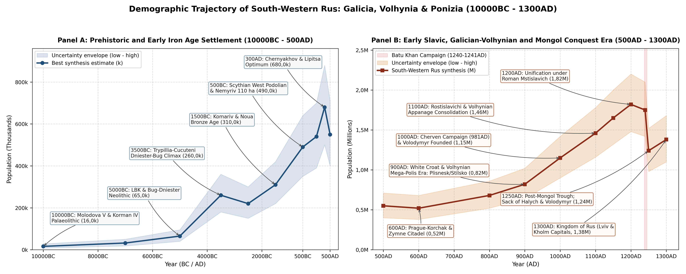
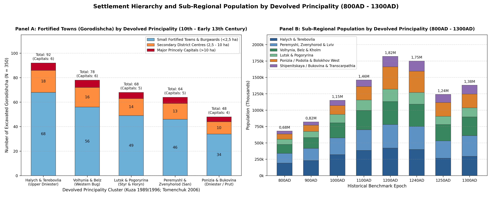
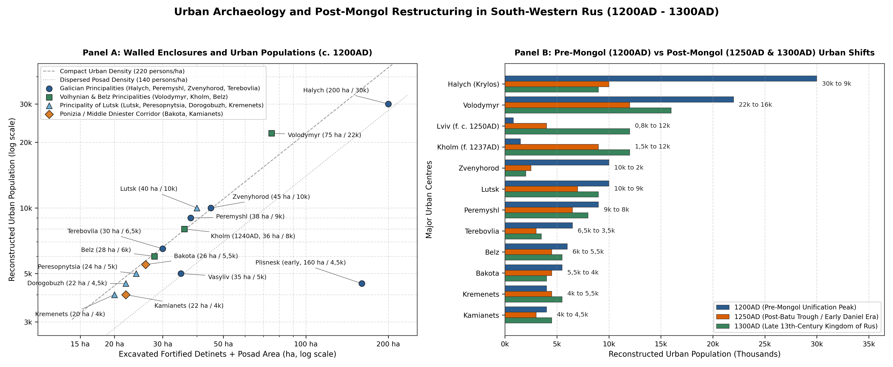

# Abstract

Sheltered by the Carpathian arc in the south-west and the Pripyat
marshes in the north, the loess plateaus of Galicia, Volhynia and
Podolia (~176,2k km²) formed one of the most densely settled regions of
pre-Mongol Eastern Europe
[\[1\]](#ref-krypyakevych1984galicia)[\[2\]](#ref-kotlyar1998galician)[\[3\]](#ref-vojtovych2011borders).
Before Batu Khan’s campaign of 1240-1241, South-Western Rus passed
through four main phases of population growth. Beginning from a Late
Palaeolithic base of 16k in the sheltered Dniester canyons (10000BC) and
65k in the early farming villages of 5000BC, the Trypillia-Cucuteni
Eneolithic culture of the Dniester, Prut and Bug plateaus reached 260k
around 3500BC, centred on promontory settlements at Bilche-Zolote
(Verteba), Koshylivtsi, Bodaki, Zalishchyky and Stina
[\[4\]](#ref-videiko2004trypillia). In the Early Iron Age (c. 500BC),
the Vysotska and Early Scythian West Podolian hillforts supported 490k
inhabitants around the 110 ha rampart stronghold at Nemyriv, Severynivka
and Hryhorivka [\[5\]](#ref-smirnova1990nemyriv), followed in the Roman
era (c. 300AD) by an expansion to 680k across the Chernyakhov, Lipitsa,
Przeworsk and Carpathian Tumuli cultures
[\[6\]](#ref-magomedov2001chernyakhov)[\[7\]](#ref-baran1998earlyslavs).

During the Kievan and appanage periods (1000AD - 1200AD), 350 fortified
towns (*gorodishcha*) and surrounding open villages supported 1,15M
inhabitants in 1000AD, 1,46M in 1100AD and 1,82M in 1200AD
[\[8\]](#ref-tolochko2001demography)[\[9\]](#ref-kuza1996gorodishcha)[\[10\]](#ref-tomenchuk2006halych).
When the Mongols stormed Volodymyr, Halych, Zvenyhorod, Iziaslavl and
Kolodyazhyn in the winter of 1240-1241, the regional population dropped
by nearly a third to 1,24M in 1250AD. Unlike the middle Dnieper steppe
borderland, however, the western principalities kept their political
independence and mountain strongholds: under King Daniel Romanovich
(crowned 1253AD), Lev Danilovich and Yuri I Lvovich, growth around the
new royal capitals of Kholm and Lviv restored the population of the
Kingdom of Rus to 1,38M by 1300AD
[\[11\]](#ref-kotlyar2002chronicle)[\[12\]](#ref-petehyrych2006galicia).

# Background

Geographically, the region spans nine modern western and right-bank
Ukrainian oblasts (~176,2k km²) across the Upper and Middle Dniester,
Western Bug, San, Styr, Horyn, Upper Pripyat, Upper Prut and Upper Tisza
river basins. Historically, this territory formed the south-western
march of Kievan Rus (981-1133AD) and later divided into the
Rostislavichi Galician principalities, the Monomakhovichi and
Romanovichi Volhynian principalities and the unified Kingdom of
Galicia-Volhynia (1199-1341AD).

The Rostislavichi Galician principalities (49,6k km² across Lvivska,
Ivano-Frankivska, Ternopilska and the San-Cherven strip) comprised the
principalities of Peremyshl, Zvenyhorod and Terebovlia (1133-1142AD),
which were united into the Principality of Halych (1141-1200AD) by
Vladimirko Volodarevich and Yaroslav Osmomysl around the 200 ha urban
complex of Halych (*Krylos*, 30k inhabitants at 1200AD)
[\[10\]](#ref-tomenchuk2006halych)[\[12\]](#ref-petehyrych2006galicia)[\[13\]](#ref-pasternak1944halych).
To the north, the Volhynian principalities (40,19k km² across Volynska,
Rivnenska and the Left-Bank Western Bug) comprised the Principality of
Volhynia centred on Volodymyr (*Vladimir-Volynsky*, 75 ha, 22k at
1200AD) and later Kholm (*Chelm*, 8k in 1240AD and 12k in 1300AD), the
Principality of Lutsk (1158-1324AD) across the Styr, Ikva and Horyn
(*Pogoryrina*) basins (Lutsk, Peresopnytsia, Dorogobuzh, Kremenets and
Iziaslavl) and the Principality of Belz (1171-1367AD, Belz and Busk)
[\[2\]](#ref-kotlyar1998galician)[\[3\]](#ref-vojtovych2011borders)[\[14\]](#ref-tersky2006lutsk).
To the south and east, Ponizia (Podolia), Shipenitskaya Zemlya,
Transcarpathia and the southern frontier marches (86,41k km² across
Khmelnytska, Vinnytska, Chernivetska and Zakarpatska) covered the Middle
Dniester canyon of Ponizia (Bakota, Kamianets, Ushitsa, Kalius and
Kuchelmin), the Western Bolokhov Land (Medzhybizh and Bozhsky),
Shipenitskaya Zemlya in Northern Bukovina (Lenkivtsi or *Chern* on the
Prut and Khotyn) and Subcarpathian Rus (Uzhhorod and Mukachevo), with
dynastic ties extending to the Pontic-Crimean outposts of Tmutarakan and
Mangup (*Theodoro*)
[\[15\]](#ref-vinokur1997bakota)[\[16\]](#ref-timoshchuk1982bukovina)[\[17\]](#ref-vojtovych2000dynastii).

# Results

## Prehistoric and Iron Age Settlement

### Upper Palaeolithic, Neolithic and Trypillia-Cucuteni Eneolithic

Unlike the glaciated northern forest basins of European Russia, the deep
limestone canyons of the Middle Dniester, Prut and upper Volhynian
uplands offered sheltered Ice Age hunting grounds throughout the late
Pleistocene (10000BC) [\[18\]](#ref-chernysh1987molodova). Multilayered
open-air camps at Molodova I and Molodova V, Korman IV, Babin I and
Voronovitsa along the Dniester canyon, together with the Korolevo
sequence on the Tisza in Transcarpathia and Kulychivka (at Kremenets) in
Volhynia, preserve Magdalenian and Epigravettian mammoth- and
reindeer-hunter camps supporting a 10000BC regional population of 16k
(range 8k - 28k) [\[18\]](#ref-chernysh1987molodova).

During the Early Holocene (6500BC - 4500BC), indigenous Mesolithic
fisher-foragers of the Bug-Dniester Culture (*Soroky*, *Bazkiv Ostriv*,
*Pechera* and *Sokoltsi* on the Southern Bug) adopted early ceramics and
domesticated plants through contact with Linearbandkeramik (LBK) farmers
advancing along the Carpathian piedmont into the Upper Dniester and
Western Bug loess terraces (*Nezvysko*, *Torskie*, *Zymne*, *Kotiv* and
*Rivne*) [\[4\]](#ref-videiko2004trypillia). By 5000BC, permanent LBK
longhouse villages and Bug-Dniester riverine settlements supported 65k
inhabitants.

Between 4200BC and 3000BC, the Dniester-Prut-Southern Bug plateaus and
southern Volhynian uplands formed the western heartland of the
Trypillia-Cucuteni Culture (Stages BI-BII and CI-CII), with over 800
documented settlements [\[4\]](#ref-videiko2004trypillia). Along the
Upper and Middle Dniester loess terraces, multiphase promontory
settlements and ritual cave sites flourished at Bilche-Zolote (Verteba
Cave, 2,5k), Koshylivtsi-Oboz (2,5k), Zalishchyky (2,2k), Nezvysko
(1,8k), Horodnytsia (1,8k), Buchach (1,6k) and Polivanov Yar (1,5k)
[\[4\]](#ref-videiko2004trypillia). In the Volhynian-Horyn flint-mining
and workshop zone, Late Trypillian (CI-CII) fortified promontory
settlements at Bodaki on the Horyn (2k), Zymne, Khoriv and Lystvyn mined
and exported Turonian dark flint blades across the Carpathian-Pontic
region [\[4\]](#ref-videiko2004trypillia). Further east along the
Podolian and Southern Bug corridor, large concentric-plan settlements at
Stina (3k), Nemyriv (2,2k) and Klishchiv (2k) linked the Dniester valley
and the Bug-Dnieper mega-site zone.

By 3500BC, the regional population reached 260k (range 180k - 360k).
During the Early and Middle Bronze Age (2500BC - 1200BC), pastoral
Corded Ware (*Pidkarpatska kultura shnurovoi keramiky*), Komariv
(centred on *Komariv* near Halych, working sub-Carpathian salt springs
and trading in Transylvanian bronze) and Noua communities expanded
across the Carpathian foothills and Volhynian forest-steppe, raising the
population to 310k in 1500BC [\[10\]](#ref-tomenchuk2006halych).

### Scythian Hillforts and the Chernyakhov Horizon

In the Early Iron Age (700BC - 300BC), the Hallstatt-influenced Vysotska
Culture (Lvivska and Ternopilska oblasts) and the Early Scythian West
Podolian Group along the Middle Dniester and Southern Bug built large
earthen-rampart hillforts [\[5\]](#ref-smirnova1990nemyriv). The largest
regional stronghold was the Nemyriv Hillfort (*Nemyrivske horodyshche*,
48,97°N, 28,84°E), enclosed by 9 m-high ramparts (5,5 km perimeter)
encompassing 110 ha, with Milesian and Attic black-glazed pottery (sixth
to fifth centuries BC) and an estimated population of 4,5k
[\[5\]](#ref-smirnova1990nemyriv). Together with the neighbouring
hillforts at Severynivka (2,5k), Hryhorivka (2,2k), Chornoliska and
Vysotske, the region supported 490k inhabitants in 500BC.

During the Roman Imperial period (100AD - 400AD), the Lipitsa
(Dacian-Thracian salt-workers of the Upper Dniester), Przeworsk,
Wielbark (along the Western Bug and Styr), Carpathian Tumuli and
Zubrytska cultures merged in the third and fourth centuries AD into the
agricultural expansion of the Chernyakhov Culture
[\[6\]](#ref-magomedov2001chernyakhov)[\[7\]](#ref-baran1998earlyslavs).
Excavations at Ripniv II, Lepesivka, Bovshiv, Demianiv,
Cherneliv-Ruskyi, Bakota and Sokol record heavy iron-shod plough
cultivation, rotary querns, glass-working kilns and Roman denarius
hoards, raising the regional population to an antique peak of 680k at
300AD [\[6\]](#ref-magomedov2001chernyakhov).

| Date | Galicia Core (Halych, Peremyshl, Zvenyhorod & Terebovlia) | Volhynia, Lutsk & Belz | Ponizia (Podolia) & Bolokhov West | Bukovina & Transcarpathia | Regional Total (Range) |
|:---|:---|:---|:---|:---|:---|
| 10000BC | 6k | 4k | 4k | 2k | 16k (8 - 28k) |
| 5000BC | 26k | 18k | 14k | 7k | 65k (40 - 95k) |
| 3500BC | 105k | 65k | 62k | 28k | 260k (180 - 360k) |
| 1500BC | 125k | 85k | 65k | 35k | 310k (220 - 420k) |
| 500BC | 195k | 125k | 120k | 50k | 490k (350 - 640k) |
| 300AD | 275k | 180k | 155k | 70k | 680k (500 - 880k) |
| 600AD | 215k | 145k | 105k | 55k | 520k (380 - 680k) |
| 800AD | 340k | 215k | 80k | 45k | 680k (520 - 860k) |
| 900AD | 415k | 260k | 95k | 50k | 820k (640 - 1,02M) |

Sub-regional population estimates and total uncertainty ranges (in
thousands) from the Late Palaeolithic Dniester canyon camps (10000BC) to
the Luka-Raikovetska tribal hillforts (900AD).

## Early Slavic and Galician-Volhynian Era

### Prague-Korchak Strongholds and Tribal Centres

Following the post-Chernyakhov transition (fifth and sixth centuries
AD), the Upper Dniester, Western Bug and Styr-Horyn basins became the
core of the Early Slavic Prague-Korchak Culture (520k regional
population at 600AD)
[\[7\]](#ref-baran1998earlyslavs)[\[19\]](#ref-aulikh1972zymne). At
Zymne on the Luha River near Volodymyr (50,8°N, 24,33°E), V. V. Aulikh
excavated a sixth- to seventh-century AD timber-palisaded citadel (1,5k
inhabitants) yielding non-ferrous jewellery moulds, iron weapons,
silvered belt mounts and Byzantine coins of Justinian I and Justin II
(527-578AD), destroyed during the Avar wars against the *Duliby*
[\[19\]](#ref-aulikh1972zymne). Contemporaneous early Slavic settlements
stood at Ripniv, Bovshiv, Zelene, Krylos and Rashkiv
[\[7\]](#ref-baran1998earlyslavs).

During the Luka-Raikovetska tribal era (680k in 800AD; 820k in 900AD),
the White Croats, Volhynians, Buzhany and Tivertsi built large
multi-part hillforts (*gorodishcha*): Plisnesk (160 ha across seven
defensive rampart lines, 6k in 900AD)
[\[20\]](#ref-fylypchuk2012plisnesk), Stilsko (200 ha enclosure on the
Kolodnytsia with 10 km of ramparts, 7k in 900AD), Old Halych (*Krylos*,
4,5k in 900AD), Revne (2,5k), Volyn (*Grudek*, 3,5k), Cherven (3k), Busk
(*Buzhsk*, 2,5k) and Peremyshl (3,5k)
[\[2\]](#ref-kotlyar1998galician)[\[10\]](#ref-tomenchuk2006halych)[\[16\]](#ref-timoshchuk1982bukovina).
After Grand Prince Vladimir the Great’s 981AD Cherven campaign, his
992AD Croat campaign and the foundation of Volodymyr (988AD), regional
population reached 1,15M at 1000AD [\[2\]](#ref-kotlyar1998galician).

### Devolved Principalities

Between 1084AD (when the Rostislavichi brothers established separate
rule in Peremyshl, Zvenyhorod and Terebovlia, ratified at the 1097AD
Council of Liubech) and 1199AD (when Roman Mstislavich united Galicia
and Volhynia), South-Western Rus developed the densest network of
fortified towns in Kievan Rus, with 350 excavated *gorodishcha*
catalogued by A. V. Kuza and B. P. Tomenchuk: 92 in Halych and
Terebovlia, 64 in Peremyshl and Zvenyhorod, 78 in Volhynia and Belz, 68
in Lutsk and Pogoryrina and 48 in Ponizia and Bukovina
[\[9\]](#ref-kuza1996gorodishcha)[\[10\]](#ref-tomenchuk2006halych)[\[21\]](#ref-kuza1989malye).

In the Galician lands, the Principality of Halych (1133-1200AD) was
unified by Vladimirko Volodarevich (1141-1144AD) and Yaroslav Osmomysl
(1153-1187AD). Its capital at Halych (*Krylos*) encompassed a 200 ha
settlement cluster along the Lukva and Dniester featuring the
white-stone Dormition Cathedral (1157AD) and St Panteleimon Church,
housing 30k inhabitants at 1200AD
[\[10\]](#ref-tomenchuk2006halych)[\[12\]](#ref-petehyrych2006galicia)[\[13\]](#ref-pasternak1944halych),
supported by the sub-Carpathian salt-boiling centres of Kolomyia (3,5k),
Zudechev (Zhydachiv, 3k), Sudova Vyshnia (2,5k), Drohobych (2,2k),
Dolyna (2k) and the rock fortress of Tustan (1,2k). To the west, the
Principality of Peremyshl centred on Peremyshl (*Przemysl*, a 38 ha
*detinets* with a stone rotunda, *palatium* and *posad*, 9k at 1200AD),
alongside Yaroslav (3,5k), Sanok (2,5k) and Sambir (2,2k)
[\[12\]](#ref-petehyrych2006galicia). North-east of the Dniester
marshes, the Principality of Zvenyhorod centred on Zvenyhorod (a 45 ha
citadel and waterlogged *posad* yielding Birch-Bark Letters Nos. 1-3,
10k at 1200AD) and Plisnesk (4,5k in 1200AD), before being superseded
after c. 1256AD by Lviv (12k by 1300AD)
[\[12\]](#ref-petehyrych2006galicia)[\[20\]](#ref-fylypchuk2012plisnesk).
Along the Seret and Middle Dniester, the Principality of Terebovlia was
anchored by Terebovlia (30 ha, 6,5k at 1200AD), Vasyliv on the Dniester
(35 ha with a white-stone church, 5k at 1200AD), Mykulyntsi (2,2k),
Zbarazh (2k) and Onut (1,8k)
[\[1\]](#ref-krypyakevych1984galicia)[\[16\]](#ref-timoshchuk1982bukovina).

In Volhynia and the southern borderlands, the Principality of Volhynia
was governed from Volodymyr (*Vladimir-Volynsky*, a 75 ha rampart and
*posad* complex around the 1160AD Mstislav Dormition Cathedral, 22k at
1200AD) and Kholm (*Chelm*, Daniel’s royal capital from c. 1237AD, 36
ha, 8k at 1240AD and 12k at 1300AD), supported by the Western Bug
strongholds of Cherven (3,5k), Ugrovesk (2,8k), Liuboml (2,5k),
Vsevolozh (2,2k), Suteisk (2k) and Volyn (*Grudek*, 1,8k)
[\[2\]](#ref-kotlyar1998galician)[\[22\]](#ref-rappoport1967military).
Eastward across the Styr and Horyn basins, the Principality of Lutsk
(1158-1324AD) centred on Lutsk (*Luchsk*, 40 ha, 10k at 1200AD),
Peresopnytsia (24 ha, 5k), Dorogobuzh-on-Horyn (22 ha, 4,5k), Kremenets
(20 ha, 4k), Iziaslavl (2,8k in 1200AD, whose burned 1241AD layer was
excavated by M. K. Karger), Dubno (2,8k), Shumsk (2,8k), Ostroh (2,5k),
Chortoryisk (2,2k), Danyliv (2k), Stepan (2k) and Peremyl (2k)
[\[14\]](#ref-tersky2006lutsk)[\[23\]](#ref-karger1964iziaslavl). On the
Upper Bug, the Principality of Belz (1171-1367AD) comprised Belz (28 ha,
6k at 1200AD), Busk (*Buzhsk*, 22 ha, 4k) and Sokal (1,8k)
[\[12\]](#ref-petehyrych2006galicia). Further south, Ponizia (Podolia),
Shipenitskaya Zemlya and Transcarpathia were anchored by Bakota (26 ha,
5,5k), Kamianets (22 ha, 4k), Medzhybizh (4k), Bozhsky (3,5k), Lenkivtsi
(*Chern*) on the Prut (3,5k), Uzhhorod (*Ungvar*, 3,5k), Ushitsa (3k),
Khotyn (3k), Kalius (2,5k), Mukachevo (2,5k) and Kuchelmin (2k),
alongside the Pontic outposts of Tmutarakan (8k in 1050-1100AD) and
Mangup (*Theodoro*, 6,5k in 1250-1300AD)
[\[15\]](#ref-vinokur1997bakota)[\[16\]](#ref-timoshchuk1982bukovina).

### Mongol Invasion and the Kingdom of Rus

On the eve of Batu Khan’s western campaign (1240AD), the unified
Romanovichi realm supported 1,75M inhabitants, down slightly from the
1,82M peak of 1200AD after the boyar and Hungarian wars of succession
(1205-1238AD). During the winter campaign of December 1240 - March 1241,
Mongol armies stormed and burned Iziaslavl, Kolodyazhyn, Volodymyr,
Halych, Zvenyhorod, Peresopnytsia and Terebovlia, reducing the regional
population to 1,24M in 1250AD (-31,9% below 1200AD)
[\[11\]](#ref-kotlyar2002chronicle)[\[23\]](#ref-karger1964iziaslavl).
Because the cliff fortresses of Kremenets and Danyliv, the new royal
capital at Kholm, Bakota in Ponizia and the Carpathian mountain valleys
survived intact, King Daniel Romanovich (crowned *Rex Russiae* at
Dorohychyn in 1253AD), Vasilko Romanovich, Lev Danilovich (who made Lviv
the main capital in 1272AD) and Yuri I Lvovich led a recovery in both
countryside and towns across the Kingdom of Rus, reaching 1,38M by
1300AD
[\[1\]](#ref-krypyakevych1984galicia)[\[12\]](#ref-petehyrych2006galicia)[\[22\]](#ref-rappoport1967military).

| Date | Halych & Terebovlia | Peremyshl, Zvenyhorod & Lviv | Volhynia, Belz & Kholm | Principality of Lutsk | Ponizia, Bolokhov, Bukovina & Transcarpathia | Regional Total |
|:---|:---|:---|:---|:---|:---|:---|
| 1000AD | 320k | 255k | 230k | 130k | 215k | 1,15M |
| 1100AD | 385k | 315k | 295k | 160k | 305k | 1,46M |
| 1150AD | 405k | 340k | 325k | 175k | 405k | 1,65M |
| 1200AD | 420k | 360k | 350k | 190k | 500k | 1,82M |
| 1240AD | 400k | 350k | 340k | 180k | 480k | 1,75M |
| 1250AD | 265k | 265k | 250k | 125k | 335k | 1,24M |
| 1300AD | 295k | 315k | 285k | 140k | 345k | 1,38M |

Population by principality (in thousands) from the incorporation of the
Cherven towns under Vladimir the Great (1000AD) through the 1200AD
appanage peak and the 1240-1241AD Mongol sack to the recovery of the
Kingdom of Rus in 1300AD.

## Comparison with Other Rus Principalities

Table compares the population of Galicia and Volhynia with the northern
and eastern Rus principalities between 1000AD and 1300AD
[\[3\]](#ref-vojtovych2011borders)[\[8\]](#ref-tolochko2001demography)[\[21\]](#ref-kuza1989malye).

| Principality / Region | 1000AD Pop. | 1100AD Pop. | 1200AD Peak | 1250AD Low | 1300AD Pop. |
|:---|:---|:---|:---|:---|:---|
| Galician Principalities (Halych, Peremyshl, Zvenyhorod, Terebovlia) | 575k | 700k | 780k | 530k | 610k |
| Volhynian Principalities (Volodymyr, Kholm, Lutsk, Belz) | 360k | 455k | 540k | 375k | 425k |
| Ponizia (Podolia), Bolokhov West, Bukovina & Transcarpathia | 215k | 305k | 500k | 335k | 345k |
| Galicia and Volhynia Subtotal | 1,15M | 1,46M | 1,82M | 1,24M | 1,38M |
| cf. Vladimir-Suzdal/Rostov (European Russia) | 340k | 510k | 780k | 520k | 640k |
| cf. Novgorod & Pskov Republics (European Russia) | 290k | 380k | 480k | 460k | 510k |
| cf. Principality of Smolensk (European Russia) | 210k | 275k | 340k | 290k | 310k |
| cf. Total European Russia Benchmark | 2,15M | 2,9M | 3,85M | 2,8M | 3,1M |

Population of the Galician, Volhynian and Podolian principalities
compared with Vladimir-Suzdal, Novgorod-Pskov and Smolensk, 1000AD -
1300AD. Before the Mongol invasion of 1240AD, South-Western Rus held
roughly half as many inhabitants as all of northern and eastern European
Russia combined.

# Sources

1.
Krypiakevych, Ivan P.
*Halytsko-Volynske Kniazivstvo*. Naukova Dumka, 1984,
<https://search.worldcat.org/search?q=Halytsko+Volynske+kniazivstvo+Krypiakevych+1984>.

2.
Kotlyar, Mykola F. *Formirovanie
Territorii i Vozniknovenie Gorodov Galitsko-Volynskoy Rusi IX - XIII
Vv.* Naukova Dumka, 1998,
<https://search.worldcat.org/search?q=Formirovanie+territorii+vozniknovenie+gorodov+Galitsko+Volynskoy+Rusi+IX+Kotlyar+1998>.

3.
Voitovych, Leontii V.
*Halytsko-Volynski Etuzy: Kordony, Udily Ta Demohrafichnyi Potentsial
Kniazivstva*. Lvivskyi natsionalnyi universytet imeni Ivana Franka,
2011,
<https://search.worldcat.org/search?q=Halytsko+Volynski+etuzy+kordony+udily+ta+demohrafichnyi+potentsial+Voitovych+2011>.

4.
Videiko, Mykhailo Yu.
*Entsyklopediia Trypilskoi Tsyvilizatsii (Dniester-Prut-Southern Bug
Regional Synthesis)*. Ukrpolihrafmediia, 2004,
<https://search.worldcat.org/search?q=Entsyklopediia+Trypilskoi+tsyvilizatsii+Dniester+Prut+Southern+Bug+Regional+Videiko+2004>.

5.
Smirnova, Galina I. *Pamyatniki
Srednego Podnestrovya v Khronologicheskoy Skheme Ranneskifskoy Kultury
(Nemyrivskoe Gorodishche)*. Izd-vo Gosudarstvennogo Ermitazha, 1990,
<https://search.worldcat.org/search?q=Pamyatniki+Srednego+Podnestrovya+khronologicheskoy+skheme+ranneskifskoy+kultury+Nemyrivskoe+Smirnova+1990>.

6.
Magomedov, Boris V.
*Chernyakhovskaya Kultura: Problema Etnosa*. Monumenta Studia Gothica,
2001,
<https://search.worldcat.org/search?q=Chernyakhovskaya+kultura+Problema+etnosa+Magomedov+2001>.

7.
Baran, Volodymyr D. *Davni
Sloviany (Ukrayina Kriz Viky, Vol. 3)*. Alternatyvy, 1998,
<https://search.worldcat.org/search?q=Davni+sloviany+Ukrayina+kriz+viky+Vol+Baran+1998>.

8.
Tolochko, Petro P. “Demohrafichni
Rozrakhunky Naselennia Kyivskoi Rusi.” *Arkheolohiia*, vol. 3, 2001, pp.
12-29,
<https://arheologia.com.ua/index.php/arheologia/issue/archive>.

9.
Kuza, Andrei V. *Drevnerusskie
Gorodishcha x - XIII Vv.: Svod Arkheologicheskikh Pamyatnikov*.
Khristianskoe izdatelstvo, 1996,
<https://search.worldcat.org/search?q=Drevnerusskie+gorodishcha+XIII+vv+Svod+arkheologicheskikh+pamyatnikov+Kuza+1996>.

10.
Tomenchuk, Bohdan P. *Arkheolohiia
Horodyshch Halytskoi Zemli: Halytsko-Bukovynske Prykarpattia*.
Prykarpatskyi natsionalnyi universytet imeni Vasylia Stefanyka, 2006,
<https://search.worldcat.org/search?q=Arkheolohiia+horodyshch+Halytskoi+zemli+Halytsko+Bukovynske+Prykarpattia+Tomenchuk+2006>.

11.
Kotlyar, Mykola F.
*Halytsko-Volynskyi Litopys: Doslidzhennia, Tekst, Komentar*. Naukova
Dumka, 2002,
<https://search.worldcat.org/search?q=Halytsko+Volynskyi+litopys+doslidzhennia+tekst+komentar+Kotlyar+2002>.

12.
Petehyrych, Volodymyr M.
*Mistobuduvannia Ta Arkheolohiia Serednovichnykh Mist Halytsko-Volynskoi
Rusi (Zvenyhorod, Belz, Halych, Peremyshl)*. Instytut ukrainoznavstva
im. I. Krypiakevycha NAN Ukrainy, 2006,
<https://search.worldcat.org/search?q=Mistobuduvannia+ta+arkheolohiia+serednovichnykh+mist+Halytsko+Volynskoi+Rusi+Petehyrych+2006>.

13.
Pasternak, Yaroslav. *Staryi
Halych: Arkheolohichno-Istorychni Doslidy u 1850 - 1943 Rr.* Ukrainske
Vydavnytstvo, 1944,
<https://search.worldcat.org/search?q=Staryi+Halych+Arkheolohichno+istorychni+doslidy+1850+1943+rr+Pasternak+1944>.

14.
Tersky, Sviatoslav V. *Luchesk x -
XV St.* Vydavnytstvo Natsionalnoho universytetu Lvivska politekhnika,
2006,
<https://search.worldcat.org/search?q=Luchesk+XV+st+Tersky+2006>.

15.
Vinokur, Ion S., and Petro A.
Horishnii. *Bakota: Stolytsia Davnoruskoho Ponyzzia*. Tsentr
Podillieznavstva, 1997,
<https://search.worldcat.org/search?q=Bakota+Stolytsia+davnoruskoho+Ponyzzia+Vinokur+1997>.

16.
Timoshchuk, Boris O. *Davnoruska
Bukovyna (x - Persha Polovyna XIV St.)*. Naukova Dumka, 1982,
<https://search.worldcat.org/search?q=Davnoruska+Bukovyna+persha+polovyna+XIV+st+Timoshchuk+1982>.

17.
Voitovych, Leontii V. *Kniazivski
Dynastii Skhidnoi Yevropy (Kinets IX - Pochatok XVI St.): Sklad,
Suspilna i Politychna Rol*. Instytut ukrainoznavstva im. I.
Krypiakevycha NAN Ukrainy, 2000,
<https://search.worldcat.org/search?q=Kniazivski+dynastii+Skhidnoi+Yevropy+kinets+IX+pochatok+XVI+Voitovych+2000>.

18.
Chernysh, Aleksandr P. *Etalonnaya
Mnogosloynaya Stoyanka Molodova v: Arkheologiya*. Nauka, 1987,
<https://search.worldcat.org/search?q=Etalonnaya+mnogosloynaya+stoyanka+Molodova+Arkheologiya+Chernysh+1987>.

19.
Aulikh, Vitold V. *Zymnivske
Horodyshche - Slovianska Pamiatka VI - VII St. N.e. V Zakhidnii Volyni*.
Naukova Dumka, 1972,
<https://search.worldcat.org/search?q=Zymnivske+horodyshche+slovianska+pamiatka+VI+VII+st+Zakhidnii+Aulikh+1972>.

20.
Fylypchuk, Mykhailo A. *Plisneskyi
Arkheolohichnyi Kompleks: Stan i Perspektyvy Doslidzhennia*. Lvivskyi
natsionalnyi universytet imeni Ivana Franka, 2012,
<https://search.worldcat.org/search?q=Plisneskyi+arkheolohichnyi+kompleks+stan+perspektyvy+doslidzhennia+Fylypchuk+2012>.

21.
Kuza, Andrei V. *Malye Goroda
Drevney Rusi*. Nauka, 1989,
<https://search.worldcat.org/search?q=Malye+goroda+Drevney+Rusi+Kuza+1989>.

22.
Rappoport, Pavel A. *Voennoe
Zodchestvo Zapadnorusskikh Zemel x - XIV Vv. (Materialy i Issledovaniya
Po Arkheologii SSSR, No. 140)*. Nauka, 1967,
<https://search.worldcat.org/search?q=Voennoe+zodchestvo+zapadnorusskikh+zemel+XIV+vv+Materialy+issledovaniya+Rappoport+1967>.

23.
Karger, Mikhail K. “Drevnerusskiy
Gorod Izyaslavl v Svete Arkheologicheskikh Issledovaniy 1957–1964 Gg.”
*Tezisy Dokladov Vsesoyuznoy Arkheologicheskoy Sessii*, 1964, pp. 14-19,
<https://cyberleninka.ru/article/n/drevnerusskiy-gorod-izyaslavl-v-svete-arheologicheskih-issledovaniy-1957-1964-gg>.

