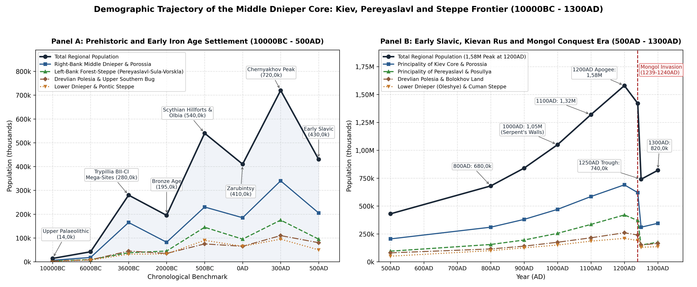
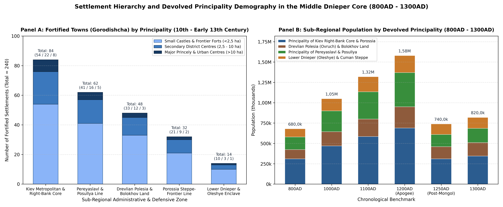
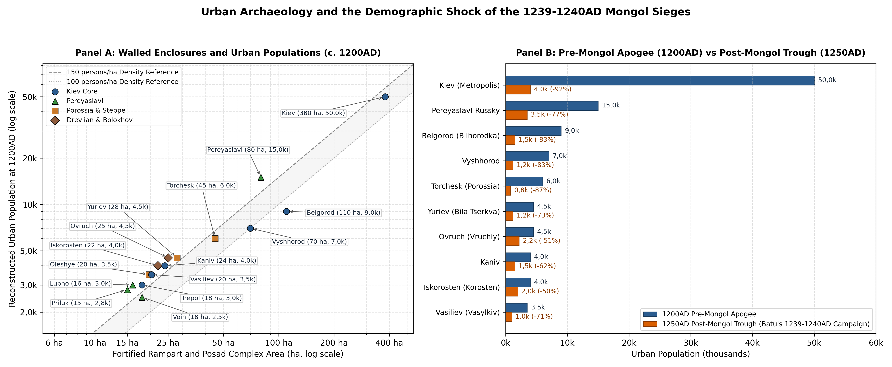

# Abstract

Where the forested rivers of Polesia meet the open black-earth steppe,
the Middle Dnieper valley formed the historic heartland of Kievan Rus
[\[1\]](#ref-tolochko1983)[\[2\]](#ref-kuza1996)[\[3\]](#ref-motsia2007).
Across the pre-Mongol era, the region (~265k km²) passed through four
main waves of settlement growth. After the Eneolithic Trypillia culture
built the great concentric towns of Talianky, Maidanetske and Nebelivka
between the Ros and the Southern Bug around 3600BC (280k inhabitants)
[\[4\]](#ref-videiko2004)[\[5\]](#ref-diachenko2012), Early Iron Age
trade between Scythian forest-steppe hillforts such as Belsk (*Gelonus*,
4,02k ha) and the Greek port of Olbia raised the population to 540k
around 500BC [\[6\]](#ref-shramko1987)[\[7\]](#ref-kryzhitsky1999). A
third agricultural boom under the Roman-era Chernyakhov culture carried
numbers to 720k around 300AD before the Hunnic invasions drove
settlement back into the woods [\[8\]](#ref-magomedov2001).

Under the Rurikid grand princes of the tenth to twelfth centuries, the
construction of more than 950 km of timber-and-earth *Zmiyevy Valy*
(Serpent’s Walls) and 240 fortified towns (*gorodishcha*) along the
Stuhna, Ros and Sula frontiers turned the Middle Dnieper into the most
populous region of Eastern Europe, rising from 1,05M in 1000AD and 1,32M
in 1100AD to 1,58M in 1200AD
[\[1\]](#ref-tolochko1983)[\[2\]](#ref-kuza1996)[\[9\]](#ref-kuchera1999).
Kiev itself reached 50k inhabitants and Pereyaslavl 15k. This exposed
forest-steppe frontier bore the full brunt of the Mongol conquest: Batu
Khan’s storming of Pereyaslavl in March 1239 and the sack of Kiev in
December 1240 cut the regional population by more than half to 740k in
1250AD, and subsequent steppe raids held recovery to 820k by 1300AD
[\[10\]](#ref-ivakin1996)[\[11\]](#ref-dawson1955).

# Background

Geographically, the region covers the Middle Dnieper forest-steppe, the
southern Pripyat, Teterev and Uzh woodlands of Polesia, the Upper
Southern Bug basin and the Lower Dnieper steppe (~265k km² across modern
central and southern Ukraine). Historically, this territory formed the
core of unified Kievan Rus (863-1133AD) and later divided into two
Rurikid principalities and their southern steppe marches (1133-1300AD).

The Principality of Kiev (1133-1322AD, ~95k km²) occupied the Right-Bank
Middle Dnieper plateau and the Irpin, Stuhna, Ros (*Porossia*), Teterev,
Uzh and Sluch river basins (including the Drevlian Ovruch district),
together with the farming country of the Bolokhov Land on the Upper
Southern Bug and Horyn headwaters. Across the river, the Principality of
Pereyaslavl (1133-1364AD, ~68k km²) occupied the Left-Bank black-earth
forest-steppe across the Trubezh, Supoy, Oster, Sula (*Posullya*),
Khorol, Psyol, Vorskla and Upper Seversky Donets basins, serving as the
eastern shield of Southern Rus against the Pechenegs, Torks and
Polovtsians (Cumans). To the south, the Lower Dnieper and Pontic Steppe
(~102k km²) encompassed the Dnieper Rapids (*Porohy*), the
Khortytsia-Protolche river crossing, the Kievan port of Oleshye
(46,62°N, 32,62°E) at the Dnieper-Bug estuary and the winter pastures
(*zimovniki*) of the Black Sea steppe between the Lower Southern Bug and
the Azov coast.

# Results

## Prehistoric and Early Iron Age Settlement

### Upper Palaeolithic, Neolithic and Trypillia Settlements

At the close of the Ice Age (10000BC), Epigravettian mammoth-hunters
camped along the loess river terraces of the Dnieper, Ros, Supoy and
Udai valleys. Excavations at Mezhirich (near Kaniv), Dobranichevka,
Gontsy (on the Udai) and Kirillovskaya (in the Podol district of Kiev)
reveal circular mammoth-bone dwellings housing winter bands of 30 - 60
hunters [\[4\]](#ref-videiko2004)[\[12\]](#ref-tolochko1972). Across the
Middle and Lower Dnieper basin, these hunting territories supported an
estimated population of 14k at 10000BC. Following the transition to the
Neolithic (6000BC), represented by the Bug-Dniester Culture on the Right
Bank and the Dnieper-Donets Culture along the Dnieper Rapids
(Nikolskoye, Vovnigi and Dereivka) and Left-Bank tributaries, fishing,
foraging and early cattle-keeping communities raised the regional
population to 42k.

During the Middle and Late Eneolithic (4200BC - 3200BC), the
forest-steppe plateau between the Southern Bug, the Hnylyi Tikych and
the Ros-Dnieper line became one of the most densely settled parts of
Eneolithic Europe with the rise of the Cucuteni-Trypillia Culture
(Stages BII and CI, peaking around 3600BC). Geomagnetic surveys and
excavations directed by V. A. Kruts, M. Yu. Videiko and international
teams have mapped a group of huge concentric settlements
(*gigant-poseleniia*) on the Cherkasy-Uman plateau that served as
fortified farming towns
[\[4\]](#ref-videiko2004)[\[5\]](#ref-diachenko2012)[\[13\]](#ref-kruts1989).
Talianky (48,8°N, 30,53°E, Stage CI, c. 3700-3500BC) covered 450 ha with
~2,7k houses arranged in concentric ovals; assuming 75-80% of the houses
were occupied at the same time by 5 - 7 persons per two-storey
*ploshchadka* dwelling, Talianky held 15k inhabitants at 3600BC.
Maidanetske (48,82°N, 30,69°E) enclosed 200 ha with ~2k - 2,3k houses
arranged in four concentric rings and public assembly halls, supporting
10k inhabitants. Nebelivka (48,64°N, 30,56°E) covered 260 ha with a
perimeter ditch, a two-storey temple and ~1,45k dwellings, supporting 9k
inhabitants. Sister towns stood at Dobrovody (48,77°N, 30,38°E, 250 ha,
8,5k), Sushkivka (120 ha, 4,5k), Vesely Kut (150 ha, 5k), Kosenivka (120
ha, 4k), Chichirkozovka (100 ha, 3,5k) and Trypillia (Tripolye) on the
Middle Dnieper bluffs (2,5k), alongside Late Trypillia CII Sofievka and
Chapayevka cemeteries on the Kievan terraces [\[4\]](#ref-videiko2004).

Combining the Uman-Cherkasy large towns (~65k in settlements over 80
ha), the Right-Bank Middle Dnieper and Teterev farming villages (~145k)
and the Early Usatovo and Lower Dnieper herding communities (~70k), the
regional population reached an Eneolithic peak of 280k at 3600BC. With
the drier climate of the late fourth millennium BC and the spread of
Yamnaya (Pit-Grave), Catacomb and Middle Dnieper Corded Ware
pastoralists by 2000BC, the great Trypillian towns gave way to mobile
steppe herders and smaller riverside settlements (such as the
copper-working and horse-breeding village at Dereivka and the fortified
bluff at Pustynka), bringing the regional population to 195k in 2000BC.

### Scythian Hillforts, Greek Poleis and the Chernyakhov Horizon

In the Early Iron Age (700BC - 300BC), trade in forest-steppe grain,
hides, wax and slaves for Milesian Greek wine, olive oil and metalwork
through the Lower Bug-Dnieper estuary turned the Middle Dnieper into the
farming heartland of Herodotus’s Scythian ploughmen (*Skolotoi*), Geloni
and Budini [\[6\]](#ref-shramko1987)[\[14\]](#ref-daragan2017). Across
the Left-Bank Vorskla watershed, the Belsk Hillfort (identified by B. A.
Shramko with Herodotus’s Gelonus, 50,09°N, 34,63°E) enclosed 4,02k ha
within 33,8 km of earthen ramparts uniting the Western (72 ha), Eastern
(65,2 ha) and Kuzeminsk (15,4 ha) forts, housing bronze-casting,
iron-smelting and Greek pottery workshops with an estimated population
of 12k [\[6\]](#ref-shramko1987). On the Right Bank and Left-Bank
Sula-Trubezh rivers stood a ring of large hillforts: Trakhtemyriv on the
Kaniv Dnieper bend (500 ha, 4,5k), Khotiv on the southern outskirts of
Kiev (31 ha, 2,5k), Motronyn in the Cherkasy Cold Ravine (200 ha, 4k),
Pastyrskoye (25 ha, 2,5k), Nemirov on the Southern Bug (110 ha, 4k),
Basovka on the Upper Sula (170 ha, 3k) and Knyazha Hora (1,8k)
[\[14\]](#ref-daragan2017). At the same time, along the Lower
Bug-Dnieper coast, Milesian colonists in the mid-seventh to early sixth
centuries BC founded Pontic Olbia (Parutino, 46,69°N, 31,9°E, a 50 ha
stone-walled upper and lower town surrounded by over 100 rural villages
along the Berezan-Bug-Dnieper estuary), which reached 15k inhabitants in
the town itself at 500BC, accompanied by the island trading station of
Berezan (Borysthenes, 2,5k), Nikonion (2k) and Glubokaya Pristan (1,2k)
[\[7\]](#ref-kryzhitsky1999).

Together with open farming villages (*selishcha*) across the
Kiev-Cherkasy plateau and royal Scythian winter camps in the Lower
Dnieper (forerunners of Kamenskoye Gorodishche, 1,2k ha, which peaked in
the fourth century BC at 6k), the Middle and Lower Dnieper supported
540k inhabitants at 500BC.

Following the Sarmatian raids of the third and second centuries BC, the
Zarubintsy Culture (200BC - 100AD, named after the cemetery near
Trakhtemyriv and Pereyaslavl, with key settlements at Pilipenkova Hora
at Kaniv, Chodosovka, the Liutezh ironworks north of Kiev and Subotiv)
maintained a riverine population of 410k at 0AD alongside the late
Scythian stone forts of the Lower Dnieper (Zolota Balka, Gavrilovka,
Lyubimovka and Znamenskoye) [\[15\]](#ref-oblomsky2002). During the Late
Roman period (250AD - 375AD), the Chernyakhov Culture introduced heavy
iron ploughshares, rotary querns and wheel-thrown grey pottery across
more than 1,2k unfortified valley villages in the Kiev, Pereyaslavl and
Cherkasy forest-steppe (Obukhiv, Zhukivtsi, Chernyakhiv, Bilozerka,
Kompaniiets and Velikaya Bugaevka). B. V. Magomedov estimates an average
village size of 15 - 25 homesteads (90 - 150 inhabitants) spaced every
2 - 4 km along minor streams, bringing the regional population to a
pre-medieval peak of 720k at 300AD [\[8\]](#ref-magomedov2001). The
Hunnic invasion of 375AD and the collapse of Roman Black Sea trade
caused a sharp drop; by 500AD, the Early Slavic Prague-Korchak Culture
(in the Right-Bank Polesian and Teterev woods) and the Penkovka Culture
(associated with the *Antae* along the Ros, Tyasmin, Sula and Psyol),
together with the early hilltop settlement on Starokyivska Hora (Kiev,
1,5k at 500AD) and the smithing centre of Pastyrskoye (2,5k in the sixth
and seventh centuries AD), sustained 430k inhabitants
[\[16\]](#ref-baran1988)[\[17\]](#ref-sedov1982).

| Date | Right-Bank Kiev & Porossia | Drevlian & Bolokhov Land | Left-Bank Pereyaslavl & Sula | Lower Dnieper & Steppe | Regional Total |
|:---|:---|:---|:---|:---|:---|
| 10000BC | 6k | 3k | 3k | 2k | 14k |
| 6000BC | 18k | 8k | 9k | 7k | 42k |
| 3600BC | 165k | 45k | 38k | 32k | 280k |
| 2000BC | 82k | 35k | 45k | 33k | 195k |
| 500BC | 230k | 75k | 145k | 90k | 540k |
| 0AD | 185k | 65k | 95k | 65k | 410k |
| 300AD | 340k | 110k | 175k | 95k | 720k |
| 500AD | 205k | 80k | 95k | 50k | 430k |

Sub-regional population estimates (in thousands) across the four
geographic zones of the Middle and Lower Dnieper from the Late
Palaeolithic mammoth-hunter camps (10000BC) to the early Slavic
Prague-Korchak and Penkovka horizon (500AD).

## Early Slavic and Unified Kievan Rus

### Luka-Raikovetska, Volyntsevo and the Rise of Kiev

During the eighth and ninth centuries AD, Eastern Slavic farming
villages multiplied on both banks of the Middle Dnieper. On the Right
Bank, the Luka-Raikovetska Culture built fortified tribal hillforts
(*grady*) and open villages across the Polanian (*Poliane*), Drevlian
(*Drevliane*) and Ulichian (*Ulichi*) lands, including Starokyivska
Hora, Zamkova Hora and the earliest tree-ring-dated log houses in Podol
(887AD layer at Kiev, 5k in 800AD, rising to 12k in 900AD)
[\[1\]](#ref-tolochko1983)[\[18\]](#ref-sahaydak1991), Iskorosten
(Korosten) on the Uzh (1,8k in 800AD), Malyn, Raiky and Monastyrek on
the Kaniv Dnieper bend (1,2k). On the Left Bank, the Volyntsevo-Romny
Culture of the Severians (*Severiane*) occupied the
Desna-Seim-Sula-Psyol forest-steppe (Opishnia, Bititsa at 2k, Romny or
*Romen* at 1,2k and Donets at 1k), paying tribute first to the Khazar
Khaganate before Oleg of Novgorod united the Dnieper waterway in 882AD
[\[19\]](#ref-sukhobokov1992)[\[20\]](#ref-franklin1996). The regional
population recovered to 680k in 800AD and reached 840k in 900AD as
Scandinavian-Slavic *druzhina* retinues organised the *polyudie* winter
tribute round linking the Drevlian, Polanian and Severian rivers to the
Byzantine trade treaties of 907AD and 911AD.

### Vladimir the Great, Yaroslav the Wise and the Serpent’s Walls

The conversion of Rus under Vladimir Svyatoslavich (980-1015AD) and the
building programme of Yaroslav the Wise (1019-1054AD) reshaped the
Middle Dnieper through frontier fortifications and military settlement.
As recorded in the *Primary Chronicle* (*Povest’ vremennykh let*, under
the years 988AD and 991AD), Vladimir declared that it was not good that
there were so few towns around Kiev, and built defensive lines along the
Stuhna, Irpin, Trubezh, Oster, Ros and Sula rivers, garrisoning them
with warriors brought down from the Slovenes of Novgorod, the Krivichi,
the Chud and the Vyatichi
[\[21\]](#ref-tikhomirov1956)[\[22\]](#ref-morgunov2009).

Archaeological excavations by M. P. Kuchera across the Serpent’s Walls
(*Zmiyevy Valy*) show that between the late tenth and mid-eleventh
centuries, the Kievan state built over 950 km of continuous timber-laced
earthen ramparts (10 - 12 m high, fronted by 5 - 6 m ditches) in six
lines: the Vita-Bobrytsia, Stuhna, Irpin-Teterev, Ros (Porossia),
Pereyaslavl-Trubezh and Sula (Posullya) ramparts
[\[9\]](#ref-kuchera1999). Sheltered behind these walls, the number of
rural villages (*selishcha*) tripled between 950AD and 1100AD. By 1000AD
(1,05M regional total), Kiev had grown from Vladimir’s 10 ha *Detinets*
(around the Church of the Tithes, consecrated 996AD) and the artisans’
quarter of *Podol* to 28k inhabitants, ringed by the fortified royal
residences and garrison towns of Belgorod (110 ha enclosure founded
991AD, 6k), Vyshhorod (70 ha, 5k), Vasiliev (Vasylkiv, 2,5k), Trepol
(Trypillia, 2k), Vitichev (1,8k) and the Left-Bank capital of
Pereyaslavl-Russky (80 ha fortified town built 992AD, 8k)
[\[1\]](#ref-tolochko1983)[\[23\]](#ref-kuza1989). By 1100AD (1,32M
regional total), under Yaroslav the Wise (who built the 70 ha *City of
Yaroslav* enclosed by 3,5 km of 16 m-high ramparts, the Golden Gate and
St Sophia Cathedral in 1037AD, and founded the Porossia frontier line
along the Ros in 1032AD around Yuriev or Bila Tserkva, Torchesk and
Korsun) and Vladimir Monomakh (who led the campaigns against the Cumans
from Pereyaslavl after the Congresses of Lyubech in 1097AD and Dolobsk
in 1103AD), Kiev reached 40k inhabitants and Pereyaslavl-Russky reached
12k [\[3\]](#ref-motsia2007)[\[24\]](#ref-tolochko1989).

## Devolved Principalities

Following the death of Mstislav the Great (1132AD), the unified realm
divided into separate dynastic lands (1133AD - 1240AD). In 1200AD, at
the population peak of pre-Mongol Southern Rus, the Middle and Lower
Dnieper region reached 1,58M inhabitants across 240 excavated fortified
towns (*gorodishcha*) catalogued by A. V. Kuza
[\[2\]](#ref-kuza1996)[\[23\]](#ref-kuza1989) and O. P. Motsia
[\[3\]](#ref-motsia2007) and more than 2,8k open rural villages
(*selishcha*).

### The City of Kiev

Excavations by P. P. Tolochko
[\[1\]](#ref-tolochko1983)[\[12\]](#ref-tolochko1972)[\[24\]](#ref-tolochko1989),
M. A. Sahaydak [\[18\]](#ref-sahaydak1991) and H. Yu. Ivakin
[\[10\]](#ref-ivakin1996) show that late twelfth- and early
thirteenth-century Kiev covered 360 - 400 ha (380 ha in our estimates).
The Upper City (*Gora*, ~98 ha) consisted of *Vladimir’s City* (10-12
ha, with princely *dvor* halls, stone churches and boyar compounds),
*Yaroslav’s City* (70 ha, around the metropolitan cathedral of St
Sophia, St Irene, St George and dense housing quarters),
*Izyaslav-Svyatopolk’s City* (8 ha, around St Michael’s Golden-Domed
Monastery) and *Kopyrev Konets* (8 ha on the north-western spur). Below
the bluffs, the Lower City (*Podol*, 180 - 200 ha) has been uncovered
across *Kontraktova Ploshcha*, *Zhytniy Rynok*, *Verkhniy Val* and
*Nyzhniy Val*, revealing fenced urban homesteads (*usadby*) of 300 - 600
m² containing 2 - 3 log dwellings, craft workshops (glass-making,
bone-carving, enamelling, shoemaking and smithing) and merchant
warehouses (*pirohy*). Allowing 3,5k - 4k occupied homesteads across
*Podol* at 6 persons per household gives 22k - 25k residents in the
Lower City alone [\[18\]](#ref-sahaydak1991). Around the walled core lay
suburban monasteries and princely estates (~80 - 100 ha), including the
*Kievo-Pecherskaya Lavra* (Caves Monastery), the princely seat of
*Berestovo*, *Klov*, *Dorogozhichi*, *Vydubychi*, *Kyrylivska*,
*Kitaevo* (a 35 ha fort on the southern Dnieper hills) and *Gnilets*.

Combining the Upper City boyar and clerical households (~15k), the
*Podol* artisan and merchant homesteads (~24k) and *Kopyrev Konets* and
the suburbs (~9k - 11k), Tolochko’s estimate of 50k inhabitants at
1200AD (~131,6 persons/ha across 380 ha) places Kiev among the largest
cities of twelfth-century Europe alongside Constantinople, Paris and
London [\[24\]](#ref-tolochko1989)[\[25\]](#ref-raffensperger2012).

### The Right-Bank Kievan Ring and Stuhna-Dnieper Corridor

Protecting the southern and western approaches to Kiev stood a ring of
princely seats, river ports and forts (84 fortified *gorodishcha* in the
Kiev Core zone: 8 major towns over 10 ha, 22 medium towns of 2,5-10 ha
and 54 small castles under 2,5 ha). Belgorod (Bilhorodka) on the Irpin
(50,39°N, 30,23°E, 110 ha *detinets* and *okolny gorod*, bishopric and
second capital of Rurik Rostislavich) held 9k inhabitants at 1200AD.
Vyshhorod (50,58°N, 30,49°E, 70 ha cliffside citadel and potters’
*posad*, housing the shrine of SS Boris and Gleb) had 7k, while Kaniv
(49,75°N, 31,47°E, 24 ha, Dnieper crossing and muster point against the
Cumans, with the stone Church of St George built in 1144AD) reached 4k.
Other fortified towns included Vasiliev (Vasylkiv) on the Stuhna (20 ha,
3,5k), Trepol (Trypillia, 18 ha Dnieper cliff fortress guarding the
Stuhna mouth, 3k), Roden on *Knyazha Hora* (16 ha craft town near Kaniv,
2,5k), Vitichev (14 ha signal fortress on the Dnieper, 2,2k), Zarub
(1,5k), Chuchin (12 ha, 1,8k), Khalep (1,4k), Svyatoslavl, Ivan-Gorod
(1,5k), Tumasch (1,4k), Kitaigorod (1,5k) and Zvenyhorod-Kievan (1,6k)
[\[2\]](#ref-kuza1996)[\[3\]](#ref-motsia2007).

### The Porossia Steppe-Frontier Line

Along the Ros River valley (80 km south of Kiev), the Kievan grand
princes settled Turkic border horsemen, the Chorni Klobuky (“Black
Hoods”, uniting the Torks, Berendei, Kovui, Turpei and remaining
Pechenegs), in 32 fortified towns (2 major, 9 medium and 21 small)
[\[3\]](#ref-motsia2007)[\[22\]](#ref-morgunov2009). Torchesk (49,68°N,
30,63°E, identified with the 45 ha *Olshanitsa* or *Sharki* hillfort on
the Gorokhovatka-Ros) served as the capital of the Black Hoods and
appanage seat of Mstislav the Bold (1193-1207AD), holding 6k inhabitants
at 1200AD. Yuriev (Bila Tserkva, 49,79°N, 30,11°E, 28 ha *Zamkova Hora*
and *posad*, seat of the Bishop of Yuriev) housed 4,5k, flanked by
Korsun on the Ros (49,42°N, 31,26°E, 16 ha, 2,8k), Boguslavl (49,55°N,
30,87°E, 15 ha, 2,5k), Volodarev (Volodarka, 1,8k), Rostovets (1,8k),
Dveren (1,5k), Polksten (1,5k), Bakhmutov (1,2k), Sakkov (1,1k) and
Borovyi (1k). Together, the Right-Bank Kiev Core and Porossia frontier
supported 690k inhabitants at 1200AD.

### Drevlian Polesia and the Bolokhov Land

North-west and south-west of the Kievan core lay two provinces (~260k
inhabitants at 1200AD) containing 48 fortified *gorodishcha* (3 major
over 10 ha, 12 medium of 2,5-10 ha and 33 small under 2,5 ha). In
Drevlian Polesia, settlement centred on Ovruch (Vruchiy, 51,32°N,
28,8°E, 25 ha, with the brick Church of St Basil built by Rurik
Rostislavich c. 1190AD, 4,5k at 1200AD) and Iskorosten (Korosten,
50,95°N, 28,64°E, a four-citadel town on the Uzh, 22 ha, 4k). As shown
by A. P. Tomashevsky [\[26\]](#ref-tomashevsky2008), the Ovruch ridge
was the sole European source of pink pyrophyllite slate, ringed by more
than 40 quarry and workshop villages (*Nagorany*, *Kamenka* and
*Korenevka*) carving slate spindle-whorls (*priaslitsa*) and sarcophagi
exported across Rus, Poland and Volga Bulgaria. Smaller Drevlian towns
included Vozvyagl (Zviahel) on the Sluch (16 ha, 2,8k), Malyn (1,8k),
Kotelnich (2k), Zhytomyr (1,8k), Horodsk (*Gorodesk*, 2k), Michesk
(Radomyshl, 1,6k), Ushchesk (Ushomyr, 1,5k) and Chornobyl (1,5k at the
Pripyat-Uzh confluence). To the south-west, the Bolokhov Land
(*Bolokhovskaia Zemlia*, 1150-1257AD) occupied the fertile forest-steppe
plateau of the Upper Southern Bug, Sluch and Horyn between the
principalities of Kiev, Galicia-Volhynia and the Cuman steppe; combining
the Right-Bank core (690k) with the Drevlian and Bolokhov lands (260k)
gives 950k across the Principality of Kiev at 1200AD. Ruled by local
princes (*knyaztsi bolokhovskie*), its fortified towns, including
Bolokhov (Lyubar, 15 ha, 2,5k), Gubin (12 ha, 2k), Kudin (1,8k), Kobud
(1,6k), Derevich (1,6k), Bozhsky (*Bozhesk*, 2k), Mezhibozhye
(Medzhybizh, 2,2k) and Dyadkov (1,4k), grew wheat and millet for the
surrounding lands [\[3\]](#ref-motsia2007)[\[27\]](#ref-rappoport1967).

### Principality of Pereyaslavl

East of the Dnieper, the Principality of Pereyaslavl (~420k inhabitants
at 1200AD) served from the eleventh to early thirteenth centuries as the
ancestral domain of the Monomakhovichi and the main military shield of
Southern Rus [\[19\]](#ref-sukhobokov1992)[\[28\]](#ref-morgunov2003).
Surveys by Yu. Yu. Morgunov and O. V. Sukhobokov record 62 fortified
*gorodishcha* across the Pereyaslavl land (5 major over 10 ha, 16 medium
of 2,5-10 ha and 41 small under 2,5 ha). Built at the junction of the
Alta and Trubezh rivers, the capital of Pereyaslavl-Russky (Pereiaslav,
50,07°N, 31,46°E) had a 10 ha *Detinets* (containing Bishop Ephraim’s
stone Cathedral of St Michael built in 1089AD, stone episcopal gates, a
bathhouse and a princely palace) and a 70 ha walled *Okolny Gorod* plus
open riverside *posady* (80 ha walled area, ~100 ha in all), holding 15k
inhabitants at 1200AD [\[1\]](#ref-tolochko1983)[\[2\]](#ref-kuza1996).

Stretching 180 km from the Sula mouth on the Dnieper to the Upper Sula
border with the Kursk-Putivl Severians, the Posullya frontier line
consisted of 18 inter-visible timber-and-earth forts (*gorodishcha*)
anchored at the river mouth by the fortified harbour of Voin (Voinska
Hreblia, 18 ha with a dredged inner ship-basin, 2,5k at 1200AD),
followed upstream by Zheldi (1,4k), Rimiv (14 ha, besieged by Konchak in
1185AD, 2,2k), Lukoml (13 ha, 2k), Lubno (Lubny, 16 ha, founded by
Monomakh, 3k), Khorol (2k), Sneporod (12 ha, 1,8k), Ksniatin (13 ha,
2k), Sinets (1,5k), Romen (Romny, 15 ha, 2,5k) and Glinsk (1,5k)
[\[28\]](#ref-morgunov2003). Behind the Sula line in the interior
Trubezh, Supoy and Oster valleys lay Priluk (Pryluky) on the Udai (15
ha, 2,8k), Nosivka (2,2k), Oster (Gorodets-Ostersky, 14 ha, founded by
Monomakh in 1098AD with St Michael’s *Yurievska Bozhnytsia*, 2,5k),
Baruch (1,8k), Bronnitsa (1,6k), Pesochen (1,5k) and Zholnin (1,4k),
while the south-eastern forest-steppe along the Psyol, Vorskla and
Seversky Donets held Ltava (Poltava, 49,58°N, 34,56°E, 14 ha on *Ivanova
Hora*, mentioned 1174AD, 2,2k), Goltav (1,5k), Nizhegolsk (1,4k) and the
easternmost frontier fortress of Donets (49,85°N, 36,21°E, the
Khorosheve hillfort south of modern Kharkiv, where Igor Svyatoslavich
escaped from Polovtsian captivity in 1185AD, 2k)
[\[19\]](#ref-sukhobokov1992)[\[29\]](#ref-dimnik2003).

### Lower Dnieper Ports and the Steppe Frontier

South of the Porossia and Posullya ramparts lay the Pontic Steppe (*Pole
Polovetskoe*, ~210k inhabitants at 1200AD), where 14 fortified
river-island and delta trading stations shared the country with the
seasonal camps (*vezhi* and winter *zimovniki*) of the Dnieper
Polovtsian hordes (the Burchevichi and Lukomorie Cumans led by Khans
Kobyak, Bonyak and Kotyan) [\[3\]](#ref-motsia2007). At Oleshye
(46,62°N, 32,62°E, on Veliky Potemkin Island opposite modern Kherson and
Oleshky), the sea gate of Kievan Rus covered a 20 ha waterlogged port
yielding thousands of Byzantine amphorae, lead seals of Kievan princes
and Greek officials, glass bracelets and ship fittings; here Kievan war
fleets met Byzantine merchants and newly consecrated Metropolitans,
supporting 3,5k permanent inhabitants at 1200AD. Upstream at Khortytsia
(Protolche, 47,82°N, 35,07°E), the muster station below the Dnieper
Rapids (*Khortytskyi Ostrov* and *Protolche* ford), where the Rus
princes gathered before the 1103AD Suten and 1223AD Kalka campaigns,
held 1,8k inhabitants at 1200AD, alongside Berestovo (Beloberezhye,
1,2k) on the Kinburn spit and Cuman winter towns along the Samara, Orel
and Molochnaya rivers (210k in all across the Lower Dnieper and steppe
at 1200AD).

## Mongol Invasion and Post-Siege Recovery

### Batu Khan’s Campaigns of 1239-1240AD

After the raid of Jebe and Subutai and the defeat of the Kievan,
Galician, Chernigov and Smolensk princes at the Battle of the Kalka
River (31 May 1223AD), where Grand Prince Mstislav Romanovich of Kiev
and 10k Kievan warriors fell, the Middle Dnieper principalities entered
1240AD with a slightly reduced population of 1,42M. The Mongol conquest
of Southern Rus followed in two campaigns
[\[1\]](#ref-tolochko1983)[\[10\]](#ref-ivakin1996)[\[29\]](#ref-dimnik2003).

In March 1239AD, Mongol armies under Möngke and Batu broke through the
Posullya ramparts, burning Rimiv, Voin, Lubno, Lukoml and Priluk, and
stormed Pereyaslavl-Russky on 3 March 1239AD. As recorded in the
*Laurentian* and *Hypatian Chronicles*, St Michael’s Cathedral was
wrecked, Bishop Simeon was killed and the townspeople were slaughtered
or led away into captivity. Excavations across the Pereyaslavl
*Detinets* and the *Posullya* hillforts uncover a continuous 1239AD burn
layer filled with Mongol armour-piercing arrowheads, unburied skeletons
in burned cellars and silver hoards (*klady*) whose owners never
returned [\[28\]](#ref-morgunov2003). After Möngke reconnoitred Kiev
from *Pesochen (Gorodok)* on the Left Bank in late 1239AD, Batu Khan’s
main host crossed the Dnieper in autumn 1240AD, overrunning the Porossia
border towns (Torchesk, Yuriev, Korsun, Vitichev, Vasiliev, Belgorod and
Vyshhorod). Defended by Daniel of Galicia’s commander Dmitr, Kiev was
ringed by Mongol catapults (*poroki*), which breached the Lyadskie Gates
of Yaroslav’s City before a final stand around the Church of the Tithes,
whose vaults collapsed under the weight of defenders and refugees on 6
December 1240AD.

Mass graves excavated by M. K. Karger, P. P. Tolochko and H. Yu. Ivakin
in the Kiev Upper City (over 2k skeletons in pits near the Church of the
Tithes and St Sophia, alongside burned workshops with slain craftsmen
inside) show the scale of the slaughter
[\[1\]](#ref-tolochko1983)[\[10\]](#ref-ivakin1996). When the Papal
envoy Giovanni da Pian del Carpine (John of Plano Carpini) rode through
the Kievan land in February 1246AD, he wrote:

> *“They attacked Rus, where they made great havoc, destroying cities
> and fortresses and slaughtering men; and they laid siege to Kiev, the
> capital of Rus; after they had besieged the city for a long time, they
> took it and put the inhabitants to death. When we were journeying
> through that land we came across countless skulls and bones of dead
> men lying about on the ground. Kiev had been a very large and densely
> populated town, but now it has been reduced almost to nothing, for
> there are at the present time scarce two hundred houses there and the
> inhabitants are kept in utter slavery.”* [\[11\]](#ref-dawson1955)

Allowing for Carpini’s ~200 taxable house compounds (*dvory*) on *Podol*
plus surviving clerical and suburban households around the Caves
Monastery and *Kopyrev Konets*, H. Yu. Ivakin puts Kiev’s population at
3,5k - 4,5k (4k in our tables) in 1250AD, down 92% from its 1200AD peak
of 50k [\[10\]](#ref-ivakin1996).

### The Bolokhov Land and Late Thirteenth-Century Recovery

Losses during the 1239-1240AD invasion fell unevenly across the Middle
Dnieper. The heaviest devastation hit the open forest-steppe (-64% in
Pereyaslavl and Posullya; -55% in Kiev Core and Porossia): along the
Sula and Ros frontier lines, nearly four-fifths of the fortified
*gorodishcha* (Voin, Rimiv, Sneporod, Torchesk, Roden and Vitichev) were
abandoned for good after 1239-1240AD
[\[2\]](#ref-kuza1996)[\[28\]](#ref-morgunov2003). By 1250AD, the total
regional population had fallen to 740k: 310k in the Right-Bank Kiev Core
and Porossia, 150k in the Drevlian and Bolokhov lands, 150k in the
Principality of Pereyaslavl and 130k in the Lower Dnieper and steppe.

Forested Drevlian Polesia and the Bolokhov Land fared better. The marshy
woods of the Teterev, Uzh and Pripyat valleys (Ovruch, Iskorosten,
Chornobyl and Zhytomyr) sheltered countryfolk fleeing the Dnieper
valley. Meanwhile, the towns of the Bolokhov Land (Bolokhov, Gubin,
Kudin, Kobud and Bozhsky) escaped burning in 1240AD by submitting
directly to the Mongols as tribute-paying ploughmen (*Tataropoli*),
growing wheat and millet for Batu’s armies until King Daniel Romanovich
of Galicia-Volhynia marched against them in 1241AD and 1255-1257AD and
levelled their ramparts along with Vozvyagl
[\[3\]](#ref-motsia2007)[\[27\]](#ref-rappoport1967).

After the Golden Horde censuses (*chislo*) of 1257-1259AD and 1273AD
under Mengu-Timur, the Principalities of Kiev and Pereyaslavl were
governed by local Rurikid and Putivl-Olgovichi princes under the watch
of Golden Horde tax-collectors (*baskaki*). Although Metropolitan
Maximus moved the seat of the Metropolitanate of All Rus from Kiev to
Vladimir-on-the-Klyazma in 1299AD, Ivakin’s excavations show a steady
late thirteenth-century revival of crafts and river trade in Kievan
*Podol*, *Pechersk* and the castle on *Zamkova Hora* (8,5k inhabitants
in 1300AD), as well as in Pereyaslavl (4,5k), Ovruch (3k), Iskorosten
(2,6k), Kaniv (2,2k) and Yuriev (2k), lifting the regional population
back to 820k by 1300AD on the eve of the Lithuanian conquest under
Gediminas in the 1320s [\[10\]](#ref-ivakin1996).

| Date | Kiev Core & Porossia | Drevlian & Bolokhov Land | Pereyaslavl & Posullya | Lower Dnieper & Steppe | Regional Total |
|:---|:---|:---|:---|:---|:---|
| 500AD | 205k | 80k | 95k | 50k | 430k |
| 800AD | 310k | 115k | 155k | 100k | 680k |
| 900AD | 380k | 140k | 195k | 125k | 840k |
| 1000AD | 470k | 175k | 255k | 150k | 1,05M |
| 1100AD | 585k | 215k | 335k | 185k | 1,32M |
| 1200AD | 690k | 260k | 420k | 210k | 1,58M |
| 1240AD | 620k | 240k | 370k | 190k | 1,42M |
| 1250AD | 310k | 150k | 150k | 130k | 740k |
| 1300AD | 345k | 165k | 175k | 135k | 820k |

Sub-regional population estimates (in thousands) across the
Principalities of Kiev and Pereyaslavl, the Drevlian-Bolokhov uplands
and the Lower Dnieper frontier from the sixth-century Antae and Polanian
settlements (500AD) to the Golden Horde appanage era (1300AD).

## Comparison with Other Rus Principalities

Table compares the population of the Middle Dnieper (Kiev and
Pereyaslavl) with the northern and eastern Rus principalities between
1000AD and 1300AD
[\[21\]](#ref-tikhomirov1956)[\[23\]](#ref-kuza1989)[\[30\]](#ref-vernadsky1948).

| Principality / Region | 1000AD Pop. | 1100AD Pop. | 1200AD Peak | 1250AD Low | 1300AD Pop. |
|:---|:---|:---|:---|:---|:---|
| Principality of Kiev (incl. Drevlian & Bolokhov) | 645k | 800k | 950k | 460k | 510k |
| Principality of Pereyaslavl (incl. Posullya) | 255k | 335k | 420k | 150k | 175k |
| Lower Dnieper (Oleshye) & Pontic Steppe Frontier | 150k | 185k | 210k | 130k | 135k |
| Kiev and Pereyaslavl Subtotal | 1,05M | 1,32M | 1,58M | 740k | 820k |
| cf. Vladimir-Suzdal/Rostov (European Russia) | 340k | 510k | 780k | 520k | 640k |
| cf. Novgorod & Pskov Republics (European Russia) | 290k | 380k | 480k | 460k | 510k |
| cf. Principality of Smolensk (European Russia) | 210k | 275k | 340k | 290k | 310k |
| cf. Kursk-Rylsk & Bryansk-Upper Oka (European Russia) | 280k | 390k | 500k | 270k | 310k |
| cf. Total European Russia Benchmark | 2,15M | 2,9M | 3,85M | 2,8M | 3,1M |

Population of the Kievan and Pereyaslavl principalities compared with
Vladimir-Suzdal, Novgorod-Pskov, Smolensk and the northern
Chernigov-Seversk appanages, 1000AD - 1300AD. Whereas European Russia
lost 27,3% of its population between 1200AD and 1250AD, the exposed
Middle Dnieper heartland fell by 53,2%.

# Conclusion

Until the eve of the Mongol invasion, the Middle Dnieper remained the
most populous and urbanised heartland of the Rus world (1,58M
inhabitants in 1200AD), containing two of its five largest cities (Kiev
at 50k and Pereyaslavl at 15k) and 240 fortified towns. Yet the same
open forest-steppe terrain that made the black-earth river valleys so
productive also left them exposed to Batu Khan’s siege armies in
1239-1240 and to decades of Golden Horde border raids thereafter.
Whereas the population of European Russia fell by 27,3% between 1200AD
and 1250AD (from 3,85M to 2,8M, cushioned by the uninvaded forests of
Novgorod, Pskov and Smolensk) and recovered to four-fifths of its
pre-Mongol level by 1300AD (3,1M), the Middle Dnieper lost more than
half its people (falling 53,2% from 1,58M to 740k in 1250AD) and by
1300AD had regained little more than half of its old numbers (820k). The
centre of gravity of Eastern Slavic population had shifted permanently
to the northern forests and the Carpathian west.

# Sources

1.
Tolochko, Petro Petrovych.
*Drevnii Kiev \[Ancient Kiev\]*. Naukova Dumka, 1983,
<https://doi.org/10.2307/129285>.

2.
Kuza, Andrei Vasilievich.
*Drevnerusskie Gorodishcha x-XIII Vv.: Svod Arkheologicheskikh
Pamiatnikov \[Old Rus Fortified Settlements of the 10th-13th Centuries:
Corpus of Archaeological Monuments\]*. Khristianskoe Izdatelstvo, 1996,
<https://search.worldcat.org/search?q=Old+Rus+Fortified+Settlements+10th+13th+Centuries+Corpus+Kuza+1996>.

3.
Motsia, Oleksandr Petrovych.
*Pivdenna Rus’ska Zemlia v IX-XIII St. \[The Southern Rus Land in the
9th-13th Centuries\]*. Instytut Arkheolohii NAN Ukrainy, 2007,
<https://search.worldcat.org/search?q=Southern+Rus+Land+9th+13th+Centuries+Motsia+2007>.

4.
Videiko, Mykhailo Yuriiovych.
*Encyclopedia of Trypillia Civilization, Volumes 1-2*.
Ukrpolihrafmediia, 2004,
<https://search.worldcat.org/search?q=Encyclopedia+Trypillia+Civilization+Volumes+Videiko+2004>.

5.
Diachenko, Aleksandr, and
Francesco Menotti. “The Gravity Model: Monitoring the Formation and
Development of the Tripolye Culture Giant-Settlements in Ukraine.”
*Journal of Archaeological Science*, vol. 39, no. 8, 2012, pp. 2810-17,
<https://doi.org/10.1016/j.jas.2012.04.025>.

6.
Shramko, Boris Andreevich.
*Belskoe Gorodishche Skifskoi Epokhi (Gorod Gelon) \[the Belsk Hillfort
of the Scythian Epoch (the City of Gelonus)\]*. Naukova Dumka, 1987,
<https://search.worldcat.org/search?q=Belsk+Hillfort+Scythian+Epoch+City+Gelonus+Shramko+1987>.

7.
Kryzhitsky, Sergei Dmitrievich, et
al. *Olviia: Antychnoe Gosudarstvo v Severnom Prichernomore \[Olbia: An
Ancient State in the Northern Black Sea Region\]*. Instytut Arkheolohii
NAN Ukrainy, 1999,
<https://search.worldcat.org/search?q=Olbia+Ancient+State+Northern+Black+Sea+Region+Kryzhitsky+1999>.

8.
Magomedov, Boris Viktorovych.
*Cherniakhovskaia Kultura: Problema Etnosa \[the Chernyakhov Culture:
The Problem of Ethnos\]*. UMCS, 2001,
<https://search.worldcat.org/search?q=Chernyakhov+Culture+Problem+Ethnos+Magomedov+2001>.

9.
Kuchera, Mykhailo Petrovych.
*Zmiievi Valy Serednoho Podniprov’ia \[the Serpent’s Walls of the Middle
Dnieper Region\]*. Instytut Arkheolohii NAN Ukrainy, 1999,
<https://search.worldcat.org/search?q=Serpent+Walls+Middle+Dnieper+Region+Kuchera+1999>.

10.
Ivakin, Hlib Yuriiovych.
*Istorychnyi Rozvytok Kyieva XIII - Seredyny XVI St.
(Istoryko-Topohrafichni Narysy) \[Historical Development of Kiev from
the 13th to the Mid-16th Century\]*. Instytut Arkheolohii NAN Ukrainy,
1996,
<https://search.worldcat.org/search?q=Historical+Development+Kiev+13th+Mid+16th+Century+Ivakin+1996>.

11.
Dawson, Christopher. *The Mongol
Mission: Narratives and Letters of the Franciscan Missionaries in
Mongolia and China in the Thirteenth and Fourteenth Centuries*. Sheed;
Ward, 1955,
<https://search.worldcat.org/search?q=Mongol+Mission+Narratives+Letters+Franciscan+Missionaries+Mongolia+China+Dawson+1955>.

12.
Tolochko, Petro Petrovych.
*Istorychna Topohrafiia Starodavnoho Kyieva \[Historical Topography of
Ancient Kiev\]*. Naukova Dumka, 1972,
<https://search.worldcat.org/search?q=Historical+Topography+Ancient+Kiev+Tolochko+1972>.

13.
Kruts, Volodymyr Afanasiiovych. “K
Istorii Naseleniia Tripolskoi Kultury v Mezhdureche Yuzhnogo Buga i
Dnepra \[on the History of the Population of the Trypillia Culture in
the Southern Bug and Dnieper Interfluve\].” *Pervobytnaia Arkheologiia:
Materialy i Issledovaniia*, 1989, pp. 117-32,
<https://cyberleninka.ru/article/n/k-istorii-naseleniia-tripolskoi-kultury-v-mezhdureche-yuzhnogo-buga-i-dnepra>.

14.
Daragan, Marina N. “Large
Fortified Settlements of the Scythian Time in the Ukrainian
Forest-Steppe.” *Ancient Civilizations from Scythia to Siberia*, vol.
23, 2017, pp. 57-116,
<https://doi.org/10.1163/15700577-12341312>.

15.
Oblomsky, Andrei Mikhailovich.
*Dneprovskoe Lesostepnoe Levoberezhe v Pozdnerimskoe i Gunnskoe Vremia
\[the Dnieper Forest-Steppe Left Bank in the Late Roman and Hunnic
Periods\]*. Nauka, 2002,
<https://search.worldcat.org/search?q=Dnieper+Forest+Steppe+Left+Bank+Late+Roman+Hunnic+Oblomsky+2002>.

16.
Baran, Volodymyr Danylovych.
*Prazhskaia Kultura Podnestrovia (Po Materialam Poseleniia u s. Rashkov)
\[the Prague Culture of the Dniester Region\]*. Naukova Dumka, 1988,
<https://search.worldcat.org/search?q=Prague+Culture+Dniester+Region+Baran+1988>.

17.
Sedov, Valentin Vasilievich.
*Vostochnye Slaviane v VI-XIII Vv. \[The Eastern Slavs in the 6th-13th
Centuries\]*. Nauka, 1982,
<https://search.worldcat.org/search?q=Eastern+Slavs+6th+13th+Centuries+Sedov+1982>.

18.
Sahaydak, Mykhailo Andriyovych.
*Davnokyivskyi Podil: Problemy Topohrafii, Stratyhrafii, Khronolohii
\[Ancient Kievan Podol: Problems of Topography, Stratigraphy,
Chronology\]*. Naukova Dumka, 1991,
<https://search.worldcat.org/search?q=Ancient+Kievan+Podol+Problems+Topography+Stratigraphy+Chronology+Sahaydak+1991>.

19.
Sukhobokov, Oleh Vasylovych.
*Dniprovske Lisostepove Livoberezhzhia u VIII-XIII St. \[The Dnieper
Forest-Steppe Left Bank in the 8th-13th Centuries\]*. Naukova Dumka,
1992,
<https://search.worldcat.org/search?q=Dnieper+Forest+Steppe+Left+Bank+8th+13th+Centuries+Sukhobokov+1992>.

20.
Franklin, Simon, and Jonathan
Shepard. *The Emergence of Rus 750-1200*. Longman, 1996,
<https://doi.org/10.4324/9781315836898>.

21.
Tikhomirov, Mikhail Nikolaevich.
*Drevnerusskie Goroda \[Old Russian Towns\]*. Gosudarstvennoe
Izdatelstvo Politicheskoi Literatury, 1956,
<https://search.worldcat.org/search?q=Old+Russian+Towns+Tikhomirov+1956>.

22.
Morgunov, Yurii Yurievi.
*Drevo-Zemlianye Ukrepleniia Yuzhnoi Rusi x-XIII Vekov
\[Timber-and-Earth Fortifications of Southern Rus in the 10th-13th
Centuries\]*. Nauka, 2009,
<https://search.worldcat.org/search?q=Timber+Earth+Fortifications+Southern+Rus+10th+13th+Centuries+Morgunov+2009>.

23.
Kuza, Andrei Vasilievich. *Malye
Goroda Drevnei Rusi \[Small Towns of Ancient Rus\]*. Nauka, 1989,
<https://search.worldcat.org/search?q=Small+Towns+Ancient+Rus+Kuza+1989>.

24.
Tolochko, Petro Petrovych.
“Naselennia Kyieva x-XIII St. \[Population of Kiev in the 10th-13th
Centuries\].” *Istoriia Kyieva, Tom 1: Starodavnii i Serednovichnyi
Kyiv*, Naukova Dumka, 1989, pp. 108-24,
<https://scholar.google.com/scholar?q=Population+Kiev+10th+13th+Centuries+Tolochko+1989>.

25.
Raffensperger, Christian.
*Reimagining Europe: Kievan Rus in the Medieval World*. Harvard
University Press, 2012,
<https://doi.org/10.4159/harvard.9780674065468>.

26.
Tomashevsky, Andriy Petrovych.
“Ovrutska Volost u Strukturi Kyivskoi Zemli x-XIII St. \[The Ovruch
Volost in the Structure of the Kievan Land in the 10th-13th
Centuries\].” *Arkheolohiia*, vol. 2, 2008, pp. 38-54,
<https://arheologia.com.ua/index.php/arheologia/issue/archive>.

27.
Rappoport, Pavel Aleksandrovich.
*Voennoe Zodchestvo Zapadnorusskikh Zemel x-XIV Vv. \[Military
Architecture of the West Russian Lands in the 10th-14th Centuries\]*.
Nauka, 1967,
<https://search.worldcat.org/search?q=Military+Architecture+West+Russian+Lands+10th+14th+Centuries+Rappoport+1967>.

28.
Morgunov, Yurii Yurievi.
*Drevnerusskie Pamiatniki Porechia Suly \[Old Rus Monuments of the Sula
River Basin\]*. Kurskii Gosudarstvennyi Oblastnoi Muzei Arkheologii,
2003,
<https://search.worldcat.org/search?q=Old+Rus+Monuments+Sula+River+Basin+Morgunov+2003>.

29.
Dimnik, Martin. *The Dynasty of
Chernigov, 1146-1246*. Cambridge University Press, 2003,
<https://doi.org/10.1017/cbo9780511496479>.

30.
Vernadsky, George. *Kievan
Russia*. Yale University Press, 1948,
<https://search.worldcat.org/search?q=Kievan+Russia+Vernadsky+1948>.

