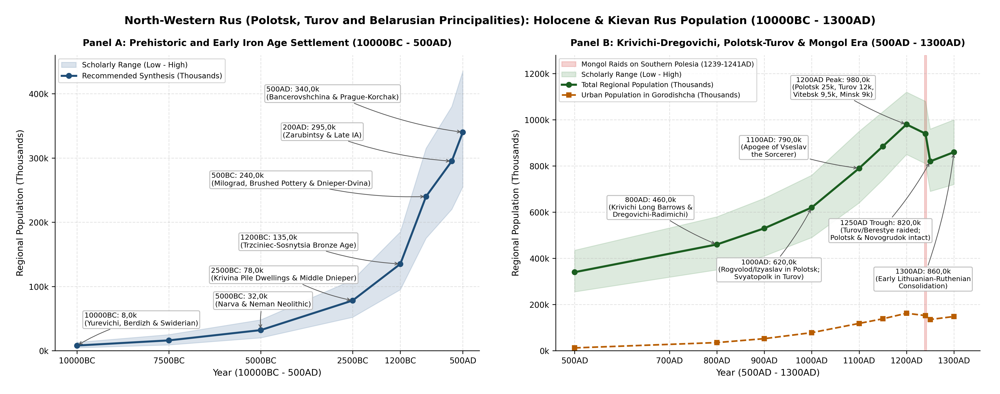
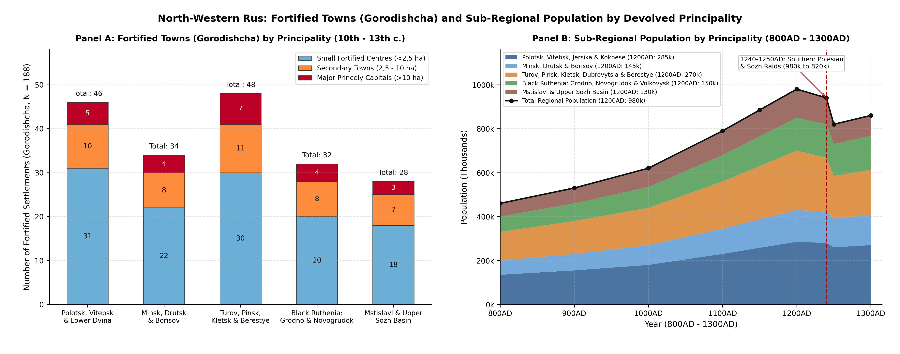
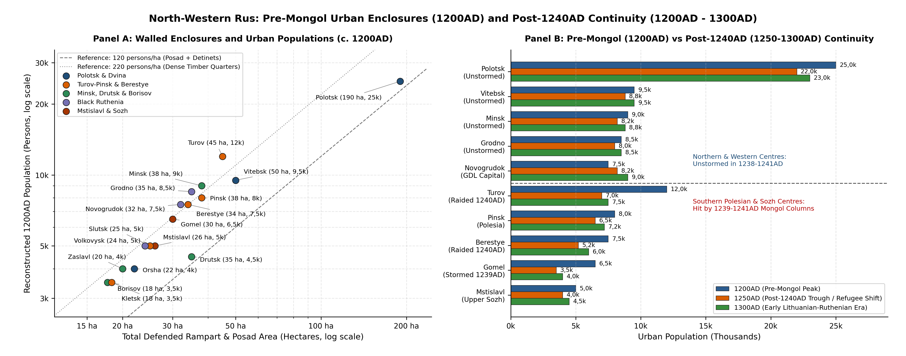

# Abstract

Straddling the river portages that linked the Dnieper with the Baltic
Sea along the Western Dvina, Neman and Western Bug, the lands of
Polotsk, Turov and Belarusian Rus (207,6k km²) formed the north-western
wing of the East Slavic world
[\[1\]](#ref-shtykhov1992goroda)[\[2\]](#ref-zagorulsky2001arkheologiya)[\[3\]](#ref-lysenko2004drevniy).
From a Final Palaeolithic base of 8k reindeer hunters in 10000BC and 32k
Neolithic lake-dwellers in 5000BC, regional population rose to 240k in
500BC across more than 1,1k Iron Age hillforts and reached 340k by 500AD
[\[4\]](#ref-charniauski1997arkhealogiya)[\[5\]](#ref-isaenko1999arkhealogiya).
Between the sixth and tenth centuries, Slavic settlement by the
Krivichi, Dregovichi and Radimichi merged with local Baltic communities
to carry the population from 460k in 800AD to 620k in 1000AD
[\[6\]](#ref-sedov1970slavyane).

Under the independent Izyaslavichi princes of Polotsk and the Rurikid
rulers of Turov, Pinsk and Grodno, the region reached a pre-Mongol peak
of 980k inhabitants in 1200AD across 188 fortified towns
(*gorodishcha*), led by Polotsk (25k), Turov (12k), Vitebsk (9,5k),
Minsk (9k), Grodno (8,5k), Pinsk (8k), Novogrudok (7,5k) and Berestye
(7,5k)
[\[1\]](#ref-shtykhov1992goroda)[\[7\]](#ref-tarasov1998polotsk)[\[8\]](#ref-kuza1989malye).
During Batu Khan’s campaigns of 1239-1241, Mongol columns sacked Gomel
on the lower Sozh and raided the southern Pripyat towns of Turov, Mozyr
and Berestye, but the dense Polesian marshes shielded Polotsk, Vitebsk,
Minsk and Black Ruthenia from attack. Total population dipped by only
16,3% to 820k in 1250AD and recovered to 860k by 1300AD, providing the
urban and military backbone of the early Grand Duchy of Lithuania
[\[9\]](#ref-gurevich1981drevniy)[\[10\]](#ref-lowmianski1983studia).
These figures connect directly with the neighbouring Russian series for
Novgorod-Pskov (310k in 1000AD and 480k in 1200AD) and Smolensk east of
31°E (220k in 1000AD and 340k in 1200AD).

# Background

Across the Kievan Rus and appanage periods (980AD - 1300AD),
North-Western Rus fell into five main river-basin groups
[\[1\]](#ref-shtykhov1992goroda)[\[2\]](#ref-zagorulsky2001arkheologiya)[\[3\]](#ref-lysenko2004drevniy)[\[8\]](#ref-kuza1989malye).

In the north along the Western Dvina (Daugava), the senior Izyaslavichi
patrimony comprised the Principality of Polotsk (1001-1241AD), the
Principality of Vitebsk (1102-1321AD) with *Orsha* and *Kopys*, and the
lower Dvina tributary principalities of Jersika (1001-1210AD) and
Koknese (1191-1210AD) in Latgale and Selonia
[\[7\]](#ref-tarasov1998polotsk)[\[11\]](#ref-shtykhov1975drevniy)[\[12\]](#ref-alekseev1966polotskaya)[\[13\]](#ref-mugurevics1965vostochnaya).
Across the central Minsk Upland and the Upper Berezina, Svisloch and
Drut portages lay the southern Izyaslavichi principalities of Minsk
(1102-1327AD, moved from the tenth- and eleventh-century *Menka* fort to
the Svisloch-Nemiga *Zamchishche* after 1067AD), Drutsk (1102-1251AD)
and Borisov (1102-1301AD), alongside *Zaslavl* (*Izyaslavl*), *Logoisk*
(*Logozhsk*) and *Svisloch-on-Berezina*
[\[1\]](#ref-shtykhov1992goroda)[\[14\]](#ref-zagorulsky1982vozniknovenie).
In the south along the Pripyat, Pina, Yaselda, Sluch, Lan, Ptich and
Horyn rivers, Pripyat Polesia and the Berestye Land encompassed the
principalities of Turov (1133-1341AD), Pinsk (1175-1321AD), Kletsk
(1148-1401AD) with *Slutsk* and *Kopyl*, and Dubrovytsia (1175-1301AD),
together with the Western Bug-Mukhavets frontier towns of Berestye
(*Brest*) and Kamenets
[\[3\]](#ref-lysenko2004drevniy)[\[15\]](#ref-lysenko1974goroda)[\[16\]](#ref-lysenko1985berestye).
To the west along the Upper Neman, Shchara and Rossa rivers, Black
Ruthenia (*Chornaya Rus*) covered the Slavic-Baltic borderland around
the principalities of Grodno (*Goroden*, 1128-1201AD), Novogrudok
(1201-1241AD) and Volkovysk (1201-1241AD), with *Slonim*,
*Zditovo-on-Molchad* and *Turiisk-on-Neman*
[\[9\]](#ref-gurevich1981drevniy)[\[17\]](#ref-voronin1954drevnee)[\[18\]](#ref-zverugo1989verkhnee).
In the east along the Vikhra, Upper Dnieper and Sozh rivers west of 31°E
stood the Principality of Mstislavl (1181-1198AD) and the western
Smolensk and northern Chernigov-Radimichi towns of *Propoisk*
(*Prupoi*), *Krichev*, *Luchin*, *Shklov*, *Mogilev*, *Radoml*,
*Chechersk*, *Rechitsa* and *Gomel* (*Homiy*)
[\[19\]](#ref-alekseev1980smolenskaya)[\[20\]](#ref-sedov1982vostochnye).

| Date | Population | Low | High | Density (per km2) | Urban Pop. | Historical Notes |
|:---|:---|:---|:---|:---|:---|:---|
| 10000BC | 8k | 4,5k | 13k | 0,04 | \- | Yurevichi, Berdizh, Swiderian & Grensk Final Palaeolithic |
| 5000BC | 32k | 20k | 48k | 0,15 | \- | Narva, Neman, Dnieper-Donets & Upper Dnieper Neolithic |
| 2500BC | 78k | 52k | 110k | 0,38 | \- | Krivina pile dwellings (Asavets), Middle Dnieper & Corded Ware |
| 1200BC | 135k | 95k | 185k | 0,65 | \- | Trzciniec-Sosnytsia & North Belarusian Bronze Age |
| 500BC | 240k | 175k | 315k | 1,16 | \- | Milograd, Brushed Pottery & Dnieper-Dvina (\>1,1k hillforts) |
| 200AD | 295k | 220k | 380k | 1,42 | \- | Polesian Zarubintsy (Chaplin), Late Brushed Pottery & Wielbark |
| 500AD | 340k | 255k | 435k | 1,64 | 12k | Bancerovshchina-Tushemlya, Kolochin & Prague-Korchak |
| 800AD | 460k | 350k | 580k | 2,22 | 35k | Polotsk Krivichi Long Barrows, Dregovichi & Radimichi |
| 900AD | 530k | 410k | 660k | 2,55 | 52k | Early Polotsk (Gorodishche), Vitebsk, Turov & Menka crafts |
| 1000AD | 620k | 490k | 760k | 2,99 | 78k | Rurikid & Izyaslavichi consolidation in Polotsk & Svyatopolk in Turov |
| 1100AD | 790k | 640k | 950k | 3,81 | 118k | Apogee of Vseslav the Sorcerer (1044-1101AD) & Turov Yuryevichi |
| 1200AD | 980k | 850k | 1,12M | 4,72 | 162k | Pre-Mongol urban & kurgan peak across 188 gorodishcha |
| 1240AD | 940k | 810k | 1,08M | 4,53 | 152k | Batu’s southern raids on Gomel (1239), Turov, Mozyr & Berestye (1240-1241) |
| 1250AD | 820k | 690k | 960k | 3,95 | 135k | Post-1240 trough in Polesia & Sozh; Polotsk, Vitebsk, Minsk & Novogrudok unstormed |
| 1300AD | 860k | 720k | 1M | 4,14 | 148k | Early Lithuanian-Ruthenian realm (Black Ruthenia, Polotsk & Vitebsk) |

Estimated population, uncertainty ranges, settlement density and urban
totals across the Western Dvina, Pripyat, Neman and Sozh basins (207,6k
km²) from the Final Palaeolithic camps of Yurevichi and Berdizh
(10000BC) to the early Lithuanian-Ruthenian realm (1300AD).

# Results

## Prehistory and the Iron Age

### Final Palaeolithic and Mesolithic

Human settlement across the Belarusian river basins began during the
warmer intervals of the Late Pleistocene before the Last Glacial Maximum
(26000BC - 21000BC). The two best-known Upper Palaeolithic
mammoth-hunter camps in Belarus are Yurevichi (Yuravichy, Kalinkovichi
district) on a high terrace of the lower Pripyat (c. 24500BC) and
Berdizh (Berdydzh, Chechersk district) on the Sozh (c. 21500BC), where
sunken dwellings framed with mammoth skulls, tusks and long bones were
excavated by K. M. Polikarpovich and V. D. Budko
[\[2\]](#ref-zagorulsky2001arkheologiya)[\[4\]](#ref-charniauski1997arkhealogiya).
After the Poozerie (Valdai) ice sheet retreated from northern Vitebsk
around 12000BC - 10000BC, Final Palaeolithic reindeer-hunting bands of
the Swiderian, Lyngby and Grensk cultures moved onto the sandy plains
and lake shores of the Neman, Pripyat, Upper Dnieper, Sozh and Western
Dvina valleys (*Grensk* and *Korma* on the Sozh, *Ankovichi* in the
Poozerie and *Borok* on the Neman). At 10000BC, the population across
this tundra-parkland zone is estimated at 8k inhabitants (range 4,5k -
13k, 0,04 per km²) [\[4\]](#ref-charniauski1997arkhealogiya).

During the Boreal and Atlantic Mesolithic (8000BC - 5000BC), warmer
temperatures and the spread of pine-birch and oak-hornbeam forests
supported larger hunter-fisher communities across three cultural zones:
the Kunda culture in the northern lake district (Western Dvina basin),
the Janislawice (Neman) Mesolithic across the Neman and Western Bug
basins and the Sozh and Upper Dnieper Mesolithic in eastern Belarus
[\[4\]](#ref-charniauski1997arkhealogiya). Over 400 Mesolithic camps
have been recorded along lake shores and river junctions.

### Neolithic River and Lake Settlements

The Neolithic period (5000BC - 2200BC) brought a four-fold increase in
population (32k inhabitants at 5000BC, rising to 78k by 2500BC),
supported by lake fishing, wildfowling and the gradual spread of
stockbreeding and millet, barley and emmer cultivation
[\[2\]](#ref-zagorulsky2001arkheologiya)[\[4\]](#ref-charniauski1997arkhealogiya).
In the Vitebsk lake district, the Narva and Usvyaty cultures built
waterlogged pile-dwelling villages in the Krivina peat basin
(Beshenkovichi and Senno districts: *Asavets 2*, *Asavets 7*, *Kryvina
1* and *Aztsy*), excavated by M. M. Charniauski; waterlogged layers at
*Asavets* preserved wooden fish-weirs, dugout canoes, horn hoes, Baltic
amber ornaments and carved bone and wooden figures
[\[4\]](#ref-charniauski1997arkhealogiya). Across the Upper Neman and
Western Bug, the Neman Culture made pointed-bottom and flat-bottom pots
tempered with plant fibres and crushed granite (*Kamen*, *Rusakovo* and
*Dobry Bor*), and worked the underground Krasnoselsky flint mines on the
Rossa river near Volkovysk, where over 1k vertical shafts up to 6 - 9 m
deep were dug into chalk strata with antler picks to extract dark flint
for polished axes traded across the Baltic-Dnieper region
[\[4\]](#ref-charniauski1997arkhealogiya). At the same time, the
Dnieper-Donets Culture (in Pripyat Polesia and the Lower Sozh) and the
Upper Dnieper Culture (in eastern Belarus) lived in permanent riverside
villages along the Pripyat, Yaselda, Berezina and Sozh (*Litvinovichi*,
*Strumen* and *Grodno-Neman*).

### Bronze and Iron Age Hillforts

During the Late Eneolithic and Bronze Age (2500BC - 700BC), pastoral and
farming communities of the Middle Dnieper Culture (2400BC - 1500BC, a
branch of the Corded Ware or Battle-Axe horizon, with major barrow and
flat cemeteries at *Strelitsa* and *Khodosovichi* near Rogachev),
Polesian and Strzyzow groups and the North Belarusian and
Trzciniec-Sosnytsia cultures (1500BC - 1000BC) cleared river terraces
for cattle, pigs, sheep and goats alongside bronze-casting workshops
using imported Carpathian and Alpine copper
[\[4\]](#ref-charniauski1997arkhealogiya). The regional population grew
from 78k at 2500BC to 135k at 1200BC.

The Early and Middle Iron Age (700BC - 400AD) introduced local bog-iron
smelting and covered the Belarusian landscape with more than 1,1k
fortified timber-and-earth hillforts (*gorodishcha*). Archaeologists
divide these hillforts into three east-west belts that foreshadow early
medieval Baltic and Slavic settlement
[\[5\]](#ref-isaenko1999arkhealogiya)[\[21\]](#ref-mitrofanov1978zhelezny)[\[22\]](#ref-pobol1983arkheologicheskie).
In northern Belarus and the Vitebsk lake district, the Dnieper-Dvina
Culture (700BC - 400AD) occupied the Western Dvina and upper Dnieper
basins (*Polotsk-Gorodishche*, *Vitebsk-Zamkovaya Gora*, *Lukoml* and
*Novye Bateki*), building small cliff-top hillforts (0,3 - 1,2 ha) with
concentric earthen ramparts and timber palisades and living by
slash-and-burn (*podseka*) farming, stockbreeding and ironworking
[\[5\]](#ref-isaenko1999arkhealogiya). Across central and north-western
Belarus, the Brushed Pottery Culture (*Kultura Shtrikhovannoy Keramiki*,
700BC - 400AD) held the Minsk Upland and Upper Neman basin (*Malyshki*,
*Zazony*, *Viazynka*, *Novogrudok* and *Slonim*), where A. G. Mitrofanov
excavated multi-room post-built longhouses inside ring-forts
[\[21\]](#ref-mitrofanov1978zhelezny). In southern Belarus across the
Pripyat and Lower Berezina-Sozh valleys, the Milograd Culture (700BC -
100BC) and Zarubintsy Culture (200BC - 200AD) spanned Gomel, southern
Mogilev and Brest Polesia (*Milograd*, *Goroshkov*, *Chaplin*, *Mokhov*,
*Voronino* and *Otverzhichi*); unlike the small northern hillforts,
Milograd and Polesian Zarubintsy communities built larger lowland forts
(2 - 8 ha) and open farming villages (3 - 10 ha) equipped with iron
plough-tips (*ralniki*), sickles and rotary querns
[\[5\]](#ref-isaenko1999arkhealogiya)[\[22\]](#ref-pobol1983arkheologicheskie).

By 500BC, more than 1,1k hillforts and open villages (*selyshcha*)
supported 240k inhabitants (range 175k - 315k), rising to 295k by 200AD
during the Zarubintsy and Wielbark period. Across the Late Roman and
Migration periods (200AD - 500AD), contact between early Slavic farmers
and local Baltic communities produced the Kiev, Kolochin (in the Sozh
basin, named after the *Kolochin* hillfort near Rechitsa),
Bancerovshchina-Tushemlya (central and northern Belarus, named after the
*Bancerovshchina* hillfort on the Svisloch near Minsk) and
Prague-Korchak (Pripyat Polesia, at *Snyadin*, *Petrikov* and
*Bereztsy*) cultures, bringing the 500AD regional population to 340k
(range 255k - 435k)
[\[5\]](#ref-isaenko1999arkhealogiya)[\[6\]](#ref-sedov1970slavyane).

## Early Slavic and Kievan Rus Principalities

### Tribal Confederations

Between the sixth and tenth centuries, the *Primary Chronicle* (*Povest
Vremennykh Let*) and barrow (*kurgan*) excavations trace the growth of
three major East Slavic tribal unions across Belarus, which gradually
absorbed the local Baltic (East Lithuanian, Yotvingian and
Latgalian-Selonian) population
[\[2\]](#ref-zagorulsky2001arkheologiya)[\[6\]](#ref-sedov1970slavyane)[\[20\]](#ref-sedov1982vostochnye).
The Polotsk-Smolensk Krivichi (*Polochane*) settled along the Western
Dvina, Polota, Drissa, Ulla, Kasplya and Upper Berezina rivers, leaving
elongated Long Barrows (*Dlinnye Kurgany*, sixth to ninth centuries)
with cremation burials, followed in the ninth to eleventh centuries by
round barrows with bronze bracelet-shaped temple rings
(*brasletoobraznye visochnye koltsa*)
[\[1\]](#ref-shtykhov1992goroda)[\[6\]](#ref-sedov1970slavyane). The
Dregovichi (*Drygavichy*) occupied the Pripyat basin north to the Minsk
Upland (meeting the Krivichi along the Svisloch-Berezina watershed at
*Zaslavl*, *Minsk*, *Logoisk* and *Borisov*), where their burial mounds
contain large granulated silver and bronze bead temple rings
(*krupnozernistye businnye koltsa*) and timber burial chambers
(*domoviny*)
[\[15\]](#ref-lysenko1974goroda)[\[20\]](#ref-sedov1982vostochnye). The
Radimichi settled along the Sozh, Pronya, Iput, Besed and Ostyor rivers
in eastern Belarus (with major hillforts at *Radoml*, *Propoisk* or
*Prupoi* and *Gomel* or *Homiy*), marked by seven-rayed bronze temple
rings (*semiluchevye visochnye koltsa*)
[\[19\]](#ref-alekseev1980smolenskaya)[\[20\]](#ref-sedov1982vostochnye).
Along the western and north-western edges, Yotvingians (*Yatvyagi*),
Lithuanians (*Litva*), Latgalians and Selonians held the Upper Neman
(*Grodno*, *Novogrudok*, *Volkovysk*, *Slonim*, *Lida* and *Krevo*) and
Lower Western Dvina (*Braslav*, *Jersika*, *Koknese* and *Asote*)
borderlands, where mixed Slavic-Baltic stone-ring barrows (*kamennye
mogilniki*) mark a shared frontier zone
[\[9\]](#ref-gurevich1981drevniy)[\[13\]](#ref-mugurevics1965vostochnaya)[\[18\]](#ref-zverugo1989verkhnee).

The regional population grew from 460k in 800AD to 530k in 900AD and
620k in 1000AD, alongside 310k in *Novgorod-Pskov* and 220k in *Eastern
Smolensk* within European Russia.

### The Polotsk Land

Unlike the southern and eastern principalities of Kievan Rus, the
Principality of Polotsk (1001-1241AD, 55,49°N, 28,8°E) kept its own
ruling house under the Izyaslavichi (*Rogvolodovichi*), descendants of
Prince Rogvolod (d. 978AD), his daughter Rogneda and her son by Vladimir
the Great, Izyaslav Vladimirovich (d. 1001AD)
[\[11\]](#ref-shtykhov1975drevniy)[\[12\]](#ref-alekseev1966polotskaya).
Under Bryachislav Izyaslavich (1003-1044AD) and Vseslav Bryachislavich
the Sorcerer (1044-1101AD), Polotsk controlled the entire Western Dvina
trade route from the Vitebsk-Smolensk portages down to the Gulf of Riga,
building the seven-domed Cathedral of St Sophia in Polotsk (c. 1050s) as
a rival to the cathedrals of Kiev and Novgorod
[\[7\]](#ref-tarasov1998polotsk)[\[11\]](#ref-shtykhov1975drevniy).

Excavations in Polotsk (*Polatsk*) by G. V. Shtykhov (1975, 1992) and S.
V. Tarasov (1998) uncover one of the largest cities of pre-Mongol
Eastern Europe
[\[7\]](#ref-tarasov1998polotsk)[\[11\]](#ref-shtykhov1975drevniy). The
town grew from an early hillfort (*Gorodishche*, ninth and tenth
centuries, 2,5 ha) on the Polota river, moved in the late tenth century
to the Upper Castle (*Verkhny Zamok* or *Detinets*, 11 ha) at the
Polota-Dvina junction around St Sophia Cathedral and the princely court,
and spread across the Great Posad (*Velikiy Posad*, eleventh and twelfth
centuries), the Lower Castle (*Nizhny Zamok* or *Zapadnaya Dvina Posad*,
63 ha), Zapolotye (west of the Polota), Ostrov (the island quarter), the
Euphrosyne Suburb (around the 1128AD Saviour-Euphrosyne Monastery
founded by St Euphrosyne of Polotsk, with the frescoed Church of the
Transfiguration built by Master Ioann) and the Belchitsy princely seat
on the left bank of the Dvina. By 1200AD, the built-up area of Polotsk
covered 180 - 200 ha (190 ha in our estimates), housing 22k - 28k
inhabitants (25k in our tables) across 3,8k - 4,2k urban homesteads
(*dvory*), ringed by smaller towns at Lukoml (3,5k), Logoisk
(*Logozhsk*, 3,5k), Zaslavl (*Izyaslavl*, 20 ha, 4k), Braslav
(*Bryachislavl*, 3k), Usvyaty (2,8k) and Svisloch-on-Berezina (2,5k)
[\[1\]](#ref-shtykhov1992goroda)[\[7\]](#ref-tarasov1998polotsk)[\[8\]](#ref-kuza1989malye).

After the death of Vseslav the Sorcerer in 1101AD, the Polotsk Land
split into six smaller principalities (*udely*), each fostering local
town growth. The Principality of Minsk (1102-1327AD, 53,9°N, 27,56°E)
was founded by Gleb Vseslavich (d. 1119AD); E. M. Zagorulsky’s
excavations showed that early *Mensk* began in the tenth and eleventh
centuries on the Menka river (at Gorodishche village, 16 km west of
modern Minsk, with a 1,5 ha two-part fort and a 40 ha open settlement
peaking at 2,4k inhabitants in 1000AD). After the 1067AD Battle on the
Nemiga River recorded in the *Primary Chronicle* and the *Tale of Igor’s
Campaign*, the fortress moved to the Minsk Zamchishche at the
Svisloch-Nemiga junction (a 3 ha timber-laced rampart enclosing an
unfinished eleventh-century stone church, surrounded by 35 ha of
waterlogged *posad* log streets), reaching 38 ha and 9k inhabitants
(8k - 10,5k) at 1200AD
[\[2\]](#ref-zagorulsky2001arkheologiya)[\[14\]](#ref-zagorulsky1982vozniknovenie).
The Principality of Vitebsk (1102-1321AD, 55,19°N, 30,2°E), held by
Svyatoslav and Davyd Vseslavich at the Vitba-Western Dvina junction,
covered the *Verkhny Zamok* (Zamkovaya Gora), *Nizhny Zamok* and
*Uzgorier* suburbs (50 ha in all), contained the 1140s Church of the
Annunciation (built of alternating brick and dressed dolomite blocks),
yielded the late thirteenth-century birch-bark letter of Stepan and held
9,5k inhabitants (8k - 11k) at 1200AD, alongside the Dnieper portage
fortress of Orsha (*Rsha*, 1067AD, 22 ha, 4k inhabitants) and Kopys
(1059AD, 2,8k)
[\[1\]](#ref-shtykhov1992goroda)[\[12\]](#ref-alekseev1966polotskaya).

In the central portage country, the Principality of Drutsk (1102-1251AD,
54,34°N, 29,75°E) was ruled by Rogvolod Borisovich (fl. 1144-1171AD,
patron of the 1178AD *Drutsk Gospel* and the inscribed *Boris Stones* on
the Dvina), where L. V. Alekseev excavated a 2,5 ha citadel, a 9,5 ha
*okolny gorod* and 23 ha of suburbs (35 ha in all, 4,5k inhabitants)
[\[12\]](#ref-alekseev1966polotskaya). The Principality of Borisov
(1102-1301AD, 54,23°N, 28,52°E) was founded on the Berezina in 1102AD by
Prince Boris Vseslavich at Stary Borisov (18 ha, 3,5k inhabitants)
[\[1\]](#ref-shtykhov1992goroda). Downriver in Latgale and Selonia, the
tributary principalities of Jersika (1001-1210AD, 56,25°N, 26,19°E) and
Koknese (1191-1210AD, 56,64°N, 25,42°E) guarded the lower Western Dvina;
according to Henry of Livonia’s *Chronicon Livoniae*, Orthodox Prince
Visvaldis (Vsevolod) of Jersika ruled from the 1,5 ha cliff-top hillfort
and 12 ha suburb of *Jersika (Gerzike)* (2,5k inhabitants) until Bishop
Albert of Riga and the Swordbrothers stormed and burned its Orthodox
churches in 1209AD, while Prince Vyachko (Vetseke) of Koknese held the
Dvina-Perse promontory fortress of *Koknese (Kukenois)* (10 ha, 2k
inhabitants) until burning his own castle in 1208AD
[\[12\]](#ref-alekseev1966polotskaya)[\[13\]](#ref-mugurevics1965vostochnaya).

### Turov-Pinsk and Berestye

Across southern Belarus, the Pripyat river and its ten navigable
tributaries formed the Land of Turov and Pinsk. First mentioned under
Prince Tury in 980AD and held in the eleventh century by the senior
heirs to the Kievan throne (Svyatopolk Vladimirovich, Izyaslav
Yaroslavich and Svyatopolk Izyaslavich), Turov (1133-1341AD, 52,07°N,
27,74°E) became an independent dynastic seat under Vyacheslav
Vladimirovich and Yuri Yaropolkovich (d. c. 1167AD) after withstanding a
ten-week siege in 1158AD
[\[3\]](#ref-lysenko2004drevniy)[\[15\]](#ref-lysenko1974goroda).

P. F. Lysenko’s excavations (1961-1968, 1992-2003) at Turov (*Turau*) on
the Pripyat uncovered the 2,5 ha *Zamkova Hora* citadel (containing the
brick foundations of the 1170s Cathedral of the Dormition, 29,3 x 17,9
m, seat of the preacher Bishop Cyril of Turov, c. 1130-1182AD, together
with four lead patriarchal and episcopal seals and carved Ovruch slate
sarcophagi), the 12,5 ha *Okolny Gorod* and 30 ha of riverside suburbs
(45 ha in all, 12k inhabitants at 1200AD), flanked by Mozyr (16,5 ha,
3,5k), David-Gorodok (14 ha, 3k), Rogachev (14 ha, 3k), Bragin (11,5 ha,
2,8k) and Strelsk (1,8k) [\[3\]](#ref-lysenko2004drevniy).

In the late twelfth century, Yuri Yaropolkovich’s sons divided the
Polesian basin into several smaller principalities. The Principality of
Pinsk (1175-1321AD, 52,11°N, 26,1°E) stood at the Pina-Strumen-Pripyat
junction (*Pinsk* or *Pinesk*, 1097AD), where a 3,2 ha citadel, 10,8 ha
*okolny gorod* and 24 ha suburb (38 ha in all) held 8k inhabitants
(6,5k - 9,5k) at 1200AD, alongside *Nobel* (1,6k) and *Pogost* (1,4k)
[\[15\]](#ref-lysenko1974goroda). The Principality of Kletsk
(1148-1401AD, 53,06°N, 26,63°E) and Slutsk (*Sluchesk*, 1116AD, 53,03°N,
27,56°E) occupied the fertile loess ridge along the northern edge of
Polesia, where Slutsk on the Sluch (25 ha, 5k inhabitants), Kletsk on
the Lan (18 ha, 3,5k) and Kopyl (10 ha, 2,5k) were busy market and craft
towns [\[15\]](#ref-lysenko1974goroda). South of the Pripyat, the
Principality of Dubrovytsia (1175-1301AD, 51,57°N, 26,56°E) on the Horyn
river (18 ha, 3,5k inhabitants) was the seat of Prince Gleb Yuryevich
(fl. 1183-1190AD, who fought at the Kayala in 1185AD), linked with
Stepan (2,2k) and Vysotsk (1,25k) [\[15\]](#ref-lysenko1974goroda). On
the western edge of Polesia at the Western Bug-Mukhavets junction, the
Berestye Land (*Beresteyskaya Zemlya*) centred on Berestye (*Brest*,
1019AD), the main toll station and fortress between Turov, Volhynia,
Mazovia and Yatvingia. Between 1969 and 1981, P. F. Lysenko excavated
1,8k m² of the waterlogged *Hospital Island* citadel (4 - 7 m deep),
uncovering 12 layers of pine log-corduroy streets (eleventh to
thirteenth centuries) and over 220 log cabins preserved up to 12 logs
(1,8 m) high with doorways, windows and oak roof-shingles
[\[16\]](#ref-lysenko1985berestye). Berestye covered 34 ha (7,5k
inhabitants) at 1200AD, guarded to the north by Kamenets (1276AD, where
Volhynian Prince Vladimir Vasilkovich and the builder Aleksa raised the
30 m brick Tower of Kamenets or *Belaya Vezha*, 3k inhabitants by
1300AD), Kobrin (2k) and Zditov (1,65k)
[\[16\]](#ref-lysenko1985berestye).

### Black Ruthenia and the Upper Sozh

Along the Upper Neman river, Slavic settlement by Dregovichi, Volhynians
and Krivichi in Yotvingian and Lithuanian country created the
principalities of Black Ruthenia (*Chornaya Rus*)
[\[9\]](#ref-gurevich1981drevniy)[\[17\]](#ref-voronin1954drevnee)[\[18\]](#ref-zverugo1989verkhnee).
The Principality of Grodno (*Goroden*, 1128-1201AD, 53,69°N, 23,83°E)
was ruled by Prince Vsevolodko Davydovich (d. 1141AD, husband of
Vladimir Monomakh’s daughter Agafia) and his sons Boris and Gleb;
excavated by J. Jodkowski and N. N. Voronin (1954), Grodno (35 ha, 8,5k
inhabitants) developed its own style of brick and stone building seen in
the Kalozha Church of SS Boris and Gleb (c. 1180s), the Lower Church and
the Princely Palace on *Staraya Gora*, whose walls are inlaid with
polished granite boulders and glazed ceramic crosses
[\[17\]](#ref-voronin1954drevnee)[\[18\]](#ref-zverugo1989verkhnee). The
Principality of Novogrudok (1201-1241AD, 53,6°N, 25,82°E) stood on the
high hills of *Zamkovaya Gora* and *Maly Zamok* (323 m elevation), where
F. D. Gurevich’s excavations (1956-1985) uncovered a rich twelfth- and
thirteenth-century boyar and goldsmith quarter on the *Okolny Gorod*
with two-storey timber houses, glass windows, frescoed plaster walls,
Byzantine amphorae, Syrian enamelled glass goblets and gold and silver
casting moulds (32 ha in all, 7,5k inhabitants at 1200AD, rising to 9k
by 1300AD as Mindaugas’s early capital)
[\[9\]](#ref-gurevich1981drevniy). The Principality of Volkovysk
(1201-1241AD, 53,16°N, 24,45°E) covered the fortified hills of
*Shvedskaya Gora*, *Zamchishche* and *Muravelnik* (24 ha, 5k inhabitants
according to Ya. G. Zverugo), alongside Slonim (*Uslonim*, 12 ha, 3,5k),
Turiisk-on-Neman (1,6k) and Zditovo-on-Molchad (1,5k)
[\[18\]](#ref-zverugo1989verkhnee).

In eastern Belarus, the Principality of Mstislavl (1181-1198AD, 54,02°N,
31,73°E) and the Upper Dnieper-Sozh valley centred on Mstislavl, founded
in 1135AD by Smolensk Prince Rostislav Mstislavich (d. 1167AD) on the
Vikhra river and named after his father Mstislav the Great. Excavations
by L. V. Alekseev and M. A. Tkachev on *Zamkovaya Gora* (26 ha in all,
5k inhabitants at 1200AD) recovered a birch-bark fragment, a princely
seal and twelfth-century workshop layers. Together with Krichev (1136AD,
3k), Propoisk (*Prupoi*, 1136AD, 2,8k), Rechitsa (2,5k), Chechersk
(1159AD, 2k), Luchin (1,85k), Shklov (1,75k), Mogilev (1,95k) and Gomel
(*Homiy*, 1142AD, 30 ha, 6,5k inhabitants on the lower Sozh), this
eastern Belarusian strip held 130k inhabitants in 1200AD, counted
separately from the 340k inhabitants of eastern Smolensk east of 31°E in
European Russia [\[19\]](#ref-alekseev1980smolenskaya).

| Principality Group | 800AD Pop. | 1000AD Pop. | 1100AD Pop. | 1200AD Peak | 1250AD Low | 1300AD Pop. | Fortified Towns |
|:---|:---|:---|:---|:---|:---|:---|:---|
| Polotsk, Vitebsk, Jersika & Koknese | 135k | 180k | 230k | 285k | 260k | 270k | 46 (5 \>10 ha) |
| Minsk, Drutsk & Borisov | 65k | 90k | 115k | 145k | 130k | 138k | 34 (4 \>10 ha) |
| Turov, Pinsk, Kletsk, Dubrovytsia & Berestye | 130k | 170k | 215k | 270k | 195k | 205k | 48 (7 \>10 ha) |
| Black Ruthenia: Grodno, Novogrudok & Volkovysk | 70k | 95k | 120k | 150k | 145k | 155k | 32 (4 \>10 ha) |
| Mstislavl, W. Smolensk & Upper Sozh (west of 31°E) | 60k | 85k | 110k | 130k | 90k | 92k | 28 (3 \>10 ha) |
| Total North-Western Rus (207,6k km2) | 460k | 620k | 790k | 980k | 820k | 860k | 188 (23 \>10 ha) |

Sub-regional population estimates and excavated fortified town counts
across the five river-basin groups of North-Western Rus from the
Krivichi, Dregovichi and Radimichi tribal era (800AD) to the early Grand
Duchy of Lithuania (1300AD).

## The Mongol Invasion and Early Lithuanian Rule

### The Campaigns of 1239-1241

Batu Khan’s western campaign (1237-1241AD) produced a sharp divide
between the exposed south and the sheltered north of Belarus
[\[1\]](#ref-shtykhov1992goroda)[\[2\]](#ref-zagorulsky2001arkheologiya)[\[3\]](#ref-lysenko2004drevniy).
Across southern Polesia and the Lower Sozh, destruction layers date
directly to 1239-1241AD: in the autumn of 1239AD, Möngke’s and Batu’s
forces marching against the Chernigov Principality stormed Gomel
(*Homiy*), where excavations on the Sozh bluff uncovered burned timber
ramparts, weapon caches and unburied skeletons in the 1239AD layer (6,5k
in 1200AD falling to 3,5k in 1250AD). In the winter of 1240-1241AD,
after the fall of Kiev, Mongol detachments riding west toward Volodymyr
and Poland struck the southern Pripyat valley, sacking Turov (12k to
7k), Mozyr (3,5k to 2,1k), Bragin (2,8k to 1,5k), Dubrovytsia (3,5k to
2,2k) and Berestye (7,5k to 5,2k), where the *Hypatian Chronicle*
records unburied corpses lying across the fields between Volodymyr and
Berestye in early 1241AD
[\[3\]](#ref-lysenko2004drevniy)[\[16\]](#ref-lysenko1985berestye).
Later raids led by the Mongol general Burundai (1258-1259AD) passed
through Polesia and forced the southern frontier towns to pull down
their timber walls.

Protected by the broad marshes of the Berezina-Pripyat lowlands and the
upper Dnieper woods, Polotsk (25k in 1200AD, 22k in 1250AD and 23k in
1300AD), Vitebsk (9,5k, 8,8k and 9,5k), Minsk (9k, 8,2k and 8,8k),
Drutsk (4,5k, 4,1k and 4,3k), Borisov (3,5k, 3,2k and 3,4k), Grodno
(8,5k, 8k and 8,5k), Novogrudok (7,5k, 8,2k and 9k) and Volkovysk (5k,
4,7k and 5,1k) were never besieged or stormed during the 1237-1241AD
invasion
[\[1\]](#ref-shtykhov1992goroda)[\[7\]](#ref-tarasov1998polotsk)[\[9\]](#ref-gurevich1981drevniy).
Although the collapse of Dnieper-Black Sea trade and Livonian crusader
advances on the lower Dvina (*Jersika* and *Koknese* having fallen to
Riga in 1208-1209AD) reduced Polotsk’s river commerce, northern and
western Belarus took in craftsmen and boyar families fleeing the ravaged
Middle Dnieper.

### Early Lithuanian-Ruthenian Integration

In the decades after 1240AD, the unstormed towns and boyar assemblies
(*veche*) of Black Ruthenia and the Polotsk Land formed the core of the
early Grand Duchy of Lithuania (1240s - 1300AD)
[\[9\]](#ref-gurevich1981drevniy)[\[10\]](#ref-lowmianski1983studia)[\[23\]](#ref-ochmanski1982historia).
By the mid-1240s, Novogrudok, Grodno, Volkovysk and Slonim in Black
Ruthenia served as the military and craft heartland of Mindaugas
(d. 1263AD) and his Orthodox son Vaišvilkas (*Voishalk*, 1264-1267AD),
who founded the Lavrishevo Monastery on the Neman near Novogrudok.
Excavations in late thirteenth-century Novogrudok show steady growth
across its boyar and craft quarters from 7,5k inhabitants in 1200AD to
8,2k in 1250AD and 9k in 1300AD [\[9\]](#ref-gurevich1981drevniy).

In Polotsk and Vitebsk, through dynastic marriages and *veche* charters
guaranteeing traditional local law (*starina*), Mindaugas’s nephew
Tautvilas (*Tovtivil*, Prince of Polotsk c. 1252-1263AD), Gerdenis
(1264-1267AD, who signed the 1264AD Polotsk-Vitebsk trade treaty with
Riga and Gotland) and Prince Konstantin Bezrukii (c. 1270s-1290s) kept
Polotsk (23k in 1300AD) and Vitebsk (9,5k in 1300AD) as self-governing
principalities allied with Lithuania against the Livonian Order and the
Golden Horde
[\[1\]](#ref-shtykhov1992goroda)[\[7\]](#ref-tarasov1998polotsk)[\[10\]](#ref-lowmianski1983studia).
Across North-Western Rus as a whole, total population dipped by 16,3%
from its 1200AD pre-Mongol peak of 980k to 820k in 1250AD, before
recovering to 860k (range 720k - 1M, 4,14 per km²) by 1300AD (408k in
Polotsk, Vitebsk, Minsk, Drutsk and Borisov; 205k in Turov, Pinsk,
Kletsk, Dubrovytsia and Berestye; 155k in Black Ruthenia; and 92k in
Mstislavl and the Upper Sozh), forming the heartland of the
Lithuanian-Ruthenian state at the close of the thirteenth century
[\[10\]](#ref-lowmianski1983studia)[\[23\]](#ref-ochmanski1982historia).

# Sources

1.
Shtykhov, Georgiy Vasilevich.
*Goroda Polotskoy Zemli (IX-XIII Vv.)*. Navuka i Tekhnika, 1992,
<https://search.worldcat.org/search?q=Goroda+Polotskoy+zemli+IX+XIII+vv+Shtykhov+1992>.

2.
Zagorulsky, Eduard Mikhailovich.
*Arkheologiya Belarusi*. BGU, 2001,
<https://search.worldcat.org/search?q=Arkheologiya+Belarusi+Zagorulsky+2001>.

3.
Lysenko, Petr Fedorovich. *Drevniy
Turov*. Belorusskaya Nauka, 2004,
<https://search.worldcat.org/search?q=Drevniy+Turov+Lysenko+2004>.

4.
Charniauski, Mikhail Mikhailavich,
and Uladzimir Fedaravich Isaenko. *Arkhealogiya Belarusi, Tom 1: Kamenny
i Bronzavy Vyaki*. Belaruskaya Navuka, 1997,
<https://search.worldcat.org/search?q=Arkhealogiya+Belarusi+Tom+Kamenny+bronzavy+vyaki+Charniauski+1997>.

5.
Shadyra, Vadzim Iosifavich, and
Valiantsina Siargeeuna Viargey. *Arkhealogiya Belarusi, Tom 2: Zhaliezny
Vek i Rannyae Syarednyavechcha*. Belaruskaya Navuka, 1999,
<https://search.worldcat.org/search?q=Arkhealogiya+Belarusi+Tom+Zhaliezny+vek+rannyae+syarednyavechcha+Shadyra+1999>.

6.
Sedov, Valentin Vasilevich.
*Slavyane Verkhnego Podneprovya i Podvinya*. Nauka, 1970,
<https://search.worldcat.org/search?q=Slavyane+Verkhnego+Podneprovya+Podvinya+Sedov+1970>.

7.
Tarasov, Sergey Vasilevich.
*Polatsk IX-XVII St.: Gistarychnaya Tapagrafiya i Demagrafiya*.
Belaruskaya Navuka, 1998,
<https://search.worldcat.org/search?q=Polatsk+IX+XVII+st+Gistarychnaya+tapagrafiya+demagrafiya+Tarasov+1998>.

8.
Kuza, Andrey Vasilevich. *Malye
Goroda Drevney Rusi*. Nauka, 1989,
<https://search.worldcat.org/search?q=Malye+goroda+Drevney+Rusi+Kuza+1989>.

9.
Gurevich, Frida Davydovna.
*Drevniy Novogrudok: Posad i Okolny Gorod*. Nauka, 1981,
<https://search.worldcat.org/search?q=Drevniy+Novogrudok+Posad+okolny+gorod+Gurevich+1981>.

10.
Lowmianski, Henryk. *Studia Nad
Dziejami Wielkiego Ksiestwa Litewskiego*. Wydawnictwo Naukowe UAM, 1983,
<https://search.worldcat.org/search?q=Studia+nad+dziejami+Wielkiego+Ksiestwa+Litewskiego+Lowmianski+1983>.

11.
Shtykhov, Georgiy Vasilevich.
*Drevniy Polotsk IX-XIII Vv.* Nauka i Tekhnika, 1975,
<https://search.worldcat.org/search?q=Drevniy+Polotsk+IX+XIII+vv+Shtykhov+1975>.

12.
Alekseev, Leonid Vasilevich.
*Polotskaya Zemlya: Ocherki Istorii Severnoy Belorussii v IX-XIII Vv.*
Nauka, 1966,
<https://search.worldcat.org/search?q=Polotskaya+zemlya+Ocherki+istorii+severnoy+Belorussii+IX+XIII+Alekseev+1966>.

13.
Mugurevics, Evalds. *Vostochnaya
Latviya i Sosednie Zemli v x-XIII Vv.* Zinatne, 1965,
<https://search.worldcat.org/search?q=Vostochnaya+Latviya+sosednie+zemli+XIII+vv+Mugurevics+1965>.

14.
Zagorulsky, Eduard Mikhailovich.
*Vozniknovenie Minska*. Izdatelstvo BGU, 1982,
<https://search.worldcat.org/search?q=Vozniknovenie+Minska+Zagorulsky+1982>.

15.
Lysenko, Petr Fedorovich. *Goroda
Turovskoy Zemli*. Nauka i Tekhnika, 1974,
<https://search.worldcat.org/search?q=Goroda+Turovskoy+zemli+Lysenko+1974>.

16.
Lysenko, Petr Fedorovich.
*Berestye*. Nauka i Tekhnika, 1985,
<https://search.worldcat.org/search?q=Berestye+Lysenko+1985>.

17.
Voronin, Nikolay Nikolaevich.
*Drevnee Grodno (Po Materialam Arkheologicheskikh Raskopok 1932-1949
Gg.)*. Izdatelstvo AN SSSR, 1954,
<https://search.worldcat.org/search?q=Drevnee+Grodno+materialam+arkheologicheskikh+raskopok+1932+1949+gg+Voronin+1954>.

18.
Zverugo, Yaroslav Genrikhovich.
*Verkhnee Ponemanye v IX-XIII Vv.* Navuka i Tekhnika, 1989,
<https://search.worldcat.org/search?q=Verkhnee+Ponemanye+IX+XIII+vv+Zverugo+1989>.

19.
Alekseev, Leonid Vasilevich.
*Smolenskaya Zemlya v IX-XIII Vv.: Ocherki Istorii Smolenshchiny i
Vostochnoy Belorussii*. Nauka, 1980,
<https://search.worldcat.org/search?q=Smolenskaya+zemlya+IX+XIII+vv+Ocherki+istorii+Smolenshchiny+Alekseev+1980>.

20.
Sedov, Valentin Vasilevich.
*Vostochnye Slavyane v VI-XIII Vv.* Nauka, 1982,
<https://search.worldcat.org/search?q=Vostochnye+slavyane+VI+XIII+vv+Sedov+1982>.

21.
Mitrofanov, Aleksey Grigorevich.
*Zhelezny Vek Sredney Belorussii (VII v. Do n.e. - VIII v. N.e.)*. Nauka
i Tekhnika, 1978,
<https://search.worldcat.org/search?q=Zhelezny+vek+Sredney+Belorussii+VII+VIII+Mitrofanov+1978>.

22.
Pobol, Leonid Davydovich.
*Arkheologicheskie Pamyatniki Belorussii: Zhelezny Vek*. Nauka i
Tekhnika, 1983,
<https://search.worldcat.org/search?q=Arkheologicheskie+pamyatniki+Belorussii+Zhelezny+vek+Pobol+1983>.

23.
Ochmanski, Jerzy. *Historia
Litwy*. Ossolineum, 1982,
<https://search.worldcat.org/search?q=Historia+Litwy+Ochmanski+1982>.

