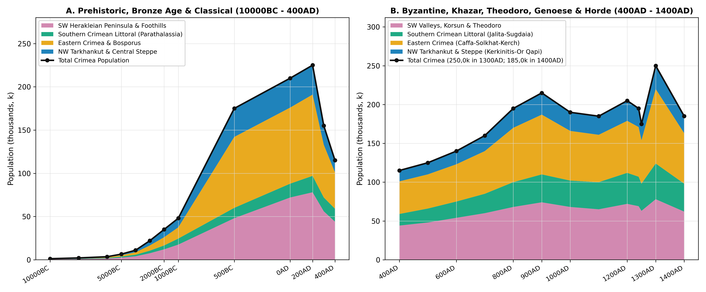
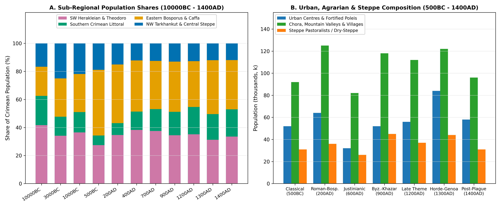
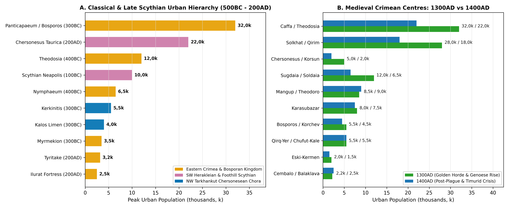

# Abstract

The Crimean Peninsula (*Taurica*, ~26,95k km²) juts out into the Black
Sea (*Pontus Euxinus*), bordered on the north-east by the shallow Sea of
Azov (*Palus Maeotis*) and the Sivash lagoons and on the east by the
Kerch Strait (*Kimmerian Bosporus*). Linked to the mainland steppe only
by the 7 km-wide Perekop Isthmus (*Taphros*/*Or Qapi*) and the narrow
Arabat Spit, Crimea divides naturally into three zones: the northern and
central dry steppe (~72% of the land area), the three parallel ridges of
the Crimean Mountains (the Outer, Inner and Main *Yayla* ranges, rising
to 1,55k m at Roman-Kosh) cut by the Chorna, Belbek, Kacha, Alma, Salgir
and Biyuk-Karasu valleys, and the sheltered southern coast. Small
Mesolithic hunting bands (1,2k in 10000BC) and Bronze Age herders and
farmers (48k by 1000BC) gave way after 600BC to Greek coastal colonies
and the Bosporan and Late Scythian kingdoms, which carried the
population to a Classical peak of 225k in 200AD. Gothic and Hunnic raids
nearly halved numbers to 115k by 400AD, before Byzantine forts along the
coast and in the mountain plateau towns, together with new rural
settlement under Khazar rule, restored the total to 215k in 900AD. After
a dip during the Pecheneg and Cuman centuries, Black Sea trade through
Genoese Caffa and the Golden Horde capital of Solkhat lifted Crimea to a
medieval peak of 250k in 1300AD. Plague after 1346AD, civil wars in the
Golden Horde and the raids of Timur and Edigu then cut the population
back to 185k by 1400AD.

# Background

Following its relief, river basins and historical borders, Crimea
divides into four parts (Table ). The south-west (~5,8k km²) lies
north-west of the Western Main Yayla crest and takes in the Herakleian
Peninsula (*Chersonesus Taurica*/*Korsun*), the Chorna, Belbek, Kacha,
Alma and Upper Salgir foothill valleys, the flat-topped limestone
plateaus of the Inner Range (Mangup-Doros, Eski-Kermen,
Chufut-Kale/*Qirq-Yer*, Bakla, Tepe-Kermen, Kachi-Kalyon and Kalamita)
and the Bakhchisaray and Simferopol (*Scythian Neapolis*) basins.

The southern coast and Main Yayla range (~2,75k km²) runs south-east of
the Main Yayla watershed (Ai-Petri, Yalta, Babugan, Chatyr-Dag,
Demerdzhi and Karabi *Yaylas*), taking in the narrow coastal bays from
Cembalo (Symbolon/Balaklava) and Foros eastward past Simeiz, Alupka,
Charax, Oreanda, Jalita (Yalta), Gorzouvitai (Gurzuf), Partenit, Lambat
and Aluston (*Lusta*/Alushta) to Sugdaia (*Soldaia*/Sudak). In the
Middle Ages this coast formed the Byzantine *Parathalassia* (*Klimata*)
and the Genoese *Capitanate of Gotthia*.

Eastern Crimea (~6,65k km²) lies south-east of the Salgir River and
covers the Biyuk-Karasu valley (Karasubazar), the Golden Horde capital
of Solkhat (*Qirim*/Staryi Krym), the bay of Feodosia
(*Theodosia*/*Caffa*), the Karadag-Koktebel (*Tepsen*) coast and the
European core of the Bosporan Kingdom on the Kerch Peninsula
(Panticapaeum/*Bosporos*/*Korchev*, Nymphaeum, Myrmekion, Tyritake,
Kimmerikon, Kytaia, Akra and the rural hinterland behind the Uzunlarsky
and Tyritake earthworks). Finally, the north-western and central steppe
(~11,75k km²) lies north-west of the Salgir and north of the Outer Ridge
foothills, covering the limestone coast of the Tarkhankut Peninsula with
its Chersonesean farmsteads and ports (Kerkinitis, Kalos Limen, Chaika,
Belyaus, Panskoye I, Masliny, Kara-Tobe, Kulchuk and Tarpanchi), the
central dry steppe and the northern gateway at Perekop (*Taphros*/*Or
Qapi*) and the Sivash lagoons.

| Region | Area (% Share) | Main Settlements & Sites | Key Benchmark Populations |
|:---|:---|:---|:---|
| South-Western Herakleian, Foothills & Theodoro | 5,8k km² (21,5%) | Chersonesus (Korsun), Scythian Neapolis, Mangup (Theodoro), Qirq-Yer (Chufut-Kale), Eski-Kermen, Kalamita | 17,5k (1000BC); 78k (200AD); 74k (900AD); 78k (1300AD); 62k (1400AD) |
| Southern Coast & Main Yayla | 2,75k km² (10,2%) | Cembalo (Symbolon), Foros, Charax, Jalita (Yalta), Gorzouvitai (Gurzuf), Partenit, Aluston, Sugdaia (Soldaia) | 7k (1000BC); 19k (200AD); 36k (900AD); 46k (1300AD); 36k (1400AD) |
| Eastern Crimea, Caffa-Solkhat & Bosporus | 6,65k km² (24,7%) | Panticapaeum (Bosporos/Korchev), Theodosia (Caffa), Solkhat (Qirim), Karasubazar, Nymphaeum, Ilurat, Tepsen | 13k (1000BC); 94k (200AD); 77k (900AD); 96k (1300AD); 65k (1400AD) |
| North-Western Tarkhankut & Central Steppe | 11,75k km² (43,6%) | Kerkinitis, Kalos Limen, Belyaus, Panskoye I, Masliny, Chaika, Kara-Tobe, Kulchuk, Or Qapi (Taphros/Perekop) | 10,5k (1000BC); 34k (200AD); 28k (900AD); 30k (1300AD); 22k (1400AD) |
| Total Crimean Peninsula | 26,95k km² (100%) | 171 recorded settlements and sites | 48k (1000BC); 225k (200AD); 215k (900AD); 250k (1300AD); 185k (1400AD) |

The four geographical divisions of Crimea (~26,95k km²), comparing land
area, principal settlements and population totals from the Late Bronze
Age (1000BC) to 1400AD.

# Results

## Prehistory and the Early Iron Age

### Mesolithic and Neolithic Hunters and Herders

At the end of the Ice Age (10000BC - 8000BC), when the Black Sea stood
60 to 80 metres below its modern level as the freshwater Neoeuxine lake,
settlement in Crimea clustered in the limestone rock-shelters
(*grottoes*) of the Inner Ridge and the Chornaya, Belbek, Kacha and Zuya
river gorges [\[1\]](#ref-cherkasov2014)[\[2\]](#ref-chabai2004). Upper
Palaeolithic camps such as Buran-Kaya III (on the Burulcha), Siuren I
(on the Belbek), Kabazi II, Zaskalnaya and Kiik-Koba were followed by
two successive Mesolithic cultures studied by G. A. Bonch-Osmolovsky, S.
N. Bibikov and D. Ya. Telegin
[\[3\]](#ref-cherkasov2018)[\[4\]](#ref-telegin1985).

The Shan-Koba Culture (c. 10000-7500BC) is marked by crescent-shaped
flint microliths and the hunting of red deer, saiga antelope, wild boar
and wild horses at Shan-Koba, Fatma-Koba Layer 6, Grot Skalisty (on the
Bodrak), Zamil-Koba I and Buran-Kaya III [\[3\]](#ref-cherkasov2018).
Across the river gorges and the wide coastal plain, small hunting bands
of 35 to 80 people supported a population of about 1,2k in 10000BC,
rising to 2,1k by 8000BC as warmer weather spread oak and pistachio
woods through the foothill valleys.

The Murzak-Koba Culture (7500-5500BC) and the Crimean Neolithic
(6000-5000BC) are known from excavations at Murzak-Koba in the Chornaya
gorge, Fatma-Koba, Laspi VII on the south coast, Tash-Air I in the Kacha
canyon, Kaya-Arasy near Bakhchisaray, At-Bash on the Ai-Petri *Yayla*
and Frontovoye I on the Kerch Peninsula. These sites show a shift toward
trapeze-shaped flints, land-snail gathering, sea fishing and the first
keeping of pigs, sheep and goats
[\[1\]](#ref-cherkasov2014)[\[3\]](#ref-cherkasov2018)[\[4\]](#ref-telegin1985).
By 6000BC the population reached 3,5k, nearly doubling to 6,5k in 5000BC
as permanent open-air villages appeared at Tash-Air I, Kaya-Arasy,
Alekseevka on the Tarkhankut Peninsula and Frontovoye.

### Bronze Age Herders and the Tauri

Between 4000BC and 2000BC, Crimea linked the kurgan herders of the
Pontic steppe (Sredny Stog, Yamnaya and Catacomb cultures) with the
metalworking peoples of the North Caucasus
[\[5\]](#ref-shchepinsky1966)[\[6\]](#ref-bezborodykh2018). In the Early
and Middle Bronze Age (3200-2200BC), the local Kemi-Oba Culture occupied
the foothill valleys from Sevastopol to the Salgir and Biyuk-Karasu
basins. Kemi-Oba communities built timber-and-stone cist graves painted
with red ochre patterns, set up carved stone stelae (*Bakhchi-Eli* and
*Kazanki*) and combined valley farming with summer grazing on the high
*Yayla* pastures
[\[5\]](#ref-shchepinsky1966)[\[6\]](#ref-bezborodykh2018). Together
with Yamnaya and Catacomb groups on the Kerch Peninsula
(Kamenka-Bosporan and Planerskoye) and the Tarkhankut-Sivash steppes,
Kemi-Oba settlements (7,5k in 3000BC and 12k in 2000BC in the
south-western foothills) raised Crimea’s total population from 11k in
4000BC to 22k in 3000BC and 35k in 2000BC.

During the Late Bronze Age and Early Iron Age (1500-800BC), Sabatinovka
and Belozerka farming villages in the steppe lived alongside the
Kizil-Koba Culture of the mountains and foothills, which Kh. I. Kris and
V. A. Kolotukhin identify with the Tauri (*Tauroi*) of Herodotus
(*Histories* IV.99-103) and Euripides
[\[7\]](#ref-kris1981)[\[8\]](#ref-kolotukhin1996)[\[9\]](#ref-kruglov2025).
Centred on the 12 ha fortified promontory of Uch-Bash near Inkerman
(0,9k - 1,2k inhabitants), Kizil-Koba (*Krasnaya Peshchera*) in the
Upper Salgir valley, Druzhnoye, Tash-Dzhargan and the stone-box
(*ashchechnye*) cemeteries of the Baidar valley and southern coast
(Malorechenskoye, Oreanda, Simeiz and Gurzuf), Tauri and steppe
communities supported 48k people in 1000BC (17,5k in the south-western
foothills, 7k along the southern coast, 13k in eastern Crimea and 10,5k
across the north-western steppe).

## Classical Antiquity

### The Bosporan Kingdom and Chersonesus

Greek settlement in the sixth and fifth centuries BC set off the first
rapid growth in Crimean history, lifting the population from 48k in
1000BC to 175k in 500BC and 210k at 0AD
[\[10\]](#ref-maslennikov1998)[\[11\]](#ref-shcheglov1978)[\[12\]](#ref-carter2000).
Two colonial networks reshaped the peninsula.

In eastern Crimea (82k in 500BC; 88k in 0AD; 94k in 200AD), colonists
from Miletus founded Panticapaeum (modern Kerch) on Mount Mithridates
c. 600BC. As capital of the Archaeanactid (480BC) and Spartocid
(438-108BC) kings of the Bosporus, Panticapaeum grew to ~100 ha of
terraced acropolis, agora, craft quarters and harbour suburbs with 22k
to 28k inhabitants
[\[10\]](#ref-maslennikov1998)[\[13\]](#ref-evdokimov2011). Around it
along the Kerch Strait and Azov-Black Sea coasts stood a ring of Greek
towns: Theodosia (annexed by Leucon I c. 380BC as a grain port, 6k in
500BC), Nymphaeum (4,5k), Myrmekion (3,5k), Tyritake (3,2k - 4k),
Kimmerikon (2,5k - 3k), Kytaia (2,2k - 2,9k), Porthmion (1,8k), Akra
(1,5k - 1,9k) and Zenon’s Chersonesus (1,4k - 2,1k). Behind the Tyritake
and Uzunlarsky earth ramparts (36 km from the Sea of Azov to Lake
Uzunlar), the Kerch interior held over 280 rural estates and fortified
villages (Andreevka-Yuzhnaya, Generalskoye-Zapadnoye, Polyanka, Zolotoe,
Tasunovo, Mikhailovka, Artesian and Ilurat), which under Leucon I
shipped 400k *medimnoi* (~16,5k tonnes) of wheat a year to Athens
[\[10\]](#ref-maslennikov1998)[\[14\]](#ref-abramzon2016).

In south-western and north-western Crimea (48k and 33k in 500BC),
settlers from Heraclea Pontica founded Dorian Chersonesus Taurica in
422/421BC on Quarantine Bay over an earlier sixth-century Ionian trading
post. Built on a 38 ha street grid inside ashlar walls, Chersonesus grew
from 4,5k inhabitants in 500BC to 16k in 0AD and 20k in 200AD
[\[15\]](#ref-zedgenidze2015)[\[16\]](#ref-zubar1994). Across the
Herakleian Peninsula (~10k ha), G. M. Nikolaenko and J. C. Carter have
mapped 415 stone-walled farm plots (*kleroi* of 26,5 ha each, planted
with vines and fruit trees around stone farmhouse towers), which
supported a rural population of 6k to 8k
[\[12\]](#ref-carter2000)[\[17\]](#ref-nikolaenko1999). In the
mid-fourth century BC, Chersonesus also took over the north-western
coast along the Tarkhankut Peninsula, including the older Ionian town of
Kerkinitis (Yevpatoria, 8,5 ha, 4,2k in 500BC), Kalos Limen
(Chornomorske, 2,5k - 2,8k) and dozens of fortified coastal farms and
grain depots at Panskoye I, Belyaus, Chaika, Masliny, Kara-Tobe,
Kulchuk, Tarpanchi and Dzhangul
[\[11\]](#ref-shcheglov1978)[\[18\]](#ref-antonov2017)[\[19\]](#ref-antonov2021).

### Late Scythia and the Roman Garrison

Pushed south by Sarmatian tribes crossing the Don in the third and
second centuries BC, Royal Scythian rulers built a new Late Scythian
kingdom in the Crimean foothills (*Scythia Minor*) around their walled
capital at Scythian Neapolis (*Kermen-Chuk*, a 20 ha fortress in modern
Simferopol with 7,5k - 8k inhabitants in 0AD - 200AD)
[\[20\]](#ref-vysotskaya1979)[\[21\]](#ref-popova2011)[\[22\]](#ref-puzdrovsky2007).
Kings Skilurus and Palakus seized the north-western Chersonesean coast
(taking Kerkinitis, Kalos Limen, Chaika, Belyaus and Tarpanchi) and
built over 50 hillforts along the Alma, Kacha, Belbek and Salgir rivers,
led by the coastal fort of Ust-Alma (Palakion, 6 ha, 3,5k - 4k),
Kermen-Kyr (Chabion, 2,8k), Bulganak (Khaboi, 2,5k), Alma-Kermen (2,2k),
Belogorsk-Ak-Kaya (2,8k), Zayachye (1,5k) and Dobroye (1,6k)
[\[18\]](#ref-antonov2017)[\[21\]](#ref-popova2011)[\[23\]](#ref-khodyreva2026).

In 110-107BC Diophantus, general of Mithridates VI Eupator, rescued
Chersonesus and brought Crimea into the Pontic kingdom before Rome
established its protectorate after 63BC [\[16\]](#ref-zubar1994). From
the first to the third centuries AD, Rome stationed troops from Legions
*I Italica*, *V Macedonica* and *XI Claudia* and warships of the
*Classis Flavia Moesica* at Chersonesus, Balaklava-Kadykovka (Symbolon)
and the cliff-top fort of Charax on Cape Ai-Todor (1,8k soldiers and
camp followers in 200AD)
[\[16\]](#ref-zubar1994)[\[24\]](#ref-pavlenkov2024). At the same time,
the Bosporan kings built heavy stone forts across the Kerch interior to
block steppe raids (Ilurat at 2,6k, Artesian at 2,1k, Mikhailovka at
1,8k and Tasunovo at 1,3k), carrying Crimea to its Classical peak of
225k in 200AD (78k in the south-west, 19k on the south coast, 94k in the
east and 34k in the north-west)
[\[10\]](#ref-maslennikov1998)[\[13\]](#ref-evdokimov2011).

Gothic and Borani sea raids in 252-275AD (which sacked Tanais,
Gorgippia, Ilurat, Myrmekion and the Late Scythian foothill forts) and
the Hunnic crossing of the Kerch Strait in 370-376AD (which destroyed
the Bosporan countryside, Scythian Neapolis and Ust-Alma) brought a
steep drop in numbers
[\[23\]](#ref-khodyreva2026)[\[25\]](#ref-aibabin1999). The population
fell to 155k in 300AD and 115k in 400AD - nearly half its 200AD level -
as survivors fled behind the walls of Chersonesus and Bosporos or into
the wooded mountain valleys, where the Alanic and Gothic cemeteries of
Neyzats, Opushki, Druzhnoye, Suuk-Su and Luchistoye mark the beginnings
of medieval Crimean Gothia [\[25\]](#ref-aibabin1999).

## Medieval Crimea

### Byzantine Cherson, Gothia and the Khazars

Under Justinian I (527-565AD) and Maurice (582-602AD), Byzantium rebuilt
the walls of Chersonesus (*Cherson*) and Bosporos, put up the coastal
forts of Aluston (Alushta) and Gorzouvitai (Gurzuf) and closed the
mountain passes around the Gothic-Alanic country of *Dory* with stone
barrier walls [\[25\]](#ref-aibabin1999)[\[26\]](#ref-aibabin2017).
Along the Inner Ridge of south-western Crimea, Byzantine engineers and
Christian Gothic-Alanic settlers founded the cliff-top “cave-towns”
(*peshchernye goroda*): Mangup-Doros (a 90 ha plateau stronghold that
grew from 2,5k in 500AD to 7k in 900AD), Eski-Kermen (an 18 ha plateau,
rising from 2,8k in 600AD to 5,2k in 900AD), Chufut-Kale (*Qirq-Yer*,
3,2k in 900AD), Bakla (3,4k in 900AD), Tepe-Kermen (2,4k), Kachi-Kalyon
(2,1k), Kyz-Kermen (1,8k in 800AD) and Kalamita (Inkerman, 2k)
[\[26\]](#ref-aibabin2017)[\[27\]](#ref-gertsen1990)[\[28\]](#ref-myts1991).
Total population recovered from 125k in 500AD to 140k in 600AD and 160k
in 700AD.

In the eighth and ninth centuries AD, Khazar rule over eastern and
foothill Crimea (governed by a Khazar *tudun* at Bosporos, Sugdaia and
at times Cherson) brought a wave of rural settlement studied by I. A.
Baranov and A. I. Aibabin
[\[29\]](#ref-baranov1990)[\[30\]](#ref-aibabin2013). Proto-Bulgarian
and Alanic herders settled in more than 260 open villages, pottery
centres and vineyards of the Saltovo-Mayaki culture. Sugdaia (Sudak)
grew into a major Black Sea port (7,5k in 800AD and 9k in 900AD),
flanked by the 18 ha coastal town and monastery of Tepsen (Koktebel,
3,4k in 900AD), Kordon-Oba (1,8k), Otuz (Shchebetovka, 1,4k),
Geroevskoye and Ptashkino on the Kerch Peninsula
[\[29\]](#ref-baranov1990)[\[31\]](#ref-gorbunov2024). In Byzantine
Cherson (made capital of the *Theme of Klimata/Cherson* under Emperor
Theophilos in 833/841AD), the town population reached 11,5k - 12k in
800-900AD [\[32\]](#ref-romanchuk2005)[\[33\]](#ref-yakobson1964).
Crimea’s population climbed to 195k in 800AD and 215k in 900AD (74k in
the south-west, 36k on the south coast, 77k in the east and 28k in the
north-west).

### Kievan Rus and the Cumans

Pecheneg raids across the steppe (c. 900-960AD) and Prince Svyatoslav
Igorevich’s overthrow of the Khazar Khaganate (965AD) ruined many open
Saltovo-Mayaki villages in eastern Crimea and on the Kerch steppe
(including Tepsen and Kordon-Oba), bringing the population down to 190k
in 1000AD and 185k in 1100AD
[\[29\]](#ref-baranov1990)[\[34\]](#ref-chkhaidze2010). At the same
time, Kievan Rus gained a direct foothold on the peninsula.

In 988-989AD Grand Prince Vladimir Svyatoslavich besieged and took
Byzantine Cherson (*Korsun*), was baptised there, married the princess
Anna Porphyrogenita and handed the city back to Emperor Basil II
[\[32\]](#ref-romanchuk2005)[\[33\]](#ref-yakobson1964). Through the
eleventh and twelfth centuries, Korsun (10k in 1000AD; 8k - 8,5k in
1100-1200AD) remained the main port for trade between Byzantium and Rus.
Across the Kerch Strait, the Rurikid princes of Tmutarakan (988-1094AD)
ruled Korchev (ancient Bosporos/Kerch, 7,5k in 1000AD; 6,5k - 7k in
1100-1200AD), as recorded on Prince Gleb Svyatoslavich’s 1068AD
*Tmutarakan Stone*, which measured the 14k-fathom distance across the
frozen strait from Tmutarakan to Korchev [\[34\]](#ref-chkhaidze2010).

By 1200AD, lively trade between the Cumans (Polovtsians), the Empire of
Trebizond and the Seljuk Turks of Rum lifted Sugdaia (*Surozh* in
Russian chronicles) to 11k inhabitants as the chief silk and fur port on
the northern Black Sea. The mountain towns of Gothia also grew (Mangup
at 7k, Eski-Kermen at 4,8k, Chufut-Kale at 3,8k, Bakla at 3k, Aluston at
3,5k and Gorzouvitai at 2,8k), carrying the Crimean total back to 205k
[\[28\]](#ref-myts1991)[\[33\]](#ref-yakobson1964).

### The Golden Horde, Genoese Gazaria and Theodoro

Mongol horsemen under Jebe and Subutai raided Sugdaia in January 1223AD,
Batu conquered the Crimean steppe in 1238-1239AD and Nogai sacked
Korsun, Eski-Kermen, Bakla and Sugdaia in 1299AD
[\[33\]](#ref-yakobson1964)[\[35\]](#ref-myts2024). Although the initial
Mongol attacks reduced the population from 195k in 1240AD to 175k in
1250AD, Crimea soon prospered as the chief Black Sea outlet of the
Golden Horde (*Ulus of Jochi*), and by 1300AD the peninsula reached an
all-time pre-modern peak of 250k.

Built in the sheltered Agarmysh valley of eastern Crimea as the seat of
the Golden Horde governor (*tumen-bashi*), Solkhat (*Qirim*, which gave
its name to the whole peninsula) grew into a 300 ha walled city with
mosques, madrasas, Armenian and Greek churches, caravanserais, mints and
clay water pipes
[\[35\]](#ref-myts2024)[\[36\]](#ref-useinov2022)[\[37\]](#ref-karpov2000).
At its height in 1300-1340AD, Solkhat held 28k inhabitants (18k in
1400AD), alongside the inland market town of Karasubazar (Bilohirsk, 8k
in 1300AD and 7,5k in 1400AD) and the cliff-top fortress of Chufut-Kale
(*Qirq-Yer*) and Eski-Yurt/Salachik in the Bakhchisaray valley (5,5k and
3,5k in 1300-1400AD)
[\[38\]](#ref-inalcik1996)[\[39\]](#ref-fisher1978)[\[40\]](#ref-vodarsky2003)[\[41\]](#ref-prokhorov2011).

On the coast, after Mengu-Timur Khan granted trading rights at ancient
Theodosia in 1266AD, the Genoese built Caffa (Feodosia) into a 90 ha
double-walled port inhabited by Armenians, Greeks, Italians, Tatars,
Jews and Rus
[\[37\]](#ref-karpov2000)[\[42\]](#ref-ozturk2019)[\[43\]](#ref-ozturk2000)[\[44\]](#ref-bocharov2017).
Before the Black Death broke out during Janibeg Khan’s siege of 1346AD,
Caffa held 32k - 40k people, lifting eastern Crimea as a whole to 96k in
1300AD. Genoa also took over Cembalo (Balaklava, 1343/1357AD, 2,2k in
1300AD and 2,5k in 1400AD), Soldaia (Sudak, 1365AD, with 18 coastal
villages, 12k in 1300AD and 6,5k in 1400AD), Vosporo (Kerch, 5,5k in
1300AD and 4,5k in 1400AD) and the castles of the *Capitanate of
Gotthia* along the southern coast (Aluston/*Lusta* at 4k, Gorzouvitai at
3,2k, Partenit at 2,6k, Jalita/Yalta at 3k and Foros at 1,6k)
[\[28\]](#ref-myts1991)[\[31\]](#ref-gorbunov2024)[\[44\]](#ref-bocharov2017)[\[45\]](#ref-kurnikova2026).

In the south-western mountains and the Belbek, Kacha and Chorna valleys,
the Greek-Gothic princes of Theodoro enlarged the citadel and walls of
Mangup (8,5k in 1300AD and 9k in 1400AD), built the port fort of
Kalamita (Inkerman, 2,5k in 1400AD) opposite Genoese Cembalo and
fortified the border castle of Funa at the foot of Mount Demerdzhi
alongside Syuyren, Kermenchik and Chorgun
[\[27\]](#ref-gertsen1990)[\[28\]](#ref-myts1991)[\[35\]](#ref-myts2024).

### The Black Death and the 1400AD Benchmark

Repeated outbreaks of plague after the 1346AD siege of Caffa, civil war
in the Golden Horde during the *Great Troubles* (1359-1380AD) and the
campaigns of Timur (1395-1396AD) and Edigu (who burned the last
inhabited quarters of Korsun in 1399AD) cut Crimea’s population from
250k in 1300AD to 185k in 1400AD (62k in the south-west, 36k on the
south coast, 65k in the east and 22k in the north-west). By 1400AD the
main towns stood at 22k for Caffa, 18k for Solkhat, 9k for Mangup, 7,5k
for Karasubazar, 6,5k for Soldaia, 5,5k for Qirq-Yer, 4,5k for Vosporo,
2,5k for Cembalo and 2k for Korsun
[\[35\]](#ref-myts2024)[\[42\]](#ref-ozturk2019)[\[46\]](#ref-troynitsky1904)[\[47\]](#ref-borshchik2018).

## Regional Population Summary

Table sets out the population estimates for Crimea (~26,95k km²) and its
four regions from 10000BC to 1400AD.

| Year | SW & Theodoro | South Coast | East & Bosporus | NW & Steppe | Total Pop. | Historical & Archaeological Context |
|:---|:---|:---|:---|:---|:---|:---|
| 10000BC | 0,5k | 0,25k | 0,25k | 0,2k | 1,2k | Upper Palaeolithic/Early Shan-Koba Grottoes (Kiik-Koba, Siuren I, Buran-Kaya III) |
| 8000BC | 0,85k | 0,45k | 0,45k | 0,35k | 2,1k | Boreal Shan-Koba Mesolithic Foragers (Shan-Koba, Fatma-Koba, Grot Skalisty) |
| 6000BC | 1,4k | 0,75k | 0,75k | 0,6k | 3,5k | Atlantic Murzak-Koba Mesolithic & Early Neolithic (Murzak-Koba, Laspi VII, Zamil-Koba) |
| 5000BC | 2,5k | 1,2k | 1,5k | 1,3k | 6,5k | Crimean Neolithic Expansion (Tash-Air I, Kaya-Arasy, Frontovoye I, At-Bash) |
| 4000BC | 4k | 1,8k | 2,8k | 2,4k | 11k | Eneolithic Steppe & Foothill Pastoralism (Sredny Stog & Early Copper Age) |
| 3000BC | 7,5k | 3k | 6k | 5,5k | 22k | Early Bronze Age Kemi-Oba Megalithic & Yamnaya Cultures (Kemi-Oba, Bakhchi-Eli) |
| 2000BC | 12k | 4,5k | 9,5k | 9k | 35k | Middle Bronze Age Catacomb & Late Kemi-Oba Settlements (Kamenka, Planerskoye) |
| 1000BC | 17,5k | 7k | 13k | 10,5k | 48k | Late Bronze/Early Iron Age Tauri Kizil-Koba Culture (Uch-Bash, Kizil-Koba) |
| 500BC | 48k | 12k | 82k | 33k | 175k | Archaic-Classical Greek Colonisation (Panticapaeum, Chersonesus, Theodosia, Kerkinitis) |
| 0AD | 72k | 16k | 88k | 34k | 210k | Hellenistic-Roman Transition & Late Scythian State (Scythian Neapolis, Ust-Alma) |
| 200AD | 78k | 19k | 94k | 34k | 225k | Roman Garrison & Bosporan Peak (Charax, Chersonesus 20k, Panticapaeum 28k) |
| 300AD | 56k | 16k | 61k | 22k | 155k | Post-Gothic Raid Contraction (Destruction of Tanais, Ilurat & Scythian Foothill Forts) |
| 400AD | 44k | 15k | 42k | 14k | 115k | Post-Hunnic Low Point (370-376AD Collapse of Bosporan Chora & Flight into Mountains) |
| 500AD | 48k | 18k | 44k | 15k | 125k | Early Byzantine Reconquest under Anastasius & Justinian I (Aluston, Gorzouvitai, Doros) |
| 600AD | 54k | 21k | 48k | 17k | 140k | Byzantine Rule & Rise of Gothic Cave-Towns (Mangup, Eski-Kermen, Chufut-Kale) |
| 700AD | 60k | 25k | 55k | 20k | 160k | Early Khazar Rule & Crimean Tudunate (Cherson, Bosporos, Sugdaia) |
| 800AD | 68k | 32k | 70k | 25k | 195k | Saltovo-Mayaki Village Expansion (260+ Eastern & Foothill Villages, Tepsen) |
| 900AD | 74k | 36k | 77k | 28k | 215k | Byzantine Theme of Klimata/Cherson & Khazar Peak (Cherson 12k, Sugdaia 9k) |
| 1000AD | 68k | 34k | 64k | 24k | 190k | Kievan Rus Korsun Campaign (988AD) & Tmutarakan-Korchev Principality (Post-Khazar Shift) |
| 1100AD | 65k | 35k | 61k | 24k | 185k | Cuman (Polovtsian) Steppe Rule & Byzantine-Rus Trade at Korsun and Korchev |
| 1200AD | 72k | 40k | 67k | 26k | 205k | Pre-Mongol Commercial Recovery (Sugdaia/Surozh 11k, Mangup 7k, Korsun 8k) |
| 1240AD | 69k | 38k | 64k | 24k | 195k | Initial Mongol Raids (1223AD & 1238-1239AD Steppe Campaigns) |
| 1250AD | 63k | 35k | 56k | 21k | 175k | Post-Conquest Transition & Early Golden Horde Rule |
| 1300AD | 78k | 46k | 96k | 30k | 250k | Golden Horde Solkhat (28k) & Genoese Caffa (32k) Commercial Peak (despite 1299AD Raid) |
| 1400AD | 62k | 36k | 65k | 22k | 185k | Post-1346AD Black Death, Horde Civil Wars & 1395-1399AD Timur/Edigu Raids; Theodoro Peak |

Complete population series for Crimea and its four regions at 25
benchmark dates, paired with the main archaeological cultures and
historical turning points behind each shift.

# Sources

1.
Cherkasov, Aleksey Vladimirovich.
“Antropologicheskie Ostanki Paleolita v Krymu: K Istorii i Istoriografii
Izucheniya.” *Vestnik Tomskogo Gosudarstvennogo Universiteta*, no. 384,
2014, pp. 122-28,
<https://cyberleninka.ru/article/n/antropologicheskie-ostanki-paleolita-v-krymu-k-istorii-i-istoriografii-izucheniya>.

2.
Chabai, Victor P., et al. *The
Middle Paleolithic and Early Upper Paleolithic of Eastern Crimea*.
ERAUL, 2004, <https://doi.org/10.1007/978-1-4020-5302-3_11>.

3.
Cherkasov, Aleksey Vladimirovich.
“K Probleme Izucheniya Mezolita v Otechestvennoy Istoriografii
1920-1980-Kh Gg. (Po Materialam Krymskikh Issledovaniy).” *Vestnik
Nizhegorodskogo Universiteta Im. N. I. Lobachevskogo*, no. 5, 2018, pp.
73-79,
<https://cyberleninka.ru/article/n/k-probleme-izucheniya-mezolita-v-otechestvennoy-istoriografii-1920-1980-h-gg-po-materialam-krymskih-issledovaniy>.

4.
Telegin, D. Ya. *Pamyatniki Epokhi
Mezolita Na Territorii Ukrainskoy SSR*. Naukova Dumka, 1985,
<https://search.worldcat.org/search?q=Pamyatniki+epokhi+mezolita+territorii+Ukrainskoy+SSR+Telegin+1985>.

5.
Shchepinsky, A. A. “Kultury
Eneolita i Bronzy v Krymu.” *Sovetskaya Arkheologiya*, no. 2, 1966, pp.
10-23,
<https://cyberleninka.ru/article/n/kultury-eneolita-i-bronzy-v-krymu>.

6.
Bezborodykh, Vitaliy Ivanovich,
and Sergey Vladimirovich Vasilyev. “Cherepa Epokhi Ranney i Sredney
Bronzy Iz Kryma.” *Izvestiya Irkutskogo Gosudarstvennogo Universiteta.
Seriya: Geoarkheologiya. Etnologiya. Antropologiya*, vol. 25, 2018, pp.
112-29, <https://doi.org/10.26516/2227-2380.2018.25.143>.

7.
Kris, Kh. I. *Kizil-Kobinskaya
Kultura i Tavry*. Nauka, 1981,
<https://search.worldcat.org/search?q=Kizil+kobinskaya+kultura+tavry+Kris+1981>.

8.
Kolotukhin, V. A. *Gorniy Krym v
Epokhu Pozdney Bronzy - Nachale Zheleznogo Veka: Etnokulturnye
Protsessy*. Yuzhnogorodskie Vedomosti, 1996,
<https://search.worldcat.org/search?q=Gorniy+Krym+epokhu+pozdney+bronzy+nachale+zheleznogo+veka+Kolotukhin+1996>.

9.
Kruglov, Evgeniy Anastasovich. “Iz
Predystorii Arteka: Ot Tavrov Evripida k Chitatelyam a. P. Chekhova i
Arkadiya Gaydara.” *Izvestiya UFITS RAN. Seriya: Istoriya. Filologiya.
Kultura*, vol. 2, 2025, pp. 45-58,
<https://doi.org/10.31833/sifk/2025.2.1.02>.

10.
Maslennikov, A. A. *Ellinskaya
Khora Na Krayu Oykumeny: Selskaya Territoriya Evropeyskogo Bospora v
Antichnuyu Epokhu*. Indrik, 1998,
<https://search.worldcat.org/search?q=Ellinskaya+khora+krayu+Oykumeny+Selskaya+territoriya+evropeyskogo+Bospora+Maslennikov+1998>.

11.
Shcheglov, A. N. *Severo-Zapadniy
Krym v Antichnuyu Epokhu*. Nauka, 1978,
<https://search.worldcat.org/search?q=Severo+Zapadniy+Krym+antichnuyu+epokhu+Shcheglov+1978>.

12.
Carter, Joseph Coleman, et al.
“The Chora of Chersonesos in Crimea, Ukraine.” *American Journal of
Archaeology*, vol. 104, no. 4, 2000, pp. 707-41,
<https://doi.org/10.2307/507154>.

13.
Evdokimov, Denis Olegovich.
“Izmeneniya v Sostave Selskogo Naseleniya Bosporskogo Tsarstva v Pervye
Veka Nashey Ery.” *Problemy Istorii, Filologii, Kultury*, no. 4, 2011,
pp. 138-49,
<https://cyberleninka.ru/article/n/izmeneniya-v-sostave-selskogo-naseleniya-bosporskogo-tsarstva-v-pervye-veka-nashey-ery>.

14.
Abramzon, Mikhail Grigoryevich,
and Sergey Nikolaevich Ostapenko. “Klad Mednykh Bosporskikh Monet IV-i
Vv. Do n. E. S Antichnogo Poseleniya Veselovka 5.” *Problemy Istorii,
Filologii, Kultury*, no. 2, 2016, pp. 192-205,
<https://doi.org/10.18503/1992-0431-2016-2-52-260-267>.

15.
Zedgenidze, Angelina Andreevna.
“Problema Sakralnykh Mest Khory Khersonesa Tavricheskogo.” *Znanie.
Ponimanie. Umenie*, no. 4, 2015, pp. 168-76,
<https://doi.org/10.17805/zpu.2015.1.17>.

16.
Zubar, V. M. *Khersones
Tavricheskiy i Rimskaya Imperiya: Ocherki Voenno-Politicheskoy Istorii*.
Kievskaya Akademiya Evrobiznesa, 1994,
<https://search.worldcat.org/search?q=Khersones+Tavricheskiy+Rimskaya+imperiya+Ocherki+voenno+politicheskoy+istorii+Zubar+1994>.

17.
Nikolaenko, G. M. *Khora
Khersonesa Tavricheskogo: Zemelniy Kadastr IV-III Vv. Do n. E.* National
Preserve of Tauric Chersonesos, 1999,
<https://doi.org/10.1163/9789004496446_036>.

18.
Antonov, Egor Evgenyevich. “Rannie
Poseleniya Pozdnikh Skifov v Severo-Zapadnom Krymu.” *Problemy Istorii,
Filologii, Kultury*, no. 2, 2017, pp. 185-202,
<https://doi.org/10.18503/1992-0431-2017-3-99>.

19.
Antonov, Egor Evgenyevich.
“Piramidalniy Poyas Kreposti Tarpanchi (Severo-Zapadniy Krym).”
*Problemy Istorii, Filologii, Kultury*, no. 3, 2021, pp. 114-29,
<https://doi.org/10.18503/1992-0431-2021-1-71-109>.

20.
Vysotskaya, T. N. *Neapol -
Stolitsa Gosudarstva Pozdnikh Skifov*. Naukova Dumka, 1979,
<https://search.worldcat.org/search?q=Neapol+stolitsa+gosudarstva+pozdnikh+skifov+Vysotskaya+1979>.

21.
Popova, E. A. “Pozdneskifskaya
Kultura: Istoriya Izucheniya, Problemy, Gipotezy.” *Vestnik Moskovskogo
Universiteta. Seriya 8: Istoriya*, no. 1, 2011, pp. 85-98,
<https://cyberleninka.ru/article/n/pozdneskifskaya-kultura-istoriya-izucheniya-problemy-gipotezy>.

22.
Puzdrovsky, A. E. *Krymskaya
Skifiya II v. Do n. E. - III v. N. E.: Etnopoliticheskie Protsessy*.
Biznes-Inform, 2007,
<https://search.worldcat.org/search?q=Krymskaya+Skifiya+II+III+Etnopoliticheskie+protsessy+Puzdrovsky+2007>.

23.
Khodyreva, Darya Sergeevna.
“Odontologicheskaya Kharakteristika Trekh Individov Iz Gunnskikh
Pogrebeniy Kryma (Na Primere Antichnykh Mogilnikov Ust-Alma i Belyaus).”
*Vestnik Moskovskogo Universiteta. Seriya 23: Antropologiya*, no. 1,
2026, pp. 74-86, <https://doi.org/10.55959/MSU2074-8132-26-1-13>.

24.
Pavlenkov, Nikita Romanovich, and
Aleksandr Evgenyevich Smirnitsky. “Rimskiy Garnizon v Tavrike i
Khersonese v i-III Vv. N. e.” *Voenno-Istoricheskiy Zhurnal*, no. 5,
2024, pp. 88-97,
<https://cyberleninka.ru/article/n/rimskiy-garnizon-v-tavrike-i-hersonese-v-i-iii-vv-n-e>.

25.
Aibabin, Aleksandr Ilyich.
*Etnicheskaya Istoriya Rannevizantiyskogo Kryma*. DAR, 1999,
<https://search.worldcat.org/search?q=Etnicheskaya+istoriya+rannevizantiyskogo+Kryma+Aibabin+1999>.

26.
Aibabin, Aleksandr Ilyich. “O
Reforme Sistemy Upravleniya Vladeniyami Vizantii v Krymu v Posledney
Chetverti VI Veka.” *Vestnik Volgogradskogo Gosudarstvennogo
Universiteta. Seriya 4: Istoriya*, vol. 22, no. 5, 2017, pp. 38-51,
<https://doi.org/10.15688/jvolsu4.2017.5.4>.

27.
Gertsen, A. G. “Krepostnoy Ansambl
Mangupa.” *Materialy Po Arkheologii, Istorii i Etnografii Tavrii*, vol.
1, 1990, pp. 87-166,
<https://cyberleninka.ru/article/n/krepostnoy-ansambl-mangupa>.

28.
Myts, Viktor Leonidovich.
*Ukrepleniya Tavriki x-XV Vv.* Naukova Dumka, 1991,
<https://search.worldcat.org/search?q=Ukrepleniya+Tavriki+XV+vv+Myts+1991>.

29.
Baranov, I. A. *Tavrika v Epokhu
Rannego Srednevekovya (Saltovo-Mayatskaya Kultura)*. Naukova Dumka,
1990,
<https://search.worldcat.org/search?q=Tavrika+epokhu+rannego+srednevekovya+saltovo+mayatskaya+kultura+Baranov+1990>.

30.
Aibabin, Aleksandr Ilyich.
“Arkheologicheskoe Nasledie Khazar Vremeni Sozdaniya Kaganata.”
*Materialy Po Arkheologii, Istorii i Etnografii Tavrii*, vol. 18, 2013,
pp. 275-311,
<https://cyberleninka.ru/article/n/arheologicheskoe-nasledie-hazar-vremeni-sozdaniya-kaganata>.

31.
Gorbunov, Pavel Andreevich.
“Poberezhye Yugo-Vostochnogo Kryma v Kontekste Podvodnykh
Arkheologicheskikh Issledovaniy.” *Gidrokosmos*, vol. 2, no. 1, 2024,
pp. 32-54, <https://doi.org/10.24412/2949-3838-2024-56-16-30>.

32.
Romanchuk, Alla I. *Studien Zur
Geschichte Und Archaeologie Des Byzantinischen Cherson*. Brill, 2005,
<https://doi.org/10.1163/9789047404682>.

33.
Yakobson, A. L. *Srednevekoviy
Krym: Ocherki Istorii i Istorii Materialnoy Kultury*. Nauka, 1964,
<https://search.worldcat.org/search?q=Srednevekoviy+Krym+Ocherki+istorii+istorii+materialnoy+kultury+Yakobson+1964>.

34.
Chkhaidze, Viktor Nikolaevich.
“Tmutarakan - Vladenie Drevnerusskogo Gosudarstva v 80-e Gg. X - 90-e
Gg. XI Vekov.” *Vestnik Moskovskogo Gorodskogo Pedagogicheskogo
Universiteta. Seriya: Istoricheskie Nauki*, no. 1, 2010, pp. 20-37,
<https://cyberleninka.ru/article/n/tmutarakan-vladenie-drevnerusskogo-gosudarstva-v-80-e-gg-x-90-e-gg-xi-vekov>.

35.
Myts, Viktor Leonidovich. “Krym v
XIII-XV Vekakh: Problemy Interpretatsii Sobytiy v Istorii i
Arkheologii.” *Arkheologiya Evraziyskikh Stepey*, no. 2, 2024, pp.
144-62, <https://doi.org/10.24852/2587-6112.2024.5.60.67>.

36.
Useinov, Memedula Adilovich.
“Novye Nakhodki Musulmanskikh Nadgrobiy XIII v. Na Territorii g. Stariy
Krym.” *Krymskoe Istoricheskoe Obozrenie*, no. 2, 2022, pp. 112-25,
<https://doi.org/10.22378/kio.2022.2.166-175>.

37.
Karpov, S. P. *Prichernomorye v
Srednie Veka*. vol. 4, Aleteya, 2000,
<https://search.worldcat.org/search?q=Prichernomorye+srednie+veka+Karpov+2000>.

38.
Inalcik, Halil. “Sources and
Studies on the History of the Black Sea: Kefe Defterleri.” *Journal of
Turkish Studies*, vol. 20, 1996, pp. 61-108,
<https://scholar.google.com/scholar?q=Sources+Studies+History+Black+Sea+Kefe+Defterleri+Inalcik+1996>.

39.
Fisher, Alan W. *The Crimean
Tatars*. Hoover Institution Press, 1978,
<https://search.worldcat.org/search?q=Crimean+Tatars+Fisher+1978>.

40.
Vodarsky, Ya. E., et al.
*Naselenie Kryma v Kontse XVIII - Kontse XX Vekov (Chislennost,
Razmeshchenie, Etnicheskiy Sostav)*. IRI RAN, 2003,
<https://search.worldcat.org/search?q=Naselenie+Kryma+kontse+XVIII+kontse+XX+vekov+Chislennost+Vodarsky+2003>.

41.
Prokhorov, D. A. “Khozyaystvennaya
Deyatelnost i Osnovnye Zanyatiya Krymskikh Karaimov v XIII-XVIII Vv.:
Razvitie Remesel, Promyslov i Torgovli.” *Bosporskie Issledovaniya*,
vol. 25, 2011, pp. 346-78,
<https://cyberleninka.ru/article/n/hozyaystvennaya-deyatelnost-i-osnovnye-zanyatiya-krymskih-karaimov-v-xiii-xviii-vv-razvitie-remesel-promyslov-i-torgovli>.

42.
Ozturk, Yucel. “An Eastern
European Capital City of Caffa from Golden Horde Period to Ottoman
Empire.” *Krymskoe Istoricheskoe Obozrenie*, no. 2, 2019, pp. 48-77,
<https://doi.org/10.22378/kio.2019.1.45-70>.

43.
Ozturk, Yucel. *Osmanli
Hakimiyetinde Kefe, 1475-1600*. Kultur Bakanligi Yayinlari, 2000,
<https://search.worldcat.org/search?q=Osmanli+Hakimiyetinde+Kefe+1475+1600+Ozturk+2000>.

44.
Bocharov, S. G. *Genoese Gazaria
and the Golden Horde*. Archaeopress, 2017,
<https://search.worldcat.org/search?q=Genoese+Gazaria+Golden+Horde+Bocharov+2017>.

45.
Kurnikova, Oksana Mikhaylovna.
“Krepost Taman v Strukture Osmanskoy Provintsii Kefe v XVI-XVIII
Vekakh.” *Vostochniy Arkhiv*, no. 1, 2026, pp. 15-26,
<https://doi.org/10.31696/2072-5795-2026-2-5-11>.

46.
Troynitsky, N. A. *Pervaya
Vseobshchaya Perepis Naseleniya Rossiyskoy Imperii 1897 g. Vyp. XLI:
Tavricheskaya Guberniya*. Tsentralniy statisticheskiy komitet MVD, 1904,
<https://www.demoscope.ru/weekly/ssp/rus1897_01.php>.

47.
Borshchik, Natalya Dmitrievna.
“Istoriya Podgotovki II Vserossiyskoy Perepisi Naseleniya Rossiyskoy
Imperii 1915 g. V Tavricheskoy Gubernii.” *Uchenye Zapiski Krymskogo
Federalnogo Universiteta Imeni V. I. Vernadskogo. Istoricheskie Nauki*,
vol. 4, no. 3, 2018, pp. 21-31,
<https://cyberleninka.ru/article/n/istoriya-podgotovki-ii-vserossiyskoy-perepisi-naseleniya-rossiyskoy-imperii-1915-g-v-tavricheskoy-gubernii>.

